# Orbitol: Crystal Generation on Wyckof Orbits

Ivan Žugec1, Joshua Rosenthal2, Ivor Lončarić3, Jan-Willem van de Meent2, Tin Hadži Veljković2

1Atomic Intelligence, Zagreb, Croatia, 2University of Amsterdam, 3Ruđer Bošković Institute

Generative models propose crystalline materials by learning composition and geometry, but unconditional sampling gives no direct control over the space group, which constrains whether responses such as piezoelectricity are symmetry-allowed. We present Orbitol, a crystal generator built on the Crystalite difusion Transformer that replaces atom tokens with Wyckof-orbit tokens. Given a space group and a collection of occupied Wyckof positions, Orbitol generates the atom type and free coordinates of each orbit together with a compatible lattice, so every valid structure is invariant under the operations of the requested group. It generates structures two to three orders of magnitude faster than the symmetry-aware baselines at the evaluated settings. On MP-20, 13.8% of Orbitol’s attempts yielded stable or metastable, unique and novel structures that retained the requested space group after relaxation, compared with 10.8% for SGFM, the next best model. We also introduce SPARC, a score that combines retention of the raw detected space group with agreement between the retained-group and training distributions. Finally, we used Orbitol to generate candidates in piezoelectric crystal classes. Of the structures selected by internal screening, 89% passed our density functional theory checks, and 79% also matched no Materials Project or Alexandria entry with the same space group. Their median figure of merit was nine times that of the piezoelectric materials computed in the Materials Project, and 24% of the new candidates ranked in that set’s top 10%.

Correspondence: IŽ: zugec.ivan@gmail.com; THV: tin.hadzi@gmail.com Keywords: Crystal Generation, Space Groups, Wyckof Positions, Difusion Transformers

## 1 Introduction

Generative models such as MatterGen and Crystalite propose new crystals by learning composition and geometry from known materials [1, 2]. Many of them treat a crystal as a set of atoms, and their outputs can overrepresent low-symmetry space groups relative to the training data. The space group P1, which contains only lattice translations [3], accounts for 1.7% of the MP-20 training set, yet DifCSP, MatterGen and our Crystalite reproduction produce 28.3%, 26.4% and 21.5% P1 structures after relaxation.

Symmetry also constrains which responses a crystal can show. Bulk piezoelectricity is allowed only in the noncentrosymmetric crystal classes other than 432, and pyroelectricity and conventional ferroelectricity require a polar class [3]. P1 itself permits piezoelectric and polar responses, so producing fewer P1 structures is not the goal; targeting such responses requires direct control over the generated space group. Unconditional generators cannot control the space group. A group label can guide a conditioned model, but the label alone does not guarantee that the generated structure is invariant under the group’s operations [1]. Other generators build the operations into generation: CrystalFormer generates Wyckof assignments, DifCSP++ uses supplied ones, and SymADiT and UFO-MGen model orbit representations [4–7]. We study how to impose these operations during generation, and how much of the requested symmetry is retained after unconstrained relaxation.

We introduce Orbitol, a crystal generator built on Crystalite that represents symmetry-related atoms together as Wyckof-orbit tokens [2]. A space group and a multiset of occupied Wyckof positions, which we call rows, form a skeleton (Section 3.1). Given a skeleton, Orbitol generates the atom type and free coordinates of each orbit together with a compatible lattice, and the decoder expands the orbits into atoms (Figure 1), so every valid decoded structure is invariant under the operations of the requested group. We keep Crystalite’s difusion Transformer and adapt its geometric attention to account for all members of each orbit.

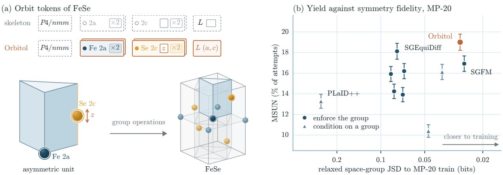

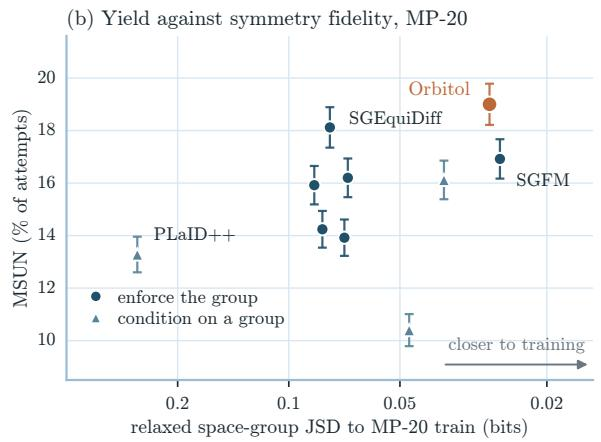  
Figure 1 Orbitol fills a skeleton with orbit tokens. (a) Illustration for FeSe (P4/nmm). The skeleton fixes the space group and the occupied Wyckof rows 2a and 2c. Orbitol predicts an atom type for each orbit, the free height z of Se on row 2c, and the lattice parameters a and c. Each token represents two atoms of the cell. The coloured piece is the standard asymmetric unit of $P 4 / n m m$ , 1/16 of the cell (enlarged on the left), and contains one representative of each orbit: Fe at a fixed point, Se on a vertical edge at height z. The 16 operations of the group generate copies of the asymmetric unit that tile the cell and place the other atoms (pale). (b) Discovery yield on MP-20 (MSUN, the percentage of 2,500 attempts that are stable or metastable, unique and novel) against the Jensen–Shannon divergence between the space groups of the samples after unconstrained relaxation and those of MP-20 train (tolerance 0.1 Å), for the ten symmetry-aware models of Table 1; bars are binomial standard errors. The Orbitol point is the mean over three sampling seeds from the checkpoint reported in Table 1.

For de novo generation, Orbitol samples skeletons at their training frequencies, so we judge symmetry after unconstrained relaxation, where the group can change, and measure discovery yield with LeMat-GenBench [8]. A model can achieve high retention by concentrating its samples in a few space groups that rarely change on relaxation. We therefore introduce SPARC, a score that combines retention of the raw detected space group with agreement between the retained-group and training distributions.

## Our contributions are:

• Orbitol, a difusion model on Wyckof-orbit tokens built on the Crystalite backbone, whose valid decoded structures are invariant under the operations of the requested space group and whose geometric attention accounts for all members of each orbit.

• With the sampler settings of the quality evaluation, Orbitol samples about 920 structures per second on one GPU, about 310 times faster than SGEquiDif, the baseline with the highest observed MSUN (Section 4.5).

• On MP-20, Orbitol reaches 19.0% stable or metastable, unique and novel yield (MSUN), the highest observed among the evaluated symmetry-aware models (18.1% for SGEquiDif), and 13.8% of its attempts are MSUN structures that retain the requested group, against 10.8% for SGFM (Table 1).

• After unconstrained relaxation, Orbitol is comparable to the best evaluated baselines in symmetry fidelity, measured by the space-group Jensen–Shannon divergence to the training set and by SPARC (Section 4.4).

• Because it generates in a requested space group, Orbitol can target the piezoelectric crystal classes directly. Of the generated structures selected by internal screening, 89% pass our DFT checks, and 79% also match no MP or Alexandria entry with the same space group. Their median figure of merit is nine times that of the Materials Project’s DFPT piezoelectrics, and 24% of the new candidates rank in that set’s top 10% (Section 5).

## 2 Related Work

Crystal generators model atom types together with periodic geometry. We compare them by what symmetry information they receive or generate and whether their construction guarantees that the structure is invariant under the operations of the chosen group; Table 2 and Figure 8 in Appendix A classify the models discussed here and mark those we evaluate.

Agnostic generators specify no space group for an individual sample. CDVAE combines a variational autoencoder with a difusion decoder [9]. DifCSP and MatterGen’s base model difuse ambient coordinates, the full fractional or Cartesian positions of all atoms, together with the lattice [1, 10]. FlowMM generates crystals with Riemannian flow matching [11], and OMatG with stochastic interpolants, which include difusion and flow matching as special cases [12]. Crystalite, on which Orbitol builds, is a difusion Transformer on atom tokens whose Geometry Enhancement Module turns interatomic distances into attention biases [2]. MiAD and ALM, an atomistic language model whose evaluated recipe generates with a MatterGen decoder, likewise request no group [13, 14].

We use Conditioned for models that receive or declare a group without jointly constraining coordinates and lattice to make the structure invariant under its operations. MatterGen’s adapter conditions generation on a group label [1]. CrystaLLM generates crystallographic information files (CIFs) autoregressively, token by token [15]. In the evaluated unconditional samples, CrystaLLM, CrystaLLM-π, and PLaID++ declare their own group. CrystaLLM and CrystaLLM-π restore its operations in the generated CIF, allowing positions to be expanded, while PLaID++ expands Wyckof-labeled sites with PyXtal [15–17]. These models expand positions with the declared group’s operations but leave the lattice unconstrained, so the whole structure is not guaranteed to be invariant under the operations of the declared group.

Enforced generators construct or decode structures that are invariant under the chosen operations. They difer in how they obtain the Wyckof assignment: they generate the row identifiers, receive them as supplied input, or infer compatible rows implicitly from other symmetry information. CrystalFormer generates letters and atom types before symmetrizing representative coordinates [4]. WyFormer generates site-symmetry and enumeration identifiers that together select a row, then obtains geometry in a separate stage [18]. SGEquiDif combines autoregressive orbit choices with group-equivariant coordinate difusion [19]. DifCSP++ and SGFM instead receive the assignment as input and constrain geometric difusion or flow accordingly; their geometry models do not learn the template distribution [5, 20]. SymmCD’s assignment is implicit and need not identify a unique row: it predicts site-symmetry information and projects representatives onto compatible Wyckof positions [21].

Like DifCSP++ and SGFM, Orbitol receives the Wyckof assignment as input, but it generates only the free coordinates of each orbit. CrystalFormer, DifCSP++ and SGFM instead generate full ambient coordinates and project them or constrain their updates [4, 5, 20], and GEODE difuses Cartesian positions with correlated orbit noise and symmetry-preserving updates [22]. Closest to Orbitol are SymADiT, which also uses orbi tokens but evolves learned latents [6], and UFO-MGen, which describes flow in a masked free-coordinate char [7]; Appendix A gives details of the released UFO-MGen and SymmCD implementations. Orbitol replaces Crystalite’s atom tokens with orbit tokens, samples skeletons from the training set and keeps them fixed during generation (Section 3.7), and reduces to Crystalite in P1 (Section 3.8).

The detected group can be larger than the enforced one [22]. We therefore evaluate agreement with the requested group and retention of the detected group through relaxation separately (Section 4.2).

## 3 Orbitol

Orbitol keeps Crystalite’s difusion Transformer [2] and uses one token per occupied orbit instead of one per atom. Given a skeleton consisting of a space group G and an unordered multiset of occupied Wyckof rows, Orbitol generates an atom type and free coordinates for each orbit, together with the free lattice entries. Figure 2 shows, for the example of rutile, how these variables determine the atoms and the cell. When the skeleton is also sampled from the training set (Section 3.7), Orbitol generates composition and structure

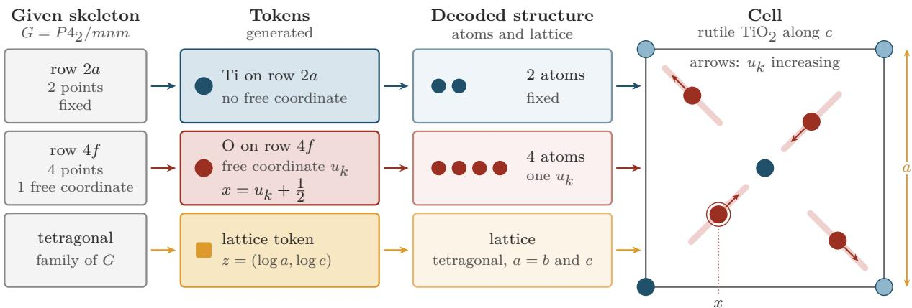  
Figure 2 From a skeleton to a crystal, with rutile $\mathrm { T i O _ { 2 } }$ as the example. The skeleton specifies the space group $P 4 _ { 2 } /$ mnm and the occupied rows 2a and $4 f .$ Orbitol generates one token for each: the atom type Ti with no free coordinate on 2a, and the atom type O with one free coordinate $u _ { k }$ on $4 f .$ . Decoding expands these tokens into two fixed Ti atoms and four O atoms whose positions all depend on the same number $\begin{array} { r } { x = u _ { k } + \frac { 1 } { 2 } } \end{array}$ . The lattice token specifies a and $c ;$ the tetragonal family sets $b = a$ and right angles. The right panel shows the cell along c: pale lines and arrows show how the four O atoms move as $u _ { k }$ increases, the ringed O at $( x , x , 0 )$ is the representative, and pale Ti discs are periodic images of the Ti atom at the origin.

jointly, which is de novo generation (DNG) [11].

## 3.1 Crystals and symmetry

We represent an ordered periodic crystal with N atoms per cell by its lattice, fractional coordinates, and atom types [2, 10]:

$$
\begin{array} { r l } & { \mathscr { C } = ( L , f , A ) , \qquad L \in \mathbb { R } ^ { 3 \times 3 } , \quad f \in [ 0 , 1 ) ^ { N \times 3 } , \quad A = ( A _ { 1 } , \ldots , A _ { N } ) , } \\ & { x _ { i , n } = ( f _ { i } + n ) ^ { \top } L , \qquad n \in \mathbb { Z } ^ { 3 } . } \end{array}
$$

Here $f _ { i }$ is the fractional position of atom i (a column vector, so $f _ { i } ^ { \top }$ is row i of f), A is its atom type, and the rows of the nonsingular matrix L are the lattice vectors. Atom i also appears at the Cartesian positions $x _ { i , n }$ for every integer vector $n ;$ these are its periodic images. Reordering atoms, shifting the origin, or changing the cell basis can describe the same infinite crystal [10].

The space group G consists of the operations that preserve the periodic structure, including its atom types. An operation (R, t) acts on fractional coordinates as $f _ { i } \mapsto R f _ { i } + t .$ where R and t are its matrix and translation parts. The group contains all lattice translations, and since points that difer by one are the same point of the crystal, finitely many operations describe how G acts within one cell [23]. Applying them to a point gives its orbit, the set of distinct equivalent points in the cell, which we call the members of the orbit.

The International Tables list the Wyckof positions of each space group in a table [3]. We call each entry of this table a Wyckof row w. A row describes a family of orbits by a list of coordinate triplets that depend on its free coordinates, and each value of the free coordinates gives one orbit. As an example, the space group of rutile $\left( \mathrm { T i O _ { 2 } } \right)$ $P 4 _ { 2 } /$ mnm, has eleven rows, which Table 3 in Appendix B.1 lists. One of them, row $4 f .$ , lists

$$
\begin{array} { r l r l r l } { ( x , x , 0 ) , } & { { } \ } & { ( - x , - x , 0 ) , } & { { } \ } & { ( - x + \frac { 1 } { 2 } , x + \frac { 1 } { 2 } , \frac { 1 } { 2 } ) , } & { { } \ } & { ( x + \frac { 1 } { 2 } , - x + \frac { 1 } { 2 } , \frac { 1 } { 2 } ) , } \end{array}\tag{1}
$$

Choosing x places all four members of an orbit, and varying x moves them together along their own lines (Figure 2).

The label of a row combines its multiplicity $m _ { w } ,$ the number of members of each orbit in the conventional cell of the tables, with a letter. Its number of free coordinates $d _ { w }$ says how its points can move: along a line for $d _ { w } = 1$ , within a plane for $d _ { w } = 2$ , and anywhere in the cell for $d _ { w } = 3$ . Every group has exactly one row with $d _ { w } = 3$ , the general row, whose coordinate list starts with $( x , y , z ) ;$ ; in the example group it is row 16k. A fixed row, with $d _ { w } = 0$ , is a fixed set of points. In the example, row 4f has $m _ { w } = 4$ and $d _ { w } = 1$ , and rutile also places atoms on row 2a, with $m _ { w } = 2 , d _ { w } = 0$ and points at $( 0 , 0 , 0 )$ and $\bigl ( \frac { 1 } { 2 } , \frac { 1 } { 2 } , \frac { 1 } { 2 } \bigr )$ .

Rows difer in the symmetry of their points. The site-symmetry group S of a point consists of the operations of G that map it exactly onto itself. It is trivial for a generic point, that is, a point of the general row, and larger for a point on a mirror plane, a rotation axis or an inversion center, whose orbit has |S| times fewer members than the orbit of a generic point. In the example group, an orbit of the general row has 16 members, the points of $4 f$ have $| S | = 4$ , and those of 2a have $| S | = 8$ . A row collects all points whose site-symmetry groups are conjugate in G, that is, $S ^ { \prime } = g S g ^ { - 1 }$ for some $g \in G \ [ 3 ]$

A crystal places its atoms on some of these rows, its occupied rows. Several orbits can occupy a row with free coordinates, each with its own coordinate values, so the row can appear several times in a skeleton. The orbits must be distinct, and diferent values can give the same orbit, as x and −x do on row $4 f$ of the example. A fixed row is a single orbit and appears at most once. All atoms of an orbit have the same atom type, because the operations of G map each atom onto an atom of the same type. In crystallographic terms, an occupied orbit is one symmetry-independent atom, one line in the atom-site list of a symmetrized CIF, and a skeleton is a space group with its Wyckof sequence, the letters of its occupied rows with repeats counted [24]. Appendix B.1 works through two examples, rutile and $\mathrm { C r F _ { 4 } } .$ , which occupy diferent rows of the same group.

## 3.2 Orbit and lattice representation

Orbitol generates only the variables that the skeleton leaves free. For a skeleton with K occupied orbits on rows $w _ { 1 } , \ldots , w _ { K }$ , which may repeat, it uses one token per orbit and one lattice token (Figure 1 shows an example for FeSe). For orbit $k ,$ Orbitol generates an atom type $A _ { k }$ and free coordinates $u _ { k } \in [ - \frac { 1 } { 2 } , \frac { 1 } { 2 } ) ^ { d _ { w _ { k } } } ;$ adding $\begin{array} { l } { { \frac { 1 } { 2 } } } \end{array}$ gives the coordinates used by the tables.

Each entry of a row’s coordinate list, which we take from PyXtal [25], is an afine function of the free coordinates. We write entry $j$ of row w as a member map $( W _ { w , j } , v _ { w , j } )$ , with a $3 \times d _ { w }$ matrix $W _ { w , j }$ and an ofset $v _ { w , j }$ , so that the members of orbit k are

$$
f _ { k j } = \mathrm { m o d } _ { 1 } \left( W _ { w _ { k } , j } ( u _ { k } + \textstyle { \frac { 1 } { 2 } } ) + v _ { w _ { k } , j } \right) , \qquad j = 1 , \ldots , m _ { w _ { k } } ,\tag{2}
$$

where $f _ { k j }$ is the fractional position of atom j of orbit k and mod1 wraps each coordinate into [0, 1).

We call the first member $f _ { k 1 }$ the representative and its map $( J _ { w } , b _ { w } ) = ( W _ { w , 1 } , v _ { w , 1 } )$ the chart of row w: the columns of $J _ { w }$ are the directions in which the representative can move, and $b _ { w }$ is its ofset. Every other member is the image of the representative under an operation $( R _ { j } , t _ { j } )$ of $G ,$ , so $W _ { w , j } = R _ { j } J _ { w }$ and $v _ { w , j } = { \mathrm { m o d } } _ { 1 } ( R _ { j } b _ { w } + t _ { j } )$ . Changing $u _ { k }$ therefore moves all members together and keeps the symmetry. Orbitol outputs primitive cells, with $m _ { w } ^ { \mathrm { p } }$ atoms per orbit; Appendix B.2 explains the conversion from the conventional cells of the tables and the equivalent descriptions with which we augment the training crystals.

The lattice metric must be invariant under the point-group operations, so its allowed lengths and angles depend on the crystal family of G (triclinic, monoclinic, orthorhombic, tetragonal, hexagonal or cubic) and on the cell setting [3]. Crystalite describes the cell by a latent $y \in \mathbb { R } ^ { 6 }$ , the logarithms of the three diagonal entries and the three of-diagonal entries of a lower-triangular matrix whose rows are the lattice vectors; Orbitol builds the conventional cell in this way. The crystal family fixes some of these entries and ties others together. Orbitol generates only the free entries z and reconstructs y with a crystal-family chart,

$$
y = \ell _ { G } ( z ) ,\tag{3}
$$

which fills in all fixed and dependent entries (Appendix B.2).

As a worked example, the skeleton of rutile selects $w _ { 1 } = 2 a$ and $w _ { 2 } = 4 f ,$ , so $K = 2$ (Figure 2). Orbitol generates $A _ { 1 } = \mathrm { T i }$ for the first orbit, which has no free coordinate, and $A _ { 2 } = \mathrm { O }$ and one number $u _ { 2 }$ for the second, which places the four O atoms of Equation (1) at $\begin{array} { r } { x = u _ { 2 } + \frac { 1 } { 2 } } \end{array}$ . The first entry, $( x , x , 0 )$ , is the representative, so $J _ { 4 f } = ( 1 , 1 , 0 ) ^ { \top }$ and $\begin{array} { r } { b _ { 4 f } = 0 ; } \end{array}$ the third entry has $W _ { 4 f , 3 } = \bar { ( - 1 , 1 , 0 ) } ^ { \top }$ and $\begin{array} { r } { v _ { 4 f , 3 } = ( \frac { 1 } { 2 } , \frac { 1 } { 2 } , \frac { 1 } { 2 } ) ^ { \top } } \end{array}$ The two Ti atoms stay at fixed positions. The tetragonal family sets $b = a$ and right angles, so the lattice token specifies $z = ( \log a , \log c )$ , from which the chart reconstructs $y = ( \log a , 0 , \log a , 0 , 0 , \log c )$ . Two atom types and three numbers, u2, log a and log $c ,$ thus determine all six atoms and the cell.

## 3.3 Difusion formulation

For a given skeleton, the free variables form the state $( h , u , z )$ : Crystalite’s 16-dimensional atom-type encoding $h _ { k }$ of each $A _ { k }$ , the free coordinates $u = ( u _ { 1 } , \dotsc , u _ { K } )$ and the free lattice entries z. The skeleton itself is not difused; it fixes the member maps and charts that turn a state into a crystal.

Noise of a given size should move atoms by a similar amount on every row, but free coordinates are not lengths. On row $4 f$ of rutile, for example, a step δ in x moves each O atom along (1, 1, 0), by ${ \sqrt { 2 } } | \delta |$ in fractional coordinates. We therefore measure a step δ of the free coordinates by the displacement of the atoms,

$$
\| J _ { w } \delta \| _ { M _ { G } } ^ { 2 } = \delta ^ { \top } H _ { w } \delta , \qquad H _ { w } = J _ { w } ^ { \top } M _ { G } J _ { w } , \qquad M _ { G } = \frac { 1 } { | { \mathcal R } _ { G } | } \sum _ { R \in { \mathcal R } _ { G } } R ^ { \top } R ,\tag{4}
$$

where $\| \boldsymbol { v } \| _ { M _ { G } } ^ { 2 } = v ^ { \top } M _ { G } v$ and $\mathcal { R } _ { G }$ contains the point-group rotations of G. Averaging over the rotations gives every member of an orbit the same displacement, also in hexagonal axes, where the rotation matrices are not orthogonal (Appendix B.3). The metric is fixed, so the coordinate noise does not depend on the lattice, which is itself generated. Following Crystalite’s EDM formulation [2, 26], one noise level $\sigma$ per structure perturbs the three channels jointly,

$$
\begin{array} { r } { h _ { k } ^ { \sigma } = h _ { k } + \sigma \epsilon _ { h , k } , \qquad u _ { k } ^ { \sigma } = \mathrm { w r a p } \big ( u _ { k } + \sigma \xi _ { k } \big ) , \qquad z ^ { \sigma } = z + \sigma \epsilon _ { z } , } \end{array}\tag{5}
$$

with standard Gaussian draws ϵ, coordinate noise $\xi _ { k } \sim \mathcal { N } ( 0 , H _ { w _ { k } } ^ { - 1 } )$ , and $\mathrm { w r a p } ( v ) = v - \mathrm { r o u n d } ( v )$ . The covariance $H _ { w } ^ { - 1 }$ makes the atom displacements equally large in every allowed direction. On row $4 f$ of rutile, $H _ { 4 f } = 2$ , so the noise on $u _ { k }$ has standard deviation $\sigma / \sqrt { 2 }$ . Fixed rows receive no coordinate noise.

## 3.4 Tokens and network

The network is Crystalite’s Transformer applied to one token per orbit, followed by one lattice token. As in Crystalite, each token sums the embeddings of its noisy channels. For the position, an orbit token embeds only its representative: the row determines every other member from it, so their positions add no information. The lattice token embeds the noisy lattice in Crystalite’s six-entry form $y ^ { \sigma } = \ell _ { G } ( z ^ { \sigma } )$ , with the fixed and tied entries filled in by the chart:

$$
\begin{array} { r l } & { \eta _ { k } = E _ { h } ( c _ { \mathrm { i n } , h } h _ { k } ^ { \sigma } ) + E _ { x } ( u _ { k } ^ { \sigma } , w _ { k } ) + e _ { \mathrm { o r b } } + E _ { w } ( w _ { k } ) , } \\ & { \eta _ { L } = E _ { L } \left( c _ { \mathrm { i n } , z } \ell _ { G } ( z ^ { \sigma } ) \right) + e _ { \mathrm { l a t } } . } \end{array}\tag{6}
$$

Here $E _ { h } , \ E _ { x } , \ E _ { w }$ and $E _ { L }$ embed the type features, position, row and lattice, $c _ { \mathrm { i n } , h }$ and $c _ { \mathrm { i n } , z }$ are EDM input scales, and the learned vectors $e _ { \mathrm { o r b } }$ and $e _ { \mathrm { l a t } }$ mark orbit and lattice tokens. The position embedding $E _ { x } ( u , w ) = E _ { F } { \big ( } { \mathrm { m o d } } _ { 1 } ( J _ { w } ( u + { \textstyle { \frac { 1 } { 2 } } } ) + b _ { w } ) { \big ) }$ applies Crystalite’s Fourier embedder $E _ { F }$ to the representative $f _ { k 1 }$ of Equation (2) at the noisy free coordinates; on a fixed row, this is the fixed position $b _ { w }$ . Appendix B.4 describes a variant that embeds the free coordinates themselves.

The same free coordinate describes diferent motions on diferent rows, so the network needs each token’s row and the space group. The row embedding $E _ { w }$ gives each token its row. For the group, we extend Crystalite’s noise conditioning: Crystalite embeds the noise coordinate $\begin{array} { r } { c _ { \mathrm { n o i s e } } = \frac { 1 } { 4 } } \end{array}$ log σ with a small MLP $E _ { \sigma }$ and injects it into every block through adaptive layer normalization (AdaLN) [27], and Orbitol adds a group embedding,

$$
c = E _ { \sigma } ( c _ { \mathrm { n o i s e } } ) + E _ { G } ( G ) .\tag{7}
$$

Each row or group embedding sums a learned lookup vector and an MLP embedding of crystallographic descriptors, such as the multiplicity, the number of free coordinates and the chart geometry of a row, or the crystal system, centering and point-group operations of a group (Appendix B.4). These embeddings tell the network which group and rows it is filling. The symmetry does not depend on them: Equation (2) and the lattice chart give every valid decoded structure the symmetry of $G ,$ whatever the network predicts.

After the last block, output heads turn the state of each orbit token into raw predictions $F _ { h , k }$ and $F _ { u , k } ,$ , and the state of the lattice token into $F _ { z }$ . Like the input, the coordinate prediction concerns the representative: one head, shared by all rows, predicts a three-dimensional update of its position. The representative can move only along the columns of $J _ { w } .$ , so we take the allowed update closest to the prediction under $M _ { G } \colon$

$$
\begin{array} { r l } & { \widehat { F } _ { u , k } = \underset { \delta \in \mathbb { R } ^ { d _ { w _ { k } } } } { \arg \operatorname* { m i n } } \Vert J _ { w _ { k } } \delta - F _ { u , k } \Vert _ { M _ { G } } ^ { 2 } = \Pi _ { w _ { k } } F _ { u , k } , } \\ & { } \\ & { \Pi _ { w } = H _ { w } ^ { - 1 } J _ { w } ^ { \top } M _ { G } . } \end{array}\tag{8}
$$

On the general row, the representative $( x , y , z )$ can move in every direction, so $J _ { w } = I$ and $\Pi _ { w } = I ;$ in P1, where every orbit lies on the general row, this is Crystalite’s coordinate head. The lattice head predicts the six entries of $y ,$ and its readout $\Gamma _ { G }$ averages the predictions of tied entries and masks the fixed ones. With the EDM coeficients $c _ { \mathrm { s k i p } }$ and $c _ { \mathrm { o u t } }$ (Appendix B.3), the denoised predictions are

$$
\begin{array} { r l } & { D _ { h , k } = c _ { \mathrm { s k i p } , h } h _ { k } ^ { \sigma } + c _ { \mathrm { o u t } , h } F _ { h , k } , } \\ & { D _ { u , k } = s _ { u } ( u _ { k } ^ { \sigma } ) + c _ { \mathrm { o u t } , u } \widehat F _ { u , k } , } \\ & { \quad D _ { z } = c _ { \mathrm { s k i p } , z } z ^ { \sigma } + c _ { \mathrm { o u t } , z } \Gamma _ { G } F _ { z } , } \end{array}\tag{9}
$$

where $s _ { u }$ is the coordinate skip of Section 3.5.

## 3.5 Denoising targets

The type and lattice channels keep Crystalite’s EDM-weighted squared errors. The coordinate channel needs care because free coordinates are periodic: a clean point u and its images $u + n , n \in \mathbb { Z } ^ { d _ { w } }$ , describe the same orbit. The sampler needs the denoiser to predict the posterior mean of the clean coordinates given the noisy ones. Crystalite’s wrapped-residual objective (M) compares a prediction with whichever image of the clean point is nearest to it, and its squared-error optimum need not be this mean (Appendix B.5). For example, if the clean coordinate is $u = - \textstyle { \frac { 1 } { 2 } }$ and the noisy one is $u ^ { \sigma } = 0$ , the images $- \frac 1 2$ and $\begin{array} { l } { { \frac { 1 } { 2 } } } \end{array}$ are equally likely and their mean is 0, whereas M is minimized by predicting either image. The periodic-posterior target (P) averages the images, weighted by their Gaussian probability given the noisy point:

$$
D ^ { \star } ( u ^ { \sigma } , u ) = \sum _ { n \in \mathbb { Z } ^ { d _ { w } } } \pi _ { n } ( u + n ) , \quad \quad \pi _ { n } \propto \exp \left[ - \frac { \| u ^ { \sigma } - u - n \| _ { H _ { w } } ^ { 2 } } { 2 \sigma ^ { 2 } } \right] ,\tag{10}
$$

where $\| v \| _ { H _ { w } } ^ { 2 } = v ^ { \top } H _ { w } v$ and $\textstyle \sum _ { n } \pi _ { n } = 1$ . At low noise, $D ^ { \star }$ is the image nearest to $u ^ { \sigma }$ ; at high noise, it approaches $u ^ { \sigma }$ without preferring a chart origin. For a given clean point, $D ^ { \star }$ is the posterior mean of its images, and regression onto it averages this mean over the clean points compatible with the noisy state. The coordinate loss is the EDM-weighted squared $H _ { w }$ error between $D _ { u , k }$ and $D ^ { \star }$ (Appendix B.5). Target P is a choice of training objective, not part of the symmetry construction: Orbitol supports both, and Section 3.8 uses M to reproduce Crystalite exactly in P1. We train the reported models with P because its regression optimum is the posterior mean that the sampler assumes.

The skip term should respect the same periodicity: shifting the noisy input by an integer n should shift the prediction by n. We therefore replace the EDM skip $c _ { \mathrm { s k i p } , u } u$ by the sine skip $s _ { u } ( u ) = u - ( 1 -$ $c _ { \mathrm { s k i p } , u } ) \sin ( 2 \pi u ) / ( 2 \pi )$ , applied componentwise, which satisfies $s _ { u } ( u + n ) = s _ { u } ( u ) + n$ and agrees with the EDM skip to first order at $u = 0$ . Appendix C.5 compares the two skips. DifCSP’s wrapped-normal difusion and GEODE also use periodic score targets [10, 22]; Orbitol applies such a target to the free coordinates of each row, measured with $H _ { w }$

## 3.6 Geometry in orbit attention

Crystalite’s Geometry Enhancement Module (GEM) adds a geometry-dependent bias to the attention scores between atom tokens. In Orbitol, each token is an orbit that corresponds to several atoms, but the network should still see the geometry of all of them, so we contract the atom-pair biases into one bias per pair of orbit tokens (Figure 3). We expand each noisy orbit into its conventional members with Equation (2), convert them to primitive-cell members with Equation (13), and approximate minimum-image distances using a finite search in a reduced cell basis. For head $g ,$ a distance-only MLP on radial features of absolute and volume-normalized distances gives the atom bias $\beta _ { g } ( a , b )$ , with $\beta _ { g } ( a , a ) = 0$ . With exact distances in a cell that is compatible with the group, all atoms in a query orbit have the same distances to each key orbit up to a permutation, so we keep one representative row $r ( k )$ per query orbit. The atoms of key orbit l share a key and value; we add their attention weights by taking the log-sum-exp of their biases:

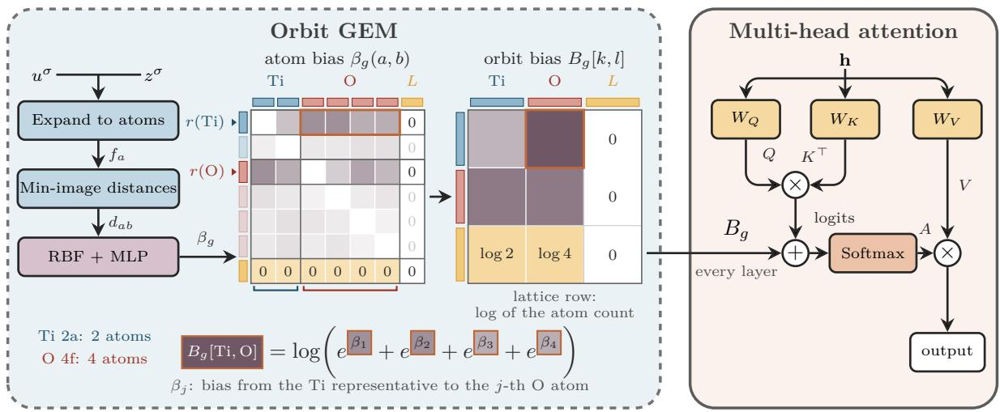  
Figure 3 GEM for orbit tokens, with rutile as the example $( \mathrm { T i O _ { 2 } } , P 4 _ { 2 } / m n m ;$ two Ti and four O atoms per cell). GEM turns interatomic distances into attention biases, but Orbitol has one token per orbit, so the atom-pair biases $\beta _ { g } ( a , b )$ are combined into one bias per pair of orbit tokens. The atoms of an orbit are related by the group operations and have the same set of distances to every other orbit, so one representative row $r ( k )$ per orbit is kept (pale rows are dropped). The atoms of a key orbit share one key and value, so we sum their attention weights: $\begin{array} { r } { B _ { g } [ k , l ] = \log \sum _ { b \in l } \exp \beta _ { g } \left( r ( k ) , b \right) } \end{array}$ gives the orbit the total weight of its atoms, as shown at the bottom for the Ti representative and the four O atoms. The lattice token has zero atom biases, so its row of $B _ { g }$ is the log atom count of each orbit. The orbit biases are added to the attention logits in every layer.

$$
B _ { g } [ k , l ] = \log \sum _ { b \in l } \exp \beta _ { g } \bigl ( r ( k ) , b \bigr ) .\tag{11}
$$

Since exp $\begin{array} { r } { B _ { g } [ k , l ] = \sum _ { b \in l } \exp \beta _ { g } ( r ( k ) , b ) } \end{array}$ , this gives the same attention output for the selected query as an expanded layer whose members share each orbit’s key and value. Averaging the atom biases would change the total attention assigned to the orbit. The lattice query row receives log $m _ { w _ { u } } ^ { \mathrm { p } }$ , the log atom count of each key orbit, and the lattice key column receives zero. In P1, the sum has one term, so orbit GEM becomes an atom-level GEM, as in Crystalite. Appendix B.6 works through rutile as an example and gives the distance implementation.

## 3.7 Sampling

Generation first samples a skeleton from the empirical distribution of training skeletons, so every generated structure shares its skeleton with a training structure. MP-20 has 3,290 distinct training skeletons; 5.2% of validation structures and 4.9% of test structures have skeletons absent from the training set. Given the skeleton, Crystalite’s EDM sampler with stochastic churn and Heun correction integrates the three channels from noise with the denoisers of Equation (9). Appendix C.6 gives the settings of each experiment. We then decode the atom types, place every atom of each orbit with Equation (2), reconstruct the lattice with $\ell _ { G }$ and convert the resulting structure to a primitive cell (Appendix B.7).

## 3.8 Equivalence to Crystalite in P1

In P1, every orbit is a single atom with three free coordinates, and the lattice is unconstrained. The chart, coordinate metric and projection become identities, and each orbit token becomes an atom token, so by construction Orbitol has Crystalite’s representation and network. With matched type encodings, weights, execution modes and sampler settings, objective M, GEM disabled, and zero row and group embeddings, the P1 implementation reproduces Crystalite’s denoiser, loss and sampler exactly (Appendix B.8). Our reported configurations instead use the periodic-posterior target with the sine skip (Section 3.5), a distance-only GEM without Crystalite’s displacement features and noise gate (Appendix B.6), and learned row and group embeddings, which are constant in P1.

## 4 Experiments

We evaluate de novo generation on MP-20 and Alex-MP-20 by discovery yield, symmetry after relaxation, and sampling cost. Section 5 then applies Orbitol to piezoelectric candidates.

## 4.1 Setup

We trained on the training splits of MP-20 and Alex-MP-20. MP-20 contains Materials Project structures; Alex-MP-20 combines Materials Project and Alexandria data. Both restrict cells to at most 20 atoms [1, 9]. We sampled untyped skeletons at their training frequencies and generated atom types, free coordinates and lattice conditional on them. On MP-20, we report the Orbitol checkpoint with the highest observed MSUN in the generation evaluations during training; on Alex-MP-20, the checkpoint at 650k steps. Both use Crystalite’s EDM sampler [2, 26] (Appendix C.6). We compare with the models of Section 2, using released checkpoints where available, the released PLaID++ outputs, our train-only SymmCD and WyFormer retrainings (WyFormer uses DifCSP++ for geometry) and our Crystalite reproduction (Appendix C).

We evaluate the first 2,500 attempts of each model; generation, decoding and structure-check failures stay in the denominator, and nothing is replaced. PLaID++ released only its decoded structures, so we take the first 2,500 of them and cannot count failures that happened before release. We pre-relax all structures with NequIP-OAM-L [28] for 500 FIRE steps with a Frechet cell filter and no symmetry constraint on positions or cell. LeMat-GenBench then scores energies with ORB, MACE and UMA against their hulls and novelty against LeMat-Bulk [8], using the raw geometry where relaxation failed. We detect symmetry with spglib through pymatgen’s SpacegroupAnalyzer at a positional tolerance of 0.1 Å and an angular tolerance of 5◦, for generated and training structures alike. Each model is one training run and one set of 2,500 samples; for the MP-20 Orbitol model, we average three sampling seeds.

## 4.2 Evaluation metrics

Discovery metrics are shares of all 2,500 attempts. SUN and MSUN count valid structures that are unique among the model’s attempts and novel against LeMat-Bulk, with predicted energy above the hull at most 0 (SUN, stable) or at most 0.1 eV/atom (MSUN, stable or metastable). Joint yield counts attempts that satisfy MSUN and retain the requested or declared space group after relaxation.

Symmetry fidelity metrics ask whether relaxed structures keep their groups and whether these groups match the training distribution. P1 is the share of relaxed structures detected in P1, and JSD is the Jensen–Shannon divergence, in bits, between their space groups and those of the training set. Retention is the share of all attempts whose relaxed structure has exactly the requested group, or the declared group for models that declare one, so relaxing into a supergroup counts as a loss. Failed relaxations and implausible endpoints are not eligible: they are left out of P1 and JSD and count as losses for retention, joint yield and SPARC (Appendix C.2). Appendix Table 6 collects the definitions.

Retention and coverage capture diferent failures. A model can retain nearly every group by generating only a few groups that rarely change on relaxation, such as rock-salt structures in Fm¯3m, while covering little of the training distribution. Conversely, a model that requests groups at their training frequencies can still lose many of them on relaxation: 38–48% for the enforced baselines other than SGFM (Table 1). SPARC (symmetry preservation and reference coverage) requires both, as a product:

$$
\mathrm { S P A R C } = 1 0 0 R _ { \mathrm { r a w } } \mathrm { B C } ( p , q ) ^ { 2 } ,\tag{12}
$$

where $R _ { \mathrm { r a w } }$ is the share of all attempts whose eligible relaxed structure keeps the group detected in its raw structure, and $\begin{array} { r } { \mathrm { B C } ( p , q ) = \sum _ { g } \sqrt { p _ { g } q _ { g } } } \end{array}$ is the Bhattacharyya coeficient between the training frequencies $p _ { g }$ and the frequencies $q _ { g }$ of the groups among the retained attempts. SPARC is thus the percentage of attempts that keep their group, discounted by how far their groups are from the training distribution: it reaches 100 only if every attempt keeps its group and the kept groups follow the training distribution, and it is zero if no attempt keeps its group. Because it uses the raw detected group rather than a requested one, SPARC also scores agnostic models. Figure 5(b) plots the two factors, and Appendix C.3 gives the derivation and the score of an ideal sampler.

## 4.3 Discovery yield

On MP-20, Orbitol reached 19.0% MSUN and 13.8% joint yield, the highest observed among the evaluated symmetry-aware models (Table 1); SGEquiDif was next in MSUN (18.1%) and SGFM in joint yield (10.8%). We scored the agnostic models for symmetry only (Tables 7 and 8). The LeMat-GenBench leaderboard in Appendix Table 9 lists values from the authors’ own submissions [8]; for the symmetry-aware models in both, our measured MSUN is 4.7–13.4 percentage points higher, so the two are not directly comparable.

On Alex-MP-20, Orbitol reached 34.2% MSUN and retained its requested group in 71.6% of attempts (Appendix Tables 7 and 8). GEODE reports yields obtained with a diferent relaxation potential and without SUN [22]; Appendix Table 10 lists them next to ours. LeMat-Bulk contains Alexandria, so novelty on this

Table 1 De novo generation on MP-20. Values are from 2,500 sampled attempts per model; the MP-20 Orbitol row is the mean over three sampling seeds, each metric averaged per seed. Metrics are defined in Section 4.2. Training P1: 1.7%. Joint yield counts attempts that satisfy MSUN and retain the requested or declared group after relaxation, with symmetry detected at 0.1 Å. Bold marks maxima for SUN, MSUN, joint yield, requested group retained and SPARC, and the minimum JSD. Alex-MP-20 results and all models with marginal diagnostics are in Tables 7 and 8.
<table><tr><td></td><td colspan="3">Discovery (%)</td><td colspan="5">After relaxation</td></tr><tr><td>Model</td><td>SUN</td><td>MSUN</td><td>Joint yield</td><td>Requested group retained (%)</td><td>SPARC</td><td>P1 (%)</td><td></td><td>JSD (bits)</td></tr><tr><td colspan="9">Space group conditioned</td></tr><tr><td>CrystaLLM</td><td>1.00</td><td>10.4</td><td>4.6</td><td>77.8d</td><td></td><td>73.5</td><td>4.7</td><td>0.047</td></tr><tr><td>CrystaLLM-π</td><td>1.40</td><td>16.1</td><td>8.8</td><td></td><td>74.3d</td><td>69.4</td><td>4.6</td><td>0.038</td></tr><tr><td>PLaID++ª</td><td>1.16</td><td>13.3</td><td>7.0</td><td></td><td>81.2d</td><td>39.7</td><td>1.6</td><td>0.257</td></tr><tr><td colspan="9">Space group enforced</td></tr><tr><td>CrystalFormer</td><td>0.80</td><td>13.9</td><td>7.8</td><td>62.3</td><td>59.4</td><td></td><td>11.1</td><td>0.071</td></tr><tr><td>SGEquiDiff</td><td>0.68</td><td>18.1</td><td>8.1</td><td></td><td>54.7</td><td>51.1</td><td>11.0</td><td>0.077</td></tr><tr><td>WyFormerb</td><td>0.40</td><td>14.2</td><td>6.2</td><td></td><td>51.8</td><td>48.6</td><td>11.2</td><td>0.081</td></tr><tr><td>SymmCDb</td><td>0.84</td><td>15.9</td><td>9.0</td><td></td><td>57.4</td><td>54.5</td><td>11.1</td><td>0.085</td></tr><tr><td>DiffCSP++</td><td>0.60</td><td>16.2</td><td>7.6</td><td></td><td>57.3</td><td>55.1</td><td>9.7</td><td>0.069</td></tr><tr><td>SGFMc</td><td>1.00</td><td>16.9</td><td>10.8</td><td></td><td>73.4</td><td>71.9</td><td>4.9</td><td>0.027</td></tr><tr><td colspan="9">Ours (space group enforced)</td></tr><tr><td>Orbitol</td><td>1.11</td><td>19.0</td><td>13.8</td><td></td><td>74.7</td><td>73.8</td><td>5.6</td><td>0.029</td></tr></table>

Orbitol uses the checkpoint selected by the highest observed MSUN in generation evaluations conducted during training; sampler settings are in Appendix C.6. An ideal sampler of the training distribution with 2,500 draws has a JSD of 0.0137 bits on average (5th–95th percentile range 0.0114–0.0160; Figure 4). The Orbitol–SGFM JSD diference is small relative to this finite-sample spread; additional samples would be needed to resolve it. aFirst 2,500 rows of the released pool of decoded outputs, without a verified draw count. bOur retraining on the training split only; WyFormer geometry from DifCSP++. cWyckof templates drawn from the training set, as for Orbitol. dUses the group declared by the model.

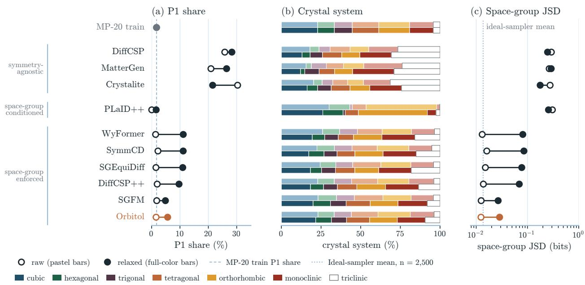  
Figure 4 Raw and relaxed symmetry on MP-20 at a positional detection tolerance of 0.1 Å. Hollow markers and pastel bars show raw outputs; filled markers and full-color bars show endpoints after 500 unconstrained FIRE steps. Panels show (a) P1 share on a linear axis, (b) crystal-system shares and (c) space-group JSD in bits on a logarithmic axis. The dashed line in (a) marks the P1 share of MP-20 train; the raw P1 share of PLaID++ (0.04%, one structure) is near zero. The dotted line in (c) marks the mean JSD of an ideal sampler of the training distribution with 2,500 draws: 0.0137 bits, with a 5th–95th percentile range of 0.0114–0.0160. Crystalite is our reproduction; SymmCD and WyFormer are retrained. PLaID++ uses released outputs with self-declared groups.

dataset is measured against a reference that overlaps the training source.

## 4.4 Symmetry after relaxation

The agnostic models DifCSP, MatterGen and our Crystalite reproduction overproduce P1 after relaxation (Figure 4). Among the enforced models, Orbitol and SGFM have the lowest relaxed P1 shares and JSDs, 0.029 and 0.027 bits; the diference is within the finite-sample spread of an ideal sampler, so more sampling seeds would be needed to resolve it. Orbitol retained its requested group in 74.7% of attempts, close to SGFM and above the other enforced models (Table 1).

Retention and a low P1 share alone do not show agreement with the training distribution. PLaID++ retained the most declared groups and had a low P1 share, yet its relaxed JSD was 0.257 bits, because its outputs concentrate on a few groups, such as Pnma and Fm¯3m, that often survive relaxation.

SPARC separates these cases (Figure 5). On MP-20, Orbitol scores 73.8, close to CrystaLLM and SGFM and above all other models, whereas PLaID++ scores 39.7; Alex-MP-20 scores are in Table 8. These comparisons depend on the relaxer and the detector: retention diferences of 1–3 percentage points can fall within run-to-run relaxation variation (Appendix C.4), which also repeats the comparison at 0.01 Å (Figure 9). Appendices C.2 and C.3 give alternative retention rates and a requested-group variant of SPARC.

## 4.5 Sampling cost

We timed every model of Table 1 on one RTX 6000 Ada with its released code and the sampler settings and precision of the quality evaluation; PLaID++, whose quality results use released outputs, is timed with the authors’ released 4-bit recipe. Some released samplers were slow for reasons unrelated to the model, such as SGFM’s unbatched sampling loop, so we batched them and tuned each batch size without changing the samples or step counts. Timing runs from the prior draw to decoded structures, counts failed attempts, and excludes model loading, compilation and relaxation (Appendix C.7). With the sampler of Table 1, Orbitol samples about 920 structures per second in large batches, about 310 times faster than SGEquiDif, the baseline with the highest observed MSUN, and 96 to 1,477 times faster than the other symmetry-aware baselines (Figure 6). The speed comes from a short sampler (25 Heun steps) and an eficient implementation: one token per orbit shortens the sequences, crystals are packed without padding, the network runs as a compiled CUDA graph, and decoding is vectorized (Appendix C.7).

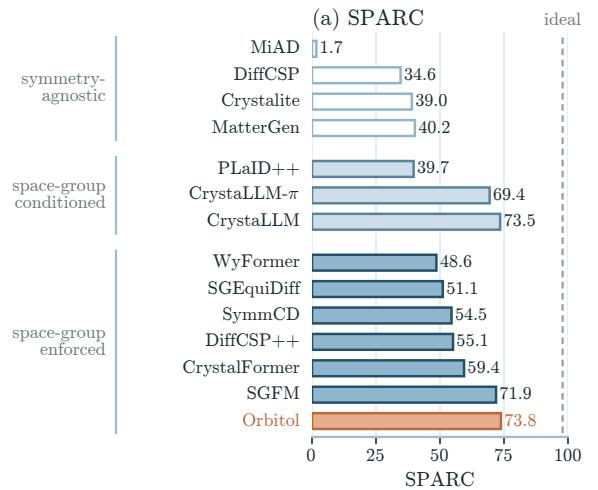

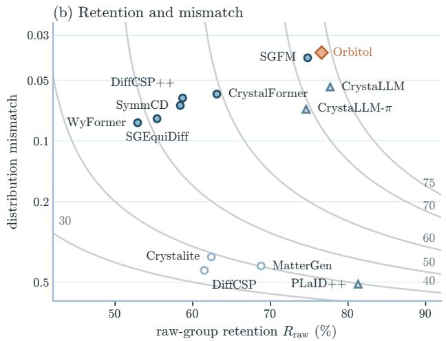  
agnostic conditioned enforced equal SPARC  
Figure 5 SPARC on MP-20. (a) SPARC by model (Equation 12); the dashed line marks the average score of an ideal sampler at 2,500 attempts (97.9). (b) The two factors of SPARC: the share of attempts whose relaxed space group equals the group detected in the raw output, and the distribution mismatch, one minus the squared Bhattacharyya coeficient between the groups of the retained structures and the training distribution (logarithmic axis, better toward the top). Curves connect points of equal SPARC; each is labeled once with its value. MiAD $( R _ { \mathrm { r a w } } = 1 2 \% )$ lies outside the axes.

## 5 Piezoelectric Candidates

We apply skeleton-conditioned generation to the search for piezoelectric candidates and evaluate the selected structures with density functional theory (DFT). Piezoelectricity is allowed only in the 20 noncentrosymmetric crystal classes other than 432 [3], which a generator that accepts a space group can target directly.

We generated candidates with Orbitol, sampling skeletons from these classes, relaxed the samples with NequIP-OAM-L as in Section 4.1, and retained structures whose space group survived relaxation and whose NequIP-OAM-L energy lay within 0.1 eV/atom of the Alex-MP-20 DFT hull. A machine-learned screening pipeline, which is beyond the scope of this work and will be reported in a separate publication, predicted the piezoelectric figure of merit of these structures. We selected 62 structures with high predicted figure of merit, and evaluated them with DFT. Four had PBE band gaps of at most 0.03 eV and were excluded from the response calculations, which left 58 candidates in 26 space groups: 26 nitrides and oxynitrides, 23 oxides, 8 halides and one sulfide.

We relaxed each candidate with PBE and computed its elastic, dielectric and piezoelectric tensors, the latter two with density functional perturbation theory (DFPT; Appendix D). The figure of merit is the transverse energy-harvesting product $\bar { d } _ { 3 1 } g _ { 3 1 } = d _ { 3 1 } ^ { 2 } / ( \varepsilon _ { 0 } \varepsilon _ { 3 3 } ^ { \bar { T } } )$ , with the permittivity $\varepsilon ^ { T }$ at fixed stress [29], maximized over orientations, which we also evaluated on the 702 materials of the Materials Project’s DFPT set with a

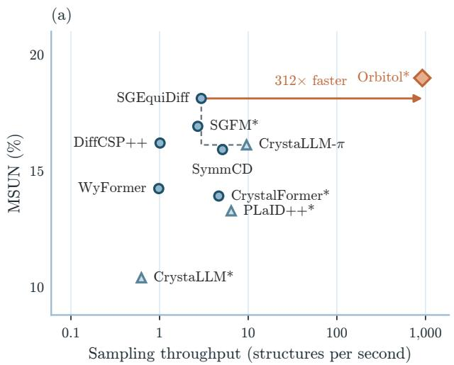

(b)  
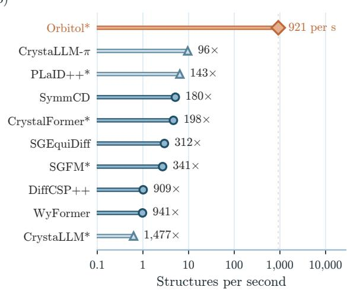  
Figure 6 Sampling cost on MP-20 on one RTX 6000 Ada. (a) MSUN from Table 1 against sampling throughput; the dashed line is the frontier of the baselines. (b) Throughput, with Orbitol’s speedup over each baseline. Timings, measured after warm-up, run from the prior draw to decoded structures and count failed attempts. Each model uses its released sampler and the batch size with the highest measured throughput. Sampler settings match the quality evaluation, except for PLaID++, whose timing uses the released 4-bit generation recipe and whose quality results use a released output pool. Orbitol uses the sampler of Table 1 with 25 Heun steps. Measurement notes in Appendix C.7.

## non-zero piezoelectric tensor [30–32].

Because our DFT relaxations kept the crystal symmetry, we test its stability with Γ-point phonons, which include symmetry-lowering distortions (Appendix D). One candidate had an unstable mode in its generated group $C m c 2 _ { 1 } ;$ following it lowered the symmetry to $P 2 _ { 1 }$ . All 58 final structures are in piezoelectric crystal classes, and 56 have no imaginary optical mode at Γ. One of these 56 is mechanically unstable; the remaining results refer to the 55 that pass both checks. Against the MP and Alexandria phases [33, 34], recomputed with our settings, 54 of them lie within 0.1 eV/atom of the hull, 46 within 50 meV/atom and 6 on or below it; the median is 27 meV/atom (Figure 7b). Of the 55, 49 do not match any MP or Alexandria entry with the same space group.

The distribution of the figure of merit is shifted to larger values than that of the MP set (Figure 7a): the median of the candidates is $1 . 2 3 \times 1 0 ^ { - 1 2 } \ \mathrm { m ^ { 2 } N ^ { - 1 } }$ , against 0.133 for MP, and 13 of the 55 exceed MP’s 90th percentile of 3.09. The shift reflects how the candidates were chosen. The MP set was not selected for its response, whereas our candidates were preselected for a high predicted figure of merit, and only structures ranked high on it went on to DFPT. Compared only with MP materials of the same point group, the candidates have a median percentile of 72. Without the six that match Alexandria structures, the median figure of merit of the other 49 is 1.23, and 12 of them exceed MP’s 90th percentile.

## 6 Conclusion

Orbitol generates crystals on Wyckof orbits: given a skeleton, it generates the atom type and free coordinates of each orbit and the free lattice entries, and the decoder builds the requested symmetry into every valid structure. On MP-20, it reached the highest MSUN and joint yield among the evaluated symmetry-aware models, with symmetry fidelity after relaxation comparable to the best baselines, while sampling orders of magnitude faster. Generating directly in piezoelectric space groups, it produced candidates that are both new and strongly responding: most of the screened structures passed our DFT checks and match no MP or Alexandria entry with the same space group, and their median figure of merit is about nine times that of the Materials Project’s DFPT piezoelectrics.

Fast generation opens directions that are expensive with current symmetry-aware generators. In large-scale discovery campaigns, generation is no longer the bottleneck, and reinforcement-learning fine-tuning, which needs many fresh generation trajectories for every update, becomes afordable. Two limits remain: the empirical prior samples only skeletons seen in training, which learned skeleton priors could relax, and the benchmark energies are MLIP estimates, while the piezoelectric candidates are DFT verified.

(a) Piezoelectric figure of merit  
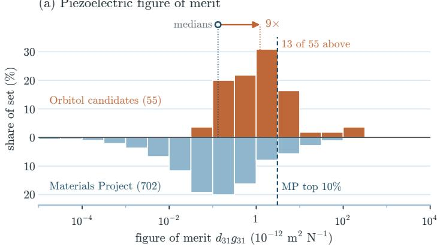

(b) Energy above the hull  
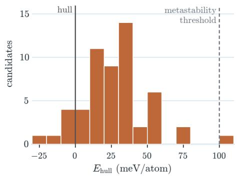  
Figure 7 Piezoelectric candidates under DFT. (a) Figure of merit $d _ { 3 1 } g _ { 3 1 }$ , maximized over orientations. Bars above the baseline show the 55 Orbitol candidates that pass both stability checks; bars below it show the 702 Materials Project materials with a non-zero piezoelectric tensor. Each bar covers a factor of $\sqrt { 1 0 }$ in $d _ { 3 1 } g _ { 3 1 }$ , and its height is the percentage of the set in that range; three MP values below $1 0 ^ { - 5 }$ are counted in the first bar. The dashed line marks $\mathrm { M P s }$ 90th percentile, 3.09; the arrow joins the two medians. (b) Energy above the hull of the MP and Alexandria phases for the same 55 candidates, in 10 meV/atom bins. The dashed line marks the metastability threshold of 0.1 eV/atom.

## References

[1] Claudio Zeni, Robert Pinsler, Daniel Zügner, Andrew Fowler, Matthew Horton, Xiang Fu, Zilong Wang, Aliaksandra Shysheya, Jonathan Crabbé, Shoko Ueda, Roberto Sordillo, Lixin Sun, Jake Smith, Bichlien Nguyen, Hannes Schulz, Sarah Lewis, Chin-Wei Huang, Ziheng Lu, Yichi Zhou, Han Yang, Hongxia Hao, Jielan Li, Chunlei Yang, Wenjie Li, Ryota Tomioka, and Tian Xie. A Generative Model for Inorganic Materials Design. Nature, 639(8055):624–632, March 2025. ISSN 0028-0836, 1476-4687. doi: 10.1038/s41586-025-08628-5.

[2] Tin Hadži Veljković, Joshua Rosenthal, Ivor Lončarić, and Jan-Willem van de Meent. Crystalite: A Lightweight Transformer for Eficient Crystal Modeling, 2026. URL https://arxiv.org/html/2604. 02270v2.

[3] M. I. Aroyo, editor. International Tables for Crystallography, Volume A: Space-group symmetry. International Union of Crystallography, 2016. ISBN 978-0-470-97423-0. doi: 10.1107/9780955360 2060000114. URL https://it.iucr.org/A/.

[4] Zhendong Cao, Xiaoshan Luo, Jian Lv, and Lei Wang. Space Group Informed Transformer for Crystalline Materials Generation. Science Bulletin, 70(21):3522–3533, November 2025. ISSN 20959273. doi: 10.1016/j.scib.2025.09.035.

[5] Rui Jiao, Wenbing Huang, Yu Liu, Deli Zhao, and Yang Liu. Space Group Constrained Crystal Generation. In The Twelfth International Conference on Learning Representations, 2024. URL https: //openreview.net/forum?id=jkvZ7v4OmP.

[6] Anmar Karmush, Cedric Mathieu Brandenburg, Soheil Ershadrad, Johanna Rosén, Michael Felsberg,

and Filip Ekström Kelvinius. Generating Symmetric Materials using Latent Flow Matching. arXiv preprint arXiv:2605.10115, 2026. URL https://arxiv.org/abs/2605.10115.

[7] Jingyi Zhou, Oyshee Chowdhury, Noah Oyeniran, and Chongze Hu. Topology-Stratified Materials Discovery with A Flow-Based Generative Model. arXiv preprint arXiv:2609.26547, 2026. URL https: //arxiv.org/abs/2609.26547.

[8] Siddharth Betala, Samuel P. Gleason, Ali Ramlaoui, Andy Xu, Georgia Channing, Daniel Levy, Clémentine Fourrier, Nikita Kazeev, Chaitanya K. Joshi, Sékou-Oumar Kaba, Félix Therrien, Alex Hernandez-Garcia, Rocío Mercado, N. M. Anoop Krishnan, and Alexandre Duval. LeMat-GenBench: A Unified Evaluation Framework for Crystal Generative Models, 2026. URL https://arxiv.org/abs/2512.04562.

[9] Tian Xie, Xiang Fu, Octavian-Eugen Ganea, Regina Barzilay, and Tommi Jaakkola. Crystal Difusion Variational Autoencoder for Periodic Material Generation. In International Conference on Learning Representations, 2022. URL https://openreview.net/forum?id=03RLpj-tc\_.

[10] Rui Jiao, Wenbing Huang, Peijia Lin, Jiaqi Han, Pin Chen, Yutong Lu, and Yang Liu. Crystal Structure Prediction by Joint Equivariant Difusion. In Advances in Neural Information Processing Systems, volume 36, 2023. doi: 10.48550/arXiv.2309.04475. URL https://proceedings.neurips.cc/paper\_f iles/paper/2023/hash/38b787fc530d0b31825827e2cc306656-Abstract-Conference.html.

[11] Benjamin Kurt Miller, Ricky T. Q. Chen, Anuroop Sriram, and Brandon M. Wood. FlowMM: generating materials with Riemannian flow matching. In Proceedings of the 41st International Conference on Machine Learning, ICML’24. JMLR.org, 2024.

[12] Philipp Höllmer, Thomas Egg, Maya M. Martirossyan, Eric Fuemmeler, Zeren Shui, Amit Gupta, Pawan Prakash, Adrian Roitberg, Mingjie Liu, George Karypis, Mark Transtrum, Richard G. Hennig, Ellad B. Tadmor, and Stefano Martiniani. Open Materials Generation with Stochastic Interpolants. In Proceedings of the 42nd International Conference on Machine Learning, volume 267 of Proceedings of Machine Learning Research, pages 23417–23450. PMLR, 2025. doi: 10.48550/ARXIV.2502.02582. URL https://proceedings.mlr.press/v267/hollmer25a.html.

[13] Andrey Okhotin, Maksim Nakhodnov, Nikita Kazeev, Mikhail Lazarev, Andrey E. Ustyuzhanin, and Dmitry Vetrov. MiAD: Mirage Atom Difusion for De Novo Crystal Generation, 2025. URL https: //arxiv.org/html/2511.14426v2.

[14] Sathya Edamadaka, Krithik Ramesh, Ju Li, and Rafael Gómez-Bombarelli. Atomistic Language Models Understand and Generate Materials. arXiv preprint arXiv:2606.21395, 2026. URL https: //arxiv.org/abs/2606.21395v1.

[15] Luis M. Antunes, Keith T. Butler, and Ricardo Grau-Crespo. Crystal structure generation with autoregressive large language modeling. Nature Communications, 15:10570, 2024. doi: 10.1038/s41467-0 24-54639-7. URL https://www.nature.com/articles/s41467-024-54639-7.

[16] Cyprien Bone, Matthew Walker, Bradley A. A. Martin, Kuangdai Leng, Luis M. Antunes, Ricardo Grau-Crespo, Amil Aligayev, Javier Dominguez, and Keith T. Butler. Discovery and recovery of crystalline materials with property-conditioned transformers. arXiv preprint arXiv:2511.21299, 2025. URL https://arxiv.org/abs/2511.21299v3.

[17] Andy Xu, Rohan Desai, Larry Wang, Ethan T. Ritz, and Gabriel Hope. PLaID++: A Preference Aligned Language Model for Targeted Inorganic Materials Design. In Proceedings of the 43rd International Conference on Machine Learning, volume 306 of Proceedings of Machine Learning Research, pages 140903–140922. PMLR, 2026. URL https://proceedings.mlr.press/v306/xu26l.html.

[18] Nikita Kazeev, Wei Nong, Ignat Romanov, Ruiming Zhu, Andrey Ustyuzhanin, Shuya Yamazaki, and Kedar Hippalgaonkar. Wyckof Transformer: Generation of Symmetric Crystals. In Proceedings of the 42nd International Conference on Machine Learning, volume 267 of Proceedings of Machine Learning Research, pages 29495–29526. PMLR, 2025. doi: 10.48550/arXiv.2503.02407. URL https: //proceedings.mlr.press/v267/kazeev25a.html.

[19] Rees Chang, Angela Pak, Alex Guerra, Ni Zhan, Nick Richardson, Elif Ertekin, and Ryan P. Adams. Space Group Equivariant Crystal Difusion. In Advances in Neural Information Processing Systems, volume 38, 2025. doi: 10.52202/085713-2439. URL https://proceedings.neurips.cc/paper\_files /paper/2025/hash/697b2f31f99fb79f8a0a16e923b2471d-Abstract-Conference.html.

[20] Omri Puny, Yaron Lipman, and Benjamin Kurt Miller. Space Group Conditional Flow Matching. arXiv preprint arXiv:2509.23822, 2025. URL https://arxiv.org/abs/2509.23822.

[21] Daniel Levy, Siba Smarak Panigrahi, Sékou-Oumar Kaba, Qiang Zhu, Kin Long Kelvin Lee, Mikhail Galkin, Santiago Miret, and Siamak Ravanbakhsh. SymmCD: Symmetry-Preserving Crystal Generation with Difusion Models. In The Thirteenth International Conference on Learning Representations, 2025. URL https://openreview.net/forum?id=xnssGv9rpW.

[22] Yuchen Lou and Alex M. Ganose. GEODE: Symmetry-Preserving Cartesian Difusion for Crystal Generation. arXiv preprint arXiv:2610.01898, 2026. URL https://arxiv.org/abs/2610.01898v1.

[23] Atsushi Togo, Kohei Shinohara, and Isao Tanaka. Spglib: a software library for crystal symmetry search. Science and Technology of Advanced Materials: Methods, 4(1):2384822, 2024. doi: 10.1080/27660400.202 4.2384822. URL https://doi.org/10.1080/27660400.2024.2384822.

[24] Rudolf Allmann and Roland Hinek. The introduction of structure types into the Inorganic Crystal Structure Database ICSD. Acta Crystallographica Section A, 63(5):412–417, 2007. doi: 10.1107/S01087 67307038081.

[25] Scott Fredericks, Kevin Parrish, Dean Sayre, and Qiang Zhu. PyXtal: a Python library for crystal structure generation and symmetry analysis. Computer Physics Communications, 261:107810, 2021. doi: 10.1016/j.cpc.2020.107810. URL https://doi.org/10.1016/j.cpc.2020.107810.

[26] Tero Karras, Miika Aittala, Timo Aila, and Samuli Laine. Elucidating the Design Space of Difusion-Based Generative Models. In S. Koyejo, S. Mohamed, A. Agarwal, D. Belgrave, K. Cho, and A. Oh, editors, Advances in Neural Information Processing Systems, volume 35, pages 26565–26577. Curran Associates, Inc., 2022. URL https://proceedings.neurips.cc/paper\_files/paper/2022/file/a98 846e9d9cc01cfb87eb694d946ce6b-Paper-Conference.pdf.

[27] William Peebles and Saining Xie. Scalable Difusion Models with Transformers. In Proceedings of the IEEE/CVF International Conference on Computer Vision (ICCV), 2023. doi: 10.48550/arXiv.2212.09748.

[28] Seán R. Kavanagh and MIR Group @ Harvard. NequIP & Allegro Foundation Potentials. Zenodo model resource, 2026. URL https://zenodo.org/records/18775904. Version 0.1a; includes NequIP-OAM-L model artifact.

[29] C. R. Bowen, H. A. Kim, P. M. Weaver, and S. Dunn. Piezoelectric and ferroelectric materials and structures for energy harvesting applications. Energy & Environmental Science, 7(1):25–44, 2014. doi: 10.1039/C3EE42454E.

[30] Maarten de Jong, Wei Chen, Henry Geerlings, Mark Asta, and Kristin Aslaug Persson. A database to enable discovery and design of piezoelectric materials. Scientific Data, 2(1):150053, 2015. doi: 10.1038/sdata.2015.53.

[31] Ioannis Petousis, David Mrdjenovich, Eric Ballouz, Miao Liu, Donald Winston, Wei Chen, Tanja Graf, Thomas D. Schladt, Kristin A. Persson, and Fritz B. Prinz. High-throughput screening of inorganic compounds for the discovery of novel dielectric and optical materials. Scientific Data, 4(1):160134, 2017. doi: 10.1038/sdata.2016.134.

[32] Maarten de Jong, Wei Chen, Thomas Angsten, Anubhav Jain, Randy Notestine, Anthony Gamst, Marcel Sluiter, Chaitanya Krishna Ande, Sybrand van der Zwaag, Jose J. Plata, Cormac Toher, Stefano Curtarolo, Gerbrand Ceder, Kristin A. Persson, and Mark Asta. Charting the complete elastic properties of inorganic crystalline compounds. Scientific Data, 2(1):150009, 2015. doi: 10.1038/sdata.2015.9.

[33] Anubhav Jain, Shyue Ping Ong, Geofroy Hautier, Wei Chen, William Davidson Richards, Stephen Dacek, Shreyas Cholia, Dan Gunter, David Skinner, Gerbrand Ceder, and Kristin A. Persson. Commentary: The Materials Project: A Materials Genome Approach to Accelerating Materials Innovation. APL Materials, 1(1):011002, July 2013. ISSN 2166-532X. doi: 10.1063/1.4812323.

[34] Jonathan Schmidt, Noah Hofmann, Hai-Chen Wang, Pedro Borlido, Pedro J. M. A. Carriço, Tiago F. T. Cerqueira, Silvana Botti, and Miguel A. L. Marques. Machine-Learning-Assisted Determination of the Global Zero-Temperature Phase Diagram of Materials. Advanced Materials, 35(22):2210788, 2023. doi: 10.1002/adma.202210788.

[35] Xiaohan Yi, Guikun Xu, Zhong Zhang, Liu Liu, Yatao Bian, Xi Xiao, and Peilin Zhao. CrystalDiT: Simple Difusion Transformers for Crystal Generation. In Proceedings of the AAAI Conference on Artificial Intelligence, volume 40, pages 1462–1470, 2026. doi: 10.1609/aaai.v40i2.37121. URL https://ojs.aaai.org/index.php/AAAI/article/view/37121.

[36] Kiyoung Seong, Sungsoo Ahn, Sehui Han, and Changyoung Park. Multimodal Crystal Flow: Any-to-Any Modality Generation for Unified Crystal Modeling. In Proceedings of the 43rd International Conference on Machine Learning, 2026. URL https://openreview.net/forum?id=lKyD1ulXpY.

[37] Chaitanya K. Joshi, Xiang Fu, Yi-Lun Liao, Vahe Gharakhanyan, Benjamin Kurt Miller, Anuroop Sriram, and Zachary Ward Ulissi. All-atom Difusion Transformers: Unified generative modelling of molecules and materials. In Forty-second International Conference on Machine Learning, 2025. URL https://openreview.net/forum?id=89QPmZjIhv.

[38] Kishalay Das, Subhojyoti Khastagir, Pawan Goyal, Seung-Cheol Lee, Satadeep Bhattacharjee, and Niloy Ganguly. Periodic Materials Generation using Text-Guided Joint Difusion Model. In International Conference on Learning Representations, 2025. URL https://arxiv.org/html/2503.00522v1.

[39] Pierre-Paul De Breuck, Hashim A. Piracha, Gian-Marco Rignanese, and Miguel A. L. Marques. A Generative Material Transformer Using Wyckof Representation. npj Computational Materials, 12:60, 2026. doi: 10.1038/s41524-025-01940-8. URL https://www.nature.com/articles/s41524-025-01940-8.

[40] Zhendong Cao, Shigang Ou, and Lei Wang. CrystalFormer-CSP: Thinking Fast and Slow for Crysta Structure Prediction. arXiv preprint arXiv:2512.18251, 2025. URL https://arxiv.org/abs/2512.182 51.

[41] Ruiming Zhu, Wei Nong, Shuya Yamazaki, and Kedar Hippalgaonkar. WyCryst: Wyckof Inorganic Crystal Generator Framework. Matter, 7(10):3469–3488, 2024. doi: 10.1016/j.matt.2024.05.042. URL https://arxiv.org/abs/2311.17916.

[42] Filip Ekström Kelvinius, Oskar B. Andersson, Abhijith S Parackal, Dong Qian, Rickard Armiento, and Fredrik Lindsten. WyckofDif - A Generative Difusion Model for Crystal Symmetry. In Proceedings of the 42nd International Conference on Machine Learning, volume 267 of Proceedings of Machine Learning Research, pages 15130–15147. PMLR, 2025. URL https://proceedings.mlr.press/v267/ekstrom-k elvinius25a.html.

[43] Zhuotao Jin, Xiaoyun Wang, Nicholas Brawand, Roman Zubatyuk, Atul Thakur, Eric Qu, Boris Kozinsky, and Justin Smith. DynaCrys: Crystal Generation with Dynamic Space-Group Difusion. arXiv preprint arXiv:2608.07401, 2026. URL https://arxiv.org/abs/2608.07401.

[44] Laura Ruple, Luca Torresi, Henrik Schopmans, and Pascal Friederich. Symmetry-aware Bayesian Flow Networks for Crystal Generation. npj Computational Materials, 12:182, 2026. doi: 10.1038/s41524-026-0 2140-8. URL https://www.nature.com/articles/s41524-026-02140-8.

[45] Wendi Cai and Fanyang Mo. Symmetry-Aware Flow Matching for End-to-end Molecular Crystal Generation. arXiv preprint arXiv:2609.34690, 2026. URL https://arxiv.org/abs/2609.34690.

[46] G. Kresse and J. Furthmüller. Eficient iterative schemes for ab initio total-energy calculations using a plane-wave basis set. Physical Review B, 54(16):11169–11186, 1996. doi: 10.1103/PhysRevB.54.11169.

[47] John P. Perdew, Kieron Burke, and Matthias Ernzerhof. Generalized Gradient Approximation Made Simple. Physical Review Letters, 77(18):3865–3868, 1996. doi: 10.1103/PhysRevLett.77.3865.

[48] P. E. Blöchl. Projector augmented-wave method. Physical Review B, 50(24):17953–17979, 1994. doi: 10.1103/PhysRevB.50.17953.

[49] G. Kresse and D. Joubert. From ultrasoft pseudopotentials to the projector augmented-wave method. Physical Review B, 59(3):1758–1775, 1999. doi: 10.1103/PhysRevB.59.1758.

[50] Shyue Ping Ong, William Davidson Richards, Anubhav Jain, Geofroy Hautier, Michael Kocher, Shreyas Cholia, Dan Gunter, Vincent L. Chevrier, Kristin A. Persson, and Gerbrand Ceder. Python Materials Genomics (pymatgen): A robust, open-source python library for materials analysis. Computational Materials Science, 68:314–319, 2013. doi: 10.1016/j.commatsci.2012.10.028.

[51] Xifan Wu, David Vanderbilt, and D. R. Hamann. Systematic treatment of displacements, strains, and electric fields in density-functional perturbation theory. Physical Review B, 72(3):035105, 2005. doi: 10.1103/PhysRevB.72.035105.

[52] Amanda Wang, Ryan Kingsbury, Matthew McDermott, Matthew Horton, Anubhav Jain, Shyue Ping Ong, Shyam Dwaraknath, and Kristin A. Persson. A framework for quantifying uncertainty in DFT energy corrections. Scientific Reports, 11(1):15496, 2021. doi: 10.1038/s41598-021-94550-5.

## A Classification of crystal generators

This appendix classifies the crystal generators discussed in Section 2 by how they use the space group. Figure 8 groups them, and Table 2 lists the task, model family, Wyckof assignment, coordinates and lattice of each model.

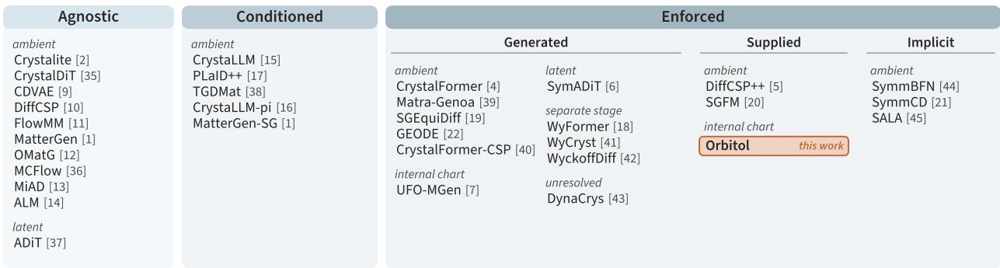  
Figure 8 How crystal generators use the space group. Agnostic models do not specify it; Conditioned models receive or declare it without jointly constraining positions and lattice; Enforced models build it into the generated structure. Enforced models are divided by how they obtain the Wyckof assignment (generated, supplied or implicit) and grouped by the coordinates they generate. Numbers in brackets are references. Table 2 lists the task, model family and lattice of each model.

SymADiT’s flow is an ADiT-based Transformer over learned orbit latents, and its ambient-coordinate decoder ignores constrained slots [6]. GEODE computes a periodic score over reachable periodic images [22].

Three entries need qualification because their released code difers from the paper.

UFO-MGen’s classification follows its paper, which describes learned topology and occupancy followed by flow in a masked free-coordinate chart [7]. The released command instead supplies the group and scafold, uses placeholder atom types, masks free dimensions after each step, and projects the lattice only after sampling. It establishes neither the full DNG procedure, whose composition source is unspecified in the paper, nor enforcement for trigonal groups, where rhombohedral lattice metrics are combined with hexagonal-axis Wyckof operations without conversion.

SymmCD’s classification describes its intended projection onto compatible Wyckof positions; the release retains an unprojected representative if projection raises an exception [21].

Matra-Genoa’s paper describes free Wyckof parameters and rejection of incompatible sequences [39]. We classify its released state as ambient with a family-constrained lattice: it generates full coordinate triplets, resolves constrained components during decoding, and projects the lattice to the crystal family before validity filtering.

Table 2 Classification of the crystal generators discussed in this paper, grouped as in Figure 8. A dagger marks evaluated models, including symmetry-only comparisons; Task describes the model’s scope: de novo generation (DNG), crystal structure prediction (CSP) or both. Wyckof distinguishes generated row identifiers, supplied rows and implicit assignments within Enforced models. Coordinates gives the evolving state, not the network input, and Lattice whether the lattice is free, constrained to the crystal family, or produced in a separate stage.
<table><tr><td>Model</td><td>Task</td><td>Family</td><td>Wyckoff</td><td>Coordinates</td><td>Lattice</td></tr><tr><td>Agnostic</td><td></td><td></td><td></td><td></td><td></td></tr><tr><td>ADiT [37]</td><td>DNG</td><td>Flow</td><td> $\mathrm { n / a }$ </td><td>Latent</td><td>Free</td></tr><tr><td>ALM Gen, unconditional [14]†</td><td>DNG</td><td>Diffusion</td><td> $\mathrm { n / a }$ </td><td>Ambient</td><td>Free</td></tr><tr><td>CDVAE [9]</td><td>DNG</td><td>VAE</td><td> $\mathrm { n / a }$ </td><td>Ambient</td><td>Free</td></tr><tr><td>CrystalDiT [35]</td><td>DNG</td><td>Diffusion</td><td> $\mathrm { n / a }$ </td><td>Ambient</td><td>Free</td></tr><tr><td>Crystalite [2]†</td><td>Both</td><td>Diffusion</td><td> $\mathrm { n / a }$ </td><td>Ambient</td><td>Free</td></tr><tr><td>DiffCSP [10]†</td><td>Both</td><td>Diffusion</td><td> $\mathrm { n / a }$ </td><td>Ambient</td><td>Free</td></tr><tr><td>FlowMM [1i]</td><td>Both</td><td>Flow</td><td> $\mathrm { n / a }$ </td><td>Ambient</td><td>Free</td></tr><tr><td>MatterGen (base) [1]†</td><td>DNG</td><td>Diffusion</td><td> $\mathrm { n / a }$ </td><td>Ambient</td><td>Free</td></tr><tr><td>MCFlow [36]</td><td>Both</td><td>Flow</td><td> $\mathrm { n / a }$ </td><td>Ambient</td><td>Free</td></tr><tr><td>MiAD [13]†</td><td>DNG</td><td>Diffusion</td><td> $\mathrm { n / a }$ </td><td>Ambient</td><td>Free</td></tr><tr><td>OMatG [12]</td><td>Both</td><td>Stoch. interp.</td><td> $\mathrm { n / a }$ </td><td>Ambient</td><td>Free</td></tr><tr><td>Conditioned</td><td></td><td></td><td></td><td></td><td></td></tr><tr><td> $\mathrm { C r y s t a L L M } \ [ 1 5 ] ^ { \dagger }$ </td><td>Both</td><td>LLM</td><td> $\mathrm { n / a }$ </td><td>Ambient</td><td>Free</td></tr><tr><td> $\mathrm { C r y s t a L L M } { - \pi \ [ 1 6 ] } ^ { \dagger }$ </td><td>Both</td><td>LLM</td><td> $\mathrm { n / a }$ </td><td>Ambient</td><td>Free</td></tr><tr><td>MatterGen (SG adapter) [1]</td><td>DNG</td><td>Diffusion</td><td> $\mathrm { n / a }$ </td><td>Ambient</td><td>Free</td></tr><tr><td>PLaID++ [17]†</td><td>DNG</td><td>LLM</td><td> $\mathrm { n / a }$ </td><td>Ambient</td><td>Free</td></tr><tr><td>TGDMat [38]</td><td>Both</td><td>Diffusion</td><td> $\mathrm { n / a }$ </td><td>Ambient</td><td>Free</td></tr><tr><td>Enforced</td><td></td><td></td><td></td><td></td><td></td></tr><tr><td>CrystalFormer [4]†</td><td>DNG</td><td>Autoregressive</td><td>Generated</td><td>Ambient</td><td>Family</td></tr><tr><td>CrystalFormer-CSP [40]</td><td>CSP</td><td>Autoregressive</td><td>Generated</td><td>Ambient</td><td>Family</td></tr><tr><td>DynaCrys [43]ª</td><td>DNG</td><td>Diffusion</td><td>Generated</td><td>Unresolved</td><td>Family</td></tr><tr><td>GEODE [22]</td><td>DNG</td><td>Diffusion</td><td>Generated</td><td>Ambient</td><td>Family</td></tr><tr><td> $\mathrm { M a t r a - G e n o a } \ [ 3 9 ] ^ { b }$ </td><td>DNG</td><td>Autoregressive</td><td>Generated</td><td>Ambient</td><td>Family</td></tr><tr><td> $\mathrm { S G E q u i D i f f } \ [ 1 9 ] ^ { \dag , c }$ </td><td>Both</td><td>Diffusion</td><td>Generated</td><td>Ambient</td><td>Family</td></tr><tr><td>SymADiT [6]</td><td>DNG</td><td>Flow</td><td>Generated</td><td>Latent</td><td>Family</td></tr><tr><td>UFO-MGen [7]d</td><td>Both</td><td>Flow</td><td>Generated</td><td>Free coordinates</td><td>Family</td></tr><tr><td>WyckoffDiff [42]</td><td>DNG</td><td>Diffusion</td><td>Generated</td><td>Separate stage</td><td>Separate stage</td></tr><tr><td>WyCryst [41]</td><td>Both</td><td>VAE</td><td>Generated</td><td>Separate stage</td><td>Separate stage</td></tr><tr><td> $\mathrm { W y F o r m e r ~ [ 1 8 ] ^ { \dag , e } }$ </td><td>DNG</td><td>Autoregressive</td><td>Generated</td><td>Separate stage</td><td>Separate stage</td></tr><tr><td> $\mathrm { D i f f C S P + + \Delta [ 5 ] ^ { \dag } }$ </td><td>Both</td><td>Diffusion</td><td>Supplied</td><td>Ambient</td><td>Family</td></tr><tr><td> $\mathrm { S G F M \ [ 2 0 ] ^ { \dag } }$ </td><td>Both</td><td>Flow</td><td>Supplied</td><td>Ambient</td><td>Family</td></tr><tr><td> $\mathrm { S A L A } \ [ 4 5 ] ^ { \bar { f } }$ </td><td>CSP</td><td>Flow</td><td>Implicit</td><td>Ambient</td><td>Family</td></tr><tr><td> $\mathrm { S y m m B F N } \ [ 4 4 ] ^ { g }$ </td><td>Both</td><td>BFN</td><td>Implicit</td><td>Ambient</td><td>Family</td></tr><tr><td> $\mathrm { S y m m C D \ [ 2 1 ] ^ { \dag , h } }$ </td><td>DNG</td><td>Diffusion</td><td>Implicit</td><td>Ambient</td><td>Family</td></tr><tr><td> $\mathrm { O r b i t o l } ( \mathrm { o u r s } ) ^ { \dag , i }$ </td><td>DNG</td><td>Diffusion</td><td>Supplied</td><td>Free coordinates</td><td>Family</td></tr></table>

Evaluated Conditioned text models declare a group and expand positions with its operations, but leave the lattice unconstrained. Wyckof applies only to Enforced models; $\mathrm { n } / \mathrm { a }$ does not imply absence of Wyckof text. aWithout code, we could not determine which coordinates the model stores. bReleased implementation; state qualification follows the table. cIts CSP results use SGEquiDif+LDif with retrieved templates. dPaper classification; release qualification follows the table. eThe evaluated pipeline uses DifCSP++ for geometry and lattice [5]. f Molecular crystals; CSP is given the molecular graph, the asymmetric-unit composition and the space group. Code was not released at the time of our audit. gFor CSP, the space group and the atom types in the asymmetric unit are given. hIntended projection algorithm; release qualification follows the table. iWyckof assignments come from training skeletons. Orbitol-X takes ambient representative positions as input and Orbitol-I the free coordinates; both evolve an internal chart (Appendix B.4).

## B Orbitol definitions and implementation

This appendix gives the definitions and implementation choices behind Section 3: a detailed example of Wyckof rows, the Wyckof tables and lattice charts, the coordinate metric and noise, the network inputs and conditioning, the training target and losses, geometry in orbit attention, sampling and decoding, and the reduction to Crystalite in P1.

## B.1 Detailed example of Wyckof rows

Table 3 The Wyckof rows of $P 4 _ { 2 } / m n m$ (No. 136) in the standard setting and the orbits that rutile $\mathrm { T i O _ { 2 } }$ (mp-2657) and $\mathrm { C r F _ { 4 } }$ (mp-20488), both from the MP-20 training split, place on them. Free coordinates are given in the table convention, $\textstyle x = u + { \frac { 1 } { 2 } }$ , rounded to three decimals.
<table><tr><td>Row w</td><td> $m _ { w }$ </td><td> $d _ { w }$ </td><td>Site symmetry</td><td>Representative</td><td>Rutile  $\mathrm { T i O _ { 2 } }$ </td><td> $\mathrm { C r F _ { 4 } }$ </td></tr><tr><td>2a</td><td>2</td><td>0</td><td>m.mm</td><td>(0,0,0)</td><td>Ti</td><td></td></tr><tr><td>2b</td><td>2</td><td>0</td><td>m.mm</td><td>(0, 0, 1)</td><td></td><td></td></tr><tr><td>4c</td><td>4</td><td>0</td><td> $2 / m . .$ </td><td>(0, 1, 0)</td><td></td><td></td></tr><tr><td>4d</td><td>4</td><td>0</td><td>4..</td><td>(0, 3}1))</td><td></td><td></td></tr><tr><td>4e</td><td>4</td><td>1</td><td>2.mm</td><td>(0, 0, z)</td><td></td><td></td></tr><tr><td> $4 f$ </td><td>4</td><td>1</td><td>m.2m</td><td>(x, x, 0)</td><td> $\mathrm { O } , x = 0 . 3 0 5$ </td><td> $\mathrm { C r } , x = 0 . 1 3 0$ </td></tr><tr><td>4g</td><td>4</td><td>1</td><td>m.2m</td><td>(x, x, 0)</td><td></td><td> $\mathrm { F } , x = 0 . 0 9 6 ; \mathrm { F } , x = 0 . 3 7 6$ </td></tr><tr><td>8h</td><td>8</td><td>1</td><td>2..</td><td>(0, 1, z)</td><td></td><td></td></tr><tr><td>8i</td><td>8</td><td>2</td><td>m..</td><td> $( x , y , 0 )$ </td><td></td><td> $\mathrm { F } , ( x , y ) = ( 0 . 1 0 6 , 0 . 3 3 0 )$ </td></tr><tr><td> $8 j$ </td><td>8</td><td>2</td><td>..m</td><td> $( x , x , z )$ </td><td></td><td></td></tr><tr><td>16k</td><td>16</td><td>3</td><td>1</td><td>(x, y, z)</td><td> $\{ 2 a , 4 f \}$ </td><td> $\{ 4 f , 4 g , 4 g , 8 i \}$ </td></tr><tr><td colspan="7">Skeleton</td></tr><tr><td colspan="7">Atoms in the cell</td></tr></table>

Table 3 lists every Wyckof row of $P 4 _ { 2 } / m n m .$ , the group of rutile in Figure 2. The group fixes these eleven rows; a skeleton selects a few of them, possibly more than once. Rutile uses two rows, 2a and 4f. CrF4 uses three rows for four orbits: two F orbits lie on row $4 g$ at diferent $x .$ Their tokens share the chart $( J _ { 4 g } , b _ { 4 g } )$ and the member maps of Equation (2), but each has its own atom type and free coordinate, so moving one orbit leaves the other in place. A fixed row such as 2a cannot be occupied by a second orbit: with $d _ { 2 a } = 0 ,$ , it would occupy the same two points. The four orbit tokens of $\mathrm { C r F _ { 4 } }$ have five free coordinates in total, and its lattice token specifies the tetragonal lengths a and $c .$

## B.2 Wyckof tables, preprocessing and lattice charts

The Wyckof tables use PyXtal’s default Hall setting for each space group. Row identifiers, charts, member operations, and lattice families use that setting; trigonal groups use hexagonal axes. For each row w, the tables give its conventional multiplicity $m _ { w }$ , free-coordinate dimension $d _ { w } ,$ , member maps $( W _ { w , j } , v _ { w , j } )$ for $j = 1 , \dots , m _ { w }$ , and the representative chart $( J _ { w } , b _ { w } ) = ( W _ { w , 1 } , v _ { w , 1 } )$ , the map of the first member. Chart tensors have three slots; only the first $d _ { w }$ are active. Padding and inactive coordinates are masked separately, and fixed rows receive neither coordinate noise nor coordinate loss.

Preprocessing standardizes the cell, identifies its Wyckof orbits, and checks the atom types and geometry after expanding the tokens. Only structures that pass this round-trip check enter the orbit cache. We write mod $\mathbf { \rho } _ { ! } ( x ) = x - \left\lfloor x \right\rfloor$ and denote the conventional fractional members $f _ { k j }$ of Equation (2) by $f _ { k j } ^ { \mathrm { c o n v } }$ . The tables describe conventional cells. In a centered lattice (I, C, F or R), the conventional cell contains $c _ { G } > 1$ lattice points, and members that difer by a centering translation are periodic images of the same atom of the primitive cell. Primitive-member flags keep one of them, so an orbit has $m _ { w } ^ { \mathrm { p } } = m _ { w } / c _ { G }$ primitive members [3]. Let $P _ { c }$ contain the primitive basis vectors as columns in conventional fractional coordinates. With column fractional positions and row lattice vectors, the conventional lattice $L _ { \mathrm { { c o n v } } }$ and positions convert to

the primitive lattice $L _ { \mathrm { p } }$ and positions $f _ { k j } ^ { \mathrm { p } }$ as

$$
L _ { \mathrm { p } } = P _ { c } ^ { \top } L _ { \mathrm { c o n v } } , \qquad f _ { k j } ^ { \mathrm { p } } = \mathrm { m o d } _ { 1 } ( P _ { c } ^ { - 1 } f _ { k j } ^ { \mathrm { c o n v } } ) .\tag{13}
$$

The output atom count is $\begin{array} { r } { N _ { \mathrm { p } } = \sum _ { k } m _ { w _ { k } } ^ { \mathrm { p } } } \end{array}$

Augmentation composes proper normalizer maps, allowed polar-origin shifts, and equivalent chart images. P1 instead receives a uniform global translation. These operations change the description of the same crystal.

We use Crystalite’s lower-triangular lattice latent y, reconstructed from free slots z by the crystal-family chart $y = \ell _ { G } ( z )$

$$
L _ { \mathrm { c o n v } } ( z ) = \left[ \begin{array} { c c c } { e ^ { y _ { 1 } } } & { 0 } & { 0 } \\ { y _ { 2 } } & { e ^ { y _ { 3 } } } & { 0 } \\ { y _ { 4 } } & { y _ { 5 } } & { e ^ { y _ { 6 } } } \end{array} \right] .\tag{14}
$$

Triclinic cells retain every slot. Monoclinic cells in the unique-axis-b setting fix $y _ { 2 } = y _ { 5 } = 0 ;$ orthorhombic cells also fix $y _ { 4 } = 0$ . Tetragonal cells also tie $y _ { 3 } = y _ { 1 }$ , and cubic cells tie $y _ { 6 } = y _ { 1 }$ . Hexagonal and trigonal groups use hexagonal axes, with $y _ { 2 } = - e ^ { y _ { 1 } } / 2 , y _ { 3 } = y _ { 1 } + \log ( \sqrt { 3 } / 2 )$ , and $y _ { 4 } = y _ { 5 } = 0$

The free lattice state uses six padded slots. The network embeds the reconstructed noisy lattice latent after EDM input scaling and predicts six values. The fixed readout $\Gamma _ { G }$ averages the first and third predictions for tetragonal and hexagonal families, and also the sixth for cubic cells; it then masks constrained slots. The lattice loss weights the shared diagonal by the number of diagonal entries it represents. The dependent hexagonal shear has no separate loss. State, noise, and readout use the same free-slot mask.

For the hexagonal chart, the shared log length is clamped to $[ - 5 - \log ( { \sqrt { 3 } } / 2 )$ , log 20] before rebuilding the dependent entries. At the sampling endpoint, free log-diagonal slots are clamped to $[ - 5 , 5 ]$ and free shear slots to $[ - 1 0 , 1 0 ]$ . Reconstruction then applies the family chart, including its hexagonal bound.

## B.3 Chart metric, noise and preconditioning

Fractional rotations need not preserve Euclidean lengths. We therefore use one group-invariant metric, fixed independently of the noisy lattice, to measure displacements and set chart noise. For point-group rotations $\mathcal { R } _ { G }$ , define

$$
\begin{array} { r l } & { M _ { G } = \cfrac { 1 } { | \mathcal R _ { G } | } \displaystyle \sum _ { R \in \mathcal R _ { G } } R ^ { \top } R , } \\ & { \Pi _ { w } = H _ { w } ^ { - 1 } J _ { w } ^ { \top } M _ { G } , } \end{array}
$$

$$
H _ { w } = J _ { w } ^ { \top } M _ { G } J _ { w } ,\tag{15}
$$

$$
N _ { w } = H _ { w } ^ { - 1 } J _ { w } ^ { \top } M _ { G } ^ { 1 / 2 } .\tag{16}
$$

Right multiplication by a point-group rotation $Q$ permutes the group, so

$$
Q ^ { \top } M _ { G } Q = \frac { 1 } { | \mathcal { R } _ { G } | } \sum _ { R \in \mathcal { R } _ { G } } ( R Q ) ^ { \top } ( R Q ) = M _ { G } .
$$

Thus a chart step δ gives every member the same squared displacement $\| R _ { j } J _ { w } \delta \| _ { M _ { G } } ^ { 2 } = \delta ^ { \top } H _ { w } \delta$ before wrapping. The coordinate noise of Equation (5) is $\xi _ { k } = N _ { w _ { k } } \epsilon _ { u , k }$ with a standard Gaussian $\epsilon _ { u , k } \in \mathbb { R } ^ { 3 }$ . On active coordinates, $N _ { w } N _ { w } ^ { \top } = H _ { w } ^ { - 1 }$ , so $\sigma N _ { w } \epsilon$ has covariance $\sigma ^ { 2 } H _ { w } ^ { - 1 }$ , or $\sigma ^ { 2 } I$ after multiplication by $H _ { w } ^ { 1 / 2 }$ Fixed rows receive no coordinate noise. Minimizing $\| J _ { w } \delta - F \| _ { M _ { G } } ^ { 2 }$ gives $H _ { w } \delta = J _ { w } ^ { \top } M _ { G } F$ , hence the readout $\delta = \Pi _ { w } F ;$ for $J _ { w } = I , H _ { w } = M _ { G }$ and $\Pi _ { w } = I$

For example, rutile has $M _ { G } = I$ and $H _ { 4 f } = 2 \colon$ a chart step δu on row 4f moves each of the four O members by an $M _ { G }$ length $\sqrt { 2 } | \delta u |$ before wrapping. For a nonorthogonal example, point group 6/mmm in hexagonal axes has the 24 operations $R ^ { k } S ^ { s } Z ^ { z } , k = 0 , \ldots , 5 , s , z \in \{ 0 , 1 \}$ , where

$$
R = \left( { \begin{array} { c c c } { 1 } & { - 1 } & { 0 } \\ { 1 } & { 0 } & { 0 } \\ { 0 } & { 0 } & { 1 } \end{array} } \right) , \quad S = \left( { \begin{array} { c c c } { 0 } & { 1 } & { 0 } \\ { 1 } & { 0 } & { 0 } \\ { 0 } & { 0 } & { 1 } \end{array} } \right) , \quad Z = \mathrm { d i a g } ( 1 , 1 , - 1 ) .
$$

Their average gives $M _ { G } = \left( \begin{array} { c c c } { { 4 / 3 } } & { { - 2 / 3 0 } } \\ { { - 2 / 3 } } & { { 4 / 3 0 } } \\ { { 0 } } & { { 0 } } & { { 1 } } \end{array} \right)$ . The rotation R takes $( 1 , 0 , 0 ) ^ { \top }$ to $( 1 , 1 , 0 ) ^ { \top }$ , changing its Euclidean length from 1 to $\sqrt { 2 }$ but preserving its squared $M _ { G }$ norm of $4 / 3$ The identity metric would therefore assign diferent displacement lengths to members of the same orbit.

We use Crystalite’s EDM formulation [2, 26], drawing one shared noise level per structure from a clipped log-normal distribution and independent Gaussian draws for the channels in Equation (5), with free-slot masks. Write $\widetilde { u } _ { k } ^ { \sigma } = u _ { k } + \sigma \xi _ { k }$ for the unwrapped coordinate state: objective M retains it during training, whereas target P uses $u _ { k } ^ { \sigma } = \widetilde { u } _ { k } ^ { \sigma } - \mathrm { r o u n d } ( \widetilde { u } _ { k } ^ { \sigma } )$ . For channel $a \in \{ h , u , z \}$ and data scale $\sigma _ { \mathrm { d a t a } , a }$

$$
\begin{array} { l } { { c _ { \mathrm { s k i p } , a } = \displaystyle \frac { \sigma _ { \mathrm { d a t a } , a } ^ { 2 } } { \sigma ^ { 2 } + \sigma _ { \mathrm { d a t a } , a } ^ { 2 } } , \qquad c _ { \mathrm { o u t } , a } = \displaystyle \frac { \sigma \sigma _ { \mathrm { d a t a } , a } } { \sqrt { \sigma ^ { 2 } + \sigma _ { \mathrm { d a t a } , a } ^ { 2 } } } , } } \\ { { c _ { \mathrm { i n } , a } = \displaystyle \frac { 1 } { \sqrt { \sigma ^ { 2 } + \sigma _ { \mathrm { d a t a } , a } ^ { 2 } } } . } } \end{array}\tag{17}
$$

These coeficients give the type and lattice denoisers in Equation (9); coordinates receive no input scaling.   
The coordinate target and skip are separate choices, specified below.

## B.4 Network inputs, conditioning and coordinate variant

Orbitol-X is the model called Orbitol in the main text and used for all its MP-20 results. Orbitol-I changes the coordinate input and readout; Table 11 compares the variants. Orbitol-X applies Crystalite’s Fourier embedder to the representative $f _ { k 1 }$ in Equation (2), evaluated at $u _ { k } ^ { \sigma }$ for P or $\widetilde { u } _ { k } ^ { \sigma }$ for M. Its coordinate readout is $\widehat { F } _ { u , k } = \Pi _ { w _ { k } } F _ { u , k } ;$ the ambient input adds no free variables.

Orbitol-I instead embeds mod $\textstyle { \mathrm { 1 } } \left( u _ { k } ^ { \sigma } + \frac { 1 } { 2 } \right)$ with Fourier features, masking inactive-coordinate features before the embedding MLP. Fixed rows retain Orbitol-X’s Fourier features of mod1 $\left( b _ { w } \right)$ . This input is periodic under integer chart lifts, but does not identify every additional fractional translation in $\Lambda _ { w }$ . Its direct readout is $\widehat { F } _ { u , k } = H _ { w _ { k } } ^ { - 1 / 2 } F _ { u , k }$ , with inactive output slots masked.

The token and group embeddings follow Equations (6) and (7), with the lattice token last and padding masked. Both variants use hybrid row and group embeddings, each the sum of a learned lookup and an MLP on standardized physical descriptors. Row descriptors include log multiplicity, free-coordinate dimension, reciprocal stabilizer size, operation counts, and entries of $J _ { w } H _ { w } ^ { - 1 } J _ { w } ^ { \top }$ . Group descriptors encode crystal system, centering, point-group operations, screw and glide information, Wyckof statistics, and spectral coordinates of subgroup relations. The group embedding is added to the noise embedding of $c _ { \mathrm { n o i s e } } = \textstyle { \frac { 1 } { 4 } }$ log σ in every AdaLN block [27]. Categorical additions and final descriptor-MLP layers start at zero; the charts enforce the constraints even when these embeddings vanish.

## B.5 Periodic target and training losses

The benchmark models and Orbitol-X/I comparison use the periodic-posterior target P of Equation (10), with the sine skip

$$
\begin{array} { l } { { \displaystyle s _ { u } ( u ) = u - ( 1 - c _ { \mathrm { s k i p } , u } ) \frac { \sin ( 2 \pi u ) } { 2 \pi } , } } \\ { { \displaystyle D _ { u , k } ^ { P } = s _ { u } ( u _ { k } ^ { \sigma } ) + c _ { \mathrm { o u t } , u } \widehat F _ { u , k } . } } \end{array}\tag{18}
$$

The sine acts componentwise, giving $s _ { u } ( u + n ) = s _ { u } ( u ) + n$ for integer n and matching the EDM skip to first order near the chart origin. The skip comparison also uses P with $s _ { u } ( u ) = c _ { \mathrm { s k i p } , u } u$ . Table 5 lists which models use each skip. Writing $p _ { \sigma }$ for the wrapped transition density, the target satisfies

$$
D ^ { \star } = u ^ { \sigma } + \sigma ^ { 2 } H _ { w } ^ { - 1 } \nabla _ { u ^ { \sigma } } \log p _ { \sigma } ( u ^ { \sigma } \mid u ) .
$$

Regression averages this conditional lifted mean over clean points compatible with the noisy channels. At high noise the wrapped density becomes uniform and $D ^ { \star }$ approaches $u ^ { \sigma }$ , without preferring a chart origin. The

target sums integer lifts only; augmentation samples the other equivalent chart images, including fractional pure translations. The clean point is used to construct the training target, while the denoiser receives only noisy channels and the fixed skeleton. The coordinate loss is

$$
\mathcal { L } _ { u } = \Bigl \langle c _ { \mathrm { o u t } , u } ^ { - 2 } \| D _ { u , k } ^ { P } - D ^ { \star } ( u _ { k } ^ { \sigma } , u _ { k } ) \| _ { H _ { w _ { k } } } ^ { 2 } \Bigr \rangle _ { \mathrm { a c t i v e ~ o r b i t s } } ,\tag{19}
$$

without wrapping the prediction error.

For comparison, objective M uses $D _ { u , k } ^ { M } = c _ { \mathrm { s k i p } , u } \widetilde { u } _ { k } ^ { \sigma } + c _ { \mathrm { o u t } , u } \widehat { F } _ { u , k }$ and selects the nearest residual over $\Lambda _ { w } .$ the lattice generated by integer periods and translation-only chart images:

$$
\mathrm { w r a p } _ { w } ( \delta ) = \delta - \arg \operatorname* { m i n } _ { \lambda \in \Lambda _ { w } } \| \delta - \lambda \| _ { H _ { w } } ^ { 2 } .\tag{20}
$$

Its per-orbit error is $c _ { \mathrm { o u t } , u } ^ { - 2 } \| \mathrm { w r a p } _ { w } ( D _ { u } ^ { M } - u ) \| _ { H _ { w } } ^ { 2 }$ . M selects the nearest periodic image, whereas P averages the periodic images with their conditional Gaussian weights. Their conditional optima need not agree, so M need not recover the posterior mean used by the difusion drift. This is an analytic distinction; we do not compare trained M and P models. Periodic-score precedents are discussed in Section 3.5.

Both coordinate losses average over real orbit tokens with $d _ { w } > 0$ across the batch, without dividing by coordinate dimension or weighting by multiplicity; an empty active set contributes zero. Type error is summed over the 16 type features and averaged over real orbit tokens. Lattice error uses the tied-diagonal weights of Appendix B.2 and is averaged over all six slots and structures. Each channel receives its EDM weight $c _ { \mathrm { o u t } , a } ^ { - 2 }$ the channel weights in the total loss are given in Appendix C.

The infinite sum in Equation (10) is evaluated in double precision with adaptive image sums at low noise, a dual-lattice Fourier series at higher noise, and an identity limit when the correction is negligible. Training caches metric-dependent primal and dual grids and masks terms by noise level, without a universal fixed image-count cutof. The batched implementation uses padded metric tables for all tokens and agrees with the loop implementation within $1 0 ^ { - 1 2 }$ absolute tolerance in double precision.

## B.6 Geometry in orbit attention

We expand the noisy orbits into their primitive members $^ { a , }$ with fractional coordinates $f _ { a }$ and owner orbit $o ( a ) ; r ( k )$ is the first member of query orbit k. For distance evaluation, let $L _ { s }$ be the sanitized primitive cell and $L _ { r } = T L _ { s }$ its reduced basis, with integer unimodular T. Before computing distances, we replace nonfinite primitive cells with the identity cell. Finite row lengths are bounded to $[ e ^ { - 5 } , e ^ { 5 } ] \mathrm { \AA }$ while preserving directions; a degenerate row-normalized cell also falls back to the identity. Nonfinite fractional coordinates become zero, and coordinates are wrapped. Sorted size reduction produces $L _ { r } = T L _ { s }$ with a bounded iteration count and an identity-transform fallback. We compute the fractional displacements $\delta _ { a b }$ , their wrapped versions $\bar { \delta } _ { a b }$ , and distances $d _ { a b }$ as

$$
\delta _ { a b } = T ^ { - \top } ( f _ { b } - f _ { a } ) ,
$$

$$
\bar { \delta } _ { a b } = \delta _ { a b } - \mathrm { r o u n d } ( \delta _ { a b } ) ,\tag{21}
$$

$$
d _ { a b } = \operatorname* { m i n } _ { \boldsymbol { n } \in \{ - 1 , 0 , 1 \} ^ { 3 } } \| ( \bar { \delta } _ { a b } + \boldsymbol { n } ) ^ { \top } L _ { r } \| _ { 2 } .\tag{22}
$$

The search uses the neighboring ofsets in this reduced basis. It is a finite nearest-image approximation, without a closest-vector guarantee for arbitrary noisy cells.

For attention head g, using radial basis features RBF and volume scale $\bar { a } = | \operatorname* { d e t } L _ { s } | ^ { 1 / 3 }$ , the distance-only atom bias is

$$
\begin{array} { r } { \beta _ { g } ( a , b ) = \mathrm { M L P } _ { g } ( \left[ \mathrm { R B F } ( d _ { a b } / \bar { a } ) , \mathrm { R B F } ( d _ { a b } ) \right] ) , } \end{array}\tag{23}
$$

with $\beta _ { g } ( a , a ) = 0$ . Writing d for a member-pair distance $d _ { a b }$ , the radial features are Gaussian functions with evenly spaced centers, using their spacing as width. The default uses 32 centers over [0, 2] for $d / \bar { a }$ and 32 over [0, 8 Å] for d. We concatenate these features and pass them to an MLP with a hidden width of 128, SiLU activation, and one output per attention head. Its final layer starts at zero. Among real pairs, only the identical-atom pair is explicitly assigned zero bias; padding is masked. The scale a¯ comes from the same sanitized cell as the distances.

Equation (11) sums key-member weights for one query representative $r ( k )$ . The lattice cases are $B _ { g } [ \mathrm { l a t } , l ] =$ log $m _ { w _ { i } } ^ { \mathrm { p } }$ and $B _ { g } [ k , \mathrm { l a t } ] = B _ { g } [ \mathrm { l a t } , \mathrm { l a t } ] = 0 $ . For members of orbit l with tied key $\kappa _ { l }$ and value $\nu _ { l } .$ , set $\alpha _ { k l } = q _ { k } ^ { \top } \kappa _ { l } / \sqrt { d _ { h } }$ , with head width $d _ { h }$ and attention normalizer $Z _ { k }$ . Then

$$
\sum _ { b : o ( b ) = l } \frac { e ^ { \alpha _ { k l } + \beta _ { g } ( r ( k ) , b ) } } { Z _ { k } } = \frac { e ^ { \alpha _ { k l } + B _ { g } [ k , l ] } } { Z _ { k } } .\tag{24}
$$

This tied-attention identity preserves the weighted value sum up to rounding for any supplied atom biases; averaging key-member weights would lose their total mass. Zero atom biases give the multiplicity-only case $B _ { g } [ k , l ] = \log m _ { w _ { l } } ^ { \mathrm { p } }$ , including at MLP initialization. With exact distances in a symmetry-compatible cell, changing the query representative permutes each key orbit’s distance multiset, but sanitization and finite image searches need not preserve this invariance for arbitrary noisy cells.

In rutile, Ti occupies row 2a and O row 4f of $P 4 _ { 2 } / m n m \mathrm { : }$ GEM expands six primitive atoms, while the Transformer processes two orbit tokens and a lattice token. The following multipliers are illustrative distanceto-weight values, not fitted MLP outputs; equal distances receive equal values and self-pairs receive one. Rows are query atoms and columns are key atoms.

<table><tr><td> $e ^ { \beta _ { g } ( a , b ) }$ </td><td> $\mathrm { T i } _ { 1 }$ </td><td> $\mathrm { T i } _ { 2 }$ </td><td> $\mathrm { O _ { 1 } }$ </td><td> $\mathrm { O _ { 2 } }$ </td><td> $\mathrm { { O _ { 3 } } }$ </td><td> $\mathrm { O _ { 4 } }$ </td></tr><tr><td>Ti1</td><td>1</td><td>2</td><td>6</td><td>6</td><td>7</td><td>7</td></tr><tr><td>Ti2</td><td>2</td><td>1</td><td>7</td><td>7</td><td>6</td><td>6</td></tr><tr><td>O1</td><td>6</td><td>7</td><td>1</td><td>4</td><td>3</td><td>3</td></tr><tr><td>O2</td><td>6</td><td>7</td><td>4</td><td>1</td><td>3</td><td>3</td></tr><tr><td>O3</td><td>7</td><td>6</td><td>3</td><td>3</td><td>1</td><td>4</td></tr><tr><td>O₄</td><td>7</td><td>6</td><td>3</td><td>3</td><td>4</td><td>1</td></tr></table>

<table><tr><td> $e ^ { B _ { g } [ k , l ] }$ </td><td>Ti</td><td>0</td><td>lattice</td></tr><tr><td>Ti</td><td>3</td><td>26</td><td>1</td></tr><tr><td>0</td><td>13</td><td>11</td><td>1</td></tr><tr><td>lattice</td><td>2</td><td>4</td><td>1</td></tr></table>

Summing key columns for representatives $\mathrm { T i } _ { 1 }$ and $\mathrm { O _ { 1 } }$ gives the reduced table: the Ti-to-O multiplier is $6 + 6 + 7 + 7 = 2 6$ , and changing representatives only permutes these terms. The lattice query sums unit multipliers, giving the primitive counts (2, 4), while its single key has multiplier one. With content multipliers (2, 1, 1) for a Ti query, expanded weights (2, 4, 6, 6, 7, 7, 1) and orbit weights (6, 26, 1) both total 33 and give

$$
\left( p _ { \mathrm { T i } \to \mathrm { T i } } , p _ { \mathrm { T i } \to \mathrm { O } } , p _ { \mathrm { T i } \to \mathrm { l a t } } \right) = \left( { \frac { 6 } { 3 3 } } , { \frac { 2 6 } { 3 3 } } , { \frac { 1 } { 3 3 } } \right) .
$$

Tied values therefore give the same attention output up to rounding. This verifies aggregation for the supplied biases, independently of the finite-distance approximation above.

Geometry is computed without gradients from the unscaled noisy state, outside mixed precision; the bias MLP trains, and its output is shared across layers with no explicit noise gate or noise-level input. When compiled geometry is enabled, reduction uses eight sweeps and leaves cells unreduced if more are needed, matching the eager reduction when it converges within that bound.

Crystalite’s GEM combines a distance penalty with Fourier displacement, normalized-distance, and lattice features, then applies a noise-dependent gate [2]. It normalizes by mean cell length and leaves lattice-token interactions unbiased. Orbitol uses absolute and volume-normalized distances, sums key-member weights, and includes multiplicity in the lattice-query row; its P1 limit therefore difers from Crystalite’s configured GEM.

## B.7 Sampling, decoding and valid outputs

The sampler initializes Gaussian states with the training masks and chart noise maps, then applies Crystalite’s EDM schedule, stochastic churn and Heun correction. P uses coordinate drift $( u ^ { \sigma } - D _ { u } ) / { \sigma } ;$ M wraps the numerator over $\Lambda _ { w }$ . Coordinate states are wrapped componentwise after Euler and Heun updates. With P and the EDM skip, denoising, drift and updates use the same wrapped state, including after churn; with the sine skip, integer-lift equivariance permits lifted churn states until the update is wrapped. Channel-wise anti-annealing is supported but disabled in all reported runs.

Sampler settings and the sensitivity study are given in Appendix C.6.

At the endpoint, free lattice slots are clamped and dependent entries rebuilt. Crystalite’s type encoding decodes predicted features to allowed types. Equations (2) and (13), with primitive-member flags, produce the primitive structure without a geometric primitive-cell search. The decoder checks that requested group operations preserve the lattice and map atoms bijectively to same-type periodic images. For evaluation, the primitive cell is Niggli-reduced, falling back to LLL and then the input cell if reduction fails; evaluator rows record the resulting metric under the final lattice clamp.

Active-state finiteness is recorded before endpoint sanitization; a false flag causes rejection. The decoder also rejects invalid groups, rows or types, incompatible token shapes, empty structures, nonfinite values, invalid lattices, reused fixed rows, coinciding distinct orbits, collapsed members within an orbit, and failed group containment. Evaluator conversion records conversion failures and atom-capacity violations. Failures remain in the output metadata and are not replaced when scoring attempts.

## B.8 P1 reduction and verification

In P1, every orbit is 1a with $m _ { w } = 1 , d _ { w } = 3 , J _ { w } = H _ { w } = N _ { w } = \Pi _ { w } = I$ and $b _ { w } = 0$ . Primitive and conventional cells coincide, and the triclinic lattice chart is the identity. Orbitol computes Crystalite’s denoiser, loss and sampler exactly when type encodings, weights, execution modes and sampler settings match, with zero row and group embeddings, objective M and GEM of. Both evaluated P skips depart from this equality even in P1; configured GEM diferences are given in Appendix B.6.

Tests compared cached coordinates and lattice states, initialized model outputs across embedding modes, and objective-M corruption, denoising and losses at zero tolerance; decoded-cell round trips allowed numerical conversion tolerance. Sampler tests used matched random streams with and without anti-annealing and compared final type, coordinate and lattice states at zero tolerance, without recording intermediate trajectories. Separate integration tests trained and sampled under the implemented coordinate objectives.

## C Experimental details and supporting results

This appendix supports Section 4: the evaluated configurations, how yield and symmetry are scored, the SPARC derivation, the full results and reported comparisons, the coordinate-configuration comparison, the sampler settings and the timing of sampling.

## C.1 Data, training and evaluated configurations

The MP-20 orbit training cache contains 27,136 structures. The input Alex-MP-20 splits contain 540,162 training structures and 67,521 each for validation and test; the Alex orbit training cache retains 540,159 structures. We sample skeletons only from the training cache; each supplies the space group and an untyped multiset of Wyckof rows. Orbitol does not copy the template’s atom types or geometry. The empirical skeleton prior does not generate unseen skeletons.

Table 4 lists the settings of the two benchmark models, read from their checkpoint configurations. Training batches are padded rather than packed. The main MP-20 run used compiled training steps and compiled GEM geometry, batched periodic targets, device-side type encoding and fused AdamW/EMA updates. The AdamW kernel reproduces PyTorch’s foreach arithmetic with single-precision parameters and moments, and the data assembly and type encoding preserve the batches bitwise. Table 5 distinguishes the evaluated configurations; Appendices B.4 and B.5 define their inputs, readouts and periodic-posterior target P.

We selected the main MP-20 checkpoint by the highest observed in-training MSUN; for Alex-MP-20, we report the checkpoint at 650k steps. Each MP-20 screen drew 10,000 attempts, relaxed constructed structures for 500 FIRE steps, and measured uniqueness and novelty on the relaxed endpoints against MP-20 train, with stability against the in-house MP-20 hull. This selection score counts failures as zero and difers from the LeMat benchmark. The MP-20 controls and the Alex-MP-20 application variant use the checkpoints in Table 5. Independent training replicates are unavailable.

Table 4 Settings of the two benchmark models (Orbitol-X). A value centered across both columns is shared. Table 5 lists the controls and the Orbitol-I variant; Appendix C.2 gives the evaluation details.
<table><tr><td>Setting</td><td>MP-20</td></tr><tr><td>Architecture</td><td></td></tr><tr><td>Width, layers, heads, MLP ratio</td><td>512, 14, 16, 4</td></tr><tr><td>Parameters</td><td>69.2M</td></tr><tr><td>Maximum orbits per crystal</td><td>20</td></tr><tr><td>Coordinate input; readout</td><td>representative, 32 Fourier frequencies; projection</td></tr><tr><td>Group and row embeddings</td><td>learned lookup vector and descriptor MLP</td></tr><tr><td>GEM</td><td>distance, shared across layers, no noise gate</td></tr><tr><td>Training</td><td></td></tr><tr><td>Target; coordinate skip</td><td>P; sine</td></tr><tr><td>Loss weights (type, coordinate, lattice)</td><td>(0.25, 50, 5) (0.5, 50, 5)</td></tr><tr><td>EDM data scale; ln σ</td><td>0.3 per channel;  $\mathcal { N } ( - 1 . 2 , 1 . 2 ^ { 2 } )$ </td></tr><tr><td>Optimizer</td><td>AdamW, learning rate  $1 0 ^ { - 4 } ,$  no weight decay</td></tr><tr><td>Batch size; learning-rate schedule</td><td>128; 1,000 warm-up steps, cosine decay</td></tr><tr><td>Gradient clipping; EMA decay</td><td>1; 0.9999</td></tr><tr><td>Precision</td><td>bfloat16</td></tr><tr><td>Training steps: schedule; evaluated</td><td>1M; 650k</td></tr><tr><td>Sampling</td><td></td></tr><tr><td>Skeleton prior</td><td>empirical training skeletons, temperature 1</td></tr><tr><td>Sampler; weights</td><td>EDM stochastic Heun [26]; EMA 25 (49)</td></tr><tr><td>Heun steps (network evaluations)</td><td>150 (299) [0.01, 3]; 10</td></tr><tr><td>[σmin, σmax]; Schurn</td><td>[0.002, 80]; 60</td></tr><tr><td>ρ, Smin, Smax, Snoise</td><td>7, 0, 999, 1.003</td></tr><tr><td>Execution</td><td>packed (8,192 tokens), compiled padded batches of 256</td></tr><tr><td>Precision; decoder</td><td>bfloat16; reference</td></tr><tr><td>Sampling seeds</td><td>1</td></tr><tr><td>Evaluation</td><td></td></tr><tr><td>Attempts per seed</td><td></td></tr><tr><td>Relaxation</td><td>2,500</td></tr><tr><td></td><td>NequIP-OAM-L, FIRE with Fréchet cell filter, 500 steps</td></tr><tr><td>Symmetry detection Scoring</td><td>spglib, 0.1 Å (also 0.01 Å), angle 5° LeMat-GenBench, mean ORB, MACE and UMA  $E _ { \mathrm { h u l l } }$  raw fallback</td></tr></table>

Table 5 Evaluated Orbitol configurations. All use width 512, distance GEM, target P and EMA weights. Updates are the evaluated checkpoint and full training schedule; each sampling seed gives 2,500 attempts. The sampler column gives Heun steps; full settings are in Table 4. Orbitol-X uses representative inputs and projection readout; Orbitol-I uses chart-coordinate inputs and direct readout.
<table><tr><td>Dataset / role</td><td>Model / skip</td><td> $\lambda _ { \mathrm { t y p e } }$ </td><td>Updates</td><td></td><td>Sampler Seeds</td><td></td></tr><tr><td>MP-20 benchmark</td><td>X / sine</td><td></td><td>0.25</td><td>1.5M / 2.5M</td><td>25</td><td>3</td></tr><tr><td>MP-20 control</td><td>X / sine</td><td></td><td>1</td><td>400k / 500k</td><td>150</td><td>1</td></tr><tr><td>MP-20 control</td><td>X/ EDM</td><td></td><td></td><td>400k/ 500k</td><td>150</td><td>1</td></tr><tr><td>Alex-MP-20 benchmark</td><td>X / sine</td><td>0.5</td><td></td><td>650k  /  1M</td><td>150</td><td>1</td></tr><tr><td>Alex-MP-20 application variant</td><td>I / sine</td><td></td><td>0.5</td><td>650k  / 1M</td><td>150</td><td>1</td></tr></table>

Table 6 Evaluation metrics. All rates are percentages. Yield, requested or declared retention, SPARC and joint yield use all 2,500 attempts. P1 and JSD use eligible relaxed detections; failures and implausible endpoints are excluded from these distributions and count as losses for retention, SPARC and joint yield.
<table><tr><td>Metric</td><td>Definition</td></tr><tr><td>SUN, MSUN</td><td>Attempts that are valid, unique among the model&#x27;s 2,500 attempts and novel against LeMat-Bulk, with predicted energy above hull at most 0 (SUN) or at most 0.1 eV/atom (MSUN, which adds the metastable candidates to SUN). Yield counts all attempts with raw fallback. P1, JSD, retention and SPARC use relaxed structures and are not restricted to those counted in MSUN.</td></tr><tr><td>P1</td><td>Share of relaxed structures detected in P1, compared with the training share (1.7% on MP-20).</td></tr><tr><td>JSD</td><td>Jensen-Shannon divergence, in bits, between the space-group distribution of the relaxed structures and that of the training set. We compare detected distributions after relaxation; sampling training skeletons sets the requested-group distribution, not the detected histogram.</td></tr><tr><td>Requested group retained</td><td>Attempts whose eligible relaxed structure is detected in the requested group; for models that declare their own group, the declared group. For retention and SPARC, relaxing into a supergroup counts as a loss.</td></tr><tr><td>Joint yield</td><td>Attempts that satisfy MSUN and retain the requested or declared group after relaxation. Failures and implausible endpoints count as not retained.</td></tr><tr><td>SPARC</td><td>Attempts that retain their raw group through relaxation, weighted by how well the retained groups cover the training distribution (Equation 12).</td></tr></table>

## C.2 Evaluation and failure accounting

## Table 6 summarizes the metrics of Section 4.2.

We used LeMat-GenBench at its revision of 15 September 2026, which pins the corrected MACE checkpoints, with its multi-MLIP hull configuration. ORB, MACE and UMA used their respective hulls, and novelty was measured against LeMat-Bulk. For SUN and MSUN, LeMat thresholds each structure’s arithmetic mean of the available ORB, MACE and UMA energies above their respective hulls at 0 and 0.1 eV/atom, respectively. Missing model values are omitted from the mean; a structure without any value counts as neither stable nor metastable.

For every evaluated model and seed, we selected attempts 0 through 2499 from the model’s pool, retaining generation, decoding and structure-check failures. We did not replace failures or select a subset of parseable outputs. Yield and requested-group retention use all 2,500 attempts as their denominator. For PLaID++, these are the first 2,500 released decoded rows; upstream filtering and losses before release are unknown. Its rates therefore describe this pool, not all original language-model draws. We used one sampling seed per model and three for Orbitol-X (MP-20), averaging each metric over the three seeds. The main MP-20 table and Figure 4 both use the train-only SymmCD and WyFormer retrainings. SGFM and Orbitol sample the same empirical untyped skeleton law, although their output cell conventions and samplers difer.

We pre-relaxed structures with the OpenEquivariance TorchScript build of NequIP-OAM-L [28], using FIRE and a Frechet cell filter for 500 fixed steps on one RTX 6000 Ada. Atomic and cell updates had no symmetry constraint. LeMat used single-point energies on these endpoints, with raw fallback when relaxation failed. Its additional model-specific relaxations are separate outputs and did not define the input geometry for the reported hull scores. Invalid attempts contributed zero yield.

We used pymatgen’s SpacegroupAnalyzer with spglib 2.7.0, angle tolerance 5◦, and positional tolerances of 0.1 Å and 0.01 Å. Shares and JSD use detected structures; detection failures are not P1. Relaxed symmetry includes only successful endpoints and excludes implausible endpoints: a relaxed-to-raw volume ratio outside [0.5, 2], or an interatomic distance below 0.5 Å. These exclusions apply to relaxed symmetry, separately from LeMat’s raw fallback rule. We detected each dataset’s training reference with the same settings; the Alex-MP-20 reference contains 540,162 training structures. JSD uses base-two logarithms and is reported in

bits.

Requested-to-raw and requested-to-relaxed retention require exact equality of the requested and detected groups, divided by all 2,500 attempts. For CrystaLLM, CrystaLLM-π and $\mathrm { P L a I D + + }$ , the request is replaced by the model’s own declaration. Generation, relaxation and detection failures, and implausible relaxed endpoints, count as losses in the relevant rate. The declaration is read from generated text, not a CIF serialization header. Agnostic models have no requested-group retention. Own-group strict retention instead asks whether a structure retained its raw-detected group after relaxation, using all raw-detected structures as the denominator. Failed relaxations, implausible endpoints and failed relaxed detections count as losses. Own-group joint retention uses only pairs with both raw and eligible relaxed detections. Neither denominator is interchangeable with the attempt denominator for requested-group retention, and none of these equality tests measures supergroup containment. Both own-group rates use the same retained count as $R _ { \mathrm { r a w } }$ , which instead divides by all attempts (Appendix C.3).

We compute joint yield by mapping the union of LeMat’s SUN and disjoint metastable indices through the valid-input IDs to sample IDs, then joining them to per-sample symmetry at 0.1 Å; failed relaxation or detection and implausible endpoints count as not retained. We divide the joint count by all 2,500 attempts for joint yield and by the MSUN count for retention among MSUN attempts, averaging each metric over the three Orbitol-X (MP-20) seeds.

## C.3 SPARC

Let $k _ { g }$ be the number of attempts that retain group g, $\begin{array} { r } { K = \sum _ { g } k _ { g } } \end{array}$ the total retained count and N the total number of attempts. A retained attempt has the same detected group in its raw structure and its eligible relaxed endpoint. The raw-group retention is $R _ { \mathrm { r a w } } = K / N$ , and for $K > 0$ the retained-group distribution is $q _ { g } = k _ { g } / K$ . With training frequencies $p _ { g } .$ , the Bhattacharyya coeficient is $\begin{array} { r } { \mathrm { B C } ( p , q ) = \sum _ { g } \sqrt { p _ { g } q _ { g } } } \end{array}$ . Equivalently, in counts, $\begin{array} { r } { \mathrm { S P A R C } = 1 0 0 \big ( \sum _ { g } \sqrt { p _ { g } k _ { g } / N } \big ) ^ { 2 } } \end{array}$ , because

$$
\left( \sum _ { g } \sqrt { p _ { g } k _ { g } / N } \right) ^ { 2 } = \frac { K } { N } \left( \sum _ { g } \sqrt { p _ { g } k _ { g } / K } \right) ^ { 2 } = R _ { \mathrm { r a w } } \mathrm { B C } ( p , q ) ^ { 2 } .
$$

If no attempt is retained, SPARC is zero. Because it uses the raw detected group, it also applies to agnostic models. This retention difers from requested group retention: for Orbitol-X on MP-20 at 0.1 Å, the two rates are 76.6% and 74.7%, respectively.

For a fixed group mix, SPARC is linear in $R _ { \mathrm { r a w } }$ . Equivalently, it is 100 times the squared afinity between p, extended by an empty bin, and the distribution of outcomes over attempts $( k _ { 1 } / N , \dots , k _ { 2 3 0 } / N , 1 - R _ { \mathrm { r a w } } )$ , in which every attempt that is not retained falls into the last bin. By the Cauchy–Schwarz inequality, retained structures confined to a set A of groups with training share $\begin{array} { r } { p ( A ) = \sum _ { g \in A } p _ { g } } \end{array}$ give ${ \mathrm { S P A R C } } \leq 1 0 0 R _ { \mathrm { r a w } } p ( A ) \leq$ 100 p(A). A generator that retains the group of every structure but produces only P1 therefore scores 1.7 on MP-20. The score reaches 100 only if every attempt retains its group and the retained-group distribution equals p. We use every group without a minimum count, and all 2,500 attempts remain in the denominator.

At this attempt budget, an ideal sampler that retains the group of every structure and draws groups from the training distribution has expected scores of 97.9 on MP-20 and 98.3 on Alex-MP-20, estimated as means of 2,000 simulated sets of 2,500 attempts. These simulation means are reference values, not hard upper bounds on individual sets of samples. Because the score is concave in the counts, bootstrap resamples score lower on average than the original samples. For the three Orbitol-X seeds, the 95% percentile intervals average 70.6–74.0 around a mean score of 73.8, so we compare models through their diferences rather than through these intervals.

Replacing the raw detected group by the requested or declared group gives a variant of SPARC: 72.1 for Orbitol-X, 73.5 for CrystaLLM and 70.6 for SGFM on MP-20; Orbitol-X and CrystaLLM swap places relative to the raw variant, with similar observed scores.

Table 7 Generation and discovery diagnostics for all models on MP-20 and Alex-MP-20. Values are from 2,500 sampled attempts per model; the MP-20 Orbitol-X row is the mean over three sampling seeds, each metric averaged per seed. Valid, Unique and Novel are separate LeMat percentages of attempts; Unique counts valid structures unique among the model’s attempts, and Novel counts valid structures absent from LeMat-Bulk. SUN and MSUN are joint unique and novel yields with $E _ { \mathrm { h u l l } } \leq 0$ and $E _ { \mathrm { h u l l } } \leq 0 . 1$ eV/atom, respectively, as percentages of attempts. Raw P1 is the percentage of detected structures in P1 before relaxation at symprec = 0.1 Å. Training P1: MP-20 1.7%, Alex-MP-20 0.7%. Bold marks column maxima within each dataset, except P1. Agnostic models have no LeMat scores in our evaluation. Metric details are in Section 4.2. Symmetry after relaxation is in Table 8.
<table><tr><td></td><td colspan="3">Generation (%)</td><td colspan="2">Discovery (%)</td><td></td></tr><tr><td>Model</td><td>Valid</td><td>Unique</td><td>Novel</td><td>SUN</td><td>MSUN</td><td>Raw P1 (%)</td></tr><tr><td colspan="7">MP-20</td></tr><tr><td>Symmetry agnostic</td><td></td><td></td><td></td><td></td><td></td><td></td></tr><tr><td>Crystaliteª</td><td></td><td></td><td></td><td></td><td></td><td>30.3</td></tr><tr><td>DiffCSPb</td><td></td><td></td><td></td><td></td><td></td><td>25.8</td></tr><tr><td>MatterGenb</td><td></td><td></td><td></td><td></td><td></td><td>20.9</td></tr><tr><td>MiADb</td><td></td><td></td><td></td><td></td><td></td><td>53.7</td></tr><tr><td colspan="7">Space group conditioned</td></tr><tr><td>CrystaLLM</td><td>95.6</td><td>87.2</td><td>21.3</td><td>1.00</td><td>10.4</td><td>2.4</td></tr><tr><td>CrystaLLM-π</td><td>95.0</td><td>92.4</td><td>31.9</td><td>1.40</td><td>16.1</td><td>1.6</td></tr><tr><td>PLaID++</td><td>98.8</td><td>78.7</td><td>28.1</td><td>1.16</td><td>13.3</td><td>0.0</td></tr><tr><td colspan="7">Space group enforced</td></tr><tr><td>CrystalFormer</td><td>93.6</td><td>92.5</td><td>51.0</td><td>0.80</td><td>13.9</td><td>2.2</td></tr><tr><td>SGEquiDiff</td><td>96.0</td><td>95.0</td><td>57.1</td><td>0.68</td><td>18.1</td><td>1.5</td></tr><tr><td>WyFormer</td><td>91.4</td><td>90.9</td><td>59.1</td><td>0.40</td><td>14.2</td><td>1.4</td></tr><tr><td>SymmCD</td><td>92.9</td><td>92.0</td><td>58.8</td><td>0.84</td><td>15.9</td><td>2.2</td></tr><tr><td>DiffCSP++</td><td>95.7</td><td>95.1</td><td>63.6</td><td>0.60</td><td>16.2</td><td>2.0</td></tr><tr><td>SGFM</td><td>97.1</td><td>95.9</td><td>42.1</td><td>1.00</td><td>16.9</td><td>1.8</td></tr><tr><td colspan="7">Ours (space group enforced)</td></tr><tr><td>Orbitol-X</td><td>96.5</td><td>95.4</td><td>47.3</td><td>1.11</td><td>19.0</td><td>1.6</td></tr><tr><td colspan="7">Alex-MP-20 Symmetry agnostic</td></tr><tr><td>ALMc</td><td></td><td></td><td></td><td></td><td></td><td>8.4</td></tr><tr><td colspan="7">Ours (space group enforced)</td></tr><tr><td>Orbitol-X, d = 512, 650k</td><td>93.9</td><td>93.9</td><td>60.7</td><td>0.68</td><td>34.2</td><td>0.6</td></tr></table>

Checkpoint, retraining and PLaID++ sampling details are in Table 1. aOur reproduction of the released Crystalite recipe (1.07M steps). bOur draw from the released checkpoint. cUnconditional ALM generation with its Alex-MP-20 decoder.

## C.4 Additional results and reported comparisons

Tables 7 and 8 give the generation and symmetry diagnostics on both datasets, including agnostic baselines.

To estimate relaxation variability, we repeated the relaxation three times on each compute node from the same 500 structures, with 125 each from the 400k-step Orbitol-X (MP-20) checkpoint with EDM skip (Table 11), SGFM, Crystalite and Orbitol-X (Alex-MP-20). Within a node, up to 17 of 500 structures changed their detected group at 0.1 Å, and up to 11 difered in energy by more than 10 meV/atom; across nodes, the largest counts were 18 and 10. Group changes in the 125-structure subsets reached 5 for Orbitol-X (MP-20), 8 for SGFM, 6 for Orbitol-X (Alex-MP-20) and zero for Crystalite, so retention diferences of 1–3 percentage points can lie within this variation. This measures relaxation variability for fixed inputs, not variation over independent training or sampling seeds.

Figure 9 repeats the main symmetry comparison at 0.01 Å. These values depend on detection tolerance as well as relaxed geometry and do not establish dynamical stability.

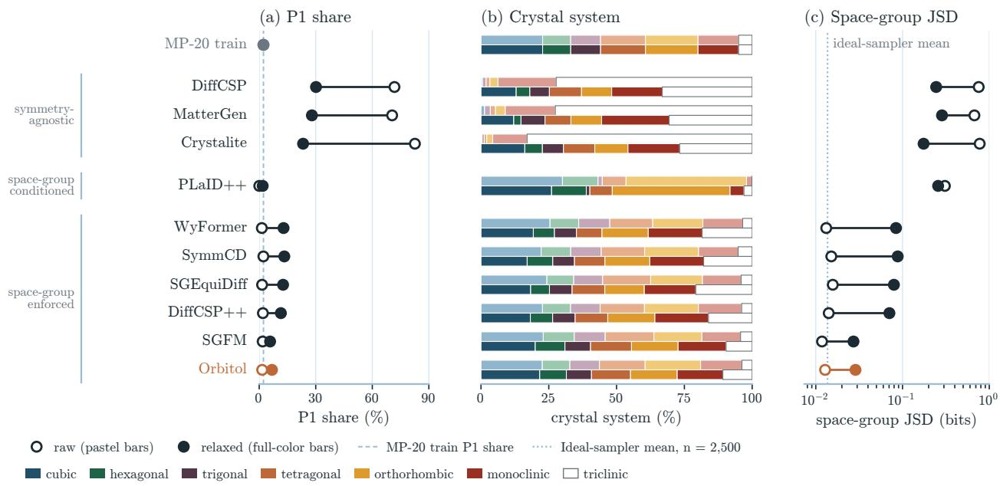  
Figure 9 Raw and relaxed symmetry at the stricter positional detection tolerance of 0.01 Å, with angle tolerance 5◦. Models, samples, relaxation and endpoint exclusions are the same as in Figure 4. Hollow markers and pastel bars show raw structures; filled markers and full-color bars show relaxed structures. Panels report P1 share on a linear axis, crystal-system shares and JSD in bits on a logarithmic axis, using MP-20 train detected at the same tolerance. Reference lines are as in Figure 4, with the JSD ideal-sampler mean at this tolerance (0.0137 bits at 2,500 draws).

Tables 9 and 10 give additional LeMat diagnostics and separate values reported under the authors’ own evaluation settings. The leaderboard includes author-submitted structures, sometimes relaxed before submission, while GEODE uses a diferent relaxation potential and reports metastable unique novel yield excluding SUN; so these reported blocks cannot be compared directly with ours.

## C.5 Coordinate-configuration comparisons

The main MP-20 model uses the sine skip for its shift-equivariant parameterization (Appendix B.5); the comparisons in Table 11 do not establish a general yield advantage. The 400k MP-20 pair has higher observed MSUN with the EDM skip. The Alex pair changes both input and readout and identifies the Orbitol-I chart-input application model, but its higher observed MSUN is not a statistically established benefit of chart input. Neither pair establishes a yield advantage of orbit representation over Crystalite, of P over M at matched training.

Table 8 Symmetry after relaxation for all models on MP-20 and Alex-MP-20. Values are from 2,500 sampled attempts per model; the MP-20 Orbitol-X row is the mean over three sampling seeds, each metric averaged per seed. Retention is the percentage of attempts whose relaxed group equals the requested or declared group. SPARC combines retention of the raw detected group with coverage of the training distribution, on a scale from 0 to 100 (Equation 12). P1 is the percentage of detected relaxed structures in P1; JSD compares their group histogram with the training histogram of the same dataset, in bits. Detection uses symprec = 0.1 Å; failed relaxations and implausible endpoints are excluded from the histograms and count as losses for retention and SPARC. Training P1: MP-20 1.7%, Alex-MP-20 0.7%. Bold marks maximum retention and SPARC and minimum JSD within each dataset. Agnostic models have no requested group. Metric details are in Section 4.2.
<table><tr><td></td><td colspan="4">After relaxation</td></tr><tr><td>Model</td><td>Requested group retained (%)</td><td>SPARC</td><td>P1 (%)</td><td>JSD (bits)</td></tr><tr><td>MP-20</td><td></td><td></td><td></td><td></td></tr><tr><td>Symmetry agnostic</td><td></td><td></td><td></td><td></td></tr><tr><td>Crystaliteª</td><td></td><td>39.0</td><td>21.5</td><td>0.177</td></tr><tr><td>DiffCSPb</td><td></td><td>34.6</td><td>28.3</td><td>0.247</td></tr><tr><td>MatterGenb</td><td></td><td>40.2</td><td>26.4</td><td>0.290</td></tr><tr><td>MiADb</td><td></td><td>1.7</td><td>8.9</td><td>0.099</td></tr><tr><td>Space group conditioned</td><td></td><td></td><td></td><td></td></tr><tr><td>CrystaLLM</td><td> $7 7 . 8 ^ { d }$ </td><td>73.5</td><td>4.7</td><td>0.047</td></tr><tr><td>CrystaLLM-π</td><td> $7 4 . 3 ^ { d }$ </td><td>69.4</td><td>4.6</td><td>0.038</td></tr><tr><td>PLaID++</td><td>81.2d</td><td>39.7</td><td>1.6</td><td>0.257</td></tr><tr><td>Space group enforced</td><td></td><td></td><td></td><td></td></tr><tr><td>CrystalFormer</td><td>62.3</td><td>59.4</td><td>11.1</td><td>0.071</td></tr><tr><td>SGEquiDiff</td><td>54.7</td><td>51.1</td><td>11.0</td><td>0.077</td></tr><tr><td>WyFormer</td><td>51.8</td><td>48.6</td><td>11.2</td><td>0.081</td></tr><tr><td>SymmCD</td><td>57.4</td><td>54.5</td><td>11.1</td><td>0.085</td></tr><tr><td>DiffCSP++</td><td>57.3</td><td>55.1</td><td>9.7</td><td>0.069</td></tr><tr><td>SGFM</td><td>73.4</td><td>71.9</td><td>4.9</td><td>0.027</td></tr><tr><td>Ours (space group enforced)</td><td></td><td></td><td></td><td></td></tr><tr><td>Orbitol-X Alex-MP-20</td><td>74.7</td><td>73.8</td><td>5.6</td><td>0.029</td></tr><tr><td>Symmetry agnostic ALMc</td><td></td><td></td><td></td><td></td></tr><tr><td></td><td></td><td>62.8</td><td>12.3</td><td>0.155</td></tr><tr><td>Ours (space group enforced) Orbitol-X, d = 512, 650k</td><td>71.6</td><td>71.0</td><td>4.4</td><td>0.043</td></tr></table>

Checkpoint, retraining and PLaID++ sampling details are in Table 1. aOur reproduction of the released Crystalite recipe (1.07M steps). bOur draw from the released checkpoint. cUnconditional ALM generation with its Alex-MP-20 decoder. An ideal sampler of the training distribution with 2,500 draws has a JSD of 0.0137 bits on average (5th–95th percentile range 0.0114–0.0160; Figure 4). The Orbitol–SGFM JSD diference is small relative to this finite-sample spread; additional samples would be needed to resolve it. dUses the group declared by the model.

Table 9 LeMat-GenBench metrics on MP-20. Our evaluation is that of Table 1: 2,500 attempts per model, NequIP-OAM-L pre-relaxation, LeMat-GenBench with raw fallback. The leaderboard blocks are its MP-20 view, snapshot of 2026-10-06 [8], grouped by the submission’s pre-relaxation flag; the leaderboard scores the structures that authors submit. The GEODE block is its Table 1 [22]. Scores are comparable only within a block. Values are as served or printed, except MSUN in our and the leaderboard blocks, which includes SUN (for the leaderboard, SUN plus its metastable column). Meta. denotes metastable. Bold marks the best value in each block (lowest $E _ { \mathrm { h u l l } } )$
<table><tr><td>Model</td><td>Valid (%)</td><td>Unique (%)</td><td>Novel (%)</td><td>Stable (%)</td><td>Meta. SUN (%) (%)</td><td>MSUN</td><td>(%) (eV/atom)</td><td> $E _ { \mathrm { h u l l } }$ </td></tr><tr><td>Our evaluation (Table 1)</td><td></td><td></td><td></td><td></td><td></td><td></td><td></td><td></td></tr><tr><td>CrystaLLM</td><td>95.6</td><td>87.2</td><td>21.3</td><td>11.3</td><td>71.1</td><td>1.0</td><td>10.4</td><td>0.052</td></tr><tr><td>CrystaLLM-π</td><td>95.0</td><td>92.4</td><td>31.9</td><td>8.6</td><td>67.1</td><td>1.4</td><td>16.1</td><td>0.066</td></tr><tr><td>PLaID++</td><td>98.8</td><td>78.7</td><td>28.1</td><td>9.0</td><td>71.5</td><td>1.2</td><td>13.3</td><td>0.061</td></tr><tr><td>CrystalFormer</td><td>93.6</td><td>92.5</td><td>51.0</td><td>5.8</td><td>46.6</td><td>0.8</td><td>13.9</td><td>0.153</td></tr><tr><td>SGEquiDiff</td><td>96.0</td><td>95.0</td><td>57.1</td><td>4.7</td><td>47.2</td><td>0.7</td><td>18.1</td><td>0.137</td></tr><tr><td>WyFormer</td><td>91.4</td><td>90.9</td><td>59.1</td><td>3.5</td><td>37.3</td><td>0.4</td><td>14.2</td><td>0.161</td></tr><tr><td>SymmCD</td><td>92.9</td><td>92.0</td><td>58.8</td><td>3.7</td><td>40.6</td><td>0.8</td><td>15.9</td><td>0.173</td></tr><tr><td>DiffCSP++</td><td>95.7</td><td>95.1</td><td>63.6</td><td>3.6</td><td>38.4</td><td>0.6</td><td>16.2</td><td>0.176</td></tr><tr><td>SGFM</td><td>97.1</td><td>95.9</td><td>42.1</td><td>7.4</td><td>58.3</td><td>1.0</td><td>16.9</td><td>0.097</td></tr><tr><td>Orbitol</td><td>96.5</td><td>95.4</td><td>47.3</td><td>6.7</td><td>56.4</td><td>1.1</td><td>19.0</td><td>0.108</td></tr><tr><td>Leaderboard, pre-relaxed submissions</td><td></td><td></td><td></td><td></td><td></td><td></td><td></td><td></td></tr><tr><td>Crystalite</td><td>97.2</td><td>95.8</td><td>53.2</td><td>12.7</td><td>51.6</td><td>1.5</td><td>24.1</td><td>0.090</td></tr><tr><td>MCFlow</td><td>97.2</td><td>96.3</td><td>52.2</td><td>11.9</td><td>49.3</td><td>0.7</td><td>19.6</td><td>0.099</td></tr><tr><td>OMatG</td><td>96.4</td><td>95.2</td><td>51.2</td><td>11.6</td><td>49.8</td><td>1.0</td><td>19.0</td><td>0.096</td></tr><tr><td>MiAD</td><td>96.2</td><td>94.3</td><td>40.2</td><td>6.4</td><td>62.0</td><td>1.0</td><td>17.6</td><td>0.080</td></tr><tr><td>MatterGen</td><td>95.7</td><td>95.1</td><td>70.5</td><td>2.0</td><td>33.4</td><td>0.2</td><td>15.2</td><td>0.183</td></tr><tr><td>OMatG-FC</td><td>97.2</td><td>92.8</td><td>28.9</td><td>18.4</td><td>57.9</td><td>1.7</td><td>13.7</td><td>0.069</td></tr><tr><td>Zatom-1-WD</td><td>88.3</td><td>86.0</td><td>37.9</td><td>4.7</td><td>50.5</td><td>0.3</td><td>9.1</td><td>0.109</td></tr><tr><td>PLaID++</td><td>96.0</td><td>77.8</td><td>24.2</td><td>12.4</td><td>60.7</td><td>1.0</td><td>8.6</td><td>0.085</td></tr><tr><td>WyFormer-DFT</td><td>95.2</td><td>95.0</td><td>66.4</td><td>3.7</td><td>24.8</td><td>0.4</td><td>8.2</td><td>0.271</td></tr><tr><td>WyFormer</td><td>93.4</td><td>93.0</td><td>66.4</td><td>0.5</td><td>15.7</td><td>0.1</td><td>2.0</td><td>0.499</td></tr><tr><td>Leaderboard, submissions without pre-relaxation</td><td></td><td></td><td></td><td></td><td></td><td></td><td></td><td></td></tr><tr><td>Chemeleon2</td><td>95.2</td><td>88.1</td><td>71.6</td><td>0.0</td><td>39.8</td><td>0.0</td><td>21.2</td><td>0.156</td></tr><tr><td>Chemeleon1</td><td>95.4</td><td>94.8</td><td>64.0</td><td>3.6</td><td>34.4</td><td>0.3</td><td>11.6</td><td>0.205</td></tr><tr><td>DiffCSP</td><td>95.7</td><td>94.8</td><td>66.2</td><td>2.3</td><td>29.8</td><td>0.1</td><td>8.6</td><td>0.275</td></tr><tr><td>DiffCSP++</td><td>95.3</td><td>95.1</td><td>62.0</td><td>1.0</td><td>26.4</td><td>0.2</td><td>5.2</td><td>0.409</td></tr><tr><td>CrystaLLM-π</td><td>86.8</td><td>84.9</td><td>24.9</td><td>2.9</td><td>49.0</td><td>0.3</td><td>3.9</td><td>0.321</td></tr><tr><td>SymmCD</td><td>73.4</td><td>73.0</td><td>47.0</td><td>1.4</td><td>18.6</td><td>0.1</td><td>2.5</td><td>0.876</td></tr><tr><td>LLaMat2</td><td>84.4</td><td>81.4</td><td>30.0</td><td>0.7</td><td>34.7</td><td>0.1</td><td>2.2</td><td>0.440</td></tr><tr><td>CrystalFormer</td><td>69.9</td><td>69.4</td><td>31.8</td><td>1.4</td><td>28.8</td><td>0.0</td><td>3.1</td><td>0.704</td></tr><tr><td>ADiT</td><td>90.6</td><td>87.8</td><td>26.0</td><td>0.4</td><td>36.5</td><td>0.0</td><td>1.0</td><td>0.333</td></tr><tr><td>Zatom-1-WD</td><td>67.2</td><td>65.4</td><td>24.2</td><td>0.2</td><td>22.8</td><td>0.0</td><td>0.4</td><td>0.519</td></tr><tr><td>LLaMat3</td><td>15.4</td><td>15.2</td><td>10.5</td><td>0.1</td><td>2.1</td><td>0.0</td><td>0.2</td><td>1.707</td></tr><tr><td>Crystal-GFN</td><td>51.7</td><td>51.7</td><td>51.7</td><td>0.0</td><td>0.0</td><td>0.0</td><td>0.0</td><td>2.086</td></tr><tr><td>Reported by GEODEa</td><td></td><td></td><td></td><td></td><td></td><td></td><td></td><td></td></tr><tr><td>GEODE</td><td>95.8</td><td>94.9</td><td>55.8</td><td></td><td>41.9</td><td></td><td>11.9</td><td>0.196</td></tr><tr><td>GEODE*</td><td>95.6</td><td>94.9</td><td>54.3</td><td></td><td>43.7</td><td></td><td>16.4</td><td>0.135</td></tr><tr><td>GEODE, filtered templates*</td><td>96.4</td><td>95.3</td><td>74.0</td><td></td><td>38.8</td><td></td><td>23.8</td><td>0.162</td></tr></table>

For the six symmetry-aware models in our evaluation and on the leaderboard, our evaluation gives measured MSUN rates 4.7–13.4 percentage points higher. Some leaderboard scores in the snapshot were computed before the benchmark’s MACE checkpoint fix. aGEODE Table 1 (arXiv v1); ∗structures relaxed with EquiformerV3 before scoring. Its MSUN column excludes SUN, which it does not print; GEODE states that every row has a SUN rate of at most 2.12%.

Table 10 LeMat-GenBench metrics on Alex-MP-20, as in Table 9. The GEODE blocks are its Table 1 [22]; its Alex-MP-20 baselines are copies of the LeMat-GenBench leaderboard. LeMat-Bulk contains Alexandria, so novelty is measured against a reference that overlaps the training source. Scores are comparable only within a block.
<table><tr><td>Model</td><td>Valid (%)</td><td>Unique (%)</td><td>Novel (%)</td><td>Stable (%)</td><td>Meta. (%)</td><td>SUN (%)</td><td>MSUN (%)</td><td> $E _ { \mathrm { h u l l } }$  (eV/atom)</td></tr><tr><td>Our evaluation (Table 7) Orbitol</td><td>93.9</td><td>93.9</td><td>60.7</td><td>2.0</td><td>59.4</td><td>0.7</td><td>34.2</td><td>0.101</td></tr><tr><td>Reported by GEODEa</td><td></td><td></td><td></td><td></td><td></td><td></td><td></td><td></td></tr><tr><td>GEODE</td><td>95.0</td><td>94.9</td><td>54.1</td><td></td><td>57.7</td><td></td><td>25.8</td><td>0.102</td></tr><tr><td>GEODE*</td><td>95.0</td><td>94.9</td><td>52.5</td><td></td><td>61.8</td><td></td><td>29.2</td><td>0.084</td></tr><tr><td>GEODE, filtered templates*</td><td>94.8</td><td>94.6</td><td>64.2</td><td></td><td>61.7</td><td></td><td>36.8</td><td>0.086</td></tr><tr><td colspan="9">Leaderboard as copied by GEODEª, without pre-relaxation</td></tr><tr><td>Chemeleon 2</td><td>97.4</td><td>93.5</td><td>93.7</td><td></td><td>67.4</td><td></td><td>62.4</td><td>0.096</td></tr><tr><td>Chemeleon 1</td><td>94.0</td><td>93.9</td><td>59.8</td><td></td><td>54.4</td><td></td><td>28.0</td><td>0.112</td></tr><tr><td>CrystaLLM-π</td><td>93.4</td><td>93.2</td><td>23.9</td><td></td><td>71.3</td><td></td><td>12.5</td><td>0.094</td></tr></table>

aGEODE Table 1 (arXiv v1); ∗structures relaxed with EquiformerV3 before scoring. Its MSUN column excludes SUN, which it does not print; GEODE states that every row has a SUN rate of at most 2.12%.

Table 11 Coordinate configurations under our common evaluation: 2,500 attempts, 500 unconstrained NequIP-OAM-L FIRE steps, and LeMat-GenBench scoring with raw fallback (Appendix C.2). The MP-20 pair shares target P and changes the coordinate skip; all four rows use distance GEM. The datasets form separate comparisons. SUN and MSUN are percentages of all attempts, and MSUN includes SUN. Each result is one trained model and one sampling seed; matching training updates does not control random variation.
<table><tr><td>Model</td><td>Coordinate configuration</td><td>Training updates</td><td>SUN (%)</td><td>MSUN (%)</td></tr><tr><td colspan="5">MP-20, coordinate skip; type weight 1</td></tr><tr><td>Orbitol-X</td><td>Representative / projection, P, sine skip</td><td>400k</td><td>1.24</td><td>17.1</td></tr><tr><td>Orbitol-X</td><td>Representative / projection, P, EDM skip</td><td>400k</td><td>1.16</td><td>18.9</td></tr><tr><td colspan="5">Alex-MP-20, input and readout; type weight 0.5</td></tr><tr><td>Orbitol-X</td><td>Representative / projection, P, sine skip</td><td>650k</td><td>0.68</td><td>34.2</td></tr><tr><td>Orbitol-I</td><td>Chart / direct, P, sine skip</td><td>650k</td><td>0.72</td><td>36.6</td></tr></table>

All models have width 512 and use EMA weights. MP-20 checkpoints are from 500k-update schedules; Alex checkpoints are from 1M-update schedules. All four use the 150-step sampler (Table 5 and Appendix C.6). The MP-20 pair difers from the main 1.5M-update model, whose type weight is 0.25.

## C.6 Sampler settings and sensitivity

Table 4 gives the samplers of the two benchmark models. The MP-20 400k controls and the Alex-MP-20 Orbitol-I variant use the Alex-MP-20 sampler.

Table 12 varies the sampler of the main MP-20 checkpoint, holding the model fixed. Each setting draws 10,000 attempts and relaxes every constructed structure with NequIP-OAM-L for 500 FIRE steps; the in-house evaluator uses an MP2020-like MP-20 reference hull and novelty against MP-20 train. MSUN is over all attempts, with failures counting as zero, and is on a diferent scale from the LeMat results.

The 25-step and 150-step settings have similar observed yield in this screen. Raising $\sigma _ { \mathrm { m i n } }$ from 0.002 to 0.01 at 25 steps improves one-shot MSUN and lowers the median initial force, while raising it to 0.05 reduces both one-shot and relaxed MSUN. Ten steps reduce observed MSUN, and 50 steps ofer little change from 25; these observations support the chosen setting without establishing statistical equivalence between samplers.

## C.7 Sampling throughput and implementation

Timing setup. All times were measured after warm-up on one NVIDIA RTX 6000 Ada (48 GB) with 8 CPU cores. Baselines used released samplers with the settings and precision of their quality evaluations in Tables 1 and 7, except PLaID++: quality uses its released output pool, while timing uses the authors’ 4-bit recipe. We tuned batch sizes and removed sample-preserving overheads (batched SGFM, MatterGen without trajectory recording and CrystalFormer with exact draws per space group), but did not compile baseline networks or reduce their step counts. Orbitol uses the sampler settings above, with packing, compilation and the fast decoder described below.

Timing runs from the prior draw to pymatgen structures in memory, with CUDA synchronized at both ends, per 1,000 attempts including failures. Model loading, compilation, file writes and relaxation are excluded. Starting at the batch size of each quality evaluation, we doubled the batch until memory ran out, a batch exceeded 10 minutes, or two doublings failed to improve the best time by 5%; Table 13 reports the fastest measured batch. For difusion and flow models, warm network windows predicted full times and were checked against complete reference batches; models with errors above 5% were timed on complete batches at every size, as was SymmCD because of its non-network overhead. Autoregressive models used complete generations, and Orbitol used two complete pools of 4,096 attempts per setting because its per-attempt decoding overhead falls with pool size. Calibration checks before and after each model excluded one node with CPU contention. Each baseline value is one measurement; each Orbitol value is the mean of two pools. The timings combine sampler choices with the implementation below. They do not isolate the contribution of each component.

Short sequences and packing. Orbitol uses one token per orbit and one lattice token. MP-20 structures have 4.70 orbits on average against 10.4 atoms in their stored cells, roughly halving the token count and quartering the attention pairs. Packing avoids padding every crystal to 21 positions. The sampler groups whole crystals in request order into fixed chunks of T = 8,192 tokens at width 512, with about 1,430 MP-20 crystals per chunk. FlexAttention’s document mask isolates crystals, and GEM bias is indexed by crystal, head and token pair. Layouts and masks are reused across all network evaluations; unused tokens attend only to themselves, while integration states and noise draws retain padded shapes (Appendix B.7). Packing needs large pools: with 256 attempts, the 25-step sampler takes 3.4 s per 1,000.

Compilation. At width 512, torch.compile in reduce-overhead mode captures the fixed-shape transformer trunk as a CUDA graph reused across chunks. Embeddings, GEM geometry and output heads remain outside the compiled trunk. The network uses bfloat16, while integration states, chart arithmetic and GEM geometry use single precision. Compilation and graph capture take about 17 s per process and are excluded from the timings.

Table 12 Sampler sweep on the MP-20 Orbitol-X model of Table 1 (in-house evaluation: 10,000 samples per setting, every one relaxed with NequIP-OAM-L for 500 FIRE steps, MSUN and UN over all attempts against the MP-20 hull and training set). γ is the churn per step, min $( S _ { \mathrm { c h u r n } } / N , \sqrt { 2 } - 1 )$ ; churn acts for noise levels above $S _ { \mathrm { m i n } }$ ; Heun with N steps uses 2N − 1 network evaluations. One-shot MSUN scores the raw samples; $F _ { 0 }$ is the median initial maximum force $\mathrm { ( e V / \AA ) }$ . $S _ { \mathrm { n o i s e } } = 1 . 0 0 3$ throughout.
<table><tr><td></td><td> $\sigma _ { \mathrm { m a x } }$ </td><td> $\sigma _ { \mathrm { m i n } }$ </td><td>N</td><td>γ</td><td> $S _ { \mathrm { m i n } }$ </td><td>ρ</td><td>MSUN (%)</td><td>UN (%)</td><td>One-shot (%)</td><td></td></tr><tr><td colspan="9">Noise range and steps</td><td></td><td></td></tr><tr><td>checkpointª</td><td>800.002</td><td></td><td>150</td><td>0.4</td><td></td><td>0 7</td><td>44.3</td><td>74.5</td><td>30.8</td><td>0.52</td></tr><tr><td></td><td>3</td><td>0.002</td><td>150</td><td>0.4</td><td></td><td>0 7</td><td>43.7</td><td>73.2</td><td>30.5</td><td>0.51</td></tr><tr><td></td><td>3</td><td>0.002</td><td>25</td><td>0.4</td><td></td><td>0 7</td><td>44.3</td><td>77.1</td><td>30.2</td><td>0.54</td></tr><tr><td colspan="9">Endpoint noise at 25 steps</td><td></td><td></td></tr><tr><td>chosenª</td><td>3</td><td>0.01</td><td>25</td><td>0.4</td><td>0 7</td><td></td><td>44.7</td><td>76.5</td><td>31.6</td><td>0.44</td></tr><tr><td></td><td>3</td><td>0.05</td><td>25</td><td>0.4</td><td>0 7</td><td></td><td>43.4</td><td>77.2</td><td>26.9</td><td>0.69</td></tr><tr><td colspan="9">Steps at the chosen noise range</td><td></td></tr><tr><td></td><td>3</td><td>0.01</td><td>10</td><td>0.4</td><td>0 7</td><td></td><td>43.1</td><td>78.5</td><td>29.9</td><td>0.48</td></tr><tr><td></td><td>3</td><td>0.01</td><td>15</td><td>0.4</td><td>0 7</td><td></td><td>44.2</td><td>78.2</td><td>30.9</td><td>0.46</td></tr><tr><td></td><td>3</td><td>0.01</td><td>50</td><td>0.4</td><td></td><td>0 7</td><td>44.9</td><td>75.6</td><td>31.9</td><td>0.43</td></tr></table>

aMean of three sampling seeds; all other rows use one seed. The checkpoint row uses its stored sampler; the chosen row is used for the MP-20 Orbitol-X rows of the main tables.

Decoding. The fast decoder caches Wyckof tables, expands orbit members in one array operation, and compiles collision and symmetry-containment checks with Numba. Niggli and LLL reduction follow pymatgen’s arithmetic, with fallback to the reference decoder for uncertified reductions or structures near numerical boundaries. On 30,000 stored outputs and four live runs of 10,000 attempts, atom types, masks and lattices agreed bitwise with the reference decoder used for the scored pools, and fractional coordinates agreed within $1 0 ^ { - 7 }$ . The fast path benefits batches; its fixed cost makes it slower for a single structure.

Step count and numerical equivalence. The 5.40 to 1.09 s comparison changes the checkpoint and noise settings as well as step count, so it does not isolate a step-count speedup; the 150-step configuration is stil about 60 times faster than SGEquiDif. Complete-pool timing includes prior draws, decoding and structure construction, whose per-attempt overhead depends on pool size. Packing and compilation compute the same quantities with diferent kernels and operation order, so floating-point diferences can grow through bfloat16 sampling trajectories until individual decoded structures difer. Decoder agreement on fixed sampled states therefore does not imply bitwise agreement between sampling trajectories. The MP-20 pools of Table 1 were sampled with the same packed, compiled sampler; only their decoder difers.

Table 13 Sampling cost on one RTX 6000 Ada, per 1,000 attempts at each model’s batch size with the highest measured throughput. NFE is the number of network evaluations per structure (token positions for autoregressive models). Speedup is the time of the model divided by Orbitol’s 1.09 s, computed from unrounded times (for ALM, see note b).
<table><tr><td>Model</td><td>Batch</td><td>s per 1,000</td><td>Structures/ /s</td><td>NFE</td><td>Speedup</td></tr><tr><td>Symmetry agnostic</td><td></td><td></td><td></td><td></td><td></td></tr><tr><td>Crystalite</td><td>512</td><td>13.8</td><td>72</td><td>299</td><td>13</td></tr><tr><td>DiffCSP</td><td>100</td><td>260</td><td>3.8</td><td>2,000</td><td>240</td></tr><tr><td>MiAD</td><td>64</td><td>1,218</td><td>0.82</td><td>2,000</td><td>1,123</td></tr><tr><td>MatterGenª</td><td>64</td><td>5,044</td><td>0.20</td><td>2,000</td><td>4,647</td></tr><tr><td>ALMb</td><td>16</td><td>8,377</td><td>0.12</td><td>2,000</td><td>1,482</td></tr><tr><td>Space-group conditioned</td><td></td><td></td><td></td><td></td><td></td></tr><tr><td>CrystaLLMc</td><td>1</td><td>1,603</td><td>0.62</td><td>380</td><td>1,477</td></tr><tr><td>CrystaLLM-π</td><td>160</td><td>104</td><td>9.6</td><td>409</td><td>96</td></tr><tr><td> $\mathrm { P L a I D + } + ^ { d }$ </td><td>1,024</td><td>156</td><td>6.4</td><td>134</td><td>143</td></tr><tr><td>Space-group enforced</td><td></td><td></td><td></td><td></td><td></td></tr><tr><td>CrystalFormere</td><td>128</td><td>215</td><td>4.7</td><td>105</td><td>198</td></tr><tr><td>SGEquiDiff</td><td>2,000</td><td>338</td><td>3.0</td><td>1,998</td><td>312</td></tr><tr><td>WyFormerf</td><td>256</td><td>1,021</td><td>0.98</td><td>1,998</td><td>941</td></tr><tr><td> ${ \mathrm { S y m m C D } } ^ { k }$ </td><td>1,000</td><td>195</td><td>5.1</td><td>2,000</td><td>180</td></tr><tr><td>DiffCSP++</td><td>500</td><td>987</td><td>1.0</td><td>1,998</td><td>909</td></tr><tr><td>SGFM, batchedª</td><td>512</td><td>371</td><td>2.7</td><td>500</td><td>341</td></tr><tr><td>SGFM, released</td><td>1</td><td>2,545</td><td>0.39</td><td>500</td><td>2,345</td></tr><tr><td>Ours</td><td></td><td></td><td></td><td></td><td></td></tr><tr><td>Orbitolh</td><td>4,096</td><td>1.09</td><td>921</td><td>49</td><td>1</td></tr><tr><td>Orbitol, reference decoderi</td><td>4,096</td><td>2.37</td><td>420</td><td>49</td><td>2.2</td></tr><tr><td>Orbitol, 150 steps³</td><td>4,096</td><td>5.40</td><td>185</td><td>299</td><td>5.0</td></tr></table>

aTrajectory recording turned of. bAlex-MP-20 model; 2,000 evaluations on a batch doubled by classifier-free guidance. The speedup is relative to Orbitol’s Alex-MP-20 model of width 512 with the 150-step sampler (5.7 s), which we did not re-time with the 25-step sampler. cThe released sampler generates one structure at a time without a key-value cache. dThe authors’ recipe: 4-bit weights with bfloat16 compute, FlashAttention-2 and batch 1,024. Table 1 uses the authors’ released pool, which has no generation run to time. eFloat64 as released; exact draws per space group of the sampling plan. JAX compiles once per space group and batch shape (about 17 s each), which is excluded. fWyckof genes sampled on the CPU, then DifCSP++ geometry; both stages are timed. gOur batched reimplementation of the released sampling loop, checked against it. hThe Orbitol-X model of Table 1, with the 25-step sampler of Appendix C.6; packed, compiled, bfloat16, fast decoder; mean of two complete pools. iThe reference decoder, which decoded the scored pools; both decoders produce the same structures (fractional coordinates agree within 10−7). jThe 150-step sampler of Appendix C.6 on the 400k-step checkpoint of the same architecture. kComplete batches; the window prediction at the same batch agrees within 0.2%.

## D Piezoelectric screening and DFT validation

Selection. The 62 structures were generated by Orbitol models trained on the Alex-MP-20 and MP-20 datasets and selected for a high predicted figure of merit. Four of them had PBE band gaps of at most 0.03 eV and were excluded from the response calculations.

Settings. All calculations used VASP 6.4.2 [46] with the PBE functional [47], projector augmented-wave potentials (the PBE\_54 set) [48, 49], a plane-wave cutof of 520 eV, aspherical gradient corrections inside the augmentation spheres and Gaussian smearing of 0.05 eV. We applied the Hubbard U values of the Materials Project wherever it uses them (12 materials). The eight Mn-, Fe- and Co-containing materials were computed spin-polarized with ferromagnetic initial moments, as were the band-gap checks of the four structures excluded as metals; other magnetic orders were not considered. Γ-centred or Monkhorst–Pack k-point meshes with a density of 100 points per $\mathrm { \AA ^ { - 3 } }$ of reciprocal volume were generated with pymatgen [50], and each material used the same mesh in all calculations. Cell shape, volume and atomic positions were relaxed until all forces fell below 0.005 $\mathrm { e V / \AA }$ , with an electronic convergence criterion of $1 0 ^ { - 6 }$ eV $( 1 0 ^ { - 7 }$ eV for seven materials).

The relaxations started from the symmetrized generated structures without perturbation and kept their symmetry, which VASP imposes by default (positional tolerance $1 0 ^ { - 5 } ~ \mathrm { \AA } )$ , so they cannot lower the space group. Symmetry-lowering distortions are tested instead by the Γ-point phonons of the DFPT runs, which contain modes of every symmetry. For 15 of the 58 candidates we also repeated the relaxation without symmetry from atoms displaced randomly by $0 . 0 2 \mathrm { ~ \AA } ;$ all 15 returned to their space group, with energy diferences of at most 0.04 meV/atom. One candidate had a single unstable Γ mode in its DFT-relaxed $C m c 2 _ { 1 }$ structure $( 4 0 i ~ \mathrm { c m } ^ { - 1 } )$ , with atomic displacements perpendicular to the polar axis that remove the mirror planes. We displaced the atoms along this mode (largest displacement 0.05 Å) in the same 18-atom cell and relaxed cell and atoms again with the same settings. The structure relaxed into $P 2 _ { 1 } , 0 . 4 2$ meV/atom below $C m c 2 _ { 1 }$ (largest atomic shift 0.18 Å), with no unstable Γ mode and a positive-definite but soft elastic tensor (smallest eigenvalue $0 . 7 2 \ \mathrm { G P a } )$ . The dielectric and piezoelectric tensors and the Born efective charges were computed with DFPT [51], except for two candidates, for which we used finite diferences with atomic displacements of 0.015 Å. The elastic tensor was obtained from the stress response to finite lattice distortions, including the relaxation of the ions, again with atomic displacements of 0.015 Å and an electronic convergence criterion of $1 0 ^ { - 7 } ~ \mathrm { e V }$ . All tensors refer to the same relaxed structure. We detected the space group of the relaxed structures with spglib at a positional tolerance of $1 0 ^ { - 3 } \mathrm { ~ \AA ~ }$ , which gave the same groups as $1 0 ^ { - 2 } \mathrm { ~ \AA ~ }$

Stability. A candidate is stable at Γ if the Γ-point phonons of its DFPT run have no imaginary optical mode. One candidate fails with $1 8 . 8 i ~ \mathrm { c m } ^ { - 1 }$ , and another with a polar mode at zero frequency within numerical accuracy $( 6 . 5 i ~ \mathrm { c m } ^ { - 1 }$ in $\mathrm { D F P T } , 9 i ~ \mathrm { c m } ^ { - 1 }$ from finite diferences), which makes its response values unreliable. It is mechanically stable if its elastic tensor is positive definite; two candidates fail, one of which also fails at $\Gamma ,$ so their piezoelectric strain coeficients are undefined. This test at Γ does not establish dynamical stability over the Brillouin zone. The two largest figures of merit, 308 and 109 (in $1 0 ^ { - 1 2 } \ \mathrm { m ^ { 2 } N ^ { - 1 } } )$ , belong to structures near an elastic instabili $\mathrm { \Delta [ y , }$ with smallest eigenvalues of the elastic tensor of 0.72 and 1.25 GPa; a nearly singular elastic tensor inflates $d = e C ^ { - 1 }$

Figure of merit. We computed $d = e C ^ { - 1 }$ from the piezoelectric stress tensor $e$ and the relaxed-ion elastic tensor $C ,$ , with engineering shear strains. The figure of merit is

$$
d _ { 3 1 } g _ { 3 1 } = \operatorname* { m a x } _ { p , \ u \perp p } \frac { d _ { p u u } ^ { 2 } } { \varepsilon _ { 0 } p ^ { \top } \varepsilon ^ { T } p } ,\tag{25}
$$

over unit vectors $p$ (the polarization and electrode normal) and u (the in-plane strain axis), where $\varepsilon ^ { T } =$ $\varepsilon ^ { S } + d e ^ { \top } / \varepsilon _ { 0 }$ is the permittivity at fixed stress, as in the conventional voltage coeficient $^ { g , }$ and $\varepsilon ^ { S }$ is the static DFPT permittivity at fixed strain. The figure of merit is the transverse open-circuit response of a thin plate with electrodes normal to $p$ under uniaxial stress along $u \perp p ,$ all other stress components being zero: the electrodes allow only a field along $p ,$ and $D \cdot p = 0$ then gives $g _ { p u u } = d _ { p u u } / ( \varepsilon _ { 0 } p ^ { \top } \varepsilon ^ { T } p )$ , so $d _ { p u u } g _ { p u u } = d _ { p u u } ^ { 2 } / ( \varepsilon _ { 0 } p ^ { \top } \varepsilon ^ { T } p )$ , which we maximize over $p$ and u. Fringing fields are neglected. The maximum removes the dependence on the standard IEEE orientation, which places z along the shortest lattice vector of an orthorhombic cell rather than along its polar axis and can give $d _ { 3 1 } = 0$ for polar mm2 materials. With $\varepsilon ^ { S }$ in place of $\varepsilon ^ { T }$ , all values are higher and the same 13 candidates exceed the corresponding MP 90th percentile (3.70), but the implied coupling factor of the cut, $k ^ { 2 } = d _ { 3 1 } g _ { 3 1 } / s _ { u u u }$ with the compliance $s = C ^ { - 1 }$ , exceeds one for these two candidates (8.2 and 1.3), which is impossible for a stable crystal; with $\varepsilon ^ { T }$ it stays below one for all 56 mechanically stable candidates (at most 0.88). DFPT gives intrinsic single-crystal responses at $0 ~ \mathrm { K } .$ without the extrinsic contributions of poled ceramics, so we compare only with other DFT values.

Materials Project reference. We used the MP release of 2026-09-28: 704 materials with piezoelectric, dielectric and elastic tensors [30–32], all with a positive-definite elastic tensor, and evaluated Equation 25 on their tensors. We kept the 702 with a non-zero piezoelectric tensor $\begin{array} { r } { ( \operatorname* { m a x } _ { i j } | e _ { i j } | \geq 1 0 ^ { - 1 0 } \mathrm { ~ C ~ m } ^ { - 2 } ) } \end{array}$ ; the two that drop out belong to class 432. $\mathrm { M P s }$ tensors come from its own workflows, so the comparison is between two DFT data sets with similar but not identical settings. With all 704 materials the 90th percentile is 3.08 and the count above it is unchanged.

Energy above the hull. For each candidate we recomputed every competing MP and Alexandria PBE phase with the settings above and applied the MP2020 corrections [52]. The hull excludes Alexandria phases with O–O or N–N distances below 1.6 Å, which the per-anion correction makes too stable; including them lowers the hull and raises five hull energies by 2–17 meV/atom. Hull energies of the ferromagnetic Mn, Fe and Co compounds are upper bounds. We did not compute hull energies for the two mechanically unstable candidates.

Novelty. We compared each candidate with every MP and Alexandria PBE entry of the same reduced formula using pymatgen’s StructureMatcher, at its default tolerances (fractional length 0.2, site 0.3, angle 5◦, volume scaled). We count a match as the same structure only if the space groups agree and a strict match (length 0.05, site 0.1, angle 2◦) holds. Of the 55, six have an identical structure in Alexandria. Three match an entry only in a diferent space group (R3 against Fm¯3m and C2/m, polar Fmm2 against centrosymmetric I4/mmm, and P3 against P1). The other 46 match no entry even at the default matcher tolerances.