# PARALLELIZABLE PROBABILISTIC LATENT REASONING FOR DIVERSE REASONING TRAJECTORIES

Seokhyun Lee Korea University nshuhsn@korea.ac.kr

Seongjun Lee Korea University pyoung7307@korea.ac.kr

Changhee Lee∗ Korea University changheelee@korea.ac.kr

## ABSTRACT

Language models relying on verbalized Chain-of-Thought (CoT) are constrained to token-by-token generation in the language space, where many tokens serve textual coherence rather than core reasoning. This entangles genuine differences in logical trajectories with superficial variations in verbalization. Moving reasoning into a compact, continuous latent space offers a promising alternative for efficiently representing and exploring diverse reasoning trajectories. However, current latent models remain largely deterministic, capturing only a single reasoning trajectory rather than modeling a distribution over multiple valid alternatives. While stochastic approaches parameterize distributions over latent reasoning steps, they frequently suffer from unstable optimization and limited empirical performance. Furthermore, their reliance on autoregressive latent prediction during training precludes effective parallelization, leading to prohibitively long training times. To overcome these bottlenecks, we propose Probabilistic Latent Reasoning Models (PLRM), a parallelizable variational framework for probabilistic latent reasoning. PLRM adopts a JEPA-style learning framework in which the posterior infers latent distributions in parallel from observed reasoning trajectories, while the prior learns to predict the subsequent latent distribution via teacher forcing. To model heterogeneous reasoning processes, we introduce a discrete strategy variable together with a mixture-based prior, allowing the model to preserve the Gaussian-mixture structure induced by multiple distinct reasoning trajectories rather than collapsing them into a single Gaussian. Across diverse benchmarks, PLRM achieves performance competitive with deterministic latent reasoning models on single-trajectory datasets while enabling efficient training and consistently outperforming competing stochastic baselines on multi-trajectory datasets. Codes are available here.

## 1 INTRODUCTION

Autoregressive language models have developed strong reasoning capabilities by learning to generate chain-of-thought (CoT) traces in natural language (Wei et al., 2022; Chung et al., 2024). This success has established language as the dominant interface for both supervising and executing intermediate reasoning. A key advantage is that next-token prediction exposes reasoning as an explicit generative trajectory, enabling the exploration of multiple hypotheses and solution paths for tasks such as mathematical proof search and scientific hypothesis generation (Wang et al., 2022; Yao et al., 2023; Trinh et al., 2024; Gottweis et al., 2026). It also enables reinforcement learning by optimizing generated reasoning trajectories from reward feedback (Ouyang et al., 2022).

However, despite its favorable training properties and strong empirical performance, language is not necessarily an efficient substrate for reasoning. Many tokens primarily serve linguistic coherence rather than core reasoning, yet current Large Language Models (LLMs) devote comparable computation to both reasoning-critical and purely linguistic tokens (Hao et al., 2024). This is not only introduces substantial computational overhead, but also entangles genuine differences in reasoning logic with superficial variations in how the same reasoning process is verbalized (Kuhn et al., 2023). Moreover, each reasoning step in language space is restricted to a discrete choice from a vocabulary of size v, limiting each sampled token to at most $\log _ { 2 } ( v )$ bits of information (Gozeten et al., 2026).

These limitations raise a fundamental question: in what representational space should reasoning unfold? Latent reasoning models address this question by replacing language tokens with continuous representations. Coconut (Hao et al., 2024) uses curriculum learning to progressively replace CoT tokens with continuous latent representations, while CODI (Shen et al., 2025) and Sim-CoT (Wei et al., 2026) employ self-distillation and language reconstruction to stabilize the transition to latent reason ing. These approaches achieve competitive performance with CoT supervised fine-tuning (CoT-SFT) methods while requiring substantially fewer reasoning steps. However, this transition from language to latent space sacrifices several desirable properties of $\mathrm { { \dot { \mathbf { S } } \bar { F T } } . }$ . Most notably, existing latent reasoning models largely rely on deterministic latent transitions, reducing diverse reasoning paths to a single trajectory and thereby limiting their ability to model reasoning as a distribution over trajectories.

In this work, we introduce PLRM, a variational framework for probabilistic latent reasoning that moves reasoning from language to continuous latent space while preserving the key properties that make CoT-SFT effective. Rather than merely replacing tokens with latent representations, PLRM adopts a JEPA-style predictive objective: a posterior constructs target latent distributions from ver bal CoT traces, while a problem-conditioned prior learns to predict them. By jointly optimizing both end-to-end, PLRM encourages the latent representations to retain core reasoning information while discarding incidental variation in verbalization. We further show that multiple valid reasoning trajectories for the same problem can induce a multimodal target distribution, and introduce a mixture-based prior to model this multimodality without collapsing it into a single Gaussian.

Experimentally, PLRM performs strongly across mathematical and commonsense reasoning tasks, substantially outperforming existing stochastic latent reasoning models while remaining competitive with deterministic latent reasoning methods under more efficient training. Performance is particularly strong on GSM8K-Aug-NL (Deng et al., 2023) and CommonsenseQA (Talmor et al., 2019), where many CoT tokens serve verbalization rather than core reasoning, consistently capturing core reasoning information in latent representations. To evaluate distributional modeling under diverse reasoning trajectories, we further construct the HiddenBranch dataset from ProofWriter (Tafjord et al., 2021), where each problem admits multiple reasoning paths and answers. On this dataset, PLRM substantially outperforms CoT-SFT and all stochastic latent reasoning baselines, demonstrating its ability to effectively model distributions over diverse reasoning trajectories.

## 2 DESIDERATA FOR LATENT REASONING

In this section, we first identify the desirable properties of conventional supervised fine-tuning, then examine how latent reasoning changes this paradigm, highlighting both the benefits it introduces and the properties it may sacrifice.

## 2.1 PROPERTIES FROM CONVENTIONAL SUPERVISED FINE-TUNING

Consider a language model that receives a problem x, generates a verbalized reasoning trace (CoT) $\tau = ( \tau _ { 1 } , \cdots , \tau _ { T } )$ , and then predicts the final answer $y .$ Conventional supervised fine-tuning can be viewed as learning the following joint distribution:

$$
p ( y , \pmb { \tau } \mid x ) = p ( y \mid \pmb { \tau } , x ) \cdot p ( \pmb { \tau } \mid x )\tag{1}
$$

This formulation provides three desirable properties. First, next-token prediction is inherently stochastic, allowing the model to represent uncertainty and explore multiple reasoning trajectories through sampling. This breadth-wise exploration is essential for discovering diverse solutions (Wang et al., 2022) and also underlies the basis for reinforcement-learning-based optimization, where trajectories are sampled and optimized according to their rewards (Ouyang et al., 2022). Second, every observed reasoning token serves as a prediction target, providing dense, fine-grained supervision throughout the reasoning trajectory (Bengio et al., 2003). Finally, teacher forcing on the ground-truth trajectory enables parallel training, a property that has been fundamental to the efficient scaling of modern language models (Vaswani et al., 2017).

## 2.2 SHIFTING REASONING FROM LANGUAGE SPACE TO LATENT SPACE

To improve the inefficiency of language-space reasoning, latent reasoning models replace verbalized reasoning steps with a sequence of continuous latent variables (Hao et al., 2024). Concretely, conventional language-space reasoning computes a vocabulary distribution from the final-layer hidden representation $h _ { t }$ and samples the next reasoning token: $h _ { t } =$ Transformer(x, τ<t), p(τt | $x , \tau _ { < t } \bar { ) } = \mathrm { S o f t m a x } ( W _ { \mathrm { o u t } } h _ { t } )$ , where $W _ { \mathrm { o u t } }$ denotes the output head of a language model. Latent reasoning instead maps the hidden representation directly to a continuous latent variable through a learned projection, $z _ { k } = g _ { \psi } ( h _ { k } )$ , and uses the resulting latent variable as an intermediate reasoning step. Repeating this process provides a latent reasoning trajectory ${ \bf z } = ( z _ { 1 } , \dots , z _ { K } )$ that replaces the verbalized reasoning trace τ, leading to the generic factorization $p ( y , \mathbf { z } \mid x ) = p ( y \mid \mathbf { z } , x ) p ( \mathbf { z } \mid x )$

Deterministic Latent Reasoning and Its Pitfalls. While latent reasoning removes intermediate verbalization, the three desirable properties above are no longer preserved by construction. A deterministic projection produces a single latent trajectory, foregoing probabilistic modeling of alternative reasoning paths and limiting the latent space’s ability to represent diverse underlying reasoning processes. Moreover, the absence of target latent variables prevents dense supervision and teacher forcing, heavily bottlenecking the training process with sequential rollouts (Hao et al., 2024; Shen et al., 2025). SIM-CoT (Wei et al., 2026) partially addresses the supervision gap by reconstructing τ from each latent step, but the underlying latent trajectories remain deterministic and still require slow, sequential execution during training.

Potential and Challenges of Stochastic Latent Reasoning. Unlike deterministic latent reasoning, stochastic modeling can better exploit the latent space to represent a distribution over alternative reasoning trajectories, distinguishing genuine differences in reasoning logic from superficial variations in verbalization. This enables breadth-wise exploration directly in the core reasoning space and provides a stochastic foundation for reinforcement learning over latent reasoning trajectories. A straightforward approach is to predict Gaussian parameters from the hidden representation and sample each latent variable as

$$
\begin{array} { r } { ( \mu _ { k } , \sigma _ { k } ) = g _ { \psi } ( h _ { k } ) , \qquad z _ { k } \sim \mathcal { N } ( \mu _ { k } , \sigma _ { k } ^ { 2 } ) . } \end{array}\tag{2}
$$

However, introducing stochasticity alone does not determine what a meaningful latent reasoning distribution should represent. A useful target distribution should retain answer-relevant reasoning information while excluding incidental information that cannot be inferred from x. Existing methods typically impose guidance through heuristically constructed or externally derived targets: Co-LaR (Tan et al., 2026) uses scaled sums of CoT token embeddings, while ReGuLaR (Wang et al., 2026) derives Gaussian priors from rendered CoT representations using a frozen visual encoder and a trainable adapter. Such targets are not explicitly learned to preserve answer-relevant core reasoning information while remaining predictable from x, and some approaches still require sequential latent rollout. Thus, the key challenge is not merely to make latent reasoning stochastic, but to learn a meaningful and predictable distribution over reasoning trajectories.

## 3 PROBABILISTIC LATENT REASONING MODELS

Motivated by above, we introduce Probabilistic Latent Reasoning Models (PLRM), a variational framework that jointly learns target latent distributions and a problem-conditioned prior to predict them. We first develop a variational formulation that preserves the three desirable properties of conventional supervised fine-tuning. We then show that this formulation naturally takes the form of a JEPA-style learning framework, in which target latent distributions capture core reasoning information while abstracting away incidental variations in verbalization. Finally, we extend the framework to settings with multiple heterogeneous reasoning strategies by introducing an explicit strategy variable and a mixture-based prior capable of representing distinct modes of the reasoning distribution.

## 3.1 VARIATIONAL LATENT REASONING

We define z as the latent reasoning trajectory underlying both the verbalized trace τ and the final answer $y ,$ following the generative structure $x \to \mathbf { z } \to \{ \tau , y \}$ . Under this formulation, the trace τ is treated as one possible verbal realization from $\mathbf { z } ,$ i.e., $\boldsymbol { \tau } \stackrel { \cdot } { \sim } p _ { \boldsymbol \theta } ( \boldsymbol { \tau } \mid \mathbf { z } )$ . Accordingly, the joint

distribution in Eq. 1 can be reformulated by marginalizing over the latent reasoning trajectory as

$$
p _ { \theta } ( y , \pmb { \tau } \mid x ) = \int p _ { \theta } ( \pmb { \tau } \mid \mathbf { z } ) p _ { \theta } ( y \mid \mathbf { z } , x ) p _ { \theta } ( \mathbf { z } \mid x ) d z .\tag{3}
$$

Here, $\begin{array} { r } { p _ { \theta } ( \mathbf { z } \mid x ) = \prod _ { k = 1 } ^ { K } p _ { \theta } ( z _ { k } \mid x , z _ { < k } ) } \end{array}$ represents the distribution over possible latent reasoning processes for a given problem. We retain x in $p _ { \theta } ( y \mid \mathbf { z } , x )$ for computational efficiency: since answer generation follows the existing $( x , \mathbf { z } )$ context, the model can continue decoding directly from the current KV cache without recomputing the context representations.

To benefit from fine-grained supervision and parallel training in the latent space, we introduce a factorized variational posterior $\begin{array} { r } { q _ { \phi } ( \mathbf { z } \mid x , \pmb { \tau } ) = \prod _ { k = 1 } ^ { K } q _ { \phi } ( z _ { k } \mid x , \pmb { \tau } ) } \end{array}$ . Because each posterior distribution is inferred directly from the observed reasoning trace, every latent step is associated with the target distribution without requiring sequential posterior inference. In our basic formulation, we parameterize both the posterior and prior at each latent step as Gaussian distributions:

$$
\begin{array} { r } { q _ { \phi } ( z _ { k } \mid x , \tau ) = \mathcal { N } \big ( \mu _ { k } ^ { q } , ( \sigma _ { k } ^ { q } ) ^ { 2 } \big ) , \qquad p _ { \theta } ( z _ { k } \mid x , z _ { < k } ) = \mathcal { N } \big ( \mu _ { k } ^ { p } , ( \sigma _ { k } ^ { p } ) ^ { 2 } \big ) . } \end{array}\tag{4}
$$

The framework is then jointly trained by optimizing the following Evidence Lower Bound (ELBO) of log $p _ { \theta } ( y , \tau \mid x )$

$$
\underbrace { \mathbb { E } _ { q _ { \phi } ( \mathbf { z } | x , \tau ) } [ \log p _ { \theta } ( \tau \mid \mathbf { z } ) ] } _ { \mathrm { C o r r e c o n s t u c t i o n } } + \underbrace { \mathbb { E } _ { q _ { \phi } ( \mathbf { z } | x , \tau ) } [ \log p _ { \theta } ( y \mid \mathbf { z } , x ) ] } _ { \mathrm { a n s w e r p r e d i c i o n } } - \underbrace { D _ { \mathrm { K L } } ( q _ { \phi } ( \mathbf { z } \mid x , \tau )  p _ { \theta } ( \mathbf { z } \mid x ) ) } _ { \mathrm { d i s t r i b u t i o n ~ a l i g n m e n t } } .\tag{5}
$$

­

Takeaway. Importantly, this variational formulation moves reasoning from language space to latent space while maintaining three desired properties of conventional supervised finetuning. First, both the posterior $q _ { \phi } ( \mathbf { z } \mid x , \tau )$ and the prior $p _ { \theta } ( \mathbf { z } \mid x )$ model distributions over latent trajectories, preserving stochasticity over alternative reasoning paths. Second, the posterior provides dense supervision by inferring a target distribution for every latent step directly from the observed verbal reasoning trace. Finally, since the KL objective is evaluated on posterior-generated latent trajectories, the prior performs teacher-forced next-latent distribution prediction, allowing all latent steps to be trained in parallel.

Having moved reasoning from language space to a continuous latent space, a natural question arises: what makes a useful latent reasoning representation? We argue that such a representation should satisfy two basic requirements. First, because reasoning ultimately serves to solve the problem, the latent trajectory should preserve sufficient information to predict the correct answer. Second, because the latent trajectory must be generated from the problem alone at inference time, the latent trajectory should remain predictable from the problem without access to the verbalized reasoning trace. Together, these requirements favor latent representations that capture core, problem-relevant reasoning information while abstracting away incidental details arising from a particular verbalization.

## 3.2 JOINT DISTRIBUTION PREDICTIVE ARCHITECTURE

Our formulation in Eq. 5 captures these requirements through three complementary objectives:

⃝1 $p _ { \boldsymbol { \theta } } ( \boldsymbol { \tau } \mid \mathbf { z } )$ : preserve information about the verbalized reasoning trace $\tau ,$

⃝2 $p _ { \theta } ( y \mid \mathbf { z } , x )$ : support prediction of the final answer $y ,$ and

⃝3 $D _ { \mathrm { K L } } ( q _ { \phi } ( \mathbf { z } \mid x , \pmb { \tau } ) \| p _ { \theta } ( \mathbf { z } \mid x ) )$ : remain predictable from the prior conditioned on the problem x.

While the first two objectives ground the latent representations in task-relevant semantics, the third objective shapes the structure of the latent space itself. Specifically, the posterior acts as a target encoder that provides latent target distributions, while the prior acts as a predictor that learns to match these targets without access to the verbalized reasoning trace. This naturally gives rise to a JEPAstyle framework, (Baevski et al., 2022; Assran et al., 2023), with the distinction that both the target and predicted representations are probability distributions rather than deterministic embeddings.

In the spirit of JEPA, which emphasizes predictive representations over reconstructing every detail of the input, our framework encourages the latent representation to capture core reasoning information while abstracting away incidental details of its verbal realization. The following proposition provides an information-theoretic interpretation of the role of the problem-conditioned prior $p _ { \theta } ( \mathbf { z } \mid x )$

Proposition 1 (Problem-Conditioned Information Bottleneck) Considering the expectation of distribution alignment over the data distribution $p ( x , \tau )$ , we obtain

$$
\begin{array} { r l r } & { } & { { \mathbb { E } } _ { x , \tau } \left[ D _ { \mathrm { K L } } ( q _ { \phi } ( \mathbf { z } \mid x , \tau ) \parallel p _ { \theta } ( \mathbf { z } \mid x ) ) \right] = { \mathbb { E } } _ { x , \tau , \mathbf { z } } \left[ \log \frac { q _ { \phi } ( \mathbf { z } \mid x , \tau ) } { \bar { q } _ { \phi } ( \mathbf { z } \mid x ) } \right] + { \mathbb { E } } _ { x , \mathbf { z } } \left[ \log \frac { \bar { q } _ { \phi } ( \mathbf { z } \mid x ) } { p _ { \theta } ( \mathbf { z } \mid x ) } \right] } \\ & { } & { = I _ { q } ( \mathbf { z } ; \tau \mid x ) + { \mathbb { E } } _ { x } \left[ D _ { \mathrm { K L } } ( \bar { q } _ { \phi } ( \mathbf { z } \mid x ) \parallel p _ { \theta } ( \mathbf { z } \mid x ) ) \right] , } \end{array}\tag{6}
$$

where $\bar { q } _ { \phi } ( \mathbf { z } \mid x ) = \mathbb { E } _ { \pmb { \tau } \sim p ( \pmb { \tau } \mid x ) } [ q _ { \phi } ( \mathbf { z } \mid x , \pmb { \tau } ) ]$ denotes the aggregated posterior over latent reasoning trajectories for a given problem x. Thus, as the prior approaches the aggregated posterior, the alignment objective increasingly penalizes information about the particular verbalized trace that is not predictable from the problem.

Together with answer prediction loss $p _ { \boldsymbol { \theta } } ( \boldsymbol { y } \mid \mathbf { z } , \boldsymbol { x } )$ , this biases z toward retaining task-relevant reasoning information while suppressing trace-specific variation.

Preventing Representation Collapse. To prevent collapse of the target representations, recent JEPA methods employ representation regularization that shapes the embedding distribution toward a standard normal Gaussian (Balestriero & LeCun, 2025; Maes et $\mathrm { a l . , } 2 0 2 6 )$ . Following this principle, we apply VISReg (Wu et al., 2026) to the posterior means $\mu ^ { q }$ to stabilize joint posterior–prior training. We regularize $\mu ^ { q }$ rather than sampled latent $z ,$ since Gaussian sampling noise could satisfy the regularization even when the posterior means collapse.

## 3.3 MODELING HETEROGENEOUS REASONING STRATEGIES

As Proposition 1 shows, the prior is optimized to match the aggregated posterior $\bar { q } _ { \phi } ( \mathbf { z } \mid x )$ . When a problem x has a single reasoning trace $\boldsymbol { \tau } , \bar { q } _ { \phi } ( \mathbf { z } \mid x )$ reduces to $q _ { \phi } ( \mathbf { z } \mid x , \tau )$ , recovering the original distribution-alignment term. When x admits multiple reasoning trajectories with corresponding verbalized traces $\{ \bar { \tau _ { i } } \} _ { i = 1 } ^ { N _ { x } }$ , marginalizing over all valid traces induces a multimodal target distribution. This multimodality can already arise at the first latent step: $\bar { q } _ { \phi } ( z _ { 1 } \mid x ) = \mathbb { E } _ { \tau \sim p ( \tau \mid x ) } [ q _ { \phi } ( z _ { 1 } \mid $ $\begin{array} { r } { x , \pmb { \tau } ) ] = \sum _ { i = 1 } ^ { N _ { x } } p ( \pmb { \tau _ { i } } \ | \ x ) \mathcal { N } ( \mu _ { i , 1 } ^ { q } , ( \sigma _ { i , 1 } ^ { q } ) ^ { 2 } ) } \end{array}$ , whereas the basic prior is restricted to a single Gaussian, $i . e . , p _ { \theta } ( z _ { 1 } \mid x ) = \mathcal { N } ( \mu _ { 1 } ^ { p } , ( \sigma _ { 1 } ^ { p } ) ^ { 2 } )$

This mismatch creates two complementary failure modes. First, the posterior can reduce the KL divergence by pulling trajectory-specific Gaussian modes toward a common region, collapsing distinct reasoning strategies in the latent space. Second, if the posterior preserves these distinct modes, the prior must cover them with a single Gaussian. Under the forward $\mathrm { K L , }$ , this encourages the prior to assign probability mass across all modes, potentially inflating its variance and placing substantial mass between them. Thus, a unimodal prior can either collapse the multimodal structure of the target representation or blur it in the predictive distribution.

Strategy-Conditioned Mixture Modeling. To explicitly model multimodal reasoning, we introduce a categorical strategy variable $c ~ \in ~ [ M ]$ representing up to M distinct reasoning strategies. Rather than requiring z to represent all valid reasoning trajectories, c partitions heterogeneous trajectories into distinct strategy modes, within which z captures trajectory-level variation. We sample a strategy once as $c \sim p _ { \theta } ( c \mid x )$ ) and keep it fixed throughout the latent trajectory, providing the conceptual hierarchy $( x , c ) \ \to \ \mathbf { z } \ \to \ ( \tau , y )$ . Accordingly, we factorize the variational posterior to jointly infer the strategy and latent trajectory from the observed trace, $i . e . ,$ $\begin{array} { r } { q _ { \phi } ( c , \mathbf { z } \mid x , \pmb { \tau } ) = q _ { \phi } ( c \mid x , \pmb { \tau } ) \prod _ { k = 1 } ^ { K } q _ { \phi } ( z _ { k } \mid x , \pmb { \tau } ) } \end{array}$ . The resulting ELBO of log $p _ { \theta } ( y , \tau \mid x )$ is given by modifying only the distribution alignment term in Eq. 5 to incorporate the strategy c as

$$
\mathbb { E } _ { q _ { \phi } ( \mathbf { z } | x , \tau ) } [ \log p _ { \theta } ( \tau \mid \mathbf { z } ) ] + \mathbb { E } _ { q _ { \phi } ( \mathbf { z } | x , \tau ) } [ \log p _ { \theta } ( y \mid \mathbf { z } , x ) ] - D _ { \mathrm { K L } } ( q _ { \phi } ( c , \mathbf { z } \mid x , \tau ) \parallel p _ { \theta } ( c , \mathbf { z } \mid x ) )\tag{7}
$$

We use this ELBO as the training objective; details of its optimization is provided in Appendix A.1.

Following Proposition 1, averaging the KL term in $\mathrm { E q . ~ } 7$ over the data distribution $p ( x , \tau )$ yields the aggregated alignment term $\bar { \mathbb { E } } _ { x } [ { \cal D } _ { \mathrm { K L } } ( \bar { q } _ { \phi } ( c , \mathbf { z } \mid x ) \parallel \bar { p _ { \theta } } ( c , \mathbf { z } \mid x ) ) ]$ . Focusing on a given problem x reveals why this parameterization naturally accommodates multimodal reasoning, as the point-wise KL divergence, $\dot { D } _ { \mathrm { K L } } ( \bar { q } _ { \phi } ( c , \mathbf { z } \mid x ) \parallel p _ { \theta } ( c , \bar { \mathbf { z } } \mid x ) )$ ), decomposes into

$$
D _ { \mathrm { K L } } ( \bar { q } _ { \phi } ( c \mid x ) \parallel p _ { \theta } ( c \mid x ) ) + \mathbb { E } _ { c \sim \bar { q } _ { \phi } ( c \mid x ) } \left[ D _ { \mathrm { K L } } ( \bar { q } _ { \phi } ( \mathbf { z } \mid x , c ) \parallel p _ { \theta } ( \mathbf { z } \mid x , c ) ) \right] ,\tag{8}
$$

where $\bar { q } _ { \phi } ( \mathbf { z } \mid x , c )$ denotes the conditional distribution induced by the joint aggregated posterior. The strategy variable c separates heterogeneous reasoning modes, so each conditional target $\bar { q } _ { \phi } ( \mathbf { z } \mid x , c )$

only needs to capture variation within a single strategy. When c sufficiently separates the heterogeneous modes, each conditional target can be well approximated by a unimodal Gaussian, allowing the multimodal target distribution to be represented as a mixture of strategy-specific Gaussians.

## 3.4 IMPLEMENTING WITH AUTOREGRESSIVE LANGUAGE MODELS

PLRM builds on standard autoregressive language models and introduces lightweight modules for latent distribution prediction and latent injection, while leaving the backbone architecture unchanged. Implementation details are provided in Appendix A.

Shared Feature Transformation. At each latent step $k ,$ , the language-model hidden representation $h _ { k }$ is mapped into an intermediate representation $r _ { k } = \mathrm { S w i G L U } ( \mathrm { R } \mathrm { \bar { M } S N o r m } ( h _ { k } ) )$ (Shazeer, 2020; Zhang & Sennrich, 2019). The posterior and prior share the backbone and nonlinear feature transformation up to $r _ { k }$ , while using separate linear heads to parameterize their respective distributions.

Strategy-Conditioned Prior. For each strategy $m \in [ M ] .$ , the prioir constructs a strategy-specific representation using Feature-wise Linear Modulation (FiLM) (Perez et al., 2018), $i . e . , \tilde { r } _ { m , k } = ( 1 +$ $\gamma _ { m } ) \odot r _ { k } + \beta _ { m }$ , where $( \gamma _ { m } , \beta _ { m } )$ are learnable strategy-specific parameters shared across all latent steps. At the first latent step, a linear layer followed by a softmax predicts the strategy distribution $p _ { \theta } ( c \mid x )$ . Two linear heads then map each $\tilde { r } _ { m , k }$ to the mean and log-variance of a d-dimensional Gaussian, $( \mu _ { m , k } ^ { p } , \log ( ( \sigma _ { m , k } ^ { p } ) ^ { 2 } ) )$ , yielding

$$
p _ { \boldsymbol { \theta } } ( z _ { k } \mid \boldsymbol { x } , z _ { < k } , \boldsymbol { c } = \boldsymbol { m } ) = \mathcal { N } \Big ( \mu _ { m , k } ^ { p } , ( \sigma _ { m , k } ^ { p } ) ^ { 2 } \Big ) ,\tag{9}
$$

where d can be chosen smaller than the language-model hidden dimension to encourage a compact latent reasoning space. After sampling $z _ { k } .$ , a linear projection followed by LayerNorm maps it back to the language-model hidden dimension. The resulting vector is then injected as the continuous input embedding for the subsequent latent step.

Parallel Target Latent Construction. To construct the target latent trajectory distribution in parallel, we append K copies of a Latent-Reasoning special token, [LR], to (x, τ). A single forward pass simultaneously produces the hidden representation $h _ { k }$ at the k-th [LR] position, which is transformed into $r _ { k }$ using the shared feature transformation and then mapped by two linear heads to parameterize $q _ { \phi } ( z _ { k } \mid x , \bar { \tau } ) = \mathcal { N } ( \mu _ { k } ^ { q } , ( \sigma _ { k } ^ { q } ) ^ { 2 } )$

## 4 RELATED WORKS

Having discussed autoregressive language models, including conventional supervised fine-tuning and latent reasoning formulations, in Section 2, we review here several additional lines of work that inform our approach.

Joint-Embedding Predictive Architecture. JEPA learns latent representations by predicting target embeddings rather than reconstructing every input detail, encouraging high-level semantic information (Baevski et al., 2022; Assran et al., 2023). This predictive latent space has subsequently been exploited for planning and reasoning (Maes et al., 2026; Liu et al., 2025a). However, these approaches operate on deterministic latent embeddings rather than explicitly modeling distributions over alternative trajectories.

In particular, JEPA-Reasoner (Liu et al., 2025a) first learns a deterministic latent reasoning trajectory and then freezes the Reasoner while separately training a Talker to reconstruct the corresponding reasoning and answer sequence. Consequently, inference requires both autoregressive latent rollout and a subsequent verbalization stage, rather than predicting the answer directly from the latent trajectory. In contrast, PLRM learns a probabilistic latent trajectory distribution in an end-to-end manner and predicts the final answer directly from the latent trajectory without requiring CoT generation.

Alternative Generative Paradigms for Latent Reasoning. A separate line of work redesigns the latent reasoning process itself: LaDiR (Kang et al., 2026) performs reasoning through latent diffusion, while MarCos (Liu et al., 2025b) models reasoning as a hidden Markov chain of continuous thoughts. These methods first impose a latent space through auxiliary objectives on verbalized reasoning, such as VAE reconstruction with a Gaussian prior or sparsity regularization, and subsequently learn the corresponding latent reasoning dynamics. As a result, what information the latent representations retain is largely shaped by these predefined objectives rather than being jointly optimized for answer prediction and predictability from the problem. In contrast, PLRM jointly learns the target distributions and the problem-conditioned prior, allowing the latent reasoning distribution itself to adapt throughout training.

Table 1: Accuracy (%) and token usage of GPT-2 across in-distribution (ID) and out-of-distribution (OOD) tasks.
<table><tr><td rowspan="3">Type</td><td rowspan="3">Method</td><td colspan="6">ID Tasks</td><td colspan="4">OOD Tasks</td></tr><tr><td colspan="2">GSM8K-NL</td><td colspan="2">GSM8K</td><td colspan="2">CSQA</td><td>SVAMP</td><td>GSM-Hard Multi-Arith</td><td></td><td> $\mathbf { A v } \mathbf { g } .$  # Tokens</td></tr><tr><td>Acc. # Tokens</td><td></td><td></td><td>Acc. # Tokens</td><td>Acc. # Tokens</td><td></td><td>Acc.</td><td>Acc.</td><td>Acc.</td><td>(OOD)</td></tr><tr><td>Verbalized</td><td>CoT-SFT</td><td>30.93</td><td>67.00</td><td>39.88</td><td>31.50</td><td>34.81</td><td>67.60</td><td>34.20</td><td>6.70</td><td>81.80</td><td>42.60</td></tr><tr><td rowspan="3">Deterministic CODI</td><td>COCONUT</td><td>21.90</td><td>40.80</td><td>29.64</td><td>26.70</td><td>27.40</td><td>57.90</td><td>24.10</td><td>4.40</td><td>30.83</td><td>28.60</td></tr><tr><td></td><td>35.03</td><td>11.30</td><td>41.17</td><td>11.20</td><td>38.98</td><td>11.00</td><td>34.50</td><td>8.20</td><td>83.00</td><td>11.60</td></tr><tr><td>SIM-CoT</td><td>17.20</td><td>11.20</td><td>38.97</td><td>11.30</td><td>33.58</td><td>11.00</td><td>22.70</td><td>4.02</td><td>26.50</td><td>11.70</td></tr><tr><td rowspan="3">Stochastic</td><td>ReGuLaR</td><td>19.32</td><td>6.30</td><td>17.89</td><td>6.40</td><td>20.10</td><td>12.40</td><td>22.38</td><td>3.79</td><td>31.87</td><td>5.70</td></tr><tr><td>CoLaR</td><td>20.32</td><td>33.20</td><td>36.39</td><td>17.30</td><td>21.62</td><td>16.50</td><td>25.70</td><td>4.09</td><td>54.17</td><td>24.60</td></tr><tr><td>PLRM (Ours) 36.30</td><td></td><td>11.28</td><td>38.40</td><td>11.25</td><td>43.40</td><td>11.00</td><td>34.60</td><td>8.26</td><td>88.83</td><td>11.63</td></tr></table>

Table 2: Accuracy (%) and token usage of Llama-3.2-1B-Instruct across in-distribution (ID) and out-of-distribution (OOD) tasks.
<table><tr><td rowspan="3">Type</td><td rowspan="3">Method</td><td colspan="6">ID Tasks</td><td colspan="4">OOD Tasks</td></tr><tr><td colspan="2">GSM8K-NL</td><td colspan="2">GSM8K</td><td colspan="2">CSQA</td><td>SVAMP</td><td>GSM-Hard Multi-Arith</td><td></td><td> $\mathbf { A v } \mathbf { g } .$  # Tokens</td></tr><tr><td>Acc. # Tokens</td><td></td><td></td><td>Acc. # Tokens</td><td>Acc. # Tokens</td><td></td><td>Acc.</td><td>Acc.</td><td>Acc.</td><td>(OOD)</td></tr><tr><td>Verbalized</td><td>CoT-SFT</td><td>53.22</td><td>74.05</td><td>58.91</td><td>29.67</td><td>63.39</td><td>75.00</td><td>58.60</td><td>9.33</td><td>94.17</td><td>46.98</td></tr><tr><td rowspan="3">Deterministic CODI</td><td>COCONUT</td><td>33.13</td><td>45.50</td><td>48.93</td><td>27.58</td><td>70.84</td><td>10.35</td><td>50.60</td><td>7.96</td><td>83.83</td><td>33.41</td></tr><tr><td></td><td>42.76</td><td>13.21</td><td>54.44</td><td>13.19</td><td>67.32</td><td>12.00</td><td>56.00</td><td>9.40</td><td>94.83</td><td>13.49</td></tr><tr><td>SIM-CoT</td><td>31.69</td><td>13.23</td><td>55.19</td><td>13.19</td><td>70.68</td><td>12.00</td><td>45.50</td><td>7.20</td><td>65.00</td><td>13.48</td></tr><tr><td rowspan="3">Stochastic</td><td>ReGuLaR</td><td>18.60</td><td>7.46</td><td>35.38</td><td>7.67</td><td>59.60</td><td>8.14</td><td>40.76</td><td>3.91</td><td>35.43</td><td>6.95</td></tr><tr><td>CoLaR</td><td>29.34</td><td>37.07</td><td>44.35</td><td>17.17</td><td>42.51</td><td>23.63</td><td>39.40</td><td>6.75</td><td>75.33</td><td>28.20</td></tr><tr><td>PLRM (Ours) 42.08</td><td></td><td>13.29</td><td>50.00</td><td>13.23</td><td>74.28</td><td>12.00</td><td>49.40</td><td>10.01</td><td>94.83</td><td>13.62</td></tr></table>

## 5 EXPERIMENTS

We conduct experiments on mathematical and commonsense reasoning tasks using GPT-2 (Radford et al., 2019) and Llama-3.2-1B-Instruct (Grattafiori et al., 2024), evaluating PLRM in both in-domain and out-of-domain settings. We further consider a multi-trajectory reasoning setting in which each problem admits multiple valid reasoning trajectories with corresponding answers.

## 5.1 EXPERIMENTAL SETUP

Datasets. Following previous work (Shen et al., 2025), we train PLRM on three in-domain (ID) benchmarks: GSM8K-Aug (Deng et al., 2023), its natural-language variant GSM8K-Aug-NL, and CommonsenseQA (Talmor et al., 2019). For models trained on GSM8K-Aug-NL, we evaluate outof-domain (OOD) generalization on three mathematical reasoning benchmarks: SVAMP (Patel et al., 2021), GSM-Hard (Gao et al., 2023), and MultiArith (Roy & Roth, 2015).

HiddenBranch Dataset. To evaluate whether PLRM can capture heterogeneous valid reasoning trajectories, we construct HiddenBranch from the open-world abductive reasoning setting of ProofWriter (Tafjord et al., 2021). HiddenBranch asks the model to find a hypothesis that makes a target conclusion provable from the given facts and rules. For an input x, there may exist multiple valid reasoning trajectories with corresponding answers, $\{ ( \tau _ { i } , y _ { i } ) \} _ { i = 1 } ^ { N _ { x } }$ , where each $\tau _ { i }$ includes a different valid hypothesis and the reasoning process induced by that hypothesis. Thus, the same input can admit multiple heterogeneous reasoning trajectories and answers.

CoLaR CoT-SFT PLRM ReGuLaR CODI SIM-CoT COCONUT

Baselines. We use verbalized CoT-SFT as a standard language-space reasoning baseline and compare PLRM with recent latent reasoning methods, which we group into deterministic and stochastic approaches. The deterministic baselines include COCONUT (Hao et al., 2024), CODI (Shen et al., 2025), and SIM-CoT (Wei et al., 2026), while the stochastic baselines include ReGuLaR (Wang et al., 2026) and CoLaR (Tan et al., 2026).

Further details on the datasets, the construction of HiddenBranch, implementation details, and evaluation protocols are provided in Appendix B.

## 5.2 MAIN RESULTS

Equation-Dominant vs Verbalized Reasoning. We distinguish two single-trajectory reasoning regimes according to how reasoning is expressed in the supervision. GSM8K-Aug primarily represents intermediate reasoning through mathematical expressions, such that most tokens directly encode the underlying computation. In contrast, the verbalized reasoning traces used for GSM8K-Aug-NL and CommonsenseQA contain richer natural-language explanations, where many tokens serve verbalization in addition to core reasoning.

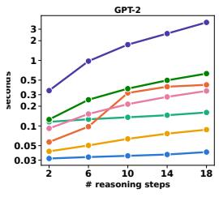

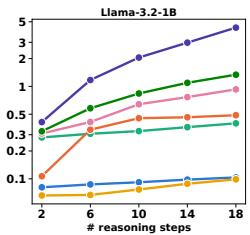  
Figure 1: Average training time per iteration as the number of reasoning steps increases. For CoT-SFT, each step corresponds to four tokens, reflecting its approximately 4× longer reasoning sequences.

This distinction is particularly important for latent reasoning. When the supervision is dominated by mathematical expressions, transferring the reasoning process into latent space mainly requires preserving the same computational content. In con-

trast, for verbalized reasoning traces, the model must compress a much longer sequence of T tokens into only K latent steps $( K \ll T )$ , requiring it to retain core reasoning information while abstracting away trace-specific variation. As shown in Tables 1 and 2, PLRM remains competitive with deterministic latent reasoning methods on GSM8K-Aug, while showing particularly strong performance on GSM8K-Aug-NL and CommonsenseQA. Being trained on GSM8K-Aug-NL, PLRM also generalizes strongly to OOD mathematical reasoning tasks, achieving the best or tied-best accuracy in five of six model–task settings. This strong OOD generalization suggests that PLRM captures transferable reasoning rather than overfitting to specific patterns of verbalized CoT Shen et al. (2025).

Training Efficiency. Figure 1 compares how the training cost scales with the number of reasoning steps. Methods trained with teacher forcing, including CoT-SFT, CoLaR, and PLRM, can process intermediate reasoning steps in parallel, resulting in only modest increases in training time as the number of latent steps grows. In contrast, all deterministic latent reasoning baselines (COCONUT, CODI, and SIM-CoT), together with the stochastic baseline (ReGuLaR), require sequential latent rollout during training, causing training cost to grow linearly with the number of latent steps. CoLaR is even faster because its target latent representations are constructed directly from summed token embeddings without an additional forward pass, but this efficiency comes at the cost of relying on heuristic targets and substantially lower empirical performance.

Importance of Joint Posterior–Prior Training. We further examine whether jointly learning the posterior and prior is necessary. Following a two-stage VAE setup Kang et al. (2026), we first train the posterior on CommonsenseQA using GPT-2 backbone to reconstruct the verbalized reasoning trace while fixing the prior to a standard normal Gaussian. We then extract latent trajectories for the entire training set, freeze the posterior, and train the problem-conditioned prior to predict these fixed targets. We additionally consider a vari-

Table 3: Ablation study of PLRM.
<table><tr><td>Methods</td><td>|Acc. (%)</td></tr><tr><td>Fixed Posterior</td><td>18.35</td></tr><tr><td>+ Answer Loss</td><td>19.49</td></tr><tr><td>CoLaR</td><td>21.62</td></tr><tr><td>PLRM (Ours)</td><td>43.40</td></tr></table>

ant that includes answer prediction when learning the posterior, encouraging the latent representations to retain answer-relevant information. As shown in Table 3, the two-stage variants achieve only 18.35–19.49% accuracy, comparable to CoLaR (21.62%), suggesting a common limitation of learning from fixed latent targets. In contrast, PLRM achieves 43.40%, highlighting the importance of jointly adapting the target latent distribution and its problem-conditioned predictor.

## 5.3 HETEROGENEOUS REASONING STRATEGIES

We next examine whether PLRM can model heterogeneous reasoning strategies when the same input admits multiple valid reasoning trajectories, as discussed in Section 3.3. We assess how well the learned distribution captures these alternative hypotheses using Hit Rate and Avg. TV Score. Hit Rate measures whether greedy decoding recovers any valid answer. Avg. TV Score measures the agreement between the distribution of answers obtained from diverse reasoning trajectories and the distribution over all valid answers, jointly reflecting invalid generations and incomplete coverage of valid hypotheses; details are provided in Appendix B.2.

Visualizing Multimodal Latent Distributions. We first compare the single-component prior in Eq. $5 ~ ( M = 1 )$ with our mixturebased prior using two components $( M = 2 )$ As shown in Figure 2, the Mono Prior initially expands its variance to cover distinct posterior modes. As reasoning proceeds, however, the posterior modes are progressively pulled together, collapsing the heterogeneous trajectories into a similar latent distribution. In contrast, the Double Prior assigns separate prior components to different posterior modes and maintains their separation across latent steps, preserving the multimodal structure without forcing heterogeneous reasoning trajectories to collapse. Additional visualizations for $M \geq 3$ and qualitative examples reconstructing latent reasoning trajectories into verbalized reasoning traces are provided in Appendix C.2.

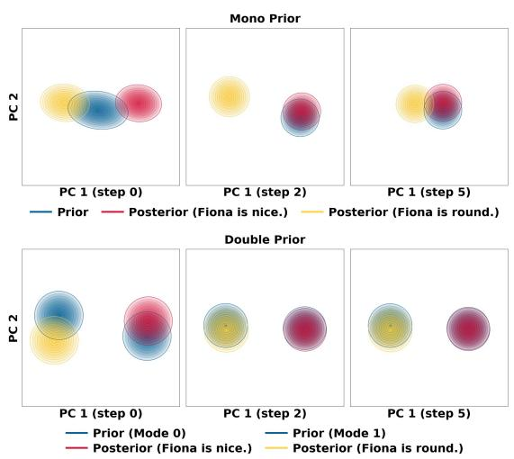  
Figure 2: PCA visualization of prior and posterior latent distributions under mono (M=1) and doubleprior (M=2) settings.

Quantitative Evaluation. We compare PLRM with CoT-SFT and stochastic latent reasoning baselines, which can represent

distributions over reasoning trajectories. As shown in Table 4, it achieves the best performance on both Hit Rate and Avg. TV Score, improving the latter from 0.6160 to 0.7097 over CoT-SFT, a 15.2% relative gain that indicates better coverage of heterogeneous valid hypotheses while maintaining high deterministic accuracy. Table 5 examines the number of mixture components. While a single mode achieves high Hit Rate, its substantially lower TV Score indicates limited coverage of alternative valid hypotheses. Using two modes yields the best TV Score, indicating that the heterogeneity in HiddenBranch can be sufficiently modeled with two strategy components.

## 6 CONCLUSION

In this work, we proposed PLRM, a variational framework for probabilistic latent reasoning with dense supervision and parallel teacher-forced training. By jointly learning posterior target distributions and a problem-conditioned prior, PLRM captures core reasoning information while abstracting away trace-specific verbalization, and models heterogeneous strategies through a mixture-based prior. Across mathematical and commonsense reasoning tasks, PLRM outperforms existing stochastic latent reasoning methods while remaining competitive with deterministic approaches. We envision PLRM as a step toward scalable probabilistic reasoning in continuous latent space beyond verbalized chain-of-thought.

Table 4: Hit rate and average TV Score across different methods.
<table><tr><td>Metric</td><td>CoT-SFT</td><td>ReGuLaR</td><td>CoLaR</td><td>PLRM</td></tr><tr><td>Hit Rate</td><td>0.9116</td><td>0.8665</td><td>0.7397</td><td>0.9205</td></tr><tr><td>Avg. TV Score</td><td>0.6160</td><td>0.4753</td><td>0.3638</td><td>0.7097</td></tr></table>

Table 5: Ablation on the number of M.

<table><tr><td>Metric</td><td>M=1</td><td>M=2</td><td>M=3</td><td>M=4</td></tr><tr><td>Hit Rate</td><td>0.9370</td><td>0.9205</td><td>0.9292</td><td>0.9300</td></tr><tr><td>Avg. TV Score</td><td>0.6252</td><td>0.7097</td><td>0.6963</td><td>0.6908</td></tr></table>

## AI USE STATEMENT

In this work, we used generative Al tools to aid and polish writing. We did not use generative AI tools for any other tasks requiring disclosure under the ICLR policy. We reviewed all AI-assisted content and take full responsibility for the final content of this work.

## ETHICS STATEMENT

This work uses publicly available datasets and involves no direct interaction with human subjects. We additionally construct HiddenBranch by transforming examples from the existing ProofWriter dataset to create multiple valid reasoning trajectories for the same input. We plan to publicly release the resulting dataset and its construction procedure to support reproducibility and future research.

## REPRODUCIBILITY STATEMENT

We will publicly release all code and datasets used in this work to facilitate reproducibility.

## REFERENCES

Mahmoud Assran, Quentin Duval, Ishan Misra, Piotr Bojanowski, Pascal Vincent, Michael Rabbat, Yann LeCun, and Nicolas Ballas. Self-supervised learning from images with a joint-embedding predictive architecture. In 2023 IEEE/CVF Conference on Computer Vision and Pattern Recognition (CVPR), pp. 15619–15629. IEEE, 2023.

Alexei Baevski, Wei-Ning Hsu, Qiantong Xu, Arun Babu, Jiatao Gu, and Michael Auli. Data2vec: A general framework for self-supervised learning in speech, vision and language. In International conference on machine learning, pp. 1298–1312. PMLR, 2022.

Randall Balestriero and Yann LeCun. Lejepa: Provable and scalable self-supervised learning without the heuristics. arXiv preprint arXiv:2511.08544, 2025.

Arindam Banerjee, Srujana Merugu, Inderjit S Dhillon, and Joydeep Ghosh. Clustering with bregman divergences. Journal ofmachine learning research, 6(Oct):1705–1749, 2005.

Yoshua Bengio, Rejean Ducharme, Pascal Vincent, and Christian Jauvin. A neural probabilistic´ language model. Journal ofmachine learning research, 3(Feb):1137–1155, 2003.

Hyung Won Chung, Le Hou, Shayne Longpre, Barret Zoph, Yi Tay, William Fedus, Yunxuan Li, Xuezhi Wang, Mostafa Dehghani, Siddhartha Brahma, et al. Scaling instruction-finetuned language models. Journal ofmachine learning research, 25(70):1–53, 2024.

Yuntian Deng, Kiran Prasad, Roland Fernandez, Paul Smolensky, Vishrav Chaudhary, and Stuart Shieber. Implicit chain of thought reasoning via knowledge distillation. arXiv preprint arXiv:2311.01460, 2023.

Luyu Gao, Aman Madaan, Shuyan Zhou, Uri Alon, Pengfei Liu, Yiming Yang, Jamie Callan, and Graham Neubig. Pal: Program-aided language models. In International conference on machine learning, pp. 10764–10799. PMLR, 2023.

Juraj Gottweis, Wei-Hung Weng, Alexander Daryin, Tao Tu, Petar Sirkovic, Artiom Myaskovsky, Grzegorz Glowaty, Felix Weissenberger, Alessio Orlandi, Dan Popovici, et al. Accelerating scientific discovery with co-scientist. Nature, pp. 1–3, 2026.

Alperen Gozeten, Muhammed Ildiz, Xuechen Zhang, Hrayr Harutyunyan, Ankit Singh Rawat, and Samet Oymak. Continuous chain of thought enables parallel exploration and reasoning. In International Conference on Learning Representations, volume 2026, pp. 82881–82914, 2026.

Aaron Grattafiori, Abhimanyu Dubey, Abhinav Jauhri, Abhinav Pandey, Abhishek Kadian, Ahmad Al-Dahle, Aiesha Letman, Akhil Mathur, Alan Schelten, Alex Vaughan, et al. The llama 3 herd of models. arXiv preprint arXiv:2407.21783, 2024.

Danijar Hafner, Timothy Lillicrap, Mohammad Norouzi, and Jimmy Ba. Mastering atari with discrete world models. arXiv preprint arXiv:2010.02193, 2020.

Shibo Hao, Sainbayar Sukhbaatar, DiJia Su, Xian Li, Zhiting Hu, Jason Weston, and Yuandong Tian. Training large language models to reason in a continuous latent space. arXiv preprint arXiv:2412.06769, 2024.

Haoqiang Kang, Yizhe Zhang, Nikki Kuang, Nicklas Majamaki, Navdeep Jaitly, Yian Ma, and Lianhui Qin. Ladir: Latent diffusion enhances llms for text reasoning. In International Conference on Learning Representations, volume 2026, pp. 81705–81733, 2026.

Lorenz Kuhn, Yarin Gal, and Sebastian Farquhar. Semantic uncertainty: Linguistic invariances for uncertainty estimation in natural language generation. arXiv preprint arXiv:2302.09664, 2023.

Bingyang Kelvin Liu, Ziyu Patrick Chen, and David P Woodruff. Jepa-reasoner: Decoupling latent reasoning from token generation. arXiv preprint arXiv:2512.19171, 2025a.

Jiayu Liu, Zhenya Huang, Anya Sims, Enhong Chen, Yee Whye Teh, and Ning Miao. Marcos: Deep thinking by markov chain of continuous thoughts. 2025b.

Lucas Maes, Quentin Le Lidec, Damien Scieur, Yann LeCun, and Randall Balestriero. Leworldmodel: Stable end-to-end joint-embedding predictive architecture from pixels. arXiv preprint arXiv:2603.19312, 2026.

Long Ouyang, Jeffrey Wu, Xu Jiang, Diogo Almeida, Carroll Wainwright, Pamela Mishkin, Chong Zhang, Sandhini Agarwal, Katarina Slama, Alex Ray, et al. Training language models to follow instructions with human feedback. Advances in neural information processing systems, 35: 27730–27744, 2022.

Arkil Patel, Satwik Bhattamishra, and Navin Goyal. Are nlp models really able to solve simple math word problems? In Proceedings of the 2021 conference of the North American chapter of the association for computational linguistics: human language technologies, pp. 2080–2094, 2021.

Ethan Perez, Florian Strub, Harm De Vries, Vincent Dumoulin, and Aaron Courville. Film: Visual reasoning with a general conditioning layer. In Proceedings of the AAAI conference on artificial intelligence, volume 32, 2018.

Alec Radford, Jeffrey Wu, Rewon Child, David Luan, Dario Amodei, Ilya Sutskever, et al. Language models are unsupervised multitask learners. OpenAI blog, 1(8):9, 2019.

Subhro Roy and Dan Roth. Solving general arithmetic word problems. In Proceedings ofthe 2015 conference on empirical methods in natural language processing, pp. 1743–1752, 2015.

Noam Shazeer. Glu variants improve transformer. arXiv preprint arXiv:2002.05202, 2020.

Zhenyi Shen, Hanqi Yan, Linhai Zhang, Zhanghao Hu, Yali Du, and Yulan He. Codi: Compressing chain-of-thought into continuous space via self-distillation. In Proceedings of the 2025 Confer ence on Empirical Methods in Natural Language Processing, pp. 677–693, 2025.

Wenxian Shi, Hao Zhou, Ning Miao, and Lei Li. Dispersed exponential family mixture vaes for interpretable text generation. In International Conference on Machine Learning, pp. 8840–8851. PMLR, 2020.

Oyvind Tafjord, Bhavana Dalvi, and Peter Clark. Proofwriter: Generating implications, proofs, and abductive statements over natural language. In Findings of the association for computational linguistics: ACL-IJCNLP 2021, pp. 3621–3634, 2021.

Alon Talmor, Jonathan Herzig, Nicholas Lourie, and Jonathan Berant. Commonsenseqa: A question answering challenge targeting commonsense knowledge. In Proceedings of the 2019 Conference of the North American Chapter of the Association for Computational Linguistics: Human Language Technologies, Volume 1 (Long and Short Papers), pp. 4149–4158, 2019.

Wenhui Tan, Jiaze Li, Jianzhong Ju, Zhenbo Luo, Ruihua Song, and Jian Luan. Think silently, think fast: Dynamic latent compression of llm reasoning chains. Advances in Neural Information Processing Systems, 38:4646–4668, 2026.

Trieu H Trinh, Yuhuai Wu, Quoc V Le, He He, and Thang Luong. Solving olympiad geometry without human demonstrations. Nature, 625(7995):476–482, 2024.

Naonori Ueda and Ryohei Nakano. Deterministic annealing em algorithm. Neural networks, 11(2): 271–282, 1998.

Ashish Vaswani, Noam Shazeer, Niki Parmar, Jakob Uszkoreit, Llion Jones, Aidan N Gomez, Łukasz Kaiser, and Illia Polosukhin. Attention is all you need. Advances in neural information processing systems, 30, 2017.

Fanmeng Wang, Haotian Liu, Guojiang Zhao, Hongteng Xu, and Zhifeng Gao. Regular: Variational latent reasoning guided by rendered chain-of-thought. arXiv preprint arXiv:2601.23184, 2026.

Xuezhi Wang, Jason Wei, Dale Schuurmans, Quoc Le, Ed Chi, Sharan Narang, Aakanksha Chowdhery, and Denny Zhou. Self-consistency improves chain of thought reasoning in language models. arXiv preprint arXiv:2203.11171, 2022.

Jason Wei, Xuezhi Wang, Dale Schuurmans, Maarten Bosma, Fei Xia, Ed Chi, Quoc V Le, Denny Zhou, et al. Chain-of-thought prompting elicits reasoning in large language models. Advances in neural information processing systems, 35:24824–24837, 2022.

Xilin Wei, Xiaoran Liu, Yuhang Zang, Xiaoyi Dong, Yuhang Cao, Jiaqi Wang, Xipeng Qiu, and Dahua Lin. Sim-cot: Supervised implicit chain-of-thought. In International Conference on Learning Representations, volume 2026, pp. 56721–56742, 2026.

Haiyu Wu, Randall Balestriero, and Morgan Levine. Visreg: Variance-invariance-sketching regularization for jepa training. arXiv preprint arXiv:2606.02572, 2026.

Shunyu Yao, Dian Yu, Jeffrey Zhao, Izhak Shafran, Tom Griffiths, Yuan Cao, and Karthik Narasimhan. Tree of thoughts: Deliberate problem solving with large language models. Advances in neural information processing systems, 36:11809–11822, 2023.

Biao Zhang and Rico Sennrich. Root mean square layer normalization. Advances in neural information processing systems, 32, 2019.

## A IMPLEMENTATION DETAILS

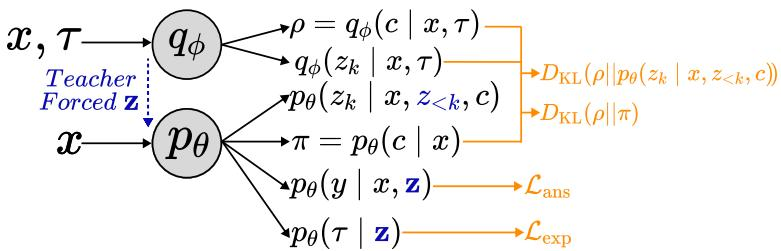  
Figure 3: Overall Training Computation

## A.1 EMPIRICAL OPTIMIZATION

The objective in Eq. equation 7 contains the following trajectory-level KL divergence:

$$
D _ { \mathrm { K L } } ( q _ { \phi } ( c , \mathbf { z } \mid x , \pmb { \tau } ) \parallel p _ { \theta } ( c , \mathbf { z } \mid x ) ) .\tag{10}
$$

Using the factorization of the posterior and prior, this term can be decomposed as

$$
\begin{array} { r l } & { { \cal D } _ { \mathrm { K L } } ( q _ { \phi } ( c , \mathbf { z } \mid x , \tau ) \parallel p _ { \theta } ( c , \mathbf { z } \mid x ) ) } \\ & { \ = { \cal D } _ { \mathrm { K L } } ( q _ { \phi } ( c \mid x , \tau ) \parallel p _ { \theta } ( c \mid x ) ) } \\ & { \quad + \mathbb { E } _ { q _ { \phi } ( c \mid x , \tau ) } \displaystyle \sum _ { k = 1 } ^ { K } \mathbb { E } _ { q _ { \phi } ( z < k \mid x , \tau ) } \left[ { \cal D } _ { \mathrm { K L } } ( q _ { \phi } ( z _ { k } \mid x , \tau ) \parallel p _ { \theta } ( z _ { k } \mid x , z _ { < k } , c ) ) \right] . } \end{array}\tag{11}
$$

The expectation over $z _ { < k }$ is estimated by Monte Carlo samples from the posterior. We therefore focus on the inner KL term for a fixed strategy $c = m$ . Both the posterior and prior are parameterized as diagonal Gaussian distributions:

$$
q _ { \phi } ( z _ { k } \mid x , \tau ) = \mathcal { N } \big ( \mu _ { q } ^ { k } , \mathrm { d i a g } \big ( ( \sigma _ { q } ^ { k } ) ^ { 2 } \big ) \big ) ,\tag{12}
$$

$$
p _ { \theta } ( z _ { k } \mid x , z _ { < k } , c = m ) = \mathcal { N } \big ( \mu _ { p , m } ^ { k } , \mathrm { d i a g } \big ( ( \sigma _ { p , m } ^ { k } ) ^ { 2 } \big ) \big ) .\tag{13}
$$

For two d-dimensional Gaussian distributions, $q = \mathcal { N } ( \mu _ { q } , \Sigma _ { q } )$ and $p = \mathcal { N } ( \mu _ { p } , \Sigma _ { p } )$ ), the KL divergence is

$$
D _ { \mathrm { K L } } ( q \| p ) = \frac 1 2 \left[ \log \frac { | \Sigma _ { p } | } { | \Sigma _ { q } | } - d + \mathrm { t r } \big ( \Sigma _ { p } ^ { - 1 } \Sigma _ { q } \big ) + ( \mu _ { p } - \mu _ { q } ) ^ { \top } \Sigma _ { p } ^ { - 1 } ( \mu _ { p } - \mu _ { q } ) \right] .\tag{14}
$$

Since both covariance matrices are diagonal,

$$
\log \frac { | \Sigma _ { p } | } { | \Sigma _ { q } | } = \sum _ { j = 1 } ^ { d } \log \frac { ( \sigma _ { p , m , j } ^ { k } ) ^ { 2 } } { ( \sigma _ { q , j } ^ { k } ) ^ { 2 } } ,\tag{15}
$$

$$
\mathrm { t r } \big ( \Sigma _ { p } ^ { - 1 } \Sigma _ { q } \big ) = \sum _ { j = 1 } ^ { d } \frac { ( { \sigma } _ { q , j } ^ { k } ) ^ { 2 } } { ( { \sigma } _ { p , m , j } ^ { k } ) ^ { 2 } } ,\tag{16}
$$

$$
( \mu _ { p } - \mu _ { q } ) ^ { \top } \Sigma _ { p } ^ { - 1 } ( \mu _ { p } - \mu _ { q } ) = \sum _ { j = 1 } ^ { d } \frac { ( \mu _ { q , j } ^ { k } - \mu _ { p , m , j } ^ { k } ) ^ { 2 } } { ( \sigma _ { p , m , j } ^ { k } ) ^ { 2 } } .\tag{17}
$$

Substituting these terms gives the closed-form Gaussian KL at latent step k for strategy m:

$$
D _ { \mathrm { K L } } ( q _ { \phi } \parallel p _ { \theta } ) = \frac { 1 } { 2 } \sum _ { j = 1 } ^ { d } \left[ \log \frac { ( \sigma _ { p , m , j } ^ { k } ) ^ { 2 } } { ( \sigma _ { q , j } ^ { k } ) ^ { 2 } } + \frac { ( \sigma _ { q , j } ^ { k } ) ^ { 2 } + ( \mu _ { q , j } ^ { k } - \mu _ { p , m , j } ^ { k } ) ^ { 2 } } { ( \sigma _ { p , m , j } ^ { k } ) ^ { 2 } } - 1 \right] .\tag{18}
$$

Using this closed form, the expectation over the discrete strategy variable in Eq. equation 11 can be written as a responsibility-weighted sum:

$$
\begin{array} { l } { \displaystyle \mathbb { E } _ { q _ { \phi } ( c | x , \tau ) } \sum _ { k = 1 } ^ { K } \mathbb { E } _ { q _ { \phi } ( z < k | x , \tau ) } \left[ D _ { \mathrm { K L } } ( q _ { \phi } ( z _ { k } \mid x , \tau ) \parallel p _ { \theta } ( z _ { k } \mid x , z _ { < k } , c ) ) \right] } \\ { = \displaystyle \sum _ { k = 1 } ^ { K } \mathbb { E } _ { q _ { \phi } ( z _ { < k } \mid x , \tau ) } \left[ \displaystyle \sum _ { m = 1 } ^ { M } \rho _ { m } D _ { \mathrm { K L } } ( q _ { \phi } ( z _ { k } \mid x , \tau ) \parallel p _ { \theta } ( z _ { k } \mid x , z _ { < k } , c = m ) ) \right] , } \end{array}\tag{19}
$$

where $\rho _ { m } = q _ { \phi } ( c = m \mid x , \tau )$ . The remaining expectation over $z _ { < k }$ is approximated using posterior Monte Carlo samples.

## A.2 PRACTICAL DETAILS OF PLRM

Although the formulation in Section 3 specifies the main training objectives of PLRM, we employ several additional regularization and optimization techniques to stabilize the joint training of the posterior and mixture prior. For brevity, throughout this subsection we denote

$$
q _ { k } \equiv q _ { \phi } ( z _ { k } \mid x , \tau ) , p _ { k , m } \equiv p _ { \theta } ( z _ { k } \mid x , z _ { < k } , c = m ) ,
$$

and let $\rho _ { m } \equiv q _ { \phi } ( c = m \mid x , \tau )$ denote the EM-style responsibility defined from the first latent step.

EM-style Strategy Learning. Inspired by divergence-based soft clustering (Banerjee et al., 2005), we use an EM-style soft assignment to stabilize strategy learning. Rather than introducing a separate classifier for $c ,$ we perform an E-step:

$$
\rho _ { m } \propto \exp \left( - \frac { 1 } { T } D _ { \mathrm { K L } } ( q _ { \phi } ( z _ { 1 } \mid x , \tau ) \parallel p _ { \theta } ( z _ { 1 } \mid x , c = m ) ) \right) ,\tag{20}
$$

where $T$ controls the assignment sharpness (Ueda & Nakano, 1998). The resulting responsibilities are fixed across the latent trajectory and used to update the corresponding strategy-specific prior components and $p _ { \theta } ( c \mid x )$ , analogous to a gradient-based M-step. We infer the strategy from the first latent distribution because it is the only prior prediction made before any teacher-forced posterior latent is available. This restriction does not limit the intended multimodal modeling, since distinct reasoning strategies can already induce different modes at $z _ { 1 }$ , as shown above.

Mixture-Preserving KL Regularization. A direct responsibility-weighted Gaussian alignment, $\begin{array} { r l } { ~ } & { { } \sum _ { m } \rho _ { m } D _ { \mathrm { K L } } \big ( q _ { k } \big | \big | p _ { k , m } \big ) } \end{array}$ , encourages multiple prior components assigned to the same posterior $q _ { k }$ to move toward that common posterior target, thereby reducing the separation between mixture components. To isolate this contraction effect, we adopt the exponential-family decomposition derived in DEM-VAE (Shi et al., 2020):

$$
\sum _ { m } \rho _ { m } D _ { \mathrm { K L } } ( q _ { k } \| p _ { k , m } ) = D _ { \mathrm { K L } } ( q _ { k } \| p _ { \bar { \eta } _ { k } } ) + L _ { d , k } ,\tag{21}
$$

where $\begin{array} { r } { \bar { \boldsymbol { \eta } } _ { k } = \sum _ { m } \rho _ { m } \boldsymbol { \eta } _ { m , k } } \end{array}$ is the responsibility-weighted average of the natural parameters of $p _ { k , m } .$ and $p _ { \bar { \eta } _ { k } }$ denotes the corresponding Gaussian distribution. The dispersion term $L _ { d , k }$ is given by

$$
L _ { d , k } = \sum _ { m } \rho _ { m } A ( \eta _ { m , k } ) - A ( \bar { \eta } _ { k } ) \geq 0 ,\tag{22}
$$

where $A ( \cdot )$ denotes the Gaussian log-partition function. The non-negative term $L _ { d , k }$ captures the additional cost induced by dispersion among the responsibility-weighted prior components and vanishes when these components coincide. Consequently, minimizing the original responsibilityweighted KL also penalizes separation among the prior components, introducing pressure toward component collapse. To attenuate this effect, we optimize the corrected Gaussian alignment

$$
\mathcal { L } _ { \mathrm { G K L } , k } = \sum _ { m } \rho _ { m } D _ { \mathrm { K L } } ( q _ { k } \| p _ { k , m } ) - \gamma L _ { d , k } ,\tag{23}
$$

which reduces the component-collapse pressure induced by responsibility-weighted KL alignment while retaining a non-negative distribution-matching objective for $\gamma \in [ 0 , \bar { 1 } ]$

Following the KL-balancing strategy of DreamerV2 (Hafner et al., 2020), we further stabilize training by separately controlling the gradients flowing to the predictive prior and target posterior. For each component-wise Gaussian KL term, we use

$$
0 . 8 D _ { \mathrm { K L } } ( \operatorname { s g } ( q _ { k } ) \Vert p _ { k , m } ) + 0 . 2 D _ { \mathrm { K L } } ( q _ { k } \Vert \operatorname { s g } ( p _ { k , m } ) ) ,\tag{24}
$$

where $\operatorname { s g } ( \cdot )$ denotes the stop-gradient operator. This places greater optimization pressure on the predictive prior to follow the posterior target.

Posterior Representation Regularization. As described in the main text, we apply VISReg to the posterior means rather than sampled latent variables. Concretely, VISReg consists of three complementary terms. The center term keeps the batch-aggregated posterior means close to zero, the scale term encourages each latent dimension to maintain unit batch-wise standard deviation, and the shape term encourages the standardized posterior means to follow a standard Gaussian under random one-dimensional projections. The resulting regularizer is

$$
\mathcal { L } _ { \mathrm { V I S R e g } } = \mathcal { L } _ { \mathrm { s c a l e } } + \mathcal { L } _ { \mathrm { s h a p e } } + \mathcal { L } _ { \mathrm { c e n t e r } } .\tag{25}
$$

For the scale term, we use a squared deviation from unit standard deviation, $( 1 - \sigma ) ^ { 2 }$ , rather than a hinge penalty, so that the regularizer continues to provide a gradient when the batch standard deviation exceeds the target value. For the shape term, standardized posterior means are projected onto random unit directions, sorted across the batch, and matched to the corresponding quantiles of a standard Gaussian.

Overall Training Objective. With the dispersion correction, the practical distribution-alignment term is

$$
\mathcal { L } _ { \mathrm { a l i g n } } = D _ { \mathrm { K L } } ( \rho \| p _ { \theta } ( c | x ) ) + \frac { 1 } { K } \sum _ { k = 1 } ^ { K } \left[ \sum _ { m } \rho _ { m } D _ { \mathrm { K L } } ( q _ { k } \| p _ { k , m } ) - \gamma L _ { d , k } \right] ,\tag{26}
$$

where the categorical KL is applied once per trajectory, whereas the Gaussian alignment is averaged over the K latent steps. The resulting training objective is

$$
\mathcal { L } = \mathcal { L } _ { \mathrm { a n s } } + \mathcal { L } _ { \mathrm { e x p } } + \beta ( 1 - \lambda _ { \mathrm { r e g } } ) \mathcal { L } _ { \mathrm { a l i g n } } + \beta \lambda _ { \mathrm { r e g } } \mathcal { L } _ { \mathrm { V I S R e g } } .\tag{27}
$$

We linearly warm up the shared coefficient $\beta$ during training. Detailed values of the loss coefficients and training hyperparameters are provided in the following subsection.

## A.3 METHOD CONFIGURATION

Table 6 summarizes the main optimization and method-specific hyperparameters used for PLRM. Unless otherwise specified, we use $K = 6$ latent reasoning steps and optimize all models with AdamW using cosine learning-rate decay and BF16 mixed precision. For the main benchmarks, including GSM8K, GSM8K-NL, and CommonsenseQA, we use a single prior component $( M = 1 )$ as each example provides a single reasoning trajectory. Dataset- and backbone-specific settings, including the learning rate, number of epochs, batch size, posterior context allocation, and objective coefficients, are reported in the table.

Notably, we use the same ${ \mathrm { K L } } -$ and VISReg-related hyperparameters across different datasets and backbone architectures without per-setting tuning. Their consistent effectiveness across these settings suggests that PLRM is not highly sensitive to these regularization choices. In contrast, the posterior-token allocation per latent step (PTL) is adjusted by dataset to account for differences in reasoning-trace length, such that later latent targets are conditioned on progressively larger portions of the CoT trajectory. We fix the Gaussian latent dimension to $d = 7 6 8$ across all datasets and backbone architectures.

Table 6: Main training and method-specific hyperparameters of PLRM. PTL denotes the number of posterior-visible CoT tokens per latent step.
<table><tr><td></td><td colspan="3">GPT-2</td><td colspan="3">Llama-3.2-1B</td></tr><tr><td>Hyperparameter</td><td>GSM8K</td><td>GSM8K-NL</td><td>CQA</td><td>GSM8K</td><td>GSM8K-NL</td><td>CQA</td></tr><tr><td colspan="7">Optimization</td></tr><tr><td>Learning rate</td><td>1 × 10−3</td><td>1 × 10−3</td><td>2 × 10−3</td><td>3 × 10−4</td><td>3 × 10−4</td><td>3 × 10−4</td></tr><tr><td>Epochs</td><td>40</td><td>40</td><td>40</td><td>40</td><td>40</td><td>10</td></tr><tr><td>Effective batch size</td><td>128</td><td>128</td><td>128</td><td>256</td><td>256</td><td>256</td></tr><tr><td colspan="7">Latent Configuration</td></tr><tr><td>Posterior tokens per latent (PTL)</td><td>8</td><td>12</td><td>24</td><td>7</td><td>14</td><td>24</td></tr><tr><td>Max. input tokens</td><td>200</td><td>256</td><td>1000</td><td>200</td><td>256</td><td>1000</td></tr><tr><td colspan="7">Objective and Regularization</td></tr><tr><td>KL coefficient βmax</td><td>3.0</td><td>3.0</td><td>3.0</td><td>3.0</td><td>3.0</td><td>3.0</td></tr><tr><td>KL warmup ratio</td><td>0.8</td><td>0.8</td><td>0.8</td><td>0.8</td><td>0.8</td><td>0.8</td></tr><tr><td>KL balance α</td><td>0.8</td><td>0.8</td><td>0.8</td><td>0.8</td><td>0.8</td><td>0.8</td></tr><tr><td>VISReg weight  $\lambda _ { \mathrm { { r e g } } }$ </td><td>0.9</td><td>0.9</td><td>0.9</td><td>0.9</td><td>0.9</td><td>0.9</td></tr><tr><td>VISReg projections</td><td>512</td><td>512</td><td>512</td><td>512</td><td>512</td><td>512</td></tr></table>

## B EXPERIMENTAL DETAILS

## B.1 BENCHMARK DATASETS

In-Distribution Datasets. Following prior latent reasoning work (Shen et al., 2025), we consider three in-distribution (ID) benchmarks spanning mathematical and commonsense reasoning.

GSM8K-Aug. GSM8K-Aug (Deng et al., 2023) is an augmented version of the GSM8K mathematical reasoning benchmark. It consists of grade-school-level arithmetic word problems paired with intermediate reasoning traces and final answers. We use this dataset to evaluate latent reasoning in a standard mathematical reasoning setting.

GSM8K-Aug-NL. GSM8K-Aug-NL is the natural-language variant of GSM8K-Aug introduced in the same experimental setting (Deng et al., 2023). Compared with the standard GSM8K-Aug formulation, it provides reasoning trajectories in a more natural-language-oriented form. We use GSM8K-Aug-NL as an additional mathematical reasoning benchmark and use models trained on this dataset for our out-of-distribution evaluation.

CommonsenseQA. CommonsenseQA (CSQA) (Talmor et al., 2019) is a multiple-choice question answering benchmark designed to evaluate commonsense reasoning. Unlike the GSM8K-based datasets, which primarily require arithmetic reasoning, CSQA requires reasoning over implicit commonsense knowledge. We include CSQA to evaluate whether PLRM is effective beyond mathematical reasoning.

Out-of-Distribution Datasets. To evaluate out-of-distribution (OOD) generalization, we evaluate models trained on GSM8K-Aug-NL on three mathematical reasoning benchmarks that are not used during training.

SVAMP. SVAMP (Patel et al., 2021) is a collection of arithmetic word problems designed to test robustness to variations in problem structure and linguistic formulation. The benchmark provides a distribution shift from the GSM8K-based training data while retaining the requirement for multi-step arithmetic reasoning.

GSM-Hard. GSM-Hard (Gao et al., 2023) is a more challenging variant of GSM8K constructed by replacing numerical values with larger and less common numbers. This modification preserves the underlying reasoning structure while increasing the difficulty of numerical computation, allowing us to evaluate robustness under a controlled distribution shift.

MultiArith. MultiArith (Roy & Roth, 2015) consists of multi-step arithmetic word problems that require composing several arithmetic operations to obtain the final answer. We use MultiArith to assess whether reasoning learned from GSM8K-Aug-NL transfers to a distinct mathematical wordproblem distribution.

## B.2 HiddenBranch DATASET

HiddenBranch Construction. We construct HiddenBranch from the open-world abductive reasoning setting of ProofWriter (Tafjord et al., 2021), using examples from depths 1, 2, 3, and 5. We retain source questions that admit between two and five valid hidden facts, where each hidden fact independently makes the query provable when added to the original facts and rules. For each hidden fact, we use the corresponding ProofWriter proof as the ground-truth reasoning trajectory after verifying that the hidden fact independently entails the query.

A key property of HiddenBranch is that a single unique input can be associated with multiple valid reasoning–answer pairs. The input, consisting of the task instruction, facts, rules, and question, remains identical across branches, while each branch provides a different ground-truth reasoning trajectory and corresponding answer. During training and validation, these branches are represented as separate supervised examples sharing the same input. At test time, each unique input is presented only once and evaluated against the complete set of valid hidden answers.

Example. The following example illustrates two branches associated with the same unique input.

Input   
Task: Find one missing fact that, when assumed by itself in addition to the given Facts and   
Rules, makes the Question provable. Give one proof for that missing fact.   
Facts:   
triple3. Harry is green.   
triple2. Dave is rough.   
triple1. Anne is cold.   
Rules:   
rule1. All cold, round people are green.   
rule2. If Harry is round and Harry is not rough then Harry   
is big.   
rule3. If Anne is young and Anne is rough then Anne is big.   
rule4. All green people are young.   
rule5. Young, big people are kind.   
rule6. If someone is cold then they are round.   
Question:   
Anne is kind.

For this same input, HiddenBranch contains multiple valid ground-truth reasoning–answer pairs:

GT Pair 1   
GT-CoT:   
B1: Assume Anne is big.   
Anne is cold. --rule6--> Anne is round.;   
Anne is cold. & Anne is round. --rule1--> Anne is green.;   
Anne is green. --rule4--> Anne is young.;   
Anne is young. & Anne is big. --rule5--> Anne is kind.   
GT-Answer:   
["Anne is big."]   
GT Pair 2   
GT-CoT:   
B1: Assume Anne is rough.   
Anne is cold. --rule6--> Anne is round.;   
Anne is cold. & Anne is round. --rule1--> Anne is green.;   
Anne is green. --rule4--> Anne is young.;   
Anne is young. & Anne is rough. --rule3--> Anne is big.;   
Anne is young. & Anne is big. --rule5--> Anne is kind.   
GT-Answer:   
["Anne is rough."]

Although the two examples share exactly the same input, they correspond to different valid hidden facts and therefore induce different reasoning trajectories and answers. This construction explicitly creates a one-to-many mapping from a unique input to multiple valid reasoning–answer pairs, which allows us to evaluate whether a stochastic latent reasoning model can represent and recover heterogeneous reasoning strategies for the same problem

Table 7: Statistics of the HiddenBranch dataset. Each unique input corresponds to one source question, while valid branches denote distinct reasoning–answer pairs associated with that input.
<table><tr><td>Split</td><td># Unique Inputs</td><td># Valid Branches</td></tr><tr><td>Train</td><td>21,466</td><td>52,734</td></tr><tr><td>Validation</td><td>3,179</td><td>7,712</td></tr><tr><td>Test</td><td>6,128</td><td>15,101</td></tr><tr><td>Total</td><td>30,773</td><td>75,547</td></tr></table>

Evaluation Metrics. For the multi-trajectory setting, we evaluate both deterministic answer correctness and the distribution of stochastic generations. Let $G _ { i }$ denote the set of valid gold answers for input i.

Hit Rate. We first perform greedy decoding and measure whether the deterministically generated answer belongs to the set of valid answers:

$$
\mathrm { H i t R a t e } = \frac { 1 } { N } \sum _ { i = 1 } ^ { N } { \bf 1 } \left[ \hat { a } _ { i } ^ { \mathrm { d e t } } \in G _ { i } \right] .\tag{28}
$$

Thus, Hit Rate measures whether the model can recover at least one valid reasoning branch under deterministic decoding.

TV Score. To evaluate stochastic generations, we draw R samples for each input and compare their empirical answer distribution with an ideal distribution that assigns equal probability to all valid gold answers and zero probability to invalid generations. For an input with $| \bar { G } _ { i } | = G$ gold answers, let $n _ { i , g }$ be the number of samples matching gold answer $^ { g , }$ and let $\begin{array} { r } { n _ { i , \mathrm { i n v } } = R - \sum _ { g = 1 } ^ { G } n _ { i , g } } \end{array}$ denote the number of invalid samples. We define

$$
P _ { i } = \left[ { \frac { n _ { i , 1 } } { R } } , . . . , { \frac { n _ { i , G } } { R } } , { \frac { n _ { i , { \mathrm { i n v } } } } { R } } \right] , \qquad Q _ { i } = \left[ { \frac { 1 } { G } } , . . . , { \frac { 1 } { G } } , 0 \right] .\tag{29}
$$

The per-example score is the complement of the total variation distance,

$$
S _ { i } = 1 - \mathrm { T V } ( P _ { i } , Q _ { i } ) = 1 - { \frac { 1 } { 2 } } \sum _ { c } | P _ { i } ( c ) - Q _ { i } ( c ) | ,\tag{30}
$$

and we report

$$
\mathrm { T V S c o r e } = \frac { 1 } { N } \sum _ { i = 1 } ^ { N } S _ { i } .\tag{31}
$$

The score ranges from 0 to 1, with higher values indicating better agreement with the ideal distribution. It jointly penalizes invalid generations and concentration on only a subset of valid branches: the score is maximized when all generations are valid and are distributed as uniformly as possible across the gold answers.

## C ADDITIONAL EXPERIMENTAL RESULTS

Overview. In this section, we provide additional experimental results and analyses of PLRM. We first present a thorough comparison with previously reported results on in-distribution benchmarks, covering verbalized, deterministic latent, and stochastic latent reasoning methods across both GPT-2 and Llama-3.2-1B-Instruct backbones. We then focus on the multi-trajectory setting and analyze how the learned prior captures multiple trajectory-specific posterior modes as the number of valid reasoning branches increases. Finally, we provide qualitative examples showing that individual strategy modes induce distinct valid reasoning trajectories and corresponding answers.

## C.1 COMPARISON WITH PREVIOUSLY REPORTED RESULTS

Table 8: Accuracy (%) of GPT-2 and Llama-3.2-1B-Instruct on in-distribution tasks.
<table><tr><td rowspan="2">Type</td><td rowspan="2">Method</td><td colspan="3">GPT-2</td><td colspan="3">Llama-3.2-1B</td></tr><tr><td>GSM8K-NL</td><td>GSM8K</td><td>CSQA</td><td>GSM8K-NL</td><td>GSM8K</td><td>CSQA</td></tr><tr><td>Verbalized</td><td>Explicit CoT</td><td>34.8</td><td>44.1</td><td>36.9 1</td><td>54.1</td><td>61.6</td><td>68.2</td></tr><tr><td rowspan="3">Deterministic</td><td>COCONUT</td><td>一</td><td>34.1</td><td></td><td></td><td></td><td></td></tr><tr><td>CODI</td><td>35.3</td><td>43.7</td><td>44.0</td><td>49.7</td><td>55.6</td><td>74.0</td></tr><tr><td>SIM-CoT</td><td></td><td>42.6</td><td>一</td><td>一</td><td>56.1</td><td>一</td></tr><tr><td rowspan="3">Stochastic</td><td>ReGuLaR</td><td>一</td><td>一</td><td>一</td><td>20.2</td><td>34.9</td><td>一</td></tr><tr><td>CoLaR</td><td></td><td></td><td></td><td></td><td>40.1</td><td></td></tr><tr><td>PLRM (Ours)</td><td>36.30</td><td>38.40</td><td>43.40</td><td>42.08</td><td>50.00</td><td>74.28</td></tr></table>

Table 8 complements our main in-distribution evaluation with performance reported in prior work. Overall, the comparison is consistent with the distinction between equation-dominant and verbalized reasoning discussed in Section 5.2. On GSM8K, where intermediate reasoning is largely represented through mathematical operations, PLRM remains competitive with deterministic latent reasoning methods. In contrast, PLRM shows stronger performance on tasks with more heavily verbalized reasoning traces, where the model must compress lengthy natural-language reasoning into a small number of latent steps while preserving the information necessary for answer prediction. Importantly, across all settings where previously reported stochastic baselines are available, PLRM consistently achieves higher accuracy than existing stochastic latent reasoning methods. This suggests that PLRM improves the effectiveness of stochastic latent reasoning without sacrificing the competitive performance observed in deterministic latent approaches.

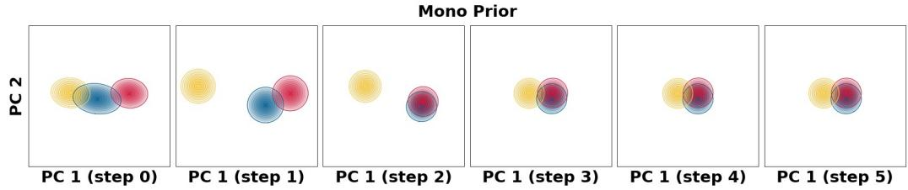  
Prior  Posterior (Fiona is nice.) Posterior (Fiona is round.)

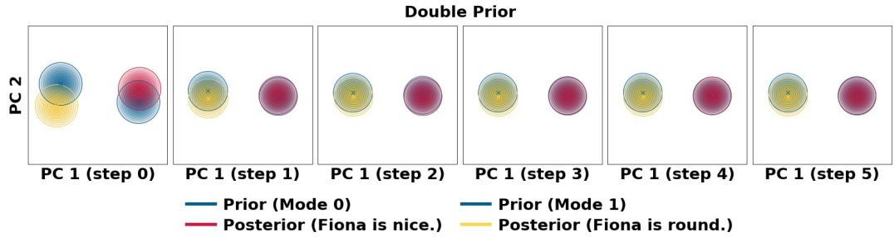  
Figure 4: PCA visualization of prior and posterior latent distributions for a HiddenBranch example with two valid reasoning branches. Top: unimodal prior. Bottom: two-component strategyconditioned prior.

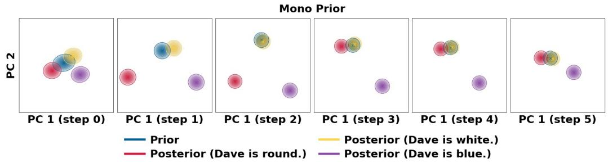

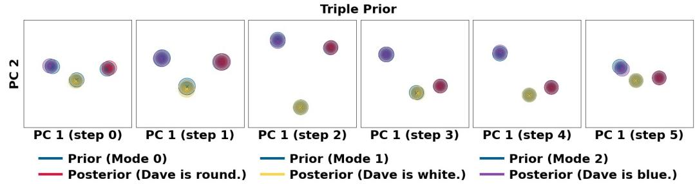  
Figure 5: PCA visualization of prior and posterior latent distributions for a HiddenBranch example with three valid reasoning branches. Top: unimodal prior. Bottom: three-component strategyconditioned prior.

## C.2 ANALYSIS OF HETEROGENEOUS REASONING STRATEGIES

Multimodal latent reasoning. To further examine how PLRM represents heterogeneous reasoning trajectories, we visualize the learned prior and posterior distributions in the latent space. Figures 4–6 show representative HiddenBranch examples with two, three, and four valid reasoning branches, respectively. For each example, we compare a unimodal prior with a strategy-conditioned prior whose number of components matches the number of valid reasoning branches. As shown in Figure 4, when two distinct posterior modes are induced by different valid reasoning trajectories, a single Gaussian prior must account for both modes simultaneously. In contrast, the strategyconditioned prior maintains separate components corresponding to the different posterior modes across latent reasoning steps. Figures 5 and 6 show that the same behavior extends to settings with three and four valid reasoning branches. As the number of heterogeneous trajectories increases, the posterior exhibits multiple distinct modes, while the corresponding strategy-conditioned prior preserves multiple components rather than representing all trajectories with a single distribution. These visualizations are consistent with the motivation in Section 3.3: the discrete strategy variable separates heterogeneous reasoning modes, allowing the continuous latent variables to model variation within each mode.

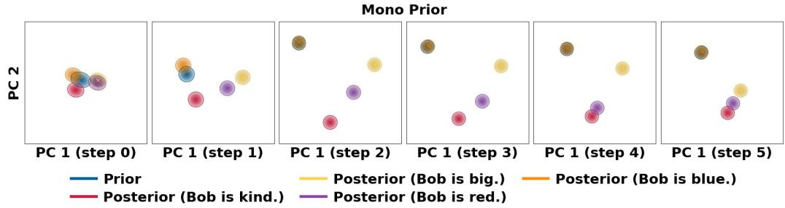

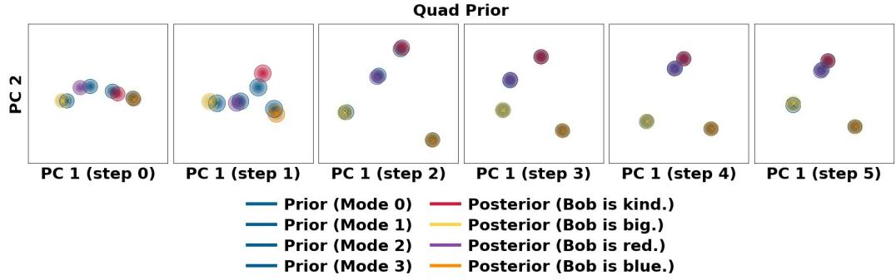  
Figure 6: PCA visualization of prior and posterior latent distributions for a HiddenBranch example with four valid reasoning branches. Top: unimodal prior. Bottom: four-component strategyconditioned prior.

Qualitative strategy-conditioned generations. To examine whether the separated latent modes correspond to meaningful differences in reasoning behavior, we further inspect generations conditioned on individual strategy modes. Figures 7–9 present representative HiddenBranch examples with two, three, and four valid reasoning branches, respectively. Given the same input, different strategy modes generate distinct valid missing facts together with their corresponding reasoning trajectories and answers. In the two-branch example (Figure 7), the two strategy modes recover different valid missing facts and follow different proof paths for the same query. Figures 8 and 9 extend this observation to three- and four-branch settings, where individual modes similarly generate distinct valid solutions. Importantly, the diversity across modes reflects differences in the underlying reasoning paths rather than merely variations in surface-level verbalization. Together with the latent-space visualizations above, these examples suggest that the learned strategy variable captures semantically distinct reasoning modes, while the continuous latent trajectory represents the reasoning process associated with each mode.

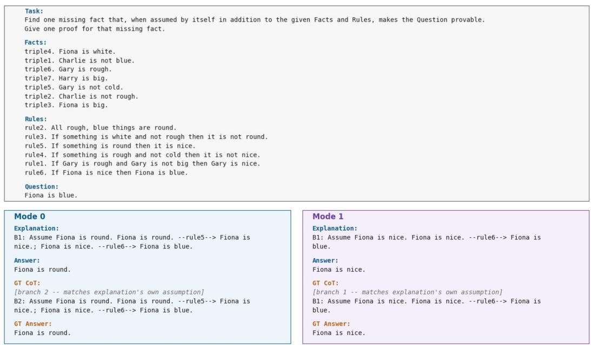  
Figure 7: Qualitative HiddenBranch example with two valid reasoning branches generated from different strategy modes.

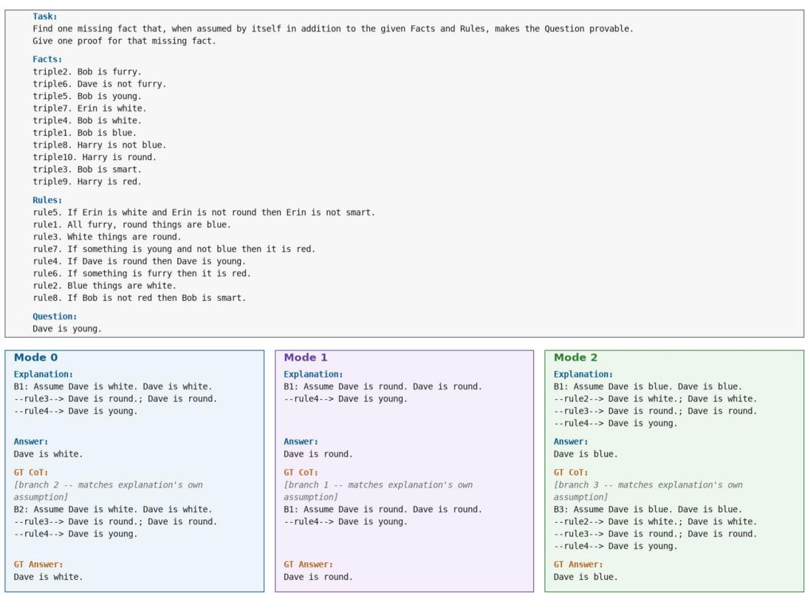  
Figure 8: Qualitative HiddenBranch example with three valid reasoning branches generated from different strategy modes.

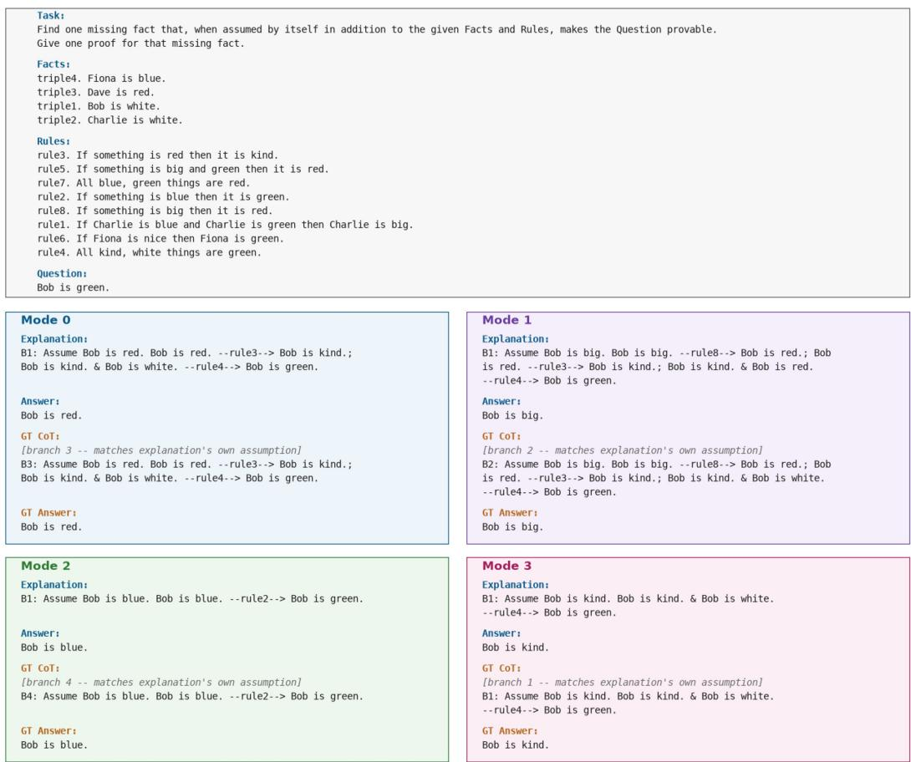  
Figure 9: Qualitative HiddenBranch example with four valid reasoning branches generated from different strategy modes.