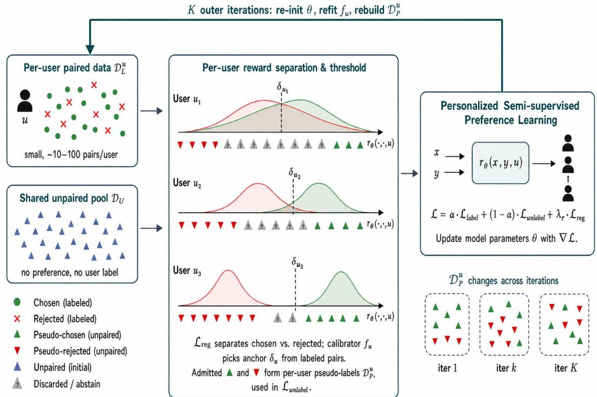
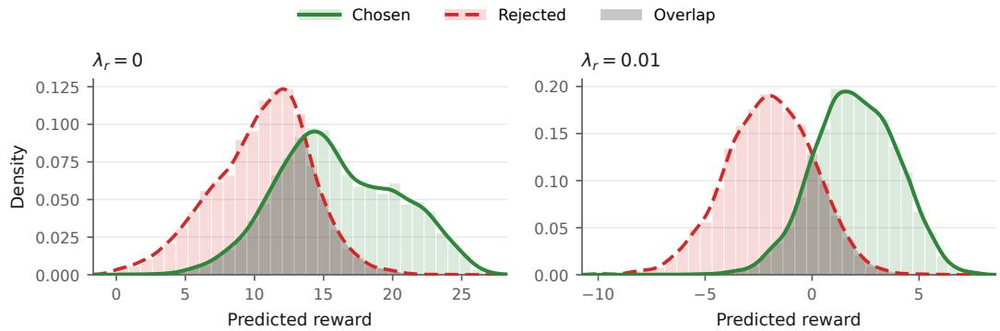
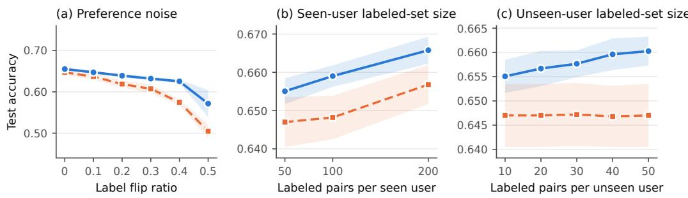
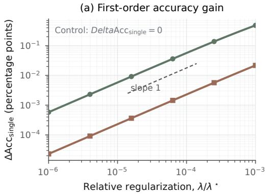
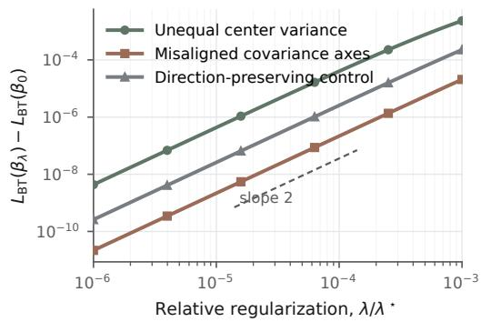
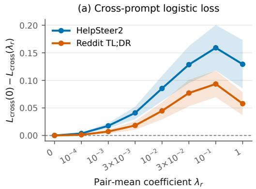
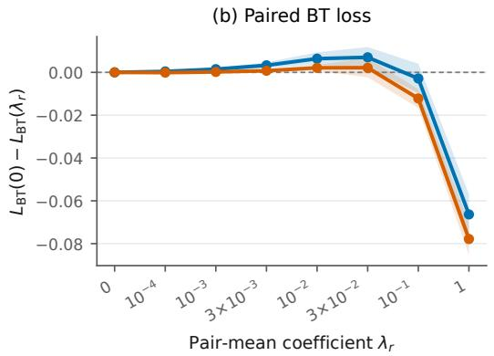
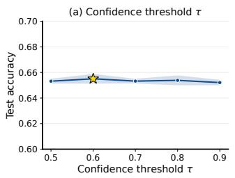
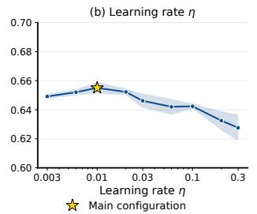
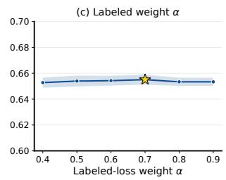

# PerSPL: Personalized Semi-supervised Preference Learning

Xiaoan Xu1, Tingzhou Wei1, Juncheng Dong1 Korel Gundem2, Ethan X. Fang1, Zhengling Qi2

1Duke University 2George Washington University

## Abstract

Personalized reward models require user-specific preference comparisons, but collecting such feedback is costly and provides only limited supervision for each user. At the same time, large pools of responses can be generated without user identities or preference labels, yet existing personalized reward models leave this data unused. Directly learning from these responses is difficult because pairwise objectives constrain relative scores within a prompt, whereas pseudo-labeling individual responses requires scores that are comparable across prompts for the same user. We propose PerSPL (Personalized Semi-supervised Preference Learning), a backbone-agnostic framework that uses pair-mean score centering to stabilize this cross-prompt score coordinate and iteratively turns unlabeled responses into user-specific training signals. Against seven representative baselines across four benchmarks—PersonalLLM, HelpSteer2, Reddit TLDR, and Chatbot Arena— PerSPL achieves the highest reported mean accuracy among the evaluated methods for both seen and unseen users. The two latter benchmarks provide real-user preference comparisons in summarization and open-domain chatbot interaction, respectively. These results indicate that unlabeled responses can provide additional supervision for personalized reward modeling when per-user preference labels are scarce.

## 1 Introduction

Large language models are expected to serve users with different goals, values, and communication preferences. The best response for one user may therefore not be the best for another Bakker et al. [2022], Durmus et al. [2023], Kirk et al. [2024], Ryan et al. [2025]. Alignment pipelines commonly learn what people prefer by asking them to compare two responses to the same prompt. A reward model learns to assign higher scores to preferred responses, and these scores guide model training or response selection Christiano et al. [2017], Ouyang et al. [2022], Bai et al. [2022]. Most reward models, however, pool all comparisons and learn a single, population-wide notion of a good response. When users disagree systematically, this aggregate reward can obscure their differences and poorly reflect individual preferences. Personalized reward models instead make the score depend on the user and their prior feedback Poddar et al. [2024], Chen et al. [2025], Bose et al. [2025], Cai et al. [2026].

Personalizing the score creates a more demanding data requirement. A population model can pool judgments from all annotators, whereas a personalized model must learn about each user from that user’s limited feedback. Every preference label requires the user to inspect and compare responses, so even seen users provide only short histories and a new user must be modeled from a handful of examples. Responses themselves are easier to obtain because they can be generated or collected without additional user feedback. This creates an opportunity to supplement scarce per-user labels with a much larger, shared pool of unpaired responses. Existing personalized reward models improve learning from sparse comparisons by sharing information across users Poddar et al. [2024], Chen et al. [2025], Bose et al. [2025], Cai et al. [2026], but they do not use this pool as additional supervision. Preprint.

  
Figure 1: Overview of PERSPL. A small set of labeled comparisons identifies each user’s preferences, while pair-mean score centering makes reward scores more comparable across prompts. A calibrator fitted separately for each user assigns pseudo-labels to confident responses from a shared unpaired pool and discards ambiguous ones. The reward model is then trained iteratively on both labeled and pseudo-labeled data.

What is missing is a way to turn the same unpaired response into potentially different training signals for different users.

Pairwise supervision alone does not determine how to pseudo-label individual responses across prompts. It requires a preferred response to score above the rejected response for the same prompt, but it does not fix where either score lies relative to scores for other prompts. Shifting both scores for a prompt by the same amount preserves the pairwise prediction while changing these cross-prompt comparisons. This ambiguity is irrelevant when ranking responses to the same prompt. It matters for an unpaired example, which contains one response and must be judged against a threshold fitted across prompts. Reliable pseudo-labeling therefore requires comparable scores across prompts for each user. Existing semi-supervised preference-learning methods use unlabeled data to train a population-wide reward or policy He et al. [2024], Kim et al. [2024], Lee et al. [2025]. However, these methods do not provide this user-specific score comparability.

We address these challenges with PerSPL (Personalized Semi-supervised Preference Learning), which combines cross-prompt score stabilization with user-specific pseudo-labeling. To make scores more comparable across prompts, PerSPL encourages the two scores in each labeled pair to have mean zero, a mechanism we call pair-mean score centering. It then fits a per-user mapping from reward scores to preference probabilities, so the same response can receive different pseudo-labels across users. PerSPL retains confident pseudo-labels and iteratively trains on them alongside labeled data, extracting additional supervision without collecting new user feedback. Figure 1 shows how labeled and unpaired data interact in this process.

We make three contributions:

• Personalized learning from unpaired responses. We formulate semi-supervised personalized reward modeling, in which limited per-user comparisons are supplemented by a shared pool of responses without user identities or preference labels. PerSPL converts this pool into user-specific supervision for seen users and for new users given a small labeled support set.

• Score centering for cross-prompt pseudo-labeling. We identify a score-coordinate ambiguity that prevents pairwise reward models from directly pseudo-labeling individual responses across prompts. We introduce pair-mean centering to address this ambiguity, connect it theoretically to cross-prompt and single-response risk, and show experimentally that it enables unpaired training to improve personalized reward learning.

• Evaluation across complementary personalization settings. Against seven representative baselines, PerSPL achieves the highest reported mean seen- and unseen-user accuracy among the evaluated methods in every primary setting across four benchmarks, including real-user preferences from Reddit TLDR and Chatbot Arena. Controlled generator-shift experiments show that the overall unlabeled-data benefit persists across all tested mixtures.

## 2 Related Work

Personalized reward modeling. Existing personalized reward models address per-user feedback scarcity through architectural sample efficiency, falling into the three paradigms identified by MRM Cai et al. [2026]: (1) personalized input methods that condition a shared reward on userspecific signals such as personas or learned embeddings Zhao et al. [2023], induced personas Ryan et al. [2025], in-context preferences Singh et al. [2025], or a user-specific latent Poddar et al. [2024]; (2) personalized parameter methods that add user-specific modules over a shared backbone Li et al. [2024], Chen et al. [2025], Bose et al. [2025], deliberately keeping the per-user parameter count small to remain tractable on tens of pairs; and (3) meta-learning methods that learn an adaptable initialization for few-shot inner-loop updates Cai et al. [2026], with related downstream work on heterogeneous direct alignment at the policy level Shirali et al. [2025], Zhang et al. [2024]. All three paradigms attack per-user scarcity through architecture, sharing the implicit assumption that the only available signal is each user’s labeled preference pairs. In contrast, PerSPL attacks per-user scarcity at the data level, turning each user’s unpaired responses into pseudo-labeled supervision.

Semi-supervised preference learning under limited feedback. A separate line, semi-supervised reward modeling, leverages unlabeled data to mitigate annotation cost, but in the homogeneous-reward setting. SSRM He et al. [2024] self-trains on unlabeled paired responses, SPA Kim et al. [2024] iteratively generates responses from the current policy and DPO-self-labels them, and SSPO Lee et al. [2025] extends pseudo-labeling to unpaired SFT responses around a global threshold KDE-estimated from labeled data (see also Park et al. [2022]). Each method learns one population-wide reward model or policy and applies one global pseudo-labeling rule, with no mechanism for cross-user preference variation. PerSPL is purpose-built for personalized reward modeling with unpaired data, a problem these homogeneous-reward methods cannot address; we therefore omit them as empirical baselines.

## 3 Problem Setup

Personalized preference learning. For a user u, prompt x, and response y, a personalized reward model assigns a scalar score $r _ { \theta } ( x , y , u )$ . Among responses to the same prompt, the model predicts that the user prefers the one with the higher score. Each labeled comparison $( x , y ^ { + } , y ^ { - } )$ records that user u prefers $y ^ { + }$ to $y ^ { - }$ for the same prompt. Writing $r ^ { \pm } = r _ { \theta } ( x , y ^ { \pm } , u )$ , the Bradley–Terry model assigns the preference probability and loss

$$
\operatorname* { P r } ( y ^ { + } \succ y ^ { - } \mid x , u ) = \sigma ( r ^ { + } - r ^ { - } ) , \qquad \mathcal { L } _ { \mathrm { B T } } = - \log \sigma ( r ^ { + } - r ^ { - } ) ,\tag{1}
$$

where $\sigma ( t ) = ( 1 + e ^ { - t } ) ^ { - 1 }$

For each user $u , \mathcal { D } _ { L } ^ { u }$ denotes the labeled comparisons available for that user. For a seen user, these comparisons are available during joint training. For a previously unseen user, they form the small support set used at adaptation, and evaluation uses disjoint comparisons. Thus, we study few-shot personalization, where every user provides some preference feedback, rather than zero-shot personalization. All users also share an unpaired pool $\mathcal { D } _ { U }$ of prompt–response examples $( x , y )$ . Each example contains one response to a prompt and has neither a preference label nor a user identity. We focus on the regime in which this shared response pool is much larger than the labeled comparison set available for any individual user. Our goal is to use the shared pool to improve personalized ranking for both seen and unseen users without collecting additional user feedback. Because an unpaired example has no alternative response, using it requires interpreting its score relative to responses from other prompts.

Cross-prompt score ambiguity. The BT loss constrains the score difference between two responses to the same prompt. It does not constrain their common score location. For any prompt–user offset

$c ( x , u )$ , the transformed reward function

$$
r ^ { \prime } ( x , y , u ) = r _ { \theta } ( x , y , u ) + c ( x , u )\tag{2}
$$

produces the same preference probability and BT loss. This invariance is harmless for same-prompt ranking because the offset cancels, but it changes how a score compares with responses from other prompts and whether it crosses a pseudo-labeling threshold. The pairwise objective therefore does not identify the cross-prompt score coordinate required for single-response pseudo-labeling.

The usual held-out metric cannot reveal this ambiguity. For held-out comparison $i ,$ let $r _ { i } ^ { \pm } ~ =$ $r _ { \theta } ( x _ { i } , y _ { i } ^ { \pm } , u )$ . PairAcc measures whether the preferred response beats its paired alternative, whereas GlobalAcc diagnoses the cross-prompt ordering relevant to single-response pseudo-labeling:

$$
\mathrm { P a i r A c c } _ { u } = \mathrm { P r } ( r _ { i } ^ { + } > r _ { i } ^ { - } ) , \qquad \mathrm { G l o b a l A c c } _ { u } = \mathrm { P r } ( r _ { i } ^ { + } > r _ { j } ^ { - } ) ,\tag{3}
$$

where i and $j$ are independently sampled held-out comparisons for the same user. PairAcc evaluates the target same-prompt ranking task. GlobalAcc is a diagnostic of whether preferred and rejected responses remain ordered across prompts. It requires comparability within each user, not across users.

For example, consider two prompts with reward scores

$$
x _ { a } : ( r _ { a } ^ { + } , r _ { a } ^ { - } ) = ( 1 0 1 , 1 0 0 ) , \qquad x _ { b } : ( r _ { b } ^ { + } , r _ { b } ^ { - } ) = ( 1 , 0 ) .
$$

Both same-prompt decisions are correct, so PairAcc is 1, but the comparison $r _ { b } ^ { + } = 1 < r _ { a } ^ { - } = 1 0 0$ fails and GlobalAcc is $3 / 4$ . Centering each pair around zero maps both score pairs to $( 0 . 5 , - 0 . 5 )$ preserving PairAcc and yielding GlobalAcc = 1 in this example. This contrast motivates the centering mechanism in Section 4.1.

## 4 PerSPL: Personalized Semi-supervised Preference Learning

PerSPL turns the shared unpaired pool $\mathcal { D } _ { U }$ into user-specific training data through cross-prompt score centering, per-user calibration and pseudo-labeling, and iterative self-training. Figure 1 shows their interaction, and Appendix A.3 gives the full training procedure.

## 4.1 Pair-mean score centering

The Problem Setup shows that pairwise supervision leaves the common score location of each labeled pair unidentified. Using the rewards $r ^ { + }$ and $r ^ { - }$ defined in the Problem Setup, the BT loss depends only on their difference. PerSPL supplies a training signal for their mean with

$$
\mathcal { L } _ { \mathrm { r e g } } = \mathbb { E } \left[ \left( \frac { r ^ { + } + r ^ { - } } { 2 } \right) ^ { 2 } \right] ,\tag{4}
$$

where the expectation is over users and their labeled comparisons. This penalty acts directly on pair centers rather than output-coordinate margins. Because both are produced by the same reward model, training can still change them jointly. Appendix B characterizes this score-space role through cross-prompt risk, an illustrative Gaussian model, a one-sided fixed-budget analysis, and real-data diagnostics.

## 4.2 Per-user calibration and pseudo-labeling

With this centering signal, PerSPL learns how each user’s reward scores relate to their observed preferences. For each labeled pair in $\mathcal { D } _ { I } ^ { u }$ , we assign target 1 to the chosen-response reward and target 0 to the rejected-response reward. We fit a non-decreasing isotonic regressor $f _ { u } : \mathbb { R }  [ 0 , 1 ]$ to these labeled rewards with the Pool-Adjacent-Violators algorithm Zadrozny and Elkan [2002], Niculescu-Mizil and Caruana [2005]. Thus, $f _ { u } ( r )$ is a monotone empirical estimate of the probability that a score r appears on the chosen side of user u’s comparisons. The fit is a stop-gradient target and also defines the per-user score anchor

$$
\begin{array} { r } { \delta _ { u } = \operatorname* { i n f } \{ s : f _ { u } ( s ) \geq \frac { 1 } { 2 } \} . } \end{array}\tag{5}
$$

For an unpaired response, write $r = r _ { \theta } ( x , y , u )$ and choose $\tau \in ( 1 / 2 , 1 )$ ). PerSPL assigns $z = 1$ if $f _ { u } ( r ) > \tau$ , assigns $z = 0 \mathrm { i f } f _ { u } ( r ) < 1 - \tau$ , and otherwise abstains. The retained triples $( x , y , z )$ form $\mathcal { D } _ { P } ^ { u }$ , the pseudo-labeled set for user u. Their average pointwise loss is

$$
\mathcal { L } _ { \mathrm { u n l a b e l } } = - \mathbb { E } [ z \log \sigma ( r - \delta _ { u } ) + ( 1 - z ) \log \sigma ( \delta _ { u } - r ) ] ,\tag{6}
$$

where the expectation is over users and their admitted responses. Only confident responses contribute to this loss; all original comparisons remain in the labeled objective.

## 4.3 Iterative self-training

Because pseudo-labels depend on the current reward model, PerSPL alternates between training the model and updating the pseudo-labels. Within each outer iteration, every $\mathcal { D } _ { P } ^ { u }$ remains fixed while the model trains for a fixed number of inner epochs using

$$
\begin{array} { r } { \mathscr { L } ^ { ( k ) } = \left\{ \begin{array} { l l } { \mathcal { L } _ { \mathrm { l a b e l } } + \lambda _ { r } \mathcal { L } _ { \mathrm { r e g } } , } & { k = 1 , } \\ { \alpha \mathcal { L } _ { \mathrm { l a b e l } } + ( 1 - \alpha ) \mathcal { L } _ { \mathrm { u n l a b e l } } + \lambda _ { r } \mathcal { L } _ { \mathrm { r e g } } , } & { k > 1 , } \end{array} \right. \quad \alpha \in [ 0 , 1 ] , } \end{array}\tag{7}
$$

where $\mathcal { L } _ { \mathrm { l a b e l } }$ is the average BT loss from Eq. (1) over the labeled comparisons. The first iteration uses only labeled comparisons to produce the initial reward model and calibrators; subsequent iterations combine them with the current pseudo-labeled set.

After each inner epoch, PerSPL refits $f _ { u }$ and $\delta _ { u }$ using only the current rewards on $\mathcal { D } _ { L } ^ { u }$ , so the calibration fit itself uses only labeled examples. At the end of each outer iteration, PerSPL applies $f _ { u } \circ r _ { \theta }$ to $\mathcal { D } _ { U }$ and replaces every $\mathcal { D } _ { P } ^ { u }$ using the confidence rule above. The reward model is randomly reinitialized before the next iteration. Algorithm 1 specifies the minibatch sampling, update order, and complete schedule.

## 5 Experiments

Our primary evaluation compares PerSPL with seven representative baselines on four benchmarks spanning synthetic and real responses and simulated and real users. We then use ablations and controlled studies to examine the contribution of unlabeled training, its interaction with pair-mean centering, and its behavior under different label budgets, preference noise, and response-distribution shift.

## 5.1 Datasets

The four benchmarks separate response realism from user realism. PersonalLLM Zollo et al. [2024] uses synthetic responses and Dirichlet-sampled simulated users. HelpSteer2 Wang et al. [2024] uses human-rated responses with simulated users defined by weights over rating attributes. Reddit TLDR Stiennon et al. [2020] contains real users and human preferences on summaries. Chatbot Arena Chiang et al. [2024] contains real users and human preferences over open-domain chatbot responses. PersonalLLM uses $\alpha _ { \mathrm { d i v } } \in \{ 0 . 0 0 1 , 0 . 0 1 , 0 . 1 \}$ , while HelpSteer2 uses $\alpha _ { \mathrm { d i v } } \in \{ 0 . 0 1 , 0 . 1 \}$ Appendix A.1 gives the complete construction and split definitions.

## 5.2 Baselines and Evaluation Protocol

Baselines and architecture. We compare against a homogeneous Bradley–Terry reward model (BT), personalized-input methods (GPO, VPL), personalized-parameter methods (PAL, LoRe), and the meta-learning method MRM with its RPO objective Zhao et al. [2023], Poddar et al. [2024], Chen et al. [2025], Bose et al. [2025], Cai et al. [2026]. Each baseline uses its released implementation and a benchmark-level configuration shared across seeds. PerSPL uses the same reward-head architecture as LoRe, providing an architecture-controlled comparison between the two methods. Both operate on the same frozen 4,096-dimensional final-token representation; PerSPL learns a low-rank linear basis and simplex-valued user weights. The default PerSPL configuration uses $\lambda _ { r } = 0 . 0 1$ across benchmarks; ablations explicitly mark deviations. Dataset construction, the exact reward head, optimizer settings, and stage-specific configurations for the main results are reported in Appendix A, including Table 5.

Evaluation protocol. Seen users are trained jointly, whereas each unseen user is adapted only from its designated support set. All test comparisons are held out. To ensure consistent comparisons, methods use the same assigned splits, labeled budgets, and seed identities. Methods defined on frozen features (Skywork V2, BT, GPO, LoRe, MRM, and PerSPL) use the same cached 4,096-dimensional representations; VPL and PAL retain the native GPT-2 and OPT-350M backbones prescribed by their released implementations. The supervised baselines receive the same labeled comparisons, while PerSPL additionally receives $\mathcal { D } _ { U }$ , whose responses carry neither user identities nor preference labels. We report within-prompt pairwise accuracy separately for seen and unseen users. Unless noted, results are mean ± population standard deviation (ddof=0) over five matched seeds, while the controlled shift study uses ten. Appendix Table 11 additionally reports paired-bootstrap 95% confidence intervals obtained from 20,000 resamples of the matched seed-level differences. VPL

Table 1: Full baseline comparison on PersonalLLM, HelpSteer2, Reddit TLDR, and Chatbot Arena. We report pairwise preference accuracy (%) on seen and unseen users as mean ± std over five matched seeds. PersonalLLM and HelpSteer2 use $\alpha _ { \mathrm { d i v } } { = } 0 . 1$ 1; Reddit TLDR uses 100 or 150 labeled examples per seen user; Chatbot Arena uses 25/12 labeled pairs per seen/unseen user. On Chatbot Arena, VPL/PAL use their released pooled-pair evaluators; the remaining methods macro-average user accuracies. Best per column is in bold.
<table><tr><td rowspan="3"></td><td colspan="2">PersonalLLM</td><td colspan="2">HelpSteer2</td><td colspan="4">Reddit TLDR</td><td colspan="2">Chatbot Arena</td></tr><tr><td colspan="2"> $\alpha _ { \mathrm { d i v } } { = } 0 . 1$ </td><td colspan="2"> $\alpha _ { \mathrm { d i v } } { = } 0 . 1$ </td><td colspan="2"></td><td colspan="2">100 examples/seen user 150 examples/seen user</td><td colspan="2">25/12 labels</td></tr><tr><td>Seen</td><td>Unseen</td><td>Seen</td><td>Unseen</td><td>Seen</td><td>Unseen</td><td>Seen</td><td>Unseen</td><td>Seen</td><td>Unseen</td></tr><tr><td>Skywork V2</td><td>81.6±1.6</td><td>82.4±1.4</td><td>67.0±0.3</td><td>67.4±0.3</td><td>64.5±0.8</td><td> $6 4 . 6 { \pm } 0 . 8 $ </td><td> $6 4 . 5 { \pm } 0 . 8 $ </td><td> $6 4 . 6 { \pm } 0 . 8 $ </td><td>80.3±1.4 76.9±1.4</td><td></td></tr><tr><td>BT</td><td>88.8±3.2</td><td>89.0±3.8</td><td>63.0±3.7</td><td></td><td>63.2±3.8 63.2±4.8</td><td> $6 4 . 3 { \pm } 3 . 8 $ </td><td>64.4±3.5</td><td> $6 5 . 2 { \pm } 3 . 1 $ </td><td>80.3±2.0 78.1±3.0</td><td></td></tr><tr><td>VPL</td><td>89.6±1.2 89.8±1.2 59.6±0.7 59.6±0.6 57.0±0.8</td><td></td><td></td><td></td><td></td><td> $5 6 . 9 { \pm } 1 . 3 $ </td><td> $5 7 . 6 { \pm } 1 . 5 $ </td><td> $5 7 . 0 { \pm } 1 . 6 $ </td><td>64.9±3.1 61.9±6.3</td><td></td></tr><tr><td>GPO</td><td>89.1±6.7 89.6±6.8 65.8±2.6 66.4±2.3 63.8±2.5</td><td></td><td></td><td></td><td></td><td> $6 4 . 6 { \pm } 2 . 7 $ </td><td>65.7±1.7</td><td> $6 5 . 9 { \pm } 1 . 3 $ </td><td>79.4±1.7 77.7±1.4</td><td></td></tr><tr><td>PAL</td><td>84.7±1.4 85.2±1.5 57.1±1.4 56.9±1.0 56.9±1.6</td><td></td><td></td><td></td><td></td><td> $5 6 . 4 \pm 1 . 2 $ </td><td> $5 7 . 1 { \pm } 1 . 8 $ </td><td> $5 7 . 5 { \pm } 1 . 8 $ </td><td>58.4±3.0 58.4±3.0</td><td></td></tr><tr><td>LoRe</td><td>94.6±0.5 94.0±0.9</td><td></td><td>69.6±0.8 70.1±1.0 65.3±1.5</td><td></td><td></td><td> $6 8 . 4 { \pm } 0 . 4 $ </td><td> $6 5 . 2 { \pm } 0 . 6 $ </td><td> $6 7 . 7 { \pm } 1 . 0 $ </td><td>81.3±2.1 78.4±2.1</td><td></td></tr><tr><td>MRM</td><td>91.6±0.6 92.0±0.5 70.7±0.3 70.9±0.4 70.0±1.0</td><td></td><td></td><td></td><td></td><td> $6 9 . 8 { \pm } 0 . 6 $ </td><td> $7 0 . 0 { \pm } 1 . 1 $ </td><td> $6 9 . 6 { \pm } 0 . 7 \ \AA$ </td><td>80.7±1.4 77.2±1.6</td><td></td></tr><tr><td>PerSPL</td><td>95.7±0.2 95.5±0.2</td><td></td><td> $\mathbf { 7 1 . 6 { \pm } 0 . 3 }$ </td><td> ${ \bf 7 1 . 2 \pm 0 . 8 }$ </td><td> ${ \bf 7 0 . 7 \pm 1 . 2 }$ </td><td> ${ \bf 7 0 . 1 { \pm 0 . 6 } }$ </td><td> $\mathbf { 7 0 . 9 \pm 0 . 9 }$ </td><td> $\mathbf { 7 0 . 3 \pm 0 . 7 }$ </td><td>83.0±3.0 81.0±2.4</td><td></td></tr></table>

follows its released preprocessing by excluding examples above its 1,024-token limit; on Chatbot Arena, it therefore evaluates 555 of the 571 assigned test comparisons in each seed.  
Compute. The PersonalLLM, HelpSteer2, and Reddit TLDR experiments used a mix of eight NVIDIA A100 80GB and five RTX A5000 24GB GPUs and required approximately seven hours of wall-clock time across their runs. Chatbot Arena was run separately on the same cluster; the distribution-shift analysis is excluded from this estimate.

## 5.3 Main Results

Table 1 summarizes the full baseline comparison on PersonalLLM, HelpSteer2, Reddit TLDR, and Chatbot Arena.

Among the methods evaluated in each setting, PerSPL has the highest reported mean in every seenand unseen-user column. On PersonalLLM, it reaches $9 5 . 6 \pm 0 . 1$ overall, compared with $9 4 . 3 \pm 0 . 7$ for LoRe. On HelpSteer2 and Reddit TLDR, PerSPL has higher mean seen- and unseen-user accuracy than the strongest baseline in every reported setting. The Reddit TLDR and Chatbot Arena results extend this pattern to real users and human preferences in summarization and open-domain dialogue. Complete results across all diversity and label-budget settings appear in Appendix C.1, including Overall accuracy for Chatbot Arena.

To assess seed-level uncertainty, we also compute absolute accuracy differences between PerSPL and the baseline with the highest overall mean in each setting. The paired-bootstrap intervals exclude zero for every seen-user and overall comparison and for four of the five unseen-user comparisons; Appendix Table 11 reports the complete estimates.

## 5.4 Ablations and Analysis

Component ablations. Table 2 reports a $2 \times 2$ factorial comparison of pair-mean regularization and unpaired training in all four HelpSteer2 and Reddit TLDR settings. Each variant keeps the configuration of the full model and changes only $\lambda _ { r } , K ,$ , or both, in both training phases. With unpaired training off, adding the regularizer changes seen accuracy by between −0.1 and +0.1 points. Without regularization, adding unpaired training changes seen accuracy by −6.5 to −2.9 points; with regularization, it changes seen accuracy by +0.5 to +1.8 points. The resulting interactions range from +3.4 to +8.3 points. For seen users, these contrasts show that centering changes the observed contribution of unpaired training from negative to positive. The large drop after removing regularization therefore reflects the interaction between centering and unpaired training rather than a standalone regularization gain. Appendix C.3 reports paired intervals for the component comparisons.

Centering diagnostics. Figure 2 illustrates how pair-mean centering changes the chosen and rejected reward distributions on PersonalLLM, pooled over seen users. Its direct score-space action is on pair centers; shared parameters determine the learned centers and margins jointly. Appendix B characterizes this geometry and the labeled-only regularization path. Moderate centering reduces within-user pair-mean variation and cross-prompt loss while preserving held-out pairwise fit.

Table 2: Component ablations on HelpSteer2 $( \alpha _ { \mathrm { d i v } } \in \lbrace 0 . 1 , 0 . 0 1 \rbrace )$ and Reddit TLDR (100 or 150 labeled examples per seen user), forming a regularization $\times$ unpaired-training factorial comparison. Each variant changes only $\lambda _ { r } , K$ , or both, in both training phases; all other hyperparameters equal those of the full model. We report seen and unseen accuracy (%), mean ± std over five seeds. Best per column in bold.
<table><tr><td rowspan="3"></td><td colspan="4">HelpSteer2</td><td colspan="4">Reddit TLDR</td></tr><tr><td colspan="2"> $\alpha _ { \mathrm { d i v } } { = } 0 . 1$ </td><td colspan="2"> $\alpha _ { \mathrm { d i v } } { = } 0 . 0 1$ </td><td colspan="2"></td><td colspan="2">100 examples/seen user 150 examples/seen user</td></tr><tr><td>Seen</td><td>Unseen</td><td>Seen</td><td>Unseen</td><td>Seen</td><td>Unseen</td><td>Seen</td><td>Unseen</td></tr><tr><td>PerSPL  $( \mathcal { L } _ { \mathrm { l a b e l } } + \mathcal { L } _ { \mathrm { u n l a b e l } } + \mathcal { L } _ { \mathrm { r e g } } )$ </td><td> $\mathbf { 7 1 . 6 { \pm } 0 . 3 }$ </td><td>71.2±0.8 66.0±0.4 65.0±0.7</td><td></td><td></td><td> ${ \bf 7 0 . 7 \pm 1 . 2 }$ </td><td> ${ \bf 7 0 . 1 \pm 0 . 6 }$ </td><td> $\mathbf { 7 0 . 9 2 0 . 9 }$ </td><td> $\mathbf { 7 0 . 3 \pm 0 . 7 }$ </td></tr><tr><td> $\mathcal { L } _ { \mathrm { l a b e l } } + \mathcal { L } _ { \mathrm { u n l a b e l } } \left( \lambda _ { r } { = } 0 \right)$ </td><td> $6 6 . 5 { \pm } 0 . 5 $ </td><td>69.7±0.9 62.5±1.2 63.2±0.5</td><td></td><td></td><td> $6 3 . 7 { \pm } 1 . 1 $ </td><td> $6 8 . 6 { \pm } 0 . 7 \ $ </td><td> $6 2 . 5 { \pm } 2 . 1 $ </td><td> $6 2 . 5 { \pm } 1 . 4 $ </td></tr><tr><td> ${ \mathcal { L } } _ { \mathrm { l a b e l } } + { \mathcal { L } } _ { \mathrm { r e g } } \left( K { = } 1 \right)$ </td><td> $7 0 . 9 { \pm } 0 . 6 $ </td><td></td><td></td><td>71.0±0.5 65.5±0.4 64.6±0.8</td><td> $6 9 . 4 \pm 1 . 4$ </td><td> $6 9 . 5 { \pm } 1 . 0 $ </td><td> $6 9 . 1 { \pm } 1 . 0 $ </td><td> $\mathbf { 7 0 . 3 \pm 0 . 7 }$ </td></tr><tr><td> $\mathcal { L } _ { \mathrm { l a b e l } } \ \mathrm { o n l y } \ ( \breve { \lambda } _ { r } = 0 , K = 1 )$ </td><td> $7 0 . 9 { \pm } 0 . 6 $ </td><td></td><td></td><td>71.1±0.7 65.4±0.3 64.5±0.9</td><td> $6 9 . 5 { \pm } 1 . 3 $ </td><td> $6 9 . 7 { \pm } 1 . 1 $ </td><td> $6 9 . 0 { \pm } 1 . 3 $ </td><td> $6 9 . 6 { \pm } 0 . 7 \ \AA$ </td></tr></table>

  
Figure 2: Reward distributions of chosen and rejected responses on PersonalLLM $( \alpha _ { \mathrm { d i v } } = 0 . 0 1 ) .$ , pooled over all 100 seen users and evaluated on their held-out test pairs (1,000 per user). Both panels use a labeled-only reward head trained identically except for pair-mean regularization $( \lambda _ { r } = 0 \mathrm { v s . } \lambda _ { r } = 0 . 0 1 )$ . Without regularization, the chosen and rejected distributions overlap substantially. With $\lambda _ { r } = 0 . 0 1$ , they are centered near zero and show less overlap. Appendix B provides the corresponding score-space analysis and regularization-path diagnostics.

Noise and label-budget sweeps. We compare PerSPL with the strongest baseline, MRM, while varying preference noise and the labeled budgets of seen and unseen users on HelpSteer2 $( \alpha _ { \mathrm { d i v } } = 0 . 0 1$ Fig. 3).

Preference noise. We apply a label flip ratio from 0 to 0.5 uniformly across users (Fig. 3a). Both methods become less accurate as the noise increases, while PerSPL remains ahead throughout the tested range. The gap is largest at high noise, reaching 5.07 points at a 0.4 flip ratio and 6.69 points at 0.5.

Labeled pairs per seen user. Across 50, 100, and 200 labeled pairs per seen user (Fig. 3b), PerSPL improves as more labels become available and remains 0.81–1.08 points above MRM. The gain therefore persists across the displayed seen-user label budgets.

Labeled pairs per unseen user. Holding the seen-user budget fixed at 50 pairs and varying the unseen-user support set from 10 to 50 (Fig. 3c), PerSPL improves from 65.51% to 66.03%. Its gain over MRM increases from 0.81 to 1.33 points, supporting transfer to new users across the tested adaptation budgets.

Hyperparameter sensitivity. A controlled one-at-a-time sweep of the iso-confidence threshold τ , learning rate $\eta ,$ and labeled-loss weight α on HelpSteer2 $( \alpha _ { \mathrm { d i v } } = 0 . 0 1 )$ ) shows that accuracy is stable across the tested τ and α values. The main learning rate $\eta = 0 . 0 1$ is also stable to nearby choices. Full sweep curves and quantitative comparisons are provided in Appendix C.4; this post-hoc diagnostic does not determine the main configurations.

## 5.5 Controlled Response-distribution Shift

We test whether unlabeled responses remain useful when their generators differ from those represented in the labeled comparisons. Clean-label PersonalLLM is close to ceiling (Table 1), leaving little room to measure the additional contribution of unlabeled data. We therefore use a fixed 0.2 symmetric label-flip rate to create a non-saturated setting. The labeled data and flip rate remain fixed across all conditions and for the labeled-only reference, so label noise changes the task difficulty without changing the response-shift comparison.

Figure 3: Performance under preference noise and varying label budgets on HelpSteer2 $( \alpha _ { \mathrm { d i v } } = 0 . 0 1 )$ . PerSPL is compared with the strongest baseline, MRM. (a) Test accuracy as the label flip ratio increases. (b) Test accuracy with 50–200 labeled pairs per seen user. (c) Test accuracy with 10–50 labeled pairs per unseen user while fixing the seen-user budget at 50. Shaded bands show ±1 standard deviation over five seeds.  
Table 3: Controlled generator shift on PersonalLLM with a 0.2 symmetric label-flip rate (overall accuracy, ten matched seeds). The matched regularized labeled-only reference is 81.49 ± 0.79.
<table><tr><td>OOD fraction  $\rho$ </td><td>PerSPL</td><td>Gain over labeled-only [95% CI]</td></tr><tr><td>0</td><td> $8 4 . 7 0 \pm 1 . 0 9$ </td><td>+3.21 [2.58, 3.82]</td></tr><tr><td>0.25</td><td> $8 4 . 5 5 \pm 1 . 0 2$ </td><td>+3.07 [2.31, 3.73]</td></tr><tr><td>0.50</td><td> $8 3 . 6 3 \pm 1 . 1 2$ </td><td>+2.14 [1.32, 2.90]</td></tr><tr><td>0.75</td><td> $8 2 . 7 1 \pm 0 . 8 9$ </td><td>+1.22 [0.57, 1.84]</td></tr><tr><td>1</td><td> $8 2 . 1 5 \pm 0 . 6 7$ </td><td>+0.66 [0.10, 1.18]</td></tr></table>

We vary only the generator composition of the unlabeled pool, which follows $( 1 - \rho ) P _ { \mathrm { i n } } + \rho P _ { \mathrm { o u t } }$ The six in-domain generators and two held-out generators are disjoint, and the labeled and unpaired pools do not overlap. We compare PerSPL with the same regularized labeled-only model over ten matched seeds. Because this experiment uses corrupted labels, its absolute accuracies are not directly comparable with the clean-label PersonalLLM row in Table 1.

Across the tested mixtures, PerSPL’s overall gain over the labeled-only reference ranges from 0.66 to 3.21 points (Table 3), and every paired interval is above zero. The overall benefit therefore persists even when the unlabeled pool consists entirely of the tested held-out generators. This evidence is specific to the controlled generator shift studied here. Appendix C.3 reports the generator identities and seen/unseen breakdown.

## 6 Conclusion

We introduced PerSPL to turn a shared pool of responses without user or preference labels into userspecific supervision. The method combines pair-mean score centering, per-user isotonic calibration, confidence filtering, and iterative self-training. Against seven representative baselines across four benchmarks, PerSPL has the highest reported mean accuracy among the evaluated methods for both seen and unseen users. Paired-bootstrap intervals support its overall gains in every evaluated HelpSteer2 and Reddit TLDR setting and on Chatbot Arena, which supplies real-user open-domain preferences.

The controlled generator-shift study further defines the scope of the unlabeled-data benefit. Across all tested mixtures, the overall gain over regularized labeled-only training ranges from 0.66 to 3.21 points, with every paired interval above zero. This evidence applies to the tested generators. Per-user calibration requires a labeled anchor, so the current setting studies few-shot rather than zero-shot personalization. Active selection and shift-aware calibration are natural next steps.

## References

Yuntao Bai, Andy Jones, Kamal Ndousse, Amanda Askell, Anna Chen, Nova DasSarma, Dawn Drain, Stanislav Fort, Deep Ganguli, Tom Henighan, et al. Training a helpful and harmless assistant with reinforcement learning from human feedback. arXiv preprint arXiv:2204.05862, 2022. 1

Michiel Bakker, Martin Chadwick, Hannah Sheahan, Michael Tessler, Lucy Campbell-Gillingham, Jan Balaguer, Nat McAleese, Amelia Glaese, John Aslanides, Matt Botvinick, et al. Fine-tuning language models to find agreement among humans with diverse preferences. Advances in neural information processing systems, 35:38176–38189, 2022. 1

Avinandan Bose, Zhihan Xiong, Yuejie Chi, Simon Shaolei Du, Lin Xiao, and Maryam Fazel. Lore: Personalizing llms via low-rank reward modeling. arXiv preprint arXiv:2504.14439, 2025. 1, 3, 5, 23

Hongru Cai, Yongqi Li, Tiezheng Yu, Fengbin Zhu, Wenjie Wang, Fuli Feng, and Wenjie Li. One adapts to any: Meta reward modeling for personalized llm alignment. arXiv preprint arXiv:2601.18731, 2026. 1, 3, 5, 11, 23

Daiwei Chen, Yi Chen, Aniket Rege, Zhi Wang, and Ramya Korlakai Vinayak. Pal: Sample-efficient personalized reward modeling for pluralistic alignment. In The Thirteenth International Conference on Learning Representations, 2025. 1, 3, 5, 23

Wei-Lin Chiang, Lianmin Zheng, Ying Sheng, Anastasios N. Angelopoulos, Tianle Li, Dacheng Li, Hao Zhang, Banghua Zhu, Michael I. Jordan, Joseph E. Gonzalez, and Ion Stoica. Chatbot arena: An open platform for evaluating llms by human preference. arXiv preprint arXiv:2403.04132, 2024. 5, 11, 20, 23

Paul F Christiano, Jan Leike, Tom Brown, Miljan Martic, Shane Legg, and Dario Amodei. Deep reinforcement learning from human preferences. Advances in neural information processing systems, 30, 2017. 1

Esin Durmus, Karina Nguyen, Thomas I Liao, Nicholas Schiefer, Amanda Askell, Anton Bakhtin, Carol Chen, Zac Hatfield-Dodds, Danny Hernandez, Nicholas Joseph, et al. Towards measuring the representation of subjective global opinions in language models. arXiv preprint arXiv:2306.16388, 2023. 1

Cristina Garbacea, Heran Wang, and Chenhao Tan. Personalized benchmarking: Evaluating llms by individual preferences. In Findings of the Association for Computational Linguistics: ACL 2026, pages 639–675, 2026. 11, 20, 23

Yifei He, Haoxiang Wang, Ziyan Jiang, Alexandros Papangelis, and Han Zhao. Semi-supervised reward modeling via iterative self-training. In Findings of the Association for Computational Linguistics: EMNLP 2024, pages 7365–7377, 2024. 2, 3

Dongyoung Kim, Kimin Lee, Jinwoo Shin, and Jaehyung Kim. Spread preference annotation: Direct preference judgment for efficient llm alignment. arXiv preprint arXiv:2406.04412, 2024. 2, 3

Hannah R Kirk, Alexander Whitefield, Paul Röttger, Andrew Bean, Katerina Margatina, Juan Ciro, Rafael Mosquera, Max Bartolo, Adina Williams, He He, et al. The prism alignment dataset: What participatory, representative and individualised human feedback reveals about the subjective and multicultural alignment of large language models. Advances in Neural Information Processing Systems, 37:105236–105344, 2024. 1

Seonggyun Lee, Sungjun Lim, Seojin Park, Soeun Cheon, and Kyungwoo Song. Semi-supervised preference optimization with limited feedback. arXiv preprint arXiv:2511.00040, 2025. 2, 3

Xinyu Li, Ruiyang Zhou, Zachary C Lipton, and Liu Leqi. Personalized language modeling from personalized human feedback. arXiv preprint arXiv:2402.05133, 2024. 3

Alexandru Niculescu-Mizil and Rich Caruana. Predicting good probabilities with supervised learning. In Proceedings of the 22nd international conference on Machine learning, pages 625–632, 2005. 4

Long Ouyang, Jeffrey Wu, Xu Jiang, Diogo Almeida, Carroll Wainwright, Pamela Mishkin, Chong Zhang, Sandhini Agarwal, Katarina Slama, Alex Ray, et al. Training language models to follow instructions with human feedback. Advances in neural information processing systems, 35:27730– 27744, 2022. 1

Jongjin Park, Younggyo Seo, Jinwoo Shin, Honglak Lee, Pieter Abbeel, and Kimin Lee. Surf: Semi-supervised reward learning with data augmentation for feedback-efficient preference-based reinforcement learning. arXiv preprint arXiv:2203.10050, 2022. 3

Sriyash Poddar, Yanming Wan, Hamish Ivison, Abhishek Gupta, and Natasha Jaques. Personalizing reinforcement learning from human feedback with variational preference learning. Advances in Neural Information Processing Systems, 37:52516–52544, 2024. 1, 3, 5, 23

Michael J Ryan, Omar Shaikh, Aditri Bhagirath, Daniel Frees, William Barr Held, and Diyi Yang. Synthesizeme! inducing persona-guided prompts for personalized reward models in llms. In Proceedings of the 63rd Annual Meeting of the Association for Computational Linguistics (Volume 1: Long Papers), pages 8045–8078, 2025. 1, 3

Ali Shirali, Arash Nasr-Esfahany, Abdullah Alomar, Parsa Mirtaheri, Rediet Abebe, and Ariel Procaccia. Direct alignment with heterogeneous preferences. arXiv preprint arXiv:2502.16320, 2025. 3

Anikait Singh, Sheryl Hsu, Kyle Hsu, Eric Mitchell, Stefano Ermon, Tatsunori Hashimoto, Archit Sharma, and Chelsea Finn. Fspo: Few-shot optimization of synthetic preferences personalizes to real users. arXiv preprint arXiv:2502.19312, 2025. 3

Nisan Stiennon, Long Ouyang, Jeffrey Wu, Daniel Ziegler, Ryan Lowe, Chelsea Voss, Alec Radford, Dario Amodei, and Paul F Christiano. Learning to summarize with human feedback. Advances in neural information processing systems, 33:3008–3021, 2020. 5, 11, 23

Zhilin Wang, Yi Dong, Olivier Delalleau, Jiaqi Zeng, Gerald Shen, Daniel Egert, Jimmy J Zhang, Makesh N Sreedhar, and Oleksii Kuchaiev. Helpsteer 2: Open-source dataset for training topperforming reward models. Advances in Neural Information Processing Systems, 37:1474–1501, 2024. 5, 11, 23

Bianca Zadrozny and Charles Elkan. Transforming classifier scores into accurate multiclass probabil ity estimates. In Proceedings of the eighth ACM SIGKDD international conference on Knowledge discovery and data mining, pages 694–699, 2002. 4

Yifan Zhang, Ge Zhang, Yue Wu, Kangping Xu, and Quanquan Gu. Beyond bradley-terry models: A general preference model for language model alignment. arXiv preprint arXiv:2410.02197, 2024. 3

Siyan Zhao, John Dang, and Aditya Grover. Group preference optimization: Few-shot alignment of large language models. arXiv preprint arXiv:2310.11523, 2023. 3, 5, 23

Thomas P Zollo, Andrew Wei Tung Siah, Naimeng Ye, Ang Li, and Hongseok Namkoong. Personalllm: Tailoring llms to individual preferences. arXiv preprint arXiv:2409.20296, 2024. 5, 10, 23

## A Experimental Details

This appendix documents the dataset construction, data splits, model architecture, and training configurations used for the main results.

## A.1 Dataset Construction Details

PersonalLLM. PersonalLLM Zollo et al. [2024] provides a controllable benchmark with modelgenerated responses and simulated users. Each user is constructed by sampling a Dirichle $\left( \alpha _ { \mathrm { d i v } } \right)$ weight vector over 10 RewardBench reward heads, and pairwise preferences are generated by the corresponding weighted reward. We use 100 seen and 100 unseen users, 9,402 training prompts, and 1,000 held-out test prompts at three diversity levels $\alpha _ { \mathrm { d i v } } \in \{ 0 . 0 0 1 , 0 . 0 1 , 0 . 1 \}$ . Smaller $\alpha _ { \mathrm { d i v } }$ yields sharper, more heterogeneous user weights and thus a harder personalization regime. The unpaired pool $\mathcal { D } _ { U }$ is built from source-dataset response candidates with their chosen and rejected labels removed, so no preference signal leaks from $\mathcal { D } _ { U }$ into training.

Table 4: Dataset and evaluation settings for the primary results in Table 1. Label budgets distinguish the histories of seen users from the support sets used to adapt unseen users.
<table><tr><td>Dataset</td><td>Preference source</td><td>Users (seen/unseen)</td><td>Main setting</td><td>Labeled pairs (seen/unseen)</td><td>|Du|</td></tr><tr><td>PersonalLLM</td><td>reward-model scores</td><td>100/100</td><td> $\alpha _ { \mathrm { d i v } } = 0 . 1$ </td><td> $4 5 / 9$ </td><td>5,000</td></tr><tr><td>HelpSteer2</td><td>human attribute ratings</td><td>50/50</td><td> $\alpha _ { \mathrm { d i v } } = 0 . 1$ </td><td> $5 0 \dot { / } 1 0$ </td><td>50,000</td></tr><tr><td>Reddit TLDR</td><td>human comparisons</td><td>20/20</td><td>100 or 150 labels</td><td>100 or 150/50</td><td>149,632</td></tr><tr><td>Chatbot Arena</td><td>human comparisons</td><td>19/19</td><td>active users</td><td>25/12</td><td>3,166</td></tr></table>

Reddit TLDR. Reddit TLDR Stiennon et al. [2020] provides real human preferences on summary quality and serves as our fully real benchmark. Following the MRM benchmark protocol Cai et al. [2026], we use 20 seen and 20 unseen users, with 100 or 150 labeled pairs per seen user and 50 support pairs per unseen user. Evaluation comparisons are disjoint from these support sets. The unpaired pool $\mathcal { D } _ { U }$ consists of the remaining users’ summaries with their preference labels stripped, so the unlabeled signal is drawn from the same response distribution as the labeled set without overlapping preferences.

HelpSteer2. HelpSteer2 Wang et al. [2024] is the real-human multi-attribute counterpart to Personal LLM, replacing LLM-judge reward heads with human attribute ratings. The dataset supplies ∼7K prompt–response pairs annotated by humans on five attributes (helpfulness, correctness, coherence, complexity, verbosity) on a 0–4 scale. We construct personalized users by sampling Dirichlet $\left( \alpha _ { \mathrm { d i v } } \right)$ weight vectors over the five attributes; each user’s preference between two responses is determined by their attribute-weighted score. We use 50 seen and 50 unseen users, 50 labeled pairs per seen user, and 10–50 support pairs per unseen user. Remaining prompt–response pairs (with attribute scores stripped) form $\mathcal { D } _ { U }$ . We sweep $\alpha _ { \mathrm { d i v } } \in \{ 0 . 0 1 , 0 . 1 \}$

Chatbot Arena. We use the Chatbot Arena Conversations dataset Chiang et al. [2024] and follow Personalized Benchmarking Garbacea et al. [2026] in restricting attention to active users. We then remove ties, split each user’s ordered comparisons into an 80% training pool and a held-out 20% test set, and retain the 38 users with at least 25 training comparisons. Seen users receive 25 labeled pairs and unseen users 12; all methods use identical assigned splits and budgets. The held-out test set is used only for evaluation. The remaining 3,166 training-pool comparisons form the unpaired response pool after preference labels and user identities are removed.

## A.2 Implementation Details

Frozen representation and personalized reward head. Following the architecture-controlled setup used for the LoRe comparison, we tokenize each prompt–response sequence to at most 2,048 tokens and cache the final-token hidden representation from Skywork-Reward-V2-Llama-3.1-8B. The resulting $d = 4 { , } 0 9 6$ dimensional representations remain frozen for PerSPL, LoRe, BT, GPO, and MRM; Skywork V2 uses its pretrained scalar head directly. VPL and PAL instead use the native GPT-2 and OPT-350M backbones in their released code. PerSPL learns a linear basis $V \in \mathbb { R } ^ { d \times B }$ and user logits $w _ { u } \in \mathbb { R } ^ { B }$ . With $\pi _ { u } = \operatorname { s o f t m a x } ( w _ { u } )$ , the reward head is $\begin{array} { r } { r _ { u } ( e ) = e ^ { \top } V \pi _ { u } / T } \end{array}$ , where $T = 1 0 0$ . During seen-user training, V and the seen-user logits are optimized jointly. For an unseen user, we copy and freeze the learned basis V and fit only that user’s logits from the designated support comparisons.

Baseline implementations. We use the released implementations on the same assigned data splits and preserve each method’s native architecture. A single benchmark-level configuration is fixed across matched seeds. Appendix F lists the official baseline implementations and their licenses.

Optimization and reporting. We use Adam with zero weight decay and a one-cycle cosine learningrate schedule. The peak learning rate is η in Table 5; the warm-up fraction is 0.3, the initial division factor is 25, and the final division factor is 10,000. Each optimizer step samples two users, four labeled comparisons per user (two on Chatbot Arena), and, after the first outer iteration, up to 16 pseudo-labeled responses per user. Pseudo-label refreshes score 1,000 candidates per user from $\mathcal { D } _ { U }$ (up to 100 on Chatbot Arena). All main configurations use $\lambda _ { r } = 0 . 0 1$ and per-user isotonic calibration. We run matched seeds {42, 43, 44, 45, 46} and report the saved last-epoch checkpoint at the specified budget; no epoch is selected separately for an individual seed. Reported standard deviations use the population convention (ddof=0) over the executed seeds.

Table 5: PerSPL hyperparameters for the main results in Table 1. Here B is the basis rank, η is the peak learning rate, α is the labeled-loss weight in Eq. (7), and τ is the pseudo-label confidence threshold. Parameters shared by all rows are given in the text.
<table><tr><td>Setting B</td><td>η</td><td>α</td><td>T</td></tr><tr><td>PersonalLLM  $( \alpha _ { \mathrm { d i v } } = 0 . 1 )$  2 HelpSteer2  $( \alpha _ { \mathrm { d i v } } = 0 . 1 )$  2</td><td>0.03 0.01</td><td>0.6 0.7</td><td>0.9 0.6</td></tr><tr><td>Reddit TLDR (100/seen)</td><td>5 2 0.03</td><td>0.7</td><td>0.8</td></tr><tr><td>Reddit TLDR (150/seen) Chatbot Arena (25/12)</td><td>0.03</td><td>0.7</td><td>0.8 0.8</td></tr></table>

## A.3 PerSPL Training Procedure

The full PerSPL training procedure is given in Algorithm 1.

Algorithm 1 PerSPL: Personalized Semi-supervised Preference Learning   
Require: Labeled sets $\{ { \mathcal { D } } _ { L } ^ { u } \} _ { u \in { \mathcal { U } } }$ , shared unpaired set $\mathcal { D } _ { U }$ , reward model $r _ { \theta } ,$ , confidence threshold   
$\tau > 1 / 2 ,$ weights $\lambda _ { r }$ and α, outer iterations $K$ , inner epochs $E$   
1: Initialize $\mathcal { D } _ { P } ^ { u }  \emptyset$ for every $u \in \mathcal { U }$   
2: for $k = 1 , \ldots , K$ do   
3: Reinitialize $\theta \sim \operatorname { I n i t } ( \cdot )$   
4: for epoch $e = 1 , \ldots , \bar { E }$ do   
5: for each mini-batch step t do   
6: Sample $u _ { t } \subset \mathcal { U }$ and $\bar { B } _ { L } ^ { u } \subset \mathcal { D } _ { L } ^ { u }$ for each $u \in \mathcal { U } _ { t }$   
7: Compute $\mathcal { L } _ { \mathrm { l a b e l } }$ and $\dot { \mathcal { L } _ { \mathrm { r e g } } }$ on $\left\{ B _ { L } ^ { u } \right\}$ using Eqs. (1) and (4)   
8: if $k = 1$ then   
9: ${ \mathcal { L } } \gets { \mathcal { L } } _ { \mathrm { l a b e l } } + \lambda _ { r } { \mathcal { L } } _ { \mathrm { r e g } }$   
10: else   
11: Sample $B _ { P } ^ { u } \subset \mathcal { D } _ { P } ^ { u }$ for each $u \in \mathcal { U } _ { t }$ and compute $\mathcal { L } _ { \mathrm { u n l a b e l } }$ using Eq. (6)   
12: $\mathcal { L } \gets \alpha \dot { c _ { \mathrm { l a b e l } } } + ( 1 - \alpha ) \mathcal { L } _ { \mathrm { u n l a b e l } } + \lambda _ { r } \mathcal { L } _ { \mathrm { r e g } }$   
13: end if   
14: Update θ with one Adam step on L   
15: end for   
16: for each user u $\in \mathcal { U }$ do   
17: $\mathcal { C } _ { u } \gets \{ ( r _ { \theta } ( x , y ^ { + } , u ) , 1 ) , ( r _ { \theta } ( x , y ^ { - } , u ) , 0 ) : ( x , y ^ { + } , y ^ { - } ) \in \mathcal { D } _ { L } ^ { u } \}$   
18: Fit isotonic regressor $f _ { u }$ on $\mathcal { C } _ { u }$ and set $\delta _ { u } \gets \operatorname* { i n f } \{ s : f _ { u } ( s ) \geq \bar { 1 } / 2 \}$   
19: end for   
20: end for   
21: for each user $u \in \mathcal { U }$ do   
22: $\mathcal { D } _ { P } ^ { u }  \emptyset$   
23: for each $( x , y ) \in \mathcal { D } _ { U }$ do   
24: $q  f _ { u } ( r _ { \theta } ( x , y , u ) )$   
25: if $q > \tau$ then   
26: $\mathsf { \dot { D } } _ { P } ^ { u } \gets \mathcal { D } _ { P } ^ { u } \cup \{ ( x , y , 1 ) \}$   
27: else if $q < \dot { 1 } - \tau$ then   
28: $\mathcal { D } _ { P } ^ { u }  \mathcal { D } _ { P } ^ { u } \cup \{ ( x , y , 0 ) \}$   
29: end if   
30: end for   
31: end for   
32: end for

## B Theory and Diagnostics for Pair-Mean Centering

This appendix characterizes the score-space role of pair-mean centering and its effect on labeled-only reward-head training. We first relate pair means to cross-prompt risk. We then use an idealized Gaussian setting to exhibit how center covariance can change the optimized scoring direction. Finally, we derive the one-sided response of a fixed-budget Adam checkpoint and measure it on real data. The factorial ablation in Section 5.4 separately measures how centering interacts with iterative unpaired training.

## B.1 Pair-mean geometry and cross-prompt risk

Fix one user and draw a labeled pair $( X ^ { + } , X ^ { - } )$ . Let

$$
d = r ( X ^ { + } ) - r ( X ^ { - } ) , \qquad m = \frac { r ( X ^ { + } ) + r ( X ^ { - } ) } 2 , \qquad \ell ( z ) = \log ( 1 + e ^ { - z } ) .\tag{8}
$$

The paired risk is $L _ { \mathrm { B T } } = \mathbb { E } \ell ( d )$ and the pair-mean penalty is $R _ { M } = \mathbb { E } m ^ { 2 }$ . Let $( \widetilde { d } , \widetilde { m } )$ be an independent pair from the same user. The cross-prompt logistic risk is

$$
L _ { \mathrm { c r o s s } } = \mathbb { E } \ell \Big ( r ( X ^ { + } ) - r ( \widetilde { X } ^ { - } ) \Big ) = \mathbb { E } \ell \Bigg ( \frac { d + \widetilde { d } } { 2 } + m - \widetilde { m } \Bigg ) ~ .\tag{9}
$$

This risk is a smooth surrogate for GlobalAcc. It compares a chosen response and a rejected response drawn from different pairs.

Proposition 1 (Cross-prompt control by pair means). If the scores have finite second moments, then

$$
L _ { \mathrm { c r o s s } } \leq L _ { \mathrm { B T } } + { \frac { 1 } { 4 } } \mathrm { V a r } ( m ) \leq L _ { \mathrm { B T } } + { \frac { 1 } { 4 } } R _ { M } .\tag{10}
$$

The inequality allows arbitrary dependence between m and d within a pair.

Proof. Set $a = ( d + { \widetilde { d } } ) / 2$ and $z = m - \widetilde { m }$ . Since $\ell ^ { \prime \prime } \leq 1 / 4$

$$
\ell ( a + z ) \leq \ell ( a ) + \ell ^ { \prime } ( a ) z + { \frac { 1 } { 8 } } z ^ { 2 } .\tag{11}
$$

Exchanging the two sampled pairs keeps a fixed and changes the sign of z. The expected linear term is therefore zero, including when m and d are dependent within a pair. Convexity gives $\mathbb { E } \ell ( a ) \leq L _ { \mathrm { B T } }$ while independence across the two draws gives $\mathbb { E } z ^ { 2 } = 2 \operatorname { V a r } ( \bar { m } )$ . The second inequality follows from $\mathrm { V a r } ( \bar { m } ) \leq \mathbb { E } m ^ { 2 }$ □

Why penalize the pair mean? The implemented second moment decomposes as

$$
R _ { M } = \mathbb { E } m ^ { 2 } = \mathrm { V a r } ( m ) + ( \mathbb { E } m ) ^ { 2 } .\tag{12}
$$

It therefore controls the dispersion term in Eq. (10) and selects zero as the common score anchor. Writing a score pair as $( m + d / 2 , m - d / 2 )$ makes the direct action explicit: $m ^ { 2 }$ penalizes the common score component without directly penalizing the contrast d. It is therefore a simple pair-local quadratic signal for the score component absent from the BT objective. Shared model parameters still determine the learned centers and margins jointly.

The same coordinates relate centering to individual-response classification. For this fixed user, let $b \in \mathbb { R }$ be a score threshold shared across prompts. Draw Y uniformly from $\{ - 1 , + 1 \}$ , and set $X = X ^ { + }$ when $Y = + 1$ and $X = X ^ { - }$ otherwise. Define the balanced single-response logistic risk

$$
L _ { \mathrm { s i n g l e } } ( b ) = \mathbb { E } \ell ( 2 Y ( r ( X ) - b ) ) = { \frac { 1 } { 2 } } \mathbb { E } { \big [ } \ell { \big ( } 2 ( r ( X ^ { + } ) - b ) { \big ) } + \ell { \big ( } 2 ( b - r ( X ^ { - } ) ) { \big ) } { \big ] } .\tag{13}
$$

This population risk is an analysis surrogate for classifying one response as chosen or rejected; it is not an additional training objective. The factor two places its margin on the BT scale: when $m = b ,$ both logistic arguments equal $d .$ In general, the two arguments are $\mathbf { \bar { \alpha } } d \pm 2 ( m - b )$ . Convexity and the same smoothness argument used above therefore give

$$
L _ { \mathrm { B T } } \leq L _ { \mathrm { s i n g l e } } ( b ) \leq L _ { \mathrm { B T } } + { \frac { 1 } { 2 } } \mathbb { E } ( m - b ) ^ { 2 } .\tag{14}
$$

Equation (10) shows that pair-center dispersion controls the gap between within-pair BT risk and cross-prompt ranking risk. Equation (14) gives the analogous link to single-response classification around a shared threshold b. Thus the midpoint penalty controls a score component that within-pair BT comparisons do not explicitly constrain, but that both cross-prompt and single-response decisions use.

Scope of the score ambiguity. An additive prompt offset cancels in same-prompt selection, including best-of-N, but remains when a shared threshold compares responses across prompts. Pair-mean centering supplies an explicit location signal for this second setting, and GlobalAcc measures the resulting cross-prompt ordering.

## B.2 An illustrative Gaussian model

We next use an idealized Gaussian setting to illustrate in closed form how center covariance can change the optimized scoring direction. It provides a concrete regime where the midpoint penalty improves single-response decisions. For a linear scorer $r _ { \beta } ( x ) = \breve { \beta ^ { \top } } x .$ , write

$$
{ \cal C } = \frac { X ^ { + } + X ^ { - } } { 2 } , \qquad { \cal D } = X ^ { + } - X ^ { - } , \qquad X ^ { \pm } = { \cal C } \pm \frac { { \cal D } } { 2 } .\tag{15}
$$

Then $m = \beta ^ { \top } C$ , so for any distribution with $\mathbb { E } \Vert C \Vert ^ { 2 } < \infty$ , the penalty defined above becomes

$$
R _ { M } ( { \boldsymbol { \beta } } ) = \mathbb { E } ( { \boldsymbol { \beta } } ^ { \top } { \boldsymbol { C } } ) ^ { 2 } = { \boldsymbol { \beta } } ^ { \top } Q _ { c } { \boldsymbol { \beta } } , \qquad Q _ { c } = \mathbb { E } [ { \boldsymbol { C } } { \boldsymbol { C } } ^ { \top } ] .\tag{16}
$$

Thus pair-mean centering is a data-dependent quadratic penalty on sensitivity to directions shared within a pair.

Assumption 2 (Gaussian center–contrast model). For one user,

$$
C \sim { \mathcal { N } } ( 0 , \Sigma _ { c } ) , \qquad D \sim { \mathcal { N } } ( s , \Sigma _ { d } ) , \qquad C \bot D ,\tag{17}
$$

where C and D are independent, $\Sigma _ { c }$ and $\Sigma _ { d }$ are positive-definite covariance matrices, and $s \neq 0$ the mean contrast.

The condition $\mathbb { E } [ C ] = 0$ isolates covariance-driven variation in pair centers. If $\mathbb { E } [ C ] = \mu _ { c } \neq 0 .$ the implemented penalty instead uses $\Sigma _ { c } + \mu _ { c } \mu _ { c } ^ { \top }$ , and the local sign depends on the combined covariance and anchor geometry. Proposition 1 does not require either the Gaussian or mean-zero condition.

Let $L _ { \mathrm { B T } } ( \beta ) = \mathbb { E } \ell ( \beta ^ { \top } D )$ . For a pair-mean coefficient $\lambda \geq 0 ,$ , define

$$
{ \beta _ { \lambda } } = \arg \operatorname* { m i n } _ { \beta } \left\{ { L _ { \mathrm { B T } } ( \beta ) + \lambda \beta ^ { \top } \Sigma _ { c } \beta } \right\} ,\tag{18}
$$

and write $\beta _ { \mathrm { B T } }$ for the solution at $\lambda = 0$ . For the balanced single-response task defined above, the zero-threshold accuracy of the linear scorer is

$$
\operatorname { A c c } _ { \mathrm { s i n g l e } } ( \beta ) = \operatorname* { P r } ( Y \beta ^ { \top } X > 0 ) .\tag{19}
$$

Below, $v \parallel$ w means that v is a positive scalar multiple of $w$

Theorem 3 (Local single-response accuracy improvement under the Gaussian model). Under Assumption 2, the direction maximizing $\mathrm { A c c } _ { \mathrm { s i n g l e } } \ i \dot { s } \ ( 4 \Sigma _ { c } + \Sigma _ { d } ) ^ { - 1 } s .$ . The solutions in $E q .$ (18) satisfy

$$
{ \boldsymbol { \beta } } _ { \lambda } \parallel \left( \Sigma _ { d } + { \frac { 2 \lambda } { J ( { \boldsymbol { \beta } } _ { \lambda } ) } } \Sigma _ { c } \right) ^ { - 1 } { \boldsymbol { s } } , \qquad J ( { \boldsymbol { \beta } } ) = \mathbb { E } \ell ^ { \prime \prime } ( { \boldsymbol { \beta } } ^ { \top } { \boldsymbol { D } } ) > 0 .\tag{20}
$$

$I f \Sigma _ { c } \Sigma _ { d } ^ { - 1 }$ s is not proportional to s, then

$$
\frac { d } { d \lambda } \operatorname { A c c } _ { \mathrm { s i n g l e } } ( \beta _ { \lambda } ) \bigg | _ { \lambda = 0 } > 0 , \qquad 0 \le L _ { \mathrm { B T } } ( \beta _ { \lambda } ) - L _ { \mathrm { B T } } ( \beta _ { \mathrm { B T } } ) = O ( \lambda ^ { 2 } ) .\tag{21}
$$

Thus, for small positive λ, the midpoint penalty yields a first-order gain in single-response accuracy while incurring at most a second-order increase in paired BT risk. The nonalignment condition distinguishes a directional correction from a pure rescaling. If $\Sigma _ { c } \Sigma _ { d } ^ { - 1 } \boldsymbol { s }$ is proportional to s, the penalty preserves the BT direction to first order. Otherwise, it moves the optimized direction toward higher single-response accuracy.

Proof. Gaussian integration by parts gives

$$
\nabla L _ { \mathrm { B T } } ( \beta ) = J ( \beta ) \Sigma _ { d } \beta - a ( \beta ) s , \qquad a ( \beta ) = - \mathbb { E } \ell ^ { \prime } ( \beta ^ { \top } D ) > 0 .\tag{22}
$$

The first-order condition for Eq. (18) yields Eq. (20). Assumption 2 also gives

$$
\mathrm { A c c } _ { \mathrm { s i n g l e } } ( \beta ) = \Phi \left( \frac { \beta ^ { \top } s } { \sqrt { \beta ^ { \top } ( 4 \Sigma _ { c } + \Sigma _ { d } ) \beta } } \right) ,\tag{23}
$$

where Φ is the standard normal cumulative distribution function. Its maximizing direction follows from the generalized Rayleigh quotient.

It remains to determine the initial direction of change. Define $u = \Sigma _ { d } ^ { - 1 / 2 } ;$ s and $B = \Sigma _ { d } ^ { - 1 / 2 } \Sigma _ { c } \Sigma _ { d } ^ { - 1 / 2 }$ For $\beta ( t ) \parallel ( \Sigma _ { d } + t \Sigma _ { c } ) ^ { - 1 } s$ , direct differentiation of the signal-to-noise ratio gives

$$
\left. \frac { d } { d t } \log \frac { \beta ( t ) ^ { \top } s } { \sqrt { \beta ( t ) ^ { \top } ( 4 \Sigma _ { c } + \Sigma _ { d } ) \beta ( t ) } } \right| _ { t = 0 } = \frac { 4 \left[ ( u ^ { \top } u ) ( u ^ { \top } B ^ { 2 } u ) - ( u ^ { \top } B u ) ^ { 2 } \right] } { ( u ^ { \top } u ) ( u ^ { \top } u + 4 u ^ { \top } B u ) } .\tag{24}
$$

By Cauchy–Schwarz, this derivative is positive exactly when the stated nonalignment condition holds. Along the regularized path, $t = 2 \lambda / J \dot { ( \beta _ { \lambda } ) }$ has derivative $2 / J ( \beta _ { \mathrm { B T } } ) > 0$ at zero, which proves the first statement in Eq. (21). The gradient of $L _ { \mathrm { B T } }$ vanishes at βBT, so its Taylor expansion along the same path is $O ( \lambda ^ { 2 } )$ . Nonnegativity follows because $\beta _ { \mathrm { B T } }$ minimizes $L _ { \mathrm { B T } }$ □

Population-path illustration. We evaluate the two-dimensional center–contrast model in Assumption 2 under three settings:

unequal center variance:

$$
s = ( 1 , 1 ) ^ { \top } , \quad \Sigma _ { c } = \mathrm { d i a g } ( 9 , 1 ) , \quad \Sigma _ { d } = I _ { 2 } ,
$$

misaligned covariance axes:

$$
\begin{array} { r } { s = ( 1 , - 0 . 5 ) ^ { \top } , \quad \Sigma _ { c } = \binom { 2 } { 1 } , \quad \Sigma _ { d } = \binom { 1 . 5 } { - 0 . 2 } , \quad 0 . 8 \hfill \lrcorner \mathcal { T } , } \end{array}
$$

direction-preserving control:

$$
\begin{array} { r } { s = ( 0 . 8 , - 0 . 3 ) ^ { \top } , \quad \Sigma _ { c } = 4 I _ { 2 } , \quad \Sigma _ { d } = I _ { 2 } . } \end{array}
$$

The first two settings satisfy the nonalignment condition in Theorem 3; the control does not. We solve the population objective in Eq. (18) by Gauss–Hermite quadrature along a fine grid near $\lambda = 0 .$ . For a common horizontal scale, let λ⋆ denote the coefficient satisfying $2 \lambda ^ { \star } / \bar { J } ( \beta _ { \lambda ^ { \star } } ) \bar { = } 4 .$ . By Eq. (20), this gives $\beta _ { \lambda ^ { \star } } \parallel ( 4 \Sigma _ { c } + \Sigma _ { d } ) ^ { - 1 } s$ , the single-response-optimal direction. Its values are 0.4688, 0.4748, and 0.4980 in the three settings, respectively. Figure 4 focuses on the local regime $1 0 ^ { - 6 } \le \dot { \lambda } / \lambda ^ { \star } \le \mathrm { { 1 0 ^ { - 3 } } }$ required by the theorem.

(b) Second-order paired-risk cost  
  
Figure 4: Direct visualization of Theorem 3 along the population regularization path. On log–log axes, the two nonaligned settings have a locally linear single-response accuracy gain (left; slope 1), while the paired BT excess risk is locally quadratic (right; slope 2). The direction-preserving control has exactly zero accuracy gain and is therefore shown only in the risk panel. Here $\lambda ^ { \star }$ is the coefficient whose population direction is single-response optimal; only the small-λ neighborhood covered by the theorem is plotted.

The two panels expose the theorem’s asymmetric local tradeoff: moving away from the BT solution changes single-response accuracy at first order but BT risk only at second order. The control clarifies that regularization alone is not sufficient; the gain requires the nonalignment condition that rotates the scoring direction.

## B.3 Turning on centering under a fixed training budget

The Gaussian calculation concerns an optimized population model. PerSPL instead returns the Adam checkpoint after a fixed training budget. We analyze the local dependence of this checkpoint on the centering coefficient. Fix the initialization, minibatch sequence, learning-rate schedule, and Adam hyperparameters. At step t, let

$$
g _ { t } ( \lambda ) = \nabla B _ { t } ( \theta _ { t } ( \lambda ) ) + \lambda \nabla R _ { t } ( \theta _ { t } ( \lambda ) ) ,\tag{25}
$$

where $B _ { t }$ is the minibatch BT loss and $R _ { t }$ is the corresponding pair-mean penalty. With first and second moments $\mu _ { t }$ and $\nu _ { t } ,$ Adam updates

$$
\nu _ { t + 1 } = \beta _ { 2 } \nu _ { t } + ( 1 - \beta _ { 2 } ) g _ { t } ^ { \odot 2 } ,
$$

$$
\begin{array} { l } { \displaystyle \mu _ { t + 1 } = \beta _ { 1 } \mu _ { t } + ( 1 - \beta _ { 1 } ) g _ { t } , } \\ { \displaystyle \bar { \mu } _ { t + 1 } = \frac { \mu _ { t + 1 } } { 1 - \beta _ { 1 } ^ { t + 1 } } , \quad \displaystyle \bar { \nu } _ { t + 1 } = \frac { \nu _ { t + 1 } } { 1 - \beta _ { 2 } ^ { t + 1 } } , } \\ { \displaystyle \theta _ { t + 1 } = \theta _ { t } - \eta _ { t } \frac { \bar { \mu } _ { t + 1 } } { \sqrt { \bar { \nu } _ { t + 1 } } + \epsilon } , } \end{array}\tag{26}
$$

(27)

where ⊙ denotes coordinatewise multiplication and the square root and division are also coordinatewise, $0 \leq \beta _ { 1 } < 1 , 0 < \beta _ { 2 } < 1 , \epsilon > 0 ,$ , and $\mu _ { 0 } = \nu _ { 0 } = 0$ . A superscript 0 denotes the trajectory at $\lambda = 0$

Proposition 4 (One-sided effect of turning on centering under Adam). Fix a finite training horizon K. Suppose $B _ { t } , \ R _ { t }$ , and the evaluation target $T$ are twice continuously differentiable near the unregularized parameter trajectory, and $\theta _ { 0 }$ is independent of λ. Define $\ddot { H } _ { t } ~ = ~ \nabla ^ { 2 } B _ { t } ( \theta _ { t } ^ { 0 } )$ and $q _ { t } = \nabla R _ { t } ( \theta _ { t } ^ { 0 } )$ . For any quantity $x _ { t } ( \lambda )$ along the training path, write

$$
\dot { x } _ { t } = \left. \frac { d x _ { t } ( \lambda ) } { d \lambda } \right| _ { \lambda = 0 ^ { + } } .
$$

These right derivatives exist. Startingfrom $\dot { \theta } _ { 0 } = \dot { \mu } _ { 0 } = \dot { \nu } _ { 0 } = 0 ,$ , they satisfy

$$
\begin{array} { r } { \dot { \boldsymbol { g } } _ { t } = H _ { t } \dot { \boldsymbol { \theta } } _ { t } + \boldsymbol { q } _ { t } , \quad \quad } \\ { \dot { \mu } _ { t + 1 } = \beta _ { 1 } \dot { \mu } _ { t } + ( 1 - \beta _ { 1 } ) \dot { \boldsymbol { g } } _ { t } , \quad \quad } \end{array}\tag{28}
$$

The bias-corrected derivatives are $\dot { \bar { \mu } } _ { t + 1 } = \dot { \mu } _ { t + 1 } / ( 1 - \beta _ { 1 } ^ { t + 1 } ) a n d \dot { \bar { \nu } } _ { t + 1 } = \dot { \nu } _ { t + 1 } / ( 1 - \beta _ { 2 } ^ { t + 1 } )$ . For each coordinate i, the parameter tangent obeys

$$
\dot { \theta } _ { t + 1 , i } = \dot { \theta } _ { t , i } - \eta _ { t } \left\{ \begin{array} { l l } { \frac { \dot { \bar { \mu } } _ { t + 1 , i } } { \sqrt { \bar { \nu } _ { t + 1 , i } ^ { 0 } } } - \frac { \bar { \mu } _ { t + 1 , i } ^ { 0 } \dot { \bar { \nu } } _ { t + 1 , i } } { 2 \sqrt { \bar { \nu } _ { t + 1 , i } ^ { 0 } } ( \sqrt { \bar { \nu } _ { t + 1 , i } ^ { 0 } } + \epsilon ) ^ { 2 } } , } & { \bar { \nu } _ { t + 1 , i } ^ { 0 } > 0 , } \\ { \frac { \bar { \mu } _ { t + 1 , i } } { \epsilon } , } & { \bar { \nu } _ { t + 1 , i } ^ { 0 } = 0 , } \end{array} \right.\tag{29}
$$

As the centering coefficient approaches zerofrom the right, $\lambda \downarrow 0 ,$

$$
T ( \theta _ { K } ( \lambda ) ) = T ( \theta _ { K } ^ { 0 } ) - \lambda A _ { K , \mathrm { A d a m } } ^ { 0 + } + o ( \lambda ) ,\tag{30}
$$

$$
A _ { K , \mathrm { A d a m } } ^ { 0 + } = - \nabla T ( \theta _ { K } ^ { 0 } ) ^ { \top } \dot { \theta } _ { K } .\tag{31}
$$

Consequently, $A _ { K , \mathrm { A d a m } } ^ { 0 + } > 0$ is sufficient for the evaluation target to decrease for all sufficiently small $\lambda > 0$

Proof. Suppose the state has a right derivative through step t. Differentiating Eq. (25) gives ${ \dot { g } } _ { t } =$ $H _ { t } { \dot { \theta } } _ { t } + q _ { t }$ . Differentiating Eq. (26) gives the remaining recursions in Eq. (28).

It remains to differentiate the normalized Adam direction. If $\bar { \nu } _ { t + 1 , i } ^ { 0 } > 0$ , ordinary differentiation gives the first branch of Eq. (29). If $\bar { \nu } _ { t + 1 , i } ^ { 0 } = 0$ , the nonnegative second-moment recursion and its zero initialization imply that the unregularized gradients of coordinate i have been zero through step t. Its first moment is also zero. Smoothness and the induction hypothesis therefore give

$$
\bar { \mu } _ { t + 1 , i } ( \lambda ) = \lambda \dot { \bar { \mu } } _ { t + 1 , i } + o ( \lambda ) , \qquad \bar { \nu } _ { t + 1 , i } ( \lambda ) = O ( \lambda ^ { 2 } ) .
$$

For λ ↓ 0,

$$
\begin{array} { r } { \frac { \bar { \mu } _ { t + 1 , i } ( \lambda ) } { \sqrt { \bar { \nu } _ { t + 1 , i } ( \lambda ) } + \epsilon } = \lambda \frac { \dot { \bar { \mu } } _ { t + 1 , i } } { \epsilon } + o ( \lambda ) , } \end{array}
$$

which proves the second branch. Equation (27) now gives $\dot { \theta } _ { t + 1 }$ , completing the induction. Finally, a one-sided expansion of $T$ gives $T ( \theta _ { K } ( \lambda ) ) = T ( \theta _ { K } ^ { 0 } ) + \lambda \nabla T ( \theta _ { K } ^ { 0 } ) ^ { \top } \dot { \theta } _ { K } + o ( \lambda )$ , which proves Eqs. (30)–(31). □

The recurrence traces each midpoint gradient $q _ { t }$ through the subsequent curvature and Adam moment updates. Equation (31) then gives the exact initial change in a smooth evaluation target. Its sign is determined by the data, representation, and training path. The matched one-sided runs below estimate this quantity for the Adam training path used by PerSPL.

## B.4 Real-data checks

We isolate the effect of centering on labeled-only reward heads. We use HelpSteer2 with 50 seen users, rank five, and 50 labeled pairs per user, and Reddit TLDR with 20 seen users, rank two, and 150 labeled pairs per user. Every setting uses seeds 42–46 and last-epoch checkpoints.

Regularization path. We evaluate the same matched training path at two scales. To measure the initial effect of centering, we first train with Adam at $\lambda _ { r } \in \{ 0 , 1 0 ^ { - 8 } , 1 0 ^ { - 7 } \}$ while holding the

initialization, minibatch sequence, and training horizon fixed. For a positive coefficient $\lambda _ { r }$ , the matched forward difference is

$$
\widehat { A } _ { K , \mathrm { A d a m } } ^ { 0 + } ( \lambda _ { r } ) = \frac { T ( \theta _ { K } ( 0 ) ) - T ( \theta _ { K } ( \lambda _ { r } ) ) } { \lambda _ { r } } .\tag{32}
$$

The held-out pairs are deterministically divided into two halves, with at most $2 5 6$ pairs per user in each half. We set $T$ to $L _ { \mathrm { c r o s s } }$ on the primary held-out half and repeat the measurement on the disjoint half. Table 6 reports these slopes together with the corresponding changes in pair-mean variation.

Table 6: Matched one-sided differences at $\lambda _ { r } = 0$ for the actual fixed-budget Adam training path. The primary and disjoint columns estimate $\widehat { A } _ { K , \mathrm { A d a m } } ^ { 0 + }$ on two held-out splits; the final column reports the reduction in held-out within-user pair-mean variance per unit $\lambda _ { r }$ . Entries are means ± paired 95% t intervals over five seeds. Positive values denote improvement.
<table><tr><td>Dataset</td><td> $\lambda _ { r }$ </td><td>Primary alignment</td><td>Disjoint alignment</td><td> $\mathrm { V a r } ( m )$  reduction per unit λr</td></tr><tr><td>HelpSteer2</td><td> $1 0 ^ { - 8 }$ </td><td> $4 0 2 . 3 \pm 1 1 5 . 7$ </td><td> $3 9 3 . 6 \pm 1 0 8 . 0$ </td><td> $4 2 6 5 . 8 \pm 1 3 3 9 . 4$ </td></tr><tr><td>HelpSteer2</td><td> $1 0 ^ { - 7 }$ </td><td> $3 9 6 . 1 \pm 1 1 5 . 6$ </td><td> $3 8 7 . 1 \pm 1 0 8 . 1$ </td><td> $4 2 0 3 . 4 \pm 1 3 4 5 . 2$ </td></tr><tr><td>Reddit TL;DR</td><td> $1 0 ^ { - 8 }$ </td><td> $1 7 8 . 5 \pm 1 3 6 . 9$ </td><td> $1 8 4 . 7 \pm 1 1 5 . 9$ </td><td> $1 8 2 1 . 3 \pm 1 3 8 4 . 0$ </td></tr><tr><td>Reddit TL;DR</td><td> $1 0 ^ { - 7 }$ </td><td> $1 7 3 . 7 \pm 1 3 7 . 6$ </td><td> $1 7 9 . 8 \pm 1 1 8 . 2$ </td><td> $1 7 8 2 . 5 \pm 1 3 9 0 . 6$ </td></tr></table>

The primary held-out alignment is positive for every seed, dataset, and positive coefficient. At $\lambda _ { r } = 1 0 ^ { - 8 } , \widehat { A } _ { K , \mathrm { A d a m } } ^ { 0 + }$ is $4 0 2 . 3 \pm 1 1 5 . 7$ on HelpSteer2 and $1 7 8 . 5 \pm 1 3 6 . 9$ on Reddit. The disjoint-half estimates are $3 9 3 . 6 \pm 1 0 8 . 0$ and $1 8 4 . 7 \pm 1 1 5 . 9$ , respectively. Increasing the coefficient to $1 0 ^ { - 7 }$ gives primary-half estimates of $3 9 6 . 1 \pm 1 1 5 . 6$ and $1 7 3 . 7 \pm 1 3 7 . 6$ . Thus the mean primary-half slopes change by $1 . 6 \%$ and 2.8% across the two coefficients. Held-out $\mathrm { V a r } ( m )$ also decreases for every seed and coefficient.

These slopes characterize the neighborhood of zero. To measure finite changes, we extend the same matched path to $\lambda _ { r } \in \{ 0 , 1 0 ^ { - 4 } , \stackrel { \smile } { 1 } 0 ^ { - 3 } , 3 \times 1 0 ^ { - 3 } , 1 0 ^ { - 2 } , 3 \times 1 0 ^ { - 2 } , 1 0 ^ { - 1 } , 1 \}$ . Held-out pairs are split deterministically into the same two halves. Shaded regions in Figure 5 show paired 95% t intervals over the five seeds.

  
Figure 5: Real-data regularization paths for labeled-only reward heads. Panels (a) and (b) report the reductions in held-out cross-prompt logistic loss and paired BT loss, respectively, relative to the matched $\lambda _ { r } = 0$ model. Solid lines show means and shaded regions show paired 95% t intervals over five seeds. Positive values denote lower loss.

This diagnostic sweep isolates the effect of $\lambda _ { r } ;$ all main comparisons use the fixed coefficient $\lambda _ { r } = 0 . 0 1$ reported in Section 5.2.

At this coefficient, held-out PairAcc changes by $- 0 . 0 2 \pm 0 . 1 4$ points on HelpSteer2 and $0 . 0 0 \pm 0 . 3 6$ points on Reddit. This is consistent with the penalty acting on a cross-prompt score coordinate rather than directly changing same-prompt comparisons. Precision among the highest-confidence 10% of candidate pseudo-labels rises by $2 . 1 6 \overset { \cdot } { \pm } 0 . 2 9$ points on HelpSteer2. The corresponding

held-out-response proxy on Reddit changes by $- 1 . 1 8 \pm 3 . 6 7$ points, with an interval containing zero.   
All intervals are paired 95% intervals over five seeds.

Figure 5(a) reports the held-out cross-prompt loss reduction $L _ { \mathrm { c r o s s } } ( 0 ) - L _ { \mathrm { c r o s s } } ( \lambda _ { r } )$ relative to the matched $\lambda _ { r } = 0$ model. Positive values therefore indicate improved cross-prompt ranking. All 70 nonzero- $\cdot \lambda _ { r }$ seed comparisons are positive. At $\lambda _ { r } = 0 . 1$ , the mean reductions are 0.159 on HelpSteer2 and 0.093 on Reddit.

Figure 5(b) examines whether centering compromises held-out pairwise prediction. It reports $\bar { L _ { \mathrm { B T } } } ( 0 ) - \bar { L _ { \mathrm { B T } } } ( \lambda _ { r } )$ , so positive values indicate lower loss and negative values indicate higher loss. At $\lambda _ { r } = 0 . 0 1$ , the mean gains are 0.0064 on HelpSteer2 and 0.0021 on Reddit. For comparison, the values at $\lambda _ { r } = 1$ are −0.0664 and −0.0778. At $\lambda _ { r } = 1 0 ^ { - 8 }$ , the per-unit BT-loss reductions are $3 5 . 4 \pm 2 8 . 6$ and $- 5 5 . 2 \pm 3 9 . 9$ , respectively; after multiplication by $\lambda _ { r }$ , both are absolute changes below $1 0 ^ { - 6 }$ . Both datasets therefore improve at the coefficient used in the paper.

Together, these results characterize pair-mean centering at three levels. The distribution-free bounds identify the score component used by cross-prompt and single-response decisions. The Gaussian model gives a concrete regime in which this component changes the optimized direction favorably. The Adam recurrence and matched runs establish the initial and finite effects along the actual labeledonly training path. Table 2 supplies the complementary full-procedure evidence: centering has little standalone effect on PairAcc, but changes the observed contribution of iterative unpaired training from negative to positive.

## C Additional Results and Robustness Analyses

## C.1 Full Per-dataset Results

We report full pairwise preference accuracy (%) on each benchmark for every method, including the per-dataset Overall column (per-seed average of seen and unseen accuracy) that is omitted from Table 1 for space. All numbers are mean ± std over five random seeds. The seen/unseen entries here match Table 1 on the matched settings $( \alpha _ { \mathrm { d i v } } { = } 0 .$ 1 for PersonalLLM and HelpSteer2; 100 and 150 labeled examples/seen user for Reddit TLDR; 25/12 for Chatbot Arena). We additionally report the harder diversity levels $( \alpha _ { \mathrm { d i v } } \in \lbrace 0 . 0 0 1 , 0 . 0 1 \rbrace$ for PersonalLLM, $\alpha _ { \mathrm { d i v } } { = } 0 . 0 1$ for HelpSteer2) and the Reddit baselines omitted from Section 5.3 for space (Skywork-Reward V1, SynthesizeMe variants, and MRM with a V1 backbone). Best per column is in bold.

Table 7: Full PersonalLLM results across $\alpha _ { \mathrm { d i v } } \in \{ 0 . 0 0 1 , 0 . 0 1 , 0 . 1 \}$ (45 pairs/seen user). Mean ± std over five seeds.
<table><tr><td></td><td colspan="3"> $\alpha _ { \mathrm { d i v } } { = } 0 . 0 0 1$ </td><td colspan="3"> $\alpha _ { \mathrm { d i v } } { = } 0 . 0 1$ </td><td colspan="3"> $\alpha _ { \mathrm { d i v } } { = } 0 . 1$ </td></tr><tr><td>Method</td><td>Seen</td><td>Unseen</td><td>Overall</td><td>Seen</td><td>Unseen</td><td>Overall</td><td>Seen</td><td>Unseen</td><td>Overall</td></tr><tr><td>Skywork-Reward V2 76.9±1.1</td><td></td><td>76.8±2.6</td><td>76.8±1.7</td><td> $7 7 . 8 { \pm } 2 . 4 $ </td><td> $7 6 . 1 { \pm } 1 . 9$ </td><td>77.0±1.7</td><td>81.6±1.6</td><td>82.4±1.4</td><td>82.0±1.2</td></tr><tr><td>BT</td><td> $8 1 . 7 { \pm } 3 . 8 $ </td><td>81.8±4.0 81.7±3.8</td><td></td><td>82.5±4.5</td><td> $8 1 . 6 { \pm } 4 . 2 $ </td><td>82.0±4.2</td><td>88.8±3.2</td><td>89.0±3.8</td><td>88.9±3.4</td></tr><tr><td>VPL</td><td> $8 2 . 8 { \pm } 1 . 7 $ </td><td>82.6±0.9</td><td> $8 2 . 7 { \pm } 1 . 2 $ </td><td> $8 3 . 6 { \pm } 2 . 1 $ </td><td> $8 2 . 9 { \pm } 2 . 0 \ $ </td><td> $8 3 . 3 { \pm } 1 . 8 $ </td><td> $8 9 . 6 \pm 1 . 2$ </td><td>89.8±1.2</td><td>89.7±1.1</td></tr><tr><td>GPO</td><td> $8 5 . 4 \pm 2 . 2$ </td><td>84.3±2.9</td><td>84.9±2.5</td><td> $7 9 . 4 { \pm } 1 6 . 1$ </td><td> $7 7 . 6 { \pm } 1 5 . 1 $ </td><td> $7 8 . 5 { \pm } 1 5 . 6 $ </td><td> $8 9 . 1 { \pm } 6 . 7 $ </td><td></td><td>89.6±6.8 89.4±6.7</td></tr><tr><td>PAL</td><td>81.0±0.8</td><td>80.5±0.7</td><td>80.8±0.6</td><td> $8 0 . 5 { \pm } 2 . 8 $ </td><td> $7 9 . 7 { \pm } 2 . 0 $ </td><td> $8 0 . 1 { \pm } 1 . 9 $ </td><td> $8 4 . 7 { \pm } 1 . 4 $ </td><td>85.2±1.5 85.0±1.1</td><td></td></tr><tr><td>LoRe</td><td>92.7±1.0</td><td>91.2±0.7</td><td>91.9±0.6</td><td>93.0±0.8</td><td> $9 0 . 8 { \pm } 1 . 1 $ </td><td> $9 1 . 9 { \pm } 0 . 9 \ $ </td><td> $9 4 . 6 { \pm } 0 . 5 $ </td><td>94.0±0.9 94.3±0.7</td><td></td></tr><tr><td>MRM</td><td>86.0±0.4 86.1±1.1</td><td></td><td>86.0±0.7</td><td>87.0±1.1</td><td> $8 5 . 3 { \pm } 0 . 7 $ </td><td> $8 6 . 1 { \pm } 0 . 7 $ </td><td> $9 1 . 6 { \pm } 0 . 6 $ </td><td>92.0±0.5</td><td>91.8±0.4</td></tr><tr><td>PerSPL</td><td>93.1±1.0 92.6±0.6 92.9±0.8</td><td></td><td></td><td>93.7±0.5</td><td> ${ \bf 9 2 . 9 2 0 . 3 }$ </td><td> ${ \bf 9 3 . 3 { \pm 0 . 4 } }$ </td><td>95.7±0.2 95.5±0.2 95.6±0.1</td><td></td><td></td></tr></table>

Table 8: Full HelpSteer2 results across $\alpha _ { \mathrm { d i v } } \in \{ 0 . 0 1 , 0 . 1 \}$ (50 pairs/seen user). Mean ± std over five seeds.
<table><tr><td rowspan="2">Method</td><td colspan="3"> $\alpha _ { \mathrm { d i v } } { = } 0 . 0 1$ </td><td colspan="3"> $\alpha _ { \mathrm { d i v } } \mathrm { = } 0 . 1$ </td></tr><tr><td>Seen</td><td>Unseen</td><td>Overall</td><td> ${ \tt S e e n }$ </td><td> $\mathrm { U n s e c h }$ </td><td>Overall</td></tr><tr><td>Skywork-Reward V2</td><td> $6 2 . 3 { \pm } 0 . 6 $ </td><td> $6 2 . 6 { \pm } 0 . 2 $ </td><td> $6 2 . 5 { \pm } 0 . 3 $ </td><td> $6 7 . 0 { \pm } 0 . 3 $ </td><td> $6 7 . 4 { \pm } 0 . 3 $ </td><td> $6 7 . 2 { \pm } 0 . 1 $ </td></tr><tr><td>BT</td><td> $5 3 . 1 { \pm } 4 . 4 $ </td><td> $5 3 . 0 { \pm } 4 . 5 $ </td><td> $5 3 . 1 { \pm } 4 . 4 $ </td><td> $6 3 . 0 { \pm } 3 . 7 $ </td><td> $6 3 . 2 { \pm } 3 . 8 $ </td><td> $6 3 . 1 { \pm } 3 . 7 $ </td></tr><tr><td>VPL</td><td> $5 5 . 4 { \pm } 1 . 5 $ </td><td> $5 5 . 3 { \pm } 1 . 3 $ </td><td> $5 5 . 4 \pm 1 . 4$ </td><td> $5 9 . 6 { \pm } 0 . 7 $ </td><td> $5 9 . 6 { \pm } 0 . 6 $ </td><td> $5 9 . 6 { \pm } 0 . 6 $ </td></tr><tr><td>GPO</td><td> $6 0 . 3 { \pm } 2 . 1 $ </td><td> $5 9 . 8 { \pm } 2 . 0 $ </td><td> $6 0 . 1 { \pm } 2 . 0 $ </td><td> $6 5 . 8 { \pm } 2 . 6 $ </td><td> $6 6 . 4 { \pm } 2 . 3 $ </td><td> $6 6 . 1 { \pm } 2 . 4 $ </td></tr><tr><td>PAL</td><td> $5 4 . 7 \pm 1 . 2 $ </td><td> $5 4 . 3 { \pm } 0 . 8 $ </td><td> $5 4 . 5 { \pm } 1 . 0 $ </td><td> $5 7 . 1 { \pm } 1 . 4 $ </td><td> $5 6 . 9 { \pm } 1 . 0 $ </td><td> $5 7 . 0 { \pm } 1 . 2 $ </td></tr><tr><td>LoRe</td><td> $6 4 . 5 { \pm } 0 . 4 $ </td><td> $6 4 . 8 { \pm } 1 . 0 $ </td><td> $6 4 . 6 { \pm } 0 . 5 $ </td><td> $6 9 . 6 { \pm } 0 . 8 $ </td><td> $7 0 . 1 { \pm } 1 . 0 $ </td><td> $6 9 . 9 { \pm } 0 . 6 $ </td></tr><tr><td>MRM</td><td> $6 4 . 8 { \pm } 0 . 5 $ </td><td> $6 4 . 6 { \pm } 0 . 8 $ </td><td> $6 4 . 7 { \pm } 0 . 6 $ </td><td> $7 0 . 7 { \pm } 0 . 3 $ </td><td> $7 0 . 9 { \pm } 0 . 4 $ </td><td> $7 0 . 8 { \pm } 0 . 2 $ </td></tr><tr><td>PerSPL</td><td> ${ \bf 6 6 . 0 { \pm 0 . 4 } }$ </td><td> ${ \bf 6 5 . 0 { \pm } 0 . 7 }$ </td><td> ${ \bf 6 5 . 5 { \pm 0 . 4 } }$ </td><td> ${ \bf 7 1 . 6 { \pm 0 . 3 } }$ </td><td> ${ \bf 7 1 . 2 \pm 0 . 8 }$ </td><td> ${ \bf 7 1 . 4 } \pm { \bf 0 . 5 }$ </td></tr></table>

## C.2 Full Chatbot Arena Results

Chatbot Arena is evaluated as the fourth main benchmark in Table 1. Following Personalized Benchmarking Garbacea et al. [2026], we restrict attention to active users in the Chatbot Arena Conversations dataset Chiang et al. [2024].

After removing ties, we split each active user’s ordered comparisons into an 80% training pool and a held-out 20% test set. We retain 38 users with at least 25 training comparisons. Each seed randomly assigns 19 users to each of the seen and unseen sets. Seen users receive 25 labeled pairs, while unseen users receive 12 support pairs. Only the training pool supplies labeled, support, or unpaired responses, and all methods use the same assigned splits, budgets, and seeds 42–46.

Table 9: Full Reddit TLDR results at 100 and 150 labeled examples/seen user. Mean ± std over five seeds. SynthesizeMe variants are inference-time-personalization methods (no in-domain training); MRM is reported with both Skywork-Reward V1 and V2 backbones.
<table><tr><td rowspan="2">Method</td><td colspan="3">100 examples/seen user</td><td colspan="3">150 examples/seen user</td></tr><tr><td>Seen</td><td>Unseen</td><td>Overall</td><td>Seen</td><td>Unseen</td><td>Overall</td></tr><tr><td>Skywork-Reward V1</td><td> $6 2 . 6 { \pm } 0 . 5 $ </td><td> $6 2 . 6 { \pm } 0 . 9 \ $ </td><td> $6 2 . 6 { \pm } 0 . 9$ </td><td> $6 2 . 6 { \pm } 0 . 5 $ </td><td> $6 2 . 6 { \pm } 0 . 9 \ $ </td><td> $6 2 . 6 { \pm } 0 . 9 $ </td></tr><tr><td>Skywork-Reward V2</td><td> $6 4 . 5 { \pm } 0 . 8 $ </td><td> $6 4 . 6 { \pm } 0 . 8 $ </td><td> $6 4 . 5 { \pm } 0 . 0 \ $ </td><td> $6 4 . 5 { \pm } 0 . 8 $ </td><td> $6 4 . 6 { \pm } 0 . 8 $ </td><td> $6 4 . 5 { \pm } 0 . 0 \ $ </td></tr><tr><td>BT</td><td> $6 3 . 2 { \pm } 4 . 8 $ </td><td> $6 4 . 3 { \pm } 3 . 8 $ </td><td> $6 3 . 8 { \pm } 4 . 2 $ </td><td> $6 4 . 4 { \pm } 3 . 5 $ </td><td> $6 5 . 2 { \pm } 3 . 1 $ </td><td> $6 4 . 8 { \pm } 3 . 3 $ </td></tr><tr><td>VPL</td><td> $5 7 . 0 { \pm } 0 . 8 $ </td><td> $5 6 . 9 { \pm } 1 . 3 $ </td><td> $5 6 . 9 { \pm } 0 . 5 $ </td><td> $5 7 . 6 { \pm } 1 . 5 $ </td><td> $5 7 . 0 { \pm } 1 . 6 $ </td><td> $5 7 . 3 { \pm } 0 . 7 $ </td></tr><tr><td>GPO</td><td> $6 3 . 8 { \pm } 2 . 5 $ </td><td> $6 4 . 6 { \pm } 2 . 7 $ </td><td> $6 4 . 2 { \pm } 2 . 6 $ </td><td> $6 5 . 7 { \pm } 1 . 7 $ </td><td> $6 5 . 9 { \pm } 1 . 3 $ </td><td> $6 5 . 8 { \pm } 1 . 4 $ </td></tr><tr><td>PAL</td><td> $5 6 . 9 { \pm } 1 . 6 $ </td><td> $5 6 . 4 \pm 1 . 2$ </td><td> $5 6 . 7 { \pm } 1 . 3 $ </td><td> $5 7 . 1 { \pm } 1 . 8 $ </td><td> $5 7 . 5 { \pm } 1 . 8 $ </td><td> $5 7 . 3 { \pm } 1 . 6 $ </td></tr><tr><td> $\mathrm { L o R e }$ </td><td> $6 5 . 3 { \pm } 1 . 5 $ </td><td> $6 8 . 4 { \pm } 0 . 4 $ </td><td> $6 6 . 8 { \pm } 0 . 8 $ </td><td> $6 5 . 2 { \pm } 0 . 6 $ </td><td> $6 7 . 7 { \pm } 1 . 0 $ </td><td> $6 6 . 5 { \pm } 0 . 4 $ </td></tr><tr><td>SynthesizeMe (ICL)</td><td> $6 4 . 5 { \pm } 0 . 5 $ </td><td> $6 4 . 5 { \pm } 0 . 6 $ </td><td> $6 4 . 5 { \pm } 0 . 4 $ </td><td> $6 4 . 5 { \pm } 0 . 5 $ </td><td> $6 4 . 5 { \pm } 0 . 6 $ </td><td> $6 4 . 5 { \pm } 0 . 4 $ </td></tr><tr><td>SynthesizeMe (FT)</td><td> $6 4 . 5 { \pm } 0 . 5 $ </td><td> $6 4 . 4 { \pm } 0 . 6 $ </td><td> $6 4 . 4 { \pm } 0 . 5 $ </td><td> $6 4 . 5 { \pm } 0 . 5 $ </td><td> $6 4 . 4 { \pm } 0 . 6 $ </td><td> $6 4 . 4 { \pm } 0 . 5 $ </td></tr><tr><td>MRM (Skywork-Reward V1)</td><td> $6 8 . 2 { \pm } 1 . 3 $ </td><td> $6 8 . 5 { \pm } 1 . 6 $ </td><td> $6 8 . 4 { \pm } 1 . 1 $ </td><td> $6 8 . 6 { \pm } 1 . 0 $ </td><td> $6 8 . 6 { \pm } 1 . 0 $ </td><td> $6 8 . 6 { \pm } 0 . 8 $ </td></tr><tr><td>MRM (Skywork-Reward V2)</td><td> $7 0 . 0 { \pm } 1 . 0 $ </td><td> $6 9 . 8 { \pm } 0 . 6 $ </td><td> $6 9 . 9 { \pm } 0 . 4 $ </td><td> $7 0 . 0 { \pm } 1 . 1 $ </td><td> $6 9 . 6 { \pm } 0 . 7 $ </td><td> $6 9 . 8 { \pm } 0 . 4 $ </td></tr><tr><td>PerSPL</td><td> ${ \bf 7 0 . 7 \pm 1 . 2 }$ </td><td> ${ \bf 7 0 . 1 \pm 0 . 6 }$ </td><td> ${ \bf 7 0 . 4 \pm 0 . 5 }$ </td><td> $\mathbf { 7 0 . 9 \pm 0 . 9 }$ </td><td> $\mathbf { 7 0 . 3 \pm 0 . 7 }$ </td><td> $\mathbf { 7 0 . 6 { \pm } 0 . 5 }$ </td></tr></table>

Table 10: Full Chatbot Arena results. We report pairwise accuracy (%, mean ± std over five matched seeds); Overall is the per-seed average of seen and unseen accuracy. VPL/PAL use their released pooled-pair evaluators; the other methods macro-average users. All five prespecified seeds are retained.
<table><tr><td>Method</td><td>Seen</td><td>Unseen</td><td>Overall</td></tr><tr><td>Skywork-Reward V2</td><td> $8 0 . 3 3 \pm 1 . 4 0$ </td><td> $7 6 . 8 9 \pm 1 . 4 0$ </td><td> $7 8 . 6 1 \pm 0 . 0 0$ </td></tr><tr><td>BT</td><td> $8 0 . 2 5 \pm 2 . 0 2$ </td><td> $7 8 . 1 2 \pm 2 . 9 5$ </td><td> $7 9 . 1 9 \pm 1 . 1 2$ </td></tr><tr><td>VPL</td><td> $6 4 . 9 3 \pm 3 . 0 9$ </td><td> $6 1 . 9 3 \pm 6 . 2 6$ </td><td> $6 3 . 4 3 \pm 2 . 2 3$ </td></tr><tr><td>GPO</td><td> $7 9 . 4 4 \pm 1 . 6 6$ </td><td> $7 7 . 6 8 \pm 1 . 3 9$ </td><td> $7 8 . 5 6 \pm 1 . 1 2$ </td></tr><tr><td>PAL</td><td> $5 8 . 4 0 \pm 2 . 9 8$ </td><td> $5 8 . 3 6 \pm 3 . 0 4$ </td><td> $5 8 . 3 8 \pm 1 . 5 0$ </td></tr><tr><td>LoRe</td><td> $8 1 . 2 7 \pm 2 . 0 8$ </td><td> $7 8 . 3 8 \pm 2 . 0 5$ </td><td> $7 9 . 8 3 \pm 1 . 0 0$ </td></tr><tr><td>MRM</td><td> $8 0 . 6 9 \pm 1 . 4 4$ </td><td> $7 7 . 1 7 \pm 1 . 5 8$ </td><td> $7 8 . 9 3 \pm 0 . 4 6$ </td></tr><tr><td>PerSPL</td><td> ${ \bf 8 2 . 9 9 \pm 2 . 9 7 }$ </td><td> $\mathbf { 8 1 . 0 4 \pm 2 . 4 3 }$ </td><td> ${ \bf 8 2 . 0 1 \pm 0 . 6 4 }$ </td></tr></table>

Skywork V2 is frozen, and the union of seen and unseen users is fixed across seeds. Only the assignment of those users changes, so its per-seed overall accuracy is identical and the reported overall standard deviation is zero.

PerSPL has the highest reported mean accuracy for both seen and unseen users. Relative to LoRe, the baseline with the highest overall mean, its paired gains are 1.72 points [0.14, 3.45] for seen users, 2.66 points [1.13, 4.28] for unseen users, and 2.19 points [0.79, 3.20] overall. The brackets give paired-bootstrap 95% confidence intervals from 20,000 resamples of the five matched seed differences. All three intervals exclude zero.

## C.3 Additional Analyses

Paired uncertainty. For each comparison in Table 11, we retain the seed pairing between PerSPL and the baseline with the highest overall mean in that setting and draw 20,000 bootstrap resamples of the five paired seed differences. The interval is the 2.5th–97.5th percentile range and is a descriptive summary of variation over the five executed matched seeds.

Table 11: PerSPL minus the baseline with the highest overall mean in each setting, measured in accuracy percentage points with descriptive paired-bootstrap 95% confidence intervals over five matched seeds.
<table><tr><td>Setting</td><td>Seen</td><td>Unseen</td><td>Overall</td></tr><tr><td> $\mathrm { H e l p S t e e r } 2 \alpha _ { \mathrm { d i v } } = 0 . 1$ </td><td>+0.91 [0.62, 1.21]</td><td> $+ 0 . 3 5 \ [ 0 . 0 4 , 0 . 6 5 ]$ </td><td>+0.62 [0.34, 0.93]</td></tr><tr><td> $\mathrm { H e l p S t e e r } 2 \alpha _ { \mathrm { d i v } } = 0 . 0 1$ </td><td>+1.22 [0.57, 2.01]</td><td>+0.37 [-0.43, 1.18]</td><td>+0.81 [0.11, 1.62]</td></tr><tr><td>Reddit, 100/seen</td><td>+0.78 [0.28, 1.35]</td><td>+0.38 [0.15, 0.60]</td><td>+0.56 [0.39, 0.76]</td></tr><tr><td>Reddit, 150/seen</td><td>+0.91 [0.31, 1.51]</td><td>+0.74 [0.40, 1.08]</td><td>+0.81 [0.48, 1.05]</td></tr><tr><td>Chatbot Arena, 25/12</td><td>+1.72 [0.14, 3.45]</td><td>+2.66 [1.13, 4.28]</td><td>+2.19 [0.79, 3.20]</td></tr></table>

Factorial analysis. Across the four settings in Table 2, the regularizer-only change ranges from −0.1 to +0.1 seen-accuracy points. Conditional on centering, adding the unpaired loss changes seen accuracy by +0.7 [0.25, 1.07] and +0.5 [0.46, 0.63] on HelpSteer2 $( \alpha _ { \mathrm { d i v } } = 0 . 1 $ and 0.01), and by +1.3 [0.54, 2.62] and +1.8 [0.79, 2.81] on Reddit TLDR (100 and 150 examples/seen user). Brackets give paired-bootstrap 95% intervals over five matched seeds, and all four seen-user intervals exclude zero. The corresponding unseen-user changes are $+ 0 . 2 \ [ - 0 . 1 0 , 0 . 4 7 ] , + 0 . 4 \ [ - 0 . 1 3 , 0 . 9 5 ]$ +0.6 [0.06, 1.40], and $0 . { \overset { \cdot } { 0 } } \left[ - 0 . { \overset { \cdot } { 4 5 } } , 0 . 4 8 \right]$ . Without centering, adding unpaired training changes seen accuracy by $- 4 . 4 , - 2 . 9 , - 5 . 8 .$ , and −6.5 points in the same four settings.

Controlled generator shift. For PersonalLLM, the in-domain generators are GPT-4o, Claude 3 Opus, Claude 3 Sonnet, Llama 3 70B, Gemini Pro 1.5, and Mixtral 8x22B; Command R+ and GPT-4 Turbo are held out as the response-generator shift. Labeled and unpaired sets are disjoint, labels have a 0.2 symmetric flip rate, and all rows use ten matched seeds. Table 12 gives the seen/unseen breakdown.

Table 12: Seen- and unseen-user breakdown for the controlled generator-shift study in Table 3. Overall results and paired gains are reported in the main table.
<table><tr><td>Setting</td><td>Seen</td><td>Unseen</td></tr><tr><td>Labeled only</td><td> $8 0 . 3 1 \pm 1 . 3 7$ </td><td> $8 2 . 6 6 \pm 0 . 6 7$ </td></tr><tr><td>ρ= 0</td><td> $8 4 . 5 6 \pm 1 . 3 2$ </td><td> $8 4 . 8 3 \pm 1 . 0 7$ </td></tr><tr><td>ρ = 0.25</td><td> $8 4 . 4 4 \pm 1 . 1 4$ </td><td> $8 4 . 6 6 \pm 1 . 1 4$ </td></tr><tr><td>ρ = 0.50</td><td> $8 3 . 5 5 \pm 1 . 1 5$ </td><td> $8 3 . 7 1 \pm 1 . 3 8$ </td></tr><tr><td>ρ = 0.75</td><td> $8 2 . 5 8 \pm 1 . 0 0$ </td><td> $8 2 . 8 3 \pm 1 . 1 9$ </td></tr><tr><td>ρ= 1</td><td> $8 1 . 8 5 \pm 0 . 8 6$ </td><td> $8 2 . 4 5 \pm 0 . 8 4$ </td></tr></table>

## C.4 Hyperparameter Sensitivity Analysis

To complement the qualitative sensitivity discussion in Section 5.4, we report a controlled one-at-atime sweep of the iso-confidence threshold τ, learning rate $\eta ,$ and labeled-loss weight α. The sweep is run on HelpSteer2 $( \alpha _ { \mathrm { d i v } } = 0 . 0 1 )$ . When one hyperparameter is varied, the other two are held at the main values $\tau = 0 . 6 , \eta = 0 . 0 1$ , and $\alpha = 0 . 7 $ . The training schedule and number of self-training iterations are also fixed. This post-hoc diagnostic does not determine the configurations used in Table 1. Each point is the overall test accuracy averaged across seen and unseen users over five matched seeds; shaded bands show ± one standard deviation.

  
Figure 6: Hyperparameter sensitivity of PerSPL on HelpSteer2 $( \alpha _ { \mathrm { d i v } } = 0 . 0 1 )$ . Stars mark the main configuration $( \tau = 0 . 6 , \eta = 0 . 0 1 , \alpha = 0 . 7 )$ . Overall accuracy changes little across the tested τ and α values and is stable near the main learning rate.

Findings. The threshold and labeled-loss weight have little effect within the tested ranges $( \operatorname { F i g } . 6 )$ Across $\tau \in \{ 0 . 5 , 0 . 6 , 0 . 7 , 0 . 8 , 0 . 9 \}$ , overall accuracy spans only 0.30 percentage points. In particular, $\tau = 0 . 5$ , which effectively removes confidence-based abstention, is 0.19 points below the main $\tau = 0 . 6$ setting. Across $\alpha \in \{ 0 . 4 , \ldots , 0 . 9 \}$ , the corresponding range is 0.23 points. The learning rate has a clearer effect. Values $\eta \in \{ 0 . 0 0 6 , 0 . 0 1 , 0 . 0 2 \}$ remain within 0.30 points of one another, and the main value is 2.75 points above $\eta = 0 . 3 .$ . Thus, the confidence threshold, labeled/unlabeled loss weighting, and the learning-rate neighborhood used by PerSPL are stable in this setting.

## D Scope and Limitations

Labeled anchors and information budgets. Per-user isotonic calibration requires labeled comparisons for every user to whom the method is applied. Zero-label cold start is therefore out of scope. Our seen-user histories and unseen-user support sets play different roles and must not be conflated: the former learn shared structure, while the latter adapt that structure to a target user. Mining user-generated content could reduce explicit annotation cost, but would introduce privacy and consent issues and would require an evaluation with a matched total information budget.

Selective pseudo-labeling. Confidence filtering intentionally abstains on ambiguous responses and retains all original labeled comparisons. It can nevertheless overrepresent easy or well-calibrated response regions. We test the all-response alternative and report accuracy, but do not yet measure subgroup-specific pseudo-label precision and coverage; deployment should audit both.

Distribution shift. The response-shift experiment holds labeled data fixed and varies a mixture of six in-domain and two held-out generators. It does not establish robustness to arbitrary semantic, demographic, adversarial, or temporal shift. Recalibration or abstention may be required when the unlabeled pool is far from the labeled support.

Architecture and scale. Experiments use a frozen reward-model representation with a learned lowrank reward basis. The findings may change with end-to-end fine-tuning or a much larger personalized backbone; a capacity-matched full-fine-tuning control is not included. The user populations contain at most 200 users, so computational and statistical behavior at production scale remains uncharacterized.

Language and tasks. The benchmarks are English-language and focus on instruction following, open-domain chatbot comparisons, and summarization. Cross-lingual transfer, multi-turn interaction, code, and long-horizon consequences are not evaluated.

## E Data and Software

We rely on four publicly available preference-learning benchmarks and on the released implementations of every baseline we compare against. All assets are used in accordance with their respective licenses and access terms, including the non-commercial restriction of LoRe Bose et al. [2025] (academic research use only). Licenses are listed as reported by each asset’s official source at the time of writing.

Datasets. We use PersonalLLM Zollo et al. [2024] (dataset card; CC-BY-4.0), HelpSteer2 Wang et al. [2024] (dataset card; CC-BY-4.0), Reddit TLDR Stiennon et al. [2020] (official license; Modified MIT for the human-feedback release, with the underlying filtered Reddit TL;DR corpus separately licensed under CC-BY-4.0), and the gated Chatbot Arena Conversations release Chiang et al. [2024], with active-user filtering motivated by Personalized Benchmarking Garbacea et al. [2026]. Chatbot Arena user prompts are CC-BY-4.0 and model outputs are CC-BY-NC-4.0, and its access terms prohibit attempts to identify users.

Baseline implementations. We use the official released code for GPO Zhao et al. [2023] (MIT), VPL Poddar et al. [2024] (license not specified), PAL Chen et al. [2025] (Apache-2.0), LoRe Bose et al. [2025] (CC-BY-NC-4.0), and MRM Cai et al. [2026] (MIT).

Pre-trained reward model. We extract reward-model embeddings from Skywork-Reward-V2-Llama-3.1-8B (Llama 3.1 Community License), which is derived from meta-llama/Llama-3.1-8B-Instruct and inherits its license terms.