# Phase Transitions in Learning Driven by Extremal Data

Ethan Levien1, ∗ and Trevor GrandPre2, 3, †

1Department of Mathematics, Dartmouth College, Hanover, NH 03755, USA

2Department of Physics, Washington University in St. Louis, St. Louis, MO 63130, USA

3National Institute for Theory and Mathematics in Biology,

Northwestern University and The University of Chicago, Chicago, IL, USA (Dated: October 22, 2026)

We study an extremal regression problem, an example of multiple instance learning (MIL), where the predictors are given as multisets, called bags. The bag elements (called instances) possess hidden labels which are pooled to produce an observed bag-level label. Max pooling is common in MIL applications, but gives rise to vanishing gradients. To handle this, modern MIL pipelines approximate the max with a softmax, treating the sharpness as a learnable parameter, denoted λ. When the max pooling model is the true data generating process, learning will be successful when λ is increased during gradient descent, thereby driving the dynamics into regions of parameter space with vanishing gradients. To understand the conditions under which gradient descent breaks down, we study a minimal model and derive a low dimensional projection of the gradient flow in the joint limit of large bags n and high dimension d with α = ln n/d fixed. The flow has two distinct phase transitions: an intrinsic freezing transition related to the random energy model of disordered systems, and a retrieval transition occurring in modern Hopfield networks. Numerical simulation confirms both the phase diagram and the convergence of the finite-size training gradient to its predicted asymptotic form.

## Introduction.—

Many supervised learning problems in the natural sciences can be formulated as having set valued inputs (sets of images, pieces of text, immune repertoire sequences) where the labels are determined by a small fraction, or even a single element in the set. For example, the strongest binding antibody sequence or image containing an object of interest. These are examples of Multiple Instance Learning (MIL) [1–5]. In the MIL literature, the sets are called bags and the elements of the bags are called instances. A label is assigned at the bag level by pooling over latent instance-level labels or scores [1, 6, 7]. Learning in MIL problems is challenging because the instance level labels are unobserved and the mapping from instance level to bag level labels is typically highly nonlinear.

We consider real valued bags, represented as matrixes $X ^ { k } \in \mathbb { R } ^ { n \times d }$ whose rows $\pmb { x } _ { i } \in \mathbb { R } ^ { d }$ are the instances, and take the true labels to be generated via

$$
w ^ { k } = \operatorname* { m a x } ( { \pmb y } ^ { k } ) , \qquad { \pmb y } ^ { k } = X \beta _ { \mathrm { t r u e } } .\tag{1}
$$

Figure 1 depicts an example. We assume that some bags are “positive,” meaning they contain the target direction $\beta _ { \mathrm { t r u e } }$ in feature space, while others are sampled from a background distribution. In applications, such instances might correspond to a nondiagnostic tissue patch or a molecular conformation that does not mediate binding. To learn $\beta _ { \mathrm { t r u e } } .$ the max is approximated with a softmax whose sharpness, λ is itself learnable. When does gradient descent actually recover $\beta _ { \mathrm { t r u e } } ?$

Using the REM correspondence of [8, 9], we obtain a low-dimensional description of the gradient descent dynamics as n, d → ∞. This dynamics exhibits two phase transitions: One is a freezing transition inherited from the REM and the other is a retrieval transition arising from competition between the growth of the softmax weight on the planted instance in positive bags and the sum over the other weights.

As a result of these phase transitions the gradient dynamics become insensitive to the angle between the learned direction and $\beta _ { \mathrm { t r u e } }$ until the dynamics enters the retrieval phase. Separately, the gradient of λ vanishes upon reaching the low-temperature branch of the REM transition. We show numerically both that this phase diagram of the limit system accurately predicts key attributes of the finite-size training trajectories and that the finite-(n, d, ℓ) training gradient itself converges to the asymptotic gradient-flow field we derive (Supplemental Material, Sec. S6).

Related work.—MIL was formalized by Dietterich et al. [1] and Maron and Lozano-P´erez presented a general framework built on the notion of a hidden concept point [6, 7]. Early algorithmic approaches include diversedensity/EM-DD [10], MI-SVM [11], and multi-instance kernels [12]. Theoretical results for learnability of classification MIL problems have been studied in [13–15]. We study multiple-instance regression specifically, which was studied beginning with Ray and Page [16] and Wagstaf and Lane [17] and subsequently extended in [18–21]. Softmax-smoothed pooling with a learnable temperature was introduced in [22] and applied to immune repertoire classification in [23]. Softmax pooling is also at the core of self-attention layers in transformers [24] and of modern Hopfield networks [25, 26]. The storage capacity for continuous pattern retrieval in Hopfield networks was analyzed via a random-energy-model (REM) correspondence by Lucibello and M´ezard [8], building on the classical REM [9, 27, 28] and its sum-of-exponentials limit theorems [29]. Supplemental Material Sec. S4 makes the correspondence between our retrieval transition and pattern retrieval in these models precise. See also [30] for a general mathematical treatment of attention.

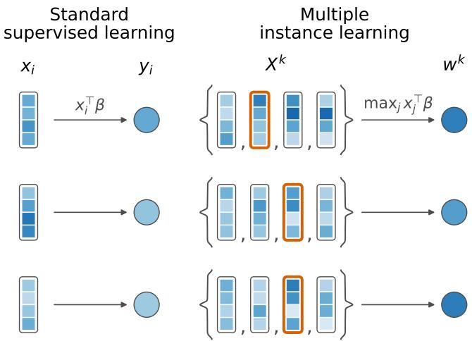  
FIG. 1. Standard supervised learning maps each feature vector $x _ { i }$ to a label $y _ { i } = x _ { i } ^ { \top } \beta .$ In MIL, bags $X ^ { k }$ of instances are mapped to a single label $w ^ { k }$ produced by an unobserved selection rule (e.g. the max). The goal is to learn $\beta$ from $( w ^ { k } , X ^ { k } )$ pairs alone without ever observing which instance determined the label.

Data generating process.—We consider a dataset $\{ w ^ { k } , X ^ { k } \} _ { k = 1 } ^ { \bar { \ell } }$ with $X ^ { k } ~ \in ~ \mathbb { R } ^ { n \times d }$ and $w ^ { k }$ given by Eq. $( 1 )$ . The background population is modeled iid Gaussian, $\pmb { x } _ { i } \sim \mathrm { N o r m a l } ( 0 , I _ { d } )$ . For a fraction q of bags, one instance is of $\beta _ { \mathrm { t r u e } }$ is then planted in the bags. It will be useful to separate the direction of the learned regression vector from its norm; thus, we write $\beta _ { \mathrm { t r u e } } = \rho _ { \mathrm { t r u e } } b _ { \mathrm { t r u e } }$ and the learned regression vector as $\beta = \rho \pmb { b }$ with $\| \pmb { b } \| ^ { 2 } =$ $\| b _ { \mathrm { t r u e } } \| ^ { 2 } = d .$

Motivated by real MIL data sets where there can be hundreds of thousands of instances per bag, we will take the large n limit. The dimension d is often controlled by the model architecture; specifically, how the raw data such as image patches or sequences are embedded as real vectors. For iid Gaussian instances, this embedding dimension must scale with the bag size for the $\beta _ { \mathrm { t r u e } }$ to be learnable, and the scaling is dictated by the order of the extremes, since this competes with the planted instances. A basic result in the theory of extremal statistics states that for n iid standard Gaussian $x _ { i } , ( \ln n ) ^ { - 1 / 2 }$ maxi $x _ { i }  \sqrt { 2 }$ almost surely [31, Lemma 9.1.1]. In our notation, $\langle \pmb { x } _ { i } , \pmb { b } \rangle \sim$ Normal(0, d), motivating us to define $\alpha = \ln n / d ,$ so that

$$
\langle x _ { i } , b \rangle / d \to { \sqrt { 2 \alpha } } .\tag{2}
$$

The positive bags are identifiable (i.e. the planted instance realizes the true maximum) only when $\alpha =$ ln $n / d < \rho _ { \mathrm { t r u e } } ^ { 2 } / 2$ . We work in this identifiable regime throughout thereby isolating questions about what happens during gradient descent.

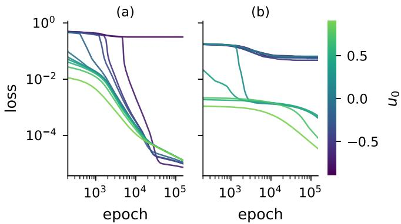  
FIG. 2. Training loss against epoch, for gradient descent from a grid of initial overlaps u0 (colorbar) at two bag sizes. (a) d = 22, n = 3 and (b) d = 150, n = 1808. Parameters are $( \lambda _ { 0 } , \rho _ { 0 } ) = ( 0 . 2 , 1 . 7 )$ , α = 0.05, ρtrue = 1.2, q = 0.2, ℓ = 100, with learning rate 0.1.

Training.—The is the central obstruction to fitting $\beta$ by gradient descent is the max and it is handled in one of two ways in practice. Classical MIL algorithms treat the label-determining instance as a latent variable and estimate it and $\beta$ jointly with an EM-type procedure, such as EM-DD [10]. However modern attention-based architectures instead use gradient descent and jointly learn the direction and temperature [22, 23]. We therefore find it natural to ask:

## How does gradient decent breakdown as the bag size and embedding dimension grow?

We will write the learned parameter as $\beta = \rho b$ , with b constrained to the sphere $\| \mathbf { b } \| ^ { 2 } = d ,$ and fit using the smooth approximation

$$
\hat { w } _ { \lambda } ( X \pmb { b } ) = \sigma ( \lambda X \pmb { b } ) \cdot ( \rho X \pmb { b } ) = \sum _ { i = 1 } ^ { n } \rho y _ { i } \left( \frac { e ^ { \lambda y _ { i } } } { \sum _ { j } e ^ { \lambda y _ { j } } } \right) ,\tag{3}
$$

with $\sigma$ the row-wise softmax, $y _ { i } = \langle { \pmb x } _ { i } , { \pmb b } \rangle$ , and λ a learnable inverse temperature. This interpolates between the hard max and a unweighted average as λ tends towards ∞ and 0 respectively. Gradient descent is then performed jointly in $b , \rho ,$ and λ, on the loss

$$
L = \langle ( w ^ { k } - { \hat { w } } _ { \lambda } ( X ^ { k } b ) ) ^ { 2 } \rangle _ { \ell } ,\tag{4}
$$

where $\langle \cdot \rangle _ { \ell }$ is the average over ℓ bags. Evaluating the softmax on the normalized scores Xb ensures that λ measures the softmax sharpness independently of the learned scale $\rho .$ We define $u = \langle b , b _ { \mathrm { t r u e } } \rangle / d$ as the normalized overlap between the learned and true directions.

Figure 2 illustrates that, as expected, the loss stalls as d is increased with fixed α. Moreover, depending on the initial overlap u, the trajectories have a qualitatively diferent convergence pattern, the signature of which is seen at smaller d and n.

Loss asymptotics.—We now derive the $d \to \infty$ limit of the normalized loss $\bar { L } : = L / d ^ { 2 }$ with fixed α. The $d ^ { 2 }$ normalization is motivated by the fact that all asymptotic of $\hat { w } _ { \lambda }$ scale with $d ,$ thus $L = O ( d ^ { 2 } )$ , as will be made clear from the calculations below. Our asymptotic are based on a replacement of $\hat { w } _ { \lambda }$ and $w _ { k }$ with their almost sure limits. This approach allows us to explain some of the key phenomena exhibited by the trajectories in spite of the fact that (1) the convergences breaks down at both phase transitions and (2) the convergence rate of $1 / d$ makes it dificult to realize the limit numerically. We discuss this limitations and the precise nature of the convergence in the SI.

Since $\bar { L }$ depends on $\beta$ only through $( u , \rho )$ , we write it as $\bar { L } ( \lambda , u , \rho )$ , and split it according to whether the bag contains the planted instance,

$$
\bar { L } ( \lambda , u , \rho ) = q \bar { L } _ { + } ( \lambda , u , \rho ) + ( 1 - q ) \bar { L } _ { - } ( \lambda , u , \rho ) .\tag{5}
$$

To evaluate ${ { \bar { L } } _ { + } }$ we need the large-d limit of $\hat { w } _ { \lambda } ( X \beta )$ on a positive bag, at overlap u with the planted pattern. Without loss of generality, let the first instance be the planted one, $\mathbf { x } _ { 1 } ~ = ~ \beta _ { \mathrm { t r u e } } .$ The softmax weight of the planted instance is

$$
\sigma _ { 1 } ( b ) = \frac { e ^ { \lambda u \rho _ { \mathrm { t r u e } } d } } { e ^ { \lambda u \rho _ { \mathrm { t r u e } } d } + Z _ { n } } , \qquad Z _ { n } = \sum _ { i = 2 } ^ { n } e ^ { \lambda \langle { \bf x } _ { i } , b \rangle } ,\tag{6}
$$

using $\langle \pmb { x } _ { 1 } , \pmb { b } \rangle = \boldsymbol { u } \rho _ { \mathrm { t r u e } } d .$ Eq. (6) shows that the behavior is governed by the competition between the growth of $Z _ { n }$ and the planted instance’s weight, $e ^ { \lambda u \rho _ { \mathrm { t r u e } } d }$ . To this end, we define

$$
\phi _ { \alpha } ( \lambda ) : = \operatorname* { l i m } _ { d \to \infty } \frac { 1 } { \lambda d } \log Z _ { n } .\tag{7}
$$

Following $[ 8 ] , \ \phi _ { \alpha }$ can be computed exactly based on a mapping to the Random Energy Model (REM), a model of an equilibrium system so disordered that the energies can be treated as independent random variables. The energies are modeled as iid Gaussian random variables, giving rise to a sum over log-normal random variables, exactly as in $Z _ { n }$ (since the planted term has been removed). $\phi _ { \alpha } ( \lambda )$ is thus the scaled free energy of the REM. This free energy is known to exhibit a freezing transition between a regime where $Z _ { n } \approx \mathbb { E } [ e ^ { \lambda \langle { \pmb x } _ { i } , { \pmb b } \rangle } ]$ and one where the sum is dominated by the extremal terms.

Specifically, it can be shown that (see Supplemental Material Sec. S2)

$$
\phi _ { \alpha } ( \lambda ) = \left\{ { \begin{array} { l l l } { \alpha / \lambda + \lambda / 2 , } & { \lambda < \lambda ^ { \star } } & { ( \mathrm { H } ) , } \\ { \sqrt { 2 \alpha } , } & { \lambda \ge \lambda ^ { \star } } & { ( \mathrm { L } ) , } \end{array} } \right.\tag{8}
$$

where $\lambda ^ { \star } = \sqrt { 2 \alpha }$ is the critical inverse temperature and H and L refer respectively to the high and low temperature phases.

<table><tr><td rowspan=4 colspan=1>Phase</td><td></td><td></td><td></td><td></td></tr><tr><td rowspan=3 colspan=1> $\mid \bar { w } ^ { + }$ </td><td></td><td></td><td></td></tr><tr><td rowspan=2 colspan=1> $\mid \bar { w } ^ { - }$        <eq</td><td></td><td></td></tr><tr><td rowspan=1 colspan=2>>| \Delta _ { + }</eq>             ∆-</td></tr><tr><td rowspan=1 colspan=1>HRLRHNLN</td><td rowspan=1 colspan=1> $\rho \rho _ { \mathrm { t r u e } } u$  $\rho \rho _ { \mathrm { t r u e } } u$  $\lambda \rho$  ${ \sqrt { 2 \alpha } } \rho$ </td><td rowspan=1 colspan=1> $\bar { \lambda } \rho$  ${ \sqrt { 2 \alpha } } \rho$  $\lambda \rho$  ${ \sqrt { 2 \alpha } } \rho$ </td><td rowspan=1 colspan=1> $\overline { { \rho _ { \mathrm { t r u e } } ^ { 2 } - \rho \rho _ { \mathrm { t r u e } } u } }$  $\rho _ { \mathrm { t r u e } } ^ { 2 } - \rho \rho _ { \mathrm { t r u e } } u$  $\rho _ { \mathrm { t r u e } } ^ { 2 } - \lambda \rho$  $\rho _ { \mathrm { t r u e } } ^ { 2 } - \sqrt { 2 \alpha } \rho$ </td><td rowspan=1 colspan=1> $\overline { { \sqrt { 2 \alpha } } } \rho _ { \mathrm { t r u e } } - \lambda \rho$  $\sqrt { 2 \alpha } ( \rho _ { \mathrm { t r u e } } - \rho )$  $\sqrt { 2 \alpha } \rho _ { \mathrm { t r u e } } - \lambda \rho$  $\sqrt { 2 \alpha } ( \rho _ { \mathrm { t r u e } } - \rho )$ </td></tr><tr><td rowspan=1 colspan=1>Exact</td><td rowspan=1 colspan=1> $| \rho _ { \mathrm { t r u e } } ^ { 2 } |$ </td><td rowspan=1 colspan=1> $\sqrt { 2 \alpha } \rho _ { \mathrm { t r u e } }$ </td><td rowspan=1 colspan=1></td><td rowspan=1 colspan=1></td></tr></table>

TABLE I. Asymptotic normalized bag output $\hat { w } _ { \lambda } ( X ^ { \pm } \beta ) / d$ in each of the four phases $\left( \mathrm { H } / \mathrm { L } \times \mathrm { R } / \mathrm { N } \right)$ , the corresponding larged limit of the target $w ^ { k } / \dot { d } .$ which is set by the true generative process alone and so is identical across all four phases, and the resulting per-bag-type residuals $\Delta \pm$ . The color of the cells is used to highlight which quantities are the same.

Comparing Eq. (7) to $u \rho _ { \mathrm { t r u e } }$ (the exponent of the planted instance) yields two phases for the limiting softmax weight corresponded to the retrieval and nonretrieval phase in [8]

$$
\operatorname* { l i m } _ { d \to \infty } \sigma _ { 1 } ( b ) = \left\{ \begin{array} { r l r } { 1 , } & { \rho _ { \mathrm { t r u e } } u > \phi _ { \alpha } ( \lambda ) } & { \mathrm { ( R ) } , } \\ { 0 , } & { \rho _ { \mathrm { t r u e } } u < \phi _ { \alpha } ( \lambda ) } & { \mathrm { ( N ) } , } \end{array} \right.\tag{9}
$$

where R and N denote the retrieval and non-retrieval phases. In the retrieval phase, all the softmax weight is on the planted instance, so $\hat { w } _ { \lambda } / d  \langle \beta , \beta _ { \mathrm { t r u e } } \rangle / d =$ $\rho \rho _ { \mathrm { t r u e } } u$ . In the non-retrieval phase, the high-temperature branch instead behaves like an ordinary Gaussian average; using standard Gaussian integrals, we have

$$
\frac { 1 } { d } \hat { w } _ { \lambda } \to \frac { \mathbb { E } [ \langle x _ { i } , \beta \rangle e ^ { \lambda \langle x _ { i } , \beta \rangle } ] } { \mathbb { E } [ e ^ { \lambda \langle x _ { i } , \beta \rangle } ] } = \lambda \rho .\tag{10}
$$

The low-temperature branch is instead dominated by the single largest $\left. { x _ { i } , \beta } \right.$ term, which we have already argued grows as $\rho { \sqrt { 2 \alpha } } d ,$ giving $\hat { w } _ { \lambda } / d \to \sqrt { 2 \alpha } \rho .$ Negative bags contain no planted instance and therefore admit only the two non-retrieval forms. Writing $\bar { w } ^ { \pm } : =$ $\mathrm { l i m } _ { d  \infty } \hat { w } _ { \lambda } ( X ^ { \pm } \beta ) / d$ for the resulting positive/negativebag output, the $\mathrm { H } / \mathrm { L }$ and $\mathrm { R } / \mathrm { N }$ transitions are independent and combine into the four phases of Table I. In each phase, the conditional loss can be written as the square of a corresponding residual, $\Delta$

Gradient flow ODEs.—The continuous gradient flow is

$$
\dot { \lambda } = - \partial _ { \lambda } \bar { L } , \qquad \dot { \rho } = - \partial _ { \rho } \bar { L } , \qquad \dot { b } = - P _ { b } \nabla _ { b } \bar { L } ,\tag{11}
$$

where $P _ { b } v \ : = \ v - \langle v , b \rangle b / d$ projects onto the tangent space of the sphere $\sqrt { d } { \cal S } ^ { d - 1 }$ at b. Using that $P _ { b }$ is selfadjoint,

$$
\dot { u } = \frac { 1 } { d } \langle \dot { \pmb { b } } , \pmb { b } _ { \mathrm { t r u e } } \rangle = - \frac { 1 } { d } \langle \nabla _ { b } \bar { L } , P _ { b } \pmb { b } _ { \mathrm { t r u e } } \rangle .\tag{12}
$$

$\bar { L }$ depends on b only through u, so $\nabla _ { b } \bar { L } \ = \ b _ { \mathrm { t r u e } } \partial _ { u } \bar { L }$ Using $\langle b _ { \mathrm { t r u e } } , P _ { b } b _ { \mathrm { t r u e } } \rangle = d ( 1 - u ^ { 2 } )$ then gives $\dot { u } = - ( 1 -$ $u ^ { 2 } ) \partial _ { u } \bar { L }$

For $c \in \{ \lambda , u , \rho \}$ the partial derivatives of $\bar { L }$ are approximated as

$$
- \partial _ { c } \bar { L } \approx 2 \Bigl [ q \Delta \partial _ { c } \bar { w } ^ { + } + ( 1 - q ) \Delta \partial _ { c } \bar { w } ^ { - } \Bigr ] ,\tag{13}
$$

with $\Delta$ the residual from Table I relevant to that phase and bag type, resulting in a system of piecewise smooth ODEs. The complete set of equations are given in Supplemental Material Sec. S2.

We now consider the fate of a trajectory beginning in the H phase. For a trajectory initially in the HN phase, $\dot { u } = 0$ , resulting in a two-dimensional system for λ and $\rho \colon$

$$
\dot { \lambda } = 2 \rho \big [ q \rho _ { \mathrm { t r u e } } ^ { 2 } + ( 1 - q ) \sqrt { 2 \alpha } \rho _ { \mathrm { t r u e } } - \lambda \rho \big ]\tag{14}
$$

and ${ \dot { \rho } } = ( \lambda / \rho ) { \dot { \lambda } }$ . Note that since $d ( \rho ^ { 2 } ) / d t = 2 \lambda \dot { \lambda }$ $C =$ $\lambda _ { 0 } ^ { 2 } - \rho _ { 0 } ^ { 2 }$ is conserved along trajectories. The positive fixed points are the hyperbola

$$
\lambda \rho = q \rho _ { \mathrm { t r u e } } ^ { 2 } + ( 1 - q ) \sqrt { 2 \alpha } \rho _ { \mathrm { t r u e } } ,\tag{15}
$$

restricted to the HN region. If $\lambda _ { \mathrm { f p } } < \sqrt { 2 \alpha }$ , the trajectory equilibrates in HN with u still fixed at its initial value. If $\lambda _ { \mathrm { f p } } > \sqrt { 2 \alpha }$ , it reaches the temperature boundary first and enters LN, where $\dot { \lambda } = \dot { u } = 0$

If the trajectory starts in HR instead, all three variables evolve:

$$
\dot { \lambda } = 2 ( 1 - q ) \rho ( \sqrt { 2 \alpha } \rho _ { \mathrm { t r u e } } - \lambda \rho ) ,\tag{16}
$$

$$
\dot { u } = 2 q \rho \rho _ { \mathrm { t r u e } } ^ { 2 } ( \rho _ { \mathrm { t r u e } } - \rho u ) ( 1 - u ^ { 2 } ) ,\tag{17}
$$

$$
\dot { \rho } = 2 q u \rho _ { \mathrm { t r u e } } ^ { 2 } ( \rho _ { \mathrm { t r u e } } - \rho u )
$$

$$
+ 2 ( 1 - q ) \lambda ( \sqrt { 2 \alpha } \rho _ { \mathrm { t r u e } } - \lambda \rho ) .\tag{18}
$$

For an interior fixed point, the two residuals must vanish:

$$
\rho u = \rho _ { \mathrm { t r u e } } , \qquad \lambda \rho = \sqrt { 2 \alpha } \rho _ { \mathrm { t r u e } } .\tag{19}
$$

Thus the HR fixed set is the curve $\lambda = \sqrt { 2 \alpha } u$ ， $\rho =$ $\rho _ { \mathrm { t r u e } } / u$ , restricted to the part lying inside HR.

Numerical results.— This analysis suggests that as $d \to \infty$ the gradient flow exhibits two qualitatively distinct failure modes depending on whether they begin in the R vs N phase. Figure 2 illustrates that this behavior by plotting the loss as a function of time (the epoch) gradient descent for diferent $u _ { 0 }$ . In this numerical experiments, we are able to see the phase transition is present even at moderate size. In particular, in panel (a) where $d = 2 2$ , it is see that trajectories exhibit qualitatively distinct dynamics depending on whether they begin in R or N phase. In panel (b) d is increased and our simulations also show that for fixed α the loss plateaus for all initial $u ,$ consistent with the theory.

To further illustrate that the limit ODEs indeed capture the dynamics of gradient descent for a trajectory beginning in H, we show the trajectories themselves in Figure 3 in the λ-u and $\lambda { - } \rho$ planes. The invariant manifolds from Eqs. 15 and 19 are shown as dashed lines. As predicted by our theory, as d grows, we can clearly see the transition between the HN and HR initial conditions. Surprisingly, even though the limit ODEs are a crude approximation, the fixed lines appear to explain much of the variation in the long-time behavior for the trajectories beginning in HN.

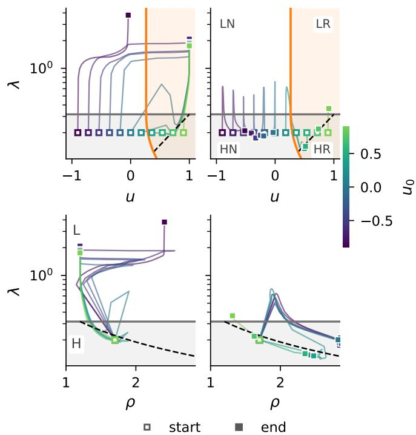  
FIG. 3. Gradient-descent trajectories with diferent u0 (colorbar). The top row shows the dynamics in $( u , \lambda )$ space with the $\mathrm { H } / \mathrm { L }$ and $\mathrm { R } / \mathrm { N }$ phase boundaries shown. The bottom panels show trajectories in $( \rho , \lambda )$ space, with the $\mathrm { H } / \mathrm { L }$ boundary shows. the dashed lines denote the invariant manifold defined by Eqs. 15 and 19. Parameters are $( \lambda _ { 0 } , \rho _ { 0 } ) = ( 0 . 2 , 1 . 7 )$ $\alpha = 0 . 0 5$ $\rho _ { \mathrm { t r u e } } \ = 1 . 2$ $q = 0 . 2$ $\ell = 1 0 0$ , run to flow time $t = 1 5 0 0 0$ (learning rate 0.1).

In the SI, we show that away from the phase transition, the error in the ODEs scales as $O ( \ln d / d )$ ; however, the pre-factor diverges as we approach the phase transition. As more direct comparisons of the asymptotic theory to the gradient itself, we have shown the initial gradient as a function u in Figure 4. In this figure, we can see that the limit ODEs predict the gradients with respect to $\rho$ and u (away from the phase boundary). The gradient with respect to λ is qualitatively similar, being a step function (away from the phase boundary).

Discussion.—We have studied learning dynamics in a minimal model of multiple instance learning, where there is an extremal selection rule for a planted instance. This problem is meant to exemplify the challenges of applying gradient descent to models where the strength of the nonlinearity (the temperature) is learned, and learning naturally happens into regimes of vanishing gradients. Using tools from disordered systems – namely the random energy model – and applying previous results on Hopfield networks, we have derived limiting ODEs for the low dimensional dynamics of the temperature and regression coeficients. Our analysis, which accurately predicts numerical experiments with Gaussian data, suggests that one expects to find abrupt transitions in the speed of learning for this system depending on the misalignment of the initial regression coeficients. This suggests it would be worthwhile exploring other methods besides gradient descent for more eficiently tuning the regression coeficients during the early stages of learning. For example, coupling gradient descent with EM-based approaches [21].

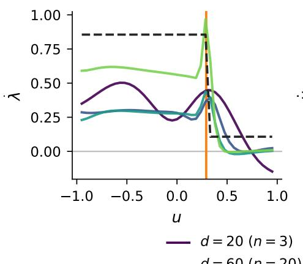

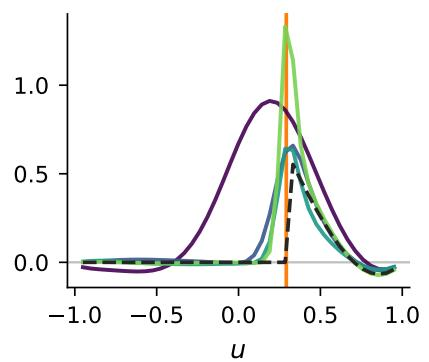

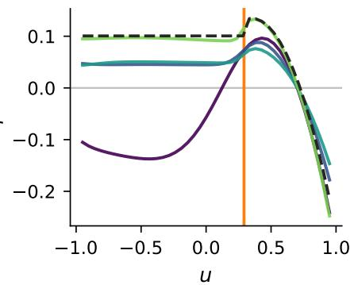  
d = 20 (n = 3) d = 100 (n = 148) gradient flow (theory) d = 60 (n = 20) d = 150 (n = 1808) u  
FIG. 4. Convergence of the finite-size training gradient to the asymptotic gradient-flow field. Empirical $( \dot { \lambda } , \dot { u } , \dot { \rho } )$ compared to the $d \to \infty$ theory (dashed line). Parameters are $( \lambda _ { 0 } , \rho _ { 0 } ) = ( 0 . 2 , 1 . 7 )$ , α = 0.05, ρtrue = 1.2, q = 0.2, ℓ = 100. The vertical line marks u⋆.

Code availability.— The code is available at https: //github.com/elevien/extremal-mil.

E.L. and T.G. acknowledge support from the National Institute for Theory and Mathematics in Biology through the National Science Foundation (grant number DMS-2235451) and the Simons Foundation (grant number MP-TMPS-00005320). E.L. acknowledges support from the National Science Foundation (grant number DMS-2527337) and a Dartmouth College Burke Research Initiation Award.

[1] T. G. Dietterich, R. H. Lathrop, and T. Lozano-P´erez, Artificial Intelligence 89, 31 (1997).

[2] M.-A. Carbonneau, V. Cheplygina, E. Granger, and G. Gagnon, Pattern Recognition 77, 329 (2018).

[3] A. N. Jain, K. Koile, and D. Chapman, Journal of Medicinal Chemistry 37, 2315 (1994).

[4] G. Sliwoski, S. Kothiwale, J. Meiler, and E. W. Lowe Jr, Pharmacological Reviews 66, 334 (2014).

[5] D. Zankov, T. Madzhidov, A. Varnek, and P. Polishchuk, Wiley Interdisciplinary Reviews: Computational Molecular Science 14, e1698 (2024).

[6] O. Maron and T. Lozano-P´erez, in Advances in Neural Information Processing Systems, Vol. 10 (MIT Press,

1998).

[7] O. Maron, in Advances in Neural Information Processing Systems, Vol. 11 (1998).

[8] C. Lucibello and M. M´ezard, Physical Review Letters 132, 077301 (2024).

[9] M. Mezard and A. Montanari, Information, Physics, and Computation (Oxford University Press, 2009).

[10] Q. Zhang and S. A. Goldman, in Advances in Neural Information Processing Systems, Vol. 15 (MIT Press, 2002).

[11] S. Andrews, I. Tsochantaridis, and T. Hofmann, in Advances in Neural Information Processing Systems, Vol. 15 (2002) pp. 561–568.

[12] T. G¨artner, P. A. Flach, A. Kowalczyk, and A. J. Smola, in Proceedings of the Nineteenth International Conference on Machine Learning (2002) pp. 179–186.

[13] D. I. Diochnos, R. H. Sloan, and G. Tur´an, Information Processing Letters 112, 933 (2012).

[14] G. Doran and S. Ray, Journal of Machine Learning Research 17, 1 (2016).

[15] Z. Szab´o, A. Gretton, B. P´oczos, and B. Sriperumbudur, in Artificial Intelligence and Statistics (PMLR, 2015) pp. 948–957.

[16] S. Ray and D. Page, in Proceedings of the International Conference on Machine Learning (ICML) (2001) pp. 425–432.

[17] K. L. Wagstaf and T. Lane, Proc. of International Conference on Machine Learning (ICML) Workshop (2007).

[18] D. R. Dooly, Q. Zhang, S. A. Goldman, and R. A. Amar, Journal of Machine Learning Research 3, 651 (2002).

[19] D. R. Dooly, S. A. Goldman, and S. S. Kwek, Journal of Computer and System Sciences 72, 1 (2006).

[20] K. Chauhan, R. Saket, L. Applebaum, A. Badanidiyuru, C. Giri, and A. Raghuveer, in Proceedings of Uncertainty in Artificial Intelligence (UAI) (2024).

[21] E. Levien, arXiv preprint arXiv:2607.17404 (2026).

[22] M. Ilse, J. M. Tomczak, and M. Welling, in Proceedings of the 35th International Conference on Machine Learning (PMLR, 2018) pp. 2127–2136.

[23] M. Widrich, B. Sch¨afl, M. Pavlovi´c, H. Ramsauer, L. Gruber, M. Holzleitner, J. Brandstetter, G. K. Sandve, V. Greif, S. Hochreiter, and G. Klambauer, in Advances in Neural Information Processing Systems, Vol. 33 (2020)

pp. 18832–18845.

[24] A. Vaswani, N. Shazeer, N. Parmar, J. Uszkoreit, L. Jones, A. N. Gomez, L. Kaiser, and I. Polosukhin, in Advances in Neural Information Processing Systems, Vol. 30 (Curran Associates, Inc., 2017).

[25] H. Ramsauer, B. Sch¨afl, J. Lehner, P. Seidl, M. Widrich, T. Adler, L. Gruber, M. Holzleitner, M. Pavlovi´c, G. K. Sandve, et al., arXiv preprint arXiv:2008.02217 (2020).

[26] J. J. Hopfield, Proceedings of the National Academy of Sciences 79, 2554 (1982).

[27] B. Derrida, Physical Review Letters 45, 79 (1980).

[28] B. Derrida, Physical Review B 24, 2613 (1981).

[29] G. Ben Arous, L. V. Bogachev, and S. A. Molchanov, Probability Theory and Related Fields 132, 579 (2005).

[30] J. Vuckovic, A. Baratin, and R. Tachet des Combes, arXiv preprint arXiv:2007.02876 (2020).

[31] A. Bovier, Statistical mechanics of disordered systems: a mathematical perspective, Vol. 18 (Cambridge University Press, 2006).

[32] M. R. Leadbetter, G. Lindgren, and H. Rootz´en, Extremes and Related Properties of Random Sequences and Processes (Springer, New York, 1983).

[33] D. Soudry, E. Hofer, M. S. Nacson, S. Gunasekar, and N. Srebro, Journal of Machine Learning Research 19, 1 (2018), arXiv:1710.10345.

## Supplemental Material

## CONTENTS

S1. Background: REM and EVT 7   
A. Extreme value statistics 7   
B. The random energy model 8   
C. Weak self-averaging transition 8   
S2. Gradient Flow Equations 9   
A. Setup and normalization 9   
1. True output second moment 9   
2. Model output 9   
3. Cross term 11   
4. Phase table 11   
B. Gradient flow 11   
S3. Robustness to noise in labeling and selection 12   
S4. Connection to pattern retrieval in associative memory 13   
S5. Extension to a classification loss 13   
A. The logistic (cross-entropy) case 14   
S6. Numerical tests of the gradient-flow limit 14   
S7. LLM disclosure 14

## S1. BACKGROUND: REM AND EVT

In this section we present background on the Random Energy Model and extremal value statistics.

## A. Extreme value statistics

Let $x _ { 1 } , \ldots , x _ { n }$ be i.i.d. Normal $( 0 , s ^ { 2 } )$ and let $M _ { n } = \operatorname* { m a x } _ { i \leq n } x _ { i }$ . A classical result of extreme value statistics is the following [32].

Theorem 1 (Almost sure growth of the maximum). As $n \to \infty$ ，

$$
{ \frac { M _ { n } } { s { \sqrt { 2 \ln n } } } }  1 a l m o s t s u r e l y .\tag{S1}
$$

The generalized extreme value theorem (Fisher–Tippett–Gnedenko) describes the fluctuations around it [32]. Theorem 2 (Generalized extreme value theorem). As $n \to \infty$

$$
\mathbb { P } ( ( M _ { n } - b _ { n } ) / a _ { n } > m ) \to 1 - e ^ { - e ^ { - m } } ,\tag{S2}
$$

where

$$
b _ { n } = s \left( { \sqrt { 2 \ln n } } - { \frac { \ln \ln n + \ln 4 \pi } { 2 { \sqrt { 2 \ln n } } } } \right) , \qquad a _ { n } = { \frac { s } { \sqrt { 2 \ln n } } } .\tag{S3}
$$

That is, $( M _ { n } - b _ { n } ) / a _ { n }$ converges to a Gumbel random variable.

The fluctuations of $M _ { n }$ have width $a _ { n } = O ( s / { \sqrt { \ln n } } )$ , which is small compared to the location $b _ { n } = O ( s { \sqrt { \ln n } } )$ However, the residual O(ln ln n/ ln n), so the approach to the almost sure limit of Theorem 1 is slow. In our setting $n = e ^ { \alpha d }$ and the variance $s ^ { 2 } = d$ grows with n. Writing the scores as $\sqrt { d }$ times standard normals and applying the theorems with $s = 1$ gives $M _ { n } \approx d \sqrt { 2 \alpha }$ with Gumbel fluctuations of order one and a relative correction of order ln $d / d .$

## B. The random energy model

Random energy models (REM) [27, 28] are toy models of highly disordered systems – ones where the energy landscape has many local minima. To study generic properties of such systems, the idea is to randomly sample the energies. This so-called quenched disorder in the energy landscape is another level of randomness on top of the statistical ensemble itself. These two forms of randomness correspond to the distribution of bags and the within-bag distribution, respectively.

We consider the simplest REM, where the energies are iid Normal. The partition function for this model takes the form

$$
Z _ { \mathrm { R E M } , N } = \sum _ { i = 1 } ^ { 2 ^ { N } } e ^ { - \beta \sqrt { N } x _ { i } } , \qquad x _ { i } \sim \mathrm { N o r m a l } ( 0 , 1 ) .\tag{S4}
$$

This model has the free energy [27]

$$
\bar { \phi } _ { \mathrm { R E M } } ( \beta ) : = - \operatorname* { l i m } _ { N \to \infty } \frac { 1 } { N \beta } \ln Z _ { \mathrm { R E M } , N } = \left\{ \begin{array} { l l } { - \beta / 2 - \beta _ { c } ^ { 2 } / ( 2 \beta ) , } & { \beta \leq \beta _ { c } , } \\ { - \beta _ { c } , } & { \beta > \beta _ { c } , } \end{array} \right.\tag{S5}
$$

with $\beta _ { c } = \sqrt { 2 \ln { 2 } }$ . The transition at $\beta _ { c }$ separates a high-temperature (H) phase in which the sum is dominated by the exponentially many configurations, from a low-temperature phase (L) in which it is dominated by the single lowest-energy configuration.

One can derive the transition in Eq. (S5) as the point where the average of $Z _ { \mathrm { R E M } , N }$ grows as fast as the maximum weight. $\mathrm { B y }$ Theorem 1, max $\ d _ { i } ( - x _ { i } ) \approx \sqrt { 2 N \ln { 2 } } ,$ , so this happens when

$$
\mathbb { E } \big [ Z _ { \mathrm { R E M } , N } \big ] = e ^ { N ( \ln 2 + \beta ^ { 2 } / 2 ) } = e ^ { \beta N \sqrt { 2 \ln 2 } } \approx \operatorname* { m a x } _ { i } e ^ { - \beta \sqrt { N } x _ { i } } ,\tag{S6}
$$

that is, when $\beta = \sqrt { 2 \ln 2 } = \beta _ { c }$

Another important quantity in REM theory, which appears in our analysis below, is the replica overlap. Let $\sigma _ { i } = e ^ { - \beta \sqrt { N } x _ { i } } / Z _ { \mathrm { R E M } , N }$ be the Gibbs weights of $Z _ { \mathrm { R E M } , N }$ , and define the overlap

$$
\psi _ { N } ( \beta ) = \sum _ { i = 1 } ^ { 2 ^ { N } } \sigma _ { i } ^ { 2 } .\tag{S7}
$$

$\psi _ { N } ( \beta )$ is the probability that two independent draws from the Gibbs weights pick the same configuration, i.e. the mass at 1 of the replica overlap distribution. It is useful that the derivative of ln $Z _ { \mathrm { R E M } , N }$ with respect to the inverse temperature is related to the overlap by the following Lemma, Gaussian integration by parts.

Lemma 1 ([31, Proposition 9.5.1]). For every N and $\beta ,$

$$
\frac { 1 } { N } \mathbb { E } \big [ \partial _ { \beta } \ln Z _ { \mathrm { R E M } , N } \big ] = \beta \Big ( 1 - \mathbb { E } \big [ \psi _ { N } ( \beta ) \big ] \Big ) .\tag{S8}
$$

The limit of the overlap is known for the REM.

Theorem 3.

$$
\operatorname* { l i m } _ { N \to \infty } \mathbb { E } \big [ \psi _ { N } ( \beta ) \big ] = \left\{ \begin{array} { l l } { 0 , } & { \beta \leq \beta _ { c } , } \\ { 1 - \beta _ { c } / \beta , } & { \beta > \beta _ { c } . } \end{array} \right.\tag{S9}
$$

## C. Weak self-averaging transition

Subsequent work [29] describes the limiting law of $Z _ { \mathrm { R E M } , N }$ in more detail. This is closely related to, and in fact can be viewed as a special case of, classical limit theorems for triangular arrays. The limit laws of such sums are α-stable distributions. The simplest case is that of a power-law sum, where the generalized central limit theorem describes two transitions: one where the CLT breaks down but the LLN still holds and the fluctuations scale as $N ^ { 1 / \alpha }$ , and one where the LLN breaks down, which corresponds to the freezing transition in the REM. The second phase transition is derived by comparing the growth of the second moment to the growth of the max. The sum of the second moments of the weights grows as

$$
\sum _ { i = 1 } ^ { 2 ^ { N } } \mathbb { E } \big [ e ^ { - 2 \beta \sqrt { N } x _ { i } } \big ] = e ^ { N ( \ln 2 + 2 \beta ^ { 2 } ) } ,\tag{S10}
$$

while the square of the maximum weight grows as $e ^ { 2 \beta N { \sqrt { 2 \ln { 2 } } } }$ . These rates coincide when $\beta = \sqrt { \ln { 2 } / 2 } = \beta _ { c } / 2$

## S2. GRADIENT FLOW EQUATIONS

## A. Setup and normalization

Recall that we represent a bag as a matrix $\ b X _ { k } \in \mathbb { R } ^ { n \times d }$ and sample the entries from iid standard normal and then replacing a row with $\beta _ { \mathrm { t r u e } }$ with probability q, yielding a “positive” bag. We fix $\beta _ { \mathrm { t r u e } } = \sqrt { d } \rho _ { \mathrm { t r u e } } e _ { 1 }$ without loss of generality, where $e _ { 1 }$ is the first coordinate vector, and parameterize the learned direction as $\pmb { b } = \sqrt { d } \left( u e _ { 1 } + \sqrt { 1 - u ^ { 2 } } \pmb { \delta } \right)$ with $\boldsymbol { \delta } \perp \boldsymbol { e } _ { 1 } , \| \boldsymbol { \delta } \| = 1$ , and $\beta = \rho \boldsymbol { b } .$ . The loss

$$
\bar { L } = \frac 1 { d ^ { 2 } } \mathbb { E } \big [ ( w ^ { k } - \hat { w } _ { \lambda } ( X ^ { k } \beta ) ) ^ { 2 } \big ]\tag{S11}
$$

We consider each of the terms $\mathbb { E } \big [ ( w ^ { k } ) ^ { 2 } \big ] , \mathbb { E } \big [ w ^ { k } \hat { w } _ { \lambda } ( X ^ { k } \pmb { \beta } ) \big ]$ and E $[ ( \hat { w } _ { \lambda } ( X ^ { k } \beta ) ) ^ { 2 } ]$

## 1. True output second moment

By Theorem 2, the max over background instances has the limit

$$
d \left( \frac { m _ { n } } { \rho _ { \mathrm { t r u e } } } - \sqrt { 2 \alpha } + \frac { \ln ( \alpha d ) + \ln 4 \pi } { 2 \sqrt { 2 \alpha } d } \right) \stackrel { d } { \to } \frac { G } { \sqrt { 2 \alpha } } , \qquad m _ { n } : = \frac { 1 } { d } \operatorname* { m a x } _ { i > 1 } { x } _ { i } ^ { k } \cdot \beta _ { \mathrm { t r u e } } ,\tag{S12}
$$

where $G$ is a standard Gumbel random variable defined by Theorem 2.

In the identifiable regime $\alpha < \rho _ { \mathrm { t r u e } } ^ { 2 } / 2$ , Eq. (S12) gives

$$
\frac { 1 } { d } \mathrm { m a x } _ { i > 1 } { \pmb x } _ { i } ^ { k } \cdot \beta _ { \mathrm { t r u e } }  \rho _ { \mathrm { t r u e } } \sqrt { 2 \alpha } < \rho _ { \mathrm { t r u e } } ^ { 2 }\tag{S13}
$$

in probability, so the planted instance realizes the maximum of a positive bag with probability tending to one. Hence $w ^ { k } / d \sim \rho _ { \mathrm { t r u e } } ^ { 2 }$ on positive bags and $w ^ { k } / d \sim m _ { n }$ on negative bags. We write $\mathbb { E } ^ { \pm }$ to indicate the expectation over positive (respectively negative) bags.

We then have

$$
\frac { 1 } { d ^ { 2 } } \mathbb { E } ^ { + } [ ( w ^ { k } ) ^ { 2 } ] \approx \rho _ { \mathrm { t r u e } } ^ { 4 } , \quad \frac { 1 } { d ^ { 2 } } \mathbb { E } ^ { - } [ ( w ^ { k } ) ^ { 2 } ] \approx \rho _ { \mathrm { t r u e } } ^ { 2 } 2 \alpha - \frac { \rho _ { \mathrm { t r u e } } ^ { 2 } } { d } \left( \ln ( \alpha d ) + \ln 4 \pi - 2 \gamma _ { E } \right)\tag{S14}
$$

where $\gamma _ { E }$ is the Euler–Mascheroni constant, which comes from a standard result about the Gumbel distribution.

## 2. Model output

Following the main text, we define the auxiliary partition function

$$
Z _ { n } = \sum _ { i = 2 } ^ { n } e ^ { \lambda \mathbf { x } _ { i } ^ { k } \cdot \boldsymbol { b } } ,\tag{S15}
$$

where on a positive bag ${ \pmb x } _ { 1 } ^ { k } = \beta _ { \mathrm { t r u e } }$ is the planted instance. Using $\begin{array} { r } { \pmb { x } _ { 1 } ^ { k } \cdot \pmb { b } = u \rho _ { \mathrm { t r u e } } d , } \end{array}$ the softmax weight on the planted instance is

$$
\sigma _ { 1 } ( b ) = \frac { e ^ { \lambda u \rho _ { \mathrm { t r u e } } d } } { e ^ { \lambda u \rho _ { \mathrm { t r u e } } d } + Z _ { n } }\tag{S16}
$$

The model output is then

$$
\frac { 1 } { d } \hat { w } _ { \lambda } ( X ^ { k } \beta ) = \sigma _ { 1 } \rho \rho _ { \mathrm { t r u e } } u + ( 1 - \sigma _ { 1 } ) \frac { \rho } { d } \partial _ { \lambda } \ln Z _ { n } ,\tag{S17}
$$

On negative bags, $\pmb { x } _ { 1 } ^ { k }$ is a background instance and the output is

$$
\frac { 1 } { d } \hat { w } _ { \lambda } ( X ^ { k } \beta ) = \frac { \rho } { d } \partial _ { \lambda } \ln Z _ { n + 1 }\tag{S18}
$$

The limiting behavior comes from mapping $Z _ { n }$ to $Z _ { \mathrm { R E M } , N }$ . Matching the number of terms, $2 ^ { N } = e ^ { \alpha d }$ , and the exponents, $\beta \sqrt { N } x _ { i } = \lambda \mathbf { { x } } _ { i } ^ { k }$ · b in distribution, gives the correspondence to the REM in Table S1.

<table><tr><td></td><td>REM</td><td>MIL Model</td></tr><tr><td>System size Number of terms Exponents Inverse temperature</td><td>N  $2 ^ { N }$   $- \beta \sqrt { N } x _ { i }$  β</td><td> $\overline { { \alpha d / \ln { 2 } } }$   $n$   $\lambda \mathbfit { x } _ { i } ^ { k } \cdot \mathbfit { b }$   $\lambda \sqrt { \ln { 2 } / \alpha }$   $\beta _ { c } = \sqrt { 2 \ln { 2 } }$   $\lambda ^ { \star } = \sqrt { 2 \alpha }$ </td></tr></table>

TABLE S1. Correspondence between the REM of Sec. S1 B and the of-target partition function $Z _ { n }$ . The sign of the exponents is immaterial because their distribution is symmetric.

With $\sigma _ { i }$ the softmax weights of the of-target instances, Lemma 1 under this correspondence gives

$$
\frac { 1 } { d } \mathbb { E } \big [ \partial _ { \lambda } \ln Z _ { n } \big ] = \lambda \Big ( 1 - \mathbb { E } \Big [ \sum _ { i = 2 } ^ { n } \sigma _ { i } ^ { 2 } \Big ] \Big )  \{ \lambda , \begin{array} { l l } { \lambda < \lambda ^ { \star } \mathrm { ( H ) } , } \\ { \lambda ^ { \star } = \sqrt { 2 \alpha } , } & { \lambda > \lambda ^ { \star } \mathrm { ( L ) } , } \end{array}\tag{S19}
$$

where the limit follows from Theorem 3. For $\lambda < \lambda ^ { \star }$ the softmax average is spread over exponentially many instances, and the fluctuations of $\textstyle { { \frac { 1 } { d } } \partial _ { \lambda } \ln Z _ { n } }$ are exponentially small. Note that this holds on both sides of the second transition at $\lambda ^ { \star } / 2$ , which changes the fluctuations of $Z _ { n }$ but not those of the output.

For $\lambda > \lambda ^ { \star } , Z _ { n }$ is dominated by a few instances near the maximum, and the finer expansion is

$$
\frac { 1 } { d } \partial _ { \lambda } \ln Z _ { n } = \sqrt { 2 \alpha } - \frac { \ln ( \alpha d ) + \ln 4 \pi } { 2 \sqrt { 2 \alpha } d } + O \left( \frac { 1 } { d } \right) ,\tag{S20}
$$

where the $O ( 1 / d )$ term is the Poisson–Dirichlet average of the gaps below the maximum [31, Ch. 9].

On positive bags, it remains to determine the limit of $\sigma _ { 1 }$ . This is set by the growth rate of $Z _ { n }$ . Under the correspondence of Table S1, the REM free energy Eq. (S5) gives

$$
\operatorname* { l i m } _ { d \to \infty } \frac { 1 } { d } \ln Z _ { n } = \lambda \phi _ { \alpha } ( \lambda ) , \qquad \phi _ { \alpha } ( \lambda ) = \left\{ \frac { \alpha } { \lambda } + \frac { \lambda } { 2 } , \lambda < \lambda ^ { \star } \mathrm { ( H ) } , \right.\tag{S21}
$$

Comparing $\phi _ { \alpha } ( \lambda )$ to the exponent $u \rho _ { \mathrm { t r u e } }$ of the planted instance gives

$$
\operatorname* { l i m } _ { d \to \infty } \sigma _ { 1 } = \left\{ 1 , \quad \rho _ { \mathrm { t r u e } } u > \phi _ { \alpha } ( \lambda ) \ ( \mathrm { R } ) , \right.\tag{S22}
$$

Hence $1 - \sigma _ { 1 }$ is exponentially small in the R phase and $\sigma _ { 1 }$ is exponentially small in the N phase. As $d \to \infty$ we then have

$$
\frac 1 { d ^ { 2 } } \mathbb { E } ^ { - } [ \hat { w } _ { \lambda } ^ { 2 } ]  \{ \begin{array} { l l } { \lambda ^ { 2 } \rho ^ { 2 } , } & { \mathrm { H } , } \\ { 2 \alpha \rho ^ { 2 } , } & { \mathrm { L } , } \end{array} 
$$

$$
\frac { 1 } { d ^ { 2 } } \mathbb { E } ^ { + } [ \hat { w } _ { \lambda } ^ { 2 } ]  \{ \begin{array} { l l } { \rho ^ { 2 } \rho _ { \mathrm { t r u e } } ^ { 2 } u ^ { 2 } , } & { \mathrm { R } , } \\ { \lambda ^ { 2 } \rho ^ { 2 } , } & { \mathrm { H N } , } \\ { 2 \alpha \rho ^ { 2 } , } & { \mathrm { L N } . } \end{array}\tag{S23}
$$

## 3. Cross term

On positive bags $w ^ { k } = \rho _ { \mathrm { t r u e } } ^ { 2 } d ,$ , so

$$
\frac { 1 } { d ^ { 2 } } \mathbb { E } ^ { + } [ w ^ { k } \hat { w } _ { \lambda } ] \approx \rho _ { \mathrm { t r u e } } ^ { 2 } \frac { 1 } { d } \mathbb { E } ^ { + } [ \hat { w } _ { \lambda } ] .\tag{S24}
$$

On negative bags $m _ { n }$ and $\hat { w } _ { \lambda } / d$ both have fluctuations of order $1 / d ,$ so their covariance is $O ( 1 / d ^ { 2 } )$ and

$$
\frac { 1 } { d ^ { 2 } } \mathbb { E } ^ { - } [ w ^ { k } \hat { w } _ { \lambda } ] \approx \mathbb { E } ^ { - } [ m _ { n } ] \frac { 1 } { d } \mathbb { E } ^ { - } [ \hat { w } _ { \lambda } ] , \qquad \mathbb { E } ^ { - } [ m _ { n } ] = \rho _ { \mathrm { t r u e } } \sqrt { 2 \alpha } - \rho _ { \mathrm { t r u e } } \frac { \ln ( \alpha d ) + \ln 4 \pi - 2 \gamma _ { E } } { 2 \sqrt { 2 \alpha } d } .\tag{S25}
$$

## 4. Phase table

Splitting the loss by bag type,

$$
\bar { L } ( \lambda , u , \rho ) = q \bar { L } _ { + } ( \lambda , u , \rho ) + ( 1 - q ) \bar { L } _ { - } ( \lambda , u , \rho ) ,\tag{S26}
$$

and

$$
\bar { L } _ { \pm } = \frac { 1 } { d ^ { 2 } } \Big ( \mathbb { E } ^ { \pm } [ ( w ^ { k } ) ^ { 2 } ] - 2 \mathbb { E } ^ { \pm } [ w ^ { k } \hat { w } _ { \lambda } ] + \mathbb { E } ^ { \pm } [ \hat { w } _ { \lambda } ^ { 2 } ] \Big ) .\tag{S27}
$$

Writing $\bar { w } ^ { \pm } : = \operatorname* { l i m } _ { d \to \infty } \hat { w } _ { \lambda } / d$ on positive and negative bags, the conditional losses therefore converge to squared residuals,

$$
\operatorname* { l i m } _ { d \to \infty } \bar { L } _ { \pm } = \Delta _ { \pm } ^ { 2 } , \qquad \Delta _ { + } = \rho _ { \mathrm { t r u e } } ^ { 2 } - \bar { w } ^ { + } , \qquad \Delta _ { - } = \sqrt { 2 \alpha } \rho _ { \mathrm { t r u e } } - \bar { w } ^ { - } ,\tag{S28}
$$

where $\rho _ { \mathrm { t r u e } } ^ { 2 }$ and $\sqrt { 2 \alpha } \rho _ { \mathrm { t r u e } }$ are the limits of $w ^ { k } / d$ on positive and negative bags. The output limits are $\bar { w } ^ { - } = \lambda \rho$ in H and $\bar { w } ^ { - } = \sqrt { 2 \alpha } \rho$ in L. On positive bags, $\bar { w } ^ { + } = \rho \rho _ { \mathrm { t r u e } } u$ in R, and in N it equals $\bar { w } ^ { - }$ . Combining the $\mathrm { H } / \mathrm { L }$ criterion $\lambda \lessgtr \lambda ^ { \star }$ with the $\mathrm { R } / \mathrm { N }$ criterion of Eq. (S22) gives the four phases of Table I in the main text.

## B. Gradient flow

The continuous gradient flow is $\dot { \lambda } = - \partial _ { \lambda } \bar { L } , \dot { \rho } = - \partial _ { \rho } \bar { L } , \dot { b } = - P _ { b } \nabla _ { b } \bar { L }$ with $P _ { b } v : = v - \langle v , b \rangle b / d$ the tangent projection onto $\sqrt { d } S ^ { d - 1 }$ . Since $\bar { L }$ depends on b only through $u , \nabla _ { b } \bar { L } = b _ { \mathrm { t r u e } } \partial _ { u } \bar { L }$ , and using $\langle b _ { \mathrm { t r u e } } , P _ { b } b _ { \mathrm { t r u e } } \rangle = d ( 1 - u ^ { 2 } )$ gives $\dot { u } = - ( 1 - u ^ { 2 } ) \partial _ { u } \bar { L }$ . For $c \in \{ \lambda , u , \rho \}$

$$
- \partial _ { c } \bar { L } = \frac { 2 } { d } \Bigl [ q \Delta _ { + } \partial _ { c } \hat { w } ^ { + } + ( 1 - q ) \Delta _ { - } \partial _ { c } \hat { w } ^ { - } \Bigr ] ,\tag{S29}
$$

where $\Delta _ { \pm }$ are the residuals in the row of Table I for the current phase. Explicitly, in each phase:

HR (high temperature, retrieval).

$$
\dot { \lambda } = 2 ( 1 - q ) \rho \left( \sqrt { 2 \alpha } \rho _ { \mathrm { t r u e } } - \lambda \rho \right) ,\tag{S30}
$$

$$
\dot { u } = 2 q \rho \rho _ { \mathrm { t r u e } } ^ { 2 } \left( \rho _ { \mathrm { t r u e } } - \rho u \right) ( 1 - u ^ { 2 } ) ,\tag{S31}
$$

$$
\dot { \rho } = 2 q u \rho _ { \mathrm { t r u e } } ^ { 2 } \left( \rho _ { \mathrm { t r u e } } - \rho u \right) + 2 ( 1 - q ) \lambda \left( \sqrt { 2 \alpha } \rho _ { \mathrm { t r u e } } - \lambda \rho \right) .\tag{S32}
$$

The marked instance already dominates the softmax on positive bags, so $\hat { w } ^ { + } / d$ is independent of λ and $\dot { \lambda }$ is driven purely by the negative-bag mismatch ${ \sqrt { 2 \alpha } } \rho _ { \mathrm { t r u e } } - \lambda \rho$

LR (low temperature, retrieval).

(S33)

$$
\dot { u } = 2 q \rho \rho _ { \mathrm { t r u e } } ^ { 2 } \left( \rho _ { \mathrm { t r u e } } - \rho u \right) ( 1 - u ^ { 2 } ) ,\tag{S34}
$$

$$
\dot { \rho } = 2 q u \rho _ { \mathrm { t r u e } } ^ { 2 } \left( \rho _ { \mathrm { t r u e } } - \rho u \right) + 4 \alpha ( 1 - q ) \left( \rho _ { \mathrm { t r u e } } - \rho \right) .\tag{S35}
$$

Once the softmax on negative bags has also collapsed onto its single largest instance, $\hat { w } ^ { - } / d = \sqrt { 2 \alpha } \rho$ no longer depends on $\lambda ,$ so there is no gradient signal left to move the temperature: $\dot { \lambda } = 0$ identically. This is the freezing mechanism behind the main text’s account of how λ evolves.

HN (high temperature, non-retrieval).

$$
\dot { \lambda } = 2 \rho \big [ q \rho _ { \mathrm { t r u e } } ^ { 2 } + ( 1 - q ) \sqrt { 2 \alpha } \rho _ { \mathrm { t r u e } } - \lambda \rho \big ] ,\tag{S36}
$$

$$
\dot { u } = 0 ,\tag{S37}
$$

$$
\dot { \rho } = 2 \lambda \big [ q \rho _ { \mathrm { t r u e } } ^ { 2 } + ( 1 - q ) \sqrt { 2 \alpha } \rho _ { \mathrm { t r u e } } - \lambda \rho \big ] .\tag{S38}
$$

Neither bag type has selected out a single instance, so $\hat { w } ^ { \pm } / d = \lambda \rho$ is independent of u and the overlap is completely frozen. Since $\lambda \propto \rho$ and $\dot { \rho } \propto \lambda$ with the same proportionality factor, $\lambda ^ { 2 } - \rho ^ { 2 }$ is conserved, so $( \lambda , \rho )$ moves along a hyperbola toward the point where the bracketed residual vanishes.

LN (low temperature, non-retrieval).

$$
\dot { \lambda } = 0 ,
$$

$$
\dot { u } = 0 ,\tag{S39}
$$

(S40)

$$
\dot { \rho } = 2 \sqrt { 2 \alpha } \left[ q \rho _ { \mathrm { t r u e } } ^ { 2 } + ( 1 - q ) \sqrt { 2 \alpha } \rho _ { \mathrm { t r u e } } - \sqrt { 2 \alpha } \rho \right] .\tag{S41}
$$

Both $\lambda$ and u are frozen; only $\rho$ evolves, adjusting to bring the predicted extremal scale ${ \sqrt { 2 \alpha } } \rho$ into agreement with the true extremal statistics on both bag types.

## S3. ROBUSTNESS TO NOISE IN LABELING AND SELECTION

We address the question of whether the results are sensitive noise. Noise can be added before and after labeling, hence we consider

$$
y _ { i } = \langle { \pmb x } _ { i } , \beta _ { \mathrm { t r u e } } \rangle + \eta _ { i } , \qquad { w } ^ { k } = \operatorname* { m a x } _ { i } y _ { i } + \xi ^ { k } ,\tag{S42}
$$

where $\eta _ { i } \stackrel { \mathrm { i i d } } { \sim }$ $\mathrm { N o r m a l } ( 0 , \sigma _ { \eta } ^ { 2 } d )$ is instance-level noise and $\xi ^ { k } \overset { \mathrm { i i d } } { \sim }$ $\mathrm { N o r m a l } ( 0 , \sigma _ { \xi } ^ { 2 } d ^ { 2 } )$ is independent bag-level noise. The scalings $O ( { \sqrt { d } } )$ are so that the noise is comparable to the background-score and $O ( d )$ bag-label scales $- o ( { \sqrt { d } } )$ noise will vanish in our asymptotics. Since neither noise efects the learned model $\hat { w } _ { \lambda } ( X ^ { k } { \beta } )$ , the retrieval and $\mathrm { H } / \mathrm { L }$ boundaries and the outputs in Table I are unchanged and only the target residuals can change. This reduces the calculation to finding the two noisy limits of $w ^ { k } / d .$

For $\sigma _ { \eta } = 0$ , averaging over the bag level noise gives

$$
\bar { L } _ { \pm } = \frac { 1 } { d ^ { 2 } } \mathbb { E } \big [ ( w ^ { k } + \xi ^ { k } - \hat { w } _ { \lambda } ) ^ { 2 } \big ] = \bar { L } _ { \pm } ^ { 0 } + \sigma _ { \xi } ^ { 2 } .\tag{S43}
$$

Here $\bar { L } _ { \pm } ^ { 0 }$ denotes the noise-free loss for which the large-d limit is the corresponding entry of Table I. The cross-term vanishes because $\xi ^ { k }$ is mean zero and independent of both the label and the prediction. Therefore, post-max noise raises the population loss by a constant, leaving the gradient flow unchanged.

Now consider the opposite limit by setting $\sigma _ { \xi } = 0$ and define

$$
\rho _ { \mathrm { t r u e } } ^ { ( \eta ) } : = \sqrt { \rho _ { \mathrm { t r u e } } ^ { 2 } + \sigma _ { \eta } ^ { 2 } } .\tag{S44}
$$

On a negative bag the independent signal and noise variances add, so the scores are i.i.d. Normal(0, $( \rho _ { \mathrm { t r u e } } ^ { 2 } + \sigma _ { \eta } ^ { 2 } ) d )$ Therefore

$$
\frac { w ^ { - , k } } { d } \xrightarrow { d  \infty } \sqrt { 2 \alpha } \rho _ { \mathrm { t r u e } } ^ { ( \eta ) } .\tag{S45}
$$

On a positive bag, the label of the planted instance is $y _ { 1 } = \rho _ { \mathrm { t r u e } } ^ { 2 } d + \eta _ { 1 }$ , where $\eta _ { 1 }$ has fluctuations of order ${ \sqrt { d } } ,$ and hence $y _ { 1 } / d \to \rho _ { \mathrm { t r u e } } ^ { 2 } .$ It competes with an $n - 1$ instance background maximum having the same limit as above. Assuming the identifiability condition $\alpha < \rho _ { \mathrm { t r u e } } ^ { 2 } / 2$ , the marked instance remains identifiable when

$$
\rho _ { \mathrm { t r u e } } ^ { 2 } > \sqrt { 2 \alpha } \rho _ { \mathrm { t r u e } } ^ { ( \eta ) } \quad \Longleftrightarrow \quad \sigma _ { \eta } < \sigma _ { \eta } ^ { \mathrm { c r i t } } : = \rho _ { \mathrm { t r u e } } \sqrt { \frac { \rho _ { \mathrm { t r u e } } ^ { 2 } } { 2 \alpha } - 1 } .\tag{S46}
$$

Above this threshold, positive and negative labels have the same leading-order limit, so the labels no longer identify the planted instance. We restrict the following statements to the identifiable regime below the threshold. There the positive-bag target remains $\bar { y } ^ { + } = \rho _ { \mathrm { t r u e } } ^ { 2 } .$ while $\bar { y } ^ { - } = \sqrt { 2 \alpha } \rho _ { \mathrm { t r u e } } ^ { ( \eta ) }$ . Hence only the negative-bag residual $\Delta _ { - }$ in Table I changes:

$$
\Delta _ { - } \longrightarrow \left\{ \sqrt { 2 \alpha } \rho _ { \mathrm { t r u e } } ^ { ( \eta ) } - \lambda \rho \quad \mathrm { ( H R , H N ) } , \right.\tag{S47}
$$

Replacing $\Delta _ { - }$ by these expressions in Sec. S2 B gives the complete noisy flow. In particular, the phase boundaries, $\dot { u } = 0$ in $\mathrm { H N / L N }$ , and $\dot { \lambda } = 0$ in $\mathrm { L R } / \mathrm { L N }$ are unchanged: these properties follow from the pooled prediction, whose dependence on $( \lambda , u , \rho )$ is unafected by the noisy targets.

Conditioning on the pre-max noise does not efect the argument leading to Eq. (S43). Therefore, the efects simply add and instance level noise noise makes the substitutions in Eq. (S47), while independent mean-zero post-max noise contributes only the constant $\sigma _ { \xi } ^ { 2 }$ to the loss.

## S4. CONNECTION TO PATTERN RETRIEVAL IN ASSOCIATIVE MEMORY

The connection to modern Hopfield networks is the common softmax competition between one distinguished pattern and exponentially many background patterns. We write the associative-memory problem in the notation of the MIL model. The n instances $\pmb { x } _ { 1 } , \ldots , \pmb { x } _ { n } \in \mathbb { R } ^ { d }$ of a bag X play the role of stored patterns, the query $\beta$ plays the role of the network state, and λ is the inverse temperature. The continuous Hopfield energy is

$$
E ( \beta ) = - \frac { 1 } { \lambda } \log \sum _ { i = 1 } ^ { n } e ^ { \lambda \langle \pmb { x } _ { i } , \pmb { \beta } \rangle } + \frac { 1 } { 2 } \| \pmb { \beta } \| _ { 2 } ^ { 2 } .\tag{S48}
$$

A unit gradient-descent step gives the vector-valued attention readout

$$
\beta _ { t + 1 } = m _ { \lambda } ( { \boldsymbol \beta } _ { t } ; { \boldsymbol X } ) : = \sum _ { i = 1 } ^ { n } a _ { i } ( \beta _ { t } ) { \pmb x } _ { i } , \qquad a _ { i } ( { \boldsymbol \beta } ) = \frac { e ^ { \lambda \langle { \pmb x } _ { i } , { \boldsymbol \beta } \rangle } } { \sum _ { j } e ^ { \lambda \langle { \pmb x } _ { j } , { \boldsymbol \beta } \rangle } } .\tag{S49}
$$

Associative-memory retrieval means that iterating this map from a state near $\scriptstyle { \mathbf { { \vec { x } } } } _ { 1 }$ converges to a fixed point exponentially close to that stored pattern [8, 25].

The MIL predictor uses these attention weights but has a scalar output. The definition in main-text Eq. (3) gives the identity

$$
\hat { w } _ { \lambda } ( X { \beta } ) = \langle \beta , { m } _ { \lambda } ( { \beta } ; X ) \rangle .\tag{S50}
$$

Our pooling operation is therefore a projection of the Hopfield readout onto the query. In a positive bag, the weight on the planted instance is set by a signal-versus-noise comparison that mirrors associative-memory retrieval. Its exponential weight competes with the REM partition function $Z _ { n }$ in Eq. (S16).

## S5. EXTENSION TO A CLASSIFICATION LOSS

Here we show how the results generalize to a classification problem. Every quantity in Sec. S1 up through Eq. (S22) and Table I’s $w ^ { \pm }$ column is a statement about the large-d limit of the pooled score $\hat { w } _ { \lambda } ( X \beta ) / d$ alone – in particular, these results never reference the loss function. For any loss $\ell ( z , \hat { w } _ { \lambda } )$ built from the normalized pooled score $\hat { w } _ { \lambda } / d$ and a label $z ,$ the chain rule gives

$$
- \partial _ { c } \bar { L } = q R ^ { + } ( \bar { w } ^ { + } ) \partial _ { c } \bar { w } ^ { + } + ( 1 - q ) R ^ { - } ( \bar { w } ^ { - } ) \partial _ { c } \bar { w } ^ { - } , \qquad c \in \{ \lambda , u , \rho \} ,\tag{S51}
$$

where $R ^ { \pm } : = - \partial _ { \hat { w } } \ell ( z ^ { \pm } , \hat { w } ) | _ { \hat { w } = \bar { w } ^ { \pm } }$ is a scaler depending only on the loss and the label, and $\partial _ { c } \bar { w } ^ { \pm }$ is the same architecturedetermined Jacobian entry read of Table I in either case. The phase boundaries and parameter dependence of the pooled scores follow entirely from the three asymptotic forms $\rho \rho _ { \mathrm { t r u e } } u , \lambda \rho .$ , and ${ \sqrt { 2 \alpha } } \rho$ . Thus, any loss built from the same pooled score inherits the same four phases: u is frozen in the non-retrieval phases HN and LN, while λ is frozen in the low-temperature phases LR and LN because the pooled scores are independent of λ. The choice of loss afects only the residuals driving the flow, and hence the fixed points within each phase.

## A. The logistic (cross-entropy) case

Concretely, take the label $z ^ { k } = \mathbf { 1 } \{ \beta _ { \mathrm { t r u e } } \in X ^ { k } \}$ (the same containment event that already defines positive/negative bags), model $\hat { p } _ { \lambda } = g ( \hat { w } _ { \lambda } / d - \tau )$ with g the logistic sigmoid and $\tau \mathrm { ~ a ~ }$ fixed threshold, and minimize the cross-entropy $\ell ( z , p ) = - z \ln { p } - ( 1 - z ) \ln ( 1 - p )$ . The standard fact $\partial _ { s } \ell ( z , g ( s ) ) = g ( s ) - z { \mathrm { ~ g i v } }$ es

$$
\begin{array} { r } { R ^ { + } = 1 - \bar { p } ^ { + } \in ( 0 , 1 ) , \qquad R ^ { - } = - \bar { p } ^ { - } \in ( - 1 , 0 ) , \qquad \bar { p } ^ { \pm } : = g ( \bar { w } ^ { \pm } - \tau ) , } \end{array}\tag{S52}
$$

in place of the regression problem’s linear residuals $2 \Delta _ { \pm }$ . We now substitute these residuals into Eq. (S51) phase by phase.

HN and $L N .$ The fixed point $\bar { p } = q$ remains closed form: $\begin{array} { r } { \lambda \rho = \tau + \ln { \frac { q } { 1 - q } } } \end{array}$ in HN and $\textstyle { \rho ^ { \star } = ( \tau + \ln { \frac { q } { 1 - q } } ) / \sqrt { 2 \alpha } }$ in LN, provided $\tau + \ln { \frac { q } { 1 - q } } > 0$ . Otherwise, the flow runs to the $\lambda \rho = 0$ boundary. The conserved hyperbola $\mathring { \lambda } ^ { 2 } - \rho ^ { 2 }$ of the HN phase is unchanged.

LR. The residual $R ^ { + } = 1 - \bar { p } ^ { + }$ is strictly positive, so $\dot { u } > 0$ throughout the phase and u runs to the boundary $u = 1$ rather than to an interior overlap. The stationarity condition for $\rho , \ q ( 1 - \bar { p } ^ { + } ) \rho _ { \mathrm { t r u e } } u = ( 1 - q ) \sqrt { 2 \alpha } \bar { p } ^ { - }$ , is transcendental because the residuals are now sigmoidal in the score.

HR. In HR, the cross-entropy gradient gives

$$
\dot { \lambda } = - ( 1 - q ) \rho \bar { p } ^ { - } < 0 ,\tag{S53}
$$

so $\lambda$ decreases. However, the trajectory cannot remain in the retrieval phase as $\lambda  0$ , because $\phi _ { \alpha } ( \lambda )$ diverges while retrieval requires $\rho _ { \mathrm { t r u e } } u > \phi _ { \alpha } ( \lambda )$ . The trajectory therefore crosses the retrieval boundary at

$$
\lambda _ { c } ( u ) = \rho _ { \mathrm { t r u e } } u - \sqrt { ( \rho _ { \mathrm { t r u e } } u ) ^ { 2 } - 2 \alpha }\tag{S54}
$$

and enters HN, provided $\rho$ remains positive. The absence of a finite optimum is familiar from cross-entropy on separable data [33]. The consequence for the dynamics is specific, however: the route through HR into LR by which the regression flow reaches $\lambda ^ { \star }$ is closed.

Under cross-entropy, the four phases and the freezing of u outside retrieval and of λ in the low-temperature phases remain unchanged. However, the tuning of λ to $\lambda ^ { \star }$ is lost. In the regression problem, the target contains the extremal scale ${ \sqrt { 2 \alpha } } \rho _ { \mathrm { t r u e } } $ , which drives λ upward through HR. A binary label contains no corresponding scale, so λ instead decreases in HR and the flow approaches fixed points determined by the classification threshold $\tau ,$ rather than by $\lambda ^ { \star }$

## S6. NUMERICAL TESTS OF THE GRADIENT-FLOW LIMIT

The figures below compare the finite-size empirical gradient against the asymptotic field of $\operatorname { E q . }$ (S29), with the residuals of Table I. The gradient is evaluated at a point in $( \lambda , u , \rho )$ , so this doesn’t incorporate any accumulated bias of the learned parameters, which can in principle lead to higher dimensional dynamics in the $d \to \infty$ limit.

$$
\rho _ { 0 } = 1 . 7 , \ \rho _ { \mathrm { t r u e } } = 1 . 2 , \ q = 0 . 2
$$

$$
\ell = 1 0 0
$$

$$
\lambda _ { 0 } = 0 . 2 .
$$

$$
d = 3 0 0 .
$$

$$
n = 1 8 0 8
$$

$$
\alpha = 0 . 0 5
$$

$$
\lambda ^ { \star } = 0 . 3 1 6
$$

$$
\lambda _ { 0 } = 0 . 0 5
$$

$$
\lambda _ { 0 } = 0 . 5
$$

$$
w ^ { \pm }
$$

$$
u ^ { \star } = 0 . 8 5 4
$$

$$
0 . 2 6 4
$$

The other sweep is over $\lambda _ { 0 } .$ . Over $\lambda _ { 0 } ~ \in ~ [ 0 . 1 , 0 . 4 ]$ a fixed u stays in R throughout only if $u > 0 . 4 5 8$ , and in N throughout only if $u < 0 . 2 6 4$ . The two panels take $u = 0 . 7$ and $u = 0 . 1$

## S7. LLM DISCLOSURE

Anthropic’s Claude models (Claude Opus 5, Opus 5.5, Sonnet 5 and Fable 5), accessed through the Claude Code agent, were used for coding, for mathematical derivations, and assisting in writing the text. Substantial edits to the text (anything beyond formatting and grammar) and the generation of large sections of code were managed with git. In particular, we posted a issues on GitHub describing the required change and prompted Claude Code to address them in pull requests which we reviewed. This workflow allowed us to track and review all substantial LLM-generated material.

0 = 0.05 0 = 0.2 0 = 0.5 theory u  
(a)  
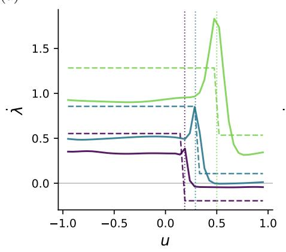

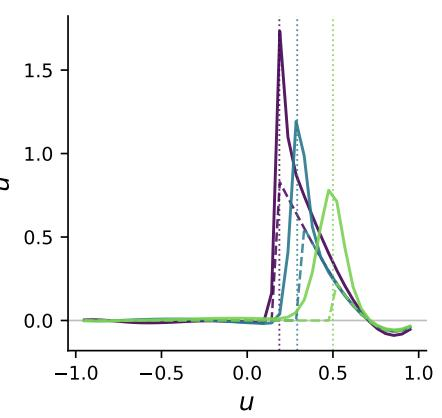

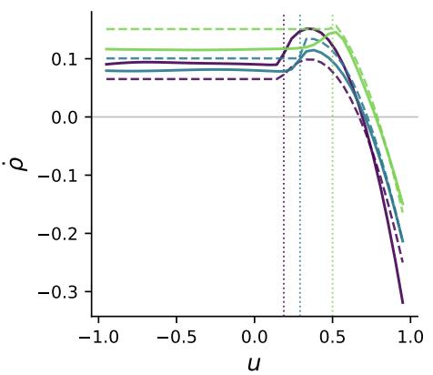

(b)  
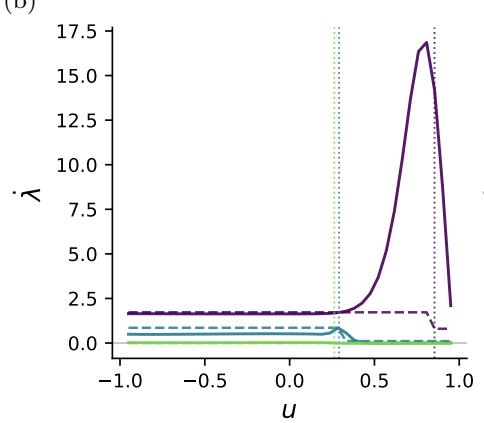

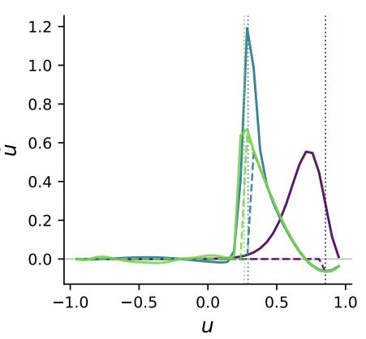

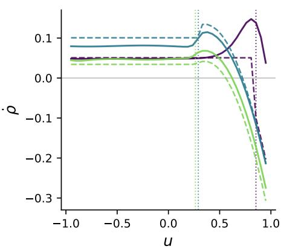  
FIG. S1. Empirical $( \dot { \lambda } , \dot { u } , \dot { \rho } )$ (solid) and the asymptotic prediction (dashed, same color) against the overlap u, at $\rho _ { 0 } = 1 . 7 ,$ $\rho _ { \mathrm { t r u e } } = 1 . 2 , q = 0 . 2 , \ell = 1 0 0$ and $n = 1 8 0 8$ throughout. $\mathrm { ( a ) }$ Three values of α at $\lambda _ { 0 } = 0 . 2$ , with $d = 3 0 0$ , 150 and 75. (b) Three initial temperatures at $\alpha = 0 . 0 5$ and $d = 1 5 0$ . Dotted vertical lines mark $u ^ { \star }$

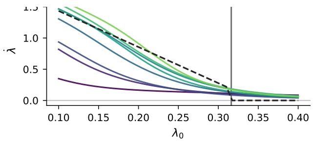

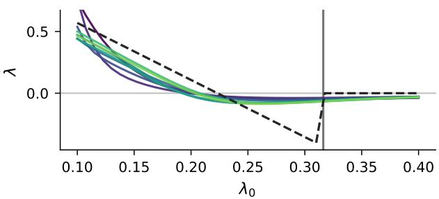  
FIG. S2. λ˙ against λ0 at fixed overlap, for increasing d (with $n = e ^ { \alpha d } )$ , and the asymptotic prediction (dashed). Parameters are α = 0.05, $\rho _ { 0 } = 1 . 7 , \rho _ { \mathrm { t r u e } } = 1 . 2 , q = 0 . 2 , \ell = 1 0 0$ . Left: $u = 0 . 1$ , in N throughout. Right: $u = 0 . 7 $ , in R throughout. The vertical line is $\lambda ^ { \star } = 0 . 3 1 6$

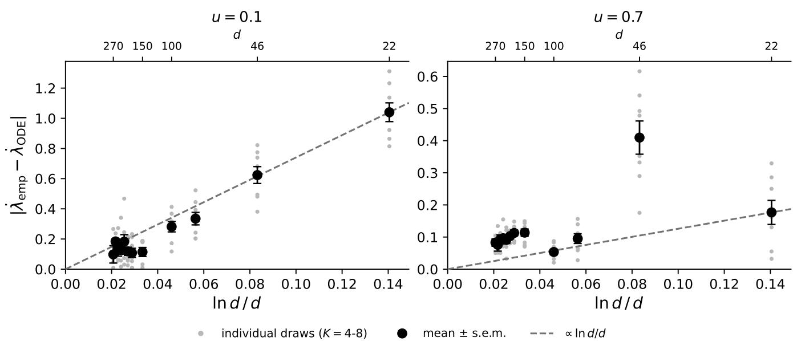  
FIG. S3. Error in the initial $\dot { \lambda }$ vs. ln $d / d ,$ for $u = 0 . 1$ and $u = 0 . 7 , \mathrm { ~ a t ~ } \lambda _ { 0 } = 0 . 1 , \rho _ { 0 } = 1 . 7 , \alpha = 0 . 0 5 , \rho _ { \mathrm { t r u e } } = 1 . 2 , q = 0 . 2 , \ell = 1 0 0 .$ d runs from 22 to 270 $( n = 3$ to $7 . 3 \times 1 0 ^ { 5 } )$ , marked on the top axis. Grey points are individual datasets, black their mean with the standard error: eight datasets per d up to $d = 2 2 5$ , four above. Dashed line: ln $d / d$ through the origin and the smallest-d point.