# RECONSTRUCTION DIFFERENCES RIVAL INDIVIDUAL DIFFERENCES IN THE FLY COMPASS CONNECTOME AND BREAK TRAINED CIRCUIT MODELS

Md Ali Ashraf Yad Wrocław University of Science and Technology 283109@student.pwr.edu.pl

Nazifa Tabassum Nabila Comilla University nabilanazifa70376@stud.cou.ac.bd

## ABSTRACT

Neural network models are increasingly constructed from synapse-resolution connectomes, and the same circuit is now available in reconstructions from other animals and pipelines. We do not know whether such models are dependent on the reconstruction they are built from, and whether connectome differences are biological or measurement errors. We studied the Drosophila head-direction circuit in nine versions: four flies (male CNS, hemibrain, Fly Wire, BANC) and five variants of the same fly varying only by thresholds, proofreading or synapse detection. Using wiring-based correspondences validated by anatomical labels, we place all differences on one scale. A change of synapse detection within one fly changed the circuit more than halfway to the smallest inter-fly difference on four distances; proofreading differences were smaller but depended on the metric, and left and right halves of one fly differed no more than a random half. Networks trained on each wiring to hold a cued heading developed near-perfect ring attractors, but their error increased from below 1◦ to 10–28◦ when all weights changed by 1%. Training on each wiring did not transfer to any other connectome, including other versions of the same fly; refitting thirty cell-type gains, we repaired filtering-level differences but remaining error depended on wiring distance. Training with noise lowered precision and enhanced transfer. Imaging data indicate compasses drift smoothly and do not break; they function despite differences comparable to those of this study.Therefore, connectome-constrained models need to reflect the reconstruction they stem from and the robustness normal circuits exhibit and models lack. 1

Keywords connectome · Drosophila · head-direction circuit · ring attractor

## 1 Introduction

Synapse-resolution connectomes are now routinely used to build neural network models (Lappalainen et al., 2024; Shiu et al., 2024; Duan et al., 2025). Reconstructed wiring specifies the connections between the neurons and their strengths, and the parameters which the wiring leaves unassigned, like gains of neurons, are assumed, fitted, or trained to replicate a behaviour or a recorded activity pattern. These models are constructed from a single animal’s connectome, through a single reconstruction pipeline. The question of whether a certain behaviour is dependent on that reconstruction is seldom asked, and the degree of constraint the model based on a connectome imposes on the behaviour is debated (Beiran and Litwin-Kumar, 2025).

The question is now testable because the same circuit is now present in multiple reconstructions. The hemibrain, a reconstruction of the Drosophila central brain, was created by (Scheffer et al., 2020), the whole adult central brain, FlyWire, was created by (Dorkenwald et al., 2024; Schlegel et al., 2024),the male Drosophila central brain, BANC, was created by (Berg et al., 2026) and the central brain and nerve cord in BANC was created by (Bates et al., 2026). These datasets are from different flies and made by different groups, with different imaging, segmentation, synapse detection and proofreading.

how to divide them. The hemibrain and FlyWire are similar in a vast majority of aspects of their morphology, but approximately one-third of the types of cells proposed for the hemibrain were not reliably reidentified (Schlegel et al., 2024).Others say the differences between FlyEM and FlyWire data are primarily technical (Okuno et al., 2025), and there will be a significant variation in the efficiency of synapse detection between different datasets (Scheffer, 2025). ). To distinguish between individuality and measurement, comparisons have to be made between re-constructions of the same fly. Now it is possible to compare two such things: FlyWire has two independent tables of synapses in one fly (Buhmann et al., 2021; Yu et al., 2025), and the male CNS and BANC have successive proofreading releases.

To our knowledge no test has been conducted on whether a trained model survives these differences. The most similar work demonstrated that each head direction circuit of four connectomes can be mapped onto an exact ring attractor with a couple rescalings of the cell types (Biswas et al., 2024). That analysis is performed individually for each connectome to fit an ideal attractor. It doesn’t require the modeler to ask if a model trained with one connectome is applicable to another connectome; the modeler’s job is to determine if a result from one set of connectomes applies to another set of connectomes.

The fly head-direction circuit is a good test case. EPG neurons have a bump of activity that tracks the fly’s heading and that persists in darkness (Seelig and Jayaraman, 2015), and the dynamics of a ring attractor are described (Kim et al., 2017); PEN neurons shift the bump when the fly turns (Turner-Evans et al., 2017; Green et al., 2017), and the circuit’s connectivity is described in detail (Hulse et al., 2021). The function of reconstructing the circuit is simple to read and update the heading, the circuit is reconstructed in all four datasets, and there is a known fine-tuning problem with continuous-attractor models of it (Seung, 1996; Noorman et al., 2024; Ságodi et al., 2024).

This study grew out of an earlier one (Yad, 2026a), in which we compared rate networks trained on the male CNS compass wiring with randomly rewired and degree-preserving rewired networks. The real wiring held a cued heading accurately (median error 1.7◦) and better than 29 of 30 random and 24 of 30 degree-preserving rewirings, but an advantage over degree-matched wiring was not established (network-level rank p = 0.065 and 0.23). That result raised a more basic question: before asking whether one fly’s wiring is better than an alternative, one must know how far real connectomes differ from each other, how much of that difference is reconstruction, and whether trained models survive it.

In this study, we will examine nine different versions of the head-direction circuit: five different versions of the same circuit but with different versions of the filter on the synapses, and four different versions of the circuit with the same synapses but different proofreading circuits or synapse detection circuits. We give three contributions. First, a decomposition: all differences are grouped on one scale, and a change of synapse detector, which is inferred from wiring and confirmed by anatomical labelling, moves the wiring on every measure used more than half as far as the smallest change of fly, as the next section shows (Sec. 2.1–2.2). Secondly, fragility: networks trained on all real wiring forms near-perfect ring attractors, which break when all weights are changed by 1% (Sec. 2.3). Third, transfer: trained networks do not transfer to other connectomes (even to other fly connectomes) except for the differences in filtering level (which get fixed by refitting about 30 cell-type gains); failure is not affected by the wiring distance of the source (Sec. 2.4–2.5).However, imaging data from flies reveals that the actual compasses weaken, although not suddenly, over time (Sec. 2.6). The transplant hypotheses and the mechanism criteria were preregistered (Yad, 2026b); all deviations from these hypotheses and mechanism criteria are listed in Sec. 4.9 the noise-training and the refit and same-fly analyses are exploratory.

## 2 Results

## 2.1 Nine versions of one circuit

We extracted the head-direction circuit (EPG, PEG, PEN, , ∆7 , and ER1–6 neurons) from four connectomes from four flies, reconstructed by three groups (the male central nervous system (male CNS v1.0; Berg et al., 2026),the hemibrain (v1.2.1; Scheffer et al., 2020), FlyWire FAFB (v783; Dorkenwald et al., 2024) and BANC (v888; Bates et al., 2026). All versions were developed with the same rules: the neurons of the five families, at least three synapses per pair for the sum of the neuropils, no self-connections and signs assigned by cell type (Sec. 4.1).The circuits contained 409–434 neurons and 15,440–28,942 connections (Table 1).

To distinguish, apart from reconstruction from biology, we added five variants in which the fly remained unchanged and only a single step of the reconstruction changed (Fig. 1B).For the male CNS, a second filtering pipeline (neuPrint instead of Codex) and an earlier proofreading release (v0.9). The same synapse table as in FlyWire, but without the confidence filter, and an independent synapse detector (Buhmann et al., 2021) instead of Princeton synapses (Yu et al., 2025).For BANC, an early proofreading version (v626). The male CNS network in Codex was identical to the one used in our previous study (Yad, 2026a) on all connections shared between them (r = 1.000), and the rebuilt hemibrain network was identical to the previous hemibrain network.

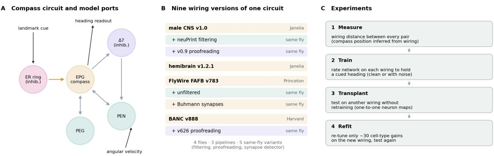  
Figure 1: Study design. (A) The compass circuit and model ports are: cue to ER, angular velocity to PEN, readout from EPG (B) Nine wiring versions: four flies from three groups (bold) and five same-fly variants, in which the variants differ in filtering, proofreading or detection of synapses (C) Experiments: Distance measurements, Training on each wiring, Transplant through neuron maps, Cell-type gains.

When wiring between flies, it is important to know the location on the compass of each neuron. This position was inferred from wiring alone: EPG neurons were positioned by multidimensional scaling of their connectivity, and all other neurons were positioned to their EPG partners (Sec. 4.2). ). The inferred position of the glomeruli was in circular agreement with the labels (0.99–1.00) in the two flies with independent labels, but not in the shuffled controls (0.24–0.55) (Table S5).

One-to-one neuron maps were constructed between each pair of flies, using these same positions, and were constructed by rank matching after aligning the two compasses by rotation, and, where necessary, mirroring (Sec. 4.2). Maps were assigned to each EPG and to each PEN a and b neuron in the two labelled flies, with 83% of PEG neurons and 100% of EPG and PEN a and b neurons correctly assigned to their correct glomerulus in both flies. In all 12 ordered fly pairs, the 91-99% of the source neurons were used in the map (Table S7).

## 2.2 Measurement rivals individuality

We used versions with a wiring-map distance defined as the connection strength as a function of the angular offset between the two neurons, computed using a total-variation distance weighted by the percentage of synapses of the pathway (Sec. 4.3). There are two controls that set the floor. When the same male CNS fly was processed by two different filtering pipelines, it resulted in 0.022, while a random 10% of connections was removed to yield 0.032 (SD 0.003, five repeats).

Changing how synapses are detected in a single fly moved the wiring a large part of the way toward a change of fly (Fig. 2A). The two comparisons of detector results on FlyWire yielded 0.084 and 0.090. Means of the distances between flies varied between 0.108 and 0.212 (Table S4).The detector separations were therefore 78-83% of the minimum of the two closest distances between the fly pairs, but within the range of 0.108-0.125 between the 3 closest fly pairs, with the two largest distances between the fly pairs (0.185 and 0.212) being separated by more than twice this range.

In one fly, proofreading was important and in the other, it was not. For this circuit at distance 0.000, the two male CNS releases (v0.9 and v1.0) did not differ since it was completely proofread before v0.9. The difference between the two BANC releases was 0.104, which was almost the smallest difference between any two of the flies. Filtering changes remained around the lower limit of the range (0.022-0.038).

It is the distance between the flies that blend biology with reconstruction. At 0.117, only one fly pair shares a reconstruction pipeline family, all other pairs differ in pipeline also. Therefore, the same-fly variants bounded the measurement component: on this circuit, one change of synapse detector creates differences similar to the closest fly-to-fly comparisons.

The ranking was strong across the three different distance measures $( \rho = 0 . 7 7 - 0 . 9 3 , p \leq 0 . 0 0 4 ;$ Table S8). Differences between detectors were up to 56–115% of the nearest between-fly difference depending on the measure and the detector

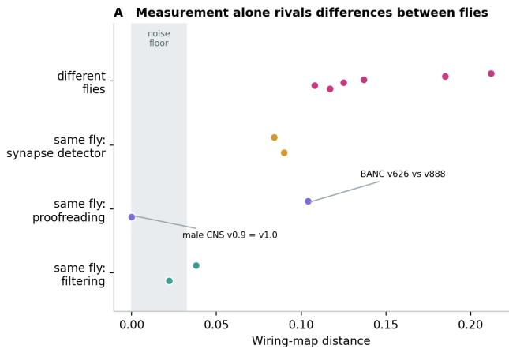

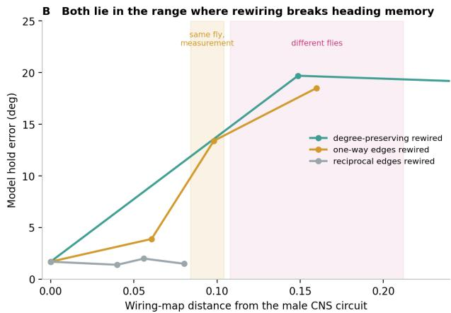  
Distances: per-pathway angular wiring maps (positions inferred from wiring), total-variation distance weighted by pathway share. Hold errors: male CNS models, five networks per point.

Figure 2: Connectome differences on one scale. (A) Wiring-map distance by source of difference; grey band, noise floor (0.022–0.032). (B) Hold error of male CNS models after artificial rewiring (Yad, 2026a) against distance from the original (five networks per point); bands mark same-fly measurement and between-fly differences. The degreepreserving curve continues to the 50% shuffle (0.42, 18.2◦), off the plotted range.

comparison. The BANC proofreading difference ranged from 15% closest between-fly difference for the weights of the neurons to 96% for the angular map.

In both halves of the fly circuit, the ratio of left to right was no more different than that in random halves of the same neurons, 0.060 versus 0.068 in male CNS and 0.100 versus 0.111 in BANC (five repeats for each side per circuit). A this resolution we detect no bilateral asymmetry.

These distances can be measured on a rewiring-scale of a trained model. Rewiring degraded cued heading to 13.4◦ after 10% of one-way connections were moved; it was worse, to 19.7◦ after 20% of one-way connections were moved or 19.7◦ after 25% of one-way connections were moved or degrees were preserved (Yad, 2026a), On the wiring-map scale these manipulations lie at 0.098, 0.160, 0.149 and 0.080 (Fig. 2B).These holding differences in the same flies and the between-flies are both within the range where artificial rewiring breaks holding in these models.

## 2.3 Trained models are knife-edge ring attractors

For each of the four real wirings we trained a rate network to store a cued heading, either with one gain per neuron or one gain per cell type, and a different seed each time (Sec. 4.4).). Among 40 networks, the 36 that were trained included one that failed seed 2 in both parameterizations in the male CNS and one that failed in both parameterizations for the hemibrain, and were excluded by the registered rules (own error > 80◦). The error of the trained networks was 0.3-1.6◦ after 40 steps.

All real wires generated a ring attractor with the pre-registered criteria (H4; Fig. 3C).Thirty-one of the 36 networks had a ring in the top two principal components of EPG activity and returned to it at a perturbation rate greater than 5 times the rate at which they wandered along it. In all combinations of fly × pparameterization (3-5 networks each; Table S12). the registered rule, at least three of five seeds, was satisfied. Activity had no discernable decay or growth along the ring; the median of the slowest of the Jacobian multipliers of the trained two step map was 0.998–1.014 for each combination, with individual network multipliers between 0.991 and 1.044: a near continuous attractor

The separation of the positive control was done by the criteria. Without retraining, silencing ∆7 neurons resulted in breaking H4 in 26/31 networks and increased hold error in all 31 networks.

Shape separates the real wiring from rewired wiring. In the pilot (male CNS, Sec. 4.10),real-wiring networks held heading on a round ring (radius variation 0.17; Fig. 3A).Networks trained on maximally shuffled wiring also held heading but stored it on a distortion loop (radius variation 0.50-0.54; Fig. 3B) that persistent homology did not classify as a ring. In the 12 shuffled pilot networks (25% and maximal shuffles), the slowest multiplier was 0.900-0.997, with a large gap to the next, indicating an approximate rather than near-continuous attractor.

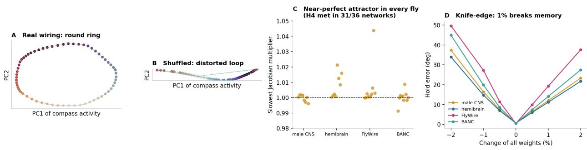  
Figure 3: Near-perfect but knife-edge ring attractors. (A, B) EPG activity of pilot networks 95 steps after the cue in the top two principal components, coloured by cued heading (same scale): round ring for real wiring, distorted loop for maximally shuffled wiring. (C) Slowest Jacobian multiplier of every trained Stage 4 network; dashed line, 1. (D) Hold error after scaling all weights by $- 2 \ : \mathrm { t o } \ : + 2 \%$ (per-neuron gains, median of seeds 0–1).

The nearly perfect attractors were fragile (Fig. 3D). All networks tested (two seeds per fly) were extremely sensitive to scaling, with hold error increasing to ${ \bar { 1 0 . 3 } } { - 2 { \bar { 7 } } . 9 ^ { \circ } }$ with a 1% increase or decrease of all weights, and to $2 0 . { \dot { 5 } } { - } 5 0 . 9 ^ { \circ }$ with a 2% change. We take this to mean the fine tuning problem of continuous attractors (Seung, 1996; Ságodi et al., 2024):): a multiplier close to 1 needs to be tuned, and a uniform change of the weights takes it away from 1.

The same effect was seen when biologically real connections were added. The male CNS networks, which differ only in that the weakest synapses removed by the Codex filter are included, evaluated at $1 3 { - } 7 4 ^ { \circ }$ , with gains of 13–38◦,per cell-type and $3 1 - 7 3 ^ { \circ } )$ ,per neuron, although the two versions are separated by only the noise-floor distance of 0.022.

## 2.4 Models do not transfer between connectomes

To test each trained network, we evaluated it on each of the remaining $\mathrm { { \ f y } ^ { \prime } { s } }$ wiring pairs, without retraining, and passed its parameters down through the 1:1 neuron maps (Sec. 4.5). All transplants died (Fig. 4A).The median error for the ordered fly pairs was $8 2 ^ { \underline { { \mathbf { \sigma } } } } \cdot 9 \overline { { 2 } } ^ { \circ }$ , compared with $0 . { \bar { 3 } } – 1 . 6 ^ { \circ }$ ◦ for the networks’ own wiring, and 90◦for chance, with 101 of 108 individual transplants being larger than $8 0 ^ { \circ }$ , which was the registered failure level.

The following was the outcome to the hypotheses that were preregistered. H1 made two predictions of the transplant ratio R,the median error on the target divided by the median error on the source. The weak prediction (median fly pair with $R > 5$ was corroborated (median $R = 8 7$ for cell-type gains, the registered parameterization, and $R = 1 6 2$ for per-neuron gains.The neuron-level parameters were inferior to the cell-type parameters for H2, and the neuron-level Rwas greater in all 12 ordered pairs with one-sided Wilcoxon $p = 2 . 4 \times \mathrm { \bar { 1 0 ^ { - 4 } } }$ , Holm-corrected $7 . 3 \times 1 0 ^ { - 4 } )$ .. Wiring distance predicted that failure of the grafts increases with distance, which was not supported $( \rho = - 0 . 3 3$ for cell-type gains, $p = 0 . 8 5 ; \rho = + 0 . 2 5$ for per-neuron gains, $p = 0 . 2 1 ,$ . With no gain gradient to correlate to, there was no reason to suspect that every transplant, before the operation, was already at chance.

There are three controls to eliminate procedural explanations. First, it was found that by reproducing the same rankmatching process in each network as it is applied in its own-wiring, each network also produces its own-wiring failure, indicating that the mapping does not cause the failures. Second, the maps were accurate for EPG and PEN neurons in the labelled flies (Sec. 2.1). Thirdly, the failure does not need a different fly: networks failed on their own fly neuPrint (Sec. 2.3).

A single global gain did not rescue transplants The 12 ordered pairs specified for the 12 networks with seeds are trained clean, and for each of 24 such networks (target weights between 0.8 and 1.2), the best uniform scaling of those weights was searched for. The median error was only reduced from $8 7 ^ { \circ }$ to $8 3 ^ { \circ }$ (one-sided Wilcoxon signed-rank test, $p = \bar { 6 } . 3 \times 1 0 ^ { - 5 }$ , exploratory) and the best scaling was frequently at the end of the range searched for. So transfer failure is not due to overall weight scale.

Training with noise introduced robustness with a tradeoff of precision (Fig. 4B). To explore this, we have trained networks on four levels of weight-scale jitter, synaptic noise, dropout noise and activity noise (0, 0.25, 0.5 and 1.0; three seeds per level). Excluding the two networks that did not manage to converge in the absence of any noise, the own-wiring error rose as noise increased from $0 . 6 ^ { \circ }$ to 7.9, 11.7 and $2 \bar { 1 } . 4 ^ { \circ }$ (medians; $\rho = + 0 . 8 3 )$ , and the error after having normalized all the weights by 0.95 decreased from $6 7 ^ { \circ }$ to 46, 25 and $2 2 ^ { \circ } , ( \rho = - 0 . 8 6 ;$ both $p < 1 0 ^ { - 1 1 } )$ .

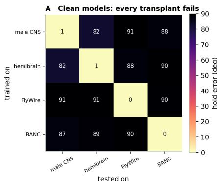

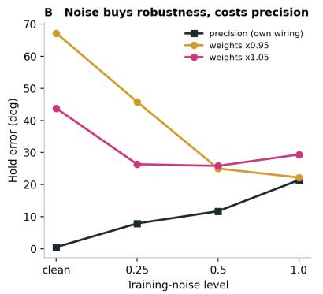

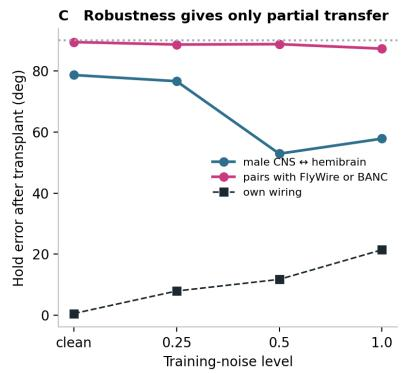  
A: Stage 4. per-neuron gains. median of trained seeds (preregistered H1: transplant ratio 87-162. 'fragile'). B-C: Stage 4c. 48 networks. per-neuron gains. 40-step tests

Figure 4: No transfer; noise trades precision for robustness. (A) Error of clean per-neuron networks tested on each wiring (rows: trained on; median of trained seeds (B) Exploratory noise sweep: own-wiring error and error with all weights scaled by 0.95 or 1.05, by training-noise level. Chance, dotted line (C) Transplant error for male CNS ↔ hemibrain and for pairs with FlyWire or BANC, with own-wiring error; dotted line, chance.

Robustness gave only partial transfer (Fig. 4C). The median error from the transplant was $7 9 \mathrm { { } ^ { \circ } i n }$ clean networks, $5 3 ^ { \circ }$ at noise level 0.5 (range $4 6 { - } 8 1 ^ { \circ }$ , six networks) and $5 8 ^ { \circ }$ at level 1.0, which is still significantly higher than the $1 1 . 7 ^ { \circ }$ ◦ that these networks achieved when their wiring was not distorted. All pairs with FlyWire or BANC remained close to chance at all noise levels (medians 87-90◦).

## 2.5 Transfer fails with distance, whatever its source

To learn which differences a model can absorb, We used seven wiring versions, the four flies and three same-fly variants (Buhmann detector, male CNS neuPrint, FlyWire unfiltered, FlyWire with Buhmann detector) and trained networks with noise level 0.5 on each of these wiring versions, and transplanted each network to the other six, for a total of 21 networks, 42 ordered pairs, and 126 transplants. For each zero-shot transplant, one gain offset per target cell type was refitted - approximately 30 numbers, while the other parameters were fixed (Sec. 4.5). These analyses were not pre-registered.

Refitting corrected filtering-level but not detector-level or fly-level differences (Fig. 5B). The error of same-fly filtering variants decreased from a median of $4 5 ^ { \circ }$ zero-shot to $8 ^ { \circ }$ after refitting, and 92% of transplants ended below $3 0 ^ { \circ }$ . When it was dropped with another synapse detector, it dropped to $8 3 ^ { \circ }$ to $6 1 ^ { \overline { { \circ } } }$ (33% below 30◦), and when it was dropped with different flies $8 8 ^ { \circ }$ to $5 7 ^ { \circ }$ (21%). The three categories differed (Kruskal), and neither the detector change $( 6 \bar { 1 } ^ { \circ }$ against $5 7 ^ { \circ }$ , two-sided Mann–Whitney, $p = 0 . 2 0 )$ nor the change of fly $( 6 1 ^ { \circ }$ against $5 7 ^ { \circ }$ , two-sided Mann–Whitney, $\rho = 0 . 2 0 )$

The wiring distance between the sources (Fig. 5A;was tracked by refit and was correlated with the distance $\rho = + 0 . 6 7$ $\rho = 0 . 0 0 1$ , 20 ordered pairs with a measured distance). A detector change in one fly was as bad as a change of fly at the same distance. With less space, clean-trained networks performed the same with 60% of the filtering-level transplants below $3 0 ^ { \circ }$ , 17% of the detector-level transplants, and 5% of the between-fly transplants.

## 2.6 Real flies are not knife-edge

We examined E-PG calcium imaging from 15 flies in the presence of a bright visual cue, a low-contrast cue, and darkness (DANDI 000289; Basnak et al., 2025). In all three conditions, the variance in the difference of bump to heading increased freely and more rapidly without a cue (Fig. 6A).). At a lag of 40 sec, the mean squared difference was $4 0 . 4 ~ \mathrm { r a d } ^ { 2 }$ in darkness (95% CI 25.6–57.7, bootstrap over flies), 18.1 rad2 with a low-contrast cue and 5.2 rad2 rad2 with a bright cue (1.6-11.2), roughly one order of magnitude smaller than that in darkness with non-overlapping intervals.

On short timescales we did not establish the excess drift that darkness would contribute. A fit to the mean squared change on no-turning runs over a minimum 5 s for the 9 flies with data in both conditions (Sec. 4.7)yields a noise floor of 0.047 rad2/s in darkness (0.013–0.103) and 0.023 rad2/s sec with a bright cue (0.011 to 0.035). The difference, 0.024 rad2/s (−0.010 to 0.076), ), includes 0. We did not compare these with drift in the models (Sec. 4.9).

Each $\mathrm { { \ f y ^ { \prime } s } }$ compass is coupled with its own wiring, and the wiring varies among flies by 0.11-0.21 in our units. Our ’clean trained’ models do not tolerate 1% changes in their weights. The individual wiring differences we measured do

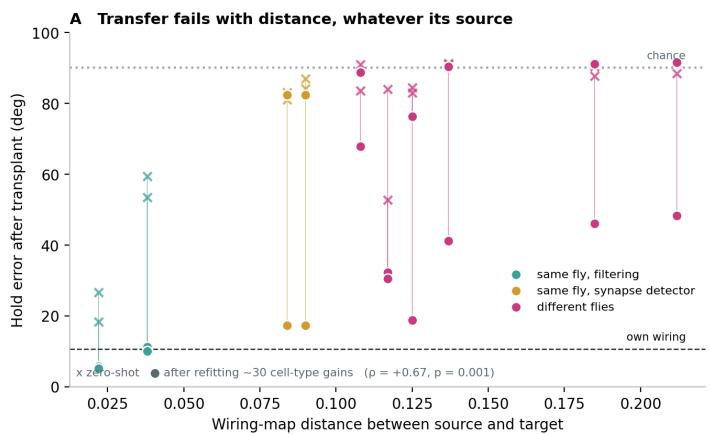

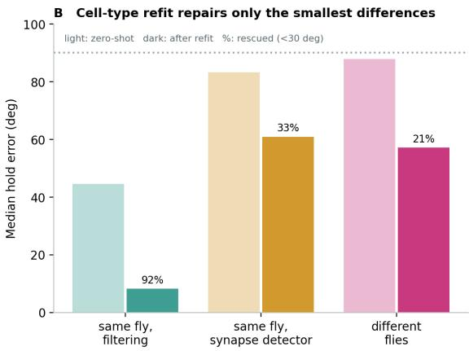  
Stage 4d. noise level 0.5: 21 networks on 7 wiring versions (3 seeds each), per-neuron gains. Detector ys different flies after refit: p = 0.20 (Mann-Whitney): categories differ, p = 1e-6 (Kruskal-Wallis).

Figure 5: Transfer depends on distance, not on the source of the difference. (A) Transplant error against source– target distance, zero-shot (crosses) and after refitting about 30 cell-type gains (dots); dashed line, median own-wiring error over the plotted pairs. (B) Median error by source; percentages, transplants below $3 0 ^ { \circ }$ after refitting. Exploratory: 21 networks on seven versions, noise level 0.5; three refits did not complete.

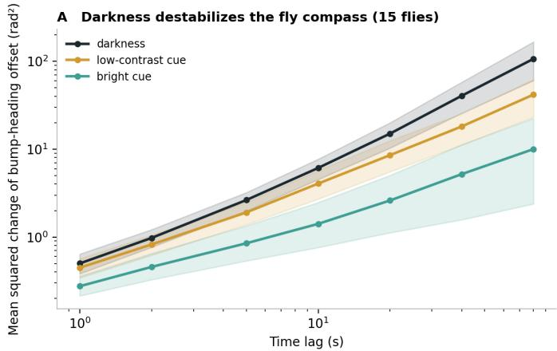

B Short-timescale drift (9 flies)  
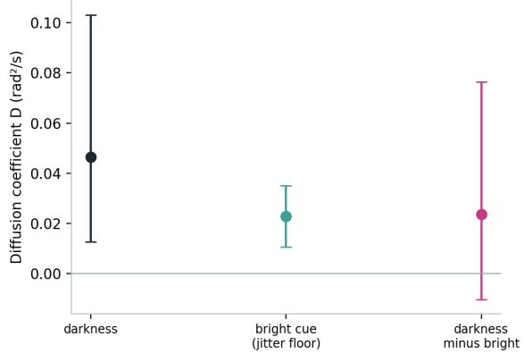  
DANDI 000289 (Basnak et al. 2025), contrast experiment. A: all frames incl. turning, bootstrap over flies. B: no-turning runs >= 5 s, MSD = 2Dt + 2s² fit; 95% Cls from fly bootstrap.  
Figure 6: The fly compass degrades gradually. (A)Mean squared change of bump-heading offset against lag (15 flies, all frames; shading, 95% CI over flies). (B) Diffusion coefficient from $\mathrm { \check { M S D } } = 2 \dot { D } t + 2 \sigma ^ { 2 }$ fits to no-turning runs of at least $5 \mathrm { ~ s ~ } ( 9$ flies); bars, 95% CI. Data: DANDI 000289 (Basnak et al., 2025).

not prohibit fly compasses from functioning. Models do not; all of what makes real circuits fault tolerant is absent from the trained networks

## 3 Discussion

## 3.1 Measurement is a large part of connectome variability

The contributor to connectome difference is on the fly compasses from the reconstruction pipeline. A difference due to the modification of a single fly by a single only synapse detector is more than or about half of the smallest fly to fly difference for each of four distances. The proofreading differences were smaller for the other fly pairs and were quite variable, depending on the distance measure. Because only one pair of flies is processed by the same pipeline (the other fly pairs differ in their reconstruction pipeline), the between pairs distances are not entirely reconstruction. We can only say that the measurement component is large enough that a connectomes difference cannot be due to individuality alone without a same fly.

Table 1: The nine wiring versions. Head-direction circuit (EPG, PEG, PEN, ∆7, ER1–6), at least three synapses per neuron pair.
<table><tr><td>Version</td><td>Source</td><td>Neurons</td><td>Connections</td></tr><tr><td>male CNS v1.0</td><td>FlyWire Codex (filtered)</td><td>434</td><td>27,246</td></tr><tr><td>male CNS, neuPrint</td><td>neuPrint</td><td>434</td><td>33,783</td></tr><tr><td>male CNS v0.9</td><td>Codex</td><td>434</td><td>27,246</td></tr><tr><td>hemibrain v1.2.1</td><td>neuPrint</td><td>409</td><td>28,942</td></tr><tr><td>FlyWire FAFB v783</td><td>Codex, Princeton synapses, filtered</td><td>433</td><td>16,741</td></tr><tr><td>FAFB unfiltered</td><td>Codex unfiltered file, ≥3 synapses</td><td>433</td><td>23,340</td></tr><tr><td>FAFB Buhmann</td><td>Codex, Buhmann synapses</td><td>433</td><td>18,452</td></tr><tr><td>BANC v888</td><td>Codex</td><td>419</td><td>15,440</td></tr><tr><td>BANC v626</td><td>Codex</td><td>419</td><td>17,343</td></tr></table>

This accords with prior evidence that synapse-detection performance varies between data sets (Scheffer, 2025), that many FlyEM-Fly Wire differences are technical (Okuno et al., 2025),), and that setting dataset-specific thresholds helps secure reliable connections (Berg et al., 2026).Here we contribute a controlled comparison: same-fly reconstructions that differ by one step at the same scale as fly-to-fly differences, combined with a functional assessment of how those differences affect a trained model.

## 3.2 Why trained models fail: the fine-tuning problem

The fragile state of the trained networks is a consequence of the solution that training leads to. The absence of input from a holding heading necessitates a continuum of stable states; this the rate network has by setting its slowest mode to a multiplier of 1 (close to what our networks achieved, median 0.998-1.014 per fly and parameterization). This is a structurally unstable solution: any change to the weights causes the multiplier to deviate from 1, and the bump to drift or vanish (Seung, 1996).

And it’s a failure, rather than a proof, that the fly’s circuits can’t work out how to connect with each other. Any network that cannot adapt to its weights changing by 1% will fail for any connectome that is different by more than that, and all the ones we tested did, including other reconstructions of the same fly. That’s also why we failed to support H3: at chance levels for each transplant, there was nothing left for distance to predict, whereas after noise training and refitting, error increased with distance.

That same reasoning points to a solution. Perturbed continuous attractors typically depart the slow manifold that held the variable for some time (Ságodi et al., 2024), ), and hidden symmetries in the heterogeneous compass connectivity can support ring-attractor dynamics (Noorman et al., 2024), and hidden symmetries in the heterogeneous compass connectivity can support ring-attractor dynamics (Hulse et al., 2026).). But approximate attractor shape alone was not sufficient in our hands: shuffling pilot networks stored heading on a deformed loop (multipliers 0.900-0.997), and were as sensitive to 1% weights change as real-wiring networks (Table S3). Noise training conferred robustness at the price of accuracy. A real circuit model may need to be trained to become robust, rather than left at the knife-edge produced by clean training.

Real compasses seem to be quite robust in this regard. The location of bump-heading offset spread out over (in darkness) 3-40 seconds faster than in cue, again a pattern consistent with a slowly drifting approximate attractor population in need of correction, and sensory input. Fly compasses work in all the flies we have tested, despite wiring variations of 0.11-0.21 on our scale, while the clean models fail on a same-fly variant of 0.022.Whatever provides this robustness in real circuits-developmental noise, plasticity, feedback from other circuits-is missing from the trained network

## 3.3 Relation to static fits of the four connectomes

Biswas et al. (2024) demonstrated that all four connectomes could be mapped into the ring attractor after a rescaling of a handful of cell types. Our result is not incompatible with that: these two results are answering different questions. Static fit simply means independently fit each connectome to an ideal model. Transplant tests whether an all-by-all connection matrix trained to one connectome generalize to another, without refit from scratch. If we allow refitting at only roughly 30 cell-type gains, then we can at least correct for filtering-level, but not detector-level or fly-to-fly differences. That there are only a handful of cell-type parameters that make each connectomes an attractor does not mean that those same handful of parameters, used as a foundation from one connectomes solution, can build a trained model for another.Those two results are consistent. Degeneracy of connectome-constrained models (Beiran and Litwin-Kumar, 2025): many parameter configurations will elicit the target dynamics when limited to a single wiring. The parameter configuration a model that encounters one wiring ultimately converges to will not necessarily be close to any good set of parameters when limited to the other wiring.

## 3.4 Alternative explanations

The transfer failed not due to mismatch or the total weight scale. The maps were accurate for the EPG and PEN neurons on the labelled flies, self-mapping replicated own success, networks failed on a different reconstruction of own fly where no cross-fly alignment is employed, and the best global gain improved transplants only from 87◦ to 83◦. The discrepancy is in the pattern of connections, not their magnitude

The difference between a round ring and a distorted loop is not a matter of visual judgement: the ring criteria were preregistered, and Jacobian multipliers, winding number and radius variation are all provided for every network (Tables S2 and S13; the last two are exploratory).

The precision-robustness trade-off applies to one particular class of rescaled noise models; other types of noise and the deterministic sensitivity penalty may outperform.

## 3.5 What modelers should do

First, include the original reconstruction: dataset, version, synapse table, connection threshold and proofreading release. For this circuit, two synapse tables of one fly differed by more than half as much as the two most similar flies by any of the measures we used, and two proofreading releases by up to as much by any of the measures.

Second, a model trained on one connectome should be a separate entity until it is reproduced on the other, and parameters should be tuned for each set separately. Cell-type parameters moved between filtering variants of a fly, but not between synapse detectors or flies.

Third, always test the trained model for robustness. Before you can interpret what a trained model says about a given circuit, two trivial checks are whether the error increases after scaling all weights by 1% and whether the error increases on a second reconstructed version of the same circuit (preferably of the same animal).

Fourth, consider same-fly variants as the reference before ascribing a difference between connec-tomes to individuality. Compass circuit: the measurement floor set by filtering is small (0.022-0.038 in our scale), while the measurement floor set by synapse detection and proofreading is not.

## 3.6 Limitations

Our data includes four flies reconstructed by three groups. Biology and pipeline are integrated with this design and the same-fly variants limit the measurement component but do not eliminate it from the between-fly distances.

Between-fly distances at the level of individual neurons are upper bounds: within a fly, neurons are matched by identity, but between flies they are matched by inferred maps, which contribute residual error to the measured difference.

The measurement effects were estimated in only two flies: the synapse-detector effect in Fly Wire and the proofreading effect in BANC. For the male CNS, proofreading of this circuit had been finished in the earlier release.

Model 1: rate networks. We trained models with backpropagation on one task - maintaining a cued heading - with angular-velocity input streamed to PEN neurons. We did not test angular integration (though it was observed (Sec. 4.9).Nor did we test lateralized input (also observed, (Sec. 4.9)Different classes of model (e.g., spiking, fits to activity data) might be more or less robust.

It was not possible to establish a short-time-scale excess drift of the fly compass in darkness for nine flies, nor was it possible to determine if there was a distinction between fly drift and model drift because the networks we trained are deterministic, and the established standard for variance associated with our available model benchmark has not been validated. The noise sweep, cell-type refit and the same-fly transfer analyses were not preregistered. They are exploratory, and the reported statistics are uncorrected

## 3.7 Future work

More same-fly reconstructions, with multiple synapse detectors or proofreading releases of a single animal, would turn the measurement bound into an estimate, and more flies from a single pipeline would do the same for individuality. Lossy training targets, a registered integration task with lateralized input as done by Duan et al. (2025),would test whether robust models generalize where fragile ones do not. Connectomes combined with activity recordings from the same animal would enable comparison of trained models with the drift of their own circuit.

## 3.8 Conclusion

Reconstructions of the compass circuit of one fly can vary in a significant fraction of the variation between flies, and networks trained on them are close to perfect knife-edge ring attractors that fail in either type of difference. Connectome-constrained models should incorporate the differences they were trained on and the robustness exhibited by real circuits that they lack

## 4 Methods

## 4.1 Connectome extraction

Male CNS v1.0, Fly Wire FAFB v783 and BANC v888 was downloaded from Fly Wire Codex on 14 October 2026 using the filtered connection files. Hemibrain v1.2.1 and was queried from neuPrint (Plaza et al., 2022). Cell types were selected based on matching names with the regular expression ˆ(EPG|PEG|PEN|Delta7|ER[1-6]);and their all-to-all connectivity matrices summed over neuropils, connecting pairs with fewer than 3 synapses removed, and self-connections eliminated. ∆7 and ER class neurons were set to inhibitory (negative) weights, other neurons to excitatory (positive) weights. Cell types were collapsed to families for mapping (EPG, EPGt, PEN\_a, PEN\_b, PEG, ∆7 and the ER subtypes ER1, ER2, ER3a, ER3d ). To test robustness to proofreading version and synapse detection, we built alternative networks from the same animals with the same rules: for the male CNS, the neuPrint network from our previous paper and the Codex v0.9 release; for FAFB, the Codex connection file restricted to the same 326K VNC connections used in our previous paper, the connection file based on synapses predicted with the detector of Buhmann et al. (2021),), and a larger connection file restricted to the same 259K FAFB VNC neurons previously examined, all based only on the neurons chosen from v783; and for BANC, the v626 release (see appendix 2). The Codex male CNS network had identical synapse numbers as our previous paper’s neuPrint network for every connection present in both (r = 1.000;),although Codex missed approximately 19% of neuPrint connections. The rebuilt hemibrain network was identical to our previous paper’s.

## 4.2 Compass positions and neuron maps

Each EPG concatenated input and output vector, rotated to unit length, were fed into classical multidimensional scaling of the cosine-similarity matrix; its angle was given by the first two axes. All other neurons were assigned at the synapse-weighted circular mean of its EPG partners’ angle. For the two flies with glomerulus labels (male CNS community labels, hemibrain instances), the per-side circular agreement ${ | \langle { e ^ { i ( \phi _ { j } - k \lambda _ { j } ) } } \rangle }$ | between inferred angles $\phi _ { j }$ and label angles $\lambda _ { j } = 2 \pi ( g _ { j } - 1 ) / 8$ ,was averaged over the center glomeruli and maximized over $k = \pm 1$ , with label shuffles as controls.

To align each ordered fly pair, neurons were aligned within each family by rank of angle around the ring (stretch for all-count differences and choose the circular offset to minimize angular differences). The target frame was among 72 rotations (+/ mirrored), maximizing log(1 + synapse count) ) correlation in direction-tuned cells (all but ER); task performance was not used for aligning. A rank match was used instead of a nearest-angle rule after testing (deviation 5).

## 4.3 Wiring-map distance

For each pathway pof the direction-tuned families, (EPG, PEN a, PEN b, PEG, ∆7), the angular profile $m _ { p }$ is is the sum of all the edge weights and the distributions of the angle offset from presynaptic to postsynaptic angle in 8 bins of $4 5 ^ { \circ }$ bins, normalized to sum to 1.The distance between version a and b is

$$
d ( a , b ) = \sum _ { p } w _ { p } { \frac { 1 } { 2 } } \| m _ { p } ^ { a } - m _ { p } ^ { b } \| _ { 1 } \Big / \sum _ { p } w _ { p } ,\tag{1}
$$

where $w _ { p }$ is the average over both versions of the fraction of the postsynaptic family’s input (over all families, including ER) that comes from the presynaptic family. Normalization controls for differences in total number of synapses (142,000-538,000 in this circuit). ER neurons are not direction-tuned, so ER pathways do not contribute any profile and were excluded. Angles are only defined up to reflection, so each version was oriented once to best match the male CNS v1.0 maps, then all distances were measured between these oriented maps. Controls: male CNS from two pipelines (Codex, neuPrint), male CNS with 10% of connections dropped at random, and left versus right halves versus random halves (5 repeats each). Rewired circuits from our previous paper (Yad, 2026a) were scaled to match.

To evaluate robustness to measure choice, each contrast was also scored with three generic measures: 1 minus Spearman correlation of the fractions of input edges to each neuron type, over the union of edges in the edge-group or cell-type groups, the Jaccard distance between edge groups, and cell-type pathway input sharing (see Matching methods, above). We used only direction-tuned neurons (EPG, PEN, PEG, ∆7),with data matched by neuron identity within a fly and by the rank map across flies. ER neurons are not used in these comparisons because their weak tuning prevents consistent matching across flies.

## 4.4 Network model, task and training

The model from our previous study(Yad, 2026a): the state h h is being updated twice per one time step

$$
\begin{array} { r } { h  \frac { 1 } { 2 } h + \frac { 1 } { 2 } [ \mathrm { R e L U } ( h ) W + u _ { t } ] , \qquad W _ { i j } = s _ { i } e ^ { \gamma _ { i } } \kappa C _ { i j } , } \end{array}\tag{2}
$$

With synapse counts C(rows presynaptic), signs $s _ { i } ,$ κ scaling diag $; ( s ) C$ to spectral radius 0.9, and trainable log-gains $\gamma _ { i } ,$ one per neuron or one per celltype. For the first 5 steps the cue (cos θ, sin θ, 1) feeds the ER neurons via learned weights and biases; afterwards ER neurons receive only their biases. PEN neurons each receive a learned bias; they would receive an angular-velocity input, but in the hold task it is zero.Heading is read out as $\hat { \theta } = \mathrm { a t a n 2 } ( \hat { y } _ { 2 } , \hat { y } _ { 1 } )$ with $\hat { y } = \mathrm { R e L U } ( h _ { \mathrm { E P G } } ) \bar { R } + r$ . The cue runs for 40 steps in training, and for 40, 80, or 200 steps in testing. The initial heading is uniform and fixed; the runs have duration 40 in training, and 40, 80, or 200 in testing.Error is average magnitude of wrapped difference between $\hat { \theta }$ and θ after the cue; chance is $9 0 ^ { \circ }$ , and networks with better than $8 0 ^ { \circ }$ alone wiring failed.

The networks were trained in PyTorch (Paszke et al., 2019) using Adam (Kingma and Ba, 2015) (learning rate $1 0 ^ { - 3 }$ batch 128, 8,000 updates) ) on the MSE between $\hat { y }$ and (cos θ, sin θ),with per-network gradient clipping at norm 1.0 and the best-validation parameters (checked every 250 updates) kept. A total of 1,000, 500 and 2,000 runs were used for training, validation and testing respectively (fixed seeds per network, log-gains init by zero). Networks were padded with 434 neurons and trained in parallel on four NVIDIA T4 GPUs. Noise training was applied at each update with per-network weight scale $\mathcal { N } ( 1 , 0 . 0 3 ^ { 2 } )$ , log-normal SD 0.10 synaptic noise, 5% synapse dropout, and SD 0.02 activity noise, multiplied by a noise level (0, 0.25, 0.5, 1.0); evaluation was noise-free, and networks with the same seed shared initializations and minibatches across noise levels.

## 4.5 Transplants and refitting

A transplanted network assigns each target neuron the log-gain, cue weights, biases, readout weight of its mapped source neuron, with target’s own counts, signs, κ, and is tested without further training. $R ,$ the transplant ratio, is the median target error divided by the median own-wiring error per ordered fly pair, for all networks except those that failed. In global-gain testing, all target weights of the seed-0 networks (clean, 0.5 noise level; 24 transplants) were scaled by the factor in [0.8, 1.2] that minimized error on validation headings, then tested on test headings.In cell-type refitting, one log-gain offset ( about 30 numbers) per target cell type was trained for 600 updates (Adam, learning rate 0.02, batch size 128) with all else frozen; a transplant was counted as rescued if below $3 0 ^ { \circ }$

## 4.6 Mechanism measures

Networks were re-simulated on the CPU, which replicated GPU errors exactly (for instance, $4 . 3 9 6 ^ { \circ }$ on both for the pilot network). Each was cued with 64 headings, ran for 200 steps. The preregistered ring criterion, each of the top two PCA components of EPG rates 95 steps after cue should explain 70% variance and persistent homology (Tralie et al., 2018)show 1 dominant feature (top persistence >0.3, at least 3× second) the return criterion, log $\lambda _ { 2 } / \log \lambda _ { 1 } \geq 5 ,$ , from the 2 largest eigenvalue moduli of the Jacobian of the 2-update map at the settled states of 8 headings) so activity returns to the ring5× faster than drifts along it; H4 supported if, for a fly and parameterization, at least $3 / 5$ trained networks (or trained network) met both criteria. The positive control silenced ∆7 neurons by setting weights to 0.1. Winding number and radius variation in top 2 components are exploratory (deviation 3). The weight-scale test scaled weights 0.98-1.02 without retraining.

## 4.7 Fly compass drift

We analysed DANDI 000289’s contrast experiment (Basnak et al., 2025): E-PG imaging in the protocerebral bridge of 15 flies, bright cue, low-contrast cue, darkness. Bump phase was the population-vector angle in each bridge region of interest relative to the angle map from the original study; bump-heading offset was the unwrapped difference from heading. Long-timescale drift was the mean squared change of the offset at lags of 1-80 s over all frames; short-timescale drift was fitted as $\mathrm { M S D } ( t ) = 2 D t + 2 \sigma ^ { 2 }$ (lags up to 3 s) to the pooled bump phase in runs $5 \mathrm { { s } }$ with heading change < $1 0 ^ { \circ } / s ;$ ; nine flies had such runs in darkness and with the bright cue, whose D D is the jitter floor. Confidence intervals are based on 2,000 bootstrap resamples of flies. When applied to simulated data with known $D ,$ this process estimates D within −5.2% and +2.2% (Sec. 4.10).

## 4.8 Statistics

The analysis unit is the trained network, with seeds nested in wiring versions. Prespecified directional tests are one-sided: Wilcoxon signed-rank over 12 ordered fly pairs (H2), Spearman correlations (H3), (Holm, 1979) corrected (Holm) within the family; H1 and H4 are decision rules on medians and counts. Exploratory analyses are Spearman correlations, Kruskal-Wallis, and two-sided Mann-Whitney tests, and a one-sided Wilcoxon signed-rank test for the global gain, without correction. All tests are listed in Table S12.

## 4.9 Preregistration and deviations

The hypotheses H1-H5, the mechanism criteria, the exclusion rule and the analysis plan were made publicly available on Zenodo on 15 October 2026 (doi:10.5281/zenodo.23382486); (Yad, 2026b). ). At registration, the extraction of the 4 fly circuits, position inference and validation, all between-fly wiring-map distances with the noise floor, as well as the exploratory drift estimate from DANDI 000289 had been completed; none of the networks had been trained on the hemibrain, Fly Wire or BANC wiring, none of the transplant or mechanism analysis had been run. The deviations are:

1. Training for all networks, including stage 4, was increased from 2k to 8k updates because the pilot networks trained at 2k were undertrained.

2. Seed 2 did not run for either parameterizations in male CNS and the hemibrain, in the pilot and in Stage 4 and was thus pruned by registered rule.

3. Winding number and radius variation have been incorporated to the H4 measures, due to the fact that persistent ho-mology does not detect distorted loops; these are classified as exploratory.

4. The noise training, noise sweep, same-fly variants, cell-type refit and global-gain test are not registered and are exploratory.

5. The neuron maps were altered from nearest-angle matching to one-to-one rank matching when they were validated against the glomerulus labels, before we ran any of the transplants.

6. The angular integration task, as well as the lateralized angular-velocity input task, was recorded but not run; only the hold task with tied input was run.

7. Nulls for the male CNS reflected in the new design (degree-preserving shuffles of 25%, 60% and maximum, null for cell-types, null for 10% and 20% one-way and 20% reciprocal rewiring) were not tested for anything but the pilot. The rewiring for our previous study (Yad, 2026a) was used for Fig. 2 .

8. We did not make the H5 comparison of model drift with fly drift; the trained networks are deterministic, so they possess no inherent drift for comparison, and the model reference value available has an unverified variance convention. We present fly drift as a descriptive variable and defer to future work for comparison

9. Holm correction was recorded on H2-H4, but used on H2-H3 only because H4 is the decision rule on the counts (without a p value).

10. H3 was recorded as an association of wiring distance with transplant error and was proposed along with the transplant ratio R.

## 4.10 Data and code availability

Connectomes are publicly available via Fly Wire Codex (male CNS v1.0 and v0.9, FAFB v783, BANC v888 and v626, downloaded 14 October 2026) and neuPrint (hemibrain v1.2.1, male CNS). Fly imaging is available via DANDI (dandiset 000289). Code, extracted connectomes, neu-ron maps and all result tables are available at https://github.com/ donti507/chessfly (folder new\_study/). The preregistration is publicly available at doi:10.5281/zenodo.23382486. Anthropic’s Claude was only utilized for language editing, grammar editing, and literature search help. The author designed the study, performed all analysis, interpreted the data, and wrote, reviewed, and approved the manuscript.

## References

Melanie A. Basnak, Anna Kutschireiter, Tatsuo S. Okubo, Albert Chen, Pavel Gorelik, Jan Drugowitsch, and Rachel I. Wilson. Multimodal cue integration and learning in a neural representation of head direction. Nature Neuroscience, 28(8):1729–1740, 2025. doi:10.1038/s41593-024-01823-z.

Alexander S. Bates, Jasper S. Phelps, Minsu Kim, et al. Distributed control circuits across a brain-and-cord connectome. Nature, 2026. doi:10.1038/s41586-026-10735-w.

M. Beiran and A. Litwin-Kumar. Prediction of neural activity in connectome-constrained recurrent networks. Nature Neuroscience, 28:2561, 2025.

Stuart Berg, Isabella R. Beckett, Marta Costa, et al. Sexual dimorphism in the complete Drosophila male central nervous system connectome. Cell, 189(18):5504–5526, 2026. doi:10.1016/j.cell.2026.08.015.

T. Biswas, A. Stanoev, S. Romani, and J. E. Fitzgerald. From the fly connectome to exact ring attractor dynamics. bioRxiv 2024.11.01.621596 (v2), 2024. Preprint.

Julia Buhmann, Arlo Sheridan, Stephan Gerhard, Renate Krause, Tri Nguyen, Larissa Heinrich, Philipp Schlegel, Wei-Chung Allen Lee, Rachel Wilson, Stephan Saalfeld, Gregory Jefferis, Davi Bock, Srinivas Turaga, Matthew Cook, and Jan Funke. Automatic detection of synaptic partners in a whole-brain Drosophila electron microscopy data set. Nature Methods, 18(7):771–774, 2021.

Sven Dorkenwald, Arie Matsliah, Amy R. Sterling, et al. Neuronal wiring diagram of an adult brain. Nature, 634: 124–138, 2024. doi:10.1038/s41586-024-07558-y.

S. Duan, L. L. Dong, and I. R. Fiete. From synapses to dynamics: Obtaining function from structure in a connectome constrained model of the head direction circuit. In Advances in Neural Information Processing Systems 38, pages 142300–142327, 2025.

J. Green, A. Adachi, K. K. Shah, J. D. Hirokawa, P. S. Magani, and G. Maimon. A neural circuit architecture for angular integration in Drosophila. Nature, 546:101–106, 2017.

S. Holm. A simple sequentially rejective multiple test procedure. Scandinavian Journal of Statistics, 6:65–70, 1979.

B. K. Hulse, H. Haberkern, R. Franconville, et al. A connectome of the Drosophila central complex reveals network motifs suitable for flexible navigation and context-dependent action selection. eLife, 10:e66039, 2021.

B. K. Hulse, P. B. Aneesh, S. Romani, V. Jayaraman, and A. M. Hermundstad. Hidden symmetries in network connectivity support ring attractor dynamics in the fly’s neural compass. bioRxiv, 2026. Preprint.

S. S. Kim, H. Rouault, S. Druckmann, and V. Jayaraman. Ring attractor dynamics in the Drosophila central brain. Science, 356:849–853, 2017.

D. P. Kingma and J. Ba. Adam: A method for stochastic optimization. In International Conference on Learning Representations, 2015.

J. K. Lappalainen, F. D. Tschopp, S. Prakhya, et al. Connectome-constrained networks predict neural activity across the fly visual system. Nature, 634:1132–1140, 2024.

M. Noorman, B. K. Hulse, V. Jayaraman, S. Romani, and A. M. Hermundstad. Maintaining and updating accurate internal representations of continuous variables with a handful of neurons. Nature Neuroscience, 27:2207–2217, 2024.

T. Okuno et al. Functional connectivity, structural connectivity, and inter-individual variability in Drosophila melanogaster. eLife, 14:RP107990, 2025. doi:10.7554/eLife.107990.2. Reviewed preprint, version 2.

A. Paszke, S. Gross, F. Massa, et al. PyTorch: An imperative style, high-performance deep learning library. In Advances in Neural Information Processing Systems 32, 2019.

S. M. Plaza, J. Clements, T. Dolafi, L. Umayam, N. N. Neubarth, L. K. Scheffer, and S. Berg. neuPrint: An open access tool for EM connectomics. Frontiers in Neuroinformatics, 16:896292, 2022.

Ábel Ságodi, Guillermo Martín-Sánchez, Piotr Sokół, and Il Memming Park. Back to the continuous attractor. In Advances in Neural Information Processing Systems 37, 2024. doi:10.52202/079017-2136.

Louis K. Scheffer. Synapse detection efficiency in EM Drosophila connectomics. bioRxiv 2025.10.16.682869, 2025. Preprint.

Louis K. Scheffer, C. Shan Xu, Michal Januszewski, et al. A connectome and analysis of the adult Drosophila central brain. eLife, 9:e57443, 2020. doi:10.7554/eLife.57443.

Philipp Schlegel, Yijie Yin, Alexander S. Bates, et al. Whole-brain annotation and multi-connectome cell typing of Drosophila. Nature, 634:139–152, 2024. doi:10.1038/s41586-024-07686-5.

J. D. Seelig and V. Jayaraman. Neural dynamics for landmark orientation and angular path integration. Nature, 521: 186–191, 2015.

H. Sebastian Seung. How the brain keeps the eyes still. Proceedings ofthe National Academy ofSciences USA, 93(23): 13339–13344, 1996. doi:10.1073/pnas.93.23.13339.

P. K. Shiu, G. R. Sterne, N. Spiller, et al. A Drosophila computational brain model reveals sensorimotor processing. Nature, 634:210–219, 2024.

Christopher Tralie, Nathaniel Saul, and Rann Bar-On. Ripser.py: A lean persistent homology library for Python. Journal ofOpen Source Software, 3(29):925, 2018. doi:10.21105/joss.00925.

D. Turner-Evans, S. Wegener, H. Rouault, R. Franconville, T. Wolff, J. D. Seelig, S. Druckmann, and V. Jayaraman. Angular velocity integration in a fly heading circuit. eLife, 6:e23496, 2017.

Md Ali Ashraf Yad. Real versus rewired wiring in trained connectome-constrained models of the Drosophila headdirection circuit. [arXiv:XXXX.XXXXX / unpublished manuscript], 2026a.

Md Ali Ashraf Yad. Preregistration: natural versus measurement differences in fly compass connectomes and the transfer of trained circuit models. Zenodo, doi:10.5281/zenodo.23382486, 2026b. Embargoed until [date]; available from the author on request.

Szi-chieh Yu, J. Alexander Bae, Arie Matsliah, Sven Dorkenwald, Jay Gager, James Hebditch, Ben Silverman, Kyle Patrick Willie, Ryan Willie, Austin Burke, Thomas Macrina, H. Sebastian Seung, and Mala Murthy. New synapse detection in the whole-brain connectome of Drosophila. bioRxiv 2025.07.11.664377, 2025. Preprint.

## Supplementary material

## S1. Pilot

The pilot used the male CNS Codex network and trained 18 networks in parallel: real wiring, a 25% degree-preserving shuffle and a maximal shuffle (70% of the connections moved) with per-neuron and cell-type gains and three seeds for 8,000 updates. One seed (2) of real wiring failed for both parameterizations (88◦)and was dropped by the registered rule. Hold errors, generated with the simulation test designed to reveal defect attribution, are shown in Table S1. Maximally shuffled wiring for headings retained headings as well as real wiring over 40 steps and better than 25%-shuffled wiring, replicating the non-monotonic shuffle effect in our previous study with new code and network extraction.

The four trained real networks satisfied both of H4’s criteria (ring and fast return; Table S2). In 12 shuffled control networks, there was no ring by the registered persistent-homology test, despite activity remaining in two dimensions (top-two-component variance 0.962-1.000), and 10 of 12 satisfied the fast-return criterion. Silencing ∆7 neurons increased 200-step hold error in all four real networks (from $4 . 4 { - } 1 7 . 9 ^ { \circ } \ \mathrm { t o } \ 3 3 . 3 { - } 8 2 . 5 ^ { \circ } ) ,$ ), and disrupted H4 in three of four. Errors increased over all 16 trained pilot networks from median 3.0◦ to 21.1◦ iin the worst direction when all weights changed by 0.01 in magnitude (Table S3);shuffled controls responded as strongly as real networks.

Table S1: Pilot hold errors (degrees; test sets of 40, 80 and 200 steps).
<table><tr><td>Wiring</td><td>Gains</td><td>Seed</td><td>40 steps</td><td>80 steps</td><td>200 steps</td></tr><tr><td>real</td><td>per neuron</td><td>0</td><td>0.68</td><td>1.26</td><td>4.40</td></tr><tr><td>real</td><td>per neuron</td><td>1</td><td>0.57</td><td>1.39</td><td>5.31</td></tr><tr><td>real</td><td>per neuron</td><td>2</td><td>88.11</td><td>88.60</td><td>89.99 (failed)</td></tr><tr><td>real</td><td>cell type</td><td>0</td><td>1.23</td><td>3.97</td><td>17.51</td></tr><tr><td>real</td><td>cell type</td><td>1</td><td>1.11</td><td>3.69</td><td>17.96</td></tr><tr><td>real</td><td>cell type</td><td>2</td><td>88.11</td><td>88.60</td><td>89.99 (failed)</td></tr><tr><td>25% shuffle</td><td>per neuron</td><td>0</td><td>4.45</td><td>7.43</td><td>16.84</td></tr><tr><td>25% shuffle</td><td>per neuron</td><td>1</td><td>4.01</td><td>7.28</td><td>17.15</td></tr><tr><td>25% shuffle</td><td>per neuron</td><td>2</td><td>3.60</td><td>5.93</td><td>13.54</td></tr><tr><td>25% shuffle</td><td>cell type</td><td>0</td><td>7.44</td><td>13.12</td><td>31.02</td></tr><tr><td>25% shuffle</td><td>cell type</td><td>1</td><td>7.50</td><td>11.44</td><td>25.30</td></tr><tr><td>25% shuffle</td><td>cell type</td><td>2</td><td>8.90</td><td>14.72</td><td>32.88</td></tr><tr><td>maximal shuffle</td><td>per neuron</td><td>0</td><td>1.13</td><td>1.35</td><td>3.56</td></tr><tr><td>maximal shuffle</td><td>per neuron</td><td>1</td><td>1.89</td><td>2.65</td><td>6.82</td></tr><tr><td>maximal shuffle</td><td>per neuron</td><td>2</td><td>1.79</td><td>2.53</td><td>6.17</td></tr><tr><td>maximal shuffle</td><td>cell type</td><td>0</td><td>3.71</td><td>4.50</td><td>8.96</td></tr><tr><td>maximal shuffle</td><td>cell type</td><td>1</td><td>4.85</td><td>5.60</td><td>9.33</td></tr><tr><td>maximal shuffle</td><td>cell type</td><td>2</td><td>0.97</td><td>1.59</td><td>4.23</td></tr></table>

Table S2: Pilot mechanism measures. Error at 200 steps (degrees), variance in the top two principal components of EPG activity, top persistence of the one-dimensional homology feature, the two largest Jacobian multipliers, and the two H4 criteria. Failed networks (seed 2 of the real wiring) are omitted.
<table><tr><td>Wiring</td><td>Gains</td><td>Seed</td><td>Err.</td><td>PC2</td><td>H1</td><td> $\lambda _ { 1 }$ </td><td> $\lambda _ { 2 }$ </td><td>Ring</td><td>Return</td></tr><tr><td>real</td><td>neuron</td><td>0</td><td>4.4</td><td>1.000</td><td>1.34</td><td>1.000</td><td>0.986</td><td>yes</td><td>yes</td></tr><tr><td>real, ∆7 silenced</td><td>neuron</td><td>0</td><td>82.5</td><td>1.000</td><td>0.51</td><td>0.975</td><td>0.949</td><td>yes</td><td>no</td></tr><tr><td>real</td><td>neuron</td><td>1</td><td>5.3</td><td>1.000</td><td>1.18</td><td>1.000</td><td>0.997</td><td>yes</td><td>yes</td></tr><tr><td>real, ∆7 silenced</td><td>neuron</td><td>1</td><td>79.8</td><td>1.000</td><td>0.22</td><td>0.995</td><td>0.978</td><td>no</td><td>no</td></tr><tr><td>real</td><td>cell type</td><td>0</td><td>17.3</td><td>0.999</td><td>0.97</td><td>0.998</td><td>0.981</td><td>yes</td><td>yes</td></tr><tr><td>real, ∆7 silenced</td><td>cell type</td><td>0</td><td>46.3</td><td>0.998</td><td>0.72</td><td>1.028</td><td>0.982</td><td>yes</td><td>yes</td></tr><tr><td>real</td><td>cell type</td><td>1</td><td>17.9</td><td>1.000</td><td>1.58</td><td>0.999</td><td>0.976</td><td>yes</td><td>yes</td></tr><tr><td>real, ∆7 silenced</td><td>cell type</td><td>1</td><td>33.3</td><td>0.999</td><td>1.42</td><td>0.995</td><td>0.989</td><td>yes</td><td>no</td></tr><tr><td>25% shuffle</td><td>neuron</td><td>0</td><td>16.9</td><td>0.995</td><td>0.00</td><td>0.961</td><td>0.824</td><td>no</td><td>no</td></tr><tr><td>25% shuffle</td><td>neuron</td><td>1</td><td>16.6</td><td>0.992</td><td>0.00</td><td>0.967</td><td>0.763</td><td>no</td><td>yes</td></tr><tr><td>25% shuffle</td><td>neuron</td><td>2</td><td>15.7</td><td>0.989</td><td>0.00</td><td>0.986</td><td>0.780</td><td>no</td><td>yes</td></tr><tr><td>25% shuffle</td><td>cell type</td><td>0</td><td>31.9</td><td>0.999</td><td>0.00</td><td>0.946</td><td>0.697</td><td>no</td><td>yes</td></tr><tr><td>25% shuffle</td><td>cell type</td><td>1</td><td>25.3</td><td>1.000</td><td>0.00</td><td>0.969</td><td>0.665</td><td>no</td><td>yes</td></tr><tr><td>25% shuffle</td><td>cell type</td><td>2</td><td>32.8</td><td>0.999</td><td>0.00</td><td>0.900</td><td>0.695</td><td>no</td><td>no</td></tr><tr><td>maximal shuffle</td><td>neuron</td><td>0</td><td>4.6</td><td>0.996</td><td>0.00</td><td>0.993</td><td>0.689</td><td>no</td><td>yes</td></tr><tr><td>maximal shuffle</td><td>neuron</td><td>1</td><td>6.8</td><td>0.997</td><td>0.00</td><td>0.997</td><td>0.715</td><td>no</td><td>yes</td></tr><tr><td>maximal shuffle</td><td>neuron</td><td>2</td><td>7.1</td><td>0.987</td><td>0.00</td><td>0.967</td><td>0.764</td><td>no</td><td>yes</td></tr><tr><td>maximal shuffle</td><td>cell type</td><td>0</td><td>9.3</td><td>0.996</td><td>0.00</td><td>0.948</td><td>0.652</td><td>no</td><td>yes</td></tr><tr><td>maximal shuffle</td><td>cell type</td><td>1</td><td>10.0</td><td>0.995</td><td>0.00</td><td>0.965</td><td>0.714</td><td>no</td><td>yes</td></tr><tr><td>maximal shuffle</td><td>cell type</td><td>2</td><td>4.2</td><td>0.962</td><td>0.00</td><td>0.992</td><td>0.777</td><td>no</td><td>yes</td></tr></table>

Table S3: Pilot weight-scale test. Hold error (degrees, 40 steps) after multiplying all weights by the given factor, without retraining.
<table><tr><td>Wiring</td><td>Gains</td><td>Seed</td><td> $\times 1$ </td><td>×0.98</td><td> $\times 0 . 9 9$ </td><td>×1.01</td><td>×1.02</td></tr><tr><td>real</td><td>neuron</td><td>0</td><td>0.69</td><td>33.6</td><td>14.3</td><td>11.3</td><td>21.8</td></tr><tr><td>real</td><td>neuron</td><td>1</td><td>0.56</td><td>48.9</td><td>26.0</td><td>18.4</td><td>36.0</td></tr><tr><td>real</td><td>cell type</td><td>0</td><td>1.22</td><td>39.3</td><td>18.4</td><td>12.7</td><td>27.3</td></tr><tr><td>real</td><td>cell type</td><td>1</td><td>1.11</td><td>30.9</td><td>11.8</td><td>9.1</td><td>16.0</td></tr><tr><td>25% shuffle</td><td>neuron</td><td>0</td><td>4.39</td><td>53.9</td><td>29.3</td><td>26.0</td><td>44.4</td></tr><tr><td>25% shufle</td><td>neuron</td><td>1</td><td>3.69</td><td>66.0</td><td>39.2</td><td>30.7</td><td>53.3</td></tr><tr><td>25% shuffle</td><td>neuron</td><td>2</td><td>3.98</td><td>60.3</td><td>32.7</td><td>33.1</td><td>59.2</td></tr><tr><td>25% shufle</td><td>cell type</td><td>0</td><td>7.49</td><td>53.5</td><td>31.2</td><td>30.9</td><td>53.6</td></tr><tr><td>25% shuffle</td><td>cell type</td><td>1</td><td>7.03</td><td>56.5</td><td>33.1</td><td>32.0</td><td>56.4</td></tr><tr><td>25% shuffle</td><td>cell type</td><td>2</td><td>9.04</td><td>54.9</td><td>32.6</td><td>29.5</td><td>49.3</td></tr><tr><td>maximal shuffle</td><td>neuron</td><td>0</td><td>1.92</td><td>33.9</td><td>18.1</td><td>17.5</td><td>32.1</td></tr><tr><td>maximal shuffle</td><td>neuron</td><td>1</td><td>2.37</td><td>35.1</td><td>18.5</td><td>16.3</td><td>29.9</td></tr><tr><td>maximal shuffle</td><td>neuron</td><td>2</td><td>1.84</td><td>16.3</td><td>9.3</td><td>8.6</td><td>14.9</td></tr><tr><td>maximal shuffle</td><td>cell type</td><td>0</td><td>3.85</td><td>44.1</td><td>23.7</td><td>21.9</td><td>40.6</td></tr><tr><td>maximal shuffle</td><td>cell type</td><td>1</td><td>4.66</td><td>27.6</td><td>16.0</td><td>12.0</td><td>22.1</td></tr><tr><td>maximal shuffle</td><td>cell type</td><td>2</td><td>0.98</td><td>15.0</td><td>7.9</td><td>7.5</td><td>13.9</td></tr></table>

## S2. Results of the earlier study

In an earlier paper (Yad, 2026a) we trained the same rate model on the male CNS compass wiring (ne-uPrint extraction, 434 neurons) and measure against null networks, after 2,000 training updates. On the hold task, the median error of the real wiring was $1 . 7 ^ { \circ }$ (five seeds, $1 . 3 – 3 . 6 ^ { \circ } )$ , ) lower than 29/30 random rewirings and 24/30 degree-preserving rewirings; the network-level rank p values were 0.065 and 0.23, so an advantage over degree-preserving wiring was not established. When angular velocity was delivered uniformly to all PEN neurons, the real wiring integrated (55.2◦ against $6 5 . 6 ^ { \circ }$ for ignoring turns), with all 30 degree-preserving rewirings again integrating better.

Targeted rewiring of one-way connections disrupted holding $( 1 3 . 4 ^ { \circ }$ and $1 8 . 5 ^ { \circ }$ after moving 10% and 20% of all connections from the one-way pool), but moving the same number of reciprocal connections did not $( 2 . 0 ^ { \circ }$ and $1 . 5 ^ { \circ } )$ ;the contrast reappeared in the hemibrain (21.3◦ against 1.3◦) ), but was explained by the effects of pathway strength changes. Hold error was also non-monotonic in the fraction of degree-preserving swaps: 25-60% shuffles impaired holding more than maximal shuffles. Our present pilot hints at a reason: Heavily shuffled wiring makes heading live on a deformed loop, an approximate attractor that preserves heading over short tests, rather than on the round ring of the real wiring (Sec. 2.3, Table S2). ). Intermediate shuffles break the ring without leaving an effective loop. The wiring-map distances for the rewired circuits of earlier experiments are used in Fig. 2B.

## S3. Positions, neuron maps and distances

Table S4: Wiring-map distances by source of difference, with the noise floor and the left–right control (random halves, five repeats; SD of the edge-removal control 0.003).
<table><tr><td>Source</td><td>Kind</td><td>Comparison</td><td>Distance</td></tr><tr><td>Filtering</td><td>same fly</td><td>male CNS Codex vs. neuPrint</td><td>0.022</td></tr><tr><td rowspan="2">Proofreading</td><td>same fly</td><td>FlyWire filtered vs. unfiltered</td><td>0.038</td></tr><tr><td>same fly</td><td>male CNS v0.9 vs. v1.0</td><td>0.000</td></tr><tr><td rowspan="2">Synapse detector</td><td>same fly</td><td>BANC v626 vs. v888</td><td>0.104</td></tr><tr><td>same fly</td><td>FlyWire Princeton vs. Buhmann</td><td>0.090</td></tr><tr><td rowspan="2">Between flies</td><td>same fly</td><td>FlyWire unfiltered vs. Buhmann</td><td>0.084</td></tr><tr><td>same pipeline family</td><td>male CNS vs. hemibrain</td><td>0.117</td></tr><tr><td rowspan="6"></td><td>different pipelines</td><td>hemibrain vs. FlyWire</td><td>0.108</td></tr><tr><td>different pipelines</td><td>FlyWire vs. BANC</td><td>0.125</td></tr><tr><td>different pipelines</td><td>male CNS vs. FlyWire</td><td>0.137</td></tr><tr><td>different pipelines</td><td>hemibrain vs. BÁNC</td><td>0.185</td></tr><tr><td>different pipelines</td><td>male CNS vs. BANC</td><td>0.212</td></tr><tr><td>same fly</td><td>10% random edge removal (male CNS)</td><td>0.032</td></tr><tr><td rowspan="2">Noise floor Left vs. right</td><td>same fly</td><td>male CNS (random halves 0.068)</td><td>0.060</td></tr><tr><td>same fly</td><td>BANC (random halves 0.111)</td><td>0.100</td></tr></table>

Table S5: Validation of compass positions inferred from wiring against glomerulus labels (circular agreement; shuffled labels as control).
<table><tr><td>Fly</td><td>Cell type</td><td>Method</td><td>Agreement</td><td>Shuffled</td></tr><tr><td>male CNS</td><td>EPG</td><td>MDS of connectivity profiles</td><td>0.99</td><td>0.26-0.31</td></tr><tr><td>male CNS</td><td>PEN_a</td><td>anchored to EPG</td><td>1.00</td><td>0.36-0.49</td></tr><tr><td>male CNS</td><td>PEN_b</td><td>anchored to EPG</td><td>1.00</td><td>0.33-0.40</td></tr><tr><td>male CNS</td><td>PEG</td><td>anchored to EPG</td><td>1.00</td><td>0.30-0.38</td></tr><tr><td>hemibrain</td><td>EPG</td><td>MDS of connectivity profiles</td><td>0.99</td><td>0.25-0.30</td></tr><tr><td>hemibrain</td><td>PEN_a</td><td>anchored to EPG</td><td>1.00</td><td>0.31-0.35</td></tr><tr><td>hemibrain</td><td>PEN_b</td><td>anchored to EPG</td><td>0.99</td><td>0.24–0.29</td></tr><tr><td>hemibrain</td><td>PEG</td><td>anchored to EPG</td><td>1.00</td><td>0.27–0.55</td></tr></table>

Table S6: Exact glomerulus match of the neuron maps between the two labelled flies (target → source).
<table><tr><td>Map</td><td>Cell type</td><td>Exact match</td></tr><tr><td>hemibrain → male CNS</td><td>EPG</td><td>100%</td></tr><tr><td>hemibrain → male CNS</td><td>PEN_a</td><td>100%</td></tr><tr><td>hemibrain → male CNS</td><td>PEN_b</td><td>100%</td></tr><tr><td>hemibrain → male CNS</td><td>PEG</td><td>83%</td></tr><tr><td>male CNS → hemibrain</td><td>EPG</td><td>100%</td></tr><tr><td>male CNS → hemibrain</td><td>PEN_a</td><td>100%</td></tr><tr><td>male CNS → hemibrain</td><td>PEN_b</td><td>100%</td></tr><tr><td>male CNS → hemibrain</td><td>PEG</td><td>83%</td></tr></table>

Table S7: Neuron maps for all ordered fly pairs:Correlation of log connectivity with used frame, with or without mirror frame, and fraction of source that is used.
<table><tr><td>Source</td><td>Target</td><td>Alignment r</td><td>Mirrored</td><td>Neurons used</td></tr><tr><td>male CNS</td><td>hemibrain</td><td>0.804</td><td>no</td><td>99%</td></tr><tr><td>male CNS</td><td>FlyWire</td><td>0.572</td><td>no</td><td>96%</td></tr><tr><td>male CNS</td><td>BANC</td><td>0.515</td><td>no</td><td>94%</td></tr><tr><td>hemibrain</td><td>male CNS</td><td>0.804</td><td>no</td><td>94%</td></tr><tr><td>hemibrain</td><td>FlyWire</td><td>0.570</td><td>yes</td><td>93%</td></tr><tr><td>hemibrain</td><td>BANC</td><td>0.528</td><td>no</td><td>93%</td></tr><tr><td>FlyWire</td><td>male CNS</td><td>0.581</td><td>yes</td><td>96%</td></tr><tr><td>FlyWire</td><td>hemibrain</td><td>0.563</td><td>yes</td><td>99%</td></tr><tr><td>FlyWire</td><td>BANC</td><td>0.434</td><td>yes</td><td>96%</td></tr><tr><td>BANC</td><td>male CNS</td><td>0.515</td><td>yes</td><td>91%</td></tr><tr><td>BANC</td><td>hemibrain</td><td>0.529</td><td>no</td><td>96%</td></tr><tr><td>BANC</td><td>FlyWire</td><td>0.423</td><td>yes</td><td>93%</td></tr></table>

Table S8: Robustness of the decomposition to the distance measure. Angular wiring-map distance (main text) 8 and three standard measures: Cell-type pathway share distance, and Jaccard distance between the set of connections for each edge (on direction-tuned neurons, matched by identity for each fly and by rank maps between flies). One minus the Spearman correlation between the map and neuron-level input fraction across the 12 comparisons: 0.93, 0.77 and (p ≤ 0.004).
<table><tr><td>Source</td><td>Comparison</td><td>Matching</td><td>n</td><td>Map</td><td>Weights</td><td>Jaccard</td><td>Shares</td></tr><tr><td>filtering</td><td>male CNS vs male CNS neuPrint</td><td>neuron ID</td><td>152</td><td>0.022</td><td>0.003</td><td>0.121</td><td>0.013</td></tr><tr><td>filtering</td><td>FlyWire vs FlyWire unfilt.</td><td>neuron ID</td><td>155</td><td>0.038</td><td>0.061</td><td>0.223</td><td>0.023</td></tr><tr><td>proofreading</td><td>male CNS v0.9 vs male CNS</td><td>neuron ID</td><td>152</td><td>0.000</td><td>0.000</td><td>0.000</td><td>0.000</td></tr><tr><td>proofreading</td><td>BANC v626 vs BANC</td><td>neuron ID</td><td>140</td><td>0.104</td><td>0.082</td><td>0.132</td><td>0.049</td></tr><tr><td>synapse detector</td><td>FlyWire vs FlyWire Buhmann</td><td>neuron ID</td><td>155</td><td>0.090</td><td>0.358</td><td>0.257</td><td>0.072</td></tr><tr><td>synapse detector</td><td>FlyWire unfilt. vs FlyWire Buhmann</td><td>neuron ID</td><td>155</td><td>0.084</td><td>0.304</td><td>0.336</td><td>0.065</td></tr><tr><td>between flies</td><td>male CNS vs hemibrain</td><td>rank map</td><td>152</td><td>0.117</td><td>0.542</td><td>0.293</td><td>0.085</td></tr><tr><td>between flies</td><td>hemibrain vs FlyWire</td><td>rank map</td><td>155</td><td>0.108</td><td>0.803</td><td>0.570</td><td>0.090</td></tr><tr><td>between flies</td><td>FlyWire vs BAÑC</td><td>rank map</td><td>151</td><td>0.125</td><td>1.107</td><td>0.646</td><td>0.097</td></tr><tr><td>between flies</td><td>male CNS vs FlyWire</td><td>rank map</td><td>155</td><td>0.137</td><td>0.826</td><td>0.561</td><td>0.075</td></tr><tr><td>between flies</td><td>hemibrain vs BANC</td><td>rank map</td><td>151</td><td>0.185</td><td>0.974</td><td>0.542</td><td>0.105</td></tr><tr><td>between flies</td><td>male CNS vs BANC</td><td>rank map</td><td>151</td><td>0.212</td><td>1.037</td><td>0.547</td><td>0.137</td></tr></table>

## S4. Transplant matrices

Hold errors (degrees, 40-step test) for all pairs are in tables Tables S9–S11 ; rows are the wiring a network was trained on, columns the wiring it was tested on, the diagonal is the own-wiring error. Failed networks (seed 2 of male CNS,hemibrain in clean training) are excluded. For pairwise zero-shot and refit errors from (Fig. 5)seestage4d\_transplants.csv in the repository.

Table S9: Stage 4 transplants, cell-type gains (clean training, 3–5 networks per row).
<table><tr><td>Trained on</td><td>male CNS</td><td>hemibrain</td><td>FlyWire</td><td>BANC</td></tr><tr><td>male CNS</td><td>1.2</td><td>89.4</td><td>90.7</td><td>89.2</td></tr><tr><td>hemibrain</td><td>87.9</td><td>0.9</td><td>86.2</td><td>90.7</td></tr><tr><td>FlyWire</td><td>91.1</td><td>91.7</td><td>0.7</td><td>88.6</td></tr><tr><td>BANC</td><td>89.3</td><td>88.5</td><td>83.9</td><td>1.1</td></tr></table>

Table S10: Stage 4 transplants, per-neuron gains (clean training, 3–5 networks per row).
<table><tr><td>Trained on</td><td>male CNS</td><td>hemibrain</td><td>FlyWire</td><td>BANC</td></tr><tr><td>male CNS</td><td>0.7</td><td>82.0</td><td>91.1</td><td>88.0</td></tr><tr><td>hemibrain</td><td>82.2</td><td>0.6</td><td>88.2</td><td>90.2</td></tr><tr><td>FlyWire</td><td>91.0</td><td>91.2</td><td>0.5</td><td>89.6</td></tr><tr><td>BANC</td><td>87.3</td><td>89.1</td><td>90.1</td><td>0.5</td></tr></table>

Table S11: Noise sweep: Transplant matrices at each training-noise level (per-neuron gains, three seeds per row; two failed clean networks excluded).
<table><tr><td>Level</td><td>Trained on</td><td>male CNS</td><td>hemibrain</td><td>FlyWire</td><td>BANC</td></tr><tr><td>0</td><td>male CNS</td><td>0.7</td><td>78.7</td><td>89.0</td><td>88.1</td></tr><tr><td></td><td>hemibrain</td><td>77.6</td><td>0.7</td><td>89.4</td><td>90.3</td></tr><tr><td></td><td>FlyWire</td><td>90.6</td><td>89.4</td><td>0.5</td><td>90.0</td></tr><tr><td>0.25</td><td>BANC</td><td>87.4</td><td>87.1</td><td>87.3</td><td>0.4</td></tr><tr><td></td><td>male CNS</td><td>7.0</td><td>78.5</td><td>87.8</td><td>88.1</td></tr><tr><td></td><td>hemibrain</td><td>57.0</td><td>17.9</td><td>88.7</td><td>87.5</td></tr><tr><td></td><td>FlyWire</td><td>91.0</td><td>91.1</td><td>7.6</td><td>88.6</td></tr><tr><td>0.5</td><td>BANC</td><td>91.6</td><td>91.0</td><td>62.1</td><td>8.1</td></tr><tr><td></td><td>male CNS</td><td>8.7</td><td>60.4</td><td>83.5</td><td>88.2</td></tr><tr><td></td><td>hemibrain</td><td>47.1</td><td>15.8</td><td>89.3</td><td>88.1</td></tr><tr><td></td><td>FlyWire</td><td>91.0</td><td>91.2</td><td>14.8</td><td>87.7</td></tr><tr><td>1</td><td>BANC</td><td>91.3</td><td>90.5</td><td>84.0</td><td>10.5</td></tr><tr><td></td><td>male CNS</td><td>21.0</td><td>69.0</td><td>83.7</td><td>86.9</td></tr><tr><td></td><td>hemibrain</td><td>57.4</td><td>24.4</td><td>83.9</td><td>87.2</td></tr><tr><td></td><td>FlyWire</td><td>90.9</td><td>91.3</td><td>19.9</td><td>86.4</td></tr><tr><td></td><td>BANC</td><td>91.6</td><td>91.6</td><td>83.1</td><td>20.5</td></tr></table>

## S5. Statistics and mechanism measures

Table S12: All tests. Prespecified tests (pre.) and exploratoy tests (Expl.), with uncorrected p and Holm-corrected p within the prespecified family.
<table><tr><td>Family</td><td>Test</td><td>Statistic</td><td>p</td><td>PHolm</td></tr><tr><td>H1 transplant (pre.)</td><td>median transplant ratio R, celltype gains</td><td>R = 87</td><td></td><td></td></tr><tr><td>H1 transplant (pre.)</td><td>median transplant ratio R, neuron gains</td><td>R = 162</td><td></td><td></td></tr><tr><td>H2 level (pre.)</td><td>neuron-level R &gt; cell-type R (paired Wilcoxon, 12 pairs)</td><td> $\mathrm { m e d i a n } 1 6 2 \mathrm { v s } 8 7$ </td><td> $2 . 4 \times 1 0 ^ { - 4 }$ </td><td> $7 . 3 \times 1 0 ^ { - 4 }$ </td></tr><tr><td>H3 distance (pre.)</td><td>ρ(wiring distance, R), celltype gains</td><td> $\rho = - 0 . 3 3$ </td><td>0.85</td><td>0.85</td></tr><tr><td>H3 distance (pre.)</td><td>ρ(wiring distance, R), neuron gains</td><td> $\rho = + 0 . 2 5$ </td><td>0.21</td><td>0.42</td></tr><tr><td>H4 mechanism (pre.)</td><td>banc celltype: networks meeting ring + fast return</td><td>3/5</td><td></td><td></td></tr><tr><td>H4 mechanism (pre.)</td><td>banc neuron: networks meeting ring + fast return</td><td>5/5</td><td></td><td></td></tr><tr><td>H4 mechanism (pre.)</td><td>fafb celltype: networks meeting ring + fast return</td><td>4/5</td><td></td><td></td></tr><tr><td>H4 mechanism (pre.)</td><td>fafb neuron: networks meeting ring + fast return</td><td>5/5</td><td></td><td></td></tr><tr><td>H4 mechanism (pre.)</td><td>hemibrain celltype: networks meeting ring + fast return</td><td>3/4</td><td></td><td></td></tr><tr><td>H4 mechanism (pre.)</td><td>hemibrain neuron: networks meeting ring + fast return</td><td>4/4</td><td></td><td></td></tr><tr><td>H4 mechanism (pre.)</td><td>mcns celltype: networks meeting ring + fast return</td><td>3/4</td><td></td><td></td></tr><tr><td>H4 mechanism (pre.)</td><td>mcns neuron: networks meeting ring + fast return</td><td>4/4</td><td></td><td></td></tr><tr><td>H4 mechanism (pre.)</td><td>positive control: Delta7 silencing breaks H4</td><td> $2 6 / 3 1 ; \mathrm { e r r o r } \mathrm { u p i n } 1 0 0 \%$ </td><td></td><td></td></tr><tr><td>H5 drift (descriptive)</td><td>fly E-PG drift, darkness</td><td> $\mathrm { D } = 0 . 0 4 6 5 [ 0 . \dot { 0 } 1 2 7 , 0 . 1 0 3 2 ] \mathrm { r a d } ^ { 2 } / \mathrm { s }$ </td><td></td><td></td></tr><tr><td>H5 drift (descriptive)</td><td>fly E-PG drift, bright cue (jitter floor)</td><td> $\mathrm { D } = 0 . 0 2 2 8 [ 0 . 0 1 0 7 , 0 . 0 3 5 0 ] \mathrm { r a d } ^ { 2 } / \mathrm { s }$ </td><td></td><td></td></tr><tr><td>H5 drift (descriptive)</td><td>fly E-PG drift, darkness minus bright</td><td> $\mathrm { ~ D ~ \ = ~ \ 0 . 0 2 3 7 ~ \ [ - 0 . 0 1 0 3 , ~ \ 0 . 0 7 6 3 ] }$ </td><td></td><td></td></tr><tr><td>Expl.: fragility</td><td>pilot: error with all weights ±1% (median over networks)</td><td>rad²/s  $3 . 0  2 1 . 1 \mathrm { d e g }$ </td><td></td><td></td></tr><tr><td>Expl.: noise trade-off</td><td>ρ(noise level, own error)</td><td> $\rho = + 0 . 8 3$ </td><td> $9 . 6 \times 1 0 ^ { - 1 3 }$ </td><td></td></tr><tr><td>Expl.: noise trade-off</td><td>ρ(noise level, error at weights x0.95)</td><td> $\rho = - 0 . 8 6$ </td><td> $9 . 9 \times 1 0 ^ { - 1 5 }$ </td><td></td></tr><tr><td>Expl.: global gain</td><td>transplant error before vs after best global gain (median)</td><td> $8 7  8 3 ~ \mathrm { d e g }$ </td><td> $6 . 3 \times { 1 0 } ^ { - 5 }$ </td><td></td></tr><tr><td>Expl.: refit by source</td><td>2 same fly: filtering: zero-shot -&gt; refit (median), rescued &lt;30 deg</td><td> $4 5  8 ~ \mathrm { d e g } , 9 2 \%$ </td><td></td><td></td></tr><tr><td>Expl.: refit by source</td><td>3 same fly: synapse detector: zero-shot -&gt; refit (median), rescued &lt;30 deg</td><td> $8 3  6 1 ~ \mathrm { d e g } , 3 3 \%$ </td><td></td><td></td></tr><tr><td>Expl.: refit by source</td><td>4 different flies: zero-shot -&gt; refit (median), rescued &lt;30 deg</td><td> $8 8 \to 5 7 \mathrm { d e g } , 2 1 \%$ </td><td></td><td></td></tr><tr><td>Expl.: refit by source Expl.: refit by source</td><td>refit error differs across categories (Kruskal-Wallis)</td><td></td><td> $9 . 9 \times { { 1 0 } ^ { - 7 } }$ </td><td></td></tr><tr><td></td><td>same-fly detector vs different flies, refit error (Mann-Whitney, two-sided)</td><td> $6 1 \ \mathrm { v s } \ 5 7 \ \mathrm { d e g }$ </td><td>0.2</td><td></td></tr><tr><td>Expl.: refit by source</td><td>ρ(wiring distance, refit error), 20 ordered pairs</td><td> $\rho = + 0 . 6 7$ </td><td>0.001</td><td></td></tr></table>

Table S13: Mechanism measures of the Stage 4 networks (trained networks only): H4 count, slowest Jacobian multiplier (median and range), radius variation and winding number of the trajectory in the top two principal components (exploratory), and hold error at 200 steps (degrees).
<table><tr><td>Fly</td><td>Gains</td><td>n</td><td>H4</td><td> $\lambda _ { 1 }$  med.</td><td> $\lambda _ { 1 }$  range</td><td>Radius var.</td><td>|Winding| = 1</td><td>Err. 200</td></tr><tr><td>BANC</td><td>cell type</td><td>5</td><td>3</td><td>1.000</td><td>0.998-1.009</td><td>0.21</td><td>5/5</td><td>12.0</td></tr><tr><td>BANC</td><td>per neuron</td><td>5</td><td>5</td><td>1.001</td><td>0.991-1.001</td><td>0.15</td><td>5/5</td><td>2.0</td></tr><tr><td>FlyWire</td><td>cell type</td><td>5</td><td>4</td><td>1.003</td><td>1.000-1.044</td><td>0.21</td><td>4/5</td><td>8.7</td></tr><tr><td>FlyWire</td><td>per neuron</td><td>5</td><td>5</td><td>1.001</td><td>1.000-1.003</td><td>0.21</td><td>5/5</td><td>3.5</td></tr><tr><td>hemibrain</td><td>cell type</td><td>4</td><td>3</td><td>1.014</td><td>1.008-1.021</td><td>0.30</td><td>4/4</td><td>12.7</td></tr><tr><td>hemibrain</td><td>per neuron</td><td>4</td><td>4</td><td>1.001</td><td>1.000-1.002</td><td>0.27</td><td>4/4</td><td>4.2</td></tr><tr><td>male CNS</td><td>cell type</td><td>4</td><td>3</td><td>0.998</td><td>0.996-1.000</td><td>0.11</td><td>4/4</td><td>20.8</td></tr><tr><td>male CNS</td><td>per neuron</td><td>4</td><td>4</td><td>1.002</td><td>1.000-1.002</td><td>0.15</td><td>4/4</td><td>4.8</td></tr></table>

## S6. Preregistered hypotheses and outcomes

Table S14 provides an overview of preregistered hypotheses (doi:10.5281/zenodo.23382486) and their outcomes Sec. 4.9.

## S7. Validation of the drift method

We tested the short-timescale fitting method on simulated phase bumps with known diffusion coefficients (0.002– 0.1 rad2/s)and Gaussian measurement noise (noise SD 0.1 or 0.3 rad). Replicate simulations consisted of 30 runs of 5-15 s sampled at 0.1 s. The set of runs was pooled and the $\mathrm { M S D } ( t ) = 2 D \dot { t } + 2 \sigma ^ { 2 }$ for lags up to 3 s, as for the fly data, with 20 replicates per condition. The fitted D differed from the true value by −5.2% to +2.2% on average, and the fitted noise level by 0.088-0.303 rad for true values of 0.1 and 0.3 rad (Table S15). The procedure is therefore unbiased

Table S14: Preregistered hypotheses and outcomes.
<table><tr><td>Hypothesis</td><td>Prediction</td><td>Outcome</td></tr><tr><td>H1 transfer</td><td>Robust  $( R < 2 )$  or fragile  $( R > 5 )$  trans- fer between flies</td><td>Fragile: median  $R = 8 7$  (cell-type gains, regis- tered) and 162 (per-neuron gains)</td></tr><tr><td>H2 parameter level</td><td>Neuron-level parameters transfer worse than cell-type parameters</td><td>Supported: R larger at neuron level in 12 of 12 pairs,  $p = 2 . 4 \times \bar { 1 0 } ^ { - 4 }$  (Holm  $7 . 3 \times 1 0 ^ { - 4 } )$ </td></tr><tr><td>H3 distance</td><td>Transfer failure increases with wiring dis- tance</td><td>Not supported  $( \rho = - 0 . 3 3$  and  $+ 0 . 2 5 ) \mathrm { : }$  all trans- plants at chance (floor effect)</td></tr><tr><td>H4 mechanism</td><td>Real wirings form a ring attractor with fast return (at least 3 of 5 seeds)</td><td>Supported in all 8 fly × parameterization combina- tions; 31 of 36 networks</td></tr><tr><td>H5 drift</td><td>Descriptive comparison of model drift in darkness with the DANDI 000289 esti- mate; no directional prediction</td><td>Fly drift reported (darkness  $D = 0 . 0 4 7 .$  bright cue 0.023, excess 0.024 rad  $| ^ { 2 } / \mathrm { s } , - 0 . 0 1 0$  to 0.076); model comparison not made (deviation 8)</td></tr></table>

over the range of fly estimates; the variation over replicates gives the precision that is achievable with a few minutes data.

<table><tr><td>True D</td><td>True σ</td><td>Fitted D (mean)</td><td>SD</td><td>Bias</td><td>Fitted σ</td></tr><tr><td>0.002</td><td>0.1</td><td>0.0020</td><td>0.0002</td><td>+1.2%</td><td>0.100</td></tr><tr><td>0.002</td><td>0.3</td><td>0.0020</td><td>0.0007</td><td>+0.6%</td><td>0.300</td></tr><tr><td>0.01</td><td>0.1</td><td>0.0102</td><td>0.0012</td><td>+2.2%</td><td>0.099</td></tr><tr><td>0.01</td><td>0.3</td><td>0.0101</td><td>0.0021</td><td>+1.2%</td><td>0.302</td></tr><tr><td>0.04</td><td>0.1</td><td>0.0379</td><td>0.0060</td><td>-5.2%</td><td>0.102</td></tr><tr><td>0.04</td><td>0.3</td><td>0.0393</td><td>0.0070</td><td>-1.7%</td><td>0.300</td></tr><tr><td>0.1</td><td>0.1</td><td>0.0994</td><td>0.0176</td><td>-0.6%</td><td>0.088</td></tr><tr><td>0.1</td><td>0.3</td><td>0.0974</td><td>0.0135</td><td>-2.6%</td><td>0.303</td></tr></table>

Table S15: Test of the drift-method on simulated data (20 replicates per condition).