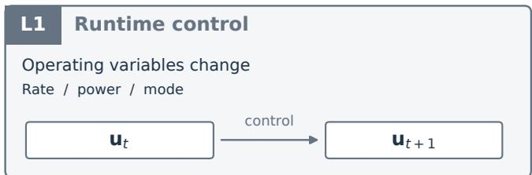
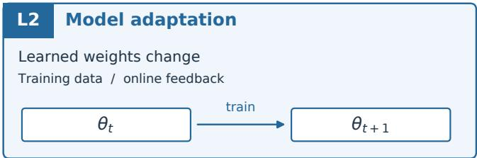
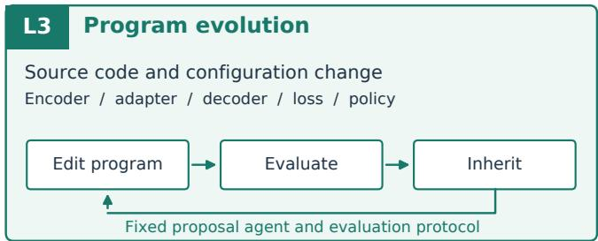
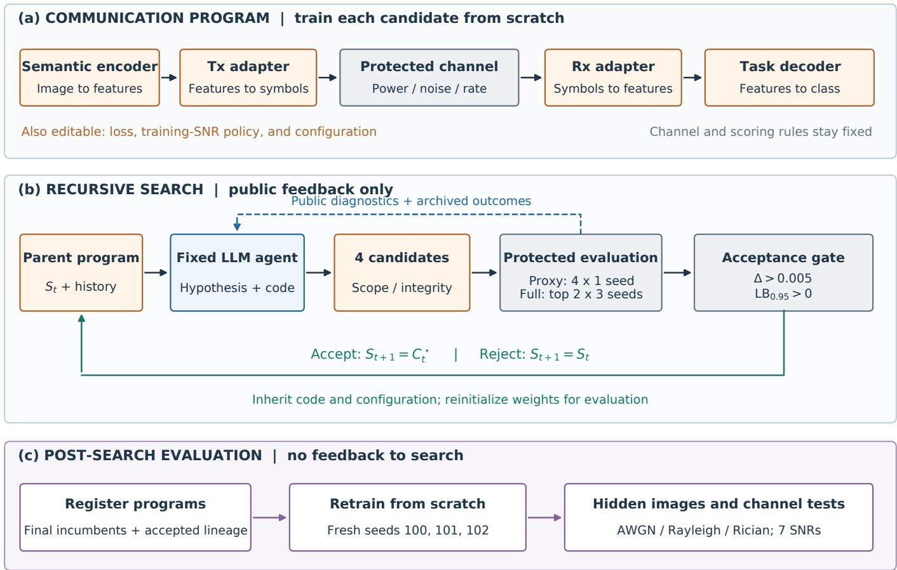
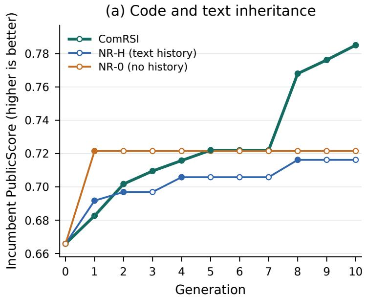
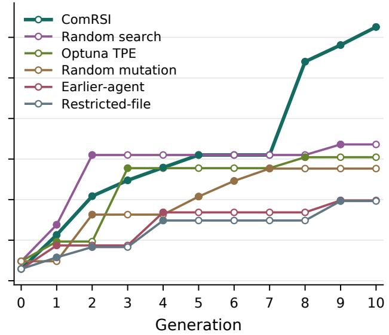
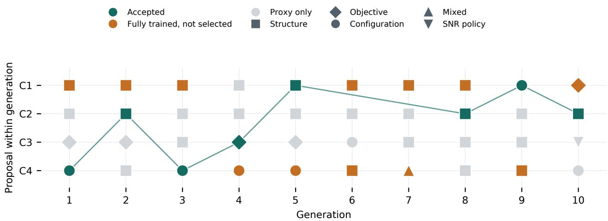
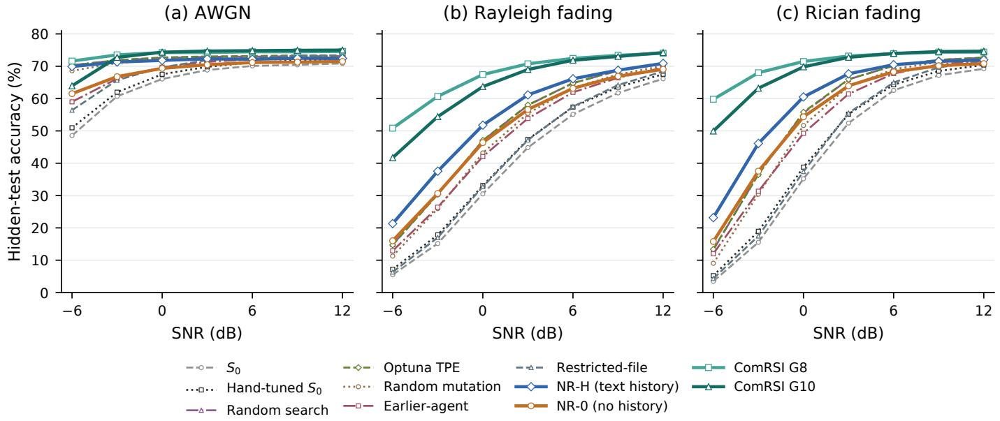
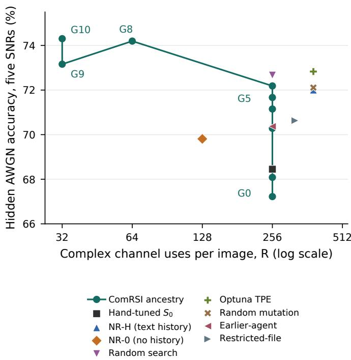
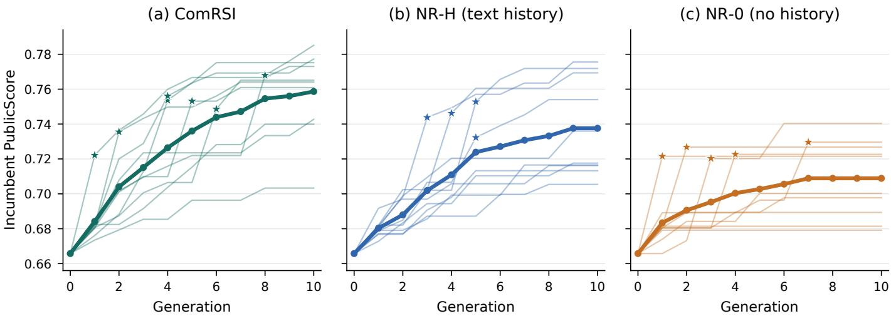

# Recursive Code Evolution for Task-Oriented Semantic Communications

Yan Gong, Zheng Chu, Member, IEEE, Wei Koong Chai, Hari Mohan Pandey, Jingrui Hou Miao Zhang, Member, IEEE, Yuanjian Li Member, IEEE, and Pei Xiao Senior Member, IEEE

Abstract—Semantic communication jointly optimizes inference accuracy, channel use, and computation, yet the underlying communication program is typically specified before training. This paper presents ComRSI (Communications-Oriented Recursive Self-Improvement), a framework for recursively evolving that program through large-language-model-assisted code edits. A fixed agent modifies the encoder, channel adapters, decoder, loss, and training policy; a protected evaluator screens candidates under prescribed budgets and resource constraints. Accepted code and textual feedback inform subsequent proposals, while candidate weights are trained from scratch. In the original tengeneration CIFAR-100 lineage, eight accepted revisions produce an attention-pooled code achieving 74.3% test accuracy over an Additive White Gaussian Noise (AWGN) channel at 32 complex symbols per image, compared with 67.2% at 256 symbols for the initial design. The program also improves fading-channel accuracy and transfers to Tiny-ImageNet after retraining. A repeat study with ten searches per method compares ComRSI against non-recursive agents with and without textual history. Mean final search scores balancing accuracy, transmission rate, and computational cost are 0.7587, 0.7376, and 0.7089, respectively; the mean numbers of accepted revisions per search are 6.0, 5.0, and 2.1. The advantage over the memoryless agent is supported by a two-sided rank test, whereas the difference from the history-equipped agent remains statistically inconclusive at this sample size. Archived proposals show that pooling can yield a large improvement, while retained history supports subsequent refinement. These results support recursive program optimization within the evaluated setting and expose its remaining raterobustness and compute-placement trade-offs.

Index Terms—Semantic communications, automated algorithm design, large language models, recursive code evolution.

## I. INTRODUCTION

EMANTIC communication seeks to preserve the infor-S mation needed by a receiver’s inference task under communication and computational constraints [1]–[3]. For image

  
Fig. 1. Three complementary objects of adaptation. L1 changes operating variables, L2 changes learned weights, and L3 changes the communication program. ComRSI implements L3 through recursive code inheritance; the proposal agent and evaluation protocol remain fixed. The distinction concerns what changes, not a ranking of system intelligence.

classification, the relevant design question is not simply how accurately an image can be reconstructed, but where semantic processing should occur and which representation should cross the channel. Encoder depth, the location of the transmitterreceiver split, representation dimension, channel adaptation, and the training objective jointly determine the resulting accuracy-rate-compute trade-off.

Deep Joint Source-Channel Coding (DeepJSCC) established the effectiveness of learning channel-resilient representations [4]. Subsequent work introduced feedback [5], attention conditioned on the Signal-to-Noise Ratio (SNR) [6], adaptive rate control [7], and information-bottleneck formulations for edge inference [8]. These advances also illustrate the breadth of the design space: a useful improvement may require changing a representation or processing block, rather than adjusting weights or selecting a value from a fixed configuration space.

Fig. 1 distinguishes three objects of adaptation. Runtime control changes operating variables; model adaptation updates learned weights; program evolution changes the implementation that determines what is trained and executed. These are complementary capabilities, not a universal hierarchy of communication systems. This paper studies the third capability: an agent edits a communication program, evaluates the proposed changes, and recursively builds on accepted code.

Recent agentic wireless systems automate workflow design and component orchestration [9]–[12]. In parallel, languagemodel-driven program search has produced executable solutions in mathematical and algorithmic domains [13], [14]. Applying this approach to communication design poses two challenges. First, candidates must respect the physical channel and resource accounting even when their source code changes. Second, repeated access to validation feedback can reward over-specialization to the evaluator. An increasing search score alone therefore cannot establish an improved communication system.

We introduce ComRSI (Communications-Oriented Recursive Self-Improvement), a framework that combines recursive code inheritance with a protected training and evaluation pipeline. The inherited artifact is a program specifying the semantic encoder, channel adapter, decoder, loss, and training-SNR policy. Each candidate is trained from scratch; model weights are not inherited. A fixed Large Language Model (LLM) agent proposes edits, and a fixed selector accepts a child only when its public score improves by a prescribed margin and passes a paired image-bootstrap check. Hidden test data and channel-evaluation results are withheld from the search loop and evaluated after the relevant searches are complete.

Our research question is whether this procedure can produce successive, auditable improvements in task-oriented communication and whether the selected designs retain useful accuracyrate trade-offs beyond the public evaluation conditions. In ComRSI, the fixed LLM agent and the evolving communication program are treated as components of an integrated system. Communication is a functionality of this system, and recursively modifying its communication program therefore constitutes system-level self-improvement of that functionality. Each accepted program becomes the parent of the next generation, enabling successive improvements through inherited code modifications. The underlying LLM agent and evaluation protocol remain fixed; thus, the self-improvement concerns the system’s communication functionality rather than the agent’s own optimization capability.

The contributions are as follows.

• We introduce ComRSI, a communication-specific framework for recursive evolution of executable task-oriented semantic communication programs. Building upon general-purpose code-evolution paradigms, ComRSI integrates editable transmitter–receiver architectures and training policies with protected physical-channel constraints, resource accounting, and statistically gated evaluation.

• We construct comparisons between recursive and nonrecursive code proposals, configuration-space random search and mutation, and Bayesian optimization. The main CIFAR-100 comparisons use the same nominal proposal and training allocation. We distinguish code inheritance from textual history, extend both auxiliary searches to ten generations, and repeat the three agent variants ten times each. The analysis separates retraining variation from variation across searches.

• We identify the communication structure produced by the recorded search: a deeper transmitter, a pooled semantic vector, and a small SNR-aware receiver. The final design reaches 74.3% hidden-test Additive White Gaussian Noise (AWGN) accuracy at 32 complex symbols per image, with improved fading-channel accuracy and successful program transfer to Tiny-ImageNet.

The analysis also characterizes the cost of these gains: a 64- symbol ancestor is more robust at low SNR, most inference computation moves to the transmitter, and the average advantage over a non-recursive agent with textual history remains uncertain with ten searches per method.

Section II positions the study within related work. Section III specifies the system and search protocol. Sections IV and V describe the experiments and findings, and Section VI discusses their scope.

## II. RELATED WORK

## A. Learned and Task-Oriented Communication

DeepJSCC learns an encoder-decoder pair for transmission over a noisy channel [4], with extensions to feedback [5], channel adaptation [6], and variable-rate transmission [7]. DeepSC [15] and broader semantic communication formulations [1], [2] emphasize meaning or task utility, while taskoriented edge inference explicitly couples representation compression and inference quality [8]. These works motivate the design variables studied here. ComRSI contributes a procedure for modifying communication implementations; it does not claim that pooled task representations or channel-aware neural receivers are themselves new principles.

## B. Agentic and Self-Evolving Wireless Systems

Self-evolving wireless architectures seek adaptation beyond manually managed configurations [9], [10]. A2SSC applies agents to adaptive semantic speech communication [16]. WirelessAgent++ formulates executable agentic workflow design as program search [11]; it should therefore not be characterized merely as parameter tuning. Agentic TokenCom jointly considers workflow structures and component instances through planner, evaluator, and reflector agents [12]. The distinguishing object in ComRSI is the learned communication program itself, including the transmitter-receiver representation boundary and training objective. Its evaluation focuses on physicalchannel accounting and the behavior of selected programs under withheld channel-evaluation conditions.

## C. Automated Design and Recursive Program Search

Neural architecture search [17], [18] and hyperparameter optimization [19]–[21] provide natural controls for automated communication design. Their practical results depend on the supplied search space. Language-model-based evolution [22], optimizer discovery [23], FunSearch [13], and AlphaEvolve [14] instead use code as a flexible candidate representation.

A separate literature studies systems that improve their own problem-solving machinery, from theoretical self-referential programs [24] to STOP [25], the Darwin Godel Machine [26],¨ and AI research agents [27], [28]. ComRSI shares recursive inheritance and executable evaluation with this literature, but keeps the proposing agent fixed. Its empirical question is whether inherited edits to a communication program produce useful designs under channel and resource constraints. Accordingly, the evidence is interpreted as recursive program optimization rather than improvement of the optimizer itself.

## III. SYSTEM MODEL AND RECURSIVE CODE EVOLUTION

## A. Framework of ComRSI

Fig. 2 presents the overall ComRSI framework, which enables a task-oriented semantic communication system to evolve through successive modifications of its executable program. Rather than optimizing only the parameters of a predefined neural architecture, ComRSI allows an LLM-based agent to modify the communication system itself, including its network structure, semantic representation, channel adapters, training objective, and configuration. The framework comprises three interconnected components: an editable communication program, a recursive code evolution process, and a protected post-search evaluation procedure.

As shown in Fig. 2(a), the communication program defines how an input image is encoded into channel symbols, transmitted through a physical channel, and decoded into a task prediction. The semantic encoder, transmitter and receiver adapters, task decoder, loss function, and training-SNR policy constitute the editable design space. In contrast, the physical channel model, power normalization, evaluation metrics, and resource constraints are protected from agent modifications. This separation enables the exploration of different communication architectures while maintaining consistent physicalchannel conditions and evaluation criteria.

The core of ComRSI is the recursive evolution process illustrated in Fig. 2(b). Starting from an initial communication program $S _ { 0 }$ , a fixed LLM agent examines the current program and its public evaluation feedback, then proposes four candidate modifications. Each candidate represents a potentially different communication design rather than merely a new set of trained weights. After validity screening and preliminary training, the two highest-scoring valid candidates undergo fullbudget training with three independent seeds. Their performance is evaluated using a composite objective that balances task accuracy, communication rate, and computational cost. A candidate is accepted only if its improvement over the current program satisfies both a minimum score margin and a paired bootstrap criterion.

TABLE I SUMMARY OF MAIN NOTATIONS
<table><tr><td>Notation</td><td>Description</td></tr><tr><td> $S , S _ { 0 } , S _ { t }$ </td><td>Communication program, initial program, and in- cumbent at generation t</td></tr><tr><td> $\theta _ { S , \xi }$ </td><td>Weights obtained by training S with seed ξ</td></tr><tr><td> $E , { \tilde { D } }$   $T _ { \mathrm { t x } } , T _ { \mathrm { r x } }$ </td><td>Semantic encoder and task decoder Transmitter and receiver channel adapters</td></tr><tr><td> $\mathbf { u } , \mathbf { s }$ </td><td>Unnormalized and power-normalized transmitted</td></tr><tr><td> $\mathbf { r } , \mathbf { y }$   $\mathbf { m } , k _ { a }$ </td><td>symbols Received symbols before and after equalization Activity mask and number of active symbols</td></tr><tr><td> $h$   $\gamma , \rho$   $R , F$ </td><td>Channel fading coefficient SNR in decibels and linear scale</td></tr><tr><td> $N _ { \mathrm { p a r } }$   $\mathrm { P S } _ { \xi } ( S )$ </td><td>Channel uses and forward FLOPs per image Number of model parameters</td></tr><tr><td></td><td>PublicScore under training seed ξ</td></tr><tr><td> ${ \overline { { \operatorname { P S } } } } ( S )$ </td><td>Seed-averaged PublicScore</td></tr><tr><td> $\boldsymbol { S } _ { \mathrm { v a l i d } }$ </td><td>Set of valid communication programs</td></tr><tr><td> $A , C _ { t } ^ { j }$ </td><td></td></tr><tr><td></td><td>Fixed proposal agent and candidate j at generation</td></tr><tr><td> $M _ { t } , H _ { t }$ </td><td>t</td></tr><tr><td> $\boldsymbol { A } _ { t }$ </td><td>Public diagnostics and search history</td></tr><tr><td></td><td>Candidates satisfying the acceptance gate</td></tr><tr><td> $\widehat { \Delta }$ </td><td>Estimated candidate-incumbent score improvement</td></tr><tr><td></td><td></td></tr><tr><td> $\mathrm { L B _ { 0 . 9 5 } }$ </td><td>One-sided 95% bootstrap lower bound</td></tr></table>

Importantly, the accepted candidate becomes the parent program for the next generation. The agent therefore continues modifying the previously improved communication design, using both inherited source code and accumulated textual feedback. If no candidate satisfies the acceptance criteria, the current program is retained while the search history is updated. This recursive inheritance of executable code distinguishes ComRSI from approaches that restart each proposal from the initial architecture. Model parameters are retrained from scratch for each candidate and are not transferred between generations.

Finally, Fig. 2(c) illustrates the post-search evaluation. Selected programs are registered, retrained with fresh random seeds, and evaluated on withheld test images and channel conditions, including AWGN, Rayleigh fading, and Rician fading. These results are excluded from the proposal and acceptance loop, providing a separate assessment of the communication designs discovered during search. Table I summarizes the main mathematical notations. The following subsections formalize the communication model, optimization objective, recursive evolution mechanism, and evaluation safeguards.

## B. Communication Program and Physical Channel

Let $( \mathbf { x } , c )$ denote an image and its class label. A communication program is

$$
S = ( E , T _ { \mathrm { t x } } , T _ { \mathrm { r x } } , D , L , P , \eta ) ,\tag{1}
$$

where E is the semantic encoder, $T _ { \mathrm { t x } }$ and $T _ { \mathrm { r x } }$ are the channel adapters, D is the task decoder, L is the training loss, $P$ is the training-SNR policy, and η contains editable configuration values. A protected training procedure produces weights $\pmb { \theta } _ { S , \xi } = \mathcal { T } ( S ; \xi )$ for training seed ξ. Code and configuration are inherited; each evaluated program is initialized and trained afresh.

The transmitter produces k complex values u and, optionally, an activity mask m. At evaluation, $\mathbf { m } \in \{ 0 , 1 \} ^ { k }$ and $k _ { a } = \| \mathbf { m } \| _ { 1 }$ 1. For nonzero active energy, the protected channel forms

$$
\mathbf { s } = { \sqrt { \frac { k _ { a } } { \| \mathbf { m } \odot \mathbf { u } \| _ { 2 } ^ { 2 } } } } \left( \mathbf { m } \odot \mathbf { u } \right) , \qquad \| \mathbf { s } \| _ { 2 } ^ { 2 } = k _ { a } .\tag{2}
$$

The implementation includes a small numerical stabilizer in the denominator, so the energy constraint holds approximately when stabilization is active. Communication cost is $R \ =$ $\mathbb { E } [ k _ { a } ]$ , measured in complex channel uses per image. All principal systems reported here use fixed-length codes; the optional mask is not used by the final ComRSI design.

We consider three channel models: AWGN, Rayleigh fading, and Rician fading. Let $\gamma$ denote SNR in decibels and $\rho \stackrel { - } { = } 1 0 ^ { \gamma / 1 0 }$ denote linear SNR. All three channels follow the unified model

$$
{ \bf r } = h { \bf s } + { \bf n } , \qquad { \bf n } \sim \mathcal { C N } ( { \bf 0 } , \rho ^ { - 1 } { \bf I } ) ,\tag{3}
$$

where $h$ is the channel coefficient and n is complex Gaussian noise. The three channel models differ in their definitions of $h \colon$

• AWGN: $h = 1$ , representing transmission without fading.

• Rayleigh fading: $\begin{array} { l } { { \displaystyle h _ { \mathrm { ~ \Big ~ \sim ~ } } \mathcal { C N } ( 0 , 1 ) } } \end{array}$ , constant across all symbols of an image (block fading).

• Rician fading: The channel coefficient is

$$
h = \sqrt { \frac { K _ { \mathrm { r i c } } } { K _ { \mathrm { r i c } } + 1 } } e ^ { j \phi } + \sqrt { \frac { 1 } { K _ { \mathrm { r i c } } + 1 } } g ,\tag{4}
$$

where $K _ { \mathrm { r i c } } ~ = ~ 3$ , ϕ is uniform on [0, 2π), and $g \sim$ $\mathcal { C N } ( 0 , 1 )$

For Rayleigh and Rician fading, the protected receiver applies perfect-CSI linear MMSE equalization under a unitsymbol-power assumption:

$$
\mathbf { y } = \mathbf { m } \odot { \frac { h ^ { * } \mathbf { r } } { | h | ^ { 2 } + \rho ^ { - 1 } } } , \qquad \gamma _ { \mathrm { e f f } } = 1 0 \log _ { 1 0 } ( | h | ^ { 2 } \rho ) .\tag{5}
$$

For AWGN, $\textbf { y } = \textbf { m } \odot \textbf { r }$ and $\gamma _ { \mathrm { e f f } } ~ = ~ \gamma$ . The receiver uses y and channel metadata to predict the class. Channel-state acquisition, signaling overhead, and digital modulation are outside the evaluated model.

For fading channels, the protected channel module uses the simulated coefficient h for perfect-CSI LMMSE equalization. The receiver network operates on the equalized symbols and the instantaneous effective SNR; pilot-based estimation and signaling are outside the channel model.

The channel module passes the nominal SNR and $\gamma _ { \mathrm { e f f } }$ as metadata. The final $G _ { 1 0 }$ receiver uses $\gamma _ { \mathrm { e f f } }$ to construct its two SNR features, while the transmitter does not condition on SNR.

## C. Public Objective and Feasible Programs

We define PublicScore (PS) as a composite evaluation metric combining classification accuracy, communication rate,

and computational cost. For validation data $\mathcal { D } _ { \mathrm { v a l } }$ and public AWGN grid $\Gamma = \{ - 3 , 0 , 3 , 6 , 9 \}$ dB, it is calculated as

$$
\begin{array} { c l } { \displaystyle \mathrm { P S } _ { \xi } ( S ) = \displaystyle \frac { 1 } { | \Gamma | } \sum _ { \gamma \in \Gamma } \mathrm { A c c } _ { \mathrm { v a l } } ( \pmb { \theta } _ { S , \xi } , \gamma ) } \\ { \displaystyle - \alpha \ln \frac { R _ { \xi } ( S ) } { R _ { 0 } } - \beta \ln \frac { F _ { \xi } ( S ) } { F _ { 0 } } , } \end{array}\tag{6}
$$

where $F$ is the measured number of Forward Floating-Point Operations (FLOPs) per image, $( R _ { 0 } , F _ { 0 } )$ are frozen references for the initial design $S _ { 0 }$ , and $( \alpha , \beta ) = ( 0 . 0 2 , 0 . 0 1 )$ . Accuracy is a fraction, not a percentage. The score is a scalar design utility; it is not an accuracy measure. A twofold rate reduction contributes 0.02 ln $2 \approx 0 . 0 1 3 9$ , equivalent to 1.39 accuracy percentage points, whereas doubling FLOPs costs approximately 0.69 points. These coefficients were fixed before the search and assign twice the logarithmic penalty weight to rate as to forward computation.

Search seeks a high seed-averaged score, defined as $\overline { { \mathrm { P S } } } ( S ) = \mathbb { E } _ { \xi } [ \mathrm { P S } _ { \xi } ( S ) ]$ and estimated using three training seeds, within the valid program set:

$$
\operatorname* { m a x } _ { S \in { \mathcal S } _ { \mathrm { v a l i d } } } ~ \mathrm { P S } ( S )  &  \mathrm { s . t . } ~ N _ { \mathrm { p a r } } ( S ) \leq 1 . 5 N _ { \mathrm { p a r } , 0 } , ~ F ( S ) \leq 2 F _ { 0 } .\tag{7}
$$

Validity includes interface, code-scope, numerical, and integrity checks. The implementation searches this set heuristically; it supplies no global-optimality guarantee. Because training steps are fixed but candidate architectures differ, equal training allocations do not imply equal training FLOPs or wallclock time.

## D. Proposal, Screening, and Inheritance

At generation t, the agent receives parent program $S _ { t } ,$ , public diagnostics $M _ { t }$ , and archived history $H _ { t }$ . With fixed proposal agent $A ,$

$$
\{ C _ { t } ^ { 1 } , \ldots , C _ { t } ^ { 4 } \} = A ( S _ { t } , M _ { t } , H _ { t } ) .\tag{8}
$$

Diagnostics include per-SNR accuracy, rate, FLOPs, classlevel errors, confidence, and training-loss summaries. The agent examines public performance diagnostics to identify potential weaknesses in the current communication program. It then formulates four distinct modification hypotheses and implements them as candidate code revisions. Each proposal includes a rationale linking the intended modification to the observed performance. The resulting candidates are independently evaluated, allowing the selection process to determine which modifications provide measurable improvements. The main runs use the archived model identifier claude-opus-5-5.

Candidates passing scope and interface checks receive one proxy training run. The top two valid candidates by proxy score are trained from scratch at the full budget using seeds $\Xi = \{ 0 , 1 , 2 \}$ . They are compared against the same incumbent, using cached evaluations where available. Let $\boldsymbol { A } _ { t }$ contain the candidates satisfying the acceptance gate below. Then

$$
S _ { t + 1 } = \left\{ \begin{array} { l l } { \mathrm { a r g } \underset { C \in \cal A _ { t } } { \operatorname* { m a x } } \overline { { \mathrm { P S } } } ( C ) , } & { \mathcal { A } _ { t } \neq \emptyset , } \\ { S _ { t } , } & { \mathcal { A } _ { t } = \emptyset . } \end{array} \right.\tag{9}
$$

  
Fig. 2. ComRSI architecture and evaluation boundaries. (a) Editable communication modules surround a protected physical channel; the loss and training-SNR policy are also editable. (b) Four proposals are screened and the two best valid candidates are trained with three seeds; an accepted program is inherited and otherwise the incumbent is retained. Public diagnostics feed the next generation. (c) Registered programs are retrained and tested after search. Hidden results have no feedback edge to the proposal or selection loop.

The selected program is the sole parent of the next generation. Candidate branches, diffs, hypotheses, and accepted ancestry are archived. A rejected generation changes the history but not the inherited program. The complete recursive evolution procedure is summarized in Algorithm 1.

## E. Paired Acceptance Gate and Its Interpretation

For validation image $i ,$ let $q _ { i } ( S )$ be correctness averaged over the five public SNRs and three full-budget training seeds. Let b(S) denote the seed-averaged rate and compute terms in (6). For a candidate $C$ and incumbent $S _ { t }$

$$
\widehat { \Delta } ( C , S _ { t } ) = \frac { 1 } { n _ { \mathrm { v a l } } } \sum _ { i } [ q _ { i } ( C ) - q _ { i } ( S _ { t } ) ] + b ( C ) - b ( S _ { t } ) .\tag{10}
$$

The selector draws 2,000 paired bootstrap resamples of validation-image indices [29], preserving each candidateincumbent pairing. The fifth percentile of the resampled score differences is the one-sided lower bound $\mathrm { L B _ { 0 . 9 5 } }$ . Acceptance requires

$$
\widehat { \Delta } > 0 . 0 0 5 , \qquad \mathrm { L B } _ { 0 . 9 5 } > 0 ,\tag{11}
$$

and valid full-budget evaluations for all three seeds.

This gate reduces acceptance of small, image-samplingsensitive changes. Hidden evaluation and fresh training seeds provide additional checks of selected programs, while ten independent searches per agent variant assess search-level variability.

## F. Protected Evaluation and Information Flow

The data manifests, channel, trainer, evaluator, selector, and budget constants are protected by SHA-256 checks before a generation and after agent proposals. The agent operates in a separate workspace with tool-level access restrictions and a permitted candidate checker. Static checks restrict imports and reject prohibited I/O and RNG reseeding.

Integrity checks additionally replace the received code with noise and test permutation equivariance over the inference batch. For $C$ classes, the noise-only accuracy threshold is max $( 5 / C , 1 / C + 0 . 0 5 )$ ; normalized transmitter and receiver permutation errors must be below $1 0 ^ { - 2 }$ . A cheating fixture that stores encoder features for later receiver access is detected by the repository test.

Search feedback contains public results only. Before hidden evaluation, a registration file records the evaluation targets, including all accepted ComRSI generations and comparator incumbents. The additional repetitions and auxiliary experiments use the same benchmark holdout, and hidden scores are never provided to the proposal agents.

Algorithm 1 ComRSI Recursive Communication-Program   
Evolution   
Require: Initial program $S _ { 0 } ,$ fixed agent A, public evaluator,   
generation budget G   
Ensure: Final communication program $S _ { G }$   
1: Initialize $S  S _ { 0 }$ , history $H \gets \emptyset$ , and public diagnostics   
M from $S _ { 0 }$   
2: for $t = 0 , \ldots , G - 1$ do   
3: Generate four candidates using $A ( S , M , H )$   
4: Screen candidates for validity and resource constraints   
5: Proxy-train valid candidates and rank by PublicScore   
6: Select up to two top-ranked valid candidates   
7: Train selected candidates with seeds {0, 1, 2}   
8: Evaluate candidate-incumbent score differences   
9: Apply paired-bootstrap acceptance gate   
10: if at least one candidate is accepted then   
11: S ← highest-scoring accepted candidate   
12: end if   
13: Update public diagnostics M and history H   
14: end for   
15: return S

## IV. EXPERIMENTAL PROTOCOL

## A. Data and Initial Communication System

CIFAR-100 [30] is the primary benchmark: 45,000 official training images are used for training, 5,000 for public validation, and the 10,000 official test images for hidden evaluation. Tiny-ImageNet [31] provides 200 classes and $6 4 \times 6 4$ images; the corresponding split uses 90,000 training images, 10,000 public validation images, and the 10,000 official validation images as the hidden set. Fixed stratified manifests define the splits. CIFAR-10 is used only for development and is excluded from the reported comparison.

The initial system $S _ { 0 }$ has a ResNet-style [32] transmitter with a stem and three residual stages of widths of 64, 128, and 256. A 1×1 projection produces an $8 \times 8 \times 8$ real-valued latent, corresponding to $R _ { 0 } = 2 5 6$ complex symbols. The receiver lifts the latent to 256 channels, applies two residual blocks, and performs global pooling and classification. For 64 × 64 inputs, a stride-two stem preserves the latent dimensions. On CIFAR-100, $S _ { 0 }$ has 3.63 million parameters and 0.694 Giga Floating-Point Operations (GFLOPs) per image. It uses crossentropy loss and a uniform training-SNR policy on [−3, 9] dB.

## B. Compared Methods

We compare ComRSI with human-designed references, non-recursive agent variants, configuration-space search methods, and restricted agent variants. The main agent-based experiments use claude-opus-5-5 as the proposal model, except for the earlier-agent experiment, which uses claude-sonnet-5-5. All agent variants share the same public evaluator and acceptance gate. The methods differ in how candidates are generated, how previous evaluation results are used, and whether accepted program code is inherited across generations. Importantly, retaining the best accepted program for evaluation does not necessarily imply inheriting its code for subsequent proposals.

Initial system and hand tuning. The initial system $S _ { 0 }$ is the human-designed communication architecture described above and serves as the common starting point for automated searches. Hand-tuned $S _ { 0 }$ selects the best configuration from ten configurations evaluated over two tuning rounds, while retaining the original architecture. These references establish the performance of the initial communication design before automated optimization.

ComRSI (ours). At each generation, the Opus agent directly modifies the current accepted communication program using its source code, previous proposal history, and public evaluation feedback. Candidate modifications may change network structures, semantic representations, channel adapters, training objectives, or configuration values. Accepted changes become part of the inherited program for subsequent generations. Thus, ComRSI accumulates improvements through both executable code inheritance and textual history, while model weights are retrained from scratch.

Non-Recursive Agent with History (NR-H). This baseline uses the same Opus model and evaluation procedure as ComRSI, but starts every generation from the original program $S _ { 0 }$ . The agent retains textual descriptions of previous proposals and their public evaluation outcomes, allowing earlier ideas to inform subsequent edits. However, accepted source code is not directly inherited. The external selector still retains the best accepted program for evaluation and comparison. This baseline examines the contribution of direct code inheritance when textual history remains available. NR-H and ComRSI share the editable interfaces and nominal evaluation budgets; their distinguishing feature is the inheritance of accepted program source code.

Non-Recursive Agent without History (NR-0). This variant of NR-H also starts each generation from $S _ { 0 }$ , but receives no accumulated proposal or evaluation history, and access to previous candidate workspaces is denied. Each generation therefore produces candidates without inherited code or textual feedback from earlier generations. The external selector nevertheless tracks the best accepted program across generations, allowing fair comparison of final incumbents. This baseline evaluates the search process without either form of intergeneration inheritance.

Random mutation. This method randomly modifies configuration values of the current accepted program within a predefined search space. Accepted modifications become the starting configurations for subsequent generations, whereas rejected proposals leave the incumbent unchanged. It therefore preserves recursive inheritance of configuration changes but replaces agent-directed source-code modification with random configuration proposals. This comparison examines whether recursive inheritance alone is sufficient to achieve improvements comparable to ComRSI.

Random search. This method independently samples candidate configurations from the predefined search space, including architectural and training hyperparameters. Each new configuration is generated without using previous evaluation outcomes to guide sampling. The external selector retains the best accepted configuration, but earlier candidates do not become parents of subsequent proposals. Unlike ComRSI, the method explores a fixed configuration space rather than generating unrestricted program edits.

Optuna TPE. This method uses the tree-structured Parzen estimator [19], [21] to guide configuration search. Unlike random search, TPE uses the configurations and scores of previous evaluations to model promising regions of the predefined search space and select subsequent candidates. It therefore incorporates historical performance information into the proposal process, but does not recursively inherit modified program source code or introduce new operations outside the specified configuration space.

Earlier-agent run. This variant follows the same recursive code-evolution procedure as ComRSI but replaces claude-opus-5-5 with the archived Sonnet proposal model $( \mathtt { c l a u d e - s o n n e t - 5 - 5 } )$ The editable interfaces, public evaluator, acceptance mechanism, and inheritance rules remain unchanged. This experiment examines the sensitivity of recursive communication-program evolution to the choice of LLM proposal model. The original search was subsequently continued to ten generations, as described below.

Restricted-file agent. This variant uses the Opus agent and recursive code inheritance but restricts editable files to the training loss, training-SNR policy, and configuration files. Unlike unrestricted ComRSI, the agent cannot directly rewrite the encoder, channel-adapter, or decoder implementation files. However, editable configuration values may still change network width, latent dimension, or other architecture-related settings. This comparison examines the effect of restricting the scope of program modification rather than eliminating architectural adaptation entirely.

The predefined configuration space for random mutation, random search, and Optuna TPE includes network width, depth, latent channels, SNR-FiLM [33], squeezeand-excitation [34], label smoothing, optimizer settings, and training-SNR bounds. These methods cannot express every communication program available through unrestricted code editing. For example, their weight-decay range is limited to $1 0 ^ { - 3 }$ , whereas the protected trainer permits values up to $2 \times 1 0 ^ { - 3 }$ . Consequently, these comparisons evaluate complete optimization procedures with different search capabilities, rather than isolating proposer quality under identical expressive power.

## C. Training and Search Budgets

The protected trainer uses Stochastic Gradient Descent (SGD) with Nesterov momentum 0.9, batch size 256, 3% linear warm-up followed by cosine decay, gradient-norm clipping at 5, bfloat16 autocast, and random-crop/flip augmentation. Learning rate and weight decay remain editable within protected ranges. Each CIFAR-100 proxy uses 2,500 optimizer steps and each full training uses 10,000 steps, approximately 57 passes through the training set. Tiny-ImageNet doubles both step budgets. All candidate models are trained and publicly evaluated under AWGN channels. Rayleigh and Rician fading channels are reserved for post-search evaluation to assess robustness under unseen channel models.

All eight CIFAR-100 search procedures in Table II are reported through ten generations, with four proposals per generation, one proxy seed, and three full-budget seeds for each of two promoted candidates. This corresponds to a common nominal candidate-training allocation of $1 0 [ 4 ( 2 5 0 0 ) \div$ $2 ( 3 ) ( 1 0 0 0 0 ) ] = 7 0 0 , 0 0 0$ optimizer steps per search, excluding initial-system evaluation, agent checker runs, and post-search retraining.

All methods follow the same nominal training-step allocation. All experiments were conducted on a single NVIDIA RTX PRO 6000 GPU with 96 GB of memory.

## D. Withheld Evaluation Conditions and Retraining

After the search process, the initial and hand-tuned systems, final comparator incumbents, and all accepted ComRSI generations are retrained from scratch using three fresh random seeds (100-102). The resulting models are evaluated on withheld test images under AWGN, Rayleigh, and Rician fading channels at $\Gamma _ { \mathrm { h i d } } = \{ - 6 , - 3 , 0 , 3 , 6 , 9 , 1 2 \}$ dB. The public and hidden channel random seeds are disjoint.

Evaluation includes PublicScore, classification accuracy, communication rate, model parameter counts, and computational complexity. Search PublicScore is obtained using training seeds 0-2, while fresh-seed PublicScore is computed after retraining with seeds 100-102. Both use the public validation set and the objective in (6). Hidden-test accuracy is reported separately. AWGN-5 averages classification accuracy over $\{ - 3 , 0 , 3 , 6 , 9 \}$ dB, while Rayleigh-7 and Rician-7 average accuracy over all seven SNR values in $\Gamma _ { \mathrm { h i d } }$ . Reported freshseed results are averaged over three retrainings.

For Tiny-ImageNet, the communication program discovered on CIFAR-100 is transferred by adapting the input dimensions and class count, followed by training from scratch on Tiny-ImageNet.

## V. RESULTS AND ANALYSIS

## A. Search Trajectory and Retraining Stability

Fig. 3 illustrates the evolution of incumbent PublicScore over ten generations. ComRSI accepts 8 revisions, including five consecutive improvements at G1-G5, followed by further improvements at G8-G10. Its search score increases from 0.666 to 0.785, while retraining the final program with three fresh seeds yields a PublicScore of 0.784, demonstrating consistent performance across training seeds.

The accepted revisions progressively improve the communication program. G1 and G3 adjust regularization and the training-SNR range, while G2 and G5 deepen the semantic encoder. G4 introduces label smoothing. A major structural change occurs at G8, where the spatial latent representation is replaced by a 64-symbol pooled semantic code and a new receiver. G9 further reduces the code length to 32 symbols, and G10 introduces learned attention pooling. These successive modifications illustrate how ComRSI evolves the communication architecture and training strategy through recursive code inheritance.

Fig. 4 further illustrates the candidate-level evolution of ComRSI. Each generation contains four proposed modifications, of which selected candidates undergo full training and evaluation. The accepted candidates form a continuous code-inheritance lineage across generations, while rejected candidates do not replace the incumbent. This illustrates how ComRSI progressively evolves the communication program through selective inheritance of successful code modifications.

## B. The Communication Structure Produced by Search

The recursive search progressively modifies the communication program, with a major architectural transition occurring at G8 and further refinement at G9-G10. This subsection examines the final communication architecture discovered by ComRSI. Its encoder produces $\mathbf { V } = [ \mathbf { v } _ { 1 } , \dots , \mathbf { v } _ { N } ] \in \mathbb { R } ^ { d \times { \dot { N } } }$ with d = 256 and $N = 6 4$ spatial locations. Three learned attention heads and a global-average branch form pooled features:

$$
a _ { \ell j } = \frac { \exp ( \mathbf { w } _ { \ell } ^ { \mathsf { T } } \mathbf { v } _ { j } + b _ { \ell } ) } { \sum _ { r = 1 } ^ { N } \exp ( \mathbf { w } _ { \ell } ^ { \mathsf { T } } \mathbf { v } _ { r } + b _ { \ell } ) } ,\tag{12}
$$

$$
{ \bf p } _ { 0 } = \frac { 1 } { N } \sum _ { j } { \bf v } _ { j } , \qquad { \bf p } _ { \ell } = \sum _ { j } a _ { \ell j } { \bf v } _ { j } , \quad \ell = 1 , 2 , 3 ,\tag{13}
$$

$$
\mathbf { z } = \mathbf { W } _ { p } [ \mathbf { p } _ { 0 } ^ { \mathsf { T } } , \hdots , \mathbf { p } _ { 3 } ^ { \mathsf { T } } ] ^ { \mathsf { T } } + \mathbf { b } _ { p } \in \mathbb { R } ^ { 2 k } .\tag{14}
$$

The 2k real outputs are paired into $k = 3 2$ complex symbols and normalized by (2). Attention logits are zero-initialized, so the learned pools begin as uniform averages.

At the receiver, the real and imaginary parts of the channel outputs are concatenated with two SNR features:

$$
\mathbf { v } _ { \mathrm { r x } } = [ \mathrm { r e a l v e c } ( \mathbf { y } ) ^ { \top } , \gamma _ { \mathrm { e f f } } / 1 0 , ~ 1 0 ^ { - \gamma _ { \mathrm { e f f } } / 2 0 } ] ^ { \top } .\tag{15}
$$

A linear layer, batch normalization, and ReLU produce a 512- dimensional hidden vector, followed by a linear classifier. The resulting design has 5.29 million parameters and 1.14 GFLOPs, within the protected caps. Its structural consequence is a shift from transmitting a spatial feature map to transmitting a compact task representation after substantial local processing. The study discovers this design within the recorded search; it does not establish attention pooling as a new primitive.

## C. Inheritance and Configuration-Space Comparisons

Table II compares ComRSI with non-recursive agents and configuration-space search methods. ComRSI achieves a freshseed PublicScore of 0.784, compared with 0.715 for NR-H and 0.722 for NR-0. NR-0 accepts a pooled 128-symbol program at G1 and retains it through G10, whereas NR-H accepts four revisions and ends at 384 symbols.

Among the configuration-space methods, random mutation achieves a fresh-seed PublicScore of 0.710, compared with 0.722 for random search and 0.727 for Optuna TPE. These methods improve the initial communication system, while

ComRSI explores a broader program-editing space that enables structural modifications such as the pooled-code architecture discovered at G8.

Relative to the hand-tuned reference, the final ComRSI program improves fresh-seed PublicScore by 0.098 while reducing channel uses from 256 to 32. Compared with Optuna TPE, ComRSI achieves a higher fresh-seed PublicScore (0.784 versus 0.727) with fewer channel uses (32 versus 384).

The earlier-agent variant achieves a fresh-seed PublicScore of 0.704, compared with 0.784 for the main ComRSI run. Restricting the set of editable source files further yields a PublicScore of 0.699. These results suggest that both the proposal agent and the scope of executable program modifications influence search outcomes.

## D. Hidden-Image and Fading-Channel Performance

Table III presents the hidden-test classification accuracy under AWGN, Rayleigh, and Rician fading channels. The final ComRSI program achieves 74.3% AWGN-5 accuracy using only 32 complex symbols per image, compared with 67.2% and 256 symbols for the initial system. The G8 ancestor achieves stronger low-SNR and fading-channel performance, reaching 67.1% under Rayleigh fading compared with 64.0% for G10. In contrast, G10 halves the communication rate while maintaining comparable AWGN-5 accuracy. These results highlight the trade-off between communication efficiency and channel robustness within the discovered program lineage.

Fig. 5 further illustrates classification accuracy as a function of SNR under the three channel models. The SNR-dependent results show that the discovered programs maintain strong accuracy across a range of channel conditions. G8 demonstrates particularly strong performance at low SNRs and under fading, while G10 achieves competitive overall accuracy with a more compact 32-symbol representation. The improvements reflect the combined effects of transmitter-side feature processing, semantic pooling, and SNR-aware decoding.

## E. Rate, Robustness, and Compute Placement

Fig. 6 illustrates the trade-off between communication rate and classification accuracy. The early accepted revisions improve accuracy without reducing the transmission rate, while G8 introduces a compact 64-symbol representation. G9 further reduces the rate to 32 symbols, and G10 improves accuracy through learned attention pooling.

Reducing the transmission rate from 64 to 32 symbols contributes approximately 0.0139 to PublicScore through the rate penalty term. Although G8 achieves higher accuracy at −6 dB AWGN (71.6% versus 63.9% for G10), G10 offers a more compact representation while maintaining comparable average AWGN accuracy.

The evolved design shifts computational complexity toward the transmitter, enabling a lightweight receiver while reducing communication overhead. For the initial $S _ { 0 }$ program, the transmitter and receiver require 1.227 and 2.406 million parameters, with 0.390 and 0.304 GFLOPs per image, respectively. In the final $G _ { 1 0 }$ program, these become 5.203 and 0.086 million parameters, with 1.145 GFLOPs at the transmitter and 0.17

(b) Other search procedures  

Fig. 3. Evolution of incumbent PublicScore over ten generations. (a) Comparison of ComRSI with non-recursive agents with (NR-H) and without (NR-0) textual history. (b) Comparison with other search procedures. Filled and hollow markers indicate accepted revisions and retained incumbents, respectively Higher PublicScore indicates better performance.  
  
Fig. 4. Candidate-level evolution and code inheritance in ComRSI over ten generations. C1-C4 denote the four proposals per generation. Colors indicate accepted, fully trained but rejected, and proxy-only candidates, while shapes represent modification types. The connecting line traces the accepted code lineage

MFLOPs at the receiver. FLOPs are counted for convolutional and matrix-multiplication operations, with each multiply-add counted as two operations. This evolution concentrates semantic processing at the transmitter and produces a compact receiver alongside the 32-symbol code.

## F. Program Transfer and Search on Tiny-ImageNet

We further evaluate the transferability of communication programs discovered on CIFAR-100 and the effectiveness of direct ComRSI search on Tiny-ImageNet. All models are trained from scratch on Tiny-ImageNet.

Table IV shows that the transferred ComRSI G10 program achieves a fresh-seed PublicScore of 0.615 and hidden

AWGN-5 accuracy of 58.1%, outperforming the transferred random-search program (0.550 and 55.7%). It also achieves 47.1% under Rayleigh fading while requiring only 32 complex symbols per image.

A separate five-generation ComRSI search on Tiny-ImageNet accepts three revisions, improving fresh-seed PublicScore from 0.511 to 0.539 and hidden AWGN-5 accuracy from 51.2% to 54.5%. The transferred CIFAR-100 G10 program achieves higher performance than the programs discovered within this shorter Tiny-ImageNet search, demonstrating the transferability of the evolved communication architecture across the two datasets.

TABLE II  
COMPARISON OF COMMUNICATION-PROGRAM SEARCH METHODS ON CIFAR-100 OVER TEN GENERATIONS. SEARCH PS AND FRESH-SEED PS DENOTE PUBLIC EVALUATION SCORES OBTAINED DURING SEARCH AND AFTER RETRAINING, RESPECTIVELY. FRESH-SEED PS IS REPORTED AS MEAN ± STANDARD DEVIATION OVER THREE RETRAININGS. R DENOTES COMPLEX CHANNEL USES PER IMAGE, PARAMS (M) DENOTES MILLIONS OF PARAMETERS, AND GFLOPS DENOTES FORWARD COMPUTATION PER IMAGE.
<table><tr><td>Method</td><td>Accepted revisions</td><td>Search PS</td><td>Fresh-seed PS</td><td>R</td><td>Params (M)</td><td>GFLOPs</td></tr><tr><td>So (human design)</td><td></td><td></td><td>0.669±0.004</td><td>256</td><td>3.63</td><td>0.69</td></tr><tr><td>Hand-tuned So</td><td></td><td></td><td>0.686±0.001</td><td>256</td><td>3.63</td><td>0.69</td></tr><tr><td>ComRSI (ours)</td><td>8</td><td>0.785</td><td>0.784±0.002</td><td>32</td><td>5.29</td><td>1.14</td></tr><tr><td>NR-H (text history)</td><td>4</td><td>0.716</td><td>0.715±0.002</td><td>384</td><td>5.12</td><td>1.00</td></tr><tr><td>NR-0 (no history)</td><td>1</td><td>0.722</td><td>0.722±0.001</td><td>128</td><td>4.94</td><td>0.55</td></tr><tr><td>Random mutation</td><td>4</td><td>0.715</td><td>0.710±0.002</td><td>384</td><td>4.01</td><td>1.00</td></tr><tr><td>Random search</td><td>3</td><td>0.727</td><td>0.722±0.006</td><td>256</td><td>4.00</td><td>1.00</td></tr><tr><td>Optuna TPE</td><td>3</td><td>0.721</td><td>0.727±0.003</td><td>384</td><td>4.06</td><td>1.00</td></tr><tr><td>Earlier-agent run</td><td>3</td><td>0.700</td><td>0.704±0.002</td><td>256</td><td>5.23</td><td>1.02</td></tr><tr><td>Restricted-file agent</td><td>4</td><td>0.699</td><td>0.699±0.001</td><td>320</td><td>5.17</td><td>1.18</td></tr></table>

TABLE III

CIFAR-100 HIDDEN-TEST CLASSIFICATION ACCURACY (%) AVERAGED OVER THREE FRESH TRAINING SEEDS. AWGN-5 AVERAGES {−3, 0, 3, 6, 9} DB, WHILE RAYLEIGH-7 AND RICIAN-7 AVERAGE {−6, −3, 0, 3, 6, 9, 12} DB. R DENOTES COMPLEX CHANNEL USES PER IMAGE.
<table><tr><td>System</td><td>R</td><td>AWGN -6 dB</td><td>AWGN-5</td><td>AWGN 12 dB</td><td>Rayleigh-7</td><td>Rician-7</td></tr><tr><td> $S _ { 0 }$  (human design)</td><td>256</td><td>48.5</td><td>67.2</td><td>70.9</td><td>39.9</td><td>43.6</td></tr><tr><td>Hand-tuned  $S _ { 0 }$ </td><td>256</td><td>51.0</td><td>68.5</td><td>72.2</td><td>42.0</td><td>45.9</td></tr><tr><td>Random search</td><td>256</td><td>70.3</td><td>72.7</td><td>73.1</td><td>50.6</td><td>55.2</td></tr><tr><td>Optuna TPE</td><td>384</td><td>70.3</td><td>72.8</td><td>73.2</td><td>50.6</td><td>55.2</td></tr><tr><td>Random mutation</td><td>384</td><td>68.6</td><td>72.1</td><td>72.7</td><td>48.1</td><td>52.5</td></tr><tr><td>NR-H (text history)</td><td>384</td><td>69.9</td><td>72.0</td><td>72.4</td><td>53.9</td><td>58.8</td></tr><tr><td>NR-0 (no history)</td><td>128</td><td>61.5</td><td>69.8</td><td>71.5</td><td>49.8</td><td>54.4</td></tr><tr><td>Earlier-agent run</td><td>256</td><td>59.0</td><td>70.4</td><td>72.8</td><td>47.6</td><td>52.0</td></tr><tr><td>Restricted-file agent</td><td>320</td><td>56.4</td><td>70.6</td><td>73.4</td><td>41.9</td><td>45.9</td></tr><tr><td>ComRSI  $G _ { 5 }$ </td><td>256</td><td>69.3</td><td>72.2</td><td>72.8</td><td>50.8</td><td>55.5</td></tr><tr><td>ComRSI  $G _ { 8 }$  (ancestor)</td><td>64</td><td>71.6</td><td>74.2</td><td>74.6</td><td>67.1</td><td>70.7</td></tr><tr><td>ComRSI  $G _ { 1 0 }$  (final)</td><td>32</td><td>63.9</td><td>74.3</td><td>75.0</td><td>64.0</td><td>68.4</td></tr></table>

  
Fig. 5. CIFAR-100 hidden-test classification accuracy versus SNR under AWGN, Rayleigh, and Rician fading channels, averaged over three independent retrainings.

## G. Repeatability Across Ten Searches per Method

1) Experimental Setup: We conduct ten independent tengeneration searches for each of ComRSI, NR-H, and NR-

  
Fig. 6. Trade-off between hidden-test AWGN-5 accuracy and the number of transmitted complex symbols per image. The horizontal axis uses a logarithmic scale.

## TABLE IV

COMMUNICATION-PROGRAM TRANSFER AND SEARCH RESULTS ON   
TINY-IMAGENET. C100 AND TIN INDICATE PROGRAMS DISCOVERED ON CIFAR-100 AND TINY-IMAGENET, RESPECTIVELY. PS DENOTES FRESH-SEED PUBLICSCORE, WHILE ACCURACY (%) IS EVALUATED ON   
THE HIDDEN TEST SET. RESULTS ARE AVERAGED OVER THREE TRAINING   
RUNS WITH DIFFERENT RANDOM SEEDS. R DENOTES COMPLEX SYMBOLS PER IMAGE.

<table><tr><td>System</td><td>Source</td><td>R</td><td>PS</td><td>AWGN-5</td><td>-6 dB</td><td>Ray.-7</td><td>Ric.-7</td></tr><tr><td> $S _ { 0 }$ </td><td></td><td>256</td><td>0.511</td><td>51.2</td><td>33.2</td><td>31.4</td><td>34.3</td></tr><tr><td>Hand-tuned  $S _ { 0 }$ </td><td>C100</td><td>256</td><td>0.519</td><td>51.9</td><td>35.1</td><td>32.2</td><td>35.2</td></tr><tr><td>Random search best</td><td>C100</td><td>256</td><td>0.550</td><td>55.7</td><td>51.4</td><td>38.5</td><td>41.9</td></tr><tr><td>NR-H best</td><td>C100</td><td>384</td><td>0.542</td><td>56.1</td><td>52.4</td><td>38.2</td><td>41.8</td></tr><tr><td>ComRSI  $G _ { 1 0 }$ </td><td>C100</td><td>32</td><td>0.615</td><td>58.1</td><td>43.7</td><td>47.1</td><td>51.1</td></tr><tr><td>ComRSI-TIN  $G _ { 1 }$ </td><td>TIN</td><td>256</td><td>0.517</td><td>52.1</td><td>36.4</td><td>33.3</td><td>36.4</td></tr><tr><td>ComRSI-TIN  $G _ { 3 }$ </td><td>TIN</td><td>256</td><td>0.523</td><td>52.9</td><td>37.5</td><td>34.0</td><td>37.3</td></tr><tr><td>ComRSI-TIN  $G _ { 4 }$ </td><td>TIN</td><td>256</td><td>0.539</td><td>54.5</td><td>40.7</td><td>35.4</td><td>38.7</td></tr></table>

0 on CIFAR-100, using the same proposal model, candidate allocation, training budgets, and acceptance criteria. Each final communication program is retrained from scratch using three random seeds (100-102) and evaluated under the same hiddentest protocol. A complete ten-generation search constitutes one independent experimental run.

2) Overall Performance and Continued Improvement: Table V shows that ComRSI achieves the highest mean final search PublicScore (0.7587), compared with 0.7376 for NR-H and 0.7089 for NR-0. This ranking is maintained after freshseed retraining and across all three hidden-channel evaluations. ComRSI improves hidden AWGN-5 accuracy by 1.5 and 4.7 percentage points over NR-H and NR-0, respectively.

The Mann-Whitney tests yield $p \ = \ 0 . 1 2 1 2$ for ComRSI versus NR-H and $p ~ = ~ 0 . 0 0 1 0$ for ComRSI versus NR-0.

The improvement over NR-0 is statistically significant, while the observed advantage over NR-H does not reach the 5% significance level.

Fig. 7 illustrates the evolution of incumbent PublicScore across the ten independent searches for each method.

ComRSI accepts an average of 6.0 revisions, compared with 5.0 for NR-H and 2.1 for NR-0. To quantify improvements beyond a single major revision, we define

$$
G _ { \mathrm { r e s t } } = ( s _ { 1 0 } - s _ { 0 } ) - \operatorname* { m a x } _ { 1 \leq t \leq 1 0 } ( s _ { t } - s _ { t - 1 } ) ,\tag{16}
$$

where $s _ { t }$ denotes the incumbent PublicScore at generation t. ComRSI achieves the highest mean $G _ { \mathrm { r e s t } }$ of 0.0553, compared with 0.0447 for NR-H and 0.0133 for NR-0. These results indicate that ComRSI accumulates performance improvements through successive accepted revisions.

3) Pooling Transitions and Subsequent Refinement: The repeated searches also reveal differences in architectural discovery and refinement. Pooled-vector representations emerge in 7/10 ComRSI searches, 4/10 NR-H searches, and 5/10 NR-0 searches. At the first accepted pooling revision, the mean PublicScore improvements are 0.0443, 0.0415, and 0.0447, respectively, indicating that pooling produces substantial gains across all three methods.

The main distinction appears in subsequent refinement. All ComRSI searches that discover pooling achieve further improvements (7/7), as do all corresponding NR-H searches (4/4), compared with only 1/5 for NR-0. The mean additional PublicScore gains after pooling are 0.0234, 0.0239, and 0.0040, respectively.

These results highlight the importance of retaining previous discoveries for continued optimization. ComRSI directly inherits accepted program code, while NR-H can reuse previous discoveries through textual history. In contrast, NR-0 generates new proposals without access to earlier search outcomes.

## VI. DISCUSSION AND LIMITATIONS

## A. Discussion

The experimental results demonstrate the potential of recursive code evolution for task-oriented semantic communication. ComRSI progressively improves executable communication programs by inheriting accepted modifications, enabling cumulative refinement of model architectures, training strategies, and communication configurations. The discovered 32-symbol design achieves higher classification accuracy and substantially lower communication overhead than the initial system, while maintaining strong performance under fading channels.

The repeated experiments further demonstrate the value of retaining previous discoveries during communication-program optimization. ComRSI achieves the highest mean PublicScore and hidden-test accuracy across ten searches per method. Both ComRSI and NR-H continue improving after discovering pooled semantic representations, highlighting the importance of accumulated code and textual knowledge. The advantage of ComRSI over NR-0 is statistically significant, while its mean advantage over NR-H has not reached statistical significance.

The discovered 32-symbol and 64-symbol designs also illustrate the trade-off between communication efficiency and channel robustness. This highlights the flexibility of the proposed framework, where different communication objectives and constraints can guide recursive program evolution toward different operating requirements.

TABLE V  
RESULTS OVER TEN INDEPENDENT SEARCHES PER METHOD. VALUES ARE REPORTED AS MEAN ± SAMPLE STANDARD DEVIATION ACROSS SEARCHES. FRESH-SEED METRICS AVERAGE THREE RETRAININGS WITHIN EACH SEARCH.
<table><tr><td>Metric</td><td>ComRSI</td><td>NR-H (text history)</td><td>NR-0 (no history)</td></tr><tr><td>Final search PS</td><td>0.7587±0.0242</td><td>0.7376±0.0275</td><td>0.7089±0.0219</td></tr><tr><td>Fresh-seed PS</td><td>0.7567±0.0242</td><td>0.7362±0.0274</td><td>0.7082±0.0210</td></tr><tr><td>Hidden AWGN-5 accuracy (%)</td><td>74.0±1.3</td><td>72.5±1.2</td><td>69.3±1.1</td></tr><tr><td>Hidden Rayleigh-7 accuracy (%)</td><td>60.6±6.9</td><td>53.4±9.9</td><td>49.9±5.3</td></tr><tr><td>Hidden Rician-7 accuracy (%)</td><td>65.0±6.8</td><td>57.6±10.1</td><td>54.3±5.5</td></tr><tr><td>Mean accepted revisions</td><td>6.0</td><td>5.0</td><td>2.1</td></tr><tr><td>Mean gain beyond the largest step</td><td>0.0553</td><td>0.0447</td><td>0.0133</td></tr><tr><td>Final rate below 256 symbols</td><td>7/10</td><td>5/10</td><td>6/10</td></tr><tr><td>Pooled-vector adoption (archive audit)</td><td>7/10</td><td>4/10</td><td>5/10</td></tr></table>

  
One search (10 per panel) Mean of 10 searches First accepted pooled vector  
Fig. 7. PublicScore evolution across ten independent searches for ComRSI, NR-H, and NR-0. Thin lines represent individual searches, while thick lines show the mean trajectories. Stars indicate the first accepted pooled-vector design in each search

## B. Limitations and Future Directions

The current evaluation focuses primarily on image classification under simulated wireless channels. Future research will extend ComRSI to more diverse communication tasks, datasets, and realistic channel conditions to further assess its general applicability.

Another direction is deployment-aware optimization, incorporating latency, energy consumption, and device-specific computational constraints. Future extensions will also investigate broader communication objectives and adaptive program evolution under changing channel and task conditions.

Future deployment-oriented evaluations can incorporate channel estimation, pilot overhead, digital modulation, finiteblocklength coding, and adaptive rates under latency and energy budgets.

Future work may incorporate structured reasoning memory, to reuse successful and unsuccessful communication-program editing experiences [35]. Joint evolution of the communication program and its proposal agent offers another direction [36].

## VII. CONCLUSION

This paper presented ComRSI, a framework for recursively evolving executable programs for task-oriented semantic communication. By inheriting accepted code modifications, ComRSI enables progressive optimization of communication architectures, training strategies, and transmission configurations under protected evaluation constraints.

Experiments on CIFAR-100 demonstrate substantial improvements in classification accuracy and communication efficiency, with the discovered 32-symbol program outperforming the 256-symbol initial design. The evolved program also demonstrates robustness under fading channels and transferability to Tiny-ImageNet. Repeated experiments across ten independent searches per method further show that ComRSI achieves the highest mean performance among the evaluated search approaches.

These findings highlight recursive code evolution as a promising approach to automated semantic communication design. Future work will extend the framework toward multitask communication, adaptive channel-aware optimization, and deployment-oriented communication systems.

## REFERENCES

[1] D. Gund¨ uz, Z. Qin, I. E. Aguerri, H. S. Dhillon, Z. Yang, A. Yener¨ et al., “Beyond transmitting bits: Context, semantics, and task-oriented communications,” IEEE Journal on Selected Areas in Communications, vol. 41, no. 1, pp. 5–41, 2023.

[2] E. Calvanese Strinati and S. Barbarossa, “6G networks: Beyond Shannon towards semantic and goal-oriented communications,” Computer Networks, vol. 190, p. 107930, 2021.

[3] Z. Qin, X. Tao, J. Lu, W. Tong, and G. Y. Li, “Semantic communications: Principles and challenges,” arXiv preprint arXiv:2201.01389, 2022.

[4] E. Bourtsoulatze, D. B. Kurka, and D. Gund¨ uz, “Deep joint source-¨ channel coding for wireless image transmission,” IEEE Transactions on Cognitive Communications and Networking, vol. 5, no. 3, pp. 567–579, 2019.

[5] D. B. Kurka and D. Gund¨ uz, “DeepJSCC-f: Deep joint source-channel¨ coding of images with feedback,” IEEE Journal on Selected Areas in Information Theory, vol. 1, no. 1, pp. 178–193, 2020.

[6] J. Xu, B. Ai, W. Chen, A. Yang, P. Sun, and M. Rodrigues, “Wireless image transmission using deep source channel coding with attention modules,” IEEE Transactions on Circuits and Systems for Video Technology, vol. 32, no. 4, pp. 2315–2328, 2022.

[7] M. Yang and H.-S. Kim, “Deep joint source-channel coding for wireless image transmission with adaptive rate control,” in Proc. IEEE Int. Conf. Acoust., Speech Signal Process. (ICASSP), 2022, pp. 5193–5197.

[8] J. Shao, Y. Mao, and J. Zhang, “Learning task-oriented communication for edge inference: An information bottleneck approach,” IEEE Journal on Selected Areas in Communications, vol. 40, no. 1, pp. 197–211, 2022.

[9] L. Qian, P. Yang, J. Zhao, Z. Chen, and W. Tang, “Self-evolving wireless communications: A novel intelligence trend for 6G and beyond,” arXiv preprint arXiv:2404.04844, 2024.

[10] C. Zhao, R. Zhang, J. Wang, D. Niyato, G. Sun, X. Wang et al., “From agentification to self-evolving agentic AI for wireless networks: Concepts, approaches, and future research directions,” IEEE Communications Magazine, 2026.

[11] J. Tong, Z. Li, F. Liu, W. Guo, and J. Zhang, “WirelessAgent++: Automated agentic workflow design and benchmarking for wireless networks,” arXiv preprint arXiv:2603.00501, 2026.

[12] F. Jiang, L. Mao, L. Dong, K. Wang, C. Pan, and A. Jamalipour, “Agentic TokenCom: A chain-of-agents framework for multimodal token communications,” IEEE Transactions on Cognitive Communications and Networking, vol. 12, pp. 12 051–12 064, 2026.

[13] B. Romera-Paredes, M. Barekatain, A. Novikov, M. Balog, M. P. Kumar, E. Dupont et al., “Mathematical discoveries from program search with large language models,” Nature, vol. 625, pp. 468–475, 2024.

[14] A. Novikov, N. Vu, M. Eisenberger, E. Dupont, P.-S. Huang, A. Z. Wag-˜ ner et al., “AlphaEvolve: A coding agent for scientific and algorithmic discovery,” arXiv preprint arXiv:2506.13131, 2025.

[15] H. Xie, Z. Qin, G. Y. Li, and B.-H. Juang, “Deep learning enabled semantic communication systems,” IEEE Transactions on Signal Processing, vol. 69, pp. 2663–2675, 2021.

[16] D. Yang, F. Liu, P. Jiang, X. Li, and S. Jin, “A2SSC: An agent-based adaptive semantic speech communication system,” Tsinghua Science and Technology, 2026.

[17] B. Zoph and Q. V. Le, “Neural architecture search with reinforcement learning,” in Proc. Int. Conf. Learning Representations (ICLR), 2017, arXiv:1611.01578.

[18] E. Real, A. Aggarwal, Y. Huang, and Q. V. Le, “Regularized evolution for image classifier architecture search,” in Proc. AAAI Conf. Artificial Intelligence, vol. 33, 2019, pp. 4780–4789.

[19] J. Bergstra, R. Bardenet, Y. Bengio, and B. Kegl, “Algorithms for hyper-´ parameter optimization,” in Advances in Neural Information Processing Systems (NeurIPS), vol. 24, 2011, pp. 2546–2554.

[20] J. Bergstra and Y. Bengio, “Random search for hyper-parameter optimization,” Journal ofMachine Learning Research, vol. 13, pp. 281–305, 2012.

[21] T. Akiba, S. Sano, T. Yanase, T. Ohta, and M. Koyama, “Optuna: A next-generation hyperparameter optimization framework,” in Proc. 25th ACM SIGKDD Int. Conf. Knowledge Discovery & Data Mining, 2019, pp. 2623–2631.

[22] J. Lehman, J. Gordon, S. Jain, K. Ndousse, C. Yeh, and K. O. Stanley, “Evolution through large models,” arXiv preprint arXiv:2206.08896, 2022.

[23] X. Chen, C. Liang, D. Huang, E. Real, K. Wang, Y. Liu et al., “Symbolic discovery of optimization algorithms,” arXiv preprint arXiv:2302.06675, 2023.

[24] J. Schmidhuber, “Godel machines: Self-referential universal problem¨ solvers making provably optimal self-improvements,” arXiv preprint cs/0309048, 2003.

[25] E. Zelikman, E. Lorch, L. Mackey, and A. T. Kalai, “Self-taught optimizer (STOP): Recursively self-improving code generation,” arXiv preprint arXiv:2310.02304, 2023.

[26] J. Zhang, S. Hu, C. Lu, R. Lange, and J. Clune, “Darwin Godel ma-¨ chine: Open-ended evolution of self-improving agents,” arXiv preprint arXiv:2505.22954, 2025.

[27] C. Lu, C. Lu, R. T. Lange, J. Foerster, J. Clune, and D. Ha, “The AI scientist: Towards fully automated open-ended scientific discovery,” arXiv preprint arXiv:2408.06292, 2024.

[28] D. Srikanth, B. Zhao, D. Xu, Y. Wu, and Z. Jiang, “Recursive selfimprovement of AI research agents,” arXiv preprint arXiv:2609.26457, 2026.

[29] B. Efron, “Bootstrap methods: Another look at the jackknife,” The Annals of Statistics, vol. 7, no. 1, pp. 1–26, 1979.

[30] A. Krizhevsky, “Learning multiple layers of features from tiny images,” University of Toronto, Tech. Rep., 2009.

[31] Y. Le and X. Yang, “Tiny ImageNet visual recognition challenge,” Stanford University CS231n course project report, 2015. [Online]. Available: https://cs231n.stanford.edu/reports/2015/pdfs/yle project.pdf

[32] K. He, X. Zhang, S. Ren, and J. Sun, “Deep residual learning for image recognition,” in Proc. IEEE Conf. Computer Vision and Pattern Recognition (CVPR), 2016, pp. 770–778.

[33] E. Perez, F. Strub, H. de Vries, V. Dumoulin, and A. Courville, “FiLM: Visual reasoning with a general conditioning layer,” in Proc. AAAI Conf. Artificial Intelligence, vol. 32, 2018.

[34] J. Hu, L. Shen, and G. Sun, “Squeeze-and-excitation networks,” in Proc. IEEE/CVF Conf. Computer Vision and Pattern Recognition (CVPR), 2018, pp. 7132–7141.

[35] S. Ouyang, J. Yan, I.-H. Hsu, Y. Chen, K. Jiang, Z. Wang, R. Han et al., “ReasoningBank: Scaling agent self-evolving with reasoning memory,” arXiv preprint arXiv:2509.25140, 2025. [Online]. Available: https://arxiv.org/abs/2509.25140

[36] C. Xu, S. Zhang, W. Zhou, J. Lambert, B. Chen, B. Li, A. Hard, and R. Mathews, “Evo2: Evolving the evolver through weight-harness coevolution,” arXiv preprint arXiv:2610.13025, 2026. [Online]. Available: https://arxiv.org/abs/2610.13025