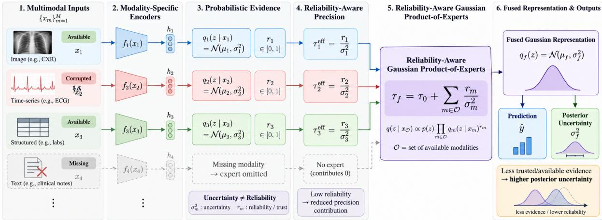
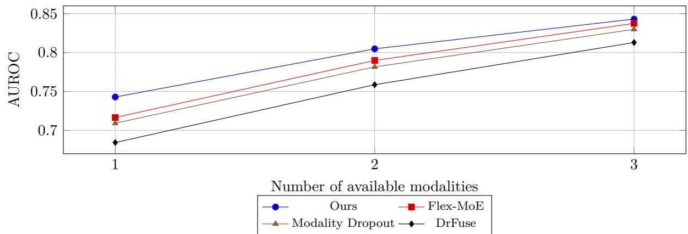
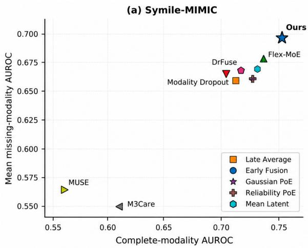
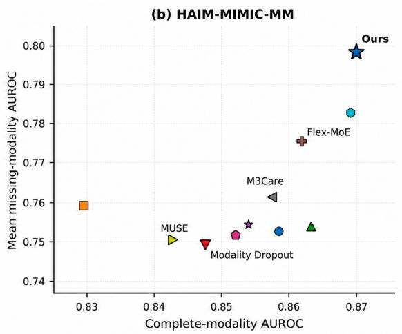
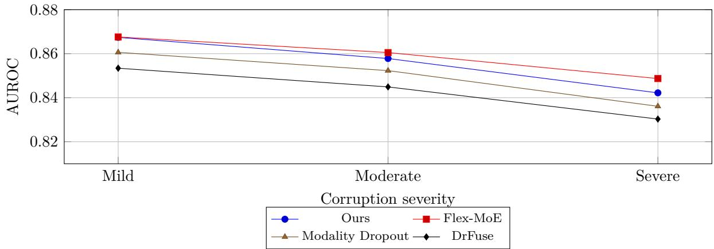

# Reliability-Aware Probabilistic Fusion for Multimodal Learning with Incomplete Evidence

Patitapaban Palo Abhisek Tiwari Mattia Carletti Anshul Thakur

Xiao Gu David A. Clifton

Institute of Biomedical Engineering, Department of Engineering Science, University of Oxford, UK

## Abstract

Multimodal inputs may be missing or degraded, raising distinct questions of evidence availability and trust. We introduce a reliability-aware Gaussian Product-of-Experts (PoE) in which an input-dependent reliability weight tempers each modality’s latent precision, while missing experts are omitted. We characterize how reliability and availability afect posterior information and expert influence. Across two clinical multimodal tasks, the full framework remains competitive with complete inputs and achieves its clearest mean-AUROC advantage under modality absence, particularly on HAIM-MIMIC-MM. Ablations show a substantial gain from missing-aware training and an additional HAIM improvement from reliability weighting under matched PoE, missing-aware, and consistency training. Unseen test-time corruptions are used diagnostically and reveal modality-dependent reliability-weight and latent-uncertainty responses, including failure under severe degradation. Thus, reliability weighting provides an explicit evidence-control mechanism, while learning dependable quality signals remains an open challenge. The implementation code is available at https://github. com/patitapabanpalo/reliability-aware-probabilistic-fusion.

## 1 Introduction

Multimodal learning combines complementary information from diferent sources, such as images, physiological signals, structured measurements, and text, and has become increasingly important in biomedical prediction [1, 2]. In practice, however, multimodal inputs are rarely equally available or equally trustworthy. A modality may be entirely missing, but it may also be present yet degraded by noise, acquisition artifacts, or measurement errors. This creates two related but distinct questions: what should a model do when evidence is unavailable, and how much should it trust evidence that is available?

Existing work has largely focused on the first question. Modality dropout trains models to tolerate absent inputs [3], while M3Care uses information from similar patients to compensate for missing modalities [4]. More recent methods learn representations or routing mechanisms that adapt to diferent modality combinations. DrFuse separates shared and modality-specific information [5], MUSE uses graph-based multimodal representations [6], and Flex-MoE routes diferent availability patterns through specialized experts [7]. These approaches provide efective mechanisms for incomplete inputs, but missingness is only part of the problem. An observed modality may itself contain uncertain or unreliable evidence, and representation-level fusion does not necessarily provide an explicit statistical account of how strongly such evidence should influence the prediction.

Probabilistic fusion provides a natural way to reason about this. Product-of-Experts (PoE) models combine evidence through the precision of individual probabilistic experts [8], and Gaussian PoE has been used to support inference from arbitrary subsets of modalities [9, 10].

  
Figure 1: Framework overview. Uncertainty and reliability weights determine expert contributions; missing modalities are omitted.

Yet precision alone need not reflect trustworthiness. An expert can assign low variance to an observation that is nevertheless corrupted or misleading, and precision miscalibration can therefore distort multimodal aggregation [10, 11]. This motivates separately parameterizing two operational roles:latent uncertainty describes how concentrated an expert’s evidence is, whereas a reliability-interpreted weight controls how strongly that evidence enters fusion.

We introduce a reliability-aware Gaussian PoE in which an input-dependent reliability weight tempers each modality’s precision while missing experts are omitted. We characterize the resulting posterior and evaluate it on cardiomegaly prediction with CXR, ECG, and laboratory measurements (Symile-MIMIC) and 48-hour mortality prediction with structured data, physiological time series, CXR, and text (HAIM-MIMIC-MM). Across five seeds, the full framework is competitive with complete inputs and shows its clearest mean-AUROC advantage under modality absence; corruption analysis shows that learned reliability-weight responses are strongly modality dependent.

Our main contributions are:

• We introduce an input-dependent reliability-weighted Gaussian PoE that parameterizes latent variance and evidence weighting separately while supporting arbitrary observed modality subsets.

• We characterize the fusion operator, linking reliability weights and modality removal to expert influence and posterior covariance.

• Across two clinical multimodal tasks, we evaluate complete, missing, and corrupted inputs and analyze both the benefits and failure modes of learned reliability weights under degradation.

## 2 Related Work

Learning with missing modalities. Multimodal models are often trained under complete observations even though one or more modalities may be unavailable at inference time [1, 12]. Early approaches improve robustness by randomly dropping modalities during training [3], while other methods reconstruct or infer missing information from the observed modalities [13–15]. Recent work increasingly avoids direct input reconstruction and instead learns representations that remain useful under incomplete observations. M3Care retrieves task-relevant information from similar patients to compensate for missing modalities [4]; DrFuse separates shared and modality-specific representations [5]; and MUSE uses graph-based representation learning to accommodate missing modalities and labels [6]. Mixture-of-experts approaches such as Flex-MoE further specialize computation according to the observed modality combination [7]. These methods flexibly handle incomplete inputs through reconstruction, representation learning, or routing. Our focus is complementary: how much statistical evidence an available modality should contribute, while missing modalities contribute no expert.

Probabilistic fusion, uncertainty, and reliability. Probabilistic multimodal models provide a natural alternative to deterministic fusion. Multimodal variational models have combined modality-specific posteriors using products of experts, mixtures of experts, and combinations of the two [9–11]. These formulations support inference from diferent subsets of modalities, but the contribution of an expert is typically determined by its learned posterior distribution. In a Gaussian Product-of-Experts, this makes precision central to fusion, which can be problematic when uncertainty is miscalibrated or when an observed modality is degraded. A related line of work studies trustworthy multi-view learning through evidential uncertainty. Trusted Multi-View Classification uses Dirichlet evidence and Dempster–Shafer fusion to quantify uncertainty and improve robustness to unreliable views [16, 17], while subsequent evidential fusion methods similarly model uncertainty when combining heterogeneous sources [18]. These approaches motivate trust-aware fusion but typically express trust through predictive evidence or uncertainty itself. We instead parameterize two roles: latent variance describes concentration of an expert’s evidence, whereas an input-dependent reliability weight tempers how strongly that evidence enters the PoE. This is best viewed as a reliability-interpreted, input-dependent tempering of Gaussian experts rather than new PoE algebra; its value is the separate parameterization of these roles and their use under variable modality availability.

## 3 Reliability-Aware Probabilistic Fusion

Figure 1 treats each available modality as probabilistic evidence with two separately parameterized roles: latent uncertainty controls evidence concentration, while reliability weighting controls its contribution to fusion. The formulation supports arbitrary modality types and subsets.

## 3.1 Problem Formulation

Let $\mathcal { X } = \{ x _ { 1 } , . . . , x _ { M } \}$ denote the M possible modalities for an example, and let $\mathcal { O } \subseteq \{ 1 , \ldots , M \}$ denote the subset observed at inference time. Given the available inputs $x _ { \mathcal { O } } = \{ x _ { m } : m \in \mathcal { O } \}$ our goal is to predict a target y while representing the uncertainty associated with the available evidence.

Each observed modality is first mapped to a common representation,

$$
h _ { m } = f _ { m } ( x _ { m } ; \theta _ { m } ) ,\tag{1}
$$

where $f _ { m }$ is modality-specific. This allows the feature extractor to reflect the structure of each input while keeping the fusion mechanism shared across modalities. Similar modality-specific encoding followed by a shared latent representation is common in multimodal latent-variable models [9, 11, 13].

## 3.2 Probabilistic Modality Evidence

Rather than representing modality m by a single deterministic vector, we model its latent evidence as a diagonal Gaussian expert,

$$
q _ { m } ( \mathbf { z } \mid x _ { m } ) = \mathcal { N } \Big ( \mathbf { z } ; \pmb { \mu } _ { m } , \mathrm { d i a g } ( \pmb { \sigma } _ { m } ^ { 2 } ) \Big ) ,\tag{2}
$$

where $\pmb { \mu _ { m } } \in \mathbb { R } ^ { d }$ and log $\pmb { \sigma } _ { m } ^ { 2 } \in \mathbb { R } ^ { d }$ are predicted from $h _ { m }$ . We denote the corresponding elementwise precision vector by $\tau _ { m } = \sigma _ { m } ^ { - 2 }$ . Gaussian modality-specific posteriors provide a convenient way to combine diferent subsets of observations and have been widely used in multimodal variational inference [9–11].

The variance $\sigma _ { m } ^ { 2 }$ describes uncertainty in the latent evidence. We additionally predict a scalar reliability-interpreted evidence weight $r _ { m }$

$$
r _ { m } = \mathrm { s i g m o i d } \left( g _ { r , m } ( [ { \pmb \mu _ { m } } ; \log { \pmb \sigma _ { m } ^ { 2 } } ] ) \right) , \qquad r _ { m } \in ( 0 , 1 ) ,\tag{3}
$$

where $g _ { r , m }$ is a modality-specific reliability head. The scalar is parameterized separately from latent variance and controls how strongly modality m enters fusion. Because only their product determines efective precision, task supervision alone does not identify $r _ { m }$ as a calibrated quality probability.

## 3.3 Reliability-Aware Product-of-Experts

Product-of-Experts (PoE) fusion provides a natural mechanism for combining probabilistic evidence [8, 9]. For a standard Gaussian PoE, an expert with smaller variance contributes greater precision to the fused posterior. We extend this mechanism by tempering each expert according to its learned reliability weight:

$$
q ( \boldsymbol { z } \mid \boldsymbol { x } _ { \mathcal { O } } ) \propto p ( \boldsymbol { z } ) \prod _ { m \in \mathcal { O } } q _ { m } ( \boldsymbol { z } \mid \boldsymbol { x } _ { m } ) ^ { r _ { m } } ,\tag{4}
$$

where $p ( \mathbf { z } ) = \mathcal { N } ( \mathbf { 0 } , I )$ is a Gaussian prior. Each powered expert $q _ { m } ( \mathbf { z } \mid x _ { m } ) ^ { r _ { m } }$ is understood up to normalization; raising a Gaussian expert to a nonnegative power $r _ { m }$ scales its precision by $r _ { m }$ . For diagonal Gaussian experts, the efective precision contributed by modality m is

$$
{ \tilde { \pmb { \tau } } } _ { m } = r _ { m } { \pmb { \tau } } _ { m } = r _ { m } { \pmb { \sigma } } _ { m } ^ { - 2 } ,\tag{5}
$$

The fused precision and mean therefore have the closed forms

$$
\pmb { \tau } _ { f } = \pmb { \tau } _ { 0 } + \sum _ { m \in \mathcal { O } } r _ { m } \pmb { \tau } _ { m } ,\tag{6}
$$

$$
\pmb { \mu } _ { f } = \pmb { \tau } _ { f } ^ { - 1 } \odot \left( \pmb { \tau } _ { 0 } \odot \pmb { \mu } _ { 0 } + \sum _ { m \in \mathcal { O } } r _ { m } \pmb { \tau } _ { m } \odot \pmb { \mu } _ { m } \right) ,\tag{7}
$$

where $\odot$ denotes element-wise multiplication and the inverse of $\tau _ { f }$ is also taken element-wise. With a standard normal prior, ${ \boldsymbol { \mu } } _ { 0 } = \mathbf { 0 }$ and $\tau _ { 0 } = \mathbf { 1 }$ . This formulation preserves Gaussian PoE aggregation while separately parameterizing expert precision and an input-dependent tempering weight. Setting $r _ { m } = 1$ recovers the standard Gaussian PoE, whereas the limiting case $r _ { m } \to 0$ removes the expert’s precision contribution. Although our sigmoid parameterization yields $r _ { m } \in ( 0 , 1 )$ , the fusion operator is well defined for $r _ { m } \ge 0$ . We formalize these properties in Section 4.

## 3.4 Learning Reliability

The reliability head is learned end-to-end through supervised fusion, without corruption-ranking supervision. Thus, $r _ { m }$ is an input-dependent evidence weight, not a calibrated quality probability. Since fusion depends only on $r _ { m } \pmb { \sigma } _ { m } ^ { - 2 }$ , reliability and latent variance are not identifiable from task supervision alone; Section 6.4 examines their behavior under held-out degradation.

## 3.5 Learning with Missing Modalities

The PoE formulation does not require imputation when a modality is missing: its expert is simply absent from Eq. (4). During training, we expose the model to diferent observed subsets ${ \mathcal { S } } \subseteq \{ 1 , \ldots , M \}$ , similar in spirit to modality dropout and subset-based multimodal learning [9, 10]. The corresponding posterior is formed only from the available experts.

We optimize predictions from both complete and sampled incomplete modality sets. Inspired by teacher–student consistency and self-distillation objectives [19, 20], we use the completemodality prediction as a stop-gradient target for predictions from incomplete subsets:

$$
\mathcal { L } _ { \mathrm { c o n s } } = \Vert \hat { y } _ { S } - \mathrm { s g } ( \hat { y } _ { \mathrm { f u l l } } ) \Vert _ { 2 } ^ { 2 } ,\tag{8}
$$

where $\operatorname { s g } ( \cdot )$ denotes stop-gradient. The complete prediction therefore acts as a training target without being moved by the incomplete branch.

The final objective is

$$
\mathcal { L } = \mathcal { L } _ { \mathrm { t a s k } } + \lambda _ { \mathrm { u n i } } \mathcal { L } _ { \mathrm { u n i } } + \lambda _ { \mathrm { c o n s } } \mathcal { L } _ { \mathrm { c o n s } } ,\tag{9}
$$

Here, $\mathcal { L } _ { \mathrm { t a s k } }$ denotes the supervised prediction loss over the complete and sampled incomplete modality sets, while ${ \mathcal { L } } _ { \mathrm { u n i } }$ applies the supervised loss to each individual modality to preserve unimodal predictive information. For our binary prediction tasks, the supervised objective is a class-weighted binary cross-entropy loss. This gives the general training objective; dataset-specific experiments may omit auxiliary terms when they are not used. Dataset-specific architectures, subset-sampling details, loss weights, and optimization settings are provided in Section 5.5.

## 4 Statistical Properties

We characterize operator-level efects of reliability and availability; these results do not assume that learned weights detect corruption. Proofs are in Section 4.1; the fusion and informationordering results extend from our diagonal implementation to positive-definite Gaussian covariances.

Let the prior and modality experts be Gaussian, $p ( \mathbf { z } ) = \mathcal { N } ( \pmb { \mu } _ { 0 } , \Sigma _ { 0 } )$ and $q _ { m } ( \mathbf { z } \mid x _ { m } ) =$ $\mathcal { N } ( \boldsymbol { \mu } _ { m } , \boldsymbol { \Sigma } _ { m } )$ , with positive-definite precision matrices $\Lambda _ { 0 } = \Sigma _ { 0 } ^ { - 1 }$ and $\Lambda _ { m } = \Sigma _ { m } ^ { - 1 }$ , and reliability $r _ { m } \ge 0$

Proposition 1 (Reliability-weighted Gaussian fusion). For an observed modality set O, the reliability-weighted Product-of-Experts in Eq. (4) is Gaussian with

$$
\Lambda _ { \mathcal { O } } = \Lambda _ { 0 } + \sum _ { m \in \mathcal { O } } r _ { m } \Lambda _ { m } ,\tag{10}
$$

$$
{ \pmb \mu } _ { \mathcal { O } } = \Lambda _ { \mathcal { O } } ^ { - 1 } \left( \Lambda _ { 0 } { \pmb \mu } _ { 0 } + \sum _ { m \in \mathcal { O } } r _ { m } \Lambda _ { m } { \pmb \mu } _ { m } \right) .\tag{11}
$$

Thus, reliability scales the information contributed by an expert rather than its latent estimate directly. Standard Gaussian PoE is recovered when $r _ { m } = 1$ for all $m .$ , while $r _ { m } = 0$ gives zero information contribution from expert m.

Proposition 2 (Reliability–uncertainty monotonicity). Consider one latent coordinate with fused variance

$$
V _ { j } = \left( \tau _ { 0 j } + \sum _ { m \in \mathcal { O } } r _ { m } \tau _ { m j } \right) ^ { - 1 } .\tag{12}
$$

For any expert k,

$$
\frac { \partial V _ { j } } { \partial r _ { k } } = - \frac { \tau _ { k j } } { \left( \tau _ { 0 j } + \sum _ { m } r _ { m } \tau _ { m j } \right) ^ { 2 } } < 0 .\tag{13}
$$

Since $\tau _ { k j } > 0 , V _ { j }$ is strictly decreasing in $r _ { k }$ . Thus, reducing the reliability weight assigned to an available expert increases posterior variance for that coordinate. In other words, decreasing an available source’s reliability weight cannot make the fused representation more certain.

Proposition 3 (Information monotonicity under missingness). Let $s \subseteq \mathcal { O }$ be two observed modality sets, with the reliability scores of retained experts fixed. Then

$$
\Lambda _ { S } \preceq \Lambda _ { \mathcal { O } } , \qquad \Sigma _ { \mathcal { S } } \succeq \Sigma _ { \mathcal { O } } ,\tag{14}
$$

where $\preceq$ denotes the Loewner partial order. Therefore, removing nonnegative-precision evidence cannot reduce posterior covariance. This provides a direct statistical interpretation of missingmodality inference: as fewer experts are available, the fused posterior cannot become more informative solely through their removal.

Proposition 4 (Conditional expert influence). For diagonal Gaussian experts, holding $r _ { k }$ and $\tau _ { k j }$ fixed, the partial sensitivity of fused coordinate $\mu _ { f , j }$ to expert mean $\mu _ { k , j }$ is

$$
{ \frac { \partial \mu _ { f , j } } { \partial \mu _ { k , j } } } \bigg | _ { r _ { k } , \tau _ { k j } } = \frac { r _ { k } \tau _ { k j } } { \tau _ { 0 j } + \sum _ { m } r _ { m } \tau _ { m j } } \equiv \alpha _ { k j } .\tag{15}
$$

The coeficient $\alpha _ { k j } \in [ 0 , 1 )$ is the expert’s normalized efective precision. Consequently, as $r _ { k } \to 0$ , $\alpha _ { k j }  0$ : perturbations to an expert’s latent estimate have vanishing influence on the fused mean.

Together, Propositions 2–4 show that decreasing $r _ { m }$ increases posterior uncertainty and limits expert influence; as $r _ { m } \to 0$ , its direct information contribution vanishes. Missingness remains distinct from unreliability: a missing expert is absent, whereas an unreliable one is observed but down-weighted. Whether degradation actually reduces learned $r _ { m }$ is evaluated empirically.

## 4.1 Detailed Proofs of Statistical Properties

This section provides complete proofs of the results stated in Section 4. We use the notation introduced in the main text. Let

$$
p ( \mathbf { z } ) = \mathcal { N } ( \mathbf { z } ; \pmb { \mu } _ { 0 } , \Sigma _ { 0 } )
$$

denote the Gaussian prior and

$$
q _ { m } ( \mathbf { z } \mid x _ { m } ) = \mathcal { N } ( \mathbf { z } ; \pmb { \mu } _ { m } , \Sigma _ { m } )
$$

the Gaussian expert associated with modality m. We write $\Lambda _ { 0 } = \Sigma _ { 0 } ^ { - 1 }$ and $\Lambda _ { m } = \Sigma _ { m } ^ { - 1 }$ for their precision matrices, with $r _ { m } \ge 0$ denoting modality reliability.

## 4.1.1 Proof of Proposition 1

For an observed modality set O, the reliability-weighted Product-of-Experts is

$$
q ( \mathbf { z } \mid x _ { \mathcal { O } } ) \propto p ( \mathbf { z } ) \prod _ { m \in \mathcal { O } } q _ { m } ( \mathbf { z } \mid x _ { m } ) ^ { r _ { m } } .\tag{16}
$$

The Gaussian prior can be written in information form as

$$
p ( { \mathbf { z } } ) \propto \exp \left\{ - \frac { 1 } { 2 } ( { \mathbf { z } } - { \pmb { \mu } } _ { 0 } ) ^ { \top } \Lambda _ { 0 } ( { \mathbf { z } } - { \pmb { \mu } } _ { 0 } ) \right\} .\tag{17}
$$

Similarly, raising expert m to the nonnegative power $r _ { m }$ gives

$$
q _ { m } ( \mathbf { z } \mid x _ { m } ) ^ { r _ { m } } \propto \exp \left\{ - \frac { r _ { m } } { 2 } ( \mathbf { z } - \pmb { \mu } _ { m } ) ^ { \top } \Lambda _ { m } ( \mathbf { z } - \pmb { \mu } _ { m } ) \right\} .\tag{18}
$$

Thus, exponentiation by $r _ { m }$ scales the expert precision from $\Lambda _ { m }$ to $r _ { m } \Lambda _ { m }$

Taking the logarithm of Eq. (16) and discarding terms that do not depend on z yields

$$
\begin{array} { l } { \displaystyle \log q ( { \mathbf z } \mid x _ { \mathcal { O } } ) = - \frac { 1 } { 2 } ( { \mathbf z } - { \boldsymbol \mu } _ { 0 } ) ^ { \top } \Lambda _ { 0 } ( { \mathbf z } - { \boldsymbol \mu } _ { 0 } ) } \\ { \displaystyle \phantom { \frac { 1 } { 2 } } - \frac { 1 } { 2 } \sum _ { m \in { \mathcal { O } } } r _ { m } ( { \mathbf z } - { \boldsymbol \mu } _ { m } ) ^ { \top } \Lambda _ { m } ( { \mathbf z } - { \boldsymbol \mu } _ { m } ) + C , } \end{array}\tag{19}
$$

where $C$ collects terms independent of z.

Expanding the quadratic terms and collecting coeficients of z gives

$$
\begin{array} { l } { \log q ( \mathbf { z } \mid x _ { \mathcal { O } } ) = - \displaystyle \frac { 1 } { 2 } \mathbf { z } ^ { \top } \left( \Lambda _ { 0 } + \sum _ { m \in \mathcal { O } } r _ { m } \Lambda _ { m } \right) \mathbf { z } } \\ { \displaystyle ~ + \mathbf { z } ^ { \top } \left( \Lambda _ { 0 } \pmb { \mu } _ { 0 } + \sum _ { m \in \mathcal { O } } r _ { m } \Lambda _ { m } \pmb { \mu } _ { m } \right) + C ^ { \prime } . } \end{array}\tag{20}
$$

Define

$$
\Lambda _ { \mathcal { O } } = \Lambda _ { 0 } + \sum _ { m \in \mathcal { O } } r _ { m } \Lambda _ { m } .\tag{21}
$$

Because $\Lambda _ { 0 } \succ 0 , \Lambda _ { m } \succ 0$ , and $r _ { m } \ge 0$ , we have $\Lambda _ { \mathcal { O } } \succ 0$ . Completing the square therefore shows that Eq. (20) is the log-density of a Gaussian distribution with covariance

$$
\Sigma _ { \mathcal { O } } = \Lambda _ { \mathcal { O } } ^ { - 1 }\tag{22}
$$

and mean

$$
{ \pmb \mu } _ { \mathcal { O } } = \Lambda _ { \mathcal { O } } ^ { - 1 } \left( \Lambda _ { 0 } { \pmb \mu } _ { 0 } + \sum _ { m \in \mathcal { O } } r _ { m } \Lambda _ { m } { \pmb \mu } _ { m } \right) .\tag{23}
$$

This proves Proposition 1.

Two useful special cases follow immediately. If $r _ { m } = 1$ for every available modality, Eq. (21) reduces to the standard Gaussian Product-of-Experts precision. If $r _ { k } = 0$ , expert k contributes zero precision and zero precision-weighted mean to the fused posterior.

## 4.1.2 Proof of Proposition 2

For the diagonal Gaussian model used in our implementation, consider latent coordinate $j .$ . Let $\tau _ { 0 j } > 0$ denote the prior precision and $\tau _ { m j } > 0$ the precision contributed by modality m before reliability weighting. From Proposition 1, the fused precision is

$$
\tau _ { f , j } = \tau _ { 0 j } + \sum _ { m \in \mathcal { O } } r _ { m } \tau _ { m j } .\tag{24}
$$

Hence the corresponding posterior variance is

$$
V _ { j } = \frac { 1 } { \tau _ { 0 j } + \sum _ { m \in \mathcal { O } } r _ { m } \tau _ { m j } } .\tag{25}
$$

Diferentiating Eq. (25) with respect to the reliability of expert k gives

$$
\begin{array} { l } { \displaystyle \frac { \partial V _ { j } } { \partial r _ { k } } = - \left( \tau _ { 0 j } + \sum _ { m \in \mathcal { O } } r _ { m } \tau _ { m j } \right) ^ { - 2 } \tau _ { k j } } \\ { \displaystyle = - \frac { \tau _ { k j } } { \left( \tau _ { 0 j } + \sum _ { m \in \mathcal { O } } r _ { m } \tau _ { m j } \right) ^ { 2 } } . } \end{array}\tag{26}
$$

(27)

Since $\tau _ { k j } > 0$ and the denominator is strictly positive,

$$
\frac { \partial V _ { j } } { \partial r _ { k } } < 0 .\tag{28}
$$

Therefore $V _ { j }$ is strictly decreasing in $r _ { k }$ . Equivalently, reducing the reliability assigned to an available expert increases posterior variance for that latent coordinate. This proves Proposition 2.

## 4.1.3 Proof of Proposition 3

Let $s \subseteq \mathcal { O }$ be two observed modality sets, and hold the reliability scores of all retained experts fixed. From Proposition 1,

$$
\Lambda _ { \mathcal { O } } = \Lambda _ { 0 } + \sum _ { m \in \mathcal { O } } r _ { m } \Lambda _ { m } ,\tag{29}
$$

$$
\Lambda _ { \mathcal { S } } = \Lambda _ { 0 } + \sum _ { m \in \mathcal { S } } r _ { m } \Lambda _ { m } .\tag{30}
$$

Their diference is

$$
\Lambda _ { \mathcal { O } } - \Lambda _ { \mathcal { S } } = \sum _ { m \in \mathcal { O } \backslash \mathcal { S } } r _ { m } \Lambda _ { m } .\tag{31}
$$

For every m, $r _ { m } \ge 0$ and $\Lambda _ { m } \succ 0$ . Consequently, $r _ { m } \Lambda _ { m } \succeq 0$ , and therefore

$$
\Lambda _ { \mathcal { O } } - \Lambda _ { \mathcal { S } } \succeq 0 .\tag{32}
$$

It follows that

$$
\Lambda _ { S } \preceq \Lambda _ { \mathcal { O } } .\tag{33}
$$

Both precision matrices are positive definite because they contain the positive-definite prior precision $\Lambda _ { 0 }$ . Matrix inversion reverses the Loewner order for positive-definite matrices. Applying this property to Eq. (33) gives

$$
\Lambda _ { S } ^ { - 1 } \succeq \Lambda _ { O } ^ { - 1 } .\tag{34}
$$

Since $\Sigma _ { S } = \Lambda _ { S } ^ { - 1 }$ and $\Sigma _ { \mathcal { O } } = \Lambda _ { \mathcal { O } } ^ { - 1 }$ 2

$$
\Sigma _ { S } \succeq \Sigma _ { O } .\tag{35}
$$

Thus, removing nonnegative-precision experts cannot decrease posterior covariance. This proves Proposition 3.

## 4.1.4 Proof of Proposition 4

For the diagonal model, consider latent coordinate j. From Proposition 1, the fused mean can be written as

$$
\mu _ { f , j } = \frac { \tau _ { 0 j } \mu _ { 0 j } + \sum _ { m } r _ { m } \tau _ { m j } \mu _ { m , j } } { \tau _ { 0 j } + \sum _ { m } r _ { m } \tau _ { m j } } .\tag{36}
$$

We consider the partial sensitivity to $\mu _ { k , j }$ while holding $r _ { k }$ and $\tau _ { k j }$ fixed. Under this conditioning, the denominator of Eq. (36) does not depend on $\mu _ { k , j }$ . Diferentiating therefore gives

$$
{ \frac { \partial \mu _ { f , j } } { \partial \mu _ { k , j } } } \bigg | _ { r _ { k } , \tau _ { k j } } = \frac { r _ { k } \tau _ { k j } } { \tau _ { 0 j } + \sum _ { m } r _ { m } \tau _ { m j } } \equiv \alpha _ { k j } .\tag{37}
$$

All terms in the denominator are nonnegative and the prior precision is strictly positive. Hence

$$
0 \leq \alpha _ { k j } < 1 .\tag{38}
$$

In particular,

$$
\operatorname* { l i m } _ { r _ { k } \to 0 } \alpha _ { k j } = 0 .\tag{39}
$$

Thus, conditional on fixed expert precision and reliability, the sensitivity of the fused mean to expert k vanishes as its reliability approaches zero. This proves Proposition 4.

Remark. The conditioning in Proposition 4 is important because the learned reliability $r _ { k }$ is itself predicted from modality-specific evidence in our model. Proposition 4 characterizes the direct influence induced by the fusion rule; it does not include indirect changes that may occur if perturbing $\pmb { \mu } _ { k }$ also changes the output of the reliability network.

## 5 Experimental Setup

We evaluate the proposed framework on two multimodal clinical prediction settings that difer in both task and modality composition. Our experiments address three questions: (i) whether probabilistic fusion remains competitive when all modalities are available, (ii) how models behave when one or more modalities are missing, and (iii) how robust fusion remains when an observed modality is corrupted.

## 5.1 Datasets and Tasks

Symile-MIMIC. We study cardiomegaly classification from CXR, ECG, and laboratory measurements using the released partitions after retaining examples with valid labels. Cohort construction, split sizes, and preprocessing are provided in Section 5.7.1.

HAIM-MIMIC-MM. We study 48-hour mortality classification from structured data, physiological time series, CXR, and clinical text using patient-level splits; observation-level prevalence is 2.73%. Experiments use distributed precomputed representations associated with CXR-anchored observations. Cohort construction and preprocessing are detailed in Section 5.7.2.

## 5.2 Comparison Methods

We compare with unimodal models, early/late fusion, mean latent fusion, Gaussian and reliabilityweighted PoE, modality dropout [3], and recent incomplete-modality methods DrFuse [5], M3Care [4], MUSE [6], and Flex-MoE [7]. Because the published methods assume diferent modality sets and input representations, we instantiate their defining mechanisms with dataset-specific encoders and interfaces while following their standard methodological training procedures. Details are provided in Section 5.8.

## 5.3 Missing and Corrupted Modalities

We evaluate every non-empty incomplete modality subset (6 for Symile; 14 for HAIM); the proposed model forms its posterior only from available experts. For corruption, one modality is degraded at a time at three severities. No reported model is trained on the synthetic corruption operators used for evaluation. Operators, matched HAIM perturbations, and exact parameters are given in Section 5.6. Each comparison method follows its standard missing-modality mechanism and training procedure rather than being forced into a common objective; Section 6.5 separately isolates components of our framework.

## 5.4 Evaluation Protocol

We report AUROC and AUPRC in the main analysis; Brier scores are reported in the detailed results as supplementary probability-error measures and are not interpreted as calibration because training uses class-weighted BCE. Final comparisons use five independent seeds. For aggregate missingness and corruption results, conditions are averaged within each seed before computing mean ± sample SD across seeds. A paired seed-level uncertainty analysis for the principal HAIM missing-modality comparison is reported in Section 6.7.1. Further training and model-selection details are in Section 5.5.

Table 1: Dataset-specific modality encoders.
<table><tr><td>Input</td><td>Encoder</td></tr><tr><td>Symile CXR</td><td>Conv2D channels 32, 64, 128, 128; adaptive pooling</td></tr><tr><td>Symile ECG</td><td>Conv1D channels 32, 64, 128; kernels 15, 9, 7</td></tr><tr><td>Symile Labs</td><td>100 →256 → 128 MLP</td></tr><tr><td>HAIM modalities</td><td> $d _ { m } \to 2 5 6 \to 1 2 8$  MLP; LN, ReLU, dropout 0.20</td></tr></table>

## 5.5 Implementation and Training Details

We provide implementation details for the proposed model on Symile-MIMIC and HAIM-MIMIC-MM. Both datasets use the same probabilistic fusion mechanism, while modality encoders and training settings are adapted to the corresponding inputs and tasks.

## 5.5.1 Model Architectures

Both implementations map modality-specific inputs to a 128-dimensional embedding and use a 32-dimensional Gaussian latent space. For each modality, separate linear projections predict $\pmb { \mu } _ { m }$ and log $\pmb { \sigma } _ { m } ^ { 2 }$ , with log-variances clipped to [−6, 4] for numerical stability.

The reliability head takes $[ \pmb { \mu } _ { m } ; \log \pmb { \sigma } _ { m } ^ { 2 } ]$ as input and uses a 64→32→1 MLP with ReLU and sigmoid output. The prediction head maps the fused latent mean through a $3 2  3 2  1$ MLP with ReLU activation.

Dataset-specific modality encoders are summarized in Table 1.

For Symile, the CXR encoder uses a $7 \times 7$ stride-2 first convolution followed by $3 \times 3$ convolutional blocks, batch normalization, ReLU, and adaptive average pooling. The ECG encoder operates on the 12-channel waveform using one-dimensional convolutions, batch normalization, ReLU, temporal pooling, and adaptive average pooling. Laboratory values are concatenated with 50 corresponding missingness indicators, producing a 100-dimensional input.

For HAIM, $d _ { m }$ corresponds to the input dimension of each representation-level modality: 1,542 structured, 451 time-series, 2,084 CXR, and 2,304 text features. Each modality uses the same MLP structure shown in Table 1, with layer normalization after each linear projection.

## 5.5.2 Training Objectives

Symile uses the task, unimodal, and consistency terms in Eq. (9). Reliability is learned end-toend through its contribution to fusion; the final reported model does not use corruption-ranking supervision. Its task loss equally weights predictions from the complete and sampled incomplete modality sets:

$$
\mathcal { L } _ { \mathrm { t a s k } } = \frac { 1 } { 2 } \mathcal { L } _ { \mathrm { B C E } } ^ { \mathrm { f u l l } } + \frac { 1 } { 2 } \mathcal { L } _ { \mathrm { B C E } } ^ { \mathrm { s u b s e t } } .\tag{40}
$$

The unimodal auxiliary loss applies the supervised objective separately to CXR, ECG, and laboratory representations. The consistency loss compares the sampled-subset prediction with the detached complete-modality prediction.

HAIM Full-F uses reliability-weighted PoE, missing-modality-aware mortality training, and complete-to-incomplete consistency, without the unimodal auxiliary term. As on Symile, reliability is learned through its efect on probabilistic fusion and the supervised task objective:

$$
\mathcal { L } _ { \mathrm { H A I M } } = \mathcal { L } _ { \mathrm { m o r t } } + \lambda _ { \mathrm { c o n s } } \mathcal { L } _ { \mathrm { c o n s } } .\tag{41}
$$

Both datasets use class-weighted binary cross-entropy for their supervised prediction objectives.

Table 2: Training hyperparameters for the proposed models.
<table><tr><td>Setting</td><td>Symile</td><td>HAIM</td></tr><tr><td>Embedding dimension</td><td>128</td><td>128</td></tr><tr><td>Latent dimension</td><td>32</td><td>32</td></tr><tr><td>Batch size</td><td>16</td><td>256</td></tr><tr><td>Optimizer</td><td>Adam</td><td>AdamW</td></tr><tr><td>Learning rate</td><td> $1 0 ^ { - 3 }$ </td><td> $1 0 ^ { - 3 }$ </td></tr><tr><td>Weight decay</td><td>0</td><td> $1 0 ^ { - 4 }$ </td></tr><tr><td>Max. epochs</td><td>10</td><td>50</td></tr><tr><td>Early stopping</td><td></td><td>8 epochs</td></tr><tr><td>Gradient clip</td><td>5.0</td><td>5.0</td></tr><tr><td> $\lambda _ { \mathrm { u n i } }$ </td><td>0.50</td><td></td></tr><tr><td> $\lambda _ { \mathrm { { c o n s } } }$ </td><td>0.25</td><td>0.10</td></tr><tr><td>Log-var. range</td><td>[−6,4]</td><td>[-6,4]</td></tr></table>

## 5.5.3 Missing-Modality Sampling

For Symile, training samples from all seven non-empty modality configurations. The completemodality pattern is sampled with probability 0.25, each of the three single-missing patterns with probability 0.15, and each of the three two-missing patterns with probability 0.10.

HAIM contains 15 non-empty modality configurations. For the supervised mortality branch, the number of missing modalities is sampled as

$$
P ( 0 ~ \mathrm { m i s s i n g } ) = 0 . 5 0 , ~ P ( 1 ~ \mathrm { m i s s i n g } ) = 0 . 2 0 ,
$$

$$
\begin{array} { r } { P \mathrm { ( 2 ~ m i s s i n g ) } = 0 . 2 0 , P \mathrm { ( 3 ~ m i s s i n g ) } = 0 . 1 0 . } \end{array}\tag{42}
$$

Conditional on this number, the missing modalities are sampled uniformly without replacement. 1g

HAIM uses a separate incomplete subset for the consistency branch. The number of missing modalities is sampled uniformly from {1, 2, 3}, after which the corresponding modalities are sampled uniformly. Thus, the consistency objective is never applied to the complete-modality case.

## 5.5.4 Optimization and Model Selection

The principal architecture and training hyperparameters are summarized in Table 2.

Symile is trained for 10 epochs. HAIM uses early stopping with patience 8 based on validation AUROC and retains the checkpoint with the highest validation AUROC. Gradients are clipped to maximum norm 5 in both settings.

Final results are aggregated over five independently trained seeds. Python, Num $\mathrm { P y } ,$ and $\mathrm { P y } -$ Torch random-number generators are seeded for each run. Dataset construction and preprocessing are described in Section 5.7, and the exact corruption protocols are given in Section 5.6.

## 5.6 Corruption Protocols

We evaluate robustness using controlled corruption at three severity levels. One modality is corrupted at a time while all others remain unchanged. We distinguish corruption from missingness: a missing modality contributes no expert, whereas a corrupted modality remains observed and may contribute unreliable evidence.

## 5.6.1 Symile-MIMIC Corruptions

Because Symile contains heterogeneous inputs, we use modality-specific corruptions for CXR, ECG, and laboratory measurements. Severity $s \in \{ 1 , 2 , 3 \}$ denotes mild, moderate, and severe corruption, respectively; $s = 0$ denotes the unmodified input.

Table 3: Symile-MIMIC corruption parameters.
<table><tr><td>Severity</td><td>CXR  $( { { k } _ { s } } , { { \beta } _ { s } } , { { \eta } _ { s } } )$ </td><td>ECG  $\eta _ { s }$ </td><td>Labs  $\alpha _ { s }$ </td></tr><tr><td>Mild</td><td>(3, 0.25, 0.02)</td><td>0.05</td><td>0.25</td></tr><tr><td>Moderate</td><td>(7, 0.55, 0.05)</td><td>0.15</td><td>0.60</td></tr><tr><td>Severe</td><td>(13, 0.85, 0.10)</td><td>0.30</td><td>1.00</td></tr></table>

Table 4: HAIM representation-level corruption parameters.
<table><tr><td>Severity</td><td>Mask prob.  $p _ { s }$ </td><td>Noise SD  $\eta _ { s }$ </td></tr><tr><td>Mild</td><td>0.10</td><td>0.10</td></tr><tr><td>Moderate</td><td>0.30</td><td>0.30</td></tr><tr><td>Severe</td><td>0.50</td><td>0.50</td></tr></table>

CXR. CXR corruption combines spatial smoothing and additive Gaussian noise:

$$
\widetilde { \boldsymbol { x } } ^ { ( s ) } = ( 1 - \beta _ { s } ) \boldsymbol { x } + \beta _ { s } \boldsymbol { \mathcal { B } } _ { k _ { s } } ( \boldsymbol { x } ) + \eta _ { s } \epsilon , \qquad \epsilon \sim { \mathcal { N } } ( 0 , I ) ,\tag{43}
$$

where $B _ { k _ { s } }$ denotes average pooling with kernel size $k _ { s }$ , unit stride, and padding that preserves the image dimensions. The severity parameters are given in Table 3.

ECG. ECG corruption adds Gaussian noise followed by clipping to the normalized input range:

$$
\begin{array} { r } { \widetilde { x } ^ { ( s ) } = \mathrm { c l i p } ( x + \eta _ { s } \epsilon , - 1 , 1 ) , \qquad \epsilon \sim \mathcal { N } ( 0 , I ) , } \end{array}\tag{44}
$$

with $\eta _ { s } \in \{ 0 . 0 5 , 0 . 1 5 , 0 . 3 0 \}$ for mild, moderate, and severe corruption.

Laboratory measurements. Observed normalized laboratory values are progressively replaced by independent random values:

$$
\widetilde { x } ^ { ( s ) } = ( 1 - \alpha _ { s } ) x + \alpha _ { s } u , \qquad u \sim \mathrm { U n i f o r m } ( 0 , 1 ) ,\tag{45}
$$

where $\alpha _ { s } \in \{ 0 . 2 5 , 0 . 6 0 , 1 . 0 0 \}$ . At severe corruption, the laboratory-value vector is fully replaced by random values. Laboratory missingness indicators are retained unchanged.

These corruption operators are used only for held-out robustness evaluation of the final reported models; they are not used as corruption augmentation or reliability supervision during training. The CXR protocol was also checked during development to verify that input-space distortion increased with severity.

## 5.6.2 HAIM-MIMIC-MM Corruptions

HAIM uses precomputed representations, so the same feature-space corruption is applied to structured, time-series, CXR, and text representations. For representation vector $x _ { i }$

$$
\begin{array} { l } { { \widetilde { x } ^ { ( s ) } = x \odot b _ { s } + \eta _ { s } \epsilon , } } \\ { { b _ { s , j } \sim \mathrm { B e r n o u l l i } ( 1 - p _ { s } ) , \qquad \epsilon \sim \mathcal { N } ( 0 , I ) . } } \end{array}\tag{46}
$$

where $p _ { s }$ controls feature masking and $\eta _ { s }$ controls additive Gaussian noise.

Exactly one modality is corrupted per condition. Four modalities and three severity levels therefore give $4 \times 3 = 1 2$ corruption conditions per model and seed.

Table 5: Symile-MIMIC cohort after label filtering.
<table><tr><td>Split</td><td>Released</td><td>Usable</td><td>Positive</td></tr><tr><td>Train</td><td>10,000</td><td>4,232</td><td>3,346</td></tr><tr><td>Validation</td><td>750</td><td>349</td><td></td></tr><tr><td>Test</td><td>4,640</td><td>1,918</td><td>1,444</td></tr></table>

## 5.6.3 Matched Corruption Across Methods

For HAIM, corruption realizations are matched across competing methods. The random corruption seed depends only on the experimental seed, corrupted modality, and severity, and not on method identity. Thus, for a given condition, all methods receive the same feature mask and Gaussian-noise realization. This reduces variation caused by diferent random perturbations and enables more direct robustness comparisons.

## 5.7 Dataset and Cohort Details

This section summarizes cohort construction, partitioning, and preprocessing for the two evaluation datasets.

## 5.7.1 Symile-MIMIC

We use Symile-MIMIC for cardiomegaly classification from three modalities: chest radiographs (CXR), electrocardiograms (ECG), and laboratory measurements. Per observation, the input shapes are CXR $( 3 \times 3 2 0 \times 3 2 0 )$ , ECG $( 1 \times 5 0 0 0 \times 1 2 )$ , and laboratory measurements (50 features). The released train, validation, and test partitions contain 10,000, 750, and 4,640 observations, respectively.

Label alignment and cohort construction. Not every released observation has a usable binary cardiomegaly label. We construct a valid-label mask from the metadata and apply the same mask to all modalities, laboratory missingness indicators, and outcomes. Alignment is performed using the admission identifier (hadm\_id) to preserve correspondence across modalities. The resulting cohort is summarized in Table 5.

We retain the released train/validation/test partitioning. Admission identifiers were checked across partitions before final evaluation, with no overlap found between train, validation, and test sets.

Laboratory representation. Each observation contains 50 normalized laboratory values and 50 corresponding missingness indicators. These are concatenated into the 100-dimensional laboratory input described in Section 5.5.1. Missingness indicators are retained when laboratory values are corrupted.

## 5.7.2 HAIM-MIMIC-MM

We construct a HAIM-MIMIC-MM cohort for 48-hour mortality prediction using four modality groups: structured data, physiological time-series, CXR, and text. Their representation dimensions are 1,542, 451, 2,084, and 2,304, respectively.

The cohort contains 45,036 multimodal observations from 6,486 unique subjects, with 1,229 positive mortality observations (2.73% observation-level prevalence).

Table 6: HAIM 48-hour mortality cohort.
<table><tr><td>Split</td><td></td><td>Obs. Subjects</td><td> Positive</td></tr><tr><td>Train</td><td>31,213</td><td>4,540</td><td>865</td></tr><tr><td>Validation</td><td>5,059</td><td>648</td><td>118</td></tr><tr><td>Test</td><td>8,764</td><td>1,298</td><td>246</td></tr></table>

Table 7: Summary of the evaluation settings.
<table><tr><td></td><td>Symile</td><td>HAIM</td></tr><tr><td>Task</td><td>Cardiomegaly</td><td>48-h mortality</td></tr><tr><td>Modalities</td><td>CXR, ECG, labs</td><td>Structured, TS, CXR, text</td></tr><tr><td>No. modalities</td><td>3</td><td>4</td></tr><tr><td>Incomplete sets 6</td><td></td><td>14</td></tr><tr><td>Split</td><td>Released</td><td>Patient-level</td></tr><tr><td>Input</td><td>Raw/low-level</td><td>Representations</td></tr></table>

Patient-level partitioning. Because subjects may contribute multiple observations, splitting at the observation level could introduce patient overlap across partitions. We therefore construct train, validation, and test sets at the subject level, assigning all observations from a subject to the same partition.

There is no subject overlap between train, validation, and test partitions, and no CXR image identifier is shared across partitions.

Preprocessing. HAIM experiments use distributed precomputed representations associated with CXR-anchored observations, with mortality defined over the subsequent 48 hours. Several physiological and imaging components are bounded to the anchor, but not every precomputed feature component can be guaranteed to share the same temporal boundary; we therefore interpret HAIM as a benchmark evaluation rather than a prospective deployment study. Normalization statistics are estimated on training data and applied unchanged to validation and test data.

## 5.7.3 Comparison of Evaluation Settings

The two datasets provide complementary evaluation settings. Symile uses three modalities for an imaging-related finding, whereas HAIM uses four heterogeneous modality groups for a patient outcome. Consequently, Symile has $2 ^ { 3 } - 1 = 7$ non-empty modality configurations (6 incomplete), while HAIM has $2 ^ { 4 } - 1 = 1 5$ configurations (14 incomplete).

## 5.8 Dataset-Specific Implementation of Comparison Methods

We compare with DrFuse, M3Care, MUSE, and Flex-MoE in addition to unimodal and conventional fusion baselines. The published methods assume diferent modality configurations, input representations, and task-specific encoders, so each is instantiated for Symile and HAIM using dataset-specific input components while preserving its defining fusion and missing-modality mechanism. Training follows the standard methodology of each approach rather than imposing the proposed model’s auxiliary objectives on competitors. All methods use the same cohort partitions, outcome definitions, and held-out evaluation conditions.

## 5.8.1 DrFuse

DrFuse separates shared and modality-specific representations and uses attention-based fusion with auxiliary alignment and disentanglement objectives [5]. For Symile, we retain CXR as the imaging branch and combine ECG and laboratory information into the clinical branch, preserving shared/private projections, shared-space alignment, disentanglement, attention, and auxiliary prediction losses. For HAIM, the same shared/private principle is extended to structured, time-series, CXR, and text representations, with unavailable modalities masked from fusion. Dataset-specific encoders are used in both settings while retaining the defining DrFuse objectives and fusion mechanism.

## 5.8.2 M3Care

M3Care compensates for missing modalities using task-guided latent representations retrieved from similar training examples [4]. We retain this latent-memory mechanism for both datasets, using Symile-specific modality encoders and representation-level HAIM encoders. Missing representations are estimated from neighboring examples using the modalities that remain observed. For HAIM, the training-only memory contains at most 2,048 examples; the eight most similar entries are retrieved with temperature 0.10. Validation and test examples may query the frozen training memory but are never inserted into it, preventing cross-partition information leakage.

## 5.8.3 MUSE

MUSE models available modalities as graph nodes and combines them through learned message passing with contrastive graph-view regularization [6]. We construct patient–modality graphs from the three Symile or four HAIM modalities after projecting dataset-specific inputs to a common latent space. Missing modalities are excluded from the graph rather than represented by zero-valued inputs. For HAIM, stochastic edge dropout generates contrastive graph views, using edge-dropout probability 0.20, contrastive weight 0.10, and temperature 0.20. Thus, the implementation retains graph-based fusion, message passing, and graph-view consistency while using dataset-specific input encoders.

## 5.8.4 Flex-MoE

Flex-MoE handles arbitrary modality combinations through missingness-aware sparse expert routing [7]. The Symile implementation retains the missing-modality bank, combination-aware routing, and load-balancing objective, using 16 experts with top-4 routing and local CXR, ECG, and laboratory encoders. Training begins with a five-epoch complete-modality warm-up. For HAIM, the four modality representations are projected to a common space and combined with an explicit modality-availability vector before routing; this implementation uses eight experts with top-2 routing and load-balancing weight 0.01. Both settings preserve the central missingness-aware routing mechanism.

## 5.8.5 Evaluation Fairness

All comparison methods are independently trained over the same five experimental seeds and evaluated on identical held-out partitions and missing-modality conditions. Each method follows its standard methodological training mechanism: the proposed model uses its specified missingsubset schedule; modality dropout, M3Care, and Flex-MoE retain their respective missingness augmentation or compensation procedures; conventional fusion baselines use complete-input training; and MUSE retains graph-view edge dropout. Our representation-level HAIM DrFuse implementation preserves its shared/private representation and fusion mechanism but handles unavailable modalities architecturally at evaluation rather than reproducing the original CXRremoval augmentation. We therefore interpret the benchmark as a comparison of complete learning methods under common data and evaluation conditions, while Table 9 provides controlled within-framework component comparisons. No model in the final comparison is trained on the synthetic corruption operators used for corruption evaluation. For HAIM, methods additionally receive matched corruption realizations as described in Section 5.6.3. No held-out test examples are used for model selection or construction of training-time auxiliary structures.

Table 8: Held-out AUROC. Missing and Corrupt. average all incomplete configurations and modality–severity conditions, respectively; full results are in the main text.
<table><tr><td rowspan="2">Method</td><td colspan="3">Symile-MIMIC</td><td colspan="3">HAIM-MIMIC-MM</td></tr><tr><td>Clean</td><td>Missing</td><td>Corrupt.</td><td>Clean</td><td>Missing</td><td>Corrupt.</td></tr><tr><td>Early Fusion</td><td>0.7290</td><td>0.6711</td><td>0.7277</td><td>0.8595</td><td>0.7536</td><td>0.8465</td></tr><tr><td>Gaussian PoE</td><td>0.7207</td><td>0.6679</td><td>0.7220</td><td>0.8498</td><td>0.7490</td><td>0.8369</td></tr><tr><td>Modality Dropout</td><td>0.7175</td><td>0.6670</td><td>0.7182</td><td>0.8622</td><td>0.7747</td><td>0.8497</td></tr><tr><td>DrFuse</td><td>0.7527</td><td>0.7009</td><td>0.7464</td><td>0.8542</td><td>0.7530</td><td>0.8429</td></tr><tr><td> $\mathrm { F l e x - M o E }$ </td><td>0.7569</td><td>0.6934</td><td>0.7501</td><td>0.8687</td><td>0.7825</td><td>0.8589</td></tr><tr><td>Ours</td><td>0.7583</td><td>0.7014</td><td>0.7590</td><td>0.8694</td><td>0.7980</td><td>0.8558</td></tr></table>

## 6 Results

We evaluate complete inputs, modality absence, and corruption, followed by validation-set component ablations and a post-hoc analysis of reliability and latent uncertainty. Complete condition-wise results are provided in the detailed results below.

## 6.1 Complete-Modality Performance

Table 8 summarizes held-out AUROC under complete, missing, and corrupted inputs. With complete modalities, the proposed model is comparable to the strongest methods in AUROC on both datasets (0.7583 on Symile; 0.8694 on HAIM). On Symile it also has the highest mean AUPRC $( 0 . 8 8 5 6 \pm 0 . 0 0 6 9 )$ . On the highly imbalanced HAIM task, however, Flex-MoE obtains substantially higher AUPRC $( 0 . 2 9 4 3 \pm 0 . 0 1 2 7$ versus $0 . 2 4 2 7 \pm 0 . 0 1 2 1 )$ , so the proposed method does not dominate positive-class retrieval.

Thus, complete-input discrimination is competitive, while the more informative comparison for this framework is performance under incomplete evidence.

## 6.2 Robustness to Missing Modalities

Under missing modalities, Symile diferences among the strongest methods are small: the proposed model has mean AUROC 0.7014, compared with 0.7009 for DrFuse and 0.6934 for Flex-MoE. The advantage is not uniform across every configuration: DrFuse performs better when CXR alone is missing, whereas Flex-MoE is competitive when laboratory information is absent. The proposed model is particularly strong when ECG or multiple modalities are unavailable, including AUROCs of $0 . 7 2 7 8 \pm 0 . 0 0 4 6$ with ECG missing and $0 . 7 2 7 7 \pm 0 . 0 1 4 1$ when both ECG and laboratory measurements are missing.

The pattern is stronger on HAIM. Across all 14 incomplete modality configurations, the proposed model achieves $0 . 7 9 8 0 \pm 0 . 0 0 7 7$ mean AUROC, compared with $0 . 7 8 2 5 \pm 0 . 0 0 9 6$ for Flex-MoE and $0 . 7 7 4 7 \pm 0 . 0 1 2 9$ for modality dropout. Flex-MoE nevertheless obtains the higher mean AUPRC $( 0 . 1 6 9 9 \pm 0 . 0 0 6 1$ versus $0 . 1 6 1 4 \pm 0 . 0 0 8 4 )$ , showing that the advantage depends on the evaluation metric. A paired seed-level analysis of the AUROC comparison with Flex-MoE is provided in Section 6.7.1.

Figure 2 shows how performance changes as less evidence remains available on HAIM. The separation is most pronounced in the more dificult incomplete settings: with only one modality available, the proposed model reaches $0 . 7 4 2 9 \pm 0 . 0 1 1 1$ AUROC, compared with $0 . 7 1 6 6 \pm 0 . 0 0 6 4$ for Flex-MoE and 0.7092± 0.0105 for modality dropout. With two and three modalities available, it reaches $0 . 8 0 4 8 \pm 0 . 0 0 7 9 \ \mathrm { a n d } \ 0 . 8 4 3 0 \pm 0 . 0 0 6 2$ , respectively.

Figure 2: HAIM missing-modality robustness. AUROC averaged by number of available modalities within each seed.  

  
Figure 3: Clean versus missing-modality AUROC. Missing AUROC averages six Symile and 14 HAIM incomplete configurations.

Figure 3 provides a complementary view of this trade-of. On both datasets, the proposed model lies near the upper-right of the clean-versus-missing performance plane. The separation is particularly clear on HAIM: the proposed model and Flex-MoE achieve nearly identical complete-modality AUROC, while the proposed model retains higher mean AUROC when modalities are missing.

## 6.3 Robustness to Corrupted Evidence

Corruption provides a diagnostic test of learned evidence weighting rather than a setting in which we claim uniform superiority. On Symile, the proposed model remains highly stable across the nine corruption conditions, with a mean AUROC of approximately 0.759. CXR corruption has little efect, while ECG corruption produces the clearest degradation at severe intensity (0.7447 ± 0.0136). Laboratory corruption does not lead to monotonic AUROC degradation, emphasizing that increasing input-space corruption does not necessarily imply monotonically increasing downstream task dificulty.

On HAIM, the proposed model obtains a mean corrupted-input AUROC of $0 . 8 5 5 8 \pm 0 . 0 0 6 6$ corresponding to an average decrease of 0.0136 from clean performance. Flex-MoE is strongest overall under corruption (0.8589±0.0115) and exhibits a smaller mean decrease (0.0097). The proposed model degrades from 0.8674±0.0058 under mild corruption to $0 . 8 4 2 2 { \scriptstyle \pm 0 . 0 1 0 0 }$ under severe corruption. Corruption sensitivity is also strongly modality dependent: degradation of structured and time-series information is substantially more harmful than comparable perturbation of CXR or text representations.

  
Figure 4: HAIM corruption robustness. AUROC averaged over corrupted modalities within each seed.

Table 9: Validation ablation. Missing is mean AUROC over incomplete configurations.
<table><tr><td colspan="5"></td><td colspan="2">Symile</td><td colspan="2">HAIM</td></tr><tr><td>Model</td><td>Mean</td><td>PoE</td><td>Rel.</td><td>Miss.</td><td>Cons. Clean</td><td>Missing</td><td>Clean</td><td>Missing</td></tr><tr><td>A</td><td>√</td><td></td><td></td><td></td><td>0.7750</td><td>0.7210</td><td>0.8960</td><td>0.7791</td></tr><tr><td>B</td><td></td><td>√</td><td></td><td></td><td>0.7766</td><td>0.7122</td><td>0.8983</td><td>0.7856</td></tr><tr><td>C</td><td></td><td>√</td><td>√</td><td></td><td>0.7797</td><td>0.7187</td><td>0.9013</td><td>0.7876</td></tr><tr><td>D</td><td></td><td>√</td><td></td><td>√</td><td>0.7818</td><td>0.7198</td><td>0.9023</td><td>0.8120</td></tr><tr><td>E</td><td></td><td>√</td><td>√</td><td>√</td><td>0.7721</td><td>0.7127</td><td>0.9042</td><td>0.8095</td></tr><tr><td>D+C</td><td></td><td>√</td><td></td><td>√ √</td><td>0.7830</td><td>0.7199</td><td>0.9062</td><td>0.8104</td></tr><tr><td>F</td><td></td><td>√</td><td>了</td><td>√ √</td><td>0.7835</td><td>0.7210</td><td>0.9090</td><td>0.8251</td></tr></table>

Taken together, missingness and corruption are distinct problems. A missing expert can be removed exactly, whereas a corrupted expert remains present and must first be recognized as unreliable. The guarantees in Section 4 are therefore conditional on the learned reliability values and do not imply that every corruption will be detected.

## 6.4 Reliability and Uncertainty under Corruption

We next inspect frozen checkpoints without retraining or model selection. For each corrupted modality we summarize the scalar reliability $r _ { m }$ , mean latent variance $d ^ { - 1 } \textstyle \sum _ { j } \sigma _ { m j } ^ { 2 }$ , and mean efective precision $d ^ { - 1 } \sum _ { j } r _ { m } / \sigma _ { m j } ^ { 2 }$ . On Symile, laboratory corruption gives the clearest change in the learned reliability weight: from clean to severe corruption, mean reliability falls from 0.366 to 0.107, latent variance rises from 2.98 to 5.85, and efective precision falls from 0.140 to 0.027. ECG reliability decreases through moderate corruption (0.447 to 0.357) but rises under severe corruption (0.513) despite lower AUROC, exposing a failure mode under strong degradation. CXR reliability changes little and slightly increases, consistent with the negligible downstream efect of the applied CXR corruption.

HAIM shows a similarly modality-dependent pattern. Severe structured corruption increases latent variance from 1.11 to 1.36 and decreases reliability from 0.951 to 0.944, while time-series and text variance increase but reliability remains stable or rises slightly. Because these corruptions are unseen during training, the analysis tests whether task-learned evidence weights respond to degradation without explicit corruption supervision. They do so inconsistently: reliability weights and latent uncertainty exhibit distinct responses, and $r _ { m }$ should not be interpreted as a universally calibrated corruption score. Full values are reported in Section 6.7.

Table 10: Symile-MIMIC held-out performance with all modalities available. Results are mean ± SD over five seeds.
<table><tr><td>Method</td><td>AUROC</td><td>AUPRC</td><td>Brier</td></tr><tr><td>CXR-only</td><td> $0 . 7 1 3 3 \pm 0 . 0 1 2 3$ </td><td> $0 . 8 6 1 2 \pm 0 . 0 0 5 6$ </td><td> $0 . 2 4 7 4 \pm 0 . 1 1 5 9$ </td></tr><tr><td>ECG-only</td><td> $0 . 6 4 5 2 \pm 0 . 0 2 3 6$ </td><td> $0 . 8 2 8 0 \pm 0 . 0 1 7 2$ </td><td> $0 . 2 2 1 9 \pm 0 . 0 1 8 9$ </td></tr><tr><td>Labs-only</td><td> $0 . 6 2 0 1 \pm 0 . 0 0 5 0$ </td><td> $0 . 8 2 7 1 \pm 0 . 0 0 3 6$ </td><td> $0 . 2 5 4 6 \pm 0 . 0 4 3 5$ </td></tr><tr><td>Early Fusion</td><td> $0 . 7 2 9 0 \pm 0 . 0 1 9 3$ </td><td> $0 . 8 5 8 5 \pm 0 . 0 0 7 7$ </td><td> $0 . 2 3 1 2 \pm 0 . 0 7 5 9$ </td></tr><tr><td>Late Average</td><td> $0 . 7 0 4 6 \pm 0 . 0 3 0 3$ </td><td> $0 . 8 5 6 9 \pm 0 . 0 1 6 0$ </td><td> $0 . 2 3 2 1 \pm 0 . 0 3 7 1$ </td></tr><tr><td>Mean Latent</td><td> $0 . 7 3 7 0 \pm 0 . 0 1 3 5$ </td><td> $0 . 8 7 1 3 \pm 0 . 0 0 7 4$ </td><td> $0 . 2 5 3 6 \pm 0 . 0 9 6 7$ </td></tr><tr><td>Gaussian  $\mathrm { P o E }$ </td><td>0.7207 ± 0.0154</td><td> $0 . 8 6 3 8 \pm 0 . 0 1 3 4$ </td><td> $0 . 2 2 9 9 \pm 0 . 0 7 7 3$ </td></tr><tr><td>Reliability PoE</td><td> $0 . 7 2 4 6 \pm 0 . 0 1 7 3$ </td><td> $0 . 8 5 9 6 \pm 0 . 0 0 6 4$ </td><td> $0 . 2 0 9 6 \pm 0 . 0 3 2 6$ </td></tr><tr><td>Modality Dropout</td><td> $0 . 7 1 7 5 \pm 0 . 0 2 2 8$ </td><td> $0 . 8 5 5 1 \pm 0 . 0 1 1 0$ </td><td> $0 . 2 2 7 6 \pm 0 . 0 4 0 0$ </td></tr><tr><td>DrFuse</td><td> $0 . 7 5 2 7 \pm 0 . 0 1 3 5$ </td><td> $0 . 8 7 7 0 \pm 0 . 0 0 6 6$ </td><td> $\mathbf { 0 . 1 5 2 9 \pm 0 . 0 0 8 6 }$ </td></tr><tr><td> $\mathrm { M ^ { 3 } C a r e }$ </td><td> $0 . 6 0 9 7 \pm 0 . 0 1 8 1$ </td><td> $0 . 8 0 9 3 \pm 0 . 0 1 3 0$ </td><td> $0 . 2 5 0 0 \pm 0 . 0 1 8 4$ </td></tr><tr><td>MUSE</td><td> $0 . 5 6 0 9 \pm 0 . 0 7 0 9$ </td><td> $0 . 7 9 5 5 \pm 0 . 0 2 7 4$ </td><td> $0 . 1 8 4 4 \pm 0 . 0 0 4 4$ </td></tr><tr><td>Flex-MoE</td><td> $0 . 7 5 6 9 \pm 0 . 0 2 1 4$ </td><td> $0 . 8 7 0 9 \pm 0 . 0 1 1 4$ </td><td> $0 . 2 1 6 8 \pm 0 . 0 3 5 2$ </td></tr><tr><td>Ours</td><td> $\mathbf { 0 . 7 5 8 3 \pm 0 . 0 1 0 6 }$ </td><td> $\mathbf { 0 . 8 8 5 6 \pm 0 . 0 0 6 9 }$ </td><td> $0 . 2 1 8 4 \pm 0 . 0 3 4 9$ </td></tr></table>

## 6.5 Component Ablation

Table 9 reports component ablations on validation data, separately from the final held-out test evaluation above. The ablations are averaged over five independently trained seeds. Accordingly, these results are intended to identify component behavior rather than provide additional held-out comparisons. $\mathrm { D + C }$ is a post-hoc development control and was not evaluated on the held-out test set.

On Symile, component efects are modest: missing-aware training improves Gaussian PoE under modality absence, while the full model attains the highest clean and mean-missing validation AUROC (0.7835 and 0.7210).

The HAIM development ablation more clearly separates the contributions. Missing-aware training increases mean incomplete AUROC from 0.7856 for Gaussian PoE (B) to 0.8120 (D). Adding consistency without reliability (D+C) gives 0.8104, whereas adding reliability under otherwise matched PoE, missing-aware, and consistency training $( \mathrm { D + C  F } )$ increases mean incomplete AUROC to 0.8251 and clean AUROC from 0.9062 to 0.9090. Thus, missing-aware training provides a substantial robustness gain, and reliability weighting provides an additional benefit in the controlled HAIM comparison.

## 6.6 Additional Symile-MIMIC Results

This section provides the detailed held-out Symile-MIMIC results summarized in Section 6. Unless stated otherwise, results are mean ± sample standard deviation over five independently trained seeds. Higher AUROC and AUPRC are better; lower Brier score is better.

## 6.6.1 Complete-Modality Performance

## 6.6.2 Missing-Modality Performance

Table 11 reports AUROC for every non-empty incomplete modality configuration. Unimodal entries reproduce the corresponding held-out unimodal evaluation from Table 10; N/A denotes

Table 11: Symile-MIMIC held-out AUROC under missing modalities. Results are mean $\pm \ \mathrm { S D }$ over five seeds.
<table><tr><td>Method</td><td>CXR miss.</td><td>ECG miss.</td><td>Labs miss.</td><td> $\mathbf { C X R + E C G }$ </td><td> $\mathbf { C X R + L a b s }$ </td><td>ECG+Labs</td></tr><tr><td>CXR-only</td><td> $\mathrm { { N } / A }$ </td><td> $0 . 7 1 3 3 \pm . 0 1 2 3$ </td><td> $0 . 7 1 3 3 \pm . 0 1 2 3$ </td><td> $\mathrm { { N } / A }$ </td><td> $\mathrm { { N } / A }$ </td><td> $0 . 7 1 3 3 \pm . 0 1 2 3$ </td></tr><tr><td>ECG-only</td><td> $0 . 6 4 5 2 \pm . 0 2 3 6$ </td><td> $\mathrm { { N } / A }$ </td><td> $0 . 6 4 5 2 \pm . 0 2 3 6$ </td><td> $\mathrm { N } / \mathrm { A }$ </td><td> $0 . 6 4 5 2 \pm . 0 2 3 6$ </td><td> $\mathrm { { N } / A }$ </td></tr><tr><td>Labs-only</td><td> $0 . 6 2 0 1 \pm . 0 0 5 0$ </td><td> $0 . 6 2 0 1 \pm . 0 0 5 0$ </td><td> $\mathrm { { N } / A }$ </td><td> $0 . 6 2 0 1 \pm . 0 0 5 0$ </td><td> $\mathrm { { N } / A }$ </td><td>N/A</td></tr><tr><td>Early Fusion</td><td> $0 . 6 5 1 2 \pm . 0 2 5 6$ </td><td> $0 . 7 0 3 1 \pm . 0 0 9 0$ </td><td> $0 . 7 2 9 5 \pm . 0 2 3 5$ </td><td> $0 . 6 1 3 5 \pm . 0 0 8 9$ </td><td> $0 . 6 2 9 0 \pm . 0 1 7 5$ </td><td> $0 . 7 0 0 5 \pm . 0 1 6 7$ </td></tr><tr><td>Late Average</td><td> $0 . 6 5 5 6 \pm . 0 2 2 9$ </td><td> $0 . 6 9 1 4 \pm . 0 3 3 5$ </td><td> $0 . 7 0 5 7 \pm . 0 3 9 3$ </td><td> $0 . 6 2 1 7 \pm . 0 1 3 9$ </td><td> $0 . 6 2 6 3 \pm . 0 3 8 5$ </td><td> $0 . 6 9 9 6 \pm . 0 1 4 0$ </td></tr><tr><td>Mean Latent</td><td> $0 . 6 5 3 2 \pm . 0 2 2 0$ </td><td> $0 . 7 0 7 7 \pm . 0 1 0 2$ </td><td> $0 . 7 3 5 2 \pm . 0 0 5 3$ </td><td> $0 . 6 1 1 4 \pm . 0 1 3 0$ </td><td> $0 . 6 2 8 7 \pm . 0 3 0 3$ </td><td> $0 . 7 0 8 7 \pm . 0 1 0 7$ </td></tr><tr><td>Gaussian PoE</td><td> $0 . 6 4 7 2 \pm . 0 1 3 6$ </td><td> $0 . 6 9 5 3 \pm . 0 0 7 5$ </td><td> $0 . 7 2 8 6 \pm . 0 0 9 7$ </td><td> $0 . 6 0 8 9 \pm . 0 0 7 0$ </td><td> $0 . 6 2 4 8 \pm . 0 1 6 3$ </td><td> $0 . 7 0 2 6 \pm . 0 1 0 2$ </td></tr><tr><td>Reliability PoE</td><td> $0 . 6 5 1 0 \pm . 0 2 5 1$ </td><td> $0 . 6 9 7 8 \pm . 0 1 0 0$ </td><td> $0 . 7 2 8 1 \pm . 0 1 5 4$ </td><td> $0 . 6 1 4 6 \pm . 0 1 0 7$ </td><td> $0 . 6 1 8 1 \pm . 0 4 1 9$ </td><td> $0 . 7 0 2 6 \pm . 0 0 9 5$ </td></tr><tr><td>Modality Dropout</td><td> $0 . 6 4 8 8 \pm . 0 3 1 7$ </td><td> $0 . 6 9 7 4 \pm . 0 0 9 8$ </td><td> $0 . 7 2 7 1 \pm . 0 1 8 2$ </td><td> $0 . 6 1 5 7 \pm . 0 0 9 5$ </td><td> $0 . 6 1 3 0 \pm . 0 4 0 2$ </td><td> $0 . 7 0 0 1 \pm . 0 0 7 2$ </td></tr><tr><td>DrFuse</td><td> $\mathbf { 0 . 7 1 4 7 \pm . 0 1 9 2 }$ </td><td> $0 . 7 0 3 6 \pm . 0 0 9 1$ </td><td> $0 . 7 5 9 0 \pm . 0 1 1 8$ </td><td> $0 . 6 1 7 9 \pm . 0 0 5 7$ </td><td> $\mathbf { 0 . 7 0 2 3 \pm . 0 1 7 9 }$ </td><td> $0 . 7 0 7 8 \pm . 0 0 4 8$ </td></tr><tr><td> $\mathrm { M ^ { 3 } C a r e }$ </td><td> $0 . 6 0 9 7 \pm . 0 1 8 1$ </td><td> $0 . 6 1 2 2 \pm . 0 1 8 6$ </td><td> $0 . 4 7 3 3 \pm . 0 4 3 8$ </td><td> $0 . 6 1 2 2 \pm . 0 1 8 6$ </td><td> $0 . 4 8 3 9 \pm . 0 5 0 3$ </td><td> $0 . 5 0 1 3 \pm . 0 7 7 3$ </td></tr><tr><td>MUSE</td><td> $0 . 4 7 9 6 \pm . 0 2 6 0$ </td><td> $0 . 6 4 9 1 \pm . 0 5 3 9$ </td><td> $0 . 5 9 0 7 \pm . 0 7 3 5$ </td><td> $0 . 5 6 8 8 \pm . 0 4 9 4$ </td><td> $0 . 4 8 2 0 \pm . 0 3 6 0$ </td><td> $0 . 6 3 3 2 \pm . 0 5 8 0$ </td></tr><tr><td> $\mathrm { F l e x - M o E }$ </td><td> $0 . 6 8 7 7 \pm . 0 3 1 8$ </td><td> $0 . 7 1 5 5 \pm . 0 1 0 3$ </td><td> $0 . 7 6 4 7 \pm . 0 1 7 7$ </td><td> $0 . 6 1 1 8 \pm . 0 2 1 8$ </td><td> $0 . 6 7 3 3 \pm . 0 3 9 9$ </td><td> $0 . 7 0 7 1 \pm . 0 1 3 7$ </td></tr><tr><td>Ours</td><td> $0 . 6 8 5 3 \pm . 0 2 0 0$ </td><td> $\mathbf { 0 . 7 2 7 8 \pm . 0 0 4 6 }$ </td><td> $\mathbf { 0 . 7 6 5 5 \pm . 0 1 2 3 }$ </td><td> $0 . 6 1 2 7 \pm . 0 1 9 0$ </td><td> $0 . 6 8 9 1 \pm . 0 1 6 3$ </td><td> $\mathbf { 0 . 7 2 7 7 \pm . 0 1 4 1 }$ </td></tr></table>

Table 12: Symile-MIMIC held-out AUROC under corruption. $s _ { 1 } , \ s _ { 2 } ,$ and $s _ { 3 }$ denote mild, moderate, and severe corruption.
<table><tr><td></td><td colspan="3">CXR</td><td colspan="3">ECG</td><td colspan="3">Labs</td></tr><tr><td>Method</td><td>S1</td><td>S2</td><td>S3</td><td>S1</td><td>S2</td><td>S3</td><td>S1</td><td>S2</td><td>S3</td></tr><tr><td>Early Fusion</td><td>.7293</td><td>.7298</td><td>.7306</td><td>.7267</td><td>.7220</td><td>.7148</td><td>.7317</td><td>.7331</td><td>.7316</td></tr><tr><td>Late Average</td><td>.7046</td><td>.7044</td><td>.7080</td><td>.7032</td><td>.6972</td><td>.6900</td><td>.7093</td><td>.7144</td><td>.7062</td></tr><tr><td>Mean Latent</td><td>.7368</td><td>.7367</td><td>.7376</td><td>.7365</td><td>.7358</td><td>.7305</td><td>.7395</td><td>.7413</td><td>.7361</td></tr><tr><td>Gaussian  $\mathrm { P o E }$ </td><td>.7210</td><td>.7220</td><td>.7224</td><td>.7200</td><td>.7175</td><td>.7119</td><td>.7248</td><td>.7302</td><td>.7282</td></tr><tr><td>Reliability PoE</td><td>.7239</td><td>.7242</td><td>.7253</td><td>.7225</td><td>.7105</td><td>.6950</td><td>.7300</td><td>.7327</td><td>.7259</td></tr><tr><td>Modality Dropout</td><td>.7177</td><td>.7189</td><td>.7210</td><td>.7163</td><td>.7121</td><td>.7034</td><td>.7220</td><td>.7269</td><td>.7251</td></tr><tr><td>DrFuse</td><td>.7520</td><td>.7497</td><td>.7518</td><td>.7511</td><td>.7292</td><td>.7123</td><td>.7564</td><td>.7599</td><td>.7555</td></tr><tr><td> $\mathrm { M } ^ { 3 } \mathrm { C a r e }$ </td><td>.6097</td><td>.6097</td><td>.6097</td><td>.6097</td><td>.6096</td><td>.6093</td><td>.6109</td><td>.5963</td><td>.5493</td></tr><tr><td>MUSE</td><td>.5462</td><td>.5476</td><td>.5480</td><td>.5387</td><td>.5413</td><td>.5738</td><td>.5467</td><td>.5465</td><td>.5464</td></tr><tr><td> $\mathrm { F l e x - M o E }$ </td><td>.7574</td><td>.7590</td><td>.7569</td><td>.7513</td><td>.7266</td><td>.7112</td><td>.7625</td><td>.7653</td><td>.7608</td></tr><tr><td>Ours</td><td>.7584.7570</td><td></td><td>.7574</td><td>.7576</td><td>.7553</td><td>.7447</td><td>.7645</td><td>.7678</td><td>.7687</td></tr></table>

absence of the required modality.

The proposed model does not dominate every configuration: DrFuse is strongest when CXR or CXR+Labs are missing, while the proposed model has mean AUROC 0.7014 across the six incomplete conditions and is strongest when ECG, Labs, or ECG+Labs are absent.

## 6.6.3 Corruption Robustness

For compactness, Table 12 reports AUROC under each modality and severity combination.   
Complete AUPRC and Brier values follow the same evaluation protocol.

For the proposed model, CXR corruption produces little change from clean performance, while severe ECG corruption gives the clearest degradation. Laboratory corruption does not produce monotonic AUROC degradation, illustrating that increasing synthetic input distortion does not necessarily translate to increasing downstream prediction dificulty.

## 6.7 Reliability–Uncertainty Analysis

This post-hoc analysis uses frozen checkpoints only; no additional training, validation evaluation, or model selection is performed. For each modality and corruption severity, we report the mean reliability $r _ { m }$ , mean latent variance $d ^ { - 1 } \textstyle \sum _ { j } \sigma _ { m j } ^ { 2 }$ , and mean efective precision $d ^ { - 1 } \sum _ { j } r _ { m } / \sigma _ { m j } ^ { 2 }$ The analysis is descriptive: the fusion guarantees are conditional on $r _ { m }$ and do not require monotonic corruption detection.

For HAIM, the corresponding clean-to-severe changes are: structured reliability 0.9513 → 0.9440, variance $1 . 1 1 1  1 . 3 5 9$ , and efective precision $7 . 8 1 6  7 . 4 0 5$ ; time-series reliability

Table 13: Symile reliability and uncertainty under corruption. Values are mean ± SD over test observations for the analyzed frozen checkpoint.
<table><tr><td>Modality Severity</td><td></td><td>Reliability  $r _ { m }$ </td><td></td><td>Mean variance Effective precision</td></tr><tr><td rowspan="5">CXR</td><td>Clean</td><td> $0 . 5 5 3 8 \pm 0 . 1 2 8 0$ </td><td> $1 . 0 2 2 1 \pm 0 . 3 6 9 7$ </td><td> $0 . 5 6 5 8 \pm 0 . 1 2 5 0$ </td></tr><tr><td>Mild</td><td> $0 . 5 5 9 6 \pm 0 . 1 2 5 8$ </td><td> $1 . 0 2 6 5 \pm 0 . 3 8 2 8$ </td><td> $0 . 5 7 0 7 \pm 0 . 1 2 2 9$ </td></tr><tr><td>Moderate</td><td> $0 . 5 6 4 9 \pm 0 . 1 2 2 3$ </td><td> $1 . 0 3 0 0 \pm 0 . 3 9 8 1$ </td><td> $0 . 5 7 6 0 \pm 0 . 1 1 8 8$ </td></tr><tr><td>Severe</td><td> $0 . 5 7 0 2 \pm 0 . 1 1 5 9$ </td><td> $1 . 0 0 7 2 \pm 0 . 3 5 7 8$ </td><td> $0 . 5 8 9 8 \pm 0 . 1 0 9 1$ </td></tr><tr><td>Clean</td><td> $0 . 4 4 7 4 \pm 0 . 1 8 6 1$ </td><td> $5 . 3 1 9 4 \pm 3 . 8 3 1 5$ </td><td> $0 . 1 2 3 2 \pm 0 . 0 9 2 1$ </td></tr><tr><td rowspan="5">Labs</td><td>Mild</td><td> $0 . 3 9 6 3 \pm 0 . 1 7 1 9$ </td><td> $5 . 2 9 6 9 \pm 3 . 9 9 0 4$ </td><td> $0 . 1 1 1 9 \pm 0 . 0 8 5 4$ </td></tr><tr><td>Moderate</td><td> $0 . 3 5 6 6 \pm 0 . 1 6 7 7$ </td><td> $4 . 6 2 6 9 \pm 4 . 1 3 3 4$ </td><td> $0 . 1 0 7 9 \pm 0 . 0 5 7 6$ </td></tr><tr><td>Severe</td><td> $0 . 5 1 2 8 \pm 0 . 1 3 4 4$ </td><td> $3 . 3 3 7 3 \pm 3 . 5 4 8 8$ </td><td> $0 . 2 2 9 9 \pm 0 . 1 0 4 4$ </td></tr><tr><td>Clean</td><td> $0 . 3 6 6 3 \pm 0 . 1 2 0 6$ </td><td> $2 . 9 7 5 4 \pm 1 . 0 1 1 8$ </td><td> $0 . 1 3 9 8 \pm 0 . 0 6 9 1$ </td></tr><tr><td>Mild</td><td> $0 . 3 0 3 8 \pm 0 . 0 9 6 9$ </td><td> $3 . 0 9 7 8 \pm 1 . 0 1 8 5$ </td><td> $0 . 1 1 2 5 \pm 0 . 0 5 9 1$ </td></tr><tr><td></td><td>Moderate</td><td> $0 . 1 9 6 2 \pm 0 . 0 8 1 9$ </td><td> $3 . 9 5 9 3 \pm 1 . 5 4 5 0$ </td><td> $0 . 0 6 2 6 \pm 0 . 0 4 4 3$ </td></tr><tr><td></td><td>Severe</td><td> $0 . 1 0 6 6 \pm 0 . 0 6 9 8$ </td><td> $5 . 8 5 0 8 \pm 2 . 5 6 6 7$ </td><td> $0 . 0 2 7 1 \pm 0 . 0 2 8 4$ </td></tr></table>

$0 . 9 1 4 5  0 . 9 2 1 7$ and variance $1 . 5 3 8  1 . 6 5 7 ;$ CXR reliability $0 . 8 8 7 2  0 . 8 8 7 8$ with nearly unchanged variance; and text reliability $0 . 8 8 7 6  0 . 8 9 1 6$ with variance $1 . 3 4 4  1 . 4 3 8 .$ . These results reinforce that task-learned reliability is not a monotonic corruption score under unseen degradation.

## 6.7.1 Paired Seed-Level Analysis of HAIM Missing-Modality AUROC

The main HAIM missing-modality result averages AUROC over the same 14 non-empty incomplete modality configurations within each experimental seed. Because the proposed model and Flex-MoE are evaluated over matched seeds and the same held-out conditions, we additionally summarize their seed-level paired diferences. This analysis is supplementary to the mean ± sample SD reporting in the main text.

The paired AUROC diference is positive in all five seeds. The mean paired improvement is +0.0155 AUROC. Using a two-sided 95% Student-t confidence interval over the five seed-level paired diferences gives an interval of approximately $\left[ + 0 . 0 0 2 2 , + 0 . 0 2 8 8 \right]$ . We report the interval as a descriptive uncertainty summary over independent training runs; the experimental seed, rather than the individual modality configuration, is treated as the unit of replication.

## 6.8 Additional HAIM-MIMIC-MM Results

This section provides detailed held-out HAIM-MIMIC-MM results. All values are aggregated over five independently trained seeds. For missingness and corruption summaries, conditions are first averaged within each seed before computing mean ± sample standard deviation across seeds.

Table 14: Paired seed-level HAIM missing-modality AUROC. Each value is the mean AUROC over the 14 incomplete modality configurations within one experimental seed. $\Delta$ denotes Ours minus Flex-MoE.
<table><tr><td>Seed</td><td>Ours Flex-MoE</td><td> $\pmb { \Delta }$ </td></tr><tr><td>0 0.8031</td><td>0.7880</td><td>+0.0151</td></tr><tr><td>1 0.8008</td><td>0.7965</td><td>+0.0043</td></tr><tr><td>2 0.8022</td><td>0.7764</td><td>+0.0258</td></tr><tr><td>3 0.7845</td><td>0.7787</td><td>+0.0058</td></tr><tr><td>4 0.7996</td><td>0.7731</td><td> $+ 0 . 0 2 6 5$ </td></tr><tr><td>Mean 0.7980</td><td>0.7825</td><td> $+ 0 . 0 1 5 5$ </td></tr></table>

Table 15: HAIM held-out performance with all four modalities available
<table><tr><td>Method</td><td>AUROC</td><td>AUPRC</td><td>Brier</td></tr><tr><td>Structured-only</td><td> $0 . 7 4 7 1 \pm 0 . 0 1 6 0$ </td><td> $0 . 0 8 0 1 \pm 0 . 0 0 3 8$ </td><td> $0 . 1 5 6 8 \pm 0 . 0 3 3 9$ </td></tr><tr><td>Time-series-only</td><td> $0 . 7 9 2 8 \pm 0 . 0 0 7 3$ </td><td> $0 . 2 1 2 0 \pm 0 . 0 2 3 5$ </td><td> $0 . 1 6 0 7 \pm 0 . 0 2 0 2$ </td></tr><tr><td>CXR-only</td><td> $0 . 7 0 8 0 \pm 0 . 0 1 7 5$ </td><td> $0 . 0 6 9 7 \pm 0 . 0 1 0 5$ </td><td> $0 . 1 7 9 0 \pm 0 . 0 2 3 9$ </td></tr><tr><td>Text-only</td><td> $0 . 7 1 7 5 \pm 0 . 0 1 1 0$ </td><td> $0 . 0 7 9 3 \pm 0 . 0 0 5 6$ </td><td> $0 . 1 5 0 2 \pm 0 . 0 4 0 2$ </td></tr><tr><td>Early Fusion</td><td> $0 . 8 5 9 5 \pm 0 . 0 0 8 0$ </td><td> $0 . 2 4 5 2 \pm 0 . 0 3 0 9$ </td><td> $0 . 0 6 7 2 \pm 0 . 0 1 5 2$ </td></tr><tr><td>Late Average</td><td> $0 . 8 3 0 0 \pm 0 . 0 0 6 9$ </td><td> $0 . 1 7 2 1 \pm 0 . 0 2 0 9$ </td><td> $0 . 0 9 7 4 \pm 0 . 0 1 4 3$ </td></tr><tr><td>Mean Latent</td><td> $0 . 8 6 3 7 \pm 0 . 0 0 7 9$ </td><td> $0 . 2 3 7 0 \pm 0 . 0 2 1 1$ </td><td> $0 . 0 6 6 3 \pm 0 . 0 0 5 6$ </td></tr><tr><td>Gaussian PoE</td><td> $0 . 8 4 9 8 \pm 0 . 0 1 0 0$ </td><td> $0 . 2 3 4 1 \pm 0 . 0 2 0 1$ </td><td> $0 . 0 7 3 7 \pm 0 . 0 1 5 6$ </td></tr><tr><td>Reliability PoE</td><td> $0 . 8 5 1 9 \pm 0 . 0 1 1 7$ </td><td> $0 . 2 2 6 7 \pm 0 . 0 2 7 4$ </td><td> $0 . 0 6 8 5 \pm 0 . 0 1 1 0$ </td></tr><tr><td>Modality Dropout</td><td> $0 . 8 6 2 2 \pm 0 . 0 1 5 7$ </td><td> $0 . 2 5 3 3 \pm 0 . 0 1 6 9$ </td><td> $0 . 0 6 8 7 \pm 0 . 0 1 8 7$ </td></tr><tr><td>DrFuse</td><td> $0 . 8 5 4 2 \pm 0 . 0 1 4 5$ </td><td> $0 . 2 4 7 9 \pm 0 . 0 3 7 8$ </td><td> $0 . 0 6 8 8 \pm 0 . 0 1 5 3$ </td></tr><tr><td> $\mathrm { M ^ { 3 } C a r e }$ </td><td> $0 . 8 5 8 4 \pm 0 . 0 0 7 9$ </td><td> $0 . 2 3 4 0 \pm 0 . 0 1 3 7$ </td><td> $0 . 0 8 2 0 \pm 0 . 0 2 1 2$ </td></tr><tr><td>MUSE</td><td> $0 . 8 4 5 5 \pm 0 . 0 2 1 3$ </td><td> $0 . 2 5 8 9 \pm 0 . 0 1 6 1$ </td><td> $\mathbf { 0 . 0 5 9 6 \pm 0 . 0 1 2 7 }$ </td></tr><tr><td>Flex-MoE</td><td> $0 . 8 6 8 7 \pm 0 . 0 1 2 3$ </td><td> $\mathbf { 0 . 2 9 4 3 \pm 0 . 0 1 2 7 }$ </td><td> $0 . 0 7 3 2 \pm 0 . 0 0 9 1$ </td></tr><tr><td>Ours</td><td> $\mathbf { 0 . 8 6 9 4 \pm 0 . 0 0 5 8 }$ </td><td> $0 . 2 4 2 7 \pm 0 . 0 1 2 1$ </td><td> $0 . 0 7 3 9 \pm 0 . 0 5 0 5$ </td></tr></table>

## 6.8.1 Complete-Modality Performance

## 7 Discussion

The clearest gain is HAIM mean AUROC under missing evidence, with competitive completeinput performance. Missing-aware training provides the largest initial robustness gain, while reliability adds benefit in the matched five-seed HAIM development ablation. Under unseen corruption, learned weights respond inconsistently: Symile laboratory weights decrease strongly, severe ECG corruption produces a failure case, and HAIM weights are comparatively stable while Flex-MoE has higher mean corruption AUROC. Thus, the fusion rule provides explicit evidence control, but learning when to suppress degraded evidence remains unresolved.

## 8 Limitations

The reliability weight and expert variance jointly determine efective precision, so task supervision does not identify $r _ { m }$ as a calibrated quality score. Reliability-weight responses can fail under severe degradation. HAIM uses distributed precomputed representations; not every feature component is guaranteed to share the CXR anchor’s temporal boundary. Evaluation is further limited to two clinical benchmarks, synthetic corruptions, dataset-specific implementations of comparison methods, and no output-level calibration analysis of fused latent variance.

## 9 Conclusion

We introduced reliability-aware Gaussian PoE fusion with explicit input-dependent evidence weighting and missing-expert omission. Across two clinical benchmarks, the framework is competitive with complete inputs and shows its clearest mean-AUROC advantage under modality absence. Missing-aware training drives much of this robustness, with an additional reliability benefit in the matched HAIM development ablation. Unseen corruption exposes both useful responses and failure cases, leaving dependable quality estimation open.

## References

[1] Tadas Baltrušaitis, Chaitanya Ahuja, and Louis-Philippe Morency. Multimodal machine learning: A survey and taxonomy. IEEE Transactions on Pattern Analysis and Machine Intelligence, 41(2):423–443, 2019. doi: 10.1109/TPAMI.2018.2798607.

[2] Julián N. Acosta, Guido J. Falcone, Pranav Rajpurkar, and Eric J. Topol. Multimodal biomedical AI. Nature Medicine, 28(9):1773–1784, 2022. doi: 10.1038/s41591-022-01981-2.

[3] Natalia Neverova, Christian Wolf, Graham Taylor, and Florian Nebout. Moddrop: Adaptive multi-modal gesture recognition. IEEE Transactions on Pattern Analysis and Machine Intelligence, 38(8):1692–1706, 2016. doi: 10.1109/TPAMI.2015.2461544.

[4] Chaohe Zhang, Xu Chu, Liantao Ma, Yinghao Zhu, Yasha Wang, Jiangtao Wang, and Junfeng Zhao. M3care: Learning with missing modalities in multimodal healthcare data. In Proceedings of the 28th ACM SIGKDD Conference on Knowledge Discovery and Data Mining, KDD ’22, pages 2418–2428. Association for Computing Machinery, 2022. ISBN 9781450393850. doi: 10.1145/3534678.3539388.

[5] Wenfang Yao, Kejing Yin, William K Cheung, Jia Liu, and Jing Qin. DrFuse: Learning disentangled representation for clinical multi-modal fusion with missing modality and modal inconsistency. In Proceedings of the AAAI Conference on Artificial Intelligence, number 15, pages 16416–16424, 2024.

[6] Zhenbang Wu, Anant Dadu, Nicholas Tustison, Brian Avants, Mike Nalls, Jimeng Sun, and Faraz Faghri. Multimodal patient representation learning with missing modalities and labels. In The Twelfth International Conference on Learning Representations, 2024.

[7] Sukwon Yun, Inyoung Choi, Jie Peng, Yangfan Wu, Jingxuan Bao, Qiyiwen Zhang, Jiayi Xin, Qi Long, and Tianlong Chen. Flex-MoE: Modeling arbitrary modality combination via the flexible mixture-of-experts. In Advances in Neural Information Processing Systems, volume 37, pages 98782–98805, 2024. doi: 10.52202/079017-3135.

[8] Geofrey E. Hinton. Training products of experts by minimizing contrastive divergence. Neural Computation, 14(8):1771–1800, 2002. doi: 10.1162/089976602760128018.

[9] Mike Wu and Noah Goodman. Multimodal generative models for scalable weakly-supervised learning. In Proceedings of the 32nd International Conference on Neural Information Processing Systems, NIPS’18, page 5580–5590. Curran Associates Inc., 2018.

[10] Thomas M. Sutter, Imant Daunhawer, and Julia E. Vogt. Generalized multimodal ELBO. In International Conference on Learning Representations, 2021.

[11] Yuge Shi, N. Siddharth, Brooks Paige, and Philip H. S. Torr. Variational mixture-of-experts autoencoders for multi-modal deep generative models. In Advances in Neural Information Processing Systems, volume 32, 2019.

[12] Renjie Wu, Hu Wang, Hsiang-Ting Chen, and Gustavo Carneiro. Deep multimodal learning with missing modality: A survey. Transactions on Machine Learning Research, 2026. ISSN 2835-8856.

[13] Masahiro Suzuki, Kotaro Nakayama, and Yutaka Matsuo. Joint multimodal learning with deep generative models. In International Conference on Learning Representations Workshop, 2017.

[14] Ramakrishna Vedantam, Ian Fischer, Jonathan Huang, and Kevin Murphy. Generative models of visually grounded imagination. In International Conference on Learning Representations, 2018.

[15] Mengmeng Ma, Jian Ren, Long Zhao, Sergey Tulyakov, Cathy Wu, and Xi Peng. SMIL: Multimodal learning with severely missing modality. In Proceedings of the AAAI Conference on Artificial Intelligence, volume 35, pages 2302–2310, 2021. doi: 10.1609/aaai.v35i3.16330.

[16] Zongbo Han, Changqing Zhang, Huazhu Fu, and Joey Tianyi Zhou. Trusted multi-view classification. In International Conference on Learning Representations, 2021.

[17] Zongbo Han, Changqing Zhang, Huazhu Fu, and Joey Tianyi Zhou. Trusted multi-view classification with dynamic evidential fusion. IEEE Transactions on Pattern Analysis and Machine Intelligence, 45(2):2551–2566, 2023. doi: 10.1109/TPAMI.2022.3171983.

[18] Zhimin Shao, Weibei Dou, and Yu Pan. Dual-level deep evidential fusion: Integrating multimodal information for enhanced reliable decision-making in deep learning. Information Fusion, 103:102113, 2024. ISSN 1566-2535. doi: https://doi.org/10.1016/j.infus.2023. 102113.

[19] Geofrey Hinton, Oriol Vinyals, and Jef Dean. Distilling the knowledge in a neural network, 2015.

[20] Antti Tarvainen and Harri Valpola. Mean teachers are better role models: Weight-averaged consistency targets improve semi-supervised deep learning results, 2018.

## AI Use Statement

OpenAI’s GPT-5.6 Sol was used to assist with manuscript editing, clarity, organization, and LATEX preparation. All scientific claims, methods, analyses, experimental results, and conclusions were reviewed and verified by the authors, who take full responsibility for the content of the paper.