# SAFTER: SAFETY-AWARE FILTERING THROUGH EX-PLICIT RECOVERABILITY FOR ROBUST REINFORCE-MENT LEARNING UNDER DISTRIBUTION SHIFT

Benedictus C. G. Cinun   
Department of Electrical and Computer Engineering   
University of Houston   
Houston, TX 77004, USA   
bgerodacinun@uh.edu   
Bin Hu   
Department of Engineering Technology   
University of Houston   
Houston, TX 77004, USA   
bhu11@central.uh.edu

## ABSTRACT

Learning safe policies that generalize to unseen environments is difficult under bounded actuation, where an unsafe decision may become unrecoverable. Conventional control barrier function (CBF) filters enforce only instantaneous safety and ignore future recoverability. We propose SAFTER (Safety-Aware Filtering Through Explicit Recoverability), which embeds a differentiable, closed-form backup-CBF filter into Soft Actor-Critic training. SAFTER unifies current safety, finite-horizon backup safety, terminal recoverability, and input admissibility into a single differentiable certificate. Its CBF condition yields an exact minimumintervention projection without iterative online optimization. In quadruped navigation, SAFTER reaches 90% training success with 30.6% fewer transitions than Vanilla SAC and 34.1–35.1% fewer than current-state CBF-filtered SAC baselines. Across unseen simulated environments, SAFTER improves success by up to 42.4 and 61.4 percentage points over the state-of-the-art methods CBF–RL and SEA–Nav, respectively, and achieves 73.3% and 76.7% success on two real-world navigation maps. Ablations identify accurate differentiation through the safety filter as a key contributor to robustness, in which replacing the projection Jacobian with the identity approximation reduces success rate in a High-Shift environment from 61.4% to 6.2%. These results show that recoverability-aware filtering serves as both a runtime safety mechanism and a learning mechanism for sampleefficient, robust policies.

## 1 INTRODUCTION

Reinforcement learning (RL) can produce adaptive navigation policies directly from interaction and local sensory observations, but trial-and-error exploration can generate unsafe actions during both training and deployment (Brunke et al., 2022; Guerrier et al., 2024; Xu et al., 2023). Reward penalties can discourage collisions or constraint violations, yet they provide only an indirect learning signal and do not ensure that each executed action satisfies a prescribed safety condition (Krasowski et al., 2023). For safety-critical robotic navigation, a useful learning architecture should therefore protect the system during interaction while still allowing the policy to improve from the intervention it receives.

Control barrier functions (CBFs) provide a principled way to enforce state constraints by minimally modifying a nominal control input so that a safe set remains forward invariant (Ames et al., 2019). This reactive view, however, is incomplete under bounded actuation. A system can satisfy all instantaneous geometric constraints and still enter a state from which the available control authority is no longer sufficient to prevent a future violation. Backup CBFs (bCBFs) address this distinction by asking a stronger question: if the nominal behavior becomes unsafe, does a prescribed recovery maneuver remain feasible over a finite horizon and reach a terminal safe set? (Gurriet et al., 2018; Chen et al., 2021). This notion of future recoverability is particularly relevant to learning-based navigation because the policy should ideally avoid actions that are safe only momentarily but eliminate subsequent braking or avoidance authority.

The challenge is to make this predictive notion of safety practical inside RL training. A sampled bCBF introduces many simultaneous conditions: current-state safety, safety at multiple future backup states, terminal recoverability, and bounded-input constraints. Direct enforcement therefore leads to a multi-constraint online optimization that must be solved at every environment interaction. Existing work has separately developed smooth CBF composition, closed-form CBF filters, backupbased safe sets, and differentiable safety layers (Rabiee & Hoagg, 2025; Wang et al., 2025; van Wijk et al., 2026; Yun et al., 2026). What remains important for learning is a formulation that preserves finite-horizon backup recoverability, handles bounded commands, collapses the resulting constraint collection to an analytical minimum-intervention map, and exposes the exact filter Jacobian to the task policy during training.

We introduce SAFTER, a recoverability-aware safety-filtered RL framework built around this objective. Figure 1 summarizes the central idea. The actor proposes a task-oriented nominal action. SAFTER predicts a prescribed backup maneuver, composes current, future, terminal, and inputadmissibility conditions into a single differentiable certificate, and projects the nominal command through an exact closed-form safety map. During training, the filtered action is the action actually executed and evaluated by the critic, while the actor differentiates through the analytical safety correction. During deployment, the actor is frozen and the same filter remains active. Thus, the safety layer is used not only to shield the robot but also to shape what the policy learns.

Our contributions are threefold. First, we construct a recoverability-aware composite certificate that combines current-state HOCBF conditions, sampled backup-horizon safety, terminal recoverability, and bounded-input admissibility after control-input augmentation. The construction reduces the sampled predictive-safety conditions to one affine CBF constraint whose exact minimumintervention solution is available in closed form. Second, we embed this analytical filter directly into SAC so that the critic learns from executed filtered actions and the actor receives gradients through the exact recoverability-aware filter mapping. Third, controlled quadruped experiments separate learning efficiency, policy internalization, distribution-shift robustness, and filter-gradient effects. The results show faster transition-based convergence in a matched moderate-speed study and substantially improved navigation success in unseen, geometrically shifted environments; ablations identify the analytical filter Jacobian as an important learning mechanism.

## 2 RELATED WORK

Safety-filtered reinforcement learning. Safety layers and shielding mechanisms separate task learning from explicit safety enforcement, while constrained and safety-critic formulations provide alternative mechanisms for safe policy learning (Chow et al., 2021; Hsu et al., 2023; Yang et al., 2023). Reward shaping can bias policies away from unsafe behavior (Nilaksh et al., 2024), while explicit locomotion constraints can reduce reward engineering (Kim et al., 2024). Training-time safety filtering has also been shown to help the policy account for filter interventions and improve sample efficiency (Bejarano et al., 2025; Van Wijk et al., 2024). Reachability-based approaches can switch between task and recovery policies (He et al., 2024), while observation-conditioned reachability filtering has been developed for quadruped navigation in previously unknown environments (Lin et al., 2026). In legged navigation, SEA–Nav learns safe and agile LiDAR-based locomotion (Chen et al., 2026), and CBF–RL combines closed-form CBF filtering with barrier-inspired reward shaping so that the task policy can internalize safety behavior (Yang et al., 2025). These approaches motivate training-time safety integration but do not directly provide sampled finite-horizon backup recoverability through the task-policy action map.

Backup CBFs and predictive safety. Backup CBFs characterize recoverability through the flow of a prescribed backup controller, beginning with active-set invariance formulations (Gurriet et al., 2018) and later extensions using time-varying backups (Singletary et al., 2022). RLBUS learns a neural backup policy to enlarge the finite-time safe backward image (Rabiee & Safari, 2025); PS2- RL couples task-policy learning with a differentiable backup-CBF projection and considers both learned and analytical backup constructions (Yun et al., 2026). Backup-CBF filtering has also been developed for bounded-input and higher-order systems (van Wijk et al., 2026; Lin & Wu, 2026). SAFTER instead combines an augmented composite backup certificate with an explicit projection in surrogate-control space and differentiates through this map during off-policy task-policy learning.

Composite and explicit safety filters. LSE composition has been used to combine multiple currentstate CBF constraints and obtain a closed-form safety filter for end-to-end RL (Wang et al., 2025). CBF-based quadruped navigation has also used smooth LiDAR-derived safety functions with online QP filtering (Unlu et al., 2024). For backup barriers, smooth minimum/maximum constructions aggregate finite-horizon conditions while retaining optimization-based control synthesis (Rabiee & Hoagg, 2025). van Wijk et al. (2026) derive a closed-form bounded-input bCBF controller by interpolating between nominal and backup controls, restricting the correction to that interpolation direction. SAFTER instead constructs a single composite affine constraint in an augmented surrogateinput space and applies the exact minimum-Euclidean correction in the full surrogate control space. The differentiable mapping is then used directly in the SAC actor update.

## 3 RECOVERABILITY-AWARE SAFE RL: PROBLEM FORMULATION

Safety-filtered Soft Actor-Critic RL. We consider continuous-action reinforcement learning with environment state $s _ { t } ,$ policy observation $o _ { t } ,$ , and physical command $u _ { t } .$ . The task policy is trained using Soft Actor-Critic (SAC) (Haarnoja et al., 2018). At policy step t, the actor proposes a nominal command $u _ { t } ^ { \mathrm { n o m } } \sim \pi _ { \phi } ( \cdot \mid o _ { t } )$ , which is transformed before execution by $u _ { t } ^ { \mathrm { s a f \bar { e } } } \overset { \cdot } { = } \mathcal { F } _ { \eta } ( \xi _ { t } , u _ { t } ^ { \mathrm { n o m } } )$ where $\xi _ { t }$ contains the state and sensing information required by the filter and η denotes its fixed design parameters. Because the executed command generates the environment transition, it is the action stored in replay and evaluated by the SAC critics. During the actor update, SAFTER also differentiates through $\mathcal { F } _ { \eta }$ , allowing the nominal policy to adapt to the safety intervention it experiences.

The safety filter doesn’t need the complete RL environment. We use $x \in \mathbb { R } ^ { n }$ for the continuous state required by the safety model and $u \in \mathcal { U }$ for its physical command, with local dynamics ${ \dot { x } } =$ $f ( x ) + { \overline { { g } } } ( x ) u$ . Thus, $s _ { t }$ is the RL environment state, $o _ { t }$ is the actor observation, and x is the reduced state used to evaluate safety.

From current-state safety to backup recoverability. Let $\mathcal { C } _ { S } = \{ x : h _ { i } ( x ) \ge 0 , i = 1 , \ldots , N _ { h } \}$ denote the prescribed safe set. For a differentiable relative-degree-one barrier $h ,$ a standard minimum-intervention CBF filter solves

$$
\begin{array} { l } { { u ^ { \mathrm { s a f e } } = \displaystyle \arg \operatorname* { m i n } _ { u \in \mathcal { U } } \frac { 1 } { 2 } \| u - u ^ { \mathrm { n o m } } \| _ { 2 } ^ { 2 } } } \\ { { \mathrm { s . t . } \quad L _ { f } h ( x ) + L _ { g } h ( x ) u + \alpha ( h ( x ) ) \geq 0 , } } \end{array}\tag{1}
$$

where $\boldsymbol { L _ { f } } h ( \boldsymbol { x } ) = \boldsymbol { \nabla } h ( \boldsymbol { x } ) ^ { \top } \boldsymbol { f } ( \boldsymbol { x } )$ and $L _ { g } h ( x ) = \nabla h ( x ) ^ { \top } g ( x )$ are the Lie derivatives of $h ,$ and α regulates approach to the safety boundary. Under the usual regularity and feasibility assumptions, the CBF constraint renders the corresponding safe set forward invariant (Ames et al., 2019); the objective leaves the nominal command unchanged whenever it already satisfies the input and CBF constraints.

A conventional CBF constrains the instantaneous safety-margin dynamics, but with bounded actuation this need not preserve future recoverability. Let $u _ { \mathrm { b } } ( x )$ be a prescribed backup controller, $\varphi _ { \mathrm { b } } ( \tau ; x )$ its flow, and $\dot { \mathcal { C } } _ { B } ^ { x } = \{ x : h _ { B , j } ( x ) \geq 0 , j = 1 , \ldots , \dot { N _ { B } } \} \subseteq \mathcal { C } _ { S }$ a terminal set invariant under $u _ { \mathrm { b } }$ (Gurriet et al., 2018; Chen et al., 2021). Finite-horizon recoverability requires

$$
h _ { i } ( \varphi _ { \mathrm { b } } ( \tau ; x ) ) \geq 0 , \quad \forall \tau \in [ 0 , T ] , \forall i , \quad \quad h _ { B , j } ( \varphi _ { \mathrm { b } } ( T ; x ) ) \geq 0 , \quad \forall j .
$$

The backup trajectory must therefore remain safe while reaching a terminal state from which safety can subsequently be maintained. Evaluating the trajectory at $0 < \tau _ { 1 } < \cdot \cdot \cdot < \tau _ { K } = T$ produces $N _ { h } K$ future safety conditions in addition to current and terminal conditions. Direct enforcement therefore leads to the sampled multi-constraint bCBF–QP described in Appendix B.1: recoverability provides predictive safety information unavailable to an instantaneous CBF, but substantially enlarges the online safety problem.

Quadruped-navigation example. In our experiments, $s _ { t }$ contains the full MuJoCo state, while the SAC actor observes local LiDAR, goal information, measured body velocity, and command history. The safety model uses the scan-fixed planar pose $\boldsymbol { x } = [ p _ { x } , p _ { y } , \theta ] ^ { \dagger }$ and high-level command $\boldsymbol { u } = [ v _ { x } , v _ { y } , \omega _ { z } ] ^ { \top }$ . Each valid LiDAR return defines an obstacle point and barrier $h _ { i } ( x )$ . A command can satisfy all current clearance constraints yet leave too little distance to stop before collision.

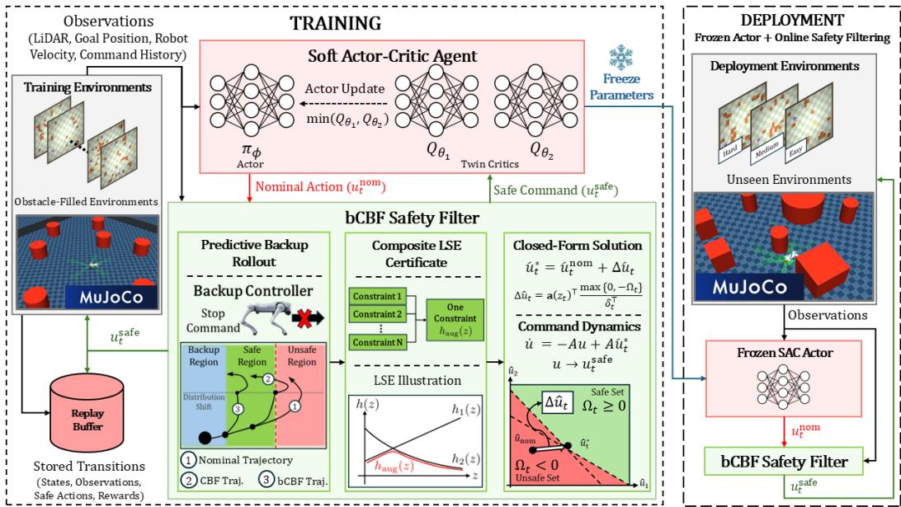  
Figure 1: Overview of SAFTER. A task policy proposes a nominal command; a prescribed backup rollout evaluates finite-horizon recoverability; current, future, terminal, and input-admissibility conditions are combined into one differentiable certificate; and an analytical minimum-intervention projection determines the safety correction before execution. During training, the critic evaluates the executed action and the actor differentiates through the same safety map.

The prescribed backup therefore drives the commanded motion toward rest and tests whether this stopping maneuver remains collision-free over the horizon. With $N _ { h } = 1 2 0$ rays and $K = 2 0$ positive-time samples, the filter evaluates 2400 future geometric barriers before terminal and inputadmissibility conditions are included. Appendix C gives the full construction.

Problem 3.1 (Recoverability-aware differentiable safe RL). Given $\pi _ { \phi } ,$ the safety model $( f , g )$ , safe set $\mathcal { C } _ { S }$ , bounded input set $\mathcal { \dot { U } } ,$ backup controller $u _ { \mathrm { b } } .$ , and terminal set $\dot { \mathcal { C } } _ { B } ^ { x }$ , construct $\mathcal { F } _ { \eta }$ such that the executed command: (i) satisfies the encoded current, sampled backup, terminal, and input conditions whenever feasible; (ii) minimally modifies the nominal task command; and (iii) can be evaluated efficiently and differentiated during SAC training.

Direct sampled bCBF enforcement satisfies the predictive requirement but retains a multi-constraint optimization inside every RL interaction. Section 4 develops SAFTER to remove this bottleneck by combining bounded-command augmentation, finite-horizon backup prediction, a single composite certificate, and an analytical minimum-intervention projection whose local Jacobian can be used directly in policy optimization.

## 4 RECOVERABILITY-AWARE DIFFERENTIABLE SAFETY FILTERING

SAFTER realizes Problem 3.1 through the analytical pipeline in Figure 1. It augments the bounded physical command with first-order dynamics, evaluates finite-horizon backup recoverability in the augmented model, and combines the resulting current, future, terminal, and input-admissibility margins into one differentiable certificate. The CBF condition of this certificate is a single affine constraint in a surrogate input, yielding an exact minimum-intervention projection and an exact local Jacobian wherever the filter is differentiable.

The central technical contribution is this reduction from sampled multi-constraint backup-CBF enforcement to a single analytical projection after the constituent safety margins have been evaluated. Thus, the number of backup samples and primitive barriers no longer determines the number of constraints in the online optimization, while the same recoverability-aware action map can be dif ferentiated through during SAC training.

Bounded-command augmentation and current safety. Section 3 uses the safety model ${ \dot { x } } =$ $f ( x ) + g ( x )$ u with bounded physical command $u \in \mathcal { U }$ . Following the control-dynamics construction of Rabiee & Hoagg (2024), we introduce a surrogate input $\boldsymbol { \hat { u } } \in \bar { \mathbb { R } } ^ { m }$ through $\dot { u } = - A u + A \hat { u }$ , where $A = \mathrm { d i a g } ( a _ { 1 } , \ldots , \bar { a } _ { m } ) \succ 0$ . Treating the applied command as part of the state gives $z = [ x ^ { \top } , u ^ { \top } ] ^ { \top }$ and

$$
\dot { z } = \hat { f } ( z ) + \hat { g } ( z ) \hat { u } , \qquad \hat { f } ( z ) = \left[ { f ( x ) } { + } g ( x ) u \right] , \qquad \hat { g } ( z ) = \left[ { 0 } _ { { \tilde { A } } ^ { m } } \right] .\tag{2}
$$

For the component-wise bounds $u _ { \mathrm { m i n } } \le u \le u _ { \mathrm { m a x } }$ , define $I _ { d } ^ { + } ( z ) : = u _ { \mathrm { m a x } , d } - u _ { d }$ and $I _ { d } ^ { - } \left( z \right) : =$ $u _ { d } - u _ { \operatorname* { m i n } , d } , d = 1 , \dots , m$ . Their nonnegativity represents the physical command bounds as state constraints. Because $h _ { i }$ depends on x but not directly on the command state u, $L _ { \hat { g } } h _ { i } = 0$ . We therefore use the lifted current-safety margin

$$
\psi _ { i } ( z ) : = L _ { f } h _ { i } ( x ) + L _ { g } h _ { i } ( x ) u + k _ { 0 } h _ { i } ( x ) , \qquad L _ { \hat { g } } \psi _ { i } ( z ) = L _ { g } h _ { i } ( x ) A ,
$$

with $k _ { 0 } ~ > ~ 0$ . Hence, $\psi _ { i }$ has relative degree one with respect to uˆ wherever $L _ { g } h _ { i } ( x ) A \neq 0$ and can be combined with the predictive and input-admissibility conditions below. Appendix B.3 gives the relative-degree calculation, while Appendix D describes the finite-rate command update and the post-projection enforcement of the physical command limits.

Predictive backup recoverability. Because SAFTER acts through $\hat { u } ,$ the backup maneuver $u _ { \mathrm { b } }$ from Section 3 is represented in the augmented dynamics by a prescribed surrogate backup input $\hat { u } _ { \mathrm { b } } ( z )$ Let $\varphi _ { \mathrm { b } } ^ { z } ( \tau ; z )$ denote the corresponding flow of $\dot { z } = \hat { f } ( z ) + \hat { g } ( z ) \hat { u } _ { \mathrm { b } } ( z )$ . With $E _ { x } = [ I _ { n } 0 _ { n \times m } ] .$ the sampled future margins are $h _ { i } ^ { \mathrm { b } } ( z , \tau _ { k } ) : = h _ { i } ( E _ { x } \varphi _ { \mathrm { b } } ^ { z } ( \tau _ { k } ; z ) )$ ) . After augmentation, terminal recoverability may also depend on the applied command state. We therefore lift the terminal set to $\mathcal { C } _ { B } ^ { z } = \{ z : h _ { B , j } ( z ) \ge \hat { 0 , } \ j = 1 , \ldots , \hat { N } _ { B } \}$ and define $h _ { B , j } ^ { \mathrm { b } } ( z , T ) : = h _ { B , j } ( \varphi _ { \mathrm { b } } ^ { z } ( T ; z ) )$ . The future margins test sampled safety along the recovery trajectory, while the terminal margins test whether the predicted backup state reaches $\mathcal { C } _ { B } ^ { z }$ . Their gradients require the sensitivity of the backup flow to the current augmented state; Appendix B.3.1 gives the corresponding variational dynamics.

For the quadruped specialization, $\hat { u } _ { \mathrm { b } } = 0$ , so the first-order command dynamics drive the applied translational and yaw-rate commands toward zero. The backup test therefore asks whether sufficient obstacle clearance remains to dissipate the current commanded motion.

Composite recoverability certificate. The backup construction above yields the current margins $\psi _ { i } ( z )$ , sampled future margins $h _ { i } ^ { \mathrm { b } } ( z , \tau _ { k } )$ , terminal margins $h _ { B , j } ^ { \mathrm { b } } ( z , T )$ , and input-admissibility margins $I _ { d } ^ { \pm } ( z )$ . After fixed positive rescaling, denoted by an overbar, SAFTER combines them using the LSE smooth minimum (Molnar & Ames, 2023; Rabiee & Hoagg, 2025),

$$
\operatorname { s o f t m i n } ( \mathcal { S } ) : = - \frac { 1 } { \kappa } \log \sum _ { c \in \mathcal { S } } e ^ { - \kappa c } , \qquad \operatorname* { m i n } \mathcal { S } - \frac { \log | \mathcal { S } | } { \kappa } \leq \operatorname { s o f t m i n } ( \mathcal { S } ) \leq \operatorname* { m i n } \mathcal { S } ,\tag{3}
$$

where $\kappa > 0$ controls the approximation sharpness. Thus, softmin ${ \mathfrak { c } } _ { \kappa } ( S ) \geq 0$ implies nonnegativity of every constituent in S. We aggregate recoverability and input admissibility separately,

$$
\begin{array} { r l } & { \quad h _ { \mathrm { r e c } } ( z ) : = \operatorname * { s o f t m i n } _ { \kappa _ { B } } \bigr ( \{ \bar { \psi } _ { i } ( z ) \} _ { i } \cup \{ \bar { h } _ { i } ^ { \mathrm { b } } ( z , \tau _ { k } ) \} _ { i , k } \cup \{ \bar { h } _ { B , j } ^ { \mathrm { b } } ( z , T ) \} _ { j } \bigr ) , } \\ & { \quad h _ { \mathrm { i n p u t } } ( z ) : = \operatorname * { s o f t m i n } _ { \kappa _ { U } } \bigr ( \{ \bar { I } _ { d } ^ { + } ( z ) , \bar { I } _ { d } ^ { - } ( z ) \} _ { d = 1 } ^ { m } \bigr ) . } \end{array}
$$

The complete certificate is $h _ { \mathrm { a u g } } ( z ) : = \mathrm { s o f t m i n } _ { \kappa _ { O } } \big ( \{ h _ { \mathrm { r e c } } ( z ) , h _ { \mathrm { i n p u t } } ( z ) \} \big )$ . Hence, $h _ { \mathrm { a u g } } ( z ) \geq 0$ implies all encoded current, sampled backup, terminal, and input-admissibility conditions. The individual margins must still be evaluated, but their enforcement is reduced to one differentiable scalar certificate.

Analytical minimum-intervention projection. The composite certificate $h _ { \mathrm { a u g } }$ now plays the role of the barrier function in the CBF condition introduced in equation 1. Applied to the augmented dynamics equation 2, this condition becomes

$$
L _ { \hat { f } } h _ { \mathrm { a u g } } ( z ) + L _ { \hat { g } } h _ { \mathrm { a u g } } ( z ) \hat { u } + \alpha _ { \mathrm { a u g } } h _ { \mathrm { a u g } } ( z ) \geq 0 ,\tag{4}
$$

where $\alpha _ { \mathrm { a u g } } > 0$ is the composite CBF gain. Defining $\mathbf { a } ( z ) : = L _ { \hat { g } } h _ { \mathrm { a u g } } ( z )$ and $b ( z ) : = L _ { \hat { f } } h _ { \mathrm { a u g } } ( z ) +$ $\alpha _ { \mathrm { a u g } } h _ { \mathrm { a u g } } ( z )$ , equation 4 is simply $\mathbf { a } ( z ) \hat { u } + b ( z ) \ge 0 ;$ a single half-space in the surrogate input. Thus, the many sampled recoverability conditions composed above no longer appear as separate

constraints in the online projection. The actor, however, proposes the physical command $u _ { t } ^ { \mathrm { n o m } }$ rather than the surrogate input uˆ. To recover this nominal command when the safety constraint is inactive, we use

$$
\begin{array} { r } { \hat { u } _ { t } ^ { \mathrm { n o m } } = u _ { t } + A ^ { - 1 } \dot { u } _ { t } ^ { \mathrm { n o m } } + A ^ { - 1 } \Sigma \left( u _ { t } ^ { \mathrm { n o m } } - u _ { t } \right) , \qquad \Sigma \succ 0 , } \end{array}\tag{5}
$$

which makes the applied command u exponentially track $u ^ { \mathrm { n o m } }$ under the augmented dynamics. The derivation is given in Appendix D.1. The safety filter therefore solves

$$
\hat { u } _ { t } ^ { \star } = \arg \operatorname* { m i n } _ { \hat { u } \in \mathbb { R } ^ { m } } \frac { 1 } { 2 } \| \hat { u } - \hat { u } _ { t } ^ { \mathrm { n o m } } \| _ { 2 } ^ { 2 } , \quad \mathrm { s . t . } \quad { \bf a } ( z _ { t } ) \hat { u } + b ( z _ { t } ) \ge 0 .\tag{6}
$$

Let $\Omega _ { t } : = \mathbf { a } ( z _ { t } ) \hat { u } _ { t } ^ { \mathrm { n o m } } + b ( z _ { t } )$ denote the composite constraint margin of the nominal surrogate, and $\delta _ { t } : = a ( z _ { t } ) \dot { a ( } z _ { t } \dot { ) } ^ { \top } = \| a ( \dot { z } _ { t } ) \| _ { 2 } ^ { 2 }$ denote the squared constraint-normal magnitude.

Proposition 4.1 (Closed-form safety projection). $I f \delta _ { t } > 0 ;$ , the unique solution of equation 6 is

$$
\hat { u } _ { t } ^ { \star } = \hat { u } _ { t } ^ { \mathrm { n o m } } + \Delta \hat { u } _ { t } = \hat { u } _ { t } ^ { \mathrm { n o m } } + { \bf a } ( z _ { t } ) ^ { \top } \frac { \mathrm { m a x } \{ 0 , - \Omega _ { t } \} } { \delta _ { t } } .\tag{7}
$$

If $\Omega _ { t } \geq 0 .$ , the nominal surrogate already satisfies the composite condition and is unchanged; otherwise, equation 7 applies the minimum-Euclidean correction along the certificate normal. The projection is exact for the resulting half-space, and approximation enters only through finite backup sampling and the LSE construction preceding it. The detailed proof of Proposition 4.1 is included in Appendix B.4.

Theorem 4.2 (Continuous-time safety and recoverability). Under Assumption B.1, suppose $z ( 0 ) \in$ $\mathcal { C } _ { \mathrm { a u g } }$ and the composite CBF condition equation 4 is enforced continuously. Then ${ \mathcal { C } } _ { \mathrm { a u g } } = \{ z :$ $h _ { \mathrm { a u g } } ( z ) \geq 0 \}$ is forward invariantfor the continuous augmented model. Consequently, the safetymodel state remains in the original safe set ${ \mathcal { C } } _ { S } ,$ , the applied command remains within its prescribed bounds, and the backup trajectory satisfies the encoded safety conditions at the sampledfuture times and reaches the terminal recovery set at the end ofthe horizon.

The result applies to the continuous safety model and to backup safety at the selected horizon samples. The finite-rate implementation, inter-sample backup behavior, sensing updates, and reducedmodel assumptions are discussed in Appendices D.2 and D.3.

SAFTER–SAC integration. As illustrated in Figure 1, SAFTER places the recoverabilityaware safety map $\mathcal { F } _ { \eta }$ between the SAC actor and the environment. At each step, the actor proposes $u _ { t } ^ { \mathrm { n o m } }$ , the safety map produces the executed command $u _ { t } ^ { \mathrm { s a f e } }$ , and the environment transition is generated by this filtered action. Accordingly, $\overline { { u } } _ { t } ^ { \mathrm { s a f e } }$ is stored in replay and evaluated by the critics, so value learning is based on the action that actually generated the transition. The same filtering is applied to next actions when constructing SAC targets.

During the actor update, the critic evaluates $Q ( o _ { t } , \mathcal { F } _ { \eta } ( \xi _ { t } , u _ { t } ^ { \mathrm { n o m } } ) )$ , and gradients propagate through the same finite-rate map used during execution: nominal-surrogate construction, analytical half-space projection, command update, and component-wise clipping. This map is differentiable away from projection and clipping switching boundaries, allowing actor up-

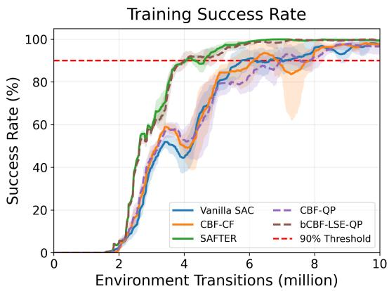  
Figure 2: Training success rates of Vanilla SAC, CBF–QP/CBF–CF, bCBF–LSE–QP, and SAFTER under the same training environments.

dates to account for how safety interventions modify nominal commands. Target filtering uses the same forward map without gradient propagation, while the SAC entropy term remains defined on the nominal policy. The full SAC implementation details are reported in Appendix E.

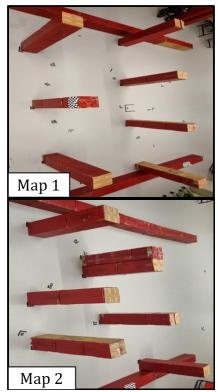  
(a) Real-world evaluation maps.

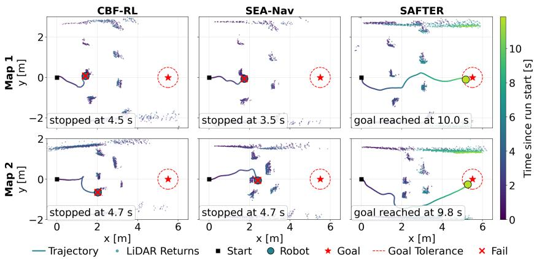  
(b) Trajectory sample and LiDAR readings of the real robot experiments.  
Figure 3: Real-world map with two different obstacle configurations, and trajectory sample and LiDAR readings taken from the Unitree Go2 on-board state estimator and LiDAR.

Table 1: Performance on the training-map distribution with each method’s runtime safety filter disabled or enabled. SR, TR, and FR denote success, timeout, and failure rates, respectively. Values are mean ± standard deviation over evaluation seeds and maps.
<table><tr><td rowspan="2">Method</td><td colspan="3">Filter disabled</td><td colspan="3">Filter enabled</td></tr><tr><td>SR↑</td><td>TR↓</td><td>FR↓</td><td>SR↑</td><td>TR↓</td><td>FR↓</td></tr><tr><td>SEA-Nav1</td><td>89.7±2.4</td><td>0.0±0.0</td><td>10.3±2.4</td><td>91.2±2.9</td><td>0.0±0.0</td><td>8.8±2.9</td></tr><tr><td>CBF-RL²</td><td>84.3±8.2</td><td>5.9±5.2</td><td>9.8±7.1</td><td>84.8±7.4</td><td>5.9±5.2</td><td>9.3±6.6</td></tr><tr><td>CBF-CF3</td><td>76.6±13.8</td><td>2.7±6.3</td><td>20.7±15.8</td><td>90.1±8.2</td><td>1.9±4.5</td><td>8.0±8.5</td></tr><tr><td>SAFTER⁴</td><td>95.1±7.1</td><td>0.0±0.0</td><td>4.9±7.1</td><td>99.7±1.2</td><td>0.0±0.0</td><td>0.3±1.2</td></tr></table>

Refs.: 1 (Chen et al., 2026); 2 (Yang et al., 2025); 3 (Rabiee & Hoagg, 2024); 4 Ours.

## 5 EXPERIMENTS AND ANALYSIS

The experiments are organized to test the three mechanisms isolated in the problem formulation. RQ1 asks whether finite-horizon backup recoverability, rather than current-state filtering alone, improves transition-based learning efficiency, and whether its analytical realization reduces safety-filter latency relative to QP-based synthesis. RQ2 asks whether the resulting policy–filter system remains effective as obstacle geometry shifts away from the training maps. RQ3 asks whether learning through the exact analytical projection Jacobian matters when the forward safety-filter mapping is unchanged.

The baselines and SAFTER are evaluated in MuJoCo 3.3.6 using a Unitree Go2 with a frozen 50 Hz low-level locomotion policy. The high-level policy operates at 10 Hz using local LiDAR, goal, measured-velocity, and command-history observations. SAC-based methods use 256 parallel environments, five independent training seeds, and a maximum budget of 20.48M transitions per seed. In both training and evaluation, failure denotes episode termination caused by obstacle collision, falling, or contact with the environment boundary wall. The bCBF–LSE–QP baseline uses the same composite half-space, backup model, terminal set, command dynamics, and finite-rate realization as SAFTER.

RQ1: Learning Efficiency and Policy Internalization. For the controlled convergence study, sample efficiency is measured by the first attainment of 90% training success for each seed, using a 20-sample trailing rolling mean; the threshold is counted at its first crossing and is not re quired to persist. As shown in Figure 2, the two backup-recoverability methods converge earliest: SAFTER reaches the threshold after 4.06±0.08M transitions and bCBF–LSE–QP after 4.13±0.43M. SAFTER therefore requires 30.6% fewer transitions than Vanilla SAC and 34.1%– 35.1% fewer than the current-state CBF baselines. The similar convergence of SAFTER and bCBF–

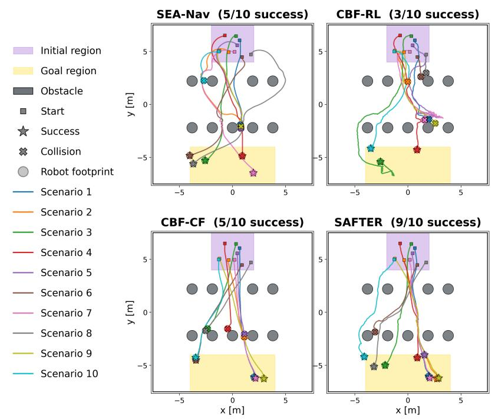

Table 2: Safety-filter runtime comparison. Total latency includes certificate construction and synthesis, and speedup is measured relative to the direct bCBF–QP. Values are mean ± standard deviation over 300 timed repetitions.
<table><tr><td rowspan="2">Method</td><td colspan="3">Batch = 1</td><td colspan="3">Batch = 100</td></tr><tr><td>Total (ms)</td><td>Synthesis (ms)</td><td>Speedup (×)</td><td>Total (ms)</td><td>Synthesis (ms)</td><td>Speedup (×)</td></tr><tr><td>bCBF-QP</td><td>30.546±0.324</td><td>28.369±0.194</td><td>1.00</td><td>2504.789±22.463</td><td>32487.383±16.949</td><td>1.00</td></tr><tr><td>bCBF-LSE-QP</td><td>5.732±0.456</td><td>3.342±0.405</td><td>5.33</td><td>7.084±0.569</td><td> $4 . 5 8 8 { \pm } 0 . 4 8 1$ </td><td>353.58</td></tr><tr><td>SAFTER</td><td>2.495±0.312</td><td>0.102±0.011</td><td>12.24</td><td>2.529±0.283</td><td> $\mathbf { 0 . 1 0 6 { \pm 0 . 0 1 4 } }$ </td><td>990.43</td></tr></table>

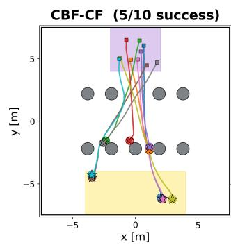  
Figure 4: Representative trajectories in the simulated Medium-Shift environment. Purple and yellow regions denote the initial and goal regions, squares mark initial positions, stars successful terminations, crosses collision terminations, and faint circles indicate the robot footprint.

LSE–QP indicates that the sample-efficiency gain is primarily associated with predictive backup recoverability rather than the analytical realization alone.

Recoverability-aware training also appears to shape the learned nominal policy rather than relying solely on runtime filtering. To examine this effect, we evaluate the trained policies on the trainingmap distribution with their runtime safety filters enabled and disabled. Among the methods reported in Table 1, SAFTER achieves 95.1% success without the runtime filter and 99.7% with it. The strong filter-disabled performance suggests that recoverability-aware training promotes nominal behavior compatible with the prescribed backup strategy.

To evaluate computational efficiency, Table 2 compares SAFTER with the matched bCBF–LSE–QP and the direct unaggregated bCBF–QP. All methods are evaluated on identical fixed filter inputs using 30 warm-up calls and 300 timed repetitions on an NVIDIA RTX 4090 GPU with CUDA synchronization around each timed region. SAFTER achieves the lowest total latency at both batch sizes, providing 12.24× and 990.43× lower latency than the direct bCBF–QP at batch sizes 1 and 100, respectively. Relative to the matched bCBF–LSE–QP, SAFTER is 2.30× and 2.80× faster.

RQ2: Robustness under Geometric Distribution Shift. Predictive backup recoverability supports robust navigation under geometric shift in simulation and real-world deployment. Each fixed checkpoint is evaluated over 500 episodes per unseen simulation environment and 30 trials per real-world map. Trajectories in Figures 4 and 3b illustrate navigation behavior in simulation and real-world experiments. The real-world and simulated examples show SAFTER taking wider detours with greater obstacle clearance, consistent with preserving room for backup recovery. The control actions generated by SAFTER produce a safer navigation in an environment under distribution shift, as shown by the overall results reported in Table 3, where SAFTER achieves 98.8%, 88.6%, and 61.4% success on Low-, Medium-, and High-Shift, outperforming the baseline methods. On the two real-world layouts in Figure 3a, SAFTER achieves 73.3% and 76.7% success, exceeding the strongest evaluated baselines by 10.0 and 60.0 percentage points, respectively. Moreover, additional experimental details and results are reported in Appendix A.

Table 3: Navigation performance in simulation and real-world experiments. SR, TR, and FR denote success, timeout, and failure rates (%), respectively. Simulation values are mean ± standard deviation across 25 evaluation-seed rates. Real-world success rates are measured over 30 trials per map. Dashes indicate methods not evaluated on hardware.
<table><tr><td rowspan="3"></td><td colspan="9">Simulation</td><td colspan="2">Real world</td></tr><tr><td colspan="3">Low-Shift</td><td colspan="3">Medium-Shift</td><td colspan="3">High-Shift</td><td colspan="2">Map 1 Map 2</td></tr><tr><td>SR↑</td><td>TR↓</td><td>FR↓</td><td>SR↑</td><td>TR↓</td><td>FR↓</td><td>SR↑</td><td>TR↓</td><td>FR↓</td><td>SR↑</td><td>SR↑</td></tr><tr><td>SEA-Nav1</td><td>93.8±6.7</td><td>0.0±0.0</td><td>6.2±6.7</td><td>50.6±10.9</td><td>0.0±0.0</td><td>49.4±10.9</td><td>0.0±0.0</td><td>0.0±0.0</td><td>100.0±0.0</td><td>56.7</td><td>13.3</td></tr><tr><td>CBF-RL2</td><td>61.2±10.7</td><td>13.6±6.7</td><td>25.2±9.8</td><td>46.2±11.6</td><td>17.2±7.6</td><td>36.6±9.2</td><td>31.0±10.0</td><td>15.4±8.9</td><td>53.6±12.2</td><td>63.3</td><td>0.0</td></tr><tr><td>Vanilla SAC³</td><td>34.2±10.1</td><td>0.0±0.0</td><td>65.8±10.1</td><td>20.8±6.9</td><td>0.0±0.0</td><td>79.2±6.9</td><td>17.4±8.3</td><td>0.0±0.0</td><td>82.6±8.3</td><td>10.0</td><td>0.0</td></tr><tr><td>CBF-QP4</td><td>58.8±9.4</td><td>0.2±1.0</td><td>41.0±9.2</td><td>43.2±11.0</td><td>0.0±0.0</td><td>56.8±11.0</td><td>18.0±6.9</td><td>0.0±0.0</td><td>82.0±6.9</td><td></td><td></td></tr><tr><td>CBF-CF4</td><td>69.0±11.5</td><td>0.0±0.0</td><td>31.0±11.5</td><td>48.4±8.4</td><td>0.0±0.0</td><td>51.6±8.4</td><td>33.8±12.2</td><td>0.0±0.0</td><td>66.2±12.2</td><td>56.7</td><td>16.7</td></tr><tr><td>bCBF-LSE-QP5</td><td>99.4±1.7</td><td>0.0±0.0</td><td>0.6±1.7</td><td>75.0±9.7</td><td>0.0±0.0</td><td>25.0±9.7</td><td>67.4±11.7</td><td>0.0±0.0</td><td>32.6±11.7</td><td></td><td></td></tr><tr><td>SAFTER5</td><td>98.8±2.2</td><td>0.0±0.0</td><td>1.2±2.2</td><td>88.6±7.3</td><td>0.0±0.0</td><td>11.4±7.3</td><td>61.4±10.2</td><td>0.0±0.0</td><td>38.6±10.2</td><td>73.3</td><td>76.7</td></tr></table>

Refs.: 1 (Chen et al., $2 0 2 6 ) ; ^ { 2 }$ (Yang et al., 2025); 3 (Haarnoja et al., $2 0 1 8 ) ; { ^ 4 }$ (Rabiee & Hoagg, 2024); 5 Ours.

RQ3: Why Does SAFTER Learn Differently? Accurate differentiation through the analytical projection has a substantially larger and more consistent effect on robustness than discouraging filter intervention. As shown in Table 4, replacing the Exact projection Jacobian with the Identity approximation reduces success by up to 85.4 percentage points across the evaluated distribution shifts. In contrast, removing the correction reward has a mixed effect: the Exact-Jacobian policy improves from 88.6% to 94.4% on Medium-Shift and from 61.4% to 76.2% on High-Shift, while decreasing from 98.8% to 95.6% on Low-Shift. Because the forward safety-filter map is unchanged within each Exact/Identity pair, these results provide evidence that propagating the analytical projection Jacobian materially improves robustness, whereas minimizing filter intervention is not uniformly beneficial under larger geometric shifts.

Table 4: Ablation of the projection Jacobian and correction reward on unseen environments. Exact and Identity use the same forward safety-filter map and differ only in the backward differentiation through the analytical projection. Values are mean ± standard deviation across 25 evaluation-seed rates.
<table><tr><td colspan="2">Ablation Setting</td><td colspan="3">Low-Shift</td><td colspan="3">Medium-Shift</td><td colspan="3">High-Shift</td></tr><tr><td>Projection Jacobian</td><td>Correction Reward</td><td>SR↑</td><td>TR↓</td><td>FR↓</td><td>SR↑</td><td>TR↓</td><td>FR↓</td><td>SR↑</td><td>TR↓</td><td>FR↓</td></tr><tr><td>Exact</td><td>On</td><td>98.8±2.2</td><td>0.0±0.0</td><td>1.2±2.2</td><td>88.6±7.3</td><td>0.0±0.0</td><td>11.4±7.3</td><td>61.4±10.2</td><td>0.0±0.0</td><td>38.6±10.2</td></tr><tr><td>Identity</td><td>On</td><td>89.8±6.0</td><td>0.0±0.0</td><td>10.2±6.0</td><td>41.6±9.3</td><td>0.0±0.0</td><td>58.4±9.3</td><td>6.2±4.4</td><td>0.0±0.0</td><td>93.8±4.4</td></tr><tr><td>Exact</td><td>Off</td><td>95.6±4.9</td><td>4.2±4.9</td><td>0.2±1.0</td><td>94.4±4.4</td><td>3.8±3.9</td><td>1.8±3.5</td><td>76.2±9.2</td><td>3.2±3.8</td><td>20.6±8.3</td></tr><tr><td>Identity</td><td>Off</td><td>76.8±7.1</td><td></td><td>0.0±0.0 23.2±7.1</td><td>9.0±6.1</td><td>0.0±0.0</td><td>91.0±6.1</td><td>2.0±3.5</td><td>0.0±0.0</td><td>98.0±3.5</td></tr></table>

## 6 CONCLUSION

We introduced SAFTER, a recoverability-aware safe-RL framework that combines command-state augmentation, hierarchical LSE composition, and an exact minimum-Euclidean projection into a differentiable training map. Experiments show improved transition-based sample efficiency and strong performance under geometric distribution shift in both simulated and real-world environments, while the Jacobian ablation highlights the importance of differentiating through the analytical safety-filter map. Future work will consider uneven terrain and dynamic obstacles.

## ACKNOWLEDGEMENTS

This work was supported by the NVIDIA Academic Grant Program.

## REFERENCES

Aaron D Ames, Samuel Coogan, Magnus Egerstedt, Gennaro Notomista, Koushil Sreenath, and Paulo Tabuada. Control barrier functions: Theory and applications. In Proc. 18th European Control Conf., pp. 3420–3431, 2019.

Federico Pizarro Bejarano, Lukas Brunke, and Angela P. Schoellig. Safety filtering while training: Improving the performance and sample efficiency of reinforcement learning agents. IEEE Robotics and Automation Letters, 10(1):788–795, 2025. doi: 10.1109/LRA.2024.3512374.

Lukas Brunke, Melissa Greeff, Adam W Hall, Zhaocong Yuan, Siqi Zhou, Jacopo Panerati, and Angela P Schoellig. Safe learning in robotics: From learning-based control to safe reinforcement learning. Annual Review ofControl, Robotics, and Autonomous Systems, 5(1):411–444, 2022.

Shiyi Chen, Mingye Yang, Haiyan Mao, Jiaqi Zhang, Haiyi Liu, Shuheng He, Debing Zhang, Zihao Qiu, and Chun Zhang. Sea-nav: Efficient policy learning for safe and agile quadruped navigation in cluttered environments. arXiv preprint arXiv:2603.09460, 2026.

Yuxiao Chen, Mrdjan Jankovic, Mario Santillo, and Aaron D. Ames. Backup control barrier functions: Formulation and comparative study. In 2021 60th IEEE Conference on Decision and Control (CDC), pp. 6835–6841. IEEE, 2021. doi: 10.1109/CDC45484.2021.9683111.

Yinlam Chow, Ofir Nachum, Aleksandra Faust, Edgar Duenez-Guzman, and Mohammad˜ Ghavamzadeh. Safe policy learning for continuous control. In Proceedings of the 2020 Conference on Robot Learning, volume 155 of Proceedings ofMachine Learning Research, pp. 801– 821. PMLR, 2021.

Maeva Guerrier, Hassan Fouad, and Giovanni Beltrame. Learning control barrier functions and their application in reinforcement learning: A survey. arXiv preprint arXiv:2404.16879, 2024.

Thomas Gurriet, Mark Mote, Aaron D Ames, and Eric Feron. An online approach to active set invariance. In 2018 IEEE Conference on Decision and Control (CDC), pp. 3592–3599. IEEE, 2018.

Tuomas Haarnoja, Aurick Zhou, Kristian Hartikainen, George Tucker, Sehoon Ha, Jie Tan, Vikash Kumar, Henry Zhu, Abhishek Gupta, Pieter Abbeel, et al. Soft actor-critic algorithms and applications. arXiv preprint arXiv:1812.05905, 2018.

Tairan He, Chong Zhang, Wenli Xiao, Guanqi He, Changliu Liu, and Guanya Shi. Agile but safe: Learning collision-free high-speed legged locomotion. In Proceedings of Robotics: Science and Systems, 2024. doi: 10.15607/RSS.2024.XX.059.

Kai-Chieh Hsu, Duy Phuong Nguyen, and Jaime Fernandez Fisac. ISAACS: Iterative soft adversar-\` ial actor-critic for safety. In Proceedings of the 5th Annual Learning for Dynamics and Control Conference, volume 211 of Proceedings of Machine Learning Research, pp. 90–103. PMLR, 2023.

Yunho Kim, Hyunsik Oh, Jeonghyun Lee, Jinhyeok Choi, Gwanghyeon Ji, Moonkyu Jung, Donghoon Youm, and Jemin Hwangbo. Not only rewards but also constraints: Applications on legged robot locomotion. IEEE Transactions on Robotics, 40:2984–3003, 2024. doi: 10.1109/TRO.2024.3400935.

Hanna Krasowski, Jakob Thumm, Marlon Muller, Lukas Sch¨ afer, Xiao Wang, and Matthias Althoff.¨ Provably safe reinforcement learning: Conceptual analysis, survey, and benchmarking. Transactions on Machine Learning Research, 2023.

Albert Lin, Shuang Peng, and Somil Bansal. One filter to deploy them all: Robust safety for quadrupedal navigation in unknown environments. IEEE Transactions on Robotics, 42:545–560, 2026. doi: 10.1109/TRO.2025.3644957.

Zijie Lin and Baolin Wu. Safety-critical control for multiple spacecraft close-proximity inspection. Aerospace Science and Technology, 168:110938, 2026.

Tamas G Molnar and Aaron D Ames. Composing control barrier functions for complex safety specifications. IEEE Control Systems Letters, 7:3615–3620, 2023.

Nilaksh, Abhishek Ranjan, Shreenabh Agrawal, Aayush Jain, Pushpak Jagtap, and Shishir Kolathaya. Barrier functions inspired reward shaping for reinforcement learning. In 2024 IEEE International Conference on Robotics and Automation (ICRA), pp. 10807–10813, 2024. doi: 10.1109/ICRA57147.2024.10610391.

Pedram Rabiee and Jesse B Hoagg. A closed-form control for safety under input constraints using a composition of control barrier functions. arXiv preprint arXiv:2406.16874, 2024.

Pedram Rabiee and Jesse B Hoagg. Soft-minimum and soft-maximum barrier functions for safety with actuation constraints. Automatica, 171:111921, 2025.

Pedram Rabiee and Amirsaeid Safari. Safe exploration in reinforcement learning: Training backup control barrier functions with zero training-time safety violations. In Proceedings of the 7th Annual Learning for Dynamics & Control Conference, volume 283 of Proceedings of Machine Learning Research, pp. 1326–1337, 2025.

Andrew Singletary, Aiden Swann, Ivan Dario Jimenez Rodriguez, and Aaron D Ames. Safe drone flight with time-varying backup controllers. In 2022 IEEE/RSJ International Conference on Intelligent Robots and Systems (IROS), pp. 4577–4584. IEEE, 2022.

Halil Utku Unlu, Vinicius Mariano Gonc¸alves, Dimitris Chaikalis, Anthony Tzes, and Farshad Khorrami. A control barrier function-based motion planning scheme for a quadruped robot. In 2024 IEEE international Conference on Robotics and Automation (ICRA), pp. 12172–12178. IEEE, 2024.

David Van Wijk, Kyle Dunlap, Manoranjan Majji, and Kerianne Hobbs. Safe spacecraft inspection via deep reinforcement learning and discrete control barrier functions. Journal of Aerospace Information Systems, 21(12):996–1013, 2024.

David EJ van Wijk, Ersin Das¸, Tamas G Molnar, Aaron D Ames, and Joel W Burdick. Safetycritical control with bounded inputs: A closed-form solution for backup control barrier functions. In 2026 American Control Conference (ACC), pp. 1215–1222. IEEE, 2026.

Chenggang Wang, Xinyi Wang, Yutong Dong, Lei Song, and Xinping Guan. Multi-constraint safe reinforcement learning via closed-form solution for log-sum-exp approximation of control barrier functions. In Proceedings of the 7th Annual Learning for Dynamics & Control Conference, volume 283 of Proceedings of Machine Learning Research, pp. 698–710, 2025.

Zifan Xu, Bo Liu, Xuesu Xiao, Anirudh Nair, and Peter Stone. Benchmarking reinforcement learning techniques for autonomous navigation. In 2023 IEEE International Conference on Robotics and Automation (ICRA), pp. 9224–9230, 2023. doi: 10.1109/ICRA48891.2023.10160583.

Lizhi Yang, Blake Werner, Massimiliano de Sa, and Aaron D Ames. Cbf-rl: Safety filtering reinforcement learning in training with control barrier functions. arXiv preprint arXiv:2510.14959, 2025.

Qisong Yang, Thiago D. Simao, Simon H. Tindemans, and Matthijs T. J. Spaan. Safety-constrained˜ reinforcement learning with a distributional safety critic. Machine Learning, 112:859–887, 2023. doi: 10.1007/s10994-022-06187-8.

Kai S Yun, Zeyang Li, and Navid Azizan. Provably safe, yet scalable reinforcement learning. arXiv preprint arXiv:2606.14536, 2026.

## A EXPERIMENTAL PROTOCOLS AND ADDITIONAL RESULTS

## A.1 TRAINING AND EVALUATION MAPS

The simulated quadruped experiments use a fixed 15 m × 15 m workspace. The training bank comprises five hand-crafted maps with cylindrical obstacles of radius 0.6 m and 200 predefined initial– goal scenarios per map (Figure 5), varying obstacle arrangements and start–goal orientations. The policy observes local planar LiDAR with a maximum range of 5 m, requiring navigation decisions as previously unseen geometry enters the sensing region. The three unseen environments in Figure 6 introduce progressively larger geometric shifts: Low-Shift preserves the training maps’ row-based structure while increasing obstacle count and reversing the initial and goal regions; Medium-Shift retains a similar obstacle count but narrows the passages between rows; and High-Shift introduces different obstacle radii, a square obstacle, and tighter inter-obstacle clearances than Medium-Shift. All evaluation maps retain the protocol’s minimum wall clearance for admissible initial and goal regions.

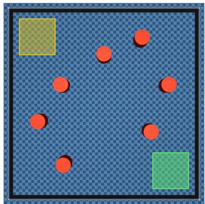  
(a) Training Map 1

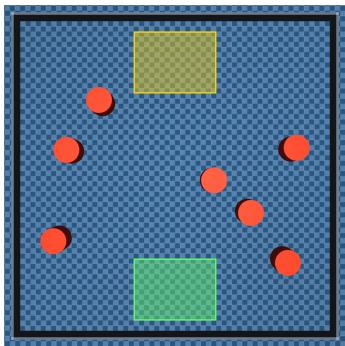  
(b) Training Map 2

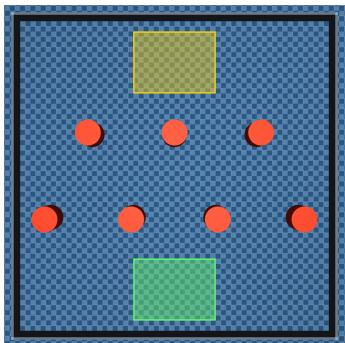  
(c) Training Map 3

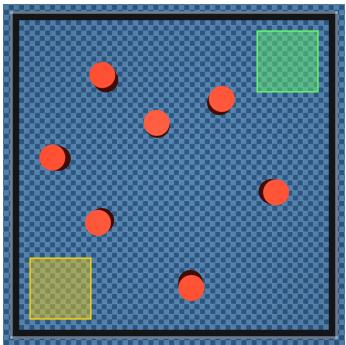  
(d) Training Map 4

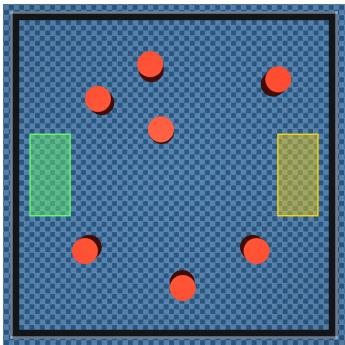  
(e) Training Map 5  
Figure 5: Five hand-crafted training maps with fixed obstacle configurations and predefined initial and goal regions. Green and yellow regions indicate the initial and goal regions, respectively, while obstacles are shown in red.

## A.2 PATH LENGTH AND NAVIGATION TIME OF FILTER-ENABLED EVALUATIONS ON UNSEEN ENVIRONMENTS

Table 5 reports path length and navigation time only over successful episodes for the filter-enabled unseen-environment evaluations. Path lengths are broadly comparable across the SAC/CBF methods, while SAFTER generally requires more navigation time than the current-state baselines and less than bCBF–LSE–QP or CBF-RL. Thus the success-rate gains under geometric shift should not be interpreted as uniformly shorter or faster successful trajectories. Because PL and NT are conditioned on success, they should be interpreted together with the success rates in Table 3.

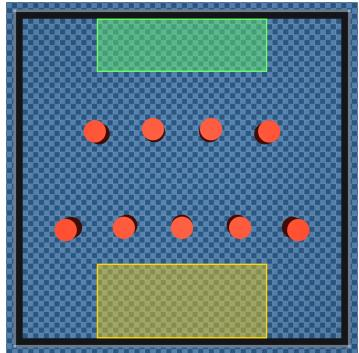  
(a) Low-Shift

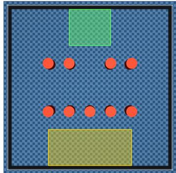  
(b) Medium-Shift

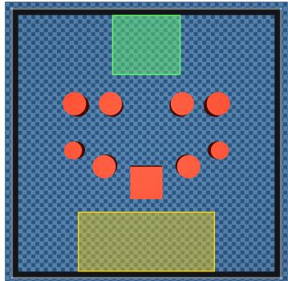  
(c) High-Shift  
Figure 6: Static unseen environments used for distribution-shift evaluation. Green and yellow regions indicate the admissible initial and goal regions, respectively, while obstacles are shown in red. The environments introduce increasingly different obstacle configurations relative to the handcrafted training maps.

Table 5: Navigation efficiency on the unseen static environments with the runtime safety filters enabled. Path Length (PL) and Navigation Time (NT) are computed over successful episodes and reported as mean ± standard deviation. Dashes indicate that no successful episodes were available for computing PL and NT.
<table><tr><td rowspan="2">Method</td><td colspan="2">Low-Shift</td><td colspan="2">Medium-Shift</td><td colspan="2">High-Shift</td></tr><tr><td>PL (m) ↓</td><td>NT (s) ↓</td><td>PL (m) ↓</td><td>NT (s) ↓</td><td>PL (m) ↓</td><td>NT (s) ↓</td></tr><tr><td>SEA-Nav1</td><td>11.57±0.17</td><td> $1 3 . 7 0 { \pm } 0 . 1 7$ </td><td>10.95±0.30</td><td> $1 4 . 2 1 { \pm } 0 . 2 7$ </td><td></td><td></td></tr><tr><td>CBF-RL²</td><td>14.86±0.78</td><td>32.02±4.02</td><td>14.93±0.76</td><td>34.93±4.3</td><td>15.72±1.19</td><td>38.99±8.45</td></tr><tr><td>Vanilla SAC³</td><td>12.76±0.41</td><td> $2 6 . 7 5 { \pm } 1 . 5 4$ </td><td>12.38±0.68</td><td> $2 6 . 3 1 { \pm } 2 . 1 3$ </td><td>12.20±0.70</td><td> $2 5 . 9 7 { \scriptstyle \pm 1 . 7 7 }$ </td></tr><tr><td>CBF-QP4</td><td>12.05±0.38</td><td> $2 5 . 0 8 { \pm } 1 . 3 4$ </td><td>11.50±0.45</td><td>23.77±1.55</td><td>11.82±1.11</td><td> $2 5 . 4 2 { \pm } 4 . 0 2$ </td></tr><tr><td>CBF-CF4</td><td>12.26±0.36</td><td> $2 6 . 8 5 { \pm } 1 . 0 6 $ </td><td>11.72±0.42</td><td> $2 4 . 8 4 { \pm } 1 . 2 2$ </td><td>11.72±0.35</td><td> $2 5 . 9 3 { \pm } 2 . 0 6 $ </td></tr><tr><td>bCBF-LSE-QP⁵</td><td>13.06±0.37</td><td> $3 2 . 7 4 { \pm } 1 . 1 1$ </td><td>12.20±0.45</td><td> $2 9 . 5 0 { \pm } 1 . 6 7$ </td><td>12.33±0.54</td><td> $2 9 . 9 1 { \scriptstyle \pm 2 . 0 7 }$ </td></tr><tr><td>SAFTER⁵</td><td>12.73±0.32</td><td>30.66±1.18</td><td>11.87±0.38</td><td>28.10±1.40</td><td>12.03±0.32</td><td> $2 9 . 4 3 { \pm } 1 . 3 4 $ </td></tr></table>

Refs.: 1 (Chen et al., 2026); 2 (Yang et al., 2025); 3 (Haarnoja et al., 2018); 4 (Rabiee & Hoagg, 2024); 5 Ours.

## B THEORETICAL FOUNDATIONS AND PROOFS

## B.1 DIRECT SAMPLED BCBF PROJECTION

The bCBF–QP runtime reference is defined in the same augmented surrogate-control coordinates as SAFTER. In particular, it uses the augmented state $z = [ x ^ { \top } , u ^ { \top } ] ^ { \top }$ , surrogate input uˆ, prescribed surrogate backup $\hat { u } _ { \mathrm { b } }$ , backup flow $\varphi _ { \mathrm { b } } ^ { z }$ , lifted current-time margins $\psi _ { i }$ , positive-time backup margins $h _ { i } ^ { \mathrm { b } } ( z , \tau _ { k } )$ , terminal margins $h _ { B , j } ^ { \mathrm { b } } ( z , T )$ , and physical input-admissibility margins $I _ { d } ^ { \pm } ( z )$ introduced in Section 4. Instead of composing these quantities with the hierarchical LSE certificate, the direct baseline enforces their CBF conditions separately:

$$
\begin{array} { r l } { \hat { u } _ { t } ^ { \mathrm { b C B F - Q P } } = \displaystyle \operatorname * { a r g g } \displaystyle \operatorname* { m i n } _ { \hat { u } \in \mathbb { R } ^ { m } } \frac { 1 } { 2 } \| \hat { u } - \hat { u } _ { t } ^ { \mathrm { n o m } } \| _ { 2 } ^ { 2 } } & { } \\ { \mathrm { s . t . } \quad L _ { \hat { f } } \psi _ { i } ( z _ { t } ) + L _ { \hat { g } } \psi _ { i } ( z _ { t } ) \hat { u } + \alpha _ { 0 } ( \psi _ { i } ( z _ { t } ) ) \geq 0 , } & { \forall i , } \\ & { L _ { \hat { f } } h _ { \hat { i } } ^ { \mathrm { b } } ( z _ { t } , \tau _ { k } ) + L _ { \hat { g } } h _ { i } ^ { \mathrm { b } } ( z _ { t } , \tau _ { k } ) \hat { u } + \alpha _ { \mathrm { b } } ( h _ { i } ^ { \mathrm { b } } ( z _ { t } , \tau _ { k } ) ) \geq 0 , } & { \forall i , k , } \\ & { L _ { \hat { f } } h _ { B , j } ^ { \mathrm { b } } ( z _ { t } , T ) + L _ { \hat { g } } h _ { B , j } ^ { \mathrm { b } } ( z _ { t } , T ) \hat { u } + \alpha _ { B } ( h _ { B , j } ^ { \mathrm { b } } ( z _ { t } , T ) ) \geq 0 , } & { \forall j , } \\ & { L _ { \hat { f } } \bar { I } _ { d } ^ { + } ( z _ { t } ) + L _ { \hat { g } } \bar { I } _ { d } ^ { + } ( z _ { t } ) \hat { u } + \alpha _ { I } \big ( \bar { I } _ { d } ^ { + } ( z _ { t } ) \big ) \geq 0 , \ d = 1 , \ldots , m , } \\ &  L _ { \hat { f } } \bar { I } _ { d } ^ { - } ( z _ { t } ) + L _ { \hat { g } } \bar { I } _ { d } ^ { - } ( z _ { t } ) \hat { u } + \alpha _ { I } \big ( \bar { I } _ { d } \end{array}
$$

Here, $\alpha _ { 0 } , \alpha _ { \mathrm { b } } , \alpha _ { B } .$ , and $\alpha _ { I }$ denote the class-K functions associated with the respective CBF conditions.

The Lie derivatives of the future and terminal terms include the sensitivity of $\varphi _ { \mathrm { b } } ^ { z }$ to its initial augmented state, as derived in Appendix B.3.1. At finite policy rate, the experimental bCBF–QP baseline uses the same command-state dynamics, command limits, backup horizon, and terminal set as SAFTER. Its synthesis difference is that the sampled safety conditions remain separate $\mathrm { Q P }$ constraints, whereas SAFTER first composes them into a single affine condition. Consequently, bCBF– $\mathrm { Q P }$ and SAFTER use the same command-state augmentation, backup maneuver, horizon samples, terminal set, and physical command limits. Their control-synthesis difference is that bCBF–QP retains one affine constraint per constituent, whereas SAFTER first composes the constituents and projects onto a single composite half-space. Sampling the backup horizon does not, by itself, certify safety between adjacent $\tau _ { k }$ . The finite-rate and inter-sample limitations are discussed in $\mathsf { A p - }$ pendix D.3.

## B.2 LSE PROPERTIES

For the set-based smooth minimum in equation $^ { 3 , }$ enumerate ${ \cal S } = \{ c _ { \ell } \} _ { \ell = 1 } ^ { M }$ . Its gradient is

$$
\nabla \operatorname { s o f t m i n } _ { \kappa } ( S ) = \sum _ { \ell = 1 } ^ { M } w _ { \ell } \nabla c _ { \ell } , \qquad w _ { \ell } = { \frac { e ^ { - \kappa c _ { \ell } } } { \sum _ { r = 1 } ^ { M } e ^ { - \kappa c _ { r } } } } ,\tag{8}
$$

so $w _ { \ell } ~ > ~ 0$ and $\textstyle \sum _ { \ell } w _ { \ell } = 1$ . Hence every constituent contributes to the gradient of the single composite certificate.

Proof of the LSE bound in equation 3. Let $c _ { \operatorname* { m i n } } = \operatorname* { m i n } _ { \ell } c _ { \ell }$ . Since

$$
e ^ { - \kappa c _ { \mathrm { m i n } } } \leq \sum _ { \ell = 1 } ^ { M } e ^ { - \kappa c _ { \ell } } \leq M e ^ { - \kappa c _ { \mathrm { m i n } } } ,
$$

taking $- \kappa ^ { - 1 } \log ( \cdot )$ gives the stated bound. Differentiating the same expression gives equation 8.

## B.3 RELATIVE DEGREE AND BACKUP-FLOW SENSITIVITY

Because $h _ { i }$ depends on x but not on the command state $u , L _ { \hat { g } } h _ { i } = 0$ under equation 2. For

$$
\psi _ { i } ( z ) = L _ { f } h _ { i } ( x ) + L _ { g } h _ { i } ( x ) u + k _ { 0 } h _ { i } ( x ) ,
$$

we have

$$
\frac { \partial \psi _ { i } } { \partial u } = L _ { g } h _ { i } ( x ) , \qquad L _ { \hat { g } } \psi _ { i } = L _ { g } h _ { i } ( x ) A .
$$

Thus ψi has relative degree one with respect to uˆ wherever $L _ { g } h _ { i } ( x ) A \ \ne \ 0$ . Moreover, $\psi _ { i } ~ =$ $\dot { h } _ { i } + k _ { 0 } h _ { i } \ge 0$ together with $h _ { i } ( x ( 0 ) ) \geq 0$ implies $h _ { i } ( x ( t ) ) \geq 0$ for the continuous augmented model.

## B.3.1 BACKUP-FLOW SENSITIVITY

Let

$$
\hat { f } _ { \mathrm { b } } ( z ) : = \hat { f } ( z ) + \hat { g } ( z ) \hat { u } _ { \mathrm { b } } ( z ) , \qquad z _ { \mathrm { b } } ( \tau ) = \varphi _ { \mathrm { b } } ^ { z } ( \tau ; z _ { 0 } ) .
$$

The sensitivity

$$
J _ { \mathrm { b } } ( \tau , z _ { 0 } ) : = \frac { \partial \varphi _ { \mathrm { b } } ^ { z } ( \tau ; z _ { 0 } ) } { \partial z _ { 0 } }
$$

satisfies

$$
\dot { J } _ { \mathrm { b } } = \frac { \partial \hat { f } _ { \mathrm { b } } } { \partial z } ( z _ { \mathrm { b } } ( \tau ) ) J _ { \mathrm { b } } , \qquad J _ { \mathrm { b } } ( 0 , z _ { 0 } ) = I _ { n + m } .
$$

For $E _ { x } = [ I _ { n } \ 0 _ { n \times m } ] .$

$$
\nabla _ { z _ { 0 } } h _ { i } ^ { \mathrm { b } } ( z _ { 0 } , \tau ) = J _ { \mathrm { b } } ( \tau , z _ { 0 } ) ^ { \top } E _ { x } ^ { \top } \nabla _ { x } h _ { i } ( E _ { x } z _ { \mathrm { b } } ( \tau ) ) .
$$

The terminal gradients follow by the same chain rule. These sensitivities are what allow the future and terminal margins to contribute to $L _ { \hat { g } } h _ { \mathrm { a u g } }$

## B.4 CLOSED-FORM PROJECTION: KKT DERIVATION

Consider equation 6 and define only for this derivation

$$
\Omega _ { t } : = \mathbf { a } ( z _ { t } ) \hat { u } _ { t } ^ { \mathrm { n o m } } + b ( z _ { t } ) .
$$

With multiplier $\mu \geq 0$ , the Lagrangian is

$$
\mathcal { L } ( \hat { u } , \mu ) = \frac { 1 } { 2 } \| \hat { u } - \hat { u } _ { t } ^ { \mathrm { n o m } } \| _ { 2 } ^ { 2 } - \mu \big ( \mathbf { a } ( z _ { t } ) \hat { u } + b ( z _ { t } ) \big ) .
$$

Stationarity gives $\hat { u } = \hat { u } _ { t } ^ { \mathrm { n o m } } + \mu \mathbf { a } ( z _ { t } ) ^ { \top } . \mathrm { I f } \ \lVert \mathbf { a } ( z _ { t } ) \rVert _ { 2 } > 0$ , complementary slackness yields

$$
\mu ^ { \star } = \frac { \operatorname* { m a x } \{ 0 , - \Omega _ { t } \} } { \Vert { \bf a } ( z _ { t } ) \Vert _ { 2 } ^ { 2 } } ,
$$

which recovers equation 7. If $\mathbf { a } ( z _ { t } ) = 0$ , the surrogate input has no local authority over the certificate: $b ( z _ { t } ) \geq 0$ makes every uˆ feasible, whereas $b ( \bar { z } _ { t } ) < \bar { 0 }$ is locally infeasible.

## B.5 CONTINUOUS SAFETY ASSUMPTIONS AND PROOF

Assumption B.1 (Continuous composite-CBF conditions). On the domain where Theorem 4.2 is invoked: (i) the augmented dynamics, backup-flow terms, terminal functions, and $h _ { \mathrm { a u g } }$ are continuously differentiable; (ii) the augmented model represents the continuous high-level safety model; (iii) the terminal backup set $\mathcal { C } _ { B } ^ { z }$ is forward invariant under the prescribed surrogate backup $\hat { u } _ { \mathrm { b } }$ and satisfies $E _ { x } ( { \mathcal { C } } _ { B } ^ { z } ) \subseteq { \mathcal { C } } _ { S } { \mathrm { ; ~ ( i v ) ~ } } h _ { i } ^ { \prime } ( x ( 0 ) ) \geq 0$ for every primitive barrier and $h _ { \mathrm { a u g } } \bar { ( } z ( 0 ) ) \geq 0 ;$ and (v) the composite affine CBF condition is feasible whenever it is enforced.

ProofofTheorem 4.2. The projected surrogate satisfies equation 4, which is the standard CBF condition for $h _ { \mathrm { a u g } }$ under the augmented dynamics. Continuous enforcement therefore makes $\mathcal { C } _ { \mathrm { a u g } } = \{ z : h _ { \mathrm { a u g } } ( \breve { z } ) \geq 0 \}$ } forward invariant.

Because the LSE smooth minimum under-approximates the ordinary minimum, $h _ { \mathrm { a u g } } \geq 0$ implies nonnegativity of every normalized constituent, and each fixed positive normalization preserves sign. In particular, $\psi _ { i } = \dot { h } _ { i } + k _ { 0 } h _ { i } \geq 0$ and $h _ { i } ( x ( 0 ) ) \geq 0$ imply

$$
h _ { i } ( \boldsymbol { x } ( t ) ) \geq h _ { i } ( \boldsymbol { x } ( 0 ) ) e ^ { - k _ { 0 } t } \geq 0 ,
$$

so the reduced safety-model state remains in $\mathcal { C } _ { S }$ . The positive-time backup margins are nonnegative at every selected $\tau _ { k } .$ , and the terminal margins place the predicted backup state in $\mathcal { C } _ { B } ^ { z }$ at T. By Assumption B.1(iii), continuing the prescribed backup from that terminal state remains in $\mathcal { C } _ { B } ^ { z }$ and therefore in the original safe set after projection through $E _ { x }$ . Finally, the input-admissibility constituents remain nonnegative, so the continuous command state remains within its prescribed componentwise bounds. These are the safety and sampled-horizon recoverability consequences stated in the theorem. Inter-sample and finite-rate limitations are separated explicitly in Appendix D.3. □

## C QUADRUPED NAVIGATION SPECIALIZATION

## C.1 POLICY OBSERVATION, ACTION, AND SAFETY-FILTER INPUTS

The high-level actor observation is

$$
o _ { t } = \left[ ( \bar { p } _ { G , t } ^ { B } ) ^ { \top } \quad \nu _ { t } ^ { \top } \quad ( u _ { t - 1 } ^ { \mathrm { s a f e } } ) ^ { \top } \quad \bar { \rho } _ { t } ^ { \top } \quad ( u _ { t - 1 } ^ { \mathrm { n o m } } ) ^ { \top } \quad \iota _ { t - 1 } \right] ^ { \top } \in \mathbb { R } ^ { N _ { h } + 1 2 } .
$$

Here, $p _ { G , t } ^ { B } \in \mathbb { R } ^ { 2 }$ is the body-frame goal displacement and $\bar { p } _ { G , t } ^ { B } = p _ { G , t } ^ { B } / d _ { \mathrm { n o r m } }$ is its normalized form with $d _ { \mathrm { n o r m } } = 7 . 5$ m in the implementation. The vector $\nu _ { t } = [ v _ { x , t } ^ { \mathrm { m e a s } } , v _ { y , t } ^ { \mathrm { m e a s } } , \omega _ { z , t } ^ { \mathrm { m e a s } } ] ^ { \top } \in \mathbb { R } ^ { 3 }$ contains measured body-frame translational and yaw velocities for the actor observation; it is not the augmented control-input state used by the safety-filter model. The quantities $u _ { t - 1 } ^ { \mathrm { s a f e } } , \bar { u } _ { t - 1 } ^ { \mathrm { n o m } } \in \mathbb { R } ^ { 3 }$ are the previous executed and nominal physical control inputs, respectively, and $\bar { \rho } _ { t } \in [ 0 , 1 ] ^ { N _ { h } }$ is the LiDAR scan normalized by the configured maximum range. The flag $\iota _ { t - 1 } \in \{ 0 , 1 \}$ indicates whether the previous nominal control input is valid for the finite-difference derivative in Appendix D.1. For the

$3 6 0 ^ { \circ }$ configuration, $N _ { h } = 1 2 0$ and therefore $o _ { t } \ \in \ \mathbb { R } ^ { 1 3 2 }$ . The high-level actor does not observe the full quadruped proprioceptive state because full-body stabilization and low-level tracking are handled by the frozen locomotion policy.

The normalized actor output $\tilde { u } _ { t } ^ { \mathrm { n o m } } \in [ - 1 , 1 ] ^ { 3 }$ is mapped to the physical nominal command according to

$$
u _ { t } ^ { \mathrm { n o m } } = c _ { u } + S _ { u } \tilde { u } _ { t } ^ { \mathrm { n o m } } , \qquad c _ { u } = \frac { u _ { \mathrm { m a x } } + u _ { \mathrm { m i n } } } { 2 } , \qquad S _ { u } = \mathrm { d i a g } \bigg ( \frac { u _ { \mathrm { m a x } } - u _ { \mathrm { m i n } } } { 2 } \bigg ) .
$$

For the experiments, we used $u _ { \mathrm { m i n } } \ : = \ : [ - 1 , - 1 , - 1 ] ^ { \top }$ and $u _ { \mathrm { m a x } } = [ 2 , 1 , 1 ] ^ { \top }$ . At policy step t, define $u _ { t } ^ { - } : = u _ { t - 1 } ^ { \mathrm { s a f e } }$ as the applied command state entering the first-order augmentation. Thus the augmented filter state uses $z _ { t } = [ x _ { t } ^ { \top } , ( u _ { t } ^ { - } ) ^ { \top } ] ^ { \top }$ , while the measured velocity $\nu _ { t }$ is used only by the actor observation. The policy observation $o _ { t }$ and safety-filter input $\xi _ { t }$ therefore contain related but nonidentical information. In particular, the filter does not use the goal displacement or measured body velocity when evaluating the analytical safety projection; it uses the current LiDAR scan and the command history required by the local augmented model.

## C.2 LIDAR SAFETY CONSTRUCTION

## C.2.1 SCAN-FIXED LOCAL GEOMETRY

At each high-level safety-filter update, the generic SAFTER plant state x is specialized to the reduced planar navigation state

$$
\boldsymbol { x } = \left[ p _ { x } \quad p _ { y } \quad \boldsymbol { \theta } \right] ^ { \top } ,
$$

where $p = [ p _ { x } , p _ { y } ] ^ { \top }$ is planar position and θ is yaw. The applied high-level command is $u \ =$ $[ v _ { x } , v _ { y } , \omega _ { z } ] ^ { \top }$ , giving

$$
\dot { p } = R ( \theta ) \left[ v _ { x } \right] , \qquad \dot { \theta } = \omega _ { z } , \qquad \dot { u } = - A u + A \hat { u } ,
$$

with

$$
R ( \theta ) = \left[ \cos \theta \frac { \cos \theta } { \cos \theta } \right] , \qquad A = \mathrm { d i a g } ( a _ { x } , a _ { y } , a _ { \omega } ) \succ 0 .
$$

Thus the generic augmented state $z = [ x ^ { \top } , u ^ { \top } ] ^ { \top }$ becomes $z \ = \ [ p _ { x } , p _ { y } , \theta , v _ { x } , v _ { y } , \omega _ { z } ] ^ { \top }$ for the navigation certificate.

A temporary scan-fixed frame is initialized at every filter update with $p ( 0 ) = 0$ and $\theta ( 0 ) = 0$ . Each valid LiDAR return is converted into an obstacle-boundary point

$$
q _ { i } = p _ { L } ^ { B } + \rho _ { i } \left[ \cos \beta _ { i } \right] ,
$$

where $\rho _ { i }$ and $\beta _ { i }$ are the measured range and ray angle, and $p _ { L } ^ { B }$ is the LiDAR offset from the robotbody origin. The points $q _ { i }$ are held fixed during one safety-filter computation. As the robot evolves relative to this fixed scan, q remains fixed while its body-frame coordinate is the derived quantity

$$
\zeta _ { i } ( x ) = R { ( \theta ) } ^ { \top } ( q _ { i } - p ) .\tag{9}
$$

## C.2.2 ELLIPTICAL SAFETY BARRIER

The robot footprint and safety clearance are conservatively represented by a body-aligned ellipse with longitudinal and lateral semi-axes $r _ { x }$ and $r _ { y }$ . The semi-axes account for the physical robot dimensions, LiDAR offset, and configured safety clearance; for the verified Go2 configuration, $r _ { x } =$ 0.58945 m and $r _ { y } = 0 . 3 9 4 4 5 \mathrm { ~ m }$ . Define

$$
\Pi = \mathrm { d i a g } ( r _ { x } ^ { - 2 } , r _ { y } ^ { - 2 } ) .
$$

For obstacle point $\zeta _ { i } = [ \zeta _ { i , x } , \zeta _ { i , y } ] ^ { \top }$ in the instantaneous body frame, the geometric barrier is

$$
h _ { i } ( p , \theta ) = \zeta _ { i } ^ { \top } \Pi \zeta _ { i } - 1 = \frac { \zeta _ { i , x } ^ { 2 } } { r _ { x } ^ { 2 } } + \frac { \zeta _ { i , y } ^ { 2 } } { r _ { y } ^ { 2 } } - 1 .
$$

Thus, $h _ { i } \geq 0$ requires the observed obstacle point to lie outside the inflated body-aligned ellipse. The elliptical footprint permits yaw to influence the barrier whenever $r _ { x } \neq r _ { y }$ . Let

$$
J = \left[ { \begin{array} { r r } { 0 } & { - 1 } \\ { 1 } & { 0 } \end{array} } \right] .
$$

Differentiating equation 9 gives $\dot { \zeta } _ { i } = - [ v _ { x } , v _ { y } ] ^ { \top } - \omega _ { z } J \zeta _ { i }$ and hence

$$
\begin{array} { r } { \dot { h } _ { i } = - 2 \zeta _ { i } ^ { \top } \Pi \left[ \boldsymbol { v } _ { x } \right] - 2 \omega _ { z } \zeta _ { i } ^ { \top } \Pi J \zeta _ { i } . } \end{array}
$$

For the directly applied high-level control input $\boldsymbol { u } = [ v _ { x } , v _ { y } , \omega _ { z } ] ^ { \top }$ , the corresponding $\mathrm { C B F }$ row is

$$
\begin{array} { r l } { L _ { g } h _ { i } = \left[ - 2 r _ { x } ^ { - 2 } \zeta _ { i , x } \right. } & { { } - 2 r _ { y } ^ { - 2 } \zeta _ { i , y } \quad \left. - 2 ( r _ { y } ^ { - 2 } - r _ { x } ^ { - 2 } ) \zeta _ { i , x } \zeta _ { i , y } \right] . } \end{array}
$$

The yaw coefficient is generally nonzero for an anisotropic ellipse and vanishes in the circular special case $r _ { x } = r _ { y }$

## C.2.3 CURRENT-TIME HOCBF CONDITION

Under the augmented control-input dynamics, the primitive barrier $h _ { i }$ has no first-order dependence on the surrogate control input uˆ. The current-time lifted constituent is therefore

$$
\psi _ { i } ( z ) = \dot { h } _ { i } ( z ) + k _ { 0 } h _ { i } ( z ) , \qquad k _ { 0 } > 0 .
$$

At the beginning of each scan-fixed computation, $p = 0$ and $\theta = 0 ;$ , so $\zeta _ { i } = q _ { i }$ in the temporary local frame. To avoid overloading the plant input matrix $g ( x )$ or the KKT multiplier $\mu ,$ define the two point-gradient components

$$
\begin{array} { r } { \Gamma _ { i , x } ^ { \psi } : = - 2 r _ { x } ^ { - 2 } v _ { x } - 2 \omega _ { z } ( r _ { y } ^ { - 2 } - r _ { x } ^ { - 2 } ) \zeta _ { i , y } + 2 k _ { 0 } r _ { x } ^ { - 2 } \zeta _ { i , x } , } \\ { \Gamma _ { i , y } ^ { \psi } : = - 2 r _ { y } ^ { - 2 } v _ { y } - 2 \omega _ { z } ( r _ { y } ^ { - 2 } - r _ { x } ^ { - 2 } ) \zeta _ { i , x } + 2 k _ { 0 } r _ { y } ^ { - 2 } \zeta _ { i , y } . } \end{array}
$$

The complete gradient with respect to $z = [ p _ { x } , p _ { y } , \theta , v _ { x } , v _ { y } , \omega _ { z } ] ^ { \top }$ is

$$
\begin{array} { r } { \nabla _ { z } \psi _ { i } = \left[ \begin{array} { c } { - \Gamma _ { i , x } ^ { \psi } } \\ { - \Gamma _ { i , y } ^ { \psi } } \\ { \Gamma _ { i , x } ^ { \psi } \zeta _ { i , y } - \Gamma _ { i , y } ^ { \psi } \zeta _ { i , x } } \\ { - 2 r _ { x } ^ { - 2 } \zeta _ { i , x } } \\ { - 2 r _ { y } ^ { - 2 } \zeta _ { i , y } } \\ { - 2 ( r _ { y } ^ { - 2 } - r _ { x } ^ { - 2 } ) \zeta _ { i , x } \zeta _ { i , y } } \end{array} \right] . } \end{array}
$$

Its last three entries give $\partial \psi _ { i } / \partial u = L _ { q } h _ { i } .$ , so multiplication by the control-state input block A recovers $L _ { \hat { g } } \psi _ { i } = L _ { g } h _ { i } A$ as stated in Section 4. The first three entries account for the dependence of the scan-fixed point coordinate on robot translation and yaw. Together, these expressions provide the code-aligned current-time gradient used in the hierarchical certificate.

## C.2.4 BACKUP ROLLOUT AND POSITIVE-TIME BARRIER

The quadruped specialization uses the zero surrogate backup $\hat { u } _ { \mathrm { b } } = 0$ . Along this backup flow, the applied control-input state decays as

$$
u ( \tau ) = e ^ { - A \tau } u _ { 0 } .
$$

The corresponding yaw trajectory and planar position are

$$
\theta _ { \mathrm { b } } ( \tau ) = \theta _ { 0 } + \omega _ { z , 0 } \frac { 1 - e ^ { - a _ { \omega } \tau } } { a _ { \omega } } ,
$$

$$
p _ { \mathrm { b } } ( \tau ) = p _ { 0 } + \int _ { 0 } ^ { \tau } R ( \theta _ { \mathrm { b } } ( \sigma ) ) \left[ { v _ { x , 0 } e ^ { - a _ { x } \sigma } } \right] d \sigma .
$$

These equations define the exact continuous augmented backup flow $z _ { \mathrm { b } } ( \tau ) = \varphi _ { \mathrm { b } } ^ { z } ( \tau ; z _ { 0 } )$ used in the theoretical construction. The implementation evaluates the planar integral with fixed eight-point

Gauss–Legendre quadrature and differentiates that fixed quadrature map analytically. Thus the implemented rollout is a smooth numerical approximation of the exact flow; it does not use sequential Euler integration or finite-difference flow sensitivities. All requested horizon states and their implementation-level sensitivities are therefore evaluated as smooth functions of the same initial augmented state.

The implementation used a total of 21 rollout nodes, including the current-time node at $\tau _ { 0 } = 0$ , along the trajectory generated by the backup controller. Because the raw zero-time geometric barrier is replaced by the lifted constituent $\psi _ { i } ,$ , the LSE receives $K = 2 0$ positive-time samples,

$$
\tau _ { k } = { \frac { k T } { 2 0 } } = 0 . 2 k { \mathrm { s } } , \qquad k = 1 , \dots , 2 0 , \qquad T = 4 . 0 { \mathrm { s } } .
$$

For each positive-time sample, the backup safety value is

$$
h _ { i } ^ { \mathrm { b } } ( z _ { 0 } , \tau _ { k } ) = h _ { i } ( p _ { \mathrm { b } } ( \tau _ { k } ) , \theta _ { \mathrm { b } } ( \tau _ { k } ) ) .
$$

Let

$$
J _ { \mathrm { b } } ( \tau , z _ { 0 } ) = \frac { \partial \varphi _ { \mathrm { b } } ^ { z } ( \tau ; z _ { 0 } ) } { \partial z _ { 0 } }
$$

denote the augmented backup-flow sensitivity. At a future state, the primitive barrier gradient is

$$
\nabla _ { z } h _ { i } = \left[ \begin{array} { c } { - \left( R ( \theta ) ( 2 \Pi \zeta _ { i } ) \right) _ { 1 } } \\ { - \left( R ( \theta ) ( 2 \Pi \zeta _ { i } ) \right) _ { 2 } } \\ { ( 2 \Pi \zeta _ { i } ) _ { x } \zeta _ { i , y } - ( 2 \Pi \zeta _ { i } ) _ { y } \zeta _ { i , x } } \\ { 0 } \\ { 0 } \\ { 0 } \end{array} \right] .
$$

The flow-composed gradient with respect to the current augmented state is

$$
\nabla _ { z _ { 0 } } h _ { i } ^ { \mathrm { b } } ( z _ { 0 } , \tau _ { k } ) = J _ { \mathrm { b } } ( \tau _ { k } , z _ { 0 } ) ^ { \top } \nabla _ { z } h _ { i } ( z _ { \mathrm { b } } ( \tau _ { k } ) ) .
$$

This chain rule is the quantity used when the positive-time barriers contribute to the LSE gradient and its Lie derivatives.

## C.2.5 FORWARD-INVARIANT ELLIPTICAL TERMINAL BACKUP SET

The terminal construction uses a fixed enlarged ellipse together with a separate residual-motion condition, rather than embedding a smoothed stopping distance directly into the ellipse semi-axes. Define

$$
R _ { x } = r _ { x } + d _ { \mathrm { b } } , \qquad R _ { y } = r _ { y } + d _ { \mathrm { b } } , \qquad S _ { B } = \mathrm { d i a g } ( R _ { x } , R _ { y } ) ,
$$

where $d _ { \mathrm { b } } > 0$ is the additional terminal margin. For terminal obstacle coordinate $\zeta _ { i } = [ \zeta _ { i , x } , \zeta _ { i , y } ] ^ { \top }$ define

$$
E _ { i } = \zeta _ { i } ^ { \top } S _ { B } ^ { - 2 } \zeta _ { i } = \frac { \zeta _ { i , x } ^ { 2 } } { R _ { x } ^ { 2 } } + \frac { \zeta _ { i , y } ^ { 2 } } { R _ { y } ^ { 2 } } , \qquad \ell _ { i } = \frac { 1 } { 2 } \log { E _ { i } } .
$$

Thus, $\ell _ { i } \geq 0$ is equivalent to $E _ { i } \ \geq \ 1$ and selects the exterior of the fixed terminal ellipse. The logarithmic coordinate is dimensionless and is well defined on the evaluation domain $E _ { i } > 0$

To quantify residual motion under the zero-surrogate backup, define

$$
c _ { \theta } = \frac { 1 } { 2 } \left| \frac { R _ { x } } { R _ { y } } - \frac { R _ { y } } { R _ { x } } \right| , \qquad V _ { \mathrm { b } } = \frac { v _ { x } ^ { 2 } } { R _ { x } ^ { 2 } } + \frac { v _ { y } ^ { 2 } } { R _ { y } ^ { 2 } } + c _ { \theta } ^ { 2 } \omega _ { z } ^ { 2 } ,
$$

and let $\lambda _ { A } : = \operatorname* { m i n } ( a _ { x } , a _ { y } , a _ { \omega } )$ denote the lowest value of the diagonal matrix A. The quantity $V _ { \mathrm { b } }$ has units of inverse time squared and measures normalized residual translation together with a bound on the yaw contribution induced by ellipse anisotropy. Under $\hat { u } _ { \mathrm { b } } = 0$ , the components satisfy $\dot { v } _ { x } = - a _ { x } v _ { x } , \dot { v } _ { y } = - a _ { y } v _ { y }$ , and $\dot { \omega } _ { z } = - a _ { \omega } \omega _ { z }$ . Consequently,

$$
\dot { V } _ { \mathrm { b } } \leq - 2 \lambda _ { A } V _ { \mathrm { b } } .\tag{10}
$$

For each valid LiDAR point, we define two terminal backup-set constituents: $h _ { B , i } ^ { \mathrm { g e o m } }$ for geometric clearance and $h _ { B , i } ^ { \mathrm { r e c } }$ for recoverability under the residual commanded motion.

$$
h _ { B , i } ^ { \mathrm { g e o m } } : = \ell _ { i } , \qquad h _ { B , i } ^ { \mathrm { r e c } } : = \ell _ { i } ^ { 2 } - \frac { 2 V _ { \mathrm { b } } } { \lambda _ { A } ^ { 2 } } .
$$

The per-ray set is ${ \mathcal { C } } _ { B , i } ^ { z } : = \{ z : h _ { B , i } ^ { \mathrm { g e o m } } ( z ) \geq 0 , \ h _ { B , i } ^ { \mathrm { r e c } } ( z ) \geq 0 \}$ and the complete augmented terminal set is $\begin{array} { r } { \mathcal { C } _ { B } ^ { z } : = \bigcap _ { i } \mathcal { C } _ { B , i } ^ { z } . } \end{array}$ The generic terminal index j in Section 4 therefore ranges over these two terminal constituents for all LiDAR rays. Neither constituent is claimed to be forward invariant independently; the invariant object is their intersection. Equivalently, inside the geometric branch the recoverability condition requires $\ell _ { i } \geq \sqrt { 2 V _ { \mathrm { b } } } / \lambda _ { A }$ . At zero residual motion, the set reduces to the exterior of the fixed enlarged terminal ellipse.

Proposition C.1 (Forward invariance of the terminal backup set). For the fixed-scan local model in Appendix $C . 2 . l , \mathcal { C } _ { B } ^ { z }$ is forward invariant under the continuous zero-surrogate backup controller $\hat { u } _ { \mathrm { b } } = 0$ . Moreover, $\tilde { E _ { x } } ( \mathcal { C } _ { B } ^ { z } ) \subseteq \mathcal { C } _ { S }$ because $R _ { x } > r _ { x }$ and $R _ { y } > r _ { y }$

Proof. Let

$$
w _ { i } = S _ { B } ^ { - 1 } \zeta _ { i } , \qquad { \bar { v } } _ { B } = S _ { B } ^ { - 1 } \left[ v _ { x } \right] , \qquad M _ { B } = S _ { B } ^ { - 1 } J S _ { B } .
$$

Because $E _ { i } ~ = ~ \| w _ { i } \| _ { 2 } ^ { 2 }$ , we have $\ell _ { i } = \log \| w _ { i } \| _ { 2 }$ . Using $\dot { \zeta } _ { i } = - [ v _ { x } , v _ { y } ] ^ { \top } - \omega _ { z } J \zeta _ { i }$ gives $\dot { w } _ { i } =$ $- \bar { v } _ { B } - \omega _ { z } M _ { B } w _ { i }$ . The symmetric part of $M _ { B }$ has spectral norm $c _ { \theta } ,$ , so $| w _ { i } ^ { \top } M _ { B } w _ { i } | \leq c _ { \theta } \| w _ { i } \| _ { 2 } ^ { 2 }$ Therefore, on the geometric branch $\ell _ { i } \geq 0 ,$ , where $\lVert \boldsymbol { w } _ { i } \rVert _ { 2 } \geq 1$

$$
\dot { \ell } _ { i } = - \frac { w _ { i } ^ { \top } \bar { v } _ { B } } { \| w _ { i } \| _ { 2 } ^ { 2 } } - \omega _ { z } \frac { w _ { i } ^ { \top } M _ { B } w _ { i } } { \| w _ { i } \| _ { 2 } ^ { 2 } }\tag{11}
$$

$$
\geq - \| \bar { v } _ { B } \| _ { 2 } - c _ { \theta } | \omega _ { z } |\tag{12}
$$

$$
\geq - \sqrt { 2 V _ { \mathrm { b } } } .\tag{13}
$$

Consider a boundary point with $h _ { B , i } ^ { \mathrm { r e c } } = 0$ and $h _ { B , i } ^ { \mathrm { g e o m } } \geq 0$ . Then $\ell _ { i } = \sqrt { 2 V _ { \mathrm { b } } } / \lambda _ { A }$ , and equation 10– equation 13 give

$$
\begin{array} { l } { { \displaystyle { \dot { h } } _ { B , i } ^ { \mathrm { r e c } } = 2 \ell _ { i } { \dot { \ell } } _ { i } - \frac { 2 } { \lambda _ { A } ^ { 2 } } { \dot { V } } _ { \mathrm { b } } } } \\ { { \displaystyle \qquad \geq - 2 \ell _ { i } \sqrt { 2 V _ { \mathrm { b } } } + \frac { 4 V _ { \mathrm { b } } } { \lambda _ { A } } = 0 } . } \end{array}
$$

Hence, the backup vector field does not point outward through the recoverability boundary. If instead $h _ { B , i } ^ { \mathrm { g e o m } } = \ell _ { i } = 0$ while $h _ { B , i } ^ { \mathrm { r e c } } \geq 0$ , the recoverability condition implies $V _ { \mathrm { b } } = 0$ and therefore $v _ { x } =$ $v _ { y } = \omega _ { z } = 0$ . Consequently $\dot { \ell } _ { i } = 0$ , so the vector field is tangent to the geometric boundary. The Nagumo boundary condition holds on every active boundary of $\mathcal { C } _ { B , i } ^ { z } ,$ and the intersection over all valid fixed-scan LiDAR points is forward invariant under the same backup vector field. Finally, the terminal ellipse strictly contains the ordinary safety ellipse because $R _ { x } = r _ { x } + d _ { \mathrm { b } } > r _ { x }$ and $R _ { y } = r _ { y } + d _ { \mathrm { b } } > r _ { y } ;$ being outside the terminal ellipse therefore implies being outside the ordinary ellipse, yielding $E _ { x } ( \mathcal { C } _ { B } ^ { z } ) \subseteq \mathcal { C } _ { S }$ □

For the experimental geometry, $r _ { x } ~ = ~ 0 . 5 8 9 4 5$ m, $r _ { y } = 0 . 3 9 4 4 5 \mathrm { m }$ , and $d _ { \mathrm { b } } ~ = ~ 0 . 6 0 \mathrm { m }$ . Therefore $R _ { x } \ = \ 1 . 1 8 9 4 5 \mathrm { r }$ m, $R _ { y } ~ \stackrel { \cdot } { = } ~ 0 . 9 9 4 4 5 \mathrm { m }$ , and $c _ { \theta } ~ \overset { \cdot } { = } ~ 0 . 1 8 0 0 1 5$ to the reported precision. With $A = \mathrm { d i a g } ( 8 , 8 , 8 ) s ^ { - 1 }$ , the residual-motion decay rate is $\lambda _ { A } = 8 \mathrm { { s } ^ { - 1 } }$ . These values match the implementation summary in Appendix C.2.7. Proposition C.1 verifies the terminal-set condition in Assumption B.1(iii) for this specialization.

For implementation, define $\Pi _ { B } : = S _ { B } ^ { - 2 }$ , so $E _ { i } = \zeta _ { i } ^ { \top } \Pi _ { B } \zeta _ { i }$ . The terminal-state gradient of the logarithmic clearance can then be written without introducing an additional helper symbol as

$$
\begin{array} { r } { \nabla _ { z } \ell _ { i } = \left[ \frac { \displaystyle - \left( R ( \theta ) \frac { \Pi _ { B } \zeta _ { i } } { E _ { i } } \right) _ { 1 } } { \displaystyle - \left( R ( \theta ) \frac { \Pi _ { B } \zeta _ { i } } { E _ { i } } \right) _ { 2 } } \right. } \\ { \left. \left( \frac { \Pi _ { B } \zeta _ { i } } { E _ { i } } \right) _ { x } \zeta _ { i , y } - \left( \frac { \Pi _ { B } \zeta _ { i } } { E _ { i } } \right) _ { y } \zeta _ { i , x } \right] \cdot } \\ { 0 \qquad \quad 0 } \\ { 0 \qquad \quad 0 } \end{array}
$$

The residual-motion gradient is

$$
\nabla _ { z } V _ { \mathrm { b } } = \left[ \begin{array} { c } { 0 } \\ { 0 } \\ { 0 } \\ { 2 v _ { x } / R _ { x } ^ { 2 } } \\ { 2 v _ { y } / R _ { y } ^ { 2 } } \\ { 2 c _ { \theta } ^ { 2 } \omega _ { z } } \end{array} \right] .
$$

Hence $\nabla _ { z } h _ { B , i } ^ { \mathrm { g e o m } } = \nabla _ { z } \ell _ { i }$ and

$$
\nabla _ { z } h _ { B , i } ^ { \mathrm { r e c } } = 2 \ell _ { i } \nabla _ { z } \ell _ { i } - \frac { 2 } { \lambda _ { A } ^ { 2 } } \nabla _ { z } V _ { \mathrm { b } } .
$$

The gradients with respect to the current augmented state are obtained through the same terminal backup-flow sensitivity used for the rollout constituents,

$$
\begin{array} { r } { \nabla _ { z _ { 0 } } h _ { B , i } ^ { \mathrm { ( \cdot ) } } ( z _ { 0 } , T ) = J _ { \mathrm { b } } ( T , z _ { 0 } ) ^ { \top } \nabla _ { z } h _ { B , i } ^ { \mathrm { ( \cdot ) } } ( z _ { \mathrm { b } } ( T ) ) . } \end{array}
$$

This preserves one common sensitivity pipeline for both terminal constituents and introduces no additional finite-difference approximation.

## C.2.6 IMPLEMENTATION-SPECIFIC LSE SCALING

The implementation applies only fixed, code-defined scaling before hierarchical LSE aggregation. The current-time HOCBF constituent has units of inverse time and is normalized as

$$
\bar { \psi } _ { i } = \frac { \psi _ { i } } { s _ { \psi } } , \qquad s _ { \psi } = 1 . 0 \mathrm { s } ^ { - 1 } .
$$

The positive-time geometric barriers $h _ { i } ^ { \mathrm { b } } ( z , \tau _ { k } )$ are dimensionless and are inserted directly, so $\bar { h } _ { i } ^ { \mathrm { b } } \ = \ h _ { i } ^ { \mathrm { b } }$ with no separate rollout-scale hyperparameter. The two terminal constituents are likewise dimensionless and use the fixed scales $s _ { B , \mathrm { g e o m } } = s _ { B , \mathrm { r e c } } = 1$ , so their numerical values are unchanged by normalization. Thus, no independent tunable rollout or terminal normalization is hidden from the parameter table.

The control-input margins are made dimensionless using fixed positive per-axis reference scales. Each control-input component is defined as $s _ { I , d } : = \operatorname* { m a x } ( | u _ { \operatorname* { m i n } , d } | , | u _ { \operatorname* { m a x } , d } | ) > 0$ . The normalized input constituents are

$$
\bar { I } _ { d } ^ { + } = \frac { u _ { \mathrm { m a x } , d } - u _ { d } } { s _ { I , d } } , \qquad \bar { I } _ { d } ^ { - } = \frac { u _ { d } - u _ { \mathrm { m i n } , d } } { s _ { I , d } } .
$$

The input bounds used in this work are $\boldsymbol { u } _ { \mathrm { m i n } } = [ - 1 , - 1 , - 1 ] ^ { \intercal }$ and $u _ { \mathrm { m a x } } = [ 2 , 1 , 1 ] ^ { \top }$ , which gives $s _ { I } = [ 2 , 1 , 1 ] ^ { \top }$ . Accordingly, the longitudinal, lateral, and yaw-rate margins are normalized by $2 \mathrm { m } \mathrm { s } ^ { - 1 } , 1 \mathrm { m } \mathrm { \bar { s } ^ { - 1 } }$ , and 1 rad $\mathrm { { \dot { s } } } ^ { - 1 }$ , respectively. Because each scale is strictly positive, the normalization preserves the sign of the corresponding input-admissibility constituent while only affecting its numerical weighting within the LSE aggregation.

## C.2.7 SAFETY-FILTER AND IMPLEMENTATION PARAMETERS

Table 6 summarizes the principal parameters used by the high-level safety-filter configuration. The high-level policy and safety filter operate at 10 Hz, while the frozen low-level locomotion controller operates at 50 Hz. The backup flow uses the zero-surrogate controller with the same first-order control-input dynamics as the safety filter and evaluates its planar displacement with fixed eightpoint Gauss–Legendre quadrature. The rollout-count notation distinguishes the 21 total nodes stored by the implementation parameter from the 20 strictly positive-time samples that actually enter the LSE certificate.

Table 6: Safety-filter and local-navigation parameters used by the verified implementation.
<table><tr><td>Parameter</td><td>Symbol</td><td>Value</td></tr><tr><td>Control and sensing</td><td></td><td></td></tr><tr><td>LiDAR update rate</td><td></td><td>10 Hz</td></tr><tr><td>Low-level control rate</td><td></td><td>50 Hz</td></tr><tr><td>LiDAR field of view</td><td></td><td> $3 6 0 ^ { \circ }$ </td></tr><tr><td>Number of LiDAR rays</td><td> $N _ { h }$ </td><td>120</td></tr><tr><td>LiDAR range limits</td><td> $\rho _ { \mathrm { m i n } } , \rho _ { \mathrm { m a x } }$ </td><td>0.05, 5.0 m</td></tr><tr><td>LiDAR body offset</td><td> $p _ { L } ^ { B }$ </td><td> $\left[ 0 . 2 8 9 4 5 , 0 \right] ^ { \top } \mathbf { m }$ </td></tr><tr><td>Robot length</td><td> $L$ </td><td>0.70 m</td></tr><tr><td>Robot width</td><td> $w _ { \mathrm { r o b } }$ </td><td>0.31 m</td></tr><tr><td>Configured safety distance</td><td> $d _ { \mathrm { s a f e } }$ </td><td>0.30 m</td></tr><tr><td>Effective footprint clearance</td><td> $d _ { \mathrm { e f f } }$ </td><td>0.23945 m</td></tr><tr><td>Longitudinal CBF semi-axis</td><td> $r _ { x }$ </td><td>0.58945 m</td></tr><tr><td>Lateral CBF semi-axis</td><td> $r _ { y }$ </td><td>0.39445 m</td></tr><tr><td>Control-input augmentation</td><td></td><td></td></tr><tr><td>Control-dynamics gain</td><td>A</td><td> $\mathrm { d i a g ( 8 , 8 , 8 ) s ^ { - 1 } }$ </td></tr><tr><td>Nominal tracking gain</td><td> $\Sigma$ </td><td> $\mathrm { d i a g ( 8 , 8 , 8 ) s ^ { - 1 } }$ </td></tr><tr><td>Current HOCBF gain</td><td> $k _ { 0 }$ </td><td> $2 . 0 \mathrm { { s } ^ { - 1 } }$ </td></tr><tr><td>Composite CBF gain</td><td> $\alpha _ { \mathrm { a u g } }$ </td><td> $0 . 8 \mathrm { s } ^ { - 1 }$ </td></tr><tr><td>Longitudinal speed command limits</td><td> $v _ { x }$ </td><td> $[ - 1 . 0 , 2 . 0 ] \mathrm { m } \mathrm { s } ^ { - 1 }$ </td></tr><tr><td>Lateral speed command limits</td><td> $v _ { y }$ </td><td> $\mathrm { \bar { \lceil - 1 . 0 , 1 . 0 \bar { \rceil } } m s ^ { - 1 } }$ </td></tr><tr><td>Yaw-rate command limits</td><td> $\omega _ { z }$ </td><td> $\bar { [ - 1 . 0 , 1 . 0 ] } \mathrm { r a d s ^ { - 1 } }$ </td></tr><tr><td>Backup prediction and terminal set</td><td></td><td></td></tr><tr><td>Backup surrogate input</td><td> $\hat { u } _ { \mathrm { b } }$ </td><td>0</td></tr><tr><td>Backup horizon</td><td> $T$ </td><td> $4 . 0 \mathrm { s }$ </td></tr><tr><td>Total rollout nodes</td><td> $N _ { \mathrm { b } }$ </td><td>21 (includes  $\tau _ { 0 } = 0 )$ </td></tr><tr><td>Positive-time LSE samples</td><td> $K$ </td><td>20</td></tr><tr><td>Positive sample times</td><td> $\tau _ { k }$ </td><td>0.2k s, k = 1:20</td></tr><tr><td>Fixed terminal margin</td><td> $d _ { \mathrm { b } }$ </td><td>0.60 m</td></tr><tr><td>Terminal longitudinal semi-axis</td><td> $R _ { x }$ </td><td>1.18945 m</td></tr><tr><td>Terminal lateral semi-axis</td><td> $R _ { y }$ </td><td>0.99445 m</td></tr><tr><td>Yaw anisotropy coefficient</td><td> $c _ { \theta }$ </td><td>0.180015</td></tr><tr><td>Residual-motion decay rate</td><td> $\lambda _ { A }$ </td><td> $8 . 0 \mathrm { { s } ^ { - 1 } }$ </td></tr><tr><td>LSE aggregation</td><td></td><td></td></tr><tr><td>Recoverability LSE sharpness</td><td> $\kappa _ { B }$ </td><td>50</td></tr><tr><td>Input LSE sharpness</td><td> $\kappa _ { U }$ </td><td>20</td></tr><tr><td>Outer LSE sharpness</td><td> $\kappa _ { O }$ </td><td>20</td></tr><tr><td>HOCBF normalization scale</td><td> $s _ { \psi }$ </td><td> $1 . 0 \mathrm { { s } ^ { - 1 } }$ </td></tr><tr><td>Terminal geometric scale</td><td> $s _ { B , \mathrm { g e o m } }$ </td><td>1.0</td></tr><tr><td>Terminal recoverability scale</td><td> $s _ { B , \mathrm { r e c } }$ </td><td>1.0</td></tr></table>

## D FINITE-RATE REALIZATION AND GUARANTEE SCOPE

## D.1 NOMINAL SURROGATE TRACKING

Let $u ^ { \mathrm { n o m } } ( t )$ denote the nominal physical command. Substituting equation 5 into the augmented command dynamics gives

$$
\dot { u } = \dot { u } ^ { \mathrm { n o m } } + \Sigma ( u ^ { \mathrm { n o m } } - u ) , \qquad \dot { e } _ { u } = - \Sigma e _ { u } , \quad e _ { u } : = u - u ^ { \mathrm { n o m } } .
$$

Hence the applied command exponentially tracks the nominal command whenever the safety projection is inactive. In the 10 Hz implementation,

$$
\dot { u } _ { t } ^ { \mathrm { n o m } } \approx \iota _ { t - 1 } \frac { u _ { t } ^ { \mathrm { n o m } } - u _ { t - 1 } ^ { \mathrm { n o m } } } { \Delta t } ,
$$

where $\iota _ { t - 1 } = 0$ when no valid previous nominal command is available and 1 otherwise.

## D.2 FINITE-RATE EXPERIMENTAL REALIZATION

The reported experiments evaluate the safety filter at the high-level control interval $\Delta t = 0 . 1 \mathrm { s } .$ . The analytical projection in equation 7 is first applied in surrogate-control space to obtain $\hat { u } _ { t } ^ { \star }$ . During each high-level interval, $\hat { u } _ { t } ^ { \star }$ is held constant under the first-order command dynamics

$$
\dot { u } = - A u + A \hat { u } _ { t } ^ { \star } .
$$

Because A is diagonal, the corresponding command-state update is evaluated exactly as

$$
u _ { t } ^ { \mathrm { p r e } } = \Lambda u _ { t } ^ { - } + ( I - \Lambda ) \hat { u } _ { t } ^ { \star } , \qquad \Lambda : = e ^ { - A \Delta t } .\tag{14}
$$

The physical command executed by the environment is then obtained through the component-wise command limits,

$$
u _ { t } ^ { \mathrm { s a f e } } = \mathrm { c l i p } \left( u _ { t } ^ { \mathrm { p r e } } , u _ { \mathrm { m i n } } , u _ { \mathrm { m a x } } \right) .\tag{15}
$$

At the next filter evaluation, this executed command is used as the current control-input state of the augmented model.

Thus, the reported implementation uses the single-half-space analytical projection of equation 7 followed by the exact finite-rate propagation in equation 14 and physical command clipping in equation 15. The same command limits are included in the composite safety certificate. In the finite-rate implementation, a final component-wise clipping operation also enforces these limits on the executed command. The continuous-time guarantee of Theorem 4.2 therefore remains scoped to the continuous augmented model.

## D.3 GUARANTEE SCOPE

Theorem 4.2 is a continuous-time result for the reduced safety model. Two sampling gaps remain outside that theorem: (i) the backup trajectory is checked only at the selected $\tau _ { k } .$ , and (ii) the safety filter is recomputed only at the 10 Hz high-level updates. In the reported finite-rate implementation, the same physical command limits included in the composite certificate are also enforced by a final component-wise clipping operation. This ensures that the executed command remains within its prescribed bounds, but the continuous-time theorem does not guarantee that the clipped command satisfies the composite CBF condition between high-level updates.

The LiDAR certificate is also local to the current scan. During one filter computation, observed endpoints are fixed while the reduced pose and command states evolve relative to them. The result therefore assumes that this local model and the zero-surrogate backup adequately represent the highlevel motion over the prediction horizon. It does not certify full-body tracking error, unobserved or occluded geometry, moving obstacles absent from the model, or arbitrary LiDAR noise. Consequently, the formal guarantee applies to the stated reduced safety model and measured scan-defined obstacles, not to every full quadruped state.

Assumption D.1 (Finite-rate experimental realization). Over each high-level interval, the reduced pose and first-order command dynamics are assumed to remain representative of the high-level closed-loop motion, and the frozen 50 Hz locomotion controller is assumed to track the resulting high-level command sufficiently well for that reduced model to remain applicable.

## E SAFTER–SAC TRAINING DETAILS

## E.1 CRITIC AND ACTOR UPDATES

The actor uses a reparameterized tanh-Gaussian policy in normalized action coordinates $\tilde { u } _ { t } ^ { \mathrm { n o m } } \in$ $[ - 1 , 1 ] ^ { m }$ . The corresponding physical nominal command is $u _ { t } ^ { \mathrm { n o m } } = c _ { u } + S _ { u } \tilde { u } _ { t } ^ { \mathrm { n o m } }$ as defined in

Appendix C.1. The complete finite-rate safety map consists of the nominal-surrogate construction, the analytical half-space projection in equation 7, the finite-rate command update in equation 14, and the final component-wise clipping in equation 15. It produces $u _ { t } ^ { \mathrm { s a f e } } = \mathcal { F } _ { \eta } ( \xi _ { t } , u _ { t } ^ { \mathrm { n o m } } )$ , which is mapped back to normalized critic coordinates as $\widetilde { u } _ { t } ^ { \mathrm { s a f e } } = S _ { u } ^ { - 1 } ( u _ { t } ^ { \mathrm { s a f e } } - c _ { u } )$

For replay sample $\left( o _ { t } , \tilde { u } _ { t } ^ { \mathrm { s a f e } } , r _ { t } , o _ { t + 1 } , \chi _ { t } \right)$ , where $\chi _ { t }$ is the true-termination indicator, the next nominal action is filtered with the same forward map without gradient propagation to obtain $\tilde { u } _ { t + 1 } ^ { \mathrm { s a f e } }$ . With twin critics $Q _ { \vartheta _ { 1 } } , Q _ { \vartheta _ { 2 } }$ and target networks $Q _ { \bar { \vartheta } _ { 1 } } , Q _ { \bar { \vartheta } _ { 2 } }$ , the SAC target is

$$
\mathcal { V } _ { t } = r _ { t } + \gamma ( 1 - \chi _ { t } ) \left[ \operatorname* { m i n } _ { i = 1 , 2 } Q _ { \bar { \vartheta } _ { i } } \big ( o _ { t + 1 } , \tilde { u } _ { t + 1 } ^ { \mathrm { s a f e } } \big ) - \alpha _ { \mathrm { e n t } } \log \pi _ { \phi } \big ( \tilde { u } _ { t + 1 } ^ { \mathrm { n o m } } ~ \big \vert ~ o _ { t + 1 } \big ) \right] ,
$$

and the critics minimize

$$
J _ { Q } = \mathbb { E } _ { \mathcal { D } } \left[ \sum _ { i = 1 } ^ { 2 } \bigl ( Q _ { \vartheta _ { i } } \bigl ( o _ { t } , \tilde { u } _ { t } ^ { \mathrm { s a f e } } \bigr ) - \mathcal { V } _ { t } \bigr ) ^ { 2 } \right] .
$$

Thus the critics evaluate the action that actually generated the transition.

For the actor update, the critic parameters are fixed and

$$
J _ { \pi } ( \phi ) = \mathbb { E } \bigg [ \alpha _ { \mathrm { e n t } } \log \pi _ { \phi } ( \tilde { u } _ { t } ^ { \mathrm { n o m } } \mid o _ { t } ) - \operatorname* { m i n } _ { i = 1 , 2 } Q _ { \vartheta _ { i } } ( o _ { t } , \tilde { u } _ { t } ^ { \mathrm { s a f e } } ) \bigg ] .
$$

Gradients propagate through $\tilde { u } _ { t } ^ { \mathrm { n o m } } \mapsto u _ { t } ^ { \mathrm { n o m } } \mapsto \hat { u } _ { t } ^ { \mathrm { n o m } } \mapsto \hat { u } _ { t } ^ { \star } \mapsto u _ { t } ^ { \mathrm { p r e } } \mapsto u _ { t } ^ { \mathrm { s a f e } } \mapsto \tilde { u } _ { t } ^ { \mathrm { s a f e } }$ , where $\hat { u } _ { t } ^ { \star }$ is the analytical half-space projection and $\dot { u } _ { t } ^ { \mathrm { p r e } }$ is the finite-rate command before clipping.

Holding the current filter state and command history fixed, define the local projection Jacobian

$$
J _ { \mathrm { p r o j } , t } : = \frac { \partial \hat { u } _ { t } ^ { \star } } { \partial \hat { u } _ { t } ^ { \mathrm { n o m } } } .
$$

Away from the switching boundary,

$$
\begin{array} { r } { J _ { \mathrm { p r o j } , t } = \left\{ \begin{array} { l l } { I _ { m } , } & { \Omega _ { t } \geq 0 , } \\ { I _ { m } - \displaystyle \frac { a _ { t } ^ { \top } a _ { t } } { a _ { t } a _ { t } ^ { \top } } , } & { \Omega _ { t } < 0 . } \end{array} \right. } \end{array}
$$

Thus, the analytical projection removes the component of the actor gradient normal to the active safety half-space.

For the implemented finite-rate map, the corresponding local physical-action Jacobian is

$$
J _ { F , t } = D _ { \mathrm { c l i p } , t } B _ { \Delta } J _ { \mathrm { p r o j } , t } A ^ { - 1 } \left( \frac { \iota _ { t - 1 } } { \Delta t } I _ { m } + \Sigma \right) ,\tag{16}
$$

where $B _ { \Delta } = I - e ^ { - A \Delta t }$ and $D _ { \mathrm { c l i p } , t }$ denotes the local derivative of the component-wise clipping operation. The surrounding mappings between normalized and physical action coordinates are handled by automatic differentiation.

The Identity-Jacobian ablation preserves the same numerical forward action but replaces only $J _ { \mathrm { p r o j } , t }$ by $I _ { m }$ during the actor backward pass. All other mappings in the safety-filter chain retain their ordinary derivatives.

## E.2 ENTROPY TEMPERATURE AND CRITIC PARAMETERIZATION

Entropy regularization remains defined on the nominal stochastic policy, because its tanh-Gaussian log-density is tractable whereas the deterministic filtered action does not generally have a tractable induced density. The implementation uses automatic entropy tuning with $\vartheta _ { \alpha } : = \log \alpha _ { \mathrm { e n t } }$ and

$$
J _ { \alpha } ( \vartheta _ { \alpha } ) = \mathbb { E } \left[ - \vartheta _ { \alpha } \big ( \log \pi _ { \phi } ( \tilde { u } _ { t } ^ { \mathrm { n o m } } \ | \ o _ { t } ) + \mathcal { H } _ { \mathrm { t a r g e t } } \big ) \right] ,
$$

using $\mathcal { H } _ { \mathrm { t a r g e t } } = - 3$ for the three-dimensional command. The log-probability is detached in thi temperature update.

The critics are parameterized as $Q _ { \vartheta } \big ( o _ { t } , \tilde { u } _ { t } ^ { \mathrm { s a f e } } \big )$ . Because the correction reward depends on both the nominal and projected surrogate commands, distinct nominal actions can produce the same executed action while incurring different correction costs. Moreover, nominal-command history is included in the subsequent observation. The critic can therefore alias such nominal-action choices and should be viewed as a practical observation-conditioned approximation rather than an exact Markov actionvalue representation. Accordingly, “exact” in the Jacobian discussion refers to the local analytical projection derivative, not to an exact policy gradient for the complete objective.

## E.3 TIME-LIMIT TRUNCATION

The Bellman mask uses $\chi _ { t } = 1$ for true task termination and $\chi _ { t } = 0$ for time-limit truncation. For a truncation, replay stores the final observation before reset as $o _ { t + 1 }$ , so the SAC target continues to bootstrap through the artificial time limit.

## E.4 HIGH-LEVEL REWARD FUNCTION

At each 10 Hz policy step, the reward is the weighted sum of the components in Table 7. All SACbased methods in our framework use the same task terms, with the correction term disabled for Vanilla SAC and the correction-reward-off ablations.

Table 7: High-level reward components and signed weights. The correction weight is −0.05 by default and zero for Vanilla SAC and correction-reward-off ablations.
<table><tr><td>Component</td><td>Definition</td><td>Weight</td></tr><tr><td>Goal progress</td><td> $r _ { t } ^ { \mathrm { p r o g } } = d _ { t - 1 } - d _ { t }$ </td><td>+4.00</td></tr><tr><td>Goal reached</td><td> $r _ { t } ^ { \mathrm { g o a l } } = \mathbb { I } [ d _ { t } \leq d _ { \mathrm { g o a l } } ]$ </td><td>+30.00</td></tr><tr><td>Time</td><td> $r _ { t } ^ { \mathrm { t i m e } } = 1$ </td><td>-0.01</td></tr><tr><td>Timeout</td><td> $r _ { t } ^ { \mathrm { t i m e o u t } } = \mathbb { I } [ \mathcal { T } _ { t } ]$ </td><td>-5.00</td></tr><tr><td>Forward alignment</td><td> $r _ { t } ^ { \mathrm { a l i g n } } = \frac { \mathrm { R e L U } ( v _ { x , t } ^ { \mathrm { m e a s } } ) } { v _ { x . \operatorname* { m a x } } } \cos { \beta _ { t } }$ </td><td>+0.20</td></tr><tr><td>Reverse motion</td><td> $r _ { t } ^ { \mathrm { r e v } } = \left( \frac { \mathrm { R e L U } ( - v _ { x , t } ^ { \mathrm { m e a s } } ) } { v _ { x , \operatorname* { m a x } } } \right) ^ { 2 }$ </td><td>-0.50</td></tr><tr><td>Yaw tracking</td><td> $r _ { t } ^ { \mathrm { y a w } } = \left( \frac { \omega _ { z , t } ^ { \mathrm { m e a s } } - \omega _ { t } ^ { \mathrm { r e f } } } { \omega _ { z , \mathrm { m a x } } } \right)$ </td><td>-0.05</td></tr><tr><td>Command smoothness</td><td> $r _ { t } ^ { \mathrm { s m o o t h } } \stackrel { \cdot \mathrm { \Delta ~ } } { = } \lVert u _ { t } ^ { \mathrm { s a f e } } - u _ { t - 1 } ^ { \mathrm { s a f e } } \rVert _ { 2 } ^ { 2 }$ </td><td>-0.01</td></tr><tr><td>Filter correction</td><td> $r _ { t } ^ { \mathrm { c o r r } } = \lVert ( \hat { u } _ { t } ^ { \mathrm { f i l t } } - \hat { u } _ { t } ^ { \mathrm { n o m } } ) \oslash s _ { u } \rVert _ { 2 } ^ { 2 }$ </td><td>-0.05/0</td></tr><tr><td>Unsafe termination</td><td> $\boldsymbol { r } _ { t } ^ { \mathrm { c o l l } } = \mathbb { I } [ \boldsymbol { \mathcal { C } } _ { t } ]$ </td><td>-20.00</td></tr></table>

Here, $d _ { t }$ is the Euclidean distance to the goal, $d _ { \mathrm { g o a l } } = 0 . 3 5 \mathrm { m }$ , and $\beta _ { t }$ is the signed body-frame goal bearing. The measured forward velocity and yaw rate are $v _ { x , t } ^ { \mathrm { m e a s } }$ and $\omega _ { z , t } ^ { \mathrm { m e a s } }$ . Their command limits are $v _ { x , \mathrm { m a x } } \ = \ 2 \mathrm { m } / \mathrm { s }$ and $\omega _ { z , \mathrm { { m a x } } } ~ = ~ 1 \mathrm { r a d / s } { }$ The reference yaw rate is $\omega _ { t } ^ { \mathrm { r e f } } ~ =$ $\mathrm { c l i p } ( k _ { \beta } \beta _ { t } , - \omega _ { z , \mathrm { { m a x } } } , \omega _ { z , \mathrm { { m a x } } } )$ , with $k _ { \beta } ~ = ~ 1 . 5 \mathrm { s ^ { - 1 } }$ The indicator $\mathbb { I } [ \cdot ]$ equals one when its condition holds, and ReL $\mathrm { U } ( q ) =$ max(0, q). The event $\mathcal { C } _ { t }$ denotes termination due to obstacle collision, boundary-wall contact, or falling. The event $\mathcal { T } _ { t }$ denotes time-limit truncation without prior goal or unsafe termination. For SAFTER, we used $\hat { u } _ { t } ^ { \mathrm { { f i l t } } } = \hat { u } _ { t } ^ { \star }$ , while for other filtered variants it denotes the corresponding filter output. The positive vector $s _ { u }$ contains componentwise correctionnormalization scales, and ⊘ denotes elementwise division.

## E.5 SAC NETWORK ARCHITECTURE AND OPTIMIZATION

All SAC-based methods in our framework share hidden layers of 512, 256, and 128 units with ELU activations. The actor is a reparameterized tanh-squashed diagonal Gaussian policy outputting three means and three log-standard deviations, the latter clamped to $[ - 5 , 2 ]$ . Twin Q-networks use separate Polyak-averaged targets with $\tau _ { \mathrm { P } } = 0 . 0 0 5$ . The actor, critics, and entropy temperature use Adam with learning rate $3 \times 1 0 ^ { - 4 }$ . Training uses discount $\gamma = 0 . 9 9$ , target entropy −3, a replay capacity of $2 \times 1 0 ^ { \tilde { 6 } }$ transitions, and minibatches of 1024. Updates begin after 20,000 environment transitions, with one update per environment step.