# SCHRÖDINGER-BASS BRIDGE BARYCENTER MODELS FOR MEASURE-VALUED DATA

Ngoc-Hai Nguyen Department of Electrical and Computer Engineering Tufts University Ngoc-Hai.Nguyen@tufts.edu

Thuan Nguyen Department of Engineering, Engineering Technology East Tennessee State University nguyent11@etsu.edu

Prakash Ishwar Department of Electrical and Computer Engineering Boston University pi@bu.edu

Shuchin Aeron Department of Electrical and Computer Engineering Tufts University NSF AI Institute for Artificial Intelligence and Fundamental Interactions shuchin@ece.tufts.edu

October 22, 2026

## ABSTRACT

Barycenter models, based on stochastic and deterministic optimal transport bridges between probability measures, have proven to be useful for supervised and unsupervised learning for (probability) measure-valued data. In this paper, we utilize the directional asymmetry and dual drift-diffusion control arising in the recently proposed Schrödinger-Bass Bridge (SBB) between two measures, and propose SBB-encoder, SBB-decoder, SBB-symmetric, and SBB-Markovian barycenter models. For each of these novel models, our first theoretical result establishes the existence of the SBB-barycenter under mild assumptions. Our second theoretical result characterizes the decoder SBB-barycenter of Gaussians where we show that for Gaussian input measures, the decoder formulation admits a Gaussian minimizer, reducing barycenter computation to a finite-dimensional optimization and yielding a compact algorithm. For general input measures, we derive a hybrid Wasserstein gradient particle descent scheme for all four formulations using the SBB dual representation. Finally, we utilize these algorithms for solving distributional-inverse/interpolation problems arising in the context of spatial images and single-cell RNA sequencing data, where we show that the SBB-decoder and Markovian barycenter allow us to interpolate between successive time points. Results show that our method outperforms existing barycenter models for measure interpolation and inference.

## 1 INTRODUCTION

Barycenter models, that use metrics and divergences between probability measures, provide a means for averaging and analyzing (probability) measure-valued data, where each observation may itself be a distribution rather than a single vector, in both supervised and unsupervised settings. Among the most popular models, are the Wasserstein barycenter model Xu et al. [2018], Schmitz et al. [2018], Werenski et al. [2022], Cheng et al. [2021] which defines a geometric average through optimal displacement, and Schrödinger-bridge based formulations which incorporate entropic regularization into the transport process Mallery et al. [2025]. Other examples include Werenski et al. [2025], Gunsilius et al. [2024], Bai et al. [2023]. Such models have proved useful whenever one seeks a representative distribution that summarizes several heterogeneous populations. However, in many applications, the observed distributions are not simply different realizations of the same population. Rather, they may arise from a common latent source through a combination of systematic transformation and stochastic dispersion. For instance, multiple cell populations can correspond to different stages of a developmental process, while several image distributions may share the same latent shape but differ through translation, rescaling, and spatial diffusion. In such settings, directly averaging the observed endpoint distributions may fail to recover the underlying latent structure, because the variability introduced by the observation process is itself part of the geometry that should be modeled. This motivates a barycenter construction that can distinguish deterministic transport from stochastic spreading. The recently introduced Schrödinger–Bass Bridge (SBB) provides exactly such a mechanism by jointly controlling the drift and the volatility of a stochastic process [Henry-Labordère et al., 2026, Hasenbichler et al., 2026]. Unlike the classical Schrödinger Bridge, whose volatility is fixed, SBB allows the diffusion component to adapt; unlike Bass martingale transport, it does not impose a zero-drift or convex-order constraint on the endpoints. Building on this flexibility, we introduce SBB barycenter models, in which a shared probability measure is connected to the input distributions through SBB bridges. Because the SBB cost is intrinsically asymmetric, the position of the barycenter relative to the input measures carries modeling meaning, leading naturally to encoder, decoder, symmetric, and Markovian formulations.

## Main Contributions.

• We introduce the encoder, decoder, symmetric, and Markovian SBB barycenter formulations and establish their existence on $\mathcal { P } _ { 2 } ( \mathbb { R } ^ { d } )$

• We derive the marginal first variations of the SBB objective. Using these we derive a hybrid Wasserstein gradient particle descent scheme that is orientation-specific, to solve these barycenter computation problems efficiently.

• For the decoder SBB problem with Gaussian distributions, we present a static Gaussian projection result that reduces the decoder search to Gaussian laws, together with a covariance-action description for Gaussian pairs. We then specialize the particle update to means and covariances.

• Finally, we provide two applications that showcase the utility of the SBB barycenter models: (1) Recovery of 2-D measures from geometric deformation and spatial blur; (2) Ancestor reconstruction and held-out interpolation reconstruction in single-cell RNA sequencing data. We show that SBB models and proposed methods significantly outperform existing barycenter models/methods and baselines.

## 2 RELATED WORK

Wasserstein barycenter and entropic regularization. Wasserstein barycenters average probability measures through optimal displacement [Agueh and Carlier, 2011], whose dynamic formulation minimizes kinetic transport energy [Benamou and Brenier, 2000]. Entropic regularization enabled scalable barycenter algorithms, notably the methods of Cuturi and Doucet [2014] and the iterative Bregman projections of Benamou et al. [2015]. At the same time, entropic regularization modifies the underlying averaging geometry: entropy terms that are constant when both marginals are fixed become nonconstant once one marginal is an optimized variable, and can therefore change the resulting barycenter. On studying EOT barycenter, debiased Sinkhorn barycenters [Janati et al., 2020a] address the resulting entropic bias, while Chizat [2023] distinguishes regularization of the transport plans from an additional entropy penalty imposed directly on the barycenter. Mallery et al. [2025] studies the recovery of marginal measure weights through quadratic optimization.

In the Gaussian setting, Wasserstein barycenters inherit Gaussian structure with Bures–Wasserstein covariance geometry [Agueh and Carlier, 2011, Nguyen et al., 2025], and related Gaussian closure and closed-form results are known for entropic transport [del Barrio and Loubes, 2020, Mallasto et al., 2022, Janati et al., 2020b, Bunne et al., 2023]. Computationally, prior barycenter methods include fixed-point schemes [Álvarez-Esteban et al., 2016], first-order methods with convergence guarantees Altschuler et al. [2021], Nguyen et al. [2025], and particle descent for regularized barycenters [Chizat, 2023].

Schrödinger bridges and multi-marginal barycenters. The Schrödinger problem originates with Schrödinger [1931] and connects entropy minimization to stochastic control [Dai Pra, 1991, Léonard, 2014]. For a Brownian reference, the diffusion coefficient is prescribed and the drift is controlled. Multi-marginal extensions already provide stochastic formulations of distributional averaging: Haasler et al. [2021] study tree-structured transport costs and Schrödinger problems; Noble et al. [2023] develop TreeDSB and apply it to barycenters through a star-shaped construction; and Howard et al. [2025] extend bridge matching to tree-structured problems and entropic barycentres. Thus, coupling multiple distributions through a shared stochastic representation has attracted substantial attention in prior work.

Bass martingales and weak optimal transport. Bass’s stochastic-integral construction [Bass, 1983] underlies the martingale Benamou–Brenier problem studied by Backhoff-Veraguas et al. [2020]. Here the drift is fixed to zero, volatility is optimized, and endpoint feasibility requires convex order. The static formulation belongs to weak optimal transport, where the cost depends on conditional distributions rather than only on pairs of points. General foundations were developed by Gozlan et al. [2017] and Backhoff-Veraguas et al. [2019]. This distinction is essential for SBB: its finite-parameter static cost is also a weak transport cost, but allowing nonzero drift removes the martingale convex-order restriction on its endpoints [Hasenbichler et al., 2026].

Schrödinger–Bass Bridge. Joint drift and diffusion control belongs to the broader theory of semimartingale optimal transport [Tan and Touzi, 2013]. Within this framework, Alouadi et al. [2026b] give a one-dimensional PDE derivation of the Schrödinger–Bass bridge, while Henry-Labordère et al. [2026] develop its semimartingale formulation, duality, and coupled bridge characterization. Hasenbichler et al. [2026] establish an equivalent static weak-transport formulation and a dual-ascent computational scheme. On the computational side, Alouadi et al. [2026a] introduce LightSBB-M for sample-based pairwise bridge estimation. These works provide the pairwise theoretical foundations on which our work builds.

## 3 SCHRÖDINGER-BASS BRIDGE (SBB)

Let $T > 0$ be lenghth of time and let $\Omega = C \left( [ 0 , T ] , \mathbb { R } ^ { d } \right)$ be the canonical space with a canonical process X, i.e. $X _ { t } ( \omega ) = \omega ( t )$ for all $\omega \in \Omega , t \in [ 0 , T ]$ . We denote by $\mathscr { P } = : \mathscr { P } ( \Omega )$ the set of probability measures P on Ω under which X has the controlled dynamic

$$
\mathrm { d } X _ { t } = \alpha _ { t } \mathrm { d } t + \sigma _ { t } \mathrm { d } W _ { t } ,
$$

with drift $\alpha _ { t }$ and volatility $\sigma _ { t }$ . Its action according to a specific law P is defined by

$$
J ( \mathbb { P } ) = \mathbb { E } _ { \mathbb { P } } \int _ { 0 } ^ { T } \left[ \frac { 1 } { 2 } \| \alpha _ { t } \| ^ { 2 } + \frac { \beta } { 2 } \| \sigma _ { t } - \sqrt { \varepsilon } I _ { d } \| _ { F } ^ { 2 } \right] \mathrm { d } t .\tag{1}
$$

Let $\mathcal { P } _ { 2 } ( \mathbb { R } ^ { d } )$ denote the probability measures on $\mathbb { R } ^ { d }$ with a finite second moment. For two distributions $\mu , \nu \in \mathcal { P } _ { 2 } ( \mathbb { R } ^ { d } )$ the Schrödinger–Bass cost [Henry-Labordère et al., 2026, Hasenbichler et al., 2026] is

$$
{ \mathsf { S B B } } _ { \beta , \varepsilon , T } ( \mu , \nu ) = \operatorname* { i n f } _ { \mathbb { P } \in \mathcal { P } ( \Omega ) : X _ { 0 } \sim \mu , X _ { T } \sim \nu } J ( \mathbb { P } ) .\tag{2}
$$

See Appendix A for the comparison table of formulation between Schrödinger Bridge, Bass Martingale and SBB. The SBB unifies these two viewpoints by allowing both the drift $\left( \alpha _ { t } \right)$ and volatility $\left( \sigma _ { t } \right)$ to be controlled, thereby interpolating between entropic diffusion transport and martingale transport. Importantly, SBB is asymmetric. Indeed, let $H _ { T } \mu = \mu * \mathcal { N } ( 0 , \tau I _ { d } )$ with $\tau = \varepsilon T$ and ∗ is convolution operator. Consider $\alpha _ { t } = 0 , \sigma _ { t } = \sqrt { \varepsilon } I _ { d }$ , leading to control dynamic $d \dot { X } _ { t } = \sqrt { \varepsilon } d W _ { t } , X _ { 0 } \sim \mu ;$ ; which gives $X _ { T } \sim H _ { T } \mu$ and hence, SBB $( \mu , H _ { T } \mu ) = 0$ . Now reverse the endpoints. If a zero-cost process existed from $H _ { T } \mu$ to $\mu ,$ , then necessarily $\alpha _ { t } = 0 , \sigma _ { t } = \sqrt { \varepsilon } I _ { d }$ almost everywhere, since both nonnegative terms in the SBB action would have to vanish. Starting instead from $X _ { 0 } \sim H _ { T } \mu$ , this dynamic gives $X _ { T } \sim \bar { H _ { T } ( H _ { T } \mu ) } = H _ { 2 T } \mu \neq \mu$ for every $\mu \in \mathcal P _ { 2 } ( \mathbb { R } ^ { d } )$ whenever $\tau > 0$ . Therefore the reverse transport SBB $( H _ { T } \mu , \mu ) \neq 0$ . Thus SBB is asymmetric, hence not a metric. More properties of SBB appear in Appendix A.

## 4 PROPOSED SBB BARYCENTERS MODELS

Because the SBB cost is directed, the position of the barycenter variable in Equation (2) matters.

Given input measures $\mu _ { i } \in \mathcal { P } _ { 2 } ( \mathbb { R } ^ { d } )$ and weights $\lambda _ { i } > 0$ with $\textstyle \sum _ { i } \lambda _ { i } = 1$ , we define different oriented-based Barycenter models

• Encoder Barycenter

$$
\rho _ { \mathrm { e n c } } \in \underset { \rho \in \mathcal { P } _ { 2 } ( \mathbb { R } ^ { d } ) } { \arg \operatorname* { m i n } } \big [ \mathcal { B } _ { \mathrm { e n c } } ( \rho ) : = \sum _ { i = 1 } ^ { N } \lambda _ { i } \mathsf { S B B } ( \mu _ { i } , \rho ) \big ] ,\tag{3}
$$

• Decoder Barycenter

$$
\rho _ { \mathrm { d e c } } \in \underset { \rho \in \mathcal P _ { 2 } ( \mathbb R ^ { d } ) } { \arg \operatorname* { m i n } } [ \mathcal B _ { \mathrm { d e c } } ( \rho ) : = \sum _ { i = 1 } ^ { N } \lambda _ { i } \mathsf { S B B } ( \rho , \mu _ { i } ) ] ,\tag{4}
$$

• Symmetric Barycenter

$$
\begin{array} { r } { \rho _ { \mathrm { s y m } } \in \underset { \rho \in \mathcal { P } _ { 2 } ( \mathbb { R } ^ { d } ) } { \arg \operatorname* { m i n } } [ \mathcal { B } _ { \mathrm { s y m } } ( \rho ) : = \frac { 1 } { 2 } \big [ \mathcal { B } _ { \mathrm { e n c } } ( \rho ) + \mathcal { B } _ { \mathrm { d e c } } ( \rho ) \big ] \big ] . } \end{array}\tag{5}
$$

An encoder barycenter is a common terminal law reached from all input domains. A decoder barycenter learns a common source from which the inputs are generated by domain-specific bridges. The symmetric barycenter uses both directions and consequently avoids asymmetry. Also, when there are only two marginals, one for the initial and the other for the final time point, we can interpolate the marginal at an intermediate time point as the barycenter of the initial and final marginals (see our application in Section 7.3 about single-cell RNA intermediate-state reconstruction). This motivates us to propose the following interpolation-variant of the barycenter:

• SBB Markovian Barycenter

$$
\begin{array} { r } { \rho _ { \mathrm { M a r } } \in \mathrm { \arg \operatorname* { m i n } } \left[ \mathcal { B } _ { \mathrm { m a r } } ( \rho ) : = \lambda _ { 1 } \mathrm { S B B } \left( \mu _ { 1 } , \rho \right) + \lambda _ { 2 } \mathrm { S B B } \left( \rho , \mu _ { 2 } \right) \right] , } \\ { \rho \in P _ { 2 } \mathrm { ( \mathbb { R } ^ { d } ) } } \end{array}\tag{6}
$$

where $\mu _ { 1 }$ and $\mu _ { 2 }$ are the initial and final marginals and $\lambda _ { 1 } , \lambda _ { 2 }$ are non-negative weights.

Existence. We establish that these SBB barycenter formulations are well posed by proving the existence of minimizers. In particular, we have the following resul

Theorem 4.1 (Existence). Let $\mu _ { 1 } , \dots , \mu _ { N } \in \mathcal { P } _ { 2 } ( \mathbb { R } ^ { d } )$ . Then the decoder barycenter problem 4 admits at least one minimizer in $\mathcal { P } _ { 2 } ( \mathbb { R } ^ { d } )$ . The same conclusion holdsfor the encoder 3, symmetric 5 and Markovian 6 barycenter problem.

The full proof is provided in Appendix B.1. We present the decoder case in detail, as it is technically more challenging. The encoder, symmetric and Markovian case follows essentially the same argument, as explained in the remark after the proof. The key ingredient is based on this inequality characterizing the bound of SBB using $W _ { 2 }$

$$
\mathsf { S B B } ( \rho , \mu _ { i } ) \ge \frac { W _ { 2 } ^ { 2 } ( \rho , \mu _ { i } ) - 4 \varepsilon d T } { 4 T + 8 / \beta } .
$$

We leave the question of uniqueness to future work.

## 5 A HYBRID WASSERSTEIN GRADIENT PARTICLE DESCENT SCHEME

The main goal of this section is to design an efficient numerical algorithm to solve for the SBB-Barycenter. Since the optimization problem is posed over probability measures, a natural direction is to employ a particle-based gradient scheme. We represent the current barycenter by $\begin{array} { r } { \rho ^ { k } = M ^ { - 1 } \sum _ { m = 1 } ^ { M } \delta _ { X _ { m } ^ { k } } } \end{array}$ and update the particles $X _ { m } ^ { k }$ instead. The update is done on manifold using Wasserstein gradient descent (WGD) (for the background, see Yang et al. [2023]). Our key step is to compute the Wasserstein gradient of either $S B B ( \mu , \rho )$ or $S B B ( \rho , \bar { \mu } )$ with respect to the variable measure $\rho .$ We show that for the SBB functional, its first variation may be expressible in terms of a suitable dual potential. If this dual potential can be computed for each term in the objective, then we can use its gradient to update the particles, yielding a practical particle-based scheme for approximating the barycenter.

## First Variation of SBB and Update Rules

Alouadi et al. [2026a] proved the following dual variational characterization of the pairwise SBB

$$
{ \mathsf { S B B } } ( \mu _ { 0 } , \mu _ { T } ) = \operatorname* { s u p } _ { ( \psi , v ) } \left\{ \int \psi ( x ) \mu _ { T } ( \mathrm { d } x ) - \int v ( 0 , x ) \mu _ { 0 } ( \mathrm { d } x ) \right\} .\tag{7}
$$

The function v solves the associated backward Hamilton–Jacobi–Bellman (HJB) equation with $v ( T , \cdot ) = \psi$ and curvature constraint $D ^ { 2 } v < \beta I _ { d }$ . The reduced SBB system introduces heat potentials $h _ { t } ^ { * }$ and maps $Y _ { t }$ through

$$
\Phi _ { t } ( y ) = \frac { | y | ^ { 2 } } { 2 } + \frac { \varepsilon } { \beta } \log h _ { t } ^ { \ast } ( y ) , \qquad Y _ { t } = ( \nabla \Phi _ { t } ) ^ { - 1 } .
$$

Equivalently, we have the computationally crucial identity

$$
\nabla v ^ { * } ( t , x ) = \beta \bigl ( x - Y _ { t } ( x ) \bigr ) = \varepsilon \nabla \log h _ { t } ^ { * } \bigl ( Y _ { t } ( x ) \bigr ) .\tag{8}
$$

To have the information of $Y _ { t }$ or $h _ { t } ^ { * }$ and thereby trace back the corresponding dual quantities v and $\psi ,$ , we employ a pairwise SBB solver that provides a representation of the pairwise bridge. Specifically, the solver may return either the inverse map $Y _ { i } ( t , x )$ or a score/drift field $s _ { i } ( t , y ) = \varepsilon \nabla \bar { \log { h _ { i , t } ( y ) } }$ . In practice, we choose LightSBB Alouadi et al. [2026a].

In the Appendix $\mathrm { C } ,$ we provide the detailed derivation of the SBB convex subgradient and the resulting first-variation formulas. Under suitable regularity assumptions on the dual solutions, the main results are summarized as follows.

• Encoder Marginal First Variation

$$
\nabla _ { W } \mathsf { S B B } ( \mu , \rho ) ( x ) = \nabla \psi _ { \mu \to \rho } ^ { * } ( x ) .
$$

• Decoder Marginal First Variation

$$
\begin{array} { r } { \nabla _ { W } \mathsf { S B B } ( \rho , \mu ) ( x ) = - \nabla v _ { \rho \to \mu } ^ { * } ( 0 , x ) . } \end{array}
$$

Note the sign change, which arises because in the decoder case the optimized marginal changes its position in the dual objective. Using above calculation for $B _ { \mathrm { e n c } } 3$ , we have

$$
\frac { \delta \mathcal { B } _ { \mathrm { e n c } } } { \delta \rho } ( x ) = \sum _ { i = 1 } ^ { N } \lambda _ { i } \psi _ { i } ^ { * } ( x ) ,
$$

where $\psi _ { i } ^ { * }$ is the terminal dual potential for the pairwise bridge $\mu _ { i }  \rho .$ Using the Moreau-envelope representation, $\beta \big ( x - Y _ { T } ^ { ( i ) } ( x ) \big ) \in \partial \psi _ { i } ^ { * } ( x )$ . So the explicit particles update for any particle $m = 1 : M$ with step size $\eta _ { k }$ is

$$
\boxed { X _ { m } ^ { k + 1 } = X _ { m } ^ { k } - \eta _ { k } \sum _ { i = 1 } ^ { N } \lambda _ { i } \beta \big ( X _ { m } ^ { k } - Y _ { T } ^ { ( i , k ) } ( X _ { m } ^ { k } ) \big ) . }\tag{9}
$$

Using above calculation for $\boldsymbol { B } _ { \mathrm { d e c } }$ 4, we have

$$
\frac { \delta \mathcal { B } _ { \mathrm { d e c } } } { \delta \rho } ( x ) = - \sum _ { i = 1 } ^ { N } \lambda _ { i } v _ { i } ^ { * } ( 0 , x ) ,
$$

where $v _ { i } ^ { * }$ is the HJB value for the pairwise bridge $\rho \to \mu _ { i }$ . Thus the descent velocity is $\begin{array} { r } { \sum _ { i = 1 } ^ { N } \lambda _ { i } \beta \big ( \boldsymbol { x } - Y _ { 0 } ^ { ( i ) } ( \boldsymbol { x } ) \big ) } \end{array}$ The explicit particle update is

$$
\boxed { X _ { m } ^ { k + 1 } = X _ { m } ^ { k } + \eta _ { k } \sum _ { i = 1 } ^ { N } \lambda _ { i } \beta \big ( X _ { m } ^ { k } - Y _ { 0 } ^ { ( i , k ) } ( X _ { m } ^ { k } ) \big ) . }\tag{10}
$$

For $B _ { \mathrm { s y m } } 5$ , the natural smoothed descent velocity is the average of the decoder and encoder velocities

$$
\mathfrak { v } _ { \mathrm { s y m } } ( x ) = \frac { 1 } { 2 } \sum _ { i = 1 } ^ { N } \lambda _ { i } \left[ \beta \big ( x - Y _ { 0 } ^ { ( i , k ) , \mathrm { d e c } } ( x ) \big ) - \beta \big ( x - Y _ { T } ^ { ( i , k ) , \mathrm { e n c } } ( x ) \big ) \right] .
$$

Thus

$$
\left| { X _ { m } ^ { k + 1 } = X _ { m } ^ { k } + \eta _ { k } \mathfrak { v } _ { \mathrm { s y m } } \bigl ( X _ { m } ^ { k } \bigr ) } . \right|\tag{11}
$$

Finally, for the Markovian objective $B _ { \mathrm { m a r } }$ 6

$$
\mathfrak { v } _ { \operatorname* { m a r } } ( x ) = \lambda _ { 2 } \beta \big ( x - Y _ { 0 } ^ { ( 2 , k ) , \operatorname* { d e c } } ( x ) \big ) - \lambda _ { 1 } \beta \big ( x - Y _ { T } ^ { ( 1 , k ) , \operatorname { e n c } } ( x ) \big ) ,
$$

thus

$$
\Bigl | X _ { m } ^ { k + 1 } = X _ { m } ^ { k } + \eta _ { k } \mathfrak { v } _ { \mathrm { m a r } } ( X _ { m } ^ { k } ) . \Bigr |\tag{12}
$$

In practice, since the encoder first variation is represented by the terminal dual potential, its spatial derivative may be less regular at $t = T$ . For numerical stability, we therefore may evaluate the encoder duality at $T - \delta _ { k }$ , with $\delta _ { k } > 0$ small, where the HJB provides additional smoothing. This regularization could be applied whenever an encoder component enters the update, including the symmetric and Markovian barycenters.

Algorithm 1 displays the common outer loop. Appendix C.3 contains the full pseudocode. The Gaussian specialization in the next section gives a lower-dimensional implementation when the problem reduces to optimizing its mean and covariance.

Algorithm 1 SBB Barycenter particle descent (outer loop)   
Require: Input $\{ \mu _ { i } \} _ { i = 1 } ^ { n } ,$ initial particles $X _ { m } ^ { 0 }$ , step sizes ηk, pairwise bridge solver (which accounts for inner loop)   
1: for $k = \dot { 0 } , \ldots , \ddot { K } ^ { - 1 }$ do   
2: $\rho ^ { k } \gets \mathrm { \ ' { } } M ^ { - 1 } \sum _ { m } \delta _ { X _ { m } ^ { k } }$   
3: for each i do   
4: Bridge fit $\rho ^ { k } \to \mu _ { i }$ for decoder terms   
5: Bridge fit $\mu _ { i } \to \rho ^ { k }$ for encoder terms   
6: end for   
7: Update $X _ { m } ^ { k + 1 }$ by 9, 10, 11 or 12 for all m   
8: end for   
9: return $M ^ { - 1 } \sum _ { m } \delta _ { X _ { m } ^ { K } }$

## 6 THE GAUSSIAN CASE

The goal of this section is to study the geometry of the SBB barycenter when the input measures are Gaussian, i.e.   
$\mu _ { i } = { \mathcal { N } } ( m _ { i } , \Sigma _ { i } )$ , and, in particular, to determine whether the barycenter can also be chosen Gaussian.

Gaussian closure is natural in related transport models. For the Schrödinger Bridge, this behavior is consistent with its static entropic optimal transport formulation Léonard [2014] together with the Gaussian closure of Wasserstein barycenters Agueh and Carlier [2011]. Meanwhile, for Bass martingale, in Gaussians setting, due to convex order constraint, a common Gaussian source can exist only when all terminal means coincide, say $m _ { 1 } = \cdot \cdot \cdot = m _ { N } = : m$ In that case, $\mathcal { N } ( \boldsymbol { m } , S )$ is feasible precisely when $\boldsymbol { \mathrm { ~ 0 ~ } } \preceq \boldsymbol { S } \preceq \Sigma _ { i }$ for all i, and the covariance is obtained from the finite-dimensional convex problem min $\begin{array} { r } { \phantom { \sum } _ { 0 \prec S \preceq \Sigma _ { i } , \forall i } \frac { 1 } { 2 } \sum _ { i = 1 } ^ { N } \lambda _ { i } \left\| ( \Sigma _ { i } - S ) ^ { 1 / 2 } - \sqrt { \varepsilon T } I \right\| _ { F } ^ { 2 } } \end{array}$

The SBB setting is different from both cases. It is not a linear combination of the Schrödinger and Bass problems: unlike Bass transport, SBB allows nonzero drift and therefore does not impose convex order on the endpoints, while unlike the Schrödinger Bridge, the adaptive volatility in SBB prevents it from being reduced to an ordinary point-to-point transport problem. Our main result in this section is that, nevertheless, the decoder SBB barycenter of Gaussian marginals admits a Gaussian solution; see Theorem 6.2.

To prove this result, we work with a static representation rather than directly with the dynamic control problem. This viewpoint also clarifies the relation with the two limiting geometries. The Schrödinger Bridge admits a static entropic transport formulation Léonard [2014], whereas the Bass martingale problem leads to a weak transport problem whose cost depends on conditional distributions Backhoff-Veraguas et al. [2020]. For SBB, building on the measure-valued static formulation of Hasenbichler et al. [2026], we derive an equivalent three-variable representation in Proposition 6.1. The variables have distinct roles: X is the physical initial state, Y is a hidden terminal state, and Z is the physical terminal state. This representation is the key tool for the Gaussian projection argument.

Three-variable static representation. Define $\scriptstyle A ( \mu , \nu )$ to be the set of all probability measures

$$
\Gamma \in \mathcal { P } _ { 2 } \left( \mathbb { R } ^ { d } \times \mathbb { R } ^ { d } \times \mathbb { R } ^ { d } \right)
$$

on variables $( X , Y , Z )$ satisfying $\Gamma _ { X } = \mu , \Gamma _ { Z } = \nu .$ , and

$$
\operatorname { \mathbb { E } } _ { \Gamma } [ Y \mid X ] = \operatorname { \mathbb { E } } _ { \Gamma } [ Z \mid X ] \qquad \Gamma { \mathrm { - a . s . } }
$$

Equivalently, i $\operatorname { f } \Gamma ( d x d y d z ) = \mu ( d x ) \Gamma _ { x } ( d y d z )$ , then

$$
\int _ { \mathbb { R } ^ { d } \times \mathbb { R } ^ { d } } ( y - z ) \Gamma _ { x } ( d y d z ) = 0 \qquad \mu { \mathrm { - a . e . ~ } } x .
$$

For $\Gamma \in \mathcal { A } ( \mu , \nu )$ , with the notation $\gamma _ { x , \tau } = \mathcal { N } ( x , \tau I _ { d } )$ , define

$$
\mathcal I _ { \beta , \varepsilon , T } ( \Gamma ) : = \varepsilon H ( \Gamma _ { X Y } \mid \mu ( d x ) \gamma _ { x , \tau } ( d y ) ) + \frac \beta 2 \int \| y - z \| ^ { 2 } \Gamma ( d x d y d z ) .\tag{13}
$$

Proposition 6.1 (Exact triple representation). For every $\mu , \nu \in \mathcal { P } _ { 2 } ( \mathbb { R } ^ { d } )$

$$
\boxed { \mathsf { S B B } _ { \beta , \varepsilon , T } ( \mu , \nu ) = \operatorname* { i n f } _ { \Gamma \in A ( \mu , \nu ) } \mathcal { I } _ { \beta , \varepsilon , T } ( \Gamma ) . }\tag{14}
$$

Next, we present our main result, Theorem 6.2, which shows that replacing the source marginal measure by its Gaussian projection can only decrease the SBB cost. This projection principle is the key ingredient for establishing the existence of a Gaussian solution to the decoder SBB barycenter problem in Corollary 6.3.

Theorem 6.2 (Gaussian projection). Let $\nu = \mathcal { N } ( m _ { \nu } , \Sigma _ { \nu } )$ be Gaussian, with $\Sigma _ { \nu } \succeq 0$ . For $\mu \in \mathcal P _ { 2 } ( \mathbb { R } ^ { d } )$ , let $\mu ^ { G } : =$ ${ \mathcal { N } } ( \mathbb { E } _ { \mu } [ X ] , { \dot { \operatorname { C o v } _ { \mu } } } ( X ) )$ be a Gaussian which has the same first and second moment as µ. Then, for every $\beta , \varepsilon , T > 0 \nonumber$

$$
\mathsf { S B B } _ { \beta , \varepsilon , T } ( \mu ^ { G } , \nu ) \le \mathsf { S B B } _ { \beta , \varepsilon , T } ( \mu , \nu ) .
$$

Corollary 6.3. When all $\mu _ { i } = \mathcal { N } ( m _ { i } , \Sigma _ { i } ) , \quad \Sigma _ { i } \succeq 0 , \quad i = 1 , \dots , N$ are Gaussians; we have for every $\rho \in \mathcal { P } _ { 2 } ( \mathbb { R } ^ { d } )$

$$
\begin{array} { r } { B _ { \mathrm { d e c } } ( \rho ^ { G } ) \leq B _ { \mathrm { d e c } } ( \rho ) . } \end{array}
$$

Consequently,

$$
\operatorname* { i n f } _ { \rho \in \mathcal { P } _ { 2 } ( \mathbb { R } ^ { d } ) } \mathcal { B } _ { \operatorname* { d e c } } ( \rho ) = \operatorname* { i n f } _ { m \in \mathbb { R } ^ { d } , S \in \mathbb { S } _ { + } ^ { d } } \mathcal { B } _ { \operatorname* { d e c } } \big ( \mathcal { N } ( m , S ) \big ) ,
$$

or problem 4 admits a Gaussian minimizer.

Appendix B.2 contains the complete triple-representation, entropy-lemma, projection, and corollary proofs. By establishing that the decoder SBB barycenter of Gaussian marginals is itself Gaussian, the barycenter problem reduces to a finite-dimensional optimization over its mean and covariance. Building on this reduction, we propose a specialization of Algorithm 1 tailored to the Gaussian setting.

Gaussian Specialization of SBB Decoder Barycenter Particle Descent. To exploit this reduction computationally, we first characterize the geometry of the pairwise SBB problem between two Gaussian measures. This pairwise problem will subsequently serve as the inner problem of the Gaussian barycenter algorithm. Let $\mu = \mathcal { N } ( \mathfrak { m } _ { \mu } , \bar { \Sigma } _ { \mu } ) , \nu =$ $\bar { \mathcal { N } } ( m _ { \nu } , \Sigma _ { \nu } )$ , with $\bar { \Sigma } _ { \mu } , \Sigma _ { \nu } ^ { \mathrm { ~ ~ } } \succ 0$ . For $\Sigma \succ 0$ and a symmetric matrix U, let K denote the unique symmetric solution of the Lyapunov equation $K \Sigma + \Sigma K = U$ , and define $\Gamma _ { \Sigma } ( U ) : = \mathrm { T r } ( K \Sigma K )$ ). We then introduce the covariance action

$$
\begin{array} { r l } { \mathcal { G } _ { \beta , \varepsilon , T } ( \Sigma _ { 0 } , \Sigma _ { 1 } ) } & { } \\ { : = \displaystyle \operatorname* { i n f } _ { \Sigma _ { t } , A _ { t } } \int _ { 0 } ^ { T } \lceil  } & { \frac { 1 } { 2 } \Gamma _ { \Sigma _ { t } } ( \dot { \Sigma } _ { t } - A _ { t } ) + \frac { \beta } { 2 } \| A _ { t } ^ { 1 / 2 } - \sqrt { \varepsilon } I _ { d } \| _ { F } ^ { 2 } \rceil \mathrm { d } t , } \end{array}\tag{15}
$$

where $\Sigma ( 0 ) = \Sigma _ { \mu } , \Sigma ( T ) = \Sigma _ { \nu } , A _ { t } \succeq 0$ . The following result separates the Gaussian SBB geometry into a Euclidean mean component and a covariance component.

Theorem 6.4 (Gaussian covariance-action decomposition). We have

$$
\mathsf { S B B } _ { \beta , \varepsilon , T } ( \mu , \nu ) = \frac { \| m _ { \mu } - m _ { \nu } \| ^ { 2 } } { 2 T } + \mathcal G _ { \beta , \varepsilon , T } ( \Sigma _ { \mu } , \Sigma _ { \nu } ) .\tag{16}
$$

The complete proof is given in Appendix B. Importantly, the proof also characterizes the attaining Gaussian dynamics. In particular, the optimal bridge can be represented by an affine Gaussian process

$$
\mathrm { d } X _ { t } = { \dot { m } } _ { t } \mathrm { d } t + K _ { t } ( X _ { t } - m _ { t } ) \mathrm { d } t + A _ { t } ^ { 1 / 2 } \mathrm { d } W _ { t } ,
$$

where $\begin{array} { r } { m _ { t } = \left( 1 - \frac { t } { T } \right) m _ { \mu } + \frac { t } { T } m _ { \nu } } \end{array}$ , and $K _ { t } \Sigma _ { t } + \Sigma _ { t } K _ { t } = \dot { \Sigma } _ { t } - A _ { t }$ . By the affine Gaussian dynamics above, the dual variable in Section 5 takes the form

$$
\nabla v _ { i } ^ { k } ( 0 , x ) = \frac { m _ { i } - m ^ { k } } { T } + K _ { i , 0 } ^ { k } ( x - m ^ { k } ) ,\tag{17}
$$

where $K _ { i , 0 } ^ { k }$ is obtained from the corresponding pairwise Gaussian SBB bridge. Substituting (17) into 10 gives

$$
X ^ { k + 1 } = m ^ { k } + \frac { \eta _ { k } } { T } ( \bar { m } - m ^ { k } ) + L _ { k } ( X ^ { k } - m ^ { k } ) .
$$

with $\begin{array} { r } { \bar { m } = \sum _ { i = 1 } ^ { N } \lambda _ { i } m _ { i } , \quad \bar { K } _ { 0 } ^ { k } : = \sum _ { i = 1 } ^ { N } \lambda _ { i } K _ { i , 0 } ^ { k } , \quad L _ { k } : = I _ { d } + \eta _ { k } \bar { K } _ { 0 } ^ { k } } \end{array}$ . Taking expectation yields the mean update

$$
m ^ { k + 1 } = m ^ { k } + \frac { \eta _ { k } } { T } ( { \bar { m } } - m ^ { k } ) .
$$

Hence, $X ^ { k + 1 } - m ^ { k + 1 } = L _ { k } ( X ^ { k } - m ^ { k } )$ , and therefore the covariance update is according to

$$
S ^ { k + 1 } = L _ { k } S ^ { k } L _ { k } ^ { \top } .
$$

The algorithm based on this analysis is given in Appendix C.2. Compared with the general algorithm, the Gaussian specialization replaces the M barycenter particles by a single mean vector and covariance matrix. The pairwise Gaussian SBB problems remain as inner problems, but their outputs are summarized via matrices $K _ { i , 0 } ^ { k }$

Remark. Whether Gaussian closure holds for the encoder barycenter remains an open theoretical question. However, the anisotropic Gaussian experiment in Section 7.1, with results shown in Appendix E, provides numerical evidence suggesting that this property may fail.

## 7 APPLICATIONS

Unlike Wasserstein transport, the SBB model can account for stochastic spreading through its volatility component. Our experiments are organized around this interpretation. We now exploit the asymmetry and directionality of SBB. We begin with a simple particle example illustrating why the direction of the SBB barycenter matters in Section 7.1. We then consider two complementary latent-recovery problems for handwritten digits in Section 7.2 and single-cell RNA sequencing in Section 7.3. Detailed settings of all experiments are in Appendix E. All experiments are run on a NVIDIA H200.

## 7.1 Directionality of the SBB Barycenter

Since ${ \mathsf { S B B } } ( \mu , \nu ) \neq { \mathsf { S B B } } ( \nu , \mu )$ in general (Section $^ { 4 ) , }$ , the encoder, decoder, and symmetric formulations need not produce the same barycenter. Figure E.1-E.3 in Appendix E visualize this effect on two-dimensional particles using three anisotropic Gaussian distributions as marginals. The same collection of input distributions is used in all three panels, but the resulting barycenter particles differ in both shape and spread. In this particular example, the decoder barycenter is more concentrated, while the encoder and symmetric formulations produce visibly different geometries. The figure is intended only to illustrate the directional nature of SBB; it should not be interpreted as a comparison of convergence rates or numerical accuracy.

This observation motivates the choice of direction in the applications below. Our objective is to infer a common latent distribution from several observed, corrupted domains. The natural generative picture is therefore $\rho ^ { \star } \longrightarrow \nu _ { 1 } , \ldots , \nu _ { N }$ where $\rho ^ { \star }$ is an unknown source and the $\nu _ { i }$ are its observed endpoints. Consequently, the decoder barycenter $\rho _ { \mathrm { d e c } }$ is the formulation aligned with the latent-recovery task.

## 7.2 Recovering a Sharp Spatial Measure

This application is inspired by the spatial barycenter experiment of Cuturi and Doucet [2014]. Here an image is interpreted as a probability measure on the pixel plane: after normalizing its intensity, the pixel values specify how probability mass is distributed over spatial locations.

Starting from a clean latent digit $\rho _ { c } ^ { \star }$ , we generate $N = 3 2$ observations of the form $\nu _ { c , i } = ( T _ { i } ) _ { \# } \rho _ { c } ^ { \star } * \mathcal { N } ( 0 , \Omega _ { i } )$ , where $T _ { i }$ applies deterministic geometric transformations such as translation and scaling, with rotation included as an ablation, while the Gaussian convolution introduces spatial diffusion. Moreover, each observation receives a different anisotropic blur. The clean source $\rho _ { c } ^ { \star }$ is never supplied to any barycenter method. It is retained only as ground truth for evaluation. We report average results across the ten test images using $W _ { 2 }$ distance to the latent source, rendered pixel error, and SSIM Nilsson and Akenine-Möller [2020].

Table 1: MNIST latent-source recovery. Report paired averages across latent digits.
<table><tr><td>Barycenter Method</td><td> $W _ { 2 } \thinspace \mathrm { e r r o r } \downarrow$ </td><td> $\overline { { \mathrm { P i x e l } \ell _ { 1 } \ \mathrm { e r r o r } \downarrow } }$ </td><td>SSIM↑</td></tr><tr><td>Arithmetic</td><td> $3 . 2 1 \pm 0 . 2 0$ </td><td> $\overline { { 1 . 3 5 \pm 0 . 0 9 } }$ </td><td> $\overline { { 0 . 9 8 0 8 \pm 0 . 0 0 5 } }$ </td></tr><tr><td>Wasserstein</td><td> $1 . 0 1 \pm 0 . 1 1$ </td><td> $0 . 6 2 \pm 0 . 0 7$ </td><td> $0 . 9 9 6 4 \pm 0 . 0 0 1 3$ </td></tr><tr><td>RegWB</td><td> $2 . 0 8 \pm 0 . 0 4$ </td><td> $1 . 1 5 \pm 0 . 0 1$ </td><td> $0 . 9 7 2 7 \pm 0 . 0 0 1 5$ </td></tr><tr><td>Debiased Sinkhorn</td><td> $0 . 9 9 \pm 0 . 1 1$ </td><td> $0 . 6 2 \pm 0 . 0 6$ </td><td> $0 . 9 9 6 4 \pm 0 . 0 0 1 2$ </td></tr><tr><td>Decoder SBB</td><td> $0 . 7 9 \pm 0 . 0 9$ </td><td> $0 . 4 5 \pm 0 . 0 7$ </td><td> $0 . 9 9 7 5 \pm 0 . 0 0 1 0$ </td></tr></table>

We compare against Euclidean arithmetic mean, Wasserstein/Bures barycenters, regularized Wasserstein barycenter (RegWB) Noble et al. [2023] and debiased Sinkhorn barycenters Janati et al. [2020a]. For all methods, preprocessing, data splits, and corruption draws are kept identical. Table 1 confirms the qualitative results in Figure E.4 in Appendix E. Wasserstein and debiased Sinkhorn substantially outperform the arithmetic mean, while decoder SBB achieves the best performance on all three metrics. In particular, SBB reduces the $W _ { 2 }$ error and pixel $\ell _ { 1 }$ error notably, while increasing SSIM. This suggests that the main gain of SBB lies in recovering a sharper and better localized latent spatial measure.

## 7.3 Single-cell developmental trajectory reconstruction

Single-cell RNA sequencing provides population snapshots rather than trajectories of individual cells, since cells are destroyed during measurement Kester and Van Oudenaarden [2018]. This makes developmental reconstruction naturally a distributional problem: at each time t, the cell population is represented by an empirical measure $P _ { t }$ in gene-expression space, and the goal is to infer how these distributions evolve. We consider the Waddington-OT iPSC reprogramming dataset Schiebinger et al. [2019], which contains a dense 18-day time course of mouse embryonic fibroblast reprogramming. Cells were collected at 39 time points approximately every 12 hours (every 6 hours between days 8 and 9), yielding more than $2 . 5 \times 1 0 ^ { 5 }$ high-quality cells. The original work infers ancestor–descendant couplings and shows that iPSC, epithelial, trophoblast, and neural lineages share a common MET-like ancestry until approximately day 8.

Recovering a common ancestor distribution. Motivated by this finding, we test whether a decoder SBB barycenter of late-stage populations resembles the observed MET population around day 8, which serves as a biological reference for evaluating population-level reconstruction. In the serum condition, we take late-stage iPSC, epithelial, trophoblast, and neural populations as descendant measures $\nu _ { 1 } , \dots , \nu _ { K }$ and compute their $\rho _ { \mathrm { d e c } }$ . The recovered barycenter is interpreted as a population-level common ancestor rather than as a set of individually identified ancestral cells. Importantly, the observed day-8 MET population is not used to fit the barycenter; it is retained only for evaluation. We compare the recovered distribution with the target population using $W _ { 2 }$ for distance between two distributions, MMD for differences in location, spread, and shape in PCA space; cell-type TV for differences in cell-type proportions; signature MAE for differences in population-level MET/epithelial and pluripotency activity. Baselines are the arithmetic mixture of descendant samples, $W _ { 2 } ,$ , RegWB and Waddington-OT Schiebinger et al. [2019] barycenters. Results are summarized as mean and standard deviation across five seeds, with identical endpoint and target samples across methods within each seed.

Table 2: Ancestor reconstruction results. Lower values indicate better agreement for all four metrics. Serum: a culture medium containing serum, which provides components that support cell growth. Serum + stromal: negative-control experiment that adds the stromal population to the four serum-condition descendant populations
<table><tr><td>Barycenter Method</td><td> $W _ { 2 } \downarrow$ </td><td>MMD↓</td><td>Cell-type TV↓</td><td>Signature MAE↓</td></tr><tr><td colspan="5">serum condition</td></tr><tr><td>Arithmetic</td><td> $1 9 . 9 2 \pm 0 . 3 1$ </td><td> $0 . 2 3 5 \pm 0 . 0 0 3$ </td><td> $0 . 0 7 3 \pm 0 . 0 0 6$ </td><td> $0 . 0 8 0 \pm 0 . 0 1 2$ </td></tr><tr><td>Wasserstein</td><td> $1 5 . 9 9 \pm 0 . 0 3$ </td><td> $0 . 2 4 1 \pm 0 . 0 0 3$ </td><td> $0 . 0 6 8 \pm 0 . 0 1 6$ </td><td> $0 . 0 7 8 \pm 0 . 0 1 1$ </td></tr><tr><td>RegWB</td><td> $1 6 . 0 6 \pm 0 . 1 0$ </td><td> $0 . 5 1 5 \pm 0 . 0 0 2$ </td><td> $0 . 0 9 1 \pm 0 . 0 0 7$ </td><td> $0 . 0 7 5 \pm 0 . 0 1 2$ </td></tr><tr><td>Waddington-OT</td><td> $1 5 . 8 7 \pm 0 . 0 5$ </td><td> $0 . 2 5 4 \pm 0 . 0 0 3$ </td><td> $0 . 0 7 0 \pm 0 . 0 1 0$ </td><td> $0 . 0 8 6 \pm 0 . 0 1 3$ </td></tr><tr><td>SBB Decoder (ours)</td><td> $1 5 . 8 5 \pm 0 . 0 5$ </td><td> $0 . 2 1 4 \pm 0 . 0 0 3$ </td><td> $0 . 0 6 4 \pm 0 . 0 1 3$ </td><td> $0 . 0 6 8 \pm 0 . 0 0 4$ </td></tr><tr><td colspan="5">serum + stromal condition</td></tr><tr><td>Arithmetic</td><td> $2 1 . 0 0 \pm 0 . 1 2$ </td><td> $0 . 2 5 4 \pm 0 . 0 0 8$ </td><td> $0 . 0 6 8 \pm 0 . 0 0 3$ </td><td> $0 . 0 7 0 \pm 0 . 0 0 7$ </td></tr><tr><td>Wasserstein</td><td> $1 6 . 7 0 \pm 0 . 1 3$ </td><td> $0 . 2 6 1 \pm 0 . 0 0 3$ </td><td> $0 . 0 5 2 \pm 0 . 0 0 8$ </td><td> $0 . 0 6 8 \pm 0 . 0 0 4$ </td></tr><tr><td>RegWB</td><td> $1 6 . 6 8 \pm 0 . 0 7$ </td><td> $0 . 2 6 6 \pm 0 . 0 0 4$ </td><td> $0 . 0 5 8 \pm 0 . 0 2 0$ </td><td> $0 . 0 7 3 \pm 0 . 0 1 4$ </td></tr><tr><td>Waddington-OT</td><td> $1 6 . 4 2 \pm 0 . 0 5$ </td><td> $0 . 2 7 1 \pm 0 . 0 0 5$ </td><td> $0 . 0 6 0 \pm 0 . 0 0 9$ </td><td> $0 . 0 8 9 \pm 0 . 0 1 6$ </td></tr><tr><td>SBB Decoder (ours)</td><td> $1 6 . 4 0 \pm 0 . 0 4$ </td><td> $0 . 2 4 8 \pm 0 . 0 0 1$ </td><td> $0 . 0 6 4 \pm 0 . 0 1 2$ </td><td> $0 . 0 5 9 \pm 0 . 0 0 7$ </td></tr></table>

As shown in Table 2, the decoder SBB barycenter achieves the best overall ancestor reconstruction. It obtains the lowest error on all four metrics in the serum condition and the lowest $W _ { 2 } ,$ , MMD and Signature MAE under stromal. While some baselines give slightly better Cell-type TV under stromal, SBB more consistently recovers the global distributional geometry and gene-signature activity of the held-out ancestor.

Intermediate-state reconstruction. We evaluate whether SBB barycenters can reconstruct intermediate cell-state distributions from two temporal endpoints separated by one, two, or three days. Target-time cells are excluded from transport fitting. For three consecutive times $t _ { - } < t _ { 0 } < t _ { + }$ , we remove all cells at mid-point time $t _ { 0 }$ and approximate the barycenters. For example, a one-day interval uses cells from days 1 and 2 to reconstruct the distribution at day 1.5, while a two-day interval uses days 1 and 3 to reconstruct day 2. We report means and standard deviations aggregated over all temporal windows of each duration and five random seeds. Each run uses 512 cells per endpoint, 512 reconstructed particles, and 512 target cells, all represented in a shared, transductively fitted 30-dimensional PCA space.

In addition to the SBB decoder, we also evaluate SBB-Markovian barycenter 6. Baselines include linear arithmetic, Wasserstein barycenter, RegWB, Waddington-OT barycenter and TrajectoryNet Tong et al. [2020]. We report $W _ { 2 }$ distance, MMD, cell-type $\mathrm { \bar { T V } } ,$ gene-signature MAE. Due to space constraints, Table 3 presents the quantitative results for one-day intervals. Appendix E provides quantitative results for two-day and three-day intervals, together with qualitative examples.

Table 3: Intermediate-state reconstruction one-day intervals result. 2i: a serum-free culture medium containing two inhibitors.
<table><tr><td>Interpolation Method</td><td> $W _ { 2 } \downarrow$ </td><td> $\mathrm { { \bf M M D } \downarrow }$ </td><td>Cell-type TV↓</td><td>Signature MAE↓</td></tr><tr><td colspan="5">serum condition</td></tr><tr><td>Arithmetic mixture Wasserstein</td><td> $1 1 . 9 9 1 6 \pm 0 . 1 8 5 5$   $1 0 . 9 1 3 4 \pm 0 . 2 1 7 5$ </td><td> $0 . 4 0 4 4 \pm 0 . 0 1 2 0$   $0 . 4 1 8 9 \pm 0 . 0 1 5 5$ </td><td> $0 . 0 5 8 8 \pm 0 . 0 2 8 9$   $0 . 0 8 5 9 \pm 0 . 0 2 8 4$ </td><td> $0 . 0 3 6 4 \pm 0 . 0 0 6 2$   $0 . 0 3 5 9 \pm 0 . 0 0 0 8$ </td></tr><tr><td>RegWB</td><td> $1 1 . 0 3 2 3 \pm 0 . 2 0 5 9$   $1 4 . 6 2 5 5 \pm 0 . 2 4 1 3$ </td><td> $0 . 4 1 5 4 \pm 0 . 0 1 5 1$   $0 . 5 5 3 9 \pm 0 . 0 1 2 3$ </td><td> $0 . 0 8 9 2 \pm 0 . 0 1 7 1$   $0 . 0 6 5 8 \pm 0 . 0 1 1 9$ </td><td> $0 . 0 3 7 0 \pm 0 . 0 0 2 9$   $0 . 0 3 2 9 \pm 0 . 0 0 4 3$ </td></tr><tr><td>TrajectoryNet Waddington-OT</td><td> $1 0 . 6 6 2 1 \pm 0 . 0 7 5 2$ </td><td> $0 . 4 0 3 4 \pm 0 . 0 0 8 0$ </td><td> $0 . 2 3 8 3 \pm 0 . 0 4 9 1$ </td><td> $0 . 0 3 8 5 \pm 0 . 0 0 3 6$ </td></tr><tr><td>SBB Decoder (ours)</td><td> $1 0 . 3 5 1 5 \pm 0 . 1 3 0 8$ </td><td> $0 . 3 7 7 8 \pm 0 . 0 1 1 8$   $0 . 3 4 0 8 \pm 0 . 0 1 0 6$ </td><td> $0 . 0 5 3 4 \pm 0 . 0 3 3 6$ </td><td> $0 . 0 3 7 5 \pm 0 . 0 0 9 7$ </td></tr><tr><td>SBB Markovian (ours)</td><td> $1 0 . 1 8 4 8 \pm 0 . 1 2 0 3$ </td><td></td><td> $0 . 0 5 5 3 \pm 0 . 0 3 2 9$ </td><td> $0 . 0 3 4 9 \pm 0 . 0 0 7 2$ </td></tr><tr><td>2i condition</td><td></td><td></td><td></td><td></td></tr><tr><td>Arithmetic mixture</td><td> $1 1 . 9 0 0 1 \pm 0 . 6 5 9 8$ </td><td> $0 . 1 7 3 1 \pm 0 . 0 1 9 6$ </td><td> $0 . 1 5 3 6 \pm 0 . 0 5 3 0$ </td><td> $0 . 0 8 8 2 \pm 0 . 0 4 2 2$ </td></tr><tr><td>Wasserstein</td><td> $1 1 . 3 0 2 9 \pm 0 . 7 5 1 3$ </td><td> $0 . 1 7 9 7 \pm 0 . 0 2 3 4$ </td><td> $0 . 1 7 4 5 \pm 0 . 0 3 6 8$ </td><td></td></tr><tr><td></td><td></td><td></td><td></td><td> $0 . 1 1 4 6 \pm 0 . 0 4 5 8$ </td></tr><tr><td>RegWB</td><td> $1 1 . 5 8 5 5 \pm 0 . 7 6 1 0$ </td><td> $0 . 1 7 7 3 \pm 0 . 0 2 4 7$ </td><td> $0 . 1 8 1 6 \pm 0 . 0 5 0 8$ </td><td> $0 . 1 1 2 8 \pm 0 . 0 3 9 2$ </td></tr><tr><td>TrajectoryNet</td><td> $1 2 . 3 0 6 8 \pm 0 . 4 7 2 3$ </td><td> $0 . 1 8 5 7 \pm 0 . 0 1 1 0$ </td><td> $0 . 1 7 0 0 \pm 0 . 0 1 7 5$ </td><td> $0 . 1 0 3 7 \pm 0 . 0 0 7 1$ </td></tr><tr><td>Waddington-OT</td><td> $1 2 . 6 2 9 0 \pm 1 . 2 8 8 2$ </td><td> $0 . 2 2 3 9 \pm 0 . 0 4 0 0$ </td><td> $0 . 1 9 0 1 \pm 0 . 0 5 8 7$ </td><td> $0 . 1 0 2 4 \pm 0 . 0 3 2 3$ </td></tr><tr><td>SBB Decoder (ours)</td><td> $1 0 . 9 5 8 4 \pm 0 . 7 5 2 3$ </td><td> $0 . 1 5 7 2 \pm 0 . 0 2 3 6$ </td><td> $0 . 1 5 3 0 \pm 0 . 0 5 3 6$ </td><td> $0 . 0 7 9 1 \pm 0 . 0 3 8 4$ </td></tr><tr><td></td><td> $1 1 . 5 3 6 4 \pm 0 . 5 6 7 6$ </td><td> $0 . 1 6 9 8 \pm 0 . 0 1 9 1$ </td><td> $0 . 1 5 3 6 \pm 0 . 0 5 3 0$ </td><td></td></tr><tr><td>SBB Markovian (ours)</td><td></td><td></td><td></td><td> $0 . 0 6 8 4 \pm 0 . 0 3 7 4$ </td></tr></table>

Table 3 demonstrates that the SBB formulations remain competitive when reconstructing an unobserved intermediate population from its temporal endpoints. In the serum condition, SBB Markovian achieves the lowest $W _ { 2 }$ and MMD errors and also provides strong agreement in gene-signature activity, while SBB Decoder remains competitive in cell-type composition. This behavior is consistent with the construction of the Markovian objective: an intermediate population simultaneously acts as the terminal state of the preceding bridge and the initial state of the subsequent bridge, so exploiting both SBB directions provides additional temporal information. Under the 2i condition, SBB Decoder instead gives the lowest $W _ { 2 }$ and MMD errors, whereas SBB Markovian remains competitive on the biological metrics. Thus, neither directional variant uniformly dominates across all criteria; rather, the results indicate that the decoder formulation is particularly effective at matching the geometry of the held-out distribution, while the Markovian formulation can better exploit the two-sided temporal structure when reconstructing intermediate states.

## 8 CONCLUSION

We introduced Schrödinger–Bass Bridge barycenters as a directed framework for averaging measure-valued data while accounting jointly for systematic transport and stochastic dispersion. Exploiting the intrinsic asymmetry of SBB, we formulated encoder, decoder, symmetric, and Markovian barycenters. We develop the theory of existence, a Wasserstein gradient particle scheme, and Gaussian analysis. The spatial-MNIST and single-cell RNA experiments show that our method improves latent recovery beyond different baselines. Future work includes establishing convergence guarantees for the particle scheme and exploring applications of SBB barycenters (including encoder and symmetric model also) in a broader range of domains.

## 9 Acknowledgment

This work is supported via NSF under Cooperative Agreement PHY-2019786 and PHY-2525568. Shuchin Aeron would also like to acknowledge funding via NSF DMS 2309519.

## References

Martial Agueh and Guillaume Carlier. Barycenters in the wasserstein space. SIAM Journal on Mathematical Analysis, 43(2):904–924, 2011.

Alexandre Alouadi, Pierre Henry-Labordère, Grégoire Loeper, Othmane Mazhar, Huyên Pham, and Nizar Touzi. LightSBB-M: Bridging Schrödinger and Bass for generative diffusion modeling, 2026a. URL https://arxiv. org/abs/2601.19312v2. Version 2, May 5, 2026.

Alexandre Alouadi, Pierre Henry-Labordère, Grégoire Loeper, Othmane Mazhar, Huyên Pham, and Nizar Touzi. A PDE derivation of the Schrödinger–Bass bridge, 2026b. URL https://arxiv.org/abs/2601.17863v1.

Jason M. Altschuler, Sinho Chewi, Patrik R. Gerber, and Austin J. Stromme. Averaging on the Bures–Wasserstein manifold: Dimension-free convergence of gradient descent. In Advances in Neural Information Processing Systems, volume 34, pages 22132–22145, 2021. URL https://proceedings.neurips.cc/paper\_files/paper/2021/ hash/b9acb4ae6121c941324b2b1d3fac5c30-Abstract.html.

Pedro C. Álvarez-Esteban, Eustasio del Barrio, J. A. Cuesta-Albertos, and Carlos Matrán. A fixed-point approach to barycenters in Wasserstein space. Journal ofMathematical Analysis and Applications, 441(2):744–762, 2016. doi: 10.1016/j.jmaa.2016.04.045.

Julio Backhoff-Veraguas, Mathias Beiglböck, and Gudmund Pammer. Existence, duality, and cyclical monotonicity for weak transport costs. Calculus ofVariations and Partial Differential Equations, 58(6):203, 2019. doi: 10.1007/ s00526-019-1624-y.

Julio Backhoff-Veraguas, Mathias Beiglböck, Martin Huesmann, and Sigrid Källblad. Martingale Benamou–Brenier: A probabilistic perspective. The Annals ofProbability, 48(5):2258–2289, 2020. doi: 10.1214/20-AOP1422.

Yikun Bai, Ivan Vladimir Medri, Rocio Diaz Martin, Rana Shahroz, and Soheil Kolouri. Linear optimal partial transport embedding. In International Conference on Machine Learning, pages 1492–1520. PMLR, 2023.

Richard F. Bass. Skorokhod imbedding via stochastic integrals. Séminaire de Probabilités, 17:221–224, 1983. URL https://www.numdam.org/item/SPS\_1983\_\_17\_\_221\_0/.

Jean-David Benamou and Yann Brenier. A computational fluid mechanics solution to the Monge–Kantorovich mass transfer problem. Numerische Mathematik, 84:375–393, 2000. doi: 10.1007/s002110050002.

Jean-David Benamou, Guillaume Carlier, Marco Cuturi, Luca Nenna, and Gabriel Peyré. Iterative Bregman projections for regularized transportation problems. SIAM Journal on Scientific Computing, 37(2):A1111–A1138, 2015. doi: 10.1137/141000439.

Patrick Billingsley. Convergence ofProbability Measures. John Wiley & Sons, 2013.

Charlotte Bunne, Ya-Ping Hsieh, Marco Cuturi, and Andreas Krause. The Schrödinger bridge between Gaussian measures has a closed form. In Proceedings of the 26th International Conference on Artificial Intelligence and Statistics, volume 206 of Proceedings of Machine Learning Research, pages 5802–5833, 2023. URL https: //proceedings.mlr.press/v206/bunne23a.html.

Kevin Cheng, Shuchin Aeron, Michael C Hughes, and Eric L Miller. Dynamical wasserstein barycenters for time-series modeling. Advances in Neural Information Processing Systems, 34:27991–28003, 2021.

Lénaïc Chizat. Doubly regularized entropic Wasserstein barycenters, 2023. URL https://arxiv.org/abs/2303. 11844.

Antoine Conze and Pierre Henry-Labordere. Bass construction with multi-marginals: Lightspeed computation in a new local volatility model. Available at SSRN 3853085, 2021.

Marco Cuturi and Arnaud Doucet. Fast computation of Wasserstein barycenters. In Proceedings ofthe 31st International Conference on Machine Learning, volume 32 of Proceedings ofMachine Learning Research, pages 685–693, 2014. URL https://proceedings.mlr.press/v32/cuturi14.html.

Paolo Dai Pra. A stochastic control approach to reciprocal diffusion processes. Applied Mathematics and Optimization, 23:313–329, 1991. doi: 10.1007/BF01442404.

Eustasio del Barrio and Jean-Michel Loubes. The statistical effect of entropic regularization in optimal transportation. arXiv preprint arXiv:2006.05199, 2020.

Nathaël Gozlan, Cyril Roberto, Paul-Marie Samson, and Prasad Tetali. Kantorovich duality for general transport costs and applications. Journal ofFunctional Analysis, 273(11):3327–3405, 2017. doi: 10.1016/j.jfa.2017.08.015.

Florian Gunsilius, Meng Hsuan Hsieh, and Myung Jin Lee. Tangential wasserstein projections. Journal of Machine Learning Research, 25(69):1–41, 2024. URL http://jmlr.org/papers/v25/23-0708.html.

Isabel Haasler, Axel Ringh, Yongxin Chen, and Johan Karlsson. Multimarginal optimal transport with a tree-structured cost and the Schrödinger bridge problem. SIAM Journal on Control and Optimization, 59(4):2428–2453, 2021. doi: 10.1137/20M1320195.

Manuel Hasenbichler, Gudmund Pammer, and Stefan Thonhauser. A weak transport approach to the Schrödinger–Bass bridge, 2026. URL https://arxiv.org/abs/2604.02312v2. Version 2, June 30, 2026.

Pierre Henry-Labordère, Grégoire Loeper, Othmane Mazhar, Huyên Pham, and Nizar Touzi. Bridging Schrödinger and Bass: A semimartingale optimal transport problem with diffusion control, 2026. URL https://arxiv.org/abs/ 2603.27712v2. Version 2, May 29, 2026.

Samuel Howard, Peter Potaptchik, and George Deligiannidis. Schrödinger bridge matching for tree-structured costs and entropic Wasserstein barycentres. In Advances in Neural Information Processing Systems, volume 38, 2025. URL https://openreview.net/forum?id=DliPKnn6e0.

Hicham Janati, Marco Cuturi, and Alexandre Gramfort. Debiased Sinkhorn barycenters. In Proceedings ofthe 37th International Conference on Machine Learning, volume 119 of Proceedings ofMachine Learning Research, pages 4692–4701, 2020a. URL https://proceedings.mlr.press/v119/janati20a.html.

Hicham Janati, Boris Muzellec, Gabriel Peyré, and Marco Cuturi. Entropic optimal transport between unbalanced Gaussian measures has a closed form. In Advances in Neural Information Processing Systems, volume 33, 2020b. URL https://proceedings.neurips.cc/paper/2020/hash/ 766e428d1e232bbdd58664b41346196c-Abstract.html.

Lennart Kester and Alexander Van Oudenaarden. Single-cell transcriptomics meets lineage tracing. Cell stem cell, 23 (2):166–179, 2018.

Christian Léonard. A survey of the Schrödinger problem and some of its connections with optimal transport. Discrete and Continuous Dynamical Systems, 34(4):1533–1574, 2014. doi: 10.3934/dcds.2014.34.1533.

Anton Mallasto, Augusto Gerolin, and Hà Quang Minh. Entropy-regularized 2-Wasserstein distance between Gaussian measures. Information Geometry, 5:289–323, 2022. doi: 10.1007/s41884-021-00052-8.

Brendan Mallery, James M Murphy, and Shuchin Aeron. Synthesis and analysis of data as probability measures with entropy-regularized optimal transport. arXiv preprint arXiv:2501.07446, 2025.

Ngoc-Hai Nguyen, Hoang-Phi Nguyen, Tung Pham, Nhat Ho, et al. On barycenter computation: Analyzing semiunbalanced optimal transport-based method on bures-wasserstein manifold. In The 29th International Conference on Artificial Intelligence and Statistics, 2025.

Jim Nilsson and Tomas Akenine-Möller. Understanding ssim. arXiv preprint arXiv:2006.13846, 2020.

Maxence Noble, Valentin De Bortoli, Arnaud Doucet, and Alain Durmus. Tree-based diffusion Schrödinger bridge with applications to Wasserstein barycenters. In Advances in Neural Information Processing Systems, volume 36, 2023. URL https://proceedings.neurips.cc/paper\_files/paper/2023/hash/ ad08767706825033b99122332293033d-Abstract-Conference.html.

Geoffrey Schiebinger, Jian Shu, Marcin Tabaka, Brian Cleary, Vidya Subramanian, Aryeh Solomon, Joshua Gould, Siyan Liu, Stacie Lin, Peter Berube, et al. Optimal-transport analysis of single-cell gene expression identifies developmental trajectories in reprogramming. Cell, 176(4):928–943, 2019.

Morgan A Schmitz, Matthieu Heitz, Nicolas Bonneel, Fred Ngole, David Coeurjolly, Marco Cuturi, Gabriel Peyré, and Jean-Luc Starck. Wasserstein dictionary learning: Optimal transport-based unsupervised nonlinear dictionary learning. SIAM Journal on Imaging Sciences, 11(1):643–678, 2018.

Erwin Schrödinger. Über die umkehrung der naturgesetze. Sitzungsberichte der Preussischen Akademie der Wissenschaften, Physikalisch-mathematische Klasse, pages 144–153, 1931.

Erwin Schrödinger. Sur la théorie relativiste de l’électron et l’interprétation de la mécanique quantique. In Annales de l’institut Henri Poincaré, volume 2, pages 269–310, 1932.

Xiaolu Tan and Nizar Touzi. Optimal transportation under controlled stochastic dynamics. The Annals of Probability, 41(5):3201–3240, 2013. doi: 10.1214/12-AOP797.

Alexander Tong, Jessie Huang, Guy Wolf, David Van Dijk, and Smita Krishnaswamy. Trajectorynet: A dynamic optimal transport network for modeling cellular dynamics. In International conference on machine learning, pages 9526–9536. PMLR, 2020.

Matthew Werenski, Ruijie Jiang, Abiy Tasissa, Shuchin Aeron, and James M Murphy. Measure estimation in the barycentric coding model. In International Conference on Machine Learning, pages 23781–23803. PMLR, 2022.

Matthew Werenski, Brendan Mallery, Shuchin Aeron, and James M. Murphy. Linearized wasserstein barycenters: Synthesis, analysis, representational capacity, and applications. In The 28th International Conference on Artificial Intelligence and Statistics, 2025. URL https://openreview.net/forum?id=MWCHedOm2L.

Hongteng Xu, Wenlin Wang, Wei Liu, and Lawrence Carin. Distilled wasserstein learning for word embedding and topic modeling. Advances in Neural Information Processing Systems, 31, 2018.

Yibo Yang, Stephan Eckstein, Marcel Nutz, and Stephan Mandt. Estimating the rate-distortion function by Wasserstein gradient descent. In Advances in Neural Information Processing Systems, volume 36, pages 2768–2794, 2023. URL https://arxiv.org/abs/2310.18908.

## Contents

1 INTRODUCTION 1   
2 RELATED WORK 2   
3 SCHRÖDINGER-BASS BRIDGE (SBB) 3   
4 PROPOSED SBB BARYCENTERS MODELS 3   
5 A HYBRID WASSERSTEIN GRADIENT PARTICLE DESCENT SCHEME 4   
6 THE GAUSSIAN CASE 6   
7 APPLICATIONS 8   
7.1 Directionality of the SBB Barycenter . 8   
7.2 Recovering a Sharp Spatial Measure 8   
7.3 Single-cell developmental trajectory reconstruction . . 9   
8 CONCLUSION 10   
9 Acknowledgment 10   
A MORE BACKGROUND ON SCHRÖDINGER BASS BRIDGE AND PROPERTIES 14   
B MATHEMATICAL PROOFS FOR THE MAIN RESULTS 16   
C DUAL POTENTIALS AND THE PARTICLE SCHEME 25   
D MEAN-COVARIANCE IMPLEMENTATION OF AFFINE PARTICLE UPDATES 29   
E EXPERIMENTAL DETAILS AND RESULTS 29   
F RUNNING TIME 37

## A MORE BACKGROUND ON SCHRÖDINGER BASS BRIDGE AND PROPERTIES

The table below summarizes the main differences in intuition and dynamic formulation among the Schrödinger Bridge, Bass Martingale, and SBB frameworks. We also note that the feasibility of the Bass martingale problem is characterized by the convex-order condition, whereas no such constraint is required in the SBB formulation.

<table><tr><td></td><td></td><td>Schrödinger Bridge Schrödinger [1932] Bass Martingale Conze and Henry-Labordere [2021] SBB Henry-Labordère et al. [2026]</td><td></td></tr><tr><td>Drift</td><td>Controlled</td><td> $_ { \mathrm { Z e r o } }$ </td><td>Controlled</td></tr><tr><td>Volatility</td><td>Fixed</td><td>Controlled</td><td>Controlled</td></tr><tr><td>Dynamics</td><td> $d X _ { t } = \alpha _ { t } d t + { \sqrt { \varepsilon } } d W _ { t }$ </td><td> $d X _ { t } = \sigma _ { t } d W _ { t }$ </td><td> $d X _ { t } = \alpha _ { t } d t + \sigma _ { t } d W _ { t }$ </td></tr><tr><td></td><td>Main constraint Endpoint marginals</td><td>Endpoint marginals + martingale</td><td>Endpoint marginals</td></tr></table>

We present some useful properties of SBB which might be helpful in analysis this problem

• Translation invariance: For $a \in \mathbb { R } ^ { d } .$ , let $\tau _ { a } ( x ) = x + a$ . Then

$$
{ \sf S B B } \left( \tau _ { a } \# \mu , \tau _ { a } \# \rho \right) = { \sf S B B } ( \mu , \rho ) .
$$

Proof. Take any admissible process $X _ { t }$ from $\mu \ : \mathrm { t o } \ : \rho$

$$
X _ { 0 } \sim \mu , \quad X _ { T } \sim \rho ,
$$

and

$$
d X _ { t } = \alpha _ { t } d t + \sigma _ { t } d W _ { t } .
$$

Define the translated process

$$
Y _ { t } = X _ { t } + a .
$$

Then

$$
Y _ { 0 } = X _ { 0 } + a \sim \tau _ { a \# \mu } , \quad Y _ { T } = X _ { T } + a \sim \tau _ { a \# } \rho .
$$

Also,

$$
d Y _ { t } = d X _ { t } = \alpha _ { t } d t + \sigma _ { t } d W _ { t } .
$$

So the drift and volatility are exactly the same. Therefore the cost is unchanged.

• Orthogonal invariance: For an orthogonal matrix $Q .$

$$
{ \mathsf { S B B } } ( Q \# \mu , Q \# \rho ) = { \mathsf { S B B } } ( \mu , \rho ) .
$$

Proof. Take any admissible process

$$
d X _ { t } = \alpha _ { t } d t + \sigma _ { t } d W _ { t } , \quad X _ { 0 } \sim \mu , \quad X _ { T } \sim \rho .
$$

Define

$$
Y _ { t } = Q X _ { t } .
$$

Then

$$
Y _ { 0 } = Q X _ { 0 } \sim Q _ { \# \mu } , \quad Y _ { T } = Q X _ { T } \sim Q _ { \# } \rho .
$$

Now compute the dynamics:

$$
d Y _ { t } = Q d X _ { t } = Q \alpha _ { t } d t + Q \sigma _ { t } d W _ { t } .
$$

Since $Q$ is orthogonal, the process

$$
B _ { t } = Q W _ { t }
$$

is again a standard Brownian motion. Equivalently,

$$
d W _ { t } = Q ^ { \top } d B _ { t } .
$$

Thus

$$
d Y _ { t } = Q \alpha _ { t } d t + Q \sigma _ { t } Q ^ { \top } d B _ { t } .
$$

So the transformed drift and volatility are

$$
\alpha _ { t } ^ { Q } = Q \alpha _ { t } , \quad \sigma _ { t } ^ { Q } = Q \sigma _ { t } Q ^ { \top } .
$$

Now compare the cost. For the drift part,

$$
\left\| \alpha _ { t } ^ { Q } \right\| ^ { 2 } = \left\| Q \alpha _ { t } \right\| ^ { 2 } = \alpha _ { t } ^ { \top } Q ^ { \top } Q \alpha _ { t } = \left\| \alpha _ { t } \right\| ^ { 2 } .
$$

For the volatility part,

$$
Q \sigma _ { t } Q ^ { \top } - \sqrt { \varepsilon } I _ { d } = Q \sigma _ { t } Q ^ { \top } - \sqrt { \varepsilon } Q I _ { d } Q ^ { \top } = Q \left( \sigma _ { t } - \sqrt { \varepsilon } I _ { d } \right) Q ^ { \top } .
$$

The Frobenius norm is invariant under orthogonal transformations, so

$$
\left. \boldsymbol { Q } \left( \sigma _ { t } - \sqrt { \varepsilon } I _ { d } \right) \boldsymbol { Q } ^ { \top } \right. _ { F } = \left. \sigma _ { t } - \sqrt { \varepsilon } I _ { d } \right. _ { F } .
$$

Therefore

$$
J \left( Y , \alpha ^ { Q } , \sigma ^ { Q } \right) = J ( X , \alpha , \sigma ) .
$$

• Not affine invariant because the reference volatility $\sqrt { \varepsilon } I _ { d }$ fixes an isotropic Euclidean scale.

• Directed heat-flow bias

$$
{ \sf S B B } \left( \mu , H _ { T } \mu \right) = 0 , \quad H _ { T } \mu = \mu * \mathcal { N } \left( 0 , \varepsilon T I _ { d } \right)
$$

Proof. Indeed, let

$$
\alpha _ { t } = 0 , \quad \sigma _ { t } = \sqrt { \varepsilon } I _ { d } .
$$

Therefore the cost integrand is

$$
\frac { 1 } { 2 } \left\| \alpha _ { t } \right\| ^ { 2 } + \frac { \beta } { 2 } \left\| \sigma _ { t } - \sqrt { \varepsilon } I _ { d } \right\| _ { F } ^ { 2 } = 0
$$

Hence

$$
J \left( X , 0 , { \sqrt { \varepsilon } } I _ { d } \right) = 0 .
$$

Also,

$$
X _ { T } = X _ { 0 } + \sqrt { \varepsilon } W _ { T } .
$$

Since

$$
\sqrt { \varepsilon } W _ { T } \sim N \left( 0 , \varepsilon T I _ { d } \right) ,
$$

we get

$$
X _ { T } \sim \mu \ast N \left( 0 , \varepsilon T I _ { d } \right) = H _ { T } \mu .
$$

Thus there exists an admissible process from $\mu$ to $H _ { T } \mu$ with zero cost.

## B MATHEMATICAL PROOFS FOR THE MAIN RESULTS

## B.1 Proof for the existence of the decoder SBB barycenter (Theorem 4.1)

Proof. First, the functional is finite somewhere. For example, fix a candidate $\rho \in \mathcal { P } _ { 2 } ( \mathbb { R } ^ { d } )$ . For each i, choose a quadratic optimal coupling $( U , V )$ of $\varphi$ and $\mu _ { i }$ . Consider

$$
X _ { t } = \left( 1 - \frac { t } { T } \right) U + \frac { t } { T } V .
$$

Then $X _ { 0 } \sim \rho , X _ { T } \sim \mu _ { i }$ , and

$$
\alpha _ { t } = \frac { V - U } { T } , \qquad \sigma _ { t } = 0 .
$$

Hence

$$
\begin{array} { l } { J ( P ) = \displaystyle \frac { 1 } { 2 T } \mathbb { E } \| V - U \| ^ { 2 } + \frac { \beta \varepsilon d T } { 2 } } \\ { \displaystyle = \frac { W _ { 2 } ^ { 2 } ( \rho , \mu _ { i } ) } { 2 T } + \frac { \beta \varepsilon d T } { 2 } . } \end{array}
$$

Therefore

$$
0 \leq \mathsf { S B B } _ { \beta , \varepsilon , T } ( \rho , \mu _ { i } ) \leq \frac { W _ { 2 } ^ { 2 } ( \rho , \mu _ { i } ) } { 2 T } + \frac { \beta \varepsilon d T } { 2 } < \infty .
$$

Then the infimum exists and there is a minimizing sequence $\begin{array} { r } { \{ \sum _ { i } \lambda _ { i } \mathsf { S B B } _ { \beta , \varepsilon , T } ( \rho , \mu _ { i _ { n } } ) \} _ { r } } \end{array}$ n converging to this value. Now take any admissible process from $\rho$ to $\mu _ { i }$

$$
X _ { T } - X _ { 0 } = \int _ { 0 } ^ { T } \alpha _ { t } \mathrm { d } t + \int _ { 0 } ^ { T } \sigma _ { t } \mathrm { d } W _ { t } ,
$$

We have

$$
W _ { 2 } ^ { 2 } ( \rho , \mu _ { i } ) \leq \mathbb { E } \| X _ { T } - X _ { 0 } \| ^ { 2 } .
$$

Using Cauchy-Schwarz,

$$
\mathbb { E } \left\| \int _ { 0 } ^ { T } \alpha _ { t } d t \right\| ^ { 2 } \leq T \mathbb { E } \int _ { 0 } ^ { T } \left\| \alpha _ { t } \right\| ^ { 2 } d t .
$$

Using Ito isometry (details in B.1),

$$
\mathbb { E } \left\| \int _ { 0 } ^ { T } \sigma _ { t } d W _ { t } \right\| ^ { 2 } = \mathbb { E } \int _ { 0 } ^ { T } \left\| \sigma _ { t } \right\| _ { F } ^ { 2 } d t
$$

So

$$
\mathbb { E } \left\| X _ { T } - X _ { 0 } \right\| ^ { 2 } \leq 2 T \mathbb { E } \int _ { 0 } ^ { T } \left\| \alpha _ { t } \right\| ^ { 2 } d t + 2 \mathbb { E } \int _ { 0 } ^ { T } \left\| \sigma _ { t } \right\| _ { F } ^ { 2 } d t
$$

Also, by Cauchy-Schwarz

$$
\lVert \sigma _ { t } \rVert _ { F } ^ { 2 } \leq 2 \lVert \sigma _ { t } - \sqrt { \varepsilon } I _ { d } \rVert _ { F } ^ { 2 } + 2 \varepsilon d .
$$

Therefore, for

$$
J ( P ) = \mathbb { E } _ { \mathbb { P } } \int _ { 0 } ^ { T } \left[ \frac { 1 } { 2 } \| \alpha _ { t } \| ^ { 2 } + \frac { \beta } { 2 } \| \sigma _ { t } - \sqrt { \varepsilon } I _ { d } \| _ { F } ^ { 2 } \right] \mathrm { d } t ,
$$

we obtain

$$
W _ { 2 } ^ { 2 } ( \rho , \mu _ { i } ) \leq \left( 4 T + \frac { 8 } { \beta } \right) J ( P ) + 4 \varepsilon d T .
$$

Indeed, for the drift part

$$
\mathbb { E } \int _ { 0 } ^ { T } \| \alpha _ { t } \| ^ { 2 } d t \leq 2 J ( P )
$$

For the diffusion part,

$$
\mathbb { E } \int _ { 0 } ^ { T } \left\| \sigma _ { t } \right\| _ { F } ^ { 2 } d t \leq 2 \mathbb { E } \int _ { 0 } ^ { T } \left\| \sigma _ { t } - \sqrt { \varepsilon } I _ { d } \right\| _ { F } ^ { 2 } d t + 2 \varepsilon d T .
$$

And since

$$
\frac { \beta } { 2 } \mathbb { E } \int _ { 0 } ^ { T } \left\| \sigma _ { t } - \sqrt { \varepsilon } I _ { d } \right\| _ { F } ^ { 2 } d t \leq J ( P ) ,
$$

we have

$$
\mathbb { E } \int _ { 0 } ^ { T } \left\| \sigma _ { t } - \sqrt { \varepsilon } I _ { d } \right\| _ { F } ^ { 2 } d t \leq \frac { 2 } { \beta } J ( P ) .
$$

So

$$
\mathbb { E } \int _ { 0 } ^ { T } \left\| \sigma _ { t } \right\| _ { F } ^ { 2 } d t \leq \frac { 4 } { \beta } J ( P ) + 2 \varepsilon d T
$$

Plugging back:

$$
\mathbb { E } \left\| X _ { T } - X _ { 0 } \right\| ^ { 2 } \leq 2 T ( 2 J ( P ) ) + 2 \left( { \frac { 4 } { \beta } } J ( P ) + 2 \varepsilon d T \right) .
$$

So

$$
\mathbb { E } \left. X _ { T } - X _ { 0 } \right. ^ { 2 } \leq \left( 4 T + \frac { 8 } { \beta } \right) J ( P ) + 4 \varepsilon d T .
$$

Therefore,

$$
W _ { 2 } ^ { 2 } \left( \mu _ { i } , \rho \right) \leq \left( 4 T + \frac { 8 } { \beta } \right) J ( P ) + 4 \varepsilon d T .
$$

Taking the infimum over $P ,$

$$
\mathsf { S B B } _ { \beta , \varepsilon , T } ( \rho , \mu _ { i } ) \ge \frac { W _ { 2 } ^ { 2 } ( \rho , \mu _ { i } ) - 4 \varepsilon d T } { 4 T + 8 / \beta } .
$$

Thus, as $S B B ( \rho _ { n } , \mu _ { i } )$ is upper bounded, then $W _ { 2 } ^ { 2 } ( \rho _ { n } , \mu _ { i } ) \leq C _ { i } ^ { \prime }$ for a constant $C _ { i } ^ { \prime }$ that is independent of n; hence every minimizing sequence $\left( \rho _ { n } \right)$ has uniformly bounded $W _ { 2 } ( \rho _ { n } , \mu _ { i } )$ . Then it has uniformly bounded second moments. Indeed, let $X _ { n } \sim \rho _ { n }$ , we want to prove that $\mathbb { E } \Vert X _ { n } \Vert ^ { 2 }$ is bounded. To do this, let $X _ { 0 } \sim \mu _ { i }$ , as $\mu _ { i } \in \mathcal { P } _ { 2 } ( \mathbb { R } ^ { d } ) , \mathbb { E } \| X _ { 0 } \| ^ { 2 }$ is bounded. We use the inequality

$$
\begin{array} { r } { \| X _ { n } \| ^ { 2 } = \| X _ { n } - X _ { 0 } + X _ { 0 } \| ^ { 2 } \leq 2 \| X _ { n } - X _ { 0 } \| ^ { 2 } + 2 \| X _ { 0 } \| ^ { 2 } . } \end{array}
$$

Take the expectation

$$
\begin{array} { r } { \mathbb { E } \| X _ { n } \| ^ { 2 } \leq 2 \mathbb { E } \| X _ { n } - X _ { 0 } \| ^ { 2 } + 2 \mathbb { E } \| X _ { 0 } \| ^ { 2 } . } \end{array}
$$

As the inequality holds for all coupling of $( X _ { 0 } , X _ { n } )$ , we have

$$
\mathbb { E } \| X _ { n } \| ^ { 2 } \leq 2 W _ { 2 } ^ { 2 } ( \rho _ { n } , \mu _ { i } ) + 2 \mathbb { E } \| X _ { 0 } \| ^ { 2 }
$$

Therefore the minimizing sequence $\{ \rho _ { n } \}$ is uniformly tight in $\mathcal { P } _ { 2 } ( \mathbb { R } ^ { d } )$ . Then by theorem of Prokhorov Billingsley [2013], there exists a subsequence ${ \{ \rho _ { n } ^ { \prime } \} } \subset { \{ \rho _ { n } \} }$ that converges weakly to a limit $\rho ^ { \prime } \in \mathcal { P } _ { 2 } ( \mathbb { R } ^ { d } )$ .

By the weak lower semicontinuity Lemma B.1, for every $i ,$

$$
\mathsf { S B B } _ { \beta , \varepsilon , T } ( \rho ^ { \prime } , \mu _ { i } ) \le \operatorname* { l i m i n f } _ { n \to \infty } \mathsf { S B B } _ { \beta , \varepsilon , T } ( \rho _ { n } , \mu _ { i } ) .
$$

Therefore

$$
\begin{array} { l } { \displaystyle \mathcal { B } _ { \mathrm { d e c } } ( \boldsymbol { \rho } ^ { \prime } ) = \sum _ { i = 1 } ^ { N } \lambda _ { i } \mathsf { S B } \mathsf { B } _ { \beta , \varepsilon , T } ( \boldsymbol { \rho } ^ { \prime } , \mu _ { i } ) } \\ { \displaystyle \qquad \leq \sum _ { i = 1 } ^ { N } \lambda _ { i } \operatorname* { l i m i n f } _ { n \to \infty } \mathsf { S B } _ { \beta , \varepsilon , T } ( \rho _ { n } , \mu _ { i } ) } \\ { \displaystyle \qquad \leq \operatorname* { l i m i n f } _ { n \to \infty } \mathsf { B } _ { \mathrm { d e c } } ( \rho _ { n } ) } \\ { \displaystyle \qquad = b _ { * } . } \end{array}
$$

By definition of $b _ { * }$ , the reverse inequality is automatic. Thus

$$
\begin{array} { r } { B _ { \mathrm { d e c } } ( \rho ^ { \prime } ) = b _ { * } , } \end{array}
$$

and therefore $\begin{array} { r } { \rho ^ { \prime } \in \arg \operatorname* { m i n } _ { \rho \in \mathcal { P } _ { 2 } ( \mathbb { R } ^ { d } ) } \sum _ { i = 1 } ^ { N } \lambda _ { i } \mathsf { S B B } _ { \beta , \varepsilon , T } ( \rho , \mu _ { i } ) . } \end{array}$

Remark. The proof above can be straightforwardly adapted to the encoder SBB barycenter case $\rho _ { \mathrm { ~ \scriptsize ~ \mapsto ~ } } \sum _ { i } \lambda _ { i } \mathsf { S B B } _ { \beta , \varepsilon , T } ( \mu _ { i } , \rho )$ Indeed, from the beginning of the argument up to the extraction of a weakly convergent subsequence $\{ \rho _ { n } ^ { \prime } \} \to \rho ^ { \prime }$ step, all the techniques employed are independent of the ordering of $\rho$ and $\mu _ { i }$ in SBB functional. The final step is even simpler, thanks to continuity of the SBB for the second marginal according to $W _ { 2 }$ proved in Henry-Labordère et al. [2026] (and also metrizes the weak convergence), which implies that $\rho ^ { \prime }$ achieves the infimum.

Meanwhile, for the symmetric and Markovian cases, the same proof strategy applies to $\begin{array} { r l } { \mathcal F ( \rho ) } & { { } = } \end{array}$ $\begin{array} { r } { \sum _ { i = 1 } ^ { n } \left[ a _ { i } \operatorname { S B B } \left( \mu _ { i } , \rho \right) + \bar { b _ { i } } \operatorname { S B B } \left( \rho , \mu _ { i } \right) \right] } \end{array}$ ]. For the symmetric objective, take $a _ { i } = b _ { i } = \lambda _ { i } / 2$ . For the Markovian objective, take $a _ { 1 } = \lambda _ { 1 } , b _ { 2 } = \lambda _ { 2 } .$ , and all other coefficients zero. Since the Wasserstein bound holds in either orientation, combining it with the joint weak lower semicontinuity of SBB, established from the encoder and decoder cases above, yields the conclusion.

Proof of Ito isometry step. Consider

$$
M = \int _ { 0 } ^ { T } \sigma _ { t } d W _ { t }
$$

Here $W _ { t }$ is a d-dimensional Brownian motion, and $\sigma _ { t }$ is a matrix-valued process. The stochastic integral is vector-valued. The Ito isometry says:

$$
\mathbb { E } \left\| \int _ { 0 } ^ { T } \sigma _ { t } d W _ { t } \right\| ^ { 2 } = \mathbb { E } \int _ { 0 } ^ { T } \left\| { \boldsymbol { \sigma } } _ { t } \right\| _ { F } ^ { 2 } d t .
$$

Here $\| { \sigma } _ { t } \| _ { F }$ is the Frobenius norm:

$$
\left\| \sigma _ { t } \right\| _ { F } ^ { 2 } = \sum _ { i = 1 } ^ { d } \sum _ { j = 1 } ^ { d } \left( \sigma _ { t } ^ { i j } \right) ^ { 2 } .
$$

To see why, write the i-th coordinate of $M$ :

$$
M ^ { i } = \sum _ { j = 1 } ^ { d } \int _ { 0 } ^ { T } \sigma _ { t } ^ { i j } d W _ { t } ^ { j } .
$$

Then

$$
\| M \| ^ { 2 } = \sum _ { i = 1 } ^ { d } \left( M ^ { i } \right) ^ { 2 }
$$

By Itô isometry and independence/orthogonality of Brownian coordinates,

$$
\mathbb { E } [ \left( M ^ { i } \right) ^ { 2 } ] = \mathbb { E } \int _ { 0 } ^ { T } \sum _ { j = 1 } ^ { d } \left( \sigma _ { t } ^ { i j } \right) ^ { 2 } d t
$$

Summing over i,

$$
\mathbb { E } \| M \| ^ { 2 } = \sum _ { i = 1 } ^ { d } \mathbb { E } [ \left( M ^ { i } \right) ^ { 2 } ] = \mathbb { E } \int _ { 0 } ^ { T } \sum _ { i = 1 } ^ { d } \sum _ { j = 1 } ^ { d } \left( { \sigma } _ { t } ^ { i j } \right) ^ { 2 } d t .
$$

Therefore,

$$
\mathbb { E } \left\| \int _ { 0 } ^ { T } \sigma _ { t } d W _ { t } \right\| ^ { 2 } = \mathbb { E } \int _ { 0 } ^ { T } \left\| { \boldsymbol { \sigma } } _ { t } \right\| _ { F } ^ { 2 } d t .
$$

□

Weak lower semicontinuity in the source marginal

Lemma B.1 (Weak lower semicontinuity in the source marginal). Fix $\nu \in \mathcal { P } _ { 2 } ( \mathbb { R } ^ { d } )$ . If

$$
\rho _ { n } \to \rho
$$

weakly and $\rho _ { n } , \rho \in \mathcal { P } _ { 2 } ( \mathbb { R } ^ { d } )$ , then

$$
\mathsf { S B B } _ { \beta , \varepsilon , T } ( \rho , \nu ) \leq \operatorname* { l i m i n f } _ { n \to \infty } \mathsf { S B B } _ { \beta , \varepsilon , T } ( \rho _ { n } , \nu ) .
$$

Proof. Define $\mathcal { P } _ { x } = \{ \mathbb { P } \in \mathcal { P } : X _ { 0 } = x \quad \mathbb { P } \mathrm { - a . s . , } J ( \mathbb { P } ) < \infty \}$ . Let Ψ be a class of continuous terminal potentials ψ that are bounded above and have at most quadratic growth. By the dual formulation of the SBB problem,

$$
{ \mathsf { S B B } } _ { \beta , \varepsilon , T } ( \rho , \nu ) = \operatorname* { s u p } _ { \psi \in \Psi } \left\{ \int _ { \mathbb { R } ^ { d } } \psi ( y ) \nu ( d y ) - \int _ { \mathbb { R } ^ { d } } v ^ { \psi } ( 0 , x ) \rho ( d x ) \right\} .
$$

with

$$
v ^ { \psi } ( 0 , x ) : = \operatorname* { s u p } _ { X _ { 0 } = x } \left\{ \mathbb { E } [ \psi ( X _ { T } ) ] - J ( \mathbb { P } ) \right\} ,
$$

We first show that $v ^ { \psi } ( 0 , \cdot )$ is finite, continuous, and bounded above. Since $J ( \mathbb { P } ) \geq 0$

$$
v ^ { \psi } ( 0 , x ) \leq \operatorname* { s u p } _ { y \in \mathbb { R } ^ { d } } \psi ( y ) .\tag{B.1}
$$

On the other hand, the deterministic path

$$
X _ { t } = \left( 1 - \frac { t } { T } \right) x
$$

satisfies $X _ { 0 } = x$ and $X _ { T } = 0$ , with drift $- x / T$ and volatility 0. Therefore

$$
v ^ { \psi } ( 0 , x ) \geq \psi ( 0 ) - \frac { \| x \| ^ { 2 } } { 2 T } - \frac { \beta \varepsilon d T } { 2 } .
$$

Hence $v ^ { \psi } ( 0 , \cdot )$ is finite everywhere. Now fix $\mathbb { Q } \in \mathcal { P } _ { 0 }$ and define, under Q,

$$
X _ { t } ^ { x } : = X _ { t } + \left( 1 - \frac { t } { T } \right) x , \qquad \mathbb { P } ^ { x } : = \operatorname { L a w } _ { \mathbb { Q } } ( X ^ { x } ) .
$$

Then $\mathbb { P } ^ { x } \in \mathcal { P } _ { x }$ , and

$$
J ( \mathbb { P } ^ { x } ) = J ( \mathbb { Q } ) - \frac { x } { T } \mathbb { E } _ { \mathbb { Q } } [ X _ { T } ] + \frac { \| x \| ^ { 2 } } { 2 T } .
$$

Since this translation is invertible, we obtain

$$
v ^ { \psi } ( 0 , x ) + \frac { \Vert x \Vert ^ { 2 } } { 2 T } = \operatorname* { s u p } _ { \mathbb { Q } \in \mathcal { P } } \left\{ \mathbb { E } _ { \mathbb { Q } } [ \psi ( X _ { T } ) ] - J ( \mathbb { Q } ) + \frac { x } { T } \mathbb { E } _ { \mathbb { Q } } [ X _ { T } ] \right\} .
$$

The right-hand side is a supremum of affine functions of $x ,$ hence is convex. Since it is finite on all of $\mathbb { R } ^ { d }$ , it is continuous. Therefore $v ^ { \psi } ( 0 , \cdot )$ is continuous. Moreover, by $\mathbf { B } . \mathrm { 1 } , - v ^ { \psi }$ is continuous and bounded below. Hence, by the Portmanteau theorem,

$$
\int _ { \mathbb { R } ^ { d } } - v ^ { \psi } ( 0 , x ) \rho ( d x ) \leq \operatorname* { l i m i n f } _ { n  \infty } \int _ { \mathbb { R } ^ { d } } - v ^ { \psi } ( 0 , x ) \rho _ { n } ( d x ) .
$$

Therefore, for every $\psi \in \Psi$

$$
\begin{array} { r l r } {  { \int \psi d \nu - \int v ^ { \psi } d \rho \le \operatorname* { l i m i n f } _ { n \to \infty } ( \int \psi d \nu - \int v ^ { \psi } d \rho _ { n } ) } } \\ & { } & { \le \operatorname* { l i m i n f } _ { n \to \infty } \mathsf { S B B } _ { \beta , \varepsilon , T } ( \rho _ { n } , \nu ) . } \end{array}
$$

Taking the supremum over $\psi \in \Psi$ proves the claim.

## B.2 Proof for the Gaussian geometry of the decoder SBB Barycenter

## B.2.1 Proof for Proposition 6.1

Proof. The work of Hasenbichler et al. [2026] gives the pointwise static SBB cost as

$$
C _ { \beta , \varepsilon , T } ( x , \eta ) = \operatorname* { i n f } _ { \kappa \in \mathcal { P } _ { 2 } ( \mathbb { R } ^ { d } ) } \left\{ \varepsilon H ( \kappa \mid \gamma _ { x , \tau } ) + \frac { \beta } { 2 } W _ { 2 } ^ { 2 } ( \kappa , \eta ) \right\} ,
$$

and the global weak-transport formulation is

$$
\mathsf { S B B } _ { \beta , \varepsilon , T } ( \mu , \nu ) = \operatorname* { i n f } _ { \pi \in \Pi ( \mu , \nu ) } \int C _ { \beta , \varepsilon , T } ( x , \pi _ { x } ) \mu ( d x ) .
$$

Let $\Gamma \in \mathcal { A } ( \mu , \nu )$ , and disintegrate it as

$$
\Gamma ( d x d y d z ) = \mu ( d x ) \Gamma _ { x } ( d y d z ) .
$$

Set

$$
\kappa _ { x } : = ( \mathrm { p r } _ { Y } ) _ { \# } \Gamma _ { x } , \qquad \eta _ { x } : = ( \mathrm { p r } _ { Z } ) _ { \# } \Gamma _ { x } .
$$

Because of the conditional-mean constraint,

$$
\overline { { \kappa _ { x } } } = \overline { { \eta _ { x } } } \quad \mu \mathrm { - a . e . } \qquad \mathrm { i . e . } \ \int _ { \mathbb { R } ^ { d } } y \kappa _ { x } ( d y ) = \int _ { \mathbb { R } ^ { d } } z \eta _ { x } ( d z ) \quad \mu \mathrm { - a . e . }
$$

Chain rule for relative entropy gives

$$
\begin{array} { l } { { \displaystyle H ( \Gamma _ { X Y } \mid \mu ( d x ) \gamma _ { x , \tau } ( d y ) ) = H ( \Gamma _ { X } \mid \mu ) + \int H ( ( \mathrm { p r } _ { Y } ) _ { \# } \Gamma _ { x } \mid \gamma _ { x , \tau } ) \Gamma _ { X } ( d x ) } } \\ { ~ } \\ { { \displaystyle ~ = \int H ( \kappa _ { x } \mid \gamma _ { x , \tau } ) \mu ( d x ) ~ ( \mathrm { a s } ~ \Gamma _ { X } ~ = \mu ) } . } \end{array}
$$

Moreover, since $\Gamma _ { x }$ is a coupling of $\kappa _ { x }$ and $\eta _ { x }$ ,

$$
\int \| y - z \| ^ { 2 } \Gamma _ { x } ( d y d z ) \geq W _ { 2 } ^ { 2 } ( \kappa _ { x } , \eta _ { x } ) .
$$

It follows that $\mathcal { T } _ { \beta , \varepsilon , T } ( \Gamma ) \geq C _ { \beta , \varepsilon , T } ( x , \eta _ { x } )$ ∀x. Then

$$
\mathcal { I } _ { \beta , \varepsilon , T } ( \Gamma ) \geq \int C _ { \beta , \varepsilon , T } ( \boldsymbol { x } , \eta _ { x } ) \mu ( d \boldsymbol { x } ) \geq \mathsf { S B B } _ { \beta , \varepsilon , T } ( \mu , \nu ) .
$$

Taking the infimum over Γ yields

$$
\operatorname* { i n f } _ { \Gamma \in A ( \mu , \nu ) } \mathcal { I } _ { \beta , \varepsilon , T } ( \Gamma ) \geq \mathsf { S B B } _ { \beta , \varepsilon , T } ( \mu , \nu ) .
$$

For the last inequality, we note that

$$
\pi ( d x d z ) : = \mu ( d x ) \eta _ { x } ( d z )
$$

belongs to $\Pi ( \mu , \nu )$ , hence is feasible for the infimum defining.

Conversely, fix $\delta > 0$ . Choose an endpoint coupling

$$
\pi ( d x d z ) = \mu ( d x ) \pi _ { x } ( d z ) \in \Pi ( \mu , \nu )
$$

and a measurable kernel $x \mapsto \kappa _ { x }$ such that

$$
\begin{array} { r } { \overline { { \kappa _ { x } } } = \overline { { \pi _ { x } } } ~ \mu \mathrm { - a . e . } } \end{array}
$$

and

$$
\int \left[ \varepsilon H ( \kappa _ { x } \mid \gamma _ { x , \tau } ) + \frac { \beta } { 2 } W _ { 2 } ^ { 2 } ( \kappa _ { x } , \pi _ { x } ) \right] \mu ( d x ) \le 5 \mathsf { B } \mathsf { B } _ { \beta , \varepsilon , T } ( \mu , \nu ) + \delta .
$$

For µ-almost every x, choose an optimal quadratic coupling

$$
\lambda _ { x } \in \Pi ( \kappa _ { x } , \pi _ { x } ) .
$$

Such a family can be chosen measurably because the underlying spaces are Polish and the quadratic cost is continuous;   
alternatively one may use universally measurable δ-optimal selectors.

Define

Then

$$
\Gamma ( d x d y d z ) : = \mu ( d x ) \lambda _ { x } ( d y d z ) .
$$

$$
\Gamma \in \mathcal { A } ( \mu , \nu )
$$

and

$$
\mathcal { T } _ { \beta , \varepsilon , T } ( \Gamma ) \leq \mathsf { S B B } _ { \beta , \varepsilon , T } ( \mu , \nu ) + \delta .
$$

Then by definition of infimum, $\begin{array} { r } { { \mathsf { S B B } } _ { \beta , \varepsilon , T } ( \mu , \nu ) = \operatorname* { i n f } _ { \Gamma \in A ( \mu , \nu ) } \mathcal { I } _ { \beta , \varepsilon , T } ( \Gamma ) . } \end{array}$

## B.2.2 Proof for Theorem Theorem 6.2

Proof. If the right-hand side is $+ \infty .$ , the claim is immediate. Otherwise fix $\Gamma \in \mathcal { A } ( \mu , \nu )$ with $\mathcal { T } _ { \beta , \varepsilon , T } ( \Gamma ) < \infty$ . Take $( X , { \dot { Y } } , Z ) \sim \Gamma$

Let $\Gamma ^ { G }$ denote the jointly Gaussian law on $( \mathbb { R } ^ { d } ) ^ { 3 }$ having exactly the same joint mean vector and joint covariance matrix as Γ. Take $( X ^ { G } , \breve { Y ^ { G } } , \breve { Z ^ { G } } ) \sim \Gamma ^ { G }$ . We will show that

$$
\Gamma ^ { G } \in \mathcal { A } ( \mu ^ { G } , \nu )
$$

and

$$
\begin{array} { r } { \mathcal { I } _ { \beta , \varepsilon , T } ( \Gamma ^ { G } ) \leq \mathcal { I } _ { \beta , \varepsilon , T } ( \Gamma ) . } \end{array}
$$

Part 1. Since $X ^ { G }$ is Gaussian with the same mean and covariance as $X$

$$
X ^ { G } \sim \mu ^ { G } .
$$

Likewise $Z ^ { G }$ is Gaussian and has the same mean and covariance as $Z .$ Since $Z \sim \nu$ and ν is already Gaussian,

$$
Z ^ { G } \sim \nu .
$$

Now we prove the preservation of the conditional-mean constraint. Set

$$
D : = Y - Z .
$$

Since

we obtain

$$
\mathbb { E } [ D \mid X ] = 0 ,
$$

Then

$$
\mathbb { E } [ D ] = 0 .
$$

$$
{ \begin{array} { r l } & { \operatorname { C o v } ( D , X ) = \operatorname { \mathbb { E } } \left[ D ( X - \operatorname { \mathbb { E } } [ X ] ) ^ { \top } \right] } \\ & { \qquad = \operatorname { \mathbb { E } } \left[ \operatorname { \mathbb { E } } [ D \mid X ] ( X - \operatorname { \mathbb { E } } [ X ] ) ^ { \top } \right] } \\ & { \qquad = 0 . } \end{array} }
$$

Define

$$
D ^ { G } : = Y ^ { G } - Z ^ { G } .
$$

Since $\Gamma ^ { G }$ has the same first and second moments as $\Gamma .$

$$
\begin{array} { r } { \mathbb { E } [ D ^ { G } ] = 0 , \qquad \mathrm { C o v } ( D ^ { G } , X ^ { G } ) = 0 . } \end{array}
$$

The pair $( D ^ { G } , X ^ { G } )$ is jointly Gaussian. Zero cross-covariance therefore implies independence. Hence

$$
\mathbb { E } [ D ^ { G } \mid X ^ { G } ] = \mathbb { E } [ D ^ { G } ] = 0 .
$$

Thus

$$
\mathbb { E } [ Y ^ { G } \mid X ^ { G } ] = \mathbb { E } [ Z ^ { G } \mid X ^ { G } ] .
$$

Therefore

$$
\Gamma ^ { G } \in \mathcal { A } ( \mu ^ { G } , \nu ) .
$$

Part 2. Now we work on two components of $\mathcal { I } _ { \beta , \varepsilon , T }$ . For the Wasserstein part, because Γ and $\Gamma ^ { G }$ have the same joint first and second moments,

$$
\begin{array} { r l } & { \mathbb { E } _ { \Gamma ^ { G } } \| Y ^ { G } - Z ^ { G } \| ^ { 2 } = \| \mathbb { E } _ { \Gamma } [ Y ] - \mathbb { E } _ { \Gamma } [ Z ] \| ^ { 2 } + \operatorname { T r } \left( \operatorname { C o v } ( Y ) + \operatorname { C o v } ( Z ) - \operatorname { C o v } ( Y , Z ) - \operatorname { C o v } ( Z , Y ) \right) } \\ & { \qquad = \mathbb { E } _ { \Gamma } \| Y - Z \| ^ { 2 } . } \end{array}
$$

For the relative entropy term, we want to prove that

$$
H \big ( \Gamma _ { X ^ { G } Y ^ { G } } ^ { { G } } \big | \mu ^ { { \cal G } } ( d x ) \gamma _ { x , \tau } ( d y ) \big ) \leq H ( \Gamma _ { X Y } | \mu ( d x ) \gamma _ { x , \tau } ( d y ) ) .
$$

By chain rule for relative entropy, as in Proposition 6.1’s proof, we have

$$
H ( \Gamma _ { X Y } \mid \mu ( d x ) \gamma _ { x , \tau } ( d y ) ) = \int H ( \kappa _ { x } \mid \gamma _ { x , \tau } ) \mu ( d x )
$$

Similarly, since we have already shown that $\Gamma ^ { G } \in \mathcal { A } ( \mu ^ { G } , \nu )$ , the same disintegration argument yields

$$
H \big ( \Gamma _ { X ^ { G } Y ^ { G } } ^ { \cal G } \big | \mu ^ { { \cal G } } ( d x ) \gamma _ { x , \tau } ( d y ) \big ) = \int H ( \kappa _ { x } ^ { G } \mid \gamma _ { x , \tau } ) \mu ^ { { \cal G } } ( d x )
$$

Note that $\kappa _ { x } ^ { G }$ and $\gamma _ { x , \tau }$ are two Gaussians. It is the fact that for two Gaussians $\mathcal { N } ( m _ { 1 } , \Sigma _ { 1 } )$ and $\mathcal { N } ( m _ { 2 } , \Sigma _ { 2 } )$ , the relative entropy has the explicit form

$$
H ( { \mathcal { N } } ( m _ { 1 } , \Sigma _ { 1 } ) \mid { \mathcal { N } } ( m _ { 2 } , \Sigma _ { 2 } ) ) = { \frac { 1 } { 2 } } \left[ \mathrm { t r } \left( \Sigma _ { 2 } ^ { \dagger } \Sigma _ { 1 } \right) + \left( m _ { 2 } - m _ { 1 } \right) ^ { T } \Sigma _ { 2 } ^ { \dagger } \left( m _ { 2 } - m _ { 1 } \right) - d + \mathrm { l n } \left( { \frac { \mathrm { d e t } ^ { * } \Sigma _ { 2 } } { \mathrm { d e t } ^ { * } \Sigma _ { 1 } } } \right) \right]
$$

where ${ \operatorname { d e t } } ^ { * }$ is pseudodeterminant, i.e. the product of the nonzero eigenvalues. Then the relative entropy function $H \left( \kappa _ { x } ^ { G } \mid \gamma _ { x , \tau } \right)$ a quadratic polynomial in $x .$ Because $\mu$ and $\mu ^ { G }$ share identical first and second moments, their integrals against any quadratic polynomial are exactly equal, i.e.

$$
\int H ( \kappa _ { x } ^ { G } \mid \gamma _ { x , \tau } ) \mu ^ { G } ( d x ) = \int H ( \kappa _ { x } ^ { G } \mid \gamma _ { x , \tau } ) \mu ( d x )
$$

Lemma B.2 below also gives

$$
\int H ( \kappa _ { x } \mid \gamma _ { x , \tau } ) \mu ( d x ) \geq \int H ( \kappa _ { x } ^ { G } \mid \gamma _ { x , \tau } ) \mu ( d x )
$$

Combining the preceding identities with this inequality, we obtain

$$
\boxed { H \big ( \Gamma _ { X ^ { G } Y ^ { G } } ^ { G } \big | \mu ^ { { \cal G } } ( d x ) \gamma _ { x , \tau } ( d y ) \big ) \leq H ( \Gamma _ { X Y } | \mu ( d x ) \gamma _ { x , \tau } ( d y ) ) . }
$$

Combining two parts,

$$
\begin{array} { r } { \mathcal { I } _ { \beta , \varepsilon , T } ( \Gamma ^ { G } ) \leq \mathcal { I } _ { \beta , \varepsilon , T } ( \Gamma ) . } \end{array}
$$

Since

$$
\Gamma ^ { G } \in \mathcal { A } ( \mu ^ { G } , \nu ) ,
$$

it implies

$$
\mathsf { S B B } _ { \beta , \varepsilon , T } ( \mu ^ { G } , \nu ) \le \mathcal I _ { \beta , \varepsilon , T } ( \Gamma ^ { G } ) \le \mathcal I _ { \beta , \varepsilon , T } ( \Gamma ) .
$$

Taking the infimum over all finite-cost $\Gamma \in \mathcal { A } ( \mu , \nu )$ yields

$$
\mathsf { S B B } _ { \beta , \varepsilon , T } ( \mu ^ { G } , \nu ) \le \mathsf { S B B } _ { \beta , \varepsilon , T } ( \mu , \nu ) .
$$

Lemma B.2. Let µ be a probability measure on ${ \mathcal { X } } ,$ and for µ-almost every $x \in { \mathcal { X } } ,$ , let $p _ { x }$ be a probability measure on $\mathbb { R } ^ { d }$ withfinite second moment. Let $\dot { p } _ { x } ^ { G }$ be the Gaussian measure having the same mean and covariance as $p _ { x } .$ . Suppose that $q _ { x }$ is itselfGaussian. Then, whenever the relative entropies are well defined,

$$
H ( p _ { x } \mid q _ { x } ) = H ( p _ { x } \mid p _ { x } ^ { G } ) + H ( p _ { x } ^ { G } \mid q _ { x } ) .
$$

In particular,

$$
H ( p _ { x } \mid q _ { x } ) \geq H ( p _ { x } ^ { G } \mid q _ { x } ) \qquad f o r \mu { - } a . e . \ x .
$$

Consequently,

$$
\boxed { \int _ { \mathcal { X } } H ( p _ { x } \mid q _ { x } ) \mu ( d x ) \ge \int _ { \mathcal { X } } H ( p _ { x } ^ { G } \mid q _ { x } ) \mu ( d x ) . }
$$

Equality holds if and only if

$$
H ( p _ { x } \mid p _ { x } ^ { G } ) = 0
$$

for µ-almost every x, i.e., $p _ { x } = p _ { x } ^ { G } f o r \mu$ -almost every x.

Proof. For µ-almost every x, we have

$$
H ( p _ { x } \mid q _ { x } ) - H ( p _ { x } \mid p _ { x } ^ { G } ) = \int _ { \mathbb { R } ^ { d } } \log \left( { \frac { d p _ { x } ^ { G } } { d q _ { x } } } ( y ) \right) p _ { x } ( d y ) .
$$

Since both $p _ { x } ^ { G }$ and $q _ { x }$ are Gaussian,

$$
y \longmapsto \log \left( { \frac { d p _ { x } ^ { G } } { d q _ { x } } } ( y ) \right)
$$

is a polynomial of degree at most two in $y .$ . Since $p _ { x }$ and $p _ { x } ^ { G }$ have the same first and second moments, it follows that

$$
\int _ { \mathbb { R } ^ { d } } \log \left( \frac { d p _ { x } ^ { G } } { d q _ { x } } \right) d p _ { x } = \int _ { \mathbb { R } ^ { d } } \log \left( \frac { d p _ { x } ^ { G } } { d q _ { x } } \right) d p _ { x } ^ { G } .
$$

The right-hand side is precisely

$$
H ( p _ { x } ^ { G } \mid q _ { x } ) .
$$

Hence

$$
H ( p _ { x } \mid q _ { x } ) = H ( p _ { x } \mid p _ { x } ^ { G } ) + H ( p _ { x } ^ { G } \mid q _ { x } ) .
$$

The desired inequality follows from the non-negativity of relative entropy $H ( p _ { x } \mid p _ { x } ^ { G } ) \geq 0$ . Integrating the pointwise inequality with respect to $\mu ( d x )$ gives

$$
\int _ { \mathcal { X } } H ( p _ { x } \mid q _ { x } ) \mu ( d x ) \geq \int _ { \mathcal { X } } H ( p _ { x } ^ { G } \mid q _ { x } ) \mu ( d x ) .
$$

Finally, equality holds precisely when $H ( p _ { x } \mid p _ { x } ^ { G } ) = 0$ for µ-almost every $x ,$ which is equivalent to $p _ { x } = p _ { x } ^ { G }$ µ-almost everywhere.

## B.2.3 Proof for Corollary 6.3

Proof. Applying Theorem 6.2 to each pair $( \rho , \mu _ { i } )$

$$
\mathsf { S B B } _ { \beta , \varepsilon , T } ( \rho ^ { G } , \mu _ { i } ) \le \mathsf { S B B } _ { \beta , \varepsilon , T } ( \rho , \mu _ { i } ) \qquad \forall i = 1 , \ldots , n .
$$

Multiplying by $\lambda _ { i }$ and summing yields the first conclusion.

Since Gaussian laws form a subset of $\mathcal { P } _ { 2 } ( \mathbb { R } ^ { d } )$

$$
\operatorname* { i n f } _ { \mu \in \mathcal { P } _ { 2 } ( \mathbb { R } ) } \mathcal { B } _ { \operatorname* { d e c } } ( \rho ) \leq \operatorname* { i n f } _ { m \in \mathbb { R } ^ { d } , S \in \mathbb { S } _ { + } ^ { d } } \mathcal { B } _ { \operatorname* { d e c } } ( \mathcal { N } ( m , S ) ) .
$$

Conversely, for every $\rho ,$

$$
\begin{array} { r } { B _ { \mathrm { d e c } } ( \rho ^ { G } ) \leq B _ { \mathrm { d e c } } ( \rho ) . } \end{array}
$$

Taking the infimum over $\rho$ gives the reverse inequality, proving the second conclusion. Finally, if $\boldsymbol { \rho } ^ { \star }$ minimizes $\boldsymbol { B } _ { \mathrm { d e c } }$ then

$$
\operatorname* { i n f } \mathcal { B } _ { \mathrm { d e c } } \leq \mathcal { B } _ { \mathrm { d e c } } ( \rho ^ { G \star } ) \leq \mathcal { F } ( \rho ^ { \star } ) = \operatorname* { i n f } \mathcal { B } _ { \mathrm { d e c } } ,
$$

so $\rho ^ { G \star }$ is also a minimizer.

## B.3 Proof for Theorem 6.4

Proof. Let $X _ { t }$ be any admissible semimartingale with finite cost. Define

$$
m _ { t } = \mathbb { E } [ X _ { t } ] , \qquad \Sigma _ { t } = \operatorname { C o v } ( X _ { t } ) .
$$

Since

$$
\mathrm { d } X _ { t } = \alpha _ { t } \mathrm { d } t + \sigma _ { t } \mathrm { d } W _ { t } ,
$$

we have

$$
\dot { m } _ { t } = \mathbb { E } [ \alpha _ { t } ] .
$$

Therefore, by Jensen,

$$
\mathbb { E } \Vert \alpha _ { t } \Vert ^ { 2 } \geq \Vert \dot { m } _ { t } \Vert ^ { 2 } .
$$

Thus

$$
\int _ { 0 } ^ { T } \frac { 1 } { 2 } \mathbb { E } \| \alpha _ { t } \| ^ { 2 } \mathrm { d } t \geq \int _ { 0 } ^ { T } \frac { 1 } { 2 } \| \dot { m } _ { t } \| ^ { 2 } \mathrm { d } t \geq \frac { \| m _ { 1 } - m _ { 0 } \| ^ { 2 } } { 2 T } ,
$$

with equality when $\dot { m } _ { t }$ is constant in time i.e. $\begin{array} { r } { \dot { m } _ { t } = \frac { m _ { \nu } - m _ { \mu } } { T } } \end{array}$ or

$$
m _ { t } = ( 1 - t / T ) m _ { \mu } + ( t / T ) m _ { \nu } .
$$

Now center the process:

$$
\tilde { X } _ { t } = X _ { t } - m _ { t } , \qquad \tilde { \alpha } _ { t } = \alpha _ { t } - \dot { m } _ { t } .
$$

Let

$$
A _ { t } = \mathbb { E } [ \sigma _ { t } \sigma _ { t } ^ { \top } ] , \qquad C _ { t } = \mathbb { E } [ \tilde { \alpha } _ { t } \tilde { X } _ { t } ^ { \top } ] .
$$

Differentiating the covariance gives

$$
\dot { \Sigma } _ { t } = C _ { t } + C _ { t } ^ { \top } + A _ { t } .
$$

So, with

$$
S _ { t } = \dot { \Sigma } _ { t } - A _ { t } ,
$$

we need

$$
C _ { t } + C _ { t } ^ { \top } = S _ { t } .
$$

For any random vectors $U , V$ with covariance $\Sigma = \mathbb { E } [ V V ^ { \top } ]$ , the regression inequality gives

$$
\begin{array} { r } { \mathbb { E } \| U \| ^ { 2 } \geq \operatorname { T r } ( C \Sigma ^ { - 1 } C ^ { \top } ) , \qquad C = \mathbb { E } [ U V ^ { \top } ] . } \end{array}
$$

Applying this to $U = \tilde { \alpha } _ { t } , V = \tilde { X } _ { t }$

$$
\begin{array} { r } { \mathbb { E } \| \tilde { \alpha } _ { t } \| ^ { 2 } \geq \operatorname { T r } ( C _ { t } \Sigma _ { t } ^ { - 1 } C _ { t } ^ { \top } ) . } \end{array}
$$

Minimizing over all $C _ { t }$ such that $C _ { t } + C _ { t } ^ { \top } = S _ { t }$ gives

$$
\mathbb { E } \| \tilde { \alpha } _ { t } \| ^ { 2 } \geq \Gamma _ { \Sigma _ { t } } ( S _ { t } ) .
$$

Indeed, write $C = K \Sigma$ . Then

$$
\begin{array} { r } { C + C ^ { \top } = K \Sigma + \Sigma K ^ { \top } . } \end{array}
$$

The minimizer is the symmetric K solving

$$
K \Sigma + \Sigma K = S ,
$$

and the minimum is

$$
\mathrm { T r } ( K \Sigma K ) = \Gamma _ { \Sigma } ( S ) .
$$

Next, consider the diffusion term,

$$
\begin{array} { r } { \mathbb { E } \| \sigma _ { t } - \sqrt { \varepsilon } I _ { d } \| _ { F } ^ { 2 } = \operatorname { T r } ( A _ { t } ) - 2 \sqrt { \varepsilon } \mathbb { E } \operatorname { T r } ( \sigma _ { t } ) + \varepsilon d . } \end{array}
$$

For fixed $A _ { t } = \mathbb { E } [ \sigma _ { t } \sigma _ { t } ^ { \top } ]$ , the quantity is minimized by deterministic symmetric volatility

$$
\sigma _ { t } = A _ { t } ^ { 1 / 2 } ,
$$

giving

$$
\begin{array} { r } { \mathbb { E } \| \sigma _ { t } - \sqrt { \varepsilon } I _ { d } \| _ { F } ^ { 2 } \geq \| A _ { t } ^ { 1 / 2 } - \sqrt { \varepsilon } I _ { d } \| _ { F } ^ { 2 } . } \end{array}
$$

Combining the drift and diffusion lower bounds yields

$$
\mathsf { S B B } ( \mu , \nu ) \ge \frac { \| m _ { \nu } - m _ { \mu } \| ^ { 2 } } { 2 T } + \mathcal G _ { \beta , \varepsilon , T } \big ( \Sigma _ { \mu } , \Sigma _ { \nu } \big ) .
$$

It remains to show equality for Gaussian endpoints. Choose optimal paths $\textstyle ( \sum _ { t } , A _ { t } )$ for the covariance problem and define $K _ { t }$ by

$$
K _ { t } \Sigma _ { t } + \Sigma _ { t } K _ { t } = \dot { \Sigma } _ { t } - A _ { t } .
$$

Consider the affine Gaussian SDE

$$
\mathrm { d } X _ { t } = { \dot { m } } _ { t } \mathrm { d } t + K _ { t } ( X _ { t } - m _ { t } ) \mathrm { d } t + A _ { t } ^ { 1 / 2 } \mathrm { d } W _ { t } , \qquad X _ { 0 } \sim { \mathcal { N } } ( m _ { \mu } , \Sigma _ { \mu } ) .
$$

Then $X _ { t }$ remains Gaussian, its mean is $m _ { t }$ , and its covariance satisfies

$$
\dot { \Sigma } _ { t } = K _ { t } \Sigma _ { t } + \Sigma _ { t } K _ { t } + A _ { t } .
$$

Thus $X _ { T } \sim { \mathcal { N } } ( m _ { \nu } , \Sigma _ { \nu } )$ . Its cost is exactly the lower bound. Therefore equality holds.

## C DUAL POTENTIALS AND THE PARTICLE SCHEME

## C.1 Dual Formulation of SBB

Thanks to Alouadi et al. [2026a], the pairwise SBB dual has the form

$$
{ \mathsf { S B B } } ( \mu _ { 0 } , \mu _ { T } ) = \operatorname* { s u p } _ { ( \psi , v ) } \left\{ \int \psi ( x ) \mu _ { T } ( \mathrm { d } x ) - \int v ( 0 , x ) \mu _ { 0 } ( \mathrm { d } x ) \right\} ,\tag{C.1}
$$

where v solves a Hamilton–Jacobi–Bellman equation

$$
\partial _ { t } \boldsymbol { v } + H _ { \beta , \varepsilon } ^ { * } ( \nabla \boldsymbol { v } , D ^ { 2 } \boldsymbol { v } ) = 0 , \qquad \boldsymbol { v } ( T , \cdot ) = \boldsymbol { \psi } ,\tag{C.2}
$$

under the curvature constraint

$$
D ^ { 2 } v ( t , x ) \prec \beta I .
$$

The optimal feedback controls are

$$
\alpha _ { t } ^ { * } ( x ) = \nabla v ^ { * } ( t , x ) , \qquad \sigma _ { t } ^ { * } ( x ) = \sqrt { \varepsilon } \left( I - \frac { 1 } { \beta } D ^ { 2 } v ^ { * } ( t , x ) \right) ^ { - 1 } .
$$

The reduced SBB system introduces heat potentials $h _ { t } ^ { * }$ and maps $Y _ { t }$ through

$$
\Phi _ { t } ( y ) = \frac { | y | ^ { 2 } } { 2 } + \frac { \varepsilon } { \beta } \log h _ { t } ^ { \ast } ( y ) , \qquad Y _ { t } = ( \nabla \Phi _ { t } ) ^ { - 1 } .
$$

Equivalently,

$$
Y _ { t } ( x ) = x - \frac { 1 } { \beta } \nabla v ^ { * } ( t , x ) .
$$

Hence

$$
\nabla v ^ { * } ( t , x ) = \beta \big ( x - Y _ { t } ( x ) \big ) .\tag{C.3}
$$

The optimal controls can also be written as

$$
\alpha _ { t } ^ { * } ( x ) = \varepsilon \nabla \log h _ { t } ^ { * } \big ( Y _ { t } ( x ) \big ) , \qquad \sigma _ { t } ^ { * } ( x ) = \sqrt { \varepsilon } D ^ { 2 } \Phi _ { t } \big ( Y _ { t } ( x ) \big ) .\tag{C.4}
$$

Combining (C.3) and (C.4) gives the computationally crucial identity

$$
\boxed { \nabla v ^ { * } ( t , x ) = \beta \bigl ( x - Y _ { t } ( x ) \bigr ) = \varepsilon \nabla \log h _ { t } ^ { * } \bigl ( Y _ { t } ( x ) \bigr ) . }
$$

## C.2 First Variation of SBB

Our result holds under the regularity assumptions made on the dual solutions. We leave it to future work to precisely quantify under what conditions on the measures those assumptions will hold.

We first show that optimal dual potentials provide convex subgradients with respect to linear perturbations of the marginals. Recall that for $F$ to be a functional on probability measures, A function $f _ { \rho }$ is a linearfunctional subgradient (or convex subgradient) at $\rho$ if

$$
F ( \nu ) - F ( \rho ) \geq \int f _ { \rho } d ( \nu - \rho )
$$

for every measure ν in the domain under consideration. We write $f _ { \boldsymbol { \rho } } \in \partial _ { \mathrm { l i n } } F ( \boldsymbol { \rho } )$

## Encoder Marginal

Fix $\mu$ and define $F _ { \mu } ( \rho ) : = { \mathsf { S B B } } ( \mu , \rho )$ . The dual representation can be written as

$$
F _ { \mu } ( \rho ) = \operatorname* { s u p } _ { \psi } \left\{ \langle \psi , \rho \rangle - \mathcal { A } _ { \mu } ( \psi ) \right\} ,\tag{C.5}
$$

where $\mathcal { A } _ { \mu }$ is the value term induced by the HJB solution at time 0. Indeed, fix $\mu$ in the pairwise SBB dual Equation (C.1). For each terminal potential $\psi ,$ solve the HJB backward and call the solution $v ^ { \psi }$ . Define $\begin{array} { r } { \mathcal A _ { \mu } ( \psi ) : = \int v ^ { \psi } ( 0 , x ) \mu ( d x ) } \end{array}$ ; then the dual becomes Equation (C.5)

Let $\psi ^ { * }$ be an active maximizer at $\rho .$ Then for any perturbation $\tilde { \rho } ,$

$$
\begin{array} { r l } & { F _ { \mu } ( ( 1 - \theta ) \rho + \theta \tilde { \rho } ) \geq \langle \psi ^ { * } , ( 1 - \theta ) \rho + \theta \tilde { \rho } \rangle - \mathcal { A } _ { \mu } ( \psi ^ { * } ) } \\ & { ~ } \\ & { ~ = F _ { \mu } ( \rho ) + \theta \displaystyle \int \psi ^ { * } ~ \mathrm { d } ( \tilde { \rho } - \rho ) . } \end{array}
$$

Thus $\psi ^ { * }$ is a convex subgradient of $F _ { \mu }$ at $\rho .$

## Decoder Marginal

Fix $\mu$ and define $G _ { \mu } ( \rho ) : = { \mathsf { S B B } } ( \rho , \mu )$ . From the two-marginal dual,

$$
G _ { \mu } ( \rho ) = \operatorname* { s u p } _ { ( \psi , v ) } \left\{ \langle \psi , \mu \rangle - \langle v ( 0 , \cdot ) , \rho \rangle \right\} .
$$

Let $( \psi ^ { * } , v ^ { * } )$ be an active dual pair at $\rho .$ Then

$$
\begin{array} { r l r } & { } & { G _ { \mu } ( ( 1 - \theta ) \rho + \theta \tilde { \rho } ) \geq \langle \psi ^ { * } , \mu \rangle - \langle v ^ { * } ( 0 , \cdot ) , ( 1 - \theta ) \rho + \theta \tilde { \rho } \rangle } \\ & { } & \\ & { } & { \qquad = G _ { \mu } ( \rho ) - \theta \displaystyle \int v ^ { * } ( 0 , x ) \ \mathrm { d } ( \tilde { \rho } - \rho ) ( x ) . } \end{array}
$$

Thus $- { \boldsymbol { v } } ^ { * } ( { \boldsymbol { 0 } } , \cdot )$ is a subgradient.

We now state assumptions under which a convex subgradient could be used to obtain thefirst variation. Recall that A first variation is a function $f _ { \rho }$ satisfying

$$
\operatorname* { l i m } _ { \theta \downarrow 0 } \frac { F ( ( 1 - \theta ) \rho + \theta \nu ) - F ( \rho ) } { \theta } = \int f _ { \rho } d ( \nu - \rho )\tag{C.6}
$$

for every admissible direction $\nu - \rho .$

Let $\mathcal { U } \subset \mathcal { P } _ { 2 }$ be a $W _ { 2 }$ -open neighborhood of $\rho ,$ , and assume:

1. Finite values and attained duals. The dual solution exists for every $\sigma \in \mathcal { U } , F ( \sigma ) < \infty$ . Select its active marginal coefficient $f _ { \sigma }$ and normalize it by $f _ { \sigma } ( 0 ) = 0$

2. Uniform spatial regularity. The selected coefficients belong to $C ^ { 1 } ( \mathbb { R } ^ { d } )$ , and there are constants $L _ { x } , C _ { 0 } < \infty$ such that, for every $\sigma \in \mathcal { U }$ and $x , y \in \mathbb { R } ^ { d }$

$$
| \nabla f _ { \sigma } ( x ) - \nabla f _ { \sigma } ( y ) | \leq L _ { x } | x - y | , \qquad | \nabla f _ { \sigma } ( 0 ) | \leq C _ { 0 } .\tag{C.7}
$$

3. Stability with respect to the marginal. If $\sigma _ { n } , \rho \in \mathcal { U }$ and $W _ { 2 } ( \sigma _ { n } , \rho )  0$ , then

$$
\nabla f _ { \sigma _ { n } } \longrightarrow \nabla f _ { \rho } \quad \mathrm { l o c a l l y u n i f o r m l y o n } \mathbb { R } ^ { d } .\tag{C.8}
$$

The normalization and (C.7) imply

$$
| \nabla f _ { \sigma } ( x ) | \le C _ { 0 } + L _ { x } | x | , \qquad | f _ { \sigma } ( x ) | \le C _ { 0 } | x | + { \frac { L _ { x } } { 2 } } | x | ^ { 2 } .\tag{C.9}
$$

Consequently, all selected coefficients are integrable against measures in $\mathcal { P } _ { 2 } ,$ , and $\nabla f _ { \rho } \in L ^ { 2 } ( \rho ; \mathbb { R } ^ { d } )$ . Furthermore, (C.8) and the normalization give $f _ { \sigma _ { n } } \to f _ { \rho }$ locally uniformly.

When the dual is attained at both $\rho$ and σ, then we have two-sided dual bound $\langle f _ { \rho } , \sigma - \rho \rangle \leq F ( \sigma ) - F ( \rho ) \leq \langle f _ { \sigma } , \sigma - \rho \rangle$ Now define $\rho _ { \theta } = ( 1 - \theta ) \rho + \theta \nu$ . Since $W _ { 2 } ^ { 2 } ( \rho , \rho _ { \theta } ) \leq \theta W _ { 2 } ^ { 2 } ( \rho , \nu )$ , the measures $\rho _ { \theta }$ lie in U for sufficiently small $\theta > 0$ The two-sided bound gives

$$
\int f _ { \rho } d ( \nu - \rho ) \leq \frac { F ( \rho _ { \theta } ) - F ( \rho ) } { \theta } \leq \int f _ { \rho _ { \theta } } d ( \nu - \rho ) .
$$

The normalized coefficients $f _ { \rho _ { \theta } }$ converge locally uniformly to $f _ { \rho } . \mathrm { \bf { B y } } \left( \mathrm { \bf { C } } . 9 \right)$ , they are dominated in absolute value by a common quadratic function, integrable against $\rho + \nu$ . Thus the integral on the right converges to the integral on the left. This gives the first variation.

Put everything together, we get

$$
\Bigg | \frac { \delta } { \delta \rho } \mathsf { S B B } ( \mu , \rho ) = \psi _ { \mu  \rho } ^ { * } \qquad \mathrm { u p ~ t o ~ a n ~ a d d i t i v e ~ c o n s t a n t . }
$$

and therefore

$$
\nabla _ { W } \mathsf { S B B } ( \mu , \rho ) ( x ) = \nabla \psi _ { \mu \to \rho } ^ { * } ( x ) .
$$

Also,

$$
\bigg | \frac { \delta } { \delta \rho } \mathsf { S B B } ( \rho , \mu ) = - v _ { \rho \to \mu } ^ { * } ( 0 , \cdot ) \qquad \mathrm { u p t o ~ a n ~ a d d i t i v e ~ c o n s t a n t } .
$$

and therefore

$$
\begin{array} { r } { \nabla _ { W } \mathsf { S B B } ( \rho , \mu ) ( x ) = - \nabla v _ { \rho \to \mu } ^ { * } ( 0 , x ) . } \end{array}
$$

## C.3 Pseudocode

Algorithm C.1. SBB-Barycenters Hybrid Wasserstein Gradient Particle Descent Scheme   
Require: Data measures $\{ \mu _ { i } \} _ { i = 1 } ^ { N }$ with weights $\{ \lambda _ { i } \} _ { i = 1 } ^ { N } ; \beta , \varepsilon , T$ such that $\beta T > 1 ;$ Number of barycenter particles $M ;$   
Outer iterations $K { \mathrm { ; } }$ ; Step sizes $\{ \eta _ { k } \} _ { k = 0 } ^ { K - \overline { { 1 } } }$ ; (Optional) Terminal smoothing schedule $\{ \delta _ { k } \} _ { k = 0 } ^ { K - 1 }$ , with $0 < \delta _ { k } \ll T ;$   
Tolerance $\epsilon ;$ PAIRWISE\_SBB\_SOLVER (e.g. LIGHTSBB $( \mu _ { \mathrm { s r c } } , \mu _ { \mathrm { t g t } } ;$ warm\_start)) which returns a representation   
of the pairwise bridge; MODE ∈ {Decoder, Encoder, Symmetric, Markovian}   
1: Initialize particles $\breve { X } _ { 1 } ^ { 0 } , \ldots , X _ { M } ^ { 0 }$ for $\rho ^ { 0 }$   
2: (Optional) Initialize warm starts $W _ { i , \mathrm { d e c } }$ and $W _ { i , \mathrm { e n c } }$ for all i   
3: for $k = 0 , 1 , \ldots , K - 1$ do   
4: Form the empirical barycenter iterate   
$\rho ^ { k } = \frac { 1 } { M } \sum _ { m = 1 } ^ { M } \delta _ { X _ { m } ^ { k } } .$   
5: for all $i = 1 , \ldots , N$ in parallel do   
6: if MODE ∈ {Decoder, Symmetric, Markovian} then   
7: ▷ Decoder bridge: $\rho ^ { k } \to \mu _ { i }$   
8: BridgeDec ← PAIRWISE\_SBB\_SOLVER $( \rho ^ { k } , \mu _ { i } )$   
9: else if MODE $\in$ {Encoder, Symmetric, Markovian} then   
10: ▷ Encoder bridge: $\mu _ { i } \to \rho ^ { k }$   
11: BridgeEn $\mathbf { \boldsymbol { c } } _ { i } \gets$ PAIRWISE\_SBB\_SOLVER $( \mu _ { i } , \rho ^ { k } )$   
12: end if   
13: end for   
14: for $m = 1 , \ldots , M$ do   
15: ${ \mathfrak { v } } _ { \mathrm { d e c } }  0 , { \mathfrak { v } } _ { \mathrm { e n c } }  0$   
16: for $i = 1 , \ldots , N$ do   
17: if MODE $\in$ {Encoder, Symmetric, Markovian} then   
18: $g _ { \mathrm { e n c } , i } \gets \beta \big ( X _ { m } ^ { k } - Y _ { T } ^ { ( i , k ) , e n c } ( X _ { m } ^ { k } ) \big )$   
19: ${ \mathfrak { v } } _ { \mathrm { e n c } } \gets { \mathfrak { v } } _ { \mathrm { e n c } } - \lambda _ { i } g _ { \mathrm { e n c } , i }$   
20: else if MODE ∈ {Decoder, Symmetric, Markovian} then   
21: $g _ { \mathrm { d e c } , i } \gets \beta \big ( X _ { m . } ^ { k } - Y _ { 0 } ^ { ( i , k ) , d e c } ( X _ { m } ^ { k } ) \big )$   
22: ${ \mathfrak { v } } _ { \mathrm { d e c } } \gets { \mathfrak { v } } _ { \mathrm { d e c } } + \lambda _ { i } g _ { \mathrm { d e c } , i }$   
23: end if   
24: end for   
25: if MODE = Symmetric then   
26: $\mathfrak { v } _ { \mathrm { s y m } }  \frac { 1 } { 2 } ( \mathfrak { v } _ { \mathrm { d e c } } + \mathfrak { v } _ { \mathrm { e n c } } )$   
27: else if MODE = Markovian then   
28: $\mathfrak { v } _ { \mathrm { m a r } }  \lambda _ { 2 } g _ { \mathrm { d e c , 2 } } - \lambda _ { 1 } g _ { \mathrm { e n c , 1 } }$   
29: end if   
30: end for   
31: for $m = 1 , \ldots , M$ do   
32: ▷ Particle update according to MODE   
33: $X _ { m } ^ { k + 1 } \gets X _ { m } ^ { k } + \eta _ { k } \mathfrak { v } .$ {enc,dec,sym,mar}   
34: end for   
35: ▷ Stopping check   
36: if $\frac { 1 } { M } \sum _ { m = 1 } ^ { M } \lVert \mathfrak { v } _ { \{ \mathrm { e n c , d e c , s y m , m a r } \} } \rVert ^ { 2 } <$ ϵ then   
37: break   
38: end if   
39: end for   
Ensure: Final particle measure   
$\rho ^ { K } = \frac { 1 } { M } \sum _ { m = 1 } ^ { M } \delta _ { X _ { m } ^ { K } } .$

Algorithm C.2 Gaussian Specialization of Decoder SBB Barycenter   
Require: Gaussian targets $\begin{array} { r l r } { \{ \nu _ { i } } & { { } = } & { N ( m _ { i } , \Sigma _ { i } ) \} _ { i = 1 } ^ { N } ; } \end{array}$ ; weights $\{ \lambda _ { i } \} _ { i = 1 } ^ { N } ;$ PAIRWISE\_SBB\_SOLVER $( \mathrm { e . g . }$   
LIGHTSBB $( \mu _ { \mathrm { s r c } } , \mu _ { \mathrm { t g t } } ,$ , warm\_start)); initial covariance $S ^ { 0 } \succ 0 ;$ step sizes $\{ \eta _ { k } \} _ { k = 0 } ^ { K - 1 }$   
1: Compute the barycenter mean   
N   
$\bar { m } \gets \sum _ { i = 1 } ^ { N } \lambda _ { i } m _ { i } .$   
2: for $k = 0 , \ldots , K - 1$ do   
3: for $i = 1 , \ldots , N$ in parallel do   
4: Solve the Gaussian SBB bridge   
${ \mathcal { N } } ( { \bar { m } } , S ^ { k } ) \longrightarrow { \mathcal { N } } ( m _ { i } , \Sigma _ { i } ) .$   
5: Extract its initial linear drift coefficient $K _ { i , 0 } ^ { k } .$   
6: end for   
7: Aggregate   
$\bar { K } _ { 0 } ^ { k } \gets \sum _ { i = 1 } ^ { N } \lambda _ { i } K _ { i , 0 } ^ { k } .$   
8: Set   
$L _ { k } \gets I _ { d } + \eta _ { k } \bar { K } _ { 0 } ^ { k } .$   
9: Update the covariance   
$S ^ { k + 1 } \gets L _ { k } S ^ { k } L _ { k } ^ { \top }$   
10: end for   
11: return   
$\rho ^ { K } = { \mathcal { N } } ( { \bar { m } } , S ^ { K } ) .$

## D MEAN–COVARIANCE IMPLEMENTATION OF AFFINE PARTICLE UPDATES

This section gives the additional computational specialization of the particle scheme. The premise is that the pairwise oracle supplies affine update, as in the Gaussian dynamics of Section 6.

## D.1 The general affine update

Let the current measure have mean m and covariance $S ,$ and suppose its chosen descent velocity is

$$
u ( x ) = b + C ( x - m ) .
$$

The particle update $X ^ { + } = X + \eta u ( X )$ can be written as

$$
X ^ { + } = m + \eta b + ( I _ { d } + \eta C ) ( X - m ) .
$$

Taking its expectation gives

$$
m ^ { + } = m + \eta b .\tag{D.1}
$$

Subtracting this mean from $X ^ { + }$ gives $X ^ { + } - m ^ { + } = ( I _ { d } + \eta C ) ( X - m )$ . Hence

$$
S ^ { + } = ( I _ { d } + \eta C ) S ( I _ { d } + \eta C ) ^ { \top } .\tag{D.2}
$$

These are algebraic identities for any input law with a finite second moment. When the input is Gaussian, the output is also Gaussian, since the update is affine. For a finite cloud, they are exact for the empirical covariance computed with normalization $1 / M$

## D.2 Decoder SBB Gaussian Barycenter update

For the bridge $\mathcal { N } ( m , S )  \mathcal { N } ( m _ { i } , \Sigma _ { i } )$ , write the Gaussian affine drift at the initial time as

$$
g _ { i , \mathrm { d e c } } ( x ) = \frac { m _ { i } - m } { T } + K _ { i , 0 } ( x - m ) .
$$

Using the decoder sign in the particle scheme gives

$$
b _ { \mathrm { d e c } } = \frac { \bar { m } - m } { T } , \qquad C _ { \mathrm { d e c } } = \sum _ { i } \lambda _ { i } K _ { i , 0 } , \qquad \bar { m } = \sum _ { i } \lambda _ { i } m _ { i } .
$$

Equations $( \mathrm { D } . 1 ) { - } ( \mathrm { D } . 2 )$ give the two updates in the main paper. The covariance coefficient is determined by the fitted bridge, not by a Euclidean covariance gradient introduced in place of that bridge.

## E EXPERIMENTAL DETAILS AND RESULTS

## E.1 Complete toy visualizations

We illustrate the directional geometry of SBB barycenters using three anisotropic Gaussian distributions in two dimensions, with equal weights $\lambda _ { i } = 1 / 3$ . The reference setting uses 512 samples per distribution and 512 barycenter particles. Decoder, encoder, and symmetric objectives share the same input samples and Gaussian initialization. Pairwise models use $T = 1 , \beta = 5 0 , \dot { \epsilon } = 1$ , and 32 Gaussian potential components. Adam uses a learning rate of $1 0 ^ { - 3 }$ mini-batches of 256. Barycenter optimization runs for at most 50 iterations with step size $\eta _ { k } = 0 . 1 5 ( 0 . 9 \bar { 5 } ) ^ { k }$ and a mean squared velocity norm stopping threshold of $1 0 ^ { - 3 }$

Figures E.1–E.3 provide the complete particle evolution for the three SBB barycenter orientations considered in the main text. All experiments start from the same three two-dimensional input measures and use the same initialization of the barycenter particles. Each figure contains three panels. The $l e f t$ panel shows the three input measures, which are kept fixed throughout the optimization. The middle panel shows the evolution of the barycenter particles during Wasserstein subgradient descent: the trajectories indicate how particles move from their initialization toward the final barycenter configuration. The right panel overlays the final barycenter particles in black with the original input measures, making it possible to compare directly the location, shape, and spread selected by each orientation.

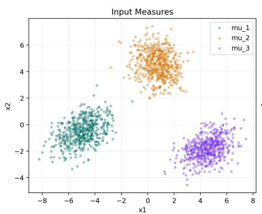

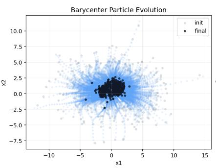

Figure E.1: Decoder Barycenter visualization  
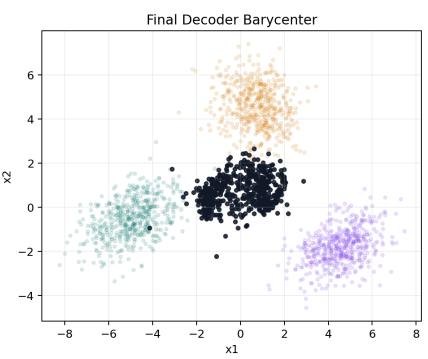

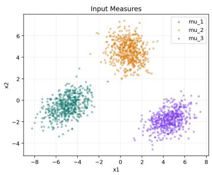

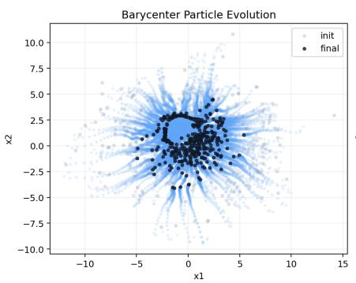  
Figure E.2: Encoder Barycenter visualization

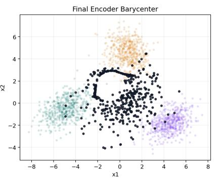

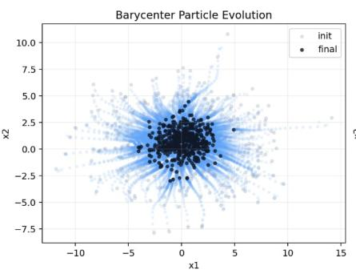  
Figure E.3: Symmetric Barycenter visualization

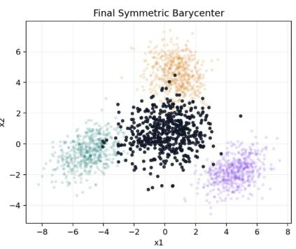

## E.2 Spatial MNIST: protocol

Probability-measure representation. We represent each digit image as a probability measure over the twodimensional pixel plane. Given a pixel grid G, the nonnegative image intensities are normalized to define

$$
\rho = \sum _ { x \in G } p ( x ) \delta _ { x } , \qquad \sum _ { x \in G } p ( x ) = 1 .
$$

Under this representation, image mass is distributed over spatial locations rather than treated as a vector of pixel intensities. Consequently, a diffusion-like corruption is naturally modeled by spatial convolution of the measure with a Gaussian kernel, rather than by adding independent noise directly to the pixel values. Our experiment follows this viewpoint as a modification of the spatial barycenter experiment of Cuturi and Doucet [2014].

Latent sources and observations. We construct the experiment around a latent-source recovery task. We select one approximately centered clean image from each digit class as the latent source $\rho ^ { \star }$ . From each latent source, we generate $\bar { N } \in \{ 3 2 , 6 4 , 1 2 8 \}$ corrupted observations, using $N = 3 2$ as the default configuration. The original train/test split is kept fixed throughout the experiment, and the latent test images are never used for hyperparameter selection. Each observed measure is first obtained by applying a random geometric transformation to the latent source. On a $3 2 \times 3 2$ or $4 0 \times 4 0$ canvas, we define

$$
T _ { i } ( x ) = s _ { i } R _ { \vartheta _ { i } } ( x - x _ { 0 } ) + x _ { 0 } + b _ { i } ,
$$

where $x _ { 0 }$ denotes the image center, $s _ { i }$ controls scaling, $R _ { \vartheta _ { i } }$ is a planar rotation, and $b _ { i }$ is a translation. We sample translations from $[ - 6 , 6 ] ^ { 2 }$ and recenter them so that the average translation is approximately zero; one convenient construction is to use pairs $( b , - b )$ . The scale is sampled as

$$
s _ { i } \sim \operatorname { U n i f } ( 0 . 7 , 1 . 4 ) ,
$$

while the optional rotation ablation uses

$$
\vartheta _ { i } \sim \mathrm { U n i f } ( - 2 0 ^ { \circ } , 2 0 ^ { \circ } ) .
$$

A sufficiently padded canvas is used to limit boundary artifacts, and any mass loss or renormalization caused by the transformation is recorded. To ensure a fair comparison, all barycenter methods are evaluated using exactly the same geometric transformations and image-rendering procedure.

Blur regimes. After the deterministic transformation, we introduce spatial diffusion by convolving the transformed measure with a Gaussian kernel. We consider several regimes in order to separate the effects of deterministic transport and stochastic dispersion. In the common isotropic setting, all observations generated from the same latent source use the same covariance,

$$
\Omega _ { i } = \sigma ^ { 2 } I _ { 2 } ,
$$

so that the stochastic component is shared across domains.

Our main SBB-specific setting instead uses heterogeneous anisotropic diffusion. For each observation, we define

$$
\begin{array} { r } { \Omega _ { i } = R _ { \varphi _ { i } } \mathrm { d i a g } \big ( \sigma _ { i , 1 } ^ { 2 } , \sigma _ { i , 2 } ^ { 2 } \big ) R _ { \varphi _ { i } } ^ { \top } , } \end{array}
$$

where the principal blur scales and orientation vary across observations. In the default configuration, we use

$$
\sigma _ { i , 1 } \in [ 0 . 4 , 2 . 0 ] , \qquad \sigma _ { i , 2 } \in [ 0 . 2 , 1 . 2 ] , \qquad \varphi _ { i } \in [ 0 , \pi ] .
$$

The resulting observed distribution is therefore

$$
\nu _ { i } = ( T _ { i } ) _ { \# } \rho ^ { \star } * \mathcal { N } ( 0 , \Omega _ { i } ) .
$$

Hyperparameter Setting. The selected SBB parameters are $T = 1 , \beta = 1 0 , \mathrm { a n d } \epsilon = 0 . 0 3$ , equivalently $\theta = \beta T = 1 0$ and $\tau = \epsilon T = 0 . 0 3$ . Each pairwise model uses 64 diagonal Gaussian potential components, diagonal initialization $0 . 1 \hphantom { 0 0 0 0 }$ , and a learned inverse network with spatial width 64 and time-embedding width 16 . We use 4,096 barycenter particles and sample 4,096 points from each observation. Optimization performs exactly 95 outer updates with step size $\dot { \eta } _ { k } = 0 . 1 ( 0 . 9 9 5 ) ^ { k }$ , with velocity-based early stopping disabled. Every outer update fits the pairwise models through two inner stages, each containing 100 gradient updates for the potential network and 100 for the inverse network. Both networks use Adam with learning rate 0.003 , minibatch size 256, and per-network gradient clipping at norm 1. The terminal smoothing fraction is 0.01 , sampling chunks contain 2,048 points, and the independent pairwise models are batched on the GPU in float32. Hyperparameters were selected using clean-training-image $W _ { 2 }$ and frozen before test evaluation. The completed comparison uses one test image per digit 0-9, $W _ { 2 }$ is estimated using 512 samples from each rendered image. The Wasserstein baseline uses exact transport subproblems with at most 100 outer iterations, while debiased Sinkhorn uses fixed regularization 0.03 and a maximum of 200,000 grid iterations. RegWB solves the static empirical objective on the full $4 0 \times 4 0$ pixel grid, using regularization 0.03 in source-normalized coordinates, at most $4 { , } 0 \bar { 0 } 0$ iterative proportional fitting sweeps.

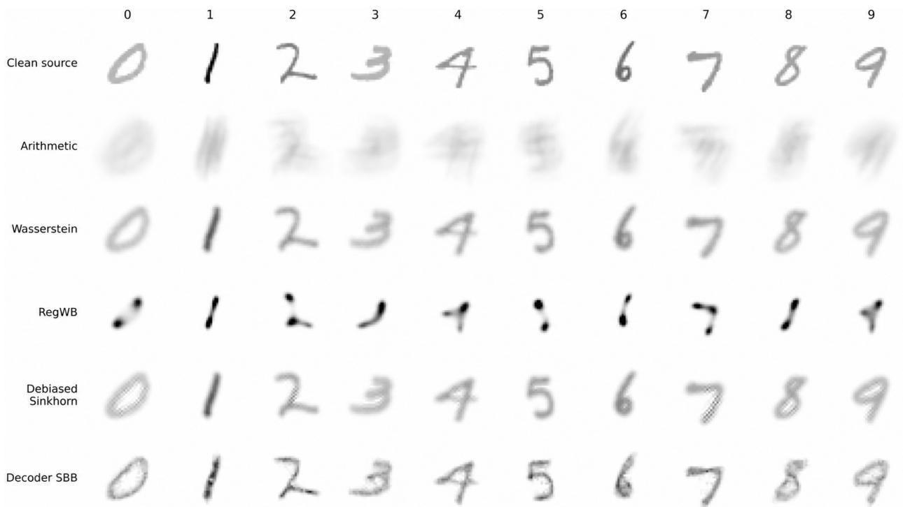  
Figure E.4: Qualitative latent-source recovery on MNIST. Each column corresponds to one digit class, from 0 to 9. The first row shows the clean latent source, while the remaining rows show the barycenters reconstructed by the arithmetic mean, Wasserstein barycenter, Regularized Wasserstein Barycenter, debiased Sinkhorn barycenter, and decoder SBB barycenter, respectively. The decoder SBB reconstruction is generally sharper and more closely preserves the geometry of the clean source, consistent with the quantitative results in Table 1

## E.3 Single-cell RNA: protocol

Preprocessing. We normalize the expression matrix and embed all cells from the considered condition into a common 30-dimensional PCA space. Each time point or cell subset is then represented by the empirical measure $\begin{array} { r } { P _ { t } = \frac { 1 } { n _ { t } } \sum _ { j = 1 } ^ { n _ { t } } \delta _ { x _ { i } ^ { ( t ) } } } \end{array}$ . The same embedding is used for all competing methods. We analyze the serum and 2i conditions separately and subsample the same number of cells from each distribution when necessary to control computational cost.

## Hyperparameter Setting

• Common-ancestor reconstruction. Evaluation uses MET cells from days 7.5-8.5. The supplied lognormalized expression values are preserved, 2,000 genes are selected by log-expression variance. Each run uses 512 cells per input population, 512 barycenter particles, and 512 evaluation cells. Particles are initialized from a Gaussian matching the weighted input mixture’s mean and covariance, with covariance stabilization $1 0 ^ { - 4 } I$ . The selected pairwise parameters are $T = 1 , \beta = 3 0$ , and $\epsilon = 0 . 3 ,$ , with 64 diagonal Gaussian components initialized at 0.1 , inverse-network spatial width 64 , time-embedding width 16 , terminal smoothing fraction 0.01 , and sampling chunk size 2,048. Adam uses learning rate 0.005 , minibatch size 256 , and gradient clipping at norm 1 . Each pairwise fit has two stages with 200 and 163 gradient updates, respectively, for each network. Barycenter optimization permits 75 outer iterations with constant step size 0.3 and a stopping threshold of $1 0 ^ { \dot { - } 3 }$ on the mean squared particle velocity. Pairwise network parameters are warm-started between outer iterations, while Adam states are reset for each pairwise fit. Wasserstein and Waddington-OT baselines permit 100 outer iterations with tolerance $1 0 ^ { - 6 } ;$ ; Sinkhorn uses regularization 0.1 , the dual L-BFGS inner solver, a 10,000 -iteration inner cap, and inner tolerance $1 0 ^ { - 8 }$ . RegWB uses regularization 0.1 in source-normalized coordinates, 65536 importance-quadrature nodes, and at most 12,000 iterative proportional fitting sweeps.

• Held-out population reconstruction: shared setup. We reconstruct the intermediate population at $t _ { 0 }$ from populations at $t _ { - } = t _ { 0 } - \Delta / 2$ and $t _ { + } = t _ { 0 } + \Delta / 2$ , where $\Delta \in \{ 1 , 2 , 3 \}$ denotes the total endpoint separation in days. Consequently, the temporal fraction is $\alpha = ( t _ { 0 } - t _ { - } ) / ( t _ { + } - t _ { - } ) = 1 / 2$ . SBB Decoder and SBB Markovian use separately selected parameters and adjusted barycenter weights $\lambda _ { 2 } = c \alpha / ( 1 - \alpha + c \alpha ) =$ $c / ( 1 + c )$ and $\lambda _ { 1 } = 1 - \lambda _ { 2 }$ . We preserve the provided log-normalized expression, select 2,000 highly variable genes per condition. The quantitative tuning and assessment runs use 512 cells per endpoint, 512 reconstructed particles, and 512 target cells. Observed cells are sampled without replacement within each population. The two SBB variants share an initialization sampled from the chronological arithmetic mixture $( 1 - \bar { \alpha } ) P _ { t _ { - } } + \alpha P _ { t _ { + } } ,$ independently of c. Unless specified otherwise below, each pairwise model uses time horizon $T = 1$ for all $\Delta .$ , 64 diagonal Gaussian potential components with diagonal scale parameters initialized to 0.1 and uniform initial component weights, inverse-network spatial and temporal widths 64 and 16, terminal smoothing fraction 0.01, and sampling chunks of 2,048 points. The full finite-β inverse is used throughout. Adam uses learning rate 0.003, minibatch size 256, and gradient clipping at norm 1 per network. Each outer update contains two inner stages with 128 gradient steps. Networks are warm-started between outer iterations, whereas Adam is reinitialized at each outer iteration. We use a constant barycenter step size $\eta ,$ a selected fixed number L of outer iterations, and no velocity-based early stopping. Arithmetic mixture, Wasserstein displacement interpolation, and Waddington-OT use the chronological weights $( 1 / 2 , 1 / 2 )$ . Waddington-OT uses regularization 0.05, marginal-relaxation penalties 1 and 50, three growth iterations, the supplied growth-rate metadata, and the actual endpoint separation ∆. RegWB uses chronological weights, regularization 0.1, and analytic elimination of the central variable; the endpoint coupling is solved with an iteration cap of 12,000. TrajectoryNet uses three hidden layers of width 64 with LeakyReLU, Adam with learning rate $1 \dot { 0 } ^ { - 3 }$ and weight decay $\mathrm { \bar { 5 } } \times 1 0 ^ { - 5 }$ and minibatches of 1,000 cells sampled with replacement per endpoint.

One-day intervals. We evaluate 64 midpoint triplets, comprising 32 triplets per condition, with $t _ { - } = t _ { 0 } - 0 . 5$ and $t _ { + } = t _ { 0 } + 0 . 5$ . The global SBB Decoder configuration uses $\beta = 1 0 0 , \epsilon = 0 . 3 , \eta = 0 . 0 3 , c = 1$ , and $L = 6 0 ;$ ; the global SBB Markovian configuration uses $\beta = 1 0 0 , \epsilon = 0 . 1 , \eta = 0 . 0 3 , c = 2 .$ , and $L = 6 0$

Two-day intervals. We evaluate 66 midpoint triplets, comprising 33 triplets per condition, with $t _ { - } = t _ { 0 } - 1$ and $t _ { + } = t _ { 0 } + 1$ . The global Decoder configuration uses $\beta = 3 0 , \epsilon = 0 . 3 , \eta = 0 . 1 , c = 1$ , and $L = 4 0 !$ ; the global Markovian configuration uses $\beta = 1 0 0 , \epsilon = 0 . 1 , \eta = 0 . 0 3 , c = 2 , \mathrm { a n d } L = 4 0$

Three-day intervals. We evaluate 62 midpoint triplets, comprising 31 triplets per condition, with $t _ { - } = t _ { 0 } - 1 . 5$ and $t _ { + } = t _ { 0 } + 1 . 5$ . The global Decoder configuration uses $\beta = \bar { 3 } 0 , \epsilon \bar { = } 0 . 1 \bar { , } \eta = 0 . 1 , c = 2 ,$ , and $L = 6 0$ for serum and 40 for 2i; the global Markovian configuration uses $\beta = 1 0 , \epsilon = 0 . 1 , \eta = 0 . 3 , c = 1$ , and $L = 6 0$ for serum and 40 for 2i.

## E.3.1 1-day interval

Table E.1: Intermediate-state reconstruction 1-day intervals result.
<table><tr><td>Interpolation Method</td><td> $W _ { 2 } \downarrow$ </td><td>MMD↓</td><td>Cell-type TV↓</td><td>Signature MAE↓</td></tr><tr><td colspan="5">serum condition</td></tr><tr><td>Arithmetic mixture</td><td> $1 1 . 9 9 1 6 \pm 0 . 1 8 5 5$ </td><td> $0 . 4 0 4 4 \pm 0 . 0 1 2 0$ </td><td> $0 . 0 5 8 8 \pm 0 . 0 2 8 9$ </td><td> $0 . 0 3 6 4 \pm 0 . 0 0 6 2$ </td></tr><tr><td>Wasserstein</td><td> $1 0 . 9 1 3 4 \pm 0 . 2 1 7 5$ </td><td> $0 . 4 1 8 9 \pm 0 . 0 1 5 5$ </td><td> $0 . 0 8 5 9 \pm 0 . 0 2 8 4$ </td><td> $0 . 0 3 5 9 \pm 0 . 0 0 0 8$ </td></tr><tr><td>RegWB</td><td> $1 1 . 0 3 2 3 \pm 0 . 2 0 5 9$ </td><td> $0 . 4 1 5 4 \pm 0 . 0 1 5 1$ </td><td> $0 . 0 8 9 2 \pm 0 . 0 1 7 1$ </td><td> $0 . 0 3 7 0 \pm 0 . 0 0 2 9$ </td></tr><tr><td>TrajectoryNet</td><td> $1 4 . 6 2 5 5 \pm 0 . 2 4 1 3$ </td><td> $0 . 5 5 3 9 \pm 0 . 0 1 2 3$ </td><td> $0 . 0 6 5 8 \pm 0 . 0 1 1 9$ </td><td> $0 . 0 3 2 9 \pm 0 . 0 0 4 3$ </td></tr><tr><td>Waddington-OT</td><td> $1 0 . 6 6 2 1 \pm 0 . 0 7 5 2$ </td><td> $0 . 4 0 3 4 \pm 0 . 0 0 8 0$ </td><td> $0 . 2 3 8 3 \pm 0 . 0 4 9 1$ </td><td> $0 . 0 3 8 5 \pm 0 . 0 0 3 6$ </td></tr><tr><td>SBB Decoder (ours)</td><td> $1 0 . 3 5 1 5 \pm 0 . 1 3 0 8$ </td><td> $0 . 3 7 7 8 \pm 0 . 0 1 1 8$ </td><td> $0 . 0 5 3 4 \pm 0 . 0 3 3 6$ </td><td> $0 . 0 3 7 5 \pm 0 . 0 0 9 7$ </td></tr><tr><td>SBB Markovian (ours)</td><td> $1 0 . 1 8 4 8 \pm 0 . 1 2 0 3$ </td><td> $0 . 3 4 0 8 \pm 0 . 0 1 0 6$ </td><td> $0 . 0 5 5 3 \pm 0 . 0 3 2 9$ </td><td> $0 . 0 3 4 9 \pm 0 . 0 0 7 2$ </td></tr><tr><td>2i condition</td><td></td><td></td><td></td><td></td></tr><tr><td>Arithmetic mixture</td><td> $1 1 . 9 0 0 1 \pm 0 . 6 5 9 8$ </td><td> $0 . 1 7 3 1 \pm 0 . 0 1 9 6$ </td><td> $0 . 1 5 3 6 \pm 0 . 0 5 3 0$ </td><td> $0 . 0 8 8 2 \pm 0 . 0 4 2 2$ </td></tr><tr><td>Wasserstein</td><td> $1 1 . 3 0 2 9 \pm 0 . 7 5 1 3$ </td><td> $0 . 1 7 9 7 \pm 0 . 0 2 3 4$ </td><td> $0 . 1 7 4 5 \pm 0 . 0 3 6 8$ </td><td> $0 . 1 1 4 6 \pm 0 . 0 4 5 8$ </td></tr><tr><td>RegWB</td><td> $1 1 . 5 8 5 5 \pm 0 . 7 6 1 0$ </td><td> $0 . 1 7 7 3 \pm 0 . 0 2 4 7$ </td><td> $0 . 1 8 1 6 \pm 0 . 0 5 0 8$ </td><td> $0 . 1 1 2 8 \pm 0 . 0 3 9 2$ </td></tr><tr><td>TrajectoryNet</td><td> $1 2 . 3 0 6 8 \pm 0 . 4 7 2 3$ </td><td> $0 . 1 8 5 7 \pm 0 . 0 1 1 0$ </td><td> $0 . 1 7 0 0 \pm 0 . 0 1 7 5$ </td><td> $0 . 1 0 3 7 \pm 0 . 0 0 7 1$ </td></tr><tr><td>Waddington-OT</td><td> $1 2 . 6 2 9 0 \pm 1 . 2 8 8 2$ </td><td> $0 . 2 2 3 9 \pm 0 . 0 4 0 0$ </td><td> $0 . 1 9 0 1 \pm 0 . 0 5 8 7$ </td><td> $0 . 1 0 2 4 \pm 0 . 0 3 2 3$ </td></tr><tr><td>SBB Decoder (ours)</td><td> $1 0 . 9 5 8 4 \pm 0 . 7 5 2 3$ </td><td> $0 . 1 5 7 2 \pm 0 . 0 2 3 6$ </td><td> $0 . 1 5 3 0 \pm 0 . 0 5 3 6$ </td><td> $0 . 0 7 9 1 \pm 0 . 0 3 8 4$ </td></tr><tr><td>SBB Markovian (ours)</td><td> $1 1 . 5 3 6 4 \pm 0 . 5 6 7 6$ </td><td> $0 . 1 6 9 8 \pm 0 . 0 1 9 1$ </td><td> $0 . 1 5 3 6 \pm 0 . 0 5 3 0$ </td><td></td></tr><tr><td></td><td></td><td></td><td></td><td> $0 . 0 6 8 4 \pm 0 . 0 3 7 4$ </td></tr></table>

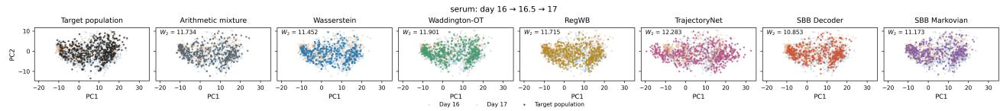

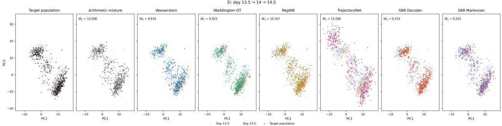  
Figure E.5: Some qualitative figures for reconstruction of intermediate cell populations using 1-day intervals.

## E.3.2 2-day interval

Table E.2: Intermediate-state 2-day intervals reconstruction result.
<table><tr><td>Interpolation Method</td><td> $W _ { 2 } \downarrow$ </td><td>MMD↓</td><td>Cell-type TV↓</td><td>Signature MAE↓</td></tr><tr><td colspan="5">serum condition</td></tr><tr><td>Arithmetic mixture</td><td> $1 2 . 5 0 3 9 \pm 0 . 4 0 8 5$ </td><td> $0 . 5 7 7 3 \pm 0 . 0 1 4 0$ </td><td> $0 . 2 0 7 7 \pm 0 . 0 5 0 2$ </td><td> $0 . 2 7 2 5 \pm 0 . 0 2 1 8$ </td></tr><tr><td>Wasserstein</td><td> $1 2 . 2 9 7 9 \pm 0 . 4 9 0 9$ </td><td> $0 . 6 1 0 3 \pm 0 . 0 1 4 5$ </td><td> $0 . 1 6 9 9 \pm 0 . 0 0 5 2$ </td><td> $0 . 3 0 2 9 \pm 0 . 0 1 4 6$ </td></tr><tr><td>RegWB</td><td> $1 2 . 4 1 9 8 \pm 0 . 4 8 2 4$ </td><td> $0 . 6 0 5 8 \pm 0 . 0 1 3 9$ </td><td> $0 . 1 6 5 4 \pm 0 . 0 2 1 6$ </td><td> $0 . 2 9 9 3 \pm 0 . 0 2 2 2$ </td></tr><tr><td>TrajectoryNet</td><td> $1 4 . 1 7 9 4 \pm 0 . 5 8 1 0$ </td><td> $0 . 6 7 6 2 \pm 0 . 0 2 2 1$ </td><td> $0 . 3 8 3 5 \pm 0 . 0 3 2 9$ </td><td> $0 . 3 0 4 6 \pm 0 . 0 0 4 0$ </td></tr><tr><td>Waddington-OT</td><td> $1 2 . 2 4 7 7 \pm 0 . 3 2 7 5$ </td><td> $0 . 6 1 2 5 \pm 0 . 0 1 0 2$ </td><td> $0 . 1 6 6 0 \pm 0 . 0 2 5 4$ </td><td> $0 . 3 6 1 3 \pm 0 . 0 1 3 5$ </td></tr><tr><td>SBB Decoder (ours)</td><td> $1 1 . 6 6 3 5 \pm 0 . 3 2 4 3$ </td><td> $0 . 5 8 5 8 \pm 0 . 0 1 1 5$ </td><td> $0 . 2 0 7 0 \pm 0 . 0 5 5 9$ </td><td> $0 . 2 6 7 2 \pm 0 . 0 2 3 1$ </td></tr><tr><td>SBB Markovian (ours)</td><td> $1 2 . 0 7 0 8 \pm 0 . 3 9 7 0$ </td><td> $0 . 5 6 5 2 \pm 0 . 0 1 2 4$ </td><td> $0 . 2 0 7 7 \pm 0 . 0 5 0 2$ </td><td> $0 . 2 4 9 1 \pm 0 . 0 2 1 2$ </td></tr><tr><td>2i condition</td><td></td><td></td><td></td><td></td></tr><tr><td>Arithmetic mixture</td><td> $1 3 . 3 8 3 1 \pm 0 . 0 6 0 8$ </td><td> $0 . 3 9 7 0 \pm 0 . 0 0 2 9$ </td><td> $0 . 2 5 6 5 \pm 0 . 0 1 4 7$ </td><td> $0 . 2 3 8 2 \pm 0 . 0 1 7 1$ </td></tr><tr><td>Wasserstein</td><td> $1 3 . 3 2 8 7 \pm 0 . 2 1 5 8$ </td><td> $0 . 4 3 0 5 \pm 0 . 0 0 8 4$ </td><td> $0 . 1 2 2 4 \pm 0 . 0 0 7 9$ </td><td> $0 . 2 3 8 6 \pm 0 . 0 1 5 2$ </td></tr><tr><td>RegWB</td><td> $1 3 . 4 5 5 0 \pm 0 . 2 6 1 9$ </td><td> $0 . 4 2 5 1 \pm 0 . 0 0 9 3$ </td><td> $0 . 1 2 8 3 \pm 0 . 0 2 3 6$ </td><td> $0 . 2 4 1 2 \pm 0 . 0 1 5 6$ </td></tr><tr><td>TrajectoryNet</td><td> $1 4 . 9 8 7 0 \pm 0 . 5 2 4 8$ </td><td> $0 . 5 0 2 4 \pm 0 . 0 2 3 0$ </td><td> $0 . 2 8 6 5 \pm 0 . 0 0 4 9$ </td><td> $0 . 2 0 3 0 \pm 0 . 0 1 8 7$ </td></tr><tr><td>Waddington-OT</td><td> $1 3 . 6 3 5 7 \pm 0 . 2 5 9 2$ </td><td> $0 . 4 4 6 5 \pm 0 . 0 0 7 9$ </td><td> $0 . 1 4 6 5 \pm 0 . 0 1 5 6$ </td><td> $0 . 2 4 8 5 \pm 0 . 0 2 7 9$ </td></tr><tr><td>SBB Decoder (ours)</td><td> $1 2 . 1 1 3 9 \pm 0 . 1 5 9 5$ </td><td> $0 . 3 8 5 9 \pm 0 . 0 0 7 0$ </td><td> $0 . 2 5 2 0 \pm 0 . 0 0 8 5$ </td><td> $0 . 1 9 9 1 \pm 0 . 0 2 9 4$ </td></tr><tr><td>SBB Markovian (ours)</td><td> $1 2 . 6 3 8 0 \pm 0 . 1 8 1 7$ </td><td> $0 . 3 7 8 1 \pm 0 . 0 0 7 4$ </td><td> $0 . 2 5 5 9 \pm 0 . 0 1 6 0$ </td><td> $0 . 2 2 1 9 \pm 0 . 0 2 5 4$ </td></tr><tr><td></td><td></td><td></td><td></td><td></td></tr></table>

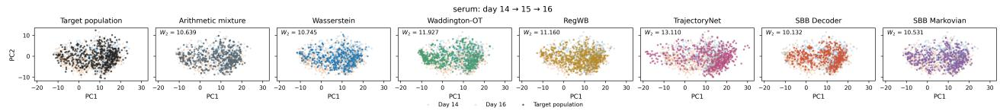

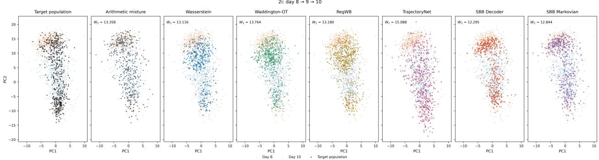  
Figure E.6: Some qualitative figures for reconstruction of intermediate cell populations using 2-day intervals.

## E.3.3 3-day interval

Table E.3: Intermediate-state 3-day intervals reconstruction result.
<table><tr><td>Interpolation Method</td><td> $W _ { 2 } \downarrow$ </td><td>MMD↓</td><td>Cell-type TV↓</td><td>Signature MAE↓</td></tr><tr><td colspan="5">serum condition</td></tr><tr><td>Arithmetic mixture</td><td> $1 2 . 4 6 8 1 \pm 0 . 3 0 1 5$ </td><td> $0 . 4 4 8 4 \pm 0 . 0 1 4 8$ </td><td> $0 . 1 4 5 8 \pm 0 . 0 2 8 3$ </td><td> $0 . 0 3 7 7 \pm 0 . 0 1 2 4$ </td></tr><tr><td>Wasserstein</td><td> $1 1 . 8 0 4 9 \pm 0 . 2 3 4 8$ </td><td> $0 . 4 6 5 3 \pm 0 . 0 1 1 4$ </td><td> $0 . 1 9 9 2 \pm 0 . 0 6 7 6$ </td><td> $0 . 0 3 5 4 \pm 0 . 0 0 1 9$ </td></tr><tr><td>RegWB</td><td> $1 1 . 9 0 7 8 \pm 0 . 2 5 5 2$ </td><td> $0 . 4 6 1 1 \pm 0 . 0 1 1 2$ </td><td> $0 . 1 6 3 4 \pm 0 . 0 5 1 1$ </td><td> $0 . 0 3 4 9 \pm 0 . 0 0 2 6$ </td></tr><tr><td>TrajectoryNet</td><td> $1 3 . 9 4 3 4 \pm 0 . 2 4 2 1$ </td><td> $0 . 5 3 8 3 \pm 0 . 0 1 2 5$ </td><td> $0 . 3 9 4 5 \pm 0 . 0 2 3 4$ </td><td> $0 . 0 5 8 4 \pm 0 . 0 0 5 0$ </td></tr><tr><td>Waddington-OT</td><td> $1 2 . 1 7 6 8 \pm 0 . 1 7 2 2$ </td><td> $0 . 4 9 4 9 \pm 0 . 0 0 4 6$ </td><td> $0 . 1 1 3 3 \pm 0 . 0 2 6 3$ </td><td> $0 . 0 4 2 2 \pm 0 . 0 0 2 9$ </td></tr><tr><td>SBB Decoder (ours)</td><td> $1 1 . 3 4 0 2 \pm 0 . 2 6 0 9$ </td><td> $0 . 4 2 1 3 \pm 0 . 0 1 0 6$ </td><td> $0 . 0 5 5 3 \pm 0 . 0 3 1 6$ </td><td> $0 . 0 6 3 5 \pm 0 . 0 1 6 0$ </td></tr><tr><td>SBB Markovian (ours)</td><td> $1 1 . 8 3 3 0 \pm 0 . 3 6 0 9$ </td><td> $0 . 4 2 9 3 \pm 0 . 0 1 3 8$ </td><td> $0 . 0 6 2 5 \pm 0 . 0 2 2 0$ </td><td> $0 . 0 3 8 4 \pm 0 . 0 1 0 7$ </td></tr><tr><td>2i condition</td><td></td><td></td><td></td><td></td></tr><tr><td>Arithmetic mixture</td><td> $1 1 . 1 0 3 8 \pm 0 . 2 9 7 2$ </td><td> $0 . 1 6 0 5 \pm 0 . 0 0 6 8$ </td><td> $0 . 1 4 0 6 \pm 0 . 0 3 0 1$ </td><td> $0 . 1 4 0 4 \pm 0 . 0 2 4 1$ </td></tr><tr><td>Wasserstein</td><td> $1 1 . 3 8 6 8 \pm 0 . 4 1 8 1$ </td><td> $0 . 1 7 8 5 \pm 0 . 0 1 0 4$ </td><td> $0 . 2 8 6 5 \pm 0 . 0 4 7 9$ </td><td> $0 . 1 5 9 6 \pm 0 . 0 3 5 9$ </td></tr><tr><td>RegWB</td><td> $1 1 . 5 9 2 5 \pm 0 . 3 4 1 4$ </td><td> $0 . 1 7 4 1 \pm 0 . 0 0 8 1$ </td><td> $0 . 2 7 9 9 \pm 0 . 0 3 5 2$ </td><td> $0 . 1 5 5 6 \pm 0 . 0 2 8 4$ </td></tr><tr><td>TrajectoryNet</td><td> $1 5 . 0 9 3 4 \pm 0 . 3 6 5 1$ </td><td> $0 . 3 0 0 7 \pm 0 . 0 1 5 6$ </td><td> $0 . 3 2 1 0 \pm 0 . 0 1 7 7$ </td><td> $0 . 2 2 5 1 \pm 0 . 0 0 9 5$ </td></tr><tr><td>Waddington-OT</td><td> $1 3 . 0 2 3 2 \pm 0 . 4 1 0 4$ </td><td> $0 . 2 4 2 5 \pm 0 . 0 1 0 4$ </td><td> $0 . 2 8 1 2 \pm 0 . 0 3 7 4$ </td><td> $0 . 2 3 1 6 \pm 0 . 0 4 3 7$ </td></tr><tr><td>SBB Decoder (ours)</td><td> $1 0 . 0 2 3 2 \pm 0 . 4 7 0 8$ </td><td> $0 . 1 5 9 0 \pm 0 . 0 1 0 6$ </td><td> $0 . 1 2 4 3 \pm 0 . 0 4 1 4$ </td><td> $0 . 1 4 1 7 \pm 0 . 0 3 9 4$ </td></tr><tr><td>SBB Markovian (ours)</td><td> $1 1 . 1 6 2 2 \pm 0 . 4 5 2 2$ </td><td> $0 . 1 6 2 7 \pm 0 . 0 1 0 8$ </td><td> $0 . 1 4 6 5 \pm 0 . 0 4 0 4$ </td><td> $0 . 1 2 2 8 \pm 0 . 0 3 6 3$ </td></tr><tr><td></td><td></td><td></td><td></td><td></td></tr></table>

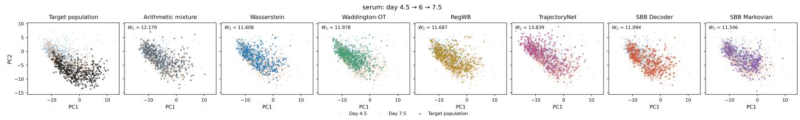

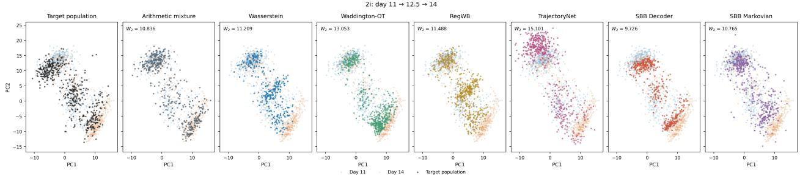  
Figure E.7: Some qualitative figures for reconstruction of intermediate cell populations using 3-day intervals.

## F RUNNING TIME

Table F.1: Selected training budgets and recorded times for L outer iterations, G directed bridges per iteration
<table><tr><td>Case</td><td>Method</td><td>L</td><td>G</td><td>Updates</td><td>Time (s)</td></tr><tr><td>Anisotropic Gaussian</td><td>Decoder</td><td>50</td><td>3</td><td>298,500</td><td>907.6</td></tr><tr><td>Anisotropic Gaussian</td><td>Encoder</td><td>50</td><td>3</td><td>298,500</td><td>902.5</td></tr><tr><td>Anisotropic Gaussian</td><td>Symmetric</td><td>50</td><td>6</td><td>597,000</td><td>1799.7</td></tr><tr><td>MNIST: 10 images</td><td>Decoder</td><td>95</td><td>32</td><td>1,216,000</td><td> $1 2 8 . 2 \pm 6 . 1$ </td></tr><tr><td>Ancestor, serum</td><td>Decoder</td><td>75</td><td>4</td><td>217,800</td><td> $1 7 6 . 4 \pm 1 . 7$ </td></tr><tr><td>1 day, serum</td><td>Decoder</td><td>60</td><td>2</td><td>55,680</td><td> $1 9 4 . 4 \pm 2 . 7$ </td></tr><tr><td>1 day, serum</td><td>Markovian</td><td>60</td><td>2</td><td>55,680</td><td> $1 9 2 . 9 \pm 3 . 5$ </td></tr><tr><td>1 day, 2i</td><td>Decoder</td><td>60</td><td>2</td><td>55,680</td><td> $2 1 5 . 7 \pm 2 . 4$ </td></tr><tr><td>1 day, 2i</td><td>Markovian</td><td>60</td><td>2</td><td>55,680</td><td> $2 1 3 . 4 \pm 3 . 8$ </td></tr><tr><td>2 days, 2i</td><td>Decoder</td><td>40</td><td>2</td><td>37,120</td><td> $1 6 2 . 5 \pm 2 . 3$ </td></tr><tr><td>2 days, 2i</td><td>Markovian</td><td>40</td><td>2</td><td>37,120</td><td> $1 6 5 . 3 \pm { 0 . 4 }$ </td></tr><tr><td>2 days, serum</td><td>Decoder</td><td>40</td><td>2</td><td>37,120</td><td> $1 1 5 . 7 \pm 2 3 . 1$ </td></tr><tr><td>2 days, serum</td><td>Markovian</td><td>40</td><td>2</td><td>37,120</td><td> $1 1 5 . 4 \pm 1 4 . 1$ </td></tr><tr><td>3 days, 2i</td><td>Decoder</td><td>40</td><td>2</td><td>37,120</td><td> $2 1 7 . 0 \pm 0 . 1$ </td></tr><tr><td>3 days, 2i</td><td>Markovian</td><td>40</td><td>2</td><td>37,120</td><td> $2 0 0 . 2 \pm 2 . 6$ </td></tr><tr><td>3 days, serum</td><td>Decoder</td><td>60</td><td>2</td><td>55,680</td><td> $2 8 4 . 0 \pm 2 . 9$ </td></tr><tr><td>3 days, serum</td><td>Markovian</td><td>60</td><td>2</td><td>55,680</td><td> $2 8 5 . 9 \pm 0 . 3$ </td></tr></table>