# SU(2)-Equivariant Spinor Message Passing for Molecular Magnetism

Erh-Wei Sheng,1, 2 Beom Seok Kang,3 Yuchao Lin,1 Danish Khan,1 and Anima Anandkumar1, ∗

1Division of Engineering and Applied Science, California Institute of Technology, Pasadena, California 91125, USA

2Department of Chemical Engineering, National Tsing Hua University, Hsinchu 300044, Taiwan

3Division of Chemistry and Chemical Engineering, California Institute of Technology, Pasadena, California 91125, USA

Predicting molecular magnetism often requires electronic-structure calculations with spin–orbit coupling (SOC), which are costly to repeat across many molecules. The underlying electronic states can transform as spinors, yet equivariant surrogates typically use only integer-rank features. Inspired by the spinor nature of these electronic states, we develop eSpinor, an SU(2)-equivariant graph neural network that propagates spinor features. We initialize spinor features from eigenvectors of an approximate SOC Hamiltonian and use gauge-covarian message passing with a gauge-invariant readout to make predictions independent of the arbitrary eigenbasis choice. On cobalt single-molecule magnet candidates, eSpinor improves zero-field-splitting predictions relative to NequIP, including for unseen ligands. For a dysprosium magnetic resonance imaging probe, eSpinor improves real electron-spin correlations over a Hamiltonian-informed baseline despite similar static crystal-field errors and fewer parameters, while accurately predicting low-field nuclear relaxation in water and after transfer to methanol without retraining. Overall, these results support SU(2)-equivariant spinor message passing as a useful inductive bias for molecular magnetism. We also find that similar static tensor errors can yield diferent dynamical errors, motivating model selection based on accuracy for the intended physical observables.

## I. INTRODUCTION

Molecular magnetism underlies single-molecule magnets (SMMs) [1, 2], molecular qubits for quantum information [3], and magnetic resonance imaging (MRI) probes [4]. Designing these systems requires predicting how ligand chemistry and geometry afect magnetic energy levels and dynamics. Relevant quantities include zero-field-splitting (ZFS) parameters in transition-metal complexes and crystal-field parameters in lanthanide ions [5, 6]. The ligand field and spin–orbit coupling (SOC), the relativistic interaction between an electron’s orbital and spin angular momenta, shape the magnetic anisotropy of these complexes [7]. Changes in molecular geometry can therefore influence both their magnetic energy levels and spin dynamics [8].

A common computational approach first uses complete active space self-consistent field (CASSCF) calculations to describe the electronic structure without SOC [9], due to the inherent multi-reference character in these systems. SOC is then included by mixing the resulting electronic states in a state-interaction calculation [10]. Unlike density functional theory (DFT), which is single-reference and scales polynomially with system size, CASSCF captures the near-degenerate multiplets of open-shell metal ions by including all electronic configurations within an active space. The number of these configurations grows combinatorially with the size of the active space, which restricts conventional calculations to small active spaces [11]. Averaging over many low-lying states adds further cost, so a single geometry can require hours of computation (Sec. V B), making repeated calculations for screening or dynamics expensive. Machine learning surrogates that predict magnetic parameters from geometry ofer a cheaper alternative. For example, Gaussian-moment neural networks (GM-NN) have been extended to predict magnetic anisotropy tensors [12].

Other models incorporate spin explicitly. For magnetic ma terials, SpinGNN uses atomic positions and magnetic-moment directions to learn spin–lattice potential-energy surfaces [13]. SpinGNN++ extends this approach to SOC-dependent interactions while enforcing spatial and time-reversal symmetries [14]. For open-shell molecules, AIMNet2-NSE predicts energies using neural spin-charge equilibration constrained by total charge and spin multiplicity [15]. OrbitAll learns from spin-polarized orbital matrices computed with semiempirical methods [16]. DeepH-E3 and Uni-HamGNN instead make spin part of the target, predicting electronic Hamiltonian matrices with SOC from atomic structure [17, 18].

Several of these models impose equivariance under SO(3), the group of proper rotations in three-dimensional space, so that predicted tensors rotate consistently with the molecular geometry [19]. This inductive bias can improve data eficiency and accuracy. In machine-learning interatomic potentials (MLIPs), nonscalar SO(3)-equivariant features help even for rotation-invariant energies [20], showing that internal features can usefully carry richer rotation laws than the outputs. For magnetic-property prediction, eqSNAP provides an SO(3)- equivariant extension of the spectral neighbor analysis potential (SNAP) method. It has been used to predict ZFS tensors and crystal-field parameters using local atomic descriptors and linear regression [21, 22].

SOC couples orbital motion and electron spin, motivating representations that describe these degrees of freedom jointly [7]. Although magnetic observables follow tensor rotation laws, the underlying electronic states can transform as spinors under SU(2) [23, 24]. By analogy with MLIPs, such features could serve as internal features and benefit the predictions of integerrank magnetic targets, yet the models discussed above use only integer-rank internal features. This motivates our research question, illustrated in Fig. 1: Can SU(2)-equivariant spinor message passing provide a useful inductive bias for predicting SOC-dependent molecular properties?

Inspired by the spinor nature of spin–orbit-coupled electronic states, we develop eSpinor, an SU(2)-equivariant graph neural network that propagates spinor features alongside integer-rank tensors. We initialize spinors from eigenvectors of an approximate SOC Hamiltonian and classify the allowed interaction types to guarantee rotation equivariance and eigenbasis independence. To assess the proposed architecture, we compare eSpinor with the widely used SO(3)-equivariant architecture NequIP [20] and its Hamiltonian-informed variant NequIP+H, which serves as an ablation. On cobalt SMM candidates [25], eSpinor generalizes better to unseen ligands. On a dysprosium MRI probe [8], it predicts real electron-spin correlations more accurately at 8k training geometries, even though it matches NequIP+H on static crystal-field tensors at individual geometries. The dynamical advantage also extends from water to methanol without retraining. These results indicate that a model with SU(2)-equivariant spinor features improves magnetic-property prediction in the tested systems, even for SO(3)-equivariant targets. They also show that similar static tensor errors can lead to diferent dynamical errors. Model selection should therefore be guided by accuracy on the physical observables relevant to the intended application.

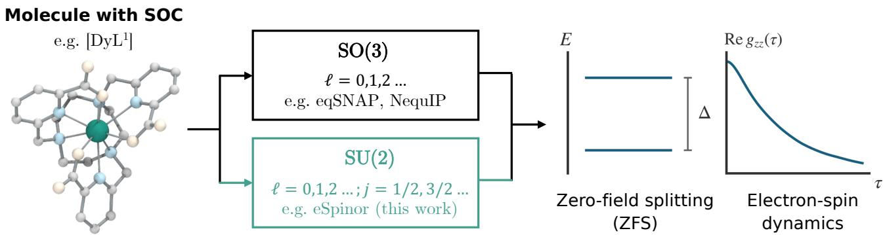  
FIG. 1. Representation choices for predicting SOC-dependent molecular magnetic properties. eSpinor propagates half-integer spinor features alongside integer-rank tensor features. The ZFS levels are schematic, and the electron-spin correlation Re $g _ { z z } ( \tau )$ shows the 3 T CASSCF+SOC reference [8].

## II. SU(2)-EQUIVARIANT SPINOR MESSAGE PASSING

Our first task is to construct spinor features that transform consistently when the molecular geometry rotates (Sec. II A). Their initialization introduces a freedom in choosing the eigenbasis, which constrains the network design (Sec. II B). We then design message-passing layers that respect these constraints (Sec. II C) and a readout that produces magnetic tensors independent of the eigenbasis choice (Sec. II D).

Figure 2(a) summarizes this construction. We represent the molecule as a graph � with atomic numbers $Z _ { a }$ and positions $\mathbf { r } _ { a }$ . Edges connect atoms within a radial cutof. Every atom carries integer-rank tensor features $V _ { a } ,$ , initialized from atomic-species embeddings. We consider SOC only at the magnetic metal sites, where we initialize spinor features $h _ { a }$ from an approximate Hamiltonian that combines SOC with the ligand field (Sec. II A). Thus $V _ { a }$ and $h _ { a }$ are two feature types attached to the same graph. Within each interaction layer, the convolution in Fig. 2(b) updates both feature types. The coupling in Fig. 2(c) then contracts spinors to supply additional integer tensors while retaining the spinors for the next layer. A final readout produces magnetic tensors independent of the basis chosen for the initial eigenvectors.

## A. Spinor initialization

To specify the two feature types, we use irreducible representations (irreps). We label integer-rank tensor features by $\ell = 0 , 1 , \ldots$ . and spinor features by $j = \textstyle { \frac { 1 } { 2 } } , \frac { 3 } { 2 } , . . .$ . which transform under half-integer irreps of SU(2), the double cover of SO(3) [23, 26].

Integer-rank geometric features cannot generate spinors through tensor products [27]. We therefore introduce electron spin explicitly by using the single-electron spin–orbital space of a metal shell. The orbital and spin angular momenta L and S co-rotate under joint spatial rotations generated by $\textbf { J } = \textbf { L } + \textbf { S }$ Combining the shell’s integer orbital angular momentum $\ell _ { \mathrm { s h } }$ with electron spin $\begin{array} { r } { s = \frac { 1 } { \mathit { \varepsilon } _ { \mathit { \varepsilon } } } } \end{array}$ gives the half-integer irreps $j = \ell _ { \mathrm { s h } } \pm \frac { 1 } { 2 } [ 2 4 ]$ . To obtain spinor features that depend on the ligand environment and SOC, we construct an approximate Hamiltonian at each metal site �,

$$
H _ { \mathrm { i n i t } , a } ( G ) = H _ { \mathrm { C F } , a } ( G ) \otimes I _ { 2 } + \xi _ { a } \mathbf { L } \cdot \mathbf { S } .\tag{1}
$$

Here $H _ { \mathrm { C F } , a }$ acts on orbital states and $I _ { 2 }$ on spin. The SOC strength is $\xi _ { a } .$ , with L and S in units of ℏ [7, 28]. This zerofield, single-electron Hamiltonian initializes features for targets obtained from many-electron calculations.

Specifically, we choose $H _ { \mathrm { C F } , a }$ to reflect the metal–ligand bonding in each benchmark. For Dy(III), the relatively shielded $4 f$ shell motivates a point-charge model based on ligand positions and efective charges [7, 29]. For Co(II), we compare point-charge initialization with a learned angular-overlap model (AOM) to account for metal–ligand covalency [30]. The initializer formulas and numerical parameters are given in the Supplemental Material [31] (Sec. S1 A).

Diagonalizing the Hamiltonian gives approximate electronic energy levels $\epsilon _ { a , u }$ and their corresponding eigenvectors. We collect the $k = 2 ( 2 \ell _ { \mathrm { s h } } { + } 1 )$ orthonormal eigenvectors as columns of $\Psi _ { a }$ and their energy levels in $E _ { a } = \mathrm { d i a g } ( \epsilon _ { a , 1 } , . . . , \epsilon _ { a , k } )$ , so the eigenproblem is

$$
H _ { \mathrm { i n i t } , a } \Psi _ { a } = \Psi _ { a } E _ { a } .\tag{2}
$$

We express these eigenvectors in the coupled basis $| j , m \rangle$ , where $m = - j , \ldots , j$ is the total angular momentum projection. At each $j ,$ , their $2 j + 1$ components form spinors with Wigner rotation matrices $D ^ { ( j ) }$ , as derived in Appendix A. As shown in Fig. 2(a), the energy levels supply invariant scalar features and the eigenvectors initialize spinor features. Using these eigenvectors requires accounting for their eigenbasis freedom, as explained in Sec. II B.

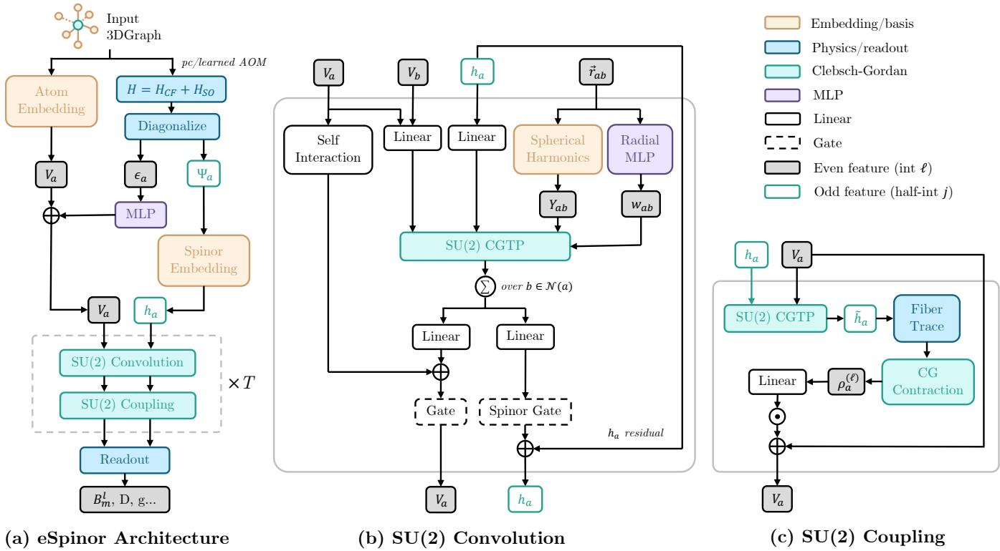  
FIG. 2. eSpinor architecture. (a) Atomic embeddings and Hamiltonian eigenvectors initialize integer tensors $V _ { a }$ and spinors $h _ { a }$ for repeated message passing and tensor readout. (b) Convolution uses Clebsch–Gordan tensor products (CGTP). (c) Spinor contractions update integer tensors. Here even/odd denotes integer/half-integer rank and $T = N _ { \mathrm { l a y } }$ . Only D and $\hat { B } _ { m } ^ { \ell } = B _ { q } ^ { ( \ell ) }$ are benchmark targets. The preliminary tensor convolution used by the learned AOM initializer is omitted.

## B. Addressing eigenbasis gauge freedom

Diagonalization in Eq. (2) determines eigenstates up to unitary transformations within each eigenspace, giving an eigenbasis gauge freedom. In our zero-field, single-electron initializer, time-reversal symmetry produces degenerate Kramers pairs [7, 32, 33]. The eigenbasis of each energetically isolated pair � is therefore defined up to $Q _ { a , p } \in \operatorname { U } ( 2 )$ , which includes individual U(1) phase choices and unitary mixing of the 2 eigenvectors. Predictions must be independent of this choice, a requirement also encountered in spectral graph learning [34, 35]. In Appendix $\mathbf { A } ,$ , we give the conditions for larger degenerate eigenspaces.

This gauge freedom also enters the transformation under molecular rotations. For a rotation $g \in S { \bf O } ( 3 )$ and either lift $\tilde { g } \in \mathbf { S U } ( 2 )$ , the eigenvectors $\Psi _ { a }$ obey

$$
\begin{array} { c } { { \Psi _ { a } ( g \cdot G ) = U _ { \mathrm { s h } } ( \tilde { g } ) \Psi _ { a } ( G ) Q _ { a } , } } \\ { { Q _ { a } = \mathrm { d i a g } ( Q _ { a , 1 } , \ldots , Q _ { a , k / 2 } ) . } } \end{array}\tag{3}
$$

Here the spin–orbital rotation $U _ { \mathrm { s h } }$ acts through $D ^ { ( j ) }$ on the angular index � at each �, while the gauge transformation $Q _ { a }$ mixes eigenvector columns � within each pair. Following gauge equivariant learning [36, 37], we preserve gauge covariance in the spinor features alongside rotation equivariance. The spinor features $h _ { a }$ remain basis dependent, but contracting their eigenbasis index � gives the gauge-invariant product $h _ { a } h _ { a } ^ { \dagger }$ . We project this product onto integer-rank tensors.

For initialization, we use Boltzmann-form weights $w _ { u }$ ∝ $e ^ { - \bar { \epsilon } _ { u } / T _ { B } }$ , where $\bar { \epsilon } _ { u }$ is the energy averaged within the Kramers pair containing eigenstate �. The learned energy scale $T _ { B }$ controls how strongly lower-energy states are favored. This energy dependence allows contractions of the eigenvectors to retain information about the ligand environment. To preserve gauge covariance, the weights and invariant gates act identically on both columns of each Kramers pair and therefore commute with $Q _ { a }$ . Equivariant channel maps then give initial spinor features at layer $n = 0$ that satisfy

$$
h _ { a } ^ { ( j ) , 0 } \mapsto D ^ { ( j ) } ( \tilde { g } ) h _ { a } ^ { ( j ) , 0 } \mathscr { Q } _ { a } .\tag{4}
$$

In Appendix A, we derive this transformation law from the initialization map. The weighting formulas and gate inputs are given in the Supplemental Material [31]. Each subsequent layer � must preserve Eq. (4), which guides the message passing in Sec. II C.

## C. Gauge-covariant message passing

Each interaction layer updates the features using information from neighboring atoms [38]. We choose NequIP as the backbone because it uses spherical harmonics to encode interatomic directions and explicit Clebsch–Gordan tensor products, which can be directly extended to half-integer representations [20].

The spinor updates must also preserve the eigenbasis gauge law in Eq. (4).

We classify the allowed real-bilinear couplings into 3 interaction types,

$$
V \otimes V \to V , \qquad h \otimes V \to h , \qquad h \otimes \overline { { { h } } } \stackrel { \sum _ { u } } { \longrightarrow } V .\tag{5}
$$

Here $\overline { { h } }$ denotes elementwise complex conjugation, and each product includes Clebsch–Gordan projection onto allowed angular ranks. The product � ⊗ � couples integer-rank features to produce integer-rank tensors. The mixed product ℎ ⊗ � updates spinor features without changing the eigenbasis index �, so its output carries the same $Q _ { a }$ . In the conjugated product ℎ ⊗ ${ \overline { { h } } } ,$ contraction over � cancels the unitary $Q _ { a }$ while retaining angular information in gauge-invariant integer tensors. We derive this classification and its covariance properties in Appendix A.

We use these operations to assemble the convolution in Fig. 2(b). In the equations below, square brackets [·] denote Clebsch–Gordan projection onto the output irreps, with angularcomponent and feature-channel indices omitted for clarity. Let $Y _ { a b } = Y ( \hat { \mathbf { r } } _ { a b } )$ collect the spherical harmonics of the direction from atom � to atom �. The sum below runs over neighbors � ∈ $N ( a )$ . In our mononuclear benchmarks, only the metal carries spinor features, so ligand neighbors condition an update of that metal’s own $h _ { a }$ . We combine these neighbor contributions with an on-site coupling to $V _ { a } ^ { n }$ in a gated residual update,

$$
h _ { a } ^ { n + 1 } = h _ { a } ^ { n } + \sigma _ { h } ^ { n } \Bigl ( \sum _ { b } A _ { a b } ^ { n } \bigl [ h _ { a } ^ { n } \otimes Y _ { a b } \bigr ] + W _ { \mathrm { o n } } ^ { n } \bigl [ h _ { a } ^ { n } \otimes V _ { a } ^ { n } \bigr ] \Bigr ) .\tag{6a}
$$

Here the equivariant channel maps are absorbed into the neigh bor weights ${ A } _ { a b } ^ { n }$ and the on-site coupling $W _ { \mathrm { o n } } ^ { n }$ . The neighbor weights depend on distance and invariant scalar features at both atoms and include neighbor normalization. The gate $\sigma _ { h } ^ { n }$ uses invariant pair norms and scalar features. Its multiplier is shared over the angular components at each � and both columns of each Kramers pair, so it commutes with rotations and $Q _ { a }$

The integer-rank features are fed into an equivariant tensor convolution, giving $\bar { V } _ { a } ^ { n + 1 }$ . The updated spinors then supply a tensor correction $\mathcal { R } _ { \mathrm { l a y e r } } ^ { n }$ through conjugated contractions and angular projection, as shown in Fig. 2(c). With an invariant channel gate $s _ { a } ^ { n }$ , the integer update is

$$
V _ { a } ^ { n + 1 } = \bar { V } _ { a } ^ { n + 1 } + s _ { a } ^ { n } \odot \mathcal { R } _ { \mathrm { l a y e r } } ^ { n } ( h _ { a } ^ { n + 1 } , \bar { V } _ { a } ^ { n + 1 } ) .\tag{6b}
$$

Here ⊙ denotes channelwise multiplication. Atoms without spinors receive only $\bar { V } _ { a } ^ { n + 1 }$ . Both $V _ { a } ^ { n + 1 }$ and $h _ { a } ^ { n + 1 }$ enter the next layer, so contraction informs the integer features without discarding the spinor features. The contraction formulas, gate inputs, and construction of $\mathcal { R } _ { \mathrm { l a v e r } } ^ { n }$ are detailed in the Supplemental Material [31] (Sec. S1 B).

The channel maps act identically on all eigenbasis columns. Together with the angular projections and invariant gates shared within each Kramers pair, this guarantees the spinor transfor mation law in Eq. (4) at every layer. The contraction over � in Eq. (5) removes the eigenbasis dependence, and angular projection gives gauge-invariant integer-rank tensors with the required rotation laws, as proved in Appendix A.

## D. Tensor readout

To predict magnetic tensors, the readout combines the final integer-rank features with gauge-invariant spinor contractions. After $N _ { \mathrm { l a y } }$ interaction layers, we omit the layer index from $h _ { a }$ and $V _ { a }$ and write the metal-site readout in Fig. 2(a) as

$$
\hat { y } _ { a } ^ { ( \ell ) } = W _ { \mathrm { o u t } } ^ { ( \ell ) } V _ { a } ^ { ( \ell ) } + \mathcal { R } _ { \mathrm { o u t } } ^ { ( \ell ) } ( h _ { a } , V _ { a } ) .\tag{7}
$$

The equivariant map $W _ { \mathrm { o u t } } ^ { ( \ell ) }$ combines channels of rank $\ell ,$ while ${ \mathcal { R } } _ { \mathrm { o u t } }$ uses conjugated spinor contractions projected onto the same rank.

Under the initialization assumptions in Secs. II A and II B, including separated Kramers pairs, both contributions are gaugeinvariant tensors of rank ℓ. This guarantees that the prediction is independent of the eigenbasis and obeys the required SO(3) rotation law,

$$
\hat { y } _ { a } ^ { ( \ell ) } ( g \cdot G ) = D ^ { ( \ell ) } ( g ) \hat { y } _ { a } ^ { ( \ell ) } ( G ) .\tag{8}
$$

We prove this result in Appendix A and report numerical equivariance tests in the Supplemental Material [31] (Sec. S1 D).

For the Co(II) benchmark, we convert the rank-2 output to the symmetric, traceless Cartesian ZFS tensor Db. For Dy(III), we convert outputs of ranks 2, 4, and 6 to Stevens coeficients $\widehat { B } _ { q } ^ { ( \ell ) }$ using the fixed basis maps given in the Supplemental Material [31]. The physical definitions of these targets follow in Secs. III and IV.

Propagating spinors before contraction also introduces coeficient sharing. In a product $h h ^ { \dagger }$ , the learned update of ℎ determines both factors, linking the coeficients of the resulting tensor interactions, as derived in the Supplemental Material [31] (Sec. S1 C). To assess how the architecture uses electronic information, we compare eSpinor with NequIP and its Hamiltonian-informed ablation NequIP+H. NequIP constructs integer-rank features from atomic species and geometry. NequIP+H also injects gauge-invariant contractions of Hamiltonian eigenvectors at each layer and propagates the resulting integer features. eSpinor additionally updates and propagates spinor features before contraction. The Hamiltonian-informed models use comparable parameter budgets. All models are trained and selected using static tensor errors. Their implementation and training procedures are specified in the Supplemental Material [31] (Sec. S2).

## III. ZERO-FIELD SPLITTING IN COBALT COMPLEXES

Zero-field splitting (ZFS) is the separation of spin energy levels without an applied magnetic field. In Co(II) complexes, SOC couples the spin to the ligand-dependent orbital structure, producing magnetic anisotropy [5, 25]. Easy-axis anisotropy favors opposite orientations of the magnetic moment along a molecular axis and can hinder transitions between them, supporting the slow magnetic relaxation sought in SMMs [1]. Changing the ligands can alter both the magnitude and character of this anisotropy. Predicting ZFS across ligand environments therefore helps identify promising molecular magnets.

COMPASS was developed to identify Co(II) complexes with large magnetic anisotropy for SMM design [25, 39]. We use its 4-coordinate complexes with CASSCF+SOC reference targets to test ZFS prediction and generalization to new ligands. All models share 6892 training, 862 validation, 862 in-distribution test, and 473 out-of-distribution (OOD) test structures. The OOD complexes contain only ligands absent from training. Data preprocessing and split construction are specified in the Supplemental Material [31] (Sec. S2 A).

TABLE I. Cobalt prediction MAEs $( \mathrm { c m } ^ { - 1 } )$ on the splits in Sec. III. The tensor error averages all 9 Cartesian entries. Parameter counts are ridge coeficients for eqSNAP or trainable neural parameters. The eSpinor variants use point-charge (pc) or angular-overlap (AOM) initialization.
<table><tr><td></td><td></td><td colspan="3">In distribution (n = 862)</td><td colspan="3">Unseen ligands  $( n = 4 7 3 )$ </td></tr><tr><td>Model</td><td>Parameters</td><td>D tensor</td><td>D</td><td>|E|</td><td>D tensor</td><td>D</td><td>|E|</td></tr><tr><td>eqSNAP</td><td>1,870</td><td>3.674</td><td>16.832</td><td>1.729</td><td>2.989</td><td>12.870</td><td>1.670</td></tr><tr><td>GM-NN</td><td>943,874</td><td>2.380</td><td>12.090</td><td>1.417</td><td>2.988</td><td>14.710</td><td>1.666</td></tr><tr><td>NequIP</td><td>122,120</td><td>1.193</td><td>6.645</td><td>0.835</td><td>1.651</td><td>7.611</td><td>1.134</td></tr><tr><td>NequIP+H</td><td>144,923</td><td>1.085</td><td>5.925</td><td>0.825</td><td>1.626</td><td>8.619</td><td>1.211</td></tr><tr><td>eSpinor (pc)</td><td>149,332</td><td>1.004</td><td>5.505</td><td>0.709</td><td>1.370</td><td>6.893</td><td>1.061</td></tr><tr><td>eSpinor (AOM)</td><td>150,679</td><td>0.849</td><td>4.838</td><td>0.641</td><td>1.264</td><td>6.365</td><td>0.875</td></tr></table>

\*Lowest errors are bold and second lowest are underlined throughout the result tables.

NequIP+H and eSpinor use AOM initialization, with pointcharge eSpinor as an additional comparison. We also evaluate eqSNAP, which uses linear regression on equivariant neighbordensity descriptors [21], and GM-NN, which learns invariant coeficients of geometric tensor features [12].

## A. Efective spin Hamiltonian

The reference calculations represent the lowest 2 Kramers pairs by an efective spin $S = 3 / 2 [ 2 5 .$ , 40]. We predict the real, symmetric, traceless tensor D in the ZFS Hamiltonian

$$
H _ { \mathrm { Z F S } } = \sum _ { \alpha , \beta = x , y , z } D _ { \alpha \beta } S _ { \alpha } S _ { \beta } ,\tag{9}
$$

where $S _ { \alpha }$ are dimensionless spin operators. The tensor’s 5 independent components specify the strength and orientation of the anisotropy.

In the principal-axis frame of D, $D = 3 D _ { z z } / 2$ describes axial anisotropy and $E = ( D _ { x x } - D _ { y y } ) / 2$ measures the diference in anisotropy between the � and � directions [5]. For $E = 0$ negative � gives easy-axis anisotropy, whereas positive � gives easy-plane anisotropy. Both � and |�| matter for assessing SMM candidates [25], so we evaluate their errors alongside the full tensor error, which is also sensitive to the orientation of the principal axes. We specify the principal-axis convention and MAE definitions in the Supplemental Material [31] (Sec. S3).

## B. Prediction accuracy and OOD ligand generalization

eSpinor (AOM) gives the lowest tensor, �, and |�| errors on both test sets (Table I). Relative to NequIP, it reduces the tensor MAE by 29% in distribution and 23% for unseen ligands. Relative to NequIP+H, the reduction is approximately 22% on both tests. NequIP+H lowers the in-distribution tensor error relative to NequIP but ofers little improvement for unseen ligands, where its � and $| E |$ errors exceed NequIP’s. Thus, NequIP+H’s use of Hamiltonian-derived integer features does not consistently improve ligand generalization over NequIP in this comparison.

Within eSpinor, AOM lowers all reported errors compared with point-charge initialization. This gain is consistent with

AOM’s description of directional metal–ligand orbital interactions, which change ligand-field splittings and hence the anisotropy produced by SOC [25, 30]. However, point-charge eSpinor also gives lower errors than AOM-initialized NequIP+H for all 3 metrics on both test sets. The advantage therefore cannot be attributed to AOM alone.

To assess the relevance for screening, we compare candidate rankings and individual prediction errors for NequIP, NequIP+H, and eSpinor (AOM). On unseen ligands, eSpinor improves the ordering of complexes by �, raising the Spearman rank correlation between predicted and reference values from 0.757 for NequIP and 0.675 for NequIP+H to 0.787. It also lowers the 95th percentile of the per-complex tensor error from 4.73 and 5.88 to 3.41 cm−1, respectively. The improvement extends to overall candidate ordering and larger errors. For shortlists ranked by most negative �, the model with the largest overlap with the reference shortlist depends on how many complexes are selected. These diagnostics and the comparisons in Fig. S2 are presented in the Supplemental Material [31].

These comparisons support ligand generalization within 4-coordinate Co(II) complexes. Transfer to other ions or coordination numbers and prediction of SMM relaxation times require further testing.

## IV. CRYSTAL-FIELD LEARNING AND SPIN DYNAMICS IN A DYSPROSIUM COMPLEX

We next consider the Dy(III) complex [DyL1], a paramagnetically shifted (PARASHIFT) MRI probe [8]. In this type of probe, magnetic anisotropy shifts the nuclear magnetic resonances of protons on the ligands away from the water and lipid background, allowing the probe’s signal to be detected separately [4]. Nuclear spin relaxation governs the recovery of magnetization and the width of these resonances, linking probe sensitivity to electron-spin dynamics and molecular motion [8].

In solution, molecular motion changes the ligand field and drives fluctuations of the electronic magnetic moment that contribute to ligand-proton relaxation. The original PARASHIFT study [8] combined molecular dynamics with CASSCF+SOC calculations along a trajectory to resolve nonexponential electron-spin dynamics and predict longitudinal nuclear relaxation rates in agreement with experiment. This system therefore provides a test of whether magnetic tensors learned at individual geometries also reproduce spin dynamics and nuclear relaxation.

The released PARASHIFT data provide reference crystalfield coeficients at 1 fs intervals [41]. We use nested training sets of 500, 1k, 2k, 4k, and 8k geometries, with a common 1k-frame validation set and 39k-frame test trajectory. These sets occupy separate time intervals to avoid interleaving adjacent frames. We compare NequIP, NequIP+H, eSpinor, and eqSNAP, using point-charge initialization for the Hamiltonianinformed models. Preprocessing and exact splits are given in the Supplemental Material [31] (Sec. S2 A). We evaluate crystal-field coeficients, electron-spin correlations, and nuclear relaxation rates against the CASSCF+SOC reference, first in water and then after transfer to methanol without retraining.

## A. Hamiltonian and spin propagation

The crystal field splits and mixes the 16 states of the Dy(III) ground multiplet with total angular momentum $J = \dot { 1 } 5 / 2$ Within this space, the Stevens-operator convention [6] gives

$$
H _ { \mathrm { C F } } ( t ) = \sum _ { \ell = 2 , 4 , 6 } \sum _ { q = - \ell } ^ { \ell } B _ { q } ^ { ( \ell ) } ( t ) O _ { q } ^ { ( \ell ) } ( \mathbf { J } ) .\tag{10}
$$

The prediction targets are the 27 real coeficients $B _ { q } ^ { ( \ell ) }$ , expressed in $\mathrm { c m } ^ { - 1 }$ with Stevens factors absorbed. The operators $O _ { q } ^ { ( \ell ) }$ are dimensionless.

Along the molecular trajectory, the changing coeficients drive spin evolution under $H _ { \mathrm { e f f } } ( t ) = H _ { \mathrm { C F } } ( t ) + H _ { \mathrm { Z } }$ , where $H _ { \mathrm { { Z } } }$ is the Zeeman interaction with the applied field. Replacing the reference coeficients by predictions changes both the electronic energy levels and their evolution. We derive the propagation and relaxation equations in Appendix B and specify their numerical evaluation in the Supplemental Material [31] (Sec. S4 A).

## B. Crystal-field prediction

Figure S3 of the Supplemental Material [31] compares the coeficient MAEs, averaged over components within each rank and over test frames. The neural models outperform the tested eqSNAP configuration, with similar errors at 8k and no consistent neural-model ranking across ranks and training-set sizes.

Similar static tensor errors can nevertheless produce diferent dynamics. The coeficient errors enter through diferent Stevens operators and act throughout the propagation described in Appendix B, where their signs and temporal ordering matter. Rankwise MAEs average away this information. We therefore compare the propagated observables directly.

## C. Electron-spin correlations

The longitudinal electron correlation measures how much angular momentum along the field $B _ { 0 } \hat { \bf n }$ remains correlated after a lag �. With $J _ { \parallel } = \hat { \mathbf { n } } \cdot \mathbf { J }$ and propagator $P ( \tau ; t _ { 0 } )$ , we compute

$$
g _ { z z } ( \tau ; B _ { 0 } ) = \left. \mathrm { T r } [ \rho _ { 0 } J _ { \parallel } P ^ { \dagger } J _ { \parallel } P ] \right. _ { t _ { 0 } , \hat { \mathbf { n } } } .\tag{11}
$$

Here $\rho _ { 0 }$ is the initial thermal state at 300 K, and the brackets average starting times and field orientations. We compare the real curves through relative $L ^ { 2 }$ errors over 0–499 fs, without fitted tails. Errors are averaged equally over $B _ { 0 } = 1 , 1 . 5 , 2 , 3 .$ 10, and 20 T (see the Supplemental Material [31], Sec. S4 B).

eSpinor gives the lowest mean real-correlation error from 1k through 8k, whereas NequIP+H leads at 500 samples [Fig. 4(a)]. At 8k, eSpinor reduces the error from NequIP+H’s 1.140% to 0.553% (Table II), although neither model is trained on dynamics. Figure 3 resolves this diference through signed residuals. The advantage persists after normalizing each curve by its initial value and across separate trajectory segments, so it extends to the decay shape (see the Supplemental Material [31]).

The advantage also survives using the reference initial thermal state for every model at 3 and 20 T. Individual-window and orientation errors are comparable to NequIP+H’s, but eSpinor has a smaller ensemble-mean signed error, indicating less systematic error across the sampled windows and orientations. We define this diagnostic in the Supplemental Material [31] (Table S2).

The mean real-correlation error increases from 4k to 8k for all 3 neural models, even as coeficient MAEs decrease. Training and checkpoint selection optimize tensor accuracy, while propagated correlations also depend on how coeficient errors combine across tensor components and time. Identifying which changes cause the observed increase requires further investigation. Imaginary correlations and fitted decay parameters also give diferent rankings (see the Supplemental Material [31]). These results reinforce the need to evaluate the intended physical observable directly.

## D. Nuclear relaxation rates

Nuclear relaxation connects spin dynamics to MRI signal recovery and linewidth. The longitudinal rate $R _ { 1 N } = T _ { 1 N } ^ { - 1 }$ describes recovery of magnetization along the field, while $R _ { 2 N } = T _ { 2 N } ^ { - 1 }$ describes transverse signal decay [8].

The dipolar contribution combines the full electronic correlation tensor with the changing Dy–proton geometry through the correlation $G _ { p } ( \tau )$ for proton $p .$ Molecular tumbling also modulates susceptibility-dependent shielding, producing Curie relaxation. Following PARASHIFT [8], we combine these mechanisms as

$$
R _ { a N , p } = R _ { a N , p } ^ { \mathrm { d i p } } + R _ { a N , p } ^ { \mathrm { C u r i e } } , \qquad a = 1 , 2 .\tag{12}
$$

We derive the correlation integrals in Appendix B. The fitted tails and ground-multiplet approximation used for model susceptibilities are detailed in the Supplemental Material [31] (Sec. S4 C).

We report mean absolute relative errors in the proton-group rates for H3/H4/H5 at 1, 1.5, 2, and 3 T using the definitions in the Supplemental Material [31]. We also compare $G _ { h } =$ ${ \begin{array} { l } { { \frac { 1 } { 3 } } \sum _ { p \in h } G _ { p } } \end{array} }$ before fitting and integration through relative $L ^ { 2 }$ errors averaged over these groups and all 6 fields.

TABLE II. Dy downstream errors (%) relative to CASSCF+SOC for 8k training samples and 39k test frames. Metrics are defined in Secs. IV C and IV D.
<table><tr><td></td><td>Parameters</td><td>Re  $g _ { z z }$  1-20 T</td><td>Complex  $G _ { h }$  1-20 T</td><td> $R _ { 1 N }$  1-3 T</td><td> $R _ { 2 N }$  1-3 T</td></tr><tr><td>Model eqSNAP</td><td>1,650</td><td>10.935</td><td>11.735</td><td>22.687</td><td>22.386</td></tr><tr><td>NequIP</td><td>122,080</td><td>1.882</td><td>2.121</td><td>3.448</td><td>3.361</td></tr><tr><td>NequIP+H</td><td>159,116</td><td>1.140</td><td>1.246</td><td>2.294</td><td>2.220</td></tr><tr><td>eSpinor</td><td>134,459</td><td>0.553</td><td>0.748</td><td>0.809</td><td>0.774</td></tr></table>

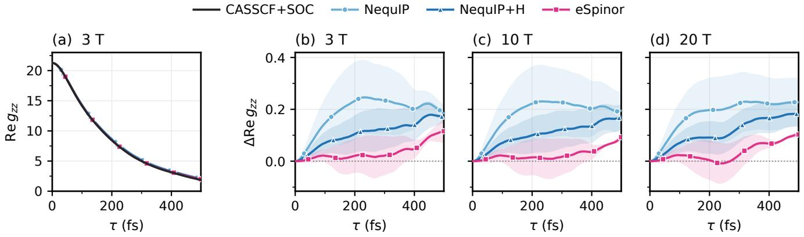  
FIG. 3. Electron-spin correlations from neural models trained on 8k samples. (a) Raw Re $g _ { z z }$ at 3 T, with CASSCF+SOC as reference. (b)–(d) Signed model-minus-reference residuals at 3, 10, and 20 T on a common scale. Dotted lines mark zero error, and shaded bands show pointwise standard deviations. Curves retain lags 0–499 fs without a fitted tail. Results for eqSNAP are included in Table II and in Fig. S3 of the Supplemental Material [31].

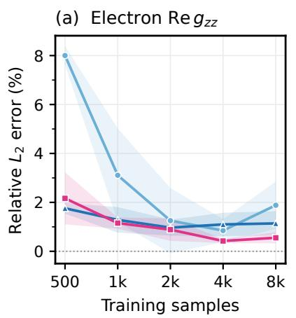

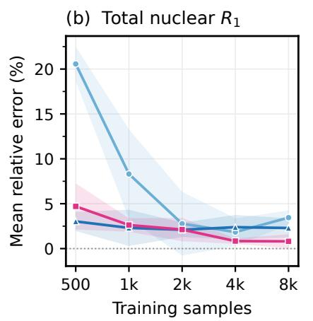

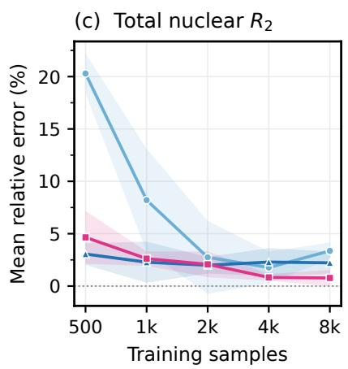  
FIG. 4. Downstream learning curves for NequIP, NequIP+H, and eSpinor. (a) Real electron-correlation relative $L ^ { 2 }$ error averaged over all 6 fields. (b), (c) Total nuclear $R _ { 1 N }$ and $R _ { 2 N }$ errors over H3/H4/H5 and 1, 1.5, 2, and 3 T. All errors are relative to CASSCF+SOC on the common 39k test frames. Shaded bands show standard deviations. Figure S3 of the Supplemental Material [31] includes eqSNAP.

eSpinor gives the lowest mean $R _ { 1 N }$ and $R _ { 2 N }$ errors at 4k and 8k (Table II). At 8k, the absolute rate MAEs are 0.51 and $0 . 4 9 \mathrm { s } ^ { - 1 }$ , compared with 1.40 and $1 . 3 8 ~ \mathrm { s ^ { - 1 } }$ for NequIP+H. Its advantage also holds for $G _ { h }$ and the dipolar rates, connecting the improvement in spin dynamics to the relaxation mechanism that dominates in this field range. The ranking changes at smaller training sets, where eqSNAP leads at 500 and NequIP+H at 1k and 2k (Figs. S3 and S4 in the Supplemental Material [31]).

At 20 T, the susceptibility-dependent Curie mechanism supplies about 93% of the reference $R _ { 2 N }$ , and NequIP gives the lowest total-rate error, as shown in Fig. S4 of the Supplemental Material [31]. The change in ranking follows the shift from dipolar to Curie relaxation, which probes a diferent electronic response.

Correlation and rate comparisons remain complementary because integral and fitted-tail errors can compensate. In the Supplemental Material [31], we examine this cancellation and show that varying the tail cutof and reference susceptibility treatment preserves the 8k low-field ranking.

## E. Transfer from water to methanol

We evaluate the 8k water-trained models on the methanol (MeOH) trajectory without retraining [8]. Inputs include nearby solvent atoms, so this probes transfer to the geometries and local environments sampled in another solvent (see the Supplemental Material [31], Sec. S4 D).

Table III indicates that eSpinor achieves the lowest electronspin and proton-correlation errors, while both nuclear-rate errors stay under 1%. This shows that eSpinor’s dynamical benefit carries over to a diferent solvent trajectory, despite being trained only on data from water. In contrast, susceptibility errors for $\chi T$ are comparable across the neural models.

TABLE III. Transfer errors (%) relative to the MeOH CASSCF+SOC reference using models trained on 8k water geometries. The trajectory and metrics are specified in the Supplemental Material [31].
<table><tr><td>Model</td><td>Re  $g _ { z z }$  1-20 T</td><td>Complex  $G _ { h }$  1-20 T</td><td> $R _ { 1 N }$   $1 { - } 3 \mathrm { ~ T ~ }$ </td><td> $R _ { 2 N }$   $1 { - } 3 \mathrm { T }$ </td><td> $\chi T$ </td></tr><tr><td>eqSNAP</td><td>9.289</td><td>8.402</td><td>11.304</td><td>11.219</td><td>19.851</td></tr><tr><td>NequIP</td><td>2.427</td><td>2.427</td><td>3.209</td><td>3.186</td><td>5.423</td></tr><tr><td>NequIP+H</td><td>2.110</td><td>1.982</td><td>2.296</td><td>2.281</td><td>5.221</td></tr><tr><td>eSpinor</td><td>1.240</td><td>0.979</td><td>0.959</td><td>0.954</td><td>5.263</td></tr></table>

## V. DISCUSSION

## A. OOD ligand generalization

The results in Sec. III show that eSpinor’s improvement extends to unseen ligands at fixed metal ion and coordination number. Better ordering of axial anisotropy and a lower 95thpercentile tensor error connect this gain to candidate screening. The model could prioritize unfamiliar 4-coordinate Co(II) complexes for electronic-structure calculations in searches for molecular magnets [42]. Prospective screening and transfer to other ions and coordination numbers require further testing.

The initializer comparison also has a physical interpretation. AOM describes directional metal–ligand interactions that alter orbital energies and the anisotropy produced by SOC [25, 30]. Its improvement over point-charge initialization is consistent with this role. Yet point-charge eSpinor also outperforms AOM-initialized NequIP+H. A suitable ligand-field description helps, and eSpinor’s advantage over NequIP+H persists with either initializer.

## B. From coeficients to magnetic observables

For Dy, the clearest distinction appears in the dynamical consequences of the predicted tensors. At 8k, similar crystal-field MAEs lead to diferent electron-spin correlations and nuclear relaxation rates (Sec. IV). Propagation weights errors by their action on electronic states, and the correlation averages over molecular motion and field orientations. The diagnostic with a common initial thermal state identifies a smaller systematic residual for eSpinor in the sampled ensemble, despite comparable individual-sample errors. Similar static tensor errors can therefore yield diferent dynamical errors. Models should be assessed on the observables they are intended to predict.

The relevant accuracy criterion also changes with the relax ation mechanism. Dipolar rates depend on spin correlations and proton motion, whereas Curie rates depend quadratically on anisotropic shielding under molecular tumbling, as detailed in Appendix B and the Supplemental Material [31]. This explains why improved dipolar dynamics can coexist with a diferent high-field ranking, and why the full susceptibility error alone does not determine Curie-rate accuracy. Evaluating both correlations and integrated rates therefore gives a more complete assessment of a surrogate for relaxation calculations.

The MeOH test extends the comparison beyond the water trajectory without additional electronic-structure training data. The inputs include nearby solvent atoms, so this result supports transferring the learned mapping to geometries and local environments sampled under another solvent condition.

For 8k eSpinor models, exporting 39k predictions averaged about 12 min on 1 NVIDIA H200 GPU, or 18 ms per geometry including setup and I/O. For context, 2 approximate CASSCF+SOC timing jobs took 1.4–2.3 h per geometry on 72 NVIDIA Grace CPU cores on DeltaAI. The Supplemental Material [31] specifies their diferent electronic-structure settings and the timing scope. This low inference cost, together with the demonstrated water-to-MeOH transfer, could enable longer and more densely sampled trajectories for spin-dynamics calculations using a limited reference set. Broader chemical benchmarks and experimental validation are needed to establish how this approach can guide MRI-probe design.

## C. SU(2) inductive bias

NequIP+H and eSpinor both propagate Hamiltonian-derived information. NequIP+H carries it through integer-rank features, while eSpinor additionally propagates spinor features. Their comparison tests how the architectures use that information. On the water trajectory, the lower electron-correlation and lowfield relaxation errors at 4k and 8k are achieved with 15.5% fewer parameters than NequIP+H (Table II). The gain does not require a larger model.

Spinor propagation constrains how tensor interactions are learned. When updated spinor features are contracted with their complex conjugates, the same learned transformation enters both factors, linking the coeficients of the resulting integer-rank interactions. Keeping the complete set of these products for each Kramers pair allows eSpinor’s updates to be rewritten entirely in integer-rank tensors, with identical predictions, as shown in the Supplemental Material [31]. This exact reformulation preserves eSpinor’s coeficient sharing, whereas NequIP+H uses diferent tensor updates. Our comparisons support eSpinor’s usefulness for ligand generalization and selected ensemble magnetic observables. A future comparison with integer-tensor updates that retain each Kramers pair’s information but learn the interaction coeficients independently would further test the contribution of coeficient sharing.

## VI. CONCLUSIONS

We investigated whether SU(2)-equivariant spinor message passing can provide a useful inductive bias for predicting molecular magnetic properties. To test this, we developed eSpinor to propagate Hamiltonian-derived spinors alongside integer-rank features, with gauge-covariant updates and a gaugeinvariant tensor readout. For Co(II) complexes, eSpinor (AOM) lowers the zero-field-splitting tensor MAE relative to NequIP by 29% in distribution and 23% for unseen ligands. For the Dy(III) complex, eSpinor uses 15.5% fewer parameters than NequIP+H. At 4k and 8k water training geometries, it gives the lowest mean errors among the 4 models in real electron-spin correlations over the tested fields and total nuclear relaxation rates at 1–3 T. At 8k, this advantage persists despite coeficient accuracy similar to NequIP+H and extends to methanol without retraining. Together, these results support SU(2)-equivariant spinor message passing as a useful inductive bias for molecular magnetism in the evaluated systems.

However, the benefit depends on the observable, since susceptibility and some high-field relaxation rates favor integer-rank models. Similar static tensor errors can yield diferent dynamical errors, so surrogates should be assessed on their intended physical observables. Our comparisons measure accuracy relative to the electronic-structure reference. Establishing the practical value of these gains for SMM screening or MRI-probe design requires further validation.

Our current benchmarks are limited to mononuclear complexes because we have not identified a suitable labeled multinuclear dataset. In fact, generating accurate reference data for these systems remains challenging, since electron correlation, SOC, and magnetic exchange between ions must be treated together [43]. Nevertheless, we have formulated parallel transport between metal sites that preserves covariance under independent local eigenbasis changes, as detailed in the Supplemental Material [31] (Sec. S1 E). Future work should test whether this extension improves predictions of magnetic interactions between ions.

## ACKNOWLEDGMENTS

A.A. acknowledges support in part from the Bren Endowed Chair, the Ofice of Naval Research through MURI grant N00014-18-1-2624, DARPA ExpMath (HR0011), and the AI2050 Senior Fellow program at Schmidt Sciences. E.W.S. acknowledges support through the Caltech Summer Under graduate Research Fellowship. B.S.K. acknowledges support from the Pritzker AI+Science Fund, DARPA Biological Technologies (HR0011), and the Eddleman Graduate Fellowship. Y.L. acknowledges support from the Pritzker AI+Science Fund and the Wally Baer and Jeri Weiss Postdoctoral Fellowship. D.K. acknowledges support from the Pritzker AI+Science Fund and DARPA Biological Technologies (HR0011). Authors acknowledge the National Center for High-performance Computing (NCHC), Taiwan, for providing computing resources on Taiwania 2 and Nano 4. This work also used the Delta system at the National Center for Supercomputing Applications through allocation DMR160114 from the Advanced Cyberinfrastructure Coordination Ecosystem: Services & Support (ACCESS) program, which is supported by National Science Foundation grants #2138259, #2138286, #2138307, #2137603, and #2138296.

Claude (Anthropic, Opus 5 and Fable 5) and ChatGPT (OpenAI, GPT-6 Astra) assisted with literature review and manuscript revision. Codex (OpenAI, GPT-5.6 Sol) assisted with writing and debugging data-processing, plotting, and unittest scripts. The authors directed this assistance, reviewed the text and code, and take full responsibility for this work.

## DATA AVAILABILITY

The original COMPASS and PARASHIFT datasets are publicly available from Zenodo [39] and the University of Manchester Figshare [41], respectively. The source code and preprocessing scripts will be made publicly available at AI-QChem/eSpinor upon publication.

## Appendix A: Rotation equivariance and eigenbasis independence

We prove the rotation and eigenbasis transformation laws for the mononuclear architecture in Sec. II, assuming separated Kramers pairs. Linear maps and Clebsch–Gordan couplings are equivariant. Weights and gate values are invariant under rotations and eigenbasis changes. Gate multipliers are shared over all angular components within each irrep and both columns within each Kramers pair. Other column operations must also commute with every allowed $Q _ { a }$ . Below, $g \in { \mathrm { S O } } ( 3 )$ denotes a molecular rotation and $\tilde { g } \in \mathrm { S U } ( 2 )$ either lift of �.

We first establish the Hamiltonian covariance needed for spinor initialization in Sec. II A. Both the point-charge and AOM initializers use the angular expansion

$$
H _ { \mathrm { C F } } ( G ) = \sum _ { b , \ell , q } f _ { b \ell } \sqrt { \frac { 4 \pi } { 2 \ell + 1 } } Y _ { \ell q } ( \widehat { \mathbf { R } } _ { b } ) ^ { * } \mathsf { C } _ { \ell q } .\tag{A1}
$$

At a given metal site, $\widehat { \mathbf { R } } _ { b }$ points toward ligand $^ { b , }$ and $\complement _ { \ell q }$ is a rank-ℓ tensor operator acting on the orbital states of the shell [27]. The sums include $\ell = 0 , 2 , \ldots , 2 \ell _ { \mathrm { s h } }$ and $q \ = \ - \ell , \ldots , \ell .$ The real scalar strengths $f _ { b \ell }$ come from the point-charge or AOM construction and are unchanged by molecular rotations. The spherical harmonics and orbital tensor operators transform with the same rank-ℓ rotation matrices. Their matching components in Eq. (A1) therefore give $H _ { \mathrm { C F } } ( g \cdot G ) = D ^ { ( \ell _ { \mathrm { s h } } ) } ( \tilde { g } ) \bar { H _ { \mathrm { C F } } } ( G ) D ^ { ( \ell _ { \mathrm { s h } } ) } ( \bar { g } ) ^ { \dagger }$ . The strengths and operator conventions are specified in the Supplemental Material [31].

In the coupled basis $| j , m \rangle$ , with $\begin{array} { r } { j = \ell _ { \mathrm { s h } } \pm \frac { 1 } { \gamma } } \end{array}$ , the joint spin– orbital rotation is $U _ { \mathrm { s h } } ( \tilde { g } ) = \bigoplus _ { j = \ell _ { \mathrm { s h } } \pm \frac { 1 } { \gamma } } D ^ { ( j ) } ( \tilde { g } )$ [24]. Since L · S is unchanged under this joint rotation, the full Hamiltonian obeys

$$
H _ { \mathrm { i n i t } } ( g \cdot G ) = U _ { \mathrm { s h } } H _ { \mathrm { i n i t } } ( G ) U _ { \mathrm { s h } } ^ { \dagger } .\tag{A2}
$$

For this fixed rotation, combining Eq. (A2) with Eq. (2) gives

$$
\begin{array} { r l } & { H _ { \mathrm { i n i t } } ( g \cdot G ) \left[ U _ { \mathrm { s h } } \Psi ( G ) \right] = U _ { \mathrm { s h } } [ H _ { \mathrm { i n i t } } ( G ) \Psi ( G ) ] } \\ & { \phantom { \frac { 1 } { 1 } } = [ U _ { \mathrm { s h } } \Psi ( G ) ] E . } \end{array}\tag{A3}
$$

Thus $U _ { \mathrm { s h } } \Psi ( G )$ is an eigenbasis at the rotated geometry with the same energy levels. A separate diagonalization with the same energy ordering can return another orthonormal basis, related by a unitary � satisfying $E Q \ = \ Q E$ The ligand field and L · S are unchanged under time reversal, while the single-electron time-reversal operator obeys $\mathcal { T } ^ { 2 } = - I .$ . These properties guarantee the Kramers pairs [32, 33]. When distinct pairs are separated in energy, $Q = \bigoplus _ { p } Q _ { p }$ with $Q _ { p } \in \mathbf { U } ( 2 )$ Thus $\Psi ( g \cdot G ) = U _ { \mathrm { s h } } \Psi ( G ) Q$ , giving the combined rotation and eigenbasis change in Eq. (3).

If � eigenstates have exactly the same energy, $E Q = Q E$ instead permits arbitrary U(�) mixing within that eigenspace. For 2 coincident Kramers pairs, the freedom is therefore U(4) rather than $\mathbf { U } ( 2 ) \times \mathbf { U } ( 2 )$ . The proof extends only when all gate inputs are invariant under this larger group and column operations commute with it. In particular, weights and diagonal gate multipliers must be equal across all � columns. Small nonzero gaps do not enlarge the gauge group, but can make eigenvectors sensitive to changes in geometry.

We next construct the weighted initialization used in Sec. II B. With uniform weights, the complete eigenbasis gives $\Psi ( I _ { k } / k ) \Psi ^ { \dagger } = I _ { k } / k$ , which contains no geometry-dependent multipoles. Energy-dependent weights allow this contraction to retain information about the ligand environment. Using the weights defined in the Supplemental Material [31], write

$W = \mathrm { d i a g } ( w _ { 1 } , \dots , w _ { k } )$ and $z = \Psi \sqrt { W }$ . Rotations preserve the energy levels and therefore leave � unchanged. Equal weights within each pair imply $Q { \sqrt { W } } = { \sqrt { W } } Q$

The invariant gate $S _ { \mathrm { i n i t } } = \bigoplus _ { p } s _ { p } I _ { 2 }$ also commutes with $Q .$ Initialization is $h ^ { 0 } = \mathcal { L } _ { \mathrm { i n i t } } [ z \dot { S _ { \mathrm { i n i t } } } ]$ . The channel map ${ \mathcal { L } } _ { \mathrm { i n i t } }$ acts at fixed $j ,$ identically on angular indices � and eigenbasis columns �. It therefore commutes with right multiplication by $Q$ and obeys $\mathcal { L } _ { \mathrm { i n i t } } U _ { \mathrm { s h } } = \mathcal { D } \mathcal { L } _ { \mathrm { i n i t } }$ , where $\mathcal { D }$ rotates all output channels. Consequently,

$$
\begin{array} { r } { \begin{array} { r c l } { { z ^ { \prime } = U _ { \mathrm { s h } } \Psi Q \sqrt { W } = U _ { \mathrm { s h } } z Q , } } \\ { { h ^ { 0 \prime } = \mathcal { L } _ { \mathrm { i n i t } } [ U _ { \mathrm { s h } } z S _ { \mathrm { i n i t } } Q ] = \mathcal { D } h ^ { 0 } Q . } } \end{array} } \end{array}\tag{A4}
$$

The prime denotes features at the rotated geometry, including their possible change of eigenbasis. For each rank $j ,$ this is the feature law in Eq. (4). Gauge covariance requires equal weights within each pair, but does not require the Boltzmann form.

The message-passing operations in Sec. II C must preserve Eq. (4). The brackets in that section denote Clebsch–Gordan projection. For the mixed product in Eq. (5), let $P _ { j _ { o } }$ project a rank- $\cdot j _ { i }$ spinor ℎ and a rank-ℓ integer tensor � onto output rank $j _ { o } ,$ . For one pair of feature channels, its components are

$$
[ h ^ { ( j _ { i } ) } \otimes V ^ { ( \ell ) } ] _ { j _ { o } , m _ { o } , u } = \sum _ { m _ { i } , q } C _ { j _ { i } m _ { i } , \ell q } ^ { j _ { o } m _ { o } } h _ { m _ { i } , u } ^ { ( j _ { i } ) } V _ { q } ^ { ( \ell ) } .\tag{A5}
$$

Here $C _ { j _ { i } m _ { i } , \ell { q } } ^ { j _ { o } m _ { o } }$ is a Clebsch–Gordan coeficient, and $j _ { o } = | j _ { i } -$ $\ell | , \ldots , { \dot { j } } _ { i } + { \dot { \ell } }$ in steps of 1 [27]. The projection couples the angular indices $m _ { i }$ and � while leaving the eigenbasis index � unchanged. Taking $\hat { V ^ { ( \ell ) } } = Y ^ { ( \ell ) } ( \hat { \mathbf { r } } _ { a b } )$ gives the neighbor coupling in Eq. (6a). For $h ^ { \prime } = D ^ { ( j _ { i } ) } h Q$ and $V ^ { \prime } = D ^ { ( \ell ) } \bar { V }$ , its intertwining property gives

$$
\begin{array} { c } { { P _ { j _ { o } } ( D ^ { ( j _ { i } ) } \otimes D ^ { ( \ell ) } ) = D ^ { ( j _ { o } ) } P _ { j _ { o } } , } } \\ { { P _ { j _ { o } } [ h ^ { \prime } \otimes V ^ { \prime } ] = D ^ { ( j _ { o } ) } P _ { j _ { o } } [ h \otimes V ] Q . } } \end{array}\tag{A6}
$$

Invariant scalar weights, equivariant channel maps, gates shared within each Kramers pair, and residual addition preserve this law. Integer-tensor products follow the same angular rule without an eigenbasis index.

To form gauge-invariant integer tensors as in Eq. (5), let � and � be spinor features whose eigenbasis columns transform with the same $Q .$ . Write $\mathcal { D } _ { x }$ and $\mathcal { D } ,$ for their rotation matrices. Their transformations $x ^ { \prime } = \mathcal { D } _ { x } x Q$ and $y ^ { \prime } = \mathcal { D } _ { y } y Q$ give

$$
\begin{array} { r l } { x ^ { \prime } y ^ { \prime \dagger } = \mathcal { D } _ { x } x Q Q ^ { \dagger } y ^ { \dagger } \mathcal { D } _ { y } ^ { \dagger } } & { } \\ { = \mathcal { D } _ { x } ( x y ^ { \dagger } ) \mathcal { D } _ { y } ^ { \dagger } . } \end{array}\tag{A7}
$$

The gauge cancels because $Q$ is unitary. Products of halfinteger representations and their conjugates decompose into integer ranks, so angular projections of $x y ^ { \dagger }$ give gauge-invariant integer tensors.

For these feature transformation laws, every real-bilinear equivariant map is a linear combination of Clebsch–Gordan projections with channel coeficients [27]. Angular momentum addition gives integer outputs for equal integer or half-integer types and half-integer outputs for mixed types. Under a common gauge phase, $h \mapsto e ^ { i \phi } \bar { h }$ and $h ^ { * } \mapsto \stackrel { \smile } { e } ^ { - i \phi } h ^ { * }$ , whereas $V$ is unchanged. Thus a mixed product with the same gauge law as ℎ uses $h \otimes V ,$ and a gauge-invariant spinor contraction must be conjugated. For a bilinear column contraction $x _ { p } C _ { p p ^ { \prime } } y _ { p ^ { \prime } } ^ { \dagger }$ between Kramers pairs $p$ and $p ^ { \prime } .$ , with $C _ { p p ^ { \prime } } \in \mathbb { C } ^ { 2 \times 2 }$ , gauge invariance further requires

$$
Q _ { p } C _ { p p ^ { \prime } } Q _ { p ^ { \prime } } ^ { \dagger } = C _ { p p ^ { \prime } } \quad \mathrm { f o r e v e r y a l l o w e d } Q .\tag{A8}
$$

Independent pair phases force $C _ { p p ^ { \prime } } = 0$ for $p \neq p ^ { \prime }$ . For $p = p ^ { \prime }$ Schur’s lemma gives $C _ { p p } = c _ { p } I _ { 2 }$ . The allowed contractions are therefore angular projections of $\begin{array} { r } { \sum _ { p } c _ { p } x _ { p } y _ { p } ^ { \dagger } } \end{array}$ , including scalar weights for each pair. Together with integer-tensor and mixed products, these give the 3 interaction types in Eq. (5).

Starting from Eq. (A4), induction over the interaction layers establishes spinor gauge covariance and rotation equivariance, together with gauge invariance and rotation equivariance of the integer features. The readout in Sec. II D uses these integer tensors and equivariant channel maps, so its predictions obey Eq. (8). Changing the lift of a molecular rotation negates each half-integer factor, and the 2 signs cancel in every contraction. Predictions are consequently independent of both the initial eigenbasis and the choice of lift.

## Appendix B: From spin propagation to nuclear relaxation

We follow the time-domain treatment of PARASHIFT [8]. The Hamiltonian $H _ { \mathrm { e f f } } = H _ { \mathrm { C F } } + H _ { \mathrm { Z } }$ in Sec. IV A includes the Zeeman term $H _ { \mathrm { Z } } ~ = ~ g _ { J } \bar { \mu } _ { B } B _ { 0 } J _ { \parallel }$ , with $g _ { J } \ = \ 4 / 3$ and $\bar { \mu } _ { B } \ =$ $\mu _ { B } / ( h c )$ in $\mathrm { c m } ^ { - 1 } \mathrm { T } ^ { - 1 }$ . It determines the propagator $P ( \tau ; t _ { 0 } )$ through

$$
i \partial _ { \tau } { \cal P } = 2 \pi c { \cal H } _ { \mathrm { e f f } } ( t _ { 0 } + \tau ) { \cal P } , \qquad { \cal P } ( 0 ; t _ { 0 } ) = I .\tag{B1}
$$

Here $c$ is in $\mathrm { c m ~ s ^ { - 1 } }$ and time is in seconds because the Hamiltonian is expressed in cm− $^ { - 1 } .$ Each window starts from its Hamiltonian’s thermal state $\rho _ { 0 }$ . The electronic correlation before averaging is $g _ { \beta \gamma } ( \tau ) = \mathrm { T r } [ \rho _ { 0 } J _ { \beta } P ^ { \dagger } J _ { \gamma } P ]$ , where $\beta , \gamma \in \{ x , y , z \}$ Its longitudinal projection gives Eq. (11).

To obtain nuclear relaxation, we include the dipolar interaction between the electronic magnetic moment and proton $p$ . For a Dy–proton vector $\mathbf { r } _ { p } ,$ , its geometry tensor is $\mathcal { D } _ { p } ~ = ~ ( 3 \hat { \mathbf { r } } _ { p } \hat { \mathbf { r } } _ { p } ^ { T } - I ) / r _ { p } ^ { 3 }$ Contracting it with the electronic correlation gives

$$
\begin{array} { c } { \displaystyle { G _ { p } ( \tau ) = ( g _ { J } \mu _ { B } ) ^ { 2 } \Big \langle \displaystyle \sum _ { \alpha , \beta , \gamma } \mathcal { D } _ { p , \alpha \beta } ( t _ { 0 } ) \mathcal { D } _ { p , \alpha \gamma } ( t _ { 0 } + \tau ) } } \\ { \displaystyle \times g _ { \beta \gamma } ( \tau ) \Big \rangle _ { t _ { 0 } , \hat { \mathbf { n } } } . } \end{array}\tag{B2}
$$

All 3 indices run over Cartesian components. The contraction precedes the trajectory and orientation average, retaining the joint fluctuations of spin and proton geometry. With distances in metres, $G _ { p }$ has units $\mathrm { { [ } m ^ { - 6 } ( J / \bar { T } ) ^ { 2 } }$ . No product of mean moments is subtracted, following the source calculation.

The explicit correlation is extended by a real fitted tail, denoted $\widetilde { G } _ { p }$ . Rotational damping with solvent-dependent correlation time $\tau _ { R }$ then gives the spectral density

$$
\mathcal { T } _ { p } ( \omega ) = \int _ { 0 } ^ { \infty } \widetilde { G } _ { p } ( \tau ) e ^ { - \tau / \tau _ { R } } e ^ { - i \omega \tau } d \tau .\tag{B3}
$$

At the proton Larmor frequency $\omega _ { N } = \gamma _ { N } B _ { 0 }$ , the dipolar rates are

$$
\begin{array} { l } { { \displaystyle R _ { 1 N , p } ^ { \mathrm { d i p } } = \frac { 2 \kappa } { 3 } \mathrm { R e } \mathcal { T } _ { p } ( \omega _ { N } ) } , } \\ { { \displaystyle R _ { 2 N , p } ^ { \mathrm { d i p } } = \frac { \kappa } { 3 } \mathrm { R e } [ \mathcal { T } _ { p } ( 0 ) + \mathcal { T } _ { p } ( \omega _ { N } ) ] } , } \end{array}\tag{B4}
$$

where $\kappa = ( \mu _ { 0 } / 4 \pi ) ^ { 2 } \gamma _ { N } ^ { 2 } , \mu _ { 0 }$ is the vacuum permeability, and $\gamma _ { N }$ is the proton gyromagnetic ratio. Thus rate accuracy depends on an integrated correlation, including its extrapolated tail, rather than on the explicit curve error alone.

[1] G. A. Craig and M. Murrie, 3d single-ion magnets, Chemical Society Reviews 44, 2135 (2015).

[2] C. A. P. Goodwin, F. Ortu, D. Reta, N. F. Chilton, and D. P. Mills, Molecular magnetic hysteresis at 60 kelvin in dysprosocenium, Nature 548, 439 (2017).

[3] A. Gaita-Ariño, F. Luis, S. Hill, and E. Coronado, Molecular spins for quantum computation, Nature Chemistry 11, 301 (2019).

[4] P. Harvey, A. M. Blamire, J. I. Wilson, K.-L. N. A. Finney, A. M. Funk, P. K. Senanayake, and D. Parker, Moving the goal posts: Enhancing the sensitivity ofPARASHIFT proton magnetic resonance imaging and spectroscopy, Chemical Science 4, 4251 (2013).

[5] R. Boča, Zero-field splitting in metal complexes, Coordination Chemistry Reviews 248, 757 (2004).

[6] K. W. H. Stevens, Matrix elements and operator equivalents connected with the magnetic properties of rare earth ions, Proceedings of the Physical Society. Section A 65, 209 (1952).

[7] A. Abragam and B. Bleaney, Electron Paramagnetic Resonance of Transition Ions (Clarendon Press, Oxford, 1970).

[8] T. R. C. Thompson, B. Alnami, J. M. Skelton, and N. F. Chilton, Electron and nuclear spin dynamics of a dysprosium complex in solution, Journal of the American Chemical Society 148, 19536 (2026).

[9] B. O. Roos, P. R. Taylor, and P. E. M. Siegbahn, A complete active space SCF method (CASSCF) using a density matrix formulated super-CI approach, Chemical Physics 48, 157 (1980).

[10] P. Å. Malmqvist, B. O. Roos, and B. Schimmelpfennig, The restricted active space (RAS) state interaction approach with spin–orbit coupling, Chemical Physics Letters 357, 230 (2002).

[11] D. S. Levine, D. Hait, N. M. Tubman, S. Lehtola, K. B. Whaley, and M. Head-Gordon, CASSCF with Extremely Large Active Spaces Using the Adaptive Sampling Configuration Interaction Method, Journal of Chemical Theory and Computation 16, 2340 (2020).

[12] V. Zaverkin, J. Netz, F. Zills, A. Köhn, and J. Kästner, Thermally averaged magnetic anisotropy tensors via machine learning based on Gaussian moments, Journal of Chemical Theory and Computation 18, 1 (2022).

[13] H. Yu, Y. Zhong, L. Hong, C. Xu, W. Ren, X. Gong, and H. Xiang, Spin-dependent graph neural network potential for magnetic materials, Physical Review B 109, 144426 (2024).

[14] H. Yu, B. Liu, Y. Zhong, L. Hong, J. Ji, C. Xu, X. Gong, and H. Xiang, Physics-informed time-reversal equivariant neural network potential for magnetic materials, Physical Review B 110, 104427 (2024).

[15] B. Kalita, R. Zubatyuk, D. M. Anstine, M. Bergeler, V. Settels, C. Stork, S. Spicher, and O. Isayev, AIMNet2-NSE: A transferable reactive neural network potential for open-shell chemistry, Angewandte Chemie International Edition 65, e16763 (2026).

The Curie contribution in Eq. (12) instead uses the mean shielding tensor $\overline { { \sigma } } _ { p } ~ = ~ - \langle \mathcal { D } _ { p } \chi _ { \mathrm { S I } } \rangle _ { t } / ( 4 \pi )$ in the molecular frame. Here �SI is the volume susceptibility per molecule. The shielding anisotropy determines the Curie rates under molecular tumbling. The susceptibility and Curie formulas, tail fitting procedure, and sensitivity checks are given in the Supplemental Material [31].

[16] B. S. Kang, V. C. Bhethanabotla, A. Tavakoli, M. D. Hanisch, A. Horikawa-Strakovsky, M. Nouman, D. Khan, W. A. Goddard, III, and A. Anandkumar, OrbitAll: A unified quantum mechanical representation deep learning framework for all molecular systems, arXiv preprint arXiv:2507.03853 10.48550/arXiv.2507.03853 (2025), version 2, revised July 22, 2026.

[17] X. Gong, H. Li, N. Zou, R. Xu, W. Duan, and Y. Xu, General framework for E(3)-equivariant neural network representation of density functional theory Hamiltonian, Nature Communications 14, 2848 (2023).

[18] Y. Zhong, R. Wang, X. Gong, and H. Xiang, A universal spin– orbit-coupled Hamiltonian model for accelerated quantum material discovery, Nature Machine Intelligence 8, 403 (2026).

[19] A. Duval, S. V. Mathis, C. K. Joshi, V. Schmidt, S. Miret, F. D. Malliaros, T. Cohen, P. Liò, Y. Bengio, and M. Bronstein, A hitchhiker’s guide to geometric GNNs for 3D atomic systems, arXiv preprint arXiv:2312.07511 10.48550/arXiv.2312.07511 (2023).

[20] S. Batzner, A. Musaelian, L. Sun, M. Geiger, J. P. Mailoa, M. Kornbluth, N. Molinari, T. E. Smidt, and B. Kozinsky, E(3)- equivariant graph neural networks for data-eficient and accurate interatomic potentials, Nature Communications 13, 2453 (2022).

[21] V. H. A. Nguyen and A. Lunghi, Predicting tensorial molecular properties with equivariant machine learning models, Physical Review B 105, 165131 (2022).

[22] V. Briganti and A. Lunghi, A machine-learning framework for accelerating spin-lattice relaxation simulations, npj Computational Materials 11, 62 (2025).

[23] R. G. Littlejohn, Representations of the Angular Momentum Operators and Rotations, Physics 221A, Notes 13, University of California, Berkeley (2021).

[24] R. G. Littlejohn, Coupling of Ket Spaces and the Addition of Angular Momenta, Physics 221A, Notes 18, University of California, Berkeley (2021).

[25] L. A. Mariano, V. H. A. Nguyen, V. Briganti, and A. Lunghi, Charting regions of cobalt’s chemical space with maximally large magnetic anisotropy: A computational high-throughput study, Journal of the American Chemical Society 146, 34158 (2024).

[26] A. Zee, Group Theory in a Nutshell for Physicists (Princeton University Press, Princeton, NJ, 2016).

[27] D. A. Varshalovich, A. N. Moskalev, and V. K. Khersonskii, Quantum Theory ofAngular Momentum (World Scientific, Singapore, 1988).

[28] H. Lueken, Course of lectures on magnetism of lanthanide ions under varying ligand and magnetic fields, Lecture notes, RWTH Aachen University (2008).

[29] O. Waldmann, Charge-potential model of ligand field in lanthanide complexes in the single-electron space, Inorganic Chemistry 64, 7666 (2025).

[30] C. E. Schäfer and C. K. Jørgensen, The angular overlap model, an attempt to revive the ligand field approaches, Molecular Physics 9, 401 (1965).

[31] See Supplemental Material at [URL will be inserted by publisher] for initialization and layer formulas, numerical equivariance tests, benchmark settings, and additional magnetic-property and spindynamics results.

[32] H. A. Kramers, Théorie générale de la rotation paramagnétique dans les cristaux, Proceedings of the Royal Netherlands Academy of Arts and Sciences 33, 959 (1930).

[33] E. Wigner, Über die Operation der Zeitumkehr in der Quantenmechanik, Nachrichten von der Gesellschaft der Wissenschaften zu Göttingen, Mathematisch-Physikalische Klasse 1932, 546 (1932).

[34] D. Lim, J. Robinson, L. Zhao, T. Smidt, S. Sra, H. Maron, and S. Jegelka, Sign and basis invariant networks for spectral graph representation learning, in International Conference on Learning Representations (ICLR) (2023).

[35] D. Lim, J. W. Robinson, S. Jegelka, and H. Maron, Expressive Sign Equivariant Networks for Spectral Geometric Learning, in Advances in Neural Information Processing Systems, Vol. 36 (2023).

[36] T. S. Cohen, M. Weiler, B. Kicanaoglu, and M. Welling, Gauge equivariant convolutional networks and the icosahedral CNN, in International Conference on Machine Learning (ICML), Proceedings of Machine Learning Research, Vol. 97 (PMLR, 2019) pp. 1321–1330.

[37] L. Huang, O. Balabanov, H. Linander, M. Granath, D. Persson, and J. E. Gerken, Learning Chern numbers of multiband topological insulators with gauge equivariant neural networks, in Advances in Neural Information Processing Systems (NeurIPS), Vol. 38 (2025).

[38] J. Gilmer, S. S. Schoenholz, P. F. Riley, O. Vinyals, and G. E. Dahl, Neural message passing for quantum chemistry, in Proceedings of the 34th International Conference on Machine Learning, Proceedings of Machine Learning Research, Vol. 70 (2017) pp. 1263–1272.

[39] A. L. Mariano, A. Lunghi, and V. H. A. Nguyen, COMPASS, Zenodo (2024), data set, version 1.

[40] L. F. Chibotaru and L. Ungur, Ab initio calculation of anisotropic magnetic properties of complexes. I. Unique definition of pseudospin Hamiltonians and their derivation, The Journal of Chemical Physics 137, 064112 (2012).

[41] N. Chilton, Research data for: Electron and Nuclear Spin Dynamics of a Lanthanide Complex in Solution, University of Manchester Figshare (2025), dataset.

[42] L. Frangoulis, Z. Khatibi, L. A. Mariano, and A. Lunghi, Generating new coordination compounds via multireference simulations, genetic algorithms, and machine learning: The case of Co(II) and Dy(III) molecular magnets, JACS Au 5, 3808 (2025).

[43] T. Bodenstein, A. Heimermann, K. Fink, and C. van Wüllen, Development and Application of a Complete Active Space Spin-Orbit Configuration Interaction Program Designed for Single Molecule Magnets, ChemPhysChem 23, e202100648 (2022).

[44] B. Bode, G. Bauer, L. Herriott, V. Kindratenko, and W. Gropp, DeltaAI: A National Resource for AI/ML Research, in Practice and Experience in Advanced Research Computing 2025: The Power ofCollaboration, PEARC ’25 (Association for Computing Machinery, New York, 2025) pp. 1–4, article 53.

[45] I. Fdez. Galván, M. Vacher, A. Alavi, C. Angeli, F. Aquilante, J. Autschbach, et al., OpenMolcas: From Source Code to Insight, Journal of Chemical Theory and Computation 15, 5925 (2019).

[46] J. Gasteiger and M. Marsili, Iterative partial equalization of orbital electronegativity—a rapid access to atomic charges, Tetrahedron 36, 3219 (1980).

[47] J. Gasteiger, J. Groß, and S. Günnemann, Directional message passing for molecular graphs, in International Conference on Learning Representations (ICLR) (2020).

[48] C. R. Harris, K. J. Millman, S. J. van der Walt, R. Gommers, P. Virtanen, D. Cournapeau, et al., Array programming with NumPy, Nature 585, 357 (2020).

[49] J. D. Hunter, Matplotlib: A 2D graphics environment, Computing in Science & Engineering 9, 90 (2007).

[50] A. Scheie, PyCrystalField: Software for calculation, analysis and fitting of crystal electric field Hamiltonians, Journal of Applied Crystallography 54, 356 (2021).

[51] J. H. Van Vleck, The Theory of Electric and Magnetic Susceptibilities (Clarendon Press, Oxford, 1932).

[52] P. Virtanen, R. Gommers, T. E. Oliphant, M. Haberland, T. Reddy, D. Cournapeau, et al., SciPy 1.0: Fundamental Algorithms for Scientific Computing in Python, Nature Methods 17, 261 (2020).

# SU(2)-Equivariant Spinor Message Passing for Molecular Magnetism Supplemental Material

Erh-Wei Sheng1,2, Beom Seok Kang3, Yuchao Lin1, Danish Khan1, and Anima Anandkumar1

1Division ofEngineering and Applied Science, California Institute ofTechnology, Pasadena, California 91125, USA 2Department of Chemical Engineering, National Tsing Hua University, Hsinchu 300044, Taiwan 3Division of Chemistry and Chemical Engineering, California Institute of Technology, Pasadena, California 91125, USA

## S1. IMPLEMENTATION AND SYMMETRY DETAILS

## A. Hamiltonian initialization

For Co(II), $( \ell _ { \mathrm { s h } } , k ) \ = \ ( 2 , 1 0 )$ , and for Dy(III), (3, 14). With metal–ligand vectors $\mathbf { R } _ { b } = R _ { b } \hat { \mathbf { R } } _ { b }$ , the Condon–Shortley convention [1] gives

$$
\begin{array} { r l r } { c _ { \ell q } ( \hat { \bf R } ) = \sqrt { \displaystyle \frac { 4 \pi } { 2 \ell + 1 } } Y _ { \ell q } ( \hat { \bf R } ) , } & { \left( \mathbb { C } _ { \ell q } \right) _ { m m ^ { \prime } } = \left( - 1 \right) ^ { m } ( 2 \ell _ { \mathrm { s h } } + 1 ) \left( \begin{array} { l l l } { \ell _ { \mathrm { s h } } } & { \ell } & { \ell _ { \mathrm { s h } } } \\ { 0 } & { 0 } & { 0 } \end{array} \right) \left( \begin{array} { l l l } { \ell _ { \mathrm { s h } } } & { \ell } & { \ell _ { \mathrm { s h } } } \\ { - m } & { q } & { m ^ { \prime } } \end{array} \right) , } & \\ { H _ { \mathrm { C F } } = \displaystyle \sum _ { b , \ell , q } f _ { b \ell } c _ { \ell q } ( \hat { \bf R } _ { b } ) ^ { * } \mathbb { C } _ { \ell q } , } & { \ell = 0 , 2 , \dots , 2 \ell _ { \mathrm { s h } } . } & \end{array}\tag{S1}
$$

Here $m , m ^ { \prime }$ are orbital projections. The rotation laws are derived in Appendix A of the main text.

Point-charge strengths are $f _ { b \ell } ^ { \mathrm { p c } } = \kappa Z _ { b } ^ { \mathrm { e f f } } r _ { \ell } ^ { \mathrm { e f f } } / R _ { b } ^ { \ell + 1 }$ , with $\kappa = 1 4 . 3 9 9 6 \times 8 0 6 5 . 5 4 \mathrm { c m } ^ { - 1 } \mathring { \mathrm { A } }$ . We use non-hydrogen neighbors within $3 \textup { \AA }$ and Gasteiger charges [2]. Failed or zero assignments use $( - . 4 2 , - . 6 6 , - . 2 8 , - . 9 8 , - . 6 2 , - . 5 2 , - . 3 8 , - . 2 1 , - . 1 7 , - . 2 2 )$ for (N, O, S, F, Cl, Br, I, P, C, Se), in units of elementary charge. The PyCrystalField-based constants [3] are

$$
\begin{array} { r l } { \frac { \ d \cdot \big \vert \xi / ( \mathrm { c m } ^ { - 1 } ) ~ \mathstrut ~ r _ { 0 } ^ { \mathrm { e f f } } ~ } { \mathrm { C o } ^ { 2 + } } } & { { } \frac { \big \vert \xi / ( \mathrm { c m } ^ { - 1 } ) ~ \mathstrut ~ r _ { 6 } ^ { \mathrm { e f f } } ~ } { \mathrm { - 5 2 7 } ~ 1 ~ 0 . 3 6 0 ~ 0 . 3 1 0 ~ \mathrm { n o t } ~ \mathrm { u s e d } } } \\ { \mathrm { D y } ^ { 3 + } } & { { } 1 9 0 0 ~ } & { { } 1 ~ 0 . 8 4 9 ~ 1 . 9 7 7 ~ 1 0 . 4 4 } \end{array}\tag{S2}
$$

Both Hamiltonian-informed models use these prefactors in $\mathring { \mathrm { A } } ^ { \ell }$ and distances in ${ \mathrm { { \acute { A } } } } .$ The Dy values omit $\mathbf { B o h r - t o - } \tilde { \mathbf { A } }$ conversion and shielding, so they define the feature map rather than calibrated radial moments.

The angular-overlap model learns ligand-axis orbital energies $e _ { b \mu }$ [4]. With $\Lambda _ { \nu \ell } = ( { \mathsf { C } } _ { \ell 0 } ) _ { \nu \nu }$ and $\nu = 0 , \ldots , \ell _ { \mathrm { s h } }$ , its strengths satisfy

$$
f _ { b } ^ { \mathrm { A O M } } = \Lambda ^ { - 1 } e _ { b } , \qquad e _ { b \mu } = \sum _ { \nu = \mu } ^ { 2 } \mathrm { s o f t p l u s } ( z _ { b \nu } ) , \qquad z _ { b } = \mathrm { M L P } ( V _ { b } ^ { ( 0 ) } , \bullet \mathrm { m b } ( Z _ { b } ) , R _ { b } ) .\tag{S3}
$$

For $\mathrm { C o } , \mu = 0 , 1 , 2$ denotes $\sigma , \pi , \delta$ bonding. The MLP uses 8 element-embedding components, a width-32 SiLU layer, and first-convolution scalars. Zero final weights and inverse-softplus biases initialize $( e _ { \sigma } , e _ { \pi } , e _ { \delta } ) \simeq ( 4 0 0 0 , 8 0 0 , 0 ) ~ \mathrm { c m } ^ { - 1 }$ , with a $1 0 ^ { - 3 } \mathrm { c m } ^ { - 1 }$ floor.

After adding SOC and diagonalizing in the coupled basis of Appendix A, we use

$$
\bar { \epsilon } _ { 2 p - 1 } = \bar { \epsilon } _ { 2 p } = \frac { \epsilon _ { 2 p - 1 } + \epsilon _ { 2 p } } { 2 } , \qquad w _ { u } = \frac { e ^ { - \bar { \epsilon } _ { u } / T _ { B } } } { \sum _ { \nu } e ^ { - \bar { \epsilon } _ { \nu } / T _ { B } } } , \qquad z = \Psi \sqrt { \mathrm { d i a g } ( w ) } .\tag{S4}
$$

The learned scale $T _ { B }$ is not a physical temperature. We subtract the lowest energy and floor $T _ { B }$ at $1 \mathrm { c m } ^ { - 1 }$ and $w _ { u }$ at $1 0 ^ { - 1 2 }$ without renormalizing. The gauge conditions are derived in Appendix A.

Eigenvector backpropagation replaces inverse energy gaps by

$$
\frac { 1 } { \epsilon _ { j } - \epsilon _ { i } } \longrightarrow F _ { i j } = \frac { \epsilon _ { j } - \epsilon _ { i } } { ( \epsilon _ { j } - \epsilon _ { i } ) ^ { 2 } + \delta ^ { 2 } } , F _ { i i } = 0 , \delta = 5 \mathrm { c m } ^ { - 1 } .\tag{S5}
$$

The resulting Hamiltonian gradient is Hermitized. Only gradients are regularized. The eigensolver-failure fallback raises precision and adds a diagonal ramp. The covariance proof and numerical checks use unperturbed Hamiltonians.

## B. Feature updates and tensor outputs

A fixed unitary map converts real features to the complex spherical basis, $f _ { \mathrm { c } } ^ { ( \ell ) } = U \ell f _ { \mathrm { r } } ^ { ( \ell ) }$ , with $D _ { \mathrm { c } } ^ { ( \ell ) } U _ { \ell } = U _ { \ell } D _ { \mathrm { r } } ^ { ( \ell ) } \left[ 5 \right]$ . We use the spinor messages derived in Appendix A, divided by the square root of the receiving site’s neighbor count. Integer convolutions use a self-connection and Table S1’s normalization. The conjugated contraction is

$$
T _ { q } ^ { ( \ell ; j , j ^ { \prime } ) } = \sum _ { m , m ^ { \prime } , u } ( - 1 ) ^ { j ^ { \prime } - m ^ { \prime } } C _ { j m , j ^ { \prime } ( - m ^ { \prime } ) } ^ { \ell q } x _ { m , u } ^ { ( j ) } ( y _ { m ^ { \prime } , u } ^ { ( j ^ { \prime } ) } ) ^ { * } .\tag{S6}
$$

Its real and imaginary parts in coordinates $U _ { \ell } ^ { \dagger } T$ supply separate real tensor channels.

All gates use SiLU MLPs of hidden width 16, outputs clamped to $[ - 3 , 3 ]$ , and initial multipliers of 1. For pair energies ${ \bf e } = ( \bar { \epsilon } _ { 2 p } ) _ { p }$ and $\begin{array} { r } { \nu _ { p } = \sum _ { u = 2 p - 1 } ^ { 2 p } | | \Psi _ { \cdot u } } \end{array}$ ∥2, initialization uses

$$
\begin{array} { r } { \mathbf { s } _ { \mathrm { i n i t } } = \mathrm { c l i p } _ { [ - 3 , 3 ] } \mathbf { M L P } _ { \mathrm { i n i t } } \big ( \mathrm { s t d } ( \mathbf { e } ) , \nu / \bar { \nu } , V ^ { ( 0 ) } , n _ { \mathrm { s h } } \big ) . } \end{array}\tag{S7}
$$

Here �¯ is the pair mean, $n _ { \mathrm { s h } } = 7 \left( \mathrm { C o } \right) \mathrm { o r } 9 \left( \mathrm { D y } \right)$ , and std centers and scales by the population standard deviation. Norms and denominators are floored at $1 0 ^ { - 8 }$ . Gating precedes a near-identity channel map. A width-16 MLP maps std(2e) and $n _ { \mathrm { s h } }$ to integer scalars. Increment gates add the invariants in Sec. S1 C, with pair-shared multipliers at fixed $j .$

Before contraction, angular expansion increases tensor-channel multiplicities,

$$
\widetilde { h } = \sigma _ { \mathrm { w d } } \big ( \iota h + \mathcal { W } [ h \otimes V ] \big ) , \qquad h _ { \mathrm { b } } = \frac { \widetilde { h } } { \sqrt { 1 + \| \widetilde { h } \| _ { F } ^ { 2 } } } .\tag{S8}
$$

The embedding � preserves the original spinors, which alone propagate between layers. The gate depends on integer scalars and is independent of the eigenbasis column. Each interaction contracts 4 learned pairs of $h _ { \mathbf { b } } .$ , with $j \overset { \cdot } { \simeq } j _ { \mathrm { m a x } } ^ { \mathrm { i n i t } } + 2$ and output rank $\ell \leq 2 \ell _ { \mathrm { s h } } + 1$ . Readout uses all allowed products with � and the contraction $h _ { \mathrm { b } } h _ { \mathrm { b } } ^ { \dagger }$

Co outputs use the orthonormal symmetric, traceless Cartesian basis $\mathsf { E } _ { q }$ of e3nn [5], $\widehat { \bf D } = \Sigma _ { q = - 2 } ^ { 2 } \hat { y } _ { q } ^ { ( 2 ) } \mathsf E _ { q }$ . For Dy, let $r _ { \ell q } = \| O _ { q } ^ { ( \ell ) } \| _ { F } ^ { 2 } / \| O _ { 0 } ^ { ( \ell ) } \| _ { F } ^ { 2 }$ , so $r _ { \ell , - q } = r _ { \ell q }$ and $r _ { \ell 0 } = 1$ . Equal-norm spherical operators use $T _ { 0 } ^ { ( \ell ) } = O _ { 0 } ^ { ( \ell ) }$ and the Condon–Shortley convention [1]. For $c = U _ { \ell } \hat { y } ^ { ( \ell ) }$ , fixing the phase by $U _ { \ell } Y _ { \mathrm { r } } ^ { ( \ell ) } ( \hat { \mathbf { z } } ) = e _ { 0 }$ , with $( e _ { 0 } ) _ { q } = \delta _ { q 0 }$ , for unit-norm harmonics gives

$$
B _ { 0 } ^ { ( \ell ) } = c _ { 0 } , \qquad B _ { q } ^ { ( \ell ) } = \frac { c _ { - q } + ( - 1 ) ^ { q } c _ { q } } { \sqrt { 2 r _ { \ell q } } } , \qquad B _ { - q } ^ { ( \ell ) } = \frac { i [ ( - 1 ) ^ { q } c _ { q } - c _ { - q } ] } { \sqrt { 2 r _ { \ell q } } } , \quad q > 0 .\tag{S9}
$$

All Dy neural models use this map and raw Stevens labels, including Stevens factors.

## C. Factorized tensor updates

In exact arithmetic, before learned gates and numerical floors, Eq. (S4) gives

$$
\rho _ { B } = z z ^ { \dagger } = { \frac { e ^ { - H _ { \mathrm { i n i t } } / T _ { B } } } { \mathrm { t r } e ^ { - H _ { \mathrm { i n i t } } / T _ { B } } } } , \qquad z = \rho _ { B } ^ { 1 / 2 } \Psi .\tag{S10}
$$

This has the form of a thermal density matrix, with � its factor and � the auxiliary index of a purification [6]. The analogy is formal because $H _ { \mathrm { i n i t } }$ is approximate and $T _ { B }$ is learned. The later feature Gram matrix ℎℎ† has no imposed thermal form.

For a Kramers pair, collect angular components and channels into $h _ { p } \in \mathbb { C } ^ { d \times 2 }$ and define $\rho _ { p } = h _ { p } h _ { p } ^ { \dagger }$ . These matrices determine $h _ { p }$ up to U(2) and decompose into integer tensors. Gate inputs follow from $\Vert \Pi _ { j } h _ { p } \Vert _ { F } ^ { 2 } = \mathrm { t r } ( \Pi _ { j } \rho _ { p } )$ and $\| h _ { p } ^ { \dagger } h _ { p ^ { \prime } } \| _ { F } ^ { 2 } = \mathrm { t r } ( \rho _ { p } \rho _ { p ^ { \prime } } )$ where $\Pi _ { j }$ projects onto angular momentum $j .$ At fixed geometry and �, write $\delta h _ { p } = M h _ { p }$ and let $S _ { p }$ contain the pair-shared gates. The residual update gives

$$
A _ { p } = I + S _ { p } { \mathcal { M } } , \qquad h _ { p } ^ { + } = A _ { p } h _ { p } , \qquad \rho _ { p } ^ { + } = A _ { p } \rho _ { p } A _ { p } ^ { \dagger } .\tag{S11}
$$

Increment gates use $\boldsymbol { \mathcal { M } } \rho _ { p } \boldsymbol { \mathcal { M } } ^ { \dagger }$ in these identities, so $A _ { p }$ is input dependent. Writing expansion as $\widetilde { h } = F _ { V } h$ gives $\begin{array} { r } { { \widehat { \rho } } = F _ { V } ( \sum _ { p } \rho _ { p } ) F _ { V } ^ { \dagger } } \end{array}$ and $\rho _ { \mathrm { b } } = \widehat { \rho } / ( 1 + \operatorname { t r } \widehat { \rho } )$ . Learned channel maps give contractions $P _ { c } \rho _ { \mathrm { b } } ( P _ { c } ^ { \prime } ) ^ { \dagger }$ . Thus complete pair matrices, including angular and channel cross terms, reproduce the predictions. At fixed gates, $\begin{array} { r } { A = \sum _ { \alpha } { a _ { \alpha } T _ { \alpha } } } \end{array}$ links tensor-interaction coeficients as $a _ { \alpha } a _ { \beta } ^ { * }$ NequIP+H uses diferent integer-feature updates (Sec. S2 B).

## D. Numerical equivariance and implementation tests

Residuals use $\epsilon ( X , Y ) = \| X - Y \| _ { F } / \mathrm { m a x } ( \| X \| _ { F } , \| Y \| _ { F } , 1 0 ^ { - 3 0 } )$ . Each shell uses 3 distorted 6-ligand geometries with synthetic Kramers-paired eigenvectors, 3 rotations, 3 within-pair gauge changes, and a sign flip. Networks have 3 layers, 4 channels through rank 6, and 4 contraction pairs, with nonzero spinor contributions verified. Maximum float32/complex64 residuals $( \epsilon _ { h } , \epsilon _ { y } )$ are $( 4 . 9 6 \times 1 0 ^ { - 7 } , 1 . 6 4 \times 1 0 ^ { - 6 } )$ for rotation, $( 3 . 6 1 \times 1 0 ^ { - 7 } , 1 . 7 9 \times 1 0 ^ { - 6 } )$ for gauge, and (0, 0) for sign. Outputs cover ranks (2, 4) for � and (2, 4, 6) for � shells. Across 9 float64/complex128 initializer cases, covariance, paired-energy, and time-reversal residuals are at most $2 . 8 2 \times \mathrm { i } 0 ^ { - 1 5 }$ . Spinor and matrix updates agree within $2 . 3 8 \times 1 0 ^ { - 7 }$ . Output-conversion checks at $J = 1 5 / 2$ and 4 use tolerances $2 \times 1 0 ^ { - 5 }$ (float32) and 10−11 (float64).

We also examine the trained Co initializers on 862 in-distribution and 473 ligand-OOD geometries. For pair energies $E _ { p } = ( \epsilon _ { 2 p - 1 } + \epsilon _ { 2 p } ) / 2$ , the minimum inter-pair gap is $\begin{array} { r } { \Delta _ { \operatorname* { m i n } } = \operatorname* { m i n } _ { p } ( E _ { p + 1 } - E _ { p } ) } \end{array}$ . Its smallest values are $7 . 6 2 \mathrm { c m } ^ { - 1 }$ for AOM and 8.02 cm−1 for point-charge initialization. Smaller gaps show no systematic increase in tensor error in Fig. S1.

For each initializer and split, we perturb the 6 smallest-gap geometries and 6 near the median in 2 random directions, keeping the metal fixed. Nonmetal RMS displacements range from $1 \bar { 0 } ^ { - 7 } \ \mathrm { t o } \ 1 0 ^ { - 2 } \ \mathring { \mathrm { A } } .$ , with neighbors and ligand masks recomputed. At small steps with unchanged connectivity, double-precision output changes are proportional to displacement. Single precision reaches a numerical floor at the smallest steps. These checks concern local continuity at the sampled finite gaps.

(d) eSpinor (pc) Gap distribution  
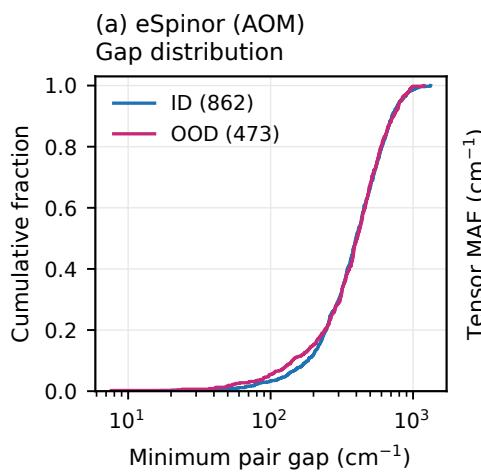

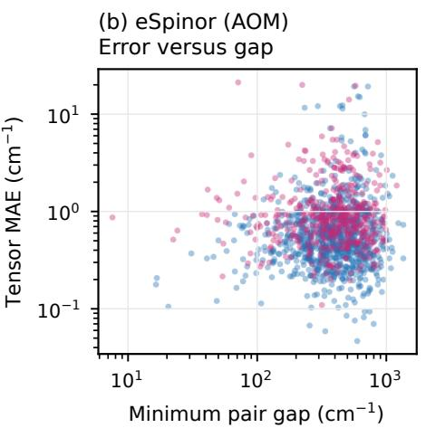

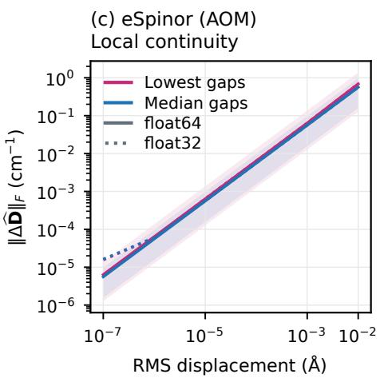  
(f) eSpinor (pc)Local continuity

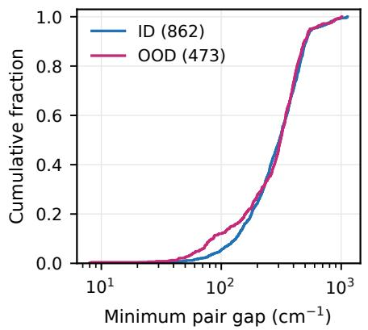

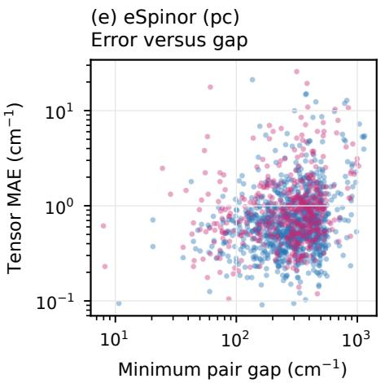

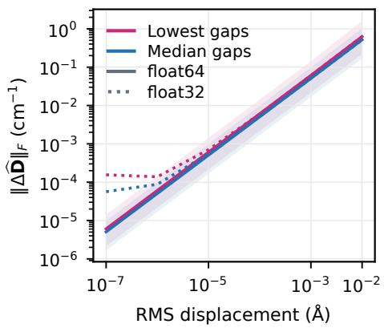  
FIG. S1. Kramers-pair gaps and prediction continuity for the current Co eSpinor checkpoints with AOM (top) and point-charge (bottom) initialization. (a), (d) Cumulative gap distributions. (b), (e) Cartesian tensor MAE per complex. (c), (f) Median output changes over 24 geometries and 2 directions, taking the larger change from the 2 displacement signs. Shading spans the double-precision minimum and maximum.

## E. Parallel transport for multinuclear systems

For same-shell metals, transport between independent eigenbases [7] uses

$$
\Gamma _ { b \to a } = \Psi _ { b } ^ { \dagger } K _ { b a } \Psi _ { a } , \qquad h _ { b \to a } = h _ { b } \Gamma _ { b \to a } , \qquad \widetilde { h } _ { a } = h _ { a } + \sum _ { b \in N _ { \mathrm { m e t a l } } ( a ) } w _ { a b } h _ { b \to a } .\tag{S12}
$$

$K _ { b a }$ maps receiver to sender bases $( K _ { b a } = I$ in common axes), and $w _ { a b }$ is invariant. For $K _ { b a } ^ { \prime } = U K _ { b a } U ^ { \dagger } , \Gamma _ { b \to a } ^ { \prime } = Q _ { b } ^ { \dagger } \Gamma _ { b \to a } Q _ { a }$ and $h _ { b  a } ^ { \prime } = \mathcal { D } h _ { b  a } \mathcal { Q } _ { a }$ give covariance at the receiving site.

## S2. DATA PREPROCESSING AND TRAINING

## A. Datasets and averaging

COMPASS filtering retains 14573 of 15559 Set-1 records with complete ab initio ligand-field entries, including VLFT, and 206 ligand identifiers [8, 9]. These entries check completeness only. NumPy’s default\_rng(42) shufles sorted identifiers, reserving the first 41. Among 4-coordinate complexes, 8616 use only retained ligands and 473 use only reserved ligands (40 identities), forming the OOD set. Mixed complexes are excluded. Shufling the 8616 structures from filtered dataset order with default\_rng(43) gives 862 validation, 862 in-distribution test, and 6892 training structures, in that order.

PARASHIFT provides Dy CASSCF+SOC labels along the trajectory of the deuterated Gd analogue in $\mathrm { D } _ { 2 } \mathrm { O } \left[ 1 0 , 1 1 \right]$ . At 1 fs spacing, the zero-based frame intervals are

$$
Z _ { \mathrm { t r a i n } } = [ 0 , N ) , \quad N \in \{ 5 0 0 , 1 0 0 0 , 2 0 0 0 , 4 0 0 0 , 8 0 0 0 \} ,
$$

$$
\begin{array} { r } { \mathcal { T } _ { \mathrm { v a l } } = [ 5 0 0 0 0 , 5 1 0 0 0 ) , \qquad \mathcal { T } _ { \mathrm { t e s t } } = [ 5 1 0 0 0 , 9 0 0 0 0 ) . } \end{array}\tag{S13}
$$

Preprocessing selects periodic images nearest the metal and retains atoms within $6 \mathrm { \AA } ,$ including solvent. Coordinates and targets share laboratory axes. Dy neural fits use seeds 0, 1, and 42 on the fixed split, with unchanged settings across budgets. eqSNAP uses deterministic ridge regression. We average errors evaluated separately for each fit. Bands show sample standard deviations, faint points show individual fits, and larger markers show means. This spread measures training variability on the same trajectory.

## B. Models and optimization

eqSNAP uses MolForge bispectra through $2 j _ { \mathrm { m a x } } = 8$ and $\mathrm { ~ a ~ 4 ~ \AA ~ }$ cutof [12, 13]. For Dy, species-pooled features and rankwise ridge fits are

$$
X _ { \ell m , s i } = \sum _ { a : s ( a ) = s } b _ { i } ( a ) \sum _ { b \neq a } f _ { \mathrm { c u t } } ( r _ { a b } ) Y _ { \ell m } ( \hat { \mathbf { r } } _ { a b } ) , \qquad \widehat { T } _ { \ell m } = \sum _ { s , i } \beta _ { s i } ^ { ( \ell ) } X _ { \ell m , s i } , \qquad \mathcal { L } = \lVert X \beta - y \rVert _ { 2 } ^ { 2 } + \lambda ^ { 2 } \lVert \beta \rVert _ { 2 } ^ { 2 } .\tag{S14}
$$

Weights are shared over $m .$ . With 5 species and 55 bispectra, ranks $( 2 , 4 , 6 )$ use 825 real weights, stored as 1650 real/imaginary entries. Dy fits raw Stevens units with $\lambda = 0 . 1$ at every budget, so efective regularization per sample decreases with �. Co uses metal-centered descriptors and validation tensor RMSE to select $\lambda = 1 0$ from {0.01, 0.1, 1, 10, 100}.

Co GM-NN [14] uses widths (360, 512, 512, 1), 5 radial functions with 7 Gaussians each, an 8 Å cutof, batch size 32, and 1000 maximum epochs. Learning rates decay linearly from 0.02. Training uses the implementation’s 5-component tensor loss, with validation tensor MAE selecting the checkpoint.

TABLE S1. Settings for NequIP, NequIP+H, and eSpinor, fixed across Dy training budgets.
<table><tr><td>Setting</td><td>Co</td><td>Dy</td></tr><tr><td>Convolutions / maximum integer rank / channels per rank</td><td colspan="2">3/6/4</td></tr><tr><td>Radial basis size / cutoff order</td><td colspan="2"></td></tr><tr><td>NequIP+H initializer</td><td>AOM</td><td>Point charge</td></tr><tr><td>eSpinor initializer</td><td>AOM or point charge</td><td>Point charge</td></tr><tr><td>Graph cutoff  $( \textup { \AA } ) \ : I$  average-neighbor normalization</td><td>6 / 10</td><td>4/6</td></tr><tr><td>Integer radial MLP depth / width</td><td>3/64</td><td>1/ 128</td></tr><tr><td>eSpinor radial hidden width</td><td>64</td><td>4</td></tr><tr><td>Batch size</td><td>32</td><td>64</td></tr><tr><td>Initial  $T _ { B } ( \mathrm { c m } ^ { - 1 } )$ </td><td>200</td><td>7500 (eSpinor), 200 (NequIP+H)</td></tr><tr><td>Peak / final learning rate</td><td colspan="2"> $2 \times 1 0 ^ { - 3 } / 1 0 ^ { - 6 }$ </td></tr><tr><td>Warmup / maximum epochs / stopping patience</td><td colspan="2">10 / 300 / 100</td></tr><tr><td>Weight decay / gradient norm limit / EMA decay</td><td colspan="2"> $1 0 ^ { - 4 } / 1 / 0 . 9 9$ </td></tr></table>

Graphs include hydrogens, with cutofs in Table S1. NequIP+H and eSpinor fit their initializers separately, using reference magnetic parameters only as targets. At each layer, NequIP+H gates the weighted initial eigenvectors � using current integer scalars and $\operatorname { E q . }$ (S7). The invariant diagonal gate $S _ { \mathrm { H } }$ has equal values within each Kramers pair. Its gauge-invariant projector sum and normalized channel contractions are

$$
\rho _ { \mathrm { H } } = ( z S _ { \mathrm { H } } ) ( z S _ { \mathrm { H } } ) ^ { \dagger } , \qquad b _ { \mathrm { H } } = \frac { z S _ { \mathrm { H } } } { \sqrt { 1 + \| z S _ { \mathrm { H } } \| _ { F } ^ { 2 } } } , \qquad C _ { c } = ( P _ { c } b _ { \mathrm { H } } ) ( P _ { c } ^ { \prime } b _ { \mathrm { H } } ) ^ { \dagger } .\tag{S15}
$$

Maps $P _ { c } , P _ { c } ^ { \prime }$ multiply each � subspace by a learned complex scalar. Projection gives real/imaginary tensor channels without expansion. Each layer recomputes these tensors from � and couples them to �, which propagates the electronic information. Dy readout multiplicities at ranks (2, 4, 6) are (3, 3, 3) for NequIP+H and (43, 64, 73) for eSpinor. The point-charge eSpinor initializer precedes all 3 convolutions, while Co AOM follows the first convolution and leaves 2 spinor updates.

NequIP, NequIP+H, and eSpinor minimize the normalized tensor error

$$
\mathcal { L } = \frac { 1 } { \vert \mathcal { T } \vert } \sum _ { r \in \mathcal { T } } \frac { \langle \Vert \hat { \mathbf { y } } _ { r } - \mathbf { y } _ { r } \Vert _ { 2 } ^ { 2 } \rangle _ { \mathcal { B } } } { d _ { r } s _ { r } ^ { 2 } } .\tag{S16}
$$

Here $r \in \mathcal { T }$ labels prediction heads, ${ \bf y } _ { r }$ and $\hat { \mathbf { y } } _ { r }$ are reference and predicted component vectors, and $\langle \cdot \rangle _ { \mathcal { B } }$ is the batch mean. The component count is $d _ { r } = 9$ for Co and $5 , 9 ,$ , and 13 for Dy ranks $2 , 4 ,$ and 6. The scale $s _ { r }$ is the training-target standard deviation over samples and components, floored at $1 0 ^ { - 6 }$ in target units. Dy uses fixed Bessel functions and a polynomial cutof [15]. Linear warmup starts at 0.01 times the peak rate, followed by cosine decay. AdamW [16] excludes biases and 1-dimensional parameters from weight decay. We select the checkpoint with the lowest validation tensor loss, evaluated using exponential-moving-average weights.

Learned features use float32/complex64 in $\mathrm { P y } ^ { \prime }$ Torch [17], with higher-precision angular tables, e3nn [5], and cuEquivariance tensor products [18]. Archived Co models used a 32 GB NVIDIA V100 on Taiwania 2 through TWCC. Co eSpinor and NequIP+H used PyTorch 2.9.1+cu126, NequIP used 2.8.0+cu128, and eSpinor used cuEquivariance 0.8.0. Dy inference used an H200 and naive tensor-product kernels.

## S3. COBALT TENSOR ERRORS AND ANISOTROPY SCREENING

We remove the trace from the released matrices, $\mathbf { D } = \mathbf { D } _ { \mathrm { r a w } } - \mathrm { t r } ( \mathbf { D } _ { \mathrm { r a w } } ) I _ { 3 } / 3$ . This preserves level splittings. In principal axes, � follows the largest absolute eigenvalue, $D = 3 D _ { z z } / 2$ , and $E = ( D _ { x x } - D _ { y y } ) / 2$ [19]. We evaluate |�| because exchanging �, � reverses its sign. Per-complex tensor errors are $\begin{array} { r } { e _ { i } = \frac { 1 } { 9 } \sum _ { \alpha , \beta = x , y , z } | \widehat { D } _ { i , \alpha \beta } - D _ { i , \alpha \beta } | } \end{array}$ . Table I averages $e _ { i } , | \widehat { D } _ { i } - D _ { i } |$ , and $\left| | \widehat { E } _ { i } | - | E _ { i } | \right|$ over complexes.

Spearman correlation compares predicted and reference ranks of �. Shortlists $s _ { k } , \widehat { s } _ { k }$ contain their � most negative values, with recovery $r _ { k } = | \widehat { S } _ { k } \cap S _ { k } | / k$ for $k = \lceil f N \rceil$ and $f \in \{ . 0 1 , . 0 2 , . 0 5 , . 1 0 , . 2 0 , . 5 0 \}$ . Figure S2 compares candidate rankings by axial anisotropy. Tensor errors avoid the axis-reassignment sensitivity of scalar � near the rhombic limit.

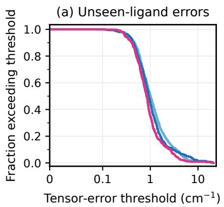

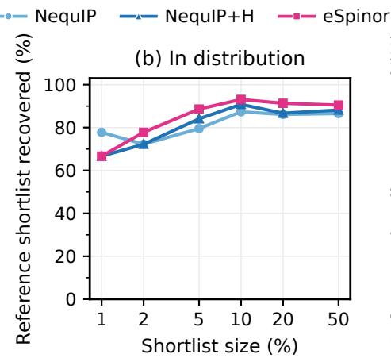

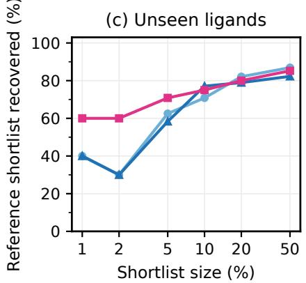  
FIG. S2. Cobalt screening for the neural models. eSpinor uses AOM. (a) OOD fraction exceeding tensor-error threshold $e _ { i } ,$ , on an axis linear up to $0 . 1 \mathrm { c m } ^ { - 1 }$ and logarithmic above. (b), (c) Shortlist recovery for 862 in-distribution and 473 OOD complexes.

## S4. DYSPROSIUM DYNAMICS AND ADDITIONAL RESULTS

## A. Propagation and coordinate conventions

Following Appendix B and PARASHIFT [10], water propagation uses 78 nonoverlapping 500-frame test windows, $\Delta t = 1$ fs, 100 equally weighted Fibonacci field orientations, � = 300 K, and $\tau _ { R } = 1 3 9 \mathrm { p s }$ . Fields are $\mathcal { B } = \{ 1 , 1 . 5 , 2 , 3 , 1 0 , 2 0 \}$ T, with low-field averages over $\mathcal { B } _ { \mathrm { M R I } } = \{ 1 , 1 . 5 , 2 , 3 \}$ T. Each model uses

$$
\rho _ { 0 } = \frac { e ^ { - H _ { 0 } / ( \bar { k } _ { \mathrm { B } } T ) } } { \mathrm { T r } e ^ { - H _ { 0 } / ( \bar { k } _ { \mathrm { B } } T ) } } , \qquad U _ { n } = e ^ { - i 2 \pi c H _ { n } \Delta t } , \qquad P _ { 0 } = I , \qquad P _ { n + 1 } = U _ { n } P _ { n } .\tag{S17}
$$

Here $H _ { n } = H _ { \mathrm { e f f } } ( t _ { 0 } + n \Delta t ) , \bar { k } _ { \mathrm { B } } = 0 . 6 9 5 0 3 4 8 \mathrm { c m } ^ { - 1 } \mathrm { K } ^ { - 1 }$ , and time in the exponential is in seconds. Hermitian diagonalization uses float64/complex128, subtracting the lowest energy in the thermal exponential. Electron $g _ { z z }$ uses laboratory axes and a fixed field, with 499 steps and 500 lags.

Nuclear correlations and susceptibility use minimum-image, metal-centered coordinates. Orient donor-plane unit normals $\nu _ { A }$ from the axial-N centroid toward the O centroid and define the molecular frame by

$$
\mathbf { e } _ { z } = \nu _ { \mathrm { O } } + \overline { { \nu _ { \mathrm { N , a x } } } } + \nu _ { \mathrm { N , e q } } , \quad \mathbf { e } _ { x } = \mathbf { r } _ { \mathrm { N , e q , 1 } } - ( \mathbf { r } _ { \mathrm { N , e q , 1 } } \cdot \mathbf { e } _ { z } ) \mathbf { e } _ { z } , \quad \mathbf { e } _ { y } = \mathbf { e } _ { z } \times \mathbf { e } _ { x } , \quad R = ( \mathbf { e } _ { x } , \mathbf { e } _ { y } , \mathbf { e } _ { z } ) ^ { T } .\tag{S18}
$$

Hats normalize vectors. Water donor indices are O (1, 3, 5), axial N (721, 722, 723), and equatorial N (724, 725, 726), counted from 1. The same � rotates coeficients and Dy–proton vectors, with field $\hat { \mathbf { n } } ( t ) = R ( t ) R ( t _ { 0 } ) ^ { T } \hat { \mathbf { n } } ( t _ { 0 } )$

Exporting 39k predictions averaged 709.6 s for 8k eSpinor models on 1 H200 (batch size 8, naive tensor products), including setup and I/O but excluding training and propagation. This corresponds to 18.2 ms per geometry averaged over the export. Fo context, 2 approximate OpenMolcas CASSCF+SOC jobs [20] took 8411 and 5137 s per geometry, including input preparation and parameter extraction, on 72 NVIDIA Grace CPU cores on DeltaAI [21]. Each used 1 MPI process and 72 OpenMP threads, with no GPU computation. The setup used CAS(9,7), 18 equally weighted sextet roots, RASSI SOC, and ANO-RCC bases with VTZP on Dy, VDZP on O/N, and VDZ elsewhere. Compared with the benchmark reference protocol, it used placeholder solvent charges (−0.68 on O and +0.34 on H) and VDZP on all O/N atoms instead of only donors. These jobs provide a cost scale for electronic-structure evaluation, not timings for generating the benchmark labels or a controlled speedup ratio.

## B. Prediction errors and propagation diagnostics

For $N _ { \mathrm { t e s t } }$ geometries and the 500 explicit correlation samples C, without fitted tails, we use

$$
\mathbf { M A E } _ { \ell } = \frac { \sum _ { i , q } | \widehat { B } _ { q , i } ^ { ( \ell ) } - B _ { q , i } ^ { ( \ell ) } | } { N _ { \mathrm { t e s t } } ( 2 \ell + 1 ) } , \qquad \epsilon _ { C } ^ { \mathcal { P } } = 1 0 0 \frac { \| \mathcal { P } \mathbf { C } _ { \mathrm { m o d e l } } - \mathcal { P } \mathbf { C } _ { \mathrm { r e f } } \| _ { 2 } } { \| \mathcal { P } \mathbf { C } _ { \mathrm { r e f } } \| _ { 2 } } .\tag{S19}
$$

Here $\mathcal { P } \in \{ \mathrm { R e } , \mathrm { I m } , \mathrm { i d } \}$ selects real, imaginary, or complex correlations. Shape errors normalize each curve by its own $\operatorname { R e } C ( 0 )$ Errors average 6 fields equally and, for $G _ { h } , \mathrm { H } 3 / \mathrm { H } 4 / \mathrm { H } 5$ . Figure S3 includes all budgets and models. The normalized real-correlation advantage persists at 1k–8k and in each 26-window segment starting at 51k, 64k, and 77k at 8k. At 8k, imaginary-correlation errors favor NequIP+H over eSpinor (1.264% versus 1.534%).

(a) $B ^ { ( 2 ) }$  
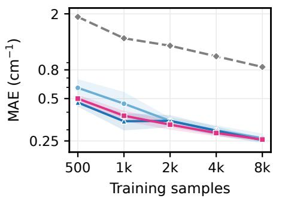  
(d) Electron Re gzz

(b) B(4)  
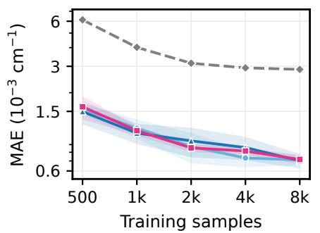

(c) B(6)  
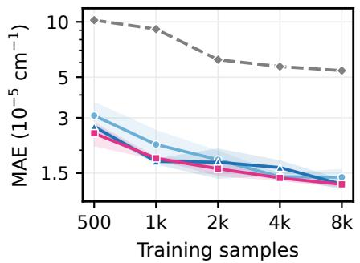

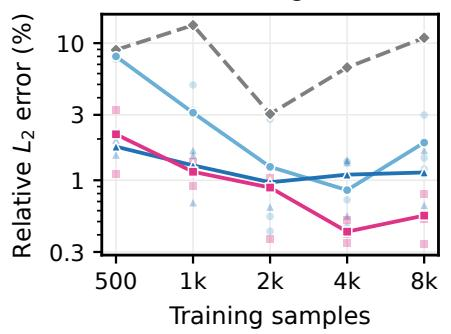

(e) Complex proton Gh  
(f) Total nuclear R2N  
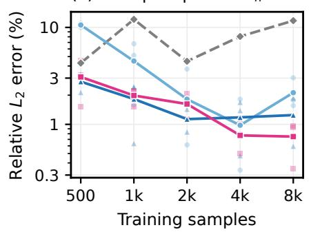

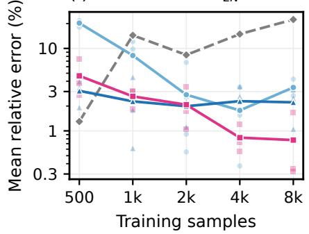  
FIG. S3. Water learning curves on 39k test frames. (a)–(c) Crystal-field MAEs. (d), (e) Real electron and complex proton correlations over all 6 fields. (f) Total $R _ { 2 N }$ errors over 1–3 T. Proton quantities average H3/H4/H5. $R _ { 1 N }$ gives the same model ordering at every budget.

To isolate propagation from initial-state error, we combine the reference thermal state with each model’s propagator,

$$
c _ { R M } ( \tau ) = \mathrm { T r } [ \rho _ { 0 , R } J _ { \parallel } P _ { M } ^ { \dagger } J _ { \parallel } P _ { M } ] , \qquad e _ { w o } ( \tau ) = \mathrm { R e } [ c _ { R M } ^ { w , o } ( \tau ) - c _ { R R } ^ { w , o } ( \tau ) ] .\tag{S20}
$$

TABLE S2. Dimensionless propagation RMS errors at 8k with the reference initial state. Columns follow Eq. (S21).
<table><tr><td></td><td colspan="3">3T</td><td colspan="3">20 T</td></tr><tr><td>Model</td><td>Eindividual</td><td>Eorientations</td><td> $E _ { \mathrm { e n s e m b l e } }$ </td><td> $E _ { \mathrm { i n d i v i d u a l } }$ </td><td>Eorientions</td><td> $E _ { \mathrm { e n s e m b l e } }$ </td></tr><tr><td>NequIP</td><td>0.7270</td><td>0.4184</td><td>0.1962</td><td>0.7009</td><td>0.3104</td><td>0.1859</td></tr><tr><td>NequIP+H</td><td>0.6929</td><td>0.3706</td><td>0.1129</td><td>0.6718</td><td>0.2701</td><td>0.1143</td></tr><tr><td>eSpinor</td><td>0.7195</td><td>0.3795</td><td>0.0559</td><td>0.6882</td><td>0.2419</td><td>0.0572</td></tr></table>

Here �, � denote reference and model, with identical Zeeman terms. For windows �, orientations �, and arithmetic means,

$$
E _ { \mathrm { i n d i v i d u a l } } = \langle e ^ { 2 } \rangle _ { w , o , \tau } ^ { 1 / 2 } , \qquad E _ { \mathrm { o r i e n t a t i o n s } } = \langle \langle e \rangle _ { o } ^ { 2 } \rangle _ { w , \tau } ^ { 1 / 2 } , \qquad E _ { \mathrm { e n s e m b l e } } = \langle \langle e \rangle _ { w , o } ^ { 2 } ) _ { \tau } ^ { 1 / 2 } .\tag{S21}
$$

Tests use all windows and orientations at 8k and 3/20 T. Unmixed runs reproduce saved correlations within $7 \times 1 0 ^ { - 1 4 }$ . Table S2 shows comparable individual errors but a smaller ensemble-mean signed error for eSpinor than for NequIP+H. Here the mean residual $b ( \tau ) = \langle e ( \tau ) \rangle _ { w , o }$ measures the systematic error in the sampled ensemble, and $E _ { \mathrm { e n s e m b l e } } = \langle b ( \tau ) ^ { 2 } \rangle _ { \tau } ^ { 1 / 2 }$

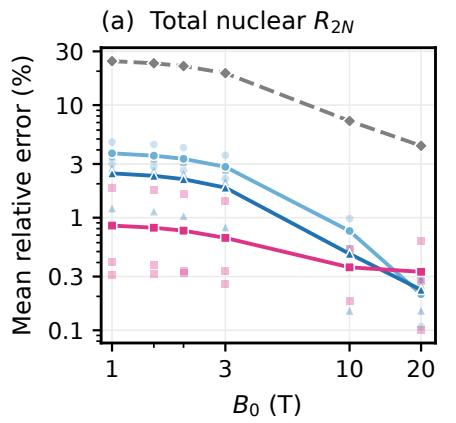

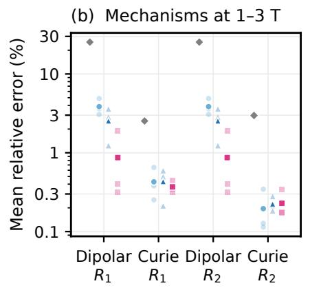

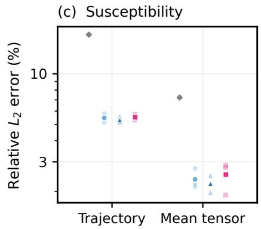  
FIG. S4. Field and mechanism comparisons at 8k. (a) Total $R _ { 2 N }$ errors over H3/H4/H5 at each field. (b) Dipolar and Curie errors over 1–3 T, normalized by their own reference mechanism. (c) Susceptibility errors from Eq. (S26).

## C. Relaxation calculations and sensitivity

Each proton’s real $G _ { p }$ is fitted separately with the PARASHIFT form [10],

$$
C _ { \mathrm { f i t } } ( \tau ) = \left\{ \begin{array} { l l } { C _ { \mathrm { G } } ( \tau ) = C ( 0 ) e ^ { - ( \tau / T _ { \mathrm { G } } ) ^ { 2 } } , } & { \tau < \tau _ { 0 } , } \\ { C _ { \mathrm { S } } ( \tau ) = C ( \tau _ { 0 } ) e ^ { - ( ( \tau - \tau _ { 0 } ) / T _ { \mathrm { S } } ) ^ { \beta } } , } & { \tau \geq \tau _ { 0 } . } \end{array} \right.\tag{S22}
$$

For each $\tau _ { 0 } ~ = ~ k \Delta t , ~ k ~ = ~ 2 , \ldots , L - 3$ , we anchor the late branch at the observed $C ( \tau _ { k } ) \ > \ 0$ . SciPy [22] minimizes $\begin{array} { r } { [ \sum _ { n = 0 } ^ { k } ( C _ { \mathrm { G } } ( \hat { \tau } _ { n } ) - C ( \tau _ { n } ) ) ^ { 2 } + \sum _ { n = k } ^ { L - 1 } ( C _ { \mathrm { S } } ( \tau _ { n } ) - C ( \tau _ { n } ) ) ^ { 2 } ] / [ L C ( 0 ) ^ { 2 } ] } \end{array}$ , with $\Delta t / 1 0 0 \le T _ { \mathrm { G } } , T _ { \mathrm { S } } \le 1 0 0 0 \tau _ { L - 1 }$ and $0 . 1 \leq \beta \leq 2$ . We choose the converged fit with the smallest objective. Fitting $\begin{array} { r } { \operatorname { R e } g _ { z z } } \end{array}$ characterizes electron decay only. At 8k, eSpinor leads $T _ { \mathrm { G } } , T _ { \mathrm { S } }$ accuracy and NequIP leads $\beta , \tau _ { 0 }$

The explicit complex $G _ { p }$ is retained through 499 fs and followed by the real fitted tail from 500 fs. We include the first tail sample below $\neg \operatorname { R e } G _ { p } ( 0 )$ , with $\eta = 1 0 ^ { - 3 }$ , then set the tail to zero. This cutof follows our reconstruction of the archive. The spectral integral is evaluated with equal endpoint weights, $\begin{array} { r } { \mathcal { T } _ { p } ( \omega ) = \Delta t \sum _ { n = 0 } ^ { n _ { c } } \widetilde { G } _ { p } ( \tau _ { n } ) e ^ { - \tau _ { n } / \tau _ { R } - i \omega \tau _ { n } } } \end{array}$ , with time in seconds. This integral gives the dipolar rates derived in Appendix B. Proton-group correlations $\begin{array} { r } { G _ { h } = \frac { 1 } { 3 } \sum _ { p \in h } G _ { p } } \end{array}$ are used only for curve comparisons, so averaging does not precede the proton-resolved fits.

For the mean shielding $\overline { { \sigma } } _ { p }$ defined in that appendix, let $S _ { p }$ and $A _ { p }$ be its symmetric and antisymmetric parts. The invariants $a _ { p } ^ { 2 } = 2 \Vert A _ { p } \Vert _ { F } ^ { 2 }$ and $b _ { p } ^ { 2 } = \textstyle \frac { 3 } { 2 } \| \dot { S } _ { p } - \mathrm { t r } ( S _ { p } ) I / 3 \| _ { F } ^ { 2 }$ give

$$
\begin{array} { l l } { \displaystyle { J _ { 1 } ( \omega ) = \frac { \tau _ { R } } { 1 + 9 \omega ^ { 2 } \tau _ { R } ^ { 2 } } , } } & { \displaystyle { J _ { 2 } ( \omega ) = \frac { \tau _ { R } } { 1 + \omega ^ { 2 } \tau _ { R } ^ { 2 } } , } } \\ { \displaystyle { R _ { 1 N , p } ^ { \mathrm { c u r i e } } = \omega _ { N } ^ { 2 } \left[ \frac { a _ { p } ^ { 2 } } { 2 } J _ { 1 } ( \omega _ { N } ) + \frac { 2 b _ { p } ^ { 2 } } { 1 5 } J _ { 2 } ( \omega _ { N } ) \right] , } } & { \displaystyle { R _ { 2 N , p } ^ { \mathrm { c u r i e } } = \omega _ { N } ^ { 2 } \left[ \frac { a _ { p } ^ { 2 } } { 4 } J _ { 1 } ( \omega _ { N } ) + \frac { b _ { p } ^ { 2 } } { 4 5 } ( 4 \tau _ { R } + 3 J _ { 2 } ( \omega _ { N } ) ) \right] . } } \end{array}\tag{S23}
$$

No empirical scale factor is applied. Reference Curie rates use archived CASSCF+SOC susceptibilities. Model susceptibilities use the zero-field Van Vleck expression within $J = 1 5 / 2 [ 2 3 ]$ . For energies $\textstyle { \mathcal { E } } _ { n } .$ thermal weights $p _ { n } , \beta _ { T } = ( \bar { k } _ { \mathrm { B } } \bar { T } ) ^ { - 1 }$ , and $M _ { \alpha , n m } = \langle n | g _ { J } J _ { \alpha } | m \rangle$ ,

$$
\begin{array} { r l } & { \boldsymbol { F } _ { n m } ^ { \chi } = \displaystyle \int _ { \left( \beta _ { n } - p _ { m } \right) / \left( \mathcal { E } _ { m } - \mathcal { E } _ { n } \right) , } ^ { \chi } \quad | \mathcal { E } _ { m } - \mathcal { E } _ { n } | \geq \delta _ { \chi } , } \\ & { \qquad \quad \left| \mathcal { E } _ { T } p _ { n } , \right. } \\ & { \qquad \quad \delta _ { \chi } = 1 0 ^ { - 6 } \mathrm { c m } ^ { - 1 } , } \end{array}\tag{S24}
$$

Here $\Lambda _ { \chi } = 0$ .26074098196 $\mathrm { c m } ^ { 3 }$ cm−1 mol $^ { - 1 }$ gives cgs molar susceptibility, and $N _ { A }$ is Avogadro’s constant. Errors against the archive include the ground-multiplet approximation.

Total rates are averaged within each proton environment before taking errors. For $a = 1 , 2$ and $\mathcal { H } = \{ \mathrm { H } 3 , \mathrm { H } 4 , \mathrm { H } 5 \}$ ,

$$
\overline { { R } } _ { a , h } = \frac { 1 } { 3 } \sum _ { p \in h } R _ { a N , p } , \quad \epsilon _ { R _ { a } } ( B ) = \frac { 1 0 0 } { 3 } \sum _ { h \in \mathcal { H } } \frac { | \overline { { R } } _ { a , h } ^ { \mathrm { m o d e l } } ( B ) - \overline { { R } } _ { a , h } ^ { \mathrm { r e f } } ( B ) | } { | \overline { { R } } _ { a , h } ^ { \mathrm { r e f } } ( B ) | } , \quad \epsilon _ { R _ { a } } ^ { \mathrm { M R I } } = \frac { 1 } { 4 } \sum _ { B \in \mathcal { B } _ { \mathrm { M R } } } \epsilon _ { R _ { a } } ( B ) .\tag{S25}
$$

Component errors use their own reference mechanism in the denominator.

Susceptibility errors compare the trajectory and its mean,

$$
\epsilon _ { \chi } ^ { \mathrm { t r a j } } = 1 0 0 \sqrt { \frac { \sum _ { i } \| \widehat { \chi } _ { i } - \chi _ { i } \| _ { F } ^ { 2 } } { \sum _ { i } \| \chi _ { i } \| _ { F } ^ { 2 } } } , \qquad \epsilon _ { \chi } ^ { \mathrm { m e a n } } = 1 0 0 \frac { \| \overline { { \widehat { \chi } } } - \overline { { \chi } } \| _ { F } } { \| \overline { { \chi } } \| _ { F } } .\tag{S26}
$$

Figure S4 compares field-dependent rates, their mechanisms, and susceptibility.

To check cancellation, split each rate into explicit-integral, fitted-tail, and Curie contributions, $\begin{array} { r } { R _ { a } = \sum _ { X } R _ { a } ^ { X } } \end{array}$ . The signed errors $\delta _ { a } ^ { X } = 1 0 0 ( \widehat { R } _ { a } ^ { X } - R _ { a , \mathrm { r e f } } ^ { X } ) / R _ { a , \mathrm { r e f } }$ then add exactly. For eqSNAP, explicit-integral and tail errors compensate at 500 samples but reinforce at 8k. With fits fixed, varying � from $1 0 ^ { - 3 } ~ \mathrm { t o } ~ 1 0 ^ { - 5 }$ and using matched $J = 1 5 / 2$ reference susceptibility gives 4 combinations. Mean rate errors change by less than 0.10 percentage points for every model, with unchanged 8k low-field ranking. Longer trajectories are needed to validate the extrapolated tails.

## D. Transfer from water to methanol

Water-trained models transfer without retraining or selection on MeOH. Propagation uses the first 82,000 of 82,300 matched frames in 164 windows. Susceptibility uses all frames, with archived values for reference Curie rates. The water protocol is unchanged except $\tau _ { R } = 7 5$ ps and one-based donor indices O (1, 3, 5), axial N (697, 698, 699), and equatorial N (700, 701, 702).

$$
\begin{array} { r l r l } { - \diamond  { \cdot } \mathrm { \ e q } \mathsf { S N A P } } & { { } \mathrm { --- N e q u l P } } & { \mathrm { --- N e q u l P + \mathsf { H } } } & { \mathrm { --- e } \mathsf { S p i n o r } } \end{array}
$$

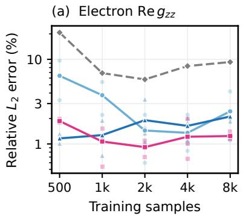

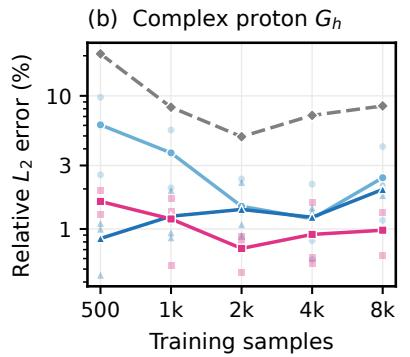

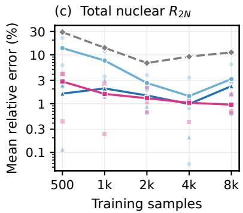  
FIG. S5. Water-to-MeOH transfer across training budgets. (a), (b) Real electron-spin and complex proton-correlation errors over all 6 fields. (c) Total $R _ { 2 N }$ errors over H3/H4/H5 and 1–3 T. $R _ { 1 N }$ gives the same model ordering at every budget. Table III includes susceptibility and both rates at 8k.

## REFERENCES

[1] D. A. Varshalovich, A. N. Moskalev, and V. K. Khersonskii, Quantum Theory ofAngular Momentum (World Scientific, Sin gapore, 1988).

[2] J. Gasteiger and M. Marsili, Tetrahedron 36, 3219 (1980).

[3] A. Scheie, Journal of Applied Crystallography 54, 356 (2021).

[4] C. E. Schäfer and C. K. Jørgensen, Molecular Physics 9, 401 (1965).

[5] M. Geiger and T. Smidt, arXiv preprint arXiv:2207.09453 10.48550/arXiv.2207.09453 (2022).

[6] T. Barthel, New Journal of Physics 15, 073010 (2013).

[7] T. S. Cohen, M. Weiler, B. Kicanaoglu, and M. Welling, in International Conference on Machine Learning (ICML), Proceedings of Machine Learning Research, Vol. 97 (PMLR, 2019) pp. 1321–1330.

[8] L. A. Mariano, V. H. A. Nguyen, V. Briganti, and A. Lunghi, Journal of the American Chemical Society 146, 34158 (2024).

[9] A. L. Mariano, A. Lunghi, and V. H. A. Nguyen, COMPASS, Zenodo (2024), data set, version 1.

[10] T. R. C. Thompson, B. Alnami, J. M. Skelton, and N. F. Chilton, Journal of the American Chemical Society 148, 19536 (2026).

[11] N. Chilton, Research data for: Electron and Nuclear Spin Dynamics of a Lanthanide Complex in Solution, University of Manchester Figshare (2025), dataset.

[12] V. H. A. Nguyen and A. Lunghi, Physical Review B 105, 165131 (2022).

[13] V. Briganti and A. Lunghi, npj Computational Materials 11, 62 (2025).

[14] V. Zaverkin, J. Netz, F. Zills, A. Köhn, and J. Kästner, Journal of Chemical Theory and Computation 18, 1 (2022).

[15] J. Gasteiger, J. Groß, and S. Günnemann, in International Conference on Learning Representations (ICLR) (2020).

[16] I. Loshchilov and F. Hutter, in International Conference on Learning Representations (2019).

[17] A. Paszke, S. Gross, F. Massa, A. Lerer, J. Bradbury, G. Chanan, T. Killeen, Z. Lin, N. Gimelshein, L. Antiga, A. Desmaison, A. Köpf, E. Yang, Z. DeVito, M. Raison, A. Tejani, S. Chilamkurthy, B. Steiner, L. Fang, J. Bai, and S. Chintala, in Advances in Neural Information Processing Systems, Vol. 32 (2019) pp. 8026–8037.

[18] NVIDIA Corporation, cuEquivariance: NVIDIA library for highperformance equivariant neural networks, Software, version 0.8.0 (2025).

[19] R. Boča, Coordination Chemistry Reviews 248, 757 (2004).

[20] I. Fdez. Galván, M. Vacher, A. Alavi, C. Angeli, F. Aquilante, J. Autschbach, et al., Journal of Chemical Theory and Computation 15, 5925 (2019).

[21] B. Bode, G. Bauer, L. Herriott, V. Kindratenko, and W. Gropp, in Practice and Experience in Advanced Research Computing 2025: The Power ofCollaboration, PEARC ’25 (Association for Computing Machinery, New York, 2025) pp. 1–4, article 53.

[22] P. Virtanen, R. Gommers, T. E. Oliphant, M. Haberland, T. Reddy, D. Cournapeau, et al., Nature Methods 17, 261 (2020).

[23] J. H. Van Vleck, The Theory of Electric and Magnetic Susceptibilities (Clarendon Press, Oxford, 1932).