# Space weather dependence of decameter-scale ionospheric irregularities spatial distribution

Oleg I.Berngardt, Ivan A.Lavygin∗

October 22, 2026

## Abstract

This paper describes an approach to constructing nowcast and forecast predictive models for the occurrence of high-latitude decameter ionospheric irregularities based on SuperDARN and SECIRA radar data and space weather parameters. The method relies on self-learning pattern recognition in the dynamics of space weather parameters, that influence the irregularities formation. The proposed approach is a datadriven, multiscale method in which the spatial distribution of irregularities is approximated using a neural network of an original architecture, inspired by graph neural networks.

The model was trained and tested using data from 11 radars during the period 2010-2025 (SuperDARN: CVW, ICE, ICW, INV, PGR, PYK, RKN, SAS, STO; SECIRA: EKB, MAGW). It is shown that the model achieves optimal performance when using geomagnetic coordinates MLT,MLAT. The optimal set of parameters for the best nowcast and forecast over studied set of parameters is a combination of geomagnetic and solar disturbance indices (a , K , AE, F10.7) from ground-based observations, and satellite-measured solar wind and interplanetary magnetic field parameters $( P _ { s w } , E _ { s w } , \widetilde { B _ { z } } , T _ { s w } )$ . Hourly mean values for all the parameters were used in the analysis. The results indicate that acceptable forecast quality is achieved with a lead time of up to 7-9 hours, with the highest quality reached for nowcast (zero lead time). It is shown that the parameters $\widetilde { B _ { z } }$ and F10.7 are significant for nowcasting only and can be neglected for other lead times. It is shown that $A E$ and $T _ { s w }$ are significant for mid-term forecast (>2hours ahead) and can be neglected for short-term predictions.

Statistical relationships between the maximum latitude of the equatorial boundary of the irregularities and space weather parameters are also discussed.

∗ISTP SB RAS, 664033, Lermontova Str, 126A, Irkutsk, Russia, email: berng@iszf.irk.ru

## 1 Introduction

The problem of modeling the spatio-temporal distribution of irregularities and forecasting them based on measurable space weather parameters has stated for quite long time [Booker and Wells, 1938].

Models of spatial distribution of high-latitude small-scale irregularities can be approximately categorized into empirical and physical ones. Empirical models, in turn, can be subdivided into autoregressive models (which use only recent observations of ionospheric irregularities to forecast their future behavior) and regression models (which use only observations of other parameters for forecasting irregularities). A review of many models can be found in [Priyadarshi, 2015]. Ionospheric irregularities have complex dynamics dependent on external conditions, and their physical modeling is discussed, for example, in [Huba and Joyce, 2010, Deshpande et al., 2014].

Numerous models for the spatial distribution of irregularities in the equatorial ionosphere have been developed. One early example is the Scintillation Network Decision Aid (SCINDA) model for irregularity regions at equatorial latitudes in the VHF (250 MHz) frequency band. It uses data from spatially separated ground-based receivers of geostationary satellite signals, as well as solar (F10.7) and geomagnetic $( K _ { p } )$ activity data [Groves et al., 1997]. Recent modifications of this model also exist [Caton et al., 2004].

The physical processes controlling the formation of small-scale irregularities in polar and equatorial regions are often close [Tsunoda, 1988], allowing approaches used in equatorial ionosphere to be adapted for auroral one. For example, the equatorial Wideband Ionospheric Scintillation Model (WB-MOD) based on a power-law fluctuation spectrum [Secan et al., 1995] was subsequently modified for high latitudes [Secan et al., 1997]. There are also studies of optimizing the parameters of this model using machine learning techniques [Molina and Camps, 2026].

One of the global models to predict signal scintillation level (caused by small-scale irregularities presence) in UHF radio bound is the Global Ionospheric Propagation Model (GIM). It is based on the NeQuick background ionospheric model and incorporates the spectrum of irregularities estimated from global navigation satellite system (GNSS) network observations, taking into account NeQuick input parameters - local time, season, and solar activity (as F10.7 index) [B´eniguel and Hamel, 2011]. The model can also be modified to predict scintillation maps in UHF band in real time [Hamel et al., 2014].

A problem of irregularities prediction in the HF band is the lack of a dense observational network. Today the regular observations are made by vertical and oblique sounding ionosondes and HF radars of the SuperDARN[Nishitani et al., 2019], CN-DARN[Li et al., 2025], and SECIRA[Berngardt et al., 2020] networks. In practice, using small observational networks forces to the use of lowparameter models to describe the characteristics of regions containing irreg-

ularities. One widely used approach involves spherical harmonic approximation [Ruohoniemi and Greenwald, 1996, Shepherd and Ruohoniemi, 2000, Cousins and Shepherd, 201 Mestici et al., 2026]. A dynamic model [Mestici et al., 2026], uses data from the Swarm satellite mission, and based on the interplanetary magnetic field (IMF) orientation (categorized into six IMF clock angle sectors), three levels of solar activity, and three seasons. Due to one of the physical driver for the formation of small-scale high-latitude irregularities is the electric field, the modeling strategy could involve high-latitude convection models built from SuperDARN radar data and based on IMF clock angles [Ruohoniemi and Greenwald, 1996, Shepherd and Ruohoniemi, 2000]. The convection model was improved in [Cousins and Shepherd, 2010] by including the interplanetary electric field (Esw) as a model parameter. Recent papers try to improve this model using neural networks [Gao et al., 2025, Gao et al., 2026]. Another approach use regression-based multi-scale model [Zhao et al., 2026] to predict the irregularities fluctuation level at each measurement location independently.

The key problems in constructing a model of the spatiotemporal distribution of irregularities in the HF range can be formulated as follows.

Problem 1: selection of model input parameters. To solve this problem, the following approaches are typically used:

• an empirical approach: postulating input parameters based on physical assumptions on the processes of irregularities formation [Ruohoniemi and Greenwald, 1996, Shepherd and Ruohoniemi, 2000, Cousins and Shepherd, 2010, Gao et al., 2025, Gao et al., 2026];

• a data-driven approach: selecting the maximum available number of measured parameters and analyzing their importance [McGranaghan et al., 2018].

Problem 2: taking into account the temporal dynamics of parameters. Typically, the following approaches are used to solve this problem:

• a regression-based approach, assuming that the parameter value directly and nearly simultaneously determines the intensity of irregularities [Ruohoniemi and Greenwald, 1996, Shepherd and Ruohoniemi, 2000, Cousins and Shepherd, 2010, Gao et al., 2025, Gao et al., 2026];

• a delay-based approach, in which the delay between input model parameter and irregularity variations (or temporal scale of input parameter averaging) is determined from the data to select the most significant ones corresponding to the most important lag or averaging period [McGranaghan et al., 2018];

• a multiscale approach, based on the fact that diferent patterns in parameter temporal dynamics afect the predicted parameter in diferent ways [Zhao et al., 2026].

Problem 3: choosing a method for spatial approximation of the model to areas where there are no observations. The following approaches are used to solve this problem:

• spatial interpolation of the results, or their approximation using spherical harmonics and searching for their coeficients [Ruohoniemi and Greenwald, 1996, Shepherd and Ruohoniemi, 2000, Cousins and Shepherd, 2010];

• training the model in such a way that spatial coordinates are the input parameters of the model [Gao et al., 2025, Gao et al., 2026] and the approximation is performed by the resulting model itself;

• predicting only in the locations where there were observations in training data [Zhao et al., 2026].

This paper describes a predictive model for the probability of observing the high-latitude ionospheric irregularities based on SuperDARN and SECIRA radar data. The proposed method is a data-driven, multiscale approach where the spatial distribution of irregularities is approximated by a neural network model optimally trained on available experimental data. The method uses pattern recognition over the sequences of input parameters to improve the prediction quality. The input model parameters are found as a minimal set optimized for model quality, observation coordinates are used as separate model inputs.

## 2 Preliminary data analysis

## 2.1 Data used

To build the model, we used data from 11 SuperDARN and SECIRA radars in the years of various solar and geomagnetic activity, shown in the Table 1. Their fields-of-view are shown in the Fig.1. The data is divided to train over the period 2010-2023, and to validate over the period 2024-2025.

During training at least two years were selected for each radar - an year of relatively high and an year of relatively low solar activity. The largest radar number corresponds to 2023. Additionally, the PYK radar with 8 years of data was used. This can be explained by to two factors: it is necessary to build a model suitable for a wide range of space weather parameters over suficiently large period of the solar cycle, and it is necessary to build a model covering a large spatial range. Due to limited computing power, such a solution seems reasonable. In the future, it looks useful to apply the developed approach to a wider dataset.

The radar elevation data was calibrated at meteor trails using the method described in [Berngardt and Lavygin, 2026]. Signal propagation trajectories were calculated for each powerful enough received signal using ray-tracing in the ionosphere described by IRI-2020 model[Bilitza et al., 2022]. After ray-tracing each found scattering points were located by geographic and geomagnetic coordinates (based on the AACGMv2 model[Shepherd, 2014], and by the height.

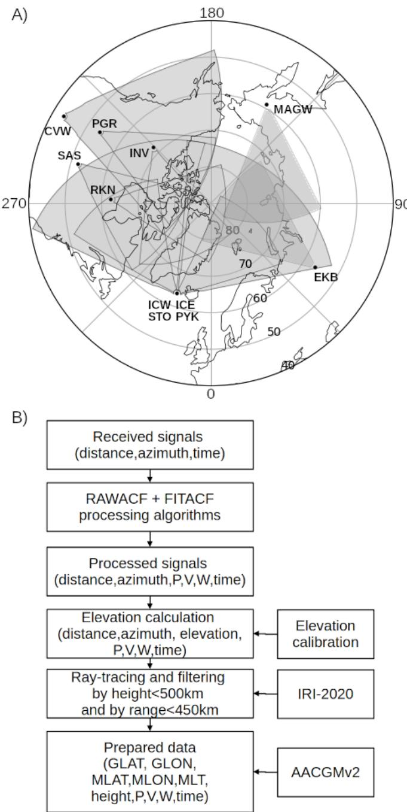  
Figure 1: (A) Radars fields-of-view in geographic coordinates; (B) Data preparation algorithm.

Table 1: Radars used in the analysis, their geographical coordinates, and the years analyzed. Data not used for model training are highlighted in bold.
<table><tr><td rowspan=1 colspan=1>Radar</td><td rowspan=1 colspan=1>Coordinates</td><td rowspan=1 colspan=1>Years</td></tr><tr><td rowspan=1 colspan=1>CVW SuperDARN</td><td rowspan=1 colspan=1>43N 120W</td><td rowspan=1 colspan=1>2020,2023</td></tr><tr><td rowspan=1 colspan=1>EKB SECIRA</td><td rowspan=1 colspan=1>56N 58E</td><td rowspan=1 colspan=1>2021,2025</td></tr><tr><td rowspan=1 colspan=1>ICE SuperDARN</td><td rowspan=1 colspan=1>64N 21W</td><td rowspan=1 colspan=1>2024</td></tr><tr><td rowspan=1 colspan=1>ICW SuperDARN</td><td rowspan=1 colspan=1>64N 21W</td><td rowspan=1 colspan=1>2024</td></tr><tr><td rowspan=1 colspan=1>INV SuperDARN</td><td rowspan=1 colspan=1>68N 134W</td><td rowspan=1 colspan=1>2018,2023</td></tr><tr><td rowspan=1 colspan=1>PGR SuperDARN</td><td rowspan=1 colspan=1>54N 123W</td><td rowspan=1 colspan=1>2020,2023</td></tr><tr><td rowspan=1 colspan=1>PYK SuperDARN</td><td rowspan=1 colspan=1>64N 21W</td><td rowspan=1 colspan=1>2010-2014,2016-2018</td></tr><tr><td rowspan=1 colspan=1>RKN SuperDARN</td><td rowspan=1 colspan=1>63N 92W</td><td rowspan=1 colspan=1>2018,2023</td></tr><tr><td rowspan=1 colspan=1>SAS SuperDARN</td><td rowspan=1 colspan=1>52N 106W</td><td rowspan=1 colspan=1>2020,2023</td></tr><tr><td rowspan=1 colspan=1>STO SuperDARN</td><td rowspan=1 colspan=1>64N 21W</td><td rowspan=1 colspan=1>2011,2014</td></tr><tr><td rowspan=1 colspan=1>MAGW SECIRA</td><td rowspan=1 colspan=1>60N 150E</td><td rowspan=1 colspan=1>2021,2025</td></tr></table>

## 2.2 Problem formulation

Our primary objective is to find the dependence of the spatio-temporal distribution of ionospheric irregularities (ionospheric scattering, IS) observation probability on measureable space weather parameters. Let us denote the vector of space weather parameters as $\vec { \theta }$ (later used as $\theta )$ . Let us denote the combination of space weather parameters and spatial location coordinates $\vec { R }$ as $\vec { \theta _ { s } } = ( \vec { \theta } , \vec { R } )$ (later used as $\theta _ { s } )$ . In the paper we will use standard notations $P ( A )$ as probability of event A, and $P ( A | B )$ as conditional probability of event A given event B.

So our objective is to build a model describing IS observation probability $P ( I S | \theta _ { s } )$ under various conditions θ and in diferent locations $\vec { R }$ using data from coherent scatter radars. In practice, however, we cannot directly estimate this probability because we cannot detect the ionospheric scattering everywhere it exists. Scattering detection using HF radars requires looking in the optimal direction, selecting an appropriate frequency to ensure the radiosignal trajectory meets the optimal scattering conditions, having the radar operating at any given time, and other factors. Therefore we need to formulate the problem of predicting $P ( I S | \theta _ { s } )$ in a way that minimizes the efects of non-uniform measurement locations, radar operation intervals, and changes in radar operating modes.

Each radar observes several types of signals (OBS): scattering from the

Earth’s surface, meteor trail scattering, ionospheric scattering, and noise [Nishitani et al., 2019]. The probability of the radar network observing these signals under various conditions $\theta _ { s }$ can be described by the probability $P ( O B S | \theta _ { s } )$ . The relation between $P ( O B S | \theta _ { s } )$ and $P ( I S | \theta _ { s } )$ is defined by the Bayes’ formula:

$$
P ( O B S | I S , \theta _ { s } ) \cdot P ( I S | \theta _ { s } ) = P ( I S | O B S , \theta _ { s } ) \cdot P ( O B S | \theta _ { s } )\tag{1}
$$

The multipliers in this expression are interpreted as follows:

$P ( I S | O B S , \theta _ { s } )$ is the probability that we are observing scattering from ionospheric irregularities, if a signal has been received by radars in space weather conditions and for spatial location given by the vector $\theta _ { s }$

$P ( O B S | I S , \theta _ { s } )$ - the probability of observing scattering from ionospheric irregularities, if they exist in space weather conditions and for spatial location given by the vector $\theta _ { s } ;$

The most dificult factor in the formula is to determine experimentally $P ( O B S | I S , \theta _ { s } )$ . The simplest assumption is that if an irregularity exists, it will be detected, i.e., $P ( O B S | I S , \theta _ { s } ) \approx 1$ . This assumption is justifiable for suficiently low HF frequencies with strong refraction in the ionosphere and for antennas with a wide beamwidth in elevation plane. In such cases, the condition of orthogonality to the magnetic field (which often necessary for effective scattering from the most commonly observed irregularities elongated with the Earth magnetic field) will be satisfied in some part of the propagation trajectory. These conditions are satisfied well for coherent scatter HF radars of SuperDARN and SECIRA networks used in the paper.

Thus, the model $P ( I S | \theta _ { s } )$ can be represented as the product of the probability of observing signals by radars, $P ( O B S | \theta _ { s } )$ , and the probability that the observed signal is one scattered by the ionosphere, $P ( I S | O B S , \theta _ { s } )$

$$
P ( I S | \theta _ { s } ) \approx P ( I S | O B S , \theta _ { s } ) \cdot P ( O B S | \theta _ { s } )\tag{2}
$$

The probability of observing signals by radar network, $P ( O B S | \theta _ { s } )$ , taking into account that SuperDARN and SECIRA radars have close characteristics, is an experimentally measurable function. The probability $P ( I S | O B S , \theta _ { s } )$ depends on the specific way we detect signals scattered by the ionosphere in signals observed by the radar. Thus, we need to construct two models: the first (for $P ( O B S | \theta _ { s } ) )$ ) predicts where, when, and under what conditions we observe signals by radars, while the second (for $P ( I S | O B S , \theta _ { s } ) )$ allows us to determine what fraction of the received signals is ionospheric scattering.

## 2.3 Detection of ionospheric scattering

The problem of detecting ionospheric scattering in HF is quite complex, and numerous algorithms currently exist for separating signals into IS and non-IS components at SuperDARN and SECIRA radars. We tested several of them to analyze common features and diferences in the resulting probabilities P(IS|OBS, θs). To get statistics of ionospheric scattering observations and make a preliminary analysis, we evaluated three algorithms, including both standard and qualitative approaches.

To geolocate ionospheric irregularities, it is necessary to know radiowave propagation trajectory. Therefore, accurate geolocation is performed for signals with a known angle of arrival. The raytracing algorithm is the same as [Berngardt and Lavygin, 2026] takes into account the actual ionosphere using ionospheric model IRI-2020[Bilitza et al., 2022], and does not account for the magneto-ionic efects. The elevation angle calibration method required for these trajectory calculations is described in detail in [Berngardt and Lavygin, 2026] and is based on an analysis of meteor trail scattering heights. Based on the ray-tracing results, we determined the geographic coordinates of the ionospheric scatterers, and convert them to geomagnetic coordinates using the AACGMv2 model[Shepherd, 2014]. So our dataset used for study is limited by the signals successfully processed by the FITACF algorithm and successfully raytraced.

The classical widely used algorithm for IS detection (later in the paper - FITACF algorithm, FA) [Blanchard et al., 2009], requires suficiently high values of the Doppler velocity —V— or spectral width —W— of the signal in velocity units, to identify signal as IS:

$$
| V | + A | W | > B ; A = 1 / 3 ; B = 3 0 m / s\tag{3}
$$

The values of the parameters A and B in formula (3) may vary from one implementation to another; the values in (3) are taken from the standard FITACF code.

The next algorithm (Convection Algorithm, CA) is heuristic one and does not utilize spectral width information. Instead, it classifies any signal with a Doppler shift exceeding 100 m/s (|V| > 100m/s) as ionospheric scatter. Such a high velocities are most common in high-latitude ionospheric convection regions and almost never observed in other signals. So the method should reproduce well-known statistical patterns associated with the dynamics of the intensive high-latitude ionospheric convection. Consequently, mid-latitude iononospheric scatter at MLAT¡55, which is detected by the FA algorithm, will be detected rarely.

The next algorithm is the 36-class classification (36C) uses self-learned neural network to predict the scattering class [Berngardt and Lavygin, 2026]. The three classes, previously interpreted as ground scatter (classes #5, 12, and 15) are intepreted as not-IS signals while the remaining classes are attributed to IS. In this case, the statistics of ionospheric irregularities show smaller probability at high latitudes than FA. The overestimating IS at midlatitudes and underestimating IS at high latitudes in comparison with FA may be due to the algorithm [Berngardt and Lavygin, 2026] significantly underestimating the number of signals scattered from the Earth’s surface, and some other signals types could be non-IS signals.

To create dataset for analysis, for all the data listed in Table 1 we get the signals significantly exceeding the noise level (¿ 3 dB) and determine the hourly average probability of observing ionospheric echoes P(IS|OBS, MLAT, MLT) on a 1-degree geomagnetic latitude grid for each hour of observation. The geographic scattering location was obtained from raytracing the signals using ionospheric model IRI-2020[Bilitza et al., 2022] and transformed to geomagnetic coordinates (MLAT, MLT) using AACGMv2 model[Shepherd, 2014] (see Fig.1B). The data used in the paper contains only the data with raytraced altitudes of less than 500 km. Only the data with a radar range exceeding 450 km were used to exclude the signals scattered in the vertical lobe of the antenna pattern, as well as those from sporadic E layers and from meteor trails. The final dataset contains approximately 12.5 million records.

Statistics of ionospheric echo probabilities $P ( I S | O B S , M L A T , M L T )$ ， obtained by applying the three algorithms described above to the entire dataset, are presented in geomagnetic coordinates in Fig.2.

Figure 2 shows that algorithm results for detecting IS can be described as follows. The algorithm 36C pays significant attention on radio wave propagation characteristics and minimizes the number of signals interpreted as non-IS (i.e.ground scatter), thereby showing a high probability that an observed signal is an ionospheric echo. The algorithm CA pays significant attention to high drift velocities and minimizes the number of signals interpreted as ionospheric scatter. It demonstrates the known dynamics of the equatorial boundary of convection zone (Heppner-Maynard), reaching its highest latitude around 12 MLT and it shows low probability that an observed signal is an ionospheric echo. The standard FA algorithm is nearly between these two algorithms, demonstrating intermediate properties - specifically, a moderate degree of polar oval dynamics and a moderate probability that the observed signal is an ionospheric echo. Therefore, it is worthwhile to analyze FA detecting technique, as it produce some intermediate results.

## 2.4 Model input parameters $\theta _ { s }$

Indices of solar and geomagnetic activity, as well as solar wind satellite data, were used as input parameters θ for the model. The well known dependence of the polar oval on geomagnetic coordinates allows us to include magnetic local time and magnetic latitude as the model’s input parameters, together with geographic latitude. All these parameters together forms the parameters vector $\theta _ { s }$ for the model. Hourly averaged space weather parameters are used as model inputs for forecasting the probability of observing ionospheric irregularities $P ( I S | O B S , \theta _ { s } )$ . The parameters used for the following analysis in the paper are listed in Table 2.

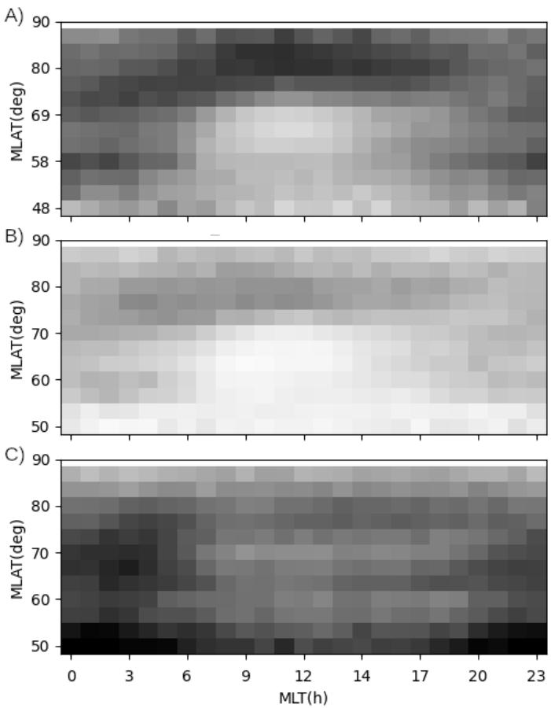  
Figure 2: Statistics of observations in MLAT,MLT of ionospheric scattering according to three ionospheric echo detection algorithms: (A) - FA; (B) - CA; (C) - 36C.

Table 2: Parameters used for modeling
<table><tr><td rowspan=1 colspan=1>Parameters</td><td rowspan=1 colspan=1>Comments</td><td rowspan=1 colspan=1>Data source</td></tr><tr><td rowspan=1 colspan=1> $K _ { p } , a _ { p }$ </td><td rowspan=1 colspan=1>Geomagneticdisturbanceindices</td><td rowspan=1 colspan=1>[Helmholtz Centre For Geosciences, 2026]</td></tr><tr><td rowspan=1 colspan=1>F10.7</td><td rowspan=1 colspan=1>Solar activityindex</td><td rowspan=1 colspan=1>[Helmholtz Centre For Geosciences, 2026]</td></tr><tr><td rowspan=1 colspan=1>AE, AU,AL, AO</td><td rowspan=1 colspan=1>Auroralgeomagneticdisturbanceindices</td><td rowspan=1 colspan=1>[Kyoto WDC, 2026]</td></tr><tr><td rowspan=1 colspan=1>ASY-H,ASY-D,SYM-D,SYM-H</td><td rowspan=1 colspan=1>Mid-latitudegeomagneticdisturbanceindices</td><td rowspan=1 colspan=1>[Kyoto WDC, 2026]</td></tr><tr><td rowspan=1 colspan=1> $B _ { x } , \tilde { B _ { y } } , \tilde { B _ { z } } .$  $B _ { t } , \psi _ { C A }$ </td><td rowspan=1 colspan=1>Interplanetarymagnetic fieldparameters inGSM coordinatesand IMF clockangle</td><td rowspan=1 colspan=1>[OMNI database, 2026]</td></tr><tr><td rowspan=1 colspan=1> $\overline { { V _ { x } , V _ { y } , V _ { z } } }$ </td><td rowspan=1 colspan=1>Solar wind speedin thelongitudinal (x)and transverse (y,z) directions.</td><td rowspan=1 colspan=1>[OMNI database, 2026]</td></tr><tr><td rowspan=1 colspan=1> $\rho _ { s w } , T _ { s w } ,$  $P _ { s w } , E _ { s w }$ </td><td rowspan=1 colspan=1>Solar windparameters:density,temperature,pressure, andelectric fieldamplitude.</td><td rowspan=1 colspan=1>[OMNI database, 2026]</td></tr><tr><td rowspan=1 colspan=1>MLT,MLAT,GLAT</td><td rowspan=1 colspan=1>Geomagnetic andgeographiccoordinates of thescattering point</td><td rowspan=1 colspan=1>Calibrated radar data from Table 1,IRI-2020 and AACGMv2 models.</td></tr></table>

We used the following additional notations:

• IMF clock angle: $\psi _ { C A } = a t a n ( B _ { y } / B _ { z } )$ ;

• Tangential component of the IMF: $B _ { t } = \sqrt { B _ { y } ^ { 2 } + B _ { z } ^ { 2 } }$

• Normalized projection of the IMF onto the y-axis: $\widetilde { B _ { y } } = B _ { y } / B _ { t } =$ $s i n ( \psi _ { C A } )$ ;

• Normalized projection of the IMF onto the z-axis: $\widetilde { B _ { z } } \ : = \ : B _ { z } / B _ { t } \ : = \ :$ cos $\left( \psi _ { C A } \right)$ ;

• Electric field amplitude: $E _ { s w } = - \left| V \right| B _ { z }$

Thus, the model can be constructed using 23 input parameters describing space weather conditions on 1-hour time scales, and three spatial location parameters - MLAT, MLT, and GLAT.

## 2.5 Optimal coordinate system

The preliminary step of analysis is to find an optimal coordinate system for $P ( I S | O B S , \theta _ { s } )$ prediction. We consider two variants: related with geographic latitude GLAT and with geomagnetic latitude MLAT. To select the optimal coordinate system, we trained a simple non-linear regression model (a four-layer fully connected neural network with 3 hidden layer of 64 neurons and absolute activation function) that takes the parameters from Table 2 as input and predicts $P ( I S | O B S , \theta _ { s } )$ . This approach relies on the assumption that all the space weather parameters cause irregularity generation without any time-lagged efects.

When building and training the simple neural network we used the following useful approaches, which we also used when building and training much more complex final model.

Input data transformation (quantile transformation). Most measured physical parameters are characterized by two features: they are measured with error and they may have a wide dynamic range (up to several orders of magnitude). To build robust model, we include into the model input data transformation refered as quantile transformation (QT).

In the first stage, the transformation interpolates ’bad’ or missing data in each space weather parameter with the parameter’s previous ’good’ value. This ensures data continuity and fills data gaps - a critical step for future constructing a comprehensive model that accounts for observational history. This approach is also critical during extreme disturbances when certain space weather parameters cannot be correctly measured and public databases contains special ’error’ values. We hope that rare errors caused by this interpolation is compensated by the large volume of data used for the analysis.

In the second stage we transform data from wide dynamic range to small limited range. To do this the positions of quantile positions within the data values were determined for each input space weather parameters and coordinates MLAT,MLT,GLAT: a maximum of 40 quantiles for latitudes and time, and a maximum of 25 quantiles for space weather data. In the cases where the necessary number of qunatiles could not be found (for example, for discrete variables with fewer number of values, such as $K _ { p }$ or hours of MLT), the actual number of descreet values for that variable was used. In this stage, the output data were linearly interpolated between the quantile positions to ensure the continuity of the input data transformation. As a result we constructed monotonically increasing, piecewise-linear function $f _ { i }$ for each i-th input parameter $\theta _ { s , i }$ . This function transforms each input parameter to output value $\theta _ { s } ^ { f }$ in the range of [0, 40] (or a narrower range) to the distribution density of $\theta _ { s } ^ { f }$ across the dataset to be approximately uniform. This transformation limits the variation range of the following network’s input parameters $\theta _ { s } ^ { f }$ and therefore enhances the algorithm’s robustness when handling future unknown data.

The stage can be described by the following:

$$
\begin{array} { r l } & { \theta _ { s , i } ^ { f } ( t ) = \left\{ \begin{array} { l l } { \theta _ { s , i } ( t ) , i f \theta _ { s , i } ( t ) i s c o r r e c t v a l u e } \\ { \theta _ { s , i } ^ { f } ( t - \Delta t ) , i n o t h e r c a s e s } \end{array} \right. } \\ & { Q T _ { s } ( \theta _ { s , i } ) = f _ { i } ( \theta _ { s , i } ^ { f } ) } \end{array}\tag{4}
$$

where $f _ { i } ( x )$ is a monotonically increasing function constructed using the algorithm described above:

$$
f _ { i } ( \theta _ { i } ) = j + \frac { \theta _ { i } - Q _ { i , j } } { Q _ { i , j + 1 } - Q _ { i , j } } ; i f \theta _ { i } \in [ Q _ { i , j } , Q _ { i , j + 1 } )\tag{5}
$$

and $Q _ { i , j }$ is a j-th quantile position for i-th input parameter $\theta _ { i }$ , constructed using quantile discretization:

$$
\begin{array} { r l } & { P ( \theta _ { i } \in ( Q _ { i , j } , Q _ { i , j + 1 } ] ) \approx P ( \theta _ { i } \in ( Q _ { i , k } , Q _ { i , k + 1 } ] ) } \\ & { \forall j , k \in [ 0 , N _ { i } ) } \\ & { N _ { i } \le 2 5 } \end{array}\tag{6}
$$

where $P ( x \in I )$ is the probability that x belongs to the interval I.

Data augmentation. To enhance the model robustness and physical abequacy, a random augmentation of the input data was performed. As input $\theta ^ { a }$ of the neural network we use the augmented QT values:

$$
\theta _ { s , i } ^ { a } = Q T _ { i } ( \theta _ { s , i } ) + \varepsilon\tag{7}
$$

where $\varepsilon$ is a uniformly distributed random variable in the range [-1, 1]. The transformed and augmented dataset obtained in this way is used to train the model.

Table 3: Hourly-averaged parameters most significant for nowcasting (in descending order of significance), using various algorithms of detecting ionospheric scattering from mixture with other signals (simple nowcast network).
<table><tr><td rowspan=1 colspan=1>IS detecting algorithm</td><td rowspan=1 colspan=1>Significant parameters</td></tr><tr><td rowspan=1 colspan=1>FA</td><td rowspan=1 colspan=1> $\overline { { \mathrm { M L A T } , \mathrm { M L T } , \mathrm { A E } , \mathrm { A L } , \widetilde { B _ { z } } } }$ </td></tr><tr><td rowspan=1 colspan=1>CA</td><td rowspan=1 colspan=1> $\mathrm { M L A T , M L T , A L , G L A T } , \widetilde { B _ { z } } , \mathrm { A E } , E _ { s w } , B _ { t }$ </td></tr><tr><td rowspan=1 colspan=1>36C</td><td rowspan=1 colspan=1>MLAT,GLAT</td></tr></table>

Using each of the three specified ionospheric scatter detection methods, the neural network model described above was trained, and the significance of each parameter was evaluated for each IS detection method. A permutation-based method [Breiman, 2001] was applied to the trained model to estimate significance of each input parameter (feature importance, FI). In terms of permuation method, the FI value is the value of decreasing model prediction quality (we use mean squared error, MSE).

To obtain confidence intervals of feature importance, each model was tested 10 times, each time using a randomly selected 20% subset of the training dataset. The choice of the most important parameters was based on these test runs. This allows us to estimate that a parameter is statistically significant at the 95% confidence level (using approximate condition $< F I > - 2 \sigma ( F I ) > 0$ , where $< x > -$ mean value of $\mathrm { x } , \sigma ( x )$ - its standard deviation over test runs). Then we order the paramters by their significance $< F I >$ . Once a parameter in the ranked list was found as insignificant, all the parameters with lower significance were also considered insignificant.

The most important parameters for nowcast using simple neural nowcast network with a 1-hour averaging time are listed in Table 3.

The results presented in Table 3 demonstrate that, almost regardless of the ionospheric scattering detection method, selecting the geomagnetic latitude (MLAT) as a model input parameter is preferable to using the geographic latitude (GLAT). This is corresponds well with widely used approaches to the analysis of scattering regions in the high-latitude ionosphere [Ruohoniemi and Greenwald, 1996].

## 3 Model for $P ( I S | O B S , \theta _ { s } )$

## 3.1 Model architecture

As previously noted, the probability of irregularity formation depends on each space weather parameter dynamics in a diferent manner - this can be implemented by moving average of the values [McGranaghan et al., 2018] or by finding specific patterns [Gao et al., 2025]. Let us construct a model capable of both generating the spatial distribution of irregularities and identifying optimal temporal patterns within each input parameter that improve forecast quality.

Forecasting the spatiotemporal distribution of irregularities has significant problems: radar observations may be missing during certain periods (e.g., due to radar downtime, signal absorption in the ionospheric D/E layers or high noise level, radiowave propagation conditions or data unavailability); radar fields of view do not cover the entire globe; and scattering is observed in only small regions in radar field-of-view. Furthermore, the dataset is partially ordered: while geophysical indices are fully ordered in time, the sequence in which the radar observations are sampled across Magnetic Latitude (MLAT) and Magnetic Local Time (MLT) at any given moment can have arbitrary order. As a result, we are dealing with a huge region containing irregularities and attempting to reconstruct its shape and properties through a number of small ’holes’, whose number and location change unpredicteably over the time. We never observe the whole region in the same time.

Developing a neural network capable to learn at such a dataset is dificult. Traditional layered neural networks designed for forecasting ordered data are unsuitable here. Recurrent networks, typically used for sequence prediction, are inapplicable too, as the number of radar data points and the order of its acquisition can vary arbitrarily at any given moment. Modern generative difusion networks like [Rasp et al., 2026] are also unsuitable due to the extreme sparsity of the input data - we are observing discrete points instead of image fragments.

In fact, such a dataset can be represented as a sequence of graphs (or dynamical graphs), as shown, for example, in [Gao et al., 2025]. Therefore using graph neural networks [Khemani et al., 2024] looks a good choice for the task. However, our graphs actually have a very simple and similar structure (shown in Fig.3A): a level-1 tree where the root node holds geomagnetic and solar parameters, while the numerous branches contain only the radar data - geomagnetic coordinates and the probabilities $P ( I S | O B S , \theta _ { s } )$ we try to predict. Consequently, the graph neural network architecture can be significantly simplified.

To build the model, an architecture was created refered to the regressionneural network (RN-NN). It represents an enhanced and simplified version of a recurrent graph attention neural network. The model can be trained on such a dataset taking into account its ’graph’ characteristics: the ordering of graphs over the time variables, and unordered structure over spatial variables. The model architecture is shown in Fig.3B.

In the paper we will construct and train models for both nowcasting and forecasting. We define nowcasting model as a model that, based on input values measured up to a specific moment, predicts the distribution of ionospheric irregularities over the entire hemisphere (the mid- and high-latitude ionosphere of the Northern Hemisphere) at that moment. The nowcasting network is trained according to the scheme shown in Fig.3B.

We define forecasting model with a lead time T hours as a model that, based on input values measured up to a specific moment, predicts the distribution of ionospheric irregularities across the entire hemisphere for the time T hours after that given moment. Nowcasting difers from forecasting only in the latest record of the input parameters fed into the RN part of the network. The greater the diference between the date/time for the RN component and the date/time for NN component, the longer the forecast lead time. The forecast network has the same architecture as nowcast network, but is trained using the the scheme shown in Fig.3C.

The figure shows that both architectures (the nowcasting model and the forecasting model) are identical, which is typical for graph neural networks - their architecture generally does not depend on the number of nodes in the graph or the forecast lead time. Let us discuss the network architecture and training details.

Model training notes. When working with graph data using graph neural networks, the concept of nodes neighborhood is crucial: the predicted state of each node is determined by its own parameters and those of all its neighbors. Each data graph at a given time step is directed. So for every radar data node (a point in MLAT,MLT space), where we try to predict the $P ( I S | O B S , \theta _ { s } )$ there is only single neighbor node: the space weather parameters node. Within the framework of the powerful and widely used GATv2 architecture [Brody et al., 2021], for each node we must combine (concatenate) the properties of that node (MLAT, MLT) with those of its neighbor (the space weather parameters), then perform an attention operation [Vaswani et al., 2023], and then apply a small decision neural network to the result. This operation must be carried out simultaneously for all nodes (all the radar data points). The result is a graph containing predictions of the target parameter value for each node $P _ { p r e d } ( I S | O B S , \theta _ { s } )$ . This prediction can be compared with the experimentally observed $P _ { o b s } ( I S | O B S , \theta _ { s } )$ value. Minimization of a residual functional allows training the whole neural network. The network architecture is shown in Fig.3B. It should be noted that when processing graph data, all nodes in the graph are processed simultaneously. So the result is independent on the processing order. In standard machine learning terms, all nodes of a single graph forms a processing batch that is invariant to the order of its samples. This is illustrated in Fig.3B-C by arrows, showing training order.

The next feature of the model is the prediction of node properties for the current (nowcast mode) or subsequent (forecast mode) graph based on a sequence of graphs (time steps; see Fig.3A). Since we are dealing with dynamic graphs, it is necessary to propagate the history of node states. Obviously, the only single node consistently present across all our data graphs - it is the node containing space weather parameters. Therefore, we pass its state history through a recurrent neural network based on an LSTM unit.

A)  
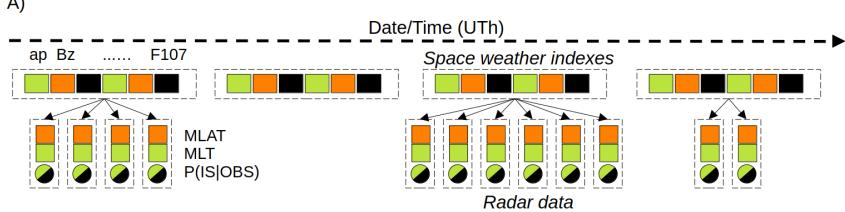

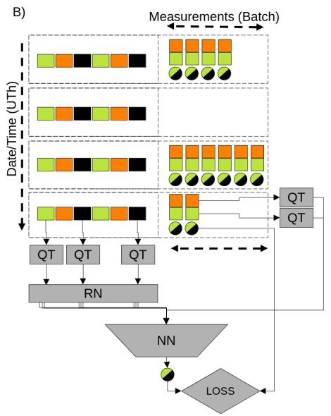

C)  
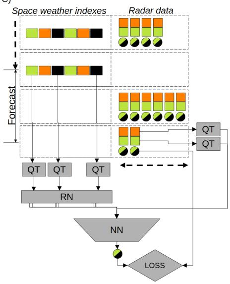

D)  
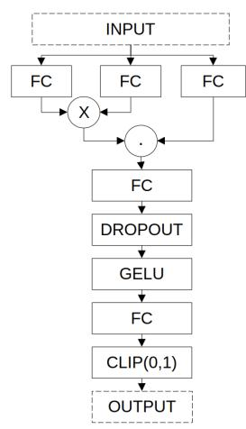

E)  
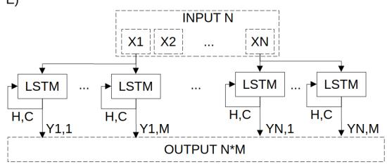  
Figure 3: (A) - dataset structure in the form of dynamic graphs, dashed lines indicates nodes, arrows - directed edges; (B-D) - regression neural network (RN-NN) for predicting the probability of ionospheric scattering and its training method in nowcasting mode (B) and in forecasting mode (C). Dashed lines indicate blocks fed into the network simultaneously. Notation: QT - quantile transformer, RN - recurrent neural network, NN - attention neural network. (D) - NN architecture. FC - standard dense (i.e.fully connected) layer, GeLU - nonlinear activation function, Dropout - standard dropout layer with dropout probability 0.3, Clip - clipping values to the interval [0,1]. (E) - RN architecture.17

This network increases the number of features of the primary node, it is a standard technique in graph neural networks that enhances their quality. The architecture of this network is illustrated in Fig.3E.

Quantile transformers (QT) were previously described in (4-6). Thus, the input fed to the RN and NN networks at any given moment is not the raw measured data itself, but rather a limited monotonic function of that data without error values and with nearly uniform distribution.

Each regression network (RN) has a 1-to-1 recurrent neural network (RNN) architecture, where the value of the final element in the output sequence is selected as the output. In the RNN an LSTM unit chosen for its robustness in training at long sequences (the history sequence length used is 31 days, or 744 values). A separate multi-head RNN is implemented for each input parameter with six heads selected experimentally to maximize forecast quality. Consequently, at any given time moment, we get six output values for every input parameter. These can be interpreted as the result of filtering of that parameter’s value sequence by six independent non-linear filters. During training, these filters adapt to identify significant patterns in the parameter to provide the optimal forecast quality by the resulting neural network. The architecture (Fig.3E) was selected to maximize the isolation of each parameter and its filters. Later this allows making efective future analysis of most important parameters and enhancing the model’s interpretability.

A drawback of RN model (Fig.3E) is its slow inference and training speed within the standard Python/PyTorch framework that makes it slow to train and study. However, the model has obvious symmetry leading to computational parallelism, which allows optimization when running on GPUs. Therefore the RN network code was rewritten and parallelized from Python/PyTorch framework to Python/C++/CUDA(r) code using recent state-of-the-art large language models (Opus5 and Qwen3.8Max). The new code shows a tenfold increase of neural network training speed and allows to complete all training and analysis of the network described in the paper using regular personal computer with regular GPU.

The decision-making neural network (NN) takes as input parameters the results calculated by regression network (RN), six output features per each input space weather parameter (derived from six parameter filtering operations) and uses them for each of radar observation point (MLAT, MLT) to predict the probability of observing ionospheric scattering P(IS|OBS, θ, MLAT, MLT) at spatial location MLAT,MLT.

As already discussed, the NN operates on unordered radar data (scatering positions) for given moment. In contrast, the RN operates on the ordered subset of the dataset (space weather parameters), processing it in strict temporal order, and this allows the extraction of temporal patterns that are most significant for the prediction.

The neural network architecture employs a classic attention mechanism [Vaswani et al., 2023] followed by two-layer fully connected network with dropout, and is shown in Fig.3D.

From machine learning point of view the suggested network Fig.3B-E is an implementation of recurrent graph attention network for predicting node parameters over dynamic graph sequence. From physical point of view the network is a model that predicts ionospheric scattering probability using scattering point geomagnetic coordinates and several non-linear filterings of each space weather parameter temporal sequence.

## 3.2 Model training and simplification

For training the model, the data were split into two parts: a training dataset and a validation (test) dataset, as shown in Table 1. The validation dataset (2024-2025) followed the training dataset (2010-2023) chronologically.

Compensating for data incompleteness during training. A problem of the model training is the incompleteness of the radar data: the radar networks do not provide a hemisphere coverage. This makes impossible to determine correctly the ionospheric irregularities at low-latitudes. After model training, this results in cases where irregularities are predicted at all latitudes down to equatorial, which cannot be verified using existing radar experimental data.

To compensate this problem, the two preprocessing steps was introduced prior to data augmentation. At the first step for the lowest 2.5% of magnetic latitudes in the dataset, the observed occurrence rate of irregularities was forced to zero while keeping all other parameters identical to the experimental observations. At the second step, we extend dataset with zero occurence rate samples in the mid-latitude band. Namely an identical dataset of size 10% was randomly choosen from training dataset, but with magnetic latitude and ionospheric scattering probability are modified: the latitude was replaced with a random value within the lowest 10% of the latitude range (approximately 4 degrees above the lowest latitude boundary), and $P ( I S | O B S , \theta _ { s } )$ was set to zero. This approach stimulates models to decrease predicted $P ( I S | O B S , \theta _ { s } )$ at lowest measured latitudes.

Both types of networks (RN and NN) are trained jointly and simultaneously. Consequently, the search for temporal patterns in the space weather parameters and the method for estimating $P ( I S | O B S , \theta _ { s } )$ based on these patterns are optimized together.

The training algorithm is as follows.

1. During the training epoch, we iterate sequentially through all moments in the train dataset from the earliest to the latest.

2. Select next time moment T.

3. If no radar data is available for this moment, go to step 2.

4. Pass the input parameters throught QT and augment the output. To accelerate computations, we use a one-month window $( T - t ) \leq 3 1 \times 2 4$ h.

5. Pass the result to the RN and compute the output based on the history of parameters θ ordered by time $t \leq T$ . Store the resulting RN output values ϕ Note that these values are part of the computation graph, so the RN will be optimized during training at step 9.

6. Pass the features (MLAT, MLT) through QT for each existing radar observation node for given moment, augment the results to compensate data incompleteness.

7. Concatenate the results with the output features ϕ of the regression network RN (computed in the step 5) and form a batch of inputs χ for the neural network NN;

8. Pass the batch of results through NN.

9. Calculate the diference between the NN outputs $P _ { p r e d } ( I S | O B S , \theta , M L T , M L A T )$ and the experimental observations $P _ { o b s } ( I S | O B S , \theta , M L T , M L A T )$ using the mean squared error (MSE) loss function, and perform a training step on the resulting batch. Simultaneously update all coeficients of the regression network (RN) and the neural network (NN), using the AdamW optimization algorithm with a learning rate of $1 0 ^ { - 5 }$

10. If next time moment exists go to step 2.

11. Calculate loss at whole validation dataset. If the loss on the validation dataset is minimized, exit the training loop, otherwise go to step 1 and train next epoch.

Thus, training regression network (RN) proceeds sequentially, record by record of space weather parameters, whereas the neural network (NN) trains batch-wise using radar data; the batch size varies over time, corresponding to the number of simultaneous scattering observations across the radar network at the given moment. In all the cases, augmentation of space weather parameters and coordinates is performed by no more than +/-1.0 of the output discrete values (7)after quantile transformer QT.

Training typically converges in fewer than 50 epochs, due to the model’s simplicity, the large size of the dataset, and the high level of data augmentation.

A separate models were trained for every forecast lead time to enable subsequent analysis of the space weather indices most important for the irregularities forecast. Figure 4 shows the model’s mean squared error (MSE) for lead times ranging from 0 (nowcasting) to 10 days (240 hours) at train and validation (test) datasets.

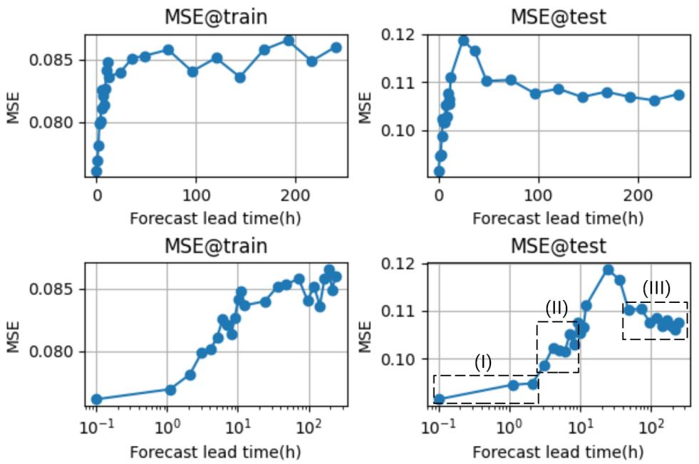  
Figure 4: Comparison of forecast model quality at diferent lead times. Marked regions are: (I) - nowcast and short-term forecast; (II) - mid-term forecast; (III) - long-term forecast.

The Fig.4 shows three lead intervals of acceptable forecast performance: nowcasting and short-term forecasting (0-2 hours), mid-term forecasting (3- 9 hours), and long-term forecasting (4-10 days). The 10-72 hour lead-time range is characterized by the highest error rates and due to poor predictability it should not be used.

The Fig.4D shows that nowcasting demonstrates the highest forecast quality, with comparable performance at lead times of up to two hours. Forecast error increases as the lead time increases.

To find the most important parameters for prediction we use permutation technique discussed before. Fig.5 illustrates the relative importance of various model input parameters (components of $\theta _ { s } )$ for diferent lead times. Table 4 lists the most significant parameters. The table shows that the most important parameters are always MLAT,MLT.

The table shows that the short-term forecast (up to 2 hours) is well determined by the parameters $a _ { p } , K _ { p } , P _ { s w }$ , and $E _ { s w }$ , while $\widetilde { B _ { z } }$ and F10.7 are also necessary for nowcasting (0 h) only. The mid-term forecast (3-6 hours) is determined by the parameters $a _ { p } , K _ { p } , T _ { s w } , P _ { s w } .$ , and AE. For the 7-9-hour forecast, the prediction is based on the parameters $A E , a _ { p } , K _ { p } ,$ and $P _ { s w }$ . For longer-term forecasts (above 9 hours), no specific parameter structure is observed. Thus, the parameters $a _ { p } , \ K _ { p } , \ P _ { s w } , \ E _ { s w } , \ \widetilde { B _ { z } } , \ T _ { s w } ,$ AE, and F10.7 can be selected as the base parameters for models providing forecasts with lead times from 0 to 9 hours.

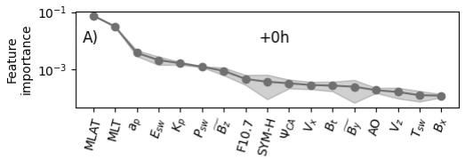

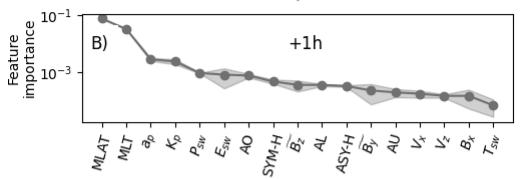

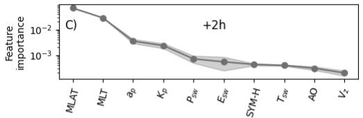

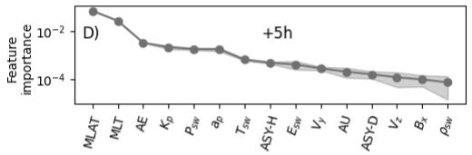

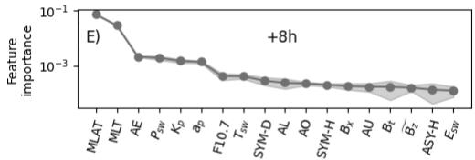

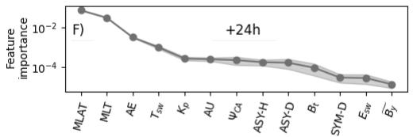

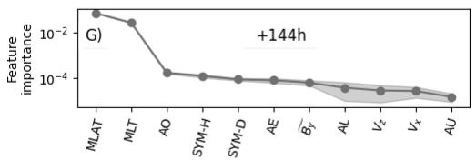

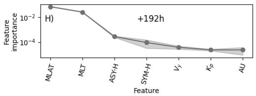  
Figure 5: Importance of model parameters for diferent forecast lead times (from 0 hours to 192 hours)

Table 4: Most important model parameters by forecast lead time (MLAT and MLT excluded), in descending order of importance
<table><tr><td rowspan=1 colspan=1>Forecast lead time(h)</td><td rowspan=1 colspan=1>Important parameters</td></tr><tr><td rowspan=1 colspan=1>0</td><td rowspan=1 colspan=1> $a _ { p } , E _ { s w } , K _ { p } , P _ { s w } , \widetilde { B _ { z } } , \mathrm { F 1 0 . 7 }$ </td></tr><tr><td rowspan=1 colspan=1>1</td><td rowspan=1 colspan=1> $\overline { { a _ { p } , K _ { p } , P _ { s w } , E _ { s w } , \mathrm { A O } } }$ </td></tr><tr><td rowspan=1 colspan=1>2</td><td rowspan=1 colspan=1> $a _ { p } , K _ { p } , P _ { s w } , E _ { s w } , \mathrm { S Y M - H }$ </td></tr><tr><td rowspan=1 colspan=1>3</td><td rowspan=1 colspan=1> $a _ { p } , K _ { p } , T _ { s w } , P _ { s w } , \mathrm { A E }$ </td></tr><tr><td rowspan=1 colspan=1>4</td><td rowspan=1 colspan=1> $a _ { p } , K _ { p } , \mathrm { A E } , P _ { s w } , \mathrm { A S Y - H }$ </td></tr><tr><td rowspan=1 colspan=1>5</td><td rowspan=1 colspan=1> $\overline { { \mathrm { A E } , K _ { p } , P _ { s w } , a _ { p } , T _ { s w } } }$ </td></tr><tr><td rowspan=1 colspan=1>6</td><td rowspan=1 colspan=1> $T _ { s w } , K _ { p } , a _ { p } , P _ { s w } , \mathrm { A E }$ </td></tr><tr><td rowspan=1 colspan=1>7</td><td rowspan=1 colspan=1> $\mathrm { A E } , K _ { p } , a _ { p } , \mathrm { A S Y - H } , T _ { s w }$ </td></tr><tr><td rowspan=1 colspan=1>8</td><td rowspan=1 colspan=1> $\overline { { \mathrm { A E } , P _ { s w } , K _ { p } , a _ { p } , \mathrm { F 1 0 7 } } }$ </td></tr><tr><td rowspan=1 colspan=1>9</td><td rowspan=1 colspan=1> $\overline { { \mathrm { A E } , \boldsymbol { a } _ { p } , P _ { s w } , K _ { p } , V _ { y } } }$ </td></tr><tr><td rowspan=1 colspan=1>12</td><td rowspan=1 colspan=1> $P _ { s w } , \mathrm { A U } , K _ { p } , \mathrm { A L } , a _ { p }$ </td></tr><tr><td rowspan=1 colspan=1>24</td><td rowspan=1 colspan=1> $\overline { { \mathrm { A E } , T _ { s w } , K _ { p } , \mathrm { A U } , B _ { t a n } } }$ </td></tr><tr><td rowspan=1 colspan=1>36</td><td rowspan=1 colspan=1> $\overline { { \mathrm { A E , A S Y - D , F 1 0 7 } , P _ { s w } , A U } }$ </td></tr><tr><td rowspan=1 colspan=1>144</td><td rowspan=1 colspan=1> $\overline { { \mathrm { A O , S Y M - H , S Y M - D , A E } } }$ </td></tr><tr><td rowspan=1 colspan=1>168</td><td rowspan=1 colspan=1> $\overline { { \mathrm { A S Y - D } , T _ { s w } } }$ </td></tr><tr><td rowspan=1 colspan=1>192</td><td rowspan=1 colspan=1> $\overline { { \mathrm { A S Y - H , S Y M - H } } }$ </td></tr></table>

After identifying the model’s most important input parameters, the number of them was reduced, and the models Fig.3 were trained using only these (distilled) parameters on the same dataset for various forecast lead times. A comparison of the quality of the final distilled models versus the original ones is shown in Fig.6.

The figure shows that, within the 0-9 hour forecast horizon, the model based on the parameters $a _ { p } , K _ { p } , P _ { s w } , E _ { s w } , \overleftarrow { B _ { z } } , T _ { s w } ,$ AE, F10.7 performs no worse than the original model on the validation dataset, confirming the efectiveness of the selected parameters for forecasting. Attempts to reduce the number of input parameters lowers the model quality, demonstrating that this set of parameters looks minimal for efective nowcasting and forecasting among all the studied space weather parameters (Table 2).

## 4 Model for P(OBS|θ)

To construct a complete model of the occurrence of ionospheric irregularities $P ( I S | \theta _ { s } )$ one need not only $P ( I S | O B S , \theta _ { s } )$ model, built above, but also forecast of the probability that radars observing various signals under diferent conditions, $P ( O B S | \theta _ { s } )$ . The combination of these two models (2) allows one to estimate $P ( I S | \theta _ { s } )$ .

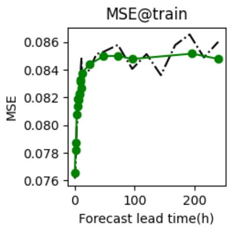

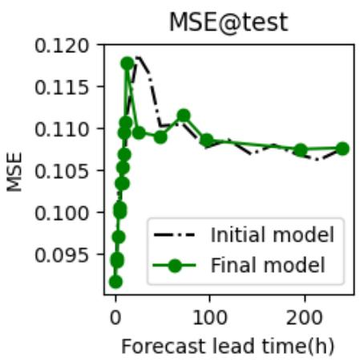

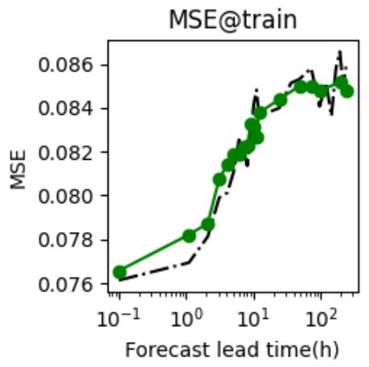

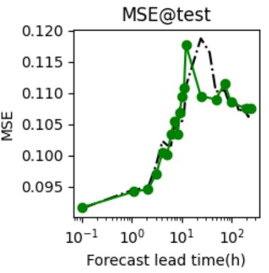  
Figure 6: Training quality of distilled models at train and test datasetfor various lead times in comparison with initial model: initial model - 23 input parameters, final distilled model - 8 parameters: $a _ { p } , K _ { p } , P _ { s w } , E _ { s w } , \tilde { B _ { z } } , T _ { s w } , \mathrm { A E , F 1 0 . 7 }$

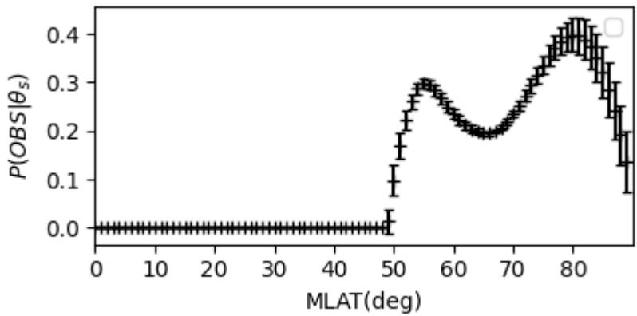  
Figure 7: Prediction statistics of $P ( O B S | \theta _ { s } )$ . Intervals corresponds the mean results, error interval shows standard deviation over the dataset.

To construct the model $P ( O B S | \theta _ { s } )$ based on the dataset previously used to build the $P ( I S | O B S , \theta _ { s } )$ model, a second dataset was created. For each moment of observations (date and UT hour) in the training dataset, a binary map of total received signals (IS and non-IS) observations was generated, irrespective of the specific signal type. The data are presented as the grid $( M L A T , M L T ) = ( [ 4 0 , 9 0 ] , [ 0 , 2 4 ] )$ . The 0 at this map indicates the absence of any received signal by radars at given (MLAT,MLT) , while 1 indicates the presence of at least one signal at the given moment and location. During followed training, binary signal occurrences on this grid becomes averaged, forcing the model to predict the target probability $P ( O B S | \theta _ { s } )$ . As a model we use an architecture identical to the RN-NN in nowcasting mode (Fig.3B), but train it on the dataset described above.

As shown the neural network training, the probability $P ( O B S | \theta _ { s } )$ depends weakly on the space weather state θ and the local magnetic time MLT, and can be represented in a much simpler form:

$$
P ( O B S | \theta _ { s } ) \approx P ( O B S | M L A T )
$$

To demonstrate this a distribution of the model results in diferent conditions shown in Fig.7. The figure shows the mean predicted probability and the standard deviation calculated over a dataset containing roughly equal numbers of randomly selected profiles for each $K _ { p }$ level. This random selection is made to compensate for potential errors arising from dataset non-uniformity: in the original dataset low $K _ { p }$ values occur several orders of magnitude more frequently than high $K _ { p }$ values. The figure demonstrates that the models makes qualitatively consistent predictions, showing two primary peaks in scattered signal observations at latitudes of 55 MLAT and 80 MLAT with a minimum between them, and sets $P ( O B S | M L A T )$ to zero at latitudes below 50 MLAT.

The figure shows that the RN-NN model demonstrates little variability in response to changing external conditions $( \theta , M L T )$ , with the typical probability $P ( O B S | M L A T )$ ranging from 0.2 to 0.45 over the magnetic latitude range from 55 to 90 MLAT. Therefore, to describe $P ( O B S | M L A T )$ in the subsequent analysis, we use a stationary tabulated profile of $P ( O B S | M L A T )$ predicted by the RN-NN model and averaged over the available dataset covering various space weather conditions θ and MLT.

## 5 Resulting model $P ( I S | \theta _ { s } )$ and discussion

The final model $P ( I S | \theta _ { s } )$ is formed as the product of the tabulated model for the observation probability of scattered signals $P ( O B S | M L A T )$ and the probability that a scattered signal is one scattered from the ionosphere $P ( I S | O B S , \theta _ { s } )$ , following (2).

The Fig.8 shows some space weather parameters and nowcasting model predictions using data from the validation dataset - the geomagnetic storm of August 11-13, 2024. The figure shows good agreement between experimental observations and model predictions. A characteristic daytime decrease in the $P ( I S | \theta _ { s } )$ is visible near local noon. It looks like a well-known phenomenon related with the asymmetry of the polar oval. Figure also demonstrates a good correlation between the equatorward movement of the irregularities boundary and increasing the geomagnetic disturbance level.

The dependence of the maximum latitude of the equatorial boundary of the irregularities (observed in the 10-12 MLT sector) on the space weather parameters, used as model inputs, is shown in detail in Fig.9 (for nowcast model). The statistics shows three types of dependencies afecting the maximum latitude of the lower boundary of the model region containing irregularities:

• as the parameters $K _ { p } , \ A E$ , and $E _ { s w }$ increase, the boundary moves equatorward;

• as $F 1 0 . 7 , T _ { s w } ,$ and $\widetilde { B _ { z } }$ increase, the boundary moves poleward;

• no unambiguous direct correlation is observed with changes in $P _ { s w }$ and $a _ { p }$ , the strong dependence on them (Table 4) expects that not their realtime values, but their temporal dynamics aftect the result.

The influence of the geomagnetic disturbance level $( K _ { p } )$ on the probability of observing small-scale irregularities has long been known: as the level of geomagnetic disturbance increases, the probability of observing radio aurora at lower latitudes rises, which is consistent with the results shown in Fig.9A.

The triggering mechanism involving the sign of the interplanetary magnetic field component $\widetilde { B _ { z } }$ (efectively, $B _ { z }$ represents the cosine of IMF clock angle) regarding the probability of a geomagnetic storm and its associated small-scale irregularities is also well known[Heppner and Maynard, 1987], which is consistent with the results shown in Fig.9C.

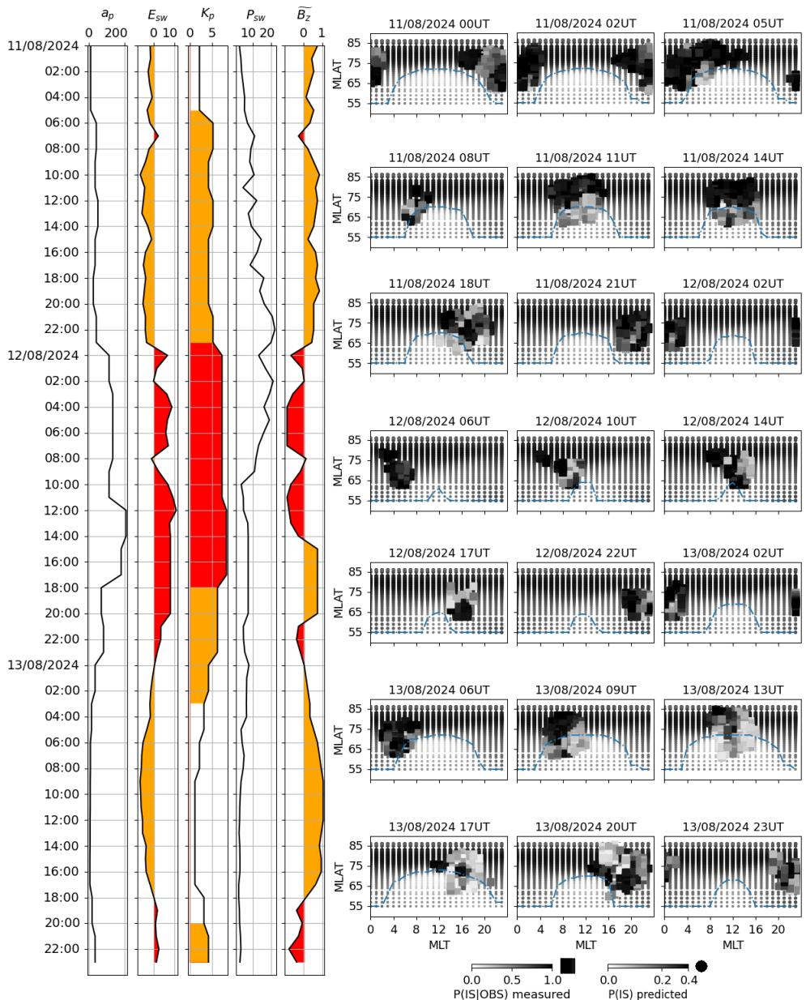  
Figure 8: Model predictions on the validation dataset in nowcasting mode for the geomagnetic storm of August 11-13, 2024. The left panel shows the time series of the indices $a _ { p } , \ E _ { s w } , \ K _ { p } , \ P _ { s w }$ , and $\scriptstyle { \overrightarrow { B _ { z } } }$ . The right panel displays model-predicted probabilities of observing ionospheric irregularities $P ( I S | \theta _ { s } )$ as circles, and experimental observations of the probability that a scattered signal originates from ionospheric scattering $P ( I S | O B S , \theta _ { s } )$ as squares. The line indicates the model border $P ( I S | \theta _ { s } ) = 0 . 1$

D)  
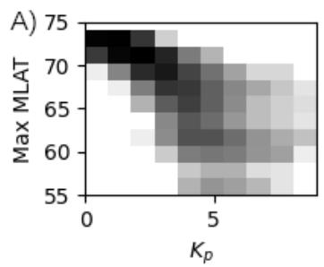

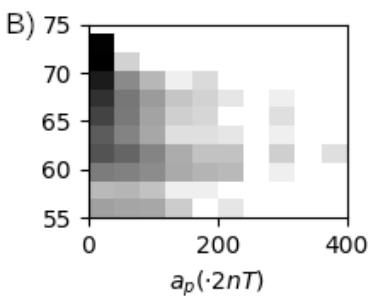

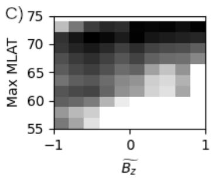

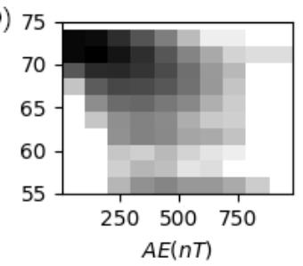

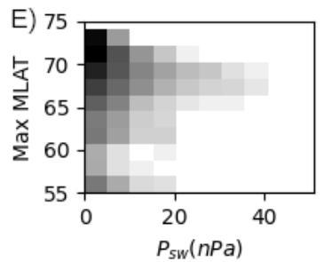

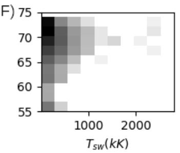

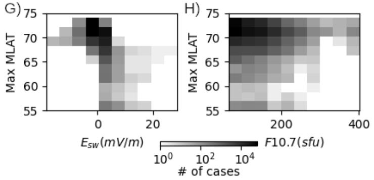  
Figure 9: Dependence of the maximum latitude of the equatorial boundary of the model region containing irregularities (nowcasting) on space weather parameters based on whole available dataset 2010-2025.

Fig.9G demosntrates also strong trigger efect of $E _ { s w }$ - the product of the solar wind velocity magnitude |V | and the z-component of the magnetic field $B _ { z }$ with taking its sign into account. The dependence of polar convection intensity on the electric field module $| E _ { s w } |$ is utilized in constructing high-latitude convection maps based on SuperDARN radar data [Cousins and Shepherd, 2010], yet it does not appear to exhibit a clear, unambiguous relationship with the latitude of observation. The dependence on $V _ { x }$ is also known because it has been shown to impact the strength of the coupling between the magnetosphere and ionosphere [Reif et al., 1981, Doyle and Burke, 1983], and is used in the high-latitude electric potential models [Weimer, 1996, Weimer, 2005]. The solar wind pressure $P _ { s w }$ has also been shown to have an impact on convection [Boudouridis et al., 2004].

Thus, the empirical model we constructed and the significant parameters identified within it do not contradict known physical observations or the parameters controlling substorm development and high-latitude convection. They are responsible for the formation of many types of small-scale irregularities in the high-latitude ionosphere.

## 6 Conclusion

This paper presents an approach to constructing a predictive model for the probability of occurrence of high-latitude decameter ionospheric irregularities based on SuperDARN and SECIRA radar data and space weather parameters. The method is based on self-learned pattern recognition in the dynamics of space-weather parameters, that influence the probability of irregularities formation. The proposed approach is a data-driven, multiscale method in which the spatial distribution of irregularities is approximated using a neural network with an original architecture inspired by graph neural networks and trained on available experimental data.

The model was trained using data from 11 radars covering the period 2010-2025 (SuperDARN: CVW, ICE, ICW, INV, PGR, PYK, RKN, SAS, STO; SECIRA: EKB, MAGW). It is shown that the model achieves optimal performance when using geomagnetic coordinates MLT, MLAT to describe irregularities locations instead of geographic coordinates. The optimal set of parameters for the best forecast is a combination of geomagnetic and solar disturbance indices $( a _ { p } , K _ { p } , A E$ , F10.7) from ground-based observations, and satellite-measured solar wind and interplanetary magnetic field parameters $( P _ { s w } , E _ { s w } , \overleftarrow { B _ { z } } , T _ { s w } )$ . Hourly mean values for all the parameters were used in the analysis. The results indicate that acceptable forecast quality is achieved with a lead time of up to 7-9 hours, while the highest quality is obtained for nowcast (zero lead time). It is shown that the parameters $\widetilde { B _ { z } }$ and F10.7 are significant for nowcasting only and can be excluded for other lead times. AE and $T _ { s w }$ are significant only at lead times above 2 hours and can be neglected for short-term predictions.

Statistical relationships between the maximum latitude of the equatorial boundary of the irregularities and parameters of the model are also presented, demonstrating a good correlation with previously known efects.

## Asknowledgements

The work of OB and IL was financially supported by the Ministry of Science and Higher Education. The results if SECIRA radars were obtained using the Core Shared Research Facility ”Angara” of ISTP SB RAS (https://ckprf.ru/catalog/ckp/3056/). The authors acknowledge the use of SuperDARN data. SuperDARN is a collection of radars funded by national scientific funding agencies of Australia, Canada, China, France, Italy, Japan, Norway, South Africa, United Kingdom, and the United States of America. The Christmas Valley West, Iceland East, and Iceland West radars are maintained and operated by Dartmouth College with support from NSF under AGS-2426199. The Inuvik, Prince George, Rankin Inlet, and Saskatoon radars are maintained and operated by SuperDARN Canada. Super-DARN Canada operations are supported by funding from the Canada Foundation for Innovation (CFI), the Canadian Space Agency’s (CSA) Geospace Observatory (GO) Canada program, and Innovation Saskatchewan. The Pykkvibaer radar was maintained and operated by University of Leicester. The Stokkseyri radar was maintained and operated by Centre National de Recherche Scientifique (CNRS, France) and by Lancaster University (UK). The OMNI data were obtained from the GSFC/SPDF OMNIWeb interface at https://omniweb.gsfc.nasa.gov

## References

[B´eniguel and Hamel, 2011] B´eniguel, Y. and Hamel, P. (2011). A global ionosphere scintillation propagation model for equatorial regions. Journal of Space Weather and Space Climate, 1(1):A04.

[Berngardt and Lavygin, 2026] Berngardt, O. and Lavygin, I. (2026). Selflearning signal classifier for HF coherent scatter radars. Advances in Space Research, 77(3):3527–3548.

[Berngardt et al., 2020] Berngardt, O. I., Kurkin, V. I., Kushnarev, D. S., Grkovich, K. V., Fedorov, R. R., Orlov, A. I., and Harchenko, V. V. (2020). ISTP SB RAS decameter radars. Solar-Terrestrial Physics, 6(2):63–73.

[Bilitza et al., 2022] Bilitza, D., Pezzopane, M., Truhlik, V., Altadill, D., Reinisch, B. W., and Pignalberi, A. (2022). The International Reference Ionosphere Model: A Review and Description of an Ionospheric Benchmark. Reviews of Geophysics, 60(4):e2022RG000792. e2022RG000792 2022RG000792.

[Blanchard et al., 2009] Blanchard, G. T., Sundeen, S., and Baker, K. B. (2009). Probabilistic identification of high-frequency radar backscatter from the ground and ionosphere based on spectral characteristics. Radio Science, 44(5).

[Booker and Wells, 1938] Booker, H. G. and Wells, H. W. (1938). Scattering of radio waves by the F-region of the ionosphere. Terrestrial Magnetism and Atmospheric Electricity, 43(3):249–256.

[Boudouridis et al., 2004] Boudouridis, A., Zesta, E., Lyons, L. R., and Anderson, P. C. (2004). Evaluation of the Hill-Siscoe transpolar potential saturation model during a solar wind dynamic pressure pulse. Geophysical Research Letters, 31(23).

[Breiman, 2001] Breiman, L. (2001). Machine Learning, 45(1):5–32.

[Brody et al., 2021] Brody, S., Alon, U., and Yahav, E. (2021). How Attentive are Graph Attention Networks? arXiv e-prints, page arXiv:2105.14491.

[Caton et al., 2004] Caton, R. G., McNeil, W. J., Groves, K. M., and Basu, S. (2004). GPS proxy model for real-time UHF satellite communications scintillation maps from the Scintillation Network Decision Aid (SCINDA). Radio Science, 39(1).

[Cousins and Shepherd, 2010] Cousins, E. D. P. and Shepherd, S. G. (2010). A dynamical model of high-latitude convection derived from SuperDARN plasma drift measurements. Journal of Geophysical Research: Space Physics, 115(A12).

[Deshpande et al., 2014] Deshpande, K. B., Bust, G. S., Clauer, C. R., Rino, C. L., and Carrano, C. S. (2014). Satellite-beacon Ionospheric-scintillation Global Model of the upper Atmosphere (SIGMA) I: High-latitude sensitivity study of the model parameters. Journal of Geophysical Research: Space Physics, 119(5):4026–4043.

[Doyle and Burke, 1983] Doyle, M. A. and Burke, W. J. (1983). S3-2 measurements of the polar cap potential. Journal of Geophysical Research: Space Physics, 88(A11):9125–9133.

[Gao et al., 2026] Gao, B., Liu, E., Hu, Z., Liu, J., Yang, D., Qiao, L., and Chen, X. (2026). A Novel Deep Learning Model for High-Latitude Ionospheric Convection Using SuperDARN Data. Space Weather, 24(7).

[Gao et al., 2025] Gao, Z., Chen, Y., Ao, X., Yue, F., Chen, H., Deng, H., Luo, B., Wang, X., and Yuan, T. (2025). ISNet: Decomposed Dynamic Spatio-Temporal Neural Network for Ionospheric Scintillation Forecasts. Space Weather, 23(6).

[Groves et al., 1997] Groves, K. M., Basu, S., Weber, E. J., Smitham, M., Kuenzler, H., Valladares, C. E., Sheehan, R., MacKenzie, E., Secan, J. A., Ning, P., McNeill, W. J., Moonan, D. W., and Kendra, M. J. (1997). Equatorial scintillation and systems support. Radio Science, 32(5):2047–2064.

[Hamel et al., 2014] Hamel, P., Sambou, D. C., Darces, M., Beniguel, Y., and H´elier, M. (2014). Kriging method to perform scintillation maps based on measurement and GISM model. Radio Science, 49(9):746–752.

[Helmholtz Centre For Geosciences, 2026] Helmholtz Centre For Geosciences (2026). Helmholtz Centre For Geosciences.

[Heppner and Maynard, 1987] Heppner, J. P. and Maynard, N. C. (1987). Empirical high-latitude electric field models. Journal of Geophysical Research: Space Physics, 92(A5):4467–4489.

[Huba and Joyce, 2010] Huba, J. D. and Joyce, G. (2010). Global modeling of equatorial plasma bubbles. Geophysical Research Letters, 37(17).

[Khemani et al., 2024] Khemani, B., Patil, S., Kotecha, K., and Tanwar, S. (2024). A review of graph neural networks: concepts, architectures, techniques, challenges, datasets, applications, and future directions. Journal of Big Data, 11(1).

[Kyoto WDC, 2026] Kyoto WDC (2026). Kyoto WDC.

[Li et al., 2025] Li, H., Zhang, J., Wang, W., Deng, X., Lan, A., Zhang, R., Yan, J., and Wang, C. (2025). Preliminary Analysis of Observation Data by High Frequency Radars of the CN-DARN. Chinese Journal of Space Science, 45(2):266.

[McGranaghan et al., 2018] McGranaghan, R. M., Mannucci, A. J., Wilson, B., Mattmann, C. A., and Chadwick, R. (2018). New capabilities for prediction of high-latitude ionospheric scintillation: A novel approach with machine learning. Space Weather, 16(11):1817–1846.

[Mestici et al., 2026] Mestici, S., De Michelis, P., Consolini, G., Pignalberi, A., Tozzi, R., Giannattasio, F., and Berilli, F. (2026). Toward a Dynamic Model for Topside Ionospheric Irregularities: Spherical Harmonic Decomposition. Space Weather, 24(3).

[Molina and Camps, 2026] Molina, C. and Camps, A. (2026). An Improved Neural-Network to Estimate the Inputs of Rino’s Ionospheric Scintillation Model. IEEE Journal of Selected Topics in Applied Earth Observations and Remote Sensing, 19:181–189.

[Nishitani et al., 2019] Nishitani, N., Ruohoniemi, J. M., Lester, M., Baker, J. B. H., Koustov, A. V., Shepherd, S. G., Chisham, G., Hori, T., Thomas, E. G., Makarevich, R. A., Marchaudon, A., Ponomarenko, P., Wild, J. A., Milan, S. E., Bristow, W. A., Devlin, J., Miller, E., Greenwald, R. A., and Ogawa, T. (2019). Review of the accomplishments of mid-latitude super dual auroral radar network (superdarn) hf radars. Progress in Earth and Planetary Science, 6(1):27.

[OMNI database, 2026] OMNI database (2026). OMNI database.

[Priyadarshi, 2015] Priyadarshi, S. (2015). A Review of Ionospheric Scintillation Models. Surveys in Geophysics, 36(2):295–324.

[Rasp et al., 2026] Rasp, S., Babenko, B., Masters, D., El-Kadi, A., Merchant, S., Shalev, G., Price, I., Zyda, F., Lam, R., Shysheya, S., Willson, M., Markou, S., Agrawal, S., Vora, S., Hassen, M. A., Mak, S., Andersson, T. R., Bela, M., Uddin, A., Levi, N. P., Gaiarin, B., Alet, F., Bell, A., Battaglia, P., and Sanchez-Gonzalez, A. (2026). Weathernext 3: Increasing resolution and performance of global weather models with raw observations.

[Reif et al., 1981] Reif, P. H., Spiro, R. W., and Hill, T. W. (1981). Dependence of polar cap potential drop on interplanetary parameters. Journal of Geophysical Research: Space Physics, 86(A9):7639–7648.

[Ruohoniemi and Greenwald, 1996] Ruohoniemi, J. M. and Greenwald, R. A. (1996). Statistical patterns of high-latitude convection obtained from goose bay hf radar observations. Journal of Geophysical Research: Space Physics, 101(A10):21743–21763.

[Secan et al., 1995] Secan, J. A., Bussey, R. M., Fremouw, E. J., and Basu, S. (1995). An improved model of equatorial scintillation. Radio Science, 30(3):607–617.

[Secan et al., 1997] Secan, J. A., Bussey, R. M., Fremouw, E. J., and Basu, S. (1997). High-latitude upgrade to the Wideband ionospheric scintillation model. Radio Science, 32(4):1567–1574.

[Shepherd, 2014] Shepherd, S. G. (2014). Altitude-adjusted corrected geomagnetic coordinates: Definition and functional approximations. Journal of Geophysical Research: Space Physics, 119(9):7501–7521.

[Shepherd and Ruohoniemi, 2000] Shepherd, S. G. and Ruohoniemi, J. M. (2000). Electrostatic potential patterns in the high-latitude ionosphere constrained by SuperDARN measurements. Journal of Geophysical Research: Space Physics, 105(A10):23005–23014.

[Tsunoda, 1988] Tsunoda, R. T. (1988). High-latitude ¡i¿F¡/i¿ region irregularities: A review and synthesis. Reviews of Geophysics, 26(4):719–760.

[Vaswani et al., 2023] Vaswani, A., Shazeer, N., Parmar, N., Uszkoreit, J., Jones, L., Gomez, A. N., Kaiser, L., and Polosukhin, I. (2023). Attention Is All You Need.

[Weimer, 1996] Weimer, D. R. (1996). A flexible, IMF dependent model of high-latitude electric potentials having “Space Weather” applications. Geophysical Research Letters, 23(18):2549–2552.

[Weimer, 2005] Weimer, D. R. (2005). Improved ionospheric electrodynamic models and application to calculating Joule heating rates. Journal of Geophysical Research: Space Physics, 110(A5).

[Zhao et al., 2026] Zhao, D., Yang, D., Liu, H., Zhang, K., Hancock, C. M., and Zhang, M. (2026). A Model for Predicting Ionospheric Scintillation Intensity in High Latitude Region Based on VMD-CNN-BiLSTM-Attention. Journal of Geophysical Research: Space Physics, 131(6).