# The Price of Current-Efect Inference in Nonstationary Multi-Armed Bandits

Sharan Sahu ∗

Martin T. Wells †

October 22, 2026

## Abstract

Adaptive experiments use bandit algorithms to allocate more observations to interventions with higher expected rewards. However, decision-makers often also require reliable inference about current treatment efects: the diferences between the expected rewards of interventions and a reference intervention at the present round, rather than averages over past rounds. These objectives create a fundamental tension: reward maximization favors better interventions, whereas estimating their current efects requires recent observations from interventions that may be suboptimal. When outcomes change over time, historical observations become outdated, making accurate inference dependent on continued exploration.

We characterize this tradeof for K-arm bandits whose mean rewards satisfy a known H¨older smoothness condition with exponent $\beta \in ( 0 , 1 ]$ and constant L. We establish matching minimax bounds, up to logarithmic factors, on expected dynamic regret subject to simultaneous coverage with high probability for all current efects relative to a reference arm, with confidence-interval width at most w. For a horizon $T ,$ our proposed policy, TRACE (Tracking Rewards and Current Efects), achieves expected dy namic regret of order $\widetilde { \mathcal { O } } _ { \beta } \left( \sqrt { K T } + K ^ { \beta / ( 2 \beta + 1 ) } L ^ { 1 / ( 2 \beta + 1 ) } T ^ { ( \beta + 1 ) / ( 2 \beta + 1 ) } + K w ^ { - 2 } \left( 1 + L ^ { 1 / \beta } w ^ { - 1 / \beta } \right) \right)$ , where $\widetilde { \mathcal { O } } _ { \beta }$ suppresses logarithmic factors and constants depending only on $\beta .$ This regret–precision tradeof separates the standard cost of reward learning from the additional cost of refreshing information about current efects. Notably, the inferential cost remains unavoidable even when the same arm is uniformly optimal.

We further extend TRACE with an empirical-Bernstein e-process that adapts exploration to realized prediction errors while preserving the worst-case guarantee. When the realized drift within an inference block is suficiently small, all observations collected by TRACE can be reused for asymptotically normal pointwise inference and, under stronger local stability, locally asymptotically eficient estimation. We also show that regret constraints can limit honest adaptation to unknown smoothness. We support our theoretical findings through extensive numerical experiments.

## Contents

1 Introduction 2   
1.1 Inference from adaptive experiments 4   
1.2 Nonstationarity and current-efect inference 4   
1.3 Our contributions . 5   
1.4 Organization 5   
1.5 Notation . 5

## 2 Current-efect bandit model

3 Theoretical results 6   
3.1 The regret–precision tradeof .   
3.2 TRACE: Tracking Rewards and Current Efects 8   
3.3 Adaptive TRACE with empirical-Bernstein e-processes 10   
3.4 Local asymptotic inference . . . 13   
3.5 Limits of adaptation to unknown smoothness 16   
4 Numerical experiments 16   
4.1 Synthetic data experiment . . . . 17   
4.2 Yahoo! R6B: the empirical price of current-efect inference 18   
4.3 ZOZOTOWN: prediction-adaptive inferential exploration 19   
4.4 HeartSteps: time-varying current treatment efects 20   
5 Conclusion 21   
A Proof of Theorem 3.1 26   
B Proof of Theorem 3.2 30   
C Proof of Lemma 3.3 32   
D Proof of Theorem 3.3 35   
E Proof of Corollary 3.4 35   
F Proof of Theorem 3.4 36   
G Proof of Theorem 3.5 41   
H Proof of Theorem 3.6 47   
I Additional experimental results 48

## 1 Introduction

Bandit algorithms provide a framework for learning which decisions perform well while using that information to improve outcomes during an experiment (Lattimore and Szepesv´ari, 2020). In each round, the learner selects an intervention and observes only its outcome, creating a tradeof between collecting information and choosing interventions that appear more rewarding. This framework has been used in applications that include online recommendation and digital experimentation, adaptive clinical trials and mobile-health interventions, personalized treatment assignment, and sequential policy design (Li et al., 2010; Scott, 2015; Villar et al., 2015; Tewari and Murphy, 2017; Kasy and Sautmann, 2021). However, in many of these settings, cumulative reward is not the only objective. Decision-makers may also want reliable estimates of current treatment efects, meaning the diferences in expected rewards between interventions and a reference intervention at the present time, rather than efects averaged over the history of the experiment.

Why estimate the current efect rather than an efect averaged over the history of the experiment? The distinction matters whenever treatment efects vary over time, and the inferential question concerns an immediate decision. This variation occurs naturally in biological systems. For example, the eficacy of cancer immunotherapy treatment can change as a function of cancer cells becoming more resistant or due to changes in physiological and immune responses over time (Sharma et al., 2010; Chung et al., 2022; Wang et al., 2024). A time-averaged efect can therefore place greater weight on observations generated under conditions that are no longer relevant and subsequently describe past performance accurately while providing a poor description of present performance. That is, an intervention can have a positive average efect over the experiment while having little benefit or even a negative efect at the current round. For such decisions, the relevant estimand is naturally the contemporaneous efect rather than its historical average.

This inferential objective becomes particularly dificult when outcomes change over time. Classical stochastic bandits assume fixed arm means, whereas nonstationary models allow intervention performance to evolve (Lai and Robbins, 1985; Garivier and Moulines, 2011; Besbes et al., 2014; Jia et al., 2023). Under drift, observations collected earlier may no longer accurately describe current performance. Consequently, reward maximization and current-efect inference place fundamentally diferent demands on the data. Once an intervention appears inferior, a reward-maximizing learner has little reason to continue selecting it. In contrast, estimating its present efect requires suficiently recent observations because older observations become progressively less informative about the current state. The following examples illustrate when this distinction matters.

Online experimentation and recommendation. Bandit methods can adapt recommendations and online decisions based on observed user feedback (Li et al., 2010; Scott, 2015). A platform comparing several recommendation or ranking strategies may also want to know how much each strategy currently improves engagement relative to its current production baseline. When reward distributions change over time, an estimate averaged across the experiment answers a diferent question from an estimate of the efect now. Temporal nonstationarity can arise in several forms, including seasonality (periodic shifts), changes in customer demographics or user markets (covariate shifts), and product changes (structural shifts), each of which can make historical observations less representative of current performance.

Adaptive interventions. Bandit methods have also been studied for adaptive clinical trials, treatment assignment, and mobile-health interventions (Villar et al., 2015; Tewari and Murphy, 2017; Kasy and Sautmann, 2021). The eficacy of treatment can evolve as the enrolled population changes, behavioral responses adapt, or the underlying biological state varies over time. An estimate averaging over earlier participants can therefore remain statistically precise while no longer accurately describing the treatment efect for participants currently entering the experiment. An experimenter may consequently want to improve participant outcomes while also maintaining an accurate estimate of each intervention’s current benefit. However, simply concentrating observations on the intervention with the highest estimated reward may subsequently reduce the recent information available about the alternatives (Villar et al., 2015; Simchi-Levi and Wang, 2025).

Continuous monitoring. Experimenters may inspect the results repeatedly and make decisions at datadependent times. Anytime-valid inference and confidence sequences provide guarantees that remain valid under continuous monitoring (Howard et al., 2021; Johari et al., 2022; Ramdas et al., 2023; Waudby-Smith and Ramdas, 2024). However, when efects change over time, there is an additional challenge: the reported interval must describe the current efect rather than a time-averaged efect. Optional-stopping validity alone does not address the bias created by outdated observations.

Quantum computing. Quantum fault-tolerant computing seeks to perform reliable computations on noisy quantum hardware through quantum error correction and fault-tolerant protocols that suppress logical errors below a threshold (Shor, 1995; Aharonov and Ben-Or, 1997; Fowler et al., 2012). Although these methods provide a path to scalable quantum computation, fault tolerance incurs substantial overhead in physical qubits, gates, and calibration efort (Fowler et al., 2012; Katabarwa et al., 2024; Gong and Hu, 2026). In practice, operating and optimizing a fault-tolerant system requires repeatedly selecting among alternative error-correction strategies, calibration settings, decoding procedures, or hardware configurations while observing noisy performance outcomes. This naturally gives rise to a bandit problem, where each action corresponds to a candidate intervention, and rewards depend on an evolving quantum device whose noise characteristics may drift over time (Besbes et al., 2014; Gong and Hu, 2026). A central challenge is therefore to balance exploration and exploitation while simultaneously making valid inference about the current efect of an intervention in a nonstationary environment. Understanding this tension between adaptive allocation and current-efect inference is essential for the continual characterization, calibration, and scaling of fault-tolerant quantum computing systems (Katabarwa et al., 2024; Gong and Hu, 2026).

## 1.1 Inference from adaptive experiments

Adaptive allocation complicates inference because the observations collected for each intervention depend on previous outcomes. This issue has motivated a broad literature on inference from adaptively collected data, including bias-correction methods for adaptive linear models (Deshpande et al., 2018), stabilized and adaptively weighted estimators that account for changing assignment probabilities (Hadad et al., 2021), and weighted M-estimators that provide asymptotically valid inference under adaptive sampling (Zhang et al., 2021). Related work develops doubly robust inference for contextual-bandit data (Bibaut et al., 2021) and semiparametrically eficient inference for sequential experiments with adaptive treatment assignment (Cook et al., 2024). These approaches explicitly account for the sampling mechanism rather than treating adaptively collected observations as if they were from a fixed design. A related line of work develops guarantees that hold uniformly over time. Nonasymptotic confidence sequences provide time-uniform inference, including empirical-Bernstein constructions (Howard et al., 2021), while betting-based confidence sequences and eprocesses provide general tools for anytime-valid inference (Ramdas et al., 2023; Waudby-Smith and Ramdas, 2024). These ideas have also been developed for adaptive experiments (Cook et al., 2024) and contextual bandits with adaptive logging and time-varying policy values (Waudby-Smith et al., 2024).

The tension between adaptive allocation and statistical inference has also been studied from an experimentaldesign perspective, including response-adaptive clinical-trial designs that balance assigning more participants to better-performing treatments against preserving statistical power for treatment comparisons, as well as settings where the experimenter values both outcomes during the experiment and the quality of the policy selected afterward (Villar et al., 2015; Kasy and Sautmann, 2021).

Closely related to our work, minimax formulations characterize regret–estimation tradeofs and Paretooptimal designs in multi-armed bandit experiments (Simchi-Levi and Wang, 2025), and randomized allocation can be combined with bandit policies to obtain asymptotically anytime-valid inference for average treatment efects (Liang and Bojinov, 2024). In nonstationary settings, Simchi-Levi et al. (2026) study experimental design under structured temporal trends and characterize the tradeof between estimating dynamic treatment efects and minimizing regret, while Shao et al. (2026) study adaptive $\mathrm { A } / \mathrm { B }$ testing under state-space dynamics, combining response-adaptive allocation with estimation of time-averaged treatment efects and anytime-valid confidence sequences.

## 1.2 Nonstationarity and current-efect inference

Nonstationary bandit theory studies how temporal changes in reward distributions afect sequential decisionmaking, beginning with discounted and sliding-window methods for changing environments (Garivier and Moulines, 2011) and later extending to variation-budget formulations that characterize dynamic regret under more general temporal drift (Besbes et al., 2014). These ideas have also been developed for nonstationary contextual and linear bandits (Chen et al., 2019; Russac et al., 2019; Cheung et al., 2022). A complementary line of work imposes local regularity through temporal smoothness, yielding sharper dynamic-regret guarantees for smooth reward trajectories (Jia et al., 2023) and minimax, smoothness-adaptive guarantees over H¨older classes (Suk, 2025). Nonstationarity and distribution shift have also been studied more broadly in stochastic optimization and robust learning (Besbes et al., 2015; Sahu and Wells, 2025; Sahu et al., 2026a,b).

These models raise a distinct statistical challenge when the target is the current treatment efect rather than a time-averaged efect over the history of the experiment. Under temporal drift, past observations remain informative, but become less representative of current conditions as time passes. Using more historical data reduces sampling uncertainty but increases temporal bias, while using only recent data better reflects current conditions at the cost of statistical precision. Adaptive allocation creates an additional dificulty because arms with lower rewards may receive few recent observations even though they remain necessary for inference. Reliable current-efect inference must therefore account for both the statistical value of recent observations and the regret incurred by collecting them. This leads to our central question:

What are the fundamental limits of simultaneously learning and performing valid inference in nonstationary multi-armed bandits, can these limits be attained algorithmically, and to what extent can they be improved by exploiting local stationarity in the environment?

## 1.3 Our contributions

We formulate current-efect inference in nonstationary bandits as a constrained minimax problem and characterize the resulting regret–precision tradeof. Our main contributions are:

1. Optimal regret–precision tradeof. We establish matching upper and lower bounds, up to logarithmic factors, for the minimum dynamic regret required for uniformly precise current-efect inference. The rate separates the usual cost of reward learning from an additional inferential cost of repeatedly sampling every arm as past observations become outdated. This cost persists even when the same arm is uniformly optimal, showing that exploration can be unnecessary for reward maximization yet unavoidable for current-efect inference.

2. TRACE and adaptive exploration. We propose a policy called TRACE (Tracking Rewards and Current $E f f e c t s )$ , which attains the minimax tradeof up to logarithmic factors. An empirical-Bernstein e-process extension reduces continued exploration when predictable forecasts are accurate while preserving the same worst-case guarantee.

3. Local asymptotic inference and eficiency. When realized drift is small relative to sampling error, all observations collected by TRACE can be reused for asymptotically normal current-efect inference. Under stronger local stationarity, the resulting estimator is locally asymptotically eficient.

4. Limits of smoothness adaptation. We show that honest inference cannot generally adapt freely to unknown temporal smoothness under a regret constraint. Even for a constant trajectory, coverage over a rougher H¨older class can force wider intervals because a low-regret policy may not collect enough local information to rule out rougher alternatives, aligning with classical impossibility results for honest adaptation over smoothness classes (Low, 1997; Bull, 2012).

## 1.4 Organization

The remainder of this paper is organized as follows. In Section 2, we introduce the nonstationary bandit model and formulate current-efect inference under H¨older-smooth drift. In Section 3, we develop our main theoretical results, characterizing the minimax regret–precision tradeof (Section 3.1), introducing TRACE and its adaptive empirical-Bernstein extension (Sections 3.2 and 3.3), and establishing local asymptotic inference (Section 3.4) and eficiency results together with limits on adaptation to unknown smoothness (Section 3.5). In Section 4, we present numerical experiments illustrating the regret–inference tradeof and the empirical performance of our proposed methods. Proofs of all main results and supporting lemmas are deferred to the appendices.

## 1.5 Notation

For $n \in \mathbb { N } _ { + }$ , let $[ n ] : = \{ 1 , \dots , n \}$ . We write $\mathbf { 1 } \{ \cdot \}$ for the indicator function. For $x \in \mathbb { R } , \lfloor x \rfloor$ and ⌈x⌉ denote the floor and ceiling of $x ,$ respectively. For $a , b \in \mathbb { R }$ , let $a \vee b : = \operatorname* { m a x } \{ a , b \}$ and $a \wedge b : = \operatorname* { m i n } \{ a , b \}$ . For an interval $I \subseteq \mathbb { R }$ , |I| denotes its length. We use P, E, and Var for probability, expectation, and variance, respectively, with subscripts and superscripts used to indicate the underlying distribution or procedure when needed. We write Bern(p) for the Bernoulli distribution with mean $p .$ . For probability laws P and Q, their total variation distance is $\mathsf { T V } ( \mathsf { P } , \mathsf { Q } ) : = \mathsf { s u p } _ { A } | \mathsf { P } ( A ) - \mathsf { Q } ( A ) |$ , and $\mathsf { P } \triangleleft \mathsf { Q }$ denotes that P is contiguous with respect to $\mathsf { Q } .$ We write $X _ { n } = o _ { P } ( r _ { n } )$ and $X _ { n } = \mathcal { O } _ { P } ( r _ { n } )$ for the usual stochastic little-o and big-O relations, with the governing probability law indicated in the subscript when needed. For nonnegative sequences $a _ { n }$ and $b _ { n } .$ , we write $a _ { n } \lesssim b _ { n }$ if $a _ { n } \leq c b _ { r }$ for a universal constant $c > 0$ , and $a _ { n } \lesssim _ { \beta } b _ { n }$ if the constant may depend only on $\beta .$ . We write $a _ { n } \asymp b _ { n }$ when both $a _ { n } \lesssim b _ { n }$ and $b _ { n } \lesssim a _ { n }$ hold. Finally, $\widetilde { \mathcal { O } } ( \cdot )$ and $ { \widetilde { \Theta } } ( \cdot )$ suppress logarithmic factors, with a subscript such as $\widetilde { \mathcal { O } } _ { \beta } ( \cdot )$ allowing constants depending only on $\beta .$ . All logarithms are natural unless stated otherwise.

## 2 Current-efect bandit model

Consider a nonstationary K-armed bandit with action set $\mathcal { A } = \{ 0 , \ldots , K - 1 \}$ and horizon $T .$ We will assign arm 0 as a reference arm, which need not be optimal, and write $\mathcal { A } _ { + } : = \mathcal { A } \setminus \{ 0 \}$ for the remaining interventions. For $\beta \in ( 0 , 1 ]$ and $L \in [ 0 , 1 ]$ , define the class of H¨older-smooth bandit environments

$$
\mathcal { M } _ { \beta , L } : = \left\{ \mu = ( \mu _ { a } ) _ { a \in A } : \mu _ { a } : [ 0 , 1 ] \to [ 0 , 1 ] , \ | \mu _ { a } ( u ) - \mu _ { a } ( v ) | \leq L | u - v | ^ { \beta } \mathrm { ~ f o r ~ a l l ~ } u , v \in [ 0 , 1 ] , \ a \in A \right\}\tag{1}
$$

For $\mu \in \mathcal { M } _ { \beta , L }$ , let $\mu _ { t , a } : = \mu _ { a } ( t / T )$ denote the mean reward of arm a at round t. The case $L = 0$ recovers the stationary setting, while $\beta = 1$ corresponds to Lipschitz drift.

Let $\mathcal { F } _ { t - 1 } = \sigma \left( A _ { s } , Y _ { s } , U _ { s } : s \leq t - 1 \right)$ denote the sigma-algebra generated by all past actions $A _ { s } ,$ rewards $Y _ { s } .$ , and revealed algorithmic randomness $U _ { s }$ up to round $t - 1$ . The learner selects $A _ { t } \in { \mathcal { A } }$ using $\mathcal { F } _ { t - 1 }$ and observes $Y _ { t } \mid { \mathcal { F } } _ { t - 1 } , A _ { t } \sim \operatorname { B e r n } ( \mu _ { t , A _ { t } } )$ . We use Bernoulli rewards for the minimax formulation and lower bounds, although the upper bounds continue to hold for any $Y _ { t } \in [ 0 , 1 ]$ satisfying $\mathbb { E } [ Y _ { t } \mid \mathcal { F } _ { t - 1 } , A _ { t } ] = \mu _ { t , A _ { t } }$ We use $\mathbb { P } _ { \mu } ^ { \pi }$ and $\mathbb { E } _ { \mu } ^ { \pi }$ to denote probability and expectation under environment $\mu$ and procedure π. The expected dynamic regret of a procedure π is then defined as

$$
\mathcal { R } _ { T } ( \pi , \mu ) : = \mathbb { E } _ { \mu } ^ { \pi } \left[ \sum _ { \iota = 1 } ^ { T } \bigl ( \operatorname* { m a x } _ { a \in \mathcal { A } } \mu _ { t , a } - \mu _ { t , A _ { t } } \bigr ) \right] .\tag{2}
$$

In addition to selecting actions, the learner reports inference for the current performance of each intervention relative to the reference arm. For $a \in A _ { + }$ , define the current efect $\tau _ { t } ( a ) : = \mu _ { t , a } - \mu _ { t , 0 }$ . Thus, $\tau _ { t } ( a )$ is the diference in expected reward between intervention a and the reference intervention at round t. By (1), $| \tau _ { t } ( a ) - \tau _ { s } ( a ) | \leq 2 L | ( t - s ) / T | ^ { \beta }$ , so older observations can become less representative of the current efect.

A procedure π consists of an action-selection rule together with an inferential rule. Before observing $Y _ { t } .$ , it reports a nonempty closed confidence interval $\mathcal { C } _ { t } ( a ) \subseteq [ - 1 , 1 ]$ for the current efect $\tau _ { t } ( a )$ of each $a \in A _ { + }$ . We require $\mathscr { C } _ { t } ( a )$ to be $\mathcal { F } _ { t - 1 } . . . \mathrm { m e a s u r a b l e } ,$ so the interval is determined before the reward at round t is observed. Fix a predetermined burn-in time $t _ { 0 } \in [ T ]$ . We now formalize what it means for current-efect inference to be simultaneously valid and precise.

Definition 1 (Validity and precision). Fix $w \in ( 0 , 2 ]$ and $\delta \in ( 0 , 1 )$ . A procedure π is $( w , \delta )$ -valid if

$$
\operatorname* { i n f } _ { \mu \in \mathcal { M } _ { \beta , L } } \mathbb { P } _ { \mu } ^ { \pi } \Bigg ( \Bigg \{ \tau _ { t } ( a ) \in \mathcal { C } _ { t } ( a ) \ \forall ( t , a ) \in [ T ] \times \mathcal { A } _ { + } \Bigg \} \cap \left\{ \operatorname* { m a x } _ { t _ { 0 } \leq t \leq T } \operatorname* { m a x } _ { a \in \mathcal { A } _ { + } } | \mathcal { C } _ { t } ( a ) | \leq w \right\} \Bigg ) \geq 1 - \delta .\tag{3}
$$

Remark 2.1. Coverage is required over the full horizon, while precision is only required after a finite burn-in time $t _ { 0 }$ . Burn-in time is unavoidable as before any rewards are observed, a learner will not have suficient information to distinguish bandit settings with diferent current efects. In our main results, we take $t _ { 0 } = \lceil T / 2 \rceil$ . Simultaneous coverage also implies validity at any data-dependent round and arm within the prescribed horizon. In particular, for any such $\nu \in [ T ]$ and $\widehat { a } \in { \mathcal { A } } _ { + } , \mathbb { P } _ { \mu } ^ { \pi } \{ \tau _ { \nu } ( \widehat { a } ) \notin \mathcal { C } _ { \nu } ( \widehat { a } ) \} \leq \delta$

We measure the cost of this inferential requirement through the constrained minimax regret

$$
\mathcal { R } _ { T } ^ { \star } ( w , \delta ) : = \operatorname* { i n f } _ { \substack { \pi : ( w , \delta ) \mathrm { - v a l i d } _ { \mu \in \mathcal { M } _ { \beta , L } } } } \operatorname* { s u p } _ { \mathcal { R } _ { T } ( \pi , \mu ) . }\tag{4}
$$

We set $\mathcal { R } _ { T } ^ { \star } ( w , \delta ) = + \infty$ if no $( w , \delta )$ -valid procedure exists. Dependence on $K , \beta ,$ and L is suppressed in the notation. Throughout the main results, the learner has full information on $T , K , \beta , L , w$ , and δ.

## 3 Theoretical results

We now present our main theoretical results. We first characterize the minimax regret–precision tradeof for current-efect inference (Section 3.1). We then introduce TRACE, which attains this tradeof up to logarithmic factors (Section 3.2), followed by an empirical-Bernstein extension that adapts inferential exploration to realized prediction errors while preserving the worst-case guarantee (Section 3.3). We next develop a local asymptotic theory showing that, when the realized drift is suficiently small, observations collected for reward learning can also be used for asymptotically normal and locally eficient inference (Section 3.4). Finally, we study the limits of honest adaptation to unknown temporal smoothness under a regret constraint (Section 3.5).

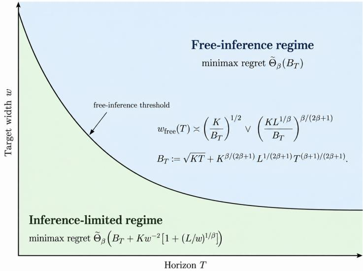  
Figure 1: Minimax regret–precision tradeof. Narrower confidence intervals require more frequent exploration and therefore increase regret. The free-inference threshold $w _ { \mathrm { f r e e } } ( T )$ separates the inference limited regime from the regime where current-efect inference is essentially free at the minimax regret scale.

## 3.1 The regret–precision tradeof

We now characterize the minimum regret required to maintain uniformly precise inference for the current efects. Throughout this section, we take $t _ { 0 } = \lceil T / 2 \rceil$ and assume $2 \leq K \leq T$ . We focus on the feasible regime in which $K w ^ { - 2 } [ 1 + ( L / w ) ^ { 1 / \beta } ] \log \bigl ( K [ 1 + ( L / w ) ^ { 1 / \beta } ] / \delta \bigr ) \le c _ { \beta } T$ for a suficiently small constant $c _ { \beta } > 0$ depending only on $\beta .$

Theorem 3.1 (Regret–precision tradeof). There exist universal constants $w _ { 0 } , \delta _ { 0 } \in ( 0 , 1 )$ such that, for every $w \in ( 0 , w _ { 0 } ]$ and $\delta \in ( 0 , \delta _ { 0 } ]$ in the feasible regime,

$$
\mathcal { R } _ { T } ^ { \star } ( w , \delta ) = \widetilde { \Theta } _ { \beta } \left( \sqrt { K T } + K ^ { \beta / ( 2 \beta + 1 ) } L ^ { 1 / ( 2 \beta + 1 ) } T ^ { ( \beta + 1 ) / ( 2 \beta + 1 ) } + \frac { K } { w ^ { 2 } } \left[ 1 + \left( \frac { L } { w } \right) ^ { 1 / \beta } \right] \right) .\tag{5}
$$

Proof. We prove Theorem 3.1 in Appendix A.

The first two terms in (5) are the standard cost of reward learning under smooth nonstationarity (Jia et al., 2023; Suk, 2025). The final term is the additional cost of current-efect inference. More precisely, this term carries the logarithmic factor $\log ( K [ 1 + ( L / w ) ^ { 1 / \beta } ] / \delta )$ , which is suppressed by $\widetilde { \Theta } _ { \beta }$ and shown by the lower bound to be necessary. The factor $1 { \dot { + } } ( L / w ) ^ { 1 / \beta }$ reflects how often information must be refreshed. Observations more than roughly $T ( w / L ) ^ { 1 / \beta }$ rounds old may incur temporal bias larger than the target precision, so the horizon contains roughly $1 + ( L / w ) ^ { 1 / \beta }$ regions in which fresh information is needed. Each region requires order $w ^ { - 2 }$ observations from each arm. This cost persists even when the same arm remains optimal throughout the experiment. One can choose w to balance the costs of reward learning and inference, with this balance achievable at increasingly small widths as $T$ grows relative to $K$ and L (see Figure 1).

Two special cases of Theorem 3.1 are particularly informative. We first consider Lipschitz drift.

Corollary 3.1 (Lipschitz drift). Suppose $\beta = L = 1$ and $K , \delta$ are fixed. In the feasible regime, $\mathcal { R } _ { T } ^ { \star } ( w , \delta ) \asymp$ $T ^ { 2 / 3 } + w ^ { - 3 } \log ( 1 / w )$ , up to constants depending only on K and δ. In particular, $i f w \times T ^ { - 2 / 9 } ( \log T ) ^ { 1 / 3 }$ , then $\mathcal { R } _ { T } ^ { \star } ( w , \delta ) \asymp T ^ { 2 / 3 }$ . The smallest feasible width satisfies $w \asymp T ^ { - 1 / 3 } ( \log T ) ^ { 1 / 3 }$ , in which case $\mathcal { R } _ { T } ^ { \star } ( w , \delta ) \asymp T$

Proof. Substituting $\beta = L = 1$ into Theorem 3.1, with K and δ fixed, gives $\mathcal { R } _ { T } ^ { \star } ( w , \delta ) \asymp T ^ { 2 / 3 } + w ^ { - 3 } \log ( 1 / w )$ Balancing the inferential term with $T ^ { 2 / 3 }$ yields $v \asymp T ^ { - 2 / 9 } ( \log T ) ^ { 1 / 3 }$ The feasibility condition requires $w ^ { - 3 } \log ( 1 / w ) \lesssim T$ , whose smallest solution satisfies $w \asymp T ^ { - 1 / 3 } ( \log T ) ^ { 1 / 3 }$ □

In the stationary case i.e. $L = 0$ , the refresh cost disappears while the inferential cost remains.

Corollary 3.2 (Stationary environments). Suppose $L \ = \ 0$ and $K , \delta$ are fixed. In the feasible regime, $\mathcal { R } _ { T } ^ { \star } ( w , \delta ) \asymp T ^ { 1 / 2 } + w ^ { - 2 }$ , up to constants depending only on K and δ. Thus, even in a stationary environment, uniformly precise current-efect inference incurs an additional $w ^ { - 2 }$ regret cost beyond standard reward learning.

Proof. When $L = 0$ , the nonstationary reward-learning term in Theorem 3.1 vanishes and $1 + ( L / w ) ^ { 1 / \beta } = 1$ Since K and δ are fixed, the remaining logarithmic factor is constant, giving $\mathcal { R } _ { T } ^ { \star } ( w , \delta ) \asymp T ^ { 1 / 2 } + w ^ { - 2 } . ~ \sqsupseteq$

## 3.2 TRACE: Tracking Rewards and Current Efects

We next introduce our proposed TRACE policy (implemented in Algorithm 1), which achieves the upper bound in Theorem 3.1. TRACE uses separate sampling schedules for reward learning and current-efect inference. Within each inference block, it reserves observations from every arm to estimate the current efects. On the remaining rounds, it runs a restarted instance of EXP3. EXP3 was introduced by Auer et al. (2002) for adversarial multi-armed bandits and controls regret relative to the best fixed arm without requiring stationary rewards within a block (cf. Section 11.3 of Lattimore and Szepesv´ari (2020)).

Set

$$
J : = \operatorname* { m a x } \left\{ 4 , \left\lceil 4 \left( \frac { 8 L } { w } \right) ^ { 1 / \beta } \right\rceil \right\} , m : = \left\lceil \frac { 3 2 } { w ^ { 2 } } \log \left( \frac { 2 K J } { \delta } \right) \right\rceil .\tag{6}
$$

Here $J$ is the number of inference blocks and m is the number of reserved observations from each arm in each block. To handle nonstationarity in the mean reward $\mu \in \mathcal { M } _ { \beta , L }$ , we restart EXP3 every h rounds by resetting all arm weights to one, which induces a uniform distribution over $\mathcal { A } \mathrm { : }$

$$
h : = \left\{ \begin{array} { l l } { T } & { L = 0 , } \\ { T \wedge \left[ \left( \frac { T ^ { \beta } \sqrt { K \log K } } { L } \right) ^ { 2 / ( 2 \beta + 1 ) } \right] } & { L > 0 , } \end{array} \right.\tag{7}
$$

and let $\eta : = \sqrt { 2 \log K / ( K h ) }$ be the stepsize used by EXP3.

Partition $[ T ]$ into J consecutive blocks $\boldsymbol { B } _ { 1 } , \ldots , \boldsymbol { B } _ { J }$ whose lengths difer by at most one, and let $b _ { j } : =$ min $B _ { j }$ . In each block $B _ { j }$ , reserve the first Km rounds for statistical inference, sampling the K arms in round-robin order so that each arm is sampled exactly m times. Denote these reserved rounds by $\mathcal { T } _ { j }$ . Let $\mathcal { G } _ { j } : = B _ { j } \backslash \mathcal { T } _ { j }$ denote the remaining reward-learning rounds. On these rounds, the policy learns a randomized action-selection rule aimed at maximizing cumulative reward and minimizing regret.

We further denote the set of all reserved rounds by $\textstyle { \mathcal { I } } : = \bigcup _ { j \leq J } { \mathcal { I } } _ { j }$ and the set of all non-reserved rounds by $\textstyle { \mathcal { G } } : = \bigcup _ { j < J } { \mathcal { G } } _ { j }$ . We also partition [T] into $R : = \lceil T / h \rceil$ consecutive reward-restart blocks $\mathcal { H } _ { 1 } , \dots , \mathcal { H } _ { R }$ , each of size h except possibly the last.

For $a \in A ,$ let $S _ { j , a } \subseteq { \mathcal { T } } _ { j }$ denote the m reserved rounds assigned to arm a. Define $\begin{array} { r } { \widehat { \mu } _ { j , a } : = m ^ { - 1 } \sum _ { s \in S _ { i , a } } Y _ { s } } \end{array}$ and $\widehat { \tau } _ { j } ( a ) : = \widehat { \mu } _ { j , a } - \widehat { \mu } _ { j , 0 }$ for $a \in A _ { + }$ . For $t \in B _ { j }$ with $j \geq 2$ , TRACE provides a confidence interval of the form

$$
\mathcal { C } _ { t } ( a ) : = \left[ \widehat { \tau } _ { j - 1 } ( a ) \pm \left\{ \sqrt { \frac { 2 } { m } \log \left( \frac { 2 K J } { \delta } \right) } + 2 L \left( \frac { 4 } { J } \right) ^ { \beta } \right\} \right] \cap [ - 1 , 1 ] , \ a \in \mathcal { A } _ { + } .\tag{8}
$$

During the first inference block, set $\mathcal { C } _ { t } ( a ) = [ - 1 , 1 ]$ . Since (8) uses only observations from the preceding completed block, each interval is $\mathcal { F } _ { t - 1 }$ -measurable. The choice of J controls the temporal bias between consecutive inference blocks, while m controls the sampling error in the estimated arm means.

Within each reward-restart block $\mathcal { H } _ { r } .$ , EXP3 maintains a nonnegative weight $v _ { a }$ for each arm $a \in A .$ initialized as $v _ { a } = 1$ at the beginning of the block. On each non-reserved round $t \in { \mathcal { H } } _ { r } \cap { \mathcal { G } }$ , the weights induce the sampling probabilities $\begin{array} { r } { p _ { t } ( a ) : = v _ { a } / \sum _ { b \in \mathcal { A } } v _ { b } } \end{array}$ . After observing $Y _ { t }$ , TRACE forms the importanceweighted loss estimate $\widehat { \ell } _ { t } ( a ) : = { \bf 1 } \left\{ A _ { t } = a \right\} ( 1 - Y _ { t } ) / p _ { t } ( a )$ and updates $v _ { a } \gets v _ { a } \exp { - \eta \widehat { \ell } _ { t } ( a ) }$ . Thus, $v _ { a }$ is the exponential weight associated with the cumulative estimated loss of arm a since the beginning of the current reward-restart block. On reserved rounds $t \in \mathcal { H } _ { r } \cap \mathcal { I }$ , the EXP3 weights remain unchanged. The restart period h balances the fixed-arm regret of EXP3 with the error from comparing a fixed arm against the changing dynamic oracle. We now show TRACE attains the minimax optimal rate as in Theorem 3.1.

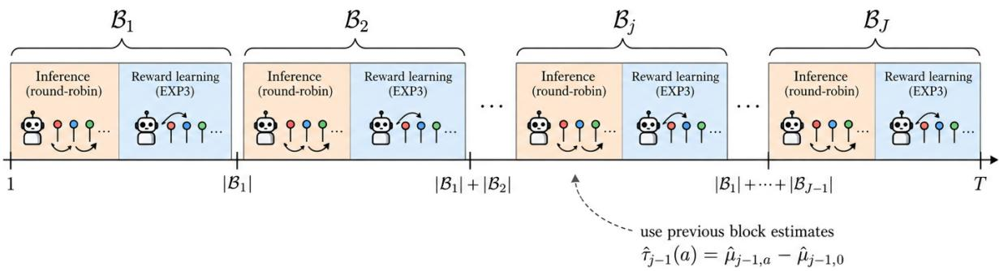  
Figure 2: Overview of TRACE. The horizon is partitioned into consecutive blocks $\boldsymbol { B } _ { 1 } , \ldots , \boldsymbol { B } _ { J }$ . At the beginning of each block, TRACE samples all arms in round-robin order to collect fresh observations for current-efect inference. On the remaining rounds, it runs EXP3 for reward learning. Inference in block $B _ { j }$ $j \geq 2$ , uses estimates constructed from the preceding block, allowing the procedure to maintain up-to-date confidence intervals while continuing to optimize reward.

Theorem 3.2 (Upper bound for TRACE). Suppose $K J m \le T / 2$ . Then TRACE is $( w , \delta )$ -valid and, after the first inference block, $\left| \mathcal { C } _ { t } ( a ) \right| \leq$ w for every $a \in \mathcal { A } _ { + }$ on every sample path. Moreover,

$$
\begin{array} { l } { \displaystyle \mathcal { R } _ { T } ( \pi , \mu ) \leq K J m + 2 \sqrt { K \log K } \left( \frac { T } { \sqrt { h } } + \sqrt { h } \right) + 2 L T \left( \frac { h } { T } \right) ^ { \beta } } \\ { \displaystyle \lesssim _ { \beta } K J m + \sqrt { K T \log K } + ( K \log K ) ^ { \beta / ( 2 \beta + 1 ) } L ^ { 1 / ( 2 \beta + 1 ) } T ^ { ( \beta + 1 ) / ( 2 \beta + 1 ) } . } \end{array}\tag{9}
$$

Proof. We prove Theorem 3.2 in Appendix B.

Since J $\asymp _ { \beta } 1 + ( L / w ) ^ { 1 / \beta }$ and $m \ : \asymp \ w ^ { - 2 } \log ( K J / \delta )$ , the regret incurred by the reserved rounds is $\widetilde { \mathcal { O } } _ { \beta } \left( K w ^ { - 2 } [ 1 + ( L / w ) ^ { 1 / \beta } ] \right)$ . Together with Theorem 3.2, this establishes the upper bound in Theorem 3.1.

Algorithm 1. TRACE: Tracking Rewards and Current Efects   
1: Input: $T , K , \beta , L , w , \delta$   
2: Set J and m according to (6)   
3: Set h according to (7) and $\eta  \sqrt { 2 \log K / ( K h ) }$   
4: Partition [T] into $\boldsymbol { B } _ { 1 } , \ldots , \boldsymbol { B } _ { J }$   
5: Set $b _ { j } \gets$ min $B _ { j }$ for every $j \in [ J ]$   
6: Initialize the EXP3 weights $v _ { a } \gets 1$ for every $a \in { \mathcal { A } }$   
7: for $t = 1 , \dots , T$ do   
8: Let j be the unique index such that $t \in B _ { j }$   
9: if $j = 1$ then   
10: Set $\mathcal { C } _ { t } ( a ) \gets [ - 1 , 1 ]$ for every $a \in \mathcal { A } _ { + }$   
11: else   
12: Set $\mathscr { C } _ { t } ( a )$ according to (8) for every $a \in \mathcal { A } _ { + }$   
13: end if   
14: if (t − 1) mod $h = 0$ then   
15: Restart EXP3 by setting $v _ { a } \gets 1$ for every $a \in { \mathcal { A } }$   
16: end if   
17: if $0 \leq t - b _ { j } < K m$ then   
18: Set $A _ { t } \dot {  } ( t - b _ { j } )$ mod $K$   
19: Observe $Y _ { t }$ and add t to $\boldsymbol { S } _ { j , \boldsymbol { A } _ { t } }$   
20: Leave the EXP3 weights $v _ { a }$ unchanged

21: else   
22: Set $p _ { t } ( a )  { v _ { a } } / { \sum _ { b \in \mathcal { A } } }$ vb for every $a \in { \mathcal { A } }$   
23: Draw $A _ { t } \sim p _ { t }$ and observe $Y _ { t }$   
24: for $a \in { \mathcal { A } }$ do   
25: Set the importance-weighted loss estimate $\widehat { \ell } _ { t } ( a ) \gets \mathbf { 1 } \{ A _ { t } = a \} ( 1 - Y _ { t } ) / p _ { t } ( a )$   
26: Update the EXP3 weight $v _ { a }  v _ { a } \exp \{ - \eta \widehat { \ell } _ { t } ( a ) \}$   
27: end for   
28: end if   
29: if $t = b _ { j } + K m - 1$ then   
30: for $a \in { \mathcal { A } }$ do   
31: Set $\begin{array} { r } { \widehat { \mu } _ { j , a } \gets m ^ { - 1 } \sum _ { s \in S _ { j , a } } Y _ { s } } \end{array}$   
32: end for   
33: for $a \in A _ { + }$ do   
34: Set $\widehat { \tau } _ { j } ( a ) \gets \widehat { \mu } _ { j , a } - \widehat { \mu } _ { j , 0 }$   
35: end for   
36: end if   
37: end for

## 3.3 Adaptive TRACE with empirical-Bernstein e-processes

The fixed version of TRACE reserves exactly m observations from every arm in each inference block. This choice is minimax optimal, but it does not adapt to the realized dificulty of the problem and data. We now replace the fixed inferential sampling requirement with a data-dependent stopping rule (Algorithm 2). Each arm is sampled until its confidence sequence becomes suficiently narrow, after which continued exploration of that arm stops.

Our construction relies on an empirical-Bernstein e-process together with a Hoefding e-process. The empirical-Bernstein bound adapts to the realized prediction errors and can terminate exploration early, while the Hoefding bound guarantees that exploration stops after the worst-case number of samples. The resulting procedure retains the worst-case guarantee of TRACE while using fewer inferential samples on favorable sample paths. We use standard empirical-Bernstein and betting constructions from Howard et al. (2021); Waudby-Smith and Ramdas (2024), together with the e-process framework of Ramdas et al. (2023).

For this adaptive version, set

$$
J : = \operatorname* { m a x } \{ 4 ,  [ 4 ( { \frac { 3 2 L } { w } } ) ^ { 1 / \beta } ] \} , m : = \lceil { \frac { 1 2 8 } { w ^ { 2 } } } \log ( { \frac { 4 K J } { \delta } } ) \rceil ,\tag{10}
$$

and let $\alpha : = \delta / ( 4 K J )$ We retain the reward-learning restart period h from (7) and the learning rate $\eta = \sqrt { \log K / ( K h ) }$ . Note that m only specifies the worst-case number of observations required for inference and plays no algorithmic role in the adaptive setting (see Corollary 3.4).

Blockwise confidence sequences. Fix an inference block $B _ { j }$ and let $b _ { j } : = \operatorname* { m i n } B _ { j }$ . Rather than estimating the entire time-varying mean trajectory, we construct a confidence sequence for the arm mean $\mu _ { b _ { j } , a }$ at a reference round $b _ { j }$ . H¨older continuity then bounds how much the mean can change between $b _ { j }$ and the current round, allowing us to enlarge the confidence interval accordingly to obtain a valid confidence set for the current mean.

Let $F _ { t } \in \{ 0 , 1 \}$ indicate whether round t is used for continued exploration. The decision whether $F _ { t } = 1$ is made before observing $Y _ { t }$ , so $F _ { t }$ is $\mathcal { F } _ { t - 1 }$ -measurable. For $t \in B _ { j }$ and $a \in { \mathcal { A } } .$ define

$$
N _ { j , a } ( t ) : = \sum _ { s = b _ { j } } ^ { t } F _ { s } { \bf 1 } \{ A _ { s } = a \} , V _ { j , a } ( t ) : = \sum _ { s = b _ { j } } ^ { t } F _ { s } { \bf 1 } \{ A _ { s } = a \} \big ( Y _ { s } - \widehat Y _ { s , a } \big ) ^ { 2 } ,\tag{11}
$$

where $\widehat { Y } _ { s , a } \in [ 0 , 1 ]$ is any $\mathcal { F } _ { s - 1 }$ -measurable prediction of the reward from arm a. When $N _ { j , a } ( t ) > 0$ , let $\overline { { Y } } _ { j , a } ( t )$ denote the average of the corresponding observations. Both $N _ { j , a } ( t )$ and $V _ { j , a } ( t )$ reset at the beginning of each

inference block. Since every block has length at most $2 T / J .$ , H¨older continuity gives $| \mu _ { s , a } - \mu _ { b _ { j } , a } | \leq L ( 2 / J ) ^ { \beta }$ for every $\boldsymbol { s } \in B _ { j }$ . For a candidate value $\theta \in [ 0 , 1 ]$ and $\lambda \in [ 0 , 1 )$ , define

$$
E _ { j , a , t } ^ { \pm } ( \theta ; \lambda ) : = \exp \Bigg \{ \lambda \sum _ { s = b _ { j } } ^ { t } F _ { s } { \bf 1 } \{ A _ { s } = a \} \left[ \pm ( Y _ { s } - \theta ) - d _ { J } \right] - \psi ( \lambda ) V _ { j , a } ( t ) \Bigg \} ,\tag{12}
$$

where $\psi ( \lambda ) : = - \log ( 1 - \lambda ) - \lambda$ is the sub-exponential CGF function and $d _ { J } : = L ( 2 / J ) ^ { \beta }$ . Under the null $\mu _ { b _ { j } , a } ~ = ~ \theta _ { \mathrm { { ; } } }$ , each process in (12) is a nonnegative supermartingale starting from one. Importantly, this remains true under adaptive action selection and data-dependent exploration because the action and exploration decisions are predictable. We use a geometric mixture over $\lambda _ { k } : = 2 ^ { - k - 1 } , k \ge 0$ . We define the sub-exponential uniform boundary $B _ { \alpha } ( \boldsymbol { v } )$ via its level-α sublevel sets as follows:

$$
B _ { \alpha } ( v ) : = \operatorname* { i n f } \left\{ x \geq 0 : \sum _ { k = 0 } ^ { \infty } \frac { \exp \{ \lambda _ { k } x - \psi ( \lambda _ { k } ) v \} } { ( k + 1 ) ( k + 2 ) } \geq \frac { 1 } { \alpha } \right\} .\tag{13}
$$

The weights $[ ( k + 1 ) ( k + 2 ) ] ^ { - 1 }$ sum to one, so the corresponding mixture is again an e-process. By Theorems 1 and 4 of Howard et al. (2021), it can be shown that $B _ { \alpha } ( v ) \lesssim \sqrt { v \left[ \log ( 1 / \alpha ) + \log \log ( e + v ) \right] } + \log ( 1 / \alpha ) +$ log $\log ( e + v )$ . For $N _ { j , a } ( t ) > 0$ , define the base confidence interval

$$
I _ { j , a , t } : = \left[ \overline { { Y } } _ { j , a } ( t ) \pm \left\{ d _ { J } + \frac { B _ { \alpha } ( V _ { j , a } ( t ) ) } { N _ { j , a } ( t ) } \wedge \left( \frac { w } { 3 2 } + \frac { 4 \log ( 1 / \alpha ) } { w N _ { j , a } ( t ) } \right) \right\} \right] \cap [ 0 , 1 ] .\tag{14}
$$

The first statistical term in (14) is the empirical-Bernstein radius. The second follows from a fixedparameter Hoefding e-process with parameter $w / 4$ . Both bounds hold simultaneously under the allocation $\alpha = \delta / ( 4 K J )$ .

For $t \in B _ { j }$ , define the running intersection $\begin{array} { r } { \widetilde { D } _ { j , a , t } : = \bigcap _ { s \in \mathcal { B } _ { j } : s \leq t , \ : N _ { j , a } ( s ) > 0 } I _ { j , a , s } } \end{array}$ with $D _ { j , a , t } = [ 0 , 1 ]$ before the first observation from arm a. Set $D _ { j , a , t } : = \widetilde { D } _ { j , a , t }$ whenever $\widetilde { D } _ { j , a , t } \neq \emptyset$ , and set $D _ { j , a , t } : = \{ 0 \}$ otherwise. We next show that these running intersections form simultaneously valid confidence sequences for the blockstart means, even under adaptive action selection and arbitrary predictable reward predictions.

Lemma 3.3 (Blockwise e-process validity). With probability at least $1 - \delta _ { : }$ , simultaneously for every $j \in [ J ]$ ， $a \in { \mathcal { A } }$ , and $t \in B _ { j } , \mu _ { b _ { j } , a } \in D _ { j , a , t }$ . The statement holds for arbitrary predictable predictions $\widehat { Y } _ { t , a } \in [ 0 , 1 ]$ and under adaptive action selection.

Proof. We prove Lemma 3.3 in Appendix C.

On the event in Lemma 3.3, $\begin{array} { r } { \mu _ { b _ { j } , a } \in I _ { j , a , t } \mathrm { ~ s o ~ } \mu _ { b _ { j } , a } \in \bigcap _ { s \in \mathcal { B } _ { i } : s < t , \ N _ { i , a } \left( s \right) > 0 } I _ { j , a , s } : = D _ { j , a , t } } \end{array}$ . Hence $D _ { j , a , t } \neq \emptyset$ Lemma 3.3 also allows us to stop exploration at a data-dependent time without an additional correction.

Data-dependent exploration. At the beginning of block $B _ { j } .$ , every arm is active. While active arms remain, TRACE samples them in a fixed cyclic order. Exploration of arm a stops as soon as $| D _ { j , a , t } | \leq w / 4$ at which point we save $D _ { j , a } ^ { \star } : = D _ { j , a , t }$ and remove a from the active set. Once all arms have stopped, the restarted EXP3 learner selects the remaining actions in the block. For each saved interval, define its endpoints by $\ell _ { j , a } ^ { \star } : = \operatorname* { i n f } _ { x \in D _ { j , a } ^ { \star } } x$ and $u _ { j , a } ^ { \star } : = \operatorname* { s u p } _ { x \in D _ { j , a } ^ { \star } } x$ . For $t \in B _ { j } , j \geq 2$ , and $a \in \mathcal { A } _ { + }$ , TRACE provides a confidence interval

$$
\mathcal { C } _ { t } ( a ) : = \left[ \ell _ { j - 1 , a } ^ { \star } - u _ { j - 1 , 0 } ^ { \star } - 2 L \left( \frac { t - b _ { j - 1 } } { T } \right) ^ { \beta } , u _ { j - 1 , a } ^ { \star } - \ell _ { j - 1 , 0 } ^ { \star } + 2 L \left( \frac { t - b _ { j - 1 } } { T } \right) ^ { \beta } \right] \cap [ - 1 , 1 ] .\tag{15}
$$

During the first inference block, set $\mathcal { C } _ { t } ( a ) = [ - 1 , 1 ]$ . Since the saved intervals from block $j - 1$ are determined before block j begins, $\mathscr { C } _ { t } ( a )$ is $\mathcal { F } _ { t - 1 }$ -measurable. Using Lemma 3.3, one can show that adaptive TRACE attains the minimax optimal regret guarantee of Theorem 3.1.

Theorem 3.3 (Adaptive exploration with the TRACE guarantee). Suppose KJm $\leq T / 2$ Then $A l g o -$ rithm 2 is $( w , \delta )$ -valid and, after the first inference block, $\left| \mathcal { C } _ { t } ( a ) \right| \leq$ w for every $a \in \mathcal { A } _ { + }$ on every sample path. Moreover, each arm requires at most m forced observations per block, and

$$
\operatorname* { s u p } _ { \mu \in \mathcal { M } _ { \beta , L } } \mathcal { R } _ { T } ( \pi , \mu ) = \widetilde { \Theta } _ { \beta } \left( \sqrt { K T } + K ^ { \beta / ( 2 \beta + 1 ) } L ^ { 1 / ( 2 \beta + 1 ) } T ^ { ( \beta + 1 ) / ( 2 \beta + 1 ) } + \frac { K } { w ^ { 2 } } \left[ 1 + \left( \frac { L } { w } \right) ^ { 1 / \beta } \right] \right) .\tag{16}
$$

Proof. We prove Theorem 3.3 in Appendix D.

The empirical-Bernstein construction becomes beneficial when the prediction error $Y _ { s } - \widehat { Y } _ { s , a }$ is suficiently small as $V _ { j , a } ( t )$ depends directly on this quantity and can lead to substantially shorter exploration phases. To quantify this improvement, let $n _ { j , a }$ denote the number of continued observations from arm a in block j.

Corollary 3.4 (Prediction-error-dependent exploration). Fix a block j and arm a. Suppose that, along a sample path, $V _ { j , a } ( t ) \leq v N _ { j , a } ( t ) + 1$ at every attained sample count before stopping, for some $v \in [ 0 , 1 ]$ . Then

$$
n _ { j , a } \lesssim m \wedge \left( \frac { v } { w ^ { 2 } } + \frac { 1 } { w } \right) \left[ \log \left( \frac { 4 K J } { \delta } \right) + \log \log ( e + m ) \right] .\tag{17}
$$

In particular, exploration stops by any attained sample count satisfying $B _ { \alpha } ( V _ { j , a } ( t ) ) \le w N _ { j , a } ( t ) / 1 6$

Proof. We prove Corollary 3.4 in Appendix E.

Up to logarithmic factors, Corollary 3.4 gives $n _ { j , a } = \widetilde { \mathcal { O } } ( v / w ^ { 2 } + 1 / w )$ . This interpolates between the worstcase $\widetilde { \mathcal { O } } ( w ^ { - 2 } )$ sample requirement when $v = \Theta ( 1 )$ ) and the faster $\widetilde { \mathcal { O } } ( w ^ { - 1 } )$ rate when $v \lesssim w$ . In particular, uniformly bounded accumulated squared residuals lead to the latter regime. Since $\widehat { Y } _ { s , a }$ is predictable, $\mathbb { E } [ ( Y _ { s } -$ $\widehat { Y } _ { s , a } ) ^ { 2 } \mid \mathcal { F } _ { s - 1 } , A _ { s } = a ] = \mathrm { V a r } ( Y _ { s } \mid \mathcal { F } _ { s - 1 } , A _ { s } = a ) + ( \mu _ { s , a } - \widehat { Y } _ { s , a } ) ^ { 2 }$ . Thus, accurate predictions reduce the contribution from prediction error, while intrinsic reward noise remains even for an ideal predictor.

Prior methods typically treat the sampling design as given, impose a predetermined amount of inferential randomization, or use predictive models to improve the precision of the resulting confidence sequence (Liang and Bojinov, 2024; Waudby-Smith and Ramdas, 2024). In contrast, adaptive TRACE uses the confidence sequence itself to determine how much exploration each arm requires based on predictive uncertainty.

This feature is particularly useful in online experimentation systems that must simultaneously optimize an objective of interest and maintain up-to-date estimates of treatment efects. Such systems often already maintain forecasting models for various latent factors, and these predictions can be provided directly to adaptive TRACE. When the forecasts are accurate, fewer observations need to be diverted from reward maximization for inference. When prediction quality deteriorates, the procedure automatically reverts toward the worst-case exploration budget while preserving coverage validity.

Algorithm 2. Adaptive TRACE with empirical-Bernstein e-processes   
1: Input: $T , K , \beta , L , w , \delta$ and predictable predictions $\widehat { Y } _ { t , a } \in [ 0 , 1 ]$   
2: Set J and m according to (10)   
3: Set $\alpha  \delta / ( 4 K J )$   
4: Set h according to (7) and $\eta  \sqrt { 2 }$ log $\overline { { K / ( K h ) } }$   
5: Partition [T] into $\boldsymbol { B } _ { 1 } , \ldots , \boldsymbol { B } _ { J }$   
6: Initialize the EXP3 weights $v _ { a } \gets 1$ for every $a \in { \mathcal { A } }$   
7: for $j = 1 , \dots , J$ do   
8: Set $b _ { j } \gets$ min $B _ { j }$   
9: Set $\bar { \mathcal { A } } _ { i } ^ { \mathrm { a c t } }  \mathcal { A }$   
10: Set $\begin{array} { r } { \dot { N _ { j , a } } \gets 0 , \ : V _ { j , a } \gets 0 } \end{array}$ , and $D _ { j , a } \gets [ 0 , 1 ]$ for every $a \in { \mathcal { A } }$   
11: for $t \in B _ { j }$ do   
12: $\mathbf { i f } { \textit { j } } = 1$ then   
13: Set $\mathcal { C } _ { t } ( a ) \gets [ - 1 , 1 ]$ for every $a \in \mathcal { A } _ { + }$   
14: else   
15: Set $\mathscr { C } _ { t } ( a )$ according to (15) for every $a \in \mathcal { A } _ { + }$

16: end if   
17: if $( t - 1 )$ mod $h = 0$ then   
18: Restart EXP3 by setting $v _ { a } \gets 1$ for every $a \in { \mathcal { A } }$   
19: end if   
20: if Aact ̸= ∅ then   
21: Set $F _ { t } \gets 1$   
22: Choose $A _ { t }$ from $\mathcal { A } _ { j } ^ { \mathrm { a c t } }$ in a fixed cyclic order   
23: Observe $Y _ { t }$   
24: Update $N _ { j , A _ { t } } \gets N _ { j , A _ { t } } + 1$   
25: Update $V _ { j , A _ { t } }  V _ { j , A _ { t } } + ( \underline { { Y _ { t } } } - \widehat { Y } _ { t , A _ { t } } ) ^ { 2 }$   
26: Update the sample mean $\overline { { Y } } _ { j , A _ { t } }$   
27: Form $I _ { j , A _ { t } , t }$ according to (14)   
28: Update $D _ { j , A _ { t } } \gets D _ { j , A _ { t } } \cap I _ { j , A _ { t } , t }$   
29: if $D _ { j , A _ { t } } = \mathcal { O }$ then   
30: Set $D _ { j , A _ { t } } \gets \{ 0 \}$   
31: end if   
32: if $| D _ { j , A _ { t } } | \leq w / 4$ then   
33: Save $D _ { j , A _ { t } } ^ { \star }  D _ { j , A _ { t } }$   
34: Remove $A _ { t }$ from $\mathcal { A } _ { j } ^ { \mathrm { a c t } }$   
35: end if   
36: Leave the EXP3 weights unchanged   
37: else   
38: Set $F _ { t } \gets 0$   
39: Set $\begin{array} { r } { p _ { t } ( a ) \gets v _ { a } / \sum _ { b \in \mathcal { A } } v _ { b } } \end{array}$ for every $a \in { \mathcal { A } }$   
40: Draw $A _ { t } \sim p _ { t }$ and observe $Y _ { t }$   
41: for a $\in { \mathcal { A } }$ do   
42: Set $\widehat { \ell } _ { t } ( a ) \gets \mathbf { 1 } \{ A _ { t } = a \} ( 1 \_ Y _ { t } ) / p _ { t } ( a )$   
43: Update $v _ { a }  v _ { a } \exp \{ - \eta \widehat { \ell } _ { t } ( a ) \}$   
44: end for   
45: end if   
46: end for   
47: end for

## 3.4 Local asymptotic inference

Our finite-sample guarantees are designed to remain valid under the worst-case drift allowed by $\mathcal { M } _ { \beta , L }$ However in practice, it is indeed possible for the realized drift over a given inference block to be much smaller. Such is the case when each block is suficiently locally stationary. In this regime, it is intuitive that reward-learning and inferential observations need not be treated separately, since both can provide useful information about the current efects. We therefore study an estimator that uses all observations from the preceding block, rather than only those reserved for inference. We show that, when the realized drift over that block is negligible relative to the sampling error, this estimator is asymptotically normal and yields standard pointwise confidence intervals for the current efects. Under a stronger local stationarity condition, it is also locally asymptotically eficient. Importantly, this requires no change to the action policy: the gain comes entirely from reusing data that TRACE already collects for reward learning.

Throughout this subsection, K is fixed and $T \to \infty$ , while the mean trajectories and algorithmic parameters may depend on $T$ . Let $t _ { T } = b _ { j _ { T } }$ be a deterministic inference-block boundary with $j _ { T } \ge 2$ , and let $\mathcal { W } _ { T } : = \mathcal { B } _ { j _ { T } - 1 }$ denote the preceding block. Every observation in $\mathcal { W } _ { T }$ is therefore available before inference is reported at $t _ { T }$ . Let $n _ { T , a } > 0 , a \in \mathcal { A }$ , be deterministic reference sample sizes. These sequences will approximate the number of observations collected from each arm in $\mathcal { W } _ { T }$ . We first make explicit the joint probability laws under which the subsequent local analysis is carried out.

Probability laws. For each $T ,$ let $\mu ^ { ( 0 ) } = \left( \mu _ { s , a } ^ { ( 0 ) } \right) _ { s \leq T , a \in \mathcal { A } }$ denote the baseline mean trajectories, and let $\mathsf { P } _ { T , 0 }$ denote the joint law of the actions and rewards induced by these trajectories and the policy π. Thus under $\mathsf { P } _ { T , 0 } , A _ { s } \mid \mathcal { F } _ { s - 1 } \sim \pi _ { s } ( . \mid \mathcal { F } _ { s - 1 } )$ and $Y _ { s } \mid \mathcal { F } _ { s - 1 } , A _ { s } = a \sim \mathrm { B e r n o u l l i } \big ( \mu _ { s , a } ^ { ( 0 ) } \big )$ . If the mean trajectories are random and exogenous to the learner, $\mathsf { P } _ { T , 0 }$ also includes the randomness of the environment process.

Unless stated otherwise, all probabilities, convergence in probability, and stochastic-order statements in the asymptotic-normality result below are taken under the baseline law $\mathsf { P } _ { T , 0 }$

Using all observations in a block. The estimator ${ \widehat { \tau } } _ { j _ { T } - 1 } ( a )$ used by TRACE relies only on the observations explicitly reserved for inference. For local inference, we instead consider a post-processing estimator that uses every observation in $\mathcal { W } _ { T }$ , including those generated by EXP3. For $a \in \mathcal A$ , define $\begin{array} { r } { N _ { T , a } : = \sum _ { s \in \mathcal { W } _ { T } } \mathbf { 1 } \{ A _ { s } = a \} } \end{array}$ and

$$
\widetilde { \mu } _ { T , a } : = \frac { \sum _ { s \in \mathcal { W } _ { T } } \mathbf { 1 } \{ A _ { s } = a \} Y _ { s } } { N _ { T , a } } , \widetilde { \tau } _ { T } ( a ) : = \widetilde { \mu } _ { T , a } - \widetilde { \mu } _ { T , 0 } , a \in \mathcal { A } _ { + } .\tag{18}
$$

To characterize the asymptotic behavior of $\widetilde { \tau } _ { T } ( a )$ , we require two local conditions. First, the number of observations from each arm $N _ { T , a }$ must stabilize around a some deterministic reference sample size $n _ { T , a } .$ Second, the drift within each block $\mathcal { W } _ { T }$ must be negligible relative to the corresponding sampling error. These conditions are summarized below.

Assumption 3.1 (Local sampling and drift). Let $n _ { T , a } > 0 , a \in \mathcal { A }$ , be deterministic reference sample sizes. The following conditions hold under the baseline law $\mathsf { P } _ { T , 0 } .$

(i) Count stability. For some $p _ { a } \in ( 0 , 1 )$

$$
\operatorname* { m i n } _ { a \in \mathcal { A } } n _ { T , a } \to \infty , \operatorname* { m a x } _ { a \in \mathcal { A } } \left| \frac { N _ { T , a } } { n _ { T , a } } - 1 \right| \xrightarrow { \mathsf { P } _ { T , 0 } } 0 , \mu _ { t _ { T } , a } \xrightarrow { \mathsf { P } _ { T , 0 } } p _ { a } f o r e v e r y a \in \mathcal { A } .\tag{19}
$$

(ii) Locally negligible drift. There exist deterministic $b _ { T , a } \geq 0$ and $\delta _ { T }  0$ such that

$$
\mathsf { P } _ { T , 0 } \left( \operatorname* { m a x } _ { s \in \mathcal { W } _ { T } } | \mu _ { s , a } - \mu _ { t _ { T , a } } | \leq b _ { T , a } \ f o r \ e v e r y \ a \in \mathcal { A } \right) \geq 1 - \delta _ { T } , \operatorname* { m a x } _ { a \in \mathcal { A } } \sqrt { n _ { T , a } } b _ { T , a } \to 0 .\tag{20}
$$

Assumption 3.1(i) is standard in asymptotic inference for adaptive bandits (Khamaru and Zhang, 2024; van den Akker et al., 2025; Yan and Zhong, 2026). The rates $n _ { T , a }$ may difer across arms and need not be proportional to T. Assumption 3.1(ii) requires the bias from temporal variation within $\mathcal { W } _ { T }$ to be $\mathrm { n e g l i g i - }$ ble relative to the sampling error. This is analogous to the bias-negligibility conditions used for centered asymptotic inference in locally stationary models (Vogt, 2012; Zhao, 2015). It should be noted that for deterministic trajectories, (20) is deterministic.

Remark 3.1. Assumption 3.1(ii) holds naturally when the mean rewards evolve gradually due to exogenous changes. For example, suppose $\mu _ { r , a } - \mu _ { r - 1 , a } = d _ { r , a } + \zeta _ { r , a }$ , where $d _ { r , a }$ is predictable and $\zeta _ { r , a }$ is a martingale diference with sub-Weibull tails. Let $D _ { T } : = \operatorname* { m a x } _ { a \in \mathcal { A } }$ ma $\begin{array} { r } { \mathsf { \tilde { \Pi } } _ { s \in \mathcal { W } _ { T } } \big | \sum _ { r = s + 1 } ^ { t _ { T } } d _ { r , a } \big | . } \end{array}$ Standard maximal martingale concentration (cf. Section 2.2 of Howard et al. (2021)), using truncation when necessary, gives $\begin{array} { r } { \operatorname* { m a x } _ { a \in \mathcal { A } } \operatorname* { m a x } _ { s \in \mathcal { W } _ { T } } | \mu _ { s , a } - \mu _ { t _ { T } , a } | = \widetilde { \mathcal { O } } _ { P } ( D _ { T } + v _ { T } \sqrt { H _ { T } } ) } \end{array}$ under law $\mathsf { P } _ { T , 0 }$ , where $H _ { T } : = | \mathcal { W } _ { T } |$ and v controls the stochastic increments. Hence Assumption 3.1(ii) holds whenever $\operatorname* { m a x } _ { a \in { \mathcal { A } } \sqrt { n _ { T , a } } } ( D _ { T } + v _ { T } \sqrt { H _ { T } } ) \to 0$ up to logarithmic factors.

For $a , b \in { \mathcal { A } } _ { + }$ , define

$$
\begin{array} { r l } & { \Sigma _ { T } ( a , b ) : = \frac { p _ { 0 } ( 1 - p _ { 0 } ) } { n _ { T , 0 } } + \mathbf { 1 } \{ a = b \} \frac { p _ { a } ( 1 - p _ { a } ) } { n _ { T , a } } , } \\ & { \widehat { \Sigma } _ { T } ( a , b ) : = \frac { \widetilde { \mu } _ { T , 0 } ( 1 - \widetilde { \mu } _ { T , 0 } ) } { N _ { T , 0 } } + \mathbf { 1 } \{ a = b \} \frac { \widetilde { \mu } _ { T , a } ( 1 - \widetilde { \mu } _ { T , a } ) } { N _ { T , a } } . } \end{array}\tag{21}
$$

The common of-diagonal term accounts for the reference-arm estimate shared by all current-efect estimators. We define $\widehat { \Sigma } _ { T }$ arbitrarily on the event that some $N _ { T , a } = 0$ . Under this construction of $\widetilde { \mu } _ { T , a }$ and $\widehat { \Sigma } _ { T } ( a , b )$ one can show the TRACE estimator produces asymptotically normal current-efect inference.

Theorem 3.4 (Local asymptotic normality). Suppose Assumption $\it 3 . 1 ( i )$ and Assumption $\it 3 . 1 ( i i )$ hold. Then, for every $a \in \mathcal { A } _ { + }$

$$
\widetilde { \tau } _ { T } ( a ) - \tau _ { t _ { T } } ( a ) = \sum _ { s \in \mathcal { W } _ { T } } \left( \frac { \mathbf { 1 } \{ A _ { s } = a \} } { n _ { T , a } } - \frac { \mathbf { 1 } \{ A _ { s } = 0 \} } { n _ { T , 0 } } \right) ( Y _ { s } - \mu _ { s , A _ { s } } ) + o _ { P } \left( \sqrt { \frac { 1 } { n _ { T , a } } + \frac { 1 } { n _ { T , 0 } } } \right) ,\tag{22}
$$

where $o _ { P } i s$ taken under baseline law $\mathsf { P } _ { T , 0 }$ . Let $\widetilde { \tau } _ { T } : = ( \widetilde { \tau } _ { T } ( a ) ) _ { a \in \mathcal { A } _ { + } }$ and $\tau _ { t _ { T } } : = ( \tau _ { t _ { T } } ( a ) ) _ { a \in \mathcal { A } _ { + } }$ . Then, for every fixed nonzero $c \in \mathbb { R } ^ { K - 1 }$ 2

$$
\frac { c ^ { \top } \widehat \Sigma _ { T } c } { c ^ { \top } \Sigma _ { T } c } \xrightarrow { \mathsf { P } _ { T , 0 } } 1 , \frac { c ^ { \top } ( \widetilde \tau _ { T } - \tau _ { t _ { T } } ) } { \sqrt { c ^ { \top } \widehat \Sigma _ { T } c } } \Rightarrow \mathcal { N } ( 0 , 1 ) .\tag{23}
$$

Proof. We prove Theorem 3.4 in Appendix F.

Theorem 3.4 yields conventional pointwise inference for the current efect at a deterministic block boundary. In particular, for every fixed $\alpha \in ( 0 , 1 )$ and $a \in \mathcal { A } _ { + }$

$$
\mathsf { P } _ { T , 0 } \left( \tau _ { t _ { T } } ( a ) \in \left[ \widetilde { \tau } _ { T } ( a ) \pm z _ { 1 - \alpha / 2 } \sqrt { \widehat { \boldsymbol { \Sigma } } _ { T } ( a , a ) } \right] \right) \longrightarrow 1 - \alpha ,\tag{24}
$$

where $z _ { q }$ denotes the q-quantile of the standard normal distribution. A similar argument can be applied to to the original TRACE reserved-sample estimator by restricting the sums in (58) to $\boldsymbol { S } _ { j _ { T } - 1 , a }$ and taking $n _ { T , a } = m$ . Crucially, one does not need to modify the TRACE estimator to obtain asymptotically normal current-efect inference as all we require is that $\widetilde { \tau } _ { T } ( a )$ reuses the rewards already collected during reward learning rounds. As a result, one can reduce the asymptotic variance relative to inference based only on the reserved samples.

Local eficiency. Theorem 3.4 shows that the all-observation estimator is asymptotically normal when the preceding block is locally stable. We now show that, under a slightly stronger local condition, its asymptotic variance is also optimal. Thus, when the local approximation is accurate, reusing the rewards collected by EXP3 is not only valid but asymptotically eficient. To study local eficiency, we consider a sequence of local alternatives around the baseline experiment $\mathsf { P } _ { T , 0 }$

Fix the history before $\mathcal { W } _ { T }$ and consider the experiment generated by the actions and rewards within that block, with the same adaptive action rule under every parameter value. Let $p = ( p _ { a } ) _ { a \in \mathcal { A } } \in ( 0 , 1 ) ^ { K }$ , and suppose the baseline mean trajectories admit the local representation $\mu _ { s , a } ^ { ( 0 ) } = p _ { a } + g _ { T , s , a } .$ , where $g _ { T , t _ { T } , a } = 0$ For $u \in \mathbb { R } ^ { K }$ , let $\mathsf { P } _ { T , \imath }$ u denote the locally varying experiment under which

$$
\textit { Y } _ { s } \mid \mathcal { F } _ { s - 1 } , A _ { s } = a \sim \mathrm { B e r n o u l l i } \left( p _ { a } + \frac { u _ { a } } { \sqrt { n _ { T , a } } } + g _ { T , s , a } \right) , s \in \mathcal { W } _ { T } .\tag{25}
$$

The perturbation $g _ { T , s , a }$ may be deterministic or exogenous to the learner, and all reward probabilities are assumed to remain in $[ 0 , 1 ]$ . For comparison, let $\mathsf Q _ { T , u }$ denote the locally constant experiment with the same adaptive action rule and

$$
\ : Y _ { s } \mid \mathcal { F } _ { s - 1 } , A _ { s } = a \sim \mathrm { B e r n o u l l i } \ : \left( p _ { a } + \frac { u _ { a } } { \sqrt { n _ { T , a } } } \right) , s \in \mathcal { W } _ { T } . \ :\tag{26}
$$

Thus, $\mathsf { P } _ { T , u }$ retains the within-block temporal variation $g _ { T , s , a }$ , whereas $\mathsf Q _ { T , u }$ freezes the trajectory at its value at $t _ { T }$ . For $a \in A _ { + }$ , the current efect at $t _ { T }$ is $\theta _ { T , a } ( u ) : = p _ { a } - p _ { 0 } + u _ { a } / \sqrt { n _ { T , a } } - u _ { 0 } / \sqrt { n _ { T , 0 } }$ . An estimator is regular if its centered and normalized limiting distribution is unchanged under every fixed local perturbation u. We now state the result for local asymptotic eficiency of TRACE.

Theorem 3.5 (Local asymptotic eficiency). Suppose Assumption $\it 3 . 1 ( i )$ holds under $\mathsf { P } _ { T , 0 }$ and there exist deterministic $b _ { T , a } \geq 0$ and $\delta _ { T } \to 0$ such that

$$
\mathbb { P } \left( \operatorname* { m a x } _ { s \in \mathcal { W } _ { T } } | g _ { T , s , a } | \leq b _ { T , a } \ f o r \ e v e r y \ a \in \mathcal { A } \right) \geq 1 - \delta _ { T } , \sum _ { a \in \mathcal { A } } n _ { T , a } b _ { T , a } ^ { 2 } \to 0 .\tag{27}
$$

Then the following hold.

(i) (Local equivalence). For every fixed $u \in \mathbb { R } ^ { K } , \mathsf { T V } ( \mathsf { P } _ { T , u } , \mathsf { Q } _ { T , u } ) \to 0$ . Hence any statistic with a limiting distribution under $\mathsf { P } _ { T , u }$ has the same limiting distribution under $\mathsf Q _ { T , u }$

(ii) (Convolution lower bound). Fix $a \in \mathcal { A } _ { + }$ such that $n _ { T , a } / n _ { T , 0 }$ converges in [0, ∞]. $I f \widehat { \theta } _ { T } ( a )$ is regular and $( \widehat { \theta } _ { T } ( a ) - \theta _ { T , a } ( u ) ) / \sqrt { \Sigma _ { T } ( a , a ) } \Rightarrow L$ under $\mathsf Q _ { T , u }$ for every fixed u, where L does not depend on $u ,$ then $L = N ( 0 , 1 ) * M$ for some probability law M.

(iii) (Eficiency). For every fixed u, $( \widetilde { \tau } _ { T } ( a ) - \theta _ { T , a } ( u ) ) / \sqrt { \Sigma _ { T } ( a , a ) } \Rightarrow \mathcal { N } ( 0 , 1 )$ under $\mathsf Q _ { T , u }$ . Hence $\widetilde { \tau } _ { T } ( a )$ attains the convolution lower bound and is locally asymptotically eficient.

Proof. We prove Theorem 3.5 in Appendix G.

Theorem 3.5 shows that suficiently small drift implies the varying block is asymptotically equivalent to a constant-mean adaptive-bandit experiment. Consequently, no regular estimator can asymptotically improve on the variance of $\widetilde { \tau } _ { T } ( a )$ . Practically, this means that when a block is locally stable, the rewards collected for reward maximization can be reused without losing first-order eficiency, rather than discarding them and relying only on the reserved inference samples.

## 3.5 Limits of adaptation to unknown smoothness

Our results so far assume that β and L are known. It is natural to ask whether a procedure can instead adapt to the realized smoothness of the reward trajectories, producing sharper confidence intervals when the environment is substantially smoother than the worst case allowed by $\mathcal { M } _ { \beta , L }$ . The dificulty is that honest inference must remain valid over the entire class, so even when the observed trajectory appears nearly stationary, the learner must still rule out nearby alternatives with localized variation that are consistent with the available data. Theorem 3.6 shows that a regret constraint can limit the information needed to distinguish such alternatives, thereby preventing full adaptation even when the true environment is constant.

Theorem 3.6 (Regret-limited smoothness adaptation). Consider the two-arm problem and suppose π has honest simultaneous coverage over ${ \mathcal { M } } _ { \beta , L }$ , where $\beta \in ( 0 , 1 ]$ and $L > 0$ . Let $\mu _ { 0 } ^ { \circ } \equiv 1 / 4$ and $\mu _ { 1 } ^ { \circ } \equiv 3 / 4$ , and suppose $\mathcal { R } _ { T } ( \pi , \mu ^ { \circ } ) \leq r$ . For any $0 < \Delta \leq 1 / 1 6$ satisfying

$$
T ^ { - 1 } < \left( \frac { 2 \Delta } { L } \right) ^ { 1 / \beta } \leq \frac { 1 } { 3 2 } , r \Delta ^ { 2 + 1 / \beta } \leq c _ { \beta } L ^ { 1 / \beta } ,\tag{28}
$$

for a suficiently small constant $c _ { \beta } > 0$

$$
\operatorname* { m a x } _ { \lceil T / 2 \rceil \leq t \leq T } \mathbb { E } _ { \mu ^ { \circ } } ^ { \pi } | \mathcal { C } _ { t } | \geq \frac { \Delta } { 2 } .\tag{29}
$$

Proof. We prove Theorem 3.6 in Appendix H.

Taking $\Delta \asymp c _ { 0 } L ^ { 1 / ( 2 \beta + 1 ) } r ^ { - \beta / ( 2 \beta + 1 ) }$ for suficiently small $c _ { 0 }$ therefore gives, whenever (28) is satisfied, max⌈T/2⌉≤t≤T $\begin{array} { r } { \mathbb { E } _ { \mu ^ { \circ } } ^ { \pi } \vert \mathcal { C } _ { t } \vert \gtrsim _ { \beta } L ^ { 1 / ( 2 \beta + 1 ) } r ^ { - \beta / ( 2 \beta + 1 ) } } \end{array}$ . This phenomenon is related to classical impossibility results for honest adaptation over smoothness classes (Low, 1997; Bull, 2012). In particular, a data-dependent bandwidth is not suficient if the learner has not observed the relevant arm often enough to verify that the wider bandwidth is valid. Thus, adaptation to realized inferential dificulty is possible without sacrificing validity, while adaptation to the regularity of the underlying environment can be fundamentally limited by the regret constraint.

## 4 Numerical experiments

In this section, we present synthetic and real-data experiments to validate our theoretical findings. We first use synthetic nonstationary bandits to study the regret–precision tradeof, prediction-adaptive exploration, and the role of local stationarity in current-efect inference. We then consider three real-world datasets. On Yahoo! R6B (Chakraborty et al., 2019), we study the tradeof between dynamic regret and current-efect precision. On the ZOZOTOWN Open Bandit Dataset (Saito et al., 2021), we evaluate the predictionadaptive stopping rule in Adaptive TRACE. Finally, on HeartSteps (Klasnja et al., 2018; Liao et al., 2020), we study time-varying treatment efects and the eficiency gain from local observation reuse. Additional numerical results are provided in Appendix I.

## 4.1 Synthetic data experiment

Setting and algorithms. We consider a $K = 3$ arm nonstationary bandit over $T = 3 0 0 { , } 0 0 0$ rounds with $\beta = 1 , L = 0 . 0 5$ , and $\delta = 0 . 0 5$ . For each arm $a \in \{ 0 , 1 , 2 \}$ , we set

$$
\mu _ { t , a } = \frac { 1 } { 2 } + c _ { a } + \frac { L } { 2 \pi } \sin \left( \frac { 2 \pi t } { T } + \frac { 2 \pi a } { 3 } \right) , ( c _ { 0 } , c _ { 1 } , c _ { 2 } ) = ( 0 . 0 2 , 0 , - 0 . 0 2 ) ,
$$

and generate bounded rewards with mean $\mu _ { t , a } .$ Arm 0 remains uniformly optimal, allowing us to isolate the inferential cost even when the reward-maximizing arm does not change. One can show that indeed $\mu _ { t , a }$ is L-Lipschitz in t. We compare TRACE and Adaptive TRACE over target widths w $\in$ $\{ 0 . 2 0 , 0 . 2 5 , 0 . 3 0 , 0 . 3 5 , 0 . 4 0 \}$ , together with restarted EXP3 and SW-UCB (Garivier and Moulines, 2008) as reward-only baselines. For Adaptive TRACE, we use predictable forecasts $\widehat { Y } _ { t , a } = \Pi _ { [ 0 , 1 ] } ( \mu _ { t , a } + \xi _ { t , a } )$ , where $\xi _ { t , a } \sim \mathcal { N } ( 0 , \rho ^ { 2 } )$ . We set $\rho = 0 . 0 1$ in the main experiment and separately vary $\rho$ to study adaptation to prediction quality.

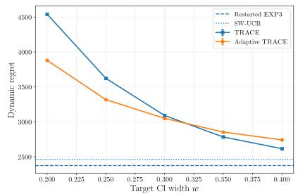

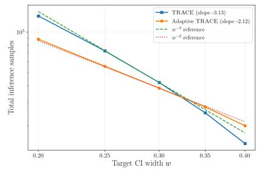

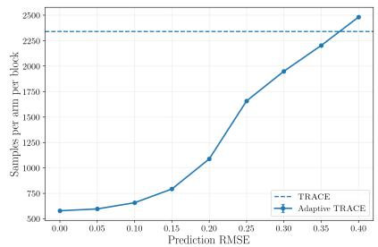  
Figure 3: Synthetic experiments. $L e f t { \mathrm { : } }$ Dynamic regret as the target width w varies. Middle: Total inference samples, with $w ^ { - 3 }$ and $w ^ { - 2 }$ reference rates. Right: Samples required per arm and block as prediction RMSE increases.

To evaluate our local-stationarity result, we additionally consider a two-arm block of length $H \in$ $\{ 5 0 0 , 1 0 0 0 , 2 0 0 0 , 4 0 0 0 , 8 0 0 0 \}$ with $\mu _ { t , 0 } ~ = ~ 0 . 5$ and $\mu _ { t , 1 } = 0 . 5 5 - b _ { H } ( 1 - t / ( H - 1 ) )$ . We compare confidence intervals constructed using all observations collected by TRACE with those using only reserved inference observations. We consider $b _ { H } = 0$ , locally negligible drift $b _ { H } = 2 H ^ { - 3 / 4 }$ , and non-negligible drift $b _ { H } = 0 . 2 H ^ { - 1 / 4 }$

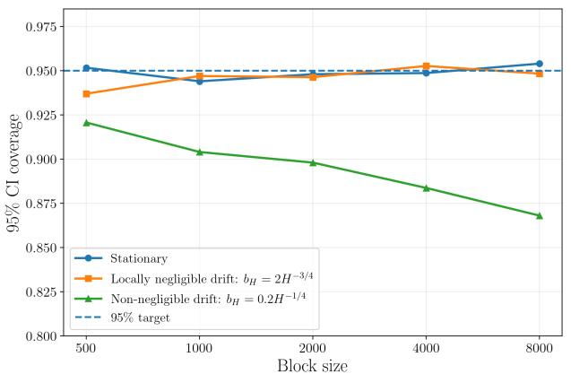

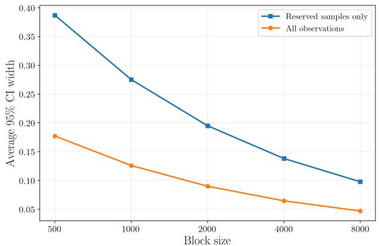  
Figure 4: Synthetic local-stationarity experiment. $L e f t { \mathrm { : } }$ Coverage of the nominal 95% confidence interval under the three drift regimes. Right: Average confidence-interval width using all observations versus reserved inference observations only.

Results. Figure 3 confirms the main predictions of our finite-sample theory. Fixed TRACE exhibits approximately $w ^ { - 3 }$ inferential scaling, while Adaptive TRACE is close to $w ^ { - 2 }$ when prediction errors are small (see Corollary 3.1). The right panel further shows that Adaptive TRACE stops earlier when forecasts are accurate and requires more samples as prediction quality deteriorates. Figure 4 supports our loca asymptotic result: reusing reward-learning observations maintains approximately nominal coverage under locally negligible drift and yields substantially narrower intervals, while coverage deteriorates when the local-stationarity condition is violated.

## 4.2 Yahoo! R6B: the empirical price of current-efect inference

Setting and algorithms. The Yahoo! R6B dataset (Chakraborty et al., 2019) contains randomized click logs from Yahoo!’s front page, where news articles were displayed to users and clicks were recorded as binary rewards. Using empirical click-through rates computed from the randomized Yahoo! R6B logs, we construct a nonstationary news recommendation problem with $K = 5$ articles over $T = 9 0 { , } 0 0 0$ rounds. We partition the horizon into consecutive 5,000-round intervals and let $\overline { { \mu } } _ { j , a }$ denote the empirical click-through rate of article a within interval $j ,$ with $s _ { j }$ denoting the corresponding interval endpoint. To obtain a reward trajectory satisfying our H¨older smoothness assumption, for $t \in [ s _ { j } , s _ { j + 1 } ]$ , we linearly interpolate the empirical rates by setting $\mu _ { t , a } = ( 1 - \lambda _ { t } ) \overline { { \mu } } _ { j , a } + \lambda _ { t } \overline { { \mu } } _ { j + 1 , a } ,$ where $\lambda _ { t } = ( t - s _ { j } ) / ( s _ { j + 1 } - s _ { j } )$ . We then generate Bernoulli rewards with mean $\mu _ { t , a }$ . The best article changes 11 times across the 18 intervals, yielding a strongly nonstationary environment. The left panel of Figure 5 shows the corresponding current efects relative to Article 1.

We compare TRACE (Algorithm 1) and Adaptive TRACE (Algorithm 2) over varying inferential budgets $m \in \{ 2 5 , 5 0 , 1 0 0 , 2 0 0 , 4 0 0 , 6 0 0 , 8 0 0 \}$ . Fixed TRACE uses m inference observations per arm in each interval, while Adaptive TRACE treats m as the maximum inferential budget. We also report restarted EXP3 and SW-UCB as reward-only baselines. For Adaptive TRACE, we use a Beta(1, 1)-smoothed historical click-through rate as the predictable reward forecast. Specifically, before observing the reward at round t, we set

$$
\widehat { Y } _ { t , a } : = \frac { 1 + \sum _ { s < t } { \bf 1 } \{ A _ { s } = a \} Y _ { s } } { 2 + \sum _ { s < t } { \bf 1 } \{ A _ { s } = a \} } ,
$$

which is the posterior mean under a Beta(1, 1) prior for the Bernoulli click probability of arm a. Since $\widehat { Y } _ { t , a }$ depends only on observations collected before round $t ,$ it is $\mathcal { F } _ { t - 1 }$ -measurable and can be used directly in the empirical-Bernstein e-process. After observing $Y _ { t } .$ , the corresponding success and observation counts are updated for future predictions.

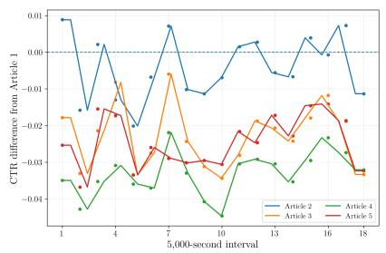

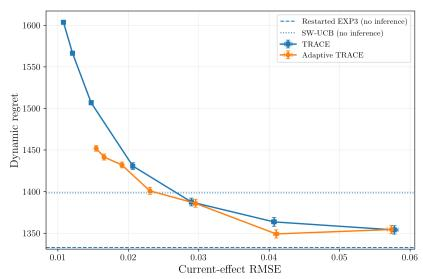

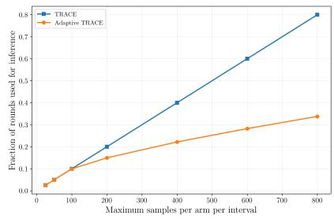  
Figure 5: Yahoo! R6B experiment. Left: Current click-through-rate efects relative to Article 1. Middle: Dynamic regret versus current-efect RMSE for TRACE and Adaptive TRACE, with restarted EXP3 and SW-UCB as reward-only baselines. Right: Fraction of rounds used for inference as the maximum budget m increases.

Results. The middle panel of Figure 5 illustrates that increasing the inferential budget improves currentefect estimation but increases dynamic regret, which is consistent with our theoretical prediction. Adaptive TRACE improves this tradeof by stopping inferential exploration early. The right panel shows that this gain becomes more pronounced as the inferential budget increases. Overall, the results support both the regret–inference tradeof and the benefit of adaptive stopping predicted by our theory.

## 4.3 ZOZOTOWN: prediction-adaptive inferential exploration

Setting and algorithms. The ZOZOTOWN Open Bandit Dataset (Saito et al., 2021) contains logged fashion recommendations from a large-scale online experiment, where each observation records the item shown to a user and whether the item was clicked. The experiment includes both uniformly randomized and bandit-generated recommendations across several product campaigns. We use the uniformly randomized Women’s campaign, which contains recommendations among women’s fashion items, and focus on five item IDs with suficiently many randomized observations for our analysis.

We evaluate the empirical-Bernstein stopping rule using two predictable reward forecasts. The naive predictor sets $\widehat { Y } _ { t , a } = 0 . { \dot { 5 } }$ . Our primary predictor uses a Beta(1, 1)-smoothed historical click-through-rate predictor as in Section 4.2. For each item, the predictor is initialized using randomized impressions observed before the evaluation period and is then updated sequentially as new rewards are observed. We compare the resulting prediction error and inferential sample requirement across the five selected items.

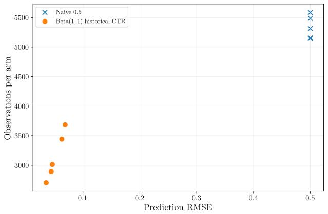

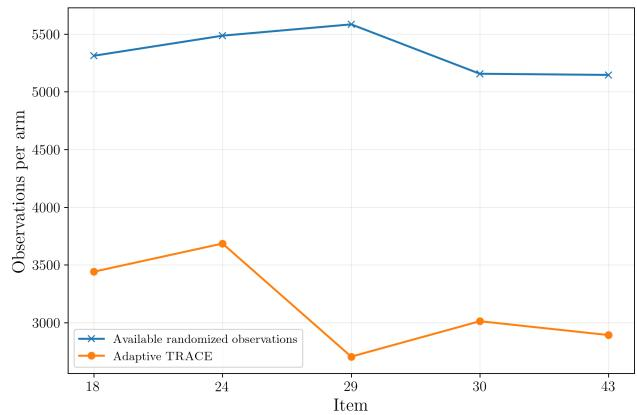  
Figure 6: ZOZOTOWN experiment. Left: Number of observations required for inference as a function of prediction RMSE. Right: Available observations and observations used by Adaptive TRACE with the Beta(1, 1) predictor across the five selected items.

Results. The left panel of Figure 6 illustrates that more accurate predictable forecasts require fewer observations for inference, which is consistent with our theoretical prediction. The naive predictor exhausts the available randomized observations, while the calibrated predictors stop substantially earlier. As shown in the right panel, Adaptive TRACE reduces the number of inference observations on average across the five items. Overall, the results support the prediction-adaptive stopping behavior of Adaptive TRACE.

## 4.4 HeartSteps: time-varying current treatment efects

The HeartSteps study (Klasnja et al., 2018; Liao et al., 2020) is a 42-day micro-randomized trial designed to evaluate mobile interventions for increasing physical activity. At five decision points per day, available participants were randomized to receive or not receive an activity suggestion. The outcome of interest is the log-step count during the 30 minutes following each decision point. For participant i and decision time t, we define $Y _ { i , t } = \log ( 1 + \mathrm { j } \tt { b s t e p s } 3 0 _ { i , t } )$ , where $\mathrm { j } \mathtt { b s t e p s 3 0 } _ { i , t }$ is the number of steps recorded during the subsequent 30 minutes. We analyze 6,061 randomized decision points over the six study weeks.

We estimate the proximal causal excursion efect using weighted and centered least squares (WCLS) (Boruvka et al., 2018; Shi et al., 2023). At available decision points, activity suggestions were randomized with probability 0.6. Since the reference randomization probability equals the trial randomization probability, the WCLS probability weights equal one and treatment is centered as $A _ { i , t } - 0 . 6$ . We therefore estimate

$$
( \widehat { \alpha } , \widehat { \beta } ) = \arg \operatorname* { m i n } _ { \alpha , \beta } \sum _ { i , t } I _ { i , t } \left[ Y _ { i , t } - g _ { t } ( H _ { i , t } ) ^ { \top } \alpha - ( A _ { i , t } - 0 . 6 ) f _ { t } ( S _ { i , t } ) ^ { \top } \beta \right] ^ { 2 } ,
$$

where $I _ { i , t }$ denotes availability and $g _ { t } ( H _ { i , t } )$ includes pre-decision 30-minute activity as a prognostic control. For the time-moderated analysis, we take $f _ { t } ( S _ { i , t } ) = ( 1 , d _ { i , t } ) ^ { \top }$ , where $d _ { i , t } \in \{ 0 , \ldots , 4 1 \}$ denotes study day, so that the proximal efect is $\tau ( d ) = \beta _ { 0 } + \beta _ { 1 } d .$ We use participant-clustered standard errors with the small-sample correction used in the original HeartSteps analysis and additionally report weekly randomized contrasts without imposing a linear time trend.

Using randomized HeartSteps observations, we construct a nonstationary treatment-efect problem by estimating smooth daily treatment and control mean trajectories for the Bernoulli proximal outcome $Y _ { i , t } ^ { \mathrm { b i n } } : =$ $\mathbf { 1 } \{ \mathrm { j b s t e p s 3 0 } _ { i , t } > 0 \}$ . The resulting HeartSteps-derived environment contains 6,179 randomized decision points from 37 participants and has known current efect $\tau _ { t } : = \mu _ { t , 1 } - \mu _ { t , 0 }$ at each study day. We esti mate the mean trajectories using Gaussian kernel smoothing, with bandwidth selected by leave-one-dayout binomial cross-validation. For target days $t \in \{ 1 5 , 2 1 , 2 8 , 3 5 , 4 2 \}$ , we use preceding windows of length $h \in \{ 1 , 2 , 3 , 5 , 7 , 1 0 , 1 4 \}$ days and construct the all-observation estimator and plug-in Wald interval from (18) and (24). We measure local nonstationarity by $\begin{array} { r } { \Gamma _ { h } : = \operatorname* { m a x } _ { a \in \{ 0 , 1 \} } \sqrt { N _ { t , a } } \operatorname* { m a x } _ { s \in \mathcal { W } _ { t , h } } | \mu _ { s , a } - \mu _ { t , a } | } \end{array}$ , the finite-sample analogue of Assumption 3.1. For each target day and window length, we evaluate coverage and eficiency over 3,500 Monte Carlo replications and compare the all-observation estimator with inference based on an outcome-independent 25% reserved subset.

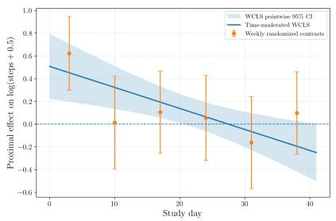

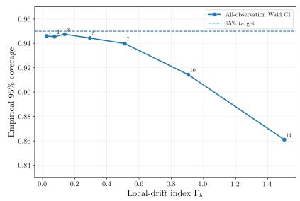

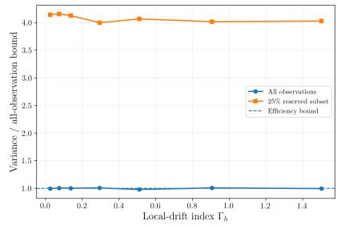  
Figure 7: HeartSteps experiment. Left: Time-varying proximal treatment efect estimated using WCLS, together with weekly randomized contrasts. Middle: Empirical coverage of the all-observation Wald interval as a function of the local-drift index $\Gamma _ { h }$ . Numbers indicate the local window length in days. Right: Empirical variance relative to the all-observation eficiency bound, comparing the all-observation estimator with inference based on a 25% reserved subset.

Table 1: WCLS estimates for HeartSteps.
<table><tr><td>Estimand</td><td>Estimate</td><td>95% CI</td><td>p-value</td></tr><tr><td>Marginal proximal effect</td><td>0.1312</td><td>[−0.0058, 0.2682]</td><td>0.0599</td></tr><tr><td>Effect at study day 0</td><td>0.5074</td><td>[0.2009, 0.8140]</td><td>0.0020</td></tr><tr><td>Change in effect per day</td><td>-0.01848</td><td>[-0.03090, -0.00607]</td><td>0.00479</td></tr></table>

Table 2: HeartSteps local-inference results. Empirical 95% coverage and variance relative to the allobservation eficiency bound, averaged over the five target days.
<table><tr><td>Window</td><td> $\Gamma _ { h }$ </td><td>Coverage</td><td>Variance ratio</td><td>Reserved variance ratio</td></tr><tr><td>1 day</td><td>0.026</td><td>94.6%</td><td>0.994</td><td>4.14</td></tr><tr><td>2 days</td><td>0.075</td><td>94.5%</td><td>1.004</td><td>4.16</td></tr><tr><td>3 days</td><td>0.138</td><td>94.7%</td><td>1.001</td><td>4.13</td></tr><tr><td>5 days</td><td>0.295</td><td>94.4%</td><td>1.006</td><td>4.00</td></tr><tr><td>7 days</td><td>0.511</td><td>94.0%</td><td>0.978</td><td>4.07</td></tr><tr><td>10 days</td><td>0.906</td><td>91.4%</td><td>1.006</td><td>4.02</td></tr><tr><td>14 days</td><td>1.503</td><td>86.1%</td><td>0.994</td><td>4.03</td></tr></table>

Results. The left panel of Figure 7 shows that the proximal treatment efect declines over study time, with the weekly randomized contrasts exhibiting the same qualitative pattern. This highlights the distinction between inference on a current treatment efect and inference on a single study-wide average efect.

The local-inference results support the asymptotic theory. When the preceding window is locally stable, the all-observation Wald interval has approximately nominal coverage, the studentized estimator is close to standard normal, and its empirical variance is near the local asymptotic variance lower bound. As the window expands and temporal drift becomes non-negligible relative to sampling error, coverage deteriorates due to increasing bias. Using all observations also yields substantially lower variance than inference based only on the reserved subset.

## 5 Conclusion

We studied the tradeof between reward maximization and inference for current treatment efects in nonstationary bandits. Our main result characterizes, up to logarithmic factors, the minimum dynamic regret required to maintain simultaneously valid and uniformly precise confidence intervals under H¨older drift. The resulting regret–precision frontier separates the usual cost of reward learning from the additional cost of maintaining suficiently recent information about each arm. This inferential cost remains unavoidable even when the same arm is uniformly optimal.

We introduced TRACE, which attains this tradeof by separating reward-learning and inferential sampling, together with an empirical-Bernstein extension that adapts exploration to realized prediction errors while preserving the same worst-case guarantee. We further showed that locally stable periods permit rewardlearning observations to be reused for sharper pointwise inference, yielding asymptotically normal and, under stronger conditions, locally asymptotically eficient estimators. Our numerical experiments support these theoretical conclusions. There are many natural and interesting directions for future work such as extending these ideas to contextual bandits, structured interventions, and richer nonstationary decision problems.

## References

Dorit Aharonov and Michael Ben-Or. Fault-tolerant quantum computation with constant error rate. In Proceedings of the 29th Annual ACM Symposium on Theory of Computing, pages 176–188. ACM, 1997. doi: 10.1145/258533.258579.

Peter Auer, Nicol\`o Cesa-Bianchi, Yoav Freund, and Robert E. Schapire. The nonstochastic multiarmed bandit problem. SIAM Journal on Computing, 32(1):48–77, 2002. doi: 10.1137/S0097539701398375. URL https://doi.org/10.1137/S0097539701398375.

Omar Besbes, Yonatan Gur, and Assaf Zeevi. Stochastic multi-armed-bandit problem with non-stationary rewards. In Advances in Neural Information Processing Systems, volume 27, pages 199–207, 2014. URL https://proceedings.neurips.cc/paper\_files/paper/2014/hash/ 91ba7292e5388b90b58d0b839a7f19ec-Abstract.html.

Omar Besbes, Yonatan Gur, and Assaf Zeevi. Non-stationary stochastic optimization. Operations Research, 63(5):1227–1244, 2015.

Aur´elien Bibaut, Maria Dimakopoulou, Nathan Kallus, Antoine Chambaz, and Mark van der Laan. Postcontextual-bandit inference. In Advances in Neural Information Processing Systems, volume 34, 2021.

Audrey Boruvka, Daniel Almirall, Katie Witkiewitz, and Susan A. Murphy. Assessing time-varying causal efect moderation in mobile health. Journal of the American Statistical Association, 113(523):1112–1121, 2018. doi: 10.1080/01621459.2017.1305274.

Adam D. Bull. Honest adaptive confidence bands and self-similar functions. Electronic Journal of Statistics, 6:1490–1516, 2012. doi: 10.1214/12-EJS720.

Abhijnan Chakraborty, Saptarshi Ghosh, Niloy Ganguly, and Krishna P. Gummadi. Optimizing the recencyrelevance-diversity trade-ofs in non-personalized news recommendations. Inf. Retr., 22(5):447–475, October 2019. ISSN 1386-4564. doi: 10.1007/s10791-019-09351-2. URL https://doi.org/10.1007/ s10791-019-09351-2.

Yifang Chen, Chung-Wei Lee, Haipeng Luo, and Chen-Yu Wei. A new algorithm for non-stationary contextual bandits: Eficient, optimal and parameter-free. In Proceedings of the Thirty-Second Conference on Learning Theory, volume 99 of Proceedings of Machine Learning Research, pages 696–726. PMLR, 2019. URL https://proceedings.mlr.press/v99/chen19b.html.

Wang Chi Cheung, David Simchi-Levi, and Ruihao Zhu. Hedging the drift: Learning to optimize under nonstationarity. Management Science, 68(3):1696–1713, 2022.

Hattie Chung, Christina Merakou, Matthew M. Schaefers, Kelly B. Flett, Sarah Martini, Roger Lu, Jennifer A. Blumenthal, Shanice S. Webster, Ashley R. Cross, Roy Al Ahmar, Erin Halpin, Michelle Anderson, Nicholas S. Moore, Eric C. Snesrud, Hongwei D. Yu, Joanna B. Goldberg, George A. O’Toole, Patrick Mc-Gann, Jason A. Stam, Mary Hinkle, Alexander J. McAdam, Roy Kishony, and Gregory P. Priebe. Rapid expansion and extinction of antibiotic resistance mutations during treatment of acute bacterial respiratory infections. Nature Communications, 13:1231, 2022. doi: 10.1038/s41467-022-28188-w.

Thomas Cook, Alan Mishler, and Aaditya Ramdas. Semiparametric eficient inference in adaptive experiments. In Proceedings of the Third Conference on Causal Learning and Reasoning, volume 236 of Proceedings of Machine Learning Research, pages 1033–1064, 2024.

Yash Deshpande, Lester Mackey, Vasilis Syrgkanis, and Matt Taddy. Accurate inference for adaptive linear models. In Proceedings ofthe 35th International Conference on Machine Learning, volume 80 of Proceedings of Machine Learning Research, pages 1194–1203, 2018.

Rick Durrett. Probability: Theory and Examples. Cambridge Series in Statistical and Probabilistic Mathematics. Cambridge University Press, Cambridge, 5th edition, 2019. ISBN 9781108473682.

Austin G. Fowler, Matteo Mariantoni, John M. Martinis, and Andrew N. Cleland. Surface codes: Towards practical large-scale quantum computation. Physical Review A, 86(3):032324, 2012. doi: 10.1103/PhysRevA.86.032324.

Aur´elien Garivier and Eric Moulines. On upper-confidence bound policies for non-stationary bandit problems. arXiv preprint arXiv:0805.3415, 2008.

Aur´elien Garivier and Eric Moulines. On upper-confidence bound policies for switching bandit problems. In Algorithmic Learning Theory, pages 174–188, 2011.

Weiyuan Gong and Hong-Ye Hu. Provably eficient self-calibrating quantum fault tolerance. arXiv preprint arXiv:2608.05686, 2026. doi: 10.48550/arXiv.2608.05686. URL https://arxiv.org/abs/2608.05686.

Vitor Hadad, David A. Hirshberg, Ruohan Zhan, Stefan Wager, and Susan Athey. Confidence intervals for policy evaluation in adaptive experiments. Proceedings of the National Academy of Sciences, 118(15): e2014602118, 2021. doi: 10.1073/pnas.2014602118.

P. Hall, C.C. Heyde, Z.W. Birnbaum, and E. Lukacs. Martingale Limit Theory and Its Application. Communication and Behavior. Academic Press, 2014. ISBN 9781483263229. URL https://books.google. com/books?id=gqriBQAAQBAJ.

Steven R. Howard, Aaditya Ramdas, Jon McAulife, and Jasjeet Sekhon. Time-uniform, nonparametric, nonasymptotic confidence sequences. The Annals of Statistics, 49(2):1055–1080, 2021. doi: 10.1214/ 20-AOS1991.

Su Jia, Qian Xie, Nathan Kallus, and Peter I. Frazier. Smooth non-stationary bandits. In Proceedings of the 40th International Conference on Machine Learning, volume 202 of Proceedings of Machine Learning Research, pages 14930–14944. PMLR, 2023. URL https://proceedings.mlr.press/v202/jia23c.html.

Ramesh Johari, Pete Koomen, Leonid Pekelis, and David Walsh. Always valid inference: Continuous monitoring of A/B tests. Operations Research, 70(3):1806–1821, 2022. doi: 10.1287/opre.2021.2135.

Maximilian Kasy and Anja Sautmann. Adaptive treatment assignment in experiments for policy choice. Econometrica, 89(1):113–132, 2021.

Amara Katabarwa, Katerina Gratsea, Athena Caesura, and Peter D. Johnson. Early fault-tolerant quantum computing. PRX Quantum, 5:020101, 2024.

Koulik Khamaru and Cun-Hui Zhang. Inference with the upper confidence bound algorithm. arXiv preprint arXiv:2408.04595, 2024.

Predrag V. Klasnja, Shawna N. Smith, Nicholas J. Seewald, Andy Jinseok Lee, Kelly Hall, Brook Luers, Eric B. Hekler, and Susan A. Murphy. Eficacy of contextually-tailored suggestions for physical activity: A micro-randomized optimization trial of heartsteps. Annals of behavioral medicine : a publication of the Society of Behavioral Medicine, 53:573 – 582, 2018. URL https://api.semanticscholar.org/CorpusID: 52173731.

Tze Leung Lai and Herbert Robbins. Asymptotically eficient adaptive allocation rules. Advances in Applied Mathematics, 6(1):4–22, 1985. doi: 10.1016/0196-8858(85)90002-8.

Tor Lattimore and Csaba Szepesv´ari. Bandit Algorithms. Cambridge University Press, 2020. doi: 10.1017/ 9781108571401.

D.A. Levin, Y. Peres, and E.L. Wilmer. Markov Chains and Mixing Times. American Mathematical Soc. ISBN 9780821886274. URL https://books.google.com/books?id=6Cg5Nq5sSv4C.

Lihong Li, Wei Chu, John Langford, and Robert E. Schapire. A contextual-bandit approach to personalized news article recommendation. In Proceedings of the 19th International Conference on World Wide Web, pages 661–670. ACM, 2010. doi: 10.1145/1772690.1772758.

Biyonka Liang and Iavor Bojinov. An experimental design for anytime-valid causal inference on multi-armed bandits, 2024. URL https://arxiv.org/abs/2311.05794v4. Version 4, revised October 2024.

Peng Liao, Kristjan Greenewald, Predrag Klasnja, and Susan Murphy. Personalized heartsteps: A reinforcement learning algorithm for optimizing physical activity. Proc. ACM Interact. Mob. Wearable Ubiquitous Technol., 4(1), mar 2020. doi: 10.1145/3381007. URL https://doi.org/10.1145/3381007.

Mark G. Low. On nonparametric confidence intervals. The Annals of Statistics, 25(6):2547–2554, 1997. doi: 10.1214/aos/1030741084.

Aaditya Ramdas, Peter Gr¨unwald, Vladimir Vovk, and Glenn Shafer. Game-theoretic statistics and safe anytime-valid inference. Statistical Science, 38(4):576–601, 2023. doi: 10.1214/23-STS894.

Yoan Russac, Claire Vernade, and Olivier Capp´e. Weighted linear bandits for non-stationary environments. In Advances in Neural Information Processing Systems, volume 32, 2019.

Sharan Sahu and Martin T Wells. Online distributionally robust llm alignment via regression to relative reward. arXiv preprint arXiv:2509.19104, 2025.

Sharan Sahu, Cameron J Hogan, and Martin T Wells. On the provable suboptimality of momentum sgd in nonstationary stochastic optimization. arXiv preprint arXiv:2601.12238, 2026a.

Sharan Sahu, Abir Sarkar, Cameron J Hogan, and Martin T Wells. Adapt or forget: Provable tradeofs between adam and sgd in nonstationary optimization. arXiv preprint arXiv:2605.04269, 2026b.

Yuta Saito, Shunsuke Aihara, Megumi Matsutani, and Yusuke Narita. Open bandit dataset and pipeline: Towards realistic and reproducible of-policy evaluation. In Thirty-fifth Conference on Neural Information Processing Systems Datasets and Benchmarks Track (Round 2), 2021. URL https://openreview.net/ forum?id=tyn3MYS\_uDT.

Steven L. Scott. Multi-armed bandit experiments in the online service economy. Applied Stochastic Models in Business and Industry, 31(1):37–45, 2015.

Junzhe Shao, Waverly Wei, and Jingshen Wang. Adaptive A/B testing under nonstationary dynamics using state-space models. In Proceedings of the 29th International Conference on Artificial Intelligence and Statistics, volume 300 of Proceedings of Machine Learning Research, pages 4699–4707, 2026.

Sreenath V. Sharma, Diana Y. Lee, Bihua Li, Margaret P. Quinlan, Fumiyuki Takahashi, Shyamala Maheswaran, Ultan McDermott, Nancy Azizian, Lee Zou, Michael A. Fischbach, Kwok-Kin Wong, Kathleyn Brandstetter, Ben Wittner, Sridhar Ramaswamy, Marie Classon, and Jef Settleman. A chromatinmediated reversible drug-tolerant state in cancer cell subpopulations. Cell, 141(1):69–80, 2010. doi: 10.1016/j.cell.2010.02.027.

Jieru Shi, Zhenke Wu, and Walter Dempsey. Assessing time-varying causal efect moderation in the presence of cluster-level treatment efect heterogeneity and interference. Biometrika, 110(3):645–662, 2023. doi: 10.1093/biomet/asac065.

Peter W. Shor. Scheme for reducing decoherence in quantum computer memory. Physical Review A, 52(4): R2493–R2496, 1995. doi: 10.1103/PhysRevA.52.R2493.

David Simchi-Levi and Chonghuan Wang. Multi-armed bandit experimental design: Online decision-making and adaptive inference. Management Science, 71(6):4828–4846, 2025. doi: 10.1287/mnsc.2023.00492.

David Simchi-Levi, Chonghuan Wang, and Zeyu Zheng. Nonstationary experimental design under structured trends. Management Science, 2026. doi: 10.1287/mnsc.2023.03329.

Joe Suk. Adaptive smooth nonstationary bandits. SIAM Journal on Mathematics of Data Science, 7(3): 1265–1291, 2025. doi: 10.1137/24M167651X.

Ambuj Tewari and Susan A. Murphy. From ads to interventions: Contextual bandits in mobile health. In James M. Rehg, Susan A. Murphy, and Santosh Kumar, editors, Mobile Health: Sensors, Analytic Methods, and Applications, pages 495–517. Springer, 2017. doi: 10.1007/978-3-319-51394-2 25.

Ramon van den Akker, Bas J. M. Werker, and Bo Zhou. Local asymptotic normality for multi-armed bandits. arXiv preprint arXiv:2512.12192, 2025.

A.W. van der Vaart. Asymptotic Statistics. Asymptotic Statistics. Cambridge University Press, 2000. ISBN 9780521784504. URL https://books.google.com/books?id=UEuQEM5RjWgC.

Sof´ıa S. Villar, Jack Bowden, and James Wason. Multi-armed bandit models for the optimal design of clinical trials: Benefits and challenges. Statistical Science, 30(2):199–215, 2015.

Michael Vogt. Nonparametric regression for locally stationary time series. The Annals of Statistics, 40(5): 2601–2633, 2012. doi: 10.1214/12-AOS1043.

M.J. Wainwright. High-Dimensional Statistics: A Non-Asymptotic Viewpoint. Cambridge Series in Statistical and Probabilistic Mathematics. Cambridge University Press, 2019. ISBN 9781108498029. URL https: //books.google.com/books?id=8C8nuQEACAAJ.

Chen Wang, Qun Zeng, Zeynep Melis G¨ul, Sisi Wang, Robert Pick, Phil Cheng, Ruben Bill, Yan Wu, Stefan Naulaerts, Coline Barnoud, et al. Circadian tumor infiltration and function of CD8+ T cells dictate immunotherapy eficacy. Cell, 187(11):2690–2702.e17, 2024. doi: 10.1016/j.cell.2024.04.015.

Ian Waudby-Smith and Aaditya Ramdas. Estimating means of bounded random variables by betting. Journal of the Royal Statistical Society Series B: Statistical Methodology, 86(1):1–27, 2024. doi: 10.1093/jrsssb/ qkad009.

Ian Waudby-Smith, Lili Wu, Aaditya Ramdas, Nikos Karampatziakis, and Paul Mineiro. Anytime-valid ofpolicy inference for contextual bandits. ACM/IMS Journal of Data Science, 2024. doi: 10.1145/3643693.

Shunxing Yan and Han Zhong. Optimism stabilizes thompson sampling for adaptive inference. In Proceedings of the Thirty-Ninth Conference on Learning Theory, volume 336 of Proceedings of Machine Learning Research, pages 6885–6886. PMLR, 2026.

Kelly W. Zhang, Lucas Janson, and Susan A. Murphy. Statistical inference with M-estimators on adaptively collected data. In Advances in Neural Information Processing Systems, volume 34, pages 7460–7471, 2021. URL https://proceedings.neurips.cc/paper\_files/paper/2021/hash/ 3d7d9461075eb7c37fbbfcad1d7042c1-Abstract.html.

Zhibiao Zhao. Inference for local autocorrelations in locally stationary models. Journal of Business & Economic Statistics, 33(2):296–306, 2015. doi: 10.1080/07350015.2014.948177.

## A Proof of Theorem 3.1

We prove the upper and lower bounds separately. Theorem 3.2 proves the upper bound (see Appendix B for the proof). We now prove the lower bound. We first prove the following result which we will subsequently use in our analysis. We take $w _ { 0 } \leq 1 / 1 6$ and $\delta _ { 0 } \leq 1 / 8$ throughout.

Lemma A.1 (Simultaneous sign recovery). Let J be a finite index set with $| { \mathcal { I } } | = d ,$ and consider Bernoulli environments indexed by $\theta \in \{ - 1 , 1 \} ^ { \mathcal { I } }$ . For each $j \in \mathcal { I }$ , let $a _ { j } \in { \mathcal { A } }$ and let $S _ { j } ~ \subseteq ~ [ T ]$ be deterministic such that the arm–round sets $\{ ( t , a _ { j } ) : t \in S _ { j } \}$ are pairwise disjoint. Coordinate $\theta _ { j } ~ a f f e c t s$ only the reward distribution of arm $a _ { j }$ on $S _ { j }$ . Suppose the two possible Bernoulli means lie in $[ 3 / \bar { 1 6 } , 5 / 1 6 ]$ and difer by at most $2 \Delta$ . Define $\begin{array} { r } { N _ { j } : = \sum _ { t \in { \cal S } _ { i } } { \bf 1 } \{ { \cal A } _ { t } = a _ { j } \} } \end{array}$ . If an estimator satisfies $\mathbb { P } _ { \theta } ^ { \pi } ( \widehat { \theta } = \theta ) \geq 1 - \delta$ for every $\theta ,$ , then

$$
2 ^ { - d } \sum _ { \theta \in \{ - 1 , 1 \} ^ { \mathcal { I } } } \mathbb { E } _ { \theta } ^ { \pi } \left[ \sum _ { j \in \mathcal { I } } N _ { j } \right] \gtrsim \frac { d } { \Delta ^ { 2 } } \log \left( \frac { d } { \delta } \right) .\tag{30}
$$

Proof. Put the uniform prior on $\Theta \in \{ - 1 , 1 \} ^ { \mathcal { I } }$ . For any fixed realization of $( A _ { t } , Y _ { t } , U _ { t } ) _ { t \leq T }$ , the policy kernels do not depend on $\theta ,$ while every reward likelihood depends on at most one coordinate. Hence the likelihood, and therefore the posterior, factors over $j \in \mathcal I$

Let $\Lambda _ { j }$ be the log-likelihood ratio between $\theta _ { j } = 1$ and $\theta _ { j } = - 1$ , and let $e _ { j }$ denote the smaller posterior probability for coordinate j. Then $e _ { j } = ( 1 + \exp | \Lambda _ { j } | ) ^ { - 1 }$ . Since the posterior factors across coordinates, the largest posterior probability assigned to any $\theta \in \{ - 1 , 1 \} ^ { \mathcal { I } }$ is $\textstyle \prod _ { j \in { \mathcal { I } } } ( 1 - e _ { j } )$ . Since the estimator $\widehat { \theta }$ satisfies $\mathbb { P } _ { \theta } ^ { \pi } ( \widehat { \theta } = \theta ) \geq 1 - \delta$ for every $\theta ,$ averaging over the uniform prior on Θ gives

$$
1 - \delta \leq \mathbb { P } ( \widehat { \theta } = \Theta ) = \mathbb { E } \left[ \mathbb { P } ( \Theta = \widehat { \theta } \mid \mathcal { F } _ { T } ) \right] \leq \mathbb { E } \left[ \prod _ { j \in \mathcal { I } } ( 1 - e _ { j } ) \right] .
$$

Thus, $\begin{array} { r } { \mathbb { E } [ 1 - \prod _ { j \in \mathcal { I } } ( 1 - e _ { j } ) ] \le \delta } \end{array}$ . By Markov’s inequality, $\mathbb { P } ( \prod _ { i \in \mathcal { I } } ( 1 - e _ { j } ) \geq 1 / 2 ) \geq 1 - 2 \delta \geq 3 / 4$ . On this event, $1 - x \leq \exp ( - x )$ implies $\begin{array} { r } { \sum _ { j \in \mathcal { I } } e _ { j } \le \log 2 } \end{array}$ . Jensen’s inequality then gives $\begin{array} { r } { \sum _ { j \in \mathcal { I } } \log ( 1 / e _ { j } ) \geq d \log ( d / \log 2 ) } \end{array}$ Therefore,

$$
\mathbb { E } \left[ \sum _ { j \in \mathcal { I } } \log ( 1 / e _ { j } ) \right] \geq \frac { 3 d } { 4 } \log d .\tag{31}
$$

For $j \in \mathcal I$ , let $\theta ^ { ( j ) }$ denote θ with coordinate $j$ flipped, and define

$$
\mathcal { T } : = 2 ^ { - d } \sum _ { \theta } \sum _ { j \in \mathcal { I } } D _ { \mathrm { K L } } \left( \mathsf { P } _ { \theta } ^ { \pi } \parallel \mathsf { P } _ { \theta ^ { ( j ) } } ^ { \pi } \right) .
$$

To see why averaging over the uniform prior gives $\mathcal { T } = \mathbb { E } [ \sum _ { i } \Theta _ { j } \Lambda _ { j } ]$ , fix θ and $j .$ . Since θ and $\theta ^ { ( j ) }$ difer only in coordinate $j ,$ all likelihood factors cancel except the jth coordinate. Thus,

$$
\log \frac { d \mathsf { P } _ { \theta } ^ { \pi } } { d \mathsf { P } _ { \theta ( j ) } ^ { \pi } } = \left\{ \begin{array} { l l } { \Lambda _ { j } , } & { \theta _ { j } = 1 , } \\ { - \Lambda _ { j } , } & { \theta _ { j } = - 1 , } \end{array} \right. = \theta _ { j } \Lambda _ { j } .
$$

Therefore, $D _ { \mathrm { K L } } \left( \mathsf { P } _ { \theta } ^ { \pi } \parallel \mathsf { P } _ { \theta ( j ) } ^ { \pi } \right) = \mathbb { E } _ { \theta } ^ { \pi } [ \theta _ { j } \Lambda _ { j } ]$ , and hence

$$
\mathcal { T } = 2 ^ { - d } \sum _ { \theta } \sum _ { j \in \mathcal { I } } \mathbb { E } _ { \theta } ^ { \pi } [ \theta _ { j } \Lambda _ { j } ] = \mathbb { E } \left[ \sum _ { j \in \mathcal { I } } \Theta _ { j } \Lambda _ { j } \right] .
$$

Conditional on the observed data, $\mathbb { E } [ \Theta _ { j } \Lambda _ { j } \ | \ \mathcal { F } _ { T } ] = ( 1 - 2 e _ { j } ) | \Lambda _ { j } |$ . Indeed, if $\Lambda _ { j } \geq 0$ , then the posterior probabilities of $\Theta _ { j } = 1$ and $\Theta _ { j } = - 1$ are $1 - e _ { j }$ and $e _ { j } ,$ respectively, so $\mathbb { E } [ \Theta _ { j } \mid \mathcal { F } _ { T } ] = 1 - 2 e _ { j }$ . If $\Lambda _ { j } < 0$ , then

$\mathbb { E } [ \Theta _ { j } \mid \mathcal { F } _ { T } ] = - ( 1 - 2 e _ { j } )$ while $\Lambda _ { j } = - | \Lambda _ { j }$ |, giving the same product. Moreover, since $e _ { j } = ( 1 + \exp | \Lambda _ { j } | ) ^ { - 1 }$ we have $| \Lambda _ { j } | = \log ( ( 1 - e _ { j } ) / e _ { j } )$ . Thus,

$$
\mathcal { T } = \mathbb { E } \left[ \sum _ { j \in \mathcal { I } } ( 1 - 2 e _ { j } ) \log \left( \frac { 1 - e _ { j } } { e _ { j } } \right) \right] .
$$

For $e \in ( 0 , 1 / 2 ]$

$$
\log ( 1 / e ) - ( 1 - 2 e ) \log ( ( 1 - e ) / e ) \leq \log 2 + 2 e \log ( 1 / e ) < 2 .
$$

Using Eq. (31), $\begin{array} { r } { \textstyle { \mathcal { T } } \geq ( 3 d / 4 ) \log d - 2 d . } \end{array}$

We also need the dependence on δ. For fixed θ and $j ,$ let $E _ { \theta , j } : = \{ \widehat { \theta } _ { j } = \theta _ { j } \}$ . Since exact recovery implies correct recovery of coordinate $j , \mathsf { P } _ { \theta } ^ { \pi } ( E _ { \theta , j } ) \ge 1 - \delta$ . Under $\theta ^ { ( j ) }$ , the true jth coordinate is $- \theta _ { j } ,$ , so the same event $E _ { \theta , j }$ is an error and therefore $\mathsf { P } _ { \theta ^ { ( j ) } } ^ { \pi } ( E _ { \theta , j } ) \leq \delta$ . Applying data processing to the map from the observed history to $\mathbf { 1 } \{ E _ { \theta , j } \}$ gives

$$
D _ { \mathrm { K L } } \left( \mathsf { P } _ { \theta } ^ { \pi } \parallel \mathsf { P } _ { \theta ^ { ( j ) } } ^ { \pi } \right) \geq \mathrm { k l } \left( \mathsf { P } _ { \theta } ^ { \pi } ( E _ { \theta , j } ) , \mathsf { P } _ { \theta ^ { ( j ) } } ^ { \pi } ( E _ { \theta , j } ) \right) .
$$

Since binary KL is increasing in its first argument and decreasing in its second whenever the first exceeds the second,

$$
\begin{array} { l } { \displaystyle \mathrm { k l } \left( \mathsf { P } _ { \theta } ^ { \pi } ( E _ { \theta , j } ) , \mathsf { P } _ { \theta ^ { ( j ) } } ^ { \pi } ( E _ { \theta , j } ) \right) \geq \mathrm { k l } ( 1 - \delta , \delta ) } \\ { \displaystyle = ( 1 - \delta ) \log \frac { 1 - \delta } { \delta } + \delta \log \frac { \delta } { 1 - \delta } } \\ { \displaystyle = ( 1 - 2 \delta ) \log \frac { 1 - \delta } { \delta } } \\ { \displaystyle \geq \frac { 1 } { 2 } \log ( 1 / \delta ) , } \end{array}
$$

where the last inequality holds for $\delta \leq 1 / 8$ . Therefore,

$$
D _ { \mathrm { K L } } \left( \mathsf { P } _ { \theta } ^ { \pi } \parallel \mathsf { P } _ { \theta ^ { ( j ) } } ^ { \pi } \right) \geq \frac { 1 } { 2 } \log ( 1 / \delta ) .
$$

Summing over $j$ and averaging over $\theta$ gives $\begin{array} { r } { \mathcal { T } \geq ( d / 2 ) \log ( 1 / \delta ) } \end{array}$ Combining the two bounds gives $\mathit { \Delta } \mathcal { T } \mathit { \Psi } _ { \sim }$ $d \log ( d / \delta )$ . Finally, the standard divergence decomposition for adaptive bandits (Lattimore and Szepesv´ari, 2020, Lemma 15.1) gives

$$
D _ { \mathrm { K L } } \left( \mathsf { P } _ { \theta } ^ { \pi } \parallel \mathsf { P } _ { \theta ( j ) } ^ { \pi } \right) = \mathbb { E } _ { \theta } ^ { \pi } \left[ \sum _ { t \in S _ { j } } \mathbf { 1 } \{ A _ { t } = a _ { j } \} \mathrm { k l } ( p _ { t } , q _ { t } ) \right] ,
$$

where $p _ { t }$ and $q _ { t }$ denote the Bernoulli means under θ and $\theta ^ { ( j ) }$ , respectively. Indeed, the two environments agree at every arm–round pair except $( t , a _ { j } )$ for $t \in S _ { j }$ , so all other per-round KL terms vanish. For Bernoulli distributions, using log $x \leq x - 1$

$$
\operatorname { k l } ( p , q ) = p \log { \frac { p } { q } } + ( 1 - p ) \log { \frac { 1 - p } { 1 - q } } \leq { \frac { ( p - q ) ^ { 2 } } { q ( 1 - q ) } } .
$$

Since $p , q \in [ 3 / 1 6 , 5 / 1 6 ]$ , we have $q ( 1 - q ) \geq 3 9 / 2 5 6 > 1 / 8$ , while $| p - q | \leq 2 \Delta$ . Hence $\operatorname { k l } ( p , q ) \leq 3 2 \Delta ^ { 2 }$ , and therefore

$$
D _ { \mathrm { K L } } \left( \mathsf { P } _ { \theta } ^ { \pi } \parallel \mathsf { P } _ { \theta ^ { ( j ) } } ^ { \pi } \right) \leq 3 2 \Delta ^ { 2 } \mathbb { E } _ { \theta } ^ { \pi } [ N _ { j } ] .
$$

Averaging over $\theta$ and summing over $j$ gives

$$
\mathcal { T } \leq 3 2 \Delta ^ { 2 } 2 ^ { - d } \sum _ { \theta } \mathbb { E } _ { \theta } ^ { \pi } \left[ \sum _ { j \in \mathcal { I } } N _ { j } \right] .
$$

Combining this with $\mathcal { T } \gtrsim d \log ( d / \delta )$ proves

$$
2 ^ { - d } \sum _ { \theta } \mathbb { E } _ { \theta } ^ { \pi } \left[ \sum _ { j \in \mathcal { I } } N _ { j } \right] \gtrsim \frac { d } { \Delta ^ { 2 } } \log \left( \frac { d } { \delta } \right) ,
$$

which proves Eq. (30).

We also use the following H¨older bump calculation. Let $\psi _ { i } ( u ) : = ( 1 - | T u - s _ { i } | / \ell ) _ { + } ^ { \beta }$ with pairwise disjoint support interiors. Since $| x ^ { \bar { \beta } } - y ^ { \beta } | \leq | x - y | ^ { \beta }$ for $\beta \in ( 0 , 1 ]$ , each ψi is β-H¨older with constant $( T / \ell ) ^ { \beta }$ . If u and v lie in diferent supports, choose a point z between them where all bumps vanish. Then

$$
\begin{array} { l } { \displaystyle \left| \Delta \sum _ { i } \theta _ { i } \psi _ { i } ( u ) - \Delta \sum _ { i } \theta _ { i } \psi _ { i } ( v ) \right| \leq \Delta \left( \frac { T } { \ell } \right) ^ { \beta } \left( | u - z | ^ { \beta } + | v - z | ^ { \beta } \right) } \\ { \leq 2 \Delta \left( \displaystyle \frac { T } { \ell } \right) ^ { \beta } | u - v | ^ { \beta } . } \end{array}\tag{32}
$$

Thus the sum of disjoint bumps has H¨older constant at most $2 \Delta ( T / \ell ) ^ { \beta }$

Inference lower bound. We first consider the regime $L = 0$ or $( 2 w / L ) ^ { 1 / \beta } > 1 / 3 2$ . For $\theta \in \{ - 1 , 1 \} ^ { \mathcal { A } _ { + } }$ define $\mu _ { 0 } ^ { \theta } \equiv 3 / 4$ and $\mu _ { a } ^ { \theta } \equiv 1 / 4 + w \theta _ { a }$ for $a \in \mathcal { A } _ { + }$ . Then $\tau _ { t } ^ { \theta } ( a ) = - 1 / 2 + w \theta _ { a }$ . For each $a \in \mathcal { A } _ { + }$ , the two possible current efects are $- 1 / 2 - w \mathrm { a n d } - 1 / 2 + w$ , which are separated by 2w. On the validity event, $\mathscr { C } _ { t } ( a )$ contains the true efect and has width at most w, so it cannot contain both possible values and therefore uniquely determines $\theta _ { a }$ . Since this holds simultaneously for every $a \in A _ { + }$ , the intervals $\{ { \mathcal { C } } _ { t } ( a ) : a \in { \mathcal { A } } _ { + } \}$ recover the full sign vector θ. Applying Lemma A.1 with $d = K - 1$ and $\Delta = w$ gives

$$
2 ^ { - ( K - 1 ) } \sum _ { \theta } \mathbb { E } _ { \theta } ^ { \pi } \left[ \sum _ { a \in \mathcal { A } _ { + } } N _ { a } ( T ) \right] \gtrsim \frac { K } { w ^ { 2 } } \log \left( \frac { K } { \delta } \right) .
$$

Arm 0 is optimal and every pull of $a \in A _ { + }$ incurs regret at least $1 / 4$ . Hence

$$
\operatorname* { s u p } _ { \mu \in \mathcal { M } _ { \beta , L } } \mathcal { R } _ { T } ( \pi , \mu ) \gtrsim 2 ^ { - ( K - 1 ) } \sum _ { \theta } \mathbb { E } _ { \theta } ^ { \pi } \left[ \sum _ { a \in \mathcal { A } _ { + } } N _ { a } ( T ) \right] \gtrsim \frac { K } { w ^ { 2 } } \log \left( \frac { K } { \delta } \right) .\tag{33}
$$

When $( 2 w / L ) ^ { 1 / \beta } > 1 / 3 2 , 1 + ( L / w ) ^ { 1 / \beta } \lesssim _ { \beta } 1$ , so $\mathrm { E q . \ ( 3 3 ) }$ already has the required rate.

Now suppose $( 2 w / L ) ^ { 1 / \beta } \ \leq \ 1 / 3 2$ . If $T ( 2 w / L ) ^ { 1 / \beta } \leq 1$ , no $( w , \delta )$ -valid procedure exists. Indeed, let $t _ { 0 } = \lceil T / 2 \rceil$ , set $\psi ( u ) : = ( 1 - T | u - t _ { 0 } / T | ) _ { + } ^ { \beta }$ , and define $\mu _ { 0 } ^ { \theta } \equiv 3 / 4$ and $\mu _ { 1 } ^ { \theta } ( u ) = 1 / 4 + w \theta \psi ( u )$ for $\theta \in \{ - 1 , 1 \}$ By Eq. (32), the H¨older constant is at most $2 w T ^ { \beta } \leq L$ The two environments agree on $\mathcal { F } _ { t _ { 0 } - 1 }$ , while their current efects at $t _ { 0 }$ difer by 2w. Since $\mathcal { C } _ { t _ { 0 } } ( 1 )$ is $\mathcal { F } _ { t _ { 0 } - 1 }$ -measurable, an interval of width at most w cannot cover both values with probability at least $1 - \delta .$ , contradicting validity. We therefore consider $1 < T ( 2 w / L ) ^ { 1 / \beta }$ and $( 2 w / L ) ^ { 1 / \beta } \leq 1 / 3 2$ . Set $\ell : = \lceil T ( 2 w / L ) ^ { 1 / \beta } \rceil , q : = \lfloor T / ( 4 \ell ) \rfloor$ , and $s _ { i } : = \lfloor T / 2 \rfloor + ( 2 i - 1 ) \ell$ for $i \in [ q ]$ . Then $\ell \leq T / 1 6$ and $q \asymp _ { \beta } 1 + ( L / w ) ^ { 1 / \beta }$

For $\bar { \theta } \in \{ - 1 , 1 \} ^ { [ q ] \times \dot { \mathcal { A } } _ { + } }$ , define

$$
\mu _ { 0 } ^ { \theta } ( u ) = \frac { 3 } { 4 } , \mu _ { a } ^ { \theta } ( u ) = \frac { 1 } { 4 } + w \sum _ { i = 1 } ^ { q } \theta _ { i , a } \psi _ { i } ( u ) , a \in A _ { + } .\tag{34}
$$

The support interiors are disjoint and $2 w ( T / \ell ) ^ { \beta } \leq L , \mathrm { s o } \mu ^ { \theta } \in \mathcal { M } _ { \beta , L }$ . Also, $\mu _ { a } ^ { \theta } ( u ) \in [ 3 / 1 6 , 5 / 1 6 ]$ , while arm 0 is always optimal by at least $1 / 4$ . At $s _ { i } , \tau _ { s _ { i } } ^ { \theta } ( a ) = - 1 / 2 + w \theta _ { i , a }$ . Hence the intervals $\{ \mathcal { C } _ { s _ { i } } ( a ) : i \in [ q ] , a \in A _ { + } \}$ must recover all $d = q ( K - 1 )$ signs of θ. Lemma A.1 with $\Delta = w$ gives

$$
\begin{array} { r l r } {  { \operatorname* { s u p } _ { \mu \in { \mathcal { M } _ { \beta , L } } } \mathcal { R } _ { T } ( \pi , \mu ) \gtrsim \frac { q ( K - 1 ) } { w ^ { 2 } } \log ( \frac { q ( K - 1 ) } { \delta } ) } } \\ & { } & { \gtrsim _ { \beta } \frac { K } { w ^ { 2 } } [ 1 + ( \frac { L } { w } ) ^ { 1 / \beta } ] \log ( \frac { K [ 1 + ( L / w ) ^ { 1 / \beta } ] } { \delta } ) . } \end{array}\tag{35}
$$

Reward-learning lower bound. We next prove the standard reward-learning terms. The construction is the localized testing argument used for smooth nonstationary bandits (Jia et al., 2023; Suk, 2025).

For the stationary term, let $\begin{array} { r } { \varepsilon : = \frac { 1 } { 1 6 } \sqrt { K / T } } \end{array}$ . Define the null environment by $\mu _ { b } ^ { 0 } \equiv 1 / 2$ for every $b \in { \mathcal { A } } .$ For each $a \in A ,$ define $\mu _ { a } ^ { a } \equiv 1 / 2 + \varepsilon$ and $\mu _ { b } ^ { a } \equiv 1 / 2$ for $b \neq a$ . Let $\begin{array} { r } { N _ { a } ( T ) : = \sum _ { t = 1 } ^ { T } \mathbf { 1 } \{ A _ { t } = a \} } \end{array}$ . By the adaptive divergence decomposition (Lattimore and Szepesv´ari, 2020, Lemma 15.1), $\bar { D _ { \mathrm { K L } } } ( \mathsf { P } _ { 0 } ^ { \pi } \| \mathsf { P } _ { a } ^ { \pi } ) \leq 8 \varepsilon ^ { 2 } \mathbb { E } _ { 0 } ^ { \pi } [ N _ { a } ( T ) ]$ Since $\begin{array} { r } { \sum _ { a \in \mathcal { A } } \mathbb { E } _ { 0 } ^ { \pi } [ N _ { a } ( T ) ] = T } \end{array}$ , Pinsker’s inequality and Jensen’s inequality give

$$
\frac { 1 } { K } \sum _ { a \in \mathcal { A } } \mathsf { T V } ( \mathsf { P } _ { 0 } ^ { \pi } , \mathsf { P } _ { a } ^ { \pi } ) \leq 2 \varepsilon \sqrt { \frac { T } { K } } = \frac { 1 } { 8 } .
$$

Since $0 \leq N _ { a } ( T ) \leq T$ , it follows that $\begin{array} { r } { \frac { 1 } { K } \sum _ { a \in \mathcal { A } } \mathbb { E } _ { a } ^ { \pi } [ N _ { a } ( T ) ] \leq 5 T / 8 } \end{array}$ . Thus, $\begin{array} { r } { \operatorname* { s u p } _ { \mu \in \mathcal { M } _ { \beta , L } } \mathcal { R } _ { T } ( \pi , \mu ) \gtrsim \sqrt { K T } } \end{array}$

For the nonstationary term, suppose $L \ge \sqrt { K / T }$ and set

$$
\ell : = \left\lceil \frac { 1 } { 4 } \left( \frac { K T ^ { 2 \beta } } { L ^ { 2 } } \right) ^ { 1 / ( 2 \beta + 1 ) } \right\rceil , \Delta : = \frac { 1 } { 1 2 8 } \sqrt { \frac { K } { \ell } } , q : = \left\lfloor \frac { T } { 2 \ell } \right\rfloor .\tag{36}
$$

Place bumps at $s _ { i } = ( 2 i - 1 ) \ell$ and let $\psi _ { i } ( u ) : = ( 1 - | T u - s _ { i } | / \ell ) _ { + } ^ { \beta }$ . For $\theta = ( \theta _ { 1 } , \ldots , \theta _ { q } ) \in \mathcal { A } ^ { q }$ , define $\textstyle \mu _ { a } ^ { \theta } ( u ) : = { \frac { 1 } { 2 } } + \Delta \sum _ { i = 1 } ^ { q } \mathbf { 1 } \{ \theta _ { i } = a \} \psi _ { i } ( u )$ for $a \in A .$ . Since $\ell \ge \frac { 1 } { 4 } ( K T ^ { 2 \beta } / L ^ { 2 } ) ^ { 1 / ( 2 \beta + 1 ) }$ , we have $2 \Delta ( T / \ell ) ^ { \beta } \leq L$ Thus $\mu ^ { \theta } \in \mathcal { M } _ { \beta , L }$

Fix $i \in [ q ]$ and the coordinates $\theta _ { - i }$ . Let $\mathsf { P } _ { - i } ^ { \pi }$ be the law with the i-th bump removed, and let $\mathsf { P } _ { i , a } ^ { \pi }$ be the law with $\theta _ { i } = a$ . Define $S _ { i } : = \{ t : | t - s _ { i } | < \ell \}$ and $\begin{array} { r } { N _ { i , a } : = \sum _ { t \in S _ { i } } \mathbf { 1 } \{ A _ { t } = a \} } \end{array}$ . The adaptive divergence decomposition gives

$$
D _ { \mathrm { K L } } \left( \mathsf { P } _ { - i } ^ { \pi } \parallel \mathsf { P } _ { i , a } ^ { \pi } \right) \leq 8 \Delta ^ { 2 } \mathbb { E } _ { - i } ^ { \pi } [ N _ { i , a } ] .
$$

Since $\begin{array} { r } { \sum _ { a } \mathbb { E } _ { - i } ^ { \pi } [ N _ { i , a } ] \leq 2 \ell } \end{array}$ , Pinsker’s inequality and Jensen’s inequality give

$$
\frac { 1 } { K } \sum _ { a \in \mathcal { A } } \mathsf { T V } \left( \mathsf { P } _ { - i } ^ { \pi } , \mathsf { P } _ { i , a } ^ { \pi } \right) \le \sqrt { \frac { 8 \Delta ^ { 2 } \ell } { K } } \le \frac { 1 } { 8 } .\tag{37}
$$

Let $\mathcal { C } _ { i } : = \{ t : | t - s _ { i } | \leq \ell / 2 \}$ . Then $| { \mathcal { C } } _ { i } | \geq \ell$ and $\psi _ { i } ( t / T ) \geq 1 / 2$ on $\mathcal { C } _ { i }$ . Under $\mathsf { P } _ { i , a } ^ { \pi } .$ , arm a is therefore optimal on $\mathcal { C } _ { i }$ with gap at least $\Delta / 2$ . Let $\begin{array} { r } { M _ { i , a } : = \sum _ { t \in \mathcal { C } _ { i } } \mathbf { 1 } \{ A _ { t } = a \} } \end{array}$ . Using Eq. (37),

$$
\frac { 1 } { K } \sum _ { a \in \mathcal { A } } \mathbb { E } _ { i , a } ^ { \pi } [ M _ { i , a } ] \leq \frac { | \mathcal { C } _ { i } | } { K } + \frac { | \mathcal { C } _ { i } | } { 8 } \leq \frac { 5 } { 8 } | \mathcal { C } _ { i } | .
$$

Hence the average regret on the i-th bump is at least a constant multiple of $\ell \Delta$ . Averaging over $\theta \in A ^ { q }$ and summing over i gives $\operatorname* { s u p } _ { \mu \in \mathcal { M } _ { \beta , L } } \mathcal { R } _ { T } ( \pi , \mu ) \gtrsim q \ell \Delta$ . When $L \ge \sqrt { K / T }$ , the choice in Eq. (36) satisfies $\ell \lesssim T$ so $q \ell \gtrsim T$ . Therefore,

$$
\operatorname* { s u p } _ { \mu \in \mathcal { M } _ { \beta , L } } \mathcal { R } _ { T } ( \pi , \mu ) \gtrsim T \sqrt { \frac { K } { \ell } } \gtrsim K ^ { \beta / ( 2 \beta + 1 ) } L ^ { 1 / ( 2 \beta + 1 ) } T ^ { ( \beta + 1 ) / ( 2 \beta + 1 ) } .\tag{38}
$$

When $L < \sqrt { K / T }$ , the nonstationary term in Eq. (38) is at most $\sqrt { K T } .$ , so the stationary lower bound already gives the required reward-learning rate.

Combining Eq. (35) and Eq. (38) with the stationary lower bound above, and using that the maximum of three nonnegative quantities is at least one third of their sum, gives

$$
\mathcal { R } _ { T } ^ { \star } ( w , \delta ) \gtrsim _ { \beta } \sqrt { K T } + K ^ { \beta / ( 2 \beta + 1 ) } L ^ { 1 / ( 2 \beta + 1 ) } T ^ { ( \beta + 1 ) / ( 2 \beta + 1 ) } + \frac { K } { w ^ { 2 } } \left[ 1 + \left( \frac { L } { w } \right) ^ { 1 / \beta } \right] \log \left( \frac { K [ 1 + ( L / w ) ^ { 1 / \beta } ] } { \delta } \right) .
$$

Together with the upper bound, this proves Theorem 3.1.

## B Proof of Theorem 3.2

We first establish that TRACE is a $( w , \delta )$ -valid procedure. Recall the following notation: $S _ { j , a } \subseteq { \mathcal { T } } _ { j }$ denotes the rounds reserved for inference for arm a in block $B _ { j }$ . For $t \in B _ { i }$ , we compute the estimated current-efect $\widehat { \tau } _ { j - 1 } ( a ) = \widehat { \mu } _ { j - 1 , a } - \widehat { \mu } _ { j - 1 , 0 }$ for $a \in A _ { + }$ where $\begin{array} { r } { \widehat { \mu } _ { j , a } = m ^ { - 1 } \sum _ { s \in S _ { i , a } } \breve { Y } _ { s } } \end{array}$

Throughout the proof, we will $\begin{array} { r } { \overline { { \mu } } _ { j , a } = m ^ { - 1 } \sum _ { s \in S _ { i , a } } \mu _ { s , a } } \end{array}$ to denote the mean reward for arm a in block $B _ { j }$ First note that we can decompose the diference in the estimated and true current-efects as follows:

$$
\begin{array} { r l } & { \widehat { \tau } _ { j - 1 } ( a ) - \tau _ { t } ( a ) = \widehat { \mu } _ { j - 1 , a } - \widehat { \mu } _ { j - 1 , 0 } - \mu _ { t , a } + \mu _ { t , 0 } } \\ & { \qquad = \underbrace { \left( \widehat { \mu } _ { j - 1 , a } - \overline { { \mu } } _ { j - 1 , a } \right) - \left( \widehat { \mu } _ { j - 1 , 0 } - \overline { { \mu } } _ { j - 1 , 0 } \right) } _ { ( i ) } + \underbrace { \left( \overline { { \mu } } _ { j - 1 , a } - \mu _ { t , a } \right) - \left( \overline { { \mu } } _ { j - 1 , 0 } - \mu _ { t , 0 } \right) } _ { ( i i ) } . } \end{array}\tag{39}
$$

We first bound (i). Consider the quantity $Z _ { \ell } = Y _ { \ell } - \mu _ { s _ { \ell } , a }$ for $s _ { \ell } \in S _ { j , a }$ and a $\in { \mathcal { A } } .$ . Conditionally on $A _ { s _ { \ell } } = a ,$ we have $Y _ { \ell } \mid \mathcal { F } _ { s _ { \ell } - 1 } , A _ { s _ { \ell } } = a \sim \mathrm { B e r n } ( \mu _ { s _ { \ell } , a } )$ . Thus E $\small [ Y _ { \ell } \mid \mathcal { F } _ { s _ { \ell } - 1 } , A _ { s _ { \ell } } = a ] = \mu _ { s _ { \ell } , a }$ so $\begin{array} { r } { \mathbb { E } \left[ Z _ { \ell } \mid \mathcal { F } _ { s _ { \ell } - 1 } \right] \bar { \mathbf { \Lambda } } = \mathbf { \boldsymbol { 0 } } } \end{array}$ Furthermore since $| Z _ { \ell } | \le 1$ , we note that $( Z _ { \ell } ) _ { \ell = 1 } ^ { m }$ is a martingale diference sequence (MDS) with bounded increments being atmost 1. Therefore by the Azuma-Hoefding inequality (Wainwright, 2019, Corollary 2.20) and a union bound over all $j \in [ J ] , a \in { \mathcal { A } }$ , we establish:

$$
\mathbb { P } \left( \exists ( j , a ) \in [ J ] \times \ { \mathcal { A } } , | { \widehat { \mu } } _ { j , a } - { \overline { { \mu } } } _ { j , a } | \leq { \sqrt { \frac { 1 } { 2 m } \log \left( { \frac { 2 K J } { \delta } } \right) } } \right) \geq 1 - \delta .\tag{40}
$$

We now bound (ii). Since $\mu _ { a } \in \mathcal { M } _ { \beta , L }$ , the following holds:

$$
\overline { { \mu } } _ { j , a } - \mu _ { t , a } = \frac { 1 } { m } \sum _ { s \in S _ { j , a } } \left( \mu _ { s , a } - \mu _ { t , a } \right) \leq \frac { 1 } { m } \sum _ { s \in S _ { j , a } } L \left. \frac { s - t } { T } \right. ^ { \beta } .\tag{41}
$$

Since $t \in B _ { j }$ and $s \in S _ { j , a } \subseteq B _ { j - 1 }$ , it follows that $| s - t | \leq | B _ { j - 1 } | + | B _ { j } | \leq 2 \lceil T / J \rceil$ . Given that $| S _ { j , a } | = m$ , it follows that $\overline { { \mu } } _ { j , a } - \mu _ { t , a } \leq L ( 4 / J ) ^ { \beta }$ . Using Eq. (40) and Eq. (41) with (39), we find with probability atleast $1 - \delta \colon$

$$
\widehat { \tau } _ { j - 1 } ( a ) - \tau _ { t } ( a ) \leq \sqrt { \frac { 2 } { m } \log \left( \frac { 2 K J } { \delta } \right) } + 2 L \left( \frac { 4 } { J } \right) ^ { \beta } .\tag{42}
$$

Thus it sufices to take a confidence interval of the form:

$$
\mathcal { C } _ { t } ( a ) : = \left[ \widehat { \tau } _ { j - 1 } ( a ) \pm \left\{ \sqrt { \frac { 2 } { m } \log \left( \frac { 2 K J } { \delta } \right) } + 2 L \left( \frac { 4 } { J } \right) ^ { \beta } \right\} \right] \cap [ - 1 , 1 ] , \ a \in \mathcal { A } _ { + } .\tag{43}
$$

This is exactly the confidence interval proposed by TRACE (see Eq. (8)). We now require $| \mathcal { C } _ { t } ( a ) | \le w$ . Thus it sufices to find J and m such that $\widehat { \tau } _ { j - 1 } ( a ) - \tau _ { t } ( a ) \leq w$ . One finds $\bar { J ^ { \star } } \asymp ( L / w ) ^ { 1 / \beta }$ and $m ^ { \star } \asymp \log ( K J ^ { \star } / \delta ) / w ^ { 2 }$ sufices up to constants (see Eq. (6)). Under such a choice of $J ^ { \star }$ and $m ^ { \star }$ with Eq. (42), we can conclude that TRACE is a (w, δ)-valid procedure.

We now show that TRACE achieves the minimax optimal regret rate under class of all $( w , \delta )$ -valid policies with H¨older-drift class $\mathcal { M } _ { \beta , L }$ . First we recall the following notation: Within block $B _ { j }$ , we reserve the first Km rounds for statistical inference and denote these reserved rounds $\mathcal { T } _ { j }$ . The other $\bar { \lceil { T } / { J } \rceil } - K m$ rounds are used for reward-learning, denoted $\mathcal { G } _ { j } = B _ { j } \setminus \mathcal { T } _ { j }$ . We denote $\mathcal { T } = \cup _ { j \in [ J ] } \mathcal { T } _ { j }$ the set of all reserved rounds in horizon $T$ and $\mathcal { G } = \cup _ { j \in [ J ] } \mathcal { G } _ { j }$ the set of all non-reserved rounds. By definition, we have $[ T ] = { \mathcal { I } } \sqcup { \mathcal { G } }$

Additionally, we partition $[ \bar { T } ]$ into consecutive reward-restart blocks $\{ \mathcal { H } _ { r } \} _ { r = 1 } ^ { R }$ of size h (with the final block possibly shorter), where $R : = \lceil T / h \rceil$ . Thus, $\textstyle [ T ] = \bigcup _ { r = 1 } ^ { R } { \mathcal { H } } _ { r }$ . By construction of TRACE, on each round $t \in { \mathcal { H } } _ { r } \cap { \mathcal { G } }$ , the algorithm follows the EXP3 update in Algorithm 1 (Line 22). We define $\mathcal { N } _ { r } : = \mathcal { H } _ { r } \cap \mathcal { G }$ . Since the blocks $\{ \mathcal { H } _ { r } \} _ { r = 1 } ^ { R }$ are pairwise disjoint, the sets $\{ \mathcal { N } _ { r } \} _ { r = 1 } ^ { R }$ are also pairwise disjoint. Moreover, $\textstyle \bigcup _ { r = 1 } ^ { R } { \mathcal { N } } _ { r } = { \mathcal { G } }$ Thus we find that $\begin{array} { r } { [ T ] = \mathscr { T } \sqcup \left( \bigcup _ { r = 1 } ^ { R } \mathscr { N } _ { r } \right) = \left( \bigcup _ { j \in [ J ] } \cup _ { a \in \mathscr { A } } \mathscr { S } _ { j , a } \right) \sqcup \left( \bigcup _ { r = 1 } ^ { R } \mathscr { N } _ { r } \right) } \end{array}$

Let $a _ { t } ^ { \star } = \arg \operatorname* { m a x } _ { a \in \mathcal { A } } \mu _ { t , a }$ denote the best arm at round $t ,$ and let $s _ { r } : = \operatorname* { m i n } \mathcal { H } _ { r }$ denote the first round of reward-restart block $\mathcal { H } _ { r }$ . Then we bound the dynamic regret as follows:

$$
\begin{array} { r l } { \mathbb { E } _ { \mu } ^ { \pi } \left[ \displaystyle \sum _ { t = 1 } ^ { T } \displaystyle \operatorname* { m a x } _ { \alpha \in \mathcal { A } } \mu _ { t , a } - \mu _ { t , A _ { \mathrm { t } } } \right] } & { = \underbrace { \mathbb { E } _ { \mu } ^ { \pi } \left[ \displaystyle \sum _ { j \in [ J ] } \displaystyle \sum _ { a \in \mathcal { A } } \displaystyle \sum _ { s \in \mathcal { S } _ { j , a } } \displaystyle \operatorname* { m a x } _ { a \in \mathcal { A } } \mu _ { s , a } - \mu _ { s , A _ { s } } \right] } _ { ( i i ) } + \underbrace { \sum _ { r \in [ R ] } \mathbb { E } _ { \mu } ^ { \pi } \left[ \displaystyle \sum _ { t \in \mathcal { N } _ { r } } \displaystyle \operatorname* { m a x } _ { a \in \mathcal { A } } \mu _ { t , a } - \mu _ { t , a \xi _ { r } } \right] } _ { ( i i ) } } \\ & { + \underbrace { \displaystyle \sum _ { r \in [ R ] } \mathbb { E } _ { \mu } ^ { \pi } \left[ \displaystyle \sum _ { t \in \mathcal { N } _ { r } } \mu _ { t , a _ { s _ { r } } ^ { * } } - \mu _ { t , A _ { t } } \right] } _ { ( i i i ) } , } \end{array}\tag{44}
$$

where the decomposition follows from the partition of $[ T ]$ into inference and reward-learning rounds and, for each reward-restart block $\mathcal { H } _ { r } ,$ , adding and subtracting $\mu _ { t , a _ { s _ { r } } ^ { \star } }$ . Term (i) corresponds to the regret we $\mathrm { p a y }$ for pulling all arms while we are in an inference block, term $( \ddot { \mathrm { i i } } )$ corresponds to the regret incurred from using the best arm at the start of each reward-restart block as a fixed comparator as the environment drifts within the block, and term (iii) corresponds to the EXP3 regret relative to this fixed comparator.

We now bound (iii). We recall the relevant quantities required for the analysis. We denote the importanceweighted estimator $\widehat { \ell } _ { t } ( a ) = \mathbf { 1 } \left\{ A _ { t } = a \right\} ( 1 - Y _ { t } ) / p _ { t } ( a )$ where $p _ { t } ( a )$ is the induced sampling distribution using exponential weighting. For completeness, we briefly recall the EXP3 argument used on each restart block. See Lattimore and Szepesv´ari (2020, Theorem 11.1) for a standard treatment. Within $\mathcal { H } _ { r } ,$ the algorithm initializes $w _ { t } ( a ) = 1$ for every $a \in { \mathcal { A } } .$ , forms $\begin{array} { r } { p _ { t } ( a ) = w _ { t } ( a ) / \sum _ { b \in \mathcal { A } } w _ { t } ( b ) } \end{array}$ , and, on each reward-learning round $t \in \mathcal { N } _ { r }$ , updates $w _ { t + 1 } ( a ) = w _ { t } ( a ) \exp \{ - \eta \widehat { \ell } _ { t } ( a ) \}$

Let $\begin{array} { r } { W _ { t } : = \sum _ { a \in \mathcal { A } } w _ { t } ( a ) } \end{array}$ . For each $t \in \mathcal { N } _ { r }$ , using $e ^ { - x } \leq 1 - x + x ^ { 2 } / 2$ for $x \geq 0$ and $\log ( 1 + x ) \leq x ,$ , we obtain

$$
\begin{array} { r l r } {  { \log \frac { W _ { t + 1 } } { W _ { t } } = \log ( \sum _ { a \in \mathcal { A } } p _ { t } ( a ) e ^ { - \eta \widehat { \ell } _ { t } ( a ) } ) } } \\ & { } & { \leq - \eta \sum _ { a \in \mathcal { A } } p _ { t } ( a ) \widehat { \ell } _ { t } ( a ) + \frac { \eta ^ { 2 } } { 2 } \sum _ { a \in \mathcal { A } } p _ { t } ( a ) \widehat { \ell } _ { t } ( a ) ^ { 2 } . } \end{array}
$$

Summing over $t \in \mathcal { N } _ { r }$ telescopes the left-hand side. Also, for any fixed arm $a ,$ , its final weight satisfies $\begin{array} { r } { W _ { \mathrm { e n d } } \ge w _ { \mathrm { e n d } } ( a ) = \exp \{ - \eta \sum _ { t \in \mathcal { N } _ { r } } \widehat { \ell } _ { t } ( a ) \} } \end{array}$ , while $W _ { \mathrm { s t a r t } } = K$ . Taking $a = a _ { s , } ^ { \star }$ and combining the lower and upper bounds on the potential gives

$$
\sum _ { t \in \mathcal { N } _ { r } } \left\{ \sum _ { a \in \mathcal { A } } p _ { t } ( a ) \widehat { \ell } _ { t } ( a ) - \widehat { \ell } _ { t } ( a _ { s _ { r } } ^ { \star } ) \right\} \leq \frac { \log K } { \eta } + \frac { \eta } { 2 } \sum _ { t \in \mathcal { N } _ { r } } \sum _ { a \in \mathcal { A } } p _ { t } ( a ) \widehat { \ell } _ { t } ( a ) ^ { 2 } .\tag{45}
$$

We now translate this estimated-loss bound into expected regret. Recall that $\widehat { \ell } _ { t } ( a ) = 1 \{ A _ { t } = a \} ( 1 -$ $Y _ { t } ) / p _ { t } ( a )$ . Since $A _ { t } ~ \sim ~ p _ { t }$ conditional on $\mathcal { F } _ { t - 1 }$ and $\mathbb { E } _ { \mu } ^ { \pi } [ Y _ { t } ~ \vert ~ \mathcal { F } _ { t - 1 } , A _ { t } = a ] = \mu _ { t , a }$ , for every $a \in { \mathcal { A } }$ we have $\mathbb { E } _ { \mu } ^ { \pi } [ \widehat { \ell } _ { t } ( a ) \mid \mathcal { F } _ { t - 1 } ] = 1 - \mu _ { t , a }$ . Consequently, $\begin{array} { r } { \mathbb { E } _ { \mu } ^ { \pi } [ \sum _ { a } p _ { t } ( a ) \widehat { \ell } _ { t } ( a ) \mid \mathcal { F } _ { t - 1 } ] = 1 - \mathbb { E } _ { \mu } ^ { \pi } [ \mu _ { t , A _ { t } } \mid \mathcal { F } _ { t - 1 } ] } \end{array}$ and $\mathbb { E } _ { \mu } ^ { \pi } [ \widehat { \ell } _ { t } ( a _ { s _ { r } } ^ { \star } ) \mid \mathcal { F } _ { t - 1 } ] = 1 - \mu _ { t , a _ { s _ { r } } } ^ { \star }$ . Thus, by the tower property,

$$
\begin{array} { r } { \mathbb { E } _ { \mu } ^ { \pi } \left[ \displaystyle \sum _ { t \in \mathcal { N } _ { r } } \mu _ { t , a _ { s _ { r } } ^ { \star } } - \mu _ { t , A _ { t } } \right] = \mathbb { E } _ { \mu } ^ { \pi } \left[ \displaystyle \sum _ { t \in \mathcal { N } _ { r } } \left\{ \displaystyle \sum _ { a \in A } p _ { t } ( a ) \widehat { \ell } _ { t } ( a ) - \widehat { \ell } _ { t } ( a _ { s _ { r } } ^ { \star } ) \right\} \right] } \\ { \leq \displaystyle \frac { \log K } { \eta } + \displaystyle \frac { \eta } { 2 } \mathbb { E } _ { \mu } ^ { \pi } \left[ \displaystyle \sum _ { t \in \mathcal { N } _ { r } } \displaystyle \sum _ { a \in A } p _ { t } ( a ) \widehat { \ell } _ { t } ( a ) ^ { 2 } \right] . } \end{array}
$$

It remains to control the second-order term. For each $a \in { \mathcal { A } }$

$$
\mathbb { E } _ { \mu } ^ { \pi } \left[ p _ { t } ( a ) \widehat { \ell } _ { t } ( a ) ^ { 2 } \mid \mathcal { F } _ { t - 1 } \right] = \mathbb { E } _ { \mu } ^ { \pi } \left[ \frac { \mathbf { 1 } \{ A _ { t } = a \} ( 1 - Y _ { t } ) ^ { 2 } } { p _ { t } ( a ) } \Big \vert \mathcal { F } _ { t - 1 } \right] \leq 1 ,
$$

where we used $( 1 - Y _ { t } ) ^ { 2 } \leq 1$ . Summing over the K arms gives $\begin{array} { r } { \mathbb { E } _ { \mu } ^ { \pi } [ \sum _ { a } p _ { t } ( a ) \widehat { \ell } _ { t } ( a ) ^ { 2 } \mid \mathcal { F } _ { t - 1 } ] \leq K } \end{array}$ . Therefore, $\begin{array} { r } { \mathbb E _ { \mu } ^ { \pi } [ \sum _ { t \in \mathcal N _ { r } } \sum _ { a } p _ { t } ( a ) \widehat { \ell } _ { t } ( a ) ^ { 2 } ] \leq K | \mathcal N _ { r } | } \end{array}$ . Since $| \mathcal { N } _ { r } | \leq | \mathcal { H } _ { r } | \leq h$ , we obtain

$$
{ \mathbb E } _ { \mu } ^ { \pi } \left[ \sum _ { t \in { \mathcal N } _ { r } } { \mu _ { t , a _ { s } ^ { \star } } - \mu _ { t , A _ { t } } } \right] \leq \frac { \log K } { \eta } + \frac { \eta K h } { 2 } .
$$

Taking $\eta = \sqrt { 2 \log K / ( K h ) }$ yields

$$
\mathbb { E } _ { \mu } ^ { \pi } \left[ \sum _ { t \in \mathcal { N } _ { r } } \mu _ { t , a _ { s _ { r } } ^ { \star } } - \mu _ { t , A _ { t } } \right] \leq \sqrt { 2 K h \log K } .
$$

We now bound (ii). Consider $a \in { \mathcal { A } }$ and $t \in \mathcal { N } _ { r }$ . Then the following holds:

$$
\begin{array} { r l } & { \mu _ { t , a } - \mu _ { t , a _ { s _ { r } } ^ { \star } } = \mu _ { t , a } - \mu _ { s _ { r } , a } + \mu _ { s _ { r } , a } - \mu _ { s _ { r } , a _ { s _ { r } } ^ { \star } } + \mu _ { s _ { r } , a _ { s _ { r } } ^ { \star } } - \mu _ { t , a _ { s _ { r } } ^ { \star } } } \\ & { \qquad \leq \mu _ { t , a } - \mu _ { s _ { r } , a } + \mu _ { s _ { r } , a _ { s _ { r } } ^ { \star } } - \mu _ { t , a _ { s _ { r } } ^ { \star } } } \\ & { \qquad \leq 2 L \left( \displaystyle \frac { h } { T } \right) ^ { \beta } . } \end{array}\tag{46}
$$

where the first inequality holds from the optimality of $a _ { s _ { r } } ^ { \star }$ at round $s _ { r }$ and the last inequality holds since $\mu _ { a } \in \mathcal { M } _ { \beta , L }$ and $| t - s _ { r } | \leq h$ . Finally, we bound (i) by simply noting that for any fixed $s \in [ T ]$ $\operatorname* { m a x } _ { a \in \mathcal { A } } \mu _ { s , a } -$ $\mu _ { s , A _ { s } } \leq 1$ . Combining yields:

$$
\mathbb { E } _ { \mu } ^ { \pi } \left[ \sum _ { t = 1 } ^ { T } \operatorname* { m a x } _ { a \in A } \mu _ { t , a } - \mu _ { t , A _ { t } } \right] \leq K J | S _ { j , a } | + R \sqrt { 2 K h \log K } + 2 L \left( \frac { h } { T } \right) ^ { \beta } \sum _ { r \in [ R ] } | \mathcal { N } _ { r } |\tag{47}
$$

$$
\leq K J m + \sqrt { 2 K \log K } \left( \frac { T } { \sqrt { h } } + \sqrt { h } \right) + 2 L T \left( \frac { h } { T } \right) ^ { \beta } ,\tag{48}
$$

where the last inequality follows from $\begin{array} { r } { | S _ { j , a } | = m , \sum _ { r \in [ R ] } |  { \mathcal { N } } _ { r } | = |  { \mathcal { G } } | \leq T } \end{array}$ , and $R = \lceil T / h \rceil \leq T / h + 1$ . Balancing the two leading terms by taking $T { \sqrt { K \log K / h } } \asymp L T ( h / T ) ^ { \beta }$ , equivalently $h \asymp _ { \beta } \left( T ^ { 2 \beta } K \log K / L ^ { 2 } \right) ^ { 1 / ( 2 \beta + 1 ) }$ and imposing $h \leq T$ , we take $h \asymp _ { \beta } T \wedge \left( T ^ { 2 \beta } K \log K / L ^ { 2 } \right) ^ { 1 / ( 2 \beta + 1 ) }$ . Noting that $h \leq T$ implies $\sqrt { K h \log K } \leq$ $T \sqrt { K \log K / h }$ , we conclude that

$$
\mathbb { E } _ { \mu } ^ { \pi } \left[ \sum _ { t = 1 } ^ { T } \operatorname* { m a x } _ { a \in A } \mu _ { t , a } - \mu _ { t , A _ { t } } \right] \lesssim _ { \beta } K J m + \sqrt { K T \log K } + ( K \log K ) ^ { \frac { \beta } { 2 \beta + 1 } } L ^ { \frac { 1 } { 2 \beta + 1 } } T ^ { \frac { \beta + 1 } { 2 \beta + 1 } } .\tag{49}
$$

This concludes the proof.

## C Proof of Lemma 3.3

Before proving Lemma 3.3, we first establish a preliminary result showing that the stochastic processes used in our analysis are non-negative supermartingales. Throughout this section, we use the notation $I _ { s , a } : =$ $\begin{array} { r l } { { 1 } \{ A _ { s } = \ a \} , \ N _ { j , a } ( l ) \ : = \ \sum _ { s = b _ { j } } ^ { t } I _ { s , a } , \ V _ { j , a } ( l ) \ : = \ \sum _ { s = b _ { j } } ^ { t } I _ { s , a } ( Y _ { s } - \widehat { Y } _ { s , a } ) ^ { 2 } , \ \overline { { Y } } _ { j , a } ( l ) \ : = \ N _ { j , a } ( l ) ^ { - 1 } \sum _ { s = b _ { j } } ^ { t } I _ { s , a } Y _ { s } } \end{array}$ whenever $N _ { j , a } ( t ) > 0$ , and $d _ { J } : = L ( 2 / J ) ^ { \beta }$

Lemma C.1. Fix a block $j \in [ J ]$ , an arm $a \in A ,$ , and $\lambda \in [ 0 , 1 )$ . Consider the stochastic processes

$$
E _ { j , a , t } ^ { \pm } ( \theta ; \lambda ) = \exp \left\{ \lambda \sum _ { s = b _ { j } } ^ { t } I _ { s , a } \big [ \pm ( Y _ { s } - \theta ) - d { \cal J } \big ] - \psi ( \lambda ) V _ { j , a } ( t ) \right\} ,\tag{50}
$$

$$
H _ { j , a , t } ^ { \pm } ( \theta ) = \exp \left\{ \frac { w } { 4 } \sum _ { s = b _ { j } } ^ { t } I _ { s , a } \big [ \pm ( Y _ { s } - \theta ) - d { \ j } \big ] - \frac { w ^ { 2 } } { 1 2 8 } N _ { j , a } ( t ) \right\} .\tag{51}
$$

Under the null hypothesis $H _ { 0 } ( \theta ) : \theta = \mu _ { b _ { j } , a } ,$ and assuming $\widehat { Y } _ { s , a } \in [ 0 , 1 ]$ is $\mathcal { F } _ { s - 1 }$ -measurable, both $\{ E _ { j , a , t } ^ { \pm } ( \theta ; \lambda ) \} _ { t \geq b _ { j } - 1 }$ and $\{ H _ { j , a , t } ^ { \pm } ( \theta ) \} _ { t \geq b _ { j } - 1 }$ are nonnegative $\{ \mathcal { F } _ { t } \}$ -supermartingales, each initialized at one, $i . e . , E _ { j , a , b _ { j } - 1 } ^ { \pm } ( \theta ; \lambda ) =$ $H _ { j , a , b _ { j } - 1 } ^ { \pm } ( \theta ) = 1$

Proof of Lemma C.1. We define the quantity $R _ { j , a , t } ^ { \pm } ( \theta ; \lambda ) : = E _ { j , a , t } ^ { \pm } ( \theta ; \lambda ) / E _ { j , a , t - 1 } ^ { \pm } ( \theta ; \lambda )$ . We will show that $\mathbb { E } [ R _ { j , a , t } ^ { \pm } ( \theta ; \lambda ) \ | \ \mathcal { F } _ { t - 1 } ] \ \le \ 1$ . Since $E _ { j , a , t - 1 } ^ { \pm } ( \theta ; \lambda )$ is $\mathcal { F } _ { t - 1 }$ -measurable, this will imply that $\mathbb { E } [ E _ { j , a , t } ^ { \pm } ( \theta ; \lambda ) \ |$ $\mathcal { F } _ { t - 1 } \big ] \leq E _ { j , a , t - 1 } ^ { \pm } ( \theta ; \lambda )$ ). Moreover, $E _ { j , a , t } ^ { \pm } ( \theta ; \lambda )$ is non-negative by definition. Conditional on $A _ { t } = a$ , we have $I _ { t , a } = 1$ , and hence

$$
\begin{array} { r l } & { \mathbb { E } \left[ R _ { j , a , t } ^ { \pm } ( \theta ; \lambda ) \ \big | \ \mathcal { F } _ { t - 1 } , A _ { t } = a \right] = \mathbb { E } \left[ \exp \left\{ \lambda \big [ \pm ( Y _ { t } - \theta ) - d _ { J } \big ] - \psi ( \lambda ) ( Y _ { t } - \widehat { Y } _ { t , a } ) ^ { 2 } \right\} \Big | \ \mathcal { F } _ { t - 1 } , A _ { t } = a \right] } \\ & { \quad \quad \quad \quad = \exp \left\{ \lambda \big [ \pm ( \mu _ { t , a } - \theta ) - d _ { J } \big ] \right\} \mathbb { E } \left[ \exp \left\{ \pm \lambda ( Y _ { t } - \mu _ { t , a } ) - \psi ( \lambda ) ( Y _ { t } - \widehat { Y } _ { t , a } ) ^ { 2 } \right\} \Big | \ \mathcal { F } _ { t - 1 } , A _ { t } = a \right] } \\ & { \quad \quad \quad \quad \quad \leq \exp \left\{ \lambda \big [ \pm ( \mu _ { t , a } - \theta ) - d _ { J } \big ] \right\} } \\ & { \quad \quad \quad \quad \quad \leq 1 , } \end{array}
$$

where the first inequality follows from the conditional empirical-Bernstein inequality of Howard et al. (2021, Theorem 4). For the final inequality, under the null hypothesis $\theta = \mu _ { b _ { i } , a } ,$ , H¨older continuity and the fact that $t \in B _ { i }$ imply $| \mu _ { t , a } - \theta | = | \mu _ { t , a } - \mu _ { b _ { j } , a } | \leq d _ { J }$ . Hence $\pm ( \mu _ { t , a } - \theta ) \leq | { \bar { \mu } } _ { t , a } - \theta | \leq d _ { J }$

If $A _ { t } \neq a$ , then $I _ { t , a } = 0$ , so the increments of both the linear term and $V _ { j , a } ( t )$ are zero, and therefore $R _ { j , a , t } ^ { \pm } ( \theta ; \lambda ) = 1$ . Writing $p _ { t } ( a ) : = \mathbb { P } ( A _ { t } = a \mid { \mathcal { F } } _ { t - 1 } )$ , the tower property therefore gives

$$
\begin{array} { r l } & { \mathbb E \left[ R _ { j , a , t } ^ { \pm } ( \theta ; \lambda ) \mid \mathcal F _ { t - 1 } \right] = p _ { t } ( a ) \mathbb E \left[ R _ { j , a , t } ^ { \pm } ( \theta ; \lambda ) \mid \mathcal F _ { t - 1 } , A _ { t } = a \right] + ( 1 - p _ { t } ( a ) ) } \\ & { \qquad \leq p _ { t } ( a ) + ( 1 - p _ { t } ( a ) ) = 1 . } \end{array}
$$

Consequently,

$$
\begin{array} { r } { \mathbb E \left[ E _ { j , a , t } ^ { \pm } ( \theta ; \lambda ) \vert \mathcal F _ { t - 1 } \right] = E _ { j , a , t - 1 } ^ { \pm } ( \theta ; \lambda ) \mathbb E \left[ R _ { j , a , t } ^ { \pm } ( \theta ; \lambda ) \vert \mathcal F _ { t - 1 } \right] \le E _ { j , a , t - 1 } ^ { \pm } ( \theta ; \lambda ) . } \end{array}
$$

Since $E _ { j , a , b _ { j } - 1 } ^ { \pm } ( \theta ; \lambda ) = 1$ , non-negativity and the preceding inequality also imply $\mathbb { E } [ E _ { j , a , t } ^ { \pm } ( \theta ; \lambda ) ] \le 1$ , so the process is integrable. Thus $\{ E _ { j , a , t } ^ { \pm } ( \theta ; \lambda ) \} _ { t \geq b _ { j } - 1 }$ is a non-negative $\{ \mathcal { F } _ { t } \}$ -supermartingale starting at one.

An identical argument using the conditional Hoefding inequality with $\lambda = w / 4$ , for which $\lambda ^ { 2 } / 8 = w ^ { 2 } / 1 2 8 .$ shows that $\{ H _ { j , a , t } ^ { \pm } ( \theta ) \} _ { t \geq b _ { j } - 1 }$ is also a non-negative $\left\{ \mathcal { F } _ { t } \right\}$ -supermartingale starting at one. This proves the claim. □

We now show that the stochastic processes constructed above yield the base confidence intervals $I _ { j , a , t }$ in (14).

Lemma C.2. Let $\lambda _ { k } = 2 ^ { - k - 1 } f o r \ k \ge 0$ , and define the level-α sub-exponential uniform boundary

$$
B _ { \alpha } ( v ) : = \operatorname* { i n f } \left\{ x \geq 0 : \sum _ { k = 0 } ^ { \infty } \frac { \exp \left\{ \lambda _ { k } x - \psi ( \lambda _ { k } ) v \right\} } { ( k + 1 ) ( k + 2 ) } \geq \frac { 1 } { \alpha } \right\} .\tag{52}
$$

Under the null hypothesis $\theta = \mu _ { b _ { j } , a }$ , with probability at least $1 - 4 \alpha$ , simultaneously for every $t \in B _ { j }$ such that $N _ { j , a } ( t ) > 0$

$$
\left| \overline { { Y } } _ { j , a } ( t ) - \theta \right| \leq d _ { J } + \left[ \frac { B _ { \alpha } ( V _ { j , a } ( t ) ) } { N _ { j , a } ( t ) } \wedge \left( \frac { w } { 3 2 } + \frac { 4 \log ( 1 / \alpha ) } { w N _ { j , a } ( t ) } \right) \right] .\tag{53}
$$

Proof of Lemma C.2. First, define $q _ { k } : = ( ( k + 1 ) ( k + 2 ) ) ^ { - 1 }$ and note that $\textstyle \sum _ { k \geq 0 } q _ { k } = 1$ . Additionally, define $\begin{array} { r } { M _ { j , a , t } ^ { \pm } ( \theta ) : = \sum _ { k > 0 } q _ { k } E _ { j , a , t } ^ { \pm } ( \theta ; \lambda _ { k } ) } \end{array}$ . By Lemma C.1, each $E _ { j , a , t } ^ { \pm } ( \theta ; \lambda _ { k } )$ is a non-negative supermartingale under the null hypothesis $\theta = \mu _ { b _ { j } , a } .$ Since each summand is non-negative, conditional Tonelli’s theorem gives

$$
\mathbb { E } \left[ M _ { j , a , t } ^ { \pm } ( \theta ) \ | \ \mathcal { F } _ { t - 1 } \right] = \sum _ { k \geq 0 } q _ { k } \mathbb { E } \left[ E _ { j , a , t } ^ { \pm } ( \theta ; \lambda _ { k } ) \ | \ \mathcal { F } _ { t - 1 } \right]
$$

$$
\leq \sum _ { k \geq 0 } q _ { k } E _ { j , a , t - 1 } ^ { \pm } ( \theta ; \lambda _ { k } ) = M _ { j , a , t - 1 } ^ { \pm } ( \theta ) .
$$

Moreover, $\begin{array} { r } { M _ { j , a , b _ { j } - 1 } ^ { \pm } ( \theta ) = \sum _ { k \geq 0 } q _ { k } = 1 } \end{array}$ , so $M _ { j , a , t } ^ { \pm } ( \theta )$ is also a non-negative supermartingale starting at one. Now consider $B _ { \alpha } ( \boldsymbol { v } )$ . For any fixed $k \geq 0 .$ , let $x : = \lambda _ { k } ^ { - 1 } \left( \log ( 1 / ( \alpha q _ { k } ) \right) + \psi ( \lambda _ { k } ) v )$ . Then $q _ { k } \exp \{ \lambda _ { k } x -$ $\psi ( \lambda _ { k } ) v \} = 1 / \alpha .$ , and hence, by the definition of $B _ { \alpha } ( \boldsymbol { v } )$ 2

$$
B _ { \alpha } ( v ) \leq \operatorname* { i n f } _ { k \geq 0 } \frac { \log ( ( k + 1 ) ( k + 2 ) / \alpha ) + \psi ( 2 ^ { - k - 1 } ) v } { 2 ^ { - k - 1 } } .\tag{54}
$$

We now use the mixture process to obtain a time-uniform deviation bound. Since $M _ { j , a , t } ^ { \pm } ( \theta )$ is a non-negative supermartingale starting at one, Ville’s inequality (Durrett, 2019, Exercise 4.8.2) gives $\begin{array} { r } { \mathbb { P } ( \operatorname* { s u p } _ { t \in \mathcal { B } _ { j } } M _ { j , a , t } ^ { \pm } ( \theta ) \geq } \end{array}$ $1 / \alpha ) \leq \alpha$ . Union bounding over the two signs shows that, with probability at least $1 - 2 \alpha$ , neither $M _ { j , a , t } ^ { + } ( \theta )$ nor $M _ { j , a , t } ^ { - } ( \theta )$ crosses $1 / \alpha$ at any $t \in B _ { j }$

For any t such that $N _ { j , a } ( t ) > 0 , \mathrm { i f } \overline { { Y } } _ { j , a } ( t ) - \theta > d _ { J } + B _ { \alpha } ( V _ { j , a } ( t ) ) / N _ { j , a } ( t )$ , then $N _ { j , a } ( t ) \left( \overline { { Y } } _ { j , a } ( t ) - \theta - d _ { J } \right) >$ $B _ { \alpha } ( V _ { j , a } ( t ) )$ . By the definition of $B _ { \alpha }$ , this implies $M _ { j , a , t } ^ { + } ( \theta ) ~ \geq ~ 1 / \alpha$ . Similarly, if $\theta - \overline { { { Y } } } _ { j , a } ( t ) > d _ { J } +$ $B _ { \alpha } ( V _ { j , a } ( t ) ) / N _ { j , a } ( t )$ , then $M _ { j , a , t } ^ { - } ( \theta ) \geq 1 / \alpha$ . Therefore, under the null hypothesis $\theta = \mu _ { b _ { j } , a }$

$$
\mathbb { P } \left( \forall t \in \mathcal { B } _ { j } , N _ { j , a } ( t ) > 0 , \left| \overline { { Y } } _ { j , a } ( t ) - \theta \right| \leq d _ { J } + \frac { B _ { \alpha } ( V _ { j , a } ( t ) ) } { N _ { j , a } ( t ) } \right) \geq 1 - 2 \alpha .
$$

Likewise, by Lemma C.1, $H _ { j , a , t } ^ { \pm } ( \theta )$ is a non-negative supermartingale starting at one. Applying Ville’s inequality and union bounding over the two signs shows that, with probability at least $1 - 2 \alpha$ , neither $H _ { j , a , t } ^ { + } ( \theta )$ nor $H _ { j , a , t } ^ { - } ( \theta )$ crosses $1 / \alpha$ at any $t \in B _ { j }$ . If $\overline { { Y } } _ { j , a } ( t ) - \theta > d _ { J } + w / 3 2 + 4 \log ( 1 / \alpha ) / ( w N _ { j , a } ( t ) )$ , then substituting this inequality into the definition of $H _ { j , a , t } ^ { + } ( \theta )$ gives $H _ { j , a , t } ^ { + } ( \theta ) \geq 1 / \alpha$ . The analogous lower-tail deviation implies $H _ { j , a , t } ^ { - } ( \theta ) \geq 1 / \alpha$ . Hence, we find:

$$
\mathbb { P } \left( \forall t \in \mathcal { B } _ { j } , N _ { j , a } ( t ) > 0 , \big | \overline { { Y } } _ { j , a } ( t ) - \theta \big | \leq d _ { J } + \frac { w } { 3 2 } + \frac { 4 \log ( 1 / \alpha ) } { w N _ { j , a } ( t ) } \right) \geq 1 - 2 \alpha .
$$

Let

$$
\mathcal { B } = \left\{ t \in \mathcal { B } _ { j } : N _ { j , a } ( t ) > 0 , \left| \overline { { Y } } _ { j , a } ( t ) - \theta \right| \leq d _ { J } + \frac { B _ { \alpha } ( V _ { j , a } ( t ) ) } { N _ { j , a } ( t ) } \right\} ,
$$

$$
\mathcal { H } = \left. t \in \mathcal { B } _ { j } : N _ { j , a } ( t ) > 0 , \big | \overline { { Y } } _ { j , a } ( t ) - \theta \big | \leq d _ { J } + \frac { w } { 3 2 } + \frac { 4 \log ( 1 / \alpha ) } { w N _ { j , a } ( t ) } \right. .
$$

Then on the event $\mathcal { B } \cap \mathcal { H }$ , we can finally conclude that:

$$
\mathbb { P } \left( \forall t \in B _ { j } , N _ { j , a } ( t ) > 0 , \left| \overline { { Y } } _ { j , a } ( t ) - \theta \right| \leq d _ { J } + \left[ \frac { B _ { \alpha } ( V _ { j , a } ( t ) ) } { N _ { j , a } ( t ) } \wedge \left( \frac { w } { 3 2 } + \frac { 4 \log ( 1 / \alpha ) } { w N _ { j , a } ( t ) } \right) \right] \right) \geq 1 - 4 \alpha
$$

simultaneously over all such $t ,$ which proves the claim.

We can now prove Lemma 3.3.

Proof of Lemma 3.3. Set $\alpha : = \delta / ( 4 K J )$ . Fix any block $j \in [ J ]$ and arm $a \in { \mathcal { A } }$ . By Lemma C.2, under the null hypothesis $\theta = \mu _ { b _ { j } , a } ,$

$$
\mathbb { P } \left( \forall t \in B _ { j } , N _ { j , a } ( t ) > 0 , \left| \overline { { Y } } _ { j , a } ( t ) - \mu _ { b _ { j } , a } \right| \leq d _ { J } + \left[ \frac { B _ { \alpha } ( { V } _ { j , a } ( t ) ) } { N _ { j , a } ( t ) } \land \left( \frac { w } { 3 2 } + \frac { 4 \log ( 1 / \alpha ) } { w N _ { j , a } ( t ) } \right) \right] \right) \geq 1 - 4 \alpha .
$$

By the definition of the base interval $I _ { j , a , t }$ in (14), the preceding inequality is equivalent to $\mu _ { b _ { i } , a } \in I _ { j , a , t }$ for every $t \in B _ { j }$ such that $N _ { j , a } ( t ) > 0$ . Thus, if we define $\mathcal { E } _ { j , a } : = \{ \mu _ { b _ { j } , a } \in I _ { j , a , t }$ for every $t \in B _ { j }$ with $N _ { j , a } ( t ) > 0 \}$ ,

then $\mathbb { P } ( \mathcal { E } _ { j , a } ^ { c } ) \le 4 \alpha$ . There are J blocks and two arms $a \in \mathcal { A } = \{ 0 , 1 \}$ . Therefore, a union bound over $( j , a )$ gives

$$
\mathbb { P } \left( \bigcap _ { j \in [ J ] } \bigcap _ { a \in \mathcal { A } } \mathcal { E } _ { j , a } \right) \geq 1 - 4 K J \alpha = 1 - \delta .
$$

Fix this event. Recall that $D _ { j , a , t }$ is the running intersection of the base intervals $I _ { j , a , s }$ obtained up to time t within block $j ,$ with $\dot { D _ { j , a , t } } ~ = ~ [ 0 , 1 ]$ before the first observation of arm a. If $N _ { j , a } ( t ) ~ = ~ 0$ , then $\mu _ { b _ { j } , a } \in [ 0 , 1 ] = D _ { j , a , t } . \mathrm { ~ I f ~ } N _ { j , a } ( t ) > 0$ , then every base interval entering the running intersection contains $\mu _ { b _ { j } , a } ,$ and hence

$$
\mu _ { b _ { j } , a } \in \bigcap _ { s \in B _ { j } : s \leq t } I _ { j , a , s } = D _ { j , a , t } .
$$

In particular, the running intersection cannot be empty on this event, so the convention used to define $D _ { j , a , t }$ after an empty intersection is never invoked.

We have therefore shown that, with probability at least $1 - \delta ,$ simultaneously for every $j \in [ J ] , a \in$ ${ \mathcal { A } } ,$ and $t \in \mathcal { B } _ { j } , \mu _ { b _ { j } , a } \in D _ { j , a , t } .$ . The argument requires only that $\widehat { Y } _ { t , a } \in [ 0 , 1 ]$ be $\mathcal { F } _ { t - 1 }$ -measurable, and Lemma C.1 already establishes the required supermartingale property under adaptive action selection. Hence the conclusion holds for arbitrary predictable predictions and adaptive action selection. □

## D Proof of Theorem 3.3

Proof of Theorem 3.3. By Lemma 3.3, with probability at least $1 - \delta .$ , simultaneously for every $j \in [ J ]$ $a \in { \mathcal { A } } .$ and $t \in B _ { j }$ , we have $\mu _ { b _ { j } , a } \in D _ { j , a , t }$ . Hence $\mu _ { b _ { j } , a } \in D _ { j , a } ^ { \star }$ for every saved interval. Iterating $D _ { j - 1 , a } ^ { \star }$ from $b _ { j - 1 } \mathrm { ~ t o ~ } t \in B _ { j }$ using H¨older continuity therefore gives $\tau _ { t } \in \mathcal { C } _ { t }$ simultaneously for all t. Moreover, since $| D _ { j , a } ^ { \star } | \stackrel {  } { { \le } } w / 4 , t - \bar { b _ { j - 1 } } \le 4 T / J ,$ and $L ( 4 / J ) ^ { \beta } \leq w / 3 2 , | \mathcal { C } _ { t } | \leq w$ . Thus the procedure is $( w , \delta ) \mathrm { - v a l i d }$

For the regret bound, let $\tau _ { \mathrm { e x p } }$ denote the random set of forced exploration rounds. The decomposition and the bounds on terms (ii) and (iii) in the proof of Theorem 3.2 apply unchanged, since membership in $\tau _ { \mathrm { e x p } }$ is determined before observing $Y _ { t }$ and the EXP3 weights are frozen on these rounds. Since there are two arms, the instantaneous regret on any forced exploration round is at most $| \tau _ { t } |$ . Therefore,

$$
\mathcal { R } _ { T } ( \pi , \mu ) \leq 2 \sqrt { \log 2 } \left( \frac { T } { \sqrt { h } } + \sqrt { h } \right) + 2 L T \left( \frac { h } { T } \right) ^ { \beta } + \mathbb { E } _ { \mu } ^ { \pi } \left[ \sum _ { t \in \mathcal { T } _ { \mathrm { e x p } } } | \tau _ { t } | \right] .
$$

For the worst-case bound, define $m _ { \star } : = \left\lceil 1 2 8 w ^ { - 2 } \log ( 8 J / \delta ) \right\rceil$ . If $N _ { j , a } ( t ) = m _ { \star }$ , then the base confidence radius is at most $d _ { J } + w / 3 2 + 4 \log ( 8 J / \delta ) / ( \dot { w } m _ { \star } ) \leq 3 w / 3 2$ , so its width is strictly smaller than $w / 4 .$ . Thus each arm is explored at most $m _ { \star }$ times per block, and hence $| \mathcal { T } _ { \exp } | \ \leq \ 2 J m _ { \star }$ Since $| \tau _ { t } | \leq 1$ , we have $\begin{array} { r } { \mathbb { E } _ { \mu } ^ { \pi } [ \sum _ { t \in \mathcal { T } _ { \mathrm { e x p } } } \lvert \tau _ { t } \rvert ] \le 2 J m _ { \star } } \end{array}$ . Using $J \asymp _ { \beta } 1 + ( L / w ) ^ { 1 / \beta }$ and the same choice of h as in Theorem 3.2 gives

$$
\mathcal { R } _ { T } ( \pi , \mu ) \lesssim _ { \beta } \sqrt { T } + L ^ { \frac { 1 } { 2 \beta + 1 } } T ^ { \frac { \beta + 1 } { 2 \beta + 1 } } + \frac { 1 + ( L / w ) ^ { 1 / \beta } } { w ^ { 2 } } \log \left( \frac { 1 + ( L / w ) ^ { 1 / \beta } } { \delta } \right) .
$$

This proves the result.

## E Proof of Corollary 3.4

Proof of Corollary 3.4. Fix a block j and arm a, and write $n : = N _ { j , a } ( t )$ . Since $d _ { J } \leq w / 3 2$ , if $B _ { \alpha } ( V _ { j , a } ( t ) ) \leq$ $w n / 1 6$ , then the empirical-Bernstein e-process of the confidence radius is at most $3 w / 3 2$ . Hence the corresponding base interval has width at most $3 w / 1 6 < w / 4$ , and therefore the running intersection $D _ { j , a , t }$ also has width less than $w / 4$ . Thus exploration stops, proving the final claim.

Now suppose $V _ { j , a } ( t ) \leq v n + 1$ at every attained sample count before stopping. Since $Y _ { t } , \widehat { Y } _ { t , a } \in [ 0 , 1 ] .$ , we also have $V _ { j , a } ( t ) \leq n \leq m$ . Let $A : = \log ( 4 K J / \delta ) + \log \log ( e + m )$ . By the geometric-mixture empirical-Bernstein boundary of Howard et al. (2021, Section 3.3),

$$
\frac { B _ { \alpha } ( V _ { j , a } ( t ) ) } { n } \lesssim \sqrt { \frac { v A } { n } } + \frac { A } { n } .
$$

Therefore, for a suficiently large universal constant $C ,$ any attained sample count satisfying $n \geq$ $C ( v / w ^ { 2 } + 1 / w ) A$ also satisfies $B _ { \alpha } ( V _ { j , a } ( t ) ) / n \leq w / 1 6$ , and hence exploration must stop by that count. On the other hand, the deterministic Hoefding concentration guarantees stopping after at most m observations. Combining the two bounds gives

$$
n _ { j , a } \lesssim m \wedge \left( \frac { v } { w ^ { 2 } } + \frac { 1 } { w } \right) \left[ \log \left( \frac { 4 K J } { \delta } \right) + \log \log ( e + m ) \right] .
$$

This proves the result.

## F Proof of Theorem 3.4

Before proving Theorem 3.4, we will establish some notation we will subsequently use throughout this section. First define $\mathcal { W } _ { T } = \{ b _ { j _ { T } - 1 } , b _ { j _ { T } - 1 } , \dotsc , b _ { j _ { T } } \} : = \{ b _ { j _ { T } - 1 } , b _ { j _ { T } - 1 } , \dotsc , t _ { T } - 1 \}$ . Let $s _ { r } = b _ { j _ { T } - 1 } + r - 1$ denote rounds in $\mathcal { W } _ { T }$ where $r \in [ H _ { T } ]$ where $H _ { T } = t _ { T } - b _ { j _ { T } - 1 }$ . We also define $\xi _ { s } : = Y _ { s } - \mu _ { s , A _ { i } }$ for $a \in { \mathcal { A } }$ and define $\begin{array} { r } { S _ { T , a } : = \sum _ { s \in \mathcal { W } _ { T } } \mathbf { 1 } \left\{ A _ { s } = a \right\} \xi _ { s } , } \end{array}$

Additionally, we will define the following filtrations which we will find useful in our analysis. Let $\mathcal { E } _ { T }$ denote the sigma-field generated by an exogenous process applied to the mean trajectory if it exists. Then we define the following filtrations:

$$
\begin{array} { r } { \mathcal { G } _ { T , 0 } = \mathcal { F } _ { b _ { j _ { T } - 1 } } \vee \mathcal { E } _ { T } ~ } \\ { \mathcal { G } _ { T , 2 r - 1 } = \mathcal { F } _ { s _ { r } } \vee \sigma ( A _ { s _ { r } } ) \vee \mathcal { E } _ { T } ~ } \\ { \mathcal { G } _ { T , 2 r } = \mathcal { F } _ { s _ { r } } \vee \mathcal { C } _ { T } . ~ } \end{array}
$$

The filtration $\mathcal { G } _ { T , 2 r - 1 }$ contains the action $A _ { s _ { r } }$ being revealed but not the reward while $\mathcal { G } _ { T , 2 r }$ additionally contains $Y _ { s _ { r } }$ . Under the Bernoulli observational model, we have:

$$
\begin{array} { r } { \mathbb { E } [ \xi _ { s _ { r } } \mid \mathcal { G } _ { T , 2 r - 1 } ] = 0 , \ \mathbb { E } [ \xi _ { s _ { r } } ^ { 2 } \mid \mathcal { G } _ { T , 2 r - 1 } ] = \mu _ { s _ { r } , A _ { s _ { r } } } ( 1 - \mu _ { s _ { r } , A _ { s _ { r } } } ) , \ \lvert \xi _ { s _ { r } } \rvert \leq 1 . } \end{array}
$$

We first establish that $S _ { T , a }$ is of stochastic order $\sqrt { n _ { T , a } }$

Lemma F.1 (Stochastic order of $S _ { T , a } )$ . For each arm $a , S _ { T , a } = \mathcal { O } _ { P } ( \sqrt { n _ { T , a } } )$

Proof of Lemma F.1. Fix $a \in A .$ We will define the following truncated version of $S _ { T , a } \mathrm { : }$

$$
\overline { { { S } } } _ { T , a } = \sum _ { s \in \mathcal { W } _ { T } } \mathbf { 1 } \left\{ A _ { s } = a \right\} \mathbf { 1 } \left\{ N _ { T , a } ^ { \left( s - 1 \right) } < \left\lceil 2 n _ { T , a } \right\rceil \right\} \xi _ { s } ,\tag{55}
$$

where $\begin{array} { r } { N _ { T , a } ^ { ( s - 1 ) } = \sum _ { s ^ { \prime } \in \mathcal { W } _ { T } : s ^ { \prime } < s } { \mathbf 1 } \left\{ A _ { s } = a \right\} } \end{array}$ . Now notice the following:

$$
\overline { { S } } _ { T , a } ^ { 2 } = \sum _ { s \in \mathcal { W } _ { T } } \mathbf { 1 } \left\{ A _ { s } = a \right\} \mathbf { 1 } \left\{ N _ { T , a } ^ { \left( s - 1 \right) } < \left[ 2 n _ { T , a } \right] \right\} \xi _ { s } ^ { 2 } + \sum _ { s , s ^ { \prime } \in \mathcal { W } _ { T } } \mathbf { 1 } \left\{ A _ { s } = a \right\} \mathbf { 1 } \left\{ N _ { T , a } ^ { \left( s - 1 \right) } < \left[ 2 n _ { T , a } \right] \right\} \xi _ { s } \xi _ { s ^ { \prime } } .\tag{56}
$$

Taking expectations of Eq. (56) yields:

$$
\begin{array} { r l } & { \mathbb { E } \left[ \overline { { S } } _ { T , a } ^ { 2 } \right] = \displaystyle \sum _ { s \in \mathcal { W } _ { T } } \mathbb { E } \left[ \mathbf { 1 } \{ A _ { s } = a \} \mathbf { 1 } \Big \{ N _ { T , a } ^ { ( s - 1 ) } < \lceil 2 n _ { T , a } \rceil \Big \} \xi _ { s } ^ { 2 } \right] } \\ & { \qquad + 2 \displaystyle \sum _ { s , s ^ { \prime } \in \mathcal { W } _ { T } } \mathbb { E } \left[ \mathbf { 1 } \{ A _ { s } = a \} \mathbf { 1 } \Big \{ N _ { T , a } ^ { ( s - 1 ) } < \lceil 2 n _ { T , a } \rceil \Big \} \mathbf { 1 } \{ A _ { s ^ { \prime } } = a \} \mathbf { 1 } \Big \{ N _ { T , a } ^ { ( s ^ { \prime } - 1 ) } < \lceil 2 n _ { T , a } \rceil \Big \} \xi _ { s } \xi _ { s ^ { \prime } } \right] } \\ & { \qquad \quad + s \epsilon s ^ { \prime } } \end{array}
$$

$$
\begin{array} { r l } & { = \displaystyle \sum _ { s \in \mathcal { W } _ { T } } \mathbb { E } \Big [ \mathbf { 1 } \big \{ A _ { s } = a \big \} \mathbf { 1 } \Big \{ N _ { T , o } ^ { ( s - 1 ) } < \lceil 2 n _ { T , a } \rceil \Big \} \mathbb { E } \big [ \xi _ { s } ^ { 2 } \mid \mathcal { G } _ { s - 1 } \big ] \Big ] } \\ & { + 2 \displaystyle \sum _ { s , s ^ { \prime } \in \mathcal { W } _ { T } } \mathbb { E } \Big [ \mathbf { 1 } \big \{ A _ { s } = a \big \} \mathbf { 1 } \Big \{ N _ { T , a } ^ { ( s - 1 ) } < \lceil 2 n _ { T , a } \rceil \Big \} \mathbf { 1 } \big \{ A _ { s ^ { \prime } } = a \big \} \mathbf { 1 } \Big \{ N _ { T , o } ^ { ( s ^ { \prime } - 1 ) } < \lceil 2 n _ { T , a } \rceil \Big \} \xi _ { s } \mathbb { E } \big [ \xi _ { s ^ { \prime } } \mid \mathcal { G } _ { s ^ { \prime } - 1 } \big ] \Big ] } \\ & { \quad = \displaystyle \sum _ { s \in \mathcal { W } _ { T } } \mathbb { E } \Big [ \mathbf { 1 } \big \{ A _ { s } = a \big \} \mathbf { 1 } \Big \{ N _ { T , o } ^ { ( s - 1 ) } < \lceil 2 n _ { T , a } \rceil \Big \} \Big ] \mu _ { s , a } ( 1 - \mu _ { s , a } ) } \\ & { \leq \displaystyle \frac { 1 } { 4 } \sum _ { s \in \mathcal { W } _ { T } } \mathbb { E } \Big [ \mathbf { 1 } \big \{ A _ { s } = a \big \} \mathbf { 1 } \Big \{ N _ { T , a } ^ { ( s - 1 ) } < \lceil 2 n _ { T , a } \rceil \Big \} \Big ] } \\ & { \leq \frac { \lceil 2 n _ { T , a } \rceil } { 4 } , } \end{array}
$$

where the first inequality holds from $x ( 1 - x ) \leq 1 / 4$ for $x \in [ 0 , 1 ]$ . Then for $M > 0$ , Chebyshev’s inequality yields $\mathbb { P } \left( | \overline { { S } } _ { T , a } | > \bar { M } \sqrt { n _ { T , a } } \right) \le c _ { 0 } / M ^ { 2 }$ for some universal constant $c _ { 0 } > 0$ . Thus, for any $\epsilon > 0$ , choosing $M = c _ { 0 } ^ { \prime } \epsilon ^ { - 1 / 2 }$ suficiently large, we find $\overline { { S } } _ { T , a } = \mathcal { O } _ { P } ( \sqrt { n _ { T , a } } )$

Now note that we can write $S _ { T , a }$ can be written as follows:

$$
S _ { T , a } = \underbrace { \sum _ { s \in \mathcal { W } _ { T } } \mathbf { 1 } \left\{ A _ { s } = a \right\} \mathbf { 1 } \left\{ N _ { T , a } ^ { \left( s - 1 \right) } \geq \left[ 2 n _ { T , a } \right] \right\} \xi _ { s } } _ { \vec { S } _ { T , a } ^ { \prime } } + \underbrace { \sum _ { s \in \mathcal { W } _ { T } } \mathbf { 1 } \left\{ A _ { s } = a \right\} \mathbf { 1 } \left\{ N _ { T , a } ^ { \left( s - 1 \right) } < \left[ 2 n _ { T , a } \right] \right\} \xi _ { s } } _ { \vec { S } _ { T , a } } .\tag{57}
$$

Since $\left\{ | S _ { T , a } | > M \sqrt { n _ { T , a } } \right\} \subseteq \left\{ | \overline { { S } } _ { T , a } ^ { \prime } | > M \sqrt { n _ { T , a } } / 2 \right\} \cup \left\{ | \overline { { S } } _ { T , a } | > M \sqrt { n _ { T , a } } / 2 \right\}$ and we have shown $\overline { { { S } } } _ { T , a } ~ =$ $\mathcal { O } _ { P } ( \sqrt { n _ { T , a } } )$ , it sufices to prove that $\mathbb { P } ( | \overline { { S } } _ { T , a } ^ { \prime } | > M \sqrt { n _ { T , a } } / 2 )  0$ for every fixed $M > 0$

Clearly, $\left\{ | \overline { { S } } _ { T , a } ^ { \prime } | > M \sqrt { n _ { T , a } } / 2 \right\} \subseteq \left\{ \breve { S } _ { T , a } ^ { \prime } \neq 0 \right\}$ . Moreover, $\overline { { S } } _ { T , a } ^ { \prime } \neq 0$ can occur only if there exists some $s \in$ $\mathcal { W } _ { T }$ such that $N _ { T , a } ^ { ( s - 1 ) } \geq \lceil 2 n _ { T , a } \rceil$ . Since $N _ { T , a } ^ { ( s - 1 ) } \leq N _ { T , a }$ for every s, we have $\left\{ \overline { { S } } _ { T , a } ^ { \prime } \neq 0 \right\} \subseteq \{ N _ { T , a } \geq \lceil 2 n _ { T , a } \rceil \}$ By Assumption $3 . 1 ( \mathrm { i } ) , \mathbb { P } ( N _ { T , a } \geq \lceil 2 n _ { T , a } \rceil )  0$ . Therefore, $\mathbb { P } ( | \overline { { S } } _ { T , a } ^ { \prime } | > M \sqrt { n _ { T , a } } / 2 )  0$ , which proves the claim. □

We further note that Assumption 3.1(i) implies $\mathbb { P } ( N _ { T , a } = 0 )  0$ . Indeed if $N _ { T , a } = 0$ , then $\{ N _ { T , a } = 0 \} \subseteq$ $\{ | N _ { T , a } / n _ { T , a } - 1 | > 1 / 2 \}$ . Since Assumption 3.1(i) implies $\mathbb { P } ( | N _ { T , a } / n _ { T , a } - 1 | > 1 / 2 ) \to 0$ , we can assume $N _ { T , a } > 0$ . We now will prove the first part of Theorem 3.4.

Lemma F.2. Suppose Assumption $\it 3 . 1 ( i )$ and Assumption 3.1(ii) hold. Then, for every $a \in A _ { + }$

$$
\widetilde { \tau } _ { T } ( a ) - \tau _ { t _ { T } } ( a ) = \sum _ { s \in \mathcal { W } _ { T } } \left( \frac { \mathbf { 1 } \{ A _ { s } = a \} } { n _ { T , a } } - \frac { \mathbf { 1 } \{ A _ { s } = 0 \} } { n _ { T , 0 } } \right) ( Y _ { s } - \mu _ { s , A _ { s } } ) + o _ { P } \left( \sqrt { \frac { 1 } { n _ { T , a } } + \frac { 1 } { n _ { T , 0 } } } \right) ,\tag{58}
$$

where $o _ { P }$ is taken under baseline law $\mathsf { P } _ { T , 0 }$

Proof of Lemma F.2. By definition, we have

$$
\begin{array} { c l } { { \displaystyle { \widetilde { \mu } _ { T , a } - \mu _ { t _ { T } , a } = \frac { 1 } { N _ { T , a } } \sum _ { s \in \mathcal { W } _ { T } } \mathbf { 1 } \left\{ A _ { s } = a \right\} \left( Y _ { s } - \mu _ { t _ { T } , a } \right) } } } \\ { { { } } } & { { { } } } \\  { { } = \displaystyle { \frac { 1 } { N _ { T , a } } \sum _ { s \in \mathcal { W } _ { T } } \mathbf { 1 } \left\{ A _ { s } = a \right\} \left( Y _ { s } - \mu _ { s , a } \right) + \displaystyle { \frac { 1 } { N _ { T , a } } \sum _ { s \in \mathcal { W } _ { T } } \mathbf { 1 } \left\{ A _ { s } = a \right\} \left( \mu _ { s , a } - \mu _ { t _ { T } , a } \right) } } } \\ { { { } } } & { { { } } } \\ { { { } = \displaystyle { \frac { S _ { T , a } } { N _ { T , a } } + \frac { 1 } { N _ { T , a } } \sum _ { s \in \mathcal { W } _ { T } } \mathbf { 1 } \left\{ A _ { s } = a \right\} \left( \mu _ { s , a } - \mu _ { t _ { T } , a } \right) } } } \\ { { { } } } & { { { } = \displaystyle { \frac { S _ { T , a } } { n _ { T , a } } + \left( \frac { 1 } { N _ { T , a } } - \frac { 1 } { n _ { T , a } } \right) S _ { T , a } + \displaystyle { \frac { 1 } { N _ { T , a } } \sum _ { s \in \mathcal { W } _ { T } } \mathbf { 1 } \left\{ A _ { s } = a \right\} \left( \mu _ { s , a } - \mu _ { t _ { T } , a } \right) } . } } } \end{array}
$$

Note that $n _ { T , a } / N _ { T , a } - 1 = o _ { P } ( 1 )$ by Assumption 3.1(i) and $S _ { T , a } / \sqrt { n _ { T , a } } = \mathcal { O } _ { P } ( 1 )$ by Lemma F.1. Therefore,

$$
\left( \frac { 1 } { N _ { T , a } } - \frac { 1 } { n _ { T , a } } \right) S _ { T , a } = \left( \frac { n _ { T , a } } { N _ { T , a } } - 1 \right) \frac { S _ { T , a } } { \sqrt { n _ { T , a } } } \frac { 1 } { \sqrt { n _ { T , a } } } = o _ { P } \bigl ( n _ { T , a } ^ { - 1 / 2 } \bigr ) .
$$

We will now show that the last term is also of order $o _ { P } ( n _ { T , a } ^ { - 1 / 2 } )$ . Let $\begin{array} { r } { \mathcal { D } _ { T } : = \{ \operatorname* { m a x } _ { s \in \mathcal { W } _ { T } } \vert \mu _ { s , a } - \mu _ { t _ { T } , a } \vert \leq b _ { T , a } \forall a \in \mathcal { A } \} } \end{array}$ On $\mathcal { D } _ { T }$ and whenever $N _ { T , a } > 0$ , we have

$$
\left| \frac { 1 } { N _ { T , a } } \sum _ { s \in \mathcal { W } _ { T } } \mathbf { 1 } \left\{ A _ { s } = a \right\} \left( \mu _ { s , a } - \mu _ { t _ { T } , a } \right) \right| \leq \frac { 1 } { N _ { T , a } } \sum _ { s \in \mathcal { W } _ { T } } \mathbf { 1 } \left\{ A _ { s } = a \right\} \left| \mu _ { s , a } - \mu _ { t _ { T } , a } \right| \leq b _ { T , a } .
$$

It follows that

$$
\left\{ \sqrt { n _ { T , a } } \left| \frac { 1 } { N _ { T , a } } \sum _ { s \in \mathcal { W } _ { T } } \mathbf { 1 } \left\{ A _ { s } = a \right\} \left( \mu _ { s , a } - \mu _ { t _ { T } , a } \right) \right| > \epsilon , N _ { T , a } > 0 \right\} \subseteq \left\{ \sqrt { n _ { T , a } } b _ { T , a } > \epsilon \right\} \cup \mathcal { D } _ { T } ^ { c } .
$$

Therefore,

$$
\mathbb { P } ( \sqrt { n _ { T , a } } | \frac { 1 } { N _ { T , a } } \sum _ { s \in \mathcal { W } _ { T } } \mathbf { 1 } \{ A _ { s } = a \} ( \mu _ { s , a } - \mu _ { t _ { T } , a } ) | > \epsilon , N _ { T , a } > 0 ) \leq \mathbb { P } ( \mathcal { D } _ { T } ^ { c } ) + \mathbb { P } ( \sqrt { n _ { T , a } } b _ { T , a } > \epsilon )  0 ,
$$

where the convergence follows from Assumption 3.1(ii). Moreover, Assumption 3.1(i) implies $\mathbb { P } ( N _ { T , a } = 0 ) $ 0. Hence,

$$
\frac { 1 } { N _ { T , a } } \sum _ { s \in \mathcal { W } _ { T } } \mathbf { 1 } \left\{ A _ { s } = a \right\} \left( \mu _ { s , a } - \mu _ { t _ { T } , a } \right) = o _ { P } ( n _ { T , a } ^ { - 1 / 2 } ) .
$$

We have therefore established $\widetilde { \mu } _ { T , a } - \mu _ { t _ { T } , a } = S _ { T , a } / n _ { T , a } + o _ { P } ( n _ { T , a } ^ { - 1 / 2 } )$ . The desired expression for $\approx _ { T }$ now follows by substituting this expression into the definitions of $\approx _ { T }$ and $\tau _ { t _ { T } }$ □

To prove the second claim, we first show $\begin{array} { r } { \sum _ { s \in \mathcal { W } _ { T } } { { \bf 1 } } \left\{ A _ { s } = a \right\} \mu _ { s , a } ( 1 - \mu _ { s , a } ) / n _ { T , a } \xrightarrow { \mathtt { P } _ { T , 0 } } \sigma _ { a } ^ { 2 } : = p _ { a } ( 1 - p _ { a } ) } \end{array}$ Lemma F.3 (Convergence of the conditional variance). For each arm $a \in { \mathcal { A } }$

$$
\frac { 1 } { n _ { T , a } } \sum _ { s \in \mathcal { W } _ { T } } \mathbf { 1 } \left\{ A _ { s } = a \right\} \mu _ { s , a } ( 1 - \mu _ { s , a } ) \xrightarrow { \operatorname { P } _ { T , 0 } } \sigma _ { a } ^ { 2 } : = p _ { a } ( 1 - p _ { a } ) .
$$

Proof of Lemma F.3. Consider $f ( x ) : = x ( 1 - x )$ . Since $| f ^ { \prime } ( x ) | = | 1 - 2 x | \leq 1$ on [0, 1], f is 1-Lipschitz. Recall $\begin{array} { r } { \mathcal { D } _ { T } : = \{ \operatorname* { m a x } _ { s \in \mathcal { W } _ { T } } \left| \mu _ { s , a } - \mu _ { t _ { T } , a } \right| \leq b _ { T , a } \forall a \in \mathcal { A } \} . \mathrm { ~ O n ~ } \mathcal { D } _ { T } } \end{array}$ , for every $s \in \mathcal { W } _ { T } , \ \vert \mu _ { s , a } - p _ { a } \vert \leq b _ { T , a } + \vert \mu _ { t _ { T } , a } - p _ { a } \vert$ Therefore, using $f ( p _ { a } ) = \sigma _ { a } ^ { 2 }$ and $\textstyle \sum _ { s \in \mathcal { W } _ { T } } { \mathbf { 1 } } \{ A _ { s } = a \} = N _ { T , a }$

$$
\left| \frac { 1 } { n _ { T , a } } \sum _ { s \in \mathcal { W } _ { T } } \mathbf { 1 } \{ A _ { s } = a \} f ( \mu _ { s , a } ) - f ( p _ { a } ) \right| \leq \frac { 1 } { n _ { T , a } } \sum _ { s \in \mathcal { W } _ { T } } \mathbf { 1 } \{ A _ { s } = a \} \vert f ( \mu _ { s , a } ) - f ( p _ { a } ) \vert + \sigma _ { a } ^ { 2 } \left. \frac { N _ { T , a } } { n _ { T , a } } - 1 \right.
$$

$$
\leq \frac { N _ { T , a } } { n _ { T , a } } \left( b _ { T , a } + \left| \mu _ { t _ { T } , a } - p _ { a } \right| \right) + \sigma _ { a } ^ { 2 } \left| \frac { N _ { T , a } } { n _ { T , a } } - 1 \right| .
$$

By Assumption 3.1(i), $N _ { T , a } / n _ { T , a } \xrightarrow { \mathsf { P } _ { T , 0 } } 1$ and $\mu _ { t _ { T } , a } \xrightarrow { \mathsf { P } _ { T , 0 } } p _ { a }$ . Moreover, $\sqrt { n _ { T , a } } b _ { T , a }  0$ and $n _ { T , a }  \infty$ imply   
$b _ { T , a }  0$ . Hence, the right-hand side converges to zero in probability. Finally, for every $\epsilon > 0$

$$
\mathbb { P } \left( \left| \frac { 1 } { n _ { T , a } } \sum _ { s \in \mathcal { W } _ { T } } \mathbf { 1 } \{ A _ { s } = a \} \mu _ { s , a } ( 1 - \mu _ { s , a } ) - \sigma _ { a } ^ { 2 } \right| > \epsilon \right) \leq \mathbb { P } ( \mathcal { D } _ { T } ^ { c } ) + \mathbb { P } ( R _ { T } > \epsilon ) ,
$$

where $R _ { T }$ denotes the preceding upper bound. Since $\mathbb { P } ( \mathcal { D } _ { T } ^ { c } ) ~ \le ~ \delta _ { T } ~ \to ~ 0$ and $R _ { T } \xrightarrow [ ] { \mathbf { P } _ { T , 0 } } \mathrm { ~ 0 ~ }$ , the desired convergence follows. □

We will now prove the asymptotic normality result of Theorem 3.4. Towards this end, fix a nonzero $c \in \mathbb { R } ^ { K - 1 }$ and let $\ell _ { a } : = c _ { a }$ for $a \in \mathcal { A } _ { + }$ and $\ell _ { 0 } : = - \sum _ { a \in \mathcal { A } _ { + } } c _ { a }$ . By Lemma F.2, we may write

$$
\widetilde { \mu } _ { T , a } - \mu _ { t _ { T } , a } = \frac { S _ { T , a } } { n _ { T , a } } + r _ { T , a } , \sqrt { n _ { T , a } } r _ { T , a } \xrightarrow { \mathsf { P } _ { T , 0 } } 0 .
$$

It follows that

$$
c ^ { \top } \left( \widetilde { \tau } _ { T } - \tau _ { t _ { T } } \right) = \sum _ { a \in \mathcal { A } } \frac { \ell _ { a } S _ { T , a } } { n _ { T , a } } + \sum _ { a \in \mathcal { A } } \ell _ { a } r _ { T , a } , c ^ { \top } \Sigma _ { T } c = \sum _ { a \in \mathcal { A } } \frac { \ell _ { a } ^ { 2 } \sigma _ { a } ^ { 2 } } { n _ { T , a } } .\tag{59}
$$

Since $c \neq 0$ , at least one $\ell _ { a } \neq 0$ . Moreover, $\sigma _ { a } ^ { 2 } > 0$ for every $a \in A ,$ so $c ^ { \top } \Sigma _ { T } c > 0$

Lemma F.4 (Martingale CLT for the leading term). Suppose Assumption $\it 3 . 1 ( i )$ and Assumption $\it 3 . 1 ( i i )$ hold. Then, for every fixed nonzero $c \in \mathbb { R } ^ { K - 1 }$ ，

$$
\frac { \sum _ { a \in \mathcal { A } } \ell _ { a } S _ { T , a } / n _ { T , a } } { \sqrt { c ^ { \top } \Sigma _ { T } c } } \Rightarrow \mathcal { N } ( 0 , 1 ) .
$$

Proof. Write $\mathcal { W } _ { T } = \{ s _ { 1 } < \cdots < s _ { H _ { T } } \}$ . Define the martingale triangular array

$$
X _ { T , 2 r - 1 } : = 0 , X _ { T , 2 r } : = \frac { \xi _ { s _ { r } } } { \sqrt { c ^ { \top } \Sigma _ { T } c } } \sum _ { a \in \mathcal { A } } \frac { \ell _ { a } \mathbf { 1 } \{ A _ { s _ { r } } = a \} } { n _ { T , a } } , r = 1 , \ldots , H _ { T } ,
$$

where $\mathcal { G } _ { T , 2 r - 1 }$ contains the history through the choice of $A _ { s _ { r } }$ and $\mathcal { G } _ { T , 2 r }$ additionally contains the reward at round $s _ { r }$ . By construction, $X _ { T , k }$ is $\mathcal { G } _ { T , k }$ -measurable and

$$
\sum _ { k = 1 } ^ { 2 H _ { T } } X _ { T , k } = \frac { \sum _ { a \in \mathcal { A } } \ell _ { a } S _ { T , a } / n _ { T , a } } { \sqrt { c ^ { \top } \Sigma _ { T } c } } .
$$

We proceed by verifying the conditions of Durrett (2019, Theorem 8.2.4). We first verify conditional centering. Since the coeficient multiplying $\xi _ { s _ { r } }$ is $\mathcal { G } _ { T , 2 r - 2 }$ 1-measurable and $\begin{array} { r } { \mathbb { E } [ \xi _ { s _ { r } } \ | \ \mathcal { G } _ { T , 2 r - 1 } ] = 0 } \end{array}$ , we have $\mathbb { E } [ X _ { T , 2 r } \ | \ { \mathcal { G } } _ { T , 2 r - 1 } ] = 0$ . The odd increments are identically zero, so $\{ X _ { T , k } , \mathcal { G } _ { T , k } \}$ is a martingale diference array.

We next verify square integrability and the conditional Lindeberg condition. Since exactly one arm is selected at each round, if $\ell _ { A _ { s r } } \neq 0$ , then

$$
c ^ { \top } \Sigma _ { T } c = \sum _ { a \in \mathcal { A } } \frac { \ell _ { a } ^ { 2 } \sigma _ { a } ^ { 2 } } { n _ { T , a } } \geq \frac { \ell _ { A _ { s _ { r } } } ^ { 2 } \sigma _ { A _ { s _ { r } } } ^ { 2 } } { n _ { T , A _ { s _ { r } } } } .
$$

Using $| \xi _ { s _ { r } } | \leq 1$

$$
| X _ { T , 2 r } | \leq \frac { | \ell _ { A _ { s _ { r } } } | } { n _ { T , A _ { s _ { r } } } \sqrt { c ^ { \top } \Sigma _ { T } c } } \leq \frac { 1 } { \sigma _ { A _ { s _ { r } } } \sqrt { n _ { T , A _ { s _ { r } } } } } .
$$

If $\ell _ { A _ { s _ { r } } } = 0$ , then $X _ { T , 2 r } = 0$ . Hence

$$
\operatorname* { m a x } _ { k \leq 2 H _ { T } } | X _ { T , k } | \leq \operatorname* { m a x } _ { a \in \mathcal { A } } \frac { 1 } { \sigma _ { a } \sqrt { n _ { T , a } } } \longrightarrow 0 ,
$$

where the convergence is deterministic since K is fixed, min $\iota _ { a \in { \mathcal { A } } } \sigma _ { a } > 0$ , and mi $1 _ { a \in \mathcal { A } } n _ { T , a } \to \infty$ . In particular, every increment is square-integrable. Moreover, for every $\epsilon > 0 , | X _ { T , k } | \leq \epsilon$ ϵ almost surely for all k and all suficiently large T. Therefore, $\begin{array} { r } { \sum _ { k = 1 } ^ { 2 H _ { T } } \mathbb { E } \Big [ X _ { T , k } ^ { 2 } \mathbf { 1 } \{ | X _ { T , k } | > \epsilon \} \ | \ \mathcal { G } _ { T , k - 1 } \Big ] = 0 } \end{array}$ for all suficiently large $T ,$ so the conditional Lindeberg condition holds.

It remains to verify the conditional variance condition. Since exactly one arm is selected,

$$
\begin{array} { r l } & { \displaystyle \sum _ { k = 1 } ^ { 2 H _ { T } } \mathbb { E } \big [ X _ { T , k } ^ { 2 } \mid \mathcal { G } _ { T , k - 1 } \big ] = \sum _ { a \in \mathcal { A } } \frac { \ell _ { a } ^ { 2 } } { n _ { T , a } ^ { 2 } c ^ { \top } \Sigma _ { T } c } \sum _ { s \in \mathcal { W } _ { T } } \mathbf { 1 } \{ A _ { s } = a \} \mu _ { s , a } ( 1 - \mu _ { s , a } ) } \\ & { \quad \quad \quad \quad = \displaystyle \sum _ { a \in \mathcal { A } } w _ { T , a } \left[ \frac { \sum _ { s \in \mathcal { W } _ { T } } \mathbf { 1 } \{ A _ { s } = a \} \mu _ { s , a } ( 1 - \mu _ { s , a } ) } { n _ { T , a } \sigma _ { a } ^ { 2 } } \right] } \\ & { \quad \quad \quad \quad \quad \quad \quad \frac { \mathrm { P r } , \varrho } { \mathrm {  { \Psi } ^ { \prime } { \prime } } 1 } \mathbf { 1 } , } \end{array}
$$

where $w _ { T , a } = ( \ell _ { a } ^ { 2 } \sigma _ { a } ^ { 2 } / n _ { T , a } ) / ( c ^ { \top } \Sigma _ { T } c )$ . The weights $w _ { T , a }$ are deterministic, nonnegative, and satis $\begin{array} { r } { \operatorname { f y } \sum _ { a \in \mathcal { A } } w _ { T , a } = } \end{array}$ 1. The final convergence step follows from Lemma F.3. Hence, the conditional variance condition is satisfied, and Durrett (2019, Theorem 8.2.4) yields the claim. □

Lemma F.5 (Consistency of the plug-in covariance). Suppose Assumption $\it 3 . 1 ( i )$ and Assumption $\it 3 . 1 ( i i )$ hold. Then, for every fixed nonzero $c \in \mathbb { R } ^ { K - 1 }$ ,

$$
\frac { c ^ { \top } \widehat { \Sigma } _ { T } c } { c ^ { \top } \Sigma _ { T } c } \xrightarrow [ ] { \mathsf { P } _ { T , 0 } } 1 .
$$

Proof. By Lemma F.2, $\widetilde { \mu } _ { T , a } - \mu _ { t _ { T } , a } = \mathcal { O } _ { P } ( n _ { T , a } ^ { - 1 / 2 } ) + o _ { P } ( n _ { T , a } ^ { - 1 / 2 } ) = o _ { P } ( 1 )$ , since $n _ { T , a }  \infty$ . Together with $\mu _ { t _ { T } , a } \xrightarrow { \mathsf { P } _ { T , 0 } } p _ { a } .$ , this gives $\widetilde { \mu } _ { T , a } \xrightarrow { \mathsf { P } _ { T , 0 } } p _ { a }$ . Let $f ( x ) : = x ( 1 - x )$ . Since f is continuous, the continuous mapping theorem gives $f ( \widetilde { \mu } _ { T , a } ) \xrightarrow { \mathsf { P } _ { T , 0 } } f ( p _ { a } ) = \sigma _ { a } ^ { 2 }$ . Since $\sigma _ { a } ^ { 2 } > 0$

$$
\frac { \widetilde { \mu } _ { T , a } ( 1 - \widetilde { \mu } _ { T , a } ) } { \sigma _ { a } ^ { 2 } } \xrightarrow [ ] { \mathsf { P } _ { T , 0 } } 1 .
$$

Moreover, Assumption 3.1(i) gives $N _ { T , a } / n _ { T , a } \xrightarrow { \mathsf { P } _ { T , 0 } } 1$ . Since $x \mapsto x ^ { - 1 }$ is continuous at 1, another application of the continuous mapping theorem yields $n _ { T , a } / N _ { T , a } \xrightarrow { \mathsf { P } _ { T , 0 } }$ 1 on the event $N _ { T , a } > 0$ , whose probability tends to one. Therefore, by Slutsky’s theorem,

$$
\frac { \widetilde { \mu } _ { T , a } \big ( 1 - \widetilde { \mu } _ { T , a } \big ) / N _ { T , a } } { \sigma _ { a } ^ { 2 } / n _ { T , a } } = \frac { \widetilde { \mu } _ { T , a } \big ( 1 - \widetilde { \mu } _ { T , a } \big ) } { \sigma _ { a } ^ { 2 } } \frac { n _ { T , a } } { N _ { T , a } } \xrightarrow [ ] { \mathbb { P } _ { T , 0 } } 1 .
$$

By definition,

$$
c ^ { \top } \widehat { \Sigma } _ { T } c = \sum _ { a \in \mathcal { A } } \ell _ { a } ^ { 2 } \frac { \widetilde { \mu } _ { T , a } ( 1 - \widetilde { \mu } _ { T , a } ) } { N _ { T , a } } ,
$$

while $\begin{array} { r } { c ^ { \top } \Sigma _ { T } c = \sum _ { a \in \mathcal { A } } \ell _ { a } ^ { 2 } \sigma _ { a } ^ { 2 } / n _ { T , a } } \end{array}$ . Hence, with $w _ { T , a } : = ( \ell _ { a } ^ { 2 } \sigma _ { a } ^ { 2 } / n _ { T , a } ) / ( c ^ { \top } \Sigma _ { T } c )$

$$
\frac { c ^ { \top } \widehat { \Sigma } _ { T } c } { c ^ { \top } \Sigma _ { T } c } = \sum _ { a \in \mathcal { A } } w _ { T , a } \frac { \widetilde { \mu } _ { T , a } ( 1 - \widetilde { \mu } _ { T , a } ) / N _ { T , a } } { \sigma _ { a } ^ { 2 } / n _ { T , a } } .
$$

The weights $w _ { T , a }$ are deterministic, nonnegative, and satisfy $\begin{array} { r } { \sum _ { a \in \mathcal { A } } w _ { T , a } = 1 } \end{array}$ . Therefore,

$$
\left| \frac { c ^ { \top } \widehat \Sigma _ { T } c } { c ^ { \top } \Sigma _ { T } c } - 1 \right| \leq \operatorname* { m a x } _ { a \in \mathcal { A } } \left| \frac { \widetilde { \mu } _ { T , a } ( 1 - \widetilde { \mu } _ { T , a } ) / N _ { T , a } } { \sigma _ { a } ^ { 2 } / n _ { T , a } } - 1 \right| \xrightarrow [ ] { \mathsf { P } _ { T , 0 } } 0 .
$$

This concludes the proof.

We now establish the following result. This combined with Lemma F.2 proves Theorem 3.4.

Lemma F.6. Suppose Assumption $\it 3 . 1 ( i )$ and Assumption $\it 3 . 1 ( i i )$ hold. Let $\widetilde { \tau } _ { T } : = ( \widetilde { \tau } _ { T } ( a ) ) _ { a \in \mathcal { A } _ { + } }$ and $\tau _ { t _ { T } } : =$ $( \tau _ { t _ { T } } ( a ) ) _ { a \in \mathcal { A } _ { + } }$ . Then, for every fixed nonzero $c \in \mathbb { R } ^ { K - \hat { 1 } }$

$$
\frac { c ^ { \top } \widehat \Sigma _ { T } c } { c ^ { \top } \Sigma _ { T } c } \xrightarrow { \mathsf { P } _ { T , 0 } } 1 , \frac { c ^ { \top } ( \widetilde \tau _ { T } - \tau _ { t _ { T } } ) } { \sqrt { c ^ { \top } \widehat \Sigma _ { T } c } } \Rightarrow \mathcal { N } ( 0 , 1 ) .
$$

Proof. The first claim follows directly from Lemma F.5. For the second claim, recall that

$$
c ^ { \top } \left( \widetilde { \tau } _ { T } - \tau _ { t _ { T } } \right) = \sum _ { a \in \mathcal { A } } \frac { \ell _ { a } S _ { T , a } } { n _ { T , a } } + \sum _ { a \in \mathcal { A } } \ell _ { a } r _ { T , a } .
$$

We first show that the remainder term is negligible relative to $\sqrt { c ^ { \top } \Sigma _ { T } c }$ . For every a such that $\ell _ { a } \neq 0$ , we have $c ^ { \top } \Sigma _ { T } c \geq \ell _ { a } ^ { 2 } \sigma _ { a } ^ { 2 } / n _ { T , a }$ , and therefore $| \ell _ { a } | n _ { T , a } ^ { - 1 / 2 } / \sqrt { c ^ { \top } \Sigma _ { T } c } \leq 1 / \sigma _ { a }$ . Hence,

$$
\begin{array} { r l r } {  {  \frac { \sum _ { a \in \mathcal { A } } \ell _ { a } r _ { T , a } } { \sqrt { c ^ { \top } \Sigma _ { T } c } }  \leq \sum _ { a : \ell _ { a } \neq 0 } \frac { | \ell _ { a } | n _ { T , a } ^ { - 1 / 2 } } { \sqrt { c ^ { \top } \Sigma _ { T } c } } \big \vert \sqrt { n _ { T , a } } r _ { T , a } \big \vert } } \\ & { } & { \leq \sum _ { a : \ell _ { a } \neq 0 } \frac { 1 } { \sigma _ { a } } \big \vert \sqrt { n _ { T , a } } r _ { T , a } \big \vert = o _ { P } ( 1 ) . } \end{array}
$$

Indeed, $\sqrt { n _ { T , a } } r _ { T , a } \xrightarrow { \mathbf { P } _ { T , 0 } } 0$ for every $^ { a , }$ and the sum contains only finitely many terms since K is fixed. Combining this with Lemma F.4 and Slutsky’s theorem gives

$$
\frac { c ^ { \top } ( \widetilde { \tau } _ { T } - \tau _ { t _ { T } } ) } { \sqrt { c ^ { \top } \Sigma _ { T } c } } \Rightarrow \mathcal { N } ( 0 , 1 ) .
$$

By Lemma $\mathrm { F . 5 , } c ^ { \top } \widehat { \Sigma } _ { T } c / ( c ^ { \top } \Sigma _ { T } c ) \xrightarrow { \mathsf { P } _ { T , 0 } } 1$ . Since $x \mapsto x ^ { - 1 / 2 }$ is continuous at 1, the continuous mapping theorem gives

$$
\left( \frac { c ^ { \top } \Sigma _ { T } c } { c ^ { \top } \widehat { \Sigma } _ { T } c } \right) ^ { 1 / 2 } \xrightarrow [ ] { \mathsf { P } _ { T , 0 } } 1 ,
$$

on an event whose probability tends to one. Therefore,

$$
\frac { c ^ { \top } ( \widetilde { \tau } _ { T } - \tau _ { t _ { T } } ) } { \sqrt { c ^ { \top } \widehat { \Sigma } _ { T } c } } = \frac { c ^ { \top } ( \widetilde { \tau } _ { T } - \tau _ { t _ { T } } ) } { \sqrt { c ^ { \top } \Sigma _ { T } c } } \left( \frac { c ^ { \top } \Sigma _ { T } c } { c ^ { \top } \widehat { \Sigma } _ { T } c } \right) ^ { 1 / 2 } .
$$

The first factor converges in distribution to $\mathcal { N } ( 0 , 1 )$ and the second converges in probability to 1. A final application of Slutsky’s theorem proves the claim. □

## G Proof of Theorem 3.5

For fixed $u \in \mathbb { R } ^ { K }$ , define $\overline { { p } } _ { T , a } ( u ) : = p _ { a } + u _ { a } / \sqrt { n _ { T , a } }$ . Under the locally varying experiment $\mathsf { P } _ { T , u } ,$ , conditional on $A _ { s } = a$ , the reward $Y _ { s }$ is Bernoulli with mean $\overline { { p } } _ { T , a } ( u ) + g _ { T , s , a }$ for every $s \in \mathcal { W } _ { T }$ . Under the locally constant experiment $\mathsf Q _ { T , u } .$ , the corresponding conditional mean is $\overline { { p } } _ { T , a } ( u )$ . Since $g _ { T , t _ { T } , a } = 0$ , the target at $t _ { T }$ is identical under the two experiments and is given by

$$
\theta _ { T , a } ( u ) = p _ { a } - p _ { 0 } + \frac { u _ { a } } { \sqrt { n _ { T , a } } } - \frac { u _ { 0 } } { \sqrt { n _ { T , 0 } } } .
$$

We first establish a truncated comparison between the locally varying and locally constant experiments that we will use throughout the proof.

Lemma G.1 (Truncated local comparison). Fix $u \in \mathbb { R } ^ { K }$ and let $m _ { T , a } : = \lceil 2 n _ { T , a } \rceil$ and $\begin{array} { r } { N _ { T , a } ^ { ( s - 1 ) } : = \sum _ { r \in \mathcal { W } _ { T } : r < s } \mathbf { 1 } \{ A _ { r } = } \end{array}$ $a \}$ . For a fixed drift path $^ { g , }$ let $\mathsf { P } _ { T , u } ^ { g , \mathrm { t r } }$ denote the experiment whose conditional reward mean at round s is $\overline { { p } } _ { T , A _ { s } } ( u ) + \mathbf { 1 } \left\{ N _ { T , A _ { s } } ^ { ( s - 1 ) } < m _ { T , A _ { s } } \right\} g _ { T , s , A _ { s } }$ . Let $\mathcal { D } _ { T } : = \{ g : \mathrm { m a x } _ { s \in \mathcal { W } _ { T } } | g _ { T , s , a } | \leq b _ { T , a }$ for every $a \in { \mathcal { A } } \}$ . Then

$$
\operatorname* { s u p } _ { g \in \mathcal { D } _ { T } } \mathsf { T V } \left( \mathsf { P } _ { T , u } ^ { g , \mathrm { t r } } , \mathsf { Q } _ { T , u } \right) \leq C \left( \sum _ { a \in \mathcal { A } } n _ { T , a } b _ { T , a } ^ { 2 } \right) ^ { 1 / 2 } = : \epsilon _ { T } \longrightarrow 0 .\tag{60}
$$

Proof. Since $\begin{array} { r } { \overline { { p } } _ { T , a } ( u )  p _ { a } , \sum _ { a } n _ { T , a } b _ { T , a } ^ { 2 }  0 } \end{array}$ , and $p _ { a } \in ( 0 , 1 )$ for every $a \in A .$ , there exists $\eta > 0$ such that, for all suficiently large T, both $\overline { { p } } _ { T , a } ( u )$ and $\overline { { p } } _ { T , a } ( u ) + g _ { T , s , a }$ belong to $[ \eta , 1 - \eta ]$ for every $a , s ,$ and $g \in \mathcal { D } _ { T }$ Applying the sequential divergence decomposition (Lattimore and Szepesv´ari, 2020, Lemma 15.1),

$$
\begin{array} { r l } & { D _ { \mathrm { K L } } (  \mathbb { Q } _ { \mathcal { F } _ { \lambda } ^ { \star , \star } } ^ { \theta , \star } | | \mathcal { P } _ { T , \pi _ { \lambda } } ) = \mathrm { E } _ { \mathbb { Q } _ { \mathcal { F } _ { \lambda } ^ { \star , \star } } } \Bigg [ \sum _ { s \in \mathcal { N } _ { \mathcal { T } } } D _ { \mathrm { K L } } (  \mathbb { Q } _ { \mathcal { F } _ { \lambda } ^ { \star , \star } } ^ { \theta , \star } ( \mathcal { A } _ { s } , Y _ { s } ) \mid \mathcal { F } _ { s - 1 } ) | | \mathcal { P } _ { T , \pi } \Big ( ( \mathcal { A } _ { s } , Y _ { s } ) \mid \mathcal { F } _ { s - 1 } \Big ) ) \Bigg ] } \\ &  = \mathbb { E } _ { \mathbb { Q } _ { \mathcal { F } _ { \lambda } ^ { \star , \star } } } \Bigg [ \displaystyle \sum _ { s \in \mathcal { N } _ { \mathcal { T } } } \Bigg \{ \sum _ { S _ { \mathrm { K L } } } \Big \{ \frac { \mathcal { F } } { \mathcal { F } _ { \lambda } ( \mathcal { T } _ { s }  ( \cdot \Big | \mathcal { F } _ { \delta } - 1 ) \} \| \mathcal { \pi } _ { s } \langle \cdot \mathcal { F } _ { s - 1 } \rangle ) + D _ { \mathrm { K L } } (  \mathbb { Q } _ { \mathcal { F } _ { \lambda } ^ { \star , \star } } ^ { \theta , \star } ( \mathcal { T } _ { s }  | \mathcal { F } _ { s - 1 } , \mathcal { A } _ { s } ) ) \| \mathcal { P } _ { T , \pi } \langle Y _ { s } \mid \mathcal { F } _ { s } \mid \mathcal { F } _ { s - 1 } , \mathcal { A } _ { s } \rangle ) \Bigg \} \Bigg ] . } \\ &  = \mathbb { E } _ { \mathbb { Q } _ { \mathcal { F } _ { \lambda } ^ { \star , \star } } } \Bigg [ \displaystyle \sum _  s \in \mathcal { N } \end{array}
$$

The second inequality holds pathwise because the indicator can equal one on at most $m _ { T , a }$ observations from arm a. Since $n _ { T , a }  \infty , m _ { T , a } \leq 3 n _ { T , a }$ for all suficiently large T. Therefore, uniformly over $g \in \mathcal { D } _ { T }$ ,

$$
D _ { \mathrm { K L } } ( \mathsf { P } _ { T , u } ^ { g , \mathrm { t r } }  \mathsf { Q } _ { T , u } ) \leq C \sum _ { a \in \cal A } n _ { T , a } b _ { T , a } ^ { 2 } \longrightarrow 0 .
$$

Pinsker’s inequality gives (60).

We next use the preceding truncated comparison to transfer count stability from the locally varying baseline experiment to the locally constant baseline experiment.

Corollary G.2 (Baseline equivalence and count stability). Suppose Assumption $\it 3 . 1 ( i )$ holds under $\mathsf { P } _ { T , 0 }$ and Eq. (27) holds. Then

$$
\begin{array} { r } { \mathsf { T V } \left( \mathsf { P } _ { T , 0 } , \mathsf { Q } _ { T , 0 } \right) \longrightarrow 0 . } \end{array}\tag{61}
$$

Consequently,

$$
\operatorname* { m a x } _ { a \in \mathcal { A } } \left| \frac { N _ { T , a } } { n _ { T , a } } - 1 \right| \xrightarrow { \mathsf { Q } _ { T , 0 } } 0 .\tag{62}
$$

Proof. Let $G _ { T } = ( g _ { T , s , a } ) _ { s , a }$ denote the possibly random exogenous drift path, and let $\nu _ { T }$ denote its law. Conditional on $G _ { T } = g$ , let $\mathsf { P } _ { T , 0 } ^ { g }$ denote the law of the observed history, so $\begin{array} { r } { \mathsf { P } _ { T , 0 } = \int \mathsf { P } _ { T , 0 } ^ { g } \nu _ { T } ( d g ) } \end{array}$ . By Eq. (27), $\nu _ { T } ( { \mathcal { D } } _ { T } ) \geq 1 - \delta _ { T }$ . We also define

$$
\begin{array} { r } { \mathcal E _ { T } ^ { \mathrm { t r } } : = \left\{ \exists s \in \mathcal W _ { T } : N _ { T , A _ { s } } ^ { ( s - 1 ) } \geq m _ { T , A _ { s } } \right\} , \mathcal C _ { T } : = \left\{ N _ { T , a } > m _ { T , a } \mathrm { ~ f o r ~ s o m e ~ } a \in \mathcal A \right\} . } \end{array}
$$

By construction, $\mathcal { E } _ { T } ^ { \mathrm { t r } } \subseteq \mathcal { C } _ { T }$ . Moreover, since $\begin{array} { r } { n _ { T , a } \geq 2 n _ { T , a } , \mathcal { C } _ { T } \subseteq \{ \operatorname* { m a x } _ { a \in { \mathcal { A } } } \left| N _ { T , a } / n _ { T , a } - 1 \right| > 1 \} } \end{array}$ . Assumption 3.1(i) and fixed K therefore imply $\mathsf { P } _ { T , 0 } ( \mathcal { C } _ { T } ) \to 0$

For fixed $g \in \mathcal { D } _ { T }$ , couple $\mathsf { P } _ { T , 0 } ^ { g }$ and $\mathsf { P } _ { T , 0 } ^ { g , \mathrm { t r } }$ using the same action randomization and reward-generating uniforms. The two experiments coincide until ${ \mathcal { E } } _ { T } ^ { \mathrm { t r } }$ occurs. Hence, by the coupling inequality (Levin et al., Proposition 4.7) and Lemma G.1 with $u = 0 .$ $\mathsf { T } \bar { \mathsf { V } } ( \mathsf { P } _ { T , 0 } ^ { g } , \mathsf { Q } _ { T , 0 } ) \le \mathsf { P } _ { T , 0 } ^ { g } ( \mathcal { E } _ { T } ^ { \mathrm { t r } } ) + \epsilon _ { T }$ . Therefore,

$$
\begin{array} { r l } & { \mathsf { T V } \left( \mathsf { P } _ { T , 0 } , \mathsf { Q } _ { T , 0 } \right) \le \displaystyle \int _ { \mathscr { D } _ { T } } \mathsf { T V } \left( \mathsf { P } _ { T , 0 } ^ { g } , \mathsf { Q } _ { T , 0 } \right) \nu _ { T } ( d g ) + \nu _ { T } ( \mathscr { D } _ { T } ^ { c } ) } \\ & { \qquad \le \mathsf { P } _ { T , 0 } ( \mathcal { C } _ { T } ) + \epsilon _ { T } + \delta _ { T } \longrightarrow 0 , } \end{array}
$$

which proves (61). Finally, for every $\epsilon > 0$

$$
\mathsf { Q } _ { T , 0 } \left( \operatorname* { m a x } _ { a \in \mathcal { A } } \left| \frac { N _ { T , a } } { n _ { T , a } } - 1 \right| > \epsilon \right) \le \mathsf { P } _ { T , 0 } \left( \operatorname* { m a x } _ { a \in \mathcal { A } } \left| \frac { N _ { T , a } } { n _ { T , a } } - 1 \right| > \epsilon \right) + \mathsf { T V } \left( \mathsf { P } _ { T , 0 } , \mathsf { Q } _ { T , 0 } \right) \longrightarrow 0 .
$$

This proves (62).

We now establish the joint asymptotic normality of the score vector in the locally constant experiment.

Lemma G.3 (Joint score convergence). Suppose Assumption $\it 3 . 1 ( i )$ holds under $\mathsf { P } _ { T , 0 }$ and Eq. (27) holds. Let $\sigma _ { a } ^ { 2 } : = p _ { a } ( 1 - p _ { a } )$ and define

$$
\Delta _ { T , a } : = \frac { \sum _ { s \in \mathcal { W } _ { T } } \mathbf { 1 } \{ A _ { s } = a \} ( Y _ { s } - p _ { a } ) } { \sigma _ { a } ^ { 2 } \sqrt { n _ { T , a } } } , I : = \mathrm { d i a g } _ { a \in \mathcal { A } } ( \sigma _ { a } ^ { - 2 } ) .
$$

Then

$$
\Delta _ { T } \Rightarrow \mathcal { N } _ { K } ( 0 , I ) u n d e r \mathrm { \sf ~ Q } _ { T , 0 } .
$$

Proof. Write ${ \mathcal { W } } _ { T } = \{ s _ { 1 } < \cdot \cdot \cdot < s _ { H _ { T } } \}$ and use the filtration $\{ \mathcal { G } _ { T , k } \}$ defined in Appendix F. We prove the result by applying the martingale-array central limit theorem (Hall et al., 2014, Corollary 3.1) to every fixed linear combination of the score vector, and then applying the Cram´er–Wold device (van der Vaart, 2000, Theorem 2.13). We therefore verify conditional centering, square integrability, convergence of the conditional variance, and the conditional Lindeberg condition.

Recall that $\mathcal { G } _ { T , 2 r - 1 }$ contains the observed history through the choice of $A _ { s _ { \tau } }$ but not the reward $Y _ { s _ { r } }$ , while $\mathcal { G } _ { T , 2 r }$ additionally contains $Y _ { s _ { r } }$ . Define $D _ { T , 2 r - 1 } : = 0 \in \mathbb { R } ^ { K }$ and, for each $a \in { \mathcal { A } } .$

$$
D _ { T , 2 r , a } : = \frac { \mathbf { 1 } \{ A _ { s _ { r } } = a \} ( Y _ { s _ { r } } - p _ { a } ) } { \sigma _ { a } ^ { 2 } \sqrt { n _ { T , a } } } .
$$

Then $\begin{array} { r } { \Delta _ { T } = \sum _ { k = 1 } ^ { 2 H _ { T } } D _ { T , k } } \end{array}$ . Each $D _ { T , 2 r , a }$ is $\mathcal { G } _ { T , 2 r }$ -measurable. Moreover,

$$
\begin{array} { r l } & { \mathbb { E } [ D _ { T , 2 r , a } \mid \mathcal { G } _ { T , 2 r - 1 } ] = \frac { \mathbf { 1 } \left\{ A _ { s _ { r } } = a \right\} } { \sigma _ { a } ^ { 2 } \sqrt { n _ { T , a } } } \left( \mathbb { E } [ Y _ { s _ { r } } \mid \mathcal { G } _ { T , 2 r - 1 } ] - p _ { a } \right) } \\ & { \quad \quad \quad \quad = \frac { \mathbf { 1 } \left\{ A _ { s _ { r } } = a \right\} } { \sigma _ { a } ^ { 2 } \sqrt { n _ { T , a } } } ( p _ { A _ { s _ { r } } } - p _ { a } ) = 0 . } \end{array}
$$

Hence $\{ D _ { T , k } , \mathcal { G } _ { T , k } \}$ is a vector martingale diference array. Since exactly one arm is selected at each round and $\begin{array} { r } { | Y _ { s _ { r } } - p _ { a } | \leq 1 , \ \| D _ { T , 2 r } \| _ { 2 } ^ { 2 } \leq \operatorname* { m a x } _ { a \in { \cal A } } ( \sigma _ { a } ^ { 4 } n _ { T , a } ) ^ { - 1 } } \end{array}$ . Thus every increment is square-integrable.

We next compute the conditional covariance matrix. For $a \neq b , D _ { T , 2 r , a } D _ { T , 2 r , b } = 0$ identically. For a diagonal entry,

$$
\mathbb { E } [ D _ { T , 2 r , a } ^ { 2 } \mid \mathcal { G } _ { T , 2 r - 1 } ] = \frac { \mathbf { 1 } \{ A _ { s _ { r } } = a \} } { \sigma _ { a } ^ { 2 } n _ { T , a } } .
$$

Therefore,

$$
\sum _ { k = 1 } ^ { 2 H _ { T } } \mathbb { E } [ D _ { T , k } D _ { T , k } ^ { \top } \mid { \mathcal G } _ { T , k - 1 } ] = \mathrm { d i a g } _ { a \in { \mathcal A } } \left( \frac { N _ { T , a } } { \sigma _ { a } ^ { 2 } n _ { T , a } } \right) .\tag{63}
$$

By Eq. (62),

$$
\left\| \sum _ { k = 1 } ^ { 2 H _ { T } } \mathbb { E } [ D _ { T , k } D _ { T , k } ^ { \top } \mid \mathcal { G } _ { T , k - 1 } ] - I \right\| _ { \mathrm { o p } } = \operatorname* { m a x } _ { a \in \mathcal { A } } \frac { 1 } { \sigma _ { a } ^ { 2 } } \left| \frac { N _ { T , a } } { n _ { T , a } } - 1 \right| \xrightarrow { \mathbb { Q } _ { T , 0 } } 0 .
$$

We also verify the vector Lindeberg condition. Since every $p _ { a } \in ( 0 , 1 )$ , K is fixed, and $\begin{array} { r } { \operatorname* { m i n } _ { a } n _ { T , a }  \infty } \end{array}$

$$
\operatorname* { m a x } _ { k \leq 2 H _ { T } } \| D _ { T , k } \| _ { 2 } \leq \operatorname* { m a x } _ { a \in \cal A } \frac { 1 } { \sigma _ { a } ^ { 2 } \sqrt { n _ { T , a } } } \longrightarrow 0
$$

deterministically. Hence, for every $\epsilon > 0$ , there exists $T _ { \epsilon }$ such that $\| D _ { T , k } \| _ { 2 } \leq \epsilon$ almost surely for every k whenever $T \geq T _ { \epsilon }$ . Consequently,

$$
\sum _ { k = 1 } ^ { 2 H _ { T } } \mathbb { E } \left[ \| D _ { T , k } \| _ { 2 } ^ { 2 } \mathbf { 1 } \{ \| D _ { T , k } \| _ { 2 } > \epsilon \} \ | \mathcal { G } _ { T , k - 1 } \right] = 0
$$

for all suficiently large T. It remains to establish joint convergence. Fix $v \in \mathbb { R } ^ { K }$ . The result is trivial when $v = 0$ . Suppose $v \ne 0$ and define $Z _ { T , k } ( v ) : = \dot { v } ^ { \top } D _ { T , k } / \sqrt { v ^ { \top } I v }$ . The increments $Z _ { T , k } ( v )$ are adapted, square-integrable, and conditionally centered. By Eq. (63),

$$
\sum _ { k = 1 } ^ { 2 H _ { T } } \mathbb { E } [ Z _ { T , k } ( v ) ^ { 2 } \mid \mathcal { G } _ { T , k - 1 } ] \xrightarrow { \mathbf { Q } _ { T , 0 } } 1 .
$$

Moreover, Cauchy–Schwarz gives $| Z _ { T , k } ( v ) | \leq \| v \| _ { 2 } \| D _ { T , k } \| _ { 2 } / \sqrt { v ^ { \top } I v }$ , so the scalar conditional Lindeberg sum is eventually zero. The martingale central limit theorem therefore yields $v ^ { \top } \Delta _ { T } \Rightarrow \mathcal { N } ( 0 , v ^ { \top } I v )$ . Since this holds for every $v \in \mathbb { R } ^ { K }$ , the Cram´er–Wold device gives $\Delta _ { T } \Rightarrow \mathcal { N } _ { K } ( 0 , I )$ □

We next use Lemma G.3 to establish local asymptotic normality of the locally constant experiment.

Lemma G.4 (Local asymptotic normality). Suppose Assumption $\it 3 . 1 ( i )$ holds under $\mathsf { P } _ { T , 0 }$ and Eq. (27) holds. Then, for every fixed $u \in \mathbb { R } ^ { K }$ ，

$$
\log \frac { d \mathsf { Q } _ { T , u } } { d \mathsf { Q } _ { T , 0 } } = u ^ { \top } \Delta _ { T } - \frac { 1 } { 2 } u ^ { \top } I u + o _ { P } ( 1 ) .\tag{64}
$$

The expansion holds uniformly over u in every fixed bounded subset of $\mathbb { R } ^ { K }$ . Hence $\{ \mathsf { Q } _ { T , u } \}$ is locally asymptotically normal with information matrix I in the sense of van der Vaart (2000, Chapter 7). Moreover, for every fixed $u , \mathsf { Q } _ { T , u } \triangleleft \mathsf { Q } _ { T , 0 }$

Proof. Write $L ( y , p ) : = y \log p + ( 1 - y ) \log ( 1 - p )$ . Let $H _ { s - 1 }$ denote the observed history immediately before choosing $A _ { s } ,$ , and let $\pi _ { s } ( \cdot \mid H _ { s - 1 } )$ denote the action-selection kernel. By the chain rule for likelihoods,

$$
\frac { d \mathbb { Q } _ { T , u } } { d \mathbb { Q } _ { T , 0 } } = \prod _ { s \in \mathcal { W } _ { T } } \frac { \pi _ { s } ( A _ { s } \mid H _ { s - 1 } ) f _ { T , u } ( Y _ { s } \mid H _ { s - 1 } , A _ { s } ) } { \pi _ { s } ( A _ { s } \mid H _ { s - 1 } ) f _ { T , 0 } ( Y _ { s } \mid H _ { s - 1 } , A _ { s } ) } = \prod _ { s \in \mathcal { W } _ { T } } \frac { f _ { T , u } ( Y _ { s } \mid H _ { s - 1 } , A _ { s } ) } { f _ { T , 0 } ( Y _ { s } \mid H _ { s - 1 } , A _ { s } ) } ,
$$

since the same policy is used under both experiments. Taking logarithms therefore gives

$$
\log \frac { d \mathsf Q _ { T , u } } { d \mathsf Q _ { T , 0 } } = \sum _ { a \in A } \sum _ { s \in \mathcal W _ { T } } \mathbf 1 \{ A _ { s } = a \} \left[ L \left( Y _ { s } , p _ { a } + \frac { u _ { a } } { \sqrt { n _ { T , a } } } \right) - L ( Y _ { s } , p _ { a } ) \right] .\tag{65}
$$

Since each $p _ { a } \in ( 0 , 1 )$ and mi $1 _ { a } n _ { T , a }  \infty$ , for every fixed bounded set $\mathcal { U } \subset \mathbb { R } ^ { K }$ there exists $\eta > 0$ such that $p _ { a } + u _ { a } / \sqrt { n _ { T , a } } \ \in \ [ \eta , 1 - \eta ]$ for every $a \in \mathcal { A } , \mathrm { ~ } u \in \mathcal { U } .$ , and all suficiently large T. We have $\nabla _ { p } L ( y , p ) = ( y - p ) / ( p ( 1 - p ) )$ and $\nabla _ { p } ^ { 2 } \bar { L } ( y , p ) = - y / p ^ { 2 } - ( 1 - y ) / ( 1 - p ) ^ { 2 }$ . Moreover, $\nabla _ { p } ^ { 3 } L ( y , p )$ is uniformly bounded over $y \in \{ 0 , 1 \}$ and $p \in [ \eta , 1 - \eta ]$ . Taylor’s theorem therefore gives

$$
L \left( y , p _ { a } + \frac { u _ { a } } { \sqrt { n _ { T , a } } } \right) - L ( y , p _ { a } ) = \frac { u _ { a } ( y - p _ { a } ) } { \sigma _ { a } ^ { 2 } \sqrt { n _ { T , a } } } - \frac { u _ { a } ^ { 2 } } { 2 n _ { T , a } } \left( \frac { y } { p _ { a } ^ { 2 } } + \frac { 1 - y } { ( 1 - p _ { a } ) ^ { 2 } } \right) + \widetilde { \mathcal { R } } _ { T , a } ( y ; u ) ,
$$

where $\left| \widetilde { \mathcal { R } } _ { T , a } ( y ; u ) \right| \le C | u _ { a } | ^ { 3 } / n _ { T , a } ^ { 3 / 2 }$ uniformly over $y \in \{ 0 , 1 \}$ and $u \in \mathcal { U }$ . Substituting this expansion into Eq. (65) yields

$$
\begin{array} { l } { { \log \displaystyle \frac { d \mathrm { Q } _ { T , u } } { d \mathrm { Q } _ { T , 0 } } = \sum _ { a \in \mathcal { A } } \displaystyle \frac { u _ { a } } { \sigma _ { a } ^ { 2 } \sqrt { n _ { T , a } } } \sum _ { s \in \mathcal { W } _ { T } } \mathbf { 1 } \{ A _ { s } = a \} \big ( Y _ { s } - p _ { a } \big ) } } \\ { { \qquad - \displaystyle \frac { 1 } { 2 } \sum _ { a \in \mathcal { A } } \displaystyle \frac { u _ { a } ^ { 2 } } { n _ { T , a } } \sum _ { s \in \mathcal { W } _ { T } } \mathbf { 1 } \{ A _ { s } = a \} \left( \displaystyle \frac { Y _ { s } } { p _ { a } ^ { 2 } } + \displaystyle \frac { 1 - Y _ { s } } { ( 1 - p _ { a } ) ^ { 2 } } \right) + \mathcal { R } _ { T } ( u ) , } } \end{array}\tag{66}
$$

where $\begin{array} { r } { \widetilde { \mathcal { R } } _ { T } ( u ) : = \sum _ { a \in \mathcal { A } } \sum _ { s \in \mathcal { W } _ { T } } \mathbf { 1 } \{ A _ { s } = a \} \widetilde { \mathcal { R } } _ { T , a } ( Y _ { s } ; u ) } \end{array}$ . Consequently, $\begin{array} { r } { | \widetilde { \mathcal { R } } _ { T } ( u ) | \leq C \sum _ { a \in \mathcal { A } } | u _ { a } | ^ { 3 } N _ { T , a } / n _ { T , a } ^ { 3 / 2 } } \end{array}$ For fixed u, Eq. (62) gives $| u _ { a } | ^ { 3 } N _ { T , a } / n _ { T , a } ^ { 3 / 2 } = | u _ { a } | ^ { 3 } ( N _ { T , a } / n _ { T , a } ) n _ { T , a } ^ { - 1 / 2 } = o _ { P } ( 1 )$ under $\mathsf Q _ { T , 0 }$ for every arm. Since K is fixed, $\tilde { \mathcal { R } } _ { T } ( u ) = o _ { P } ( 1 )$

The same argument is uniform over bounded u. Indeed, if $\operatorname* { s u p } _ { u \in \mathcal { U } } \| u \| _ { \infty } \leq M$ , then

$$
\operatorname* { s u p } _ { u \in \mathcal { U } } | \widetilde { \mathcal { R } } _ { T } ( u ) | \leq C M ^ { 3 } \sum _ { a \in \mathcal { A } } \frac { N _ { T , a } } { n _ { T , a } } \frac { 1 } { \sqrt { n _ { T , a } } } = o _ { P } ( 1 ) ,
$$

since $N _ { T , a } / n _ { T , a } = O _ { P } ( 1 )$ under $\mathsf Q _ { T , 0 }$ for every arm, mi $1 _ { a } n _ { T , a } \to \infty$ , and K is fixed. We next simplify the quadratic term.

$$
\frac { 1 } { n _ { T , a } } \sum _ { s \in \mathcal { W } _ { T } } \mathbf { 1 } \{ A _ { s } = a \} \left( \frac { Y _ { s } } { p _ { a } ^ { 2 } } + \frac { 1 - Y _ { s } } { ( 1 - p _ { a } ) ^ { 2 } } \right) = \frac { N _ { T , a } } { n _ { T , a } \sigma _ { a } ^ { 2 } } + \left( \frac { 1 } { p _ { a } ^ { 2 } } - \frac { 1 } { ( 1 - p _ { a } ) ^ { 2 } } \right) \frac { 1 } { n _ { T , a } } \sum _ { s \in \mathcal { W } _ { T } } \mathbf { 1 } \{ A _ { s } = a \} ( Y _ { s } - p _ { a } ) .
$$

By Lemma ${ \mathrm { G . 3 } } , \sum _ { s \in \mathcal { W } _ { T } } { { \bf 1 } \{ { A _ { s } = a } \} } ( Y _ { s } - p _ { a } ) = O _ { P } ( \sqrt { n _ { T , a } } )$ under $\mathsf Q _ { T , 0 }$ . Hence the second term is $O _ { P } ( n _ { T , a } ^ { - 1 / 2 } ) =$ $o _ { P } ( 1 )$ , while the first converges in probability to $\sigma _ { a } ^ { - 2 }$ by Eq. (62). Thus

$$
\frac { 1 } { n _ { T , a } } \sum _ { s \in \mathcal { W } _ { T } } \mathbf { 1 } \{ A _ { s } = a \} \left( \frac { Y _ { s } } { p _ { a } ^ { 2 } } + \frac { 1 - Y _ { s } } { ( 1 - p _ { a } ) ^ { 2 } } \right) = \frac { 1 } { \sigma _ { a } ^ { 2 } } + o _ { P } ( 1 ) .\tag{67}
$$

Since K is fixed, multiplying Eq. (67) by the bounded coeficients $u _ { a } ^ { 2 }$ and summing over a gives, uniformly over u in every fixed bounded set,

$$
\sum _ { a \in \mathcal { A } } \frac { u _ { a } ^ { 2 } } { n _ { T , a } } \sum _ { s \in \mathcal { W } _ { T } } \mathbf { 1 } \{ A _ { s } = a \} \left( \frac { Y _ { s } } { p _ { a } ^ { 2 } } + \frac { 1 - Y _ { s } } { ( 1 - p _ { a } ) ^ { 2 } } \right) = u ^ { \top } I u + o _ { P } ( 1 ) .
$$

The linear term in Eq. (66) is exactly $u ^ { \top } \Delta _ { T }$ . Combining this with the preceding quadratic expansion and $\widetilde { \mathcal { R } } _ { T } ( u ) = o _ { P } ( 1 )$ gives

$$
\log \frac { d \mathsf { Q } _ { T , u } } { d \mathsf { Q } _ { T , 0 } } = u ^ { \top } \Delta _ { T } - \frac { 1 } { 2 } u ^ { \top } I u + o _ { P } ( 1 ) .
$$

Together with Lemma G.3, this is the quadratic likelihood expansion defining local asymptotic normality (van der Vaart, 2000, Chapter 7). The preceding uniform bounds also show that the expansion holds along every convergent sequence $u _ { T } \to u .$

It remains to establish contiguity. By Lemma G.3 and the continuous mapping theorem, under $\mathsf Q _ { T , 0 }$

$$
\log \frac { d \mathsf { Q } _ { T , u } } { d \mathsf { Q } _ { T , 0 } } \Rightarrow u ^ { \top } Z - \frac { 1 } { 2 } u ^ { \top } I u , ~ Z \sim { \mathcal N } _ { K } ( 0 , I ) .
$$

Exponentiating gives $d \mathbf { Q } _ { T , u } / d \mathbf { Q } _ { T , 0 } \Rightarrow V _ { u } : = \exp \{ u ^ { \top } Z - \textstyle { \frac { 1 } { 2 } } u ^ { \top } I u \}$ . Since $u ^ { \top } Z \sim { \mathcal { N } } ( 0 , u ^ { \top } I u )$ , it holds that $\mathbb { E } [ V _ { u } ] = 1$ . Moreover, $V _ { u } ~ > ~ 0$ almost surely. Le Cam’s first lemma (van der Vaart, 2000, Lemma 6.4) therefore implies $\mathsf Q _ { T , u } \triangleleft _ { \mathbf Z _ { T , 0 } }$ □

We now show that the locally varying and locally constant experiments are asymptotically equivalent.

Lemma G.5 (Local equivalence). Suppose Assumption $\it 3 . 1 ( i )$ holds under $\mathsf { P } _ { T , 0 }$ and $E q .$ . (27) holds. $T h e n \mathrm { , }$ for every fixed $\boldsymbol { \mathscr { u } } \in \mathbb { R } ^ { K }$

$$
\mathsf { T V } \left( \mathsf { P } _ { T , u } , \mathsf { Q } _ { T , u } \right) \longrightarrow 0 .
$$

Proof. The case $u = 0$ follows from Corollary G.2. Fix $u \in \mathbb { R } ^ { K }$ and recall $\mathcal { C } _ { T } : = \{ N _ { T , a } > m _ { T , a }$ for some $a \in$ A}. By (62) and fixed $K , \mathsf { Q } _ { T , 0 } ( \mathcal { C } _ { T } ) \to 0$ . Lemma G.4 gives $\mathsf Q _ { T , u } \triangleleft _ { \mathbf Z _ { T , 0 } }$ , so $\mathsf Q _ { T , u } ( \mathcal C _ { T } ) \to 0$

Let $G _ { T } = ( g _ { T , s , a } ) _ { s , a }$ denote the possibly random exogenous drift path, let ν denote its law, and let $\mathsf { P } _ { T , u } ^ { g }$ denote the conditional law of the observed history given $G _ { T } = g$ . Thus $\begin{array} { r } { \mathsf { P } _ { T , u } = \int \mathsf { P } _ { T , u } ^ { g } \nu _ { T } ( d g ) } \end{array}$ and $\nu _ { T } ( \mathcal { D } _ { T } ) \geq 1 - \delta _ { T }$ . For $g \in \mathcal { D } _ { T }$ , Lemma G.1 gives $\mathsf { T V } ( \mathsf { P } _ { T , u } ^ { g , \mathrm { t r } } , \mathsf { Q } _ { T , u } ) \le \epsilon _ { T }$ . Since $\mathcal { E } _ { T } ^ { \mathrm { t r } } \subseteq \mathcal { C } _ { T }$ , the basic totalvariation inequality gives

$$
\operatorname* { s u p } _ { g \in \mathcal { D } _ { T } } \mathsf { P } _ { T , u } ^ { g , \mathrm { t r } } ( \mathcal { E } _ { T } ^ { \mathrm { t r } } ) \leq \mathsf { Q } _ { T , u } ( \mathcal { C } _ { T } ) + \epsilon _ { T } \longrightarrow 0 .
$$

As in the proof of Corollary G.2, couple $\mathsf { P } _ { T , u } ^ { g }$ and $\mathsf { P } _ { T , u } ^ { g , \mathrm { t r } }$ using the same action randomization and rewardgenerating uniforms. The two experiments coincide until ${ \mathcal { E } } _ { T } ^ { \mathrm { t r } }$ occurs, so the coupling inequality (Levin et al.,

Proposition 4.7) gives su $\begin{array} { r } { \mathrm { p } _ { g \in \mathcal { D } _ { T } } \mathsf { T V } ( \mathsf { P } _ { T , u } ^ { g } , \mathsf { P } _ { T , u } ^ { g , \mathrm { t r } } ) \le \operatorname* { s u p } _ { g \in \mathcal { D } _ { T } } \mathsf { P } _ { T , u } ^ { g , \mathrm { t r } } ( \mathcal { E } _ { T } ^ { \mathrm { t r } } ) \to 0 } \end{array}$ . Combining this with Lemma G.1 and the triangle inequality yields $\begin{array} { r } { \operatorname* { s u p } _ { g \in \mathcal { D } _ { T } } \mathsf { T V } ( \mathsf { P } _ { T , u } ^ { g } , \mathsf { Q } _ { T , u } ) \to 0 } \end{array}$

Finally,

$$
\begin{array} { r l } & { \mathsf { T V } \left( \mathsf { P } _ { T , u } , \mathsf { Q } _ { T , u } \right) \le \displaystyle \int _ { \mathcal { D } _ { T } } \mathsf { T V } \left( \mathsf { P } _ { T , u } ^ { g } , \mathsf { Q } _ { T , u } \right) \nu _ { T } ( d g ) + \nu _ { T } ( \mathcal { D } _ { T } ^ { c } ) } \\ & { \qquad \le \displaystyle \operatorname* { s u p } _ { g \in \mathcal { D } _ { T } } \mathsf { T V } \left( \mathsf { P } _ { T , u } ^ { g } , \mathsf { Q } _ { T , u } \right) + \delta _ { T } \longrightarrow 0 . } \end{array}
$$

This proves the claim.

We next establish the convolution lower bound and eficiency of the all-observation estimator in the locally constant experiment

Lemma G.6 (Stationary convolution bound and eficiency). Fix $a \in A _ { + }$ and suppose $n _ { T , a } / n _ { T , 0 }$ converges in $\lbrack 0 , \infty ]$ . Then every regular estimator of $\theta _ { T , a } ( u )$ in the locally constant experiment has limiting distribution $\mathcal { N } ( 0 , 1 ) \ast M$ after normalization by $\sqrt { \Sigma _ { T } ( a , a ) }$ , for some probability law M. Moreover, for every fixed u $\in \mathbb { R } ^ { K }$

$$
\frac { \widetilde { \tau } _ { T } ( a ) - \theta _ { T , a } ( u ) } { \sqrt { \Sigma _ { T } ( a , a ) } } \Rightarrow \mathcal { N } ( 0 , 1 ) u n d e r \mathsf { Q } _ { T , u } .
$$

Proof. Write $\Sigma _ { T } ( a , a ) : = \sigma _ { 0 } ^ { 2 } / n _ { T , 0 } + \sigma _ { a } ^ { 2 } / n _ { T , a }$ and define $c _ { T } \in \mathbb { R } ^ { K }$ by $c _ { T , 0 } : = - 1 / \sqrt { n _ { T , 0 } \Sigma _ { T } ( a , a ) } , c _ { T , a } : =$ $1 / \sqrt { n _ { T , a } \Sigma _ { T } ( a , a ) }$ , and $c _ { T , b } : = 0$ for $b \notin \{ 0 , a \}$ . Let $r _ { T } : = n _ { T , a } / n _ { T , 0 }$ . Since $r _ { T }$ converges in $[ 0 , \infty ] , c _ { T } \to c$ for some deterministic vector c. Moreover, since $I ^ { - 1 } = \mathrm { d i a g } _ { b \in \mathcal { A } } \big ( \sigma _ { b } ^ { 2 } \big )$

$$
c _ { T } ^ { \top } I ^ { - 1 } c _ { T } = \frac { \sigma _ { 0 } ^ { 2 } / n _ { T , 0 } + \sigma _ { a } ^ { 2 } / n _ { T , a } } { \Sigma _ { T } ( a , a ) } = 1 , \frac { \theta _ { T , a } ( u ) - \theta _ { T , a } ( 0 ) } { \sqrt { \Sigma _ { T } ( a , a ) } } = c _ { T } ^ { \top } u \longrightarrow c ^ { \top } u .
$$

Thus the limiting derivative of the normalized target is $u \mapsto c ^ { \top } u .$ with $c ^ { \top } I ^ { - 1 } c = 1$ . Lemma G.4 and the H´ajek–Le Cam convolution theorem (van der Vaart, 2000, Theorem 8.8) therefore imply that every regular estimator has limiting law $\mathcal { N } ( 0 , 1 ) * \dot { M }$ for some probability law M.

We now show that $\widetilde { \tau } _ { T } ( a )$ attains this bound. Under $\mathsf { Q } _ { T , 0 } ,$ , the zero-drift version of Lemma F.2 gives

$$
\frac { \widetilde { \tau } _ { T } ( a ) - ( p _ { a } - p _ { 0 } ) } { \sqrt { \Sigma _ { T } ( a , a ) } } = c _ { T } ^ { \top } I ^ { - 1 } \Delta _ { T } + o _ { P } ( 1 ) .\tag{68}
$$

By Lemma G.4 and Lemma G.3, under $\mathsf Q _ { T , 0 }$

$$
\left( c _ { T } ^ { \top } I ^ { - 1 } \Delta _ { T } , \log \frac { d \mathsf Q _ { T , u } } { d \mathsf Q _ { T , 0 } } \right) \Rightarrow \left( c ^ { \top } I ^ { - 1 } Z , u ^ { \top } Z - \frac { 1 } { 2 } u ^ { \top } I u \right) , Z \sim \mathcal N _ { K } ( 0 , I ) .
$$

Since $\mathrm { V a r } ( c ^ { \top } I ^ { - 1 } Z ) ~ = ~ 1$ and $\mathrm { C o v } ( c ^ { \top } I ^ { - 1 } Z , u ^ { \top } Z ) = c ^ { \top } u .$ Le Cam’s third lemma (van der Vaart, 2000, Example 6.7) gives $c _ { T } ^ { \top } I ^ { - 1 } \Delta _ { T } \Rightarrow { \mathcal { N } } ( c ^ { \top } u , 1 )$ under $\mathsf Q _ { T , u }$ . Moreover, Lemma G.4 gives $\mathsf Q _ { T , u } \triangleleft _ { \mathbf Z _ { T , 0 } }$ , so the remainder in (68) is $O _ { \mathsf { Q } _ { T , u } } ( 1 )$ . Therefore,

$$
\frac { \widetilde { \tau } _ { T } ( a ) - \theta _ { T , a } ( u ) } { \sqrt { \Sigma _ { T } ( a , a ) } } = c _ { T } ^ { \top } I ^ { - 1 } \Delta _ { T } - c _ { T } ^ { \top } u + o _ { \ Q _ { T , u } } ( 1 ) \Rightarrow \mathcal { N } ( 0 , 1 ) ,
$$

where the last step follows from $c _ { T } ^ { \top } u  c ^ { \top } :$ u and Slutsky’s theorem. Hence $\widetilde { \tau } _ { T } ( a )$ attains the convolution lower bound and is locally asymptotically eficient. □

We can now prove Theorem 3.5.

Proof of Theorem 3.5. Part (i) follows from Lemma G.5. Part (ii) follows from the convolution bound in Lemma G.6. Part (iii) follows from the eficiency result in Lemma G.6. This proves the theorem. □

## H Proof of Theorem 3.6

Proof of Theorem 3.6. Let $\begin{array} { r } { N _ { 0 } ( T ) : = \sum _ { t = 1 } ^ { T } \mathbf { 1 } \{ A _ { t } = 0 \} } \end{array}$ . Under the constant environment $\mu ^ { \circ }$ , arm 1 is optimal at every round and each pull of arm 0 incurs regret $1 / 2$ . Hence $\begin{array} { r } { \mathcal { R } _ { T } ( \pi , \mu ^ { \circ } ) = \frac 1 2 \mathbb { E } _ { \mu ^ { \circ } } ^ { \pi } [ N _ { 0 } ( T ) ] \le r } \end{array}$ , which implies

$$
\mathbb { E } _ { \mu ^ { \circ } } ^ { \pi } [ N _ { 0 } ( T ) ] \leq 2 r .\tag{69}
$$

We next construct a collection of disjoint local perturbations in the second half of the horizon. Let $x : = ( 2 \Delta / L ) ^ { 1 / \beta }$ and $\ell : = \lceil T x \rceil$ . By Eq. (28), $T x > 1$ and $x \leq 1 / 3 2$ . Therefore $T x \le \ell \le 2 T \mathrm { : }$ x and $\ell \leq T / 1 6$ Define $q : = \lfloor T / ( 4 \ell ) \rfloor$ ⌋ and $s _ { i } : = \lfloor T / 2 \rfloor + ( 2 i - 1 ) \ell$ for $i \in [ q ]$ . For each i, let $S _ { i } : = \{ t \in [ T ] : | t - s _ { i } | < \ell \}$ and define

$$
\psi _ { i } ( u ) : = \left( 1 - \frac { | T u - s _ { i } | } { \ell } \right) _ { + } ^ { \beta } .
$$

The sets $\{ S _ { i } \} _ { i \in [ q ] }$ are pairwise disjoint, and every peak $s _ { i }$ belongs to $\left[ \lceil T / 2 \rceil , T \right]$ . Moreover, since $T / ( 4 \ell ) \geq 4$ we have

$$
q \geq \frac { T } { 8 \ell } \geq \frac { 1 } { 1 6 x } = 2 ^ { - 4 - 1 / \beta } \left( \frac { L } { \Delta } \right) ^ { 1 / \beta } .
$$

Thus $q \gtrsim _ { \beta } ( L / \Delta ) ^ { 1 / \beta }$

For each $i \in [ q ]$ , define the number of arm-0 observations in $s _ { i }$ by $\begin{array} { r } { N _ { i } : = \sum _ { t \in S _ { i } } \mathbf { 1 } \{ A _ { t } = 0 \} } \end{array}$ . Since the supports are pairwise disjoint, $\begin{array} { r } { \sum _ { i = 1 } ^ { q } N _ { i } \leq N _ { 0 } ( T ) } \end{array}$ on every sample path. Taking expectations under $\mu ^ { \circ }$ and using Eq. (69),

$$
\sum _ { i = 1 } ^ { q } \mathbb { E } _ { \mu ^ { \circ } } ^ { \pi } [ N _ { i } ] \leq 2 r .
$$

Hence there exists an index $i ^ { \star } \in [ q ]$ such that $\mathbb { E } _ { \mu ^ { \circ } } ^ { \pi } [ N _ { i ^ { \star } } ] \le 2 r / q$ . Fix this index and define an alternative environment $\mu ^ { i ^ { \star } }$ $\mu _ { 1 } ^ { i ^ { \star } } \equiv 3 / 4$ and $\mu _ { 0 } ^ { i ^ { \star } } ( u ) : = 1 / 4 + \Delta \psi _ { i ^ { \star } } ( u )$ . Since $| x ^ { \beta } - y ^ { \beta } | \leq | x - y | ^ { \beta }$ for $\beta \in ( 0 , 1 ]$ , the function $\psi _ { i ^ { \star } }$ is β-H¨older with constant $( T / \ell ) ^ { \beta }$ . Hence $\Delta \psi _ { i }$ ⋆ has H¨older constant $\Delta ( T / \ell ) ^ { \beta } \leq \Delta x ^ { - \beta } \leq L$ Also, $\Delta \le 1 / 1 6$ implies $\mu _ { 0 } ^ { i ^ { \star } } ( u ) \in [ 1 / 4 , 5 / 1 6 ]$ for every u. Thus $\mu ^ { i ^ { \star } } \in \mathcal { M } _ { \beta , L }$

Let $\mathsf { P } _ { \circ } ^ { \pi }$ and $\mathsf { P } _ { i ^ { \star } } ^ { \pi }$ denote the observed historical laws under $\mu ^ { \circ }$ and $\mu ^ { i ^ { \star } }$ , respectively. The two environments difer only when $t \ \in \ S _ { i }$ ⋆ and arm 0 is selected. Therefore, by the adaptive divergence decomposition (Lattimore and Szepesv´ari, 2020, Lemma 15.1),

$$
\begin{array} { r l } & { D _ { \mathrm { K L } } \left( \mathsf { P } _ { \circ } ^ { \pi } \parallel \mathsf { P } _ { i ^ { \star } } ^ { \pi } \right) = \mathbb { E } _ { \mu ^ { \circ } } ^ { \pi } \left[ \displaystyle \sum _ { t \in S _ { i ^ { \star } } } \mathbf { 1 } \{ A _ { t } = 0 \} \mathrm { k l } \left( \frac { 1 } { 4 } , \frac { 1 } { 4 } + \Delta \psi _ { i ^ { \star } } ( t / T ) \right) \right] } \\ & { \qquad \leq 3 2 \Delta ^ { 2 } \mathbb { E } _ { \mu ^ { \circ } } ^ { \pi } [ N _ { i ^ { \star } } ] \leq \frac { 6 4 r \Delta ^ { 2 } } { q } . } \end{array}
$$

Indeed, for $0 \le z \le \Delta$ , the second Bernoulli parameter $1 / 4 + z$ belongs to $[ 1 / 4 , 5 / 1 6 ]$ , and $\operatorname { k l } ( p , q ) ~ \leq$ $( p - q ) ^ { 2 } / ( q ( 1 - q ) ) \leq 3 2 \Delta ^ { 2 }$ . Using the lower bound on $q ,$ there exists a constant $C _ { \beta } > 0$ depending only on $\beta$ such that

$$
D _ { \mathrm { K L } } \left( \mathsf { P } _ { \circ } ^ { \pi } \parallel \mathsf { P } _ { i ^ { \star } } ^ { \pi } \right) \leq C _ { \beta } \frac { r \Delta ^ { 2 + 1 / \beta } } { L ^ { 1 / \beta } } .
$$

By choosing the constant $c _ { \beta }$ in Eq. (28) suficiently small, the right-hand side is at most $1 / 8$ . Pinsker’s inequality then gives

$$
\mathsf { T V } ( \mathsf { P } _ { \circ } ^ { \pi } , \mathsf { P } _ { i ^ { \star } } ^ { \pi } ) \leq \sqrt { \frac { 1 } { 2 } D _ { \mathrm { K L } } \left( \mathsf { P } _ { \circ } ^ { \pi } \parallel \mathsf { P } _ { i ^ { \star } } ^ { \pi } \right) } \leq \frac { 1 } { 4 } .\tag{70}
$$

At the peak $s _ { i ^ { \star } } , \psi _ { i ^ { \star } } ( s _ { i ^ { \star } } / T ) = 1$ . Hence the current efect under $\mu ^ { \circ }$ is $\tau _ { s _ { i } \star } ^ { \circ } = 3 / 4 - 1 / 4 = 1 / 2$ , while under $\mu ^ { i ^ { \star } }$ it is $\tau _ { s , \star } ^ { i ^ { \star } } = 3 / 4 - ( 1 / 4 + \Delta ) = 1 / 2 - \Delta$ . Simultaneous coverage implies $\mathsf { P } _ { \circ } ^ { \pi } ( 1 / 2 \in \mathcal { C } _ { s _ { i } \star } ) \ge 1 - \delta$ and $\mathsf { P } _ { i ^ { \star } } ^ { \pi } ( 1 / 2 - \Delta \in \mathcal { C } _ { s _ { i ^ { \star } } } ) \geq 1 - \delta$ . By Eq. (70),

$$
\mathsf { P } _ { \circ } ^ { \pi } \left( \frac { 1 } { 2 } - \Delta \in \mathcal { C } _ { s _ { i } \star } \right) \ge \mathsf { P } _ { i ^ { \star } } ^ { \pi } \left( \frac { 1 } { 2 } - \Delta \in \mathcal { C } _ { s _ { i } \star } \right) - \mathsf { T V } \left( \mathsf { P } _ { \circ } ^ { \pi } , \mathsf { P } _ { i ^ { \star } } ^ { \pi } \right) \ge 1 - \delta - \frac { 1 } { 4 } .
$$

Therefore, using the standing assumption $\delta \leq 1 / 8$

$$
\begin{array} { c } { \mathsf { P } _ { \circ } ^ { \pi } \left( \left\{ \displaystyle \frac { 1 } { 2 } , \displaystyle \frac { 1 } { 2 } - \Delta \right\} \subseteq \mathcal { C } _ { s _ { i } \star } \right) \geq 1 - \mathsf { P } _ { \circ } ^ { \pi } \left( \displaystyle \frac { 1 } { 2 } \notin \mathcal { C } _ { s _ { i } \star } \right) - \mathsf { P } _ { \circ } ^ { \pi } \left( \displaystyle \frac { 1 } { 2 } - \Delta \notin \mathcal { C } _ { s _ { i } \star } \right) } \\ { \geq 1 - 2 \delta - \displaystyle \frac { 1 } { 4 } \geq \displaystyle \frac { 1 } { 2 } . } \end{array}
$$

On this event, the interval $\mathcal { C } _ { s _ { i } }$ ⋆ contains two points separated by $\Delta .$ so $| \mathcal { C } _ { s _ { i } \star } | \geq \Delta$ . Consequently,

$$
\mathbb { E } _ { \mu ^ { \circ } } ^ { \pi } \left[ \left| \mathcal { C } _ { s _ { i } \star } \right| \right] \geq \Delta \mathsf { P } _ { \circ } ^ { \pi } \left( \left\{ \frac { 1 } { 2 } , \frac { 1 } { 2 } - \Delta \right\} \subseteq \mathcal { C } _ { s _ { i } \star } \right) \geq \frac { \Delta } { 2 } .
$$

Since $s _ { i ^ { \star } } \in [ \lceil T / 2 \rceil , T ]$ , it follows that

$$
\operatorname* { m a x } _ { \lceil T / 2 \rceil \leq t \leq T } \mathbb { E } _ { \mu ^ { \circ } } ^ { \pi } | \mathcal { C } _ { t } | \geq \mathbb { E } _ { \mu ^ { \circ } } ^ { \pi } | \mathcal { C } _ { s _ { i } \star } | \geq \frac { \Delta } { 2 } .
$$

This proves Eq. (29).

## I Additional experimental results

For completeness, we report the full numerical results corresponding to the real-data experiments in Section 4, including Yahoo! results across varying values of m, item-level ZOZOTOWN results, and additional HeartSteps estimates.

Table 3: Yahoo! R6B results. Dynamic regret, current-efect RMSE, and fraction of rounds used for inference across inferential budgets. Adaptive TRACE uses the Beta(1, 1)-smoothed historical click-through rate as its predictable reward forecast. Results are averaged over 200 Monte Carlo replications.
<table><tr><td rowspan="2">m</td><td colspan="3">TRACE</td><td colspan="3">Adaptive TRACE</td></tr><tr><td>Inference fraction</td><td>Regret</td><td>Effect RMSE</td><td>Inference fraction</td><td>Regret</td><td>Effect RMSE</td></tr><tr><td>25</td><td>2.5%</td><td>1353.8</td><td>0.0578</td><td>2.5%</td><td>1354.3</td><td>0.0574</td></tr><tr><td>50</td><td>5.0%</td><td>1363.5</td><td>0.0407</td><td>5.0%</td><td>1349.0</td><td>0.0410</td></tr><tr><td>100</td><td>10.0%</td><td>1387.3</td><td>0.0290</td><td>9.9%</td><td>1385.8</td><td>0.0295</td></tr><tr><td>200</td><td>20.0%</td><td>1430.6</td><td>0.0207</td><td>15.0%</td><td>1400.8</td><td>0.0231</td></tr><tr><td>400</td><td>40.0%</td><td>1506.8</td><td>0.0147</td><td>22.2%</td><td>1432.0</td><td>0.0191</td></tr><tr><td>600</td><td>60.0%</td><td>1566.1</td><td>0.0121</td><td>28.2%</td><td>1441.4</td><td>0.0166</td></tr><tr><td>800</td><td>80.0%</td><td>1603.5</td><td>0.0108</td><td>33.8%</td><td>1451.9</td><td>0.0154</td></tr></table>

Table 4: ZOZOTOWN results. Prediction RMSE and number of randomized observations required by Adaptive TRACE for each selected item. The predictable reward forecast is the Beta(1, 1)-smoothed historical click-through rate computed using only observations preceding the current impression.
<table><tr><td>Item</td><td>Available</td><td>Observations used</td><td>Prediction RMSE</td><td>Reduction</td></tr><tr><td>18</td><td>5,312</td><td>3,441</td><td>0.0628</td><td>35.2%</td></tr><tr><td>30</td><td>5,156</td><td>3,012</td><td>0.0462</td><td>41.6%</td></tr><tr><td>29</td><td>5,584</td><td>2,705</td><td>0.0354</td><td>51.6%</td></tr><tr><td>24</td><td>5,486</td><td>3,685</td><td>0.0687</td><td>32.8%</td></tr><tr><td>43</td><td>5,146</td><td>2,892</td><td>0.0442</td><td>43.8%</td></tr><tr><td>Mean</td><td>5,336.8</td><td>3,147.0</td><td>0.0514</td><td>41.0%</td></tr></table>

Table 5: Weekly randomized contrasts in HeartSteps. Confidence intervals use participant-clustered standard errors.
<table><tr><td>Week</td><td>Decisions</td><td>Treated</td><td>Control</td><td>Estimate</td><td>95% CI</td></tr><tr><td>1</td><td>960</td><td>576</td><td>384</td><td>0.621</td><td>[0.298, 0.945]</td></tr><tr><td>2</td><td>1,061</td><td>635</td><td>426</td><td>0.015</td><td>[−0.391, 0.421]</td></tr><tr><td>3</td><td>1,037</td><td>603</td><td>434</td><td>0.104</td><td>[−0.257, 0.466]</td></tr><tr><td>4</td><td>1,049</td><td>608</td><td>441</td><td>0.055</td><td>[−0.319, 0.428]</td></tr><tr><td>5</td><td>1,034</td><td>624</td><td>410</td><td>-0.163</td><td>[−0.567, 0.241]</td></tr><tr><td>6</td><td>920</td><td>548</td><td>372</td><td>0.098</td><td>[−0.265, 0.461]</td></tr></table>

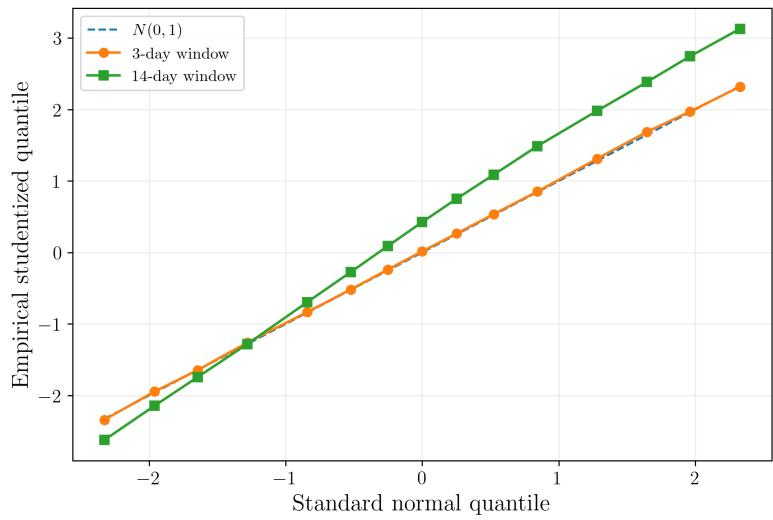  
Figure 8: Studentized local inference in HeartSteps. Quantiles of the studentized all-observation estimator against standard normal quantiles for a locally stable three-day window and a fourteen-day window with larger temporal drift. The three-day estimator closely follows the standard normal reference, while the fourteen-day distribution is shifted by the accumulated temporal bias.