# The role of locality and weight sharing in convolutional neural networks

Francesco Mori1

Melanie Weber1,2

1 Center of Mathematical Sciences and Applications, Harvard University 2 John A. Paulson School of Engineering and Applied Sciences, Harvard University

October 22, 2026

## Abstract

The success of convolutional neural networks is often attributed to locality and weight sharing. However, how these two properties separately shape learning, and how their efects depend on the spatial correlations of natural images, remain poorly understood. We address these questions in a teacher–student model with a convolutional teacher acting on P input positions with correlation c between positions. We compare convolutional and locally connected students trained by online stochastic gradient descent, and derive ordinary diferential equations that describe their dynamics exactly in the limit of large feature dimension D. For uncorrelated positions (c = 0), the two students follow the same learning trajectory, with the convolutional student learning exactly P times faster. We also find that locality afects the sample complexity: a student that matches the kernel size of the teacher recovers it from O (D) samples, whereas $\mathcal { O } _ { D } ( D \log D )$ samples are needed with a larger kernel. For c > 0, spatial correlations can reduce the advantage of weight sharing. The asymptotic error of the convolutional student grows with $c ,$ whereas that of the locally connected student is independent of c and overall lower when eval uated at the same learning rate. When the learning rate is instead tuned to the training horizon, however, the locally connected student wins at early times and the convolutional student at late times, with a transition that we predict analytically.

## 1 Introduction

The ability of neural networks to learn from a limited number of examples depends on their inductive biases, i.e., on the assumptions about the task that are built into the architecture and the training algorithm. A natural source of inductive bias is symmetry. When a task is invariant under a group of transformations of the input, a model that respects this invariance does not need to learn the same features separately for every transformed version of the input. Weight sharing is the standard way to build such symmetries into a network (Shawe-Taylor, 1989; Cohen and Welling, 2016; Ravanbakhsh et al., 2017; Kondor and Trivedi, 2018), and it is expected to reduce the number of samples needed to learn and to speed up training.

The main success story of this approach is the convolutional neural network (CNN), widely used in image classification and other computer vision tasks (LeCun et al., 1998; Krizhevsky et al., 2012). CNNs exploit two structural properties of natural images, each encoded by a distinct architectural choice: Weight sharing across positions encodes the approximate invariance of image statistics under translations, while small filters encode the locality of the relevant features. Additionally, natural images are strongly correlated across space (Ruderman and Bialek, 1994), and the labels used for training are often noisy, resulting in a complex interplay between architectural constraints and the noise of stochastic gradient descent (SGD).

From a theoretical perspective, building symmetries into a model is known to reduce the number of samples needed to learn, typically by a factor of the order of the size of the symmetry group (Bietti et al., 2021; Mei et al., 2021; Tahmasebi and Jegelka, 2023; Elesedy and Zaidi, 2021; Lahoti et al., 2024; Waber et al., 2026). However, disentangling the efects of locality and weight sharing remains a largely open challenge, especially in the feature-learning regime. Moreover, most analyses assume independent inputs, thereby neglecting the spatial correlations of natural images. It is therefore unclear to what extent the advantage of weight sharing survives in the presence of correlations and noise.

In this work, we address these questions in a teacher–student model whose learning dynamics can be described exactly. The teacher is a two-layer convolutional network with kernel size $k _ { t } ,$ , acting on inputs made of P positions that each carry D features, with correlation c between positions. We train convolutional and locally connected students with kernel size $k _ { s } \geq k _ { t }$ by online SGD. The two students have the same receptive fields and difer only in weight sharing, while varying $k _ { s }$ probes the role of locality. In the limit of large feature dimension $D ,$ the dynamics is described exactly by ordinary diferential equations (ODEs) for a few summary statistics, which extend the classical analysis of online learning in two-layer networks (Saad and Solla, 1995; Biehl and Schwarze, 1995; Goldt et al., 2019).

Contributions. Our main contribution is an exact description of how weight sharing and locality shape the online SGD dynamics of convolutional networks, which separates their efects. More precisely:

• In the limit of large feature dimension D and with Gaussian inputs, we derive analytically a closed set of ODEs for the summary statistics of convolutional and locally connected students, for arbitrary kernel sizes and input covariance (Result 3.1).

• For uncorrelated positions, we show analytically that the locally connected network follows exactly the same training trajectory as the convolutional network, but needs exactly P times more SGD steps (Result 3.2). This is an exact dynamical counterpart of the reduction in sample complexity by a factor of the order of the group size found in previous works.

• By integrating the ODEs numerically, we find that locality afects the sample complexity of the problem. Indeed, a convolutional student with the right degree of locality, $k _ { s } = k _ { t }$ , learns the teacher from $\mathcal { O } _ { D } ( D )$ samples, while $\mathcal { O } _ { D } ( D \log D )$ samples are required for $k _ { s } > k _ { t }$ (Result 3.3). The additional logarithmic factor originates from a saddle point that is symmetric under reflection of the kernel, which the dynamics escapes through the fluctuations of the random initialization.

• We show that spatial correlations can reduce the advantage of weight sharing. With a perturbative expansion at small learning rate, we find that the asymptotic error of the convolutional network grows with the correlation strength $^ { c , }$ while that of the locally connected network is independent of c and lower than that of the convolutional network for any $c > 0$ when evaluated at the same learning rate (Result 4.2). However, when the learning rate of each network is tuned to the training horizon, we find numerically that the locally connected network has the lower error at early times but the convolutional network wins at late times (Section 4.3), with a transition time that we predict analytically from an early-time expansion of the ODEs (Result 4.1).

The code used in the paper is available at https://github.com/francescomori/CNN\_theory.

Outline. The paper is organized as follows. Section 2 introduces the model. Section 3 presents the ODEs and the efects of weight sharing and locality for uncorrelated positions. Section 4 studies the efect of spatial correlations, and Section 5 discusses limitations and future directions. Related works are discussed in Section 1.1, and derivations and additional results are given in the appendices.

## 1.1 Related works

Equivariant architectures. Weight sharing can be viewed as a mechanism for hard-coding symmetries into a learning architecture. Early work constructed neural networks with tied parameters to guarantee invariance under prescribed group actions (Shawe-Taylor, 1989). This perspective later gave rise to group-equivariant convolutional networks (Cohen and Welling, 2016), general parameter-sharing constructions for equivariant layers (Ravanbakhsh et al., 2017), and characterizations of convolution as the natural linear operation associated with equivariance under group actions (Kondor and Trivedi, 2018).

Statistical benefits of symmetry. Another body of literature has quantified the statistical benefits of such symmetry constraints. Sannai et al. (2021) derived generalization bounds for invariant and equivariant networks using quotient feature spaces, while Bietti et al. (2021) showed that learning with invariant kernels reduces the number of samples by a factor asymptotically equal to the size of the symmetry group. Related sample-complexity gains were established for invariant random-feature and kernel models (Mei et al., 2021), kernel regression (Tahmasebi and Jegelka, 2023), and for equivariant linear models (Elesedy and Zaidi, 2021). At the same time, symmetry alone does not remove computational barriers: Kiani et al. (2024) established super-polynomial or exponential statistical-query lower bounds for learning several classes of equivariant models, including convolutional networks.

Locality versus weight sharing. Several works studied the separate contributions of locality and weight sharing. In a teacher–student setting for kernel regression with convolutional kernels, Favero et al. (2021) found that locality determines the exponent of the learning curve, whereas translational invariance does not, and Cagnetta et al. (2023) extended this analysis to deep convolutional kernels. Wang and Wu (2023) compared convolutional, locally connected, and fully connected networks, and related the diferent sample complexities of the three architectures to the symmetries of the learning procedure. Lahoti et al. (2024) compared the same three architectures on inputs made of patches, with the signal planted in one of them, and found that the locally connected network needs more samples than the convolutional one by a factor of order the number of patches. Similarly, Li et al. (2021) showed that, on some tasks, fully connected networks trained by gradient descent need quadratically more samples than convolutional ones. Regarding optimization, d’Ascoli et al. (2019) found experimentally that the convolutional constraint mainly helps during the early stages of training, and Ingrosso and Goldt (2022) showed that localized filters can emerge in fully connected networks because of the non-Gaussian statistics of the inputs.

Learning convolutional teachers. For Gaussian inputs with independent, non-overlapping patches, it was shown that gradient descent recovers a convolutional teacher in polynomial time (Brutzkus and Globerson, 2017), even when the loss has spurious local minima (Du et al., 2018). Goel et al. (2018) extended these results to overlapping patches and more general input distributions, using a gradient-like algorithm. The very recent work by Waber et al. (2026) studied online SGD in a convolutional teacher–student model with independent Gaussian inputs and a filter that extends over all patches, showing that weight sharing and data augmentation reduce the sample complexity by a factor equal to the number of patches, which is taken to be polynomial in the input dimension. In this work, we consider the roles of both weight sharing and locality, by considering a teacher of arbitrary kernel size and comparing convolutional and locally connected students whose kernel size can exceed that of the teacher. We also investigate how correlations across patches can reduce the advantage of weight sharing, both in the speed of convergence and in the asymptotic generalization error in the presence of label noise.

Exact learning dynamics in high dimensions. Classical works (Saad and Solla, 1995; Biehl and Schwarze, 1995; Engel and Van den Broeck, 2001) described the dynamics of online learning in two-layer networks exactly in the high-dimensional limit, through ordinary diferential equations for a few order parameters. These equations were used to explain the plateaus of the generalization error caused by the permutation symmetry of the hidden units (Saad and Solla, 1995), to predict the asymptotic error due to label noise (Saad and Solla, 1997), and to derive optimal learning-rate schedules (Saad and Rattray, 1997). More recent works made this approach rigorous (Goldt et al., 2019; Ben Arous et al., 2022) and extended it to diferent learning regimes (Veiga et al., 2022), structured inputs (Goldt et al., 2020), and the design of optimal training protocols (Mignacco and Mori, 2026). Here, we extend this framework to convolutional and locally connected networks, which gives an exact description of their online SGD dynamics. This allows us to quantify how locality sets the number of samples needed to recover the teacher, when convolutional weight sharing accelerates learning relative to an otherwise matched locally connected architecture, and when correlations and noise can instead make the additional flexibility of the unshared model advantageous.

## 2 Setup and notation

In this work, we study an exactly solvable teacher–student model in which the teacher is a convolutional network and the student is either convolutional or locally connected. Teacher–student models are a class of supervised learning settings in which the labels are generated by a fixed teacher network, which represents the ground truth to be recovered, while a student network is trained to reproduce the teacher’s output (Gardner and Derrida, 1989; Engel and Van den Broeck, 2001). When the input distribution is suficiently simple, for instance Gaussian, the learning dynamics of these models can often be characterized exactly in the high-dimensional limit (Saad and Solla, 1995; Biehl and Schwarze, 1995; Goldt et al., 2019). Our convolutional teacher also belongs to the broader class of multi-index models (Ben Arous et al., 2021; Abbe et al., 2023; Arnaboldi et al., 2024; Bietti et al., 2023; Waber et al., 2026).

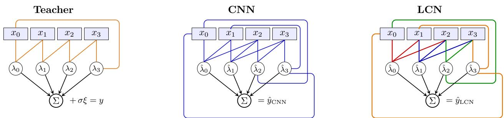  
Figure 1: Teacher and the two student architectures with P input positions. Colors indicate weight sharing. The teacher is a two-layer CNN with kernel size $k _ { t }$ . The CNN student has kernel size $k _ { s }$ and weight sharing. The LCN has the same receptive fields as the CNN but no weight sharing. Boundary conditions are cyclic. Here, $P = 4 , k _ { s } = 3$ , and $k _ { t } = 2$

## 2.1 Data structure

We consider a supervised learning setting with inputs x and labels $y .$ The inputs are vectors $\boldsymbol { x } \in \mathbb { R } ^ { P D }$ organized as

$$
x = ( x _ { 0 } , \ldots , x _ { P - 1 } ) , \qquad x _ { p } \in \mathbb { R } ^ { D } .\tag{1}
$$

We refer to the index $p \in \{ 0 , \ldots , P - 1 \}$ as the position and to the D entries of each $x _ { p }$ as the features at that position. We take P fixed and $D \to \infty$ . This regime is natural for the deeper layers of a convolutional network, where each spatial position carries a high-dimensional feature (many channels) while the spatial extent is comparatively small.

The components of x are jointly Gaussian with mean zero and covariance

$$
\mathbb { E } \big [ x _ { p , a } x _ { q , b } \big ] \ = \ S _ { p , q } \delta _ { a , b } , \qquad p , q \in \{ 0 , \ldots , P - 1 \} , \quad a , b \in \{ 1 , \ldots , D \} .\tag{2}
$$

The $P \times P$ matrix $S$ captures the spatial structure of the data. We will often assume the compoundsymmetric form

$$
S _ { p , q } \ = \ \left\{ \begin{array} { l l } { 1 , } & { p = q , } \\ { c , } & { p \neq q , } \end{array} \right. \quad c \in [ 0 , 1 ) ,\tag{3}
$$

so that every position has unit variance and every pair of distinct positions carries the same correlation c. At $c = 0$ it reduces to the case of independent positions $S = I$

The labels are generated as

$$
y ( x ) = f ^ { \star } ( x ) + \sigma \xi ,\tag{4}
$$

where $f ^ { \star } ( x )$ is the output of the teacher network, $\xi \sim \mathcal { N } ( 0 , 1 )$ independent of $x ,$ and $\sigma \geq 0$ is the standard deviation of the label noise. The teacher is a single-hidden-unit convolutional network with kernel size $k _ { t } < P$ and cyclic boundary conditions

$$
f ^ { \star } ( x ) = \sum _ { p = 0 } ^ { P - 1 } g \big ( \lambda _ { p } ( x ) \big ) ,\tag{5}
$$

with the preactivations

$$
\lambda _ { p } ( x ) = \frac { 1 } { \sqrt { k _ { t } D } } \sum _ { l = 0 } ^ { k _ { t } - 1 } w _ { l } \cdot x _ { ( p + l ) _ { P } } ,\tag{6}
$$

and $( q ) _ { P } \equiv q$ mod $P .$ The weight vectors $w _ { 0 } , \ldots , w _ { k _ { t } - 1 }$ form the kernel (or filter ) of the teacher, which is applied at every position $p$ to the $k _ { t }$ consecutive positions $p , \ldots , p + k _ { t } - 1$ , and $k _ { t }$ is the kernel size. Here, $g ( z )$ indicates a nonlinear function. For analytic convenience, we will focus on $g ( z ) = \mathrm { e r f } ( z / \sqrt { 2 } )$ . We consider the case of ReLU activation numerically in Appendix J. We take the teacher’s weight vectors to be mutually orthogonal and of equal norm,

$$
\frac { w _ { l } \cdot w _ { l ^ { \prime } } } { D } = T \delta _ { l , l ^ { \prime } } .\tag{7}
$$

## 2.2 Student architectures

As students, we consider both convolutional neural networks (CNNs) and locally connected networks (LCNs). In both cases we take the kernel size $k _ { s } ~ \geq ~ k _ { t }$ , so that the student can always represent the teacher but could in principle have a larger receptive field.

The CNN student takes the form

$$
\hat { y } _ { \mathrm { C N N } } ( x ) = \sum _ { p = 0 } ^ { P - 1 } g ( \hat { \lambda } _ { p } ^ { \mathrm { C N N } } ) ,\tag{8}
$$

with preactivations

$$
\hat { \lambda } _ { p } ^ { \mathrm { C N N } } ( x ) = \frac { 1 } { \sqrt { k _ { s } D } } \sum _ { l = 0 } ^ { k _ { s } - 1 } \hat { w } _ { l } \cdot x _ { ( p + l ) _ { P } } .\tag{9}
$$

The same kernel $( \hat { w } _ { l } ) _ { l = 0 } ^ { k _ { s } - 1 }$ is used at every position, implementing translational invariance. Note that at $k _ { s } = k _ { t }$ the CNN student exactly matches the teacher architecture. The LCN student is given by

$$
\hat { y } _ { \mathrm { L C N } } ( x ) = \sum _ { p = 0 } ^ { P - 1 } g ( \hat { \lambda } _ { p } ^ { \mathrm { L C N } } ) ,\tag{10}
$$

with preactivations

$$
\hat { \lambda } _ { p } ^ { \mathrm { L C N } } ( x ) = \frac { 1 } { \sqrt { k _ { s } D } } \sum _ { l = 0 } ^ { k _ { s } - 1 } \hat { w } _ { l } ^ { ( p ) } \cdot x _ { ( p + l ) p } .\tag{11}
$$

Each position p has its own kernel $( \hat { w } _ { l } ^ { ( p ) } ) _ { l = 0 } ^ { k _ { s } - 1 }$ , so the LCN has P times as many trainable parameters as the CNN. Note that at $k _ { s } ~ = ~ P$ each unit of the LCN reads the whole input, resulting in a soft-committee machine (Saad and Solla, 1995). A schematic of the two architectures is given in Figure 1.

Weight sharing and locality are the two structural properties that distinguish CNNs. Interpreting the input as a one-dimensional image with periodic boundary conditions, weight sharing makes both the teacher and the CNN student invariant under translations. Indeed, defining the cyclic shift $( \tau x ) _ { p } = x _ { ( p + 1 ) _ { P } } ,$ , one can easily check that $f ^ { \star } ( \tau x ) = f ^ { \star } ( x )$ and $\hat { y } _ { \mathrm { C N N } } ( \tau x ) = \hat { y } _ { \mathrm { C N N } } ( x )$ . When $S$ is compound symmetric, Eq. (3), the input distribution is also invariant under τ , and the CNN student builds the symmetry of the task into its architecture. The LCN student, in contrast, is in general invariant only when all its kernels coincide, $\hat { w } _ { l } ^ { ( p ) } = \hat { w } _ { l }$ , and must therefore learn the symmetry from data.

## 2.3 Learning algorithm

Both students are trained by online stochastic gradient descent (SGD) on the squared loss

$$
\ell ( x ; \theta ) = \textstyle { \frac { 1 } { 2 } } \big ( y ( x ) - \hat { y } _ { \theta } ( x ) \big ) ^ { 2 } ,\tag{12}
$$

where θ collectively denotes the trainable weights of the student. At each SGD step t a fresh sample $( x ^ { t } , y ^ { t } )$ is drawn from the data distribution, independently of all previous ones, and the weights are updated by

$$
\boldsymbol { \theta } ^ { t + 1 } = \boldsymbol { \theta } ^ { t } - \eta \nabla _ { \boldsymbol { \theta } } \ell \bigl ( \boldsymbol { x } ^ { t } ; \boldsymbol { \theta } ^ { t } \bigr ) ,\tag{13}
$$

with $\eta > 0$ the learning rate. We initialize the student at random, drawing every component of its weights independently from $\mathcal { N } ( 0 , 1 )$ . We measure performance by the generalization error

$$
\varepsilon _ { g } ( \theta ) \ = \ \mathbb { E } _ { x } \Big [ \big ( f ^ { \star } ( x ) - \hat { y } _ { \theta } ( x ) \big ) ^ { 2 } \Big ] .\tag{14}
$$

As we show in Appendix $\mathrm { C } , \varepsilon _ { g }$ depends on θ only through low-dimensional summary statistics.

## 3 Learning dynamics

In the limit where the feature dimension D and the number of SGD steps t jointly tend to infinity at a fixed ratio $\alpha ~ \equiv ~ t / D$ , the network’s dynamics is captured by a small set of low-dimensional summary statistics, known as order parameters in statistical physics. As stated in the Result below, the order parameters concentrate as $D \to \infty$ and satisfy a closed system of ordinary diferential equations (ODEs) in α. The CNN student is described by two matrices of order parameters,

$$
Q _ { l l ^ { \prime } } = \frac { \hat { w } _ { l } \cdot \hat { w } _ { l ^ { \prime } } } { k _ { s } D } , \qquad R _ { l l ^ { \prime \prime } } = \frac { \hat { w } _ { l } \cdot w _ { l ^ { \prime \prime } } } { \sqrt { k _ { s } k _ { t } } D } ,\tag{15}
$$

with $l , l ^ { \prime } \in \{ 0 , \ldots , k _ { s } - 1 \}$ and $l ^ { \prime \prime } \in \{ 0 , \ldots , k _ { t } - 1 \}$ . The LCN student requires two additional position indices $p , q \in \{ 0 , \ldots , P - 1 \}$

$$
Q _ { l l ^ { \prime } } ^ { ( p , q ) } = \frac { \hat { w } _ { l } ^ { ( p ) } \cdot \hat { w } _ { l ^ { \prime } } ^ { ( q ) } } { k _ { s } D } , \quad \quad R _ { l l ^ { \prime \prime } } ^ { ( p ) } = \frac { \hat { w } _ { l } ^ { ( p ) } \cdot w _ { l ^ { \prime \prime } } } { \sqrt { k _ { s } k _ { t } } D } .\tag{16}
$$

Result 3.1 (Exact ODEs for the learning dynamics). Consider the limit $D , t \to \infty$ with $\alpha = t / D =$ $\mathcal { O } _ { D } ( 1 )$ , with $P , k _ { t } , k _ { s } , \eta , T$ , and σ held fixed.

(i) CNN student. Let wˆt denote the weights of the CNN after t steps of online SGD (13). The associated order parameters R and Q, defined in Eq. (15), converge in probability to the solution at time α of the deterministic ODEs

$$
\frac { d R } { d \alpha } = \frac { \eta } { k _ { s } } F _ { R } ^ { \mathrm { C N N } } ( R , Q ) , \qquad \frac { d Q } { d \alpha } = \frac { \eta } { k _ { s } } F _ { Q } ^ { \mathrm { C N N } } ( R , Q ) + \frac { \eta ^ { 2 } } { k _ { s } ^ { 2 } } G _ { Q } ^ { \mathrm { C N N } } ( R , Q ) .\tag{17}
$$

(ii) LCN student. Let $\hat { w } _ { l } ^ { ( p ) , t }$ denote the weights of the LCN after t steps of online SGD. $T h e$ associated order parameters $R ^ { ( p ) }$ and $Q ^ { ( p , q ) }$ , defined in $E q .$ . (16), converge in probability to the solution at time α of

$$
\frac { d R ^ { ( p ) } } { d \alpha } = \frac { \eta } { k _ { s } } F _ { R } ^ { \mathrm { L C N } , ( p ) } ( { \bf R } , { \bf Q } ) , \qquad \frac { d { Q } ^ { ( p , q ) } } { d \alpha } = \frac { \eta } { k _ { s } } F _ { Q } ^ { \mathrm { L C N } , ( p , q ) } ( { \bf R , Q } ) + \frac { \eta ^ { 2 } } { k _ { s } ^ { 2 } } G _ { Q } ^ { \mathrm { L C N } , ( p , q ) } ( { \bf R , Q } ) ,\tag{18}
$$

where ${ \bf R } = \{ R ^ { ( p ) } \} _ { p }$ and $\mathbf { Q } = \{ Q ^ { ( p , q ) } \} _ { p , q }$

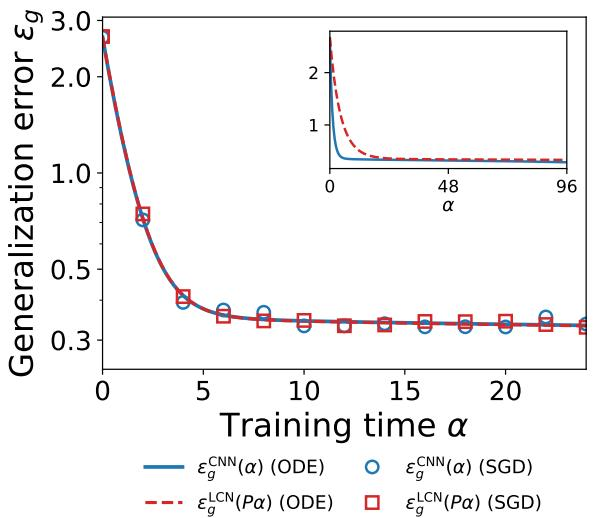  
(a)

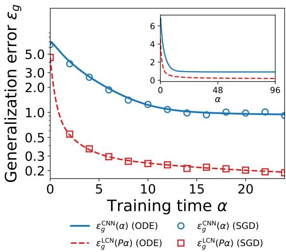  
(b)  
Figure 2: Generalization errors $\varepsilon _ { g } ^ { \mathrm { C N N } } ( \alpha )$ of the CNN and $\varepsilon _ { g } ^ { \mathrm { L C N } } ( P \alpha )$ of the LCN. Lines are the orderparameter ODEs and symbols mark simulations of a single SGD trajectory. Insets show the ODE curves without the time rescaling. (a) For independent positions $( c = 0 )$ the trajectories coincide. (b) In the presence of spatial correlations $( c = 0 . 5 )$ ) the rescaling fails and the LCN converges faster (see inset). Parameters: $g = \operatorname { e r f }$ $k _ { t } = 2$ $k _ { s } = 3 .$ $P = 4 .$ , η = 1, σ = 0, T = 1, SGD at $D = 1 0 0 0$

The functions $F _ { R } , F _ { Q }$ , and $G _ { Q }$ are derived in Appendices A and B.

The terms linear in η correspond to gradient flow on the population loss, while the term proportional to $\eta ^ { 2 }$ describes SGD noise. We notice that while the theory is in principle only valid in the thermodynamic limit $D \to \infty$ , it matches numerical simulations already at $D = 1 0 0 0$ , as shown in Figure 2.

Note that since each weight component is initialized as an independent standard Gaussian variable, the initial conditions for large D are

$$
Q _ { l l ^ { \prime } } = \frac { \delta _ { l l ^ { \prime } } } { k _ { s } } + \mathcal { O } _ { D } ( D ^ { - 1 / 2 } ) , \qquad R _ { l l ^ { \prime } } = \mathcal { O } _ { D } ( D ^ { - 1 / 2 } )\tag{19}
$$

for the CNN, and

$$
Q _ { l l ^ { \prime } } ^ { ( p , q ) } = \delta _ { p q } \delta _ { l l ^ { \prime } } / k _ { s } + \mathcal { O } _ { D } ( D ^ { - 1 / 2 } ) , \qquad R _ { l l ^ { \prime } } ^ { ( p ) } = \mathcal { O } _ { D } ( D ^ { - 1 / 2 } ) ,\tag{20}
$$

for the LCN.

## 3.1 Benefits of translational invariance

We next compare the dynamics of the CNN and the LCN, starting from the simplest case of uncorrelated positions, $S = I .$ . In this case, weight sharing has a remarkably simple efect: it speeds up the dynamics by exactly a factor P.

Result 3.2 (Exact P-fold speedup from weight sharing). Let $S = I$ and $k _ { t } \leq k _ { s } \leq P$ . Let $( R , Q ) ( \alpha )$ be the solution of the CNN equations (17) with initial condition $( R _ { 0 } , Q _ { 0 } )$ , and let $( { \bf R } , { \bf Q } ) ( \alpha )$ be the

solution of the LCN equations (18) with the matched, position-symmetric initial condition

$$
R ^ { ( p ) } ( 0 ) = R _ { 0 } , \qquad Q _ { l l ^ { \prime } } ^ { ( p , ( p + l - l ^ { \prime } ) _ { P } ) } ( 0 ) = ( Q _ { 0 } ) _ { l l ^ { \prime } } \qquad f o r \ a l l \ p .\tag{21}
$$

Then, for all $\alpha \geq 0$ and all $p _ { ; }$

$$
R ^ { ( p ) } ( P \alpha ) = R ( \alpha ) , \qquad Q _ { l l ^ { \prime } } ^ { ( p , ( p + l - l ^ { \prime } ) _ { P } ) } ( P \alpha ) = Q _ { l l ^ { \prime } } ( \alpha ) , \qquad \varepsilon _ { g } ^ { \mathrm { L C N } } ( P \alpha ) = \varepsilon _ { g } ^ { \mathrm { C N N } } ( \alpha ) .\tag{22}
$$

This result can be obtained by direct inspection of the ODEs (17) and (18) (see Appendix D for details). Note that independent Gaussian initialization satisfies the position-symmetry condition up to fluctuations of order $1 / \sqrt { D }$ (see Eq. (20)).

Figure 2a illustrates this result. As shown in the inset, the generalization error of the CNN decreases faster than that of the LCN. After rescaling the time of the LCN by a factor $P _ { \mathrm { : } }$ , the two error curves collapse onto each other (main panel), both for the ODEs and for the SGD simulations. The origin of the factor $P$ can be understood as follows. At each sample, the shared kernel of the CNN accumulates a gradient contribution from every one of the P positions, while each of the P kernels of the LCN only receives the contribution from its own position. Quite surprisingly, this rescaling is exact even at finite learning rate η, when the efects of the SGD noise are not negligible.

This result aligns with several previous works showing that invariant models can have a lower sample complexity than their non-invariant counterparts, by a factor of the order of the size of the associated symmetry group (here the cyclic group of translations of size P). This was shown for convolutional networks trained with gradient-based algorithms (Lahoti et al., 2024; Waber et al., 2026), and in more general settings for invariant classifiers (Sokoli´c et al., 2017) and for invariant kernel and random-feature methods (Bietti et al., 2021; Mei et al., 2021; Tahmasebi and Jegelka, 2023). In contrast with these results, which take the form of bounds or asymptotic rates, Result 3.2 establishes an exact identity between the full training trajectories of the two students.

Interestingly, the exact rescaling holds only for uncorrelated positions. As shown in Figure 2b, for $c > 0$ the CNN at time α and the LCN at time Pα follow visibly diferent curves. Strikingly, even without rescaling time, the LCN converges faster than the CNN. This suggests that a less constrained architecture can better adapt to correlations across positions, a point we make precise in the next sections.

## 3.2 Benefits of locality

In this section, we study how locality afects the learning dynamics. For simplicity, we focus on the CNN student and investigate the role of the kernel size $k _ { s } ,$ , which determines the degree of locality of the network. By integrating the ODEs numerically, we find that a student that matches the teacher locality $\left( k _ { s } = k _ { t } \right)$ requires $\mathcal { O } _ { D } ( D )$ samples to learn the teacher. On the other hand, for $k _ { s } > k _ { t } , \mathcal { O } _ { D } ( D \log D )$ samples are required.

It is instructive to first enumerate the student configurations that exactly reproduce the teacher output, achieving zero generalization error. For $k _ { s } , k _ { t } < P$ , there are $k _ { s } - k _ { t } + 1$ solutions

$$
\hat { w } _ { l } = \sqrt { k _ { s } / k _ { t } } w _ { l - s } \mathrm { f o r } s \leq l < s + k _ { t } , \hat { w } _ { l } = 0 \mathrm { o t h e r w i s e } ,\tag{23}
$$

labeled by the shift $s \in \{ 0 , \ldots , k _ { s } - k _ { t } \}$ . Note that for $k _ { s } = k _ { t } < P$ the solution is unique. We define the cosine similarity of the student parameters with the s-th solution as

$$
\gamma _ { s } ~ = ~ { \frac { 1 } { \sqrt { T \operatorname { t r } Q } } } \sum _ { l = 0 } ^ { k _ { t } - 1 } R _ { s + l , l } .\tag{24}
$$

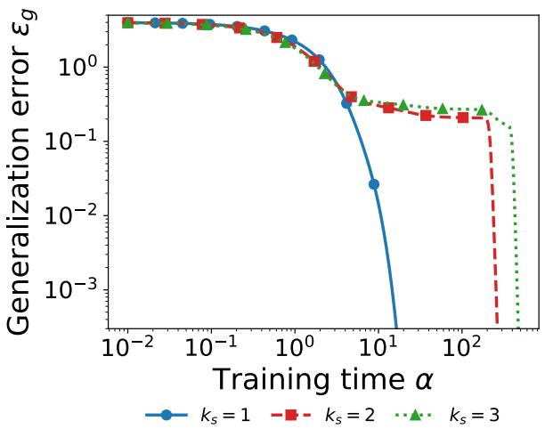

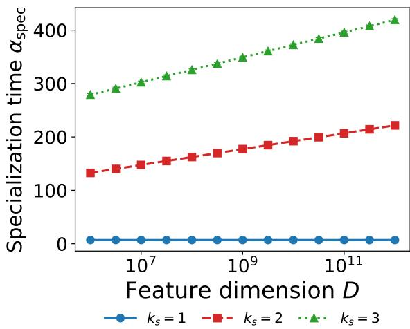  
(a)  
(b)  
Figure 3: CNN students that match the teacher kernel size $\left( k _ { s } = k _ { t } \right)$ learn with $\mathcal { O } _ { D } ( D )$ samples, while students with $k _ { s } > k _ { t }$ take $\mathcal { O } _ { D } ( D \log D )$ samples. (a) Generalization error vs. training time α for three kernel sizes, obtained by integrating the ODEs (17) from the order parameters of a random initialization at dimension D. (b) Specialization time $\alpha _ { \mathrm { s p e c } }$ (Eq. (25), with $\gamma _ { \mathrm { t h } } = 0 . 9 9 )$ against the feature dimension D. Markers are averages over random initializations, each obtained by integrating the ODEs (17) from the order parameters of a random initialization at dimension D. Standard errors are smaller than the marker size. Lines are fits $a + b \ln D$ . Parameters: $D = 1 0 ^ { 1 2 }$ in panel (a), $g = \operatorname { e r f }$ $k _ { t } = 1$ $P = 6 ,$ $S = I$ $\eta = 0 . 5$ $T = 1$ $\sigma = 0$ , 128 random initial conditions in panel (b).

Note that when the student specializes to a particular solution s, one has $\gamma _ { s } = 1$ and $\gamma _ { s ^ { \prime } } = 0$ for $s ^ { \prime } \neq s$ . As shown below, although the ODEs (17) do not depend explicitly on $D$ , the training time $\alpha _ { \mathrm { s p e c } }$ at which specialization occurs can depend on D through the random initial conditions in Eq. (19).

Result 3.3 (Locality and specialization time, numerical). Let $S = I$ and $\sigma = 0$ , let η be small enough to ensure convergence to a zero-error solution, and let $( R , Q ) ( \alpha )$ be the solution of the ODEs (17) from random initial conditions in dimension D. For a fixed threshold $\gamma _ { \mathrm { t h } } < 1$ close to one (we will take $\gamma _ { \mathrm { t h } } = 0 . 9 9$ throughout), define the specialization time

$$
\alpha _ { \mathrm { s p e c } } = \operatorname* { i n f } \Big \{ \alpha \geq 0 : \operatorname* { m a x } _ { 0 \leq s \leq k _ { s } - k _ { t } } \gamma _ { s } ( \alpha ) \geq \gamma _ { \mathrm { t h } } \Big \} ,\tag{25}
$$

with $\gamma _ { s }$ given by Eq. (24). Then, integrating the ODEs numerically, we find that, as $D \to \infty$

(i) for $k _ { s } = k _ { t } , \alpha _ { \mathrm { s p e c } } = \mathcal { O } _ { D } ( 1 )$

(ii) for $k _ { t } < k _ { s } \leq P - 2 , \alpha _ { \mathrm { { s p e c } } } = \mathcal { O } _ { D } ( \log D )$

Since $\alpha = t / D$ , specialization occurs after $\mathcal { O } _ { D } ( D )$ samples in case (i) and $\mathcal { O } _ { D } ( D \log D )$ samples in case (ii).

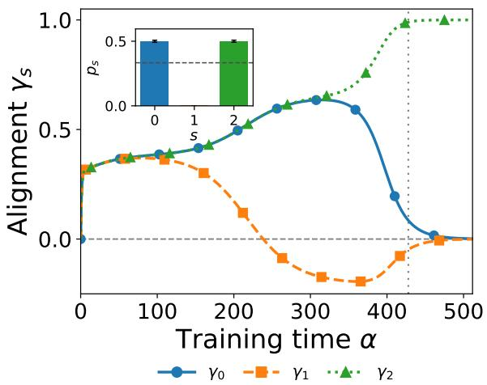

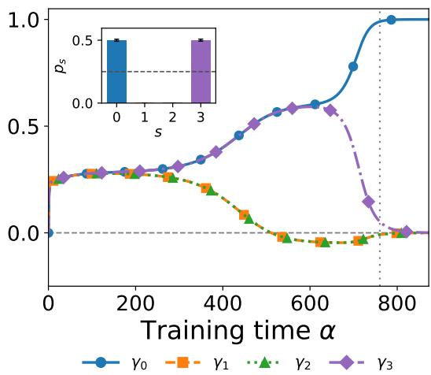  
(a)  
(b)  
Figure 4: Alignment $\gamma _ { s }$ of the CNN kernel with the solution s vs. training time $\alpha .$ , for (a) $k _ { s } = 3$ and (b) $k _ { s } = 4$ . The dotted line marks the specialization time $\alpha _ { \mathrm { s p e c } }$ and the dashed line $\gamma _ { s } = 0$ Insets: probability $p _ { s }$ that solution s is selected, over 4096 random initial conditions (dashed line: uniform). All curves are solutions of the ODEs (17). Parameters: $D = 1 0 ^ { 1 2 }$ $g = \operatorname { e r f }$ $k _ { t } = 1$ $P = 6$ $S = I$ $\eta = 0 . 5$ $T = 1$ $\sigma = 0$

Result 3.3 is obtained for $g ( z ) = \mathrm { e r f } ( z / \sqrt { 2 } )$ , but we expect it to hold for any activation with information exponent one (Ben Arous et al., 2021), that is, with a nonzero first Hermite coeficient, $\mathbb { E } [ z g ( z ) ] \ne 0$ for $z \sim \mathcal { N } ( 0 , 1 )$ . For activations with a higher information exponent, more than $\mathcal { O } _ { D } ( D )$ samples are expected to be required already at $k _ { s } = k _ { t }$ (Ben Arous et al., 2021; Abbe et al., 2023; Bietti et al., 2023), and understanding the role of locality requires a more detailed analysis, which we leave for future work.

Figure 3 shows that for $k _ { s } = k _ { t }$ the error quickly decreases to zero and the specialization time $\alpha _ { \mathrm { s p e c } }$ is D-independent. For $k _ { s } > k _ { t }$ , the generalization error displays a long plateau and then drops abruptly to zero when the student specializes at $\alpha _ { \mathrm { s p e c } } = \mathcal { O } _ { D } ( \log D )$ . Interestingly, this plateau phase is the result of a particular symmetry of the dynamics. Consider the transformation acting on the order parameters as

$$
\rho : \quad R _ { l l ^ { \prime } } \mapsto R _ { k _ { s } - 1 - l , k _ { t } - 1 - l ^ { \prime } } , \qquad Q _ { l l ^ { \prime } } \mapsto Q _ { k _ { s } - 1 - l , k _ { s } - 1 - l ^ { \prime } } .\tag{26}
$$

In Appendix E we show that the ODEs (17) preserve symmetry under $\rho .$ In other words, if the initial condition $( R _ { 0 } , Q _ { 0 } )$ is ρ-invariant, i.e., $\rho ( R _ { 0 } , Q _ { 0 } ) = ( R _ { 0 } , Q _ { 0 } )$ , then the order parameters remain ρ-invariant, $\rho ( R ( \alpha ) , Q ( \alpha ) ) = ( R ( \alpha ) , Q ( \alpha ) )$ for $\alpha > 0$ . Note that the random initial condition is ρ-symmetric up to random fluctuations of order $D ^ { - 1 / 2 }$ , see Eq. (19).

As shown in Figure 4, we find that initially the student parameters have approximately equal overlap with diferent solutions, i.e., $\gamma _ { s } \approx \gamma$ independently of s. At intermediate times $( \alpha \sim \mathcal { O } _ { D } ( 1 ) )$ , the student reaches a fixed point with non-uniform overlap with diferent solutions but that is nevertheless $\rho \mathrm { - }$ symmetric, so that $\gamma _ { s } = \gamma _ { k _ { s } - k _ { t } - s }$ . This fixed point corresponds to a plateau with non-zero generalization error. Note that if we were to choose the uninformed initialization $R = 0$ $Q \ = \ I / k _ { s }$ , which is exactly $\rho \mathrm { - }$ -symmetric, the ODE dynamics would be stuck on this plateau. However, we observe that the fixed point is unstable to asymmetric perturbations, which grow as $e ^ { \kappa \alpha }$ for some $\kappa > 0$ . Therefore, starting from the initialization asymmetry of order $D ^ { - 1 / 2 }$ , the student escapes the $\rho { \mathrm { - } } \mathrm { s y }$ mmetric fixed point after a time of order log D.

For $k _ { s } = k _ { t }$ the unique solution is itself ρ-symmetric, and the dynamics converges to it without breaking the symmetry, resulting in $\alpha _ { \mathrm { s p e c } } \sim \mathcal { O } _ { D } ( 1 )$ . Note that if $k _ { s } \mathrm { ~ - ~ } k _ { t }$ is even, there exists a solution with $s = ( k _ { s } - k _ { t } ) / 2$ that is ρ-symmetric. However, we empirically observe that for large enough D, this symmetric solution is never reached (see inset of Figure 4a). In Appendix F we show that the plateau and the logarithmic growth of $\alpha _ { \mathrm { s p e c } }$ persist for correlated positions $( c > 0 )$ The specialization transition described here is analogous to that of soft-committee machines (Saad and Solla, 1995; Biehl and Schwarze, 1995), where the plateau corresponds to an unspecialized fixed point that is symmetric under permutations of the hidden units.

## 4 Robustness to spatial correlations

So far we have mostly focused on independent positions, $c = 0$ . In this section we consider $c > 0$ and investigate how spatial correlations afect the diferent phases of learning: the beginning of training (Section 4.1), the error left after long training (Section 4.2), and the error at finite training time when the learning rate of each student is optimized (Section 4.3). We find that, at fixed learning rate and for $c > 0$ , the LCN achieves a lower generalization error than the CNN both at early and at late times. However, when the learning rate is appropriately tuned, the LCN wins at early times while the CNN wins at late times, with a transition time that we predict analytically.

## 4.1 Early-time expansion

In the following result, we characterize the beginning of training by expanding analytically the ODEs around the random initial conditions in Eqs. (19) and (20), similar to the analysis in Mori and Mignacco (2025).

Result 4.1 (Early-time expansion). Let S be compound symmetric as in $E q . \ ( 3 )$ , let $k _ { t } \leq k _ { s } \leq P$ and let both students start from the random initial conditions in Eqs. (19) and (20) at leading order in $D$ . Then, for small $\alpha _ { ; }$

$$
\begin{array} { r l } & { \varepsilon _ { g } ^ { \mathrm { C N N } } ( \alpha ) = \varepsilon _ { 0 } ^ { \mathrm { C N N } } - \left( \eta A _ { \mathrm { C N N } } - \eta ^ { 2 } B _ { \mathrm { C N N } } \right) \alpha + \mathcal { O } ( \alpha ^ { 2 } ) , } \\ & { \varepsilon _ { g } ^ { \mathrm { L C N } } ( \alpha ) = \varepsilon _ { 0 } ^ { \mathrm { L C N } } - \left( \eta A _ { \mathrm { L C N } } - \eta ^ { 2 } B _ { \mathrm { L C N } } \right) \alpha + \mathcal { O } ( \alpha ^ { 2 } ) , } \end{array}\tag{27}
$$

with the initial errors

$$
\begin{array} { l } { \displaystyle \varepsilon _ { 0 } ^ { \mathrm { L C N } } = \frac { 2 P } { \pi } \left[ \arcsin \frac { T } { 1 + T } + \left( P - 1 \right) \arcsin \frac { T c } { 1 + T } \right] + \frac { P } { 3 } , } \\ { \displaystyle \varepsilon _ { 0 } ^ { \mathrm { C N N } } = \varepsilon _ { 0 } ^ { \mathrm { L C N } } + \frac { 2 P ( P - 1 ) } { \pi } \arcsin \frac { c } { 2 } . } \end{array}\tag{28}
$$

The coeficients $A _ { \mathrm { C N N } } , A _ { \mathrm { L C N } } , B _ { \mathrm { C N N } }$ , and $B _ { \mathrm { L C N } }$ are positive, independent of $k _ { t } ,$ and given in closed form, together with their derivation, in Appendix G.

First of all, at initialization the CNN starts from a larger error, $\varepsilon _ { 0 } ^ { \mathrm { C N N } } > \varepsilon _ { 0 } ^ { \mathrm { L C N } }$ . Indeed, at $c > 0$ the preactivations $\hat { \lambda } _ { p }$ of the CNN are correlated across positions as $\mathbb { E } [ \hat { \lambda } _ { p } \hat { \lambda } _ { q } ] = S _ { p , q }$ , so that errors in the outputs $g ( \hat { \lambda } _ { p } )$ add up coherently. On the other hand, for the LCN, the parameters at diferent positions are independent, $\mathrm { i . e . , } \mathbb { E } [ \hat { \lambda } _ { p } \hat { \lambda } _ { q } ] = \delta _ { p , q }$ , so the errors in $g ( \hat { \lambda } _ { p } )$ tend to cancel out.

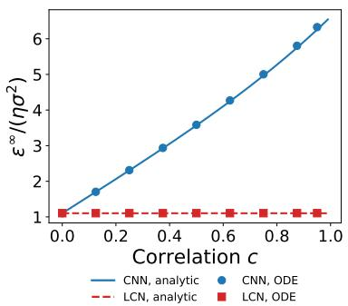  
(a)

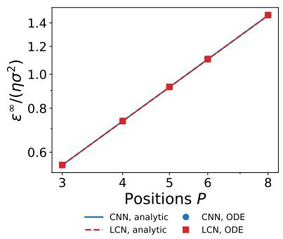  
(b)

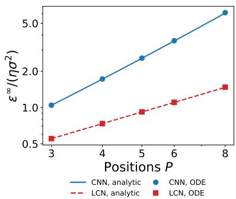  
(c)  
Figure 5: Asymptotic noise floor $\varepsilon ^ { \infty } / ( \eta \sigma ^ { 2 } )$ of the CNN and the LCN at kernel size $k _ { s } = k _ { t } = 2$ as a function of the data correlation c and the number of positions P, where $\varepsilon ^ { \infty }$ is the asymptotic generalization error under label noise. Lines are the closed forms (31) and (32) and markers are the noise floors located numerically from the order-parameter ODEs at finite learning rate. (a) Floor vs. c at $P = 6$ . The CNN grows steeply with c while the LCN stays flat. (b) Scaling with P at $c = 0$ . The CNN and the LCN coincide and are both linear in P. (c) Scaling with P at $c = 0 . 5$ The LCN is still linear in P while the CNN grows quadratically. Parameters: $g = \mathrm { e r f } , k _ { s } = k _ { t } = 2$ $\eta = 2 \times 1 0 ^ { - 3 }$ $\sigma = 1$ 9 $T = 1$

Using Eq. (27), we can also compare the performance of the two students at small but finite $\alpha .$ . To remove the efect of the choice of the learning rate, for each student we set the learning rate to the optimal value, $\eta _ { \mathrm { C N N } } ^ { * } = A _ { \mathrm { C N N } } / ( 2 B _ { \mathrm { C N N } } )$ for the CNN and $\eta _ { \mathrm { L C N } } ^ { * } = A _ { \mathrm { L C N } } / ( 2 B _ { \mathrm { L C N } } )$ for the LCN, and denote by $\varepsilon _ { \mathrm { C N N } } ^ { * } ( \alpha )$ and $\varepsilon _ { \mathrm { L C N } } ^ { * } ( \alpha )$ the resulting generalization errors. Then, to leading order in $\alpha ,$ we find

$$
\left\{ \begin{array} { l l } { \varepsilon _ { \mathrm { C N N } } ^ { * } > \varepsilon _ { \mathrm { L C N } } ^ { * } } & { \mathrm { i f } \ c > c ^ { * } ( \alpha ) , } \\ { \varepsilon _ { \mathrm { C N N } } ^ { * } < \varepsilon _ { \mathrm { L C N } } ^ { * } } & { \mathrm { i f } \ c < c ^ { * } ( \alpha ) , } \end{array} \right.\tag{29}
$$

where

$$
c ^ { * } ( \alpha ) = c _ { 0 } \alpha + { \mathcal O } ( \alpha ^ { 2 } ) ,\tag{30}
$$

and the slope $c _ { 0 }$ depends on $P , k _ { s } , T .$ , and $\sigma ,$ and is given in closed form in Eq. (119) of Appendix G. In other words, the CNN achieves lower generalization error for small correlations c (or, equivalently, at long times) while the LCN wins at large c (short times). Although this result is in principle valid only for small α, it matches surprisingly well the phase diagram obtained by integrating the exact ODEs numerically (Figure 6).

## 4.2 Asymptotic generalization error

We now turn to long training times and ask how spatial correlations afect the asymptotic error in the presence of label noise, $\sigma > 0$ . We compute this error analytically, through a perturbative expansion of the ODEs at small learning rate η.

Result 4.2 (Asymptotic generalization error). Let S be compound symmetric with $c \in [ 0 , 1 )$ , let $\sigma > 0$ and $k _ { t } \leq k _ { s } \leq P$ . Consider a student that converges to the neighborhood of perfect recovery,

that $i s ,$ of a zero-error solution of $E q$ . (23). To leading order in η, its asymptotic generalization error, or noise floor, $\begin{array} { r } { \varepsilon ^ { \infty } = \operatorname* { l i m } _ { \alpha \to \infty } \varepsilon _ { g } ( \alpha ) } \end{array}$ is

$$
\varepsilon ^ { \infty , \mathrm { C N N } } ( c ) = \frac { \eta \sigma ^ { 2 } } { \pi } \left[ \frac { P } { \sqrt { 1 + 2 T } } + \frac { P ( P - 1 ) c } { \sqrt { ( 1 + T ) ^ { 2 } - T ^ { 2 } c ^ { 2 } } } \right] + \mathcal { O } ( \eta ^ { 2 } ) ,\tag{31}
$$

$$
\varepsilon ^ { \infty , \mathrm { L C N } } = \frac { \eta \sigma ^ { 2 } P } { \pi \sqrt { 1 + 2 T } } + \mathcal { O } ( \eta ^ { 2 } ) .\tag{32}
$$

The derivation, given in Appendix H, linearizes the ODEs around perfect recovery and locates the fixed point reached at small η. Both expressions are independent of the kernel sizes $k _ { s }$ and $k _ { t }$ Figure 5 compares them with the asymptotic errors located numerically from the ODEs at finite learning rate, finding excellent agreement. At $c = 0$ the two errors coincide, as expected from Result 3.2. For $c > 0$ , the error of the CNN grows with c and quadratically with P, while that of the LCN is independent of c and linear in P. Therefore, at a fixed small learning rate, the LCN is more robust to label noise than the CNN in the presence of spatial correlations.

To understand the origin of this diference, we consider, without loss of generality, a student close to the zero-error solution with $s = 0$ in Eq. (23), and define the error in the preactivation at position $p ,$

$$
e _ { p } \equiv { \hat { \lambda } } _ { p } - \lambda _ { p } ,\tag{33}
$$

which vanishes at this solution. Near the fixed point we find (Appendix H)

$$
\mathbb { E } \big [ e _ { p } ^ { \mathrm { C N N } } e _ { q } ^ { \mathrm { C N N } } \big ] = \frac { \eta \sigma ^ { 2 } } { 2 } S _ { p , q } + \mathcal { O } ( \eta ^ { 2 } ) , \qquad \mathbb { E } \big [ e _ { p } ^ { \mathrm { L C N } } e _ { q } ^ { \mathrm { L C N } } \big ] = \frac { \eta \sigma ^ { 2 } } { 2 } \delta _ { p , q } + \mathcal { O } ( \eta ^ { 2 } ) .\tag{34}
$$

The errors of the LCN are uncorrelated across positions, because each position has its own kernel. The CNN instead uses the same kernel at every position, so its errors inherit the correlations of the data. As a result, for $c > 0 .$ , the leading-order noise floor of the LCN is lower than that of the CNN when evaluated at the same learning rate. Nevertheless, as we show in Section 4.3, the CNN achieves a lower generalization error at long training horizons when the learning rate is optimized separately for each architecture.

## 4.3 Phase diagram at the optimal learning rate

While Result 4.2 compares the asymptotic performance of the two students at the same learning rate, it does not account for two efects. First, the two students will in general converge to perfect recovery at diferent rates. Moreover, their optimal learning rates can difer and depend on the training horizon. To include both efects, we use the ODEs (17) and (18) to compare the two students at a given correlation c and training horizon $\alpha _ { F } .$ , each with the constant learning rate $\eta ^ { * }$ that minimizes its error at $\alpha _ { F }$ (see Appendix I for details).

Figure 6 shows the resulting phase diagram, obtained by numerically integrating the ODEs. The LCN has lower error compared to the CNN for short training horizons and strong correlations. On the other hand, the CNN wins at long training horizons. We find the same transition for other values of $P , k _ { s } = k _ { t } , T$ , and $\sigma$ (Figure 9 in Appendix I). Interestingly, the analytical prediction (30), obtained by an early-time expansion, matches well the numerical boundary between the two regimes. Note that this does not contradict Section 4.2, where the LCN has the lower asymptotic error, because the two comparisons are made at diferent learning rates. Indeed, at a given $\alpha _ { F }$ , we find numerically that the optimal learning rate of the CNN is lower than that of the LCN for every $c > 0$ (Figure 8a in Appendix I). Since the asymptotic error is proportional to $\eta$ (Result 4.2), the lower learning rate of the CNN compensates for its larger error at equal $\eta$ (Figure 8b).

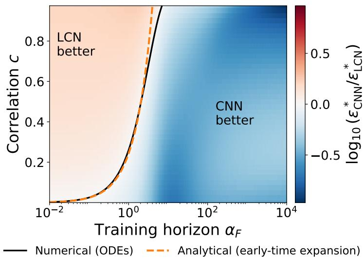  
Figure 6: Comparison of the CNN and the LCN at training horizon $\alpha _ { F }$ and correlation $^ { c , }$ each at its optimal constant learning rate. The color shows the log-ratio of the errors $\varepsilon ^ { * }$ . Solid line: boundary $\varepsilon _ { \mathrm { C N N } } ^ { * } = \varepsilon _ { \mathrm { L C N } } ^ { * }$ , obtained by integrating the ODEs numerically. Dashed line: analytical prediction Eq. (30) of the early-time expansion. Parameters: $g = \mathrm { e r f } , P = 4 , k _ { s } = k _ { t } = 1 , T = 1$ $\sigma = 1$ , random initial condition in the limit $D \to \infty$

## 5 Conclusions

In this work, we have considered a teacher–student model to study the online SGD dynamics of convolutional and locally connected networks. In the limit of large feature dimension, we have shown that, for uncorrelated positions, weight sharing speeds up learning by exactly a factor equal to the number of positions. We have also investigated the role of locality, showing numerically that convolutional students that match the kernel size of the teacher recover it from $\mathcal { O } _ { D } ( D )$ samples, whereas students with a larger kernel require $\mathcal { O } _ { D } ( D \log D )$ samples. Finally, we have investigated the efects of spatial correlations. We have shown analytically that, at small constant learning rate, the CNN is less robust to noise in the presence of correlations, and numerically that it outperforms the LCN at long training horizons when the learning rate is optimized.

Our analysis relies on several simplifying assumptions, which point to natural extensions. For instance, our inputs are Gaussian and carry no localized structure, and one could consider data in which the signal is planted in one of the patches (Lahoti et al., 2024). It would also be interesting to extend our results from regression to classification problems. Moreover, we have considered one-pass SGD, in which each sample is used only once. Training for multiple passes on a finite dataset, where overfitting and memorization become relevant, would require other tools, such as dynamical mean-field theory (Mignacco et al., 2020; Bordelon and Pehlevan, 2022; Montanari and Urbani, 2025).

Several interesting directions remain open. Our equations are valid for an arbitrary covariance S across positions, and could be used to study correlations that decay with the distance between positions, as in natural images. Moreover, although we restrict ourselves here to translations, the theoretical analysis described above could be applied to other groups acting on the positions. For instance, permutation invariance can be studied with the teacher

$$
f ^ { \star } ( x ) = \sum _ { p = 0 } ^ { P - 1 } g \big ( \lambda _ { p } ( x ) \big ) , \qquad \lambda _ { p } ( x ) = \frac { 1 } { \sqrt { D } } \Big ( w _ { \mathrm { s } } \cdot x _ { p } + w _ { \mathrm { o } } \cdot \sum _ { q \neq p } x _ { q } \Big ) ,\tag{35}
$$

which is invariant under any permutation of the positions. Finally, we have considered constant learning rates. Learning-rate schedules could further reduce the error and could be designed with optimal control (Mignacco and Mori, 2026).

## Acknowledgments

FM was supported by the Center of Mathematical Sciences and Applications (CMSA) at Harvard University. MW was partially supported by NSF Award DMS-2406905, an Alfred P. Sloan Fellowship in Mathematics and the AI2050 program at Schmidt Sciences (Grant G-25-69786).

## Statement on the use of AI

We used the generative AI model Claude Opus 5.5 (Anthropic) to assist with literature review, deriving and checking analytical expressions, writing the simulation code, and drafting and revising the text. All results were verified by the authors, who take full responsibility for the content of this work.

## Code availability

Code to reproduce the figures is available at https://github.com/francescomori/CNN\_theory.

## References

E. Abbe, E. Boix-Adser\`a, and T. Misiakiewicz. SGD learning on neural networks: leap complexity and saddle-to-saddle dynamics. In COLT, pages 2552–2623, 2023. arXiv:2302.11055.

L. Arnaboldi, Y. Dandi, F. Krzakala, B. Loureiro, L. Pesce, and L. Stephan. Online learning and information exponents: The importance of batch size & time/complexity tradeofs. In ICML, volume 235, pages 1730–1762, 2024.

G. Ben Arous, R. Gheissari, and A. Jagannath. Online stochastic gradient descent on non-convex losses from high-dimensional inference. Journal of Machine Learning Research, 22(106):1–51, 2021.

G. Ben Arous, R. Gheissari, and A. Jagannath. High-dimensional limit theorems for SGD: Efective dynamics and critical scaling. In NeurIPS, volume 35, pages 25349–25362, 2022.

M. Biehl and H. Schwarze. Learning by on-line gradient descent. Journal of Physics A, 28:643, 1995.

A. Bietti, L. Venturi, and J. Bruna. On the sample complexity of learning under invariance and geometric stability. In NeurIPS, volume 34, 2021. arXiv:2106.07148.

A. Bietti, J. Bruna, and L. Pillaud-Vivien. On learning Gaussian multi-index models with gradient flow. arXiv preprint arXiv:2310.19793, 2023.

B. Bordelon and C. Pehlevan. Self-consistent dynamical field theory of kernel evolution in wide neural networks. In NeurIPS, volume 35, 2022. arXiv:2205.09653.

A. Brutzkus and A. Globerson. Globally optimal gradient descent for a ConvNet with Gaussian inputs. In ICML, pages 605–614, 2017.

F. Cagnetta, A. Favero, and M. Wyart. What can be learnt with wide convolutional neural networks? In ICML, pages 3347–3379, 2023.

T. Cohen and M. Welling. Group equivariant convolutional networks. In ICML, 2016. arXiv:1602.07576.

S. d’Ascoli, L. Sagun, J. Bruna, and G. Biroli. Finding the needle in the haystack with convolutions: on the benefits of architectural bias. In NeurIPS, volume 32, 2019. arXiv:1906.06766.

S. S. Du, J. D. Lee, Y. Tian, A. Singh, and B. P´oczos. Gradient descent learns one-hidden-layer CNN: Don’t be afraid of spurious local minima. In ICML, pages 1339–1348, 2018.

B. Elesedy and S. Zaidi. Provably strict generalisation benefit for equivariant models. In ICML, 2021. arXiv:2102.10333.

A. Engel and C. Van den Broeck. Statistical Mechanics of Learning. Cambridge University Press, 2001.

A. Favero, F. Cagnetta, and M. Wyart. Locality defeats the curse of dimensionality in convolutional teacher-student scenarios. In NeurIPS, volume 34, 2021. arXiv:2106.08619.

E. Gardner and B. Derrida. Three unfinished works on the optimal storage capacity of networks. Journal of Physics A, 22(12):1983, 1989.

S. Goel, A. Klivans, and R. Meka. Learning one convolutional layer with overlapping patches. In ICML, pages 1783–1791, 2018.

S. Goldt, M. S. Advani, A. M. Saxe, F. Krzakala, and L. Zdeborov´a. Dynamics of stochastic gradient descent for two-layer neural networks in the teacher-student setup. In NeurIPS, volume 32, 2019. Also Journal of Statistical Mechanics 2020:124010. arXiv:1906.08632.

S. Goldt, M. M´ezard, F. Krzakala, and L. Zdeborov´a. Modeling the influence of data structure on learning in neural networks: The hidden manifold model. Physical Review X, 10(4):041044, 2020.

A. Ingrosso and S. Goldt. Data-driven emergence of convolutional structure in neural networks. Proceedings of the National Academy of Sciences, 119(40):e2201854119, 2022.

B. T. Kiani, T. Le, H. Lawrence, S. Jegelka, and M. Weber. On the hardness of learning under symmetries. In ICLR, 2024. arXiv:2401.01869.

R. Kondor and S. Trivedi. On the generalization of equivariance and convolution in neural networks to the action of compact groups. In ICML, 2018. arXiv:1802.03690.

A. Krizhevsky, I. Sutskever, and G. E. Hinton. ImageNet classification with deep convolutional neural networks. In NeurIPS, volume 25, pages 1097–1105, 2012.

A. Lahoti, S. Karp, E. Winston, A. Singh, and Y. Li. Role of locality and weight sharing in imagebased tasks: a sample complexity separation between CNNs, LCNs, and FCNs. In ICLR, 2024. arXiv:2403.15707.

Y. LeCun, L. Bottou, Y. Bengio, and P. Hafner. Gradient-based learning applied to document recognition. Proceedings of the IEEE, 86(11):2278–2324, 1998.

Z. Li, Y. Zhang, and S. Arora. Why are convolutional nets more sample-eficient than fullyconnected nets? In ICLR, 2021.

S. Mei, T. Misiakiewicz, and A. Montanari. Learning with invariances in random features and kernel models. In COLT, 2021. arXiv:2102.13219.

F. Mignacco and F. Mori. A statistical physics framework for optimal learning. PNAS Nexus, 5 (6):pgag182, 2026.

F. Mignacco, F. Krzakala, P. Urbani, and L. Zdeborov´a. Dynamical mean-field theory for stochastic gradient descent in Gaussian mixture classification. In NeurIPS, volume 33, 2020. arXiv:2006.06098.

A. Montanari and P. Urbani. Dynamical decoupling of generalization and overfitting in large twolayer networks. In NeurIPS, volume 38, 2025. arXiv:2502.21269.

F. Mori and F. Mignacco. Analytic theory of dropout regularization. Physical Review E, 112(4): 045301, 2025. arXiv:2505.07792.

S. Ravanbakhsh, J. Schneider, and B. P´oczos. Equivariance through parameter-sharing. In ICML, 2017. arXiv:1702.08389.

D. L. Ruderman and W. Bialek. Statistics of natural images: Scaling in the woods. Physical Review Letters, 73(6):814–817, 1994.

D. Saad and M. Rattray. Globally optimal parameters for on-line learning in multilayer neural networks. Physical Review Letters, 79(13):2578, 1997.

D. Saad and S. A. Solla. On-line learning in soft committee machines. Physical Review E, 52(4): 4225, 1995.

D. Saad and S. A. Solla. Learning with noise and regularizers in multilayer neural networks. In NeurIPS, volume 9, pages 260–266, 1997.

A. Sannai, M. Imaizumi, and M. Kawano. Improved generalization bounds of group invariant/equivariant deep networks via quotient feature spaces. In UAI, 2021. arXiv:1910.06552.

J. Shawe-Taylor. Building symmetries into feedforward networks. In First IEE International Conference on Artificial Neural Networks, pages 158–162, 1989.

J. Sokoli´c, R. Giryes, G. Sapiro, and M. R. D. Rodrigues. Generalization error of invariant classifiers. In AISTATS, pages 1094–1103, 2017.

B. Tahmasebi and S. Jegelka. The exact sample complexity gain from invariances for kernel regression. In NeurIPS, volume 36, 2023. arXiv:2303.14269.

R. Veiga, L. Stephan, B. Loureiro, F. Krzakala, and L. Zdeborov´a. Phase diagram of stochastic gradient descent in high-dimensional two-layer neural networks. In NeurIPS, volume 35, pages 23244–23255, 2022.

J. Waber, V. Piccolo, Y. Dandi, and F. Krzakala. Symmetry-aware feature learning: A polynomial separation for multi-index models. arXiv preprint arXiv:2610.08420, 2026.

Z. Wang and L. Wu. Theoretical analysis of the inductive biases in deep convolutional networks. In NeurIPS, volume 36, 2023. arXiv:2305.08404.

## A ODE derivation: the CNN

We derive the deterministic ODE for the order parameters R and $Q$ of the CNN in the $D \to \infty$ limit. The derivation is generic in the data covariance S and the kernel size $k _ { s }$

## A.1 Setup and building blocks

The student weights are updated by online SGD:

$$
\Delta { \hat { w } _ { l } } = - \eta \partial _ { \hat { w } _ { l } } \ell ( x ; \theta ) = \frac { \eta \delta } { \sqrt { k _ { s } D } } \sum _ { p = 0 } ^ { P - 1 } g ^ { \prime } ( \hat { \lambda } _ { p } ) x _ { ( p + l ) _ { P } } , \qquad \delta = y - \hat { y } _ { \mathrm { C N N } } ,\tag{36}
$$

where the sum over $p$ comes from the dependence of $\hat { y } _ { \mathrm { C N N } }$ on $\hat { w } _ { l }$ through all $P$ position outputs $g ( \hat { \lambda } _ { p } )$

For simplicity, in this appendix and in Appendices B and H we pad the teacher kernel with zero vectors, $w _ { l } = 0$ for $k _ { t } \leq l < k _ { s }$ . Then R, a $k _ { s } \times k _ { t }$ matrix in Eq. (15), and the teacher overlap matrix $T _ { l , l ^ { \prime } }$ defined below become $k _ { s } \times k _ { s }$ matrices whose added entries vanish, and every kernel sum runs over $\{ 0 , \ldots , k _ { s } - 1 \}$

Single-vector fields. It is convenient to introduce projections of the input at one position onto one weight vector,

$$
\begin{array} { r l r } { \mu _ { r } ^ { ( l ) } \equiv \frac { w _ { l } \cdot x _ { r } } { \sqrt { k _ { t } D } } , } & { { } } & { \nu _ { r } ^ { ( l ) } \equiv \frac { \hat { w } _ { l } \cdot x _ { r } } { \sqrt { k _ { s } D } } , } \end{array}\tag{37}
$$

with which the preactivations decompose simply: $\begin{array} { r } { \lambda _ { p } = \sum _ { l = 0 } ^ { k _ { s } - 1 } \mu _ { ( p + l ) _ { P } } ^ { ( l ) } , \widehat { \lambda } _ { p } = \sum _ { l = 0 } ^ { k _ { s } - 1 } \nu _ { ( p + l ) _ { P } } ^ { ( l ) } } \end{array}$ , every kernel position sum here and below running over $\{ 0 , \ldots , k _ { s } - 1 \}$ . The two-point functions of singlevector fields read

$$
\langle \mu _ { r } ^ { ( l ) } \mu _ { q } ^ { ( l ^ { \prime } ) } \rangle = S _ { r , q } T _ { l , l ^ { \prime } } , \qquad \langle \nu _ { r } ^ { ( l ) } \nu _ { q } ^ { ( l ^ { \prime } ) } \rangle = S _ { r , q } Q _ { l , l ^ { \prime } } , \qquad \langle \mu _ { r } ^ { ( l ) } \nu _ { q } ^ { ( l ^ { \prime } ) } \rangle = S _ { r , q } R _ { l ^ { \prime } , l } ,\tag{38}
$$

where the index ordering in the cross term reflects the convention $R _ { l , l ^ { \prime } } = \hat { w } _ { l } \cdot w _ { l ^ { \prime } } / ( \sqrt { k _ { s } k _ { t } } D )$ , and $T _ { l , l ^ { \prime } } = w _ { l } \cdot w _ { l ^ { \prime } } / ( k _ { t } D )$ is the teacher’s overlap matrix, equal to $\left( T / k _ { t } \right) \delta _ { l , l ^ { \prime } }$ for $l , l ^ { \prime } < k _ { t }$ by (7) and zero otherwise. Expanding one of the two factors with $\begin{array} { r } { \lambda _ { p } = \sum _ { l = 0 } ^ { k _ { s } - 1 } \mu _ { ( p + l ) _ { P } } ^ { ( l ) } } \end{array}$ and $\begin{array} { r } { \hat { \lambda } _ { p } = \sum _ { l = 0 } ^ { k _ { s } - 1 } \nu _ { ( p + l ) _ { F } } ^ { ( l ) } } \end{array}$ also gives the covariances between a preactivation and a single-vector field,

$$
\langle \hat { \lambda } _ { p } \mu _ { r } ^ { ( l ^ { \prime } ) } \rangle = \sum _ { l = 0 } ^ { k _ { s } - 1 } R _ { l , l ^ { \prime } } S _ { ( p + l ) _ { P } , r } , \qquad \langle \hat { \lambda } _ { p } \nu _ { r } ^ { ( l ^ { \prime } ) } \rangle = \sum _ { l = 0 } ^ { k _ { s } - 1 } Q _ { l , l ^ { \prime } } S _ { ( p + l ) _ { P } , r } ,\tag{39}
$$

$$
\langle \lambda _ { q } \mu _ { r } ^ { ( l ^ { \prime } ) } \rangle = \sum _ { l = 0 } ^ { k _ { s } - 1 } T _ { l , l ^ { \prime } } S _ { ( q + l ) _ { P } , r } , \qquad \langle \lambda _ { q } \nu _ { r } ^ { ( l ^ { \prime } ) } \rangle = \sum _ { l = 0 } ^ { k _ { s } - 1 } R _ { l ^ { \prime } , l } S _ { ( q + l ) _ { P } , r } .\tag{40}
$$

Efective covariances. The preactivations are linear in x, so their covariances follow from the definitions. Inserting (6) and using $\langle x _ { p , a } x _ { q , b } \rangle = S _ { p , q } \delta _ { a , b }$

$$
\langle \lambda _ { p } \lambda _ { q } \rangle \ = \ \frac { 1 } { k _ { t } D } \sum _ { l , l ^ { \prime } = 0 } ^ { k _ { s } - 1 } ( w _ { l } \cdot w _ { l ^ { \prime } } ) S _ { ( p + l ) _ { P } , ( q + l ^ { \prime } ) _ { P } } \ = \ \sum _ { l , l ^ { \prime } = 0 } ^ { k _ { s } - 1 } T _ { l , l ^ { \prime } } S _ { ( p + l ) _ { P } , ( q + l ^ { \prime } ) _ { P } } .\tag{41}
$$

The same computation with one or both teacher weight vectors replaced by student ones gives the remaining covariances, with T replaced by R or Q. For any $k _ { s } \times k _ { s }$ matrix M it is useful to define the efective matrix

$$
M _ { p , q } ^ { \mathrm { e f f } } \equiv \sum _ { l , l ^ { \prime } = 0 } ^ { k _ { s } - 1 } M _ { l , l ^ { \prime } } S _ { ( p + l ) _ { P } , ( q + l ^ { \prime } ) _ { P } } ,\tag{42}
$$

a $P \times P$ matrix indexed by positions, so that

$$
\langle \lambda _ { p } \lambda _ { q } \rangle = T _ { p , q } ^ { \mathrm { e f f } } , \qquad \langle \hat { \lambda } _ { p } \hat { \lambda } _ { q } \rangle = Q _ { p , q } ^ { \mathrm { e f f } } , \qquad \langle \hat { \lambda } _ { p } \lambda _ { q } \rangle = R _ { p , q } ^ { \mathrm { e f f } } .\tag{43}
$$

## A.2 Saad–Solla integrals

The ODEs derived below involve the activation only through a small set of averages of products of $g$ and $g ^ { \prime }$ over jointly Gaussian arguments. These averages, and the equations built from them, are defined for any activation. What is specific to $g =$ erf is that they can be evaluated in closed form, which is why we adopt that choice for the analytic results. For a $2 \times 2$ covariance $C ^ { ( 2 ) } = ( c _ { p , q } )$

$$
I _ { 2 } ( C ^ { ( 2 ) } ) = \mathbb { E } [ g ( u _ { 1 } ) g ( u _ { 2 } ) ] = \frac { 2 } { \pi } \arcsin \frac { c _ { 1 2 } } { \sqrt { ( 1 + c _ { 1 1 } ) ( 1 + c _ { 2 2 } ) } } ,\tag{44}
$$

where $C ^ { ( 2 ) }$ is the covariance matrix of $( u _ { 1 } , u _ { 2 } )$ and similarly

$$
J _ { 2 } ( C ^ { ( 2 ) } ) = \mathbb { E } [ g ^ { \prime } ( u _ { 1 } ) g ^ { \prime } ( u _ { 2 } ) ] = \frac { 2 } { \pi } \left[ ( 1 + c _ { 1 1 } ) ( 1 + c _ { 2 2 } ) - c _ { 1 2 } ^ { 2 } \right] ^ { - 1 / 2 } ,\tag{45}
$$

$$
I _ { 3 } ( C ^ { ( 3 ) } ) = \mathbb { E } [ g ^ { \prime } ( u _ { 1 } ) u _ { 2 } g ( u _ { 3 } ) ] = \frac { 2 } { \pi } \frac { c _ { 2 3 } ( 1 + c _ { 1 1 } ) - c _ { 1 2 } c _ { 1 3 } } { ( 1 + c _ { 1 1 } ) \sqrt { ( 1 + c _ { 1 1 } ) ( 1 + c _ { 3 3 } ) - c _ { 1 3 } ^ { 2 } } } ,\tag{46}
$$

with the slot convention $( u _ { 1 } , u _ { 2 } , u _ { 3 } ) = ( g ^ { \prime }$ , linear, g) for $I _ { 3 }$ . The four-point integral $I _ { 4 }$ takes the form

$$
I _ { 4 } ( C ^ { ( 4 ) } ) = \mathbb { E } [ g ^ { \prime } ( u _ { 1 } ) g ^ { \prime } ( u _ { 2 } ) g ( u _ { 3 } ) g ( u _ { 4 } ) ] = \frac { 4 } { \pi ^ { 2 } } \frac { 1 } { \sqrt { \Lambda _ { 4 } } } \arcsin \frac { \Lambda _ { 0 } } { \sqrt { \Lambda _ { 1 } \Lambda _ { 2 } } } ,\tag{47}
$$

where

$$
\Lambda _ { 4 } = ( 1 + c _ { 1 1 } ) ( 1 + c _ { 2 2 } ) - c _ { 1 2 } ^ { 2 } ,\tag{48}
$$

$$
\Lambda _ { 1 } = \Lambda _ { 4 } ( 1 + c _ { 3 3 } ) - c _ { 2 3 } ^ { 2 } ( 1 + c _ { 1 1 } ) - c _ { 1 3 } ^ { 2 } ( 1 + c _ { 2 2 } ) + 2 c _ { 1 2 } c _ { 1 3 } c _ { 2 3 } ,\tag{49}
$$

$$
\Lambda _ { 2 } = \Lambda _ { 4 } ( 1 + c _ { 4 4 } ) - c _ { 2 4 } ^ { 2 } ( 1 + c _ { 1 1 } ) - c _ { 1 4 } ^ { 2 } ( 1 + c _ { 2 2 } ) + 2 c _ { 1 2 } c _ { 1 4 } c _ { 2 4 } ,\tag{50}
$$

$$
\Lambda _ { 0 } = \Lambda _ { 4 } c _ { 3 4 } - c _ { 2 3 } c _ { 2 4 } ( 1 + c _ { 1 1 } ) - c _ { 1 3 } c _ { 1 4 } ( 1 + c _ { 2 2 } ) + c _ { 1 2 } c _ { 1 3 } c _ { 2 4 } + c _ { 1 2 } c _ { 1 4 } c _ { 2 3 } .\tag{51}
$$

Below we write these integrals with their field arguments rather than with the covariance matrix, as in $J _ { 2 } ( \hat { \lambda } _ { p } , \hat { \lambda } _ { q } )$ or $I _ { 3 } ( \hat { \lambda } _ { p } , \mu _ { r } ^ { ( l ^ { \prime } ) } , \lambda _ { q } )$ , understanding that the integral is evaluated at the covariance matrix of the listed fields. Its entries are the two-point functions of Appendix A.1.

## A.3 ODE for R

We compute $\Delta R _ { l , l ^ { \prime } } = ( \Delta \hat { w } _ { l } \cdot w _ { l ^ { \prime } } ) / ( \sqrt { k _ { s } k _ { t } } D )$ from the SGD update:

$$
\Delta R _ { l , l ^ { \prime } } = \frac { \eta \delta } { k _ { s } \sqrt { k _ { t } } D \sqrt { D } } \sum _ { p = 0 } ^ { P - 1 } g ^ { \prime } ( \hat { \lambda } _ { p } ) \left( x _ { \left( p + l \right) _ { P } } \cdot w _ { l ^ { \prime } } \right) = \frac { \eta \delta } { k _ { s } D } \sum _ { p = 0 } ^ { P - 1 } g ^ { \prime } ( \hat { \lambda } _ { p } ) \mu _ { \left( p + l \right) _ { P } } ^ { \left( l ^ { \prime } \right) } .\tag{52}
$$

Taking the continuum limit with $\alpha = t / D$ , we find

$$
\dot { R } _ { l , l ^ { \prime } } = \frac { \eta } { k _ { s } } \sum _ { p = 0 } ^ { P - 1 } \big < \delta g ^ { \prime } ( \hat { \lambda } _ { p } ) \mu _ { ( p + l ) _ { P } } ^ { ( l ^ { \prime } ) } \big > .\tag{53}
$$

Expanding $\begin{array} { r } { \delta = \sum _ { q = 0 } ^ { P - 1 } g ( \lambda _ { q } ) + \sigma \xi - \sum _ { r = 0 } ^ { P - 1 } g ( \hat { \lambda } _ { r } ) } \end{array}$ and using $\langle \xi \rangle = 0$

$$
\dot { R } _ { l , l ^ { \prime } } = \frac { \eta } { k _ { s } } \sum _ { p , q = 0 } ^ { P - 1 } I _ { 3 } \big ( \hat { \lambda } _ { p } , \mu _ { ( p + l ) _ { P } } ^ { ( l ^ { \prime } ) } , \lambda _ { q } \big ) - \frac { \eta } { k _ { s } } \sum _ { p , q = 0 } ^ { P - 1 } I _ { 3 } \big ( \hat { \lambda } _ { p } , \mu _ { ( p + l ) _ { P } } ^ { ( l ^ { \prime } ) } , \hat { \lambda } _ { q } \big ) .\tag{54}
$$

## A.4 ODE for Q

Since $Q _ { l , l ^ { \prime } } = \hat { w } _ { l } \cdot \hat { w } _ { l ^ { \prime } } / ( k _ { s } D )$ involves two student vectors, both are updated at each step and the increment has three pieces,

$$
\Delta Q _ { l , l ^ { \prime } } = \frac { \Delta \hat { w } _ { l } \cdot \hat { w } _ { l ^ { \prime } } } { k _ { s } D } + \frac { \hat { w } _ { l } \cdot \Delta \hat { w } _ { l ^ { \prime } } } { k _ { s } D } + \frac { \Delta \hat { w } _ { l } \cdot \Delta \hat { w } _ { l ^ { \prime } } } { k _ { s } D } ,\tag{55}
$$

two cross terms of order η and one of order $\eta ^ { 2 }$

Each cross term repeats the calculation of the previous subsection with the teacher vector $w _ { l ^ { \prime } }$ replaced by the student vector $\hat { w } _ { l ^ { \prime } }$ , which replaces the single-vector field $\mu ^ { ( l ^ { \prime } ) }$ by $\nu ^ { ( l ^ { \prime } ) }$

$$
\frac { \Delta \hat { w } _ { l } \cdot \hat { w } _ { l ^ { \prime } } } { k _ { s } D } = \frac { \eta \delta } { k _ { s } D } \sum _ { p = 0 } ^ { P - 1 } g ^ { \prime } ( \hat { \lambda } _ { p } ) \nu _ { ( p + l ) _ { P } } ^ { ( l ^ { \prime } ) } , \qquad \frac { \hat { w } _ { l } \cdot \Delta \hat { w } _ { l ^ { \prime } } } { k _ { s } D } = \frac { \eta \delta } { k _ { s } D } \sum _ { p = 0 } ^ { P - 1 } g ^ { \prime } ( \hat { \lambda } _ { p } ) \nu _ { ( p + l ^ { \prime } ) _ { P } } ^ { ( l ) } .\tag{56}
$$

Expanding δ as before and averaging, the two terms give

$$
\begin{array} { r l r } {  {  \dot { Q } _ { l , l ^ { \prime } }  _ { \mathcal { O } ( \eta ) } = \frac { \eta } { k _ { s } } \sum _ { p , q = 0 } ^ { P - 1 } [ I _ { 3 } \big ( \hat { \lambda } _ { p } , \nu _ { ( p + l ) _ { P } } ^ { ( l ^ { \prime } ) } , \lambda _ { q } \big ) - I _ { 3 } \big ( \hat { \lambda } _ { p } , \nu _ { ( p + l ) _ { P } } ^ { ( l ^ { \prime } ) } , \hat { \lambda } _ { q } \big ) ] } } \\ & { } & { +  \frac { \eta } { k _ { s } } \sum _ { p , q = 0 } ^ { P - 1 } [ I _ { 3 } \big ( \hat { \lambda } _ { p } , \nu _ { ( p + l ^ { \prime } ) _ { P } } ^ { ( l ) } , \lambda _ { q } \big ) - I _ { 3 } \big ( \hat { \lambda } _ { p } , \nu _ { ( p + l ^ { \prime } ) _ { P } } ^ { ( l ) } , \hat { \lambda } _ { q } \big ) ] . } \end{array}\tag{57}
$$

The remaining piece is

$$
\frac { \Delta \hat { w } _ { l } \cdot \Delta \hat { w } _ { l ^ { \prime } } } { k _ { s } D } = \frac { \eta ^ { 2 } \delta ^ { 2 } } { k _ { s } ^ { 2 } D ^ { 2 } } \sum _ { p , q = 0 } ^ { P - 1 } g ^ { \prime } ( \hat { \lambda } _ { p } ) g ^ { \prime } ( \hat { \lambda } _ { q } ) \left( x _ { \left( p + l \right) _ { P } } \cdot x _ { \left( q + l ^ { \prime } \right. { P } } \right) .\tag{58}
$$

The inner product $x _ { r } \cdot x _ { q }$ is a sum of D terms, hence of order $D ,$ and it concentrates: its mean is $D S _ { r , q }$ and its fluctuations are of order $\sqrt { D }$ . At leading order in D it may therefore be replaced by its average and factored out of the remaining average,

$$
\left. ( x _ { r } \cdot x _ { q } ) f ( x ) \right. = D S _ { r , q } \left. f ( x ) \right. + \mathcal { O } _ { D } ( \sqrt { D } ) .\tag{59}
$$

Applying this with $f ( x ) = \delta ^ { 2 } g ^ { \prime } ( { \hat { \lambda } } _ { p } ) g ^ { \prime } ( { \hat { \lambda } } _ { q } )$ , we find

$$
\big < \Delta Q _ { l , l ^ { \prime } } \big > \Big | _ { { \cal { O } } ( \eta ^ { 2 } ) } = \frac { \eta ^ { 2 } } { k _ { s } ^ { 2 } D } \sum _ { p , q = 0 } ^ { P - 1 } S _ { ( p + l ) _ { P } , ( q + l ^ { \prime } ) _ { P } } \big < \delta ^ { 2 } g ^ { \prime } ( \widehat { \lambda } _ { p } ) g ^ { \prime } ( \widehat { \lambda } _ { q } ) \big > .\tag{60}
$$

Splitting the residual δ into its noiseless part and the label noise, $\delta \ = \ \Delta y + \sigma \xi$ with $\Delta y \ =$ $\begin{array} { r } { \dot { \sum _ { r = 0 } ^ { P - 1 } } g ( \lambda _ { r } ) - \sum _ { r = 0 } ^ { P - 1 } g ( \hat { \lambda } _ { r } ) } \end{array}$ , and using that $\xi$ is centered and independent of $x ,$ the cross term drops and

$$
\left. \delta ^ { 2 } g ^ { \prime } ( \hat { \lambda } _ { p } ) g ^ { \prime } ( \hat { \lambda } _ { q } ) \right. = \left. ( \Delta y ) ^ { 2 } g ^ { \prime } ( \hat { \lambda } _ { p } ) g ^ { \prime } ( \hat { \lambda } _ { q } ) \right. + \sigma ^ { 2 } J _ { 2 } ( \hat { \lambda } _ { p } , \hat { \lambda } _ { q } ) .\tag{61}
$$

Expanding the square, we find

$$
( \Delta y ) ^ { 2 } = \sum _ { r , s = 0 } ^ { P - 1 } \Big [ g ( \lambda _ { r } ) g ( \lambda _ { s } ) - 2 g ( \lambda _ { r } ) g ( \hat { \lambda } _ { s } ) + g ( \hat { \lambda } _ { r } ) g ( \hat { \lambda } _ { s } ) \Big ] ,\tag{62}
$$

and therefore

$$
\begin{array} { c l } { { \displaystyle \big \langle ( \Delta y ) ^ { 2 } g ^ { \prime } ( \hat { \lambda } _ { p } ) g ^ { \prime } ( \hat { \lambda } _ { q } ) \big \rangle = \sum _ { r , s = 0 } ^ { P - 1 } \Big [ I _ { 4 } \big ( \hat { \lambda } _ { p } , \hat { \lambda } _ { q } , \lambda _ { r } , \lambda _ { s } \big ) - 2 I _ { 4 } \big ( \hat { \lambda } _ { p } , \hat { \lambda } _ { q } , \lambda _ { r } , \hat { \lambda } _ { s } \big ) } } \\ { { + I _ { 4 } \big ( \hat { \lambda } _ { p } , \hat { \lambda } _ { q } , \hat { \lambda } _ { r } , \hat { \lambda } _ { s } \big ) \Big ] , } } \end{array}\tag{63}
$$

with the slot convention $( g ^ { \prime } , g ^ { \prime } , g , g )$ . Every entry of the $3 \times 3$ and $4 \times 4$ covariance matrices is read of from the two-point functions of Appendix $\mathrm { A . 1 }$

Finally, the equation for $Q$ reads

$$
\begin{array} { l l } { \dot { Q } _ { l , \nu } = \displaystyle \frac { \eta } { k _ { s } } \sum _ { p , q = 0 } ^ { P - 1 } \left[ I _ { 3 } \big ( \hat { \lambda } _ { p } , \nu _ { ( p + l ) p } ^ { ( l ^ { \prime } ) } , \lambda _ { q } \big ) - I _ { 3 } \big ( \hat { \lambda } _ { p } , \nu _ { ( p + l ) p } ^ { ( l ^ { \prime } ) } , \hat { \lambda } _ { q } \big ) \right] } \\ { \displaystyle } \\ { \displaystyle } \\ { \displaystyle } \\ { \qquad + \frac { \eta } { k _ { s } } \sum _ { p , q = 0 } ^ { P - 1 } \left[ I _ { 3 } \big ( \hat { \lambda } _ { p } , \nu _ { ( p + l ^ { \prime } ) p } ^ { ( l ) } , \lambda _ { q } \big ) - I _ { 3 } \big ( \hat { \lambda } _ { p } , \nu _ { ( p + l ^ { \prime } ) p } ^ { ( l ) } , \hat { \lambda } _ { q } \big ) \right] } \\ { \displaystyle } \\ { \displaystyle } \\ { \displaystyle } { \qquad + \frac { \eta ^ { 2 } } { k _ { s } ^ { 2 } } \sum _ { p , q = 0 } ^ { P - 1 } S _ { ( p + l ) p , ( q + l ^ { \prime } ) p } \Biggl \{ \sum _ { r , s = 0 } ^ { P - 1 } \left[ I _ { 4 } \big ( \hat { \lambda } _ { p } , \hat { \lambda } _ { q } , \lambda _ { r } , \lambda _ { s } \big ) \right. } \\ { \displaystyle } \\ { \qquad \left. - 2 I _ { 4 } \big ( \hat { \lambda } _ { p } , \hat { \lambda } _ { q } , \lambda _ { r } , \hat { \lambda } _ { s } \big ) + I _ { 4 } \big ( \hat { \lambda } _ { p } , \hat { \lambda } _ { q } , \hat { \lambda } _ { r } , \hat { \lambda } _ { s } \big ) \right] + \sigma ^ { 2 } J _ { 2 } \big ( \hat { \lambda } _ { p } , \hat { \lambda } _ { q } \big ) \Biggr \} , } \end{array}\tag{64}
$$

with all position sums running over $\{ 0 , \ldots , P - 1 \}$

Together with the equation for $R ,$ this is the closed system (17), with

$$
\left[ F _ { R } ^ { \mathrm { C N N } } \right] _ { l , l ^ { \prime } } = \sum _ { p , q = 0 } ^ { P - 1 } \left[ I _ { 3 } \big ( \hat { \lambda } _ { p } , \mu _ { ( p + l ) _ { P } } ^ { ( l ^ { \prime } ) } , \lambda _ { q } \big ) - I _ { 3 } \big ( \hat { \lambda } _ { p } , \mu _ { ( p + l ) _ { P } } ^ { ( l ^ { \prime } ) } , \hat { \lambda } _ { q } \big ) \right] ,\tag{65}
$$

$$
\big [ F _ { Q } ^ { \mathrm { C N N } } \big ] _ { l , l ^ { \prime } } \ = \ \sum _ { p , q = 0 } ^ { P - 1 } \Big [ I _ { 3 } \big ( \hat { \lambda } _ { p } , \nu _ { ( p + l ) _ { P } } ^ { ( l ^ { \prime } ) } , \lambda _ { q } \big ) - I _ { 3 } \big ( \hat { \lambda } _ { p } , \nu _ { ( p + l ) _ { P } } ^ { ( l ^ { \prime } ) } , \hat { \lambda } _ { q } \big ) \Big ] + ( l  l ^ { \prime } ) ,\tag{66}
$$

$$
[ G _ { Q } ^ { \mathrm { C N N } } ] _ { l , l ^ { \prime } } \ = \ \sum _ { p , q = 0 } ^ { P - 1 } S _ { ( p + l ) _ { P } , ( q + l ^ { \prime } ) _ { P } } \bigg \{ \sum _ { r , s = 0 } ^ { P - 1 } \Big [ I _ { 4 } \big ( \hat { \lambda } _ { p } , \hat { \lambda } _ { q } , \lambda _ { r } , \lambda _ { s } \big ) - 2 I _ { 4 } \big ( \hat { \lambda } _ { p } , \hat { \lambda } _ { q } , \lambda _ { r } , \hat { \lambda } _ { s } \big ) - 2 I _ { 4 } \big ( \hat { \lambda } _ { p } , \hat { \lambda } _ { q } , \hat { \lambda } _ { r } , \hat { \lambda } _ { s } \big ) \Big ] _ { l ^ { \prime } } \Big \} _ { l ^ { \prime } } \ .
$$

$$
+ { \cal I } _ { 4 } \big ( \hat { \lambda } _ { p } , \hat { \lambda } _ { q } , \hat { \lambda } _ { r } , \hat { \lambda } _ { s } \big ) \Big ] + \sigma ^ { 2 } J _ { 2 } \big ( \hat { \lambda } _ { p } , \hat { \lambda } _ { q } \big ) \Bigg \} .\tag{67}
$$

These functions depend on $R , Q , T$ , and $S$ through the covariance matrices at which the integrals are evaluated, given in Appendix A.1.

## B ODE derivation: the LCN

Throughout this appendix $\hat { \lambda }$ denotes the LCN’s preactivation. The derivation parallels Appendix A but with two key diferences: (i) each per-position kernel $\hat { w } ^ { ( p ) }$ is updated only from gradients at its own position $p ,$ removing the position sum, and (ii) the state now includes per-pair student–student blocks $Q ^ { ( p , q ) }$ , which couple the dynamics across positions when the windows of $p$ and $q$ overlap.

## B.1 Setup

As in Appendix A, we pad the teacher kernel with zero vectors, so that each $R ^ { ( p ) }$ is a $k _ { s } \times k _ { s }$ matrix whose added entries vanish.

The SGD update for the $p \mathrm { - }$ -th kernel is

$$
\Delta \hat { w } _ { l } ^ { ( p ) } = \frac { \eta \delta } { \sqrt { k _ { s } D } } g ^ { \prime } ( \hat { \lambda } _ { p } ) x _ { ( p + l ) _ { P } } .\tag{68}
$$

The single-vector fields are now indexed by position and by which weight vector of the kernel is used: $\nu _ { r } ^ { ( \tilde { p } , l ) } \equiv \hat { w } _ { l } ^ { ( p ) } \cdot x _ { r } / \sqrt { k _ { s } D } .$ and $\mu _ { r } ^ { ( l ) } \equiv w _ { l } \cdot x _ { r } / \sqrt { k _ { t } D }$ as before. The two-point functions are

$$
\langle \mu _ { r } ^ { ( l ) } \nu _ { s } ^ { ( p , l ^ { \prime } ) } \rangle = S _ { r , s } R _ { l ^ { \prime } , l } ^ { ( p ) } , \qquad \langle \nu _ { r } ^ { ( p , l ) } \nu _ { s } ^ { ( q , l ^ { \prime } ) } \rangle = S _ { r , s } Q _ { l , l ^ { \prime } } ^ { ( p , q ) } ,\tag{69}
$$

where, as in Appendix A, the indices on $R ^ { ( p ) }$ appear in the opposite order to the slots because $\mu$ carries a teacher index and ν a student one, while the convention is $R _ { l , l ^ { \prime } } ^ { ( p ) } = \boldsymbol { \hat { w } } _ { l } ^ { ( p ) } \cdot \boldsymbol { w } _ { l ^ { \prime } } / ( \sqrt { k _ { s } k _ { t } } D )$ Expanding $\begin{array} { r } { \hat { \lambda } _ { p } = \sum _ { l ^ { \prime \prime } = 0 } ^ { k _ { s } - 1 } \nu _ { \left( p + l ^ { \prime \prime } \right) P } ^ { \left( p , l ^ { \prime \prime } \right) } } \end{array}$ and $\begin{array} { r } { \lambda _ { s } = \sum _ { l ^ { \prime \prime } = 0 } ^ { k _ { s } - 1 } \mu _ { ( s + l ^ { \prime \prime } ) _ { P } } ^ { ( l ^ { \prime \prime } ) } } \end{array}$ gives the covariances between a local field and a single-vector field,

$$
\langle \hat { \lambda } _ { p } \mu _ { r } ^ { ( l ^ { \prime } ) } \rangle = \sum _ { l ^ { \prime \prime } = 0 } ^ { k _ { s } - 1 } R _ { l ^ { \prime \prime } , l ^ { \prime } } ^ { ( p ) } S _ { ( p + l ^ { \prime \prime } ) P , r } , \qquad \langle \hat { \lambda } _ { p } \nu _ { r } ^ { ( q , l ^ { \prime } ) } \rangle = \sum _ { l ^ { \prime \prime } = 0 } ^ { k _ { s } - 1 } Q _ { l ^ { \prime \prime } , l ^ { \prime } } ^ { ( p , q ) } S _ { ( p + l ^ { \prime \prime } ) P , r } ,\tag{70}
$$

$$
\langle \lambda _ { s } \mu _ { r } ^ { ( l ^ { \prime } ) } \rangle = \sum _ { l ^ { \prime \prime } = 0 } ^ { k _ { s } - 1 } T _ { l ^ { \prime } , l ^ { \prime \prime } } S _ { ( s + l ^ { \prime \prime } ) P , r } , \qquad \langle \lambda _ { s } \nu _ { r } ^ { ( q , l ^ { \prime } ) } \rangle = \sum _ { l ^ { \prime \prime } = 0 } ^ { k _ { s } - 1 } R _ { l ^ { \prime } , l ^ { \prime \prime } } ^ { ( q ) } S _ { ( s + l ^ { \prime \prime } ) P , r } ,\tag{71}
$$

the third of which involves the teacher alone and is unchanged from Appendix A. The preactivation covariances generalize to

$$
\langle \hat { \lambda } _ { p } \hat { \lambda } _ { q } \rangle = \sum _ { l , l ^ { \prime } = 0 } ^ { k _ { s } - 1 } Q _ { l , l ^ { \prime } } ^ { ( p , q ) } S _ { ( p + l ) _ { P } , ( q + l ^ { \prime } ) _ { P } } , \qquad \langle \hat { \lambda } _ { p } \lambda _ { q } \rangle = \sum _ { l , l ^ { \prime } = 0 } ^ { k _ { s } - 1 } R _ { l , l ^ { \prime } } ^ { ( p ) } S _ { ( p + l ) _ { P } , ( q + l ^ { \prime } ) _ { P } } .\tag{72}
$$

## B.2 ODEs

The ODEs follow by direct computation, in the same way as for the CNN:

$$
\dot { R } _ { l , l ^ { \prime } } ^ { ( p ) } = \frac { \eta } { k _ { s } } \Big [ \sum _ { s = 0 } ^ { P - 1 } I _ { 3 } ( \hat { \lambda } _ { p } , \mu _ { ( p + l ) _ { P } } ^ { ( l ^ { \prime } ) } , \lambda _ { s } ) - \sum _ { q = 0 } ^ { P - 1 } I _ { 3 } ( \hat { \lambda } _ { p } , \mu _ { ( p + l ) _ { P } } ^ { ( l ^ { \prime } ) } , \hat { \lambda } _ { q } ) \Big ] ,\tag{73}
$$

$$
\dot { Q } _ { l , l ^ { \prime } } ^ { ( p , q ) }  _ { \mathcal { O } ( \eta ) } \ : = \ : \frac { \eta } { k _ { s } } \{ \sum _ { s = 0 } ^ { P - 1 } I _ { 3 } ( \hat { \lambda } _ { p } , \nu _ { ( p + l ) _ { P } } ^ { ( q , l ^ { \prime } ) } , \lambda _ { s } ) - \sum _ { r = 0 } ^ { P - 1 } I _ { 3 } ( \hat { \lambda } _ { p } , \nu _ { ( p + l ) _ { P } } ^ { ( q , l ^ { \prime } ) } , \hat { \lambda } _ { r } ) \} + ( p  q , l  l ^ { \prime } ) ,\tag{74}
$$

$$
\dot { Q } _ { l , l ^ { \prime } } ^ { ( p , q ) }  _ { \mathcal { O } ( \eta ^ { 2 } ) } =  \frac { \eta ^ { 2 } } { k _ { s } ^ { 2 } } S _ { ( p + l ) _ { P } , ( q + l ^ { \prime } ) _ { P } } [ \langle ( \Delta y ) ^ { 2 } g ^ { \prime } ( \hat { \lambda } _ { p } ) g ^ { \prime } ( \hat { \lambda } _ { q } ) \rangle + \sigma ^ { 2 } J _ { 2 } \big ( \hat { \lambda } _ { p } , \hat { \lambda } _ { q } \big ) ] .\tag{75}
$$

The structure is identical to the CNN’s but for the absence of the position sum in the $\dot { R } ^ { ( p ) }$ equation (the p-th kernel only feels gradients from position $p )$ . This is the structural origin of the factor-of-P rescaling between the CNN and the LCN at $S = I .$

Expanding the weighted-error term as in Appendix A, the equation for $Q ^ { ( p , q ) }$ reads in full

$$
\begin{array} { r l } { \dot { Q } _ { l , l ^ { \prime } } ^ { ( p , q ) } } & { = \displaystyle \frac { \eta } { k _ { s } } \Big [ \sum _ { s = 0 } ^ { p - 1 } L _ { 3 } \big ( \hat { \lambda } _ { p } , \nu _ { ( p + l ) , r } ^ { ( q , l ^ { \prime } ) } , \lambda _ { s } \big ) - \sum _ { r = 0 } ^ { p - 1 } I _ { 3 } \big ( \hat { \lambda } _ { p } , \nu _ { ( p + l ) , r } ^ { ( q , l ^ { \prime } ) } , \hat { \lambda } _ { r } \big ) \Big ] } \\ & { \quad + \displaystyle \frac { \eta } { k _ { s } } \Big [ \sum _ { s = 0 } ^ { p - 1 } I _ { 3 } \big ( \hat { \lambda } _ { q } , \nu _ { ( q + l ^ { \prime } ) , r } ^ { ( p , l , s ) } \big ) - \sum _ { r = 0 } ^ { p - 1 } I _ { 3 } \big ( \hat { \lambda } _ { q } , \nu _ { ( q + l ^ { \prime } ) , r } ^ { ( p , l ^ { \prime } ) } , \hat { \lambda } _ { r } \big ) \Big ] } \\ & { \quad + \displaystyle \frac { \eta ^ { 2 } } { k _ { s } ^ { 2 } } S _ { ( p + l ) , p , ( q + l ^ { \prime } ) , r } \Bigg \{ \sum _ { r , s = 0 } ^ { p - 1 } \Big [ I _ { 4 } \big ( \hat { \lambda } _ { p } , \hat { \lambda } _ { q } , \lambda _ { r } , \lambda _ { s } \big ) } \\ & { \quad \quad \quad - 2 I _ { 4 } \big ( \hat { \lambda } _ { p } , \hat { \lambda } _ { q } , \lambda _ { r } , \hat { \lambda } _ { s } \big ) + I _ { 4 } \big ( \hat { \lambda } _ { p } , \hat { \lambda } _ { q } , \hat { \lambda } _ { r } , \hat { \lambda } _ { s } \big ) \Big ] + \sigma ^ { 2 } J _ { 2 } \big ( \hat { \lambda } _ { p } , \hat { \lambda } _ { q } \big ) \Bigg \} , } \end{array}\tag{76}
$$

with all position sums running over $\{ 0 , \ldots , P - 1 \}$ . Comparing with (64), the only structural diference is that the CNN carries a further sum over positions in each term, and a double sum in the $\mathcal { O } ( \eta ^ { 2 } )$ prefactor, where the LCN carries a single S factor.

In the notation of (18), the LCN dynamics is therefore given by

$$
\big [ F _ { R } ^ { \mathrm { L C N } } \big ] _ { l , l ^ { \prime } } ^ { ( p ) } = \sum _ { s = 0 } ^ { P - 1 } I _ { 3 } \big ( \widehat { \lambda } _ { p } , \mu _ { ( p + l ) _ { P } } ^ { ( l ^ { \prime } ) } , \lambda _ { s } \big ) - \sum _ { q = 0 } ^ { P - 1 } I _ { 3 } \big ( \widehat { \lambda } _ { p } , \mu _ { ( p + l ) _ { P } } ^ { ( l ^ { \prime } ) } , \widehat { \lambda } _ { q } \big ) ,\tag{77}
$$

$$
\big [ F _ { Q } ^ { \mathrm { L C N } } \big ] _ { l , l ^ { \prime } } ^ { ( p , q ) } \ = \ \sum _ { s = 0 } ^ { P - 1 } I _ { 3 } \big ( \hat { \lambda } _ { p } , \nu _ { ( p + l ) _ { P } } ^ { ( q , l ^ { \prime } ) } , \lambda _ { s } \big ) - \sum _ { r = 0 } ^ { P - 1 } I _ { 3 } \big ( \hat { \lambda } _ { p } , \nu _ { ( p + l ) _ { P } } ^ { ( q , l ^ { \prime } ) } , \hat { \lambda } _ { r } \big )\tag{78}
$$

$$
\begin{array} { l } { { { [ { \cal { G } } _ { Q } ^ { \mathrm { L C N } } ] } _ { l , l ^ { \prime } } ^ { ( p , q ) } \ = { \cal { S } } _ { ( p + l ) p , ( q + l ^ { \prime } ) p } \displaystyle \bigg \{ \displaystyle \sum _ { r , s = 0 } ^ { P - 1 } \Big [ { \cal I } _ { 4 } \big ( \hat { \lambda } _ { p } , \hat { \lambda } _ { q } , \lambda _ { r } , \lambda _ { s } \big ) - 2 { \cal I } _ { 4 } \big ( \hat { \lambda } _ { p } , \hat { \lambda } _ { q } , \lambda _ { r } , \hat { \lambda } _ { s } \big ) } } \\ { { \qquad \quad \ + { \cal I } _ { 4 } \big ( \hat { \lambda } _ { p } , \hat { \lambda } _ { q } , \hat { \lambda } _ { r } , \hat { \lambda } _ { s } \big ) \Big ] + \sigma ^ { 2 } { \cal J } _ { 2 } \big ( \hat { \lambda } _ { p } , \hat { \lambda } _ { q } \big ) \bigg \} , } } \end{array}\tag{79}
$$

with the integrals evaluated at the LCN covariances given above.

## C Generalization error in terms of order parameters

For either of the two students, the population squared error against the clean teacher can be written

$$
\varepsilon _ { g } \ = \ \mathbb { E } \big [ \big ( f ^ { \star } ( x ) - \hat { y } ( x ) \big ) ^ { 2 } \big ] \ = \ \mathbb { E } [ f ^ { \star 2 } ] - 2 \mathbb { E } [ f ^ { \star } \hat { y } ] + \mathbb { E } [ \hat { y } ^ { 2 } ] .\tag{80}
$$

Expanding $\begin{array} { r } { f ^ { \star } = \sum _ { p = 0 } ^ { P - 1 } g ( \lambda _ { p } ) } \end{array}$ and $\begin{array} { r } { \hat { y } = \sum _ { r = 0 } ^ { P - 1 } g ( \hat { \lambda } _ { r } ) } \end{array}$ , each of the three averages becomes a sum of two-point integrals of the type $\mathbb { E } [ g ( u _ { 1 } ) g ( u _ { 2 } ) ]$ with $( u _ { 1 } , u _ { 2 } )$ jointly Gaussian, so that

$$
\varepsilon _ { g } \ = \ \sum _ { p , q = 0 } ^ { P - 1 } I _ { 2 } \big ( \lambda _ { p } , \lambda _ { q } \big ) \ - \ 2 \sum _ { p , r = 0 } ^ { P - 1 } I _ { 2 } \big ( \lambda _ { p } , \hat { \lambda } _ { r } \big ) \ + \ \sum _ { r , s = 0 } ^ { P - 1 } I _ { 2 } \big ( \hat { \lambda } _ { r } , \hat { \lambda } _ { s } \big ) ,\tag{81}
$$

where the integrals are written with their field arguments, as elsewhere in the appendices. Here $\hat { \lambda } _ { r }$ stands for $\bar { \lambda } _ { r } ^ { \mathrm { C N N } }$ or $\hat { \lambda } _ { r } ^ { \mathrm { L C N } }$ according to the student, the index r running over positions in both cases. The expression is thus the same for the two architectures, which enter only through the preactivation covariances $\langle \lambda _ { p } \lambda _ { q } \rangle , \langle \lambda _ { p } \hat { \lambda } _ { r } \rangle$ , and $\langle \hat { \lambda } _ { r } \hat { \lambda } _ { s } \rangle$ at which the integrals are evaluated. These are given in terms of the order parameters in Appendices $\mathrm { A }$ and B.

## D Exact P-fold rescaling at $S = I$

In this appendix, we show that if $S = I , k _ { t } \leq k _ { s } \leq P$ , and the CNN and the LCN have coinciding initial conditions, the dynamics of the CNN is exactly a P-fold rescaling of the dynamics of the LCN. Every step below involves only the student indices, so the argument does not require the student and teacher kernels to have the same size. We assume that the initial conditions of the LCN are position-symmetric, meaning that $R ^ { ( p ) }$ is independent of $p$ and $Q ^ { ( p , q ) }$ depends on $p$ and $q$ only through $( q - p ) _ { P }$

As a first step, we show that the generalization error of the LCN only depends on a subset of its order parameters. Indeed, the generalization error depends on the covariance

$$
\langle \hat { \lambda } _ { p } ^ { \mathrm { L C N } } \hat { \lambda } _ { q } ^ { \mathrm { L C N } } \rangle = \sum _ { l , l ^ { \prime } = 0 } ^ { k _ { s } - 1 } Q _ { l l ^ { \prime } } ^ { ( p , q ) } S _ { ( p + l ) p , ( q + l ^ { \prime } ) p } = \sum _ { l , l ^ { \prime } = 0 } ^ { k _ { s } - 1 } Q _ { l l ^ { \prime } } ^ { ( p , q ) } \delta _ { ( p + l ) p , ( q + l ^ { \prime } ) p } .\tag{82}
$$

This leads us to call an entry $( p , q , l , l ^ { \prime } )$ of $Q$ aligned if

$$
( p + l ) _ { P } = ( q + l ^ { \prime } ) _ { P } , \mathrm { e q u i v a l e n t l y } q = ( p + l - l ^ { \prime } ) _ { P } .\tag{83}
$$

Given $( p , l , l ^ { \prime } )$ , the condition (83) determines $q = ( p + l - l ^ { \prime } ) _ { P }$ uniquely. Note that the aligned component of $Q$ contains $P k _ { s } ^ { 2 }$ elements out of the $P ^ { 2 } k _ { s } ^ { 2 }$ entries of $Q .$ On the other hand, the covariance $\langle \hat { \lambda } _ { p } ^ { \mathrm { L C N } } \lambda _ { s } \rangle$ involves the full matrix $R .$ . We will next show that the dynamics of the aligned component of $Q$ and $R$ can be closed, so that we do not need to track the non-aligned component of $Q .$ Under position-symmetric initialization, we will show that we can further reduce the description of the LCN by a factor P: R is described by $k _ { s } k _ { t }$ variables and the aligned part of $Q$ by $k _ { s } ^ { 2 }$ variables. Finally, we will show that after rescaling time by a factor $P ,$ the dynamics of the CNN and the LCN coincide.

To show that the dynamics of R and the aligned part of $Q$ is closed, it is suficient to verify that each term of the ODEs does not depend on the non-aligned part of $Q .$ . Looking at the evolution equation for $Q _ { l l ^ { \prime } } ^ { ( p , q ) }$ , where $q = ( p + l - l ^ { \prime } ) _ { P }$ , there are only two non-trivial terms. The first one is

$$
\big \langle \hat { \lambda } _ { p } ^ { \mathrm { L C N } } \nu _ { ( p + l ) _ { P } } ^ { ( q , l ^ { \prime } ) } \big \rangle = \sum _ { l ^ { \prime \prime } = 0 } ^ { k _ { s } - 1 } Q _ { l ^ { \prime \prime } l ^ { \prime } } ^ { ( p , q ) } \delta _ { ( p + l ^ { \prime \prime } ) _ { P } , ( p + l ) _ { P } } = Q _ { l l ^ { \prime } } ^ { ( p , q ) } ,\tag{84}
$$

resulting in the entry itself. The second one is

$$
\langle \nu _ { ( p + l ) _ { P } } ^ { ( q , l ^ { \prime } ) } \hat { \lambda } _ { r } ^ { \mathrm { L C N } } \rangle = \sum _ { l ^ { \prime \prime } = 0 } ^ { k _ { s } - 1 } Q _ { l ^ { \prime } l ^ { \prime \prime } } ^ { ( q , r ) } \delta _ { ( r + l ^ { \prime \prime } ) _ { P } , ( p + l ) _ { P } } = Q _ { l ^ { \prime } l ^ { \prime \prime \star } } ^ { ( q , r ) } , \qquad l ^ { \prime \prime \star } = ( p + l - r ) _ { P } ,\tag{85}
$$

if $l ^ { \prime \prime \star } \in \{ 0 , \ldots , k _ { s } - 1 \}$ , and zero otherwise. It is easy to verify that $Q _ { l ^ { \prime } l ^ { \prime \prime \star } } ^ { ( q , r ) }$ is aligned. All terms in the ODE for R are trivially independent of the non-aligned part of $Q$

When $S = I$ and the LCN is initialized position-symmetrically (for instance, this is valid approximately if the LCN is initialized at random), it is useful to introduce the reduced position-symmetric ansatz

$$
R _ { l l ^ { \prime } } ^ { ( p ) } = { \tilde { R } } _ { l l ^ { \prime } } , \quad Q _ { l l ^ { \prime } } ^ { ( p , ( p + l - l ^ { \prime } ) { \cal P } ) } = { \tilde { Q } } _ { l l ^ { \prime } } ,\tag{86}
$$

consisting of a $k _ { s } \times k _ { t }$ and a $k _ { s } \times k _ { s }$ matrix (as for the order parameters of the CNN). We will next show that this ansatz satisfies the ODEs of the LCN and that, after rescaling time by a factor $P ,$ these equations coincide with those of the CNN with the identification $\tilde { R } _ { l l ^ { \prime } } = R _ { l l ^ { \prime } }$ and $\tilde { Q } _ { l l ^ { \prime } } = Q _ { l l ^ { \prime } }$ where $Q$ and R are the order parameters of the CNN.

Substituting $R _ { l l ^ { \prime } } ^ { ( p ) } = \tilde { R } _ { l l ^ { \prime } }$ and $Q _ { l l ^ { \prime } } ^ { ( p , ( p + l - l ^ { \prime } ) _ { P } ) } = \tilde { Q } _ { l l ^ { \prime } }$ , we get

$$
\dot { \tilde { R } } _ { l , l ^ { \prime } } = \frac { \eta } { k _ { s } } \sum _ { q = 0 } ^ { P - 1 } \left[ I _ { 3 } ( \hat { \lambda } _ { p } ^ { \mathrm { L C N } } , \boldsymbol { \mu } _ { ( p + l ) _ { P } } ^ { ( l ^ { \prime } ) } , \lambda _ { q } ) - I _ { 3 } ( \hat { \lambda } _ { p } ^ { \mathrm { L C N } } , \boldsymbol { \mu } _ { ( p + l ) _ { P } } ^ { ( l ^ { \prime } ) } , \hat { \lambda } _ { q } ^ { \mathrm { L C N } } ) \right] ,\tag{87}
$$

where now $p$ can be any fixed position index. It is easy to check that the right-hand side is $p { \vdash }$ -independent under the position-symmetric ansatz. Similarly,

$$
\begin{array} { l } { \displaystyle \dot { \tilde { Q } } _ { l , l ^ { \prime } } = \frac { \eta } { k _ { s } } \sum _ { \tau = 0 } ^ { p - 1 } \Big [ I _ { 3 } \big ( \hat { \lambda } _ { p } ^ { \mathrm { L C N } } , \nu _ { ( p + l ) p } ^ { ( q , l ^ { \prime } ) } , \lambda _ { r } \big ) - I _ { 3 } \big ( \hat { \lambda } _ { p } ^ { \mathrm { L C N } } , \nu _ { ( p + l ) p } ^ { ( q , l ^ { \prime } ) } , \hat { \lambda } _ { r } ^ { \mathrm { L C N } } \big ) \Big ] } \\ { \displaystyle \qquad + \frac { \eta } { k _ { s } } \sum _ { \tau = 0 } ^ { p - 1 } \Big [ I _ { 3 } \big ( \hat { \lambda } _ { q } ^ { \mathrm { L C N } } , \nu _ { ( p + l ^ { \prime } ) p } ^ { ( p , l ) } , \lambda _ { r } \big ) - I _ { 3 } \big ( \hat { \lambda } _ { q } ^ { \mathrm { L C N } } , \nu _ { ( p + l ^ { \prime } ) p } ^ { ( p , l ) } , \hat { \lambda } _ { r } ^ { \mathrm { L C N } } \big ) \Big ] } \\ { \displaystyle \qquad + \frac { \eta ^ { 2 } } { k _ { s } ^ { 2 } } \Big \{ \sum _ { r , s = 0 } ^ { p - 1 } \Big [ I _ { 4 } \big ( \hat { \lambda } _ { p } ^ { \mathrm { L C N } } , \hat { \lambda } _ { q } ^ { \mathrm { L C N } } , \lambda _ { r } , \lambda _ { s } \big ) - 2 I _ { 4 } \big ( \hat { \lambda } _ { p } ^ { \mathrm { L C N } } , \hat { \lambda } _ { q } ^ { \mathrm { L C N } } , \hat { \lambda } _ { s } ^ { \mathrm { L C N } } \big ) } \\  \displaystyle \qquad + I _ { 4 } \big ( \hat { \lambda } _ { p } ^ { \mathrm { L C N } } , \hat { \lambda } _ { q } ^ { \mathrm { L C N } } , \hat { \lambda } _ { r } ^ { \mathrm { L C N } } , \hat { \lambda } _ { s } ^  \mathrm { L C N }  \end{array}\tag{88}
$$

where again $p$ is any fixed position index and $q = ( p + l - l ^ { \prime } ) _ { P }$ . The right-hand side again does not depend on $p .$

Finally, assuming $S = I .$ , the ODEs for the CNN can also be simplified:

$$
\begin{array} { r l r } {  { \dot { R } _ { l , l ^ { \prime } } = \frac { \eta } { k _ { s } } \sum _ { p , q = 0 } ^ { P - 1 } I _ { 3 } \big ( \hat { \lambda } _ { p } ^ { \mathrm { C N N } } , \mu _ { ( p + l ) _ { P } } ^ { ( l ^ { \prime } ) } , \lambda _ { q } \big ) \ - \ \frac { \eta } { k _ { s } } \sum _ { p , q = 0 } ^ { P - 1 } I _ { 3 } \big ( \hat { \lambda } _ { p } ^ { \mathrm { C N N } } , \mu _ { ( p + l ) _ { P } } ^ { ( l ^ { \prime } ) } , \hat { \lambda } _ { q } ^ { \mathrm { C N N } } \big ) } } \\ & { } & { \ = \frac { P \eta } { k _ { s } } \sum _ { q = 0 } ^ { P - 1 } [ I _ { 3 } \big ( \hat { \lambda } _ { p } ^ { \mathrm { C N N } } , \mu _ { ( p + l ) _ { P } } ^ { ( l ^ { \prime } ) } , \lambda _ { q } \big ) \ - \ I _ { 3 } \big ( \hat { \lambda } _ { p } ^ { \mathrm { C N N } } , \mu _ { ( p + l ) _ { P } } ^ { ( l ^ { \prime } ) } , \hat { \lambda } _ { q } ^ { \mathrm { C N N } } \big ) ] , } \end{array}\tag{89}
$$

where we have used the invariance under cyclic shifts of the positions to drop the sum over p since each term of that sum is equal and p-independent. Similarly, we obtain

$$
\begin{array} { r l } { \dot { Q } _ { l , l ^ { \prime } } } & { = \cfrac { P \eta } { k _ { s } } \cfrac { P - 1 } { r = 0 } \left[ I _ { 3 } ( \hat { \lambda } _ { p } ^ { \mathrm { C N N } } , \nu _ { ( p + l ) _ { p } } ^ { ( l ^ { \prime } ) } , \lambda _ { r } ) - I _ { 3 } ( \hat { \lambda } _ { p } ^ { \mathrm { C N N } } , \nu _ { ( p + l ) _ { p } } ^ { ( l ^ { \prime } ) } , \hat { \lambda } _ { r } ^ { \mathrm { C N N } } ) \right] } \\ & { \quad \quad + \cfrac { P \eta } { k _ { s } } \cfrac { P - 1 } { r = 0 } \left[ I _ { 3 } ( \hat { \lambda } _ { p } ^ { \mathrm { C N N } } , \nu _ { ( p + l ^ { \prime } ) _ { p } } ^ { ( l ) } , \lambda _ { r } ) - I _ { 3 } ( \hat { \lambda } _ { p } ^ { \mathrm { C N N } } , \nu _ { ( p + l ^ { \prime } ) _ { p } } ^ { ( l ) } , \hat { \lambda } _ { r } ^ { \mathrm { C N N } } ) \right] } \\ & { \quad \quad + \cfrac { P \eta ^ { 2 } } { k _ { s } ^ { 2 } } \bigg \{ \underset { r , s = 0 } { \overset { P - 1 } { \sum } } \left[ I _ { 4 } ( \hat { \lambda } _ { p } ^ { \mathrm { C N N } } , \hat { \lambda } _ { q } ^ { \mathrm { C N N } } , \lambda _ { r } , \lambda _ { s } ) - 2 I _ { 4 } ( \hat { \lambda } _ { p } ^ { \mathrm { C N N } } , \hat { \lambda } _ { q } ^ { \mathrm { C N N } } , \lambda _ { s } , \hat { \lambda } _ { s } ^ { \mathrm { C N N } } ) \right. } \\ &  \quad \quad \quad \quad \quad \quad \left. + I _ { 4 } ( \hat { \lambda } _ { p } ^ { \mathrm { C N N } } , \hat { \lambda } _ { q } ^ { \mathrm { C N N } } , \hat { \lambda } _ { s } ^ { \mathrm { C N N } } ) \right] + \sigma ^ { 2 } J _ \end{array}\tag{90}
$$

where again p is any fixed position index and $q = ( p + l - l ^ { \prime } ) _ { P }$

Finally, by identifying $Q _ { l l ^ { \prime } } = \tilde { Q } _ { l l ^ { \prime } }$ and $R _ { l l ^ { \prime } } = \tilde { R } _ { l l ^ { \prime } }$ and by comparing term by term $\mathrm { E q . ~ ( 8 9 ) }$ with Eq. (87) and Eq. (90) with Eq. (88), it is easy to show that the dynamics of the CNN and the LCN coincide up to a time rescaling by a factor P.

## E Reflection symmetry of the CNN dynamics

In this appendix, we show that the CNN ODEs (17) are equivariant under the reflection $\rho$ of Eq. (26). The idea is that reversing the kernels of both the teacher and the student is equivalent to reflecting the input positions, $r \mapsto - r$ , which leaves the input distribution unchanged. In the ODEs, this reflection appears as a relabeling of the fields of Appendix A.1.

We write $\bar { l } = k _ { s } - 1 - l$ for the student kernel entries and $\tilde { l } = k _ { t } - 1 - l$ for the teacher ones, so that

$$
( \rho R ) _ { l , l ^ { \prime } } = R _ { \bar { l } , \tilde { l } ^ { \prime } } , \qquad ( \rho Q ) _ { l , l ^ { \prime } } = Q _ { \bar { l } , \bar { l } ^ { \prime } } .\tag{91}
$$

We assume that S is invariant under the reflection of positions, $S _ { ( - r ) _ { P } , ( - q ) _ { P } } = S _ { r , q }$ , which is the case for the compound-symmetric form (3). The teacher overlaps $T _ { l , l ^ { \prime } } = ( T / k _ { t } ) \delta _ { l , l ^ { \prime } }$ satisfy $T _ { \tilde { l } , \tilde { l ^ { \prime } } } = T _ { l , l ^ { \prime } }$ Finally, we denote by $\langle a b \rangle _ { y }$ the covariance of two fields a and b when the order parameters take the value $y = ( R , Q )$

We first show that the covariances at $\rho y$ equal those at y of the following relabeled fields

$$
\nu _ { r } ^ { ( l ) } \to \nu _ { ( - r ) _ { P } } ^ { ( \bar { l } ) } , \qquad \mu _ { r } ^ { ( l ) } \to \mu _ { ( - r ) _ { P } } ^ { ( \tilde { l } ) } .\tag{92}
$$

Using the two-point functions of Appendix $\mathrm { A . 1 }$ and the invariance of S and of the teacher overlaps, we find

$$
\langle \nu _ { r } ^ { ( l ) } \nu _ { q } ^ { ( l ^ { \prime } ) } \rangle _ { \rho y } = S _ { r , q } Q _ { \bar { l } , \bar { l } ^ { \prime } } = S _ { ( - r ) _ { P } , ( - q ) _ { P } } Q _ { \bar { l } , \bar { l } ^ { \prime } } = \langle \nu _ { ( - r ) _ { P } } ^ { ( \bar { l } ) } \nu _ { ( - q ) _ { P } } ^ { ( \bar { l } ^ { \prime } ) } \rangle _ { y } ,\tag{93}
$$

$$
\langle \mu _ { r } ^ { ( l ) } \mu _ { q } ^ { ( l ^ { \prime } ) } \rangle _ { \rho y } = S _ { r , q } T _ { l , l ^ { \prime } } = S _ { ( - r ) _ { P } , ( - q ) _ { P } } T _ { \tilde { l } , \tilde { l } ^ { \prime } } = \langle \mu _ { ( - r ) _ { P } } ^ { ( \tilde { l } ) } \mu _ { ( - q ) _ { P } } ^ { ( \tilde { l } ^ { \prime } ) } \rangle _ { y } ,\tag{94}
$$

$$
\langle \mu _ { r } ^ { ( l ) } \nu _ { q } ^ { ( l ^ { \prime } ) } \rangle _ { \rho y } = S _ { r , q } R _ { \bar { l } ^ { \prime } , \tilde { l } } = S _ { ( - r ) _ { P } , ( - q ) _ { P } } R _ { \bar { l } ^ { \prime } , \tilde { l } } = \langle \mu _ { ( - r ) _ { P } } ^ { ( \tilde { l } ) } \nu _ { ( - q ) _ { P } } ^ { ( \overline { { l ^ { \prime } } } ) } \rangle _ { y } .\tag{95}
$$

The preactivations are sums of single-vector fields, and the relabeling (92) maps them to preactivations at reflected positions,

$$
\hat { \lambda } _ { p } \to \sum _ { l = 0 } ^ { k _ { s } - 1 } \nu _ { ( - p - l ) _ { P } } ^ { ( \bar { l } ) } = \hat { \lambda } _ { \hat { p } } , \qquad \lambda _ { q } \to \sum _ { l = 0 } ^ { k _ { t } - 1 } \mu _ { ( - q - l ) _ { P } } ^ { ( \tilde { l } ) } = \lambda _ { \check { q } } ,\tag{96}
$$

with $\hat { p } = ( - p - k _ { s } + 1 ) _ { P }$ and $\check { q } = ( - q - k _ { t } + 1 ) _ { P }$

We now show that the ODEs are equivariant. Each of the Gaussian integrals $I _ { 2 } , J _ { 2 } , I _ { 3 } $ , and $I _ { 4 }$ depends on its arguments only through their covariance matrix. For the drift of R in Eq. (65), the relabeling maps $\mu _ { ( p + l ) _ { P } } ^ { ( l ^ { \prime } ) } \mathrm { t o } \ \mu _ { ( \hat { p } + \bar { l } ) _ { P } } ^ { ( \tilde { l } ^ { \prime } ) } ,$ and we obtain

$$
\begin{array} { r l } { \left[ F _ { R } ^ { \mathrm { C N N } } \right] _ { l , l ^ { \prime } } \Big | _ { \rho y } } & { = \displaystyle \sum _ { p , q = 0 } ^ { P - 1 } \left[ I _ { 3 } \big ( \hat { \lambda } _ { p } , \mu _ { ( p + l ) _ { P } } ^ { ( l ^ { \prime } ) } , \lambda _ { q } \big ) - I _ { 3 } \big ( \hat { \lambda } _ { p } , \mu _ { ( p + l ) _ { P } } ^ { ( l ^ { \prime } ) } , \hat { \lambda } _ { q } \big ) \right] \Big | _ { \rho y } } \\ & { = \displaystyle \sum _ { p , q = 0 } ^ { P - 1 } \left[ I _ { 3 } \big ( \hat { \lambda } _ { \hat { p } } , \mu _ { ( \hat { p } + \hat { l } ) _ { P } } ^ { ( \hat { \nu } ) } , \lambda _ { \check { q } } \big ) - I _ { 3 } \big ( \hat { \lambda } _ { \hat { p } } , \mu _ { ( \hat { p } + \hat { l } ) _ { P } } ^ { ( \hat { \nu } ) } , \hat { \lambda } _ { \hat { q } } \big ) \right] \Bigg | _ { y } } \\ & { = \displaystyle \sum _ { p ^ { \prime } , q ^ { \prime } = 0 } ^ { P - 1 } \left[ I _ { 3 } \big ( \hat { \lambda } _ { p ^ { \prime } } , \mu _ { ( p ^ { \prime } + \hat { l } ) _ { P } } ^ { ( \hat { \nu } ) } , \lambda _ { q ^ { \prime } } \big ) - I _ { 3 } \big ( \hat { \lambda } _ { p ^ { \prime } } , \mu _ { ( p ^ { \prime } + \hat { l } ) _ { P } } ^ { ( \hat { \nu } ) } , \hat { \lambda } _ { q ^ { \prime } } \big ) \right] \Bigg | _ { y } = \left[ F _ { R } ^ { \mathrm { C N N } } \right] _ { \hat { \imath } , \hat { \imath } ^ { \prime } } \Big | _ { y } , } \end{array}\tag{97}
$$

where in going from the first to the second line we used the fact that covariances at $\rho y$ equal those at y under the relabeling (92), and in the last step we changed the summation variables to $\boldsymbol { p ^ { \prime } } = \boldsymbol { \hat { p } }$ and $q ^ { \prime } = \check { q }$ in the first term and $\boldsymbol { q } ^ { \prime } = \boldsymbol { \hat { q } }$ in the second. Analogous arguments apply to the ODE for Q. Writing the ODEs (17) in the compact form $d y / d \alpha = F ( y )$ , we then have the equivariance relation

$$
F ( \rho y ) ~ = ~ \rho F ( y ) .\tag{98}
$$

Similarly, we obtain $\varepsilon _ { g } ( \rho y ) = \varepsilon _ { g } ( y )$

Finally, let $y ( \alpha )$ be the solution of Eq. (17) with a $\rho \mathrm { - }$ -symmetric initial condition, $\rho y ( 0 ) = y ( 0 )$ Since $\rho$ is linear, $z ( \alpha ) = \rho y ( \alpha )$ satisfies, by Eq. (98),

$$
\frac { d z } { d \alpha } = \rho { \cal F } \big ( y ( \alpha ) \big ) = { \cal F } \big ( z ( \alpha ) \big ) , \qquad z ( 0 ) = y ( 0 ) .\tag{99}
$$

The right-hand side F is smooth, so the solution is unique and $z ( \alpha ) = y ( \alpha )$ , that is, $\rho y ( \alpha ) = y ( \alpha )$ for all $\alpha \geq 0$ . The fixed-point subspace $\operatorname { F i x } ( \rho ) = \{ y : \rho y = y \}$ is therefore invariant under the flow.

## F Plateau phase

Figure 7 repeats the measurement of Figure 3b in two further settings. Panel (a) uses a teacher of kernel size $k _ { t } = 2$ . The specialization time is flat in D at $k _ { s } = 2$ and grows logarithmically at $k _ { s } = 3$ and $k _ { s } = 4$ . Panel (b) repeats the $k _ { t } = 1$ measurement at $c = 0 . 5 .$ with $\eta = 0 . 2$ . The specialization time grows with D for $k _ { s } > k _ { t }$ , while it is D-independent for $k _ { s } = k _ { t }$

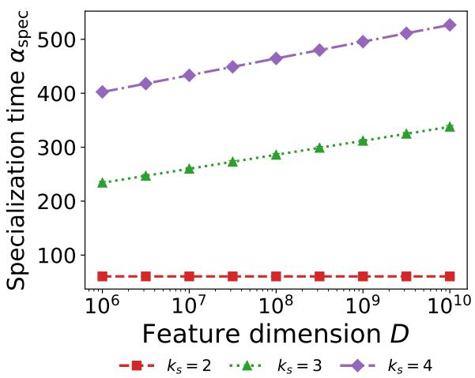  
(a)

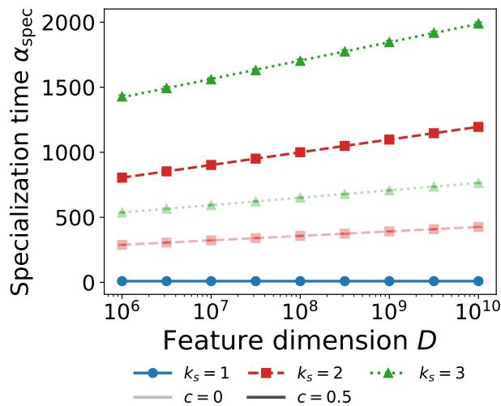  
(b)  
Figure 7: Specialization time of the CNN against the feature dimension, as in Figure 3b. Color denotes the student kernel size. Markers are averages over random initializations, each obtained by integrating the ODEs (17) from the order parameters of a random initialization at dimension D. Standard errors are smaller than the marker size. Lines are fits $a + b$ ln D. (a) A teacher of kernel size $k _ { t } = 2$ The matched case $k _ { s } = k _ { t } = 2$ is flat in D and the two wider kernels grow logarithmically. (b) Correlated positions, at $k _ { t } = 1$ , with $c = 0$ faded and $c = 0 . 5$ at full strength. The plateau at $k _ { s } > k _ { t }$ survives the correlation. Parameters: $g = \operatorname { e r f }$ $P = 6 , \eta = 0 . 5$ in panel (a) and $\eta = 0 . 2$ in panel (b), $T = 1 , \sigma = 0 , c = 0$ in panel (a), D from $1 0 ^ { 6 }$ to $1 0 ^ { 1 0 }$ , 128 random initial conditions.

## G Early-time dynamics

The rescaling of Appendix D is exact only at $S = I$ . To see how the two students difer at $c > 0$ , we derive Result 4.1 by expanding the ODEs around the random initial condition. We use the notation of Appendices A and B and work at leading order in D, where the initial order parameters are $R = 0$ and $Q = I / k _ { s }$ for the CNN, and $R ^ { ( p ) } = 0$ and $Q ^ { ( p , q ) } = \delta _ { p , q } I / k _ { s }$ for the LCN. Since S is compound symmetric, each entry $S _ { a , b }$ equals 1 if the positions a and b coincide and c otherwise, so that all sums over positions below reduce to counting coincident positions. We write $\begin{array} { r } { s _ { c } \equiv \sum _ { q } S _ { p , q } = 1 + ( P - 1 ) c } \end{array}$ and $\omega ( \chi ) \equiv ( 4 - \chi ^ { 2 } ) ^ { - 1 / 2 }$

Initial state. Inserting the initial order parameters into Eqs. (43) and (72) gives

$$
\langle \lambda _ { p } \lambda _ { q } \rangle = T S _ { p , q } , \qquad \langle \hat { \lambda } _ { p } \lambda _ { q } \rangle = 0 , \qquad \langle \hat { \lambda } _ { p } \hat { \lambda } _ { q } \rangle = \left\{ \begin{array} { l l } { S _ { p , q } } & { \mathrm { C N N } , } \\ { \delta _ { p , q } } & { \mathrm { L C N } . } \end{array} \right.\tag{100}
$$

The student preactivations have unit variance, and we denote by χ their correlation at diferent positions, with $\chi = c$ for the CNN and $\chi = 0$ for the LCN. The initial error follows from Eq. (81)

of Appendix C,

$$
\varepsilon _ { g } = \underbrace { \sum _ { p , q = 0 } ^ { P - 1 } I _ { 2 } \big ( \lambda _ { p } , \lambda _ { q } \big ) } _ { \mathrm { t e a c h e r } } - 2 \underbrace { \sum _ { p , r = 0 } ^ { P - 1 } I _ { 2 } \big ( \lambda _ { p } , \hat { \lambda } _ { r } \big ) } _ { \mathrm { c r o s s } } + \underbrace { \sum _ { r , s = 0 } ^ { P - 1 } I _ { 2 } \big ( \hat { \lambda } _ { r } , \hat { \lambda } _ { s } \big ) } _ { \mathrm { s t u d e n t } } ,\tag{101}
$$

with $\begin{array} { r } { I _ { 2 } = \frac { 2 } { \pi } } \end{array}$ arcsin $\left[ c _ { 1 2 } / \sqrt { ( 1 + c _ { 1 1 } ) ( 1 + c _ { 2 2 } ) } \right]$ . Splitting each sum into its $P$ diagonal and $P ( P - 1 )$ of-diagonal terms and using Eq. (100), the teacher sum gives the mean squared output of the teacher,

$$
\varepsilon _ { T } = \mathbb { E } \left[ f ^ { \star } ( x ) ^ { 2 } \right] = \frac { 2 P } { \pi } \left[ \arcsin \frac { T } { 1 + T } + ( P - 1 ) \arcsin \frac { T c } { 1 + T } \right] ,\tag{102}
$$

the cross sum vanishes, and adding the student sum gives

$$
\varepsilon _ { 0 } = \varepsilon _ { T } + \frac { P } { 3 } + \frac { 2 P ( P - 1 ) } { \pi } \arcsin \frac { \chi } { 2 } ,\tag{103}
$$

which yields the initial errors (28) with $\chi = 0$ for the LCN and $\chi = c$ for the CNN.

Equations of motion at the initial state. We evaluate the ODEs of Appendices A and B at the initial state, where the integrals $I _ { 3 }$ and $I _ { 4 }$ reduce to elementary functions of $T$ and $c ,$ and group the terms. For all $l < k _ { s }$ and $l ^ { \prime } < k _ { t }$ , the overlaps with the teacher grow as

$$
\frac { d R _ { l , l ^ { \prime } } } { d \alpha } \bigg \vert _ { \mathrm { C N N } } = \frac { 2 \eta T } { \pi k _ { s } k _ { t } } \frac { P s _ { c } } { \sqrt { 2 ( 1 + T ) } } , \qquad \frac { d R _ { l , l ^ { \prime } } ^ { ( p ) } } { d \alpha } \bigg \vert _ { \mathrm { L C N } } = \frac { 2 \eta T } { \pi k _ { s } k _ { t } } \frac { s _ { c } } { \sqrt { 2 ( 1 + T ) } } ,\tag{104}
$$

and the student overlaps evolve as

$$
\left. \frac { d Q _ { l , l ^ { \prime } } } { d \alpha } \right| _ { \mathrm { C N N } } = - \frac { 2 \eta } { k _ { s } ^ { 2 } } H _ { l , l ^ { \prime } } + \frac { \eta ^ { 2 } } { k _ { s } ^ { 2 } } \sum _ { p , q = 0 } ^ { P - 1 } S _ { ( p + l ) _ { P } , ( q + l ^ { \prime } ) _ { P } } V _ { p , q } ,\tag{105}
$$

$$
\frac { d Q _ { l , l ^ { \prime } } ^ { ( p , q ) } } { d \alpha } \Bigg | _ { \mathrm { L C N } } = \frac { 1 } { k _ { s } ^ { 2 } } \Big [ - 2 \eta \Psi _ { p , q } + \eta ^ { 2 } V _ { p , q } \Big ] S _ { ( p + l ) _ { P } , ( q + l ^ { \prime } ) _ { P } } .\tag{106}
$$

For the CNN, $H _ { l , l } = H _ { \mathrm { d } }$ and $H _ { l , l ^ { \prime } } = H _ { \mathrm { o } }$ for ${ \mathit { l } } \neq { \mathit { l } } ^ { \prime }$ , with

$$
H _ { \mathrm { d } } = { \frac { P } { \pi } } \left[ { \frac { 1 } { \sqrt { 3 } } } + ( P - 1 ) c \omega ( c ) \right] , \qquad H _ { \mathrm { o } } = { \frac { P } { \pi } } \left[ { \frac { c } { \sqrt { 3 } } } + \left( 2 + 2 ( P - 2 ) c - ( P - 1 ) c ^ { 2 } \right) \omega ( c ) \right] ,\tag{107}
$$

and for the LCN, $\Psi _ { p , p } = 1 / ( \pi \sqrt { 3 } )$ and $\Psi _ { p , q } = 1 / \pi$ for $p \neq q$ . In both cases, $V _ { p , q } \equiv \langle \delta ^ { 2 } g ^ { \prime } ( \hat { \lambda } _ { p } ) g ^ { \prime } ( \hat { \lambda } _ { q } ) \rangle$ is the average in the $\mathcal { O } ( \eta ^ { 2 } )$ term, with $\delta$ the residual of Appendix A. At the initial state it equals

$V _ { \mathrm { d } }$ for $p = q$ and $V _ { \mathrm { o } }$ for $p \neq q$ , with

$$
\begin{array} { l } { { V _ { \mathrm { d } } = \displaystyle \frac { 2 ( \varepsilon _ { T } + \sigma ^ { 2 } ) } { \pi \sqrt { 3 } } + \displaystyle \frac { 1 } { \pi ^ { 2 } \sqrt { 3 } } [ \arcsin \displaystyle \frac { 1 } { 4 } + 2 ( P - 1 ) \arcsin \displaystyle \frac { \chi } { 2 \sqrt { 2 ( 3 - \chi ^ { 2 } ) } } + ( P - 1 ) \arcsin \displaystyle \frac { 3 - 2 \chi ^ { 2 } } { 2 ( 3 - \chi ^ { 2 } ) } ] } } \\ { { \displaystyle \qquad + ( P - 1 ) ( P - 2 ) \arcsin \displaystyle \frac { \chi ( 3 - 2 \chi ) } { 2 ( 3 - \chi ^ { 2 } ) } ] } , } \\ { { V _ { \mathrm { 6 } } = \displaystyle \frac { 2 \omega ( \chi ) ( \varepsilon _ { T } + \sigma ^ { 2 } ) } { \pi } + \displaystyle \frac { 4 \omega ( \chi ) } { \pi ^ { 2 } } [ 2 \arcsin \displaystyle \frac { 2 - \chi ^ { 2 } } { 2 ( 3 - \chi ^ { 2 } ) } + 2 \arcsin \displaystyle \frac { \chi } { 2 ( 3 - \chi ^ { 2 } ) }  } } \\ { { \displaystyle \qquad +  ( P - 2 ) \arcsin \displaystyle \frac { 2 + \chi - 2 \chi ^ { 2 } } { 2 ( 2 - \chi ) ( 1 + \chi ) } + 4 ( P - 2 ) \arcsin \displaystyle \frac { \chi } { 2 \sqrt { ( 3 - \chi ^ { 2 } ) ( 1 + \chi ) } }  } } \\ { { \displaystyle \qquad + ( P - 2 ) ( P - 3 ) \arcsin \displaystyle \frac { \chi } { 2 ( 1 + \chi ) } ] . } } \end{array}\tag{8}
$$

The first term comes from the teacher output and the label noise, which are independent of the student preactivations at the initial state, and the second from the student output.

Expansion of the generalization error. Since the right-hand sides of Eqs. (104)–(106) are constant at this order, the order parameters change linearly at small $\alpha ,$ , and

$$
\frac { d \varepsilon _ { g } } { d \alpha } \bigg \vert _ { \alpha = 0 } = \sum \frac { \partial \varepsilon _ { g } } { \partial R } \frac { d R } { d \alpha } + \sum \frac { \partial \varepsilon _ { g } } { \partial Q } \frac { d Q } { d \alpha } = - \eta A + \eta ^ { 2 } B ,\tag{109}
$$

with the sums running over all entries of the order parameters. Diferentiating Eq. (81) through Eqs. (43) and (72) gives the derivatives at the initial state,

$$
\frac { \partial \varepsilon _ { g } } { \partial R _ { l , l ^ { \prime } } } \bigg | _ { \mathrm { C N N } } = - \frac { 4 P s _ { c } } { \pi \sqrt { 2 ( 1 + T ) } } , ~ \frac { \partial \varepsilon _ { g } } { \partial Q _ { l , l ^ { \prime } } } \bigg | _ { \mathrm { C N N } } = H _ { l , l ^ { \prime } } ,\tag{110}
$$

$$
\left. \frac { \partial \varepsilon _ { g } } { \partial R _ { l , l ^ { \prime } } ^ { ( p ) } } \right| _ { \mathrm { L C N } } = - \frac { 4 s _ { c } } { \pi \sqrt { 2 ( 1 + T ) } } , \qquad \left. \frac { \partial \varepsilon _ { g } } { \partial Q _ { l , l ^ { \prime } } ^ { ( p , q ) } } \right| _ { \mathrm { L C N } } = \Psi _ { p , q } S _ { ( p + l ) _ { P } , ( q + l ^ { \prime } ) _ { P } } .\tag{111}
$$

Inserting the equations of motion, the CNN gives

$$
A _ { \mathrm { C N N } } = \frac { 4 T P ^ { 2 } s _ { c } ^ { 2 } } { \pi ^ { 2 } ( 1 + T ) } + 2 \left[ \frac { H _ { \mathrm { d } } ^ { 2 } } { k _ { s } } + \left( 1 - \frac { 1 } { k _ { s } } \right) H _ { \mathrm { o } } ^ { 2 } \right] ,\tag{112}
$$

$$
B _ { \mathrm { C N N } } = P \left\{ V _ { \mathrm { d } } \left[ \frac { H _ { \mathrm { d } } } { k _ { s } } + \left( 1 - \frac { 1 } { k _ { s } } \right) c H _ { \mathrm { o } } \right] + V _ { \mathrm { o } } \left[ \frac { ( P - 1 ) c H _ { \mathrm { d } } } { k _ { s } } + \left( 1 - \frac { 1 } { k _ { s } } \right) \left( 1 + ( P - 2 ) c \right) H _ { \mathrm { o } } \right] \right\} P \left[ ( 0 , t ) \right] .\tag{113}
$$

with $V _ { \mathrm { d } }$ and $V _ { \mathrm { o } }$ evaluated at $\chi = c ,$ and the LCN gives

$$
A _ { \mathrm { L C N } } = \frac { 4 T P s _ { c } ^ { 2 } } { \pi ^ { 2 } ( 1 + T ) } + \frac { 2 P } { \pi ^ { 2 } } \left[ \frac { n _ { \mathrm { d } } } { 3 } + n _ { \mathrm { o } } \right] , \qquad B _ { \mathrm { L C N } } = \frac { P } { \pi } \left[ \frac { n _ { \mathrm { d } } } { \sqrt { 3 } } V _ { \mathrm { d } } + n _ { \mathrm { o } } V _ { \mathrm { o } } \right] ,\tag{114}
$$

with $V _ { \mathrm { d } }$ and $V _ { \mathrm { o } }$ evaluated at $\chi = 0$ and

$$
n _ { \mathrm { d } } = c ^ { 2 } + { \frac { 1 - c ^ { 2 } } { k _ { s } } } , \qquad n _ { \mathrm { o } } = ( 1 - c ^ { 2 } ) \Bigl ( 1 - { \frac { 1 } { k _ { s } } } \Bigr ) + ( P - 1 ) c ^ { 2 } .\tag{115}
$$

All four coeficients are positive, since every term is. They do not depend on $k _ { t }$ , and they are afine functions of $1 / k _ { s } . \mathrm { ~ } \mathrm { A t ~ } c = 0$ one has $A _ { \mathrm { C N N } } = P A _ { \mathrm { L C N } }$ and $B _ { \mathrm { C N N } } = P B _ { \mathrm { L C N } }$ , as required by Result 3.2.

Optimal learning rate and boundary. Within the expansion, the error of each student initially decreases if and only if $\eta < A / B$ . At a training time α, minimizing over η gives $\eta ^ { * } = A / ( 2 B )$ and

$$
\varepsilon ^ { * } ( \alpha ) = \varepsilon _ { 0 } - \alpha \frac { A ^ { 2 } } { 4 B } .\tag{116}
$$

The CNN has the lower error when

$$
\alpha \left[ \frac { A _ { \mathrm { C N N } } ^ { 2 } } { 4 B _ { \mathrm { C N N } } } - \frac { A _ { \mathrm { L C N } } ^ { 2 } } { 4 B _ { \mathrm { L C N } } } \right] ~ > ~ \varepsilon _ { 0 } ^ { \mathrm { C N N } } - \varepsilon _ { 0 } ^ { \mathrm { L C N } } ~ = ~ \frac { 2 P ( P - 1 ) } { \pi } \arcsin { \frac { c } { 2 } } .\tag{117}
$$

The right-hand side is positive for $c > 0 .$ , and we find the bracket positive for all $c \in [ 0 , 1 )$ , checked numerically for $P \leq 1 2$ , all $k _ { s } \leq P , 0 . 2 5 \leq T \leq 1 0$ , and $0 \leq \sigma \leq 4$ . Hence, within this expansion, the LCN has the lower error at large correlations (short training times) and the CNN at small correlations (long training times), with a transition at the correlation $c ^ { * } ( \alpha )$ where the two sides of Eq. (117) are equal,

$$
c ^ { * } ( \alpha ) = 2 \sin \left[ \frac { \pi \alpha } { 2 P ( P - 1 ) } \Delta \big ( c ^ { * } ( \alpha ) \big ) \right] , \qquad \Delta ( c ) \equiv \frac { A _ { \mathrm { C N N } } ^ { 2 } } { 4 B _ { \mathrm { C N N } } } - \frac { A _ { \mathrm { L C N } } ^ { 2 } } { 4 B _ { \mathrm { L C N } } } ,\tag{118}
$$

an implicit equation, since A and B depend on c. At small $\alpha ,$ the transition occurs at small $c ^ { * }$ , and expanding Eq. (118) to first order in $\alpha ,$ with A and B evaluated at $c = 0$ , gives $c ^ { * } ( \alpha ) = c _ { 0 } \alpha + \mathcal { O } ( \alpha ^ { 2 } )$ , with

$$
c _ { 0 } = \frac { 1 } { \pi \beta } \left( 1 + \frac { 2 T } { 1 + T } - \frac { 2 } { 3 k _ { s } } \right) ^ { 2 } ,\tag{119}
$$

where

$$
\beta = \frac { 2 } { 3 k _ { s } } \left[ \bar { \varepsilon } + \frac { P - 1 } { 3 } + \frac { 2 } { \pi } \arcsin \frac { 1 } { 4 } \right] + \left( 1 - \frac { 1 } { k _ { s } } \right) \left[ \bar { \varepsilon } + \frac { P - 2 } { 3 } + \frac { 4 } { \pi } \arcsin \frac { 1 } { 3 } \right] ,\tag{120}
$$

and $\begin{array} { r } { \bar { \varepsilon } = \frac { 2 P } { \pi } } \end{array}$ arcsin $\textstyle { \frac { T } { 1 + T } } + \sigma ^ { 2 }$

## H Noise-floor calculation

In this appendix, we investigate the long-time behavior where the network reaches near-perfect recovery. For $\eta  0$ perfect recovery is obtained asymptotically and the student exactly reproduces the teacher. At finite but small η, we perform a perturbative calculation to locate the fixed point under label noise and the corresponding generalization error, for the CNN and the LCN and for any $k _ { t } \leq k _ { s } \leq P$ . Throughout this appendix $l , l ^ { \prime } , l ^ { \prime \prime }$ label taps and $p , q , r ,$ s label positions.

## H.1 CNN student

Write $u _ { l } = \hat { w } _ { l } - \sqrt { k _ { s } / k _ { t } } w _ { l }$ , with the zero-extended teacher kernel of Appendix $\mathrm { A . 1 }$ , for the deviation of the student’s kernel from perfect recovery, and define the single-tap error field

$$
\epsilon _ { p } ^ { ( l ) } \equiv \nu _ { p } ^ { ( l ) } - \mu _ { p } ^ { ( l ) } = \frac { u _ { l } \cdot x _ { p } } { \sqrt { k _ { s } D } } .\tag{121}
$$

Its covariance follows from the two-point functions of Appendix A.1,

$$
\left. \epsilon _ { p } ^ { ( l ) } \epsilon _ { q } ^ { ( l ^ { \prime } ) } \right. \ = \ S _ { p , q } M _ { l , l ^ { \prime } } , \qquad M \equiv Q - R - R ^ { \top } + T ,\tag{122}
$$

where M is a symmetric $k _ { s } \times k _ { s }$ matrix that vanishes exactly at perfect recovery. The error in the preactivation at position p is

$$
e _ { p } \equiv \hat { \lambda } _ { p } - \lambda _ { p } = \sum _ { l = 0 } ^ { k _ { s } - 1 } \epsilon _ { ( p + l ) _ { P } } ^ { ( l ) } ,\tag{123}
$$

so that its covariance is the efective matrix built from $M$ ,

$$
\langle e _ { p } e _ { q } \rangle = M _ { p , q } ^ { \mathrm { e f f } } = \sum _ { l , l ^ { \prime } = 0 } ^ { k _ { s } - 1 } M _ { l , l ^ { \prime } } S _ { ( p + l ) _ { P } , ( q + l ^ { \prime } ) _ { P } } .\tag{124}
$$

Near perfect recovery and for small learning rate $\eta ,$ we will find that M is of order $\eta ,$ the fields $e _ { p }$ are then of order ${ \sqrt { \eta } } ,$ and the correlations with the teacher fields, $\langle e _ { p } \lambda _ { q } \rangle = ( R - T ) _ { p , q } ^ { \mathrm { e f f } }$ , are of order η.

Expanding the residual for small field errors,

$$
\Delta y ~ = ~ - \sum _ { p = 0 } ^ { P - 1 } \left[ g ( \lambda _ { p } + e _ { p } ) - g ( \lambda _ { p } ) \right] ~ = ~ - \sum _ { p = 0 } ^ { P - 1 } g ^ { \prime } ( \lambda _ { p } ) e _ { p } ~ + ~ \mathcal { O } ( e ^ { 2 } ) ,\tag{125}
$$

so that, writing $W _ { p , q } \equiv \langle g ^ { \prime } ( \lambda _ { p } ) g ^ { \prime } ( \lambda _ { q } ) \rangle$ ,

$$
\varepsilon ^ { \infty } = \bigl \langle ( \Delta y ) ^ { 2 } \bigr \rangle = \sum _ { p , q = 0 } ^ { P - 1 } W _ { p , q } \langle e _ { p } e _ { q } \rangle + \mathcal { O } ( \eta ^ { 2 } ) = \sum _ { p , q = 0 } ^ { P - 1 } W _ { p , q } M _ { p , q } ^ { \mathrm { e f f } } + \mathcal { O } ( \eta ^ { 2 } ) ,\tag{126}
$$

where we have used

$$
\langle g ^ { \prime } ( \lambda _ { p } ) g ^ { \prime } ( \lambda _ { q } ) e _ { p } e _ { q } \rangle = W _ { p , q } \langle e _ { p } e _ { q } \rangle + \mathcal { O } ( \eta ^ { 2 } ) .\tag{127}
$$

Using Eq. (45), we find

$$
W _ { p , p } = \frac { 2 } { \pi \sqrt { 1 + 2 T } } , \qquad W _ { p , q } = \frac { 2 } { \pi \sqrt { ( 1 + T ) ^ { 2 } - T ^ { 2 } c ^ { 2 } } } \quad ( p \neq q ) .\tag{128}
$$

It is convenient to define the $k _ { s } \times k _ { s }$ matrix

$$
\Omega _ { l , l ^ { \prime } } \equiv \sum _ { p , q = 0 } ^ { P - 1 } W _ { p , q } S _ { ( p + l ) _ { P } , ( q + l ^ { \prime } ) _ { P } } , \ :\tag{129}
$$

so that substituting (124) into (126) gives

$$
\varepsilon ^ { \infty } = \sum _ { l , l ^ { \prime } = 0 } ^ { k _ { s } - 1 } M _ { l , l ^ { \prime } } \Omega _ { l , l ^ { \prime } } = \mathrm { t r } \big ( M \Omega \big ) .\tag{130}
$$

We now need the equation of motion for M. Using the definition in (122) and the ODEs of Appendix A, we find

$$
\dot { M } _ { l , l ^ { \prime } } = \frac { \eta } { k _ { s } } \sum _ { p = 0 } ^ { P - 1 } \big \langle g ^ { \prime } ( \hat { \lambda } _ { p } ) \epsilon _ { ( p + l ) _ { P } } ^ { ( l ^ { \prime } ) } \Delta y \big \rangle + ( l  l ^ { \prime } ) + \dot { Q } _ { l , l ^ { \prime } } \big | _ { \mathcal { O } ( \eta ^ { 2 } ) } .\tag{131}
$$

In the first term, we can replace $g ^ { \prime } ( \hat { \lambda } _ { p } )$ by $g ^ { \prime } ( \lambda _ { p } )$ to leading order. Using (125), we find

$$
\langle g ^ { \prime } ( \hat { \lambda } _ { p } ) \epsilon _ { ( p + l ) _ { P } } ^ { ( l ^ { \prime } ) } \Delta y \rangle = \langle g ^ { \prime } ( \lambda _ { p } ) \epsilon _ { ( p + l ) _ { P } } ^ { ( l ^ { \prime } ) } \Delta y \rangle + o ( \eta ) = - \sum _ { q = 0 } ^ { P - 1 } \sum _ { l ^ { \prime \prime } = 0 } ^ { k _ { s } - 1 } W _ { p , q } S _ { ( p + l ) _ { P } , ( q + l ^ { \prime \prime } ) _ { P } } M _ { l ^ { \prime } , l ^ { \prime \prime } } + o ( \eta ) .\tag{132}
$$

Using Eq. (64) and keeping terms up to quadratic order in $\eta$ (recall that $M = \mathcal { O } ( \eta ) )$ , we get

$$
\dot { M } = - \frac { \eta } { k _ { s } } \left( \Omega M + M \Omega \right) + \frac { \eta ^ { 2 } \sigma ^ { 2 } } { k _ { s } ^ { 2 } } \Omega + o ( \eta ^ { 2 } ) .\tag{133}
$$

Setting $\dot { M } = 0$ to leading order, we find the Lyapunov equation

$$
\Omega M + M \Omega = \frac { \eta \sigma ^ { 2 } } { k _ { s } } \Omega .\tag{134}
$$

It can be checked that Ω is positive definite for $c < 1$ . Therefore, Eq. (134) has the unique solution

$$
M _ { l , l ^ { \prime } } = \frac { \eta \sigma ^ { 2 } } { 2 k _ { s } } \delta _ { l , l ^ { \prime } } .\tag{135}
$$

Substituting (135) into (130),

$$
\varepsilon ^ { \infty } = \frac { \eta \sigma ^ { 2 } } { 2 k _ { s } } \mathrm { t r } \left( \Omega \right) .\tag{136}
$$

From (129) and using $S _ { ( p + l ) _ { P } , ( q + l ) _ { P } } = S _ { p , q }$ , we find

$$
\mathrm { t r } \Omega = \sum _ { l = 0 } ^ { k _ { s } - 1 } \sum _ { p , q = 0 } ^ { P - 1 } W _ { p , q } S _ { ( p + l ) _ { P } , ( q + l ) _ { P } } = k _ { s } \sum _ { p , q = 0 } ^ { P - 1 } W _ { p , q } S _ { p , q } .\tag{137}
$$

Finally, using (128) we recover (31),

$$
\varepsilon ^ { \infty , \mathrm { C N N } } ( c ) = \frac { \eta \sigma ^ { 2 } } { \pi } \left[ \frac { P } { \sqrt { 1 + 2 T } } + \frac { P ( P - 1 ) c } { \sqrt { ( 1 + T ) ^ { 2 } - T ^ { 2 } c ^ { 2 } } } \right] ,\tag{138}
$$

with no dependence on either kernel size.

## H.2 LCN student

The LCN calculation follows the same steps but every position carries its own kernel, so the deviation from perfect recovery has a position label,

$$
u _ { l } ^ { ( p ) } \equiv \hat { w } _ { l } ^ { ( p ) } - \sqrt { k _ { s } / k _ { t } } w _ { l } ,\tag{139}
$$

and so does the single-tap error field

$$
\epsilon _ { r } ^ { ( p , l ) } \equiv \nu _ { r } ^ { ( p , l ) } - \mu _ { r } ^ { ( l ) } = \frac { u _ { l } ^ { ( p ) } \cdot x _ { r } } { \sqrt { k _ { s } D } } .\tag{140}
$$

Its covariance is

$$
\left. \epsilon _ { r } ^ { ( p , l ) } \epsilon _ { r ^ { \prime } } ^ { ( q , l ^ { \prime } ) } \right. = S _ { r , r ^ { \prime } } M _ { l , l ^ { \prime } } ^ { ( p , q ) } , \qquad M _ { l , l ^ { \prime } } ^ { ( p , q ) } = \frac { u _ { l } ^ { ( p ) } \cdot u _ { l ^ { \prime } } ^ { ( q ) } } { k _ { s } D } = \left[ Q ^ { ( p , q ) } - R ^ { ( p ) } - \left( R ^ { ( q ) } \right) ^ { \top } + T \right] _ { l , l ^ { \prime } } ,\tag{141}
$$

which vanishes at perfect recovery. The error in the preactivation at position $p$ is

$$
e _ { p } \equiv \hat { \lambda } _ { p } ^ { \mathrm { L C N } } - \lambda _ { p } = \sum _ { l = 0 } ^ { k _ { s } - 1 } \epsilon _ { ( p + l ) _ { P } } ^ { ( p , l ) } .\tag{142}
$$

The equation of motion for $M _ { l , l ^ { \prime } } ^ { \left( p , q \right) }$ reads to leading order in η

$$
\dot { M } _ { l , l ^ { \prime } } ^ { ( p , q ) } ~ = ~ - \frac { \eta } { k _ { s } } \sum _ { r = 0 } ^ { p - 1 } \sum _ { l ^ { \prime \prime } = 0 } ^ { k _ { s } - 1 } W _ { p , r } S _ { ( p + l ) P , \mathrm { \scriptsize ~ ( r + l ^ { \prime \prime } ) } _ { P } } M _ { l ^ { \prime } , l ^ { \prime \prime } } ^ { ( q , r ) } ~ + ~ ( p  q , l  l ^ { \prime } ) ~ + ~ \frac { \eta ^ { 2 } \sigma ^ { 2 } } { k _ { s } ^ { 2 } } S _ { ( p + l ) _ { P } , \mathrm { \scriptsize ~ ( q + l ^ { \prime } ) } _ { P } } W _ { p , q } ~ .\tag{143}
$$

To solve the fixed-point equation $\dot { M } _ { l . l ^ { \prime } } ^ { ( p , q ) } = 0$ , we consider the ansatz

$$
M _ { l , l ^ { \prime } } ^ { ( p , q ) } = m \delta _ { p , q } \delta _ { l , l ^ { \prime } } ,\tag{144}
$$

with m a single scalar to be fixed. We find

$$
\dot { M } _ { l , l ^ { \prime } } ^ { ( p , q ) } \ = \ \left[ - \frac { 2 \eta m } { k _ { s } } + \frac { \eta ^ { 2 } \sigma ^ { 2 } } { k _ { s } ^ { 2 } } \right] W _ { p , q } S _ { ( p + l ) _ { P } , ( q + l ^ { \prime } ) _ { P } } = 0 ,\tag{145}
$$

which is solved by $m = \eta \sigma ^ { 2 } / ( 2 k _ { s } )$ . Therefore, we obtain

$$
M _ { l , l ^ { \prime } } ^ { ( p , q ) } = \frac { \eta \sigma ^ { 2 } } { 2 k _ { s } } \delta _ { p , q } \delta _ { l , l ^ { \prime } } .\tag{146}
$$

Substituting (146) into $\begin{array} { r } { \langle e _ { p } e _ { q } \rangle = \sum _ { l , l ^ { \prime } } M _ { l , l ^ { \prime } } ^ { ( p , q ) } S _ { ( p + l ) _ { P } , ( q + l ^ { \prime } ) _ { P } } , } \end{array}$ we find

$$
\langle e _ { p } e _ { q } \rangle = { \frac { \eta \sigma ^ { 2 } } { 2 } } \delta _ { p , q } ,\tag{147}
$$

which is (34). Only the diagonal of (126) survives, giving (32),

$$
\varepsilon ^ { \infty , \mathrm { L C N } } = \frac { \eta \sigma ^ { 2 } } { 2 } \sum _ { p = 0 } ^ { P - 1 } W _ { p , p } = \frac { \eta \sigma ^ { 2 } P } { \pi \sqrt { 1 + 2 T } } ,\tag{148}
$$

independent of c and of both kernel sizes.

## I Phase diagram: numerical method

For each student and each correlation $c \in \{ 0 , 0 . 0 2 5 , \ldots , 0 . 9 7 5 \}$ , we integrate the ODEs (17) and (18) from the random initial condition at leading order in D, that is, Eqs. (19) and (20) without the $\mathcal { O } _ { D } ( D ^ { - 1 / 2 } )$ corrections. We use 80 learning rates, logarithmically spaced between $1 0 ^ { - 4 }$ and 3, and record the generalization error at 400 training horizons $\alpha _ { F } .$ , logarithmically spaced between $1 0 ^ { - 2 }$ and $1 0 ^ { 4 }$ . At each $\alpha _ { F }$ , we take the learning rate with the lowest error on this grid and refine the minimum by fitting a parabola to log $\varepsilon _ { g }$ as a function of log η through this point and its two neighbors. The minimum never lies at the edge of the grid. As a check, at $c = 0$ the results satisfy $\varepsilon _ { \mathrm { L C N } } ^ { * } ( P \alpha _ { F } ) = \varepsilon _ { \mathrm { C N N } } ^ { * } ( \alpha _ { F } )$ to within 0.4%, as implied by Result 3.2.

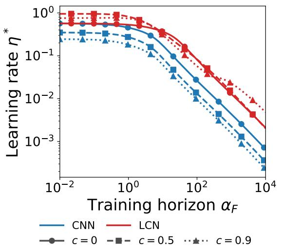  
(a)

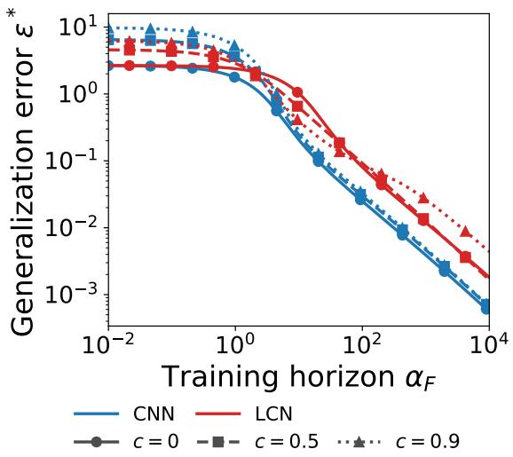  
(b)  
Figure 8: (a) Optimal learning rate $\eta ^ { * }$ and (b) corresponding generalization error $\varepsilon ^ { * }$ (Section 4.3) against the training horizon $\alpha _ { F }$ , for the CNN and the LCN at three values of the correlation $c ,$ from the same ODE solutions as Figure 6. Parameters: g = erf, $P = 4 , k _ { s } = k _ { t } = 1 , T = 1 , \sigma = 1$ random initial condition in the limit $D \to \infty$

Figure 8 shows the optimal learning rate and the corresponding error for three values of $c .$ For $c > 0$ , the optimal learning rate of the CNN is lower than that of the LCN at every training horizon. The CNN can aford it because it approaches the teacher faster at small learning rates.

Figure 9 shows the phase diagram for other parameter values, each difering from Figure 6 in a single parameter. In all cases, for every $c > 0$ , the LCN has the lower error at short training horizons and the CNN at long ones, with a single transition.

## J Activation dependence: ReLU

The analytic results use $g ( z ) = \mathrm { e r f } ( z / \sqrt { 2 } )$ because it makes the order-parameter equations closed form. The qualitative conclusions, however, do not depend on this choice. Figure 10 repeats the noise-floor comparison of Figure 5 with the ReLU activation $g ( z ) = \operatorname* { m a x } ( 0 , z )$ . The picture is the same as for erf: the floor of the CNN grows with the data correlation $^ { c , }$ while the floor of the LCN stays flat. The mechanism, coherent accumulation of correlated SGD noise into a shared kernel, is a property of weight sharing and not of the activation. Likewise, the P-fold rescaling of Section 3.1 holds for ReLU at $c = 0$ and fails at $c = 0 . 5$ (Figure 11).

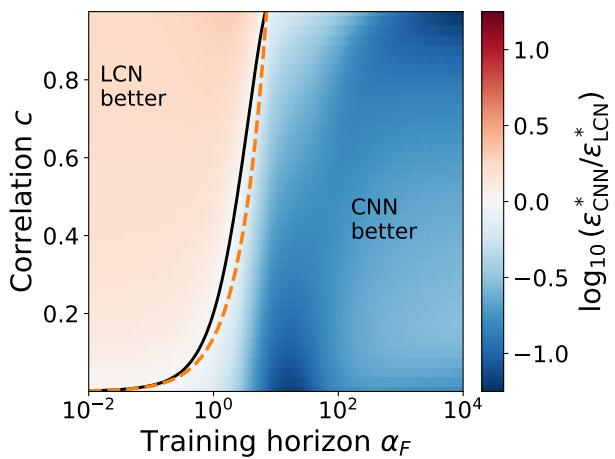

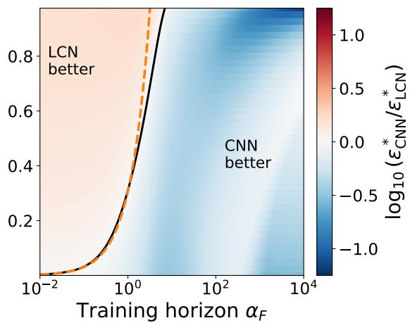  
(b)

(a)  
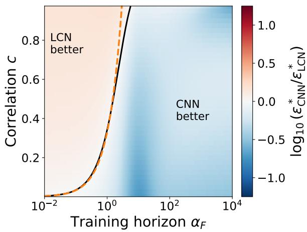  
(c)

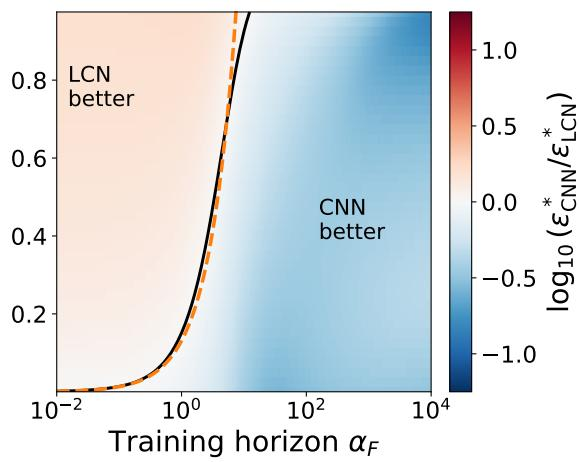  
(d)  
Figure 9: Phase diagram of Figure 6 for other parameter values. The color shows $\log _ { 1 0 } ( \varepsilon _ { \mathrm { C N N } } ^ { * } / \varepsilon _ { \mathrm { L C N } } ^ { * } )$ on a common scale. Solid line: boundary $\varepsilon _ { \mathrm { C N N } } ^ { * } = \varepsilon _ { \mathrm { L C N } } ^ { * } .$ obtained by integrating the ODEs numerically. Dashed line: analytical prediction $c = c _ { 0 } \alpha _ { F }$ of the early-time expansion, Eq. (30). Each panel changes one parameter of Figure 6: (a) $P = 8 ,$ , (b) $k _ { s } = k _ { t } = 2$ , (c) $T = 2 .$ , (d) $\sigma = 2$ . Other parameters: $g = \operatorname { e r f }$ $P = 4 , k _ { s } = k _ { t } = 1 , T = 1 , \sigma = 1$ , random initial condition in the limit $D \to \infty$

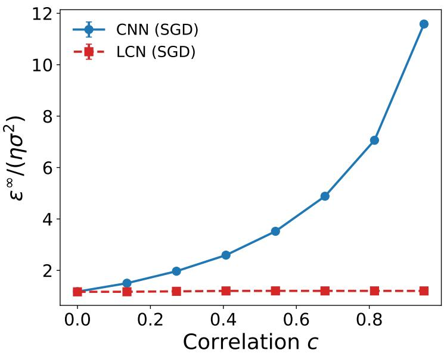  
Figure 10: Rescaled noise floor $\varepsilon ^ { \infty } / ( \eta \sigma ^ { 2 } )$ of the two students with the ReLU activation, where $\varepsilon ^ { \infty }$ is the asymptotic generalization error under label noise. It is measured by online SGD from the specialized initial condition and averaged over seeds, with the generalization error computed exactly from the student weights. Standard errors are smaller than the marker size. As for erf (Figure 5), the CNN’s floor grows with the data correlation c while the LCN’s stays flat. Parameters: $g ( z ) = \operatorname* { m a x } ( 0 , z ) , k _ { s } = k _ { t } = 2 , P = 4 , D = 4 0 0 , \eta = 0 . 1 , T = 1 , \sigma = 1$ , runs up to $\alpha = 8 0 0$ , 8 seeds.

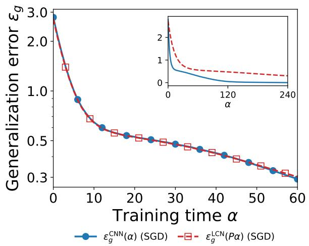  
(a)

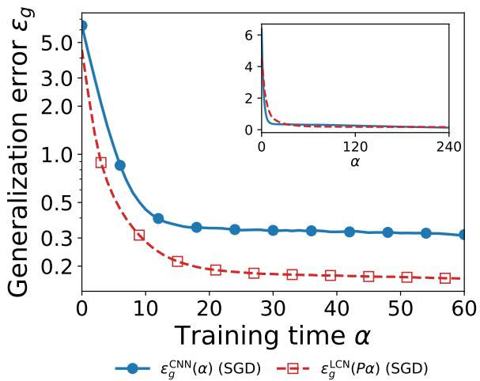  
(b)  
Figure 11: Rescaling test of Figure 2 with the ReLU activation. Generalization errors $\epsilon _ { g } ^ { \mathrm { C N N } } ( \alpha )$ of the CNN and $\varepsilon _ { g } ^ { \mathrm { L C N } } ( P \alpha )$ of the LCN, from online SGD averaged over 16 runs per student. Standard errors are smaller than the marker size. Insets show the curves without the time rescaling. (a) $c = 0 . \ ( \mathrm { b } ) \ c = 0 . 5$ . Parameters: $g ( z ) = \operatorname* { m a x } ( 0 , z ) , k _ { t } = 2 , k _ { s } = 3 , P = 4 , \eta = 0 . 2 , \sigma = 0 , T = 1$ $D = 1 0 0 0$