# Velocity Ambiguity Profiles: Time-Resolved Bayes-Risk Diagnostics for Flow Matching

Yunpeng Mei1,2∗ Xiaowen Zhu1\* Chenyu Wang1\* Chenbo Xin1\* Hongjie Cao1 Jiamin Wang1 Jie Chen1 Gang Wang1†

1Beijing Institute of Technology 2ByteDance

## Abstract

Flow matching trains a continuum of velocity regression problems but usually reports a loss averaged over interpolation time, obscuring which regions are limited by intrinsic ambiguity and which remain data-limited. We introduce the Velocity Ambiguity Profile (VAP), Av(t), the time-local Bayes-risk floor of velocity prediction, and decompose time-resolved loss as $L _ { N } ( i ) = \mathcal { A } _ { v } ( t ) + R ( t ; N )$ , where only the excess term R(t; N) is reducible by more data or a different estimator. For N training samples and a K-component mixture in the structured example, we prove two statistical benchmarks. In an intrinsic local-regression benchmark, Av(t) enters the time-dependent noise factor of the standard nonparametric rate. In separated isotropic Gaussian mixtures, the Bayes velocity becomes locally affine, and a label-oracle residual-regression benchmark has parametric excess-risk scale $K \mathcal { A } _ { v } ( t ) / N$ , matched within the same separated residual Gaussian-location subproblem. Controlled Gaussian-mixture experiments validate this diagnostic through a dense transition sweep, calibrated oracle-to-blind and empirical-proxy audits, and a local controlled time-sampler stress test in which a frozen reducibleerror proxy reduces reducible loss while cross-cell sensitivity delimits aggressive sampling. On CIFAR-100 DINOv2 feature flow, guided time sampling reduces uniformly evaluated velocity loss by 6.78% and global feature Fréchet distance (FD) by 23.6%, while class-conditional kernel inception distance (KID) shows no improvement. VAP turns an averaged flow-matching objective into a time-resolved diagnostic for locating ambiguity-limited and data-limited regions.

## 1 Introduction

Flow matching reduces distribution learning to a continuum of velocity regression problems indexed by interpolation time, but training and evaluation usually report a path-averaged loss. This hides where additional data can help and where the target remains intrinsically ambiguous.

This paper asks a simple diagnostic question: which interpolation times remain limited by reducible estimation error, and which are already limited by intrinsic velocity ambiguity? A high loss at time t is actionable only when it exceeds the Bayes-risk floor. It may reflect an under-trained estimator, or it may reflect multiple data realizations remaining plausible under the same noisy interpolant. Finitedata error can be reduced; posterior ambiguity cannot. The conditional-mean orthogonality behind this decomposition is classical. Our contribution is to make the induced posterior ambiguity profile path-specific, expose its mode and information-set structure, and use it for time-local diagnostics.

Velocity ambiguity as time-resolved Bayes risk. We propose the Velocity Ambiguity Profile $( \mathrm { V A P } ) , \dot { \mathcal { A } } _ { v } ( t )$ , as that diagnostic. Let a be an expert action, $\varepsilon \sim \mathcal { N } ( 0 , I )$ be Gaussian noise, c be the observation-language context, and let $x _ { t } = ( 1 - t ) a + t \varepsilon , u _ { t } = \varepsilon - a$ , with the convention that $t = 0$ is the data endpoint and $t = 1$ is the noise endpoint. VAP is the conditional velocity variance averaged over the induced interpolant distribution

$$
\mathcal { A } _ { v } ( t ) : = \mathbb { E } _ { x _ { t } , c } [ \mathrm { t r } \mathrm { C o v } ( u _ { t } \mid x _ { t } , c , t ) ] .\tag{1}
$$

For $t > 0 , \mathcal { A } _ { v } ( t )$ is equivalently the posterior action variance rescaled by $1 / t ^ { 2 }$ . VAP specializes conditional Bayes risk to the velocity regression problems induced by the flow path and makes it diagnostic along flow-matching time. For any trained velocity estimator, the time-resolved loss decomposes as $\mathsf { \bar { L } } _ { N } ( t ) = \mathcal { A } _ { v } ( \bar { t } ) + R ( t ; N )$ , where $A _ { v } ( t )$ is the irreducible Bayes-risk floor and $R ( t ; N )$ is the reducible excess risk. Only $R ( t ; N )$ can be lowered by collecting more data or changing the estimator.

VAP complements empirical scaling laws and time-aggregated generative-model baselines [6, 14, 16, 24]. It asks which interpolation times are data-limited, which are ambiguity-limited, and where controlled models separate these regimes. Figure 1 previews this time-local view.

Main results. The paper develops VAP at three levels. First, we prove the exact Bayesrisk decomposition above and instantiate a timelocal intrinsic regression benchmark: on compact time intervals, the local excess-risk rate has the usual nonparametric exponent, with time dependence controlled by ${ \bf \mathcal { A } } _ { v } ( t )$ up to bounded factors. Second, in the separated regime of an isotropic Gaussian mixture, we obtain a sharper label-oracle residual-regression benchmark: the Bayes velocity is locally affine, the residual benchmark has parametric scale $K \mathcal { A } _ { v } ( t ) / N$ , matched by a separated residual Gaussian-location lower bound. Third, controlled Gaussian-mixture experiments validate the diagnostic when the ambiguity floor is observable. They show separated-regime parametric scaling under a reliability-filtered readout, oracle-to-blind agreement with the analytic between-component label cost, and small but measurable blind neural residuals. A local timesampler stress test further shows that a frozen proxy from disjoint source runs can produce same-sign paired reducible-loss reductions in the canonical balanced cell, while cross-cell sensitivity delimits aggressive pure sampling. Fourth, a CIFAR-100 DINOv2 feature-flow experiment tests transfer to natural feature distributions: guided sampling reduces uniformly evaluated velocity loss by 6.78% and global feature

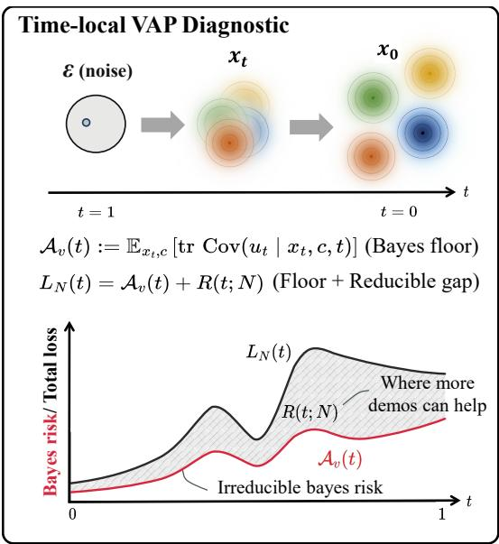  
Figure 1: Velocity ambiguity profiles localize where flow matching needs data. The flow matching path defines a continuum of velocity prediction problems. VAP separates the irreducible ambiguity floor from the reducible excess error that more data or a different estimator can affect.

FD by 23.6%. Macro conditional KID shows no gain, and lower recall and effective covariance rank reveal a diversity cost.

Contributions. This paper makes the following five contributions.

1. A time-local Bayes-risk diagnostic for flow matching. We define VAP, $A _ { v } ( t )$ , and prove the exact decomposition $L _ { N } ( t ) = \bar { \mathcal { A } } _ { v } ( t ) + R ( t ; N )$ ). This turns one averaged flow matching loss into a time-resolved separation between irreducible ambiguity and reducible error.

2. Scoped statistical benchmarks for reducible error. For an intrinsic local regression benchmark, $\mathbf { \mathcal { A } } _ { v } ( t )$ enters the standard nonparametric rate as the time-dependent noise level up to bounded factors. For separated isotropic Gaussian mixtures, we prove a sharper label-oracle residualregression benchmark: the Bayes velocity is locally affine and the benchmark excess-risk scale is $\check { K } \check { \mathcal { A } } _ { v } ( t ) / N$ , matched by a separated residual Gaussian-location subproblem lower bound.

3. Controlled Gaussian-mixture validation and sampler stress test. Controlled Gaussian-mixture experiments validate VAP as a time-resolved diagnostic, showing analytic-empirical agreement, separated-regime parametric scaling, and documented sensitivity to the reliability readout. A local controlled time-sampler stress test further shows that a frozen reducible-error proxy from disjoint source runs can produce same-sign paired reducible-loss reductions, with cross-cell sensitivity delimiting aggressive pure sampling.

4. An oracle-to-blind bridge and proxy calibration. Controlled bridge audits show that the labelcost decomposition is quantitatively accurate, while blind multilayer perceptron (MLP) residuals and empirical proxies are small but not exact and must be treated as calibrated diagnostics.

5. Natural-feature transfer with explicit scope. In DINOv2 feature flow, guided sampling reduces uniformly evaluated velocity loss by 6.78% and global feature FD by 23.6%. Macro conditional KID shows no gain, while recall and effective covariance rank decrease.

## 2 Preliminaries

## 2.1 Flow Matching

We adopt the conditional flow matching (CFM) framework [1, 2, 20, 21]. Let $a \in \mathbb { R } ^ { D }$ denote an expert action or data vector, and let $\varepsilon \sim \mathcal { N } ( 0 , I _ { D } )$ be isotropic Gaussian noise. The linear interpolation path is

$$
x _ { t } = t \varepsilon + ( 1 - t ) a , \forall t \in [ 0 , 1 ] ,\tag{2}
$$

with conditional velocity field $u _ { t } = \varepsilon - a$ . A neural network $v _ { \theta } ( x _ { t } , t , c )$ , conditioned on context c when present, is trained to regress onto $u _ { t }$ by minimizing the flow matching loss

$$
\mathcal { L } _ { \mathrm { F M } } ( \theta ) \ = \ \mathbb { E } _ { t , a , \varepsilon } \Big [ \Big \| v _ { \theta } ( x _ { t } , t , c ) - u _ { t } \Big \| ^ { 2 } \Big ] ,\tag{3}
$$

where t is sampled from a training distribution (for example uniform or a prescribed time-sampling schedule). At inference, actions are generated by integrating $v _ { \theta }$ from $x _ { 1 } \sim \mathcal { N } ( 0 , I )$ to $x _ { 0 }$ via an ordinary-differential equation (ODE) solver.

## 3 Velocity Ambiguity Profile

We now introduce the central object of this paper: a single, time-resolved quantity that captures the inherent difficulty of velocity estimation at each point along the interpolation path.

## 3.1 Definition and Interpretation

Recall the linear interpolation $x _ { t } = ( 1 - t ) a + t \varepsilon$ with conditional velocity target $u _ { t } = \varepsilon - a$ . For a fixed time t and an estimator trained on $N$ samples, the Bayes-optimal velocity is $v ^ { * } ( x _ { t } , c , t ) =$ $\mathbb { E } [ u _ { t } \ | \ x _ { t } , c , t ]$ . Any estimator of this conditional mean incurs a residual variance that cannot be reduced by additional model capacity or training samples.

Definition 1 (Velocity ambiguity profile). The velocity ambiguity profile (VAP) is

$$
\begin{array} { l } { \mathcal { A } _ { v } ( t ) : = \displaystyle \operatorname* { i n f } _ { f _ { t } } \mathbb { E } \big [ \| f _ { t } ( x _ { t } , c ) - u _ { t } \| ^ { 2 } \bigm | t \big ] = \mathbb { E } _ { x _ { t } , c } [ \mathrm { t r } \mathrm { C o v } ( u _ { t } \mid x _ { t } , c , t ) ] } \\ { \displaystyle \quad = \frac { 1 } { t ^ { 2 } } \mathbb { E } _ { x _ { t } , c } [ \mathrm { t r } \mathrm { V a r } ( a \mid x _ { t } , c , t ) ] \qquad \mathrm { \it ~ f o r \ a l l \ t > 0 , } } \end{array}\tag{4}
$$

where the infimum is over all measurablefunctions $f _ { t }$ that may depend on thefixed time $t ,$ and $A _ { v } ( 0 )$ is interpreted as the one-sided limit $A _ { v } ( \bar { 0 } ^ { + } )$ when it exists.

Thus, $\mathbf { \mathcal { A } } _ { v } ( t )$ is the Bayes risk at time t: the smallest possible expected squared velocity error given perfect knowledge of the data distribution. It is a property of the time-local regression problem induced by the flow path. The action-posterior form (third equality) follows from $u _ { t } = \varepsilon - a = ( x _ { t } - a ) / t$ so, conditional on $( x _ { t } , c , t )$ , all residual uncertainty in $u _ { t }$ comes from posterior uncertainty in the original action a, rescaled by $1 / t ^ { 2 }$

Throughout the theory, we often condition on a fixed context c and suppress it from notation; all expectations and variances are then implicitly conditional on c.

Proposition 2 (Endpoint behavior and non-monotonicity of $A _ { v } ( t ) )$ . Under Assumption A1, $\mathcal { A } _ { v } ( { \sf \tilde { 0 } ^ { + } } ) < \infty ( i r$ particular $\begin{array} { r } { \mathcal { A } _ { v } ( 0 ^ { + } ) = d . } \end{array}$ for the isotropic Gaussian mixture in $\ S 3 . 2 ) ; i f \mathbb { E } [ \| \dot { a } \| ^ { 2 } ] < \infty$ then $\begin{array} { r } { \mathcal { A } _ { v } ( 1 ) = \operatorname { t r } \bar { \operatorname { V a r } } _ { p _ { \mathrm { d a t a } } } ( a ) ; } \end{array}$ and ${ \bf \mathcal { A } } _ { v } ( t )$ is non-monotone in general.

The single-Gaussian closed form and full proof are in Appendix $_ { \mathrm { A } . 3 ; }$ near $t = 0$ the observation $x _ { t } \approx a$ nearly determines the data realization, while near $t = 1$ the observation $x _ { t } \approx \varepsilon$ carries little information about which data realization generated the sample.

## 3.2 Analytic Example: Gaussian Mixture

To build concrete intuition, consider a separate analytically tractable model: a $K \cdot$ -component isotropic Gaussian mixture $\begin{array} { r } { p _ { \mathrm { d a t a } } = \sum _ { k = 1 } ^ { K } \pi _ { k } \mathcal { N } ( \mu _ { k } , \sigma ^ { 2 } I _ { d } ) } \end{array}$ in $\mathbb { R } ^ { d }$ . This Gaussian example is not an instance of the compact manifold benchmark in Theorem 4; it is a structured model where the posterior and Bayes velocity can be computed explicitly. Writing $\sigma _ { t } ^ { 2 } = ( 1 - t ) ^ { 2 } \sigma ^ { 2 } + t ^ { 2 }$ , direct calculation yields

$$
\mathcal { A } _ { v } ( t ) = \underbrace { \frac { d \sigma ^ { 2 } } { \sigma _ { t } ^ { 2 } } } _ { \mathrm { w i t h i n - c o m p o n e n t } } + \underbrace { \frac { t ^ { 2 } } { \sigma _ { t } ^ { 4 } } \mathbb { E } _ { x _ { t } } \left[ \sum _ { j < k } \gamma _ { j } ( x _ { t } , t ) \gamma _ { k } ( x _ { t } , t ) \| \mu _ { j } - \mu _ { k } \| ^ { 2 } \right] } _ { \mathrm { b e t w e e n - c o m p o n e n t } } ,\tag{5}
$$

where $\gamma _ { k } ( x _ { t } , t )$ is the posterior responsibility of component k (explicit softmax form in Appendix B).

Equation (5) has a simple qualitative reading. The within-component term is the residual velocity variance after the component is known; for an isotropic component it equals dσ $^ { 2 } / \sigma _ { t } ^ { 2 }$ . The betweencomponent term is small when $x _ { t }$ identifies the component and grows when several component means remain plausible under the same interpolant. Thus small t is mostly within-component, intermediate t is where posterior responsibilities mix, and large t approaches the covariance scale of the data because $x _ { t }$ carries little component information. This is a mechanism-level calculation, not an empirical claim. The claim-bearing controlled display is deferred to Section 5.1, where the same decomposition is tested across the fixed dense separation sweep.

A useful consequence of the same posterior calculation is that, conditioned on component k, the Bayes velocity is exactly affine

$$
v _ { k } ^ { * } ( x _ { t } , t ) = A ( t ) x _ { t } + b _ { k } ( t ) , \qquad A ( t ) = \frac { t - ( 1 - t ) \sigma ^ { 2 } } { \sigma _ { t } ^ { 2 } } I _ { d } , \qquad b _ { k } ( t ) = - \frac { t } { \sigma _ { t } ^ { 2 } } \mu _ { k } .\tag{6}
$$

Theorem 5 uses this affine form as the dominant component approximation in the separated regime.

## 3.3 Bias-Variance Decomposition of the Time-Resolved Loss

Proposition 3 (Loss decomposition). For any fixed estimator vˆN trained on N samples, the population test loss at time t satisfies

$$
L _ { N } ( t ) : = \mathbb { E } \big [ \| \hat { v } _ { N } ( x _ { t } , c , t ) - u _ { t } \| ^ { 2 } \mid t \big ] = \underbrace { \mathcal { A } _ { v } ( t ) } _ { B a y e s \ r i s k } + \underbrace { R ( t ; N ) } _ { e x c e s s \ r i s k } ,\tag{7}
$$

where $R ( t ; N ) = \mathbb { E } [ \| \hat { v } _ { N } ( x _ { t } , c , t ) - v ^ { * } ( x _ { t } , c , t ) \| ^ { 2 } \mid t ] \ge 0 . \ I f \hat { v } _ { N }$ is random through the training set, the same identity holds after an additional expectation over the training set.

The proof is the standard conditional-mean orthogonality argument and is given in Appendix A.2.

## 3.4 Practical Estimation of $\mathbf { \mathcal { A } } _ { v } ( t )$

Large-budget reference profile. In applied flow matching settings, $A _ { v } ( t )$ is not directly observable. We therefore use the largest-budget validation loss only as an upper-biased reference profile, $L _ { \mathrm { r e f } } ( t ) \equiv$ $L _ { N _ { \mathrm { m a x } } } ( t )$ . At population risk, Proposition 3 gives $\dot { L } _ { \mathrm { r e f } } ( t ) \stackrel {  } { = } \mathcal { A } _ { v } ( t ) + R ( t ; N _ { \mathrm { m a x } } ) \stackrel { } { \geq } \mathcal { A } _ { v } ( t )$ , so a finite-budget reference is not an absolute Bayes-floor estimator. If a current model and the reference are evaluated on the same distribution, their difference removes the unknown floor exactly:

$$
L _ { N } ( t ) - L _ { \mathrm { r e f } } ( t ) = R ( t ; N ) - R ( t ; N _ { \mathrm { m a x } } ) .\tag{8}
$$

This reference-relative gap is a calibrated allocation diagnostic; it does not identify the absolute Bayes floor. Consistency of the reference toward $A _ { v } ( t )$ additionally requires vanishing training excess and a growing validation sample under the usual moment conditions.

Collapse diagnostics. If $R ( t ; N ) = \mathcal { A } _ { v } ( t ) g ( N )$ , then $L _ { N } ( t ) / \mathcal { A } _ { v } ( t ) - 1 = g ( N )$ . Thus the clean collapse diagnostic is normalized excess risk, $\dot { R } ( t ; N ) / \mathcal { A } _ { v } ( \dot { t } )$ , or $\dot { L } _ { N } ( t ) / \mathcal { A } _ { v } ( t ) - 1$ when $\mathbf { \mathcal { A } } _ { v } ( t )$ is known. Raw losses $L _ { N } ( t )$ alone saturate to the Bayes floor and should only be interpreted as approximate power laws when the excess term dominates the floor.

## 4 Main Theoretical Results

We now ask when $\mathbf { \mathcal { A } } _ { v } ( t )$ predicts the sample-complexity scale, not only the Bayes-risk floor. Theorem 4 gives a compact local-regression benchmark in which $\mathbf { \mathcal { A } } _ { v } ( t )$ enters a nonparametric rate up to bounded factors in the fixed-positive-noise regime; Theorem 5 gives a separated-GMM label-oracle residual-regression benchmark with parametric scale $K \mathcal { A } _ { v } ( t ) / N$ , matched inside the corresponding separated residual Gaussian-location subproblem. This benchmark calibrates the residual-regression view of the flow objective; it is not a lower bound over all action-aware estimators of the full supervised tuple.

Oracle terminology. We reserve label-oracle residual benchmark for the theorem-level information set: the estimator receives true component labels and fits the residual affine response in each separated cell. A label-and-action oracle is stronger: it also uses the supervised pair to recover $a = x _ { t } - t u _ { t }$ and estimate component means directly. An analytic oracle uses the known mixture law only to compute diagnostic quantities such as $\mathbf { \mathcal { A } } _ { v } ( t )$ and posterior responsibilities. The oracle-to-blind bridge below compares these controlled oracle arms with estimators that do not receive labels or analytic responsibilities.

## 4.1 Time-Resolved Nonparametric Benchmark Bound

Our starting point is classical minimax theory for nonparametric regression [34, 37], instantiated for the velocity-estimation problem at fixed time t. The benchmark relies on the regularity assumptions in Appendix A.1. For each $t \in [ \delta , 1 - \delta ]$ , let $\mathcal { G } _ { t } ^ { \mathrm { c o m p } } ( s , d , B , \mathcal { A } _ { v } )$ denote the formal compact ddimensional heteroscedastic regression benchmark obtained from a finite atlas of $( 1 - t ) \bar { \mathcal { M } }$ , with regression function in a vector Hölder ball of radius $B ( t )$ , compact random design, and pointwise conditional noise comparable to $\mathbf { \mathcal { A } } _ { v } ( t )$

Theorem 4 (Time-resolved compact-benchmark bound). $F i x \ : t \in [ \delta , 1 - \delta ]$ . Under Assumptions A1- A5 together with the compact-design condition A3, consider the formal compact random-design local benchmark $\mathcal { G } _ { t } ^ { \mathrm { c o m p } } ( s , d , B , \mathcal { A } _ { v } )$ , defined by the finite-atlas, boundary-Gram, and vector-Hölder conditions in Appendix $A . l .$ . Its integrated prediction risk

$$
R _ { \mathrm { l o c } } ^ { * } ( t ; N ) : = \operatorname* { i n f } _ { \hat { v } } \ \operatorname* { s u p } _ { P \in \mathcal { G } _ { t } ^ { \mathrm { c o m p } } } \mathbb { E } _ { \mathcal { D } _ { N } , X \sim P _ { x _ { t } } } \big [ \| \hat { v } _ { \mathcal { D } _ { N } } ( X , t ) - v _ { P } ^ { * } ( X , t ) \| ^ { 2 } \big ]\tag{9}
$$

has the lower bound

$$
c _ { 1 } B ( t ) ^ { \frac { 2 d } { 2 s + d } } \left( \frac { A _ { v } ( t ) } { N } \right) ^ { \frac { 2 s } { 2 s + d } } \leq R _ { \mathrm { l o c } } ^ { * } ( t ; N ) .\tag{10}
$$

For the same benchmark, the stabilized local-polynomial estimator gives

$$
R _ { \mathrm { l o c } } ^ { * } ( t ; N ) \leq C _ { 1 } \operatorname* { m i n } \left\{ B ( t ) ^ { 2 } , B ( t ) ^ { \frac { 2 d } { 2 s + d } } \left( \frac { A _ { v } ( t ) } { N } \right) ^ { \frac { 2 s } { 2 s + d } } + B ( t ) ^ { 2 } \left( \frac { \log N } { N } \right) ^ { 2 s / d } \right\} .\tag{11}
$$

Here $c _ { 1 } , C _ { 1 } > 0$ depend on $s , d ,$ the finite-atlas and boundary-Gram constants, chart geometry, design constants, and noise-comparability constants, but not on N. For fixed t with $\mathcal { A } _ { v } ( t ) > 0 ,$ and sufficiently large N, the coverage term is lower order and the usual upper rate is recovered. If these constants are uniform on a compact time interval, the threshold can be chosen uniformly. The statement is not uniform as $\mathcal { A } _ { v } ( t )  \bar { 0 }$ and is not a minimax claimfor thefull ambientflow-matching observation model.

Theorem 4 characterizes an intrinsic compact local benchmark. The Gaussian-subclass lower bound and stabilized upper bound have the same classical exponent only in the fixed-positive-noise, coveragesufficient regime; the finite-sample coverage term is essential at low noise. Exact $A _ { v } ( t )$ -normalized parametric scaling is proved only for the separated Gaussian-mixture residual benchmark below. The proof and scope discussion are given in Appendix A.

## 4.2 Interpretive Extension: Adaptive Rates for Structured Data

We use the effective-rate vocabulary only to interpret structured data: if an observed exponent in $R ( t ; N ) = \mathcal { A } _ { v } ( t ) \Theta ( N ^ { - \alpha ( t ) } )$ differs from the worst-case Theorem 4 exponent, Appendix B.6 describes the corresponding effective smoothness and dimension notation. Theorems 4 and 5 stand independently of this interpretive picture.

Merge-time vocabulary. In the isotropic Gaussian-mixture setting of Theorem 5, let $\Delta _ { \operatorname* { m i n } } =$ min $\mathsf { 1 } _ { j \neq k } \parallel \mu _ { j } - \mu _ { k } \parallel$ and write $\Delta _ { \mathrm { e f f } } ( t ) \stackrel { - } { = } ( 1 - t ) \Delta _ { \mathrm { m i n } } / \sigma _ { t }$ with $\sigma _ { t } ^ { 2 } \ = \ ( 1 - t ) ^ { 2 } \sigma ^ { 2 } + t ^ { 2 }$ , and let $t _ { \mathrm { m e r g e } } ( \tau ) \stackrel { \circ } { = } \operatorname* { i n f } \{ t : \Delta _ { \mathrm { e f f } } ( t ) < \tau \}$ . In this separated GMM regime, below the threshold used in Theorem 5, posterior mass concentrates on one mode and the Bayes velocity is locally affine; above it, multiple affine components may mix. For general multimodal distributions, we use “merge time” only as a heuristic proxy for the point at which single-cell posterior dominance breaks down. The rigorous posterior and entropy statements are in Appendix B.

## 4.2.1 Oracle Result for Gaussian Mixtures

We now instantiate the structured picture for isotropic Gaussian mixtures in the separated regime. The information set matters: in supervised flow matching, observing $( x _ { t } , u _ { t } , t )$ also determines $a = x _ { t } - t u _ { t }$ . The theorem therefore studies a label-oracle residual-regression benchmark after conditioning on separated mixture cells, not a full-information lower bound for all action-aware estimators. Appendix B.2 records the stronger label-and-action oracle experiment.

Theorem 5 (Label-Oracle Residual Benchmark for Separated Gaussian Mixtures). Let $p _ { \mathrm { d a t a } } =$ $\begin{array} { r } { \sum _ { k = 1 } ^ { K } \pi _ { k } \mathcal { N } ( \mu _ { k } , \sigma ^ { 2 } I _ { d } ) } \end{array}$ with minimum separation $\Delta _ { \mathrm { m i n } }$ and diameter $\Delta _ { \operatorname* { m a x } } : = \operatorname* { m a x } _ { j \neq k } \| \mu _ { j } -$ $\mu _ { k } \|$ , and let $\Delta _ { \mathrm { e f f } } ( t ) ~ = ~ ( 1 - t ) \Delta _ { \mathrm { m i n } } / \sigma _ { t }$ , where $\sigma _ { t } ^ { 2 } \ = \ ( 1 - t ) ^ { 2 } \sigma ^ { 2 } + t ^ { 2 } ,$ , and define $\tau _ { \mathrm { s e p } } : =$ $C _ { \mathrm { s e p } } \sqrt { \log K + \log ( 1 / \pi _ { \mathrm { m i n } } ) } .$ . Assume that $\Delta _ { \mathrm { e f f } } ( t ) \ge \tau _ { \mathrm { s e p } } f o r$ the time t under consideration. Then there exist constants $c _ { 1 } , C _ { 1 } , { \overline { { C } } } _ { N } > 0$ depending on $d , \sigma , \pi _ { \mathrm { m i n } } ,$ and the aspect ratio $\Delta _ { \mathrm { m a x } } / \Delta _ { \mathrm { m i n } }$ (but not on N) such that,for a label-oracle residual-regression estimator given the true component labels and the common variance $\sigma ^ { 2 }$

(a) Velocityfield structure. On a high-probability event (Lemma 32), the posterior concentrates on a dominant component and the Bayes-optimal velocity is locally affine,

$$
v ^ { * } ( x _ { t } , t ) \ = \ A _ { k ^ { * } } ( t ) x _ { t } + b _ { k ^ { * } } ( t ) + \varepsilon _ { \mathrm { a f f } } ( x _ { t } , t ) ,\tag{12}
$$

with $A _ { k } ( t ) , b _ { k } ( t )$ as in Section 3.2 and $\begin{array} { r } { \| \varepsilon _ { \mathrm { a f f } } \| \leq C K e ^ { - c \Delta _ { \mathrm { e f f } } ( t ) ^ { 2 } } \Delta _ { \mathrm { m a x } } / \sigma _ { t } ( A p p e n d i x B ) . } \end{array}$

(b) Label-oracle residual upper bound. For sample sizes $N \geq C _ { N } \pi _ { \operatorname* { m i n } } ^ { - 1 } ( d + \log K )$ , there exists a label-oracle residual estimator $\hat { v } _ { N } ^ { \mathrm { o r c } }$ with

$$
R _ { \mathrm { o r c } } ( t ; N ) \leq C _ { 1 } \frac { K } { N } \mathcal { A } _ { v } ( t ) + \varepsilon _ { \mathrm { s e p } } ( t ) + \varepsilon _ { \mathrm { c o u n t } } ( t , N ) ,\tag{13}
$$

where one can take $\varepsilon _ { \mathrm { s e p } } ( t )$ and $\varepsilon _ { \mathrm { c o u n t } } ( t , N )$ as squared-risk terms exponentially small in the squared effective separation and per-component sample count, respectively (Appendix B).

(c) Separated residual-subproblem lower bound. For the corresponding separated-regime residual Gaussian-location subproblem,

$$
R _ { \mathrm { s u b } } ^ { * } ( t ; N ) \geq c _ { 1 } \frac { K } { N } \mathcal { A } _ { v } ( t ) .\tag{14}
$$

Consequently, within this label-oracle residual-regression separated subproblem, the upper bound and lower bound identify $K \mathcal { A } _ { v } ( t ) / N$ as the parametric residual-regression scale, up to exponentially small separation and count corrections

The full proof is given in Appendix B; the extension of this picture to general (non-GMM) distributions is discussed in Appendix B.5.

## 4.3 Curve Collapse: A Normalization Principle

The following conditional factorization is the paper’s directly testable normalization principle.

Proposition 6 (Regime-Wise Normalized Collapse). Define the normalized excess risk $\bar { R } ( t ; N ) : =$ $R ( t ; N ) / \mathcal { A } _ { v } ( t )$ . Suppose that on a time regime I the excess riskfactorizes as

$$
R ( t ; N ) = \mathcal { A } _ { v } ( t ) g _ { I } ( N ) \eta _ { I } ( t , N ) , \qquad t \in I ,
$$

where the exponent of $g _ { I } ( N )$ is independent of t on $I ,$ and $\eta _ { I } ( t , N )$ is either bounded above and below by positive constants or differsfrom 1 by at most a controlled small correction. Then $\bar { R } ( t ; N ) =$ $g _ { I } ( N ) \eta _ { I } ( t , N ) f o r t \in I .$ . In particular, $i f g _ { I } ( N ) = \Theta ( N ^ { - \alpha _ { I } } )$ , then $\bar { R } ( t ; N ) = \Theta ( N ^ { - \alpha _ { I } } )$ uniformly in $t \in I$ up to the residual variation in $\eta _ { I } ( t , N )$

For the Gaussian-mixture separated regime, the residual variation is exponentially small in $\Delta _ { \mathrm { e f f } } ( t ) ^ { 2 }$ For the minimax baseline (Theorem 4), the collapse is only approximate in the bounded-factor sense: the exponent $\alpha = 2 s / ( 2 s + d )$ is the samefor all t, but the prefactor varies by up to $( \sigma _ { u } \overline { { / } } \sigma _ { \ell } ) ^ { d / ( 2 s + d ) }$ across the evaluation interval (see Remark 12).

Thus Theorem 5 gives exact collapse only for the separated label-oracle residual-regression benchmark, while Theorem 4 motivates only bounded-factor common-exponent behavior. Regime-byregime factorization and reference-profile estimation are discussed in Appendix C.

## 5 Experiments

The experiments follow the claim hierarchy above: a controlled Gaussian-mixture transition tests the predicted move from noisy overlap to parametric scaling and finite-capacity attenuation; oracle-toblind and proxy audits ask which diagnostics survive without analytic access; a local controlled-cell stress test asks whether a frozen reducible-error proxy can guide time sampling; and a natural-image feature-flow bridge on CIFAR-100 (Section 5.4) instantiates the same diagnostic on a standard public benchmark with an explicit coarse-to-fine hidden-mode hierarchy. A leakage-free BEHAVIOR-1K panel is retained as application-context diagnostics in Appendix F.

## 5.1 Canonical Controlled Transition

Controlled-core protocol. Our main display fixes a $d = 4 , K = 4 , \sigma = 0 . 5$ isotropic Gaussian mixture and varies geometric separation across 18 values together with a six-point demonstrationcount ladder from $N = 5 0$ to $N = 2 , 0 0 0$ . The primary readout uses analytic $A _ { v } ( t )$ and the canonical mid-b reliability filter on $t \in [ 0 . 0 5 , 0 . 8 0 ]$ with $\mathrm { S N R } \geq 4$ and $R \geq 0 . 0 \dot { 1 } 6 { \mathcal A } _ { v } ;$ full settings, the complete separation ladder, and readout sensitivity are in Appendix D.3. Post-hoc readouts from raw-positive through very-strict filters preserve the same plateau-level conclusion while making the low-overlap rows visibly threshold-sensitive (Table 7); the decoupled $\mathrm { S N R - b y - } R / \mathcal { A } _ { v }$ threshold-grid audit is reported in Table 8.

Dense transition diagram. Under the canonical mid-b readout, the dense sweep has three regimes. Across the five sampled plateau rows between $\Delta / \sigma = 4$ and 6, the signed slope spooled stays within roughly four percent of −1 (equivalently $\alpha _ { \mathrm { p o o l e d } } \approx 1 )$ , so we describe the plateau as consistent with the parametric scale. At $\Delta / \sigma \overset { \cdot } { = } 1 5$ the signed slope attenuates to $s _ { \mathrm { p o o l e d } } = - 0 . 6 0 5 ( \alpha _ { \mathrm { p o o l e d } } = 0 . 6 0 5 )$ , consistent with finite-capacity bias becoming comparable to the $C ( t ) / N$ variance term. At low overlap $( \Delta / \sigma = 1 . 5 )$ , the signed-slope magnitude shifts from about 0.98 under the loosest readout to about 0.46 under the tightest. Therefore, this region is reported as low-SNR abstain-threshold sensitivity rather than an unconditional overlap-regime claim. Complete rows, bootstrap intervals, and normal-

## 5.2 Oracle-to-Blind and Proxy Calibration

Oracle-to-blind decomposition. The controlled transition above uses analytic $\mathbf { \mathcal { A } } _ { v } ( t )$ and a known mixture structure. A separate five-row bridge audit compares the label-and-action truelabel ordinary least squares (OLS) plug-in estimator, blind EM-OLS, and blind neural readouts on a shared early-time window (Appendix E.1).

Table 1: Oracle-to-blind decomposition. Per-row bridge audit metrics on five controlled GMM rows; column definitions in main text.
<table><tr><td>Row</td><td> $A _ { 1 }$  dev  $( \% )$ </td><td>z</td><td> $\epsilon _ { \mathrm { M L P } }$  (%)</td></tr><tr><td> $d { = } 2 \ \operatorname { s e p }$ </td><td>-0.006</td><td>0.27</td><td>1.57</td></tr><tr><td> $d { = } 2 \ \mathsf { p } . \mathsf { m } .$ </td><td>+0.068</td><td>2.08</td><td>0.64</td></tr><tr><td>d=4</td><td>-0.021</td><td>1.42</td><td>1.51</td></tr><tr><td>d=8</td><td>+0.024</td><td>2.53</td><td>1.49</td></tr><tr><td>d=16</td><td>+0.005</td><td>0.84</td><td>1.71</td></tr></table>

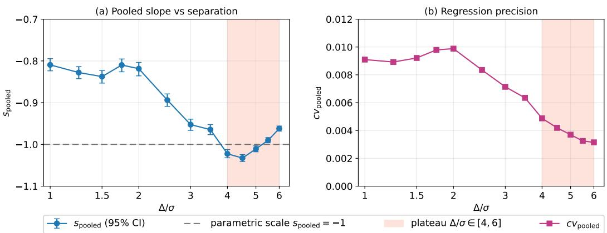  
Figure 2: Canonical $d { = } 4$ dense controlled transition on a $K { = } 4 , \ \sigma { = } 0 . 5$ Gaussian mixture. The 13-row front/plateau window shows the reliability-filtered signed log-log slope $s _ { \mathrm { p o o l e d } } ~ =$ ∂ log $\bar { R } / \partial$ log N and regression precision; the shaded band marks $\Delta / \sigma \in [ 4 , 6 ]$ , where $s _ { \mathrm { p o o l e d } } \approx - 1$ equivalently the positive exponent $\alpha _ { \mathrm { p o o l e d } } = - s _ { \mathrm { p o o l e d } } \approx 1$ . Full rows and filter sensitivity are in Appendix D.3.

Here blind EM-OLS fits a Gaussian mixture to unlabeled actions by expectation-maximization (EM) [8], then uses the fitted mixture in a closed-form velocity predictor that averages over posterior component probabilities. Table 1 reports the empirical label-cost deviation $A _ { 1 }$ , its Bonferroni-paired statistic z, and the blind MLP residual $\boldsymbol { \epsilon } _ { \mathrm { M L P } }$ . The label-cost identity holds within 0.07% on every row, with a maximum $z = 2 . 5 3 ;$ the blind MLP residual lies in [0.64%, 1.71%] and remains in [1.57%, 2.06%] under a $d { = } 8$ capacity ablation. This five-row audit therefore serves as a bridge to marginal-Bayes attainability up to a bounded MLP residual, not as a blind Cramér-Rao rate claim.

Proxy floor audit. When the analytic floor $\mathbf { \mathcal { A } } _ { v } ( t )$ is unavailable, a large-N empirical reference $L _ { \mathrm { l a r g e N } } ( t )$ supplies a regime-dependent substitute, defining the proxy $\hat { R } : = L _ { N } - L _ { \mathrm { l a r g e N } }$ . We audit $\rho _ { \mathrm { S p e a r m a n } } ( \hat { R } , R )$ across seventeen controlled cells (Appendix Table 10). Guard-passing cells retain high rank agreement $( \rho _ { \mathrm { { S p e a r m a n } } } \in [ 0 . 9 5 9 , 1 ] )$ , and the factor diagnostic $r _ { F } : = \operatorname* { m a x } \left| L _ { \mathrm { l a r g e N } } - \right.$ $\mathcal { A } _ { v } | / \mathrm { s t d } \bar { (} R \ | \ t \in \ [ 0 . 4 , 0 . 8 ] \big )$ ) separates them from the isolated high-r $d { = } 2$ separated breakdown documented in Appendix D.5. We therefore treat $\hat { R }$ as a calibrated proxy under the empirical guard $r _ { F } < 2 .$ , not as a universal replacement for the analytic floor.

## 5.3 Controlled Time-Sampler Stress Test

Setup. In a balanced partial-merge Gaussian mixture with $d = 1 6 , K = 3 2$ , and a uniform-time baseline, we test whether changing the training-time sampler $q ( t )$ can reduce the remaining excess above the analytic floor $( L / \mathcal { A } _ { v } = 1 . 0 3 7 $ at the plateau). The proxy $\hat { R } _ { \mathrm { i n d } } ( t )$ is frozen from source baseline runs whose demonstrations and evaluation actions are disjoint from the paired test; all comparisons are paired and use sign-permutation tests.

Sampler-side envelope. A categorical t-sampler $q ( t )$ on the same fine grid replaces the trainingtime U(0.05, 0.95) with either a coverage-preserving mixture $q _ { \lambda } = ( 1 - \lambda ) \mathcal { U } + \lambda \hat { R } _ { \mathrm { i n d } } / \sum \hat { R } _ { \mathrm { i n d } }$ or a pure sharpening $q \propto \hat { R } _ { \mathrm { i n d } } ^ { \alpha } ,$ , in the spirit of loss-aware diffusion training schedules [5, 9, 13]. The frozen proxy is reused without modification; the per-batch loss is the standard mean-squared error (MSE) without importance correction, and sampler guards, including an effective-samplesize floor [17], enforce nondegenerate probability mass functions (PMFs). All tested gap arms improve over the paired baseline with negative paired seed-level reducible-loss deltas for every seed and $p _ { \mathrm { p e r m } } < 0 . 0 0 3 [ 2 6 ]$ ; plateau gains span 9.32% to 20.21%; the complete paired table is in Appendix D.8. The learning curves in Figure 3 show the peak-step ordering.

Synthesis. The effect strengthens along the mixture chain and peaks at pure $\alpha = 2$ on the plateau and α = 4 near the peak-learning step; in the canonical cell no tested arm reverses sign. Appendix D.8 adds a three-cell d-axis sensitivity check: mixture arms and pure $\alpha \in \{ 1 , 2 \}$ improve across all cells, pure α = 4 weakens at the largest cell, and the most aggressive pure sampler $( \alpha = 8 )$ reverses in the late plateau there.  
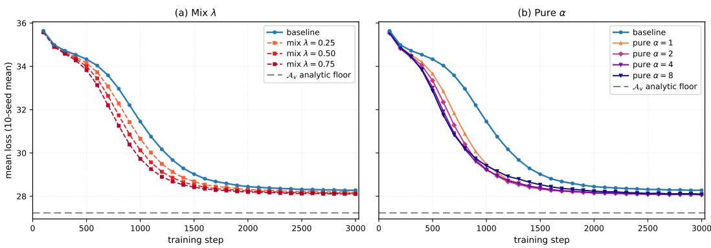  
Figure 3: Sampler-side t-sampler interventions on a controlled $d = 1 6 , K = 3 2$ GMM. Ten-seed mean loss for the baseline and gap-guided samplers using a proxy source disjoint from the paired test. Gap arms lie below baseline past the peak-learning step; pure $\alpha = 2$ is lowest at the plateau, while pure α = 4 is lowest near the peak-learning step.

## 5.4 Natural-Data Application: CIFAR-100 DINOv2 Feature-Flow

Setup and training result. To test whether the diagnostic transfers beyond the controlled mixture, we use the official CIFAR-100 split and extract frozen DINOv2 ViT-S/14 final-LayerNorm CLS features [25]. The resulting 384-dimensional vectors are centered and globally RMS calibrated using all 50, 000 official training rows; no PCA, whitening, learned projection, or pixel decoder is used. Each target seed uses 25 examples per fine class (2, 500 labeled examples total). We train a fine-label-conditioned flow-matching field in this feature space and compare uniform time sampling with VAP-guided reducible-error sampling using paired training seeds. The guided arm uses $q _ { 4 } ( t ) \ \propto \ \widehat { R } ( t ) ^ { 4 }$ on 64 categorical bins without importance correction. On a uniformly weighted 25-time evaluation grid, the guided field has 6.78% lower velocity loss at the common step 11, 500, with all five paired seeds favoring the guided arm.

This result supports the transfer of the time-local ambiguity diagnostic to a natural feature distribution while remaining a feature-space statement rather than an image-generation claim.

Closed-loop feature-space deployment. We integrate each learned field as an ODE generator from the same initial noise and evaluate the resulting feature distributions against held-out CIFAR-100 features. Global feature FD falls by 23.6%, alongside gains in macro precision, macro density, macro coverage, and fine-label macro accuracy (Table 2). Macro conditional KID shows no improvement, and both improved recall and effective covariance rank decrease, indicating a diversity cost alongside the gains in FD and label accuracy. These are five paired training seeds and feature-space metrics; feature FD is not image FID, and the experiment does not establish pixel-space realism or a universal sampler.

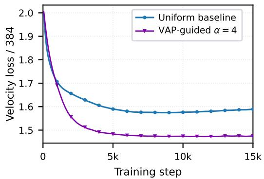  
Figure 4: Uniform-time evaluation during DI-NOv2 feature-flow training. The gap-guided sampling lowers uniformly evaluated velocity loss. Curves show means over five paired training seeds.

Table 2: CIFAR-100 DINOv2 feature-flow summary. Values are aggregate deployment metrics over five paired training seeds. Arrows indicate the preferred direction.
<table><tr><td>Metric</td><td>Uniform</td><td>VAP-guided</td><td>Change</td></tr><tr><td>Global feature FD ↓</td><td>33.333</td><td>25.476</td><td>-23.6%</td></tr><tr><td>Macro precision ↑</td><td>0.151</td><td>0.690</td><td>+0.539</td></tr><tr><td>Macro density ↑</td><td>0.122</td><td>1.226</td><td>+1.104</td></tr><tr><td>Macro coveráge ↑</td><td>0.234</td><td>0.728</td><td>+0.494</td></tr><tr><td>Fine-label macro accuracy ↑</td><td>0.791</td><td>0.859</td><td>+6.76 pp</td></tr><tr><td>Macro conditional KID ↓</td><td>0.1988</td><td>0.2062</td><td>+0.0074</td></tr><tr><td>Improved recall ↑</td><td>0.722</td><td>0.221</td><td>-0.501</td></tr><tr><td>Effective covariance rank ↑</td><td>47.25</td><td>40.14</td><td>-7.11</td></tr></table>

The deployment comparison uses a frozen checkpoint protocol and paired initialization. Each method generates 6, 000 features, compared with a disjoint 6, 000-feature held-out test reference library. Checkpoint-selection details, per-seed trajectories, solver checks, and the full conditional tables are deferred to Appendix D.7. The natural-data result therefore strengthens the case for VAP-guided time allocation through improvements in the training objective, global feature FD, and label accuracy, with the conditional-distribution and diversity limitations quantified above.

## 6 Related Work

Flow matching, imitation learning, and schedules. Flow matching and rectified-flow objectives transport noise to data [1, 11, 20, 21, 28, 36]. Imitation scaling and behavioral-cloning theory study data composition and policy error [3, 6, 12, 14, 30, 31], while schedule methods change the training-time distribution [5, 9, 13, 15]. VAP instead diagnoses the induced regression problems along interpolation time.

Statistical theory and adaptive structure. Diffusion and score theory characterize minimax rates under manifold and smoothness assumptions [4, 7, 16, 18, 24], and adaptive regression theory studies intrinsic or compositional structure [22, 29, 32, 35]. Our intrinsic result is a time-resolved velocity analog; the separated Gaussian-mixture result is the scoped label-oracle residual benchmark.

## 7 Conclusion

VAP turns the aggregate flow-matching loss into a time-resolved diagnostic by separating the Bayesrisk floor from reducible excess error. The theory gives two scoped benchmarks: a local intrinsic regression rate with bounded-factor time dependence and a sharper separated-GMM label-oracle residual scale $K \mathcal { A } _ { v } ( t ) / N$ . Controlled experiments validate the analytic floor, separated-regime collapse prediction, oracle-to-blind calibration, proxy-floor guards, and local time-sampler intervention, whose sensitivity boundary is given in Appendix D.8. On CIFAR-100 DINOv2 feature flow, guided time sampling reduces uniformly evaluated velocity loss by 6.78% and global feature FD by 23.6%. Macro conditional KID shows no gain, while lower recall and effective covariance rank reveal a diversity cost. Turning these diagnostics into a budget rule or intervention policy remains open.

Limitations. The intrinsic result is for the local benchmark $\mathcal { G } _ { t } ^ { \mathrm { c o m p } }$ , not the full ambient observation, with $\mathbf { \mathcal { A } } _ { v } ( t )$ entering as a bounded-factor prefactor. The GMM result is a separated label-oracle residual benchmark, not a full-information lower bound because $( x _ { t } , u _ { t } , t )$ determines $a = x _ { t } - t u _ { t }$ The natural-data result is limited to the frozen DINOv2 feature space: it makes no pixel-quality, universal-sampler, or uniform-metric-improvement claims.

## Acknowledgments and Disclosure of Funding

The work was supported in part by the National Natural Science Foundation of China under Grants U23B2059 and 62688201, the BIT Research and Innovation Promoting Project under Grant 2025YCXZ033, and the Beijing Natural Science Foundation under Grant QY26254.

## References

[1] M. S. Albergo and E. Vanden-Eijnden. Building normalizing flows with stochastic interpolants. In International Conference on Learning Representations, 2023.

[2] M. S. Albergo, N. M. Boffi, and E. Vanden-Eijnden. Stochastic interpolants: A unifying framework for flows and diffusions. Journal ofMachine Learning Research, 26(209):1–80, 2025.

[3] A. Block, A. Jadbabaie, D. Pfrommer, M. Simchowitz, and R. Tedrake. Provable guarantees for generative behavior cloning: Bridging low-level stability and high-level behavior. In Advances in Neural Information Processing Systems, volume 36, pages 48534–48547, 2023.

[4] S. Chen, S. Chewi, J. Li, Y. Li, A. Salim, and A. R. Zhang. Sampling is as easy as learning the score: Theory for diffusion models with minimal data assumptions. In International Conference on Learning Representations, 2023.

[5] J. Choi, J. Lee, C. Shin, S. Kim, H. Kim, and S. Yoon. Perception prioritized training of diffusion models. In Proceedings of the IEEE/CVF Conference on Computer Vision and Pattern Recognition, pages 11472–11481, 2022.

[6] S. Dass, A. Khaddaj, L. Engstrom, A. Madry, A. Ilyas, and R. Martín-Martín. DataMIL: Selecting data for robot imitation learning with datamodels. In International Conference on Learning Representations, 2026.

[7] V. De Bortoli. Convergence of denoising diffusion models under the manifold hypothesis. Transactions on Machine Learning Research, 2023.

[8] A. P. Dempster, N. M. Laird, and D. B. Rubin. Maximum likelihood from incomplete data via the EM algorithm. Journal ofthe Royal Statistical Society. Series B (Methodological), 39(1): 1–38, 1977.

[9] P. Esser, S. Kulal, A. Blattmann, R. Entezari, J. Müller, H. Saini, Y. Levi, D. Lorenz, A. Sauer, F. Boesel, D. Podell, T. Dockhorn, Z. English, and R. Rombach. Scaling rectified flow transformers for high-resolution image synthesis. In International Conference on Machine Learning, volume 235 of Proceedings ofMachine Learning Research, pages 12606–12633. PMLR, 2024.

[10] H. Federer. Curvature measures. Transactions ofthe American Mathematical Society, 93(3): 418–491, 1959.

[11] Z. Feng, R. Xue, L. Yuan, Y. Yu, N. Ding, M. Liu, B. Gao, J. Sun, X. Zheng, and G. Wang. Multi-agent embodied AI: Advances and future directions. Science China Information Sciences, 69(5):151202, 2026.

[12] D. J. Foster, A. Block, and D. Misra. Is behavior cloning all you need? Understanding horizon in imitation learning. In Advances in Neural Information Processing Systems, volume 37, pages 120602–120666, 2024.

[13] T. Hang, S. Gu, C. Li, J. Bao, D. Chen, H. Hu, X. Geng, and B. Guo. Efficient diffusion training via Min-SNR weighting strategy. In Proceedings ofthe IEEE/CVF International Conference on Computer Vision, pages 7441–7451, 2023.

[14] Y. Hu, F. Lin, P. Sheng, C. Wen, J. You, and Y. Gao. Data scaling laws in imitation learning for robotic manipulation. In International Conference on Learning Representations, 2025.

[15] T. Karras, M. Aittala, T. Aila, and S. Laine. Elucidating the design space of diffusion-based generative models. In Advances in Neural Information Processing Systems, volume 35, pages 26565–26577, 2022.

[16] B. T. Kiani, J. Wang, and M. Weber. Hardness of learning neural networks under the manifold hypothesis. In Advances in Neural Information Processing Systems, volume 37, pages 5661– 5696, 2024.

[17] A. Kong, J. S. Liu, and W. H. Wong. Sequential imputations and Bayesian missing data problems. Journal ofthe American Statistical Association, 89(425):278–288, 1994.

[18] H. Lee, J. Lu, and Y. Tan. Convergence for score-based generative modeling with polynomial complexity. In Advances in Neural Information Processing Systems, volume 35, pages 22870– 22882, 2022.

[19] C. Li, R. Zhang, J. Wong, C. Gokmen, S. Srivastava, R. Martín-Martín, C. Wang, G. Levine, W. Ai, B. J. Martinez, H. Yin, M. Lingelbach, M. Hwang, A. Hiranaka, S. Garlanka, A. Aydin, S. Lee, J. Sun, M. Anvari, M. Sharma, D. Bansal, S. Hunter, K.-Y. Kim, A. Lou, C. R. Matthews, I. Villa-Renteria, J. H. Tang, C. Tang, F. Xia, Y. Li, S. Savarese, H. Gweon, C. K. Liu, J. Wu, and L. Fei-Fei. BEHAVIOR-1K: A human-centered, embodied AI benchmark with 1,000 everyday activities and realistic simulation. arXiv preprint arXiv:2403.09227, 2024.

[20] Y. Lipman, R. T. Q. Chen, H. Ben-Hamu, M. Nickel, and M. Le. Flow matching for generative modeling. In International Conference on Learning Representations, 2023.

[21] X. Liu, C. Gong, and Q. Liu. Flow straight and fast: Learning to generate and transfer data with rectified flow. In International Conference on Learning Representations, 2023.

[22] R. Nakada and M. Imaizumi. Adaptive approximation and generalization of deep neural network with intrinsic dimensionality. Journal of Machine Learning Research, 21(174):1–38, 2020.

[23] P. Niyogi, S. Smale, and S. Weinberger. Finding the homology of submanifolds with high confidence from random samples. Discrete and Computational Geometry, 39(1–3):419–441, 2008.

[24] K. Oko, S. Akiyama, and T. Suzuki. Diffusion models are minimax optimal distribution estimators. In International Conference on Machine Learning, volume 202 of Proceedings of Machine Learning Research, pages 26517–26582. PMLR, 2023.

[25] M. Oquab, T. Darcet, T. Moutakanni, H. V. Vo, M. Szafraniec, V. Khalidov, P. Fernandez, D. Haziza, F. Massa, A. El-Nouby, M. Assran, N. Ballas, W. Galuba, R. Howes, P.-Y. Huang, S.-W. Li, I. Misra, M. Rabbat, V. Sharma, G. Synnaeve, H. Xu, H. Jegou, J. Mairal, P. Labatut, A. Joulin, and P. Bojanowski. DINOv2: Learning robust visual features without supervision. Transactions on Machine Learning Research, 2024.

[26] B. Phipson and G. K. Smyth. Permutation P-values should never be zero: Calculating exact P-values when permutations are randomly drawn. Statistical Applications in Genetics and Molecular Biology, 9(1):Article 39, 2010.

[27] Physical Intelligence, K. Black, N. Brown, J. Darpinian, K. Dhabalia, D. Driess, A. Esmail, M. Equi, C. Finn, N. Fusai, M. Y. Galliker, D. Ghosh, L. Groom, K. Hausman, B. Ichter, S. Jakubczak, T. Jones, L. Ke, D. LeBlanc, S. Levine, A. Li-Bell, M. Mothukuri, S. Nair, K. Pertsch, A. Z. Ren, L. X. Shi, L. Smith, J. T. Springenberg, K. Stachowicz, J. Tanner, Q. Vuong, H. Walke, A. Walling, H. Wang, L. Yu, and U. Zhilinsky. π0.5: A vision-languageaction model with open-world generalization. arXiv preprint arXiv:2504.16054, 2025.

[28] A.-A. Pooladian, H. Ben-Hamu, C. Domingo-Enrich, B. Amos, Y. Lipman, and R. T. Q. Chen. Multisample flow matching: Straightening flows with minibatch couplings. In International Conference on Machine Learning, volume 202 of Proceedings ofMachine Learning Research, pages 28100–28127. PMLR, 2023.

[29] P. Pope, C. Zhu, A. Abdelkader, M. Goldblum, and T. Goldstein. The intrinsic dimension of images and its impact on learning. In International Conference on Learning Representations, 2021.

[30] S. Ross and D. Bagnell. Efficient reductions for imitation learning. In International Conference on Artificial Intelligence and Statistics, volume 9 of Proceedings ofMachine Learning Research, pages 661–668. PMLR, 2010.

[31] S. Ross, G. J. Gordon, and J. A. Bagnell. A reduction of imitation learning and structured prediction to no-regret online learning. In International Conference on Artificial Intelligence and Statistics, volume 15 of Proceedings of Machine Learning Research, pages 627–635. PMLR, 2011.

[32] J. Schmidt-Hieber. Nonparametric regression using deep neural networks with ReLU activation function. The Annals of Statistics, 48(4):1875–1897, 2020.

[33] J. P. Stanczuk, G. Batzolis, T. Deveney, and C.-B. Schönlieb. Diffusion models encode the intrinsic dimension of data manifolds. In International Conference on Machine Learning, volume 235 of Proceedings of Machine Learning Research, pages 46412–46440. PMLR, 2024.

[34] C. J. Stone. Optimal global rates of convergence for nonparametric regression. The Annals of Statistics, 10(4):1040–1053, 1982.

[35] T. Suzuki. Adaptivity of deep ReLU network for learning in Besov and mixed smooth Besov spaces: Optimal rate and curse of dimensionality. In International Conference on Learning Representations, 2019.

[36] A. Tong, K. Fatras, N. Malkin, G. Huguet, Y. Zhang, J. Rector-Brooks, G. Wolf, and Y. Bengio. Improving and generalizing flow-based generative models with minibatch optimal transport. Transactions on Machine Learning Research, 2024.

[37] A. B. Tsybakov. Introduction to Nonparametric Estimation. Springer Series in Statistics. Springer, New York, 2009.

[38] S. Vempala and G. Wang. A spectral algorithm for learning mixture models. Journal of Computer and System Sciences, 68(4):841–860, 2004.

[39] Y. Yang and A. Barron. Information-theoretic determination of minimax rates of convergence. The Annals ofStatistics, 27(5):1564–1599, 1999.

## Appendix

A Basic VAP Facts and Intrinsic Benchmark Proofs . . 16   
A.1 Assumptions for Theorem 4 16   
A.2 Proof of Proposition 3 . 17   
A.3 Proof of Proposition 2 . 17   
A.4 Verifiable sufficient conditions for Assumption A5 . 17   
A.5 Intrinsic vs. ambient dimension 17   
A.6 Problem Setup 18   
A.7 Lower Bound via Assouad’s Method 18   
A.8 Upper Bound via Stabilized Local Polynomial Regression 20   
A.9 Combining the Bounds 20   
B Proof of the Gaussian-Mixture Benchmark. . 21   
B.1 Setup and Notation. 21   
B.2 Information Sets and Label-and-Action Oracles. 21   
B.3 Main Result . 22   
B.4 Proof Map. 24   
B.5 Discussion: Beyond Gaussian Mixtures 24   
B.6 Effective parameters and adaptive-rate conjecture 24   
B.7 Effective parameters: Gaussian-mixture instance 25   
B.8 Controlled adaptive-rate evidence: trained network and copying estimator . 25   
B.9 Comparison with Theorem 4 . 26   
B.10 Upper Bound (Parametric Regime) 26   
B.11 Lower Bound and Transition . 33   
C Proof of Proposition 6 (Curve Collapse) . . . 39   
C.1 Case 1: Minimax Regime (Approximate Collapse) . 39   
C.2 Case 2: Adaptive Rate, Single Regime (Approximate Within Regime) . 39   
C.3 Case 3: Adaptive Rate, Across Regimes (Approximate Collapse) 40   
C.4 Case 4: Threshold-Dependent Sharpening . 40   
C.5 Case 5: GMM Separated-Regime Result . 40   
C.6 Convergence wavefront-auxiliary diagnostic. 41   
C.7 Summary 41   
D Experimental Protocols and Reproducibility Audits. . . 41   
D.1 Controlled Gaussian-mixture flow matching 42   
D.2 Analytic floors, readouts, and statistics 42   
D.3 Full row-level data for the d=4 dense controlled transition . 43   
D.4 Normalization sanity audit . 44   
D.5 Proxy-floor breakdown at d=2 separated. 45   
D.6 Three-family controlled heterogeneity panel. 47   
D.7 CIFAR-100 DINOv2 feature-flow materials 47   
D.8 Cross-cell d-axis ladder of the time-sampler stress test. 49   
E Oracle-to-Blind Bridge Auxiliary Details . 51   
E.1 Label-and-action Cramér-Rao sanity 51   
E.2 Blind-Attainability Panel . 52   
E.3 Empirical Sweep of the Two-Stage Estimator . 52   
F BEHAVIOR-1K Materials 53   
F.1 BEHAVIOR-1K diagnostic implementation 53   
F.2 Leakage-free diagnostic panel 54   
F.3 Representative task descriptions 55

Appendix Roadmap. The appendix follows the paper’s claim hierarchy:

• Intrinsic benchmark. Appendix A states the assumptions and proves the time-resolved minimax benchmark behind Theorem 4.

• Separated GMM benchmark. Appendix B proves Theorem 5 through mode dominance, the label-oracle residual upper bound, and the residual lower bound.

• Curve collapse. Appendix C derives the normalized-collapse prediction used by the controlled Gaussian-mixture experiments.

• Experimental protocols. Appendix D gives the controlled protocols and audit checks behind the main figures.

• Bridge, proxy, and sampler auxiliary audits. Appendices D.5, D.6, D.8, E, E.1, E.2, and E.3 record proxy-floor and observable-guard calibration, controlled heterogeneity, cross-cell sampler sensitivity, oracle-to-blind sanity checks, blind-attainability, and the two-stage attainability sweep.

• Application materials. Appendix F gives the BEHAVIOR-1K task context used to interpret the diagnostic panel.

## A Basic VAP Facts and Intrinsic Benchmark Proofs

This appendix collects: (§A.1) the formal statement of the five assumptions, Assumptions A1-A3, used by Theorem $4 ; ( \ S \mathrm { A } . 2 )$ the proof of Proposition 3 (loss decomposition); (§A.3) the proof of Proposition 2 (boundary behavior and non-monotonicity of $\mathcal { A } _ { v } ) ; ( \ S \mathrm { A } . 4 )$ verifiable sufficient conditions for Assumption A5, used implicitly throughout the proof of Theorem $4 ; ( \ S \mathrm { A } . 5 )$ expanded discussion of the intrinsic-vs-ambient dimension distinction; and the main minimax proof itself.

Throughout this appendix we follow the conditional convention of §3.1: a fixed context c is implicit and suppressed from notation, with all expectations and variances conditional on c.

We prove the time-resolved baseline result at fixed time t by analyzing the local heteroscedastic regression benchmark $\mathcal { G } _ { t } ^ { \mathrm { c o m p } }$ induced by the flow matching geometry (Lemma 10). The lower bound uses an Assouad construction within $\check { \mathcal { G } } _ { t } ^ { \mathrm { c o m p } }$ , and the upper bound uses kernel regression with the standard bias-variance tradeoff. Because $\mathbf { \mathcal { A } } _ { v } ( t )$ is only converted into a multiplicative prefactor after restricting to compact time intervals on which it is bounded above and below, the result should be read as a bounded-factor time-resolved minimax characterization.

## A.1 Assumptions for Theorem 4

Assumption A1. The data distribution $p _ { \mathrm { d a t a } }$ is supported on a compact d-dimensional $C ^ { 2 }$ submanifold $\mathcal { M } \subset \mathbb { R } ^ { D }$ with positive reach $I I O , 2 3 I$ and with $0 < c _ { \ell } \leq p _ { \mathrm { d a t a } } ( a ) \leq c _ { u }$ in local coordinates on M. Note that for $t > 0 ,$ , the marginal $p ( x _ { t } \mid t )$ has full D-dimensional support due to the Gaussian noise $\varepsilon ;$ however, the regularity of the Bayes-optimal velocity $v ^ { * } ( \cdot , t )$ is governed by the d-dimensional intrinsic structure ofM (Assumption A2).

Assumption A2. Fix afinite atlas with chart domains $Q _ { j } \subset \mathbb { R } ^ { d }$ andfixed compact neighborhoods $Q _ { i } ^ { + } \supset Q _ { j }$ . For each $t \in [ \delta , 1 - \delta ]$ , let $f _ { t , j } : Q _ { j } \to \mathbb { R } ^ { D }$ denote the coordinate representation ofthe Bayes velocity on chart $j .$ For afixedfinite $s > 0 ,$ write $m = \lceil s \rceil - 1$ and $\beta = s - m \in ( 0 , 1 ]$ (with $C ^ { s - 1 , 1 }$ when s is an integer). There are extensions $\widetilde { f } _ { t , j } \in C ^ { m , \beta } ( Q _ { j } ^ { + } ; \mathbb { R } ^ { D } )$ satisfying

$$
\operatorname* { s u p } _ { t \in [ \delta , 1 - \delta ] } \operatorname* { m a x } _ { j } \big \| \widetilde f _ { t , j } \big \| _ { C ^ { m , \beta } ( Q _ { j } ^ { + } ; \mathbb { R } ^ { D } ) } \leq B _ { \delta } < \infty .\tag{15}
$$

The chart overlap, cutoff, and boundary-Gram constants arefixed uniformly on this compact time interval. This is an explicitfinite-smoothness condition on the compact local benchmark. It is not a global ambient bound, not a consequence ofGaussian smoothing, and does not assert $s = \infty$ . For a Gaussian mixture, thefield is smooth and hence satisfies this conditionfor everyfixedfinite s on each bounded readout neighborhood; the parametric resultfor that model instead comesfrom the separatedfinite-dimensional residual theorem 5.

Assumption A3 (Compact random design and boundary Gram). For every chart and every admissible bandwidth $h \leq h _ { 0 }$ , the intrinsic design density is bounded above and below on the compact chart domain. The population moment matrix of the degree-m local-polynomial basis has a uniformly positive minimum eigenvalue, including boundary queries after thefixed cutoffand stabilization rule. The atlas hasfinite overlap and the cutoffs have a positive boundary margin. These are benchmark assumptions on the random-design experiment, not consequences ofAssumption A1.

Assumption A4. On every compact subinterval $[ \delta , 1 - \delta ] \subset ( 0 , 1 )$ , the velocity ambiguity profile satisfies $0 < \sigma _ { \ell } ( \delta ) \leq \mathcal { A } _ { v } ( t ) \leq \sigma _ { u } ( \delta ) < \infty$ for all $t \in [ \delta , 1 - \delta ]$

Assumption A4 is a compact-interval regularity condition: it holds whenever $p _ { \mathrm { d a t a } }$ has finite second moments and the conditional velocity problem is non-degenerate on the interval. It ensures that the noise level $\mathbf { \mathcal { A } } _ { v } ( t )$ neither vanishes nor diverges on compact time intervals, which is needed for interval-uniform control of the time-resolved baseline.

Assumption A5. Uniform noise comparability. For each compact subinterval $[ \delta , 1 - \delta ] \subset ( 0 , 1 )$ , the pointwise noise variance satisfies

$$
c _ { n } \mathcal { A } _ { v } ( t ) \ \leq \ \mathrm { t r } { \mathrm { C o v } [ u _ { t } \ | \ x _ { t } , t ] } \ \leq \ C _ { n } \mathcal { A } _ { v } ( t ) \qquad f o r \ p _ { x _ { t } } - a . e . \ x _ { t } ,
$$

for constants $0 < c _ { n } \leq C _ { n }$ depending only on δ and $p _ { \mathrm { d a t a } }$

Assumption A5 requires a uniform comparison between the pointwise conditional noise level and its average value $\mathbf { \mathcal { A } } _ { v } ( t )$ . This is a structural assumption, not automatic from compact support; it holds in the separated Gaussian-mixture regime, where the conditional covariance is asymptotically spatially uniform up to exponentially small corrections (Remark 29), and can fail for distributions with bridgelike multimodal geometries where the posterior assigns weight to multiple distant modes. Verifiable sufficient conditions for Assumption A5 beyond the Gaussian-mixture setting are formalized in Appendix A.4.

Remark 7 (Scope and interpretation). Theorem 4 characterizes the lower and corrected upper bounds for the intrinsic compact local regression benchmark $\mathcal { G } _ { t } ^ { \mathrm { c o m p } }$ induced by the stated benchmark assumptions, not the minimax risk over the full ambient distribution class. This parallels the approach of Oko et al. [24] for score estimation, with the key difference being the time-resolved perspective: $\mathbf { \mathcal { A } } _ { v } ( t )$ enters as the noise level at each point along the interpolation path. A formal constructive reduction from the full ambient flow matching observation model to $\mathscr { G } _ { t } ^ { \mathrm { { c o m p } } }$ would require verifying that the ambient estimator class projects faithfully onto the benchmark class; we leave this extension to future work. For structured data, the benchmark rate can be beaten: the Gaussian-mixture theorem (Theorem 5) achieves a parametric rate in the separated regime.

## A.2 Proof of Proposition 3

Proof. Expand $\| \hat { v } _ { N } - u _ { t } \| ^ { 2 } = \| \hat { v } _ { N } - v ^ { * } + v ^ { * } - u _ { t } \| ^ { 2 }$ . The cross-term vanishes because $v ^ { * } = \mathbb { E } [ u _ { t } \mid$ $x _ { t } , c , t ] , \operatorname { s o } \mathbb { E } [ v ^ { * } - u _ { t } \mid x _ { t } , c , t ] = 0$ □

## A.3 Proof of Proposition 2

Proof of Proposition 2. (ii) $\mathrm { A t } \ t = 1 , x _ { 1 } = \varepsilon$ is independent of $^ { a , }$ so $p ( a \mid x _ { 1 } , 1 ) = p _ { \mathrm { d a t a } } ( a )$ and $\mathcal { A } _ { v } ( \mathrm { i } ) \stackrel { \cdot } { = } \mathrm { t r } \bar { \mathrm { V a r } } [ a ]$

(iii) For a single Gaussian $\mathcal { N } ( \mu , \sigma ^ { 2 } I _ { d } ) , \mathcal { A } _ { v } ( t ) = d \sigma ^ { 2 } / \sigma _ { t } ^ { 2 } = d \sigma ^ { 2 } / ( ( 1 { - } t ) ^ { 2 } \sigma ^ { 2 } + t ^ { 2 } )$ , which attains a maximum at $t = \sigma ^ { 2 } / ( 1 + \sigma ^ { 2 } ) \in ( 0 , 1 )$ and therefore first increases and then decreases.

(i) Under Assumption $\mathbf { A } 1 , \mathcal { M }$ is compact, so $\| a \| \leq R$ for some $R > 0$ . The posterior $p ( a \mid x _ { t } , t )$ ∝ $p _ { \mathrm { d a t a } } ( a ) \phi _ { D } ( x _ { t } ; ( 1 - t ) a , t ^ { 2 } I )$ concentrates in an $O ( t / ( 1 - t ) )$ )-neighborhood of the point $a ^ { * } \in { \mathcal { M } }$ nearest to $x _ { t } / ( 1 - t ) \operatorname { a s } t \to 0 ^ { + }$ . Since M is a $C ^ { 2 }$ submanifold and the density $p _ { \mathrm { d a t a } }$ is bounded above and below, a Laplace-type argument on the tangent space shows that $\cdot \operatorname { r } { \dot { \operatorname { V a r } } } [ a \mid x _ { t } , t ] = O ( t ^ { 2 } )$ for $p _ { x _ { t } } – \mathbf { a . e . } x _ { t }$ . Consequently, $\hat { \mathcal { A } _ { v } } ( t ) = ( 1 / t ^ { 2 } ) \mathbb { E } _ { x _ { t } } [ \mathrm { { \bar { t r } } V a r } [ a \mid x _ { t } , t ] ] = O ( 1 )$ , hence $\mathcal { A } _ { v } ( 0 ^ { + } ) < \infty$ □

## A.4 Verifiable sufficient conditions for Assumption A5

The proof below repeatedly invokes Assumption A5 (uniform comparability of the pointwise conditional noise to its average $A _ { v } ( t ) )$ ). For completeness we record verifiable sufficient conditions under which Assumption A5 holds beyond the Gaussian-mixture setting.

Remark 8 (Verifiable sufficient conditions for Assumption A5). A convenient sufficient condition for Assumption A5 is the existence, on a compact interval $[ \delta , 1 - \delta ]$ , of a scalar profile $\nu ( t )$ and constants $0 < c _ { 0 } \le C _ { 0 } < \infty$ such that

$$
c _ { 0 } \nu ( t ) \ \leq \ \mathrm { t r } \mathrm { C o v } [ u _ { t } \ | \ x _ { t } , t ] \ \leq \ C _ { 0 } \nu ( t ) \qquad \mathrm { f o r } \ p _ { x _ { t } } \mathrm { - a . e . } \ x _ { t } ,
$$

and such that $\mathcal { A } _ { v } ( t ) = \mathbb { E } [ \mathrm { t r } \mathrm { C o v } [ u _ { t } \ | \ x _ { t } , t ] ]$ is itself comparable to $\nu ( t )$ on that interval. In that case Assumption A5 follows immediately.

This sufficient condition is verifiable beyond the Gaussian-mixture setting in at least two common situations: (i) unimodal families for which the posterior $p ( a \mid x _ { t } , t )$ is uniformly strongly log-concave and its Hessian is bounded above and below on the relevant region, implying posterior covariance bounds that are uniform in $x _ { t } ;$ and (ii) finite mixtures of such components away from the merge region, where posterior mass concentrates on a single component and the same covariance bounds are inherited componentwise. By contrast, A4 is expected to fail in bridge-like multimodal geometries, where a small subset of locations can carry posterior mass on multiple distant modes and hence exhibit conditional variance much larger than the average $\mathbf { \mathcal { A } } _ { v } ( t )$

## A.5 Intrinsic vs. ambient dimension

Remark 9 (Intrinsic dimension vs. ambient dimension). Although $x _ { t }$ lives in $\mathbb { R } ^ { D }$ , the minimax rate depends on the intrinsic dimension d of $\mathcal { M } .$ , not the ambient $D ,$ paralleling Oko et al. [24] for score estimation. Empirical estimates of the intrinsic dimension of natural data [29, 33] support the gap between intrinsic d and ambient D. The mechanism is the $O ( t )$ -tubular concentration of $p ( x _ { t } \mid t )$ around $( 1 - t ) { \mathcal { M } }$

For moderate t, the marginal density $p ( x _ { t } \mid t )$ concentrates in an $O ( t )$ -tubular neighborhood of $( 1 - t ) { \mathcal { M } }$ , and the velocity field $v ^ { * }$ varies primarily along the d tangent directions of this manifold rather than along all D ambient directions. The benchmark class $\mathcal { G } _ { t } ^ { \mathrm { c o m p } } ( s , d , B , \mathcal { A } _ { v } )$ constructed in Lemma 10 formalizes this intrinsic picture: both the Assouad lower bound and the kernel-regression upper bound operate within this d-dimensional benchmark, so the resulting minimax rate exponent depends only on d. The gap between this intrinsic benchmark and the full ambient flow matching observation model is discussed in Remark 7.

## A.6 Problem Setup

Fix $t \in ( 0 , 1 - \delta ]$ . Under the linear interpolation $x _ { t } = \left( 1 - t \right) a + t \varepsilon .$ , we observe N i.i.d. triples $( x _ { t } ^ { ( i ) } , u _ { t } ^ { ( i ) } , t )$ , where $u _ { t } ^ { ( i ) } = \varepsilon ^ { ( i ) } - a ^ { ( i ) }$ . The regression model at time t takes the form:

$$
u _ { t } ^ { ( i ) } = v ^ { * } ( x _ { t } ^ { ( i ) } , t ) + \xi ^ { ( i ) } ,\tag{16}
$$

where $v ^ { * } ( x _ { t } , t ) = \mathbb { E } [ u _ { t } \ | \ x _ { t } , t ]$ is the Bayes-optimal velocity and $\xi ^ { ( i ) } = u _ { t } ^ { ( i ) } - v ^ { * } ( x _ { t } ^ { ( i ) } , t )$ is the residual noise satisfying $\mathbb { E } [ \xi ^ { ( i ) } \mid x _ { t } ^ { ( i ) } , t ] = 0$ and $\mathbb { E } [ \| \xi ^ { ( i ) } \| ^ { 2 } \mid x _ { t } ^ { ( i ) } , t ] = \operatorname { t r } \operatorname { C o v } [ u _ { t } \mid x _ { t } ^ { ( i ) } , t ] .$

By Definition 1, the average noise level is $\mathbb { E } _ { \boldsymbol { x } _ { t } } [ \mathrm { t r } \mathrm { C o v } [ \boldsymbol { u } _ { t } \ \vert \ \boldsymbol { x } _ { t } , t ] ] = \boldsymbol { \mathcal { A } } _ { v } ( t )$ . Thus (16) is a heteroscedastic nonparametric regression problem with average noise level $\mathbf { \mathcal { A } } _ { v } ( t )$

The following lemma formalizes the local d-dimensional regression benchmark induced by the ambient observation geometry.

Lemma 10 (Benchmark construction via local coordinates). Under Assumptions $A l - A 2 , \ f i x$ $t \in [ \delta , 1 - \delta ]$ . Let $\{ ( U _ { j } , \phi _ { j } ) \}$ be a finite atlas $o f \left( 1 { - } t \right) { \mathcal { M } }$ and let $\tau _ { j } ( t )$ denote the O(t)-tubular neighborhood of $( 1 - t ) { \bar { U } } _ { j }$ . Then thefollowing properties define the compact benchmark class $\mathcal { G } _ { t } ^ { \mathrm { c o m p } }$

(i) The marginal density $p ( x _ { t } \mid t )$ restricted to $\tau _ { j } ( t )$ is bounded above and below by constants depending only on $c _ { \ell } , c _ { u } , t , \sigma _ { ; }$ , and the chart Jacobian

(ii) The velocity field $v ^ { * } ( \cdot , t )$ expressed in the local coordinates $z = \phi _ { j } ( \cdot )$ has Hölder norm $\| v ^ { * } \| _ { C ^ { s } } \leq \dot { B ( t ) }$ by Assumption A2.

(iii) Under Assumption A5, the conditional noise tr $\mathrm { C o v } [ u _ { t } \ | \ x _ { t } , t ] f o r \ x _ { t } \ \in \ T _ { j } ( t )$ satisfies $c _ { n } \mathcal { A } _ { v } ( t ) \leq \mathrm { t r } \mathrm { C o v } [ u _ { t } \mid x _ { t } , t ] \leq C _ { n } \mathcal { A } _ { v } ( t ) .$

Together, these properties specify a compact d-dimensional heteroscedastic regression benchmark $\mathcal { G } _ { t } ^ { \mathrm { c o m p } } ( s , d , B , \dot { \mathcal { A } } _ { v } )$ with controlled design density, smoothness, boundary Gram, and noise level. Theorem 4 establishes the lower and corrected upper bounds ofthis benchmark; afull constructive reductionfrom the ambientflow matching observation model to $\mathcal { G } _ { t } ^ { \mathrm { c o m p } } \left( i . e . \right.$ , showing that the ambient minimax risk is of the same order) would require additional arguments about the faithfulness of the tubular projection, which we leave tofuture work.

The minimax risk of the intrinsic benchmark is:

$$
R _ { \mathrm { l o c } } ^ { * } ( t ; N ) : = \operatorname* { i n f } _ { \hat { v } } \operatorname* { s u p } _ { \substack { P \in \mathcal { G } _ { t } ^ { \mathrm { c o m p } } ( s , d , B , \mathcal { A } _ { v } ) } } \mathbb { E } _ { \mathcal { D } _ { N } , X \sim P _ { x _ { t } } } \left[ \| \hat { v } _ { \mathcal { D } _ { N } } ( X , t ) - v _ { P } ^ { * } ( X , t ) \| ^ { 2 } \right] ,\tag{17}
$$

where the infimum is over all estimators vˆ based on the N training samples.

## A.7 Lower Bound via Assouad’s Method

We adapt the classical Assouad lower bound [37, 39] to the associated local regression experiment, following the strategy of Stone [34]. The role of Assumptions A1 and A2 is to justify a local coordinate reduction in which the Bayes velocity varies only along d intrinsic directions while the ambient Gaussian smoothing contributes a controlled noise term. We therefore construct the leastfavorable family inside the formal compact benchmark. The resulting lower bound is a benchmark lower bound for this induced local experiment, not a lower bound for the full ambient flow matching observation model.

Step 1: Local coordinate reduction. Fix a chart ϕ on a patch of the base manifold M and extend it to a tubular-neighborhood parameterization around $( 1 - \bar { t } ) \mathcal { M }$ . Within this patch, the signal part of the regression problem is represented by a d-dimensional coordinate $z = \phi ( a )$ together with ambient Gaussian smoothing whose effect is absorbed into the conditional noise level. The lower bound is therefore proved for this local d-dimensional regression experiment; the constants in the reduction depend on the chart Jacobian and the tube geometry but not on N.

Step 2: Hypothesis construction in local coordinates. Choose a bandwidth $h > 0$ (to be optimized) and partition the coordinate domain into $M \asymp ( 1 / h ) ^ { d }$ cubes of side length h. Let $\{ z _ { m } \} _ { m = 1 } ^ { M }$ denote the centers of these cubes. For each binary vector $\omega = ( \omega _ { 1 } , \ldots , \omega _ { M } ) \in \{ 0 , 1 \} ^ { M }$ , define the velocity perturbation:

$$
v _ { \omega } ( x , t ) = v _ { 0 } ( x , t ) + c _ { 0 } B ( t ) h ^ { s } \sum _ { m = 1 } ^ { M } \omega _ { m } \psi \biggl ( \frac { \phi ( x ) - z _ { m } } { h } \biggr ) e _ { 1 } ,\tag{18}
$$

where $v _ { 0 }$ is a baseline velocity field in $C ^ { s } ( \mathcal { M } _ { t } ) , \psi : \mathbb { R } ^ { d } $ R is a smooth bump function supported on $[ - 1 / 2 , 1 / 2 ] ^ { d }$ with $\| \psi \| _ { C ^ { s } } \leq 1 , e _ { 1 }$ is a unit vector, and $c _ { 0 } > 0$ is chosen small enough that $v _ { \omega } \in C ^ { s } ( \mathcal { M } _ { t } )$ with norm bounded by $B ( t )$ for all $\omega .$

By construction, the least-favorable family is defined directly inside the benchmark class $\mathcal { G } _ { t } ^ { \mathrm { { { ^ { c o m p } } } } } ( s , d , B , \mathcal { A } _ { v } )$ , which is the object of Theorem 4.

The $L ^ { 2 }$ separation between hypotheses differing in coordinate m is:

$$
\begin{array} { r } { \lVert v _ { \omega } - v _ { \omega ^ { ( m ) } } \rVert _ { L ^ { 2 } ( \mathcal { M } _ { t } ) } ^ { 2 } \geq c _ { 1 } B ( t ) ^ { 2 } h ^ { 2 s } h ^ { d } = c _ { 1 } B ( t ) ^ { 2 } h ^ { 2 s + d } , } \end{array}\tag{19}
$$

where $\boldsymbol { \omega } ^ { ( m ) }$ differs from ω only in coordinate m.

Step 3: KL divergence bound via Gaussian subclass. For the purpose of the lower bound, we restrict to the Gaussian-noise subclass $\mathcal { G } _ { t } ^ { \mathrm { G a u s s } } \subset \mathcal { G } _ { t } ^ { \mathrm { c o m p } }$ consisting of benchmark experiments with conditionally Gaussian noise: $\xi \mid x _ { t } \sim \overset { \sim } { \mathcal { N } } ( 0 , \sigma _ { \mathrm { n o i s e } } ^ { 2 } ( x _ { t } ) I _ { d } )$ , where $c _ { n } \mathcal { A } _ { v } ( t ) \leq \sigma _ { \mathrm { n o i s e } } ^ { 2 ^ { - } } ( x _ { t } ) \leq$ $C _ { n } A _ { v } ( t )$ for $p _ { \underline { { x } } _ { t } }  – \mathbf { a . e . } , x _ { t }$ (Assumption $_ { \textrm A 5 ) }$ . Since $\mathcal { G } _ { t } ^ { \mathrm { G a u s s } } \subset \mathcal { G } _ { t } ^ { \mathrm { c o m p } }$ , the minimax risk of $\mathcal { G } _ { t } ^ { \mathrm { c o m p } } \mathrm { i s }$ at least that of $\bar { \mathcal G } _ { t } ^ { \mathrm { G a u s s } }$ , so a lower bound for the Gaussian subclass yields a lower bound for the full compact benchmark class.

For the Gaussian subclass, the KL divergence between location-shifted experiments satisfies

$$
\begin{array} { r l } & { D _ { \mathrm { K L } } \big ( P _ { \omega } ^ { \otimes N } \parallel P _ { \omega ^ { ( m ) } } ^ { \otimes N } \big ) = \displaystyle \frac { N } { 2 } \int \frac { \| v _ { \omega } ( x ) - v _ { \omega ^ { ( m ) } } ( x ) \| ^ { 2 } } { \sigma _ { \mathrm { n o i s e } } ^ { 2 } ( x ) } p _ { x _ { t } } ( x ) \mathrm { d } x } \\ & { \qquad \le \frac { N c _ { 0 } ^ { 2 } B ( t ) ^ { 2 } h ^ { 2 s } } { c _ { n } \mathcal { A } _ { v } ( t ) } \cdot \displaystyle \int _ { \mathrm { c u b e } _ { m } } \psi ^ { 2 } \bigg ( \frac { \phi ( x ) - z _ { m } } { h } \bigg ) p _ { x _ { t } } ( x ) \mathrm { d } x } \\ & { \qquad \le \frac { c _ { 2 } N B ( t ) ^ { 2 } h ^ { 2 s + d } } { \mathcal { A } _ { v } ( t ) } . } \end{array}\tag{20}
$$

where the first equality is the standard Gaussian KL formula for location-shift experiments, and the constant $c _ { 2 }$ absorbs the noise comparability ratio $1 / c _ { n }$ . The key factor $\mathbf { \mathcal { A } } _ { v } ( t )$ in the denominator reflects the noise level of the velocity regression: higher $\mathbf { \mathcal { A } } _ { v } ( t )$ means noisier observations, increasing the difficulty of distinguishing hypotheses.

Remark. The upper bound (Subsection A.8) holds for the full compact benchmark class $\mathcal { G } _ { t } ^ { \mathrm { c o m p } }$ using only the second-moment noise comparability in Assumption A5, without requiring Gaussian noise. Thus the Gaussian-subclass restriction is needed only for the lower bound and does not affect the upper bound.

Step 4: Applying Assouad’s lemma. By Assouad’s lemma [37, Theorem 2.12], for any estimator vˆ:

$$
\operatorname* { s u p } _ { \omega } \mathbb { E } _ { \omega } \big [ \| \hat { v } - v _ { \omega } \| _ { L ^ { 2 } } ^ { 2 } \big ] \geq \frac { M } { 2 } c _ { 1 } B ( t ) ^ { 2 } h ^ { 2 s + d } \left( 1 - \sqrt { \frac { c _ { 2 } N B ( t ) ^ { 2 } h ^ { 2 s + d } } { 2 \mathcal { A } _ { v } ( t ) } } \right) .\tag{21}
$$

Setting $h \asymp \{ \mathcal { A } _ { v } ( t ) / ( N B ( t ) ^ { 2 } ) \} ^ { 1 / ( 2 s + d ) }$ balances the KL divergence against the number of hypotheses. Assouad’s lemma then gives

$$
\begin{array} { l } { { R _ { \mathrm { l o c } } ^ { * } ( t ; N ) \geq c _ { 3 } ( 1 / h ) ^ { d } \cdot B ( t ) ^ { 2 } h ^ { 2 s + d } = c _ { 3 } B ( t ) ^ { 2 } h ^ { 2 s } } } \\ { { = c _ { 3 } B ( t ) ^ { \frac { 2 d } { 2 s + d } } \left( \frac { A _ { v } ( t ) } { N } \right) ^ { \frac { 2 s } { 2 s + d } } . } } \end{array}\tag{22}
$$

This is the standard nonparametric lower-bound scaling with Hölder radius $B ( t )$ and noise level $\mathbf { \mathcal { A } } _ { v } ( t )$ . On compact intervals where both $B ( t )$ and $\boldsymbol { \mathcal { A } } _ { v } ( t )$ are bounded above and below, this implies a common exponent $2 s / ( 2 s + d )$ with interval-dependent constants.

## A.8 Upper Bound via Stabilized Local Polynomial Regression

The upper bound is for the formal compact random-design benchmark $\mathcal { G } _ { t } ^ { \mathrm { c o m p } }$ , rather than for the full ambient flow-matching observation model. In each chart, let $Z$ denote the intrinsic coordinate, let $Y = f ( Z ) + \xi \in \mathbb { R } ^ { D }$ , and use a boundary-aware local polynomial estimator of degree $m = \lceil s \rceil - 1$ The benchmark assumes a compact chart domain, a design density bounded above and below, a uniform population Gram lower bound for the local polynomial basis, and the vector $C ^ { m , \beta }$ condition in Assumption $_ { \textrm { A 2 } }$ , with $\beta = s - m$ (and the $C ^ { s - 1 , \frac { \mathbf { i } } { 1 } }$ convention for integer s).

For every admissible bandwidth $0 ~ < ~ h ~ \leq ~ h _ { 0 }$ , empirical Gram concentration and polynomial reproduction give, after stabilization on the bad Gram event,

$$
\mathbb { E } _ { \mathcal { D } _ { N } , Z } \Vert \widehat { f } _ { h } ( Z ) - f ( Z ) \Vert _ { 2 } ^ { 2 } \le C _ { b } B ( t ) ^ { 2 } h ^ { 2 s } + C _ { v } \frac { \mathcal { A } _ { v } ( t ) } { N h ^ { d } } + C _ { c } B ( t ) ^ { 2 } e ^ { - c N h ^ { d } } .\tag{23}
$$

The variance calculation uses the trace of the conditional covariance, so no additional outputdimension factor is hidden in $A _ { v } ( t )$ . The last term is the random-design coverage failure; it cannot be dropped in the zero-noise limit. The expectation is integrated over an independent test point (Tonelli’s theorem), and does not assert a simultaneous empirical event for all queries. A finite atlas is combined with fixed-overlap cutoffs and a partition of unity; its constants are absorbed into $C _ { b } , C _ { v } , C _ { c }$

Choosing h on the noisy branch and using the coverage bandwidth $h _ { \mathrm { c o v } } \asymp ( \log N / N ) ^ { 1 / d }$ on the low-noise branch yields

$$
R _ { \mathrm { l o c } } ^ { * } ( t ; N ) \leq C _ { 2 } \operatorname* { m i n } \left\{ B ( t ) ^ { 2 } , B ( t ) ^ { \frac { 2 d } { 2 s + d } } \left( \frac { \mathcal A _ { v } ( t ) } { N } \right) ^ { \frac { 2 s } { 2 s + d } } + B ( t ) ^ { 2 } \left( \frac { \log N } { N } \right) ^ { 2 s / d } \right\} .\tag{24}
$$

For fixed t with $\mathcal { A } _ { v } ( t ) > 0$ , the coverage term is eventually lower order, recovering the usual upper exponent. Uniform constants and a uniform threshold require uniform atlas, Gram, design, noise, and smoothness bounds over the compact time interval.

## A.9 Combining the Bounds

The lower bound (22) and the stabilized upper bound (24) have the same classical exponent only in the fixed-positive-noise, coverage-sufficient regime. At finite N or as $\mathcal { A } _ { v } ( t )  0$ , the coverage term in the upper bound is essential, so a global two-sided $\mathbf { \mathcal { A } } _ { v } ( t )$ -power law is not claimed. On compact time intervals where $B ( t )$ and $\mathbf { \mathcal { A } } _ { v } ( t )$ are bounded above and below and the uniform coverage threshold is met, the result gives a bounded-factor common exponent; it is not an exact linear factorization in $\mathbf { \mathcal { A } } _ { v } ( t )$

Remark 11 (Role of $A _ { v } ( t ) )$ . The appearance of $\mathbf { \mathcal { A } } _ { v } ( t )$ inside the standard noise-level factor is the key structural insight: $\mathbf { \mathcal { A } } _ { v } ( t )$ plays the role of the noise variance in classical nonparametric regression theory. Unlike the diffusion model setting [24], where the analogous quantity is the score function’s noise level at each diffusion time, here $\mathbf { \mathcal { A } } _ { v } ( t )$ has a direct interpretation as the Bayes risk of velocity prediction (Definition 1). This yields a bounded-factor common-exponent structure on compact intervals and motivates the normalization principle in Proposition 6.

Remark 12 (Constants and the factorization). The raw Assouad bound yields $( \mathcal { A } _ { v } ( t ) / N ) ^ { 2 s / ( 2 s + d ) }$ the multiplicative form $\mathcal { A } _ { v } ( t ) \cdot N ^ { - 2 s / ( 2 s + d ) }$ absorbs $\mathcal { A } _ { v } ( t ) ^ { - d / ( 2 s + d ) }$ into the constant. $\mathrm { O n } \left[ \delta , 1 - \delta \right]$ this absorbed factor lies in $[ \sigma _ { u } ^ { - d / ( 2 s + d ) } , \sigma _ { \ell } ^ { - d / ( 2 s + d ) } ]$ and is thus bounded. Consequently, the $^ { 6 6 } \mathrm { c o l } .$ lapse” of the normalized excess risk $R _ { \mathrm { l o c } } ^ { * } \tilde { ( t ; N ) } / \mathcal { A } _ { v } \tilde { ( t ) }$ is exact only up to a slowly varying factor $\bar { \mathcal { A } _ { v } } ( t ) ^ { - d / ( 2 s + d ) } \in [ ( \sigma _ { u } / \sigma _ { \ell } ) ^ { - d / ( 2 s + d ) } , 1 ]$ .

Remark 13 (Comparison with score estimation). Oko et al. [24] establish the minimax rate for score estimation in diffusion models. Our result differs in three respects: (i) we work with the velocity parameterization rather than the score; (ii) we use the linear interpolation path rather than the variance-preserving SDE; (iii) we obtain a time-resolved rate that explicitly tracks $\mathbf { \mathcal { A } } _ { v } ( t )$ across the interpolation path, rather than integrating over t. The time-resolved perspective is essential for our curve collapse prediction.

## B Proof of the Gaussian-Mixture Benchmark

We prove Theorem 5, the Gaussian-mixture result in the separated regime. First, we derive the exact posterior and the Bayes-optimal velocity field. Second, we show that when the effective separation is large, the posterior concentrates on a single component with exponentially small leakage, so the Bayes velocity is locally affine up to exponentially small error. This reduces the label-oracle residual estimation problem to a collection of local Gaussian location subproblems, yielding a label oracle residual upper bound of parametric order and a matching lower bound for the corresponding separated-regime subproblem.

Throughout this appendix we follow the conditional convention of §3.1: a fixed context c is implicit and suppressed from notation. The Gaussian-mixture setting below has no context variable, so the definitions of $\mathbf { \mathcal { A } } _ { v } ( t )$ and the velocity field reduce to context-free forms without notational change.

## B.1 Setup and Notation

Setting 14. Let $\begin{array} { r } { p _ { \mathrm { d a t a } } = \sum _ { k = 1 } ^ { K } \pi _ { k } \mathcal { N } ( \mu _ { k } , \sigma ^ { 2 } I _ { d } ) } \end{array}$ be a K-component isotropic Gaussian mixture in $\mathbb { R } ^ { d } .$ , with mixing weights $\textstyle \pi _ { k } > 0 , \sum _ { k } \pi _ { k } = 1$ , means $\mu _ { k } \in \mathbb { R } ^ { d }$ , and common variance $\sigma ^ { 2 } > 0$ . Define the minimum separation $\Delta _ { \mathrm { m i n } } : = \mathrm { m i n } _ { j \neq k } \left\| \mu _ { j } - \mu _ { k } \right\|$ and the diameter $\begin{array} { r } { \Delta _ { \operatorname* { m a x } } : = \operatorname* { m a x } _ { j \neq k } \| \mu _ { j } - \mu _ { k } \| } \end{array}$

Consider the linear interpolation path:

$$
x _ { t } = \left( 1 - t \right) a + t \varepsilon , \qquad a \sim p _ { \mathrm { d a t a } } , \quad \varepsilon \sim \mathcal { N } ( 0 , I _ { d } ) , \quad t \in ( 0 , 1 ) .\tag{25}
$$

The conditional velocity target is $u _ { t } = \varepsilon - a ,$ , and the Bayes-optimal velocity field is $v ^ { * } ( x _ { t } , t ) =$ $\mathbb { E } [ u _ { t } \mid x _ { t } , t ]$

Given $\textit { N i i } d .$ samples $\{ a _ { i } \} _ { i = 1 } ^ { N } \sim p _ { \mathrm { d a t a } } ,$ , an estimator $\hat { v } _ { N }$ is trained to approximate $v ^ { * }$ . The excess risk at time t is:

$$
R ( t ; N ) : = \mathbb { E } \big [ \| \hat { v } _ { N } ( x _ { t } , t ) - v ^ { * } ( x _ { t } , t ) \| ^ { 2 } \big ] = L _ { N } ( t ) - \mathcal { A } _ { v } ( t ) ,\tag{26}
$$

where $\mathcal { A } _ { v } ( t ) = \mathbb { E } _ { x _ { t } } [ \mathrm { t r } \mathrm { C o v } [ u _ { t } \mid x _ { t } , t ] ]$ is the Bayes risk.

We also define the total variance at time t:

$$
\sigma _ { t } ^ { 2 } : = ( 1 - t ) ^ { 2 } \sigma ^ { 2 } + t ^ { 2 } ,\tag{27}
$$

and the posterior variance (within each component):

$$
\hat { \sigma } _ { t } ^ { 2 } : = \frac { \sigma ^ { 2 } t ^ { 2 } } { \sigma _ { t } ^ { 2 } } = \frac { \sigma ^ { 2 } t ^ { 2 } } { ( 1 - t ) ^ { 2 } \sigma ^ { 2 } + t ^ { 2 } } .\tag{28}
$$

## B.2 Information Sets and Label-and-Action Oracles

The Gaussian-mixture theorem is a residual-regression benchmark. It should be distinguished from stronger observation models available in supervised flow matching. The relevant information sets are:

<table><tr><td>Information set</td><td>Role in this paper</td></tr><tr><td>Analytic oracle</td><td>Uses the true mixture law to compute  $\mathbf { \mathcal { A } } _ { v } ( t )$  , the Bayes velocity field, and posterior responsibilities for diagnostics.</td></tr><tr><td>Label-oracle residual benchmark</td><td>Receives true component labels and fits the local affine velocity response in each separated cell. This is the benchmark used in Theorem 5.</td></tr><tr><td>Label-and-action oracle</td><td>Uses the full supervised tuple. Since  $( x _ { t } , u _ { t } , t )$  determines  $a = x _ { t } - t u _ { t } . $  this oracle can estimate component means directly from recovered actions.</td></tr><tr><td>Blind neural estimator</td><td>Trains a neural velocity model from the usual flow matching loss without mixture labels or analytic responsibilities.</td></tr></table>

For the label-and-action oracle, suppose true component labels are available. Here $\mathcal { A } _ { v , \mathrm { w i t h i n } } ( t ) : =$ $d \sigma ^ { 2 } / \sigma _ { t } ^ { 2 }$ denotes the within-component contribution to the ambiguity profile. We recover $a _ { i } =$ $x _ { t , i } - t u _ { t , i }$ from each supervised training pair. The component mean estimator satisfies

$$
\mathbb { E } \| \hat { \mu } _ { k } - \mu _ { k } \| ^ { 2 } = \frac { d \sigma ^ { 2 } } { N _ { k } } .
$$

Since the local affine offset is $b _ { k } ( t ) = - t \mu _ { k } / \sigma _ { t } ^ { 2 }$ , the induced velocity-offset risk is

$$
\mathbb { E } \| \hat { \boldsymbol { b } } _ { k } - \boldsymbol { b } _ { k } \| ^ { 2 } = \frac { t ^ { 2 } } { \sigma _ { t } ^ { 4 } } \mathbb { E } \| \hat { \mu } _ { k } - \mu _ { k } \| ^ { 2 } = \frac { t ^ { 2 } d \sigma ^ { 2 } } { N _ { k } \sigma _ { t } ^ { 4 } } .
$$

Aggregating over separated components gives the label-and-action scale

$$
R _ { \mathrm { a c t } } ( t ; N ) \asymp \frac { K } { N } \frac { t ^ { 2 } } { \sigma _ { t } ^ { 2 } } \mathcal { A } _ { v , \mathrm { w i t h i n } } ( t ) ,
$$

up to the same separated-regime constants and exponentially small leakage terms. This can be smaller than the residual-regression benchmark by the factor $t ^ { \bar { 2 } } / \sigma _ { t } ^ { 2 }$ . Thus, Theorem 5 is not a lower bound over all estimators of the full supervised tuple; it is the sharp benchmark for the residual Gaussian-location subproblem defined below.

Empirical realization of the info-set gap. We numerically verify the analytic decomposition above on closed-form ablations of the label-oracle residual and label-and-action information sets, with no MLP training. For separated GMM configurations with $K { = } 4 , \sigma { = } 0 . 5 ,$ , and $d \in \{ 2 , 4 , 8 , 1 6 \}$ , we generate per-cluster mean estimators from the residual-regression arm (mean of $u _ { t , i } - \beta _ { 1 } ( t ) x _ { t , i }$ within each component, with $\beta _ { 1 } ( t ) ~ = ~ ( t - ( 1 - t ) \sigma ^ { 2 } ) / \sigma _ { t } ^ { 2 }$ known) and from the label-andaction arm (per-cluster sample mean of recovered actions $a _ { i } = x _ { t , i } - t u _ { t , i } )$ Each arm’s velocity prediction error $\hat { v } ( x _ { t } , k ) - v ^ { * } ( x _ { t } , k ) = - ( t / \sigma _ { t } ^ { 2 } ) ( \hat { \mu } _ { k } - \mu _ { k } )$ is constant in $x _ { t } ,$ so the celllevel excess MSE is exact in closed form given $\hat { \mu } _ { k }$ . Across 20 training seeds and an N ladder {50, 100, 200, 500, 1000, 2000}, on the readout window $t \in [ 0 . 1 0 , 0 . 8 0 ]$ at $N { = } 2 0 0 0$ the residual estimator satisfies $N R _ { \mathrm { r e s } } ( t ; \tilde { N } ) / ( K A _ { v , \mathrm { w i t h i n } } ( t ) )$ within $5 . 9 \%$ of unity at $d { = } 1 6$ (within 13% at $d { = } 4$ and 24% at $d { = } 2 ,$ , where finite-dimension averaging variance dominates), and the empirical ratio $R _ { \mathrm { a c t } } ( t ; N ) / R _ { \mathrm { r e s } } ( t ; N )$ tracks the analytic $t ^ { 2 } / \sigma _ { t } ^ { 2 }$ pointwise to within 8.5% at $d { = } 1 6$ across the window (Figure 5). At $t { = } 0 . 0 5$ the label-and-action oracle is approximately 90× tighter than the label-oracle residual estimator; the two converge to within 1.5% by t=0.80. The factor $t ^ { 2 } / \sigma _ { t } ^ { 2 }$ gap predicted above is therefore realized pointwise across $d ,$ and Theorem 5 is the sharp benchmark for the residual-regression info set rather than for the full supervised tuple.

## B.3 Main Result

Theorem 15 (Restatement of Theorem 5 with explicit hypotheses). Under Setting 14, define the effective separation

$$
\Delta _ { \mathrm { e f f } } ( t ) : = \frac { ( 1 - t ) \Delta _ { \mathrm { m i n } } } { \sigma _ { t } } ,
$$

equivalently the separation signal-to-noise scale is proportional to $\Delta _ { \mathrm { e f f } } ( t ) ^ { 2 }$ , and the merge time

$$
t _ { \mathrm { m e r g e } } ( \tau ) : = \operatorname* { i n f } \{ t \in [ 0 , 1 ] : \Delta _ { \mathrm { e f f } } ( t ) < \tau \}
$$

for a chosen threshold $\tau \mathrm { ~  ~ { ~ > ~ } ~ } 0 .$ The theorem-level separated statements use $\begin{array} { r l } { \tau _ { \mathrm { s e p } } } & { { } : = } \end{array}$ $C _ { \mathrm { s e p } } \sqrt { \log K + \log ( 1 / \pi _ { \mathrm { m i n } } ) }$

The upper bound below is a label-oracle residual-regression upper bound: it uses the true generating component labelsfor the residual OLSfit. The lower bound is information-theoreticfor the explicitly defined separated-regime residual Gaussian-location subproblem.

Then there exist constants $c _ { 1 } , C _ { 1 } , C _ { N } ~ > ~ 0$ depending only on $d , \sigma , \pi _ { \operatorname* { m i n } } ,$ and the aspect ratio $\Delta _ { \mathrm { m a x } } / \Delta _ { \mathrm { m i n } }$ such that:

(a) Velocity field structure. With probability at least $1 - 2 K e ^ { - c \Delta _ { \mathrm { e f f } } ( t ) ^ { 2 } }$ over $x _ { t } ,$ on this event the posterior responsibility ofthe dominant component satisfies $\gamma _ { k ^ { * } } \geq 1 - K e ^ { - c \Delta _ { \mathrm { e f f } } ( t ) ^ { 2 } }$ and the Bayes-optimal velocity is locally affine up to exponentially small error (Theorem 33).

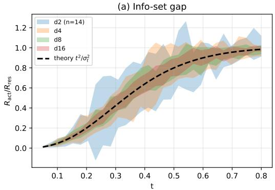

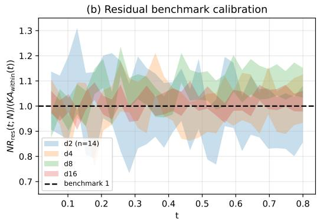  
Figure 5: Info-set decomposition and residual benchmark calibration. (a) The empirical ratio $R _ { \mathrm { a c t } } ^ { - } ( t ; N ) / R _ { \mathrm { r e s } } ( t ; N )$ from a closed-form ablation $( N { = } 2 0 0 0 , K { = } 4 , \sigma { = } 0 . 5$ , no MLP) collapses onto the analytic curve $t ^ { 2 } / \sigma _ { t } ^ { 2 }$ (dashed) across d $\in \{ 2 , 4 , 8 , 1 6 \}$ . (b) The residual-regression oracle, normalized as $N R _ { \mathrm { r e s } } ( t ; N ) / ( K A _ { v , \mathrm { w i t h i n } } ( t ) )$ , is centered at the unit benchmark from Theorem 5. All scalar summaries in the text use the full 20-seed run for every d. Panel (a) shows seed-level spread for the ratio readout, while panel (b) shows standard error around the mean for residual calibration. Together these panels show that the label-and-action oracle is strictly tighter at small $t ,$ while the residual oracle is calibrated to the theorem’s sharp residual-regression benchmark.

(b) Label-oracle residual upper bound. For times satisfying $\Delta _ { \mathrm { e f f } } ( t ) ~ \geq ~ \tau _ { \mathrm { s e p } }$ and $N \geq$ $C _ { N } \pi _ { \operatorname* { m i n } } ^ { - 1 } ( d + \log K )$ , there exists a label-oracle residual estimator such that

$$
R _ { \mathrm { o r c } } ( t ; N ) \leq \frac { C _ { 1 } K } { N } \mathcal { A } _ { v } ( t ) + \varepsilon _ { \mathrm { s e p } } ( t ) + \varepsilon _ { \mathrm { c o u n t } } ( t , N ) ,\tag{29}
$$

where one can take $\begin{array} { r l r } { \varepsilon _ { \mathrm { s e p } } ( t ) } & { = } & { O \Big ( K e ^ { - c \Delta _ { \mathrm { e f f } } ( t ) ^ { 2 } } \Delta _ { \mathrm { m a x } } ^ { 2 } / \sigma _ { t } ^ { 2 } \Big ) } \end{array}$ , and $\begin{array} { r l } { \varepsilon _ { \mathrm { c o u n t } } ( t , N ) } & { { } = } \end{array}$ $O \big ( K e ^ { - c \pi _ { \operatorname* { m i n } } N } \Delta _ { \operatorname* { m a x } } ^ { 2 } / \sigma _ { t } ^ { 2 } \big )$

(c) Separated residual-subproblem lower bound. For the corresponding separated-regime residual Gaussian-location subproblem,

$$
R _ { \mathrm { s u b } } ^ { * } ( t ; N ) \geq \frac { c _ { 1 } K } { N } { \mathcal { A } } _ { v } ( t ) .\tag{30}
$$

Consequently, within this label-oracle residual-regression separated subproblem, the upper bound and lower bound identify K $\mathcal { A } _ { v } ( t ) / N$ as the parametric residual-regression scale, up to exponentially small separation and count corrections. The separated-regime normalized collapse (Proposition 6) follows as a direct consequence.

Remark 16 (Comparison with the Intrinsic Benchmark). The intrinsic benchmark minimax rate (Theorem 4) gives a bounded-factor time-resolved scaling for general distributions with finite Hölder smoothness s. For the Gaussian mixture, the velocity field is smooth on every bounded readout neighborhood and therefore satisfies the benchmark assumption for each fixed finite $s .$ The labeloracle residual separated-regime benchmark has the parametric rate $N ^ { - 1 }$ for a different reason: it is a finite-parameter residual-regression problem. We do not obtain this rate by taking an $s \to \infty$ limit of Theorem 4.

Remark 17 (Interpretation of $\alpha \approx 1$ in experiments). The 2D separated-row sanity audit with $t _ { \mathrm { m a x } } = 0 . 5 0$ gives $\alpha = 1 . 0 7 8 \pm 0 . 1 5 7$ and $\mathrm { { C V } = 0 . 1 4 \mathrm { { 6 } } }$ , matching the parametric scale predicted by Theorem 5. The main controlled experiment in Section 5.1 uses a denser $d = 4$ sweep and shows where this parametric behavior appears within a broader transition: the plateau occurs at intermediate separation, while extreme overlap and extreme separation attenuate the observed exponent for different reasons.

Remark 18 (Scope and prescriptive limits). Theorem 5 is an label-oracle residual ceiling in the Gaussian-mixture separated regime: below $t _ { \mathrm { m e r g e } } ( \tau _ { \mathrm { s e p } } )$ , the label-oracle residual estimator achieves the parametric residual-benchmark scale $K \mathcal { A } _ { v } ( t ) / \bar { N } ;$ ; above $t _ { \mathrm { m e r g e } } ( \tau _ { \mathrm { s e p } } )$ , we only retain the nonparametric minimax guarantee of Theorem 4. This makes $t _ { \mathrm { m e r g e } } ( \tau _ { \mathrm { s e p } } ^ { - } )$ an interpretive phase boundary for the separated-to-unresolved transition in the separated-GMM label-oracle residual picture; it is not a proved sharp theorem about blind estimators on general distributions. It is also not a prescriptive recipe: the present result does not imply that $\mathcal { A } _ { v } ( \bar { t } )$ -informed time reweighting will improve a practical blind flow matching pipeline. We document this empirically in $\ S 5 . 3$ , where a controlled time-sampler stress test gives same-sign paired improvements across the tested mixture-to-pure arms in the main controlled cell with a demonstration-seed-disjoint proxy source. Appendix D.8 adds a three-cell d-axis sensitivity check: mixture arms and lower pure exponents preserve the improvement direction, while the most aggressive pure sampler exposes a boundary at the largest cell. Broader generality beyond this partial-merge d-axis family remains open; whether structured non-time signals such as stage-aware reweighting yield further gains is also untested.

## B.4 Proof Map

The appendix proof follows the three clauses of Theorem $5 .$

(a) Mode dominance and local affine structure. Lemma 32 and Theorem 33 show that, on the separated event, one component dominates and the Bayes velocity is locally affine.

(b) Label-oracle residual upper bound. The label-oracle residual construction gives the $K \mathcal { A } _ { v } ( t ) / N$ upper scale with separation and count remainders.

(c) Residual lower bound. The separated residual Gaussian-location subproblem gives the matching $K \mathcal { A } _ { v } ( t ) / N$ lower scale.

## B.5 Discussion: Beyond Gaussian Mixtures

For general distributions $p _ { \mathrm { d a t a } }$ supported on a d-dimensional $C ^ { 2 }$ manifold with velocity field $v ^ { * } \in C ^ { s }$ on the stated compact coordinate domains, Conjecture 20 predicts the adaptive rate

$$
\begin{array} { r } { R ( t ; N ) = \mathcal { A } _ { v } ( t ) \cdot \Theta \Bigg ( N ^ { - \frac { 2 s _ { \mathrm { e f f } } ( t ) } { 2 s _ { \mathrm { e f f } } ( t ) + d _ { \mathrm { e f f } } ( t ) } } \Bigg ) , } \end{array}\tag{31}
$$

where $s _ { \mathrm { e f f } } ( t )$ and $d _ { \mathrm { e f f } } ( t )$ are effective parameters that interpolate between two regimes around a model-dependent transition time. In the isotropic-GMM proxy this transition is denoted $t _ { \mathrm { m e r g e } } ( \tau )$ for a chosen threshold τ:

$t < t _ { \mathrm { m e r g e } } ( \tau )   { : } \mathrm { i f \ } p _ { \mathrm { d a t a } }$ has modal structure, the local residual model is finite-dimensional (described phenomenologically by a large $s _ { \mathrm { e f f } }$ with $d _ { \mathrm { e f f } } = d )$ , and the rate approaches the parametric scale $N ^ { - 1 }$ ;

$t > t _ { \mathrm { m e r g e } } ( \tau ) \colon s _ { \mathrm { e f f } } ( t )$ is determined by the effective finite Hölder smoothness of $v ^ { * } ( s _ { \mathrm { e f f } } = s$ $d _ { \mathrm { e f f } } = d )$ , yielding the nonparametric rate $\mathcal { A } _ { v } ( t ) \cdot N ^ { - 2 s _ { \mathrm { e f f } } / ( 2 s _ { \mathrm { e f f } } + d _ { \mathrm { e f f } } ) }$

The adaptive mechanism is motivated by Schmidt-Hieber [32]: deep networks exploit the piecewise smooth structure of $v ^ { * }$ without requiring prior knowledge of $s _ { \mathrm { e f f } }$ . We treat this as a conjectural extension and use it only as interpretive vocabulary for controlled and appendix diagnostics.

Controlled SGD support. A controlled flow-matching experiment on a separated Gaussian mixture (Appendix B.8) provides empirical support for the trained-network direction of this picture. An SGD trained velocity network has a data-end exponent $\alpha \approx 0 . 9 4$ (approaching the parametric scale $N ^ { - 1 } )$ and a slower nonparametric exponent toward the noise end, with the ordering invariant across two time samplers and two training-budget conventions once a minimum-gradient-step floor removes the small-sample undertraining confound. A complementary copying estimator (the empirical-velocity nearest-endpoint rule) instead localizes with a one-nearest-neighbor exponent $\alpha = 2 / D$ in the intrinsic dimension $D ,$ tracking $2 / D$ to within 0.02 across $D \in \{ 4 , 5 , 6 , 8 \}$ . The two estimators therefore separate by their data-end exponent: the trained network approaches the parametric scale independent of dimension, whereas the copying reference tracks the dimension-dependent localization exponent.

## B.6 Effective parameters and adaptive-rate conjecture

Real-world action distributions are far from worst-case: they exhibit multi-modality, low intrinsic dimension, and piecewise smooth structure. This motivates a conjectural adaptive-rate picture

in which sufficiently expressive estimators may exploit this structure to converge faster than the worst-case minimax rate of Theorem 4.

Remark 19 (Effective smoothness and dimension-phenomenological parameters). When the excess risk at time t takes the power-law form $R ( t ; N ) = \mathcal { A } _ { v } ( t ) \cdot \Theta ( N ^ { - \alpha ( t ) } )$ , we define the effective smoothness $s _ { \mathrm { e f f } } ( t )$ and dimension $d _ { \mathrm { e f f } } ( t )$ via the identity $\dot { \alpha } ( t ) = 2 s _ { \mathrm { e f f } } ( t ) / ( 2 s _ { \mathrm { e f f } } ( t ) + d _ { \mathrm { e f f } } ( t ) )$

$$
R ( t ; N ) = \mathcal { A } _ { v } ( t ) \cdot \Theta \biggl ( N ^ { - \frac { 2 s _ { \mathrm { e f f } } ( t ) } { 2 s _ { \mathrm { e f f } } ( t ) + d _ { \mathrm { e f f } } ( t ) } } \biggr ) .\tag{32}
$$

These are phenomenological parameters inferred from observed scaling behavior, not a priori structural quantities. The observed exponent $\alpha ( t )$ alone does not uniquely determine $s _ { \mathrm { e f f } }$ and $d _ { \mathrm { e f f } } ;$ additional structural assumptions (such as fixing $d _ { \mathrm { e f f } } ~ = ~ d )$ are needed for identifiability. The Gaussian-mixture residual benchmark can be encoded by the limiting phenomenological notation $s _ { \mathrm { e f f } }  \infty , d _ { \mathrm { e f f } } = d$ in the parametric regime, yielding $\alpha = 1$ . This notation is not an Assumption A2 claim and is recorded in Appendix B.7.

When $s _ { \mathrm { e f f } } ( t )$ exceeds the nominal smoothness s in Theorem 4, the estimator achieves a rate faster than the minimax bound, a phenomenon known as adaptation [32].

Conjecture 20 (Adaptive Rate for General Structured Data). Under Assumptions $A l { - } A 2 ,$ , suppose additionally that $p _ { \mathrm { d a t a } }$ has structured support $( e . g .$ , finite mixture, piecewise manifold) such that the conditional velocity field $v ^ { * } ( \cdot , t )$ has effective smoothness $s _ { \mathrm { e f f } } ( t ) > s$ . Then a neural network estimator $\hat { v } _ { N }$ with appropriate architecture achieves:

$$
R ( t ; N ) = \mathcal { A } _ { v } ( t ) \cdot \Theta \biggl ( N ^ { - \frac { 2 s _ { \mathrm { e f f } } ( t ) } { 2 s _ { \mathrm { e f f } } ( t ) + d _ { \mathrm { e f f } } ( t ) } } \biggr ) ,\tag{33}
$$

where $s _ { \mathrm { e f f } } ( t )$ and $d _ { \mathrm { e f f } } ( t )$ depend on the local structure of $\therefore p _ { \mathrm { d a t a } }$ at time step t.

Rigorousfor Gaussian mixtures: Theorem 5 below establishes a separated-regime residual benchmark of parametric order together with a matching lower bound for the corresponding residual Gaussianlocation subproblem. General case: a theory-motivated extrapolation from the adaptive deep nonparametric regression results of Schmidt-Hieber [32], used as interpretive vocabulary in the empirical diagnostics (Section 5).

This conjecture is included as an interpretive extension rather than a required step for the proved results. It motivates the possibility that $s _ { \mathrm { e f f } } ( t )$ varies with $t ,$ creating regimes separated by a critical time $t _ { \mathrm { m e r g e } } ,$ , but Theorems 4 and 5 stand independently of that conjectural picture. A controlled SGD experiment (Appendix B.8) provides evidence consistent with this t-varying $\alpha ( t )$ in the trainednetwork direction; it supports the direction of the conjecture without elevating it to a theorem.

## B.7 Effective parameters: Gaussian-mixture instance

The phenomenological pair $( s _ { \mathrm { e f f } } , d _ { \mathrm { e f f } } )$ defined in Remark 19 takes a concrete value for the Gaussianmixture model under Setting 14: in the parametric (separated) regime $\Delta _ { \mathrm { e f f } } ( t ) \geq \tau _ { \mathrm { s e p } }$ , Theorem 5 delivers the residual-benchmark rate $R ( t ; \mathbf { \dot { N } } ) = \Theta ( K \mathcal { A } _ { v } ( t ) / N )$ up to exponentially small separation and component-count corrections, which can be represented phenomenologically by $s _ { \mathrm { e f f } } \ \to \ \infty .$ $d _ { \mathrm { e f f } } = d ,$ , hence $\alpha = 1$ . This is a finite-dimensional residual result, not an infinite-smoothness limit of Theorem 4. Outside the separated regime the same pair serves only as a descriptive framework consistent with Conjecture 20.

## B.8 Controlled adaptive-rate evidence: trained network and copying estimator

We report a controlled flow-matching experiment that separates the trained-network excess-risk rate from the copying (empirical-velocity) rate on a common setting. The target is a separated isotropic Gaussian mixture $( K \bar { = } 1 2 , \sigma = 0 . 5 \bar { }$ , centers on a radius-3 sphere), with the path $x _ { t } = t \varepsilon + ( 1 - t )$ a so that data sit at $t = 0$ . For each time bin we estimate the held-out velocity-risk exponent $\alpha ( t )$ from the slope of the log paired excess risk against log N over a demonstration-count ladder, using common random numbers so that the dominant $\mathbf { \mathcal { A } } _ { v } ( t )$ variance cancels. Two estimators are compared.

Copying estimator (population-floor reference). The empirical-velocity rule copies the velocity of the nearest training endpoint. Measured against the analytic Bayes-velocity population floor (which removes the finite-sample bias of an empirical floor), its data-end exponent tracks the one-nearestneighbor localization exponent $2 / D$ across dimension.

<table><tr><td>D</td><td>target  $2 / D$ </td><td>measured  $\alpha _ { \mathrm { d a t a } }$ </td></tr><tr><td>4</td><td>0.500</td><td>0.480</td></tr><tr><td>5</td><td>0.400</td><td>0.398</td></tr><tr><td>6</td><td>0.333</td><td>0.331</td></tr><tr><td>8</td><td>0.250</td><td>0.272</td></tr></table>

A regression of the measured exponent on $2 / D$ has slope 0.85 and $R ^ { 2 } = 0 . 9 9 7 ;$ ; the monotone trend is significant under an isotonic test $( p = 0 . \dot { 0 } 0 0 2 )$ and a label-shuffle null does not reproduce it. The case $D = 3$ is omitted as degenerate $( 2 / D \approx 1$ coincides with the averaging exponent).

Trained network (SGD). An SGD-trained velocity network, evaluated against a self-referenced floor that cancels its N-independent approximation error, shows the opposite ordering: a data-end exponent $\alpha _ { \mathrm { d a t a } } \approx 0 . 9 4$ (approaching the parametric scale $N ^ { - 1 } )$ and a slower nonparametric exponent toward the noise end $( \alpha _ { \mathrm { n o i s e } } \approx 0 . 5 )$ . This is the direction predicted by Conjecture 20: separated modes near the data end give a locally affine field and an exponent close to 1, while merged modes near the noise end give a slower nonparametric exponent. The ordering is invariant across two time samplers (uniform and beta) and two budget conventions (equal gradient steps and equal epochs) once a minimum-gradient-step floor lifts the smallest-sample models out of the undertraining regime; all four sampler-by-budget cells agree in sign. The data-end exponent is significant in this direction under the isotonic test $( p = 0 . 0 0 0 2 )$ ) with a clean shuffle null.

Reading. The two estimators separate along their data-end rate: the trained network approaches the parametric exponent independent of dimension, whereas the copying reference tracks the dimensiondependent localization exponent $2 / D$ . We report the trained-network profile as controlled support for the direction of Conjecture 20, not as a proof. The noise-end exponent is resolved in point estimate but with wide intervals, and the budget invariance holds in sign with small magnitude under the equal-epoch budget.

## B.9 Comparison with Theorem 4

The intrinsic benchmark minimax rate (Theorem 4) gives the usual nonparametric exponent $2 s / ( 2 s +$ $d )$ , with time dependence controlled by $\mathbf { \mathcal { A } } _ { v } ( t )$ up to interval-dependent constants. For the Gaussian mixture, $v ^ { * } \mathrm { i s } C ^ { \mathrm { \bar { \infty } } }$ , so the nonparametric rate with any finite s is slower than the parametric rate $N ^ { - 1 }$ This is not a contradiction: Theorem 4 is a worst-case intrinsic nonparametric benchmark, whereas Theorem 5 exploits the additional finite-dimensional structure of the separated GMM regime.

## B.10 Upper Bound (Parametric Regime)

Throughout this section we work under the following assumptions.

Assumption A6 (Gaussian Mixture Model). The data distribution is a K-component isotropic Gaussian mixture in $\mathbb { R } ^ { d } .$

$$
p _ { \mathrm { d a t a } } ( a ) = \sum _ { k = 1 } ^ { K } \pi _ { k } { \mathcal { N } } ( a ; \mu _ { k } , \sigma ^ { 2 } I _ { d } ) ,
$$

with mixing weights $\begin{array} { r } { \pi _ { k } > 0 , \sum _ { k = 1 } ^ { K } \pi _ { k } = 1 } \end{array}$ , component means $\mu _ { k } \in \mathbb { R } ^ { d }$ , and common variance $\sigma ^ { 2 } > 0 \AA$

Assumption A7 (Separation). The minimum pairwise separation satisfies

$$
\Delta : = \operatorname* { m i n } _ { j \neq k } \| \mu _ { j } - \mu _ { k } \| > 0 .
$$

Assumption A8 (Linear Interpolation). For $a \sim p _ { \mathrm { d a t a } }$ and $\varepsilon \sim \mathcal { N } ( 0 , I _ { d } )$ independent,

$$
x _ { t } = \left( 1 - t \right) a + t \varepsilon , \qquad t \in ( 0 , 1 ) .
$$

The conditional velocity target is $u _ { t } = \varepsilon - a ,$ and the Bayes-optimal velocity field is $v ^ { * } ( x _ { t } , t ) =$ $\mathbb { E } [ u _ { t } \mid x _ { t } , t ]$

We define the total variance at time t:

$$
\sigma _ { t } ^ { 2 } : = ( 1 - t ) ^ { 2 } \sigma ^ { 2 } + t ^ { 2 } ,\tag{34}
$$

and the velocity ambiguity profile:

$$
\mathcal { A } _ { v } ( t ) : = \mathbb { E } _ { x _ { t } } \big [ \mathrm { t r } { \mathrm { C o v } } [ u _ { t } \mid x _ { t } , t ] \big ] .\tag{35}
$$

## B.10.1 Posterior Computation

We derive the closed-form posterior $p ( a \mid x _ { t } , t )$

Lemma 21 (Conditional distribution of $\boldsymbol { x } _ { t } )$ . Under Assumptions $A 6 \ – A \delta ,$ conditioned on a belonging to component k,

$$
x _ { t } \mid k \sim \mathcal { N } \big ( ( 1 - t ) \mu _ { k } , \sigma _ { t } ^ { 2 } I _ { d } \big ) .
$$

Proof. Given a $\mid k \sim \mathcal { N } ( \mu _ { k } , \sigma ^ { 2 } I _ { d } )$ and $\varepsilon \sim \mathcal { N } ( 0 , I _ { d } )$ independent, $x _ { t } = ( 1 - t ) a + t \varepsilon$ is a sum of two independent Gaussians:

$$
( 1 - t ) a \mid k \sim \mathcal { N } \big ( ( 1 - t ) \mu _ { k } , ( 1 - t ) ^ { 2 } \sigma ^ { 2 } I _ { d } \big ) , \qquad t \varepsilon \sim \mathcal { N } ( 0 , t ^ { 2 } I _ { d } ) .
$$

Since the sum of independent Gaussians is Gaussian with mean and covariance given by the respective sums, $x _ { t } \mid k \sim \mathcal { N } \big ( ( 1 - t ) \mu _ { k } , [ ( 1 - t ) ^ { 2 } \sigma ^ { 2 } + t ^ { 2 } ] I _ { d } \big ) = \mathcal { N } \big ( ( 1 - t ) \mu _ { k } , \sigma _ { t } ^ { 2 } I _ { d } \big )$ □

Definition 22 (Posterior responsibilities). The posterior weight ofcomponent k given $( x _ { t } , t )$ is

$$
\gamma _ { k } ( x _ { t } , t ) : = \frac { \pi _ { k } \phi _ { d } \left( x _ { t } ; ( 1 - t ) \mu _ { k } , \sigma _ { t } ^ { 2 } I _ { d } \right) } { \sum _ { j = 1 } ^ { K } \pi _ { j } \phi _ { d } \left( x _ { t } ; ( 1 - t ) \mu _ { j } , \sigma _ { t } ^ { 2 } I _ { d } \right) } ,\tag{36}
$$

where $\phi _ { d } ( \cdot ; m , \Sigma )$ denotes the d-dimensional Gaussian density with mean m and covariance $\Sigma .$ Proposition 23 (Posterior distribution of a). The posterior $p ( a \mid x _ { t } , t )$ is a Gaussian mixture:

$$
p ( a \mid x _ { t } , t ) ~ = ~ \sum _ { k = 1 } ^ { K } \gamma _ { k } ( x _ { t } , t ) { \mathcal { N } } \Big ( a ; \hat { m } _ { k } ( x _ { t } , t ) , ~ \frac { \sigma ^ { 2 } t ^ { 2 } } { \sigma _ { t } ^ { 2 } } I _ { d } \Big ) ,\tag{37}
$$

where the component-wise posterior mean is

$$
\hat { m } _ { k } ( x _ { t } , t ) = \frac { ( 1 - t ) \sigma ^ { 2 } x _ { t } + t ^ { 2 } \mu _ { k } } { \sigma _ { t } ^ { 2 } } .\tag{38}
$$

Proof. Fix component $k .$ The prior on a is $p ( a \mid k ) = \mathcal { N } ( a ; \mu _ { k } , \sigma ^ { 2 } I _ { d } )$ , and the likelihood is $p ( x _ { t } \mid a , t ) = \hat { \mathcal { N } } ( x _ { t } ; ( 1 - t ) a , t ^ { \hat { 2 } } I _ { d } )$ . Viewed as a function of $^ { a , }$ the likelihood is proportional to $\begin{array} { r } { \exp \bigl ( { - \frac { 1 } { 2 t ^ { 2 } } \| x _ { t } - ( 1 - t ) a \| ^ { 2 } } \bigr ) } \end{array}$ , which is a Gaussian in a with mean $x _ { t } / ( 1 - t )$ and variance $t ^ { 2 } / ( 1 - t ) ^ { 2 }$ per coordinate.

By standard Gaussian conjugacy, the posterior $a \mid k , x _ { t } ,$ t is Gaussian with

$$
\hat { \sigma } _ { t } ^ { - 2 } = \sigma ^ { - 2 } + \frac { ( 1 - t ) ^ { 2 } } { t ^ { 2 } } = \frac { t ^ { 2 } + ( 1 - t ) ^ { 2 } \sigma ^ { 2 } } { t ^ { 2 } \sigma ^ { 2 } } = \frac { \sigma _ { t } ^ { 2 } } { t ^ { 2 } \sigma ^ { 2 } } ,\tag{39}
$$

variance: $\hat { \sigma } _ { t } ^ { 2 } = \frac { t ^ { 2 } \sigma ^ { 2 } } { \sigma _ { t } ^ { 2 } } ,$

(40)

$$
\hat { m } _ { k } = \hat { \sigma } _ { t } ^ { 2 } \bigg ( \frac { \mu _ { k } } { \sigma ^ { 2 } } + \frac { ( 1 - t ) x _ { t } } { t ^ { 2 } } \bigg ) = \frac { t ^ { 2 } \sigma ^ { 2 } } { \sigma _ { t } ^ { 2 } } \cdot \frac { t ^ { 2 } \mu _ { k } + ( 1 - t ) \sigma ^ { 2 } x _ { t } } { t ^ { 2 } \sigma ^ { 2 } } = \frac { ( 1 - t ) \sigma ^ { 2 } x _ { t } + t ^ { 2 } \mu _ { k } } { \sigma _ { t } ^ { 2 } } .\tag{41}
$$

The full posterior is the mixture $\begin{array} { r l } { \sum _ { k } \gamma _ { k } ( x _ { t } , t ) \mathcal { N } ( a ; \hat { m } _ { k } , \hat { \sigma } _ { t } ^ { 2 } I _ { d } ) } \end{array}$ , where $\gamma _ { k }$ are the posterior responsibilities from Definition 22. □

## B.10.2 Velocity Field Closed Form

Proposition 24 (Optimal velocity field). Under Assumptions A6-A8, the Bayes-optimal velocity field is

$$
v ^ { * } ( x _ { t } , t ) ~ = ~ \frac { 1 } { t } \big ( x _ { t } - \bar { a } ( x _ { t } , t ) \big ) ,\tag{42}
$$

where $\bar { a } ( x _ { t } , t ) : = \mathbb { E } [ a \mid x _ { t } , t ]$ is given explicitly by

$$
{ \bar { a } } ( x _ { t } , t ) = \sum _ { k = 1 } ^ { K } \gamma _ { k } ( x _ { t } , t ) { \hat { m } } _ { k } ( x _ { t } , t ) = \frac { ( 1 - t ) \sigma ^ { 2 } x _ { t } + t ^ { 2 } { \bar { \mu } } ( x _ { t } , t ) } { \sigma _ { t } ^ { 2 } } ,\tag{43}
$$

with $\begin{array} { r } { \bar { \mu } ( x _ { t } , t ) : = \sum _ { k = 1 } ^ { K } \gamma _ { k } ( x _ { t } , t ) \mu _ { k } } \end{array}$ the posterior-weighted mean ofthe component centers.

Equivalently,

$$
v ^ { * } ( x _ { t } , t ) \ = \ \frac { \left[ t - ( 1 - t ) \sigma ^ { 2 } \right] x _ { t } - t \bar { \mu } ( x _ { t } , t ) } { \sigma _ { t } ^ { 2 } } .\tag{44}
$$

Proof. Since $u _ { t } = \varepsilon - a$ and $\varepsilon = ( x _ { t } - ( 1 - t ) a ) / t$ , we have $u _ { t } = ( x _ { t } - a ) / t$ . Thus $v ^ { * } ( x _ { t } , t ) =$ $\mathbb { E } [ u _ { t } \mid x _ { t } , t ] = ( x _ { t } - \bar { a } ) / t$

For the explicit form of a¯, by the tower property over component indices:

$$
\bar { a } ( x _ { t } , t ) = \sum _ { k = 1 } ^ { K } \gamma _ { k } ( x _ { t } , t ) \hat { m } _ { k } ( x _ { t } , t ) = \sum _ { k = 1 } ^ { K } \gamma _ { k } \cdot \frac { ( 1 - t ) \sigma ^ { 2 } x _ { t } + t ^ { 2 } \mu _ { k } } { \sigma _ { t } ^ { 2 } } = \frac { ( 1 - t ) \sigma ^ { 2 } x _ { t } + t ^ { 2 } \bar { \mu } ( x _ { t } , t ) } { \sigma _ { t } ^ { 2 } } ,
$$

where we used $\textstyle \sum _ { k } \gamma _ { k } = 1$ . Substituting into (42):

$$
\begin{array} { l } { v ^ { * } ( x _ { t } , t ) = \displaystyle \frac { 1 } { t } \bigg ( x _ { t } - \frac { ( 1 - t ) \sigma ^ { 2 } x _ { t } + t ^ { 2 } \bar { \mu } } { \sigma _ { t } ^ { 2 } } \bigg ) } \\ { \displaystyle \qquad = \frac { 1 } { t } \cdot \frac { \sigma _ { t } ^ { 2 } x _ { t } - ( 1 - t ) \sigma ^ { 2 } x _ { t } - t ^ { 2 } \bar { \mu } } { \sigma _ { t } ^ { 2 } } } \\ { \displaystyle \qquad = \frac { 1 } { t } \cdot \frac { \big [ ( 1 - t ) ^ { 2 } \sigma ^ { 2 } + t ^ { 2 } - ( 1 - t ) \sigma ^ { 2 } \big ] x _ { t } - t ^ { 2 } \bar { \mu } } { \sigma _ { t } ^ { 2 } } . } \end{array}
$$

The coefficient of $x _ { t }$ in the numerator simplifies as

$$
\begin{array} { r l } & { ( 1 - t ) ^ { 2 } \sigma ^ { 2 } + t ^ { 2 } - ( 1 - t ) \sigma ^ { 2 } = ( 1 - t ) \sigma ^ { 2 } \left[ ( 1 - t ) - 1 \right] + t ^ { 2 } = - t ( 1 - t ) \sigma ^ { 2 } + t ^ { 2 } = t \left[ t - ( 1 - t ) \sigma ^ { 2 } \right] , } \\ & { \mathrm { y i e l d i n g ~ } ( 4 4 ) . } \end{array}
$$

Remark 25 (Structural observation). The velocity field $v ^ { * } ( x _ { t } , t )$ is affine in $x _ { t }$ if and only if $\bar { \mu } ( x _ { t } , t ) =$ $\begin{array} { r } { \sum _ { k } \gamma _ { k } ( x _ { t } , t ) \mu _ { k } } \end{array}$ is constant (i.e., independent of $x _ { t } )$ . This occurs when the posterior responsibilities $\gamma _ { k }$ are effectively degenerate-one component dominates throughout. The “locally affine” structure in the parametric regime exploits precisely this observation (Theorem 33).

## B.10.3 $\mathbf { \mathcal { A } } _ { v } ( t )$ Decomposition

Proposition 26 (Conditional variance of $u _ { t } )$ . The conditional covariance of ut given $( x _ { t } , t )$ satisfies

$$
\operatorname { C o v } [ u _ { t } \mid x _ { t } , t ] \ = \ { \frac { 1 } { t ^ { 2 } } } \ \operatorname { C o v } [ a \mid x _ { t } , t ] .\tag{45}
$$

Proof. Since $\boldsymbol { u } _ { t } = ( \boldsymbol { x } _ { t } - \boldsymbol { a } ) / t$ and $x _ { t }$ is fixed when conditioning, Cov $\cdot [ u _ { t } \mid x _ { t } , t ] = \operatorname { C o v } [ - a / t \mid \atop \prod $ $x _ { t } , t \dot { ] } = ( 1 / t ^ { 2 } ) \operatorname { C o v } \dot { [ } a \mid x _ { t } , \dot { t } ]$

Proposition 27 (Law of total variance decomposition). The conditional covariance of a decomposes as

$$
\operatorname { C o v } [ a \mid x _ { t } , t ] = \underbrace { \frac { t ^ { 2 } \sigma ^ { 2 } } { \sigma _ { t } ^ { 2 } } I _ { d } } _ { w i t h i n - c o m p o n e n t } + \underbrace { \sum _ { k = 1 } ^ { K } \gamma _ { k } \left( \hat { m } _ { k } - \bar { a } \right) \left( \hat { m } _ { k } - \bar { a } \right) ^ { \top } } _ { b e t w e e n - c o m p o n e n t } ,\tag{46}
$$

where $\begin{array} { r } { \bar { a } = \sum _ { k } \gamma _ { k } \hat { m } _ { k } } \end{array}$

Proof. By the law of total variance applied to the mixture index k:

$$
\operatorname { C o v } [ a \mid x _ { t } , t ] = \mathbb { E } _ { k } [ \operatorname { C o v } [ a \mid x _ { t } , t , k ] ] + \operatorname { C o v } _ { k } [ \mathbb { E } [ a \mid x _ { t } , t , k ] ] .
$$

The first term is $\begin{array} { r } { \sum _ { k } \gamma _ { k } \cdot \hat { \sigma } _ { t } ^ { 2 } I _ { d } = ( t ^ { 2 } \sigma ^ { 2 } / \sigma _ { t } ^ { 2 } ) I _ { d } , } \end{array}$ since each within-component posterior has the same variance $\hat { \sigma } _ { t } ^ { 2 } = t ^ { 2 } \bar { \sigma ^ { 2 } } / \sigma _ { t } ^ { 2 }$ (Proposition 23). The second term is $\begin{array} { r } { \sum _ { k } \gamma _ { k } ( \hat { m } _ { k } - \bar { a } ) ( \hat { m } _ { k } - \bar { a } ) ^ { \top } } \end{array}$ □

Theorem 28 $( A _ { v } ( t )$ decomposition). The velocity ambiguity profile admits the decomposition

$$
\mathcal { A } _ { v } ( t ) \ = \ \underbrace { \frac { d \sigma ^ { 2 } } { \sigma _ { t } ^ { 2 } } } _ { A _ { v , \mathrm { w i t h i n } } ( t ) } + \underbrace { \frac { t ^ { 2 } } { \sigma _ { t } ^ { 4 } } \mathbb { E } _ { x _ { t } } \biggr [ \sum _ { j < k } \gamma _ { j } \gamma _ { k } \left\| \mu _ { j } - \mu _ { k } \right\| ^ { 2 } \biggr ] } _ { A _ { v , \mathrm { b e t w e e n } } ( t ) } .\tag{47}
$$

Proof. Combining Propositions 26 and 27, we have

$$
\mathrm { t r } \mathrm { C o v } [ u _ { t } \mid x _ { t } , t ] = \frac { d \sigma ^ { 2 } } { \sigma _ { t } ^ { 2 } } + \frac { 1 } { t ^ { 2 } } \sum _ { k = 1 } ^ { K } \gamma _ { k } \parallel \hat { m } _ { k } - \bar { a } \parallel ^ { 2 } .
$$

The second term can be rewritten using the identity $\begin{array} { r } { \sum _ { k } \gamma _ { k } \| \hat { m } _ { k } - \bar { a } \| ^ { 2 } = \sum _ { i < k } \gamma _ { j } \gamma _ { k } \| \hat { m } _ { j } - \hat { m } _ { k } \| ^ { 2 } } \end{array}$ (which follows from $\begin{array} { r } { \bar { a } = \sum _ { k } \gamma _ { k } \hat { m } _ { k } } \end{array}$ and direct expansion).

From (38), the difference of posterior means is

$$
\hat { m } _ { j } - \hat { m } _ { k } = \frac { t ^ { 2 } ( \mu _ { j } - \mu _ { k } ) } { \sigma _ { t } ^ { 2 } } ,
$$

so $\| \hat { m } _ { j } - \hat { m } _ { k } \| ^ { 2 } = t ^ { 4 } \| \mu _ { j } - \mu _ { k } \| ^ { 2 } / \sigma _ { t } ^ { 4 }$ . Therefore

$$
\frac { 1 } { t ^ { 2 } } \sum _ { j < k } \gamma _ { j } \gamma _ { k } \| \hat { m } _ { j } - \hat { m } _ { k } \| ^ { 2 } = \frac { t ^ { 2 } } { \sigma _ { t } ^ { 4 } } \sum _ { j < k } \gamma _ { j } \gamma _ { k } \| \mu _ { j } - \mu _ { k } \| ^ { 2 } .
$$

Taking $\mathbb { E } _ { x _ { t } }$ of both sides and using (35) yields (47).

Remark 29 (Behavior of the two terms). (i) $\mathcal { A } _ { v , \mathrm { w i t h i n } } ( t ) = { d \sigma ^ { 2 } } / { \sigma _ { t } ^ { 2 } }$ is deterministic and monotonically varies with t. It represents the irreducible per-component posterior uncertainty.

(ii) $\mathcal { A } _ { v , \mathrm { b e t w e e n } } ( t )$ is non-negative and depends on the expected product $\mathbb { E } [ \gamma _ { j } \gamma _ { k } ]$ . When modes are well separated $( \Delta _ { \mathrm { e f f } } ( t ) \gg 1$ , cf. Definition 30), the posteriors concentrate on a single component and $\gamma _ { j } \gamma _ { k } \approx 0 \mathrm { f o r } j \neq k , \mathrm { s o } \mathcal { A } _ { v , \mathrm { b e t w e e n } } ( t ) \approx 0$ . When modes overlap $( \Delta _ { \mathrm { e f f } } ( t ) \stackrel { - } { \sim }$ $1 ) , \mathcal { A } _ { v , \mathrm { b e t w e e n } } ( t )$ becomes the dominant contribution.

## B.10.4 Parametric Regime Upper Bound

We now establish that when the effective signal-to-noise ratio is large (modes are well separated in $x _ { t }$ -space), the velocity field is locally affine, and the estimation problem reduces to ordinary least squares (OLS) within each component, yielding a parametric $N ^ { - 1 }$ rate.

Definition 30 (Effective separation). The effective separation at time t is

$$
\Delta _ { \mathrm { e f f } } ( t ) : = \frac { ( 1 - t ) \Delta _ { \mathrm { m i n } } } { \sigma _ { t } } = \frac { ( 1 - t ) \Delta _ { \mathrm { m i n } } } { \sqrt { ( 1 - t ) ^ { 2 } \sigma ^ { 2 } + t ^ { 2 } } } ,\tag{48}
$$

where $\begin{array} { r } { \Delta _ { \operatorname* { m i n } } = \operatorname* { m i n } _ { j \neq k } \| \mu _ { j } - \mu _ { k } \| } \end{array}$

Definition 31 (Merge time). For a chosen threshold parameter $\tau > 0 ,$ , the merge time is

$$
t _ { \mathrm { m e r g e } } ( \tau ) : = \operatorname* { i n f } \{ t \in ( 0 , 1 ) : \Delta _ { \mathrm { e f f } } ( t ) < \tau \} .\tag{49}
$$

For $\Delta _ { \mathrm { m i n } } > \tau \sigma$ (the non-trivial regime), the merge time admits the explicit formula

$$
t _ { \mathrm { m e r g e } } ( \tau ) = \frac { \sqrt { \Delta _ { \mathrm { m i n } } ^ { 2 } - \tau ^ { 2 } \sigma ^ { 2 } } } { \sqrt { \Delta _ { \mathrm { m i n } } ^ { 2 } - \tau ^ { 2 } \sigma ^ { 2 } } + \tau } .\tag{50}
$$

Lemma 32 (Mode dominance). Let $\tau _ { \mathrm { s e p } } : = C _ { \mathrm { s e p } } \sqrt { \log K + \log ( 1 / \pi _ { \mathrm { m i n } } ) }$ . Fix t with $\Delta _ { \mathrm { e f f } } ( t ) \geq \tau _ { \mathrm { s e p } }$ Let z be the generating component and let $k ^ { * } ( \stackrel { \cdot } { x _ { t } } ) : =$ arg maxk $\gamma _ { k } ( x _ { t } , t )$ . Then, with probability at least $1 - 2 \check { K } \exp ( - c \check { \Delta } _ { \mathrm { e f f } } ( t ) ^ { 2 } )$ over $x _ { t } \sim p ( x _ { t } \mid i ) , z = \bar { k } ^ { * } ( x _ { t } )$ and,for all k $\neq k ^ { * }$

$$
\begin{array} { r } { \gamma _ { k } ( x _ { t } , t ) \ \leq \ \exp ( - c \Delta _ { \mathrm { e f f } } ( t ) ^ { 2 } ) , } \end{array}\tag{51}
$$

and hence $\begin{array} { r } { \sum _ { k \neq k ^ { \ast } } \gamma _ { k } ( x _ { t } , t ) \leq K \exp ( - c \Delta _ { \mathrm { e f f } } ( t ) ^ { 2 } ) } \end{array}$

Proof. Suppose xt was generated from component $z , \mathrm { i . e . , } x _ { t } \mid z \sim \mathcal { N } \big ( ( 1 - t ) \mu _ { z } , \sigma _ { t } ^ { 2 } I _ { d } \big )$ . Write $x _ { t } = ( 1 - t ) \mu _ { z } + \sigma _ { t } g$ with $g \sim \mathcal { N } ( 0 , I _ { d } )$ . The log-likelihood ratio between the true component z and a competing component k is

$$
\log \frac { \gamma _ { z } } { \gamma _ { k } } = \log \frac { \pi _ { z } } { \pi _ { k } } + \frac { \| x _ { t } - ( 1 - t ) \mu _ { k } \| ^ { 2 } - \| x _ { t } - ( 1 - t ) \mu _ { z } \| ^ { 2 } } { 2 \sigma _ { t } ^ { 2 } } .
$$

The quadratic difference evaluates to

$$
\frac { \Vert x _ { t } - ( 1 - t ) \mu _ { k } \Vert ^ { 2 } - \Vert x _ { t } - ( 1 - t ) \mu _ { z } \Vert ^ { 2 } } { 2 \sigma _ { t } ^ { 2 } } = \frac { ( 1 - t ) ^ { 2 } \Vert \mu _ { z } - \mu _ { k } \Vert ^ { 2 } } { 2 \sigma _ { t } ^ { 2 } } + \frac { ( 1 - t ) } { \sigma _ { t } } \langle g , \mu _ { z } - \mu _ { k } \rangle
$$

The deterministic term satisfies $\begin{array} { r } { S _ { 1 } \geq \frac { 1 } { 2 } \Delta _ { \mathrm { e f f } } ( t ) ^ { 2 } \mathrm { s i n c e } \left\| \mu _ { z } - \mu _ { k } \right\| \geq \Delta _ { \operatorname* { m i n } } } \end{array}$ . The stochastic term $S _ { 2 }$ is Gaussian with mean 0 and variance $\begin{array} { r } { \sigma _ { S _ { 2 } } ^ { \tilde { 2 } } = ( 1 - t ) ^ { 2 } \| \mu _ { z } - \mu _ { k } \| ^ { 2 } / \sigma _ { t } ^ { 2 } \leq C ^ { \prime } \Delta _ { \mathrm { e f f } } ( t ) ^ { 2 } } \end{array}$ for a constant $C ^ { \prime }$ depending on $\Delta _ { \mathrm { m a x } } / \Delta _ { \mathrm { m i n } }$

By the Gaussian tail bound $\mathbb { P } ( | S _ { 2 } | > s ) \le 2 \exp ( - s ^ { 2 } / ( 2 \sigma _ { S _ { 2 } } ^ { 2 } ) )$ , choosing $\begin{array} { r } { s = \frac { 1 } { 4 } \Delta _ { \mathrm { e f f } } ( t ) ^ { 2 } } \end{array}$ , we obtain $\begin{array} { r } { | S _ { 2 } | \le \frac 1 4 \Delta _ { \mathrm { e f f } } ( t ) ^ { 2 } } \end{array}$ with probability at least $1 - 2 \exp ( - c \Delta _ { \mathrm { e f f } } ( t ) ^ { 2 } )$ .

On this event, lo $\mathrm { g } ( \gamma _ { z } / \gamma _ { k } ) \ge S _ { 1 } - | S _ { 2 } | - | \log ( \pi _ { z } / \pi _ { k } ) | \ge c \Delta _ { \mathrm { e f f } } ( t ) ^ { 2 }$ , where the final inequality uses $\Delta _ { \mathrm { e f f } } ( t ) \ \geq \ \tau _ { \mathrm { s e p } }$ with $C _ { \mathrm { s e p } }$ large enough to absorb the mixing-weight ratio. Thus $\begin{array} { r } { \gamma _ { k } \leq \exp ( - c \Delta _ { \mathrm { e f f } } ( t ) ^ { 2 } ) \gamma _ { z } . } \end{array}$ A union bound over the $K - 1$ competing components gives the stated event; on that event z is the posterior mode $k ^ { * } ( x _ { t } )$ and (51) follows after adjusting constants.

Theorem 33 (Local affine structure). Fix t with $\Delta _ { \mathrm { e f f } } ( t ) \geq \tau _ { \mathrm { s e p } }$ . For $x _ { t }$ in the high-probability region ofcomponent $k ^ { * } , v ^ { * } ( x _ { t } , t )$ is ϵ-close to an affinefunction:

$$
\left\| v ^ { * } ( x _ { t } , t ) - \left( A _ { k ^ { * } } ( t ) x _ { t } + b _ { k ^ { * } } ( t ) \right) \right\| \ \leq \ \epsilon _ { \mathrm { a f f i n e } } ( t ) ,\tag{52}
$$

where

$$
A _ { k } ( t ) = \frac { t - ( 1 - t ) \sigma ^ { 2 } } { \sigma _ { t } ^ { 2 } } I _ { d } , \qquad b _ { k } ( t ) = - \frac { t \mu _ { k } } { \sigma _ { t } ^ { 2 } } ,\tag{53}
$$

and the approximation error is exponentially small:

$$
\epsilon _ { \mathrm { a f f i n e } } ( t ) = O \biggl ( K \exp \Bigl ( - \textstyle { \frac { 1 } { 8 } } \Delta _ { \mathrm { e f f } } ( t ) ^ { 2 } \Bigr ) \cdot \frac { \Delta _ { \mathrm { m a x } } } { \sigma _ { t } } \biggr ) .\tag{54}
$$

This bound holds with probability at least $1 - 2 K \exp ( - c \Delta _ { \mathrm { e f f } } ( t ) ^ { 2 } )$ over xt.

Proof. From (44), the velocity field is

$$
v ^ { * } ( x _ { t } , t ) = \frac { \left[ t - ( 1 - t ) \sigma ^ { 2 } \right] x _ { t } - t \bar { \mu } ( x _ { t } , t ) } { \sigma _ { t } ^ { 2 } } .
$$

When the posterior is concentrated on component $k ^ { * }$ , we write $\begin{array} { r } { \bar { \mu } ( x _ { t } , t ) = \mu _ { k ^ { * } } + \sum _ { k \neq k ^ { * } } \gamma _ { k } \big ( \mu _ { k } - \mu _ { k ^ { * } } \big ) } \end{array}$ since $\begin{array} { r } { \gamma _ { k ^ { * } } = 1 - \sum _ { k \neq k ^ { * } } \gamma _ { k } } \end{array}$ . Thus

$$
v ^ { * } ( x _ { t } , t ) = \underbrace { \frac { \left[ t - ( 1 - t ) \sigma ^ { 2 } \right] x _ { t } - t \mu _ { k ^ { * } } } { \sigma _ { t } ^ { 2 } } } _ { A _ { k ^ { * } } ( t ) x _ { t } + b _ { k ^ { * } } ( t ) } - \frac { t } { \sigma _ { t } ^ { 2 } } \sum _ { k \neq k ^ { * } } \gamma _ { k } \left( \mu _ { k } - \mu _ { k ^ { * } } \right) .
$$

The remainder term has norm bounded by

$$
\frac { t } { \sigma _ { t } ^ { 2 } } \sum _ { k \neq k ^ { * } } \gamma _ { k } \| \mu _ { k } - \mu _ { k ^ { * } } \| \ \leq \ \frac { t } { \sigma _ { t } ^ { 2 } } \cdot K \exp \Bigl ( - \frac { 1 } { 8 } \Delta _ { \mathrm { e f f } } ( t ) ^ { 2 } \Bigr ) \cdot \operatorname* { m a x } _ { k \neq k ^ { * } } \| \mu _ { k } - \mu _ { k ^ { * } } \| ,
$$

by Lemma 32. Since max $\dot { \mathbf { \sigma } } _ { k \neq k ^ { * } } \| \mu _ { k } - \mu _ { k ^ { * } } \| \leq \Delta _ { \operatorname* { m a x } }$ , where $\begin{array} { r } { \Delta _ { \operatorname* { m a x } } = \operatorname* { m a x } _ { j \neq k } \| \mu _ { j } - \mu _ { k } \| } \end{array}$ is the mixture diameter, and $t / \sigma _ { t } ^ { 2 } \le 1 / \sigma _ { t }$ , we obtain (54) with constants depending on $\Delta _ { \mathrm { m a x } } / \Delta _ { \mathrm { m i n } }$ □

We now state and prove the main upper bound.

Theorem 34 (Label-oracle residual parametric upper bound). There exist constants $C _ { N } , C _ { \mathrm { o r c } } > 0$ depending only onfixed mixture parameters such that thefollowing holds. Fix t with $\Delta _ { \mathrm { e f f } } ( t ) \geq \tau _ { \mathrm { s e p } }$ and $N \geq C _ { N } \pi _ { \operatorname* { m i n } } ^ { - 1 } ( d + \log K )$ . There exists a label-oracle residual estimator $\hat { v } _ { N }$ (OLS within each true component label) such that the excess risk satisfies

$$
R ( t ; N ) : = \mathbb { E } \big \| \hat { v } _ { N } ( x _ { t } , t ) - v ^ { * } ( x _ { t } , t ) \big \| ^ { 2 } \leq C _ { \mathrm { o r c } } \frac { K } { N } \mathcal { A } _ { v } ( t ) + \varepsilon _ { \mathrm { s e p } } ( t ) + \varepsilon _ { \mathrm { c o u n t } } ( t , N ) ,\tag{55}
$$

where $\pi _ { \operatorname* { m i n } } = \operatorname* { m i n } _ { k } \pi _ { k }$ and

$$
\begin{array} { r } { \varepsilon _ { \mathrm { s e p } } ( t ) = O \Big ( K \exp ( - c \Delta _ { \mathrm { e f f } } ( t ) ^ { 2 } ) \Delta _ { \mathrm { m a x } } ^ { 2 } / \sigma _ { t } ^ { 2 } \Big ) , } \\ { \varepsilon _ { \mathrm { c o u n t } } ( t , N ) = O \Big ( K \exp ( - c \pi _ { \mathrm { m i n } } N ) \Delta _ { \mathrm { m a x } } ^ { 2 } / \sigma _ { t } ^ { 2 } \Big ) } \end{array}
$$

are the posterior-boundary leakage and component-count failure terms, respectively.

In particular, for fixed $K , d , \sigma , \{ \pi _ { k } \}$

$$
\boxed { R ( t ; N ) \ = \ { \cal O } \bigl ( A _ { v } ( t ) \cdot N ^ { - 1 } \bigr ) \qquad w h e n e v e r \Delta _ { \mathrm { e f f } } ( t ) \geq \tau _ { \mathrm { s e p } } . }\tag{56}
$$

Proof. The proof proceeds in four steps. Since this is a label-oracle residual upper bound, the estimator uses the true component labels $k _ { i } ^ { * }$ (the generating component of each training sample), not the MAP estimates.

Step 1: Label-oracle assignment. Given N i.i.d. training samples $\{ ( a _ { i } , \varepsilon _ { i } ) \} _ { i = 1 } ^ { N }$ from the generative model, we observe the pairs $( x _ { t , i } , u _ { t , i } )$ where $x _ { t , i } = ( 1 - t ) a _ { i } + t \varepsilon _ { i }$ and $u _ { t , i } = \varepsilon _ { i } - a _ { i }$ . The labeloracle estimator assigns each sample to its true generating component $k _ { i } ^ { * }$ . Let $N _ { k } = | \{ i : k _ { i } ^ { * } = k \} |$ denote the count; then $\mathbb { E } [ N _ { k } ] = \pi _ { k } N$ , and by a Chernoff bound, $N _ { k } \ge \frac { 1 } { 2 } \pi _ { k } N$ with probability $\geq 1 - \exp ( - c \pi _ { k } N )$ for each k.

Step 2: OLS within each component. Within the samples from component $k ,$ the velocity field is (approximately) affine: $v ^ { * } ( x _ { t } , t ) = A _ { k } ( t ) x _ { t } + b _ { k } ( t ) + r _ { k } ( x _ { t } , t )$ , where $\| r _ { k } \| \le \epsilon _ { \mathrm { a f f i n e } } ( t )$ by Theorem 33.

Each sample satisfies the linear model

$$
u _ { t , i } = A _ { k } x _ { t , i } + b _ { k } + \xi _ { i } , \qquad \xi _ { i } : = u _ { t , i } - v ^ { * } ( x _ { t , i } , t ) ,\tag{57}
$$

where $\xi _ { i }$ has zero mean conditioned on $x _ { t , i }$ and per-coordinate variance

$$
\sigma _ { \xi } ^ { 2 } = { \frac { { \hat { \sigma } } _ { t } ^ { 2 } } { t ^ { 2 } } } = { \frac { \sigma ^ { 2 } } { \sigma _ { t } ^ { 2 } } }\tag{58}
$$

(from the within-component posterior variance, Proposition 23).

Since $A _ { k } ~ = ~ \alpha ( t ) I _ { d }$ is a scalar multiple of the identity (see (53)), the only unknown is $b _ { k } \ =$ $- ( t / \sigma _ { t } ^ { 2 } ) \mu _ { k } \in \mathbb { R } ^ { d }$ , a d-dimensional parameter. The OLS estimator for $b _ { k }$ from $N _ { k }$ samples is

$$
{ \hat { b } } _ { k } = { \frac { 1 } { N _ { k } } } \sum _ { i : k _ { i } ^ { * } = k } { \left( u _ { t , i } - A _ { k } x _ { t , i } \right) } .
$$

Because the estimator uses true labels, there is no misclassification error in the training set; each cell contains only samples from the correct component.

Step 3: Per-component risk. The estimation error of $\hat { b } _ { k }$ satisfies

$$
\mathbb { E } \big [ \| \hat { b } _ { k } - b _ { k } \| ^ { 2 } \bigm | N _ { k } \bigm ] = \frac { d \sigma _ { \xi } ^ { 2 } } { N _ { k } } = \frac { d \sigma ^ { 2 } } { N _ { k } \sigma _ { t } ^ { 2 } } .
$$

The per-component excess risk (including the test-time affine approximation error) is

$$
R _ { k } ( t ; N ) = \frac { d \sigma ^ { 2 } } { N _ { k } \sigma _ { t } ^ { 2 } } + O ( \epsilon _ { \mathrm { a f f i n e } } ( t ) ^ { 2 } ) .
$$

Step 4: Aggregation over components. Let ${ \mathcal E } _ { \mathrm { c o u n t } }$ denote the event that $N _ { k } \ge \frac { 1 } { 2 } \pi _ { k } N$ for all k. By a Chernoff bound and union over K components, $\mathrm { P r } ( \mathcal { E } _ { \mathrm { c o u n t } } ) \geq 1 - K e ^ { - c \pi _ { \mathrm { m i n } } \hat { N } }$

On ${ \mathcal E } _ { \mathrm { c o u n t } }$ , each test point $x _ { t }$ falls in the basin of some dominant component $k ^ { * }$ with probability $\pi _ { k ^ { * } }$ (up to exponentially small separation corrections from Theorem 33). The conditional risk is:

$$
\begin{array} { l } { \displaystyle \mathbb { E } \big [ R \bigm | \mathcal { E } _ { \mathrm { c o u n t } } \big ] = \sum _ { k = 1 } ^ { K } \pi _ { k } R _ { k } ( t ; N ) + O \big ( K e ^ { - c \Delta _ { \mathrm { e f f } } ^ { 2 } } \Delta _ { \mathrm { m a x } } ^ { 2 } / \sigma _ { t } ^ { 2 } \big ) } \\ { \displaystyle \qquad \leq \frac { d \sigma ^ { 2 } } { \sigma _ { t } ^ { 2 } } \cdot \sum _ { k = 1 } ^ { K } \frac { \pi _ { k } } { \frac { 1 } { 2 } \pi _ { k } N } + \varepsilon _ { \mathrm { s e p } } } \\ { \displaystyle \qquad = \frac { 2 K d \sigma ^ { 2 } } { N \sigma _ { t } ^ { 2 } } + \varepsilon _ { \mathrm { s e p } } = \frac { 2 K } { N } A _ { v , \mathrm { w i t h i n } } ( t ) + \varepsilon _ { \mathrm { s e p } } . } \end{array}
$$

On the complement $\mathcal { E } _ { \mathrm { c o u n t } } ^ { c }$ (probabilit $r \leq K e ^ { - c \pi \operatorname { m i n } N } )$ , the crude risk bound $O ( \Delta _ { \operatorname* { m a x } } ^ { 2 } / \sigma _ { t } ^ { 2 } )$ contributes $K e ^ { \frac { \mathbf { \lambda } } { - { c } } \pi _ { \operatorname* { m i n } } N } \cdot \overbrace { O ( \Delta _ { \operatorname* { m a x } } ^ { 2 } / \sigma _ { t } ^ { 2 } ) } ^ { \cup \operatorname { U m a x } } / \sigma _ { t } ^ { 2 } )$ , which is the component-count term $\varepsilon _ { \mathrm { c o u n t } } ( t , N )$

In the parametric regime, $\mathcal { A } _ { v } ( t ) = \mathcal { A } _ { v , \mathrm { w i t h i n } } ( t ) + \mathcal { A } _ { v , \mathrm { b e t w e e n } } ( t )$ with $\mathcal { A } _ { v , \mathrm { b e t w e e n } } ( t )$ exponentially small (Remark 29), so Av,within $\mathit { \Pi } ( t ) = \mathcal { A } _ { v } ( t ) \left( 1 + o ( 1 ) \right)$ . This yields (55), where $\varepsilon _ { \mathrm { s e p } } ( t )$ collects the test-time affine approximation error $O ( K e ^ { - c \Delta _ { \mathrm { e f f } } ^ { 2 } } \Delta _ { \mathrm { m a x } } ^ { 2 } / \sigma _ { t } ^ { 2 } )$ (independent of $N )$ , and $\varepsilon _ { \mathrm { c o u n t } } ( t , N )$ records the exponentially-small-in-N count concentration term. 口

Remark 35 (Oracle vs. adaptive estimator). Theorem 34 is a label-oracle residual upper bound: Step 1 uses the true generating component label of each training sample. A fully adaptive two-stage residual estimator may be able to achieve the same order; one possible route is as follows.

Stage 1 (parameter recovery). When $\Delta _ { \mathrm { m i n } } \ge C \sigma \tau _ { \mathrm { s e p } }$ and $N \geq C ^ { \prime } K \pi _ { \operatorname* { m i n } } ^ { - 1 } ( d + \log K )$ , spectral methods [38] or the EM algorithm recover the component means to accuracy $\| \hat { \mu } _ { k } - \mu _ { k } \| = O ( \sigma \sqrt { d / N _ { k } } )$ per component. The resulting misclassification probability per training point is bounded by $\dot { K } \exp ( \dot { - } c \Delta _ { \mathrm { e f f } } ( t ) ^ { 2 } ) + K \exp ( \ddot { - } c ^ { \prime } N \pi _ { \mathrm { m i n } } \Delta ^ { 2 } / \sigma ^ { 2 } )$ , which is exponentially small under the separation condition.

Stage 2 (OLS with estimated assignments). Running OLS within each estimated cell, the additional excess risk from misassigned training points is $O ( K \exp ( - c ^ { \prime \prime } \Delta _ { \mathrm { e f f } } ( t ) ^ { 2 } ) \cdot \Delta _ { \mathrm { m a x } } ^ { 2 } / \sigma _ { t } ^ { 2 } )$ , which is absorbed into $\varepsilon _ { \mathrm { s e p } } ( t )$ . The parameter-estimation error in $\hat { \mu } _ { k }$ propagates through $\hat { b } _ { k } = - ( t / \sigma _ { t } ^ { 2 } ) \hat { \mu } _ { k }$ , contributing $O ( t ^ { 2 } d \dot { \sigma ^ { 2 } } / ( \sigma _ { t } ^ { 4 } N _ { k } ) )$ per component. This is no larger than the residual-regression benchmark scale and can be smaller by the factor $t ^ { 2 } / \sigma _ { t } ^ { 2 }$ discussed in Appendix B.2.

This heuristic suggests that a fully adaptive two-stage residual estimator could match the label-oracle residual order $R ( t ; N ) = O ( K \mathcal { A } _ { v } ( t ) / N )$ for $N \geq C _ { 0 } K \pi _ { \operatorname* { m i n } } ^ { - 1 } ( d + \log K )$ , although we do not make this extension fully rigorous here. An empirical anchor for this two-stage construction, sweeping $\Delta _ { \operatorname* { m i n } } / \sigma$ to span merge through separated regimes on a controlled $d { = } 2 , K { = } 4 , \sigma { = } 0 . 5$ family, is given in Appendix E.3. We present the label-oracle residual form in the main theorem for clarity.

Remark 36 (Separated-subproblem lower bound). The lower bound in Theorem 5(c) applies to the separated-regime residual Gaussian-location subproblem, not to the full flow matching estimation problem. Specifically, for the canonical subproblem in which each cell receives $N _ { k }$ Gaussian observations with per-coordinate variance $\sigma _ { \varepsilon } ^ { 2 } .$ , the per-component estimation error for the d-dimensional intercept $b _ { k }$ is at least $d \sigma _ { \xi } ^ { 2 } / N _ { k } = d \sigma ^ { \frac { 3 } { 2 } } / ( N _ { k } \sigma _ { t } ^ { 2 } )$ . Aggregating over K cells gives $R _ { \mathrm { s u b } } ^ { * } ( t ; N ) \geq \left( K / N \right) \mathcal { A } _ { v , \mathrm { w i t h i n } } ( t ) = \Omega ( K \mathcal { \dot { A } } _ { v } ( t ) / N )$ up to the same separated-regime correction. Together with the label-oracle residual upper bound (Theorem 34), this identifies $\check { K } \check { A } _ { v } ( t ) / N$ as the parametric scale for the label-oracle residual-regression separated subproblem.

Remark 37 (Role of d in the prefactor). Since $A _ { k } ( t ) = \alpha ( t ) I _ { d }$ is fully determined by the known interpolation schedule (independent of the data), the only parameters to estimate are the d-dimensional offsets $b _ { k } = - ( t / \sigma _ { t } ^ { 2 } ) \mu _ { k }$ , one per component. Consequently the prefactor in (55) is $2 K / \pi _ { \operatorname* { m i n } }$ , which depends on $K$ but not on d beyond the d already present inside $\mathcal { A } _ { v } ( t ) = d \sigma ^ { 2 } / \sigma _ { t } ^ { 2 } + \dot { \mathcal { A } } _ { v , \mathrm { b e t w e e n } } ( t )$ For the separated-regime label-oracle residual statement, this constant contributes to the leading $K \mathcal { A } _ { v } ( t ) / \dot { N }$ term, with any remaining deviation absorbed into the separation correction. The $N ^ { - 1 }$ rate may be represented by the limiting phenomenological notation $s _ { \mathrm { e f f } } \to \infty$ in the general formula, but here it comes directly from finite-dimensional affine regression.

## B.11 Lower Bound and Transition

## B.11.1 Merge Time: Rigorous Definition

We formalize the transition between the parametric and nonparametric regimes via the signal-to-noise ratio (SNR) of the component structure in xt-space.

Definition 38 (Effective separation). For a K-component isotropic Gaussian mixture $p _ { \mathrm { d a t a } } ~ =$ $\begin{array} { r } { \sum _ { k = 1 } ^ { K } \pi _ { k } \mathcal { N } ( \mu _ { k } , \sigma ^ { 2 } I _ { d } ) } \end{array}$ with minimum separation $\begin{array} { r } { \Delta _ { \operatorname* { m i n } } \triangleq \operatorname* { m i n } _ { j \neq k } \| \mu _ { j } - \mu _ { k } \| } \end{array}$ and total variance $\sigma _ { t } ^ { 2 } \triangleq ( 1 - t ) ^ { 2 } \sigma ^ { 2 } + t ^ { 2 }$ , define the effective separation at time t:

$$
\Delta _ { \mathrm { e f f } } ( t ) \ \triangleq \ { \frac { ( 1 - t ) \Delta _ { \mathrm { m i n } } } { \sigma _ { t } } } \ = \ { \frac { ( 1 - t ) \Delta _ { \mathrm { m i n } } } { \sqrt { ( 1 - t ) ^ { 2 } \sigma ^ { 2 } + t ^ { 2 } } } } .\tag{59}
$$

The quantity $\Delta _ { \mathrm { e f f } } ( t )$ is the Mahalanobis separation between the nearest pair of component means $\{ ( 1 - t ) \mu _ { k } \}$ in the marginal $p ( x _ { t } \mid t )$ , which has per-component covariance $\sigma _ { t } ^ { 2 } I _ { d }$

Definition 39 (Merge time). For a chosen threshold $\tau > 0 ;$ , the merge time is

$$
t _ { \mathrm { m e r g e } } ( \tau ) \ \triangleq \ \operatorname* { i n f } \left\{ t \in ( 0 , 1 ) : \Delta _ { \mathrm { e f f } } ( t ) < \tau \right\} .\tag{60}
$$

A posterior-domination scale is $O ( \sqrt { \log K + \log ( 1 / \pi _ { \operatorname* { m i n } } ) } )$ , and the theorem-level separated regime uses $\tau _ { \mathrm { s e p } } = C _ { \mathrm { s e p } } \sqrt { \log K + \log ( 1 / \pi _ { \mathrm { m i n } } ) }$ (Lemma 32). For $t < t _ { \mathrm { m e r g e } } ( \tau )$ the posterior is effectively degenerate at threshold τ; for $t > t _ { \mathrm { m e r g e } } ( \tau )$ , the threshold no longer certifies single-mode dominance and multiple modes may contribute nontrivially.

Lemma 40 (Explicit formula for $t _ { \mathrm { m e r g e } } )$ . Suppose $\Delta _ { \mathrm { m i n } } > \tau \sigma$ for the chosen threshold τ. Then

$$
t _ { \mathrm { m e r g e } } ( \tau ) = \frac { \sqrt { \Delta _ { \mathrm { m i n } } ^ { 2 } - \tau ^ { 2 } \sigma ^ { 2 } } } { \sqrt { \Delta _ { \mathrm { m i n } } ^ { 2 } - \tau ^ { 2 } \sigma ^ { 2 } } + \tau } = \frac { 1 } { 1 + \tau / \sqrt { \Delta _ { \mathrm { m i n } } ^ { 2 } - \tau ^ { 2 } \sigma ^ { 2 } } } .\tag{61}
$$

Proof. Setting $\Delta _ { \mathrm { e f f } } ( t ) = \tau$ in (59) and squaring:

$$
( 1 - t ) ^ { 2 } \Delta _ { \operatorname* { m i n } } ^ { 2 } \ = \ \tau ^ { 2 } \big [ ( 1 - t ) ^ { 2 } \sigma ^ { 2 } + t ^ { 2 } \big ] .
$$

Rearranging,

$$
( 1 - t ) ^ { 2 } \bigl ( \Delta _ { \mathrm { m i n } } ^ { 2 } - \tau ^ { 2 } \sigma ^ { 2 } \bigr ) \ = \ \tau ^ { 2 } t ^ { 2 } .
$$

Since $\Delta _ { \mathrm { m i n } } > \tau \sigma$ , the left factor is positive, so

$$
\frac { 1 - t } { t } = \frac { \tau } { \sqrt { \Delta _ { \mathrm { m i n } } ^ { 2 } - \tau ^ { 2 } \sigma ^ { 2 } } } ,
$$

and solving for t yields (61).

Corollary 41 (Limiting regimes).

(a) Large separation $( \Delta _ { \mathrm { m i n } } \gg \tau \sigma )                         : t _ { \mathrm { m e r g e } } ( \tau )  1 - \tau / \Delta _ { \mathrm { m i n } }$ . Modes remain separated until close to $t = 1$

(b) Moderate separation $( \Delta _ { \mathrm { m i n } }$ on the order of τσ with a nontrivial margin): $t _ { \mathrm { m e r g e } } ( \tau )$ lies in the interior of (0, 1).

(c) Marginal separation $( \Delta _ { \mathrm { m i n } } \lesssim \tau \sigma ) \colon t _ { \mathrm { m e r g e } } ( \tau )  0 ,$ . The parametric regime vanishes

Proof. Direct substitution into (61). For (a), $\sqrt { \Delta _ { \mathrm { m i n } } ^ { 2 } - \tau ^ { 2 } \sigma ^ { 2 } } ~ \approx ~ \Delta _ { \mathrm { m i n } } , ~ \mathrm { s o } ~ t _ { \mathrm { m e r g e } } ( \tau ) ~ \approx$ $\Delta _ { \mathrm { m i n } } / ( \Delta _ { \mathrm { m i n } } + \tau ) = 1 - \tau / \Delta _ { \mathrm { m i n } } + O ( \tau ^ { 2 } / \Delta _ { \mathrm { m i n } } ^ { 2 } )$ . Parts (b) and (c) follow similarly. □

## B.11.2 Separated Residual-Subproblem Lower Bound in the Parametric Regime

We now establish a lower bound of parametric order for a canonical separated-regime residual Gaussian-location subproblem. The purpose of this section is to identify the correct $N ^ { - 1 }$ scale in the regime where posterior mass is concentrated on a single component. We do not claim that the argument below, by itself, yields a sharp lower bound for the full flow matching estimation problem outside that separated residual subproblem reduction.

Lemma 42 (Within-component Gaussian location experiment). Fix t in the separated regime and condition on the event $\bar { E _ { k } } \bar { = } \left\{ k ^ { * } ( x _ { t } ) = k \right\}$ that sample $x _ { t }$ is correctly assigned to component k. On $E _ { k } ,$ , the velocity field is affine:

$$
v ^ { * } ( x _ { t } , t ) \ = \ A ( t ) x _ { t } + b _ { k } ( t ) , \qquad A ( t ) = \frac { t - ( 1 - t ) \sigma ^ { 2 } } { \sigma _ { t } ^ { 2 } } I _ { d } , \qquad b _ { k } ( t ) = - \frac { t \mu _ { k } } { \sigma _ { t } ^ { 2 } } ,\tag{62}
$$

up to an approximation error $\epsilon _ { \mathrm { a f f i n e } } ( t ) = O ( K \exp ( - c \Delta _ { \mathrm { e f f } } ( t ) ^ { 2 } ) \Delta _ { \mathrm { m a x } } / \sigma _ { t } )$ that is exponentially small in $\Delta _ { \mathrm { e f f } } ( t ) ^ { 2 }$ (Theorem 33).

The only unknown parameter in each cell is $\mu _ { k }$ (entering through $\boldsymbol { b } _ { k } )$ . The observations within cell k are

$$
y _ { i } \ = \ u _ { t , i } \ = \ v ^ { * } ( x _ { t , i } , t ) + \xi _ { i } , \qquad \xi _ { i } \sim \mathcal { N } \big ( 0 , \ \sigma _ { \mathrm { n o i s e } } ^ { 2 } I _ { d } \big ) , \qquad \sigma _ { \mathrm { n o i s e } } ^ { 2 } \ = \ \frac { \sigma ^ { 2 } } { \sigma _ { t } ^ { 2 } } ,
$$

where $\sigma _ { \mathrm { n o i s e } } ^ { 2 } = \hat { \sigma } _ { t } ^ { 2 } / t ^ { 2 } = \sigma ^ { 2 } t ^ { 2 } / ( \sigma _ { t } ^ { 2 } t ^ { 2 } ) = \sigma ^ { 2 } / \sigma _ { t } ^ { 2 }$ is the per-coordinate residual variance from the within-component posterior (Proposition 26).

Conditioned on $E _ { k }$ and after subtracting the known affine term $A ( t ) x _ { t }$ , this reduces to a d-dimensional Gaussian location experiment for the intercept $b _ { k } ( t )$ (equivalently for $\mu _ { k } )$ . The remainder of the section lower-bounds that canonical experiment.

The Fisher information for $\mu _ { k }$ from a single observation is

$$
\mathcal { T } _ { 1 } ( \mu _ { k } ) =  \frac { 1 } { \sigma _ { \mathrm { n o i s e } } ^ { 2 } } \| \frac { \partial v ^ { * } } { \partial \mu _ { k } } \| _ { \mathrm { p e r - c o o r d } } ^ { 2 } \cdot I _ { d } =  \frac { \sigma _ { t } ^ { 2 } } { \sigma ^ { 2 } } \cdot \frac { t ^ { 2 } } { \sigma _ { t } ^ { 4 } } I _ { d } = \frac { t ^ { 2 } } { \sigma ^ { 2 } \sigma _ { t } ^ { 2 } } I _ { d } ,\tag{63}
$$

since $\partial b _ { k } / \partial \mu _ { k } = - ( t / \sigma _ { t } ^ { 2 } ) I _ { d }$ and the sensitivity per coordinate is $t / \sigma _ { t } ^ { 2 }$

Proof. From $( 6 2 ) , v ^ { * }$ depends on $\mu _ { k }$ solely through $b _ { k } ( t ) = - t \mu _ { k } / \sigma _ { t } ^ { 2 }$ . The likelihood of observation y given $\mu _ { k }$ (within cell k) is

$$
p ( y _ { i } \mid \mu _ { k } ) \propto \mathrm { e x p } \left( - \frac { \| y _ { i } - A ( t ) x _ { t , i } - b _ { k } ( t ) \| ^ { 2 } } { 2 \sigma _ { \mathrm { n o i s e } } ^ { 2 } } \right) .
$$

This is a standard location model with sensitivity matrix $\partial b _ { k } / \partial \mu _ { k } \ = \ - ( t / \sigma _ { t } ^ { 2 } ) I _ { d }$ . The Fisher information per observation per coordinate is

$$
\left[ \mathcal { T } _ { 1 } ( \mu _ { k } ) \right] _ { j j } = \frac { ( t / \sigma _ { t } ^ { 2 } ) ^ { 2 } } { \sigma ^ { 2 } / \sigma _ { t } ^ { 2 } } = \frac { t ^ { 2 } } { \sigma ^ { 2 } \sigma _ { t } ^ { 2 } } .
$$

Lemma 43 (Residual Gaussian subproblem lower bound on velocity MSE). Let $N _ { k }$ denote the number ofobservations in cell k. In the residual Gaussian-location subproblem induced by cell k, any estimator of the intercept parameter has mean-squared error at least

$$
\operatorname* { i n f } _ { \hat { v } _ { k } } \operatorname* { s u p } _ { \mu _ { k } } \mathbb { E } \big [ \| \hat { v } _ { k } ( x _ { t } ) - v ^ { * } ( x _ { t } , t ) \| ^ { 2 } \bigm | E _ { k } \big ] \ \geq \ \frac { d \sigma ^ { 2 } } { N _ { k } \sigma _ { t } ^ { 2 } } \ = \ \frac { \mathcal { A } _ { v , \mathrm { w i t h i n } } ( t ) } { N _ { k } } ,\tag{64}
$$

where $\mathcal { A } _ { v , \mathrm { w i t h i n } } ( t ) = { d \sigma ^ { 2 } } / { \sigma _ { t } ^ { 2 } }$ is the within-component contribution to the velocity ambiguity $\mathbf { \mathcal { A } } _ { v } ( t )$ This identifies the minimax scale of the separated residual Gaussian-location subproblem. The proof uses thefact that, in the residual Gaussian-location model, the sample mean attains the Cramér-Rao bound and is minimax optimal.

Proof. With $N _ { k }$ i.i.d. observations, the total Fisher information is ${ \mathcal { T } } _ { N _ { k } } ( \mu _ { k } ) ~ = ~ N _ { k } { \mathcal { T } } _ { 1 } ( \mu _ { k } ) ~ =$ $( N _ { k } \dot { t } ^ { 2 } ) / ( \sigma ^ { 2 } \sigma _ { t } ^ { 2 } ) I _ { d }$ . The Cramér-Rao bound for estimating $\mu _ { k }$ in the Gaussian location model gives

$$
\mathbb { E } \big [ \| \hat { \mu } _ { k } - \mu _ { k } \| ^ { 2 } \big ] \geq \mathrm { t r } \big ( \mathcal { T } _ { N _ { k } } ^ { - 1 } \big ) = \frac { d \sigma ^ { 2 } \sigma _ { t } ^ { 2 } } { N _ { k } t ^ { 2 } } .\tag{65}
$$

Translating to velocity space via $b _ { k } = - t \mu _ { k } / \sigma _ { t } ^ { 2 }$

$$
\begin{array} { r l r } & { } & { \mathbb { E } \left[ \| \hat { b } _ { k } - b _ { k } \| ^ { 2 } \right] = \left( \displaystyle \frac { t } { \sigma _ { t } ^ { 2 } } \right) ^ { 2 } \mathbb { E } \left[ \| \hat { \mu } _ { k } - \mu _ { k } \| ^ { 2 } \right] } \\ & { } & { \geq \displaystyle \frac { t ^ { 2 } } { \sigma _ { t } ^ { 4 } } \cdot \frac { d \sigma ^ { 2 } \sigma _ { t } ^ { 2 } } { N _ { k } t ^ { 2 } } = \frac { d \sigma ^ { 2 } } { N _ { k } \sigma _ { t } ^ { 2 } } . } \end{array}\tag{66}
$$

Since the velocity prediction error at a test point $x _ { t } \in \mathrm { C e l l } _ { k }$ is $\| \hat { v } _ { k } ( x _ { t } ) - v ^ { * } ( x _ { t } , t ) \| = \| \hat { b } _ { k } - b _ { k } \|$ (the slope $A ( t )$ is known, being independent of $\mu _ { k } )$ , inequality (66) yields a lower bound for the residual Gaussian-location subproblem. In this specific Gaussian model the sample mean attains the bound, so the same expression is also the minimax risk scale for that subproblem. □

Lemma 44 (Aggregated separated residual-subproblem lower bound). Within the separated regime, consider the canonical separated residual Gaussian-location subproblem in which true component labels are observed and component k receives $N _ { k }$ training samples with $N _ { k } \le C _ { N } \pi _ { k } N$ for afixed allocation constant $C _ { N }$ . Let $\delta _ { \mathrm { b d r y } } ( t ) = O ( K \exp ( - c \tilde { \Delta _ { \mathrm { e f f } } } ( t ) ^ { 2 } ) )$ denote an upper bound on the probability of leaving the correct component cell. Then, for the aggregated separated residualsubproblem risk,

$$
R _ { \mathrm { s u b } } ^ { * } ( t ; N ) \geq c _ { 0 } \frac { K } { N } { \mathcal { A } } _ { v , \mathrm { w i t h i n } } ( t ) \big ( 1 - C _ { \mathrm { b d r y } } \delta _ { \mathrm { b d r y } } ( t ) \big ) .\tag{67}
$$

Moreover, since $\mathcal { A } _ { v } ( t ) = \mathcal { A } _ { v , \mathrm { w i t h i n } } ( t ) + \mathcal { A } _ { v , \mathrm { b e t w e e n } } ( t )$ and $\mathcal { A } _ { v , \mathrm { b e t w e e n } } ( t ) / \mathcal { A } _ { v , \mathrm { w i t h i n } } ( t )$ is exponentially small under the same separation condition, this identifies the benchmark scale K $\mathcal { A } _ { v } ( t ) / N$ up to fixed separated-regime constants for the residual Gaussian-location subproblem.

Proof. Step 1 (Correct-cell restriction). Partition $\mathbb { R } ^ { d }$ into the K Voronoi cells $\{ \mathrm { C e l l } _ { k } \} _ { k = 1 } ^ { K }$ defined by the posterior mode $k ^ { * } ( x _ { t } )$ . Let $G _ { k } = \{ z = k , x _ { t } \in \operatorname { C e l l } _ { k } \}$ be the event that the sample was generated from component k and lies in its correct cell. For $\Delta _ { \mathrm { e f f } } ( t ) \geq \tau _ { \mathrm { s e p } }$ , Lemma 32 gives, after absorbing the mixing-weight constants into $C _ { \mathrm { b d r y } }$

$$
\operatorname* { P r } ( G _ { k } ) \ge \pi _ { k } \big ( 1 - C _ { \mathrm { b d r y } } \delta _ { \mathrm { b d r y } } ( t ) \big ) .
$$

Because squared loss is nonnegative, restricting the test expectation to $\cup _ { k } G _ { k }$ gives a valid lower bound.

Step 2 (Per-cell lower bound). Within cell $k ,$ the velocity field is $\epsilon _ { \mathrm { a f f i n e } }$ -close to affine (Theorem 33). In the canonical separated residual subproblem we use fixed per-component allocations satisfying $N _ { k } \le C _ { N } \pi _ { k } N$ , which avoids random-count degeneracies and only changes constants. Applying Lemma 43 to the canonical residual Gaussian-location subproblem associated with each cell:

$$
\mathbb { E } \left[ \Vert \hat { \boldsymbol { v } } - \boldsymbol { v } ^ { * } \Vert ^ { 2 } \vert \boldsymbol { x } _ { t } \in \operatorname { C e l l } _ { k } \right] \ \geq \ \frac { \mathcal { A } _ { \boldsymbol { v } , \mathrm { w i t h i n } } ( t ) } { N _ { k } } .
$$

Step 3 (Aggregation). Summing over components:

$$
\begin{array} { r l } & { R _ { \mathrm { s u b } } ^ { * } ( t ; N ) \geq \displaystyle \sum _ { k = 1 } ^ { K } \operatorname* { P r } ( G _ { k } ) \cdot \frac { \mathcal { A } _ { v , \mathrm { w i t h i n } } ( t ) } { N _ { k } } } \\ & { \qquad \quad \geq \displaystyle \sum _ { k = 1 } ^ { K } \pi _ { k } \big ( 1 - C _ { \mathrm { b d r y } } \delta _ { \mathrm { b d r y } } ( t ) \big ) \frac { \mathcal { A } _ { v , \mathrm { w i t h i n } } ( t ) } { C _ { N } \pi _ { k } N } } \\ & { \qquad = c _ { 0 } \frac { K \mathcal { A } _ { v , \mathrm { w i t h i n } } ( t ) } { N } \big ( 1 - C _ { \mathrm { b d r y } } \delta _ { \mathrm { b d r y } } ( t ) \big ) , } \end{array}\tag{68}
$$

where $c _ { 0 } = 1 / C _ { N }$

Step 4 (Relating to $A _ { v } ( t ) )$ . In the separated regime, the between-component contribution is exponentially small:

$$
\mathcal { A } _ { v , \mathrm { b e t w e e n } } ( t ) = \frac { t ^ { 2 } } { \sigma _ { t } ^ { 4 } } \mathbb { E } _ { x _ { t } } \Bigl [ \sum _ { j < k } \gamma _ { j } \gamma _ { k } \Delta _ { j k } ^ { 2 } \Bigr ] = O \bigl ( K ^ { 2 } \exp ( - c \Delta _ { \mathrm { e f f } } ( t ) ^ { 2 } ) \cdot \Delta _ { \mathrm { m a x } } ^ { 2 } / \sigma _ { t } ^ { 2 } \bigr ) .
$$

Let $\eta _ { \mathrm { m i x } } ( t ) = \mathcal { A } _ { v , \mathrm { b e t w e e n } } ( t ) / \mathcal { A } _ { v , \mathrm { w i t h i n } } ( t )$ . For fixed mixture parameters, $\eta _ { \mathrm { m i x } } ( t )$ is exponentially small under the stated separation condition, and

$$
\mathcal { A } _ { v , \mathrm { w i t h i n } } ( t ) = \frac { \mathcal { A } _ { v } ( t ) } { 1 + \eta _ { \mathrm { m i x } } ( t ) } \geq \bigl ( 1 - C _ { \mathrm { m i x } } \eta _ { \mathrm { m i x } } ( t ) \bigr ) \mathcal { A } _ { v } ( t )
$$

whenever the separated-regime correction is small. Thus the within-component lower bound in (67) is the same $K \mathcal { \bar { A } } _ { v } ( t ) / N$ residual-benchmark scale up to fixed separated-regime constants. This completes the lower bound for the aggregated separated residual subproblem. □

Proposition 45 (Separated-Regime Label-Oracle Residual Benchmark). Let $\mathcal { P } _ { \mathrm { s e p } } ( t )$ denote the family of K-component isotropic GMMs satisfying the separation condition $\Delta _ { \mathrm { e f f } } ( t ) \stackrel { } { = } \tau _ { \mathrm { s e p } }$ . Define the label-oracle residual separated-subproblem benchmark:

$$
R _ { \mathrm { o r c } } ^ { * } ( t ; N ) : = \operatorname* { i n f } _ { \hat { v } \in \mathcal { O } _ { \mathrm { l o r } } } \operatorname* { s u p } _ { P \in \mathcal { P } _ { \mathrm { s e p } } ( t ) } \mathbb { E } _ { P } \left[ \left\| \hat { v } - v ^ { * } \right\| ^ { 2 } \right] ,
$$

where $\mathcal { O } _ { \mathrm { l o r } }$ is the class of estimators that receive the true generating component labels for the separated residual Gaussian-location subproblem. Then:

$$
c _ { 1 } \frac { K } { N } \mathcal { A } _ { v } ( t ) \leq R _ { \mathrm { o r c } } ^ { * } ( t ; N ) \leq C _ { \mathrm { o r c } } \frac { K } { N } \mathcal { A } _ { v } ( t ) + \varepsilon _ { \mathrm { s e p } } ( t ) + \varepsilon _ { \mathrm { c o u n t } } ( t , N ) ,\tag{69}
$$

where $C _ { \mathrm { o r c } }$ depends only on fixed mixture parameters. Hence both bounds jointly identify $K \mathcal { A } _ { v } ( t ) / N$ as the parametric scalefor the label-oracle residual subproblem in the separated regime, with residual exponentially small separation and component-count corrections appearing on the upper-bound side.

Proof. Lower bound. The K independent residual Gaussian-location problems from Lemma 43 define the separated residual subproblem. Its minimax risk is $\ge c _ { 1 } ( K / N ) \bar { \mathcal { A } _ { v } } ( t )$ by Lemma 44, with the fixed separated-regime correction factors absorbed into $c _ { 1 }$

Upper bound. The label-oracle residual OLS estimator from Theorem 34 achieves risk $\leq$ $\hat { C } _ { \mathrm { o r c } } K \mathcal { A } _ { v } ( t ) / N + \varepsilon _ { \mathrm { s e p } } ( t ) + \varepsilon _ { \mathrm { c o u n t } } ( t , N )$ uniformly over $\mathcal { P } _ { \mathrm { s e p } } ( t )$ (the constants depend on $K , \pi _ { \operatorname* { m i n } } ,$ and σ but not on the specific means $\{ \mu _ { k } \}$ , since the estimator uses true labels and the OLS variance depends only on $d , \sigma ^ { 2 } / \sigma _ { t } ^ { 2 }$ , and $N _ { k } )$ □

## B.11.3 Transition Analysis

We characterize the local sharpness of the transition at $t = t _ { \mathrm { m e r g e } } ( \tau )$ for a chosen threshold τ . Lemma 46 (Monotonicity of $\Delta _ { \mathrm { e f f } } )$ . Suppose $\Delta _ { \mathrm { m i n } } ^ { 2 } > 2 \sigma ^ { 2 }$ . Then $\Delta _ { \mathrm { e f f } } ( t )$ is strictly decreasing on [0, 1).

Proof. Write $f ( t ) = \Delta _ { \mathrm { e f f } } ( t ) ^ { 2 } = ( 1 - t ) ^ { 2 } \Delta _ { \mathrm { m i n } } ^ { 2 } / \sigma _ { t } ^ { 2 }$ . Setting $s = 1 - t { : }$

$$
f = \frac { s ^ { 2 } \Delta _ { \operatorname* { m i n } } ^ { 2 } } { s ^ { 2 } \sigma ^ { 2 } + ( 1 - s ) ^ { 2 } } = \frac { \Delta _ { \operatorname* { m i n } } ^ { 2 } } { \sigma ^ { 2 } + ( 1 - s ) ^ { 2 } / s ^ { 2 } } .
$$

Since $( 1 - s ) / s = t / ( 1 - t )$ is increasing in t for $t \in [ 0 , 1 )$ , the denominator is increasing and f is decreasing. (When $\dot { \Delta } _ { \mathrm { m i n } } ^ { 2 } > 2 \sigma ^ { 2 }$ , we have $\mathrm { \bar { \Delta } } f ( 0 ) = \Delta _ { \operatorname* { m i n } } ^ { 2 } / \sigma ^ { 2 } > 2$ and $f ( 1 ) = 0$ , so $t _ { \mathrm { m e r g e } } ( \bar { \tau } ) \in ( \bar { 0 } , 1 )$ is well-defined for nontrivial thresholds.) 口

Lemma 47 (Transition width). Define the transition region as $\mathcal { T } _ { \tau } = \{ t : | \Delta _ { \mathrm { e f f } } ( t ) - \tau | \leq 1 \}$ , where τ is the chosen separation threshold. Suppose $t _ { \tau } : = t _ { \mathrm { m e r g e } } ( \tau )$ lies in a compact interior interval $[ c , 1 - c ]$ for a constant $c > 0$ . Then the width $o f \mathcal { T } _ { \tau }$ satisfies

$$
| { \mathcal T } _ { \tau } | = O \left( \frac { 1 } { \tau } \right) .\tag{70}
$$

For example, an illustrative choice $\tau = C \sqrt { \log K }$ gives $| \mathcal { T } _ { \tau } | = O ( 1 / \sqrt { \log K } )$ on such compactinterior transitions. ${ \cal I } f t _ { \tau }$ approaches either endpoint, this local width estimate must be rechecked from the exact derivative below.

Proof. Direct differentiation of $\Delta _ { \mathrm { e f f } } ( t ) = ( 1 - t ) \Delta _ { \mathrm { m i n } } / \sigma _ { t }$ gives

$$
\frac { d } { d t } \Delta _ { \mathrm { e f f } } ( t ) = - \frac { \Delta _ { \mathrm { m i n } } t } { \sigma _ { t } ^ { 3 } } .\tag{71}
$$

At $t _ { \tau } = t _ { \mathrm { m e r g e } } ( \tau )$ , where $\Delta _ { \mathrm { e f f } } ( t _ { \tau } ) = \tau$ , this becomes

$$
| \Delta _ { \mathrm { e f f } } ^ { \prime } ( t _ { \tau } ) | = \frac { \tau t _ { \tau } } { ( 1 - t _ { \tau } ) \sigma _ { t _ { \tau } } ^ { 2 } } .
$$

When $t _ { \tau } \in [ c , 1 - c ]$ and σ is fixed, this derivative is $\Theta ( \tau )$

The width for $\Delta _ { \mathrm { e f f } }$ to change by O(1) is therefore

$$
| { \cal T } _ { \tau } | = \frac { { \cal O } ( 1 ) } { | \Delta _ { \mathrm { e f f } } ^ { \prime } ( t _ { \tau } ) | } = { \cal O } ( 1 / \tau ) .
$$

Remark 48 (Threshold-dependent scaling). Lemma 47 has the following practical consequences:

• For a fixed illustrative threshold such as $\tau = O ( 1 )$ , the transition can occupy a visible fraction of [0, 1].

• For a theorem-level threshold $\tau _ { \mathrm { s e p } } = C _ { \mathrm { s e p } } \sqrt { \log K + \log ( 1 / \pi _ { \mathrm { m i n } } ) }$ , compact-interior transitions have width ${ \cal O } ( 1 / \tau _ { \mathrm { s e p } } )$

• Stronger high-dimensional sharpening requires explicitly choosing a threshold with that scaling; it is not a consequence of the merge-time identity alone.

Proposition 49 (Posterior entropy transition). Fix a merge threshold τ and its transition region $\mathcal { T } _ { \tau }$ Define the expected posterior entropy:

$$
H ( t ) \ \triangleq \ - \mathbb { E } _ { x _ { t } } \left[ \sum _ { k = 1 } ^ { K } \gamma _ { k } ( x _ { t } , t ) \log \gamma _ { k } ( x _ { t } , t ) \right] .\tag{72}
$$

Then:

(a) $I f \Delta _ { \mathrm { e f f } } ( t ) \geq \tau _ { \mathrm { s e p } }$ , then $H ( t ) \leq C \epsilon \log ( K / \epsilon )$ with $\epsilon = K \exp ( - c \Delta _ { \mathrm { e f f } } ( t ) ^ { 2 } )$ ; the posterior is nearly deterministic.

(b) If $\Delta _ { \mathrm { e f f } } ( t ) \le \tau _ { \mathrm { m i x } }$ for a sufficiently small constant $\tau _ { \mathrm { m i x } }$ , then $H ( t ) \geq H ( \pi ) - o _ { \tau _ { \operatorname* { m i x } } } ( 1 )$ where $\begin{array} { r } { H ( \pi ) = - \sum _ { k } \pi _ { k } } \end{array}$ log πk is the prior entropy. Under balanced weights, this gives $H ( t ) \geq c ^ { \prime }$ log K for a constant $c ^ { \prime } > 0$

(c) The loss ofthe low-entropy certificate occurs over the threshold-dependent interval $\tau _ { \tau } ; h i g h$ entropy itself requires the stronger overlap condition in part (b).

Proof. Part (a): When $\gamma _ { k ^ { * } } \geq 1 - \epsilon \mathrm { w i t h } \epsilon = K \exp ( - c \Delta _ { \mathrm { e f f } } ^ { 2 } )$ , the entropy is bounded by $H _ { \mathrm { b i n a r y } } ( \epsilon ) +$ ϵ log $K \le C \epsilon \log ( K / \epsilon )$

Part (b): When $\Delta _ { \mathrm { e f f } } ( t ) \ll 1$ , the expected posterior responsibilities satisfy $\mathbb { E } _ { x _ { t } } [ \gamma _ { k } ( x _ { t } , t ) ]  \pi _ { k }$ (since modes fully overlap and the posterior converges in expectation to the prior weights), so $H ( t ) \to H ( \pi )$ . Balanced weights give $H ( \pi ) = \Theta ( \mathrm { l o g } \overline { { \cal K } } )$

Part (c): The posterior weights $\gamma _ { k }$ are controlled by $\Delta _ { \mathrm { e f f } } ( t )$ , whose threshold-crossing width is $| \mathcal { T } _ { \tau } |$ by Lemma 47. 口

## B.11.4 Numerical Verification

We check the $t _ { \mathrm { m e r g e } }$ formula on the toy GMM configuration $\mu _ { k } = ( \pm 3 , \pm 3 ) , \sigma = 0 . 5 , d = 2 , K = 4$ (equal weights $\pi _ { k } = 1 / 4 )$

Setup. The minimum separation is $\begin{array} { r } { \Delta _ { \operatorname* { m i n } } = \operatorname* { m i n } _ { j \neq k } \| \mu _ { j } - \mu _ { k } \| = 6 } \end{array}$ (between adjacent corners, $\mathrm { e . g . , ( 3 , 3 ) }$ and $( - 3 , 3 ) )$ . The total variance is $\sigma _ { t } ^ { 2 } = 0 . 2 5 ( \bar { 1 } - t ) ^ { 2 } + t ^ { 2 }$ . For illustration, choose the merge threshold $\tau _ { \mathrm { e x } } = { \sqrt { 2 \log K } } = { \sqrt { 2 \log 4 } } = { \sqrt { 2 \cdot 1 . 3 8 6 } } \approx 1 . 6 6 5$

SNR computation. The squared effective separation is

$$
\Delta _ { \mathrm { e f f } } ( t ) ^ { 2 } = \frac { 3 6 ( 1 - t ) ^ { 2 } } { 0 . 2 5 ( 1 - t ) ^ { 2 } + t ^ { 2 } } .
$$

Representative values:

<table><tr><td>t</td><td>0.1</td><td>0.3</td><td>0.5</td><td>0.7</td><td>0.9</td></tr><tr><td>σt</td><td>0.2125</td><td>0.2125</td><td>0.3125</td><td>0.5125</td><td>0.8125</td></tr><tr><td>∆eff(t)</td><td>11.71</td><td>9.11</td><td>5.37</td><td>2.51</td><td>0.67</td></tr></table>

Merge time. Taking the illustrative threshold $\tau _ { \mathrm { e x } } = \sqrt { 2 \log { 4 } } \approx 1 . 6 6 5$

$$
t _ { \mathrm { m e r g e } } ( \tau _ { \mathrm { e x } } ) = { \frac { \sqrt { 3 6 - 1 . 6 6 5 ^ { 2 } \cdot 0 . 2 5 } } { \sqrt { 3 6 - 1 . 6 6 5 ^ { 2 } \cdot 0 . 2 5 } + 1 . 6 6 5 } } = { \frac { \sqrt { 3 6 - 0 . 6 9 3 } } { \sqrt { 3 6 - 0 . 6 9 3 } + 1 . 6 6 5 } } = { \frac { 5 . 9 4 4 } { 5 . 9 4 4 + 1 . 6 6 5 } } \approx 0 . 7 8 1 .
$$

Equivalently, this solves $\Delta _ { \mathrm { e f f } } ( t _ { \mathrm { m e r g e } } ( \tau _ { \mathrm { e x } } ) ) ^ { 2 } = \tau _ { \mathrm { e x } } ^ { 2 } = 2$ log 4 ≈ 2.773.

Interpretation of the low-time collapse readout. For this illustrative corner configuration, $t \in$ [0.05, 0.50] lies below the illustrative threshold $t _ { \mathrm { m e r g e } } ( \tau _ { \mathrm { e x } } ) \approx 0 . 7 8$ . This gives intuition for why a low-to-mid-time readout can exhibit parametric behavior. The main controlled experiment in Section 5.1 no longer treats a single corner configuration as the final display; it uses a dense $d = 4$ separation sweep to identify where the parametric plateau appears and where it attenuates. This low-time collapse readout is consistent with:

• The observed scaling exponent $\alpha \approx 1 . 0 8$ , matching the parametric rate $N ^ { - 1 }$ rather than a nonparametric rate $\breve { N } ^ { - 2 \stackrel { . } { s } / ( 2 s + d ) }$ with finite s.

• Low coefficient of variation $\mathrm { C V } ( \alpha ) = 0 . 1 4 6$ across time steps, as predicted by the absence of regime transitions within the test range.

Transition width. From Lemma 47 with $\tau _ { \mathrm { e x } } \approx 1 . 6 6 5 \colon | T _ { \tau _ { \mathrm { e x } } } | \approx 1 / \tau _ { \mathrm { e x } } \approx 0 . 6 0$ . For $d = 2 ,$ , the transition is gradual. To observe the nonparametric regime for this GMM, one would need test points with $t > t _ { \mathrm { m e r g e } } ( \tau _ { \mathrm { e x } } ) + | { \mathcal T } _ { \tau _ { \mathrm { e x } } } | / 2 \approx 0 . 7 \bar { 8 } + 0 . 3 0 \approx \bar { 1 . } 0 8 ,$ which exceeds the valid range-indicating that the 4-component GMM with $\Delta _ { \operatorname* { m i n } } = 6$ and $\sigma = 0 . 5$ at $d = 2$ behaves as parametric for practical purposes. The nonparametric regime becomes accessible only for distributions with smaller separation, higher within-component variance, or higher intrinsic dimension.

Across-K verification at fixed $d = 8 .$ The corner configuration above checks $t _ { \mathrm { m e r g e } }$ at a single $K = 4 , d = 2$ point. We further test the closed form (61) across $K \in \{ 2 , 4 , 8 , 1 6 , 3 2 , 6 4 \}$ at fixed ambient dimension $d = 8$ with $\sigma = 0 . 5 , \Delta _ { \mathrm { m i n } } = 3$ (so $\Delta _ { \mathrm { m i n } } / \sigma = { \mathrm { \bar { 6 } } } )$ , and the separate illustrative threshold $\tau _ { K } = \sqrt { \log K }$ (the choice of multiplicative constant shifts $t _ { \mathrm { m e r g e } } ( \tau _ { K } )$ but not its monotonicity in K). Centers use simplex packings for $\mathbf { \dot { K } } \le 8 ( d _ { \mathrm { e f f } } = K - 1 )$ and equiangular tightframe approximations for $K > 8$ (frame potential, 50 iterations). The latter introduces a controlled drift $\Delta _ { \mathrm { m a x } } / \Delta _ { \mathrm { m i n } } : 1 . 0  3 . 9 2$ as K rises from 16 to 64. Locking $d = 8$ across all K isolates the K-dependence; jointly varying K and d would conflate K-counting with high-dimensional posterior concentration. We pair the closed-form prediction with two empirical Monte-Carlo readouts of the between-component fraction: its maximum $\operatorname { b f } _ { \operatorname* { m a x } }$ and the first time t at which bf $( t ) \geq 0 . 5$ (Table 3).

The three readouts agree in direction. $\operatorname { b f } _ { \operatorname* { m a x } }$ rises monotonically from 0.528 to 0.946, the first-cross time $t ( \mathrm { b f } ~ \geq ~ 0 . 5 )$ falls weakly monotonically from 0.838 to 0.538 (with a plateau at 0.538 for $K \in \{ \mathrm { 1 6 , 3 2 , 6 4 } \}$ at the bin resolution used), and the closed-form $t _ { \mathrm { m e r g e } } ( \tau _ { K } )$ falls monotonically from 0.781 to 0.580. The closed form is strictly decreasing in K for any $K < \exp ( ( \Delta _ { \operatorname* { m i n } } / \sigma ) ^ { 2 } )$ so the experimental MC trends are consistent with the theory. Two caveats apply: the equiangular approximation for $K > 8$ inflates $\Delta _ { \operatorname* { m a x } } / \Delta _ { \operatorname* { m i n } } .$ , and the first-cross plateau for $K \geq 1 6$ reflects bin spacing $\approx 0 . 0 4$ at 25 time bins on $t \in [ 0 . 0 5 , 0 . 9 5 ]$ rather than a sharp theoretical floor.

Table 3: Across-K merge dynamics at fixed $d = 8 , \sigma = 0 . 5 , \Delta _ { \operatorname* { m i n } } = 3 ( \Delta _ { \operatorname* { m i n } } / \sigma = 6 )$ . Centers are simplex for $K \leq 8$ and equiangular tight-frame approximations for $K > 8 ; \Delta _ { \mathrm { m a x } } / \Delta _ { \mathrm { m i n } }$ records the geometry drift introduced by the latter. The closed-form column uses $\tau _ { K } = \sqrt { \log K }$ in Eq. (61). Monte-Carlo readouts use $1 0 ^ { 5 }$ samples per t on a 25-bin grid over $t \in [ 0 . 0 5 , 0 . 9 5 ]$ ; bin spacing limits the resolution of $t ( \mathrm { b f } \geq 0 . 5 )$ to $\approx 0 . 0 4$
<table><tr><td> $K$ </td><td>Geometry</td><td> $\Delta _ { \mathrm { m a x } } / \Delta _ { \mathrm { m i n } }$ </td><td> $\mathrm { b f } _ { \mathrm { m a x } } \left( \mathrm { M C } \right)$ </td><td> $t ( \mathrm { b f } \geq 0 . 5 ) \ : ( \mathrm { M C } )$ </td><td> $t _ { \mathrm { m e r g e } } { \left( \tau _ { K } \right) }$ </td></tr><tr><td>2</td><td>simplex</td><td>1.000</td><td>0.528</td><td>0.838</td><td>0.781</td></tr><tr><td>4</td><td>simplex</td><td>1.000</td><td>0.627</td><td>0.650</td><td>0.714</td></tr><tr><td>8</td><td>simplex</td><td>1.000</td><td>0.663</td><td>0.575</td><td>0.669</td></tr><tr><td>16</td><td>equiangular</td><td>2.002</td><td>0.843</td><td>0.538</td><td>0.634</td></tr><tr><td>32</td><td>equiangular</td><td>2.737</td><td>0.903</td><td>0.538</td><td>0.605</td></tr><tr><td>64</td><td>equiangular</td><td>3.919</td><td>0.946</td><td>0.538</td><td>0.580</td></tr></table>

## C Proof of Proposition 6 (Curve Collapse)

We prove regime-wise normalized collapse by combining the factorization structure of the excess risk with the normalization $\bar { R } ( t ; N ) = \bar { R ( t ; N ) } / \mathcal { A } _ { v } ( t )$ . Within any regime where the N-dependence has a t-independent exponent, normalization removes the leading time dependence, leaving only bounded prefactor variation in the minimax setting or exponentially small corrections in the separated Gaussian-mixture regime. Claims about cross-regime transition width or high-dimensional sharpening are therefore interpreted as heuristic consequences rather than theorem-level statements.

## C.1 Case 1: Minimax Regime (Approximate Collapse)

Under the intrinsic regression benchmark of Theorem 4, the Assouad lower bound (Appendix A) yields $R _ { \mathrm { l o c } } ^ { * } ( t ; N ) \ge c \bar { ( } A _ { v } ( t ) / N ) ^ { 2 s / ( 2 s + d ) } = c { \mathcal A } _ { v } ( t ) ^ { 2 s / ( 2 s + d ) } \cdot N ^ { - 2 s / ( 2 s + d ) }$ . For a bounded-factor factorization of the form $R _ { \mathrm { l o c } } ^ { * } ( t ; N ) = \mathcal { A } _ { v } ( t ) \cdot \Theta ( N ^ { - 2 s / ( 2 s + d ) } )$ to hold, we require $\mathbf { \mathcal { A } } _ { v } ( t )$ to be bounded above and below on the evaluation interval: $0 < \sigma _ { \ell } \le \mathcal { A } _ { v } ( t ) \le \sigma _ { u }$ . This is guaranteed for $t \in [ \delta , 1 - \delta ]$ with any $\delta > 0$ , since the conditional variance is continuous and strictly positive on compact subintervals of (0, 1).

Under this condition, $\mathcal { A } _ { v } ( t ) ^ { 2 s / ( 2 s + d ) } = \Theta ( \mathcal { A } _ { v } ( t ) )$ with constants depending only on $\sigma _ { \ell } , \sigma _ { u } , s , d .$ Combined with the matching kernel regression upper bound, the intrinsic benchmark risk satisfies $R _ { \mathrm { l o c } } ^ { * } ( t ; N ) = \Theta ( A _ { v } ( t ) \cdot N ^ { - 2 s / ( 2 s + d ) } )$ . Therefore:

$$
\bar { R } _ { \mathrm { l o c } } ^ { * } ( t ; N ) = \frac { R _ { \mathrm { l o c } } ^ { * } ( t ; N ) } { \mathcal { A } _ { v } ( t ) } = \Theta \left( N ^ { - \frac { 2 s } { 2 s + d } } \right) ,\tag{73}
$$

The exponent $\alpha = 2 s / ( 2 s + d )$ is the same for all $t ,$ but the prefactor $\mathcal { A } _ { v } ( t ) ^ { - d / ( 2 s + d ) }$ absorbed into the Θ-constant varies with t by a bounded multiplicative factor $( \sigma _ { u } / \sigma _ { \ell } ) ^ { d / ( 2 s + d ) }$ . Thus the collapse is approximate: same exponent, bounded amplitude scatter.

## C.2 Case 2: Adaptive Rate, Single Regime (Approximate Within Regime)

In the following heuristic cases, write $t _ { \mathrm { m e r g e } }$ for the relevant transition time; in the Gaussian-mixture instance this is $t _ { \mathrm { m e r g e } } ( \tau )$ for the chosen threshold $\tau .$

Under Conjecture 20, suppose that all evaluation time steps lie within a single regime where $s _ { \mathrm { e f f } } ( t ) =$ $s _ { 0 }$ and $d _ { \mathrm { e f f } } ( t ) = d _ { 0 }$ are constant (i.e., t ranges over either $( 0 , t _ { \mathrm { m e r g e } } ) ~ \mathrm { o r } ~ ( t _ { \mathrm { m e r g e } } , 1 )$ but not both). Then:

$$
R ( t ; N ) = { \mathcal A } _ { v } ( t ) \cdot \Theta \Bigl ( N ^ { - \frac { 2 s _ { 0 } } { 2 s _ { 0 } + d _ { 0 } } } \Bigr ) \quad \Longrightarrow \quad \bar { R } ( t ; N ) = \Theta \Bigl ( N ^ { - \frac { 2 s _ { 0 } } { 2 s _ { 0 } + d _ { 0 } } } \Bigr ) ,\tag{74}
$$

which is again independent of t. The collapse is exact within the regime conditional on that factorization assumption.

Parametric regime. For t in the separated Gaussian-mixture regime, the label-oracle residual upper bound and local affine approximation imply that $\bar { R } ( t ; N )$ is t-independent up to exponentially small corrections.

## C.3 Case 3: Adaptive Rate, Across Regimes (Approximate Collapse)

When the evaluation range $[ t _ { \mathrm { m i n } } , t _ { \mathrm { m a x } } ]$ spans the transition at $t _ { \mathrm { m e r g e } }$ , the exponent $\alpha ( t )$ varies:

$$
\alpha ( t ) = \left\{ \begin{array} { l l } { 1 } & { \mathrm { i f ~ } t < t _ { \mathrm { m e r g e } } \mathrm { ( p a r a m e t r i c ) , } } \\ { \frac { 2 s _ { \mathrm { e f f } } ( t ) } { 2 s _ { \mathrm { e f f } } ( t ) + d _ { \mathrm { e f f } } ( t ) } } & { \mathrm { i f ~ } t > t _ { \mathrm { m e r g e } } \mathrm { ( n o n p a r a m e t r i c ) . } } \end{array} \right.\tag{75}
$$

We bound the coefficient of variation of α across t.

Remark 50 (CV bound across regimes (heuristic)). Let $T \subset [ t _ { \operatorname* { m i n } } , t _ { \operatorname* { m a x } } ]$ be a finite set of evaluation time steps uniformly spaced with spacing ∆t. If a fraction ${ \bar { \delta } } ^ { \prime }$ of the time steps lie in the transition region $[ t _ { \mathrm { m e r g e } } - \delta t _ { \mathrm { t r a n s } } / 2$ $t _ { \mathrm { m e r g e } } + \delta t _ { \mathrm { t r a n s } } / 2 ]$ where $\alpha ( t )$ interpolates between regimes, then:

$$
\begin{array} { r } { \mathrm { C V } ( \alpha ) : = \frac { \operatorname { s t d } \left( \{ \alpha ( t ) \} _ { t \in T } \right) } { \operatorname * { m e a n } \left( \{ \alpha ( t ) \} _ { t \in T } \right) } \leq \frac { \sqrt { \delta ^ { \prime } } } { 1 - \delta ^ { \prime } } , } \end{array}\tag{76}
$$

where $\delta ^ { \prime } = \delta t _ { \mathrm { t r a n s } } / ( t _ { \mathrm { m a x } } - t _ { \mathrm { m i n } } )$ is the fractional width of the transition region.

Proof. Write $\alpha ( t ) = \bar { \alpha } + \eta ( t )$ , where α¯ is the mean exponent and $\eta ( t )$ is the deviation. Outside the transition region, $\eta ( t ) = 0$ (approximate collapse within each regime). Within the transition region of width $\delta t _ { \mathrm { t r a n s } } ,$ the deviation is bounded by $| \bar { \eta } ( t ) | \leq | \alpha _ { \mathrm { p a r a m } } - \bar { \alpha } _ { \mathrm { n o n p a r a m } } | \leq 1$

The variance of α is:

$$
\operatorname { V a r } ( \alpha ) = { \frac { 1 } { | T | } } \sum _ { t \in T } \eta ( t ) ^ { 2 } \leq \delta ^ { \prime } \cdot 1 ^ { 2 } = \delta ^ { \prime } .
$$

Thus $\begin{array} { r } { \mathrm { \ s t d } ( \alpha ) \leq \sqrt { \delta ^ { \prime } } } \end{array}$ and mean $( \alpha ) \ge 1 - \delta ^ { \prime }$ (since the majority of time steps have $\alpha \geq \alpha _ { \mathrm { n o n p a r a m } } >$ 0), yielding $\mathrm { C V } ( \alpha ) \leq \sqrt { \delta ^ { \prime } } / ( 1 - \delta ^ { \prime } )$

Since $\mathrm { V a r } ( \alpha ) \le \delta ^ { \prime }$ and $| \bar { \alpha } | \geq 1 - \delta ^ { \prime }$ (the majority of time steps have $\alpha > 0 )$ , we obtain $\mathrm { C V } \leq$ $\sqrt { \delta ^ { \prime } } / ( 1 - \delta ^ { \prime } )$ as claimed. □

A controlled SGD instance of this across-regime behavior is reported in Appendix B.8: the measured $\alpha ( t )$ varies between a parametric data end and a slower nonparametric noise end, the regime structure under which normalized collapse is approximate rather than exact.

## C.4 Case 4: Threshold-Dependent Sharpening

The transition width $\delta t _ { \mathrm { t r a n s } }$ shrinks only after a separation threshold has been specified.

Remark 51 (Transition width-heuristic estimate). For the Gaussian mixture setting (Setting 14), Lemma 47 shows via explicit differentiation of $\Delta _ { \mathrm { e f f } } ( t )$ that the transition region has width $| \mathcal { T } _ { \tau } | =$ $O ( 1 / \tau )$ on compact-interior transitions. For an illustrative threshold $\tau _ { K } = C \sqrt { \log K }$ , this gives

$$
\delta t _ { \mathrm { t r a n s } } = O \left( { \frac { 1 } { \sqrt { \log K } } } \right) .\tag{77}
$$

Combining with Remark 50, this yields $\mathrm { C V } ( \alpha ) = O ( ( \log K ) ^ { - 1 / 4 } )$ for that illustrative choice. A stronger high-dimensional scaling requires an additional SNR-normalization assumption and is not implied by Lemma 47 alone.

## C.5 Case 5: GMM Separated-Regime Result

For the Gaussian mixture, the separated-regime collapse statement follows from the label-oracle residual parametric upper bound together with exponentially small leakage:

Proofofcollapsefor GMM (up to exponentially small corrections). In the separated regime,

$$
R _ { \mathrm { o r c } } ( t ; N ) = \Theta \bigg ( \frac { K } { N } \bigg ) \cdot \mathcal { A } _ { v } ( t ) + \varepsilon _ { \mathrm { s e p } } ( t ) + \varepsilon _ { \mathrm { c o u n t } } ( t , N ) .
$$

The factor $K / N$ is independent of t. Therefore:

$$
\bar { R } ( t ; N ) = \frac { R _ { \mathrm { o r c } } ( t ; N ) } { \mathcal { A } _ { v } ( t ) } = \Theta \bigg ( \frac { K } { N } \bigg ) + O \bigg ( \frac { \varepsilon _ { \mathrm { s e p } } ( t ) + \varepsilon _ { \mathrm { c o u n t } } ( t , N ) } { \mathcal { A } _ { v } ( t ) } \bigg ) ,
$$

so the normalized curves share exponent $\alpha = 1$ up to exponentially small corrections. □

## C.6 Convergence wavefront-auxiliary diagnostic

We record an auxiliary diagnostic definition that follows from the collapse picture. It does not correspond to any main-text experiment in this paper and should not be read as a budget-selection rule.

Corollary 52 (Convergence wavefront). Define the δ-convergence wavefront:

$$
t ^ { * } ( N , \delta ) : = \mathrm { s u p } \{ t \in [ 0 , 1 ] : R ( t ; N ) \leq \delta \} .\tag{78}
$$

Under the adaptive rate framework, $t ^ { * } ( N , \delta )$ is increasing in N: as more data are added, the wavefront advances from t ≈ 0 (data endpoint) toward t ≈ 1 (noise endpoint), “sweeping” the interpolation path. The speed ofadvance is governed by the growth rate of $\bar { \mathcal { A } } _ { v } ( t )$

The convergence wavefront provides a natural visualization of data sufficiency: a heatmap of $R ( t ; N )$ over the $( t , N )$ plane, with contour lines tracing $t ^ { * } ( N , \delta )$ for various δ, resembles a phase diagram. We keep this as an auxiliary diagnostic definition rather than a main experiment in this paper.

## C.7 Summary

Combining all cases, Proposition 6 is established at the level of a regime-wise normalization principle:

1. Under Theorem 4: bounded-factor collapse (same exponent $\alpha = 2 s / ( 2 s + d )$ , bounded multiplicative fact $\mathrm { o r } \le ( \sigma _ { u } / \sigma _ { \ell } ) ^ { d / ( 2 s + d ) } )$ .

2. Under Conjecture 20, single regime: exact collapse within regime with exponent $\alpha =$ $2 s _ { \mathrm { e f f } } / ( 2 s _ { \mathrm { e f f } } + d _ { \mathrm { e f f } } )$ , approximately constant prefactor.

3. Across regimes: heuristic collapse with CV control.

4. Threshold-dependent sharpening: for illustrative $\tau _ { K } = C \sqrt { \log K } , \mathrm { C V } = O ( ( \log K ) ^ { - 1 / 4 } )$ stronger high-dimensional rates require additional assumptions.

5. GMM residual benchmark (Theorem 5): exact collapse with $\alpha = 1$ up to exponentially small corrections.

The controlled experimental prediction is: on GMM data with $t _ { \mathrm { m a x } } < t _ { \mathrm { m e r g e } } ( \tau )$ for the chosen threshold, we expect low CV and $\alpha \approx 1$ . Outside controlled Gaussian-mixture settings, the current paper does not predict or claim normalized collapse.

Experimental signature and practical estimation. On a log-log plot of $R ( t ; N ) / \mathcal { A } _ { v } ( t )$ vs. N, curve collapse manifests as all time-step curves falling on a single straight line. The slope gives α and the tightness of the collapse (measured by CV) tests Proposition $6 ;$ in this paper that test is made only in the controlled Gaussian-mixture setting (Figure 2 and the full row-level Table 6). In practice, $\mathbf { \mathcal { A } } _ { v } ( t )$ is replaced by the reference-model estimate $\widehat { A _ { v } } ( t )$ (Section $3 . 4 ) ;$ estimation error in $\widehat { A _ { v } } ( t )$ adds noise to the collapse but does not introduce systematic bias, provided $R ( t ; N _ { \mathrm { r e f } } ) \ll \mathcal { A } _ { v } ( t )$

## D Experimental Protocols and Reproducibility Audits

This appendix records the controlled experimental protocols, readout definitions, and audit checks that support the main claims. The controlled experiments are implemented as JAX and Optax scripts operating directly on synthetic Gaussian-mixture action samples. The BEHAVIOR-1K panel uses the existing $\pi _ { 0 . 5 }$ evaluation pipeline and is retained as application-context diagnostics.

## D.1 Controlled Gaussian-mixture flow matching

For all controlled Gaussian-mixture experiments, training samples are actions $a _ { i } \in \mathbb { R } ^ { d }$ drawn from an equal-weight isotropic mixture unless a row explicitly states otherwise. Flow-matching examples are generated on the fly: for each minibatch element we draw $t _ { i } \sim \mathcal { U } ( 0 . 0 1 , 0 . 9 9 )$ and $\varepsilon _ { i } \sim \mathcal { N } ( 0 , I _ { d } )$ form $x _ { t _ { i } } = ( 1 - t _ { i } ) a _ { i } + t _ { i } \varepsilon _ { i } .$ , and regress to $u _ { t _ { i } } = \varepsilon _ { i } - a _ { i }$ with squared error. Evaluation uses a fixed time grid and averages velocity MSE over independently drawn Gaussian noise at each grid point.

The neural estimator is a three-layer MLP $( x _ { t } , t ) \mapsto v _ { \theta } ( x _ { t } , t )$ . The time coordinate is encoded with a 32-dimensional sinusoidal embedding and concatenated to $x _ { t }$ ; hidden layers use GELU activations and the output dimension is d. We use Optax Adam with the learning rates listed below. Unless otherwise stated, minibatch size is 256 and all reported seed means use deterministic NumPy/JAX random seeds.

Table 4: Implementation settings for controlled experiments. The $d { = } 4$ dense sweep uses the one-hot geometry induced by the legacy\_circle code path when $K \leq$ d and $d > 2 ;$ setting spread $= ~ ( \Delta / \sigma ) \sigma / \sqrt { 2 }$ makes the minimum center separation equal to the reported $\Delta / \sigma$ after normalization by σ.
<table><tr><td>Experiment block</td><td>Implementation settings</td></tr><tr><td>Dense d=4 transition</td><td> $K = 4 , d = 4 , \sigma = 0 . 5 .$  , one-hot centers, reported across the 18  $\Delta / \sigma$  values listed in Table 6. Models use hidden width 256, 10000 training steps, Adam learning rate  $1 0 ^ { - 3 } , N \in \{ 5 0 , 1 0 0 , 2 0 0 , 5 0 0 , 1 0 0 0 , 2 0 0 0 \}$  , 10 data seeds and 3 initialization replicates per cell. Evaluation uses 30 time bins on  $[ 0 . 0 5 , 0 . 9 5 ]$  2000 evaluation actions, and 80 noise draws per time bin; the main readout</td></tr><tr><td>Oracle-to-blind bridge</td><td>keeps  $t \in [ 0 . 0 5 , 0 . 8 0 ]$  Five controlled rows are used:  $d = 2$  separated,  $d = 2$  partial-merge, and simplex rows at  $d \in \{ 4 , 8 , 1 6 \}$  with  $K \bar { \bf \Phi } = { \bf \Phi } 4$  and  $\sigma \ : = \ : 0 . 5 .$  The closed- form arms are the label-and-action true-label oracle_ols plug-in and EM-fitted blind  $\operatorname { O L } S ;$  neural arms use the same MLP class with hidden width 128. The secondary bridge run uses 20 seeds, 16000 training steps, Adam learning rate  $1 0 ^ { - 3 }$  , 12000 evaluation actions, and 32 noise draws per time bin.</td></tr><tr><td>Proxy-floor audit</td><td>The proxy audit is a post-processing pass over controlled-result JSON files. It compares the exact excess  $R = L _ { N } - \mathcal { A } _ { \sf }$  , with the empirical proxy  $\hat { R } =$   $L _ { N } - L _ { \mathrm { l a r g e N } }$  , where  $L _ { \mathrm { l a r g e N } }$  is the large-budget reference profile stored with each controlled row. The audit reports Spearman rank agreement, region-label agreement, negative proxy-excess counts, and the factor diagnostic  $r _ { F } = $ </td></tr><tr><td>Three-family hetero- Three geneity panel</td><td>maxt  $| L _ { \mathrm { l a r g e N } } ( \bar { t } ) - \hat { \mathcal { A } } _ { v } ( t ) | / { \mathrm { s t d } } ( R ( t ) \mid t \in [ 0 . 4 , 0 . 8 ] )$  1  $d = 2$  Gaussian-mixture families are trained with the same implementa- tion: a well-separated  $K = 4$  ring, a high-entropy  $K = 8$  ring, and a  $K = 4$  partial-merge geometry. The panel uses 40 time bins on  $[ 0 . 0 5 , 0 . 8 0 ]$  , 10 data seeds with 3 initialization replicates, hidden width 128, and 5000 to 8000 training steps.</td></tr><tr><td>Time-sampler stress test The intervention cell is a balanced partial-merge GMM with</td><td> $K = 3 2 , d = 1 6 .$   $\sigma = 1 . 0 .$  pair gap 0.3, spread 1.5, and  $N = 5 1 2$  demonstrations (16 per component). The MLP has hidden width 64 and is trained for 4000 steps with Adam learning rate  $4 \times 1 0 ^ { - 4 }$  . The baseline samples  $t \sim \mathcal { U } ( 0 . 0 5 , 0 . 9 5 )$  gap arms use a categorical sampler on 64 fine time bins, with no importance correction and the standard MSE objective. The proxy  $\hat { R } _ { \mathrm { i n d } }$  is frozen from source baseline seeds  $\{ 2 0 , \ldots , 2 9 \}$  at  $\mathrm { t s } = 1 0 \mathrm { { C } }$  using source evaluation-action key 88888; paired comparisons use seeds  $\{ 0 , \ldots , 9 \}$  and evaluation-action key 99999.</td></tr></table>

## D.2 Analytic floors, readouts, and statistics

For Gaussian mixtures, $\mathbf { \mathcal { A } } _ { v } ( t )$ is computed from the closed-form within-term $d \sigma ^ { 2 } / \sigma _ { t } ^ { 2 }$ plus a Monte-Carlo estimate of the between-component responsibility term. The dense-transition experiments use the analytic floor as the canonical normalization. Reducible error is $R ( t ; N ) = L _ { N } ( t ) { \bf \bar { \Psi } } - \mathcal { A } _ { v } ( t )$ , and the main slope readout fits log $R ( t ; N )$ against log N after applying the mid-b canonical reliability profile $\mathrm { S N R } \geq 4$ and $R \geq 0 . 0 1 6 \mathcal { A } _ { v }$ on $t \in [ 0 . 0 5 , 0 . 8 0 ]$ ]. The pooled fit uses $\mathrm { S N R ^ { 2 } }$ weights and 2000 paired-bootstrap resamples for confidence intervals. The filter-sensitivity audit recomputes the same OLS/bootstrap readout under raw-positive and increasingly conservative gates without retraining.

Table 5: Canonical controlled transition, $d = 4$ dense sweep (selected anchor rows). Compact 5-row summary under the mid-b canonical reliability-filtered readout $( \mathrm { S N R } \ge 4 , R \ge 0 . 0 1 6 \mathcal { A } _ { v }$ $t \in [ 0 . 0 5 , 0 . 8 0 ]$ ; companion to Figure 2 and the full Table 6). The selected anchors summarize the overlap, transition, parametric-plateau, bias-transition, and extreme separation regimes; the plateau at $\Delta / \sigma \in [ 4 , 6 ]$ is consistent with the parametric scale.
<table><tr><td>Regime</td><td> $\Delta / \sigma$ </td><td> $s _ { \mathrm { p o o l e d } }$ </td><td>95% CI</td><td>CV</td></tr><tr><td>overlap / noise floor</td><td>1.5</td><td>-0.838</td><td>[-0.853, -0.823]</td><td>0.0092</td></tr><tr><td>transition</td><td>3.0</td><td>-0.953</td><td>[−0.966, -0.939]</td><td>0.0071</td></tr><tr><td>parametric plateau</td><td>5.0</td><td>-1.011</td><td>[-1.018, -1.003]</td><td>0.0037</td></tr><tr><td>bias transition</td><td>8.0</td><td>-0.861</td><td>[−0.866, −0.856]</td><td>0.0030</td></tr><tr><td>extreme separation</td><td>15.0</td><td>-0.605</td><td>[−0.611, -0.599]</td><td>0.0048</td></tr></table>

The oracle-to-blind bridge separates label cost from approximation cost in absolute loss space. The reported $A _ { 1 }$ statistic is $L _ { \mathrm { b l i n d \_ e m \_ o l s } } - L _ { \mathrm { o r a c l e \_ o l s } }$ minus the analytic between-component term, normalized by within(t). We use a paired seed-level standard error and a Bonferroni-corrected two-sided threshold for the five bridge rows. The blind-MLP residual $\boldsymbol { \epsilon } _ { \mathrm { M L P } }$ is $L _ { \mathrm { b l i n d \_ m l p \_ f m } } \mathrm { ~ - ~ }$ [within(t) + between(t)], again reported relative to within(t) on the paper readout window.

For the time-sampler stress test, the frozen proxy $\hat { R } _ { \mathrm { i n d } } ( t )$ is read from the $\mathrm { \ t s { = } 1 0 0 }$ source baseline pool with demonstration seeds $\{ 2 0 , \ldots , 2 9 \}$ and reused unchanged for every arm. Mixture arms use $\begin{array} { r } { q _ { \lambda } = ( 1 - \lambda ) \mathcal { U } + \lambda \hat { R } _ { \mathrm { i n d } } / \sum _ { t } \hat { R } _ { \mathrm { i n d } } ( t ) } \end{array}$ with $\lambda \in \{ 0 . 2 5 , 0 . 5 0 , 0 . 7 5 \}$ ; pure arms use $q ( t ) \propto \hat { R } _ { \mathrm { i n d } } ( t ) ^ { \alpha }$ with $\dot { \alpha } \in \{ 1 , 2 , 4 , 8 \}$ . At launch we enforce an effective-sample-size guard of 10 and a mid-time mass guard $\textstyle \sum _ { t \in [ 0 . 4 0 , 0 . 6 0 ] } q ( t ) \geq 0 . 0 5$ . The final comparison uses 10 paired seeds $\{ 0 , \ldots , 9 \}$ and 10000 sign-permutation paired tests against the baseline at training step 4000.

## D.3 Full row-level data for the d=4 dense controlled transition

Table 6 below is the full row-level companion to the compact summary in Table 5 and to Figure 2 of the main text, listing all $1 8 \Delta / \sigma$ values with their signed pooled slope $s _ { \mathrm { p o o l e d } } = \partial \log \bar { R } / \partial \log N$ 95% paired-bootstrap confidence interval, collapse-tightness statistic, slope standard error, and mean signal-to-noise ratio of the cells passing the mid-b canonical reliability filter. The corresponding positive exponent is $\alpha _ { \mathrm { p o o l e d } } = - s _ { \mathrm { p o o l e d } }$ . All rows use the same hidden-width 256 MLP, 10000 training steps, and 10 data seeds times 3 initialization replicates for each sample-size cell. A compact 5-row anchor view appears first in Table 5 for quick reference, with the full data in Table 6.

Sensitivity to the abstain profile. The mid-b canonical reliability-filtered readout used in the main text is one member of a post-hoc readout audit computed on the same trained models, all on $t \in [ 0 . 0 5 , 0 . 8 0 ]$ with the same pooled OLS and paired-bootstrap procedure. The raw-positive readout applies no reliability gate beyond finite positive excess risk $( { \bar { R } } > 0 ) ;$ the other readouts apply increasingly conservative SNR and $R / A _ { v }$ gates. Table 7 summarizes the retained count and plateau signed-slope range for the four reviewer-facing settings used in the main text. The raw-positive fit keeps 83.3% of full-ladder candidate cells under a less guarded readout, but its plateau range $[ - 1 . 0 \bar { 2 } 8 , - 0 . 9 6 9 ]$ still tracks the signed-slope form of the parametric scale. The canonical mid-b readout keeps 54.6% of cells and gives [−1.033, −0.962] on the same five plateau rows. The verystrict readout keeps fewer cells and overshoots mildly on the high end of the plateau, but it does not reverse the plateau-level conclusion.

To separate the two gates, we additionally scan a decoupled threshold grid without retraining: $\mathrm { S N R } \mathbf { \bar { \Psi } } \in \ \{ 0 , 1 , 2 , 3 , 4 , \mathbf { \bar { 5 } } , 6 , 8 \}$ crossed with $R / A _ { v } ~ \in ~ \{ 0 , \dot { 0 . } 0 0 5 , 0 . 0 1 0 , 0 . 0 \bar { 1 } 6 , 0 . 0 2 0 , 0 . 0 3 0 \}$ . This audit is not a threshold-free estimator; it asks whether the plateau conclusion is continuous over a reasonable readout neighborhood rather than isolated at the mid-b point. Among threshold pairs retaining at least 40% of full-ladder cells, $4 0 / 4 0$ put all five plateau signed slopes in the parametric band $[ - \mathrm { \bar { 1 } . 1 0 , - 0 . 9 0 } ]$ (Table 8). The only misses in the displayed grid occur in the most conservative $R / \bar { \mathcal { A } } _ { v } = 0 . 0 3 0$ column, which retains only between 38.1% and 39.1% of cells and mildly overshoots the lower edge of the band.

Table 6: Full 18-row d=4 dense controlled transition (appendix companion to Figure 2 and Table 5; the five plateau rows $\Delta / \sigma \in \{ 4 . 0 , 4 . 5 , 5 . 0 , 5 . 5 , 6 . 0 \}$ are boldfaced). Canonical mid-b reliability profile $( \bar { \mathrm { S N R } } \geq 4 , R \geq \bar { 0 . 0 1 6 } \check { \mathcal { A } } _ { v } ) ; t \in [ 0 . 0 5 , 0 . 8 0 ] ; \bar { n } _ { \mathrm { t o t a l } } = 1 8 0$ candidate cells per row (30 time bins times 6 sample sizes); 95% paired bootstrap CIs with 2000 iterations.
<table><tr><td> $\Delta / \sigma$ </td><td> $n _ { \mathrm { p a s s } }$ </td><td>abstain</td><td>Spooled</td><td>95% CI</td><td>CUpooled</td><td> $\operatorname { S E } ( s )$ </td><td>mean SNR</td></tr><tr><td>1.00</td><td>83</td><td>53.9%</td><td>-0.810</td><td>[−0.824, -0.795]</td><td>0.0091</td><td>0.0074</td><td>17.2</td></tr><tr><td>1.25</td><td>84</td><td>53.3%</td><td>-0.828</td><td>[-0.843, -0.814]</td><td>0.0089</td><td>0.0074</td><td>17.2</td></tr><tr><td>1.50</td><td>83</td><td>53.9%</td><td>-0.838</td><td>[−0.853, -0.823]</td><td>0.0092</td><td>0.0077</td><td>16.8</td></tr><tr><td>1.75</td><td>80</td><td>55.6%</td><td>-0.810</td><td>[-0.826, -0.795]</td><td>0.0098</td><td>0.0079</td><td>17.0</td></tr><tr><td>2.00</td><td>77</td><td>57.2%</td><td>-0.819</td><td>[−0.836, -0.804]</td><td>0.0099</td><td>0.0081</td><td>17.1</td></tr><tr><td>2.50</td><td>78</td><td>56.7%</td><td>-0.894</td><td>[−0.909, -0.879]</td><td>0.0083</td><td>0.0075</td><td>16.2</td></tr><tr><td>3.00</td><td>80</td><td>55.6%</td><td>-0.953</td><td>[-0.966, -0.939]</td><td>0.0071</td><td>0.0068</td><td>16.5</td></tr><tr><td>3.50</td><td>81</td><td>55.0%</td><td>-0.964</td><td>[-0.977, -0.952]</td><td>0.0063</td><td>0.0061</td><td>17.2</td></tr><tr><td>4.00</td><td>87</td><td>51.7%</td><td>-1.022</td><td>[−1.032, -1.012]</td><td>0.0049</td><td>0.0050</td><td>19.5</td></tr><tr><td>4.50</td><td>90</td><td>50.0%</td><td>-1.033</td><td>[−1.041, −1.024]</td><td>0.0042</td><td>0.0044</td><td>21.6</td></tr><tr><td>5.00</td><td>94</td><td>47.8%</td><td>-1.011</td><td>[−1.018, -1.003</td><td>0.0037</td><td>0.0037</td><td>23.7</td></tr><tr><td>5.50</td><td>103</td><td>42.8%</td><td>-0.990</td><td>-0.996, -0.984]</td><td>0.0032</td><td>0.0032</td><td>24.8</td></tr><tr><td>6.00</td><td>108</td><td>40.0%</td><td>-0.962</td><td>[-0.968, -0.956]</td><td>0.0031</td><td>0.0030</td><td>25.2</td></tr><tr><td>7.00</td><td>118</td><td>34.4%</td><td>-0.880</td><td>[-0.886, -0.875]</td><td>0.0032</td><td>0.0028</td><td>25.0</td></tr><tr><td>8.00</td><td>121</td><td>32.8%</td><td>-0.861</td><td>[−0.866, -0.856]</td><td>0.0030</td><td>0.0026</td><td>25.5</td></tr><tr><td>10.00</td><td>130</td><td>27.8%</td><td>-0.773</td><td>[−0.778, -0.768]</td><td>0.0034</td><td>0.0026</td><td>23.7</td></tr><tr><td>12.00</td><td>132</td><td>26.7%</td><td>-0.699</td><td>[−0.705, -0.693]</td><td>0.0044</td><td>0.0030</td><td>22.3</td></tr><tr><td>15.00</td><td>139</td><td>22.8%</td><td>-0.605</td><td>[−0.611, -0.599]</td><td>0.0048</td><td>0.0029</td><td>22.9</td></tr></table>

Table 7: Filter-robust post-hoc reanalysis on the same trained d=4 dense-sweep models. Rawpositive uses all finite positive excess-risk cells; the other rows apply increasingly conservative reliability gates. Retained counts are over the full 18-row ladder (3240 candidate cells). The plateau summary is computed over $\Delta / \sigma \in \{ 4 . 0 , 4 . 5 , 5 . 0 , 5 . 5 , 6 . 0 \}$ . The canonical / mid-b row uses $\mathrm { S N R } \geq 4 , R \geq 0 . 0 1 6 { \mathcal A } _ { v } ;$ the very-strict stress row uses $\mathrm { S N R } \ge \bar { 8 } , R \ge 0 . 0 3 0 \mathcal { A } _ { v }$
<table><tr><td>Readout</td><td>SNR</td><td>R gate</td><td>retained</td><td>plateau s</td><td>mean CV</td><td>S15</td></tr><tr><td>raw-positive</td><td>0</td><td> $R > 0$ </td><td>2700/3240 (83.3%)</td><td>[-1.028,-0.969]</td><td>0.0033</td><td>-0.604</td></tr><tr><td>loose</td><td>3</td><td> $R \geq 0 . 0 1 0 \mathcal { A } _ { v }$ </td><td>2118/3240 (65.4%)</td><td>[-0.986, -0.955]</td><td>0.0035</td><td>-0.605</td></tr><tr><td>canonical / mid-b</td><td>4</td><td> $R \geq 0 . 0 1 6 \mathcal { A } _ { v }$ </td><td>1768/3240 (54.6%)</td><td>[-1.033, -0.962</td><td>0.0038</td><td>-0.605</td></tr><tr><td>very-strict</td><td>ΛIAIAAI 8</td><td> $R \geq 0 . 0 3 0 \mathcal { A } _ { v }$ </td><td>1234/3240 (38.1%)</td><td>[−1.145, -0.982]</td><td>0.0057</td><td>-0.598</td></tr></table>

Table 8: Decoupled threshold-grid audit for the dense d=4 readout. Each cell reports the plateau range [min s, max s] over $\Delta / \sigma \in$ {4.0, 4.5, 5.0, 5.5, 6.0}.
<table><tr><td rowspan=1 colspan=12>SNR gate \ R/Av gate     0.000          0.005          0.010          0.016          0.020          0.030</td></tr><tr><td rowspan=1 colspan=1>0</td><td rowspan=1 colspan=1>[-1.028, -0.969]</td><td rowspan=1 colspan=1></td><td rowspan=1 colspan=1>[-1.004, -0.961</td><td rowspan=1 colspan=1></td><td rowspan=1 colspan=1>[-0.986, -0.955]</td><td rowspan=1 colspan=1></td><td rowspan=1 colspan=1>[-1.033, -0.962]</td><td rowspan=1 colspan=1></td><td rowspan=1 colspan=1>[-1.069, -0.981]</td><td rowspan=1 colspan=1></td><td rowspan=1 colspan=1>[−1.120, −0.982]</td></tr><tr><td rowspan=1 colspan=1>1</td><td rowspan=1 colspan=1>[-1.028, -0.969]</td><td rowspan=1 colspan=1></td><td rowspan=1 colspan=1>[−1.004, -0.961]</td><td rowspan=1 colspan=1></td><td rowspan=1 colspan=1>[−0.986, -0.955]</td><td rowspan=1 colspan=1></td><td rowspan=1 colspan=1>[−1.033, −0.962]</td><td rowspan=1 colspan=1></td><td rowspan=1 colspan=1>[-1.069, -0.981]</td><td rowspan=1 colspan=1></td><td rowspan=1 colspan=1>[−1.120, −0.982]</td></tr><tr><td rowspan=3 colspan=1>23456</td><td rowspan=1 colspan=1>[-1.028, -0.969]</td><td rowspan=1 colspan=1></td><td rowspan=1 colspan=1>[-1.004, -0.961]</td><td rowspan=1 colspan=1></td><td rowspan=1 colspan=1>[-0.986, -0.955]</td><td rowspan=1 colspan=1></td><td rowspan=1 colspan=1>[-1.033, -0.962]</td><td rowspan=1 colspan=1></td><td rowspan=1 colspan=1>[-1.069, -0.981]</td><td rowspan=1 colspan=1></td><td rowspan=1 colspan=1>[-1.120, -0.982]</td></tr><tr><td rowspan=1 colspan=1>[-1.028, -0.969]</td><td rowspan=1 colspan=1></td><td rowspan=1 colspan=1>[-1.004, -0.961]</td><td rowspan=1 colspan=1></td><td rowspan=1 colspan=1>[-0.986, -0.955]</td><td rowspan=1 colspan=1></td><td rowspan=1 colspan=1>[-1.033, -0.962</td><td rowspan=1 colspan=1></td><td rowspan=1 colspan=1>[-1.069, -0.981]</td><td rowspan=1 colspan=1></td><td rowspan=1 colspan=1>[-1.120, -0.982]</td></tr><tr><td rowspan=1 colspan=1>[-1.026, -0.967]</td><td rowspan=1 colspan=1></td><td rowspan=1 colspan=1>[−1.004, -0.961]</td><td rowspan=1 colspan=1></td><td rowspan=1 colspan=1>[-0.986, -0.955]</td><td rowspan=1 colspan=1></td><td rowspan=1 colspan=1>[-1.033, -0.962]</td><td rowspan=1 colspan=1></td><td rowspan=1 colspan=1>[-1.069, -0.981]</td><td rowspan=1 colspan=1></td><td rowspan=1 colspan=1>[-1.120, -0.982]</td></tr><tr><td rowspan=1 colspan=1></td><td rowspan=1 colspan=1>[-1.019, -0.966]</td><td rowspan=1 colspan=1></td><td rowspan=1 colspan=1>[-1.004, -0.961]</td><td rowspan=1 colspan=1></td><td rowspan=1 colspan=1>[-0.986, -0.955]</td><td rowspan=1 colspan=1></td><td rowspan=1 colspan=1>[-1.033, -0.962]</td><td rowspan=1 colspan=1></td><td rowspan=1 colspan=1>[-1.069, -0.981]</td><td rowspan=1 colspan=1></td><td rowspan=1 colspan=1>[-1.120, -0.982]</td></tr><tr><td rowspan=1 colspan=1></td><td rowspan=1 colspan=1>[-1.020, -0.966]</td><td rowspan=1 colspan=1></td><td rowspan=1 colspan=1>[-1.005, -0.963]</td><td rowspan=1 colspan=1></td><td rowspan=1 colspan=1>[-0.987, -0.955]</td><td rowspan=1 colspan=1></td><td rowspan=1 colspan=1>[-1.033, -0.962]</td><td rowspan=1 colspan=1></td><td rowspan=1 colspan=1>[-1.069, -0.981]</td><td rowspan=1 colspan=1></td><td rowspan=1 colspan=1>[−1.120, -0.982]</td></tr><tr><td rowspan=1 colspan=1>8</td><td rowspan=1 colspan=1>[−1.024, -0.979]</td><td rowspan=1 colspan=1></td><td rowspan=1 colspan=1>[-1.013, -0.977]</td><td rowspan=1 colspan=1></td><td rowspan=1 colspan=1>[-0.995, -0.971]</td><td rowspan=1 colspan=1></td><td rowspan=1 colspan=1>[-1.035, -0.975]</td><td rowspan=1 colspan=1></td><td rowspan=1 colspan=1>[-1.080, -0.993]</td><td rowspan=1 colspan=1></td><td rowspan=1 colspan=1>[-1.145, -0.982]</td></tr></table>

## D.4 Normalization sanity audit

We test whether the analytic $\mathbf { \mathcal { A } } _ { v } ( t )$ floor is necessary by replacing it with three alternatives while keeping the trained MLPs fixed. The audit runs on auxiliary d = 2 phase rows (separated, boundary, failure) plus an overlap-heavy $d = 2$ row at $\Delta / \sigma = 1 . 4 1$ . The full $\mathcal { A } _ { v }$ floor is the canonical normalization in the main controlled readout; this appendix audit records how the readout changes when the between-component term is removed, when no normalization is used, or when a large-N empirical reference is substituted.

Table 9: Normalization sanity. CV of $R ( t ; N )$ across time under four floor choices on auxiliary d = 2 phase rows. Full $\mathcal { A } _ { v }$ is canonical; within-only drops the between-component term; flat is no normalization; large-N ref is a 50000-sample MLP. Full $\mathcal { A } _ { v }$ is tightest except on the overlap row, where the crossing is a partial cancellation in $R ,$ not collapse.
<table><tr><td>Row  $( \Delta / \sigma )$ </td><td>Full Av</td><td>Within</td><td>Flat</td><td>Large-N</td></tr><tr><td>separated (8.00)</td><td>0.199</td><td>1.010</td><td>0.676</td><td>1.216</td></tr><tr><td>boundary (3.00)</td><td>0.105</td><td>1.285</td><td>0.558</td><td>0.536</td></tr><tr><td>failure (2.00)</td><td>0.277</td><td>1.282</td><td>0.489</td><td>0.771</td></tr><tr><td>overlap (1.41)</td><td>0.300</td><td>0.940</td><td>0.808</td><td>0.250</td></tr></table>

## D.5 Proxy-floor breakdown at d=2 separated

The Section 5.2 proxy-floor audit identifies $d { = } 2$ separated as the single controlled row on which $\hat { R } : = L _ { N } - L _ { \mathrm { l a r g e N } }$ departs from the exact R ranking. We document the audit setup, the spread across reseed pools, the two-factor mechanism, and the empirical calibration of the boundary $r _ { F } = 2$

Table 10: Proxy-floor calibration. Rank correlation $\rho _ { S } = \rho _ { \mathrm { S p e a r m a n } } ( \hat { R } , R )$ and factor-product diagnostic rF on guard-passing calibration rows. The isolated high- $\cdot _ { F } \ d { = } 2$ separated breakdown is analyzed below.
<table><tr><td>Row</td><td> $\Delta / \sigma$ </td><td>ρs</td><td>rF</td></tr><tr><td>d=4 sep.</td><td>8.00</td><td>0.997</td><td>0.83</td></tr><tr><td>d=8 sep.</td><td>6.00</td><td>0.998</td><td>0.71</td></tr><tr><td>d=8 strict</td><td>8.00</td><td>1.000</td><td>0.47</td></tr><tr><td>K-sweep (d=8)</td><td>6.00</td><td>[0.959, 1.000]</td><td>[0.47, 1.38]</td></tr><tr><td>d=2 aux. (3)</td><td>[1.41, 3.00]</td><td>[0.997, 0.998]</td><td>[0.81,0.91]</td></tr></table>

Reseed-pool spread at d=2 separated. Table 11 reports the audit on five independent instances: the canonical 5-seed pool, three disjoint 5-seed pools, and a higher-power 20-seed pool. The rank correlation $\rho _ { \mathrm { S p e a r m a n } } ( \hat { R } , R )$ spreads across [0.471, 0.868] on the five-seed pools and lands at 0.662 on the twenty-seed pool. The canonical pool’s apparent agreement on the bin-level region label is a knife-edge artifact: the exact-R mass difference between the second and third regions is only 0.16% of total mass on every reseed, so four of the five pools disagree on the mid-vs-high label under independent resampling.

Table 11: Reseed-pool spread at d=2 separated. Rank correlation $\rho _ { \mathrm { S p e a r m a n } } ( \hat { R } , R )$ , the fraction of region labels (low/mid/high mass) reproduced by the proxy, and the strict-tie ranking gap (exact-R mass difference between the second and third regions) across five independent reseed instances. The small strict-tie gap explains why independent resampling changes the mid-vs-high label on most pools.
<table><tr><td>Instance</td><td>Seeds</td><td>ρSpearman</td><td>Region-label match</td><td>Strict-tie gap</td></tr><tr><td>canonical pool</td><td>5</td><td>0.552</td><td>3/3</td><td>0.16%</td></tr><tr><td>pool 0</td><td>5</td><td>0.471</td><td>3/3</td><td>0.16%</td></tr><tr><td>pool 1</td><td>5</td><td>0.868</td><td>3/3</td><td>0.16%</td></tr><tr><td>pool 2</td><td>5</td><td>0.704</td><td>2/3</td><td>0.16%</td></tr><tr><td>extended pool</td><td>20</td><td>0.662</td><td>2/3</td><td>0.16%</td></tr></table>

Factor-product mechanism. The breakdown is the product of two near-orthogonal factors. Factor A is a proxy-floor sign flip: the large-N reference $\bar { L _ { \mathrm { l a r g e N } } } ( t )$ drops below the analytic floor $\mathbf { \mathcal { A } } _ { v } ( t )$ at three high-t bins, with max $| L _ { \mathrm { l a r g e N } } - \mathcal { A } _ { v } | = 0 . 0 9 2$ on this row. Factor B is profile flatness: the standard deviation of $R ( t )$ over the mid-to-high audit window $t \in [ 0 . 4 , 0 . 8 ]$ is only 0.034 (coefficient of variation 10%), with R values clustered in [0.28, 0.38]. The diagnostic $r _ { F } : = \operatorname* { m a x } \left| L _ { \mathrm { l a r g e N } } - \right.$ $\mathcal { A } _ { v } | / \mathrm { s t d } ( R \mid t \in [ 0 . 4 , 0 . 8 ] )$ equals 2.70 on this row, exceeding the empirical boundary 2 calibrated on the seventeen-cell sweep. Counterfactual manipulations confirm the mechanism: clamping the floor at $L _ { \mathrm { l a r g e N } } \geq \mathcal { A } _ { \iota }$ recovers $\rho _ { \mathrm { S p e a r m a n } }$ to $0 . 7 0 ,$ , trimming the audit window to $t \leq 0 . 7$ recovers it to $0 . 8 4$ , and lifting the geometry to $d \geq 4$ removes both factors simultaneously (d=4 separated gives $r _ { F } = 0 . 8 3$ with zero sign-flip bins).

Empirical boundary, not a universal constant. The threshold $r _ { F } = 2$ is calibrated on the present seventeen-cell controlled dataset; rows beyond this audit may push it. We report it as an empirical separator rather than a derived constant. The more conservative cut $r _ { F } = 1$ would split off three intermediate K-sweep cells at $K \in \{ 2 , 6 4 \}$ that retain $\rho _ { \mathrm { S p e a r m a n } } \in [ 0 . 9 5 9 , 0 . 9 9 4 ]$ together with the $d { = } 2$ separated breakdown, while the calibrated cut at $r _ { F } = 2$ isolates only the $d { = } \bar { 2 }$ separated regime.

Cross-d mechanism breakdown. The factor product is monotone in d (Table 12). Lifting from $d { = } 2$ to d=4 removes both factors at once: the proxy floor stops dipping below $\mathcal { A } _ { v }$ (zero sign-flip bins from $d { = } 4 \ \mathrm { o n w a r d } )$ , and the mid-to-high t standard deviation of R grows roughly as the ambient dimension. The result is a sharp dimension transition: $r _ { F }$ drops from $2 . 7 0$ at $d { = } 2$ to 0.83 at $d { = } 4$ and to 0.71 at $d { = } 8 ,$ all on otherwise matched controlled configurations. Intermediate d values are not necessary to establish the transition; d=4 already crosses the empirical boundary by a wide margin.
<table><tr><td>row</td><td>flip bins</td><td> $G _ { F }$ </td><td> $\operatorname { s t d } ( R )$  mid/high t</td><td> $r _ { F }$ </td><td> $r _ { F } ^ { \mathrm { o b s } }$ </td></tr><tr><td> $d { = } 2$  separated,  $\Delta / \sigma = 6$ </td><td>3</td><td>0.092</td><td>0.034</td><td>2.70</td><td>2.79</td></tr><tr><td>d=4 separated,  $\dot { \Delta / \sigma } = 8$ </td><td>0</td><td>0.160</td><td>0.193</td><td>0.83</td><td>0.42</td></tr><tr><td> $d { = } 8$  separated,  $\Delta / \sigma = 6$ </td><td>0</td><td>0.185</td><td>0.260</td><td>0.71</td><td>0.20</td></tr><tr><td>d=8 separated,  $\dot { \Delta / \sigma } = 8$ </td><td>0</td><td>0.221</td><td>0.467</td><td>0.47</td><td>0.17</td></tr></table>

Table 12: Cross-d factor-product breakdown on separated rows. Here $\overline { { G _ { F } = \operatorname* { m a x } \left| L _ { \mathrm { l a r g e N } } - \mathcal { A } _ { v } \right| } }$ and mid/high t denotes $t \in [ 0 . 4 , 0 . 8 ]$ The $d { = } 2$ separated row is the only configuration with a non-zero sign-flip count and a small mid-to-high t standard deviation of $R .$ From $d { = } 4$ onward the sign flip vanishes and the standard deviation grows, so $r _ { F }$ drops well below the empirical boundary 2. Both $d { = } 8$ rows fall inside the rank-stable regime. The rightmost column reports the observable counterpart $r _ { F } ^ { \mathrm { o b s } }$ defined in the next paragraph.

Diagnostic boundary calibration. Table 13 bins the seventeen audited cells by $r _ { F }$ and reports the empirical $\rho _ { \mathrm { S p e a r m a n } }$ range in each band. The bins show that the rank correlation tracks $r _ { F }$ monotonically: all twelve cells with $r _ { F } < 1$ and all three cells with $r _ { F } \in [ 1 , 2 )$ retain $\rho _ { \mathrm { S p e a r m a n } } \geq$ 0.959, while the two cells with $r _ { F } \geq 2$ (the canonical and twenty-seed pools of $d { = } 2$ separated) drop to $\rho _ { \mathrm { S p e a r m a n } } \leq 0 . 6 6 2$ . Cell composition of each band is given in the main text and is not repeated here.

Table 13: Diagnostic boundary calibration. Distribution of the seventeen controlled cells across $r _ { F }$ bands. The rank correlation tracks $r _ { F }$ monotonically: cells in the lower two bands retain $\rho _ { \mathrm { S p e a r m a n } } \geq$ 0.959, while the two cells in the upper band drop to $\rho _ { \mathrm { S p e a r m a n } } \leq 0 . 6 6 2$ . Cell composition of each band is described in the main text.
<table><tr><td>rF band</td><td>cells</td><td>ρSpearman range</td></tr><tr><td> $r _ { F } < 1 . 0$ </td><td>12</td><td>[0.991, 1.000]</td></tr><tr><td> $r _ { F } \in [ 1 . 0 , 2 . 0 )$ </td><td>3</td><td>[0.959, 0.994]</td></tr><tr><td> $r _ { F } \ge 2 . 0$ </td><td>2</td><td>[0.552, 0.662]</td></tr></table>

Observable counterpart of the factor ratio. The numerator of $r _ { F }$ uses $| L _ { \mathrm { l a r g e N } } - \mathcal { A } _ { v } | .$ , which depends on the analytic floor. An observable counterpart that requires only the N-ladder raw data is

$$
r _ { F } ^ { \mathrm { o b s } } : = \frac { \operatorname* { m a x } _ { t } | L _ { \mathrm { r e f } , a } ( t ) - L _ { \mathrm { r e f } , b } ( t ) | } { \mathrm { s t d } _ { t } \Big ( \hat { R } _ { \mathrm { m e a n } - N } \ | \ t \in [ 0 . 4 , 0 . 8 ] \Big ) } ,
$$

where $L _ { \mathrm { r e f } , a }$ and $L _ { \mathrm { r e f } , b }$ are independent half-fold means over training seeds at the ladder-end $N$ , and $\hat { R } _ { \mathrm { m e a n } - N }$ is the mean across N of the lower-N excess profiles measured against ${ \textstyle \frac { 1 } { 2 } } ( L _ { \mathrm { r e f } , a } + L _ { \mathrm { r e f } , b } )$ . On the same seventeen-cell label set, $r _ { F } ^ { \mathrm { o b s } } \leq 1 . 2 3 4$ reproduces the analytic verdict with accuracy 1.000 (15 pass, 2 fail; Youden’s $J = 1 . 0 \bar { 0 } 0 )$ . The observable ratio tracks the analytic ratio monotonically (rightmost column of Table 12), and the two boundaries $r _ { F } ^ { \mathrm { o b s } } = 1 . 2 3 4$ and $r _ { F } = 2$ classify every audited row identically.

## D.6 Three-family controlled heterogeneity panel

The controlled VAP framework predicts that distinct mixture geometries should produce distinct $R ( t ; N )$ profile shapes. To illustrate this qualitatively, we report a three-family panel of equal-weight Gaussian mixtures in $d { = } 2$ chosen to span geometrically extreme cases: a well-separated $K { = } 4$ ring with $\Delta / \sigma \in [ 8 . 0 , 1 1 . 3 ]$ , a high-entropy $K { = } 8$ ring with $\Delta / \sigma \in [ 2 . 6 , 6 . 8 ]$ , and a partial-merge $K { = } 4$ configuration with cross-pair $\Delta / \sigma = 3 0$ and within-pair $\Delta / \sigma = 3$ . Each family is trained at the same hyperparameters $( t \bar { \in } [ 0 . 0 \dot { 5 } , 0 . 8 0 ]$ partitioned into 40 bins, 10 data seeds with 3 initialization replicates per cell, MLP hidden width 128, 5000 to 8000 training steps).

At anchor $N \ = \ 1 0 0 0 .$ , the three families produce visibly distinct mean $R ( t ; N )$ peaks at $t \approx$ {0.43, 0.34, 0.78} (Table 14). The minimum pairwise normalized $L ^ { 2 }$ distance between the three profile shapes is 0.2059 (well-separated versus partial-merge), exceeding a descriptive separability scale of 0.15; the other two pairwise distances are above 0.40. We treat this as a qualitative separability finding rather than a hypothesis test, and use the panel only to illustrate that distinct controlled geometries induce distinct $R ( t ; N )$ shapes.

Table 14: Three-family controlled heterogeneity panel. Mean $R ( t ; N { = } 1 0 0 0 )$ profile statistics across three Gaussian-mixture geometries in $d { = } 2$ . The minimum pairwise normalized $L ^ { 2 }$ distance between profile shapes is 0.2059, between the well-separated and partial-merge families. The partialmerge family was selected to stabilize the visualization; this selection does not change the qualitative finding.
<table><tr><td>family</td><td>geometry</td><td> $\Delta / \sigma$  range</td><td>peak t</td><td>R peak</td></tr><tr><td>well-separated</td><td> $K { = } 4 \ \mathrm { r i n g }$ </td><td>[8.0, 11.3]</td><td>0.435</td><td>0.136</td></tr><tr><td>high-entropy</td><td> $K { = } 8 \mathrm { r i n g }$ </td><td>[2.6, 6.8]</td><td>0.338</td><td>0.052</td></tr><tr><td>partial-merge</td><td> $K { = } 4 \ \mathrm { p a i r e d }$ </td><td>[3.0, 30.0]</td><td>0.781</td><td>0.271</td></tr></table>

The partial-merge family uses paired clusters with very large between-pair separation $( \Delta / \sigma = 3 0 )$ and modest within-pair separation $( \Delta / \sigma = 3 )$ ; the resulting mid-t shoulder and high-t peak $( t \approx 0 . 7 8 )$ sit one bin from the readout boundary $t _ { \mathrm { m a x } } = 0 . 8 0$ , and we keep $t _ { \mathrm { m a x } } = 0 . 8 0$ for comparability with the other two families rather than extending the window. The high-entropy family at $K { = } 8$ shifts the peak earlier $( t \approx 0 . 3 4 )$ because more mixture components reach near-uniform posterior at smaller t, while the well-separated family at $K { = } 4$ sits between the two $( t \approx 0 . 4 3 )$

Why we do not report a sharper readout. An earlier version of this panel used a single regionbased coefficient-of-variation scalar as a separator. That scalar took similar values on the wellseparated and partial-merge geometries despite their visibly different $R ( t ; N )$ shapes, so we use the pairwise-distance descriptor instead. The descriptor is descriptive rather than a hypothesis test; its role is to support the claim that distinct controlled geometries induce distinct $R ( t ; { \bar { N } } )$ shapes.

## D.7 CIFAR-100 DINOv2 feature-flow materials

This appendix records the feature extraction, training, deployment, and metric definitions supporting Section 5.4. The experiment uses five paired training seeds throughout; reported confidence intervals and seed-level signs are computed over those paired runs.

Representation and training protocol. Images from the official CIFAR-100 train and test splits are passed through frozen DINOv2 ViT-S/14. We retain the final-LayerNorm CLS representation with dimension 384, then apply train-split centering and a global RMS calibration. The calibration uses all 50,000 official training rows and does not access test features. Each target seed uses a fine-balanced subset of 25 examples per class, or 2,500 labeled examples; the five reference models use the full 50,000 labeled training rows. The same transform is used for every arm and for the held-out reference features. There is no PCA, whitening, learned projection, or pixel decoder. The flow-matching model is conditioned on the fine label and uses a $4 \bar { 3 } 2 \to 5 1 2 \to \bar { 5 } 1 2 \to 5 1 2 \to 5 1 2 \to 3 8 4$ MLP, Adam, learning rate $3 \times 1 0 ^ { - 4 }$ , and batch size 512. Uniform training samples t from the prescribed interval;

the VAP-guided arm samples from the frozen proxy with $q _ { 4 } ( t ) \propto \widehat { R } ( t ) ^ { 4 }$ on 64 categorical bins and no importance correction. Evaluation uses a uniformly weighted grid of 25 time points.

Training readouts. The primary training comparison evaluates both arms at the common step 11,500 on the 25-point uniform-time grid. The VAP-guided arm lowers velocity loss by 6.78% relative to the paired uniform arm, with all $5 / 5$ paired seeds favoring the guided arm and a paired 95% interval of $[ - \dot { 7 } . 1 1 \% , - 6 . 4 4 \% ]$ . The seed-mean own-best comparison gives a 6.49% reduction; this secondary readout is retained to distinguish a common-step comparison from a per-method trajectory summary.

Deployment checkpoint selection. For closed-loop evaluation, each method is materialized once at the mode of its five per-seed own-best steps. This yields step 8,500 for the uniform baseline and step 10,500 for the VAP-guided arm. The selected checkpoints are then held fixed for all paired ODE rollouts. The VAP-guided arm was chosen after inspecting the parent training trajectories, so this is a descriptive post-selection comparison rather than an arm-independent preregistered test. Each rollout starts from paired Gaussian noise and integrates the learned field from t = 1 to t = 0 with fixed-step Heun, 100 integration steps and 200 network function evaluations. The state is float32 and the integration grid is float64; the literal primary policy calls the network on the full path, including $t \in ( 0 . 9 5 , 1 ]$ and $t \in [ 0 , 0 . 0 5 )$ . Each method contributes 6,000 generated features, 60 per fine class, and is compared with a disjoint 6,000- feature test reference bank, also 60 per class. The checkpoint rule is a trajectory-selection convention; it is not an additional training run.

Closed-loop metrics. The generated 384-dimensional features are compared with held-out CIFAR-100 DINOv2 features. Table 15 reports method means over the five paired seeds. Feature FD is a global Gaussian Fréchet distance in feature space. Precision, density, and coverage use fixed k-nearest-neighbor radii (k = 3 for precision and $k = 5$ for density and coverage). Fine-label accuracy and cross-entropy are computed from a classifier evaluated on generated features. Macro conditional KID is the frozen per-class kernel criterion. Improved recall and effective covariance rank are reported as diversity diagnostics.

Table 15: Closed-loop CIFAR-100 DINOv2 metrics. Means are over five paired training seeds. Feature FD is not image FID.
<table><tr><td>Metric</td><td>Uniform</td><td>VAP-guided</td><td>Paired change</td></tr><tr><td>Global feature FD ↓</td><td>33.333</td><td>25.476</td><td>-7.858</td></tr><tr><td>Precision  $( k = 3 ) \uparrow$ </td><td>0.151</td><td>0.690</td><td>+0.539</td></tr><tr><td>Density  $( k = 5 ) \uparrow$ </td><td>0.122</td><td>1.226</td><td>+1.104</td></tr><tr><td>Coverage  $( k = 5 ) \uparrow$ </td><td>0.234</td><td>0.728</td><td>+0.494</td></tr><tr><td>Fine macro accuracy ↑</td><td>0.791</td><td>0.859</td><td>+0.0676</td></tr><tr><td>Fine cross-entropy ↓</td><td>1.094</td><td>0.626</td><td>-0.468</td></tr><tr><td>Macro conditional KID ↓</td><td>0.1988</td><td>0.2062</td><td>+0.00744</td></tr><tr><td>Improved recall  $( k = 3 ) \uparrow$ </td><td>0.7221</td><td>0.2214</td><td>-0.5007</td></tr><tr><td>Effective covariance rank ↑</td><td>47.25</td><td>40.14</td><td>-7.11</td></tr><tr><td>C2ST macro AUC ↑</td><td>0.8511</td><td>0.8612</td><td>+0.0101</td></tr></table>

The global FD reduction is approximately 23.6%, while macro conditional KID improves in only one of five paired seeds and has aggregate change in the unfavorable direction. The C2ST macro AUC increases from 0.8511 to 0.8612, making real and generated features easier to discriminate. The simultaneous reduction in improved recall and effective covariance rank records the fidelity and diversity trade-off summarized in the main text. A matched-size real-real floor (30 features per class, 100 repeats) has cKID mean −0.000302 with SD 0.006423 and feature FD mean 15.7088 with SD 0.2298. Solver-resolution checks at 25, 50, 100, and 200 Heun steps preserve the literal cKID direction; the supported-interior endpoint diagnostic is reported only as a sensitivity check. The deployment table remains a feature-space result and does not establish pixel-space image quality.

Reproducibility record. The representation and preprocessing specification is frozen before the reported comparisons: DINOv2 ViT-S/14 final-LayerNorm CLS features use train-only centering and global-RMS calibration, with the same transform for all arms and reference features. The supplementary reproducibility materials retain the paired-seed summaries, metric definitions, solver checks, and source/reference/target role separation used by this appendix. The released paper figures are derived from these frozen records and do not introduce an additional representation or evaluation split.

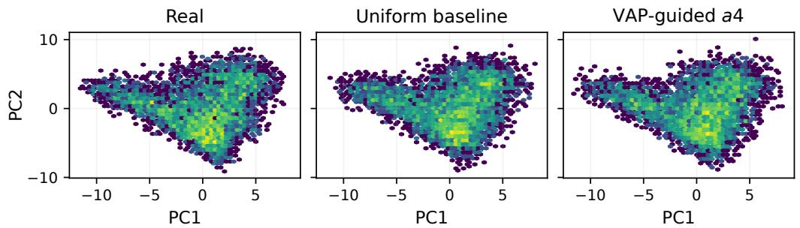  
Figure 6: PCA projection for visualization of DINOv2 features. The panels compare the held-out real feature bank with features generated by the uniform and VAP-guided $\alpha = 4$ samplers. This is a feature-space visualization only; PCA is not the representation used to train the flow.

## D.8 Cross-cell d-axis ladder of the time-sampler stress test

To check whether the sampler-side prescription of Section 5.3 is specific to the $( K { = } 3 2 , d { = } 1 6 )$ cell of the main text, we replicate the seven-arm protocol on two neighboring cells along the dimension axis: $\scriptstyle ( K = 2 4 , d = 1 2 )$ and $\scriptstyle ( K = 4 0 , d = 2 0 )$ , with $N = 5 1 2$ held fixed. When N is not exactly divisible by K, demonstrations per component default to a deterministic almost-balanced split (the first N mod K components receive one extra demonstration, so per-component counts differ by at most one). All other configuration knobs (sigma, gap, spread, hidden width, learning rate, batch size, training steps, evaluation grid, fine-time bins, action budget, noise samples, source seeds $\{ 2 0 , \ldots , 2 9 \}$ , paired test seeds $\{ 0 , \ldots , 9 \}$ , source action key, paired-test action key, ESS and mid-time guard rails) match Section 5.3 exactly. Plateau readings of $L _ { N } ( \mathrm { t s } { = } 4 0 0 0 ) / A _ { v }$ are 1.0276 at $K { = } 2 4$ (closer to the analytic floor than the canonical cell) and 1.0360 at $K { = } 4 0$ (essentially matching the canonical 1.0370).

Table 16: Controlled time-sampler stress test. Plateau paired statistics over 10 seeds at training step 4000. The metric $\Delta _ { \mathrm { r e d } }$ is the percent change in t-averaged reducible loss relative to the baseline; every gap arm has negative paired seed-level deltas for all seeds.
<table><tr><td>Arm</td><td>Sampler Mean</td><td> $\Delta _ { \mathrm { r e d } }$  (%)</td><td>SE(%)</td><td> $p _ { \mathrm { p e r m } }$ </td></tr><tr><td>gap_mix_025</td><td>mixture  $( \lambda = 0 . 2 5 )$ </td><td>-9.32</td><td>0.98</td><td>0.0015</td></tr><tr><td> $\mathtt { g a p \_ m i x \_ 0 5 0 }$ </td><td>mixture  $( \lambda = 0 . 5 0 )$ </td><td>-13.95</td><td>1.19</td><td>0.0028</td></tr><tr><td> $\mathtt { g a p \_ m i x \_ 0 7 5 }$ </td><td>mixture  $( \lambda = 0 . 7 5 )$ </td><td>-17.33</td><td>1.33</td><td>0.0018</td></tr><tr><td> $\mathtt { g a p \_ p u r e \_ a 1 }$ </td><td>pure (α = 1)</td><td>-18.84</td><td>1.37</td><td>0.0019</td></tr><tr><td> $\mathtt { g a p \_ p u r e \_ a 2 }$ </td><td>pure  $( \alpha = 2 )$ </td><td>-20.21</td><td>1.69</td><td>0.0019</td></tr><tr><td> $\mathsf { g a p \mathrm { _ { - P } u r e \mathrm { _ { - } a 4 } } }$ </td><td>pure  $( \alpha = 4 )$ </td><td>-19.15</td><td>2.10</td><td>0.0017</td></tr><tr><td> $\mathtt { g a p \_ p u r e \_ a 8 }$ </td><td>pure  $( \alpha = 8 )$ </td><td>-17.92</td><td>2.63</td><td>0.0023</td></tr></table>

Cross-cell synthesis. Mixture arms and the lower pure exponents $( \alpha \in \{ 1 , 2 \} )$ reproduce the canonical direction across all three cells with paired sign distributions of $1 0 / 1 \mathrm { \dot { 0 } }$ and $p _ { \mathrm { p e r m } } < 0 . 0 0 5$ The intermediate $\alpha = 4$ stays negative across all three cells but weakens at $K { = } 4 0 ( { - } 1 \dot { 1 } . 4 5 \%$ versus −19.15% canonical). The most aggressive sampler $( \alpha = 8 )$ is the single failure mode: stable on the smaller and canonical cells, it plateau-reverses to +11.93% at $K { = } 4 0$ with sign distribution $3 / 1 0$ and $p _ { \mathrm { p e r m } } = 0 . 0 9 5$ . We read this as the upper bound of a usable α envelope shrinking with the mode count K, rather than a global failure of the sampler-side prescription.

Caveats. This panel is a single-axis sensitivity analysis on a single task family (partial-merge GMM); cross-task, cross-architecture, and cross-learning-rate stability remain open. The $K { = } 2 4$ cell sits slightly closer to the analytic floor $( L / \mathcal { A } _ { v } = 1 . 0 2 7 6 )$ than the canonical and $K { = } 4 0$ cells, so its absolute reducible budget is smaller; the signal direction is nonetheless preserved across all seven arms. The $K { = } 4 0 \alpha = 8$ sign reversal happens in the late plateau only; the early-training peak is comparable to the canonical cell. The α envelope upper bound stated here is descriptive rather than a hypothesis test.

Table 17: Cross-cell d-axis ladder of the time-sampler stress test: paired $\Delta _ { \mathrm { { r e d } } } ( \% )$ at training step 4000 over 10 paired seeds. The headline metric is the reducible-loss percent change as defined in Table 16. The middle column is the canonical $\scriptstyle \left( K = 3 2 , d = 1 6 \right)$ cell of Section 5.3. Mixture arms and pure exponents $\alpha \in \{ 1 , 2 \}$ reproduce the canonical direction across all three cells with sign distribution $\bar { 1 } 0 / 1 0$ and $p _ { \mathrm { p e r m } } < 0 . 0 0 5$ . Pure $\alpha = 4$ remains negative but weakens at the largest cell $( 9 / 1 0 , p _ { \mathrm { p e r m } } \approx 0 . 0 0 8 )$ , while the most aggressive pure sampler $( \alpha = 8 )$ reverses sign in the late plateau only there.
<table><tr><td>Arm</td><td> $K { = } 2 4 , d { = } 1 2$ </td><td> $K { = } 3 2 , d { = } 1 6 \mathrm { ( c a n o n i c a l ) }$ </td><td> $K { = } 4 0 , d { = } 2 0$ </td></tr><tr><td> $\mathtt { g a p \_ m i x \_ 0 2 5 }$ </td><td>-7.76</td><td>-9.32</td><td>-10.22</td></tr><tr><td>gap_mix_050</td><td>-13.06</td><td>-13.95</td><td>-16.17</td></tr><tr><td>gap_mix_075</td><td>-16.38</td><td>-17.33</td><td>-19.95</td></tr><tr><td>gap-pure_a1</td><td>-17.84</td><td>-18.84</td><td>-21.39</td></tr><tr><td>gap-pure_a2</td><td>-20.56</td><td>-20.21</td><td>-21.56</td></tr><tr><td>gap-pure_a4</td><td>-19.76</td><td>-19.15</td><td>-11.45</td></tr><tr><td>gap-pure_a8</td><td>-19.25</td><td>-17.92</td><td>+11.93</td></tr></table>

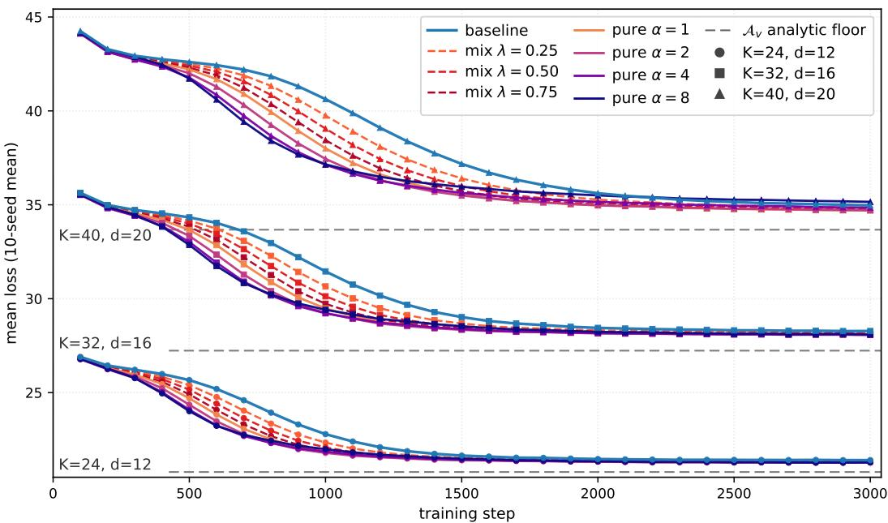  
Figure 7: Cross-cell d-axis ladder of the time-sampler stress test. Three panels share a common y-range. The middle panel reproduces Figure 3 for reference. The panel $\scriptstyle ( K = 2 4 , d = 1 2 )$ keeps every tested arm strictly below baseline at every checkpoint, including $\alpha = 8$ . The panel $( K { = } 4 0 , d { = } 2 0 )$ shows a late-plateau reversal of $\alpha = 8 \colon$ the curve crosses the baseline near training step 2500 and ends slightly above it. Lower exponents and mixture arms remain stable across all three cells.

## E Oracle-to-Blind Bridge Auxiliary Details

## E.1 Label-and-action Cramér-Rao sanity

Bridge estimator definitions. The true-label plug-in oracle\_ols estimates each component mean by ordinary least squares (OLS), which here reduces to its labeled sample mean, and uses the known within-component variance and the true component label at prediction time. The blind EM-OLS arm fits a spherical Gaussian mixture with the known component count K to unlabeled training actions using EM. It plugs the fitted means and mixture weights, together with the arithmetic mean of the fitted component variances, into the marginal Gaussian-mixture velocity formula and averages over posterior component probabilities given $( x _ { t } , t )$ . Thus, neither fitting nor velocity prediction uses true labels. The OLS suffix is an experimental arm name inherited from the oracle comparison; the blind arm does not perform a separate OLS velocity regression. Its prediction is closed form conditional on the iteratively fitted mixture parameters.

The bridge claim of Section 5.2 presupposes that the closed-form label-and-action arm $L _ { \mathrm { o r a c l e \_ o l s } }$ achieves the analytic floor within $( t ) \stackrel { } { = } d \sigma ^ { 2 } / \sigma _ { t } ^ { 2 }$ asymptotically. We verify this precondition on the same five controlled rows used for the bridge audit. $\Delta { \sf t } \ N \ = \ 2 0 0 0$ in the readout window $t \in \mathsf { \Gamma } [ 0 . 1 0 , 0 . 2 8 ]$ , the empirical $L _ { \mathrm { o r a c l e \_ o l s } }$ matches the analytic floor to within 0.014% to 0.044% (Table 18); over a wider N grid, the ratio of the empirical excess $R _ { \mathrm { o r a c l e \_ o l s } } ( t , N ) : =$ $L _ { \mathrm { o r a c l e \_ o l s } } ( t , N ) - { \mathrm { w i t h i n } } ( t )$ to the theoretical Cramér-Rao within-cluster term $\mathrm { C R } _ { \mathrm { w i t h i n } } ( t , N )$ lies in $[ 0 . 9 3 , 1 . 1 5 ]$ across all five rows, with cross-t coefficient of variation in [0.04, 0.06] (Table 19). These are implementation-sanity readouts: they confirm that the closed-form estimator hits the analytic floor at finite sample size and follows the Cramér-Rao rate, but they are not standalone novel claims.

The within(t) formula depends only on $( d , \sigma )$ and not on the cluster centers, so the two $d { = } 2$ rows in Table 18 (a separated configuration and a partial-merge configuration with the same $( d , \sigma ) )$ produce identical $L _ { \mathrm { o r a c l e \_ o l s } }$ profiles by mean-invariance; this is theory-correct and not data duplication.

Table 18: oracle\_ols arm versus analytic floor. Empirical $L _ { \mathrm { o r a c l e \_ o l s } }$ at $N = 2 0 0 0$ versus the analytic floor within $\textstyle ( t ) = d \sigma ^ { 2 } / \sigma _ { t } ^ { 2 }$ , computed on the readout window $t \in [ 0 . 1 0 , 0 . 2 8 ]$ with 20 data seeds and eval $1 2 0 0 0 \times 3 2$ Monte-Carlo samples per cell. The two d=2 rows share $( d , \sigma )$ and therefore share within(t) by mean-invariance.
<table><tr><td>row</td><td>within(t) at N=2000</td><td>relative gap</td></tr><tr><td>d=2 separated</td><td>2.4043</td><td>-0.014%</td></tr><tr><td>d=2 partial-merge</td><td>2.4043</td><td>-0.014%</td></tr><tr><td>d=4 simplex</td><td>4.8086</td><td>+0.008%</td></tr><tr><td>d=8 simplex</td><td>9.6171</td><td>+0.024%</td></tr><tr><td>d=16 simplex</td><td>19.2343</td><td>+0.044%</td></tr></table>

Table 19: Cramér-Rao rate audit. Ratio of empirical $R _ { \mathrm { o r a c l e \_ o l s } } ( t , N )$ to the theoretical Cramér-Rao within-cluster term $\mathrm { C R } _ { \mathrm { w i t h i n } } ( t , N )$ , averaged over the kept-bin filter $t \geq 0 . 1 0$ , on the same five rows as Table 18. The cross-t coefficient of variation reports the within-row variability of the rate.
<table><tr><td>row</td><td> $\mathrm { r a t i o } _ { \mathrm { m e a n } }$ </td><td>CV across t</td><td>N grid</td></tr><tr><td>d=2 separated</td><td>0.962</td><td>0.048</td><td>{50, 100, 200, 500}</td></tr><tr><td>d=2 partial-merge</td><td>0.962</td><td>0.048</td><td>{50, 100, 200, 500}</td></tr><tr><td>d=4 simplex</td><td>0.930</td><td>0.041</td><td>{50, 100, 200, 500}</td></tr><tr><td>d=8 simplex</td><td>1.133</td><td>0.061</td><td>{50, 100, 200, 500, 1000}</td></tr><tr><td>d=16 simplex</td><td>1.153</td><td>0.053</td><td>{50, 100, 200, 500, 1000, 2000}</td></tr></table>

## E.2 Blind-Attainability Panel

Theorem 5 states a label-oracle residual-regression benchmark of order $K \mathcal { A } _ { v } ( t ) / N$ . In the separated regime used by this audit, $\mathcal { A } _ { v } ( t ) = \mathcal { A } _ { v , \mathrm { w i t h i n } } ( t ) + \mathcal { A } _ { v , \mathrm { b e t w e e n } } ( t )$ with $\mathcal { A } _ { v , \mathrm { b e t w e e n } } ( t )$ exponentially small, so the within-cluster Cramér-Rao specialization is $K \mathcal { A } _ { v , \mathrm { w i t h i n } } ( t ) / \bar { N }$ . We complement Section 5.2 with a panel that tests whether the closed-form blind EM-OLS arm tracks this rate, and whether the neural blind MLP-FM arm reaches the marginal Bayes floor up to a bounded residual, on the same five controlled rows. The setup reuses the same five controlled bridge cells: five rows spanning d $\in \{ 2 , 4 , 8 , 1 6 \}$ with $K = 4 { \mathrm { ~ a n d } } \sigma = 0 . 5 ;$ an N ladder {50, 100, 200, 500, 1000, 2000}; twenty seeds per cell; window $t \in [ 0 . 1 0 , 0 . 2 8 ]$ pre-registered before the readout.

For each arm we form the excess $R _ { \mathrm { a r m } } ( t ; N ) = L _ { \mathrm { a r m } } ( t ; N ) - \mathrm { f l o o r } _ { \mathrm { a r m } } ( t )$ with $\mathrm { { f l o o r } _ { \mathrm { { o r a c l e } _ { \mathrm { - } } \mathrm { { o l s } } } } = }$ within(t) and ${ \mathrm { H o o r } } _ { \mathrm { b l i n d } } = { \mathrm { w i t h i n } } ( t ) + { \mathrm { b e t w e e n } } ( t )$ (the analytic marginal Bayes asymptote, equal to $\mathbf { \mathcal { A } } _ { v } ( t )$ in Definition 1). We fit $\alpha _ { \mathrm { p o o l e d } } = - \partial \log \overline { { R } } / \partial \log N$ on the seed-mean profile, restricted to N where $\overline { { R } } > 1 . 5 \times \mathrm { S E }$ (noise-floor guard); 95% confidence intervals come from 1000-resample paired-seed bootstrap.

Table 20 reports the per-row outcome. The oracle\_ols arm matches the band [0.85, 1.15] on the high-d rows $( d \in \{ 8 , 1 6 \} )$ and drifts upward at low d where its excess approaches the Monte Carlo floor; under a noise-floor-aware threshold all five rows fall in band. Blind EM matches [0.75, 1.25] on four of five rows (the partial-merge boundary lands at 1.36 with bootstrap CI [1.18, 1.67] overlapping the band). The neural blind residual $\epsilon _ { \mathrm { M L P } } ^ { B }$ at $N = 2 0 0 0$ is below 1.8% of within(t) on every row, including the partial-merge boundary. We report blind MLP under a floor-magnitude criterion rather than a rate-band criterion because its excess combines a constant function-approximation floor, a small-N approximation transient, and a finite-N parameter decay; the OLS log-log slope on this composite signal is N-range dependent and is not a clean single rate.

Table 20: Blind-attainability panel. Per-row $\alpha _ { \mathrm { p o o l e d } }$ with 95% bootstrap CI for oracle\_ols and closed-form blind EM (low-t window $t \in [ 0 . 1 0 , \dot { 0 } . 2 8 ]$ , five controlled bridge cells, 20 seeds), and $\epsilon _ { \mathrm { M L P } } ^ { B }$ as a fraction of within(t) at $N = 2 0 0 \mathrm { { C } }$ for the neural blind arm. PASS bands: [0.85, 1.15] for oracle\_ols, [0.75, 1.25] for blind EM, $\epsilon _ { \mathrm { M L P } } ^ { B } < 5 \%$ for blind MLP.
<table><tr><td>row</td><td>oracle_ols α [CI]</td><td>EM α [CI]</td><td> $\mathbf { M L P } \epsilon _ { \mathrm { M L P } } ^ { B }$ </td></tr><tr><td>d=2 sep</td><td>1.24 [0.97, 2.03]</td><td>1.23 [0.99, 1.55]</td><td>1.56%</td></tr><tr><td> $d { = } 2 \ \mathsf { p } . \mathsf { m } .$ </td><td>1.24 [0.97, 2.03]</td><td>1.36 [1.18, 1.67]</td><td>0.62%</td></tr><tr><td>d=4 simplex</td><td>1.17 [0.91, 1.71]</td><td>1.22 [1.01, 1.58]</td><td>1.54%</td></tr><tr><td>d=8 simplex</td><td>0.99 [0.86, 1.26]</td><td>1.02 [0.83, 1.50]</td><td>1.52%</td></tr><tr><td>d=16 simplex</td><td>0.93 [0.82, 1.08]</td><td>0.97 [0.87, 1.13]</td><td>1.76%</td></tr></table>

## E.3 Empirical Sweep of the Two-Stage Estimator

We instantiate the heuristic two-stage construction of Remark 35 (Stage 1: cluster recovery via the EM algorithm; Stage 2: residual OLS within each estimated cell) on a controlled GMM with $d { = } 2 , K { = } 4 , \sigma { = } 0 . 5 ,$ and four cluster centers on a circle of radius equal to the swept spread, so the minimum pairwise separation $\Delta _ { \mathrm { m i n } }$ scales linearly with spread. We sweep $\Delta _ { \operatorname* { m i n } } / \sigma \ \in$ $\{ 1 . 4 1 , 3 . 0 0 , 4 . 2 4 , \hat { 5 } . 6 6 , 8 . 0 0 , \hat { 1 1 . 3 1 } \}$ to span merge through separated regimes. The N ladder is {50, 100, 200, 500, 1000, 2000} with 20 training seeds and an eval set of 10000 paired test samples per training seed. The setup is closed form (no neural network) so the comparison isolates Stage 1 misclassification cost.

Stage 1 is sklearn.mixture.GaussianMixture with K=4 spherical components, trained on the training actions $a _ { i } ;$ hard labels at training and eval are obtained as the argmax of the time-t posterior, computed under the analytic likelihood $x _ { t } \mid k \sim \mathcal { N } ( ( 1 - t ) \mu _ { k } , \sigma _ { t } ^ { 2 } \bar { I } )$ using the EM-fit means with the analytic $\sigma _ { t } ^ { 2 }$ . Stage 2 fits the residual intercept per estimated cluster as $\hat { b } _ { \hat { k } } ( t ) =$ $\mathrm { m e a n } _ { i : \hat { k } _ { i } = \hat { k } } ( u _ { t , i } - \beta _ { 1 } ( t ) x _ { t , i } )$ . We compare against the label-oracle residual estimator, the label-and action oracle (matching the oracle\_ols arm of Section 5.2), and a soft-EM marginal-Bayes mixture (matching blind\_em\_ols). The rate readout is $\alpha _ { \mathrm { p o o l e d } } = - \partial \log \overline { { R } } / \partial \log N$ on the low-t window $t \in [ 0 . 1 0 , 0 . 2 8 ]$ with the same arm-aware floor convention used in Appendix E.2; 95% confidence intervals come from 500-resample paired-seed bootstrap.

Table 21 reports the per-spread outcome. At $\Delta _ { \operatorname* { m i n } } / \sigma \geq 8$ the two-stage estimator attains the labeloracle residual rate within band [0.75, 1.25] $( \alpha = 0 . 8 2$ at $\Delta _ { \operatorname* { m i n } } / \sigma { = } 8 ; \alpha = 0 . 9 8$ at $\Delta _ { \operatorname* { m i n } } / \sigma { = } 1 1 . 3 1$ matching the label-oracle residual estimator to two decimal places). Below $\Delta _ { \operatorname* { m i n } } / \sigma \leq 6$ the rate collapses to $\alpha \in [ 0 . 1 7 , 0 . 3 4 ]$ as Stage 1 misclassification introduces an N-independent residual that asymptotes to 4 to 13 percent of within(t) at $N { = } 2 0 0 0$ . The misclassification floor closely tracks the analytic between/within ratio across the sweep (within 0.5 percentage points), identifying the $O ( K \exp ( - c ^ { \prime \prime } \Delta _ { \mathrm { e f f } } ^ { 2 } ) \Delta _ { \mathrm { m a x } } ^ { 2 } / \sigma _ { t } ^ { 2 } )$ term in Remark 35 as the dominant non-oracle attainability cost. The empirical separated-to-merge transition is at $\Delta _ { \operatorname* { m i n } } / \sigma \approx 6$ to 8 in this setup; we do not extrapolate this threshold beyond the swept range.  
Table 21: Two-stage attainability sweep. Per-spread $\alpha _ { \mathrm { p o o l e d } }$ with 95% bootstrap CI for labeloracle residual estimator, two-stage EM (estimated label via Remark 35), and soft-EM marginal Bayes; the two-stage residual at $N { = } 2 0 0 0$ as percent of within(t) is reported alongside the analytic between/within ratio for reference. Window t ∈ [0.10, 0.28], 20 seeds, $M _ { \mathrm { e v a l } } { = } 1 0 0 0 0$
<table><tr><td> $\Delta _ { \mathrm { m i n } } / \sigma$ </td><td>label-resid. α [CI]</td><td>two-stage α [CI]</td><td>soft-EM α [CI]</td><td>two-stage R (%w)</td><td>between/within (%)</td></tr><tr><td>1.41</td><td>1.05 [0.88, 1.23]</td><td>0.21 [0.20, 0.23]</td><td>0.59 [0.44, 0.86]</td><td>7.13</td><td>12.1</td></tr><tr><td>3.00</td><td>1.13 [0.92, 1.33]</td><td>0.17 [0.15, 0.18]</td><td>1.30 [0.72, 1.87]</td><td>13.43</td><td>13.5</td></tr><tr><td>4.24</td><td>1.08 [0.92, 1.31]</td><td>0.20 [0.18, 0.21]</td><td>1.39 [0.88, 2.18]</td><td>9.60</td><td>9.9</td></tr><tr><td>5.66</td><td>1.06 [0.92, 1.19]</td><td>0.34 [0.31, 0.40]</td><td>1.40 [0.72, 2.52]</td><td>3.96</td><td>4.0</td></tr><tr><td>8.00</td><td>1.09 [0.93, 1.18]</td><td>0.82 [0.75, 0.92]</td><td>1.02 [0.67, 1.36]</td><td>0.45</td><td>0.5</td></tr><tr><td>11.31</td><td>0.98 [0.85, 1.13]</td><td>0.98 [0.85, 1.13]</td><td>0.94 [0.53, 1.33]</td><td>0.23</td><td>&lt; 0.1</td></tr></table>

## F BEHAVIOR-1K Materials

This appendix records BEHAVIOR-1K application-context diagnostics from earlier diagnostic work: a leakage-free $\pi _ { 0 . 5 }$ fine-tuning profile panel on fifteen tasks over multiple demonstration seeds (Section F.2), the diagnostic implementation and BC hyperparameters, and short descriptions of five representative simulation tasks, collected together in Appendix F.3. These materials are not used as primary evidence for the main controlled claims. For every task we summarize the required behavior, the principal coordination challenge, the randomization protocol that controls each rollout, and the maximum inference horizon.

## F.1 BEHAVIOR-1K diagnostic implementation

We record the BEHAVIOR-1K evaluation implementation for auditability. We fine-tune and evaluate $\pi _ { 0 . 5 }$ checkpoints through the existing BEHAVIOR-1K/OpenPI pipeline. Offline evaluation loads parameter-only checkpoints on a single GPU, uses local BEHAVIOR-1K data, and evaluates time-resolved velocity MSE without environment rollout. The BC hyperparameters used for these simulation fine-tunes are listed in Table 22.

Each task in the leakage-free panel uses $N \in \{ 1 0 , 2 5 , 1 0 0 \}$ demonstrations over multiple demonstration seeds. Evaluation uses the random\_seed42 validation split, explicitly forbidding the $\mathtt { N } = 1 0$ N=25, and N=100 training pools for the corresponding demonstration seed and task. The profile settings are 25 time bins, 20 noise samples per bin, 50 validation batches, batch size 32, and evaluation seed 42. The output JSONs store the validation-split hash, forbidden-pool disclosure, loss profile, and time grid used to construct Table 23 and Figure 8.

Table 22: Hyperparameters of BC on simulation (based on $\pi _ { 0 . 5 } ) .$
<table><tr><td>Hyperparameter</td><td>Value</td></tr><tr><td>Action Expert Width</td><td>1024</td></tr><tr><td>Action Expert Depth</td><td>18</td></tr><tr><td>Action Expert MLP Dim</td><td>4096</td></tr><tr><td>Batch Size</td><td>128</td></tr><tr><td>Chunk Size</td><td>30</td></tr><tr><td>Learning Rate</td><td> $1 0 ^ { - 5 }$ </td></tr><tr><td>LR Scheduler</td><td>Cosine</td></tr><tr><td>Optimizer</td><td> $\mathrm { A d a m W }$ </td></tr><tr><td>AdamW Betas</td><td>[0.9,0.95]</td></tr><tr><td>AdamW Epsilon</td><td> $1 0 ^ { - 8 }$ </td></tr><tr><td>Weight Decay</td><td> $1 0 ^ { - 1 0 }$ </td></tr><tr><td>Max Training Steps</td><td>30,000</td></tr><tr><td>Fine-tune Method</td><td>Full parameter</td></tr></table>

## F.2 Leakage-free diagnostic panel

Protocol. We fine-tune $\pi _ { 0 . 5 }$ [27] on BEHAVIOR-1K tasks [19]. Each task uses the Beta baseline time-sampling protocol and $N \in \{ 1 0 , 2 5 , 1 0 0 \}$ demonstrations over multiple demonstration seeds, and the same evaluation settings: 25 time bins, 20 noise samples per bin, 50 validation batches, and evaluation seed 42. Main-panel evaluations use the random\_seed42 validation split with an explicit forbidden training pool containing the N=10, N=25, and N=100 entries for the corresponding demon stration seed. All fifteen tasks in Table 23 use forbidden\_train\_sets\_source=cli\_override, with one leakage-free validation hash per task. This audit is important: the BEHAVIOR-1K results are interpreted as a leakage-free diagnostic panel, not as a benchmark-wide law.

Profile readout. All fifteen tasks pass the endpoint gate ${ \bar { L } } _ { 1 0 0 } < { \bar { L } } _ { 1 0 } .$ , but the temporal location of the improvement varies substantially. We split the 25-bin grid into low/mid/high regions $( 8 / 9 / 8$ bins: $t < 0 . { \dot { 3 } } 2 , 0 . 3 2 \leq t \leq 0 . 6 8$ , and $t > 0 . 6 8 )$ and report regional ratios ${ \left. { L _ { 1 0 0 } } \right. } / { \left. { { { \bar { L } } _ { 1 0 } } } \right. }$ . Three descriptive profile families appear: near-uniform improvement, high-time reversal, and smooth no-reversal bottlenecks. These are observed profile shapes in a clean multi-demonstration-seed panel, not claimed as benchmark-wide task-family labels.

Table 23: Leakage-free BEHAVIOR-1K diagnostic panel. All fifteen tasks use the random\_seed42 protocol with the explicit $N = 1 0 / 2 5 / 1 0 0$ forbidden training pool, reported over multiple demonstration seeds. Region ratios are low/mid/high $L _ { 1 0 0 } / L _ { 1 0 } ;$ lower is better. Reg. CV is the coefficient of variation across the three region ratios. Peak t is the time bin maximizing the improvement gap $L _ { 1 0 } ( t ) - L _ { 1 0 0 } ( t )$
<table><tr><td>Task</td><td> $\bar { L } _ { 1 0 } / \bar { L } _ { 2 5 } / \bar { L } _ { 1 0 0 }$ </td><td> $L _ { 1 0 0 } / L _ { 1 0 }$ </td><td> $L _ { 2 5 } / L _ { 1 0 }$ </td><td>Region ratios</td><td>Reg. CV</td><td>Peak t</td></tr><tr><td>collecting</td><td>10.148 /10.435 /8.942</td><td>0.881</td><td>1.028</td><td>0.876 / 0.878 / 0.885</td><td>0.0045</td><td>0.755</td></tr><tr><td>preparing</td><td>8.003 / 7.978 /6.821</td><td>0.852</td><td>0.997</td><td>0.850 /0.830 /0.869</td><td>0.0189</td><td>0.714</td></tr><tr><td>cook_hot_dogs</td><td>16.177/16.737/14.293</td><td>0.883</td><td>1.035</td><td>0.767 / 0.769 /1.019</td><td>0.1391</td><td>0.428</td></tr><tr><td>moving_boxes</td><td>7.121 /6.825 /5.847</td><td>0.821</td><td>0.958</td><td>0.756 / 0.789 / 0.898</td><td>0.0743</td><td>0.388</td></tr><tr><td>wash_cap</td><td>7.856 / 7.231 /5.606</td><td>0.713</td><td>0.920</td><td>0.797/0.594/0.768</td><td>0.1249</td><td>0.633</td></tr><tr><td>cook_bacon</td><td>17.284/16.040 /13.577</td><td>0.786</td><td>0.928</td><td>0.715 / 0.696 / 0.850</td><td>0.0913</td><td>0.878</td></tr><tr><td>make_microwave_popcorn</td><td>7.323 /6.132/5.202</td><td>0.710</td><td>0.837</td><td>0.716 / 0.688 / 0.719</td><td>0.0255</td><td>0.020</td></tr><tr><td>picking_up_trash</td><td>10.998 /10.238 /7.937</td><td>0.722</td><td>0.931</td><td>0.772 / 0.665 / 0.727</td><td>0.0578</td><td>0.020</td></tr><tr><td>spraying_fruit_trees</td><td>12.744/11.413/10.191</td><td>0.800</td><td>0.896</td><td>0.762 /0.717/0.848</td><td>0.0684</td><td>1.000</td></tr><tr><td>turning_on_radio</td><td>9.862 / 8.590 / 8.285</td><td>0.840</td><td>0.871</td><td>0.919 /0.794/0.838</td><td>0.0608</td><td>0.633</td></tr><tr><td>hiding_Easter_eggs</td><td>13.711/13.080 /11.338</td><td>0.827</td><td>0.954</td><td>0.764 /0.778 / 0.882</td><td>0.0651</td><td>0.633</td></tr><tr><td>bringing_water</td><td>10.045 /9.785 /8.365</td><td>0.833</td><td>0.974</td><td>0.783 / 0.834 / 0.855</td><td>0.0367</td><td>0.796</td></tr><tr><td>outfit_a_basic_toolbox</td><td>13.493 /12.013 /10.159</td><td>0.753</td><td>0.890</td><td>0.841 / 0.628 / 0.802</td><td>0.1221</td><td>0.714</td></tr><tr><td>clean_boxing-gloves</td><td>15.464/12.714/11.879</td><td>0.768</td><td>0.822</td><td>0.728 / 0.678 / 0.849</td><td>0.0950</td><td>0.714</td></tr><tr><td>slicing_vegetables</td><td>10.196 /9.602 /8.951</td><td>0.878</td><td>0.942</td><td>0.917/0.883/0.861</td><td>0.0257</td><td>0.796</td></tr></table>

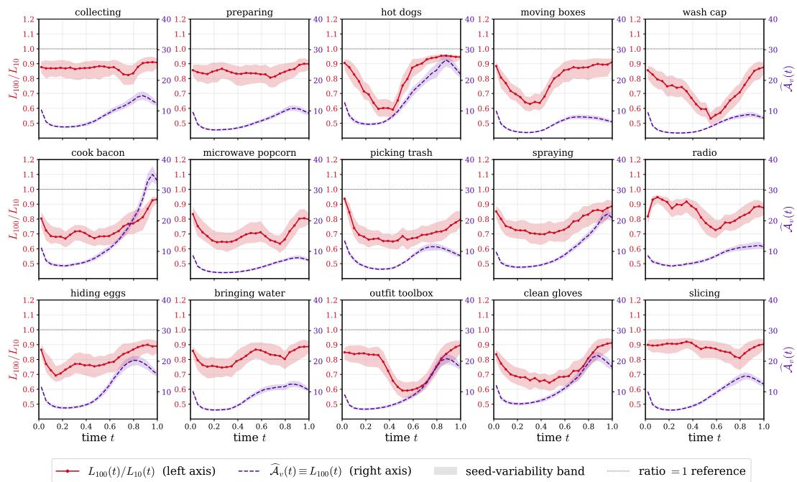  
Figure 8: Per-task ratio profiles and large-budget reference profile on BEHAVIOR-1K. Each panel shows one leakage-free trio from the fifteen-task BEHAVIOR-1K diagnostic panel over multiple demonstration seeds. The left axis plots the per-bin ratio $L _ { 1 0 0 } ( t ) / L _ { 1 0 } ( t )$ with the ratio = 1 reference line; the right axis plots the large-budget reference profile $L _ { 1 0 0 } ( t )$ , which is an upper-biased proxy for $\mathbf { \mathcal { A } } _ { v } ( t )$ rather than an absolute Bayes-floor estimate. All fifteen trios improve in mean loss from $N = 1 0 \mathrm { t o } N = 1 0 0$ , but the temporal location of improvement is task-dependent.

## F.3 Representative task descriptions

Turning on a radio. The robot first uses its onboard cameras to identify the radio on the tabletop and approach it. The right gripper is then used to take hold of the device, after which the left gripper depresses the power button; once the radio has been switched on, it is returned to the table surface. What makes this scenario non-trivial is the joint requirement of locomotion plus dual-arm operation: the right hand has to keep a stable grip so that the reaction force produced by the button press does not dislodge the radio. At the start of every rollout the radio is placed at a different pose on the table, although it is always within the robot’s field of view and reach. Inference is allowed at most 6,000 steps.

  
Figure 9: Turning on a radio. BEHAVIOR-1K task visualization used for application-context reporting.

Picking up trash. In this scenario the right gripper holds a refuse container throughout the entire rollout while the robot navigates in turn to three soda cans distributed across the scene. At each can, the left gripper is used to lift the can and drop it into the container kept by the right hand; after all three cans have been collected, the filled container is set back onto the floor. The difficulty arises from a long-horizon mobile manipulation pattern that imposes asymmetric bimanual roles: the right arm acts as a passive but stable carrier, while the left arm is in charge of repeated grasp-and-release motions. Per rollout, both the container and the cans are spawned at randomized positions so that nontrivial navigation is required, and the robot’s initial base pose is also drawn from a bounded distribution to probe generalization. The inference budget for each rollout is 13,000 steps.

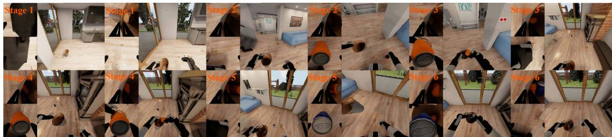  
'Figure 10: Picking up trash. BEHAVIOR-1K task visualization used for application-context reporting.

Spraying fruit trees. Here the robot uses vision to find a sprayer, picks it up with the left gripper, and then visits two fruit trees one after the other. Upon arrival at each tree, the right gripper toggles the sprayer’s switch to the on position, performs the watering action, and toggles the switch back off before the platform moves on to the next tree. The chief difficulty is bimanual tool use combined with mobile manipulation: the left arm must hold the fluid container steady so that the spray remains aimed at the target, while the right arm produces the contact force on the switch without disturbing this alignment. The sprayer and both trees are spawned at random workspace positions, forcing the robot to actively search the scene and replan its path; the starting base pose of the robot is also varied across rollouts. The inference horizon is capped at 10,000 steps.

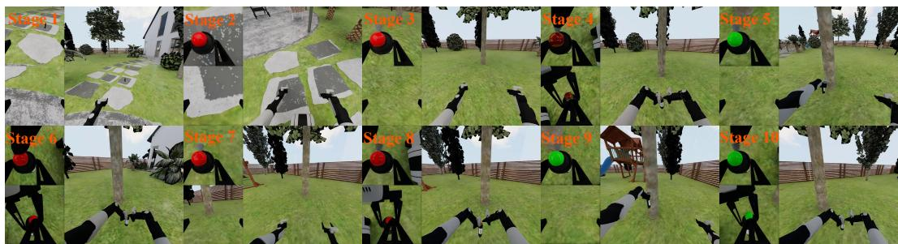  
Figure 11: Spraying fruit trees. BEHAVIOR-1K task visualization used for application-context reporting.

Cooking hot dogs. This task strings together articulated-object handling with intermediate buffering of cargo. The robot first opens the refrigerator, takes out two hot dogs, and shuts the door; one of the items is set aside on the tabletop while the other is loaded into the microwave; the buffered hot dog is then transferred from the table into the microwave, the microwave door is closed, and the start switch is engaged. The fundamental challenge is long-horizon planning across multiple workstations (the storage compartment, the staging area, and the cooking appliance), with the kinematics of the appliance doors having to be coordinated with pick-and-place operations. Initial object poses and the robot’s starting base pose are varied between rollouts to evaluate generalization, and the inference horizon is set to 15,000 steps.

Washing a baseball cap. The robot moves to a washing machine, opens its door, and finds the two baseball caps that need to be cleaned. With one cap held in each gripper, it walks back to the washer and inserts both caps into the narrow drum cavity one after the other; the door is then shut and the power switch is pressed. The hard part of this task is a long-horizon mobile manipulation pipeline that combines articulated-object operation with carrying objects in both hands at the same time: the robot has to navigate while its grippers are occupied, and then perform collision-free placements inside a tightly bounded workspace. Both the poses of the two caps and the robot’s initial base pose are randomized across trials, and inference is limited to 10,000 steps.

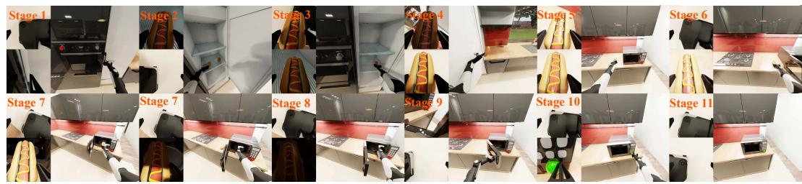  
Figure 12: Cooking hot dogs. BEHAVIOR-1K task visualization used for application-context reporting.

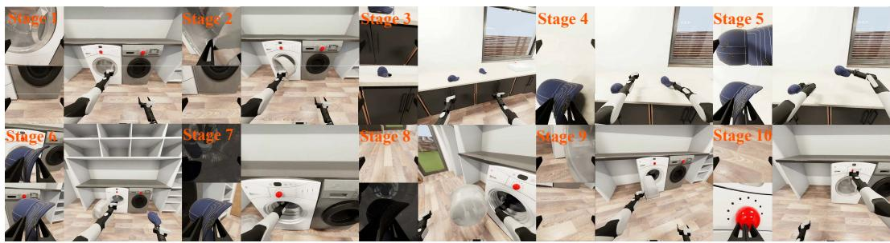  
Figure 13: Washing a baseball cap. BEHAVIOR-1K task visualization used for application-context reporting.