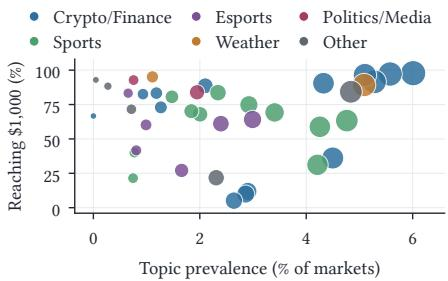
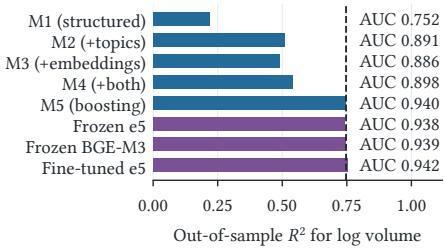
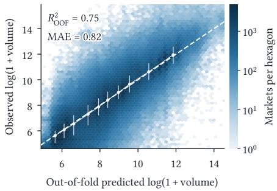
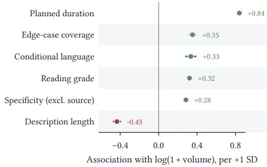
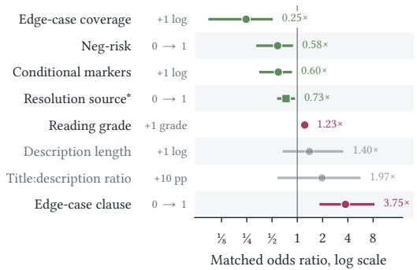

# What Prediction-Market Contracts Reveal at Launch: Trading Volume and Dispute Risk

Ahmed Mahrous

King Abdullah University of Science and Technology Thuwal, Saudi Arabia ahmed.mahrous@kaust.edu.sa

## Abstract

We address the question: “What does a prediction-market contract reveal at launch about its future?” Using a near-census of 802,863 resolved markets listed on Polymarket, a leading prediction market, between January 2023 and May 2026, and only information available at listing (the market’s title and description, named resolution source, and contract metadata), we predict lifetime trading volume and whether settlement is later disputed.

Roberto Di Pietro King Abdullah University of Science and Technology Thuwal, Saudi Arabia roberto.dipietro@kaust.edu.sa

Contract information predicts trading volume well (out-ofsample $R ^ { 2 } \ = \ 0 . 7 4 7$ for log volume), and most of the signal is interpretable: market topic provides the largest gain (+0.289 $R ^ { 2 }$ over a 0.220 contract-feature baseline), wording and resolution-rule design add smaller but measurable improvements (+0.027 combined), and neural text models add little beyond the interpretable features. This performance does not survive a period of platform change coinciding with a shift in listing formats: accuracy in predicting whether a market reaches \$1,000 falls from AUC 0.940 under same-period evaluation to 0.577 when training on past quarters and testing on later ones. The loss concentrates in markets whose question forms were absent from training (76.9% of test markets; on familiar forms the model still reaches 0.778), and a decomposition attributes more of it to a changed relationship between contract characteristics and demand than to an outdated mapping from text to features.

Dispute predictors are more stable but less precise: launch-time features rank dispute risk far better than chance (AUC 0.78), yet at a 0.31% base rate precision is too low for case-by-case prediction (average precision 0.012), so the scores suit ranking groups of markets rather than forecasting individual disputes.

The framework and results, besides their intrinsic interest, are actionable and likely extensible to other platforms, supporting further research in prediction markets.

## CCS Concepts

• Computing methodologies → Machine learning; • Applied computing → Economics; • Information systems → Clustering and classification.

prediction markets, machine learning, market design, financial NLP, temporal generalization, dispute resolution

## Keywords

ACM Reference Format:

Ahmed Mahrous and Roberto Di Pietro. 2026. What Prediction-Market Contracts Reveal at Launch: Trading Volume and Dispute Risk. In 7th ACM International Conference on AI in Finance (ICAIF ’26), November 14–17, 2026, Milan, AA, Italy. ACM, New York, NY, USA, 8 pages. https://doi.org/10.1145/ 3858063.3858742

## 1 Introduction

Prediction markets have grown from small experimental venues into large-scale platforms for trading on political, financial, crypto, sports, and other real-world events; Polymarket’s 2024 U.S. presidential-election market alone generated more than \$3.6 billion in reported trading volume [20]. Most research studies these markets after trading begins, asking whether prices aggregate information into accurate forecasts. Platforms face an earlier design problem: newly listed contracts difer greatly in what happens next, along two dimensions. Traction is extremely uneven—in our data of more than 800,000 resolved Polymarket contracts, the top 1% of markets carry 62.4% of all trading volume. Dispute risk is rare but costly—0.31% of markets whose dispute history is observable are formally challenged, yet disputed markets carry 5.8% of total volume across the analysis panel (8.6% within the dispute-observable subset). Both are set in motion at listing, before order flow exists, when the contract text and its terms are essentially the only market-specific information available. We therefore ask: “What does a prediction-market contract reveal at launch about its later trading volume and dispute risk?”

Every predictor is derived from contract information ordinarily set at launch: the market’s topic, its question and description text, and characteristics of its resolution rules. Two features of the data shape the design: related contracts (for example, all markets on one football match) share attention and resolution logic, so we group them into events never split across training and test; and because disputes are rare and concentrated in particular subjects, we complement the predictive analysis with a matched case-control comparison against non-disputed markets from the same topic, platform quarter, and resolution-source type.

## Contributions We make three contributions.

Contract traction predictability We show that contract information predicts trading volume well under same-period cross-validation, and most of this signal is interpretable. A gradient-boosted tree model reaches out-of-sample $R ^ { 2 } = 0 . 7 4 7$ for log-transformed volume and AUC = 0.940 for whether lifetime volume reaches \$1,000. Knowing what the market is about matters most: lexical topics add 0.289 $R ^ { 2 }$ over a basic contract-feature baseline of 0.220 (Fig. 2), and topic alone separates high- from low-traction segments (Fig. 1). Conditional on topic, wording adds 0.021 and rule drafting another

  
Figure 1: Each point is one NMF topic, sized by market count. Topic separates high- from low-traction segments.

0.006. Neural models add little, so interpretable representations capture most of the launch-time signal available to the tested models. The large remaining gain comes from interactions between features rather than curvature in any one of them: for example, the same launch feature can predict diferently depending on the market’s topic.

Dispute predictability Launch-time features rank dispute risk far better than chance (AUC = 0.78), but at a 0.31% base rate precision is too low for individual prediction (average precision 0.012), so we treat dispute models as tools for grouping markets by risk. Ad justed analyses identify which characteristics carry this risk: each additional grade level of reading dificulty is associated with 23% higher dispute odds; contracts with no identifiable or successfully parsed resolution source have roughly five times the adjusted odds of those using a mechanical feed; and an anticipated-ambiguity pattern appears in edge-case drafting, where having a clause is consistent with creators anticipating trouble while fuller coverage among them is associated with lower odds. These are associations, not causal estimates, but they identify contracts that may warrant review before launch.

Temporal change and regime dependence Third, strong same-period prediction is not robust to temporal change. The model with sameperiod AUC 0.940 falls to 0.577 when trained on past quarters and evaluated on later ones. The failure is concentrated in novel forms: 76.9% of test markets use question forms—wording templates that difer only in numbers and dates—never observed in training, while on familiar forms the model still reaches AUC 0.778. Re-learning the text representation helps, but re-estimating the feature–volume relationship recovers substantially more of the loss, so launch-time volume models are regime-dependent and must be re-estimated as the platform introduces new market forms.

Roadmap Section 2 places the study among work on predictionmarket quality, financial NLP, and temporal generalization. Section 3 describes the sample, target variables, launch-time features, and the event-grouped evaluation methodology. Section 4 reports the volume results and the feature ladder, and Section 5 checks them against template leakage and alternative specifications. Section 6 turns to forward-in-time evaluation and isolates the role of novel question forms. Section 7 covers dispute prediction and the matched case-control risk factors. Section 8 discusses deployment implications, limitations, and future work.

## 2 Related Work

Prediction markets and market quality A prediction market turns a claim about an uncertain event into a tradable security and ends by applying a resolution rule that maps the realized outcome into a payof. Most research studies the intervening stage: whether trading aggregates dispersed information into accurate forecasts, and which conditions support that process [18, 23]. Aggregation is possible but not automatic; it depends on the securities, the trading mechanism [9], and liquidity [4]. Recent work carries these questions to modern platforms: the more liquid venue tends to lead price discovery, with Polymarket leading Kalshi especially when its activity and largetrade order flow are greater [17]; and within Polymarket’s 2024 presidential market, arbitrage deviations and price impact declined as participation expanded [20]. Informative prices are thus produced through participation, liquidity, and informed traders rather than guaranteed. None of these studies asks how factors observable at listing relate to subsequent market outcomes—the gap we fill.

Contract language andfinancial NLP Financial text analysis shows that language observed before an outcome can carry information about subsequent economic behavior [8], and that interpretable structure extracted from a document predicts market outcomes [24]. Crowdfunding is a close parallel to our volume task: the language of a project description at launch helps predict whether the campaign attracts funding [15]. Prediction-market text, however, is not merely descriptive or persuasive; it also defines the security itself. Prior work on prediction-market contract design examines which uncertainties can be expressed as tradable claims [1], how ambiguous event definitions block arbitrage across venues [7], and whether resolution rules invite manipulation—settlement manipulation of Polymarket’s five-minute Bitcoin contracts is absent from the fifteen-minute variant, making contract horizon a design lever [5]. These questions are closely related to language because the contract’s wording determines both the claim being traded and the conditions under which it settles. Unlike this prior work, we ask whether linguistic features observable at launch predict subsequent trading volume and dispute risk.

Temporal generalization and concept drift Our temporal analysis relates to research on dataset shift, in which the joint distribution underlying the training data difers from that encountered at deployment [16]. In our setting, such shifts can arise from changes in the topics listed, the introduction of new contract formats, or changes in the trader population. Historical performance then need not carry over to deployment, a problem widely documented in language models and deployed financial forecasters [10, 13]. We ask whether models built from contract-language features remain valid as Polymarket evolves, document a substantial regime change in which models that perform strongly within one period generalize poorly to later markets, and separate two explanations: textrepresentation drift, in which the mapping from text to features has changed, and relationship drift, in which the features still describe contracts adequately but the demand associated with them has moved.

Prediction-market data resources Recent datasets expose diferent parts of the modern prediction-market lifecycle—trade fills and oracle events [11], contract rules paired with timestamped news and order books for evaluating language models [3], and settlement legibility across venues [1]—making trading, price formation, forecasting, and settlement observable. Our dataset is complementary in what it measures: alongside each contract’s full text, it supplies wording and rule-design variables—readability, edge-case coverage, conditional language, a source-verifiability taxonomy—plus template and question-form groupings, linked to lifetime volume and formal dispute status. Closest to our dispute analysis, language models reproduce UMA’s rulings once a dispute exists but cannot say in advance which markets will be disputed [22]; we reach a compatible conclusion from the opposite direction (Sec. 7).

## 3 Data and Empirical Design

Prediction-market data pose four empirical challenges, each paired here with a remedy: related contracts are statistically dependent (evaluation grouped by event, Sec. 3.3); recurring title templates can inflate measured generalization (template exclusion, Sec. 5); the platform changes rapidly (temporal cutofs, Sec. 6); and formal disputes are rare and concentrated in particular subjects (matched case-control comparison, Sec. 7).

## 3.1 Sample and Outcomes

On Polymarket, each market is a contract defined by a question, a free-text description containing the resolution rules, and contract metadata such as its scheduled close date, resolution settings, and referenced resolution source. Related markets are grouped into events—all markets of one match, or all strikes of one price ladder— that share a page, a comment stream, and often resolution logic; some events also link mutually exclusive outcomes (e.g., the candidates in one race) through the platform’s neg-risk mechanism, though each member contract remains an ordinary yes/no market. When a market ends, a proposed outcome is submitted to the UMA Optimistic Oracle and becomes final unless someone challenges it during the challenge period [19]. A market is disputed if its oracle lifecycle log records at least one such challenge. That log exists for 65.9% of the sample (those without it are mostly earlier listings), and a dispute is invisible without it, so all dispute analyses are restricted to this dispute-observable subsample.

We collect all market records from the platform’s public API for January 2022 through June 2026 and keep the 818,431 that closed with a recorded resolution. Two exclusions follow from the design: 15,473 markets with no valid scheduled end date (planned duration, a core predictor, is undefined for them) and 95 markets whose categorical settings occur in fewer than 50 markets—too few to estimate or match on (together 1.9% of resolved markets). The analysis sample holds 802,863 markets in 391,955 events (Table 1), spanning January 2023 to May 2026. Its composition shifts sharply over that window—74.3% of the sample was created in 2026, coinciding with a shift toward high-frequency recurring title templates such as 15-minute cryptocurrency price windows—which is what the temporal design of Sec. 6 is built to test.

We study two outcome families. Trading volume uses the platform’s recorded lifetime volume in dollars. Volume is extremely concentrated (median \$3,542). We model log-transformed lifetime volume, � = log(1 + volume) (hereafter, log-transformed volume), and, as a binary outcome, whether a market reaches \$1,000 in lifetime volume (68.5% of markets do). Results are insensitive to \$500 or \$5,000 thresholds (Sec. 5). Disputes: 1,634 of the 529,408 dispute-observable markets (0.31%, about one market in 320) had their resolution formally challenged.

Table 1: Analysis sample and target variables. The market is the unit of analysis; the event is the cluster used for all splits and standard errors.
<table><tr><td>Panel Analysis sample (Sec. 3.1)</td><td>802,863</td></tr><tr><td>Events (clusters) Markets per event (median / mean / max) Creation window</td><td>391,955 1 / 2.05 / 144 2023-01-2026-05</td></tr><tr><td>Share created in 2025 / 2026</td><td>23.6% / 74.3%</td></tr><tr><td>Trading volume</td><td>$3,542 / $84,404</td></tr><tr><td>Volume: median / mean Volume Gini; top-1% / top-10% share</td><td>0.927; 62.4% / 88.6%</td></tr><tr><td>Markets with volume ≥ $1,000</td><td>68.5%</td></tr><tr><td>Resolution</td><td></td></tr><tr><td>Decisive binary settlement</td><td>799,372 (99.6%)</td></tr><tr><td>50–50, void, or other settlement</td><td>3,491 (0.4%)</td></tr><tr><td>Dispute-observable (oracle log recorded)</td><td>529,408 (65.9%)</td></tr><tr><td>Disputed (0.31% of dispute-observable)</td><td>1,634</td></tr></table>

## 3.2 Launch-Time Features

Predictors are restricted to contract fields ordinarily set at listing and the listing date (we use creation, launch, and listing interchangeably); realized quantities such as prices, trader counts, and resolution outcomes are excluded from every feature set. Four blocks are used. Structured: scheduled market duration, resolution settings, resolution-source location and type, listing quarter, and market type (e.g., membership in a neg-risk group). Topic, capturing what the market is about: lexical topics from nonnegative matrix factorization (NMF [14], �=40) of TF–IDF-weighted question+description text, plus �-means clusters (�=40) of e5-small sentence embeddings; both are re-fit inside each training fold when used predictively. For descriptive tables only, topic labels were proposed independently by two LLMs from cluster keywords and representative markets under a fixed output schema, then human-reviewed. Wording, capturing how the question is phrased: question and description lengths, quantitative anchors (prices, percentages, dates, times), a specificity index (one point each for an explicit source, date, and quantitative anchor, minus a penalty for vague resolution phrases), and a flag for such vague phrases (e.g., “significant,” “credible reporting”). Rule design, capturing how the resolution rules are drafted: edgecase coverage (how many of a fixed list of contingency phrases— postponement, cancellation, ties, an unavailable source—the text contains), conditional language (counts of markers such as “if” and “unless”), the presence and length of a dedicated resolution paragraph, Flesch–Kincaid readability, and a source-verifiability taxonomy based on the type and public accessibility of the named source. All wording and rule-design measures are deterministic functions of the contract text—fixed keyword and regular-expression rules plus standard readability formulas—and the released annotation guide gives their exact definitions.

## 3.3 Models and Evaluation

We estimate a nested ladder of models, each adding one representation layer, so comparisons show where predictive information resides: M1 linear regression (log-transformed volume) and $\ell _ { 2 } -$ regularized logistic regression (volume ≥ \$1,000) on basic contract features (structured metadata, text lengths, and numeric/date/time indicators); M2 adds NMF topics; M3 adds embedding clusters instead; M4 adds both; M5 is gradient-boosted trees (LightGBM [12]) on the M4 features, capturing nonlinearities and interactions the additive models M1–M4 cannot. As a deep-text benchmark, M6 replaces the interpretable text layer with (a) frozen e5-small [21] or BGE-M3 [2] embeddings fed to the same boosted learner, and (b) an e5-small encoder fine-tuned end to end with two output heads sharing one encoder, one predicting log-transformed volume and one whether the market reaches \$1,000. BGE-M3 is included to confirm the null result is not an artifact of limited encoder capac-$\mathrm { i t y . } ^ { 1 }$ Hyperparameters are fixed in advance (library defaults for the linear models; LightGBM: 600 trees, learning rate 0.05, 63 leaves, 80% subsampling) and never tuned on evaluation data, so the ladder compares representations rather than tuning efort. To isolate richer wording and rule-design measures beyond M1, we also estimate a separate linear block ladder on the same folds—topics and era; duration and resolution settings; wording; ambiguity; remaining rule-design measures—from which the reported +0.021 and +0.006 increments are paired out-of-fold changes, not steps in M1–M5.

Sibling markets within an event share text, trader attention, and resolution logic, so a random split would place siblings of a test market in training and overstate performance. Evaluation uses 5-fold cross-validation grouped by event, with all text representations and models fit only on training events, scored on the identical held-out events, and metrics pooled over out-of-fold predictions. Regression is scored by out-of-sample $R ^ { 2 }$ on log-transformed volume and classification by AUC—the probability that a randomly chosen high-volume market is ranked above a low-volume one, so 0.5 is chance. Grouped cross-validation still measures same-period skill, and recurring title templates appear on both sides of fold boundaries; Sec. 5 therefore re-estimates everything after excluding them, and Sec. 6 imposes temporal cutofs assigning whole events by first-market creation time, so no future sibling informs a pasttrained model. For inference on performance gaps we bootstrap whole events (200 replicates), keeping dependent siblings together, and cluster standard errors at the event level; parametric AUC comparisons overstate significance by treating markets as independent, so we rely on the event bootstrap.

Disputes require a diferent design. Formal disputes are rare (0.31%) and concentrated by subject, quarter, and resolution source, so a plain regression on the full sample devotes almost all of its fit to the handful of subjects where disputes occur. Following standard epidemiological practice for rare adverse events, Sec. 7 instead compares each disputed market with matched non-disputed controls from the same topic, platform quarter, and source-type stratum, so that contract-design risk factors are not confounded with what the market is about or when it was listed.

## 4 Predicting Trading Volume

Under same-period cross-validation, a market’s trading volume is highly predictable from its contract alone. This section shows how predictable, where the signal resides, and how little the tested neural models add.

Launch-Time Predictability The boosted topic model (M5) reaches $R ^ { 2 } = 0 . 7 4 7$ and AUC = 0.940 out of sample; the ladder in Fig. 2 shows where that comes from. The basic contract-feature baseline (M1) explains $R ^ { 2 } = 0 .$ .220 at AUC 0.752, and its largest coeficients are consistent with greater volume for more precisely specified contracts: an explicit resolution source has an estimated coeficient of +1.8 to $+ 2 . 2$ for log-transformed volume, concrete quantitative anchors (prices, dates, percentages) have coeficients of +0.7 to +1.5, and each unit increase in log-transformed scheduled duration has a coeficient of +0.59. Text then enters in two steps: lexical topics nearly double explained variance (M1→M2, +0.289 �2 [+0.286, +0.292]), and allowing nonlinearity and interactions over the same features adds another large block (M4→M5, +0.207 [+0.204, +0.210]). These gains are stable across folds (standard deviation ≤ 0.012) and every pairwise gap is significant under the event-cluster bootstrap. The boosted model is also well calibrated out of sample: 6.2% of markets in the bottom decile of predicted probability reach \$1,000 versus 6.3% predicted, and 99.93% versus 99.87% in the top decile. The same holds for the volume regression (Fig. 3). Within a stable regime its scores could therefore rank incoming listings directly; Sec. 6 tests whether that transfers to future ones.

  
Figure 2: Out-of-sample fit as feature blocks are added. Topic contributes the largest increment.

  
Figure 3: Out-of-fold predicted vs. observed volume (M5). Dashed line: perfect calibration; dots and bars: decile means and interquartile ranges.

Market Topic Table 2 shows why the topic layer is so important: recurring templates difer substantially in outcomes, a spread larger than the variation associated with any single wording or rule-design feature we measure. What a market is about, inferred from contract text alone, is thus the strongest predictor of its trading volume, and the pattern holds across all topics, not just these illustrative templates (Fig. 1).

Table 2: Selected recurring title templates. Counts and volume shares use all markets; dispute rates use the disputeobservable subsample.
<table><tr><td>Example recurring title template</td><td>Markets</td><td>Volume ≥ $1,000</td><td>Dispute rate</td></tr><tr><td>Crypto up/down, 15-min windows</td><td>343,098</td><td>70.5%</td><td>0.40%</td></tr><tr><td>Sports over/under totals</td><td>67,149</td><td>55.3%</td><td>0.12%</td></tr><tr><td>Daily temperature ranges</td><td>60,260</td><td>88.2%</td><td>0.39%</td></tr><tr><td>Tennis set-game totals</td><td>11,448</td><td>24.1%</td><td>0.07%</td></tr><tr><td>Trump/political-media mentions</td><td>10,998</td><td>86.0%</td><td>1.00%</td></tr></table>

Neural Text Benchmarks Could a neural text model extract more from the same contracts? Two comparisons indicate that it cannot, at least for the models tested. First, interpretable lexical topics outperform embedding clusters (M3 is below M2, $\Delta R ^ { 2 } = - 0 . 0 2 1 )$ and the two are only modestly complementary (+0.031). Second, the neural benchmark leaves little room above the interpretable ceiling: raw frozen embeddings fed to the same boosted learner match M5 to three decimals (0.743/0.744 vs. 0.747), the larger BGE-M3 encoder adds nothing over e5-small, and end-to-end fine-tuning ends only slightly above (�2 0.754 vs. 0.747, +0.007 [+0.005, +0.009] under the paired event-cluster bootstrap).2 The 40 NMF topic features plus structured features thus capture nearly all of the launch-time textual signal the tested models can extract.

Wording and Rule Design Conditional on topic, how a contract is written still matters, but marginally: the wording block adds +0.021 �2 (positive in all folds) and the rule-design measures—edgecase coverage, conditional language, resolution-paragraph structure, readability, source verifiability—add a further +0.006, about one-fiftieth of the topic contribution. The direction is nonetheless informative: the specificity index rises monotonically with contract success, from 50.5% of markets scoring 0 reaching \$1,000 to 83.0% at a score of 3. Precise rules attract more trading, an efect large enough to order markets within a topic but too small to overcome the topic efect itself. Figure 4 compares these associations on a onestandard-deviation scale. Planned duration has by far the largest positive association with log-volume (+0.84), while specificity, reading grade, conditional language, and edge-case coverage form a narrower positive band (+0.28 to +0.35); description length is the only negative factor (−0.43).

The boosted model’s advantage over the linear ladder comes largely from how launch features combine, not from curvature in any one of them. Constraining M5 to depth-one trees (singlefeature nonlinearities allowed, interactions not) closes only 25% of the M4→M5 $R ^ { 2 }$ gap; allowing pairwise interactions closes 57%; and a linear model with named interactions (duration × topic, word counts × topic, duration × era) closes 32%—more than the additivetree ceiling. The largest contrast is duration × topic: the estimated duration slope is +2.92 for Bitcoin Up/Down Micro-Markets, compared with −0.03 for NMF topic 26 (Basketball Game Lines and Totals) and +0.24 for Social Media Post Count Markets. Relative to the reference Crypto Up/Down Micro-Markets topic, whose slope is +2.09, the latter interaction diferences are −2.12 and −1.85, respectively (both $ { p } < 0 . 0 1 )$ . No launch feature has a universal efect, so screening rules built on these features should be topic-aware.

  
Figure 4: Contract-design factors with topic and launchquarter fixed efects on a one-standard-deviation scale.

## 5 Robustness Checks

The within-period results of Sec. 4 raise two concerns: the model may be exploiting recurring title templates rather than generalizable contract signal, and the findings may be sensitive to analytical choices. Neither holds.

Recurring Title Template Exclusion We apply an outcome-blind definition of recurring title templates: lowercase each question, replace month and weekday names, money amounts, percentages, and numbers with placeholders, and retain only forms occurring exactly once in the full panel. This removes 666,967 markets (83.1%) and leaves 135,896, on which folds, topics, and embedding clusters are re-derived. The qualitative hierarchy holds: M1 reaches $R ^ { 2 } \ = \ 0 . 2 3 0 / \mathrm { A U C } \ = \ 0 . 7 2 9$ , lexical topics add +0.154 $R ^ { 2 } { \mathrm { , } }$ , embedding and lexical topic models are nearly tied, and interactions add +0.225, yielding M5 $R ^ { 2 } ~ = ~ 0 . 6 5 2 / \mathrm { A U C } ~ = ~ 0 . 8 9 1$ . The main result therefore does not require repeated question forms, although the lower performance shows that repetition is part of the platform’s predictability.

Additional Robustness Varying the volume threshold, the treatment of outliers, the encoding of platform era, the unit of analysis, and the number of topics each moves the reference specification by less than 0.01 in almost every row. Three comparisons are substantively informative. Hand-coded regex wording proxies without learned topics fall back to the basic contract-feature baseline (0.227/0.756), so simple feature engineering does not recover the topic layer’s contribution. Aggregating to the event level preserves strong regression performance $( R ^ { 2 } = 0 . 6 7 4 { \mathrm { ~ v s . ~ } } 0 . 7 4 7 )$ while slightly improving classification (AUC 0.956 vs. 0.940), so market-level clustering is not producing the result. And the headline performance is not carried by any single topic (Table 3): crypto/finance—45% of the panel—produces the largest change, and sports removal raises $R ^ { 2 }$ to 0.785.

Table 3: Leave-one-family-out robustness: each row recomputes the reference model’s out-of-sample fit with one broad topic family excluded.
<table><tr><td>Excluded family</td><td>% panel</td><td> $R ^ { 2 }$ </td><td>AUC</td></tr><tr><td>None (full model)</td><td></td><td>0.747</td><td>0.940</td></tr><tr><td>Crypto/Finance</td><td>45.4</td><td>0.668</td><td>0.896</td></tr><tr><td>Sports</td><td>28.0</td><td>0.785</td><td>0.957</td></tr><tr><td>Esports</td><td>9.7</td><td>0.752</td><td>0.945</td></tr><tr><td>Other events</td><td>8.1</td><td>0.755</td><td>0.941</td></tr><tr><td>Weather</td><td>6.3</td><td>0.754</td><td>0.940</td></tr><tr><td>Politics/Media</td><td>2.5</td><td>0.748</td><td>0.940</td></tr></table>

One finding warrants caution. Comparing sibling markets within events looks attractive—siblings share event-level demand, so differencing them seems to isolate drafting—but on this platform sibling wording often encodes a market’s role within its event rather than a drafting choice. A within-event regression produced an im plausible coeficient of +6.29 for log-transformed volume on the vague-language flag; an audit traced it to composition, the flag marking boilerplate that appears almost exclusively on the flagship, highest-volume market of its event. Restricting the comparison to structurally identical siblings shrinks the coeficient to +0.21 $( p = 0 . 2 9 )$ . Within-group designs on prediction-market panels can thus mistake a market’s role for its wording, and should be audited accordingly.

## 6 Temporal Generalization

These results measure accuracy within the model’s training regime. Prospective evaluation—training on the past and predicting the future—asks whether those relationships survive the platform’s own change. They largely do not (Table 4); this section diagnoses why.

Table 4: Predicting whether a market reaches \$1,000 (AUC; chance = 0.5), boosted model. Recalibration is fit on the earliest 10% of the test period.

<table><tr><td>Evaluation setting</td><td>AUC</td></tr><tr><td>Train and test in the same period (cross-validation)</td><td>0.940</td></tr><tr><td>Train on the past, test on the future (cutoff 2025Q4)</td><td>0.577</td></tr><tr><td>question form never seen in training (77% of test)</td><td>0.575</td></tr><tr><td>question form seen in training (23% of test)</td><td>0.778</td></tr><tr><td>Diagnostics on later-period data:</td></tr><tr><td>before / after monotone rescaling (same 90% subset) later-period refit (hindsight diagnostic)</td><td>0.597 / 0.597 0.940</td></tr></table>

Platform Regime Change Prospective evaluation trains on all events created up to a cutof and tests on everything after. Models achieving $R ^ { 2 }$ of 0.5–0.75 in same-period evaluation perform far worse across regimes: cutofs at 2025Q2 or 2025Q4 yield negative $R ^ { 2 }$ and AUC of 0.52–0.58—at or near chance—while only the 2026Q1 cutof, whose training window already contains the modern regime, recovers usable performance $( R ^ { 2 } = 0 . 6 2 7 , \mathrm { A U C } = 0 . 9 0 6 )$ . The drop from 0.940 to 0.577 coincides with the 2026 expansion of template micromarkets. Of the panel, 74.3% was created in 2026 (Table 1), when many prevalent question forms were absent from earlier training windows. Whether change of this magnitude recurs is open—it may prove a one-time transition—but a deployed model cannot know that in advance, which motivates the diagnostics below.

Structural Novelty The prospective failure is concentrated where the platform introduces new market forms. Two questions share a question form if they match after masking numbers, dollar amounts, percentages, and dates (so all “Bitcoin above \$X on date $\mathrm { D ? } ^ { \mathfrak { p } }$ markets share one form). At the 2025Q4 cutof, 76.9% of test markets have a form never seen in training; on those the past-trained model has near-zero rank discrimination (AUC 0.487–0.575), while on familiar forms it retains some (AUC 0.68–0.78). Markets outside the labeled recurring families transfer better (AUC 0.674 vs. 0.516 pooled for the linear model) but still fall short of their in-period ceiling of 0.803, so the novel-template influx heightens the failure without being its only source. Novel forms are not a marginal problem: conditional on topic and era, first-of-kind markets (no prior near-duplicate at embedding cosine $\ge ~ 0 . 9 5 ;$ 3.5% of the panel) have an estimated coeficient of +1.35 for log-transformed volume $( p \ < \ 0 . 0 1 )$ and +1.25 log-odds of reaching \$1,000, and volume declines with the number of prior near-duplicates—so the markets the model handles worst are disproportionately the high-volume ones.

Table 5: Attributing the 2025Q4 loss: out-of-sample $R ^ { 2 }$ on the same later markets, with each part kept from the past or re-learned from recent data.
<table><tr><td></td><td colspan="2">Relationship (features→volume)</td></tr><tr><td>Text representation</td><td>from the past</td><td>re-learned</td></tr><tr><td>From the past</td><td>0.011</td><td>0.772</td></tr><tr><td>Re-learned</td><td>0.249</td><td>0.773</td></tr></table>

Representation vs. Relationship Drift Why does a model trained on the past fail on the future? Its knowledge has two parts: the text representation—how it reads contract text into features—and the relationship linking those features to volume. Either could be outdated: the platform’s language might have changed, or the same kind of contract might now attract diferent demand. We test both by re-learning each part from recent data, one at a time, and rescoring the same later markets (Table 5). Re-learning the representation recovers meaningfully (�2 0.011 to 0.249), but re-learning the relationship recovers much more (0.011 to 0.772), and once the relationship is re-estimated the representation adds almost nothing (0.772 vs. 0.773).

That also explains why a simpler correction fails. Shifting all predictions up or down by a single constant would work ifthe model still ranked contracts correctly and only its overall level were of— as it would be if demand had risen or fallen across the board. But a uniform shift cannot change which contracts the model ranks above which, and that ranking is what broke (AUC is unchanged before and after the adjustment). Demand did not simply move up or down for every market; the kinds of contracts attracting the most trading changed relative to one another.

The practical fix is to retrain, not recalibrate. Retraining once per quarter on recent data improves performance even through the transition: AUC 0.64–0.71 during the turbulent 2025 shift (higher on familiar question forms, near-chance on novel ones), rising to 0.907 by 2026Q2 once the new regime is represented in training. Using only the two most recent quarters works about as well as using the entire history, so old data neither clearly helps nor hurts. A deployed launch-time screen therefore needs three rules: retrain at least every quarter, or reweight training data toward the current regime [10]; track the share of never-before-seen question forms as an early warning that predictions may not transfer; and treat predictions on those forms as low-confidence until similar markets enter the training data.

## 7 Disputes: Prediction and Risk Factors

Disputes pose the same problem as rare adverse events in epidemiology, and we borrow its logic: rarity blocks case-by-case prediction, but risk factors can still be measured by comparing af fected cases with matched unafected controls. This maps onto two questions—the predictive one, whether launch-time information forecasts which individual markets will be disputed (it does, but only weakly), and the descriptive one, which design characteristics disputed contracts share (three stable patterns).

Dispute Predictability Disputes are rare—1,634 of 529,408 disputeobservable markets (0.31%)—and launch-time prediction is correspondingly limited. A logistic model reweighted for class imbalance ranks risk far better than chance (out-of-sample AUC 0.78 under event-grouped folds); the more flexible boosted model overfits the roughly 1,600 positives and does worse, at 0.561. AUC scores ordering and is base-rate invariant—0.78 means a randomly chosen disputed market outscores an undisputed one 78% of the time— while precision is not, so at 0.31% even a well-ordered list is overwhelmingly false positives. Average precision is 0.012 against a random baseline of 0.0031, and reviewing the riskiest 5% of markets raises the observed dispute rate to approximately 1.7% while capturing just 27.4% of disputes. Launch text thus supports triage— concentrating review where risk is highest—but not individual prediction, so we treat disputes as an associational outcome rather than a predictive target. The descriptive gradients are nonetheless steep. By resolution-source type, dispute rates span a factor of nearly fifty: 0.08% for markets resolved from an on-chain oracle price feed (3,907 markets), 0.15% from a sports oficial (212,163), 0.26% from a financial-market data feed (13,128), 0.66% from the description alone (126,708), 1.01% where no source is identifiable (12,746), and 3.79%—more than 12× the base rate—for entertainment-industry references such as box-ofice trackers, though that last rate rests on 18 disputes in 475 markets. The pattern is intuitive: sources that report a numeric value directly are disputed least, while those that require interpreting media coverage are disputed most, including markets resolved by whether a public figure or outlet mentions a keyword (1.64%).

Matched Risk-Factor Analysis Raw gradients confound contract design with subject, launch date, and source type. In the primary design each disputed market receives up to four controls from the same dominant NMF topic × platform quarter × source-type stratum, yielding 1,634 cases and 6,520 controls; five sparse cells exhaust their available controls, and the conditional logit uses 8,154 observations in 225 informative strata with event-cluster bootstrap CIs (Fig. 5). Because this design holds source type constant, it estimates only non-source characteristics; source presence, type, and accessibility are estimated separately in models adjusting for topic and quarter—a topic-by-quarter conditional logit for presence and a full-sample Firth penalized logit [6] for type and accessibility.

Three patterns survive every robustness variant we ran (keeping one disputed market per event, splitting by platform era, excluding labeled template families). Readability: each additional Flesch– Kincaid grade level of the rules raises dispute odds by 23% [14%, 34%], the most stable coeficient in the study. Verifiability: the topicby-quarter source-presence model gives an odds ratio of 0.73 [0.57, 0.94]; in the Firth model, no identifiable or successfully parsed source versus a mechanical feed has odds ratio 4.93 [3.25, 7.47], and relative to no identifiable or successfully parsed source, freely accessible public sources and paywalled or otherwise restricted sources have odds ratios 0.56 [0.45, 0.68] and 0.18 [0.07, 0.44] (Wald intervals). Edge-case drafting: having any edge-case clause is associated with 3.8× higher dispute odds, while conditional on having one, denser coverage is associated with lower odds (odds ratio 0.25). We read this as anticipated ambiguity—creators add edge-case language when they foresee trouble, so the clause marks risky contracts, and among those more complete coverage accompanies fewer disputes. All of these characterize which contract designs end up in dispute, useful for prioritizing review, rather than causal efects of drafting.

  
Figure 5: Contract characteristics of disputed markets: matched conditional-logit odds ratios with 95% event-cluster bootstrap intervals; grey marks intervals crossing 1. Unstarred rows: topic-by-quarter-by-source-type match; starred row: topic-by-quarter match, Wald interval.

## 8 Discussion

Implications for deployment Launch-time contract information is useful but unevenly distributed, and the two outcomes it speaks to belong in diferent workflows. A volume model can rank incoming listings directly, but only inside a stable regime, so deployment requires the refit-and-monitor discipline of Sec. 6. A dispute model instead belongs in human review rather than an automated accept/reject rule, because at a 0.31% base rate even a well-ranked risk list is mostly false positives. Resampling, cost-sensitive thresholds, and our class reweighting did not raise positive predictive value enough to change that.

Scope, limitations, and future work Our neural comparison covers two widely used open-weight sentence encoders—e5-small (33M parameters) and BGE-M3 (568M), evaluated frozen and, for e5-small, after in-domain fine-tuning. We therefore do not claim that no text model could improve on the reported results. Rather, returns to additional capacity are flat within this comparison: BGE-M3 adds nothing over the substantially smaller encoder, while finetuning on roughly 800,000 contracts improves $R ^ { 2 }$ by only 0.007. Our conclusion is thus limited to the tested model class: interpretable features capture nearly all of the launch-time textual signal these models recover.

First, the analysis covers a single platform. Polymarket is large and heterogeneous, and our data span substantial changes within the platform, but its listing process, trader population, and mechanisms may difer from those of more curated or regulated venues. Cross-platform analysis could test which predictors transfer to venues such as Kalshi.

Second, the estimated relationships between contract design and outcomes are also associational, not causal. Although the matched design adjusts for topic, period, and source type, creators choose the remaining contract characteristics jointly, and the within-event audit (Sec. 5) shows how an apparent wording efect can instead reflect a market’s role or subject. Stronger causal evidence could come from field experiments that vary contract features.

Finally, the temporal results identify structural novelty as a consequential deployment limitation: models trained on earlier contracts perform poorly on previously unseen question forms. Future work could develop novelty-aware systems that detect regime changes, report greater uncertainty on unseen forms, and update feature– outcome relationships online.

## 9 Conclusion

In this paper, we investigated what a prediction-market contract reveals at launch, before any trading occurred, about its later trading volume and dispute risk. We have adopted a data-driven approach, using a near-census of 802,863 resolved markets listed on Polymarket between January 2023 and May 2026.

Results are revealing and actionable: launch-time text predicts volume strongly and interpretably: what a market is about carries most of the signal, wording and rule design add smaller topicconditional increments, and our handcrafted features match the neural encoders we tested. But features do not act uniformly across topics, and the predictability is regime-dependent: strong within a period, fragile across the platform’s own change, with the failure concentrated in new market forms and attributable more to changed feature–demand relationships than to an outdated mapping from text to features. For disputes, launch text supports ranking markets by risk but not predicting individual ones, and adjusted analyses identify three stable design correlates: readability, source verifiability, and edge-case drafting.

These findings identify what launch-time information can reveal—which listings attract volume, which designs are associated with disputes—and what it cannot: individual disputes, and volume once the regime shifts. They also highlight methodological challenges specific to research on prediction markets: dependence among related contracts within events, repeated market templates, temporal regime change, and the evaluation of extremely rare disputes.

Data and code availability The data and code for reproducing the paper’s figures and tables are available at https://doi.org/10.5281/ zenodo.23376383.

## References

[1] Ade Adegbenro. 2026. What Prediction Markets Can See: Market Formation, Settlement Legibility, and the Geography of Tradable Uncertainty in Africa and Latin America. arXiv:2606.17503.

[2] Jianlyu Chen, Shitao Xiao, Peitian Zhang, Kun Luo, Defu Lian, and Zheng Liu. 2024. M3-Embedding: Multi-Linguality, Multi-Functionality, Multi-Granularity Text Embeddings Through Self-Knowledge Distillation. In Findings ofthe Association for Computational Linguistics: ACL 2024. Association for Computational Linguistics, Bangkok, Thailand, 2318–2335.

[3] Pu Cheng, Juncheng Liu, and Yunshen Long. 2026. PolyBench: Benchmarking LLM Forecasting and Trading Capabilities on Live Prediction Market Data. arXiv:2604.14199.

[4] Tarun Chordia, Richard Roll, and Avanidhar Subrahmanyam. 2008. Liquidity and Market Eficiency. Journal ofFinancial Economics 87, 2 (2008), 249–268.

[5] David Dai, Ruizhe Jia, and Shihao Yu. 2026. Settlement Manipulation in Prediction Markets. arXiv:2606.31675.

[6] David Firth. 1993. Bias Reduction of Maximum Likelihood Estimates. Biometrika 80, 1 (1993), 27–38.

[7] Jonas Gebele and Florian Matthes. 2026. Semantic Non-Fungibility and Violations of the Law of One Price in Prediction Markets. arXiv:2601.01706.

[8] Matthew Gentzkow, Bryan Kelly, and Matt Taddy. 2019. Text as Data. Journal of Economic Literature 57, 3 (2019), 535–574.

[9] Robin Hanson. 2007. Logarithmic Market Scoring Rules for Modular Combinatorial Information Aggregation. The Journal ofPrediction Markets 1, 1 (2007), 3–15.

[10] Junkyu Jang, Taehwan Kim, Daesan Oh, and Sung-Hyuk Park. 2025. Adaptive Sample Weighting with Regime-Aware Meta-Learning Framework for Financial Forecasting. In Proceedings of the 6th ACM International Conference on AI in Finance. Association for Computing Machinery, New York, NY, USA, 501–508.

[11] Huaiyu Jia, Luofeng Zhou, Wentao Zhang, Lin William Cong, Siguang Li, and Shuo Sun. 2026. Unlocking the Forecasting Economy: A Suite of Datasets for the Full Lifecycle of Prediction Market: [Experiments & Analysis]. arXiv:2604.20421.

[12] Guolin Ke, Qi Meng, Thomas Finley, Taifeng Wang, Wei Chen, Weidong Ma, Qiwei Ye, and Tie-Yan Liu. 2017. LightGBM: A Highly Eficient Gradient Boosting Decision Tree. In Advances in Neural Information Processing Systems, Vol. 30. Curran Associates, Inc., Red Hook, NY, USA, 3146–3154.

[13] Angeliki Lazaridou, Adhiguna Kuncoro, Elena Gribovskaya, Devang Agrawal, Adam Liska, Tayfun Terzi, Mai Gimenez, Cyprien de Masson d’Autume, Tomas Kocisky, Sebastian Ruder, Dani Yogatama, Kris Cao, Susannah Young, and Phil Blunsom. 2021. Mind the Gap: Assessing Temporal Generalization in Neural Language Models. In Advances in Neural Information Processing Systems, Vol. 34. Curran Associates, Inc., Red Hook, NY, USA, 29348–29363

[14] Daniel D. Lee and H. Sebastian Seung. 1999. Learning the Parts of Objects by Non-Negative Matrix Factorization. Nature 401 (1999), 788–791.

[15] Tanushree Mitra and Eric Gilbert. 2014. The Language That Gets People to Give: Phrases That Predict Success on Kickstarter. In Proceedings ofthe 17th ACM Conference on Computer Supported Cooperative Work & Social Computing. Association for Computing Machinery, New York, NY, USA, 49–61.

[16] Jose G. Moreno-Torres, Troy Raeder, Rocío Alaiz-Rodríguez, Nitesh V. Chawla, and Francisco Herrera. 2012. A Unifying View on Dataset Shift in Classification. Pattern Recognition 45, 1 (2012), 521–530.

[17] Hunter Ng, Lin Peng, Yubo Tao, and Dexin Zhou. 2026. Price Discovery and Trading in Modern Prediction Markets. SSRN.

[18] Charles R. Plott and Shyam Sunder. 1988. Rational Expectations and the Aggregation of Diverse Information in Laboratory Security Markets. Econometrica 56, 5 (1988), 1085–1118.

[19] Polymarket. 2026. Resolution. Polymarket Documentation. Accessed July 26, 2026.

[20] Kwok Ping Tsang and Zichao Yang. 2026. The Anatomy of a Blockchain Prediction Market: Polymarket in the 2024 U.S. Presidential Election. arXiv:2603.03136.

[21] Liang Wang, Nan Yang, Xiaolong Huang, Binxing Jiao, Linjun Yang, Daxin Jiang, Rangan Majumder, and Furu Wei. 2022. Text Embeddings by Weakly-Supervised Contrastive Pre-training. arXiv:2212.03533.

[22] Junhao Wen, Juncen Zhou, and Junjie Huang. 2026. Can LLMs Help Decentralized Dispute Arbitration? A Case Study of UMA-Resolved Markets on Polymarket. arXiv:2604.15674.

[23] Justin Wolfers and Eric Zitzewitz. 2004. Prediction Markets. Journal ofEconomic Perspectives 18, 2 (2004), 107–126.

[24] Yuntao Wu, Ege Mert Akin, Charles Martineau, Vincent Grégoire, and Andreas Veneris. 2025. Extracting the Structure of Press Releases for Predicting Earnings Announcement Returns. In Proceedings ofthe 6th ACM International Conference on AI in Finance. Association for Computing Machinery, New York, NY, USA, 596–604.