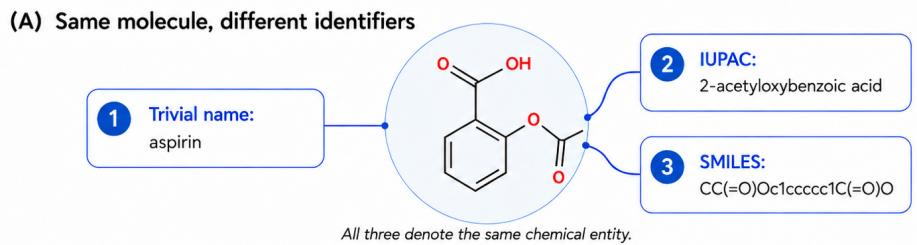
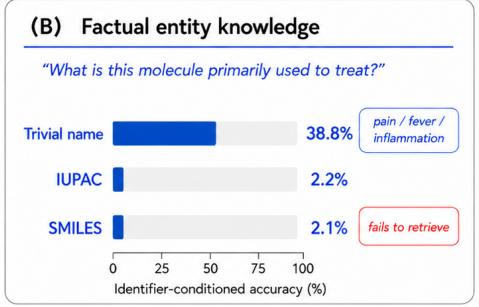
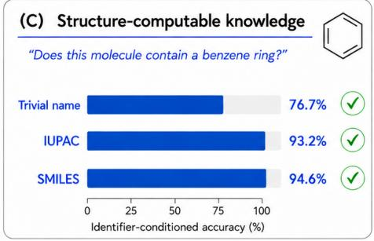
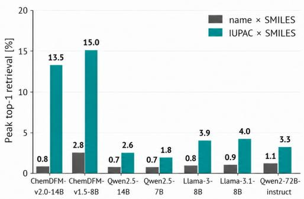
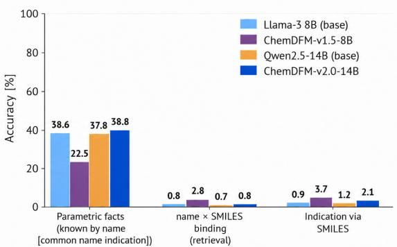

# SAME MOLECULE, DIFFERENT KNOWLEDGE: CROSS-IDENTIFIER BINDING FAILURES IN LLMS FOR CHEM-ISTRY

Khouloud Saadi∗, Di Wang

Department of Computer Science

King Abdullah University of Science and Technology

KAUST, Thuwal, Saudi Arabia

{khouloud.saadi,di.wang}@kaust.edu.sa

## ABSTRACT

Chemical AI workflows routinely represent the same molecule through multiple co-referring identifiers, including trivial names, IUPAC names, and SMILES, implicitly assuming that these representations provide interchangeable access to an LLM’s knowledge. To test this assumption, we first introduce a controlled benchmark and show that it does not hold. Across foundation models spanning 7B to 72B parameters, even chemistry-specialized models, co-referring molecular identifiers consistently expose different subsets of the model’s knowledge. We then conduct a series of controlled behavioral, representational, and causal analyses to characterize this failure. We show that even when a model can identify a molecule from its SMILES and retrieve a fact through the corresponding name, the same fact can remain inaccessible directly from SMILES. We term this phenomenon cross-identifier binding failure. Further analysis of internal representations, conflicting identifiers, and parameter editing shows that neither improved chemical representation competence nor modification of individual facts is sufficient to establish reliable access across identifiers. Together, these results indicate that the core failure lies in the binding between an identifier and knowledge already present in the model. Motivated by this diagnosis, we introduce Binding Self-Distillation, a simple mitigation that uses lexical identity during training to transfer the model’s existing knowledge access to the structural route. This enables factual retrieval directly from SMILES at inference time, without requiring a name lookup or training the underlying model from scratch.

## 1 INTRODUCTION

Large language models (LLMs) are increasingly used as general-purpose interfaces to knowledge and reasoning (Brown et al., 2020; Ouyang et al., 2022; Kojima et al., 2022). Beyond naturallanguage generation (Wei et al., 2022), they support applications in programming (Chen et al., 2021), medicine (McDuff et al., 2025; Johri et al., 2025), and scientific discovery (Singhal et al., 2023; Zhang et al., 2024b). In chemistry, LLMs are used for chemical question answering (Zhang et al., 2024a; Zhao et al., 2025), molecular property prediction (Jablonka et al., 2024), and molecule design (Bhattacharya et al., 2024). As these models become components of chemical workflows, an important question is whether the knowledge they contain can be accessed reliably under the different representations used to describe the same molecule.

A single molecule can be referred to through multiple co-referring identifiers (Kim et al., 2023). For example, as shown in Figure 1(A), aspirin may appear as the trivial name aspirin, the systematic IUPAC name 2-acetyloxybenzoic acid (Favre & Powell, 2013), or the SMILES string CC(=O)Oc1ccccc1C(=O)O (Gomez-Bombarelli et al., 2018). These representations are rou-´ tinely mixed across chemical workflows: biomedical resources commonly use lexical names (Hast ings et al., 2016), whereas reaction datasets and molecular generative pipelines frequently use structural representations such as SMILES (Gomez-Bombarelli et al., 2018; Schwaller et al., 2019). Con-´ sequently, the same LLM may be queried about the same molecule through different identifiers. This practice relies on an implicit assumption: co-referring identifiers should be interchangeable routes to the model’s knowledge. More generally, equivalence at the level of the underlying scientific entity is implicitly expected to translate into equivalence as an interface to the model’s memory.

  
Changing only the identifier changes which knowledge is accessible. Lexical names provide substantially stronger access to stored entity facts; structural identifiers are often more effective for properties computable from molecular form.  
Figure 1: Equivalent molecular identifiers expose different knowledge. (A) A trivial name, IUPAC name, and SMILES string denote the same molecule (aspirin). (B–C) Identifier-conditioned accuracy over the 896 molecules in our benchmark, holding the molecule and queried property fixed while changing only the identifier. Lexical names provide substantially stronger access to entity-associated factual knowledge (B, therapeutic indication), whereas structural identifiers provide stronger access to structure-computable knowledge (C, benzene-ring presence). Representative results are shown for ChemDFM-v2.0-14B (Zhao et al., 2025).

In this work, we first show that this assumption does not hold. We construct ChemIDBench, a controlled benchmark for evaluating knowledge access across co-referring molecular identifiers, covering approved drugs with matched trivial names, IUPAC names, and SMILES, and evaluate seven chemistry-specialized and general-purpose LLMs. Holding the underlying molecule and queried property fixed while changing only its identifier reveals a systematic double dissociation: as shown in Figure 1(B,C), lexical names provide substantially stronger access to entity-associated factual knowledge, whereas structure-descriptive identifiers provide stronger access to properties computable from molecular form. Identifier choice therefore does more than change the difficulty of a query; it changes which knowledge is reachable. More surprisingly, this asymmetry persists even when the model recognizes the molecule. We isolate cases in which a model can generate the correct trivial name from SMILES and retrieve a fact through that name, yet still fails to retrieve the same fact directly from SMILES. We call this phenomenon cross-identifier binding failure. It separates three notions that are often implicitly conflated: recognizing the entity, possessing factua knowledge about it, and binding a particular identifier to that knowledge.

We next ask what prevents knowledge from transferring across identifiers and whether the missing access can be recovered. Supplying the lexical name restores much of the inaccessible factual knowledge, showing that the knowledge is present but not reached through the structural route. More importantly, activation patching provides causal evidence for this account: transplanting lexical-route states into a structural query restores inaccessible factual retrieval under SMILES alone. Layer-wise analysis further shows that chemistry-specific training can improve alignment between structural forms without establishing comparable name-structure binding. This weak binding is also a reliability problem: when conflicting identifiers are presented together, different access routes can control different answers, producing inconsistencies that models often fail to detect. Supplying the lexical identity is an effective inference-time remedy, but it requires an identifier lookup on every query. Standard knowledge editing does not reliably propagate factual access across co-referring identifiers, suggesting that modifying the factual association alone is insufficient. Motivated by this diagnosis, we introduce Binding Self-Distillation, which targets the missing access relation by transferring the model’s own name-conditioned access behavior to the SMILES route. It substantially improves factual retrieval directly from SMILES across seven models, without requiring the lexical name at inference time or training a model from scratch. A detailed discussion of related work is provided in Appendix A. In summary, our contributions are:

• We introduce ChemIDBench, a controlled benchmark for evaluating knowledge access across co-referring molecular identifiers, covering matched trivial names, IUPAC names, and SMILES and evaluating seven LLMs spanning 7B–72B parameters.

• We characterize how molecular identifier choice affects access to different types of knowledge, contrasting entity-associated factual queries with structure-computable queries and testing whether successful molecular recognition is sufficient for factual retrieval.

• Through lexical-bridge controls, conflicting-identifier experiments, representation analysis, and activation patching, we show that entity recognition, factual knowledge, and identifier-conditioned access are separable, providing behavioral and causal evidence for cross-identifier binding failure.

• We show that standard knowledge editing does not reliably propagate factual access across co-referring identifiers, revealing that modifying the factual association alone is insufficient. Motivated by this diagnosis, we introduce Binding Self-Distillation, which directly targets the missing access relation and substantially improves retrieval from SMILES without requiring the lexical name at inference time.

## 2 BENCHMARKING CROSS-IDENTIFIER KNOWLEDGE ACCESS

## 2.1 BENCHMARK DESIGN

Our benchmark ChemIDBench isolates the effect of molecular identifier choice while holding the underlying molecule and queried property fixed. Each molecule is represented by three co-referring molecular identifiers: a trivial name, an IUPAC name, and a canonical SMILES string. We select these three because they are widely used across chemical and biomedical workflows (Hastings et al., 2016; Gomez-Bombarelli et al., 2018; Schwaller et al., 2019) while providing complementary´ interfaces to the same molecular entity: trivial names serve as familiar lexical references, IUPAC names provide systematic chemical nomenclature (Favre & Powell, 2013), and SMILES provides a compact structure-based representation (Gomez-Bombarelli et al., 2018). We begin with 3,025´ molecules with approved drug–indication records in ChEMBL (Mendez et al., 2019; Hunter et al., 2025), using the ChEMBL preferred name as the trivial-name identifier. We then apply a strict entity-cleaning pipeline, removing salts, multi-fragment molecules, duplicate names and structures, invalid structures, and extreme molecule sizes, leaving 1,553 unambiguous molecular entities. We further retain only molecules with scorable therapeutic indications, yielding 897 candidates, and resolve their IUPAC names through PubChem (Kim et al., 2023). This produces 896 molecules with matched trivial-name, IUPAC-name, and SMILES representations. Full filtering criteria, indication normalization, and identifier-resolution checks are provided in Appendix B.1.

For each task, we query the same molecule independently through its trivial name, IUPAC name, and SMILES. The benchmark spans two complementary types of queries: (1) Entity-associated queries test access to information tied to the molecular entity, including molecule identification and therapeutic indication; (2) Structure-computable queries test properties that can be derived from molecular structure, including molecular formula, benzene-ring presence, nitrogen-atom count, ring count, and heavy-atom count, with ground truth computed using RDKit (Landrum, 2026). Models use greedy decoding; entity-associated outputs are scored against normalized accepted answers, while structure-computable properties are evaluated against RDKit-derived ground truth. Exact task definitions, prompts, ground-truth construction, decoding settings, and scoring procedures are provided in Appendix B.2.

We evaluate seven LLMs spanning 7B–72B parameters, including both chemistry-specialized and general-purpose models. To isolate the effect of chemistry-specific training on cross-identifier behavior, we compare ChemDFM-v2.0-14B and ChemDFM-v1.5-8B (Zhao et al., 2025) with Qwen2.5-14B-Instruct (Yang et al., 2024b) and Meta-Llama-3-8B-Instruct (Grattafiori et al., 2024), respectively. We further include Qwen2.5-7B-Instruct (Yang et al., 2024b), Llama-3.1-8B-Instruct (Grattafiori et al., 2024), and Qwen2-72B-Instruct (Yang et al., 2024a).

Table 1: Accuracy (%) under trivial name (N), IUPAC name (I), and SMILES (S). Indication denotes therapeutic-indication retrieval; Benzene denotes benzene-ring detection; and Nitrogens denotes nitrogen-atom counting. These three tasks provide the primary evidence for the cross-identifier dissociation; results for all seven benchmark tasks are reported in Appendix B.3. Best performance within each model and task is shown in bold.
<table><tr><td rowspan="2">Model</td><td colspan="3">Indication</td><td colspan="3">Benzene</td><td colspan="3">Nitrogens</td></tr><tr><td>N</td><td>I</td><td>S</td><td>N</td><td>I</td><td>S</td><td>N</td><td>I</td><td>S</td></tr><tr><td>ChemDFM-v2.0-14B</td><td>38.8</td><td>2.2</td><td>2.1</td><td>76.7</td><td>93.2</td><td>94.6</td><td>41.6</td><td>70.3</td><td>59.6</td></tr><tr><td>ChemDFM-v1.5-8B</td><td>22.5</td><td>0.1</td><td>3.7</td><td>70.5</td><td>81.1</td><td>84.4</td><td>5.5</td><td>8.7</td><td>21.2</td></tr><tr><td>Qwen2.5-14B-Instruct</td><td>37.8</td><td>5.4</td><td>1.2</td><td>58.6</td><td>80.9</td><td>86.9</td><td>33.3</td><td>59.2</td><td>65.6</td></tr><tr><td>Qwen2.5-7B-Instruct</td><td>34.2</td><td>2.1</td><td>1.2</td><td>57.9</td><td>60.8</td><td>80.1</td><td>32.9</td><td>53.0</td><td>38.3</td></tr><tr><td>Qwen2-72B-Instruct</td><td>43.5</td><td>9.5</td><td>0.9</td><td>71.0</td><td>88.6</td><td>84.3</td><td>40.0</td><td>51.8</td><td>61.6</td></tr><tr><td>Meta-Llama-3-8B-Instruct</td><td>38.6</td><td>6.6</td><td>0.9</td><td>67.7</td><td>89.4</td><td>89.7</td><td>29.0</td><td>57.4</td><td>47.0</td></tr><tr><td>Llama-3.1-8B-Instruct</td><td>39.1</td><td>6.0</td><td>1.2</td><td>65.5</td><td>90.5</td><td>90.4</td><td>25.7</td><td>49.9</td><td>38.4</td></tr></table>

## 2.2 EQUIVALENT IDENTIFIERS EXPOSE DIFFERENT KNOWLEDGE

If co-referring identifiers were interchangeable interfaces to model knowledge, changing only how a molecule is represented should have a negligible effect on the model’s answer. Table 1 shows the opposite: changing the identifier can nearly erase access to entity-associated knowledge while improving access to structure-computable properties. For ChemDFM-v2.0-14B, therapeutic-indication accuracy collapses from 38.8% under the trivial name to 2.1% under SMILES. Yet on the same molecules, the direction reverses for benzene-ring detection: accuracy rises from 76.7% to 94.6%. This reversal holds across all seven models, spanning 7B to 72B parameters and including both chemistry-specialized and general-purpose LLMs. Across these models, trivial names are strongest for therapeutic indication, whereas SMILES outperforms the trivial name on benzene detection by 13.3–28.3 percentage points. Nitrogen counting shows the same broad reversal, though the better structural representation, IUPAC or SMILES, varies across models. Thus, structure-descriptive identifiers are not simply harder inputs: they can be better interfaces when the requested information is recoverable from molecular form.

Because each molecule is evaluated under every identifier, these differences can be tested molecule by molecule rather than only through aggregate accuracy. Paired McNemar tests (McNemar, 1947) confirm both directions: trivial names outperform SMILES for therapeutic-indication retrieval, whereas SMILES outperforms trivial names for benzene detection, with both effects significant across all seven models $( p < 1 0 ^ { - 7 } )$ . Exact paired counts, p-values, and results for all seven benchmark tasks are reported in Appendix B.3. The key result is therefore not that one identifier is generally easier than another. Instead, the identifier determines which knowledge is accessible: lexica names favor entity-associated knowledge, while structure-descriptive identifiers favor information recoverable from molecular form. This raises a key question: is the SMILES failure simply a failure of molecular recognition?

## 2.3 RECOGNITION DOES NOT IMPLY RETRIEVAL

To test whether failed molecular recognition explains the retrieval gap, we evaluate two complementary recognition criteria. First, we use a two-alternative forced-choice (2AFC) test, a standard forced-choice paradigm in which the model must select the correct answer from two alternatives. Given a SMILES string, the model chooses between the correct trivial name and one incorrect candidate; we retain only molecules answered correctly across three independent decoy conditions. Second, in the stricter free-form test, the model must generate the correct trivial name directly from SMILES without candidate answers. Full recognition protocols and subset-construction details are provided in Appendix B.4.

As shown in Table 2, under 2AFC, ChemDFM-v2.0-14B correctly recognizes 576 molecules, yet therapeutic-indication accuracy through SMILES is only 4.0%, close to 2.8% on the remaining molecules, while the same recognized molecules reach 42.7% through their trivial names. Freeform recognition gives the same result: among the 62 molecules whose trivial names are correctly generated from SMILES, indication accuracy is 40.3% through the name but only 3.2% through SMILES, compared with 3.6% outside the recognized subset. ChemDFM-v1.5-8B shows the same broader separation: under 2AFC, the recognized molecules reach 22.0% through their trivial name but only 3.7% through SMILES. The broader 2AFC pattern also holds across the other models with recognized subsets. Recognition therefore does not explain the retrieval gap: a model can map a structural identifier to the correct lexical identity while access to entity-associated knowledge remains strongly identifier-dependent. We refer to this phenomenon as cross-identifier binding failure.

Table 2: Therapeutic-indication accuracy (%) on molecules whose SMILES–name correspondence is recognized. “Rest” denotes SMILES accuracy on molecules outside the recognized subset. Higher accuracy indicates better performance; n denotes the size of the recognized subset.
<table><tr><td rowspan="2">Model</td><td colspan="4">2AFC recognition</td><td colspan="4">Free-form recognition</td></tr><tr><td>n</td><td>SMILES</td><td>Name</td><td>Rest</td><td>n</td><td>SMILES</td><td>Name</td><td>Rest</td></tr><tr><td>ChemDFM-v2.0-14B</td><td>576</td><td>4.0</td><td>42.7</td><td>2.8</td><td>62</td><td>3.2</td><td>40.3</td><td>3.6</td></tr><tr><td>ChemDFM-v1.5-8B</td><td>487</td><td>3.7</td><td>22.0</td><td>4.972</td><td></td><td>8.3</td><td>19.4</td><td>3.9</td></tr><tr><td>Qwen2.5-14B-Instruct</td><td>332</td><td>1.2</td><td>44.9</td><td>1.4</td><td>1</td><td>0.0</td><td>100.0</td><td>1.3</td></tr><tr><td>Qwen2.5-7B-Instruct</td><td>240</td><td>0.0</td><td>40.4</td><td>1.7</td><td>1</td><td>0.0</td><td>100.0</td><td>1.2</td></tr><tr><td>Qwen2-72B-Instruct</td><td>376</td><td>1.3</td><td>42.6</td><td>0.6</td><td>7</td><td>0.0</td><td>42.9</td><td>0.9</td></tr><tr><td>Llama-3.1-8B-Instruct</td><td>312</td><td>1.6</td><td>42.6</td><td>1.4</td><td>6</td><td>0.0</td><td>33.3</td><td>1.5</td></tr></table>

Table 3: Supplying lexical identity restores factual access. Therapeutic-indication accuracy (%). Higher values indicate better performance.
<table><tr><td>Model</td><td>SMILES</td><td>+ Name</td><td>Name</td><td>Recovery</td></tr><tr><td>ChemDFM-v2.0-14B</td><td>2.1</td><td>36.3</td><td>38.6</td><td>93.6</td></tr><tr><td>ChemDFM-v1.5-8B</td><td>3.9</td><td>21.4</td><td>23.0</td><td>91.8</td></tr><tr><td>Qwen2.5-14B-Instruct</td><td>1.3</td><td>37.6</td><td>37.8</td><td>99.4</td></tr><tr><td>Qwen2.5-7B-Instruct</td><td>1.2</td><td>32.8</td><td>33.9</td><td>96.6</td></tr><tr><td>Llama-3.1-8B-Instruct</td><td>1.2</td><td>38.6</td><td>39.0</td><td>99.1</td></tr><tr><td>Qwen2-72B-Instruct</td><td>0.8</td><td>42.5</td><td>43.5</td><td>97.7</td></tr></table>

## 3 KNOWLEDGE IS PRESENT BUT UNREACHABLE

Recognition alone does not restore factual retrieval (Section 2.3). We therefore ask whether the missing knowledge is absent from the model or instead inaccessible through the structural identifier.

## 3.1 LEXICAL IDENTITY RESTORES FACTUAL ACCESS

We supply the missing identifier correspondence by augmenting each SMILES with its correct trivial name, without providing any information about the queried indication. As shown in Table 3, this simple intervention nearly closes the gap to name-only retrieval across all models, recovering 91.8–99.4% of the lost accuracy. For ChemDFM-v2.0-14B, indication accuracy rises from 2.1% with SMILES alone to 36.3% with SMILES+Name, compared with 38.6% from the name alone. Qwen2.5-14B similarly rises from 1.3% to 37.6%, versus 37.8% from the name. Thus, supplying lexical identity is sufficient to make much of the otherwise inaccessible factual knowledge reachable. Exact prompts, the recovery definition, and reverse-direction controls are provided in Appendix C.1.

## 3.2 CONFLICTING IDENTIFIERS EXPOSE SEPARATE ACCESS ROUTES

To test whether lexical and structural identifiers access a single coherent entity representation, we pair the SMILES of molecule A with the incorrect trivial name of molecule B. The resulting answers split by query type: identity and therapeutic indication largely follow the supplied name B, whereas benzene-ring remains close to those obtained from A’s SMILES alone. As shown in Table 4, for ChemDFM-v2.0-14B, the conflicting input produces B’s identity in 85.5% of cases and retains 32.3% indication accuracy for B, while benzene accuracy for A remains 95.3%, compared with 94.5% from its SMILES alone. Full results are provided in Appendix C.2.

The conflict is often undetected. We next ask whether models recognize that the two supplied identifiers are incompatible. When explicitly asked whether a SMILES and trivial name refer to the same molecule, models reject obvious mismatches much more reliably than structurally similar

Table 4: Conflicting identifiers control different outputs: Each conflicting prompt pairs the SMILES of molecule A with the incorrect trivial name of molecule B. For identity, we report how often the model returns the true molecule A or the supplied decoy B. For therapeutic indication, we report accuracy for B under the conflicting prompt and when B is queried by its name alone. For benzenering presence, we report accuracy for A under the conflicting prompt and when A is queried by its SMILES alone. All values are percentages. These quantities are diagnostic and do not have a single preferred direction.
<table><tr><td rowspan="2">Model</td><td colspan="2">Identity under conflict</td><td colspan="2">Indication of B</td><td colspan="2">Benzene of A</td></tr><tr><td>True A</td><td>Decoy B</td><td>Conflict Name only</td><td></td><td>Conflict SMILES only</td><td></td></tr><tr><td>ChemDFM-v2.0-14B</td><td>1.0</td><td>85.5</td><td>32.3</td><td>38.6</td><td>95.3</td><td>94.5</td></tr><tr><td>ChemDFM-v1.5-8B</td><td>0.6</td><td>73.4</td><td>17.4</td><td>23.0</td><td>80.5</td><td>85.0</td></tr><tr><td>Qwen2.5-14B-Instruct</td><td>0.0</td><td>81.1</td><td>35.9</td><td>37.8</td><td>84.9</td><td>86.9</td></tr><tr><td>Qwen2.5-7B-Instruct</td><td>0.0</td><td>60.4</td><td>32.1</td><td>33.9</td><td>75.9</td><td>80.2</td></tr><tr><td>Llama-3.1-8B-Instruct</td><td>0.0</td><td>86.8</td><td>37.3</td><td>39.0</td><td>89.3</td><td>90.3</td></tr><tr><td>Qwen2-72B-Instruct</td><td>0.0</td><td>77.8</td><td>43.2</td><td>44.1</td><td>83.9</td><td>84.3</td></tr></table>

Table 5: Lexical activations causally restore retrieval from SMILES. Peak recovery (%) of the name–SMILES log-probability gap and the corresponding relative layer depth. Control patches use a different molecule with a different gold answer. Higher recovery indicates stronger restoration; peak depth is descriptive, while the control is expected not to yield positive recovery.
<table><tr><td>Model</td><td>Peak depth</td><td>Recovery</td><td>Control</td></tr><tr><td>ChemDFM-v2.0-14B</td><td>0.71</td><td>105.4</td><td>-88.3</td></tr><tr><td>ChemDFM-v1.5-8B</td><td>0.50</td><td>76.4</td><td>-79.6</td></tr><tr><td>Qwen2.5-14B-Instruct</td><td>0.71</td><td>106.0</td><td>-197.7</td></tr><tr><td>Qwen2.5-7B-Instruct</td><td>0.75</td><td>104.9</td><td>-111.4</td></tr><tr><td>Meta-Llama-3-8B-Instruct</td><td>0.52</td><td>135.0</td><td>-179.9</td></tr><tr><td>Llama-3.1-8B-Instruct</td><td>0.50</td><td>112.4</td><td>-208.2</td></tr><tr><td>Qwen2-72B-Instruct</td><td>0.83</td><td>138.4</td><td>-30.9</td></tr></table>

ones. Across the tested models, only 17.5–43.1% of similar incorrect names are rejected; even in a two-choice identification test, accuracy is only 56.4–73.9%. Thus, conflicting identifiers can drive different answers without the model reliably detecting the inconsistency. Full prompts, decoy construction, and discrimination results are reported in Appendix C.3.

## 4 DIAGNOSING AND RESTORING CROSS-IDENTIFIER ACCESS

## 4.1 CAUSAL ANALYSIS VIA ACTIVATION PATCHING

The behavioral results suggest that factual knowledge is accessible through a molecule’s trivial name but not through its SMILES. We test whether this difference can be causally traced to the internal state induced by the identifier. We use activation patching (Zhang & Nanda, 2024), a causal intervention that replaces an internal activation in a target computation with the corresponding activation from a source computation, to test whether the lexical state is sufficient to restore factual retrieval. For matched prompts querying the same fact, we treat the trivial-name run as the source and the SMILES run as the target. At each tested layer, we replace the residual-stream state at the final prompt token of the SMILES run with the corresponding source state. We measure recovery as the fraction of the name–SMILES teacher-forced log-probability gap closed by the intervention; a different-molecule activation with a different gold answer serves as the control. Full prompts, scoring, and implementation details are provided in Appendix D.

As shown in Table 5, the correct lexical state substantially restores factual retrieval in every model, with peak recovery ranging from 76.4% to 138.4%. In contrast, every different-molecule control is negative. The effect peaks at relative depths 0.50–0.83, rather than at a single architecturespecific layer. These interventions provide causal evidence that the lexical route produces a retrievalsupporting state that the SMILES route fails to construct on its own. We next ask whether this access asymmetry is reflected in the geometry of the two identifier representations.

## 4.2 PROBING CROSS-IDENTIFIER BINDING IN MODEL REPRESENTATIONS

We examine whether co-referring molecular identifiers become aligned at the level of individual entities. If two identifier representations encode the same molecular identity in a shared geometry, the representation of a molecule under one identifier should retrieve its co-referring representation under another identifier from a large candidate set. We therefore measure cross-identifier top-1 retrieval. For each of the 896 molecules, we extract representations from identifier-specific prompts and use the representation under one identifier to retrieve the corresponding SMILES representation from all 896 candidates. We evaluate retrieval across hidden-state depths and report the maximum top-1 accuracy. Throughout this section, Name–SMILES denotes trivial name → SMILES retrieval, whereas IUPAC–SMILES denotes IUPAC name → SMILES retrieval. Full representation extraction, pooling, centering, normalization, and layer-wise evaluation details are provided in Appendix E. The result reveals a sharp asymmetry. Even at the best depth, Name–SMILES retrieval reaches only 0.7–2.8% across all models. Yet weak alignment is not inevitable across molecular identifiers: IUPAC–SMILES retrieval reaches 13.5% for ChemDFM-v2.0-14B and 15.0% for ChemDFM-v1.5-8B (Figure 2). The same models can therefore develop substantially stronger correspondence between two structure-descriptive forms while leaving lexical identity only weakly connected to molecular structure.

  
Figure 2: Cross-identifier representation alignment and chemistry specialization. Left: peak top-1 retrieval of the same molecule among 896 candidates across hidden-state depths; chance performance is 0.11%. Name–SMILES denotes trivial name → SMILES retrieval and IUPAC–SMILES denotes IUPAC name → SMILES retrieval. Right: comparison of the two general-purpose reference models with their chemistry-specialized counterparts. “Parametric facts known by name” denotes strict-scored trivial-name indication accuracy; “Name–SMILES binding” denotes the same crossidentifier retrieval metric; and “Indication via SMILES” denotes strict-scored SMILES-conditioned indication accuracy.

Chemistry specialization makes this separation especially clear. For the Meta-Llama-3-8B-Instruct → ChemDFM-v1.5-8B comparison, IUPAC–SMILES retrieval rises from 3.9% to 15.0%, whereas Name–SMILES retrieval rises only from 0.8% to 2.8%. For Qwen2.5-14B-Instruct → ChemDFMv2.0-14B, IUPAC–SMILES retrieval rises from 2.6% to 13.5%, while Name–SMILES retrieval changes only from 0.7% to 0.8%. Thus, the chemistry-specialized models exhibit substantially stronger alignment between the two structure-descriptive identifiers than their general-purpose ref erence models without producing comparable binding between molecular structure and lexical identity. This representational asymmetry mirrors the behavioral access gap. Stronger chemical rep resentations do not by themselves make entity-associated factual knowledge reliably accessible through SMILES: the models can substantially align IUPAC names with molecular structure while leaving the lexical route through which much of their factual knowledge is accessed only weakly connected to that same structure.

## 4.3 LEXICAL ROUTING RESTORES FACTUAL ACCESS FROM SMILES

The lexical bridge above suggests a simple inference mitigation: resolve a SMILES string to its lexical identity before asking for the fact. We test this over 891 molecules and 2,955 available molecule–relation pairs spanning therapeutic indication, molecular target, mechanism of action, and ATC class. For each query, we compare direct SMILES access, SMILES augmented with the molecule’s ChEMBL preferred name obtained by database lookup, and the preferred name alone. The lookup supplies only the identifier correspondence, not the queried fact. Full construction, prompts, scoring, and controls are given in Appendix F.

As Table 6 shows, lexical routing closes 83.6–98.8% of the aggregate SMILES–name gap across all models. The model itself rarely supplies this bridge reliably: in a self-resolution control, SMILES to-name identification succeeds for only 0.1–12.0% of molecules (Appendix F). Thus, most of the missing factual access can be recovered by supplying the identifier correspondence, but that correspondence is not reliably inferred from SMILES alone. Lookup-based routing therefore provides an effective inference workaround, but it requires lexical resolution on every query and remains bounded by the knowledge accessible through the name. Can the same access instead be written into the model parameters, using standard knowledge editors as a diagnostic of what is missing?

Table 6: Aggregate accuracy (%) over available molecule–relation pairs. Higher values indicate better performance.
<table><tr><td>Model</td><td>SMILES</td><td>+ Lookup</td><td>Name</td><td>Gap rec.</td></tr><tr><td>ChemDFM-v2.0-14B</td><td>2.4</td><td>20.8</td><td>24.4</td><td>83.6</td></tr><tr><td>ChemDFM-v1.5-8B</td><td>5.4</td><td>14.2</td><td>14.5</td><td>96.7</td></tr><tr><td>Qwen2.5-14B-Instruct</td><td>1.2</td><td>25.3</td><td>29.2</td><td>86.1</td></tr><tr><td>Qwen2.5-7B-Instruct</td><td>0.6</td><td>22.6</td><td>23.2</td><td>97.3</td></tr><tr><td>Meta-Llama-3-8B-Instruct</td><td>1.2</td><td>26.8</td><td>27.1</td><td>98.8</td></tr><tr><td>Llama-3.1-8B-Instruct</td><td>0.6</td><td>26.8</td><td>28.9</td><td>92.6</td></tr></table>

Table 7: All values are percentages. Specific transfer is computed as SMILES transfer minus leakage and is therefore reported in percentage points; brackets denote 95% bootstrap confidence intervals. Higher edit efficacy, specific transfer, and +Name recovery indicate better performance, while lower leakage is better. Raw SMILES transfer should be interpreted together with leakage.
<table><tr><td>Model</td><td>Method</td><td>Effic.</td><td>SMILES</td><td>Leak</td><td>Specific [95% CI]</td><td>+Name</td></tr><tr><td rowspan="2">ChemDFM-v2.0-14B</td><td>ROME</td><td>52.2</td><td>22.1</td><td>19.8</td><td>+2.3 [-0.9,5.5]</td><td>45.5</td></tr><tr><td>FT</td><td>26.0</td><td>1.8</td><td>2.1</td><td>-0.3 [-1.6,1.2]</td><td>25.2</td></tr><tr><td rowspan="2">Qwen2.5-14B</td><td>ROME</td><td>17.9</td><td>4.4</td><td>4.9</td><td>-0.5 [-2.4,1.4]</td><td>12.3</td></tr><tr><td>FT</td><td>29.0</td><td>11.5</td><td>8.0</td><td>+3.5 [0.9,6.3]</td><td>26.7</td></tr><tr><td rowspan="2">Qwen2.5-7B</td><td>ROME</td><td>47.9</td><td>4.0</td><td>7.4</td><td>-3.4 [-5.7,-0.9]</td><td>11.4</td></tr><tr><td>FT</td><td>34.5</td><td>5.4</td><td>7.3</td><td>-1.9 [-4.4,0.8]</td><td>21.7</td></tr><tr><td rowspan="2">Llama-3.1-8B</td><td>ROME</td><td>44.2</td><td>21.1</td><td>8.1</td><td>+13.0 [9.2,16.9]</td><td>40.4</td></tr><tr><td>FT</td><td>38.3</td><td>12.6</td><td>11.4</td><td>+1.2 [-1.6,4.1]</td><td>32.1</td></tr></table>

## 4.4 STANDARD EDITORS DO NOT RELIABLY TRANSFER ACROSS IDENTIFIERS

Can the lookup required above be avoided by modifying the model weights? We test this diagnostically with ROME (Gupta et al., 2024b;a) and fine-tuning (FT) (Ouyang et al., 2022): a counterfactual drug indication is edited through the molecule’s trivial name and then queried through its co-referring SMILES. Because an edit may also increase production of the target for unrelated molecules, we subtract the corresponding locality leakage, $\dot { T _ { \mathrm { s p e c i f i c } } } =  { T _ { \mathrm { S M I L E S } } } -  { T _ { \mathrm { l e a k } } }$ . Full edit construction, IUPAC results, layer selection, and hyperparameters are given in Appendix G. Across the eight model–editor configurations, six show no reliable entity-specific transfer to SMILES beyond the leakage baseline, while only two exhibit statistically reliable transfer beyond this baseline, including substantial transfer for Llama-3.1-8B-Instruct with ROME (Table 7). This pattern remains when we restrict evaluation to edits that demonstrably succeed through the trivial name (Appendix G), showing that weak transfer is not simply caused by failed edits. Moreover, restoring the correct name alongside SMILES often makes the edited association accessible again. Thus, standard editing can sometimes propagate across identifiers, but this behavior is highly inconsistent across models and methods: modifying the factual association does not reliably repair the structural route used to access it.

## 5 BINDING SELF-DISTILLATION TRANSFERS LEXICAL ACCESS TO SMILES

The editing results suggest that changing a factual association is not enough: the missing object is the access route from SMILES to knowledge that is already reachable through the molecule’s lexical identity. We therefore ask whether this access behavior itself can be written into the model. Our goal is not to teach a new fact, but to make the SMILES route reproduce knowledge access that the same model already exhibits when the correct name is available. We introduce Binding Self-Distillation (BSD). For a molecule with SMILES s, trivial name n, and a generic continuation stem z, we construct matched teacher and student contexts,

$$
x _ { T } = [ \mathrm { S M I L E S } ( s ) ; \cdots ] \operatorname { n o w n } { \mathrm { a s } } n ^ { \prime } ; z ] , \qquad x _ { S } = [ \mathrm { S M I L E S } ( s ) ; z ] .
$$

Table 8: Facts/entity is the average number of available factual relations retrieved per molecule before and after the per-entity binding intervention. Higher Facts/entity indicates better performance; n is the model-specific number of molecules retained by the original BSD entity-selection pipeline.
<table><tr><td>Model</td><td>n</td><td>Facts/entity</td></tr><tr><td>ChemDFM-v2.0-14B</td><td>389</td><td> $0 . 0 5  0 . 8 7$ </td></tr><tr><td>Qwen2.5-14B-Instruct</td><td>390</td><td> $0 . 0 6  0 . 7 3$ </td></tr><tr><td>Llama-3.1-8B-Instruct</td><td>389</td><td> $0 . 0 3  0 . 6 8$ </td></tr><tr><td>ChemDFM-v1.5-8B</td><td>47</td><td> $0 . 5 1  0 . 8 5$ </td></tr><tr><td>Qwen2.5-7B-Instruct</td><td>351</td><td> $0 . 0 4  0 . 8 5$ </td></tr><tr><td>Meta-Llama-3-8B-Instruct</td><td>378</td><td> $0 . 0 2  0 . 7 8$ </td></tr><tr><td>Qwen2-72B-Instruct</td><td>435</td><td> $0 . 0 1  0 . 8 5$ </td></tr></table>

Teacher and student use the same pretrained model. The teacher is frozen and receives the lexical identity, while the student receives only SMILES and learns a lightweight LoRA adapter by minimizing $D _ { \mathrm { K L } } \big ( p _ { \boldsymbol { \theta } } ( \cdot  { | } x _ { T } )  { | | } p _ { \boldsymbol { \theta } , \boldsymbol { \phi } } ( \cdot  { | } x _ { S } ) \big )$ . Thus, the training signal is the model’s own nameconditioned predictive behavior: no factual labels, generated target answers, or external teacher are used. We train one adapter per molecule using generic continuation stems, with the downstream factual evaluation prompts excluded from training. At inference time, the name is removed and only SMILES is provided. Full training configuration, prompts, and controls are in Appendix H. Binding Self-Distillation increases factual access through SMILES across all seven models (Table 8). For ChemDFM-v2.0-14B, the number of retrieved facts rises from 0.05 to 0.87 per entity. The gain is not restricted to the indication relation used to select eligible molecules: SMILES-conditioned accuracy rises from 2.1% to 51.4% for indication, 0.0% to 27.6% for molecular target, 0.0% to 5.0% for mechanism of action, and 3.3% to 11.4% for ATC class (Appendix H.5, Table 26). The effect also persists at substantially larger scale: Qwen2-72B-Instruct rises from 0.01 to 0.85 facts per entity over 435 molecules. Because the factual evaluation prompts are excluded from training, these improvements reflect transfer of the lexical access behavior across prompts rather than direct training on the evaluation answers.

How much of the lexical route can be internalized? On the same ChemDFM-v2.0-14B entities, explicitly supplying the correct name raises access from 0.05 to 1.01 facts per entity, while Binding Self-Distillation reaches 0.87, recovering 86% of the available SMILES–name gap without requiring the name at inference time. For Qwen2-72B-Instruct, the corresponding values are 0.01, 1.34, and 0.85, yielding 63% recovery (Appendix H.6, Table 27). Retention controls for these two highlighted settings also show that the intervention need not destroy behavior that already works: benzene verdicts are preserved for 94.1% of ChemDFM-v2.0-14B examples and 92.9% of Qwen2-72B-Instruct examples, with additional locality analyses reported in Appendix H.7. Together, these results provide a constructive complement to the editing diagnostic in Section 4.4. Standard editors modify factual associations but propagate them inconsistently across identifiers; Binding Self-Distillation instead targets the missing access relation. The result shows that knowledge already exposed by a lexical identifier can be made substantially more accessible from SMILES without requiring that lexical identifier at inference time.

## 6 CONCLUSION

In chemistry pipelines, molecular identity is often treated as a solved interface problem: once two identifiers are known to denote the same molecule, an LLM is implicitly expected to access the same underlying knowledge. We introduce ChemIDBench, a controlled benchmark for evaluating knowledge access across molecular representations, and find that across LLMs spanning 7B to 72B, changing only the identifier can change which knowledge is reachable. Surprisingly, a model can identify a molecule from SMILES and retrieve a fact through its trivial name, yet fail to retrieve the same fact directly from SMILES. When identifiers conflict, different routes can also drive different answers within the same prompt, often without the model detecting the inconsistency. Recognition controls, conflict experiments, representation analysis, and activation patching together show that entity recognition, knowledge possession, and identifier-conditioned access are separable capabilities. We call this cross-identifier binding failure. Standard knowledge editors do not reliably restore access across identifiers; we therefore introduce Binding Self-Distillation, which directly targets the missing access relation and substantially improves factual retrieval from SMILES without requiring the lexical name at inference time. Our current formulation performs this repair per entity, showing that cross-identifier access is repairable while leaving generalization to unseen entities as a future direction. Beyond chemistry, the broader identifier-dependent-access phenomenon also appears in our protein-domain replication with opaque UniProt accessions (Ahmad et al., 2025) in Appendix I. Overall, our results show that for LLMs to be used in science, knowledge is only useful if it remains accessible across the different representations of the same entity.

## REFERENCES

Shadab Ahmad, Leonardo Jose da Costa Gonzales, Emily H Bowler-Barnett, Daniel L Rice, Minjoon Kim, Supun Wijerathne, Aurelien Luciani, Swaathi Kandasaamy, Jie Luo, Xavier Watkins,´ et al. The uniprot website api: facilitating programmatic access to protein knowledge. Nucleic acids research, 53(W1):W547–W553, 2025.

David Bajusz, Anita R ´ acz, and K ´ aroly H ´ eberger. Why is tanimoto index an appropriate choice for´ fingerprint-based similarity calculations? Journal of cheminformatics, 7(1):20, 2015.

George Arthur Baker, Mario Sanz-Guerrero, and Katharina von der Wense. Molecular string representation preferences in pretrained LLMs: A comparative study in zero- & few-shot molecular property prediction. In Christos Christodoulopoulos, Tanmoy Chakraborty, Carolyn Rose, and Violet Peng (eds.), Proceedings of the 2025 Conference on Empirical Methods in Natural Language Processing, pp. 1071–1085, Suzhou, China, November 2025. Association for Computational Linguistics. ISBN 979-8-89176-332-6. doi: 10.18653/v1/2025.emnlp-main.56. URL https://aclanthology.org/2025.emnlp-main.56/.

Debjyoti Bhattacharya, Harrison J Cassady, Michael A Hickner, and Wesley F Reinhart. Large language models as molecular design engines. Journal of Chemical Information and Modeling, 64(18):7086–7096, 2024.

Tom Brown, Benjamin Mann, Nick Ryder, Melanie Subbiah, Jared D Kaplan, Prafulla Dhariwal, Arvind Neelakantan, Pranav Shyam, Girish Sastry, Amanda Askell, et al. Language models are few-shot learners. Advances in neural information processing systems, 33:1877–1901, 2020.

Mark Chen, Jerry Tworek, Heewoo Jun, Qiming Yuan, Henrique Ponde De Oliveira Pinto, Jared Kaplan, Harri Edwards, Yuri Burda, Nicholas Joseph, Greg Brockman, et al. Evaluating large language models trained on code. arXiv preprint arXiv:2107.03374, 2021.

Jaron Cohen, Alexander G Hasson, and Sara Tanovic. Unveiling latent knowledge in chemistry language models through sparse autoencoders. arXiv preprint arXiv:2512.08077, 2025.

Henri A Favre and Warren H Powell. Nomenclature oforganic chemistry: IUPAC recommendations and preferred names 2013. Royal Society of Chemistry, 2013.

Rafael Gomez-Bombarelli, Jennifer N Wei, David Duvenaud, Jos´ e Miguel Hern´ andez-Lobato,´ Benjam´ın Sanchez-Lengeling, Dennis Sheberla, Jorge Aguilera-Iparraguirre, Timothy D Hirzel,´ Ryan P Adams, and Alan Aspuru-Guzik. Automatic chemical design using a data-driven contin-´ uous representation of molecules. ACS central science, 4(2):268, 2018.

Aaron Grattafiori, Abhimanyu Dubey, Abhinav Jauhri, Abhinav Pandey, Abhishek Kadian, Ahmad Al-Dahle, Aiesha Letman, Akhil Mathur, Alan Schelten, Alex Vaughan, et al. The llama 3 herd of models. arXiv preprint arXiv:2407.21783, 2024.

Akshat Gupta, Anurag Rao, and Gopala Anumanchipalli. Model editing at scale leads to gradual and catastrophic forgetting. In Lun-Wei Ku, Andre Martins, and Vivek Srikumar (eds.), Findings of the Association for Computational Linguistics: ACL 2024, pp. 15202–15232, Bangkok, Thailand, August 2024a. Association for Computational Linguistics. doi: 10.18653/v1/2024.findings-acl. 902. URL https://aclanthology.org/2024.findings-acl.902/.

Akshat Gupta, Dev Sajnani, and Gopala Anumanchipalli. A unified framework for model editing. In Yaser Al-Onaizan, Mohit Bansal, and Yun-Nung Chen (eds.), Findings of the Association for Computational Linguistics: EMNLP 2024, pp. 15403–15418, Miami, Florida, USA, November 2024b. Association for Computational Linguistics. doi: 10.18653/v1/2024.findings-emnlp.903. URL https://aclanthology.org/2024.findings-emnlp.903/.

Wanqing Hao, Zetong Xu, Zhiyuan Han, Xiaoyan Bai, and Chenhao Tan. Mechanistic interpretability of chemical language models: Molecular geometry and representations in molmformer and smi-ted. In Mechanistic Interpretability Workshop at ICML 2026, 2026.

Janna Hastings, Gareth Owen, Adriano Dekker, Marcus Ennis, Namrata Kale, Venkatesh Muthukr ishnan, Steve Turner, Neil Swainston, Pedro Mendes, and Christoph Steinbeck. Chebi in 2016: Improved services and an expanding collection of metabolites. Nucleic acids research, 44(D1): D1214–D1219, 2016.

Cheng-Hsun Hsueh, Paul Kuo-Ming Huang, Tzu-Han Lin, Che Wei Liao, Hung-Chieh Fang, Chao-Wei Huang, and Yun-Nung Chen. Editing the mind of giants: An in-depth exploration of pitfalls of knowledge editing in large language models. In Yaser Al-Onaizan, Mohit Bansal, and Yun-Nung Chen (eds.), Findings of the Association for Computational Linguistics: EMNLP 2024, pp. 9417–9429, Miami, Florida, USA, November 2024. Association for Computational Linguistics. doi: 10.18653/v1/2024.findings-emnlp.550. URL https://aclanthology.org/2024. findings-emnlp.550/.

Fiona MI Hunter, Harris Ioannidis, A Patr´ıcia Bento, Nicolas Bosc, Sybilla Corbett, Eloy Felix, M Paula Magarinos, Emma Manners, Ines A Smit, Marleen de Veij, et al. Drug and clinical candidate drug data in chembl. Journal ofmedicinal chemistry, 68(19):19800, 2025.

Kevin Maik Jablonka, Philippe Schwaller, Andres Ortega-Guerrero, and Berend Smit. Leveraging large language models for predictive chemistry. Nature Machine Intelligence, 6(2):161–169, 2024.

Yuxin Jiang, Yufei Wang, Chuhan Wu, Wanjun Zhong, Xingshan Zeng, Jiahui Gao, Liangyou Li, Xin Jiang, Lifeng Shang, Ruiming Tang, Qun Liu, and Wei Wang. Learning to edit: Aligning LLMs with knowledge editing. In Lun-Wei Ku, Andre Martins, and Vivek Srikumar (eds.), Proceedings of the 62nd Annual Meeting of the Association for Computational Linguistics (Volume 1: Long Papers), pp. 4689–4705, Bangkok, Thailand, August 2024. Association for Computational Linguistics. doi: 10.18653/v1/2024.acl-long.258. URL https://aclanthology. org/2024.acl-long.258/.

Shreya Johri, Jaehwan Jeong, Benjamin A Tran, Daniel I Schlessinger, Shannon Wongvibulsin, Leandra A Barnes, Hong-Yu Zhou, Zhuo Ran Cai, Eliezer M Van Allen, David Kim, et al. An evaluation framework for clinical use of large language models in patient interaction tasks. Nature medicine, 31(1):77–86, 2025.

Christian Kenneth, Etowah Adams, Liam Bai, and Gerard JP van Westen. What does a chemical language model know about molecules? arXiv preprint arXiv:2606.23443, 2026.

Yosuke Kikuchi, Yasuhiro Yoshikai, Shumpei Nemoto, Ayako Furuhama, Takashi Yamada, Hiroyuki Kusuhara, and Tadahaya Mizuno. Notation-level confounding: When inconsistent molecular notations mislead chemical language models. arXiv preprint arXiv:2505.07139, 2025.

Sunghwan Kim, Jie Chen, Tiejun Cheng, Asta Gindulyte, Jia He, Siqian He, Qingliang Li, Benjamin A Shoemaker, Paul A Thiessen, Bo Yu, et al. Pubchem 2023 update. Nucleic acids research, 51(D1):D1373–D1380, 2023.

Takeshi Kojima, Shixiang Shane Gu, Machel Reid, Yutaka Matsuo, and Yusuke Iwasawa. Large language models are zero-shot reasoners. Advances in neural information processing systems, 35:22199–22213, 2022.

Greg Landrum. Rdkit: Open-source cheminformatics, 2026. URL https://www.rdkit.org. Version 2025.03.6.

Zhenyu Lei, Patrick Soga, Yaochen Zhu, Yinhan He, Yushun Dong, and Jundong Li. Moledit: Knowledge editing for multimodal molecule language models. In Proceedings of the Nineteenth ACM International Conference on Web Search and Data Mining, pp. 334–344, 2026.

Zhuoran Li, Xu Sun, Wanyu Lin, and Chang Wen Chen. Controllable molecule generation via sparse representation editing: An interpretability-driven perspective. 2026.

Daniel McDuff, Mike Schaekermann, Tao Tu, Anil Palepu, Amy Wang, Jake Garrison, Karan Singhal, Yash Sharma, Shekoofeh Azizi, Kavita Kulkarni, et al. Towards accurate differential diagnosis with large language models. Nature, 642(8067):451–457, 2025.

Quinn McNemar. Note on the sampling error of the difference between correlated proportions or percentages. Psychometrika, 12(2):153–157, 1947.

David Mendez, Anna Gaulton, A Patr´ıcia Bento, Jon Chambers, Marleen De Veij, Eloy Felix,´ Mar´ıa Paula Magarinos, Juan F Mosquera, Prudence Mutowo, Michał Nowotka, et al. Chembl:˜ towards direct deposition of bioassay data. Nucleic acids research, 47(D1):D930–D940, 2019.

Long Ouyang, Jeffrey Wu, Xu Jiang, Diogo Almeida, Carroll Wainwright, Pamela Mishkin, Chong Zhang, Sandhini Agarwal, Katarina Slama, Alex Ray, et al. Training language models to follow instructions with human feedback. Advances in neural information processing systems, 35: 27730–27744, 2022.

David Rogers and Mathew Hahn. Extended-connectivity fingerprints. Journal of chemical information and modeling, 50(5):742–754, 2010.

Philippe Schwaller, Teodoro Laino, Theophile Gaudin, Peter Bolgar, Christopher A Hunter, Costas´ Bekas, and Alpha A Lee. Molecular transformer: a model for uncertainty-calibrated chemical reaction prediction. ACS central science, 5(9):1572, 2019.

Karan Singhal, Shekoofeh Azizi, Tao Tu, S Sara Mahdavi, Jason Wei, Hyung Won Chung, Nathan Scales, Ajay Tanwani, Heather Cole-Lewis, Stephen Pfohl, et al. Large language models encode clinical knowledge. Nature, 620(7972):172–180, 2023.

Harold Stanislaw and Natasha Todorov. Calculation of signal detection theory measures. Behavior research methods, instruments, & computers, 31(1):137–149, 1999.

Kristof Varadi, Mark Marosi, and Peter Antal. Circuits, features, and heuristics in molecular transformers. arXiv preprint arXiv:2512.09757, 2025.

Jason Wei, Xuezhi Wang, Dale Schuurmans, Maarten Bosma, Fei Xia, Ed Chi, Quoc V Le, Denny Zhou, et al. Chain-of-thought prompting elicits reasoning in large language models. Advances in neural information processing systems, 35:24824–24837, 2022.

Bing Yan, Angelica Chen, and Kyunghyun Cho. Inconsistency of llms in molecular representations. Digital Discovery, 4(10):2876–2892, 2025.

An Yang, Baosong Yang, Binyuan Hui, Bo Zheng, Bowen Yu, Chang Zhou, Chengpeng Li, Chengyuan Li, Dayiheng Liu, Fei Huang, Guanting Dong, Haoran Wei, Huan Lin, Jialong Tang, Jialin Wang, Jian Yang, Jianhong Tu, Jianwei Zhang, Jianxin Ma, Jianxin Yang, Jin Xu, Jingren Zhou, Jinze Bai, Jinzheng He, Junyang Lin, Kai Dang, Keming Lu, Keqin Chen, Kexin Yang, Mei Li, Mingfeng Xue, Na Ni, Pei Zhang, Peng Wang, Ru Peng, Rui Men, Ruize Gao, Runji Lin, Shijie Wang, Shuai Bai, Sinan Tan, Tianhang Zhu, Tianhao Li, Tianyu Liu, Wenbin Ge, Xiaodong Deng, Xiaohuan Zhou, Xingzhang Ren, Xinyu Zhang, Xipin Wei, Xuancheng Ren, Xuejing Liu, Yang Fan, Yang Yao, Yichang Zhang, Yu Wan, Yunfei Chu, Yuqiong Liu, Zeyu Cui, Zhenru Zhang, Zhifang Guo, and Zhihao Fan. Qwen2 technical report. arXiv preprint arXiv:2407.10671, 2024a.

An Yang, Baosong Yang, Beichen Zhang, Binyuan Hui, Bo Zheng, Bowen Yu, Chengyuan Li, Dayiheng Liu, Fei Huang, Haoran Wei, Huan Lin, Jian Yang, Jianhong Tu, Jianwei Zhang, Jianxin Yang, Jiaxi Yang, Jingren Zhou, Junyang Lin, Kai Dang, Keming Lu, Keqin Bao, Kexin Yang, Le Yu, Mei Li, Mingfeng Xue, Pei Zhang, Qin Zhu, Rui Men, Runji Lin, Tianhao Li, Tianyi Tang, Tingyu Xia, Xingzhang Ren, Xuancheng Ren, Yang Fan, Yang Su, Yichang Zhang, Yu Wan, Yuqiong Liu, Zeyu Cui, Zhenru Zhang, and Zihan Qiu. Qwen2.5 technical report. arXiv preprint arXiv:2412.15115, 2024b.

Di Zhang, Wei Liu, Qian Tan, Jingdan Chen, Hang Yan, Yuliang Yan, Jiatong Li, Weiran Huang, Xiangyu Yue, Wanli Ouyang, et al. Chemllm: A chemical large language model. arXiv preprint arXiv:2402.06852, 2024a.

Fred Zhang and Neel Nanda. Towards best practices of activation patching in language models: Metrics and methods. In International Conference on Learning Representations, volume 2024, pp. 1651–1678, 2024.

Mingxu Zhang, Yuhan Li, Lujundong Li, Dazhong Shen, Hui Xiong, and Ying Sun. Slim: Sparse latent steering for interpretable and property-directed llm-based molecular editing. arXiv preprint arXiv:2605.10831, 2026.

Yu Zhang, Xiusi Chen, Bowen Jin, Sheng Wang, Shuiwang Ji, Wei Wang, and Jiawei Han. A comprehensive survey of scientific large language models and their applications in scientific discovery. In Proceedings of the 2024 conference on empirical methods in natural language processing, pp. 8783–8817, 2024b.

Zihan Zhao, Da Ma, Lu Chen, Liangtai Sun, Zihao Li, Yi Xia, Bo Chen, Hongshen Xu, Zichen Zhu, Su Zhu, et al. Developing chemdfm as a large language foundation model for chemistry. Cell Reports Physical Science, 6(4), 2025.

## A RELATED WORK

LLMs and molecular representations in Chemistry. LLMs have increasingly been adapted to chemistry through domain-specific pretraining and instruction tuning. ChemLLM (Zhang et al., 2024a) and ChemDFM (Zhao et al., 2025), for example, train language models on chemical knowledge and tasks that include textual molecular representations such as SMILES (Gomez-Bombarelli´ et al., 2018; Schwaller et al., 2019). In practice, the same molecule may be presented to these models through a trivial (Gomez-Bombarelli et al., 2018; Schwaller et al., 2019), a systematic´ IUPAC name (Gomez-Bombarelli et al., 2018; Schwaller et al., 2019), or a SMILES string (G´ omez-´ Bombarelli et al., 2018; Schwaller et al., 2019). Our work asks whether these co-referring representations are interchangeable not simply as inputs for downstream task performance, but as access routes to knowledge already stored in the model.

Representation dependence and consistency in chemistry. Recent work has shown that molecular representation can substantially affect LLM behavior. Baker et al. (2025) compare multiple molecular representations for property prediction and find strong representation preferences across pretrained LLMs. Yan et al. (2025) study cross-representation consistency between chemically equivalent SMILES and IUPAC inputs, showing that equivalent representations can produce inconsistent predictions and that consistency regularization only partially reduces this gap. Even within SMILES, alternative valid encodings of the same molecule can change learned representations and downstream performance (Kikuchi et al., 2025). These studies establish that chemically equivalent representations are not behaviorally interchangeable. We ask a different question: whether co-referring identifiers provide access to the same knowledge already present in the model. We distinguish failed recognition from failed retrieval, separate entity-associated facts from structurecomputable properties, and examine what happens when two individually valid but mutually inconsistent identifiers are presented together.

Mechanistic analysis of molecular and factual representations. Recent mechanistic work has examined what chemical language models encode in their internal representations (Cohen et al., 2025; Varadi et al., 2025; Kenneth et al., 2026; Li et al., 2026; Zhang et al., 2026). Sparseautoencoder analyses have identified latent features associated with molecular syntax, structural motifs, physicochemical properties, and pharmacological concepts (Cohen et al., 2025; Kenneth et al., 2026), while layerwise probing and causal interventions have been used to distinguish information that is merely decodable from information that is functionally used by molecular models (Hao et al., 2026; Varadi et al., 2025). These studies primarily ask what molecular structure and properties are represented inside models trained on molecular strings. Our question is different: why can knowledge about the same entity be accessible through one co-referring identifier but not another? We therefore study not only whether information is represented, but whether identifierspecific internal states provide effective access to the same factual knowledge.

Knowledge editing. Knowledge editing methods aim to modify selected factual associations while preserving unrelated model behavior. ROME and fine-tuning (Gupta et al., 2024b;a) provide representative parameter-based approaches, while subsequent work has broadened evaluation beyond edit success and paraphrase generalization. Recent evaluations (Hsueh et al., 2024; Jiang et al., 2024) further test whether an edit propagates to logically related facts. In chemistry, MolEdit (Lei et al., 2026) considers knowledge editing in multimodal molecule–language models and evaluates reliability, locality, and generality for molecule–text generation tasks. We introduce a different generalization requirement: cross-identifier transfer. If two identifiers denote the same entity, an edit made through one identifier should remain accessible when that entity is queried through another. We find that standard editors do not reliably satisfy this requirement for trivial-name–to–SMILES transfer, motivating cross-identifier binding as a distinct intervention target from conventional edit efficacy, paraphrase generalization, or cross-modal editing.

## B BENCHMARKING CROSS-IDENTIFIER KNOWLEDGE ACCESS: ADDITIONAL DETAILS

## B.1 BENCHMARK DESIGN

Initial ChEMBL retrieval. We select ChEMBL (Mendez et al., 2019) drug-indication records corresponding to approved indications (phase 4) and group them by molecule. For each molecule, we retain its ChEMBL preferred name, canonical SMILES, and all qualifying MeSH indication headings. This produces 3,025 unique molecules before subsequent entity and structure filtering.

Entity and structure filtering. Because our benchmark compares different identifiers for the same molecular entity, we first restrict the collection to molecules with well-defined lexical and structural representations. We retain only candidates with both a ChEMBL preferred name and canonical SMILES, and restrict preferred names to at most two whitespace-separated words to exclude long, formulation-like labels. Preferred names are stripped and lowercased before filtering. To focus on single molecular entities rather than salts, counterions, or mixtures, we remove salt and counterion forms by exact whitespace-token matching against a fixed manually specified lexicon,1 and exclude multi-fragment structures whose ChEMBL canonical SMILES contains “.”.

We further remove duplicate preferred names and structures so that an entity is not represented multiple times in the benchmark. Duplicate preferred names are identified by exact equality after lowercasing, retaining the first molecule in sorted ChEMBL-ID order. Remaining SMILES are parsed with RDKit (Landrum, 2026), ensuring that structure-derived ground truth can be computed reliably, and we restrict the parsed molecular graphs to 6–70 atoms to bound the benchmark to a consistent molecular-size range. For structure deduplication, each parsed molecule is canonicalized as an isomeric SMILES and duplicate structures are removed by exact equality of the resulting strings. These filters leave 1,553 candidate molecules.

Therapeutic-indication target construction. For each retained molecule, we collect all MeSH headings associated with phase-4 drug indications in ChEMBL. To make answer matching robust to superficial formatting differences, we normalize each heading by lowercasing, replacing nonalphanumeric characters with spaces, and collapsing repeated whitespace. For headings containing commas, we additionally include a comma-inverted variant to accommodate alternative word orderings of the same MeSH heading. Duplicate variants are removed, and strings of length at most three characters are discarded to avoid extremely short, non-discriminative matches.

We then compute document frequency over the accepted aliases at the molecule level, counting each alias at most once per molecule, and remove aliases occurring in more than 2% of the 1,553 candidates. This excludes overly generic indication terms that provide little molecule-specific signal. Because a molecule may have multiple qualifying MeSH headings, we define a single deterministic reference indication as the lexicographically first unique original heading; this is only a reproducible tie-breaking rule and does not imply clinical priority. A molecule is retained only if at least one accepted indication alias remains and its reference indication is still scorable under the resulting alias set, ensuring that every retained molecule has a valid target for the indication task. This filtering leaves 897 molecules.

IUPAC-name resolution. For each of the 897 remaining molecules, we retrieve an IUPAC name from PubChem (Kim et al., 2023) using the PubChem PUG REST interface. We first query Pub-Chem by the ChEMBL preferred name and take the first returned IUPAC name. If this lookup does not yield an IUPAC name, we query PubChem for compound identifiers associated with the preferred name, select the first returned compound, and retrieve its IUPAC name. Only if both name-based procedures fail do we query PubChem using the molecule’s canonical SMILES. Pub-Chem mappings are additionally validated against the corresponding ChEMBL structures using the InChIKey connectivity block. An IUPAC name is resolved for 896 of the 897 candidates; the single unresolved molecule is discarded, yielding a final benchmark of 896 molecules.

## B.2 EVALUATION PROTOCOL

Prompt construction. Each molecule is evaluated independently under three identifier conditions: trivial name, IUPAC name, and canonical SMILES. For a given molecule and task, the queried property and target answer are held fixed; only the identifier used to refer to the molecule changes.

Table 9: Benchmark construction. Successive filtering reduces the initial ChEMBL collection to 896 molecules with trivial-name, IUPAC-name, and SMILES identifier fields and scorable therapeutic-indication annotations.
<table><tr><td colspan="2">Construction stage # Molecules</td></tr><tr><td>ChEMBL molecules with qualifying phase-4 indications</td><td>3,025</td></tr><tr><td>Entity and structure filtering</td><td>1,553</td></tr><tr><td>Therapeutic-indication normalization and filtering</td><td>897</td></tr><tr><td>Successful PubChem IUPAC-name resolution</td><td>896</td></tr></table>

Table 10: Identifier-specific prompt prefixes. Only the molecular identifier changes across the three conditions.
<table><tr><td>Identifier</td><td>Prompt prefix</td></tr><tr><td>Trivial name</td><td>Consider the molecule commonly known as “{NAME}&quot;.</td></tr><tr><td>IUPAC name</td><td>Consider the molecule named {IUPAC}.</td></tr><tr><td>SMILES</td><td>Consider the molecule with SMILES {SMILES}.</td></tr></table>

Table 10 shows the identifier-specific prefixes. The same task instruction is appended under each identifier condition, yielding seven tasks per identifier and 21 prompts per molecule. Across 896 molecules, this results in 18,816 prompts per model.

Benchmark tasks. The benchmark contains two entity-associated tasks and five structurecomputable tasks. IDENTIFY asks the model to recover the molecule’s trivial name, while INDI-CATION asks for a therapeutic indication associated with the molecule. The remaining tasks ask for molecular formula, benzene-ring presence, nitrogen-atom count, ring count, and heavy-atom count. Exact task instructions are provided in Table 11.

Ground-truth construction. For IDENTIFY, the ChEMBL preferred name is used as the gold answer. For INDICATION, predictions are evaluated against the strict set of accepted MeSH-derived aliases constructed as described in Appendix B.1. Ground truth for the five structure-computable tasks is derived from the canonical SMILES using RDKit (Landrum, 2026). Molecular formula is calculated from the parsed molecular structure. Benzene-ring presence is determined by testing for an aromatic six-membered carbon ring. Nitrogen count is the number of nitrogen atoms in the molecule, ring count is the number of rings returned by RDKit’s ring-information representation, and heavy-atom count is the number of non-hydrogen atoms.

Decoding. All models are evaluated using greedy decoding with a maximum of 40 generated tokens per query. Sampling is disabled, and input sequences are truncated to at most 1,536 tokens. The same decoding procedure is used across identifier forms and benchmark tasks.

Entity-associated scoring. For IDENTIFY, generated responses and ChEMBL preferred names are normalized before matching. Normalization lowercases text, removes possessive suffixes and punctuation, collapses repeated whitespace, and applies a light plural normalization that removes a terminal “s” from tokens longer than four characters unless they end in “ss”. A response is counted as correct when the normalized preferred name occurs as a complete word-boundary-matched phrase in the normalized response. For INDICATION, empty responses and refusals are rejected, as are responses containing more than 12 normalized tokens. Remaining responses are normalized using the same text-processing procedure and counted as correct when any alias in the strict accepted answer set occurs as a complete word-boundary-matched phrase in the normalized response.

Structure-computable scoring. For FORMULA, generated responses are parsed into elementcount compositions after normalizing formatting variations including subscripts, letter case, and punctuation. The scorer tests up to the first four formula-like candidates in the response and, if none matches, parses the complete response. A prediction is counted as correct when the resulting element counts exactly match the RDKit-derived gold formula.

Table 11: Benchmark task prompts. Each task instruction is appended to one of the three identifierspecific prefixes in Table 10.
<table><tr><td>Task</td><td>Prompt</td></tr><tr><td>IDENTIFY</td><td>What is the common generic name of this molecule? Answer in English. Reply with the name only.</td></tr><tr><td>INDICATION</td><td>What medical condition is this substance primarily used to treat? An- swer in English. Reply with the condition only. Do not explain.</td></tr><tr><td>FORMULA</td><td>What is the molecular formula of this molecule? Answer in English. Reply with the formula only, e.g. C9H8O4. Do not explain.</td></tr><tr><td>BENZENE</td><td>Does this molecule contain a benzene ring? Answer in English. Reply with exactly one word: yes or no. Do not explain.</td></tr><tr><td>NITROGENS</td><td>How many nitrogen atoms does this molecule contain? Answer in En- glish. Reply with a single integer only. Do not explain.</td></tr><tr><td>RING COUNT</td><td>How many rings does this molecule contain? Answer in English. Reply with a single integer only. Do not explain.</td></tr><tr><td>HEAVY ATOMS</td><td>How many non-hydrogen atoms does this molecule contain? Answer in English. Reply with a single integer only. Do not explain.</td></tr></table>

For the integer-valued tasks, NITROGENS, RING COUNT, and HEAVY ATOMS, the first integer appearing in the generated response is extracted and compared with the corresponding RDKit-derived gold value. A response containing no integer is counted as incorrect.

For BENZENE, responses are interpreted using a negation-first yes/no rule: explicit negative cues are evaluated before positive cues, ensuring that statements such as “does not contain” are classified as negative. Empty, refusal, or otherwise unparseable responses are counted as incorrect.

## B.3 CROSS-IDENTIFIER ADDITIONAL RESULTS AND STATISTICAL TESTS

This section reports the complete cross-identifier results and paired statistical tests supporting Section 2.2. Benchmark construction and evaluation procedures are described in Appendices B.1 and B.2, respectively.

Primary cross-identifier results. Table 12 reports the four tasks most directly used in our analysis. Therapeutic-indication retrieval consistently favors the trivial name, whereas benzene-ring detection and nitrogen counting favor structure-descriptive identifiers across models. Identification measures whether the model can recover the trivial name from IUPAC or SMILES; the trivial-name condition serves as a ceiling control because the requested name is already present in the prompt.

Additional structure-computable tasks. The benchmark additionally includes molecularformula prediction, total ring count, and heavy-atom count. These tasks do not exhibit the stable identifier ordering observed for benzene detection and nitrogen counting (Table 13). Formula prediction strongly favors IUPAC and SMILES for ChemDFM-v2.0-14B, but the trivial name performs best for most other models. Ring-count performance similarly varies in both magnitude and preferred identifier, while heavy-atom accuracy is generally low. We therefore report these tasks for completeness.

Paired significance testing. Because every molecule is evaluated under each identifier condition, the observations are paired. We use McNemar’s test (McNemar, 1947) to determine whether the directional differences between identifier conditions occur systematically across molecules. For two identifier conditions A and $B ,$ , let $n _ { 1 0 }$ denote the number of molecules answered correctly under A but incorrectly under B, and $n _ { 0 1 }$ the number answered incorrectly under A but correctly under B. Under the null hypothesis of no directional difference, the two types of discordant pair are expected to occur equally often. We use the continuity-corrected statistic:

$$
\chi ^ { 2 } = \frac { ( | n _ { 1 0 } - n _ { 0 1 } | - 1 ) ^ { 2 } } { n _ { 1 0 } + n _ { 0 1 } } ,
$$

Table 12: Primary cross-identifier results. Accuracy (%) when the underlying molecule and queried property are held fixed and only the supplied identifier changes. Identify denotes trivialname recovery, Therapeutic indication denotes indication retrieval, Benzene denotes benzene-ring detection, and Nitrogens denotes nitrogen-atom counting. Best performance within each model and task is shown in bold.
<table><tr><td>Model</td><td>Identifier</td><td>Identify</td><td>Therapeutic indication</td><td>Benzene</td><td>Nitrogens</td></tr><tr><td rowspan="3">ChemDFM-v2.0-14B</td><td>Trivial name</td><td>93.3</td><td>38.8</td><td>76.7</td><td>41.6</td></tr><tr><td>IUPAC name</td><td>3.8</td><td>2.2</td><td>93.2</td><td>70.3</td></tr><tr><td>SMILES</td><td>6.9</td><td>2.1</td><td>94.6</td><td>59.6</td></tr><tr><td rowspan="3">ChemDFM-v1.5-8B</td><td>Trivial name</td><td>72.7</td><td>22.5</td><td>70.5</td><td>5.5</td></tr><tr><td>IUPAC name</td><td>2.7</td><td>0.1</td><td>81.1</td><td>8.7</td></tr><tr><td>SMILES</td><td>8.0</td><td>3.7</td><td>84.4</td><td>21.2</td></tr><tr><td rowspan="3">Qwen2.5-14B-Instruct</td><td>Trivial name</td><td>85.4</td><td>37.8</td><td>58.6</td><td>33.3</td></tr><tr><td>IUPAC name</td><td>2.9</td><td>5.4</td><td>80.9</td><td>59.2</td></tr><tr><td>SMILES</td><td>0.1</td><td>1.2</td><td>86.9</td><td>65.6</td></tr><tr><td rowspan="3">Qwen2.5-7B-Instruct</td><td>Trivial name</td><td>41.3</td><td>34.2</td><td>57.9</td><td>32.9</td></tr><tr><td>IUPAC name SMILES</td><td>1.8</td><td>2.1</td><td>60.8</td><td>53.0</td></tr><tr><td></td><td>0.1</td><td>1.2</td><td>80.1</td><td>38.3</td></tr><tr><td rowspan="3">Qwen2-72B-Instruct</td><td>Trivial name</td><td>62.1</td><td>43.5</td><td>71.0</td><td>40.0</td></tr><tr><td>IUPAC name SMILES</td><td>5.2</td><td>9.5</td><td>88.6</td><td>51.8</td></tr><tr><td></td><td>0.8</td><td>0.9</td><td>84.3</td><td>61.6</td></tr><tr><td rowspan="3">Meta-Llama-3-8B-Instruct</td><td>Trivial name</td><td>31.4</td><td>38.6</td><td>67.7</td><td>29.0</td></tr><tr><td>IUPAC name</td><td>3.1</td><td>6.6</td><td>89.4</td><td>57.4</td></tr><tr><td>SMILES</td><td>0.6</td><td>0.9</td><td>89.7</td><td>47.0</td></tr><tr><td rowspan="3">Llama-3.1-8B-Instruct</td><td>Trivial name</td><td>60.9</td><td>39.1</td><td>65.5</td><td>25.7</td></tr><tr><td>IUPAC name</td><td>2.8</td><td>6.0</td><td>90.5</td><td>49.9</td></tr><tr><td>SMILES</td><td>0.7</td><td>1.2</td><td>90.4</td><td>38.4</td></tr></table>

which is compared with $\mathbf { a } \ \chi ^ { 2 }$ distribution with one degree of freedom.

Table 14 reports the paired results for identification, therapeutic indication, and benzene-ring detection. The two comparisons emphasized in the main text, trivial name versus SMILES for therapeutic indication and SMILES versus trivial name for benzene detection, are significant for all seven models $( p < 1 0 ^ { - 7 } )$ . Thus, the aggregate differences reflect directional asymmetries on the same paired molecules rather than differences between evaluation sets.

## B.4 RECOGNITION AND CROSS-IDENTIFIER BINDING

This section provides the implementation details for the recognition controls used in Section 2.3. We evaluate whether a model can recover the trivial name associated with a SMILES string using two complementary criteria: two-alternative forced choice (2AFC) and free-form generation.

2AFC recognition. For each molecule, the model is shown its canonical SMILES together with the correct trivial name and one incorrect candidate:

A compound is given as SMILES {SMILES}.   
Which name identifies it?   
A) {option a}   
B) {option b}   
Reply with a single letter only.

The order of the correct and incorrect candidates is randomized. Responses are scored by extracting a standalone A or B.

We construct three decoy conditions. In the near-analogue condition, the incorrect candidate is sampled from molecules with Morgan-fingerprint similarity of at least 0.4. We use radius-2, 2,048-bit Morgan fingerprints (Rogers & Hahn, 2010) and compute molecular similarity using the Tanimoto coefficient (Bajusz et al., 2015). If no molecule satisfies the similarity threshold, the decoy is sampled from the five nearest molecules. In the random condition, the decoy is sampled uniformly from all other eligible molecules. In the gross-mismatch condition, the decoy is sampled from molecules whose heavy-atom count differs from the target by more than a factor of two, falling back to the full eligible pool when necessary. Heavy-atom counts follow the RDKit-based definition in Appendix B.2. Sampling uses a fixed random seed of 0. Decoys are sampled independently across conditions and therefore need not be distinct. A molecule is considered recognized under 2AFC only if the model answers correctly under all three decoy conditions.

Table 13: Additional structure-computable tasks. Accuracy (%) for molecular-formula prediction, total ring count, and heavy-atom count under each molecular identifier. Majority-class baselines for ring count and heavy-atom count over the 896 molecules are 23.9% and 5.5%, respectively. Best performance within each model and task is shown in bold.
<table><tr><td>Model</td><td>Identifier</td><td>Formula</td><td>Ring count</td><td>Heavy atoms</td></tr><tr><td rowspan="3">ChemDFM-v2.0-14B</td><td>Trivial name</td><td>7.7</td><td>24.4</td><td>6.8</td></tr><tr><td>IUPAC name</td><td>56.8</td><td>16.9</td><td>10.6</td></tr><tr><td>SMILES</td><td>43.5</td><td>7.7</td><td>9.8</td></tr><tr><td rowspan="3">ChemDFM-v1.5-8B</td><td>Trivial name</td><td>0.0</td><td>23.0</td><td>3.1</td></tr><tr><td>IUPAC name</td><td>0.0</td><td>26.0</td><td>2.3</td></tr><tr><td>SMILES</td><td>0.0</td><td>48.1</td><td>1.5</td></tr><tr><td rowspan="3">Qwen2.5-14B-Instruct</td><td>Trivial name</td><td>12.7</td><td>24.3</td><td>2.7</td></tr><tr><td>IUPAC name</td><td>5.2</td><td>19.9</td><td>4.8</td></tr><tr><td>SMILES</td><td>1.1</td><td>39.3</td><td>3.3</td></tr><tr><td rowspan="3">Qwen2.5-7B-Instruct</td><td>Trivial name</td><td>7.0</td><td>26.8</td><td>0.9</td></tr><tr><td>IUPAC name</td><td>3.9</td><td>39.4</td><td>3.9</td></tr><tr><td>SMILES</td><td>0.2</td><td>14.3</td><td>1.2</td></tr><tr><td rowspan="3">Qwen2-72B-Instruct</td><td>Trivial name</td><td>16.7</td><td>32.5</td><td>4.0</td></tr><tr><td>IUPAC name</td><td>7.1</td><td>55.1</td><td>8.5</td></tr><tr><td>SMILES</td><td>2.9</td><td>48.4</td><td>10.9</td></tr><tr><td rowspan="3">Meta-Llama-3-8B-Instruct</td><td>Trivial name</td><td>8.7</td><td>24.9</td><td>2.3</td></tr><tr><td>IUPAC name</td><td>4.4</td><td>20.9</td><td>4.9</td></tr><tr><td>SMILES</td><td>1.1</td><td>18.3</td><td>7.5</td></tr><tr><td rowspan="3">Llama-3.1-8B-Instruct</td><td>Trivial name</td><td>10.2</td><td>27.0</td><td>0.4</td></tr><tr><td>IUPAC name</td><td>5.7</td><td>30.2</td><td>6.1</td></tr><tr><td>SMILES</td><td>2.5</td><td>22.8</td><td>7.8</td></tr></table>

Table 14: Paired McNemar tests for cross-identifier differences. Each entry reports $n _ { 1 0 }$ versus $n _ { 0 1 }$ , where $n _ { 1 0 }$ favors the direction stated in the column heading, followed by the continuitycorrected McNemar p-value.
<table><tr><td>Model</td><td>Identify: Name &gt; SMILES</td><td>Indication: Name &gt; SMILES</td><td>Benzene: SMILES &gt; Name</td></tr><tr><td>ChemDFM-v2.0-14B</td><td>775 vs. 1  $( p = 2 \times 1 0 ^ { - 1 6 9 } )$ </td><td>333 vs. 4  $( p = 2 \times 1 0 ^ { - 7 1 } )$ </td><td>198 vs. 37  $( p = 2 \times 1 0 ^ { - 2 5 } )$ </td></tr><tr><td>ChemDFM-v1.5-8B</td><td>598 vs. 19  $( p = 9 \times 1 0 ^ { - 1 2 0 } )$ </td><td>183 vs. 14  $( p = 5 \times 1 0 ^ { - 3 3 } )$ </td><td> $2 1 2 { \mathrm { v s . } } 8 8 ( \boldsymbol { p = } 1 \times 1 0 ^ { - 1 2 } )$ </td></tr><tr><td>Qwen2.5-14B-Instruct</td><td>765 vs. 1  $( p = 3 \times 1 0 ^ { - 1 6 7 } )$ </td><td>331 vs. 3  $( p = 1 \times 1 0 ^ { - 7 1 } )$ </td><td> $3 2 2 ~ \mathrm { v s . } 6 8 ~ ( p = 1 \times 1 0 ^ { - 3 7 } )$ </td></tr><tr><td>Qwen2.5-7B-Instruct</td><td> $3 7 0 \ \mathrm { v s } . \ 1 \ \ \ ( p = 2 \times 1 0 ^ { - 8 1 } )$ </td><td> $2 9 9 \ \mathrm { v s . } 4 ( p = 5 \times 1 0 ^ { - 6 4 } )$ </td><td> $2 9 2 \ \mathrm { v s . } 9 3 ( p = 6 \times 1 0 ^ { - 2 4 } )$ </td></tr><tr><td>Qwen2-72B-Instruct</td><td>553 vs. 4  $( p = 2 . 9 \times 1 0 ^ { - 1 1 9 } )$ </td><td> $3 8 4 ~ \mathrm { v s . } 2 ( p = 8 . 9 \times 1 0 ^ { - 8 4 } )$ </td><td> $2 1 5 \ \mathrm { v s } . 9 6 $   $( p = 2 . 2 \times 1 0 ^ { - 1 1 } )$ </td></tr><tr><td>Meta-Llama-3-8B-Instruct</td><td> $2 8 1 \ \mathrm { v s } . 5 ( \boldsymbol { p } = 2 \times 1 0 ^ { - 5 9 } )$ </td><td> $3 3 8 ~ \mathrm { v s . } 0 ~ ( p = 5 \times 1 0 ^ { - 7 5 } )$ </td><td>248 vs. 51  $( p = 9 \times 1 0 ^ { - 3 0 } )$ </td></tr><tr><td>Llama-3.1-8B-Instruct</td><td> $5 4 2 ~ \mathrm { v s . } 2 ( p = 4 \times 1 0 ^ { - 1 1 8 } )$ </td><td>343 vs. 4  $( p = 1 \times 1 0 ^ { - 7 3 } )$ </td><td>278 vs. 55  $( p = 5 \times 1 0 ^ { - 3 4 } )$ </td></tr></table>

Free-form recognition. The stricter free-form control uses the standard SMILES-to-name identification task defined in Appendix B.2: given only the canonical SMILES, the model must generate the molecule’s trivial name without candidate answers. Predictions and gold names are normalized by lowercasing, removing possessive suffixes and non-alphanumeric punctuation, normalizing whitespace, and lightly singularizing words longer than four characters that end in s but not ss. Recognition succeeds when the normalized gold name occurs as a word-boundary-delimited substring of the normalized response.

Recognized-subset evaluation. For either recognition criterion, let R denote the set of recognized molecules that also appear in the therapeutic-indication evaluation. Table 2 reports three quanti ties. Name is therapeutic-indication accuracy when molecules in R are queried through their trivial names; SMILES is accuracy on the same molecules when queried through canonical SMILES; and Rest is canonical-SMILES accuracy on molecules outside R. Thus, the Name and SMILES columns always compare exactly the same recognized molecules. All therapeutic-indication results reported in Table 2 use the strict indication-scoring criterion defined in Appendix B.2.

## C IDENTIFIER-BRIDGE AND CONFLICT EXPERIMENTS

This section provides the full protocols and additional results supporting Section 3.

## C.1 IDENTIFIER-BRIDGE PROTOCOL

For each molecule with canonical SMILES s and trivial name n, we evaluate therapeutic-indication retrieval under three matched conditions. The exact prompts are:

## SMILES only.

Consider the molecule with SMILES {SMILES}.   
What medical condition is this substance primarily used to   
treat?   
Answer in English. Reply with the condition only. Do not   
explain.

## SMILES + name.

Consider the molecule with SMILES {SMILES}, which is known   
as "{NAME}".   
What medical condition is this substance primarily used to   
treat?   
Answer in English. Reply with the condition only. Do not   
explain.

## Name only.

Consider the molecule commonly known as "{NAME}".   
What medical condition is this substance primarily used to   
treat?   
Answer in English. Reply with the condition only. Do not   
explain.

The SMILES+name condition therefore supplies only the correspondence between the structural and lexical identifiers; it does not reveal the therapeutic indication. Each fact and identifier condition is queried independently. Decoding and indication scoring follow Appendix B.2.

We quantify how much of the SMILES–name access gap is closed as

$$
\mathrm { R e c o v e r y } = \frac { A _ { \mathrm { { S M I L E S + N a m e } } } - A _ { \mathrm { { S M I L E S } } } } { A _ { \mathrm { { N a m e } } } - A _ { \mathrm { { S M I L E S } } } } \times 1 0 0 ,
$$

where A denotes therapeutic-indication accuracy. A value of 100% means that supplying the name closes the entire gap between SMILES-only and name-only retrieval.

Reverse bridge. We also test the converse intervention for two structure-computable properties: benzene-ring presence and nitrogen-atom count. Here we compare the trivial name alone, the trivial name augmented with the canonical SMILES, and the SMILES alone. For example, the benzene prompts use Consider the molecule commonly known as "{NAME}"., Consider the molecule commonly known as "{NAME}", whose SMILES is {SMILES}., and Consider the molecule with SMILES {SMILES}., followed by the same benzene-ring question used in the benchmark. Nitrogen counting uses the corresponding three identifier prefixes followed by the standard nitrogen-count question.

Table 15: Reverse identifier bridge. Accuracy (%) for Qwen2-72B-Instruct. Reverse recovery is the fraction of the name-to-SMILES accuracy gap closed by adding SMILES to the name. Values above 100% indicate that the combined prompt slightly exceeds SMILES alone.
<table><tr><td>Property</td><td>Name</td><td>Name + SMILES</td><td>SMILES</td><td>Recovery</td></tr><tr><td>Benzene</td><td>71.1</td><td>85.7</td><td>84.3</td><td>111.0</td></tr><tr><td>Nitrogens</td><td>39.6</td><td>62.3</td><td>61.5</td><td>103.6</td></tr></table>

Table 16: Conflicting identifiers control different outputs: Each input pairs the SMILES of molecule A with the incorrect trivial name of molecule B. Identity reports retrieval of A versus B; therapeutic indication compares retrieval of B’s indication under conflict with retrieval from B’s name alone; benzene compares accuracy under conflict with A’s SMILES-only condition. All values are percentages.
<table><tr><td>Model</td><td>Identity: A/B</td><td>Indication of B: conflict / name</td><td>Benzene of A: conflict / SMILES</td></tr><tr><td>ChemDFM-v2.0-14B</td><td>1.0 / 85.5</td><td>32.3 / 38.6</td><td>95.3 / 94.5</td></tr><tr><td>ChemDFM-v1.5-8B</td><td>0.6 / 73.4</td><td>17.4 / 23.0</td><td>80.5 / 85.0</td></tr><tr><td>Qwen2.5-14B-Instruct</td><td>0.0 / 81.1</td><td>35.9 / 37.8</td><td>84.9 / 86.9</td></tr><tr><td>Qwen2.5-7B-Instruct</td><td>0.0 / 60.4</td><td>32.1 / 33.9</td><td>75.9 / 80.2</td></tr><tr><td>Llama-3.1-8B-Instruct</td><td>0.0 / 86.8</td><td>37.3 / 39.0</td><td>89.3 / 90.3</td></tr><tr><td>Qwen2-72B-Instruct</td><td>0.0 / 77.8</td><td>43.2 / 44.1</td><td>83.9 / 84.3</td></tr></table>

Table 15 reports the complete saved reverse-bridge results for Qwen2-72B-Instruct. Adding SMILES to the lexical prompt closes, and slightly exceeds, the name–SMILES gap for both properties.

## C.2 CONFLICTING-IDENTIFIER PROTOCOL

To test whether lexical and structural identifiers are reconciled into a single entity representation, we pair the canonical SMILES of molecule A with the trivial name of a different molecule B. For each molecule, the decoy is sampled from molecules whose normalized reference therapeutic indication differs from that of the true molecule. One candidate is drawn using a fixed random seed of 0.

The conflicting identifier is presented as

$$
\begin{array} { r l } & { \mathrm { t h e ~ \ m o l e c u l e ~ \ w i t h ~ \ S M I L E S ~ \ \left\{ S M I L E S \right\} , ~ w h i c h ~ \ i s ~ \ k n o w n ~ \ a s } } \\ & { \mathrm { ~ \ " { \ ' } D E C O Y - N A M E \ } } \end{array}
$$

and each queried property is evaluated in a separate prompt. For identity, therapeutic indication, benzene-ring presence, and nitrogen count, we append the same task-specific question used in the corresponding benchmark evaluation. Thus, the experiment does not ask multiple properties jointly.

For identity, we measure how often the response follows the true molecule A specified by the SMILES versus the conflicting lexical identity B. For therapeutic indication, we measure retrieval of B’s indication and compare it with retrieval when B is queried through its name alone. For structurecomputable properties, we compare accuracy under conflict with the corresponding SMILES-only condition for A.

Table 16 reports the cross-model results used in Section 3.2. Entity-associated outputs largely follow the incorrect lexical identity, whereas benzene judgments remain close to the SMILES-only condition. For Qwen2-72B-Instruct, the same conflicting prompts additionally retain 59.9% nitrogencount accuracy, while the supplied decoy name is recovered in 77.8% of identity queries and the true name in 0.0%. This provides a second structure-computable example of the same split between lexical and structural access.

## C.3 DIRECT DETECTION OF IDENTIFIER CONFLICTS

We separately test whether models can explicitly recognize that a supplied SMILES and trivial name are inconsistent. Each canonical SMILES is evaluated with its correct name and with three types of incorrect names.

Mismatch construction. For the near-analogue condition, we represent each molecule using a radius-2, 2,048-bit Morgan fingerprint (Rogers & Hahn, 2010), a circular molecular fingerprint that encodes local structural subpatterns, and measure pairwise similarity using the Tanimoto coefficient (Bajusz et al., 2015). The incorrect name is sampled uniformly from molecules with Tanimoto similarity at least 0.4 to the target. If no such candidate exists, the decoy is sampled from the five nearest molecules, with all other eligible molecules used as a final fallback.

For the random condition, the decoy is sampled uniformly from all other molecules with valid fingerprints. For the gross-mismatch condition, the decoy is sampled from molecules whose heavy-atom count differs from the target by more than a factor of two, falling back to the full eligible pool when necessary. Sampling uses a fixed random seed of 0; decoys are sampled independently across conditions and therefore need not be distinct.

Direct consistency check. The exact prompt is:

A compound is given as SMILES {SMILES} and is labelled   
"{LABEL}".   
Does this label correctly identify the structure   
shown?   
Reply with exactly one word: yes or no.

The response parser evaluates negative cues before positive cues. Negative cues include no, not, incorrect, mismatch, wrong, different, and false; positive cues include yes, correct, match, and true.

Near-analogue 2AFC. We additionally ask the model to choose between the true trivial name and the selected near-analogue:

A compound is given as SMILES {SMILES}.   
Which name identifies it?   
A) {OPTION A}   
B) {OPTION B}   
Reply with a single letter only.

The order of the true and incorrect candidates is randomized.

Discrimination metric. Mismatch-rejection rate alone can be misleading because a model could obtain a high rejection rate simply by rejecting most name–SMILES pairs. We therefore also report the signal-detection sensitivity index d′ (Stanislaw & Todorov, 1999), which accounts for false alarms on correctly matched pairs. Let H denote the probability of rejecting a mismatched pair and F the probability of incorrectly rejecting a correctly matched pair. We compute

$$
d ^ { \prime } = Z ( H ) - Z ( F ) ,
$$

where Z is the inverse standard-normal cumulative distribution function. Larger d′ indicates better discrimination between matched and mismatched identifier pairs. Before applying Z, both probabilities are clipped to [0.001, 0.999]. No sample-size-dependent correction is applied.

Gross mismatches are substantially easier to detect than structurally similar ones. For ChemDFMv2.0-14B, rejection falls from 84.3% for gross mismatches to 36.9% for near analogues, with d′ decreasing from 2.53 to 1.19. Across the remaining models, near-analogue rejection ranges from

Table 17: Direct detection of identifier conflicts. “Correct accepted” is the percentage of valid name–SMILES pairs that the model accepts as matching. “Near reject” and “Gross reject” are the percentages of near-analogue and gross mismatches correctly rejected, respectively. The corresponding $d ^ { \prime }$ values measure discrimination while accounting for false alarms on correctly matched pairs. “Near 2AFC” is accuracy when choosing between the true trivial name and a structurally similar incorrect name. All rates are percentages except $d ^ { \prime } .$
<table><tr><td>Model</td><td>Correct accepted</td><td>Near reject</td><td>Near d&#x27;</td><td>Gross reject</td><td>Gross d′</td><td>Near 2AFC</td></tr><tr><td>ChemDFM-v2.0-14B</td><td>93.6</td><td>36.9</td><td>1.19</td><td>84.3</td><td>2.53</td><td>73.9</td></tr><tr><td>ChemDFM-v1.5-8B</td><td>65.5</td><td>43.1</td><td>0.22</td><td>62.0</td><td>0.70</td><td>71.9</td></tr><tr><td>Qwen2.5-14B-Instruct</td><td>76.5</td><td>38.6</td><td>0.43</td><td>59.7</td><td>0.97</td><td>62.8</td></tr><tr><td>Qwen2.5-7B-Instruct</td><td>87.3</td><td>17.5</td><td>0.21</td><td>28.5</td><td>0.57</td><td>56.4</td></tr><tr><td>Qwen2-72B-Instruct</td><td>91.7</td><td>22.2</td><td>0.62</td><td>47.0</td><td>1.31</td><td>65.5</td></tr></table>

17.5% to 43.1%, with $d ^ { \prime }$ between 0.21 and 0.62. Near-analogue 2AFC accuracy is only 56.4–73.9%, despite a 50% chance baseline.

For Qwen2-72B-Instruct, for which complete saved random-mismatch discrimination results are also available, random mismatches fall between the two extremes: rejection is 32.6% with $d ^ { \prime } =$ 0.94, compared with 22.2% and 0.62 for near analogues and 47.0% and 1.31 for gross mismatches. Random-mismatch 2AFC accuracy is 70.6%.

## D ACTIVATION-PATCHING DETAILS

This section provides the implementation details for the causal intervention in Section 4.1.

## D.1 SOURCE AND TARGET CONSTRUCTION

For each molecule, we construct matched prompts querying the same therapeutic indication through either the trivial name (source) or canonical SMILES (target):

The molecule commonly known as "{NAME}" is primarily used to   
treat   
The molecule with SMILES {SMILES} is primarily used to treat

The gold continuation is the reference indication preceded by a single space. For chat models, the source or target string is placed in the user turn with the system message You are a helpful assistant. and the model’s chat template is applied with a generation prompt. The gold contin uation is then scored autoregressively under teacher forcing.

## D.2 ITEM SELECTION

We first compute the unpatched mean gold-token log-probability under the trivial-name and SMILES prompts. We retain only molecules for which lexical access is measurably stronger,

$$
\mathrm { l p } _ { \mathrm { n a m e } } - \mathrm { l p } _ { \mathrm { S M I L E S } } \geq 0 . 2 0
$$

nats per gold token. This ensures that recovery is evaluated on examples that exhibit a pre-existing name–SMILES access gap. For Qwen2-72B-Instruct, 491 of the 896 benchmark molecules satisfy this criterion, spanning 176 distinct indication strings.

## D.3 ACTIVATION INTERVENTION

At a tested transformer block $\ell ,$ we capture the block-output residual state at the final prompt token in the trivial-name source run. We then run the matched SMILES prompt and replace the complete block-output vector at its final prompt position with the captured source vector:

$$
h _ { \mathrm { S M I L E S } } ^ { ( \ell ) }  h _ { \mathrm { n a m e } } ^ { ( \ell ) } .
$$

All other token positions remain unchanged, and computation proceeds normally through the remaining transformer blocks. Each layer intervention is evaluated independently.

Layers are searched using a coarse-to-fine procedure: an initial regularly spaced sweep identifies a coarse peak, after which the surrounding layers are evaluated more densely. The reported peak is the tested layer with the largest mean recovery. Relative depths in the main text normalize the selected layer index by model depth.

## D.4 TEACHER-FORCED SCORING AND RECOVERY

For a gold continuation $g _ { 1 } , \ldots , g _ { T }$ , we compute mean token log-probability

$$
\log { } = { \frac { 1 } { T } } \sum _ { t = 1 } ^ { T } \log p ( g _ { t } \mid x , g _ { < t } ) ,
$$

where x is the rendered prompt. Gold tokens are scored autoregressively under teacher forcing.   
Logits are converted to float32 before applying log softmax.

Recovery is computed separately for every molecule i and tested layer ℓ:

$$
R _ { i , \ell } = \frac { \mathrm { l p } _ { i , \ell } ^ { \mathrm { p a t c h e d } } - \mathrm { l p } _ { i } ^ { \mathrm { S M I L E S } } } { \mathrm { m a x } ( \mathrm { l p } _ { i } ^ { \mathrm { n a m e } } - \mathrm { l p } _ { i } ^ { \mathrm { S M I L E S } } , 1 0 ^ { - 6 } ) } .
$$

The reported layer-level recovery is the arithmetic mean of $R _ { i , \ell }$ across selected molecules, multiplied by 100. Thus, 100% indicates that patching closes the original name–SMILES gap on average, while values above 100% indicate that the patched computation exceeds the corresponding nameconditioned score. Standard errors are computed across the per-molecule recovery values.

## D.5 DIFFERENT-ENTITY CONTROL

To test whether recovery arises from injecting arbitrary lexical activity, each focal molecule is assigned a control molecule with a different reference indication. The control is sampled uniformly from the selected items using a fixed random seed of 0. The assignment is made once and reused at every tested layer.

At each layer, we therefore repeat the intervention using the control molecule’s trivial-name activation while retaining the focal molecule’s SMILES target and gold indication. Control recovery is computed using the same denominator as the matched intervention:

$$
R _ { i , \ell } ^ { \mathrm { c t r l } } = \frac { \mathrm { l p } _ { i , \ell } ^ { \mathrm { c t r l } } - \mathrm { l p } _ { i } ^ { \mathrm { S M I L E S } } } { \mathrm { m a x } ( \mathrm { l p } _ { i } ^ { \mathrm { n a m e } } - \mathrm { l p } _ { i } ^ { \mathrm { S M I L E S } } , 1 0 ^ { - 6 } ) } .
$$

The consistently negative controls in Table 5 show that recovery is not produced merely by inserting an arbitrary lexical-state vector.

Qwen2-72B-Instruct layer sweep. For the 80-layer Qwen2-72B-Instruct model, the initial sweep evaluates every fourth layer. After a coarse peak at layer 68, the surrounding region is searched densely, yielding 32 tested layers in total. The final peak occurs at layer 66, with mean recovery 138.4% ± 8.0 percentage points (SEM); the corresponding different-entity control is −30.9%.

## E CROSS-IDENTIFIER REPRESENTATION ANALYSIS

This section provides the implementation details and complete results for the representation analysis in Section 4.2.

## E.1 REPRESENTATION EXTRACTION

For each of the 896 benchmark molecules, we construct three identifier-specific prompts:

the molecule commonly known as "{NAME}"   
the molecule named {IUPAC NAME}   
the molecule with SMILES {SMILES}

Each complete prompt is tokenized using the checkpoint’s tokenizer with its default special-token behavior. Batches are right-padded and truncated to at most 512 tokens. Hidden states are extracted for every state returned by the model.

For molecule i, identifier form $^ { a , }$ and hidden-state index ℓ, let $\mathbf { H } _ { i , a , t } ^ { ( \ell ) }$ denote the hidden state at token position t, and let $m _ { i , a , t } \in \{ 0 , 1 \}$ be the corresponding attention-mask value. We represent the prompt by the arithmetic mean over all non-padding tokens:

$$
\mathbf { h } _ { i , a } ^ { ( \ell ) } = \frac { \sum _ { t } m _ { i , a , t } \mathbf { H } _ { i , a , t } ^ { ( \ell ) } } { \sum _ { t } m _ { i , a , t } } .
$$

Thus, the representation is a mean over the complete non-padding prompt rather than over the identifier tokens alone. It includes the fixed prompt prefix, the molecular identifier, punctuation such as quotation marks when present, and any special tokens added by the tokenizer. Padding tokens are excluded.

We use the hidden-state sequence returned directly by the model. Hidden-state index 0 corresponds to the embedding output, followed by the states returned after successive transformer computations. We therefore report the exact hidden-state index used by the implementation rather than converting it to a separately defined block number.

The extraction pipeline also supports pooling at the final non-padding prompt token, but all results reported in Section 4.2, Figure 2, and this appendix use the mean-pooled representations defined above. We do not select the pooling strategy separately for different identifier pairs.

## E.2 CROSS-IDENTIFIER RETRIEVAL

We evaluate whether the representation of a molecule under one identifier can retrieve the representation of the same molecule under another identifier. The candidate set contains N = 896 molecule rows.

Before retrieval, representations are centered separately for each identifier form and hidden-state index. For identifier form a,

$$
\pmb { \mu } _ { a } ^ { ( \ell ) } = \frac { 1 } { N } \sum _ { i = 1 } ^ { N } \mathbf { h } _ { i , a } ^ { ( \ell ) } ,
$$

and each centered representation is L2-normalized:

$$
\tilde { \mathbf { h } } _ { i , a } ^ { ( \ell ) } = \frac { \mathbf { h } _ { i , a } ^ { ( \ell ) } - \pmb { \mu } _ { a } ^ { ( \ell ) } } { \left\| \mathbf { h } _ { i , a } ^ { ( \ell ) } - \pmb { \mu } _ { a } ^ { ( \ell ) } \right\| _ { 2 } + 1 0 ^ { - 8 } } .
$$

For a query molecule i represented under identifier a, retrieval under identifier b is

$$
\hat { \boldsymbol j } = \arg \operatorname* { m a x } _ { \boldsymbol j \in \{ 1 , \dots , N \} } \left( \tilde { \mathbf h } _ { i , a } ^ { ( \ell ) } \right) ^ { \top } \tilde { \mathbf h } _ { { \boldsymbol j } , { \boldsymbol b } } ^ { ( \ell ) } .
$$

Because the vectors are L2-normalized, this dot product is cosine similarity after mean-centering.   
No PCA, whitening, or other representation transformation is applied.

Top-1 retrieval is correct when ${ \hat { j } } = i$ . With 896 candidate rows, uniform chance performance is

$$
\frac { 1 } { 8 9 6 } \approx 0 . 1 1 \% .
$$

Table 18: Peak cross-identifier representation retrieval. Top-1 retrieval accuracy (%) among 896 molecule rows using mean-pooled whole-prompt hidden representations. Name–SMILES denotes trivial name → SMILES retrieval, and IUPAC–SMILES denotes IUPAC name → SMILES retrieval. “Peak idx.” is the hidden-state index attaining the maximum accuracy; index 0 is the embedding output. “States” is the total number of returned hidden states. Chance performance is 0.11%.
<table><tr><td rowspan="2">Model</td><td colspan="2">Name → SMILES</td><td colspan="2">IUPAC → SMILES</td><td rowspan="2">States</td></tr><tr><td>Top-1</td><td>Peak idx.</td><td>Top-1</td><td>Peak idx.</td></tr><tr><td>ChemDFM-v2.0-14B</td><td>0.8</td><td>28</td><td>13.5</td><td>31</td><td>49</td></tr><tr><td>ChemDFM-v1.5-8B</td><td>2.8</td><td>24</td><td>15.0</td><td>32</td><td>33</td></tr><tr><td>Qwen2.5-14B-Instruct</td><td>0.7</td><td>36</td><td>2.6</td><td>30</td><td>49</td></tr><tr><td>Qwen2.5-7B-Instruct</td><td>0.7</td><td>3</td><td>1.8</td><td>25</td><td>29</td></tr><tr><td>Meta-Llama-3-8B-Instruct</td><td>0.8</td><td>13</td><td>3.9</td><td>18</td><td>33</td></tr><tr><td>Llama-3.1-8B-Instruct</td><td>0.9</td><td>6</td><td>4.0</td><td>18</td><td>33</td></tr></table>

Throughout the paper, Name–SMILES denotes the directional retrieval task

$$
\mathrm { t r i v i a l ~ n a m e } \to \mathrm { S M I L E S } ,
$$

and IUPAC–SMILES denotes

$$
\mathrm { I U P A C ~ n a m e } \to \mathrm { S M I L E S } .
$$

The reported metric is not an average over the two retrieval directions.

The 896-row candidate set contains distinct molecule identifiers, trivial names, and canonical SMILES. Two IUPAC strings each occur for two distinct molecule rows, yielding 894 distinct IU-PAC strings overall. Evaluation remains row-index based: the representation corresponding to the same molecule row is treated as the gold target.

## E.3 LAYER-WISE PEAK RESULTS

Top-1 retrieval is computed independently at every saved hidden-state index. For each model and identifier pair, we report the maximum retrieval accuracy over these indices. Different identifier pairs may therefore attain their maximum at different depths.

Table 18 reports the complete mean-pooled, forward-retrieval results together with the hidden-state index at which each maximum occurs.

## F LOOKUP-BASED LEXICAL ROUTING: EVALUATION AND CONTROLS

This section provides the evaluation setup, scoring procedure, and self-resolution control for the lexical-routing experiment in Section 4.3.

## F.1 MULTI-RELATION EVALUATION SET

We evaluate four entity-associated relations: therapeutic indication, molecular target, mechanism of action (MoA), and ATC therapeutic class. Starting from the cleaned benchmark collection described in Appendix B.1, we augment each molecule with available ChEMBL relation annotations and retain molecules for which at least two of the four relations are available. This yields 891 molecules and 2,955 molecule–relation pairs.

Therapeutic indications are obtained from ChEMBL drug indication records with max phase for ind >= 4. Molecular targets are obtained through mechanism.target chembl id and mapped to the corresponding target preferred name. Mechanism-of-action labels use mechanism of action. For ATC, we consider up to the first three available classifications and use the level-4 description, falling back to the level-3 description when necessary. When multiple targets, mechanisms, or ATC labels are available, all are retained as acceptable answers.

Table 19: Coverage of the multi-relation evaluation set. Number of molecules with at least one accepted answer for each relation.
<table><tr><td>Relation</td><td>Molecules</td></tr><tr><td>Therapeutic indication</td><td>891</td></tr><tr><td>Molecular target</td><td>572</td></tr><tr><td>Mechanism of action</td><td>651</td></tr><tr><td>ATC therapeutic class</td><td>841</td></tr><tr><td>Total molecule-relation pairs</td><td>2,955</td></tr></table>

## F.2 LEXICAL-ROUTING CONDITIONS

For each available molecule–relation pair, we evaluate four conditions:

1. SMILES: query the relation directly from the molecule’s canonical SMILES.

2. Self-resolution: first ask the model to generate the molecule’s common name from SMILES, then insert the generated name into the factual query.

3. Lookup: supply the ChEMBL preferred name associated with the molecule together with its SMILES before asking the factual question.

4. Name: query the relation directly from the ChEMBL preferred name.

The lookup condition implements the routing path

SMILES name lookup−−−−−−→ Lexical identity LM−−→ Fact.

The lookup supplies only the correspondence between the SMILES and the lexical identifier; it contains no information about the queried relation. In the implementation, the name is the ChEMBL preferred name already associated with the molecule in the benchmark record. No live resolver API is called during inference.

All factual queries use

Answer the question about the compound below.   
Compound: {REFERENCE}   
Question: {QUESTION}   
Answer in English. Reply with the answer only. Do not   
explain.

The relation-specific questions are

what medical condition is it primarily used to treat?   
what is its primary molecular target?   
what is its mechanism of action?   
what therapeutic class does it belong to?

with the following reference strings:

SMILES: SMILES {SMILES}   
Self-resolution: SMILES {SMILES} (identified as {GENERATED NAME})   
Lookup: SMILES {SMILES} (resolved by name lookup to {NAME})   
Name: {NAME}

For self-resolution, the model first receives

A database lookup returned this compound as SMILES: {SMILES}   
What is its common generic name?   
Answer in English. Reply with the name only.

Table 20: Self-resolution results. SMILES-to-name identification accuracy and downstream factual accuracy (%) when the generated name is inserted into the query. Relation columns are evaluated over molecules for which the corresponding relation is available.
<table><tr><td>Model</td><td>Self-ID</td><td>Indication</td><td>Target</td><td>MoA</td><td>ATC</td></tr><tr><td>ChemDFM-v2.0-14B</td><td>7.1</td><td>4.9</td><td>11.4</td><td>4.5</td><td>1.4</td></tr><tr><td>ChemDFM-v1.5-8B</td><td>12.0</td><td>6.6</td><td>11.4</td><td>2.0</td><td>2.5</td></tr><tr><td>Qwen2.5-14B-Instruct</td><td>0.3</td><td>1.2</td><td>4.0</td><td>3.1</td><td>1.1</td></tr><tr><td>Qwen2.5-7B-Instruct</td><td>0.1</td><td>1.6</td><td>0.7</td><td>0.8</td><td>0.0</td></tr><tr><td>Meta-Llama-3-8B-Instruct</td><td>0.7</td><td>2.6</td><td>3.3</td><td>1.1</td><td>1.8</td></tr><tr><td>Llama-3.1-8B-Instruct</td><td>0.6</td><td>2.5</td><td>5.8</td><td>0.3</td><td>1.2</td></tr></table>

Prompts are wrapped in the model’s chat template when available, using the system message You are a helpful assistant. Generation is greedy (do sample=False) with at most 32 new tokens. Across 2,955 available molecule–relation pairs, the four factual-query conditions produce 11,820 factual queries.

## F.3 ANSWER NORMALIZATION AND SCORING

Predictions and accepted answers are normalized by lowercasing, removing possessive suffixes, replacing non-alphanumeric punctuation with spaces, collapsing whitespace, and lightly singularizing words longer than four characters that end in s but not ss. Empty responses, refusals, and responses longer than 14 normalized words are counted as incorrect.

For all four relations, a response is correct when an accepted normalized label occurs as a wordboundary-delimited phrase in the normalized prediction. For molecular target and mechanism of action, we additionally accept a prediction when it covers at least 60% of the content words of an accepted label after removing stopwords and tokens of length at most two. Therapeutic indication and ATC class use only the phrase-matching criterion.

## F.4 GAP-RECOVERY METRIC

The main-text table reports aggregate factual accuracy under the SMILES, lookup, and name conditions. To quantify how much of the SMILES–name access gap is recovered by lexical routing, we compute

$$
\mathrm { G a p R e c o v e r y } = 1 0 0 \times \frac { A _ { \mathrm { l o o k u p } } - A _ { \mathrm { S M I L E S } } } { \operatorname* { m a x } ( A _ { \mathrm { n a m e } } - A _ { \mathrm { S M I L E S } } , 1 0 ^ { - 9 } ) } ,
$$

where ASMILES, $A _ { \mathrm { l o o k u p } }$ , and $A _ { \mathrm { n a m e } }$ denote aggregate accuracy under the corresponding conditions.   
The complete aggregate results are reported in Table 6 in the main text.

## F.5 SELF-RESOLUTION CONTROL

Self-resolution asks whether the model can construct the missing lexical bridge without an external identifier lookup. The model first predicts a name from SMILES, and that generated name is then used in the downstream factual query regardless of whether it matches the benchmark name.

SMILES-to-name identification ranges from 0.1% to 12.0% across the six models. The low identification rates explain why self-resolution does not provide the same access gains as supplying the correct lexical correspondence directly.

## G KNOWLEDGE EDITING: SETUP AND CROSS-IDENTIFIER TRANSFER

This section provides the experimental details for Section 4.4. We evaluate ROME and fine-tuning (FT) on ChemDFM-v2.0-14B, Qwen2.5-14B-Instruct, Qwen2.5-7B-Instruct, and Llama-3.1-8B-Instruct. Each counterfactual edit is introduced through the molecule’s trivial name and evaluated through the name, IUPAC name, and SMILES.

Table 21: Knowledge-editing evaluation prompts.  
Condition Prompt   
Efficacy {Name.capitalize()} is primarily used to treat   
IUPAC The molecule named {iupac} is primarily used to treat   
SMILES The molecule with SMILES {smiles} is primarily used   
to treat   
SMILES+Name The molecule with SMILES {smiles}, which is known as   
"{name}", is primarily used to treat   
Locality {Unrelated name.capitalize()} is primarily used to   
treat

## G.1 EDIT CONSTRUCTION AND EVALUATION

For each model, we retain molecules whose therapeutic indication is already retrievable through the trivial name, yielding 389, 390, 351, and 389 molecules for ChemDFM-v2.0-14B, Qwen2.5-14B-Instruct, Qwen2.5-7B-Instruct, and Llama-3.1-8B-Instruct, respectively.

For each molecule x, we replace its original indication with a counterfactual indication $y ^ { * }$ sampled from another eligible molecule. Candidates sharing normalized content words with any accepted true indication of x are excluded before uniform sampling with seed 0. The original raw indication string is used as the editing target. The edit request is

$$
\{ { \mathrm { c o m m o n ~ n a m e } } \} \ { \mathrm { ~ i s ~ p r i m a r i l y ~ u s e d ~ t o ~ t r e a t } }
$$

with $y ^ { * }$ as the desired continuation. Each edit is applied and evaluated independently, after which the modified weights are restored.

We evaluate the edited target under the following prompts:

Generation is deterministic with do sample=False and max new tokens=24. We score the generated continuation using the same normalized phrase-matching procedure as the main factualretrieval evaluation.

Editing implementation details. For each model and editing method, we first evaluated candidate editing layers on a 30-example pilot sweep and used the pilot results to select the layer for the full experiment. Because the pilot exhibited different efficacy–locality trade-offs across models and methods, we did not impose a single scalar selection metric across all settings. The resulting ROME/FT layers were 24/24 for ChemDFM-v2.0-14B, 30/36 for Qwen2.5-14B-Instruct, 17/14 for Qwen2.5-7B-Instruct, and 20/16 for Llama-3.1-8B-Instruct, respectively. ROME edits the MLP down-projection at the selected layer and optimizes the target vector for at most 25 steps using Adam with learning rate 0.5, weight decay 10−3. FT optimizes the same down-projection for 25 steps using Adam with learning rate $5 \times 1 0 ^ { - 4 }$ , batch size 1, zero weight decay, and element-wise updates constrained to $5 \times 1 0 ^ { - 4 }$ from the original weights. Both methods use FP32 models, and evaluation uses greedy decoding with at most 24 new tokens.

## G.2 LEAKAGE-CORRECTED CROSS-IDENTIFIER TRANSFER

Retrieval of $y ^ { * }$ through SMILES does not necessarily imply that the edit transferred to the corresponding molecule: an edit may increase production of $y ^ { * }$ for unrelated molecules as well. We therefore estimate this background effect using locality probes spanning molecular similarities based on radius-2, 2,048-bit Morgan fingerprints and Tanimoto similarity.

We define

$$
T _ { \mathrm { l e a k } } = \mathrm { m e a n } \big ( \mathtt { p o s t \_ n e w } \mid \mathsf { a x i s } \mathtt { s } = \mathtt { l o c a l i t y } \big ) ,
$$

and report entity-specific SMILES transfer as

Table 22: Full cross-identifier knowledge-editing results. Leak is the pooled locality rate and Specific is SMILES minus Leak. Brackets give 95% bootstrap confidence intervals. Recovery is SMILES+Name performance relative to name-conditioned efficacy.
<table><tr><td>Model</td><td>Method</td><td>n</td><td>Efficacy</td><td>IUPAC</td><td>SMILES</td><td>Leak</td><td>Specific [95% CI]</td><td>SMILES+Name</td><td>Recovery</td></tr><tr><td rowspan="2">ChemDFM-v2.0-14B</td><td>ROME</td><td>389</td><td>52.2</td><td>24.2</td><td>22.1</td><td>19.8</td><td>+2.3 [–0.9,5.5]</td><td>45.5</td><td>87.2</td></tr><tr><td>FT</td><td>389</td><td>26.0</td><td>2.8</td><td>1.8</td><td>2.1</td><td>-0.3 [−1.6,1.2]</td><td>25.2</td><td>97.0</td></tr><tr><td rowspan="2">Qwen2.5-14B-Instruct ROME</td><td></td><td>390</td><td>17.9</td><td>3.8</td><td>4.4</td><td>4.9</td><td> $- 0 . 5 \ [ - 2 . 4 , 1 . 4 ]$ </td><td>12.3</td><td>68.6</td></tr><tr><td>FT</td><td>390</td><td>29.0</td><td>14.4</td><td>11.5</td><td>8.0</td><td>+3.5 [0.9,6.3]</td><td>26.7</td><td>92.0</td></tr><tr><td>Qwen2.5-7B-Instruct</td><td>ROME</td><td>351</td><td>47.9</td><td>4.3</td><td>4.0</td><td>7.4</td><td> $- 3 . 4 \left[ - 5 . 7 , - 0 . 9 \right]$ </td><td>11.4</td><td>23.8</td></tr><tr><td rowspan="2">Llama-3.1-8B-Instruct ROME</td><td>FT</td><td>351</td><td>34.5</td><td>8.5</td><td>5.4</td><td>7.3</td><td>-1.9 [−4.4,0.8]</td><td>21.7</td><td>62.8</td></tr><tr><td></td><td>389</td><td>44.2</td><td>21.9</td><td>21.1</td><td>8.1</td><td>+13.0 [9.2,16.9]</td><td>40.4</td><td>91.3</td></tr><tr><td></td><td>FT</td><td>389</td><td>38.3</td><td>18.8</td><td>12.6</td><td>11.4</td><td> $+ 1 . 2 \left[ - 1 . 6 , 4 . 1 \right]$ </td><td>32.1</td><td>83.9</td></tr></table>

Table 23: Transfer conditioned on successful name edits. Specific is conditional SMILES transfer minus conditional leakage. Brackets give 95% bootstrap confidence intervals.
<table><tr><td>Model</td><td>Method</td><td> $n _ { \mathrm { s u c c } }$ </td><td>SMILES</td><td>Leak</td><td>Specific [95% CI]</td><td>SMILES+Name</td></tr><tr><td rowspan="2">ChemDFM-v2.0-14B</td><td>ROME</td><td>203</td><td>33.50</td><td>32.04</td><td>+1.46 [-3.63,6.51]</td><td>67.98</td></tr><tr><td>FT</td><td>101</td><td>4.95</td><td>5.94</td><td>-0.99[–5.12,3.95]</td><td>64.36</td></tr><tr><td rowspan="2">Qwen2.5-14B-Instruct</td><td>ROME</td><td>70</td><td>18.57</td><td>20.99</td><td>-2.42 [-10.98,6.83]</td><td>57.14</td></tr><tr><td>FT</td><td>113</td><td>30.97</td><td>20.14</td><td>+10.83 [3.39,18.63]</td><td>67.26</td></tr><tr><td rowspan="2">Qwen2.5-7B-Instruct</td><td>ROME</td><td>168</td><td>7.14</td><td>13.23</td><td>-6.09[-10.73,-1.36]</td><td>22.62</td></tr><tr><td>FT</td><td>121</td><td>12.40</td><td>16.99</td><td>-4.59[-10.96,2.12]</td><td>46.28</td></tr><tr><td rowspan="2">Llama-3.1-8B-Instruct</td><td>ROME</td><td>172</td><td>38.37</td><td>11.95</td><td>+26.43 [19.63,33.19]</td><td>74.42</td></tr><tr><td>FT</td><td>149</td><td>26.85</td><td>22.74</td><td>+4.10[-1.77,10.31]</td><td>64.43</td></tr></table>

$$
\begin{array} { r } { T _ { \mathrm { s p e c i f i c } } = T _ { \mathrm { S M I L E S } } - T _ { \mathrm { l e a k } } . } \end{array}
$$

Confidence intervals are obtained from 10,000 percentile-bootstrap resamples with seed 20260921, resampling at the edited-molecule level and carrying the associated locality probes with each sampled molecule.

## G.3 FULL RESULTS

Across the eight configurations, six show no reliable positive entity-specific transfer to SMILES beyond the leakage baseline. The two exceptions are Qwen2.5-14B-Instruct with FT and Llama-3.1-8B-Instruct with ROME, showing that standard editing can transfer across identifiers, but does so inconsistently across models and methods.

## G.4 CONDITIONING ON SUCCESSFUL NAME EDITS

To rule out the possibility that weak transfer is caused simply by unsuccessful edits, we repeat the analysis using only molecules for which the counterfactual target is successfully retrieved through the trivial-name efficacy prompt. Leakage is recomputed using locality probes associated only with these successful edits.

The conclusion is unchanged after conditioning on successful name edits: the same two configurations show clear positive specific transfer beyond leakage, while the remaining six do not. Weak cross-identifier transfer therefore cannot be explained simply by failure to install the edit through the trivial name.

## H BINDING SELF-DISTILLATION: EXPERIMENTAL DETAILS AND ADDITIONAL RESULTS

This section provides the experimental details and supplementary results for Binding Self-Distillation in Section 5.

Table 24: Model-specific Binding Self-Distillation sets. The reported sets are the fixed entity sets selected by the original BSD entity-selection pipeline using therapeutic-indication retrieval through the trivial name.
<table><tr><td>Model</td><td>Entities</td></tr><tr><td>ChemDFM-v2.0-14B</td><td>389</td></tr><tr><td>Qwen2.5-14B-Instruct</td><td>390</td></tr><tr><td>Llama-3.1-8B-Instruct</td><td>389</td></tr><tr><td>ChemDFM-v1.5-8B</td><td>47</td></tr><tr><td>Qwen2.5-7B-Instruct</td><td>351</td></tr><tr><td>Meta-Llama-3-8B-Instruct</td><td>378</td></tr><tr><td>Qwen2-72B-Instruct</td><td>435</td></tr></table>

## H.1 EXPERIMENTAL SETUP AND ENTITY SELECTION

Binding Self-Distillation is evaluated in a per-entity setting: a separate lightweight adapter is trained and evaluated for each molecule. Parameters are therefore not shared across molecules.

To ensure that the lexical route already exposes factual knowledge before binding, we construct model-specific sets using therapeutic indication. Starting from the multi-relation molecule collection, we retain a molecule only when the model correctly retrieves its therapeutic indication through the trivial name. Eligibility is determined only by indication; molecular target, mechanism of action (MoA), and ATC class are not additionally filtered for name-conditioned correctness.

The reported Binding Self-Distillation experiments use the fixed entity sets selected by the original experimental pipeline. In that pipeline, responses were matched against accepted ChEMBL indication headings after lowercasing, punctuation and possessive removal, whitespace normalization.

## H.2 TEACHER–STUDENT CONSTRUCTION

For a molecule with SMILES s, trivial name n, and generic continuation stem u, the student receives only the structural identifier,

$$
x _ { S } = \mathrm { T h e ~ \ m o l e c u l e ~ \ w i t h ~ \ S M I L E S ~ \ } s \ u ,
$$

whereas the teacher receives the same context augmented with the lexical identity,

$$
x _ { T } = \mathtt { T h e } \mathtt { m o l e c u l e } \mathtt { w i t h \le M I L E S } s , \mathtt { w h i c h \le 1 s \mathtt { k n o w n } \mathtt { a s } \mu ^ { \mathrm { ~ \tiny ~ \wedge ~ } } } n ^ { \prime \mathrm { ~ \prime ~ } } , u .
$$

Teacher and student are two forward passes through the same pretrained model. The teacher remains frozen, while a LoRA adapter ϕ on the student is optimized using

$$
{ \mathcal { L } } _ { \mathrm { b i n d } } = D _ { \mathrm { K L } } \left( p _ { \theta } ( \cdot \mid x _ { T } ) \parallel p _ { \theta , \phi } ( \cdot \mid x _ { S } ) \right) .
$$

The KL divergence is computed over the full vocabulary at the final prompt position. No teacher continuation is generated and no factual answer is provided as a training target. Binding Self-Distillation therefore transfers the model’s own predictive behavior induced by lexical identity rather than training on external factual labels.

At every optimization step, six generic continuation stems are sampled uniformly with replacement from a pool of 24. These include stems such as is a compound that, is known for, is a drug that, acts on, and is associated with. The exact downstream evaluation prompts are excluded from the training pool. Some stems nevertheless cue broad biomedical relation families, so we interpret the resulting gains as cross-prompt transfer across multiple relations rather than strictly relation-held-out generalization.

Anchor regularization. Each binding intervention additionally uses eight unrelated anchor molecules sampled without replacement from the remaining eligible entities using random.Random(0). At each optimization step, an anchor is paired with a newly sampled generic stem. The frozen model provides the original next-token distribution for that prompt, and an additional KL term with weight 1.0 regularizes the adapted model toward the original behavior.

Table 25: Binding Self-Distillation configuration for the six verified local runs.
<table><tr><td>Hyperparameter</td><td>Value</td></tr><tr><td>Editing mode</td><td>One adapter per entity</td></tr><tr><td>Target layer</td><td> $2 4$ </td></tr><tr><td>LoRA layers</td><td>20-24</td></tr><tr><td>LoRA modules</td><td>gate/up/down projection</td></tr><tr><td>Rank r</td><td> $^ 8$ </td></tr><tr><td>Scaling α</td><td>16</td></tr><tr><td>Dropout</td><td>0</td></tr><tr><td>Optimizer</td><td> $\mathrm { A d a m W }$ </td></tr><tr><td>Learning rate</td><td> $1 \times 1 0 ^ { - 3 }$ </td></tr><tr><td>Weight decay</td><td>0</td></tr><tr><td>Optimization steps</td><td>120</td></tr><tr><td>Binding contexts / step</td><td>6</td></tr><tr><td>Anchor molecules</td><td>8</td></tr><tr><td>Anchor weight</td><td>1.0</td></tr><tr><td>Objective</td><td>Full-vocabulary next-token KL</td></tr></table>

## H.3 OPTIMIZATION CONFIGURATION

For ChemDFM-v2.0-14B, ChemDFM-v1.5-8B, Qwen2.5-7B-Instruct, Qwen2.5-14B-Instruct, Llama-3.1-8B-Instruct, and Meta-Llama-3-8B-Instruct, LoRA is applied to the gate proj, $\mathsf { u p \mathrm { _ { - } p r o \dot { ] } } }$ , and down proj modules in MLP layers 20–24, with target layer 24. We use rank $r = 8 .$ , scaling $\alpha = 1 6 ,$ , zero dropout, AdamW with zero weight decay, learning rate $1 0 ^ { - 3 }$ , and 120 optimization steps per entity. Each step uses six binding contexts and eight anchor contexts.

Qwen2-72B-Instruct uses target layer 48 (relative depth 0.60).

## H.4 EVALUATION

We evaluate four factual relations:

Relation Continuation ending   
Indication is primarily used to treat   
Target has as its primary molecular target   
MoA acts by the following mechanism:   
ATC belongs to the therapeutic class  
For each available relation, we evaluate:

SMILES: The molecule with SMILES {s} {ending},   
Bridge: The molecule with SMILES {s}, which is known as "{name}", {ending},   
Name: {Name.capitalize()} {ending}.

Generation is greedy with at most 24 new tokens. Generated answers and accepted targets are normalized by lowercasing, punctuation and possessive removal, whitespace normalization, and light depluralization. A whole-phrase match to any accepted target is counted as correct. For molecular target and MoA, we additionally accept an answer covering at least 60% of the non-stopword content tokens of an accepted target.

Let $R _ { e }$ denote the available factual relations for entity e. We report

Table 26: Relation-wise Binding Self-Distillation results on the fixed entity sets selected by the original BSD entity-selection pipeline. Values are retrieval accuracy (%) through SMILES before and after the per-entity binding intervention.
<table><tr><td rowspan="2">Model</td><td colspan="2">Indication</td><td colspan="2">Target</td><td colspan="2">MoA</td><td colspan="2">ATC</td><td rowspan="2">Facts/entity</td></tr><tr><td>Before</td><td>After</td><td>Before</td><td>After</td><td>Before</td><td>After</td><td>Before</td><td>After</td></tr><tr><td>ChemDFM-v2.0-14B</td><td>2.1</td><td>51.4</td><td>0.0</td><td>27.6</td><td>0.0</td><td>5.0</td><td>3.3</td><td>11.4</td><td> $0 . 0 5  0 . 8 7$ </td></tr><tr><td>Qwen2.5-14B-Instruct</td><td>4.1</td><td>13.6</td><td>1.4</td><td>43.6</td><td>0.6</td><td>20.8</td><td>0.0</td><td>10.3</td><td> $0 . 0 6  0 . 7 3$ </td></tr><tr><td>Llama-3.1-8B-Instruct</td><td>0.3</td><td>38.8</td><td>0.7</td><td>19.9</td><td>1.2</td><td>8.4</td><td>1.1</td><td>7.9</td><td> $0 . 0 3  0 . 6 8$ </td></tr><tr><td>ChemDFM-v1.5-8B</td><td>25.5</td><td>42.6</td><td>5.1</td><td>23.1</td><td>17.1</td><td>12.2</td><td>6.8</td><td>13.6</td><td> $0 . 5 1  0 . 8 5$ </td></tr><tr><td>Qwen2.5-7B-Instruct</td><td>1.1</td><td>36.2</td><td>0.4</td><td>32.3</td><td>0.0</td><td>19.9</td><td>2.7</td><td>9.1</td><td> $0 . 0 4  0 . 8 5$ </td></tr><tr><td>Meta-Llama-3-8B-Instruct</td><td>0.3</td><td>42.3</td><td>0.7</td><td>21.8</td><td>0.6</td><td>13.0</td><td>0.3</td><td>8.8</td><td> $0 . 0 2  0 . 7 8$ </td></tr></table>

Table 27: Binding Self-Distillation versus explicit lexical access on the fixed entity sets selected by the original BSD entity-selection pipeline. Bridge gives factual access when the correct name is explicitly supplied. Recovery measures the fraction of the SMILES-to-bridge gain recovered without the name at inference time.
<table><tr><td>Model</td><td>n</td><td>Facts/entity</td><td>Bridge</td><td>Recovery</td></tr><tr><td>ChemDFM-v2.0-14B</td><td>389</td><td> $0 . 0 5  0 . 8 7$ </td><td>1.01</td><td>86%</td></tr><tr><td>Qwen2-72B-Instruct</td><td>435</td><td> $0 . 0 1  0 . 8 5$ </td><td>1.34</td><td>63%</td></tr></table>

$$
F _ { c } = \frac { 1 } { N } \sum _ { e = 1 } ^ { N } \sum _ { r \in R _ { e } } \mathcal { H } \left[ \mathrm { h i t } ( e , r , c ) \right] ,
$$

where $F _ { c }$ is the mean number of correctly retrieved available relations per entity under condition c.   
Relations without an accepted answer are not queried.

## H.5 CROSS-MODEL RESULTS

Table 26 reports relation-level results.

Across all six models, aggregate factual access increases after Binding Self-Distillation. The gains extend beyond therapeutic indication to molecular target, mechanism of action, and ATC class, supporting transfer beyond the relation used to construct the eligible entity sets.

## H.6 RECOVERY RELATIVE TO EXPLICIT LEXICAL ACCESS

We compare the learned binding intervention with the inference-time lexical bridge, which explicitly supplies the correct trivial name. We define bridge recovery as

$$
1 0 0 \frac { F _ { \mathrm { p o s t , S M I L E S } } - F _ { \mathrm { p r e , S M I L E S } } } { \operatorname* { m a x } ( F _ { \mathrm { p r e , b r i d g e } } - F _ { \mathrm { p r e , S M I L E S } } , 1 0 ^ { - 9 } ) } .
$$

For ChemDFM-v2.0-14B, Binding Self-Distillation recovers 86% of the factual-access gain provided by explicitly supplying the lexical identity. For Qwen2-72B-Instruct, it recovers 63%. In both cases, inference after training uses SMILES alone.

## H.7 RETENTION AND LOCALITY

We additionally verify that the increased factual access need not come from destroying behavior that already works. For ChemDFM-v2.0-14B, benzene outputs are preserved on 94.1% of the retention probes. Name-conditioned indication accuracy remains 74.8%; target accuracy changes from 56.2% to 55.2%, ATC accuracy from 16.0% to 16.3%, and neighboring-molecule factual correctness from 75.9% to 76.2%.

For Qwen2-72B-Instruct, exact-string comparison substantially understates retention because the model frequently rephrases its answers. The underlying benzene yes/no verdict is retained in 92.9% of cases, benzene correctness against RDKit changes from 83.9% to 86.9%, and neighboringmolecule factual correctness remains 80.5%.

## I GENERALITY BEYOND CHEMISTRY: PROTEIN-DOMAIN REPLICATION

Our main experiments concern molecules, raising the possibility that identifier-dependent knowl edge access is specific to SMILES or structural notation. We therefore repeat the key behavioral and causal tests in a qualitatively different domain: proteins. A protein can be addressed through a familiar lexical identifier such as its gene symbol or through an exact UniProt accession (Ahmad et al., 2025) such as P04637. Unlike SMILES, an accession is an opaque database key and encodes no biological structure. A similar asymmetry therefore cannot be attributed to difficulty interpreting structural notation.

## I.1 DATASET CONSTRUCTION AND EVALUATION

We query the UniProt REST API (Ahmad et al., 2025) using (reviewed:true) AND (organism id:9606), requesting accession, primary gene, recommended protein name, subcellular-location annotation, and disease annotation. The data-generation script does not preserve an authoritative UniProt release identifier or download timestamp.

For each returned entry, we retain the primary accession, the primary gene symbol from the first gene record, and the recommended full protein name; entries missing any of these fields are discarded. We additionally extract the first recognized subcellular location and the first disease identifier. An entry is retained if either annotation is available, so a recognized location is not required for inclusion. No explicit accession, gene-symbol, or protein-name deduplication is subsequently applied.

This produces 16,388 entries with 16,388 unique accessions and 16,336 distinct gene symbols. Of these, 15,925 have a recognized subcellular location. ChemDFM-v2.0-14B is evaluated on all 16,388 entries. For the other four models, entries are sorted by accession and the first 1,000 are used; this is deterministic truncation rather than random sampling. The experiment scripts do not preserve a reason for this 1,000-entry limit.

Subcellular location is mapped to the ordered label set

{nucleus, cytoplasm, cell membrane, mitochondrion, endoplasmic reticulum, golgi apparatus, secreted, lysosome, peroxisome,

After normalization, the mapper returns the first label in this order whose text occurs in a UniProt location annotation; the first recognized annotation is retained. There is no additional alias table or multi-label evaluation. The cytoskeleton class does not occur in the resulting data, leaving nine observed labels. In the full set, the largest class is cytoplasm (4,349/15,925 = 27.31%); among the first 1,000 entries, 979 have locations and the largest class is cell membrane (281/979 = 28.70%).

Prompts and scoring. All behavioral prompts have the form

Consider {phrase}.   
{question}   
Answer in English. {format} Do not explain.

The identifier-dependent phrase is one of

the human protein encoded by the gene {symbol}   
the human protein {protein name}   
the human protein with UniProt accession {accession}   
the human protein with UniProt accession {accession},   
encoded by the gene {symbol}   
the human protein with UniProt accession {accession},   
encoded by the gene {decoy symbol}.

For identification, the question is What is the official gene symbol for this protein? with Reply with the gene symbol only. Thus, “Symbol ID,” “Proteinname $\mathrm { I D } ; { }$ and “Accession $\mathrm { I D } ^ { \prime }$ all measure recovery of the official gene symbol when conditioning on the corresponding identifier.

Table 28: Identifier-dependent access also appears for proteins. Identification columns report recovery of the official gene symbol. “Loc. via $\operatorname { A c c } . ^ { \prime \prime }$ is subcellular-location accuracy through the accession. ID and Loc. Bridge report the fraction of the respective accession–gene-symbol gap recovered when the correct gene symbol is supplied alongside the accession. Decoy ID measures whether identification follows an incorrect gene symbol in a conflicting-identifier prompt. All values except Entries are percentages.
<table><tr><td>Model</td><td>Entries</td><td>Symbol ID</td><td>Name ID</td><td>Accession ID</td><td>Loc. via Acc.</td><td></td><td>ID Bridge Loc. Bridge</td><td>Decoy ID</td></tr><tr><td>ChemDFM-v2.0-14B</td><td>16,388</td><td>99.5</td><td>66.7</td><td>0.0</td><td>23.9</td><td>99.9</td><td>100.1</td><td>99.4</td></tr><tr><td>ChemDFM-v1.5-8B</td><td>1,000</td><td>5.5</td><td>18.8</td><td>0.0</td><td>0.0</td><td>20.0</td><td>5.6</td><td>1.0</td></tr><tr><td>Qwen2.5-14B-Instruct</td><td>1,000</td><td>98.0</td><td>60.8</td><td>0.0</td><td>22.0</td><td>100.7</td><td>101.0</td><td>98.6</td></tr><tr><td>Qwen2.5-7B-Instruct</td><td>1,000</td><td>86.4</td><td>51.8</td><td>0.0</td><td>21.9</td><td>98.3</td><td>101.4</td><td>85.3</td></tr><tr><td>Llama-3.1-8B-Instruct</td><td>1,000</td><td>90.8</td><td>60.3</td><td>0.0</td><td>9.3</td><td>98.9</td><td>97.6</td><td>90.9</td></tr></table>

For factual retrieval, the question is What is its primary subcellular location?, and the model is asked to reply with one of the ten location labels above. Bridge and conflictinglabel conditions use the gene symbol as the lexical identifier.

Generation is greedy with at most 32 new tokens and prompt truncation at 1,024 tokens. Models supporting chat templates additionally receive the system message You are a helpful assistant.

The scorer rejects empty or refusal-like outputs and normalized responses longer than 12 words. Identification succeeds when the gold gene symbol appears as a case-insensitive whole phrase; no gene-symbol aliases are used. For location, generated text and the stored gold label are lowercased, possessives and punctuation are removed, whitespace is normalized, and light depluralization is applied. A whole-phrase occurrence of the gold label is then counted as correct. If several locations are mentioned, the response therefore succeeds whenever the stored gold label appears.

## I.2 IDENTIFIER-DEPENDENT PROTEIN KNOWLEDGE

Table 28 reports the complete behavioral results. We distinguish bridge recovery for identification from bridge recovery for subcellular location; these are separate evaluations.

Accession-to-identity accuracy is effectively zero for every model. In contrast, four models identify proteins reliably from gene symbols (86.4–99.5%); ChemDFM-v1.5-8B has substantially weaker lexical protein knowledge. Location retrieval through the accession is likewise weak, ranging from 0.0% to 23.9%.

Supplying the correct gene symbol nearly eliminates this asymmetry for the four models with strong lexical knowledge. For identification, bridge recovery is 98.3–100.7%; for subcellular location it is 97.6–101.4%. Values slightly above 100% occur when the accession-plus-symbol prompt performs marginally better than the pure gene-symbol prompt.

For a fact f, bridge recovery is computed as

$$
\mathrm { B r i d g e R e c o v e r y } _ { f } = 1 0 0 \frac { A _ { \mathrm { a c c + s y m b o l } , f } - A _ { \mathrm { a c c } , f } } { \operatorname* { m a x } ( A _ { \mathrm { s y m b o l } , f } - A _ { \mathrm { a c c } , f } , 1 0 ^ { - 9 } ) } .
$$

For example, Qwen2.5-14B-Instruct identifies 0/1000, 987/1000, and 980/1000 proteins from accession, accession-plus-symbol, and symbol prompts, respectively, producing 100.7% identification recovery.

We additionally pair each accession with an incorrect gene symbol. For every entry, the decoy is sampled with seed 0 from the same evaluated population, subject only to having a different gene-symbol string. For the four models with strong lexical knowledge, identification follows this incorrect symbol in 85.3–99.4% of cases. Specifically, the decoy is produced in 16,283/16,388, 986/1000, 853/1000, and 909/1000 cases for ChemDFM-v2.0-14B, Qwen2.5- 14B-Instruct, Qwen2.5-7B-Instruct, and Llama-3.1-8B-Instruct, respectively. ChemDFM-v1.5-8B follows it in only 10/1000 cases, consistent with its weak gene-symbol route.

Table 29: Activation patching in the protein domain. Peak is the layer maximizing mean normalized recovery after the complete coarse-to-fine sweep; relative depth is peak layer divided by model depth. Rank is evaluated at the coarse-sweep peak (see text). Rank top-1 reports whether the correct location has the highest teacher-forced score among the nine observed location classes.
<table><tr><td>Model</td><td>Items</td><td>Peak</td><td>Rel. depth</td><td>Recovery</td><td>Control</td><td>Rank layer</td><td>Rank top-1</td></tr><tr><td>ChemDFM-v2.0-14B</td><td>689</td><td>47</td><td>0.98</td><td>89.0</td><td>-104.2</td><td>40</td><td>11.6 → 50.7</td></tr><tr><td>ChemDFM-v1.5-8B</td><td>607</td><td>25</td><td>0.78</td><td>109.9</td><td>-113.7</td><td>28</td><td>12.7 → 62.6</td></tr><tr><td>Qwen2.5-14B-Instruct</td><td>677</td><td>39</td><td>0.81</td><td>94.6</td><td>-125.7</td><td>40</td><td> $1 1 . 8  5 5 . 5$ </td></tr><tr><td>Qwen2.5-7B-Instruct</td><td>674</td><td>24</td><td>0.86</td><td>105.3</td><td>-137.3</td><td>24</td><td> $1 1 . 9 \to 3 7 . 8$ </td></tr><tr><td>Llama-3.1-8B-Instruct</td><td>680</td><td>31</td><td>0.97</td><td>88.0</td><td>-130.1</td><td></td><td>24 11.8 → 38.1</td></tr></table>

Thus, the access asymmetry and conflicting-identifier behavior do not require a structural representation such as SMILES: they also arise between a familiar lexical identifier and an opaque exact database key.

## I.3 ACTIVATION PATCHING IN THE PROTEIN DOMAIN

We next repeat the causal intervention from Section 4.1. Unlike the behavioral experiment, patching does not select examples according to generated-answer correctness. It begins with accession-sorted entries having a mapped location and uses the raw-completion prompts

xsrc = The human protein encoded by the gene {symbol} is primarily located in the,

xtgt = The human protein with UniProt accession {accession} is primarily located in the

The gold completion is the canonical location label with a leading space.

For each item, we compute the teacher-forced mean log-probability per gold token under the lexical source and accession target. We retain examples for which the lexical route exceeds the accession route by at least 0.20 nats per token. Examples are sorted by this gap, capped at 80 per gold label, and then capped at 1,000 total examples. Because only nine location labels occur and eligibility varies by model, the resulting sets contain 607–689 examples.

At layer L, we capture the residual-stream output of decoder block layers[L] at the last prompt token of the lexical source and overwrite the corresponding last-token state in the accession computation. Thus, the intervention patches one residual-stream position after decoder block $L ;$ it does not patch the identifier token span itself. Layer indexing is zero-based.

Let $s _ { i }$ and $t _ { i }$ denote source and untouched-target mean gold-token log-probabilities for item i, and $p _ { i , L }$ the corresponding score after patching. Normalized recovery is

$$
R _ { i , L } = \frac { p _ { i , L } - t _ { i } } { \operatorname* { m a x } ( s _ { i } - t _ { i } , 1 0 ^ { - 6 } ) } .
$$

Reported recovery is 100 times the arithmetic mean of $R _ { i , L }$ over items, without clipping. Recovery can therefore exceed 100% when the patched target assigns greater probability to the gold continuation than the lexical source itself.

For the control, seed 0 selects another item from the same patching set with a different gold location. Its source state is patched identically, giving

$$
C _ { i , L } = \frac { c _ { i , L } - t _ { i } } { \operatorname* { m a x } ( s _ { i } - t _ { i } , 1 0 ^ { - 6 } ) } .
$$

The same control assignment is reused across layers. Negative control values therefore indicate that an incompatible entity state reduces the gold probability below that of the untouched accession route.

Patching the matched lexical state yields 88.0–109.9% normalized recovery across all five models, whereas different-location controls strongly decrease the gold score. The intervention therefore provides causal evidence that information produced along the lexical route is sufficient to improve prediction from the otherwise weak accession route.

Ranking analysis. As a complementary threshold-free measure, we score the complete gold strings for every location represented in the patching set using mean teacher-forced log-probability per token. Although the benchmark defines ten possible labels, cytoskeleton is absent from the data, so the executed ranking analysis contains nine candidates and uniform chance is 11.1%. The correct location initially ranks first only 11.6–12.7% of the time, but rises to 37.8–62.6% afte patching.

The implementation computes this ranking at the coarse-sweep peak, rather than at the final densesweep maximum. We therefore report its actual evaluation layer separately in Table 29 and do not treat the ranking values as measurements at the final peak layer.

Layer selection and localization. The patching sweep first evaluates layers 0, 4, 8, . . . below each model’s depth. It selects the coarse layer with highest mean normalized recovery, then evaluates all previously untested layers within ±8 layers of this coarse peak. The final reported peak is the layer with maximum mean recovery over the complete saved sweep; rank and control metrics do not influence selection.

The effective layers are substantially later than in chemistry. Chemistry peaks at relative depths 0.50–0.75, whereas protein patching peaks at 0.78–0.98. At these depths, especially 0.97–0.98 for Llama-3.1-8B-Instruct and ChemDFM-v2.0-14B, the intervention occurs close to the output of the network. We therefore interpret the protein experiment as evidence of causal sufficiency, not as a replication of the chemistry-specific localization pattern.