# SHIFT-AWARE SCORE TRANSPORT FOR PRIVACYAUDITING WITHOUT RETRAINING

Yaohong Yang1,2, Gauri Pradhan3, Qi Chen1,2, Samuel Kaski1,2,4, Antti Honkela3 1 ELLIS Institute Finland

2Department of Computer Science, Aalto University, Finland

3Department of Computer Science, University of Helsinki, Finland

4 Department of Computer Science, University of Manchester, United Kingdom {yaohong.yang, qi.chen.inf, samuel.kaski}@aalto.fi {gauri.pradhan, antti.honkela}@helsinki.fi

## ABSTRACT

Privacy auditing empirically assesses privacy leakage by using membership inference attacks to establish lower bounds on privacy loss. We consider an observational auditing setting in which the auditor cannot insert canaries, control data inclusion, or retrain the target model, and must instead rely on fixed sets of known members and non-members. This setting is relevant for large deployed models or when retraining is restricted by computational or access constraints. In this case, non-members available for auditing may differ in distribution from the training data, causing membership-inference scores to be skewed due to the distribution shift. We address this problem by estimating the counterfactual in-distribution non-member score distribution using the available out-of-distribution (OOD) nonmembers. Our proposed method learns the relationship between data representations and membership-inference scores from OOD non-members and transports it to the target covariate distribution. Because this transport may become unreliable under extrapolation or imperfect conditional invariance, we further introduce a conservative correction calibrated directly to the nominal transported privacy level. We construct controlled calibration tasks from the available non-member data to estimate how representation-space displacement inflates the audit, and use this estimate to correct the transport-induced audit error. Across multiple datasets with distribution shifts, our method yields substantially more stable privacy estimates while retaining tighter lower bounds than baselines.

## 1 INTRODUCTION

Membership inference attacks (MIAs) distinguish training-set members from non-members based on a model's behavior, and are widely used to empirically assess privacy leakage of machine learning models (Shokri et al., 2017; Yeom et al., 2018; Carlini et al., 2022). A fundamental assumption underlying such comparisons is that members and non-members are drawn from same data distributions. In practice, however, available non-members may differ systematically from the training distribution (Liang & You, 2024; Duan et al., 2024; Meeus et al., 2025). Under such distribution shift, membership-inference scores can capture distributional differences in addition to membership information, effectively confounding membership inference with distribution-shift detection (Duan et al., 2024; Das et al., 2025; Zhang et al., 2025). Consequently, the observed membership signal can substantially overestimate privacy leakage (Maini et al., 2024; Even et al., 2026).

This issue is particularly consequential for privacy auditing, where MIAs are used to establish empirical lower bounds on privacy loss (Jagielski et al., 2020; Tramer et al., 2022). Most existing auditing methods avoid this confounding by controlling the training process—for example, by retraining models (Jagielski et al., 2020; Nasr et al., 2023), randomizing the inclusion of candidate examples (Steinke et al., 2023; Mahloujifar et al., 2025), or inserting canaries (Pillutla et al., 2023; Steinke et al., 2023). Such intervention may be unavailable for already-deployed or third-party models and can be prohibitively expensive for large models (Kazmi et al., 2024; Cebere et al., 2026).

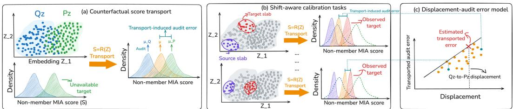  
Figure 1: Overview of our shift-aware privacy auditing framework. (a) Counterfactual score transport. We learn the relationship $S = { \bar { R } } ( Z )$ between data representations Z and non-member MIA scores S from the available OOD non-members $Q _ { Z } ,$ and transport this relationship to the target representation distribution $P _ { Z }$ to estimate the unavailable IID non-member score distribution. (b) We construct shift-aware calibration tasks within the OOD non-members by transporting scores from source slabs to target slabs along the $Q _ { Z } \to P _ { Z }$ shift direction. Since the target-slab scores are observed, the resulting transport-induced audit error can be measured. (c) The displacement-audit error model measures how the audit error changes with representation displacement, which is evaluated at the $Q _ { Z } \to P _ { Z }$ displacement to estimate the transport-induced error used for correction.

Therefore, we consider an observational auditing setting where the model has already been trained and cannot be retrained (Kazmi et al., 2024; Cebere et al., 2026). The auditor only has black-box access to the target model together with fixed sets of examples known to be training-set members and non-members. This setting removes the ability to randomize membership, and consequently introduces a challenge that is largely absent when the auditor controls data inclusion: the available non-members might not follow the same distribution as the training data. Correcting for this distributional confounding is therefore necessary to obtain a valid lower bound on privacy leakage.

A natural solution is to reconstruct the missing in-distribution non-member score distribution. We model how the MIA score varies with data distributions among the available OOD non-members. This nominal transport is motivated by a conditional score-invariance assumption: after conditioning on the representation, the non-member score distribution is invariant across domains. This allows the conditional score mechanism learned from the reference distribution to be evaluated under the target distribution. However, conditional transport alone is insufficient. Even when conditional score invariance is valid on the common support, the target distribution may place substantial mass in regions that are poorly represented by the available non-members. Predicting scores there necessarily requires extrapolation. Moreover, the conditional-invariance assumption may be imperfect.

Our key idea is to correct the transport-induced audit error by constructing controlled calibration tasks within the observed non-member population. We partition the OOD non-members into slabs separated along the source-to-target direction, train the same score-transport model on a source-side slab, and evaluate it on a more target-like slab whose true scores remain observable. Because both the predicted and observed score samples are available, we can directly measure how much such extrapolation inflates the resulting privacy lower bound. Repeating this procedure over multiple controlled displacements yields an empirical relationship between representation-space displacement and transport-induced audit error. We then evaluate this error-growth relationship at the actual OOD-to-IID displacement and use the resulting estimate to correct the nominal transported audit.

As shown in Figure 1, counterfactual score transport (panel (a)) provides a nominal estimate of the missing IID non-member distribution, while the shift-aware calibration (panel (b) and (c)) determines how much of the resulting privacy evidence should be trusted. In this work, we use the µ-Gaussian differential privacy (µ-GDP) formulation (Dong et al., 2022) as a framework for quantifying empirical privacy leakage, and report the empirical lower bound on $\mu .$

## Our contributions are threefold:

• We estimate the missing IID non-member score distribution by applying a score model learned from OOD non-members to covariates drawn from the target distribution, under a conditional invariance assumption (Section 4.1).

• We identify when this assumption may fail (Section 4.2) and construct calibration tasks to measure how representation-space displacement affects transport-induced audit error, then use the resulting error-growth estimate to correct the transported audit. (Section 4.3).

• Across image and language benchmarks with synthetic and natural distribution shifts, we demonstrate that uncorrected observational auditing can substantially overestimate privacy leakage. We show that the proposed methods stabilize the audit when transport requires substantial extrapolation or conditional invariance is imperfect, while retaining tighter privacy lower bounds than baselines (Section 5).

## 2 BACKGROUND AND RELATED WORK

Privacy auditing. An auditing algorithm takes a learning algorithm $\mathcal { A }$ and a privacy hypothesis H, and tests whether the observed behavior of A satisfies $\mathcal { H }$ (Jagielski et al., 2020; Nasr et al., 2023). Typically, the auditor performs a randomized experiment with known membership labels $A _ { i } ,$ applies a MIA to produce guesses $T _ { i } \in \{ - 1 , 0 , 1 \}$ for each example, where $T _ { i } = 0$ denotes abstention, and then evaluates $\mathcal { H }$ using the attack outcomes and the known memberships. For an error probability $p \in [ 0 , 1 ]$ , the audit is p-valid if P(Reject $\mathcal { H } \mid \mathcal { A }$ satisfies $\mathcal { H } ) \le p$ . Empirical privacy parameters can then be obtained from the strongest privacy hypothesis that the audit can confidently reject.

Early approaches often require retraining models on neighboring datasets (Jagielski et al., 2020; Nasr et al., 2021; Lu et al., 2022; Nasr et al., 2023; Zanella-Beguelin et al., 2023), while more recent one-run methods reduce this cost by controlling the inclusion of multiple candidate examples within a single training run (Steinke et al., 2023; Mahloujifar et al., 2025; Xiang et al., 2025; Keinan et al., 2026). However, these approaches still rely on intervention in the training process, which requires the membership indicators $A _ { i } \in \{ - 1 , 1 \}$ to be independent.

Auditing under distribution shift. Distribution shift is known to affect membership inference by changing the score distributions of non-members, potentially overestimate the privacy leakage (Yichuan et al., 2024; Meeus et al., 2024; Das et al., 2025; Zhao et al., 2025). Kazmi et al. (2024) addresses the lack of in-distribution non-members by training a generative model on known members and using generated samples as non-members, while accounting for distributional mismatch between real and generated data through a baseline classifier. Cebere et al. (2026) instead explicitly corrects the shift through global composition or propensity-based conditional adjustment; its guarantees, however, rely on distributional overlap and accurate propensity estimation, and can become overly conservative under severe shift. Kalemaj et al. (2025) evaluates label privacy without intervening on the training dataset by exploiting naturally occurring variation in the data. Related work has also used conditional modeling, particularly quantile regression, to estimate example-dependent non-member score distributions (Bertran et al., 2023). Thaker et al. (2026) study this approach under class-support shift, where the available background data omit entire classes or subclasses. In contrast, we consider covariate shift, where the member and available non-member populations share the same task and label space but differ in their input distributions.

Measuring privacy leakage with $\mu { \mathbf { - G D P } }$ We quantify empirical privacy leakage using the $\mu { \mathrm { - G D P } }$ scale, which characterizes distinguishability through the hypothesis-testing trade-off between neighboring datasets (Dong et al., 2022).

Definition 1. An algorithm $\mathcal { A }$ is $\mu \cdot$ GDP if for all neighboring datasets D and $\mathcal { D } ^ { \prime }$

$$
T ( A ( \mathcal { D } ) , A ( \mathcal { D } ^ { \prime } ) ) ( \alpha ) \geq T ( \mathcal { N } ( 0 , 1 ) , \mathcal { N } ( \mu , 1 ) ) ( \alpha ) , \forall \alpha \in [ 0 , 1 ] ,\tag{1}
$$

where $T ( A ( \mathcal { D } ) , A ( \mathcal { D } ^ { \prime } ) ) ( \alpha ) = \operatorname* { i n f } \{ \beta _ { \phi } : \alpha _ { \phi } \leq \alpha \}$ with $T y p e { \cdot } I$ error $\alpha _ { \phi }$ and $T y p e { \cdot } I I$ error $\beta _ { \phi }$ from all rejection rules φ.

For privacy audit with $\mu { \mathrm { - G D P } } ,$ the auditor performs membership guesses and compares the observed guessing performance against that permitted by a candidate $\mu { \mathrm { - G D P } }$ guarantee, yielding a lower confidence bound $\hat { \mu }$ on the privacy parameter (Nasr et al., 2023; Mahloujifar et al., 2025).

## 3 PROBLEM FORMULATION

We consider post-hoc privacy auditing of a fixed target model M without retraining or controlled data inclusion (Cebere et al., 2026). The auditor has only black-box access to the model, meaning it can only observe the model outputs but not its internal representations or intermediate computations. Let $s \stackrel { \cdot } { = } S ( x ) \in \mathbb { R }$ denote a membership-inference score, oriented such that a larger score indicates stronger evidence of membership. Let $\mathrm { ~ \cal ~ A ~ } \in \{ - 1 , 1 \}$ denote membership, where $A = 1$ indicates

Algorithm 1 Extrapolation-Calibrated Counterfactual Score Transport   
Require: Member data $\mathcal { D } _ { M } = ( \mathcal { D } _ { M } ^ { \mathrm { a u d } } , \mathcal { D } _ { M } ^ { \mathrm { r e f } } )$ , OOD non-members $\mathcal { D } _ { N } ^ { Q } \ = \ ( D _ { N } ^ { Q , \mathrm { a u d } } , D _ { N } ^ { Q , \mathrm { r e f } } )$ , pre  
trained representation φ, slab fractions ${ \bar { \mathcal F } } .$   
1: Compute $Z _ { M } = \{ \phi ( x _ { i } ^ { M } ) \} , x _ { i } ^ { M } \in \mathcal { X } _ { M }$ and $Z _ { N } ^ { Q } = \{ \phi ( x _ { i } ^ { Q } ) \} , x _ { i } ^ { Q } \in \mathcal { X } _ { N } ^ { Q } ,$   
2: $\tilde { S } _ { N } ^ { P } \gets$ predictions on $Z _ { M } ^ { \mathrm { r e f } }$ from the transport learned on $\mathcal { D } _ { N } ^ { Q }$ (Equation 7 and 11).   
3: $\hat { \mu } _ { \mathrm { t r a n s } } \gets \hat { \mu } ( \tilde { S } _ { N } ^ { P } ; S _ { M } ^ { \mathrm { a u d i t } } )$   
4: for $f \in { \mathcal { F } }$ do Shift-aware calibration tasks   
5: Take source slab $\mathcal { D } _ { N , f } ^ { Q , \mathrm { s o } }$ and target slab $\mathcal { D } _ { N , f } ^ { Q , \mathrm { t a } }$ from $\mathcal { D } _ { N } ^ { Q , \mathrm { r e i } }$ along the $Q _ { Z } \to P _ { Z }$ shift direction.   
6: Compute the representation-space displacement $\Delta _ { f } $ Equation (18).   
7: $\tilde { S } _ { f } ^ { \mathrm { p r e d } }$ ← predictions on $Z _ { N , f } ^ { Q , \mathrm { t a } }$ from the transport learned on $\mathcal { D } _ { N , f } ^ { Q , \mathrm { s o } }$ (Equation 7 and 11).   
8: Compute the transport-induced audit error ef ← Equation (19).   
9: end for   
10: Fit quantile regression on $\begin{array} { r } { ( \Delta _ { f } , e _ { f } ) \colon ( \hat { a } _ { \tau } , \hat { b } _ { \tau } ) \gets \arg \operatorname* { m i n } _ { b \geq 0 } \sum _ { f \in \mathcal { F } } \rho _ { \tau } ( e _ { f } - a - b \Delta _ { f } ) . } \end{array}$   
11: $\hat { \mu } _ { \mathrm { c o r r } }  [ \hat { \mu } _ { \mathrm { t r a n s } } - \hat { r } ] _ { + } , \hat { r }  [ \hat { a } _ { \tau } + \hat { b } _ { \tau } \hat { d } ] _ { + } , \bar { d } = \operatorname* { m a x } ( d ^ { * } , \Delta _ { \mathrm { m i n } } ) , d ^ { * } $ Equation (17).   
12: return Corrected privacy lower bound βcorr.   
a training-set member. Let $P _ { X }$ denote the training-data distribution and $Q _ { X }$ an out-of-distribution   
population from which the available non-members are drawn. The auditor has access to   
$\mathcal { D } _ { M } = \{ \mathcal { X } _ { M } , \boldsymbol { S } _ { M } \} = \{ ( \boldsymbol { x } _ { i , M } , \boldsymbol { s } _ { i , M } ) \} _ { i = 1 } ^ { n _ { M } } , \qquad \boldsymbol { x } _ { i , M } \sim P _ { X } , \qquad \boldsymbol { A } _ { i } = 1$ (2)   
consisting of known members and their target-model scores, and   
$\mathcal { D } _ { N } ^ { Q } = \{ \mathcal { X } _ { N } ^ { Q } , \mathcal { S } _ { N } ^ { Q } \} = \{ ( x _ { i , N } ^ { Q } , s _ { i , N } ^ { Q } ) \} _ { i = 1 } ^ { n _ { Q } } , \qquad x _ { i , N } ^ { Q } \sim Q _ { X } , \qquad A _ { i } = - 1$ (3)   
consisting of known OOD non-members and their target-model scores.   
Given $n = | S _ { M } | + | S _ { N } ^ { Q } |$ auditing samples, suppose the auditor applies a fixed decision rule to   
predict member, non-member, or abstain, and makes c membership guesses, of which k are correct.   
We denote the resulting lower confidence bound on the $\mu { \mathrm { - G D P } }$ parameter by   
ρ(SN, SM) = µL(c, k, n), (4)   
where $\mu _ { L } ( c , k , n )$ is the lower bound obtained from the one-run auditing procedure.   
Let $S _ { \underline { { N } } } ^ { P }$ denote the IID non-member score $S ( X )$ for $X \sim P _ { X }$ . The desired reference distribution   
for privacy auditing is the score distribution of IID non-members   
= Px∼Px (S(X) ≤ s | A = −1), (5)   
which is unavailable at deployment. Our goal is therefore to correct the privacy lower bound $\hat { \mu }$ ob  
tained from $( \cal S _ { N } ^ { Q } , \cal S _ { M } )$ so that it remains valid while being as tight as possible to the bound obtained   
using the in-distribution non-members $( S _ { N } ^ { P } , S _ { M } )$

## 4 METHODOLOGY

In Section 4.1, we estimate the counterfactual IID non-member score distribution by learning the relationship between representations and MIA scores from the OOD non-members and transporting it to the target covariate distribution. In Section 4.2, we characterize the two modes of transport error: lack of support overlap and violations of conditional score invariance. Finally, in Section 4.3, we construct controlled calibration tasks within the observed non-member data to estimate transportinduced audit inflation as a function of representation-space displacement, and use this estimate to correct the transported privacy lower bound. The whole algorithm is in Algorithm 1.

We split member data $\mathcal { D } _ { M }$ and non-member data $\mathcal { D } _ { N } ^ { Q }$ into disjoint subsets: reference data $( \mathcal { D } _ { M } ^ { \mathrm { r e f } } , \mathcal { D } _ { N } ^ { Q , \mathrm { r e f } } )$ and auditing data $( \mathcal { D } _ { M } ^ { \mathrm { a u d } } , \mathcal { D } _ { N } ^ { Q , \mathrm { a u d } } )$ . The auditing data are reserved for the final audit, while the reference data are used to learn how to mitigate the effect of distribution shift.

## 4.1 COUNTERFACTUAL SCORE TRANSPORT

Because directly modeling the MIA score as a function of the high-dimensional input X is difficult, we introduce a fixed pretrained representation $\phi : X \to Z$ Let $P _ { Z }$ and $Q _ { Z }$ denote the corresponding representation distributions under $P _ { X }$ and $Q _ { X }$

Assumption 1 (Conditional score invariance). For all z in the common support of $P _ { Z }$ and $Q _ { Z }$ $F _ { S _ { N } ^ { P } } ( s { \bar { \mid z ) } = } F _ { S _ { N } ^ { Q } } ( s \mid z )$ where $F _ { S _ { N } ^ { P } } ( s \mid z ) = \mathbb { P } ( S _ { N } \le s \mid Z = z , \dot { A = - 1 , D } = P )$ and analogously for $\vec { Q . \ D }$ denotes the domain.

Equivalently, $S _ { N } \perp D \mid Z , A = - 1$ . Under this assumption (Chernozhukov et al., 2013) and when supp $P _ { Z } ) \subseteq \operatorname { s u p p } ( Q _ { Z } )$ , the target IID non-member score distribution can be written as

$$
F _ { S _ { N } ^ { P } } ( s ) = \int \mathbb { P } ( S _ { N } \le s \mid Z = z , A = - 1 , D = P ) d P _ { Z } ( z ) = \int F _ { S _ { N } ^ { Q } } ( s \mid z ) d P _ { Z } ( z ) .\tag{6}
$$

The OOD non-members provide information about the conditional score mechanism $F _ { S _ { \Delta r } ^ { Q } } ( S \mid Z )$ while the member inputs provide samples from the target covariate distribution $P _ { Z }$ . Thus, we estimate the counterfactual IID non-member MIA score distribution $\tilde { F } _ { S _ { N } ^ { P } }$ using the OOD non-member data $\mathcal { D } _ { N } ^ { Q }$ and the target reference representations $P _ { Z } ^ { \mathrm { r e f } }$ with two transport estimators in the following.

## 4.1.1 LINEAR RESIDUAL TRANSPORT

We model the conditional mean of OOD non-member scores $m ( z ) = \mathbb { E } [ S _ { N } | Z = z , D = Q ]$ , and estimate $m ( z )$ from reference OOD non-members $\mathcal { D } _ { N } ^ { Q , \mathrm { r e f } }$ by squared-loss regression

$$
\hat { m } ( z ) = \arg \operatorname* { m i n } \sum _ { ( z _ { i } ^ { Q , \mathrm { r e f } } , s _ { i } ^ { Q , \mathrm { r e f } } ) \in \mathcal { D } _ { N } ^ { Q , \mathrm { r e f } } } ( s _ { i } ^ { Q , \mathrm { r e f } } - m ( z _ { i } ^ { Q , \mathrm { r e f } } ) ) ^ { 2 } .\tag{7}
$$

For an observed OOD audit non-member $( z _ { i } ^ { Q , \mathrm { a u d } } , s _ { i } ^ { Q , \mathrm { a u d } } ) \in \mathcal { D } _ { N } ^ { Q , \mathrm { a u d } }$ , define its residual

$$
\hat { \epsilon } _ { i } ^ { Q } = s _ { i } ^ { Q , \mathrm { a u d } } - \hat { m } ( z _ { i } ^ { Q , \mathrm { a u d } } ) .\tag{8}
$$

We then sample B independent reference members $z _ { i , 1 } ^ { \prime } , \ldots , z _ { i , B } ^ { \prime } \sim P _ { Z } ^ { \mathrm { r e f } }$ from the member covariate pool and transport the score to the same residual under the target covariate:

$$
\tilde { s } _ { i , b } ^ { P , l r } = \hat { m } ( z _ { i , b } ^ { \prime } ) + \hat { \epsilon } _ { i } ^ { Q } , b = 1 , \ldots , B .\tag{9}
$$

This transformation changes the conditional location of the score according to the target covariate while preserving the residual. The linear transport assumes an additive score model $S _ { N } = m ( Z ) + \epsilon$ where the residual distribution is invariant across covariates and domains. Consequently, linear transport primarily corrects changes in conditional location and may fail when distribution shift changes conditional variance, skewness, or tail behavior.

## 4.1.2 CONDITIONAL QUANTILE TRANSPORT

To model the full conditional score distribution, we estimate conditional quantile function (Koenker & Hallock, 2001)

$$
q _ { \tau } ( z ) = F _ { S _ { N } ^ { Q } } ^ { - 1 } ( \tau \mid Z = z ) , \qquad \tau \in ( 0 , 1 ) .\tag{10}
$$

For a grid of quantile levels $\tau .$ , the quantile models are trained by minimizing pinball loss on $\mathcal { D } _ { N } ^ { Q , \mathrm { r e f } }$

$$
\hat { q } _ { \tau } ( z ) = \arg \operatorname* { m i n } \sum _ { ( z _ { i } ^ { Q , \mathrm { r e f } } , s _ { i } ^ { Q , \mathrm { r e f } } ) \in \mathcal { D } _ { N } ^ { Q , \mathrm { r e f } } } \rho _ { \tau } \left( s _ { i } ^ { Q , \mathrm { r e f } } - q ( z _ { i } ^ { Q , \mathrm { r e f } } ) \right) ,\tag{11}
$$

where $\rho _ { \tau } ( u ) = u ( \tau - { \bf 1 } \{ u < 0 \} )$

For each audit OOD non-member $( z _ { i } ^ { Q , \mathrm { a u d } } , s _ { i } ^ { Q , \mathrm { a u d } } ) \in \mathcal { D } _ { N } ^ { Q , \mathrm { a u d } }$ , we estimate its conditional quantile

$$
\hat { \tau } _ { i } = \hat { F } _ { S _ { N } ^ { Q } } ( s _ { i } ^ { Q , \mathrm { a u d } } \mid z _ { i } ^ { Q , \mathrm { a u d } } ) .\tag{12}
$$

We again sample B independent members $z _ { i , 1 } ^ { \prime } , \ldots , z _ { i , B } ^ { \prime } \sim P _ { Z } ^ { \mathrm { r e f } }$ from the member covariate pool and transport the score to the same conditional percentile under the target covariate:

$$
\tilde { s } _ { i , b } ^ { P , q r } = \hat { q } _ { \hat { \tau } _ { i } } ( z _ { i , b } ^ { \prime } ) , b = 1 , \ldots , B .\tag{13}
$$

The transported sample $\tilde { S } _ { N } ^ { P , l r }$ and ${ \tilde { S } } _ { N } ^ { P , q r }$ is obtained by averaging the replicate empirical CDFs, which reduces sample variance without averaging individual records'scores. Specifically,

$$
\tilde { F } _ { S _ { N , b } ^ { P } } ( s ) = \frac { 1 } { n _ { Q } ^ { \mathrm { a u d } } } \sum _ { i = 1 } ^ { n _ { Q } ^ { \mathrm { a u d } } } 1 \{ \tilde { s } _ { i , b } ^ { P } \leq s \} , \ \tilde { F } _ { S _ { N } ^ { P } } ( s ) = \frac { 1 } { B } \sum _ { b = 1 } ^ { B } \tilde { F } _ { S _ { N , b } ^ { P } } ( s ) .\tag{14}
$$

The final $n _ { Q } ^ { \mathrm { a u d } }$ transported samples $\tilde { S } _ { N } ^ { P , l r }$ and ${ \tilde { S } } _ { N } ^ { P , q r }$ are obtained from $\tilde { F } _ { S _ { N } ^ { P } }$ respectively.

## 4.2 WHEN IS NOMINAL TRANSPORT UNRELIABLE?

Recall that identifying $F _ { S _ { N } ^ { P } }$ via Equation (6) requires two conditions: (a) the conditional invariance assumption (Assumption 1), and (b) sufficient support overlap, supp( $( P _ { Z } ) \subseteq \operatorname { s u p p } ( Q _ { Z } )$ Either condition may fail. The representation $Z$ must retain sufficient information about the target-model score for conditional invariance to hold, while support coverage is required to avoid extrapolating the score model beyond the observed source covariates. We distinguish the two failure modes:

1. Lack of support overlap. Suppose Assumption 1 holds on the overlap region, but supp $( P _ { Z } ) \nsubseteq$ supp $\left( Q _ { Z } \right)$ . Let $\mathcal { O } = \mathrm { s u p p } ( \bar { P _ { Z } } ) \cap \mathrm { s u p p } ( \bar { Q _ { Z } } ) , \mathcal { O } ^ { c } = \mathrm { s u p p } ( P _ { Z } ) \setminus \mathcal { O } .$ Then

$$
F _ { S _ { N } ^ { P } } ( s ) = \int _ { \cal O } F _ { S _ { N } ^ { Q } } ( s \mid z ) d P _ { Z } ( z ) + \int _ { \cal O ^ { c } } F _ { S _ { N } ^ { P } } ( s \mid z ) d P _ { Z } ( z ) .\tag{15}
$$

The second term is not identified from the OOD non-members and requires extrapolation.

2. Violation of conditional invariance. Even within the overlap region, Assumption 1 may fail, such that

$$
F _ { S _ { N } ^ { P } } ( S \mid Z = z ) \neq F _ { S _ { N } ^ { Q } } ( S \mid Z = z ) .\tag{16}
$$

In this case, transporting the conditional score distribution from $Q _ { Z }$ to $P _ { Z }$ can be biased even without extrapolation

Diagnostic assessment of conditional transportability. In order to assess whether the score distribution learned from OOD non-members transfers to the target domain, we define the domain propensity score $\pi ( z ) = \mathbb { P } ( D = Q \mid Z = z , \ A = - 1 )$ , where values near 0 and 1 indicate IID-like and OOD-like representations, respectively. We partition the data into ten propensity bins and, for each bin I, estimate the OOD non-member score CDF: $F _ { Q , I } ( s ) = \mathbb { P } ( S \le \acute { s } \mid \acute { D } = \acute { Q } , \pi ( z ) \in I )$ . For an observation with score $S ,$ we compute its PIT (probability integral transform) value $\dot { U } \stackrel { \cdot } { = } F _ { Q , I } ( S )$ . If the conditional score distribution is transportable from $\dot { Q }$ to $P ,$ the PIT values for IID non-members should be approximately uniform, and their ECDF should follow the diagonal.

As shown in Figure 2 for a distribution-shift benchmark DomainNet (Peng et al., 2019) and across more datasets in Figures 7 and 8, the IID non-member curve is either close to the diagonal or lies below it. The latter indicates larger IID non-member MIA scores than predicted from OOD nonmembers, implying that nominal transport tends to under-correct the shift and can yield an anticonservative privacy lower bound. This motivates our calibration tasks to correct the audit error.

## 4.3 SHIFT-AWARE CONSERVATIVE CORRECTION

We estimate the unknown audit error induced from the transport using calibration tasks. We order the OOD data along the $Q _ { Z } \to P _ { Z }$ shift direction, transport scores from a source-side subset to a targetlike subset with known scores, and measure the resulting audit error. Repeating this at different transport distances allows us to learn how the resulting audit error changes with representationspace displacement, estimate the error of the actual $Q _ { Z }  P _ { Z }$ transport distance and correct its transported privacy lower bound.

Source-to-target displacement. We reduce the source-to-target mismatch to a scalar. Let $\widehat { \Sigma } _ { Q }$ be a Ledoit-Wolf shrinkage estimate of the reference covariance $Z _ { N } ^ { Q , \mathrm { r e f } }$ and $W = \widehat { \Sigma } _ { \cal Q } ^ { - 1 / 2 }$ the corresponding whitening map, so that one unit is one reference standard deviation. With $\dot { \bar { z } } _ { N } ^ { Q }$ and $\hat { z } _ { M } ^ { P }$ the reference OOD non-member and member means, define the shift axis and the induced displacements

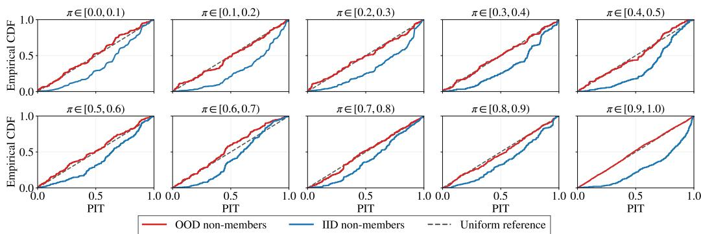  
Figure 2: Diagnostic assessment of conditional transportability. The dashed diagonal denotes the uniform reference expected under conditional transportability. The OOD non-members are used to construct the reference score distributions, while IID non-member curves below the diagonal indicate larger MIA scores than predicted by the OOD reference distributions.

$$
\mathcal O = \frac { W ( \bar { z } _ { M } ^ { P } - \bar { z } _ { N } ^ { Q } ) } { \| W ( \bar { z } _ { M } ^ { P } - \bar { z } _ { N } ^ { Q } ) \| } , \qquad d ( z ) = \big \langle W ( z - \bar { z } _ { N } ^ { Q } ) , \mathcal O \big \rangle , \qquad d ^ { * } = \big \| W ( \bar { z } _ { M } ^ { P } - \bar { z } _ { N } ^ { Q } ) \big \| .\tag{17}
$$

O means the shift direction from non-members to members. Each non-member sample is assigned a signed displacement d, centered to have mean zero, while $d ^ { * }$ denotes the mean displacement of the member pool, representing the distance over which the transport is required to extrapolate.

Controlled slab extrapolation. $d ( z )$ measures a sample's position along the $Q _ { Z } \ \to \ P _ { Z }$ shift direction, with larger $d ( z )$ indicating a position closer to the target side. We therefore sort $\mathcal { D } _ { N } ^ { Q , \mathrm { r e f } }$ by $d ( z )$ . For each fraction $f \in ( 0 , \frac { 1 } { 2 } ]$ , we take the bottom f-fraction as a source slab $\mathcal { D } _ { N , f } ^ { Q , \mathrm { s o } }$ and the top f-fraction as a target slab $\mathcal { D } _ { N , f } ^ { Q , \mathrm { t a } }$ . This creates a controlled transport task from a source-like region to a more target-like region along the same direction as the actual $Q _ { Z } \to P _ { Z }$ transport. We quantify the distance of this task by the difference between the mean positions of the two slabs,

$$
\Delta _ { f } \ = \ \frac { 1 } { | \mathcal { D } _ { N , f } ^ { \mathrm { Q , t a } } | } \sum _ { z _ { i } \in \mathcal { D } _ { N , f } ^ { \mathrm { Q , t a } } } d ( z _ { i } ) - \frac { 1 } { | \mathcal { D } _ { N , f } ^ { \mathrm { Q , s o } } | } \sum _ { z _ { j } \in \mathcal { D } _ { N , f } ^ { \mathrm { Q , s o } } } d ( z _ { j } ) .\tag{18}
$$

We refit the same residual and quantile transport (equation 7 and 11) on $\mathcal { D } _ { N , f } ^ { \mathrm { Q } , \mathrm { s o } }$ alone, and use it to produce predicted score samples at the covariates of $Z _ { N , f } ^ { \mathrm { Q , t a } }$ . Because $Z _ { N , f } ^ { \mathrm { Q , t a } }$ is real reference data, its observed scores $ { S _ { N , f } ^ { \mathrm { Q , t a } } }$ are known, so we could measure the transport-induced audit error between the predicted and observed samples measures when made to extrapolate a distance $\Delta _ { f }$

Let $S _ { f } ^ { \mathrm { o b s } }$ denote the observed score samples and $\tilde { S } _ { f } ^ { \mathrm { p r e d } }$ the predicted score samples on $Z _ { N , f } ^ { \mathrm { Q , t a } }$ learned from $\mathcal { D } _ { N , f } ^ { \mathrm { Q } , \mathrm { s o } }$ at separation $\Delta _ { f }$ . We therefore define the transport-induced audit error:

$$
e _ { f } = \hat { \mu } ( \tilde { S } ^ { \mathrm { p r e d } } ; S _ { M } ^ { \mathrm { r e f } } ) - \hat { \mu } ( S _ { f } ^ { \mathrm { o b s } } ; S _ { M } ^ { \mathrm { r e f } } ) .\tag{19}
$$

Fit the error-growth envelope. By varying the fraction $f ,$ we obtain a collection of pairs $\{ ( \Delta _ { f } , e _ { f } ) \}$ . The slab separations $\Delta _ { f }$ are bounded by the reference pool's own spread $[ \Delta _ { \mathrm { m i n } } , \bar { \Delta _ { \mathrm { m a x } } } ]$ whereas the transport must travel $d ^ { * }$ . We fit a growth law $g ( \Delta )$ to the pairs $\{ ( \bar { \Delta } _ { f } , e _ { f } ) \}$ and read it off at $d ^ { * }$

$$
\hat { r } \ = \ [ \hat { g } ( \bar { d } ) ] _ { + } , \qquad \bar { d } = \operatorname * { m a x } ( d ^ { * } , \Delta _ { \operatorname * { m i n } } ) , \qquad e _ { f } = g ( \Delta _ { f } ) ,\tag{20}
$$

where $[ c ] _ { + } = \operatorname* { m a x } ( c , 0 )$ . In order to obtain an upper estimate of how large the error can become at a given displacement, we use $\tau = 0 . 9 5$ to fit an upper conditional quantile of the observed calibration errors. Let $\hat { \mu } _ { \mathrm { t r a n s } } = \hat { \mu } ( \tilde { S } _ { N } ^ { P } ; S _ { M } ^ { \mathrm { a u d i t } } )$ be the bound the audit would report on the transported samples. We define

$$
\hat { \mu } _ { \mathrm { c o r r } } = [ \hat { \mu } _ { \mathrm { t r a n s } } - \hat { r } ] _ { + } , \qquad e _ { \mathrm { r e a l } } = [ \hat { \mu } _ { \mathrm { t r a n s } } - \hat { \mu } _ { \mathrm { o r a c l e } } ] _ { + } .\tag{21}
$$

Here $\hat { \mu } _ { \mathrm { o r a c l e } } = \hat { \mu } ( S _ { N } ^ { P } ; S _ { M } )$ is the privacy lower-bound estimator obtained by auditing member scores $\boldsymbol { \mathcal { S } } _ { M }$ against the unobserved oracle IID non-member scores $\mathcal { S } _ { N } ^ { P }$

For the target representation-space displacement $d ^ { * }$ , if the real transport-induced audit error is upperbounded by the error-growth envelope calibrated from source-domain slab extrapolations $e _ { \mathrm { r e a l } } \leq { \hat { r } } $ then we have the corrected lower bound being valid $\hat { \mu } _ { \mathrm { c o r r } } \leq \hat { \mu } _ { \mathrm { o r a c l e } }$

Assumption 2. Recall that $e _ { f }$ is the transport-induced audit error of a calibration-type extrapolation task with displacement $\dot { \Delta _ { f } }$ . Define its conditional upper quantile

$$
q _ { \tau } ( \Delta _ { f } ) = \operatorname* { i n f } \{ t : \mathbb { P } ( e _ { f } \leq t \mid \xi = \Delta _ { f } ) \geq \tau \} .\tag{22}
$$

Now assume

$$
\mathbb { P } ( e _ { r e a l } \leq q _ { \tau } ( d ^ { * } ) \mid d ^ { * } ) \geq \tau .\tag{23}
$$

Assumption 2 means that at the same displacement, the real $Q _ { Z } \to P _ { Z }$ audit error is no worse, in its upper tail, than the error distribution represented by the controlled within- $. Q _ { Z }$ calibration tasks. A sufficient condition is one-sided stochastic domination: $F _ { e _ { \mathrm { r e a l } } } ( t \mid d ^ { * } ) \geq F _ { e _ { f } | \Delta = d ^ { * } } ( t )$ , ∀t, i.e., at the same displacement, the $Q _ { Z } \to P _ { Z }$ error is stochastically no larger than the within- $. Q _ { Z }$ error.

Assumption 3. The upper error quantile grows monotonically with the displacement:

$$
I f \Delta _ { 1 } \leq \Delta _ { 2 } , t h e n q _ { \tau } ( \Delta _ { 1 } ) \leq q _ { \tau } ( \Delta _ { 2 } ) .\tag{24}
$$

Assumption 4. Let $E _ { \tau } ( \Delta )$ be a data-dependent upper confidence envelope constructed from the calibration data. Assume that

$$
\mathbb { P } ( E _ { \tau } ( \Delta ) \geq q _ { \tau } ( \Delta ) , \forall \Delta \in [ \Delta _ { \operatorname* { m i n } } , \Delta _ { \operatorname* { m a x } } ] ) \geq 1 - \eta .\tag{25}
$$

Theorem 1. Assume Assumptions 2,3,4 and $d ^ { * } \in [ \Delta _ { \operatorname* { m i n } } , \Delta _ { \operatorname* { m a x } } ]$ . We have

$$
\mathbb { P } ( \hat { \mu } _ { c o r r } \leq \hat { \mu } _ { o r a c l e } ) \geq \tau - \eta .\tag{26}
$$

Theorem 1 compares the corrected estimate to $\hat { \mu } _ { \mathrm { o r a c l e } } .$ obtained using the unavailable IID nonmember scores. It does not directly compare $\hat { \mu } _ { \mathrm { c o r r } }$ with the true $\mu { \mathrm { - G D P } }$ parameter of the training algorithm. Thus, the theorem characterizes the additional error introduced by distribution shift and score transport, relative to the audit that would have been obtained if IID non-members were available. We defer the proof to Section A in the Appendix.

## 5 EXPERIMENTS

Auditing Setup. We use a loss-based MIA and report a conservative empirical lower bound, $\mu _ { L }$ , on privacy leakage. To account for finite-sample uncertainty in the data-dependent correction, we use 200 bootstrap resamples of the reference dataset. We allocate the error probability of 0.025 to the privacy audit and 0.025 to this bootstrap uncertainty quantification. We repeat each scenario for 5 seeds and plot the mean and standard deviation. The configuration details can be found in Section B.

Datasets. For image classification, we train target models on CIFAR-10 (Krizhevsky et al., 2009) and consider two forms of distribution shift. First, we use the brightness corruption from CIFAR-10-C (Hendrycks & Dietterich, 2019) at all five severity levels, from mild to severe. Second, we use CINIC-10 (Darlow et al., 2018) to introduce a natural source-domain shift, which combining CIFAR-10 (22%) with downsampled ImageNet images (78%). We additionally evaluate on DomainNet (Peng et al., 2019), a more challenging domain-shift benchmark containing the same 345 object classes across multiple visual domains. We train the target model on the Real domain. Images from the Painting domain serve as the OOD non-members. For language modeling, we fine-tune a GPT-2 model on arXiv papers from February 2023 and use arXiv papers from February 2026 as OOD non-members, inducing a natural temporal distribution shift.

Baselines. We compare our method against four baselines: (1) No correction, which directly applies one-run f-DP auditing to the available OOD non-members without accounting for distribution shift (Mahloujifar et al., 2025); (2) Oracle IID Non-member, which applies the same one-run $f -$ DP audit using true IID non-members and serves as the oracle reference; (3) Global correction (Cebere et al., 2026), which adjusts the audit using a dataset-level estimate of the distribution shift between members and non-members; and (4) Conditional correction (Cebere et al., 2026), which uses propensity scores to account for the shift conditionally on observed covariates.

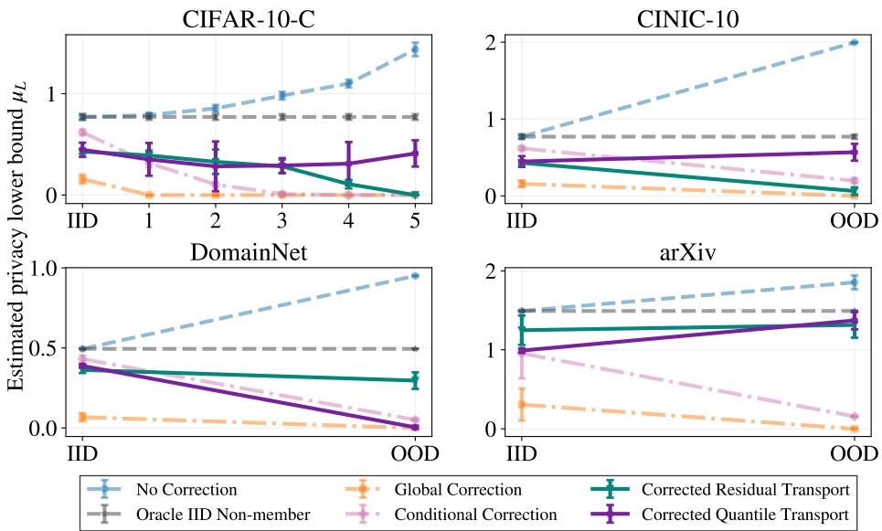  
Figure 3: Comparison of estimated lower bounds across distribution shifts and datasets. At least one of our two transport variants remains stable and produce bounds that stay close to the oracle.

Results. As shown in Figure 3, we take the audit with IID non-members as the oracle. Without correction, the estimated $\mu$ increases substantially under distribution shift, indicating that the audit is confounded by distribution shift rather than reflecting privacy leakage alone. The global and conditional correction baselines (Cebere et al., 2026) become increasingly conservative as the shift grows, often yielding loose or near-zero bounds. In contrast, at least one of our two transport variants remains stable across datasets and shift scenarios and produces bounds that stay close to the oracle IID audit. Under the strongest CIFAR-10-C corruption (level 5), the uncorrected lower bound increases from $\mu = 0 . 7 6$ in the IID setting to 1.51, while corrected quantile transport yields 0.42. On CINIC-10, the uncorrected bound similarly increases to 2.00 under distribution shift, whereas corrected quantile transport remains at 0.59. On DomainNet, corrected residual transport yields 0.31 in the OOD setting, compared with an IID bound of 0.49. Finally, on arXiv, both corrected residual and quantile transport remain close to the IID bound of 1.49, yielding 1.37 and 1.39, respectively.

We further visualize the fitted relationship between representation-space displacement $\Delta _ { f }$ and the transport-induced audit error $e _ { f }$ in Figure 4, together with the target displacement and its predicted and realized errors. Across all evaluated settings, the predicted error upper-bounds the realized error, supporting the conservativeness of the resulting corrected privacy lower bounds.

We provide additional ablations in Section C on the conservative correction, to assess its role in preventing overestimation after score transport, and on the number of fractions used in calibration, to demonstrate the robustness of our method to this hyperparameter.

## 6 DISCUSSION

We study observational privacy auditing in settings where the auditor cannot retrain the target model. We estimate the counterfactual IID non-member score distribution by transporting the relationship between pretrained representations and MIA scores learned from OOD non-members. To mitigate the transport-induced audit error, we further construct calibration tasks to estimate the error and correct the resulting audit. Across multiple distribution shifts, at least one of our two transport variants provides tighter privacy lower bounds than existing baselines. In practice, we therefore report the larger corrected lower bound produced by the two variants. While our method does not provide formal validity guarantees under realistically verifiable assumptions, establishing such guarantees under distribution shift remains challenging for existing observational auditing approaches as well.

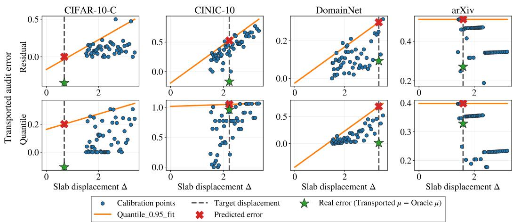  
Figure 4: Calibration of audit-error growth versus representation-space displacement across datasets (severity level = 1 on CIFAR-10-C). The fitted upper envelope predicts the target audit error (red cross) at the target displacement and conservatively exceeds the realized audit error (green star).

## GENERATIVE AI USE

We used large language models (LLMs), including OpenAI's ChatGPT and Anthropic's Claude, to assist with language polishing, literature discovery, code development, and figure generation. Specifically, LLMs were used to improve grammar, phrasing, and notation consistency; identify potentially relevant related work; and assist with writing and refactoring code for data processing, experiment execution, and visualization. All suggested references were checked against the original sources, and all AI-assisted code was reviewed, tested, and modified by the authors to ensure correctness and reproducibility. The research ideas, experimental design, hypotheses, and scientific claims of the paper were developed and written by the authors. LLMs were used only as supporting tools rather than to generate the core scientific contributions. We reviewed and finalized all AI-assisted content and take full responsibility for the final submission.

## REPRODUCIBILITY STATEMENT

We provide pseudocode for the complete method and describe the score transport, calibration, and auditing procedures in the main text. The appendix contains dataset preprocessing details, model and training configurations, MIA scores, representation models, hyperparameters, bootstrap settings, and additional ablations and diagnostics. All datasets used in our experiments are publicly available. We plan to release the code upon publication.

## ACKNOWLEDGMENTS

This work was supported by the Research Council of Finland (Finnish Center for Artificial Intelligence, FCAI, Grant 356499 and Grant 359111), UKRI Turing AI World-Leading Researcher Fellowship, EP/W002973/1, the Strategic Research Council at the Research Council of Finland (Grant 358247) as well as the European Union (Project 101070617). Views and opinions expressed are however those of the author(s) only and do not necessarily reflect those of the European Union or the European Commission. Neither the European Union nor the granting authority can be held responsible for them. This work has been performed using resources provided by the Aalto Science-IT Project from Computer Science IT. The authors acknowledge the research environment provided by ELLIS Institute Finland.

## REFERENCES

Martin Bertran, Shuai Tang, Aaron Roth, Michael Kearns, Jamie H Morgenstern, and Steven Wu. Scalable membership inference attacks via quantile regression. Advances in Neural Information

Processing Systems, 36:314–330, 2023.

Nicholas Carlini, Steve Chien, Milad Nasr, Shuang Song, Andreas Terzis, and Florian Tramer. Membership inference attacks from first principles. In 2022 IEEE symposium on security and privacy (SP), pp. 1897–1914. IEEE, 2022.

Tudor Cebere, Mathieu Even, Linus Bleistein, and Aurélien Bellet. Privacy auditing with zero (0) training run. arXiv preprint arXiv:2605.14591, 2026.

Victor Chernozhukov, Iván Fernández-Val, and Blaise Melly. Inference on counterfactual distributions. Econometrica, 81(6):2205–2268, 2013.

Luke N Darlow, Elliot J Crowley, Antreas Antoniou, and Amos J Storkey. Cinic-10 is not imagenet or cifar-10. arXiv preprint arXiv:1810.03505, 2018.

Debeshee Das, Jie Zhang, and Florian Tramèr. Blind baselines beat membership inference attacks for foundation models. In 2025 IEEE Security and Privacy Workshops (SPW), pp. 118–125. IEEE, 2025.

Jinshuo Dong, Aaron Roth, and Weijie J Su. Gaussian differential privacy. Journal of the Royal Statistical Society: Series B (Statistical Methodology), 84(1):3–37, 2022.

Michael Duan, Anshuman Suri, Niloofar Mireshghallah, Sewon Min, Weijia Shi, Luke Zettlemoyer, Yulia Tsvetkov, Yejin Choi, David Evans, and Hannaneh Hajishirzi. Do membership inference attacks work on large language models? arXiv preprint arXiv:2402.07841, 2024.

Mathieu Even, Clément Berenfeld, Linus Bleistein, Tudor Cebere, Julie Josse, and Aurélien Bellet. Membership inference attacks from causal principles. arXiv e-prints, pp. arXiv-2602, 2026.

Dan Hendrycks and Thomas Dietterich. Benchmarking neural network robustness to common corruptions and perturbations. International Conference on Learning Representations, 2019.

Matthew Jagielski, Jonathan Ullman, and Alina Oprea. Auditing differentially private machine learning: How private is private sgd? Advances in Neural Information Processing Systems, 33: 22205–22216, 2020.

Iden Kalemaj, Luca Melis, Maxime Boucher, Ilya Mironov, and Saeed Mahloujifar. Observational auditing of label privacy. arXiv preprint arXiv:2511.14084, 2025.

Mishaal Kazmi, Hadrien Lautraite, Alireza Akbari, Qiaoyue Tang, Mauricio Soroco, Tao Wang, Sébastien Gambs, and Mathias Lécuyer. Panoramia: Privacy auditing of machine learning models without retraining. Advances in Neural Information Processing Systems, 37:57262–57300, 2024.

Amit Keinan, Moshe Shenfeld, and Katrina Ligett. How well can differential privacy be audited in one run? Advances in Neural Information Processing Systems, 38:48875–48920, 2026.

Roger Koenker and Kevin F Hallock. Quantile regression. Journal of economic perspectives, 15(4): 143–156, 2001.

Alex Krizhevsky, Geoffrey Hinton, et al. Learning multiple layers of features from tiny images. 2009.

Chumeng Liang and Jiaxuan You. Real-world benchmarks make membership inference attacks fail on diffusion models. arXiv preprint arXiv:2410.03640, 2024.

Tengyuan Liang. Blessings and curses of covariate shifts: adversarial learning dynamics, directional convergence, and equilibria. Journal of Machine Learning Research, 25(140):1–27, 2024.

Fred Lu, Joseph Munoz, Maya Fuchs, Tyler LeBlond, Elliott Zaresky-Williams, Edward Raff, Francis Ferraro, and Brian Testa. A general framework for auditing differentially private machine learning. Advances in Neural Information Processing Systems, 35:4165–4176, 2022.

Saeed Mahloujifar, Luca Melis, and Kamalika Chaudhuri. Auditing f-differential privacy in one run. International Conference on Machine Learning, 2025.

Pratyush Maini, Hengrui Jia, Nicolas Papernot, and Adam Dziedzic. Llm dataset inference: Did you train on my dataset? Advances in Neural Information Processing Systems, 37:124069–124092, 2024.

Matthieu Meeus, Shubham Jain, Marek Rei, and Yves-Alexandre de Montjoye. Inherent challenges of post-hoc membership inference for large language models. arXiv preprint arXiv:2406.17975, 2024.

Matthieu Meeus, Igor Shilov, Shubham Jain, Manuel Faysse, Marek Rei, and Yves-Alexandre de Montjoye. Sok: Membership inference attacks on llms are rushing nowhere (and how to fix it). In 2025 IEEE Conference on Secure and Trustworthy Machine Learning (SaTML), pp. 385–401. IEEE, 2025.

Milad Nasr, Shuang Songi, Abhradeep Thakurta, Nicolas Papernot, and Nicholas Carlin. Adversary instantiation: Lower bounds for differentially private machine learning. In 2021 IEEE Symposium on security and privacy (SP), pp. 866–882. IEEE, 2021.

Milad Nasr, Jamie Hayes, Thomas Steinke, Borja Balle, Florian Tramèr, Matthew Jagielski, Nicholas Carlini, and Andreas Terzis. Tight auditing of differentially private machine learning. In 32nd USENIX Security Symposium (USENIX Security 23), pp. 1631–1648, 2023.

Maxime Oquab, Timothée Darcet, Théo Moutakanni, Huy Vo, Marc Szafraniec, Vasil Khalidov, Pierre Fernandez, Daniel Haziza, Francisco Massa, Alaaeldin El-Nouby, et al. Dinov2: Learning robust visual features without supervision. Transactions on Machine Learning Research, 2024.

Xingchao Peng, Qinxun Bai, Xide Xia, Zijun Huang, Kate Saenko, and Bo Wang. Moment matching for multi-source domain adaptation. In 2019 IEEE/CVF International Conference on Computer Vision (ICCV), pp. 1406–1415. IEEE, 2019.

Krishna Pillutla, Galen Andrew, Peter Kairouz, H Brendan McMahan, Alina Oprea, and Sewoong Oh. Unleashing the power of randomization in auditing differentially private ml. Advances in Neural Information Processing Systems, 36:66201–66238, 2023.

Alec Radford, Jeffrey Wu, Rewon Child, David Luan, Dario Amodei, Ilya Sutskever, et al. Language models are unsupervised multitask learners. OpenAI blog, 1(8):9, 2019.

Reza Shokri, Marco Stronati, Congzheng Song, and Vitaly Shmatikov. Membership inference attacks against machine learning models. In 2017 IEEE symposium on security and privacy (SP), pp. 3–18. IEEE, 2017.

Thomas Steinke, Milad Nasr, and Matthew Jagielski. Privacy auditing with one (1) training run. Advances in Neural Information Processing Systems, 36:49268–49280, 2023.

Pratiksha Thaker, Neil Kale, Zhiwei Steven Wu, and Virginia Smith. Membership inference attacks for unseen classes. International Conference on Machine Learning, 2026.

Florian Tramer, Andreas Terzis, Thomas Steinke, Shuang Song, Matthew Jagielski, and Nicholas Carlini. Debugging differential privacy: A case study for privacy auditing. arXiv preprint arXiv:2202.12219, 2022.

Zihang Xiang, Tianhao Wang, Hanshen Xiao, Yuan Tian, and Di Wang. Tight privacy audit in one run. arXiv preprint arXiv:2509.08704, 2025.

Samuel Yeom, Irene Giacomelli, Matt Fredrikson, and Somesh Jha. Privacy risk in machine learning: Analyzing the connection to overfitting. In 2018 IEEE 31st computer security foundations symposium (CSF), pp. 268–282. IEEE, 2018.

Shi Yichuan, Olivera Kotevska, Viktor Reshniak, and Amir Sadovnik. Assessing membership inference attacks under distribution shifts. In 2024 IEEE International Conference on Big Data (BigData), pp. 4127–4131. IEEE, 2024.

Santiago Zanella-Beguelin, Lukas Wutschitz, Shruti Tople, Ahmed Salem, Victor Rühle, Andrew Paverd, Mohammad Naseri, Boris Köpf, and Daniel Jones. Bayesian estimation of differential privacy. In International Conference on Machine Learning, pp. 40624–40636. PMLR, 2023.

Jie Zhang, Debeshee Das, Gautam Kamath, and Florian Tramèr. Position: Membership inference attacks cannot prove that a model was trained on your data. In 2025 IEEE Conference on Secure and Trustworthy Machine Learning (SaTML), pp. 333–345. IEEE, 2025.

Bihe Zhao, Pratyush Maini, Franziska Boenisch, and Adam Dziedzic. Unlocking post-hoc dataset inference with synthetic data. International Conference on Machine Learning, 2025.

## A THEORETICAL RESULTS

Proof of Theorem 1. Let $\mathcal { E } = \{ E _ { \tau } ( \Delta ) \geq q _ { \tau } ( \Delta ) , \forall \Delta \in [ \Delta _ { \operatorname* { m i n } } , \Delta _ { \operatorname* { m a x } } ] \}$ . By Assumption 4,

$$
\mathbb { P } ( \mathcal { E } ) \geq 1 - \eta .\tag{27}
$$

Recall that $\bar { d } = \operatorname* { m a x } ( d ^ { * } , \Delta _ { \operatorname* { m i n } } ) , \hat { r } = E _ { \tau } ( \bar { d } )$ . Since $d ^ { * } \in [ \Delta _ { \operatorname* { m i n } } , \Delta _ { \operatorname* { m a x } } ]$ , we have $\bar { d } = d ^ { * }$ . More generally, by the monotonicity in Assumption 3,

$$
q _ { \tau } ( d ^ { * } ) \leq q _ { \tau } ( \bar { d } ) .\tag{28}
$$

On the event $\mathcal { E } ,$

$$
\begin{array} { r } { q _ { \tau } ( d ^ { * } ) \leq q _ { \tau } ( \bar { d } ) \leq E _ { \tau } ( \bar { d } ) = \hat { r } . } \end{array}\tag{29}
$$

By Assumption 2,

$$
\mathbb { P } \left( e _ { \mathrm { r e a l } } \le q _ { \tau } ( d ^ { * } ) \right) \ge \tau .\tag{30}
$$

Therefore, by the union bound,

$$
\begin{array} { r } { \mathbb { P } \left( e _ { \mathrm { r e a l } } \leq \hat { r } \right) \geq \mathbb { P } \left( \left\{ e _ { \mathrm { r e a l } } \leq q _ { \tau } ( d ^ { * } ) \right\} \cap \mathcal { E } \right) \geq \tau - \eta . } \end{array}\tag{31}
$$

It remains to show that $e _ { \mathrm { r e a l } } \leq { \hat { r } }$ implies $\hat { \mu } _ { \mathrm { c o r r } } \leq \hat { \mu } _ { \mathrm { o r a c l e } }$ . Recall that

$$
e _ { \mathrm { r e a l } } = [ \hat { \mu } _ { \mathrm { t r a n s } } - \hat { \mu } _ { \mathrm { o r a c l e } } ] _ { + } , \qquad \hat { \mu } _ { \mathrm { c o r r } } = [ \hat { \mu } _ { \mathrm { t r a n s } } - \hat { r } ] _ { + } .\tag{32}
$$

On the event $e _ { \mathrm { r e a l } } \leq { \hat { r } }$

$$
\hat { \mu } _ { \mathrm { c o r r } } = [ \hat { \mu } _ { \mathrm { t r a n s } } - \hat { r } ] _ { + } \leq [ \hat { \mu } _ { \mathrm { t r a n s } } - e _ { \mathrm { r e a l } } ] _ { + } \leq \hat { \mu } _ { \mathrm { o r a c l e } } ,\tag{33}
$$

where the last inequality follows directly from the definition of $e _ { \mathrm { r e a l } }$

Consequently,

$$
\begin{array} { r } { \mathbb { P } \left( \hat { \mu } _ { \mathrm { c o r r } } \leq \hat { \mu } _ { \mathrm { o r a c l e } } \right) \geq \mathbb { P } \left( e _ { \mathrm { r e a l } } \leq \hat { r } \right) \geq \tau - \eta . } \end{array}\tag{34}
$$

Corollary 1. Under Assumption 3, $i f d ^ { * } < \Delta _ { \mathrm { m i n } }$ , then $q _ { \tau } ( d ^ { * } ) \leq q _ { \tau } ( \Delta _ { \mathrm { m i n } } )$ . Therefore, evaluating the error envelope at $\bar { d } = \operatorname* { m a x } ( d ^ { * } , \dot { \Delta _ { \mathrm { m i n } } } ) = \Delta _ { \mathrm { m i n } }$ remains conservative for the target displacement $d ^ { * }$ when $d ^ { * } < \Delta _ { \operatorname* { m i n } }$ . In contrast, when $d ^ { * } > \Delta _ { \mathrm { m a x } }$ , the target transport lies beyond the range of displacements represented by the calibration tasks. Assumption 3 only implies $q _ { \tau } ( d ^ { * } ) \geq q _ { \tau } ( \Delta _ { \mathrm { m a x } } ) ,$ so the error at $d ^ { * }$ cannot in general be upper-bounded by the calibrated envelope without an additional assumption on how $q _ { \tau } ( \Delta )$ extrapolates beyond $\Delta _ { \mathrm { m a x } } .$ Therefore, we do not claim the conservativeness guarantee of Theorem 1 when $d ^ { * } > \Delta _ { \mathrm { m a x } } .$

## B EXPERIMENTS CONFIGURATION

Membership inference attacks algorithm. For each datapoint $X _ { i } ,$ the attacker first computes an MIA score $s _ { i } ~ \in ~ \mathbb { R }$ , where a larger score indicates greater confidence that $X _ { i }$ is a member $( \mathrm { i . e . }$ $A _ { i } = 1 )$ . The attacker then predicts the $c _ { + }$ datapoints with the largest scores as members and the c\_ datapoints with the smallest scores as non-members. All remaining datapoints are treated as abstentions, yielding a prediction vector $T \in \{ - 1 , 0 , 1 \} ^ { n }$

Pretrained representations. For the image-classification experiments, we use a frozen DINOv2- B/14 model (Oquab et al., 2024) as the feature extractor and take its 768-dimensional class-token representation. For the language-modeling experiment, we use a frozen, pretrained GPT-2 model (Radford et al., 2019) that is separate from the fine-tuned target model. We divide each paper into 64-token chunks, mean-pool the token representations within each of the first 10 chunks, and then average across chunks to obtain a 768-dimensional representation. The representation models are not fine-tuned during auditing.

Audit and reference samples. We construct balanced and mutually disjoint audit and reference sets. For CIFAR-10-C and CINIC-10, each audit set contains 5,000 target-model members and 5,000 non-members, while the reference set contains another 5,000 members and 5,000 non-members. For DomainNet, the corresponding sets each contain 20,000 members and 20,000 non-members. For arXiv, they each contain 3,000 members and 3,000 non-members. Thus, the total audit/reference set sizes are respectively 10,000/10,000 for the CIFAR-10 experiments, 40,000/40,000 for DomainNet, and 6,000/6,000 for each arXiv audit case. Reference members are drawn from the target-model training distribution but are disjoint from the audited members; reference non-members are disjoint from the audited non-members and are drawn from the same non-member domain.

For the $\mu { \mathrm { - G D P } }$ hypothesis test, we sweep over the number c of highest-confidence membership guesses. We use

$$
\begin{array} { r l } { \mathrm { C I F A R - 1 0 - C ~ a n d ~ C I N I C - 1 0 : } } & { c \in \{ 1 0 0 0 , 2 0 0 0 , 3 0 0 0 , 4 0 0 0 \} , } \\ { \mathrm { D o m a i n N e t : } } & { c \in \{ 4 0 0 0 , 8 0 0 0 , 1 2 0 0 0 , 1 6 0 0 0 \} , } \\ { \mathrm { a r X i v : } } & { c \in \{ 1 0 0 0 , 2 0 0 0 , 2 5 0 0 , 2 8 0 0 \} . } \end{array}
$$

For every method and audit case, we evaluate all configured guess counts and report the count that yields the largest valid lower bound on $\mu .$

Transport models. The linear and quantile transports use the same residual MLP backbone. The network first maps the input representation to 256 dimensions, applies two width-256 residual blocks, and then maps it to a 128-dimensional hidden representation. We use GELU activations, layer normalization, and dropout with probability 0.1. For image experiments, we concatenate a one-hot class encoding to the DINOv2 representation and perform transport within the same class; the arXiv model is fitted without class conditioning.

The linear transport has a scalar output and is trained using mean-squared error to estimate the conditional mean attack score $m _ { \theta } ( z )$ . Given an observed non-member score s, representation z, and a reference-member representation $z ^ { \prime }$ , its transported score is

$$
\tilde { s } = m _ { \theta } ( z ^ { \prime } ) + s - m _ { \theta } ( z ) ,\tag{35}
$$

which preserves the residual around the estimated conditional mean. The quantile transport predicts the conditional score quantiles $Q _ { \theta } ( \tau \mid z )$ at

$$
T = \{ 0 . 0 0 5 , 0 . 0 1 , 0 . 0 2 , 0 . 0 5 , 0 . 1 , 0 . 2 5 , 0 . 5 , 0 . 7 5 , 0 . 9 , 0 . 9 5 , 0 . 9 8 , 0 . 9 9 , 0 . 9 9 5 \}\tag{36}
$$

using the pinball loss. It first estimates the conditional rank of s at z and then evaluates the same rank at $z ^ { \prime } ,$ thereby preserving the sample's conditional quantile under transport. We use 100 independent member-anchor replicates for both linear and quantile transport, which mean $B = 1 0 0$ in both Equation (9) and Equation (13).

Both networks are trained only on the reference data using Adam, with learning rate $1 0 ^ { - 3 }$ , weight decay $1 0 ^ { - 4 }$ , and at most 250 epochs. We reserve 20% of the training data for validation and apply early stopping with patience 20 and minimum improvement $1 0 ^ { - 4 }$

Shift-aware calibration. To calibrate the support-aware shrinkage correction, we use 50 slab fractions uniformly spaced from 0.5 to 0.1, inclusive:

$$
f _ { j } = 0 . 5 - \frac { 0 . 4 j } { 4 9 } , \qquad j = 0 , \ldots , 4 9 .\tag{37}
$$

For each fraction $f _ { j }$ , the bottom $f _ { j }$ fraction of the reference non-members along the estimated shift direction is used as the source slab, and the top $f _ { j }$ fraction is used as the target slab. Consequently, smaller fractions correspond to more widely separated source and target slabs. The resulting displacement-error pairs are used to estimate the transport error at the observed audit displacement.

Bootstrap Algorithm We adopt the same bootstrap algorithm as in (Cebere et al., 2026) and list it here in Algorithm 2 for reference. We resample the reference members and non-members and rerun Algorithm 1 for each bootstrap replicate, including score transport, reconstruction of the calibration tasks, and estimation of the transport-induced audit error. This produces a corrected privacy lower bound for each replicate, from which we report a lower bootstrap quantile.

Algorithm 2 Bootstrap upper confidence estimate   
Inputs: Confidence probability $1 - p ^ { \prime } .$ , number of bootstraps $K \in \mathbb { N } ^ { * }$ , reference member and   
non-member sample $\bar { \mathcal { D } } _ { M } ^ { \mathrm { r e f } } , \mathcal { D } _ { N } ^ { Q , \mathrm { i e f } } .$   
1: for $k \in \{ 1 , \ldots , \dot { K } \}$ do   
2: $\mathcal { D } _ { M } ^ { k } , \mathcal { D } _ { N } ^ { k } \gets$ sample $n _ { M } ^ { \mathrm { r e f } } , n _ { N } ^ { Q , \mathrm { r e f } }$ points from $\mathcal { D } _ { M } ^ { \mathrm { r e f } } , \mathcal { D } _ { N } ^ { Q , \mathrm { r e f } }$ with replacement.   
3: $\hat { \mu } _ { \mathrm { c o r r } } ^ { k } \gets$ Run Algorithm 1 on $\mathcal { D } _ { M } ^ { k } , \mathcal { D } _ { N } ^ { k }$   
4: end for   
5: $\hat { \mu } _ { \mathrm { c o r r } } \gets ]$ Run Algorithm 1 on $\mathcal { D } _ { M } ^ { \mathrm { r e f } } , \mathcal { D } _ { N } ^ { Q , \mathrm { r e f } } .$   
6: $\tilde { \mu } _ { \mathrm { c o r r } } ^ { k } \gets \hat { \mu } _ { \mathrm { c o r r } } ^ { k } + \hat { \mu } _ { \mathrm { c o r r } } - \mathrm { m e d i a n } \left( ( \hat { \mu } _ { \mathrm { c o r r } } ^ { k } ) _ { k \in [ K ] } \right)$   
7: return Quantile $\big ( ( \tilde { \mu } _ { \mathrm { c o r r } } ^ { k } ) _ { k \in [ K ] } , p ^ { \prime } \big )$

## C ABLATION RESULTS

Ablation on the conservative correction. To assess the role of the conservative correction, we ablate this component and directly audit the transported non-member scores. Results are shown in Figure 5. For comparison, we also report the oracle bound and the bound obtained directly from the OOD non-members. Nominal transport alone can debias the shift to a certain level, but still may produce privacy lower bounds above the oracle, showing that score transport by itself does not ensure validity. The conservative correction substantially reduces this overestimation by estimating an upper envelope of the transport-induced audit error.

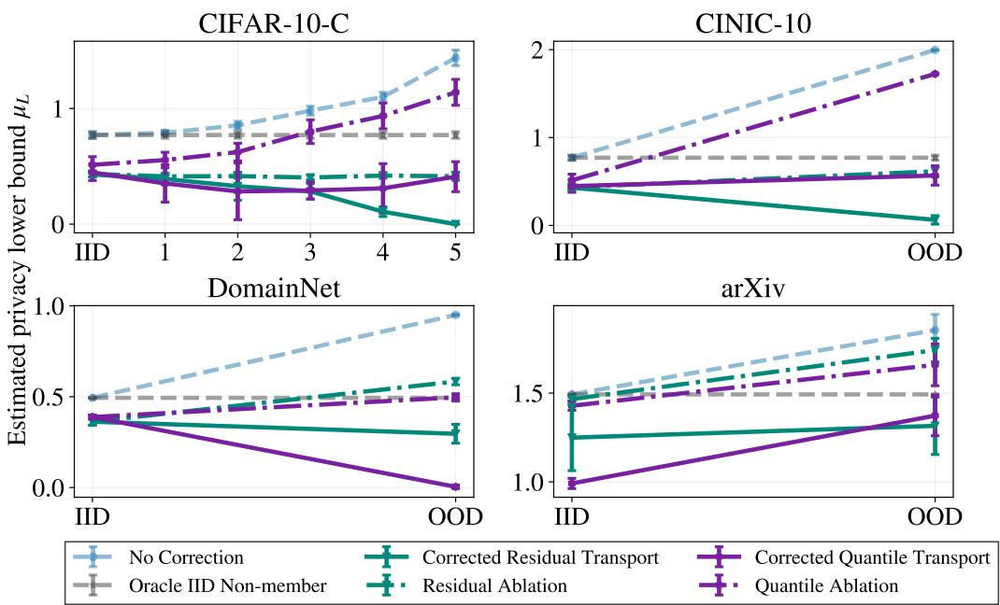  
Figure 5: Ablation of the conservative correction across datasets. Solid lines are the two proposed methods. Dash lines are the corresponding ablation variants without correction. Nominal transport can still exceed the oracle bound, whereas the conservative correction reduces this overestimation.

Ablation on the number of fractions. Our calibration procedure partitions the available range into multiple fractions to estimate the relationship between distribution shift and auditing error. We study the sensitivity of our method to this hyperparameter by varying the number of fractions $\in \{ 2 0 , 5 0 , 1 0 0 \}$ . Figure 6 reports the resulting privacy lower bounds for both residual and quantile transport across all datasets. Overall, the estimates and their trends are consistent across the three choices, with only minor variations relative to the uncertainty of the estimates. This suggests that the proposed method is not sensitive to the exact number of fractions used in the calibration procedure.

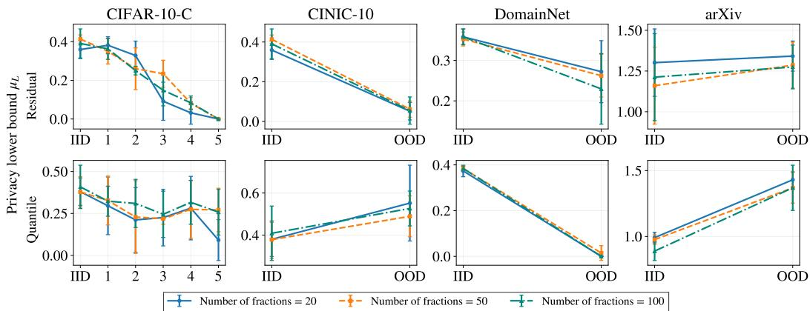  
Figure 6: Ablation on number of fractions. Privacy lower bounds obtained with residual transport (top) and quantile transport (bottom) for number of fractions $\in \ \{ 2 0 , 5 0 , 1 0 0 \}$ across all datasets. The estimates remain similar across different choices, indicating that our method is robust to the number of fractions used for calibration. Error bars show standard deviation for 5 seeds.

## D ADDITIONAL DIAGNOSTICS FOR CONDITIONAL TRANSPORTABILITY

We provide the full set of PIT-based diagnostics for the conditional transportability across datasets and distribution shifts. Following the analysis in Section 4.2, we partition samples according to the estimated domain propensity score $\hat { \pi } ( \dot { Z } )$ and compare the empirical CDFs of the PIT values for IID and OOD non-members within each propensity bin. Under conditional invariance, the two distributions should be similar within regions of common support; deviations between the red and blue curves indicate potential violations of this assumption. The dashed diagonal shows the uniform reference distribution, while gray panels indicate propensity bins with insufficient common support for a reliable comparison. Figures 7 and 8 show the results across CIFAR-10-C corruption severities and the remaining benchmark settings, respectively. The results indicate violations of the conditional invariance assumption for CINIC-10 and DomainNet. IID non-member curves below the diagonal indicate that the observed MIA scores are larger than those predicted from the OOD reference distribution. For CIFAR-10-C and arXiv, the gray panels indicate insufficient common support, suggesting that transport in these regions may require extrapolation.

To characterize the degree of distribution shift and the available overlap between IID and OOD non-members, we examine the estimated domain propensity score $\hat { \pi } ( \bar { Z } ) ~ = ~ \mathrm { P r } ( D ~ = ~ \mathrm { O O D } ~ |$ $Z ,$ non-member). Figure 9 shows its distribution for the two domains across all datasets. When the two distributions substantially overlap, IID and OOD samples share regions of representation space in which conditional comparisons are better supported. In contrast, strong separation indicates that the domains are easily distinguishable and that conditional transport must rely more heavily on extrapolation. As expected, the separation generally increases with corruption severity for CIFAR-10-C, while datasets such as DomainNet exhibit considerably weaker overlap.

## E RECOVERING A CONSERVATIVE TRANSPORTED SCORE DISTRIBUTION

Our method operates directly at the level of the privacy estimate: given the privacy lower bound $\hat { \mu } _ { \mathrm { t r a n s } }$ obtained from the nominal transported non-member distribution and the calibrated error estimate $\hat { r } _ { \mathrm { { + } } }$ we report

$$
\hat { \mu } _ { \mathrm { c o r r } } = \operatorname* { m a x } ( 0 , \hat { \mu } _ { \mathrm { t r a n s } } - \hat { r } ) .\tag{38}
$$

For applications where a corrected non-member score distribution is nevertheless useful, we construct one whose induced privacy estimate is consistent with this scalar correction. Intuitively, we conservatively shrink the nominal transported distribution toward the null distribution, represented by the empirical member-score distribution. When the non-member distribution coincides with the member distribution, the two populations are indistinguishable from their scores and the corresponding privacy lower bound is zero.

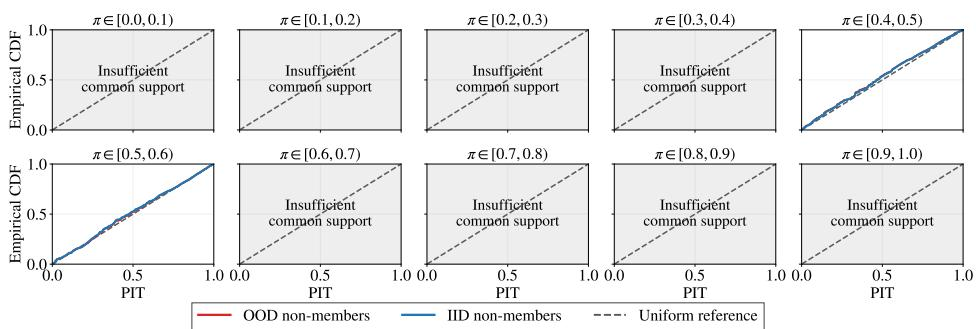

(a) CIFAR-10-C with severity level: 1  
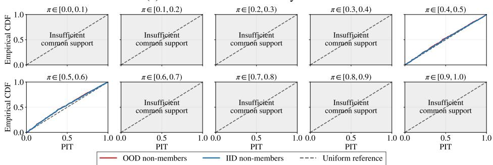

(b) CIFAR-10-C with severity level: 2  
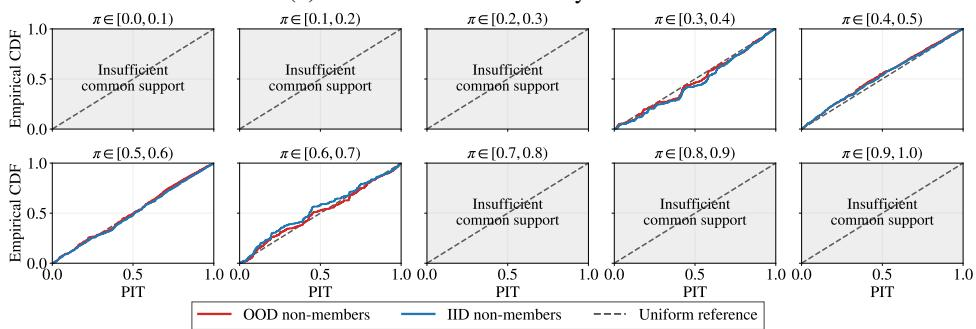

(c) CIFAR-10-C with severity level: 3  
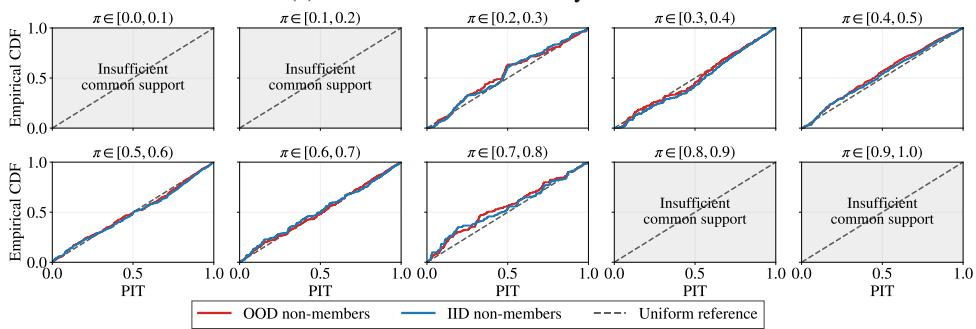  
(d) CIFAR-10-C with severity level: 4

Figure 7: Conditional-invariance diagnostics for CIFAR-10-C (severities 1-4). Empirical CDFs of PIT values for OOD (red) and IID (blue) non-members are compared within estimated domainpropensity bins. Agreement between the curves supports conditional invariance. Dashed lines indicate the uniform reference; gray panels indicate insufficient common support.

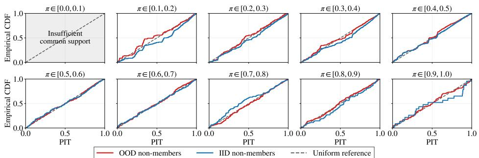

(a) CIFAR-10-C with severity level: 5  
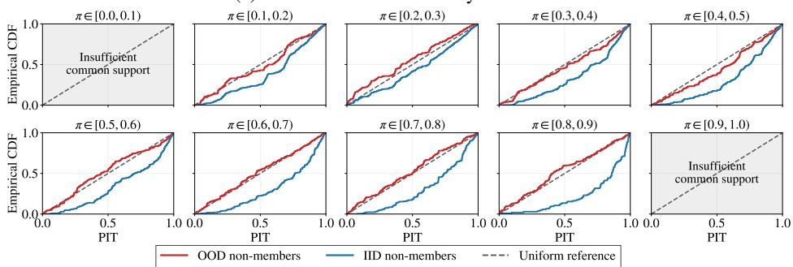

(b) CINIC-10  
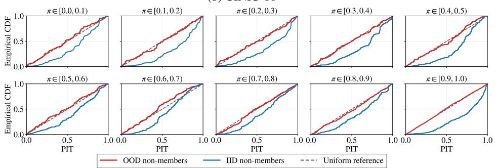

(c) DomainNet  
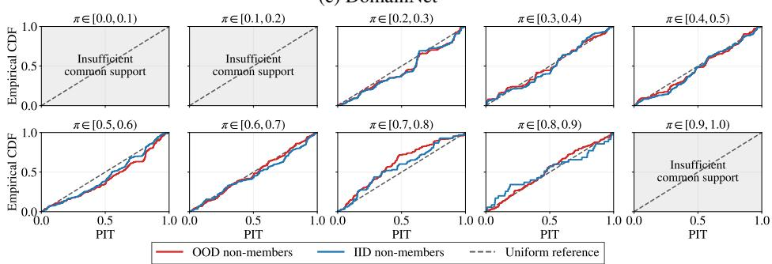  
(d) arXiv  
Figure 8: Conditional-invariance diagnostics for additional distribution shifts. PIT empirical CDFs for OOD (red) and IID (blue) non-members across CIFAR-10-C severity 5, CINIC-10, DomainNet, and arXiv. Curves are compared within estimated domain-propensity bins; gray panels indicate insufficient common support. Agreement between the two curves indicates greater consistency with conditional invariance, while IID non-member curves below the diagonal indicate larger MIA scores than predicted by the OOD reference distributions.

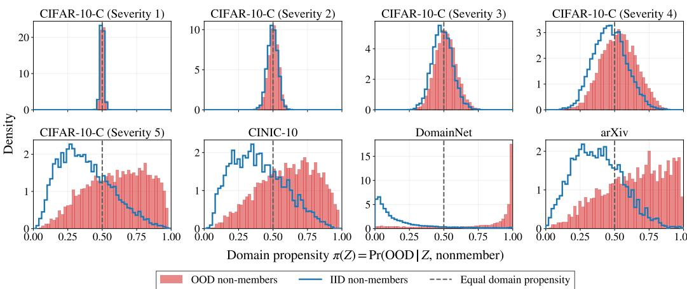  
Figure 9: Domain-propensity distributions across datasets. Distributions of ${ \hat { \pi } } ( Z ) = \operatorname* { P r } ( D =$ OOD ${ \mid Z , }$ non-member) for IID (blue) and OOD (red) non-members. The dashed line marks equal domain propensity, $\hat { \pi } ( \acute { Z } ) = 0 . 5$ . Separation between the distributions reflects domain distinguishability, while their overlap indicates common support.

Let $\tilde { F } _ { S _ { N } ^ { P } }$ denote the nominal transported non-member score distribution and $F _ { S _ { M } }$ the empirical member-score distribution. We interpolate between them in quantile space:

$$
F _ { \gamma } ^ { - 1 } ( u ) = ( 1 - \gamma ) \tilde { F } _ { S _ { N } ^ { P } } ^ { - 1 } ( u ) + \gamma F _ { S _ { M } } ^ { - 1 } ( u ) , \qquad u \in ( 0 , 1 ) ,\tag{39}
$$

evaluated on the midpoint grid $u _ { j } = ( j - \textstyle { \frac { 1 } { 2 } } ) / n$ . Here, $\gamma \in [ 0 , 1 ]$ controls the amount of conservative retreat: $\gamma = 0$ retains the nominal transported distribution, whereas $\gamma = 1$ recovers the member distribution. We then choose the smallest amount of retreat whose induced privacy lower bound does not exceed the calibrated target:

$$
\gamma ^ { * } = \operatorname* { m i n } \left\{ \gamma \in \mathcal { G } : \hat { \mu } ( F _ { \gamma } ; F _ { S _ { M } } ) \leq \hat { \mu } _ { \mathrm { c o r r } } \right\} , \qquad \mathcal { G } = \left\{ 0 , \frac { 1 } { G } , \frac { 2 } { G } , \ldots , 1 \right\} .\tag{40}
$$

The resulting $F _ { \gamma }$ therefore provides a distribution-level realization of our conservative scalar correction. Because $\gamma$ is searched over a finite grid, its induced privacy estimate need not equal $\hat { \mu } _ { \mathrm { c o r r } }$ exactly, but is constrained not to exceed it.

Lemma 1. Fix all member scores ${ \mathcal { S } } _ { M }$ , all non-member scores $ \mathcal { S } _ { N } ^ { Q }$ except for $s _ { i } ,$ and fixed tail sizes $k _ { - }$ and $k _ { + }$ . Assume scores are distinct (or ties are resolved by a fxed rule). If record i is a non-member, then the number of correct guesses $k ( \mathcal { S } _ { N } ^ { Q } , \mathcal { S } _ { M } )$ is non-increasing in $s _ { i }$

Proof. As $s _ { i }$ increases, its rank can change only when it crosses another score $s _ { j }$ . Crossings that do not change membership of the bottom $k _ { - }$ or top $k _ { + }$ tails leave k unchanged. Thus only two cases matter.

1. i leaves the bottom tail and $j$ enters it. Before the crossing, i is correctly guessed as a nonmember and contributes 1. After the crossing, j contributes 1 only $\mathrm { i f } \ j$ is also a non-member. Hence

$$
\Delta k = - 1 + 1 \{ j \mathrm { \ n o n - m e m b e r } \} \le 0 .\tag{41}
$$

2. ¿ enters the top tail and displaces $j .$ Since i is a non-member, the member guess is incorrect, so i contributes 0. The displaced record j loses a correct guess only when j is a member. Hence

$$
\Delta k = - 1 \{ j { \mathrm { ~ m e m b e r } } \} \leq 0 .\tag{42}
$$

Corollary 2. $H s _ { i , N } ^ { Q } \le s _ { i , N } ^ { Q ^ { \prime } }$ for every i, then $\hat { \mu } ( { \cal S } _ { N } ^ { Q ^ { \prime } } , { \cal S } _ { M } ) \leq \hat { \mu } ( { \cal S } _ { N } ^ { Q } , { \cal S } _ { M } )$

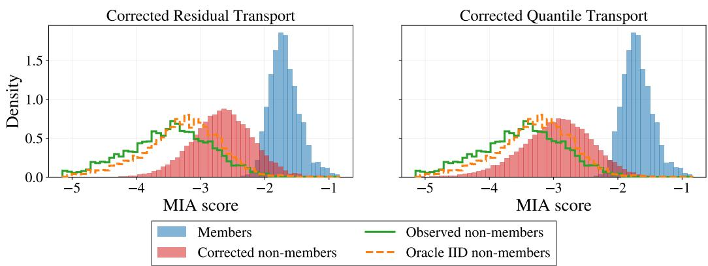  
Figure 10: Distribution-level realization of the conservative correction. Results are shown for residual transport (left) and quantile transport (right).

This follows because µ is non-decreasing in k. Raising non-member scores never raises the bound.

Figure 10 illustrates this optional distribution-level correction for both residual and quantile transport on arXiv data. The nominal transported non-member distribution is retreated toward the member distribution until its induced privacy lower bound reaches the calibrated conservative target. This visualization shows how the scalar correction used in the main method can be translated into a conservative correction of the transported score distribution.

Figure 10 also helps explain the relative performance of our two transport variants. On arXiv, the shift between the OOD and IID non-member MIA score distributions is largely a change in location, while their variances remain similar. Consequently, both residual and quantile transport perform well. In contrast, DomainNet exhibits relatively limited support overlap, as shown in Figure 9. The quantile model must therefore estimate conditional score distributions in feature regions that are poorly represented in the source data. Because conditional tail estimation is particularly sensitive to extrapolation and becomes unreliable when source support is sparse, corrected quantile transport performs worse than residual transport in this setting (Liang, 2024).