# Same Luck, Different Choice: Twin-World Credit Assignment for Agentic Reinforcement Learning

Zeropy Surio University of Sheffield

Tobias Engel Carnegie Mellon University

Mei-Lin Chou University of Michigan

Anika Raman University of Michigan

Samuel Okafor Carnegie Mellon University

## Abstract

Agentic reinforcement learning rewards a complete episode, yet the policy needs credit for every decision inside it. Counterfactual branching estimates this credit by re-running the episode after an alternative decision, but the branch draws its sampling noise independently of the factual episode, so the outcome difference mixes the effect of the decision with the luck of everything that follows. We observe that in agentic search the retriever, the corpus, and the grader are deterministic, so an episode is a deterministic function of the policy’s decisions and its sampling noise. Twin worlds are therefore realizable: the same noise, a different decision. We introduce TWICE (TWIn-world Credit Estimation), which keys the Gumbel noise of every token by turn and line, rolls out counterfactual twins that inherit the factual episode’s downstream noise, and turns their paired outcome differences into turn-level advantages for policy-gradient updates on actor-sampled trajectories; only the actor is deployed. Twin credit is unbiased for any coupling quality, its variance is that of an independent counterfactual scaled by $1 - \rho ,$ where $\rho$ is the twins’ outcome correlation, and under coupling the number of rollouts needed to resolve an advantage of size $\Delta$ falls from $\dot { \Theta ( \Delta ^ { - 2 } ) }$ to $\Theta ( \Delta ^ { - 1 } )$ . A square-root rule spends the twin budget where outcomes are predicted to disagree per unit cost. On seven question-answering benchmarks, TWICE improves the average exact match of GRPO by 5.3 and 4.5 points on Qwen2.5-3B and 7B, outperforms tree-search and counterfactual-branching baselines, and uses 68% fewer auxiliary tokens than VinePPO.

## 1 Introduction

Reinforcement learning (RL) has turned language models into search agents that interleave reasoning with retrieval calls and are rewarded only for the correctness of their final answer (Jin et al., 2025; Song et al., 2025; Chen et al., 2025; Sun et al., 2025; Zheng et al., 2025a). The reward says whether an episode went well; it does not say which decision—a query, the choice to search again, or the final answer—was responsible. GRPO (Shao et al., 2024) broadcasts one scalar to every token of the episode, and PPO (Schulman et al., 2017) relies on a critic that must learn values of long, retrieval-laden contexts; either way, a good query in a failed episode is punished and a wasted query in a lucky one is rewarded (Wei et al., 2025; Zhang et al., 2025a).

A growing literature assigns finer credit to agent decisions. Critics are hard to train on language states (Kazemnejad et al., 2025), and hierarchical critics add their own machinery (Zhou et al., 2024a); process rewards come from information gain, judges, or annotated sub-goals (Wang et al., 2026a; Zheng et al., 2025b; Wang et al., 2026b; Liu et al., 2026; Zhang et al., 2026a); identical states can be grouped across rollouts (Feng et al., 2025); and tree rollouts compare siblings that share a prefix (Ji et al., 2026; Zong et al., 2026; Zhang et al., 2026b; Fu et al., 2026). The most direct estimators re-run the episode from a visited decision with an alternative action and compare outcomes (Li et al., 2026; Samanta et al., 2026; Kazemnejad et al., 2025). All of them compare continuations whose sampling noise is drawn independently.

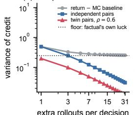

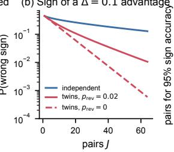

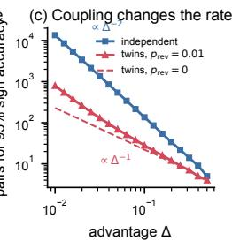

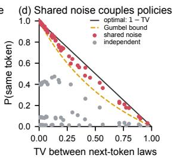  
Figure 1: Why twins (exact curves). (a) Variance of credit for a decision with $Q { = } 0 . 5 5 , V { = } 0 . 4 5 \colon$ subtracting a Monte Carlo baseline from the realized return is floored by the return’s own variance; independent pairs decay as $1 / J ;$ twin pairs are lower by the factor $1 - \rho$ (Prop. 2). (b) Probability of assigning the wrong sign to a $\Delta { = } 0 . 1$ advantage with J pairs. (c) Pairs needed for 95% sign accuracy: $\bar { \propto } \Delta ^ { - 2 }$ for independent pairs, $\propto \Delta ^ { - 1 }$ for twins (Prop. 3). (d) Shared Gumbel noise makes two nearby next-token distributions emit the same token almost as often as an optimal coupling (Lemma 1); independent noise does not.

This choice has a cost that is easy to miss. Would this episode have succeeded had the agent issued a different query? is a counterfactual question about the realized episode (Pearl, 2009). An independently sampled branch answers an interventional question instead: the outcome difference contains the effect of the decision plus the difference in luck of every later sampling step—which follow-up query was drawn, whether the agent stopped early, how the answer was phrased. The factual episode’s own luck never averages out, so estimators that use the realized return have a variance floor that no number of extra rollouts removes (Figure 1a), and resolving an effect of size ∆ takes $\Theta ( \Delta ^ { - 2 } )$ rollouts (Figure 1c).

We observe that agentic search admits a better answer. The retriever, the corpus, and the grader are deterministic, so once sampling is written with the Gumbel-max trick (Maddison et al., 2014; Oberst and Sontag, 2019), an episode is a deterministic function of the policy’s decisions and its exogenous noise. The factual episode’s twin world (Balke and Pearl, 1994)—the same noise, a different decision at one turn—can then be rolled out exactly. Downstream luck is shared, so the twin’s outcome difference isolates the decision, as in counterfactual generation from language models (Ravfogel et al., 2025; Chatzi et al., 2025) and common random numbers in simulation (Glasserman and Yao, 1992; Ng and Jordan, 2000). Coupling is also strongest exactly where credit is hardest: a decision that barely changes the downstream distribution yields a twin that reproduces the factual continuation and ties, instead of a noisy ±1.

We build TWICE on this observation. It (i) keys the Gumbel noise of each token by episode, turn, line, and position, so twins stay aligned when lengths differ and every trajectory remains an exact sample from the policy; (ii) turns the paired outcome difference of a factual decision and its twin into a turn-level advantage for PPO-style updates on actor-sampled trajectories; and (iii) branches each decision with a probability proportional to $\surd$ predicted discordance/cost, reweighting to stay unbiased. Our contributions:

• Insight and theory. Credit assignment in agentic RL asks a counterfactual question that independent branching cannot answer cheaply. We show that twin credit is unbiased for any coupling quality, scales variance by $1 - \rho ,$ changes the sign-detection rate from $\Delta ^ { 2 }$ to $\Delta ,$ and admits a square-root budget rule (§5).

• Method. TWICE realizes twins with keyed noise, two exact shortcuts, and unbiased budgeting; it leaves the RL loss unchanged and deploys the actor alone (§4).

• Evidence. On seven QA benchmarks and two backbones, TWICE outperforms nine RL baselines, cuts wrong-sign credit from 21.7% to 6.9% relative to independent counterfactuals, and uses 68% fewer auxiliary tokens than VinePPO (§6).

## 2 Related Work

Credit assignment for LLM agents. Outcome-reward RL for agents builds on PPO, GRPO, and their variants (Schulman et al., 2017; Shao et al., 2024; Yu et al., 2025; Ahmadian et al., 2024). Finer credit comes from learned or hindsight critics (Zhou et al., 2024a, 2025; Tan et al., 2026; Wang et al., 2026c), state grouping (Feng et al., 2025; Wang et al., 2026d; Zhu et al., 2026a), environment feedback (Huo et al., 2026), and process rewards from information gain, judges, or verifiers (Wang et al., 2026a; Liang et al., 2026a; Samarinas et al., 2026; Wu et al., 2026; Zhu et al., 2026b; Setlur et al., 2025). Tree methods share prefixes and compare siblings (Hou et al., 2025; Guo et al., 2025; Ji et al., 2026; Zong et al., 2026; Zhang et al., 2026b; Fu et al., 2026; Dong et al., 2025a); SIPO notes that adaptive expansion biases sibling values (Fu et al., 2026). Monte Carlo methods estimate values from rollouts at intermediate states (Kazemnejad et al., 2025), resets resample continuations from a decision (Samanta et al., 2026), error localization searches for the first irrecoverable step (Liang et al., 2026b), and CRR forks the environment and contrasts the factual return with one sampled counterfactual (Li et al., 2026). TWICE keeps this last, most direct estimator but changes what the branch holds fixed: its downstream noise. Related uses of the same tree structure allocate a fixed rollout budget toward prompt roots and turn-level prefixes that are likely to yield mixed rewards (Zou et al., 2026a), or back the terminal reward up those prefixes and distill the resulting turn-level credit into a bounded teacher (Zou et al., 2026b).

Counterfactuals and shared randomness. Twin networks answer counterfactual queries by sharing exogenous noise between factual and hypothetical worlds (Balke and Pearl, 1994; Pearl, 2009). Gumbel-max structural causal models make this concrete for categorical sampling (Oberst and Sontag, 2019) and for language models (Ravfogel et al., 2025; Chatzi et al., 2025). In RL, counterfactual reasoning appears in model-based policy search (Buesing et al., 2019), hindsight and counterfactual credit (Harutyunyan et al., 2019; Mesnard et al., 2021; Meulemans et al., 2023), and multi-agent baselines (Foerster et al., 2018); fixing random numbers to compare policies dates to PEGASUS (Ng and Jordan, 2000) and common random numbers in simulation (Glasserman and Yao, 1992). Shared-noise coupling of language-model samplers is also used for speculative decoding and watermarking (Daliri et al., 2025; Kirchenbauer et al., 2023; Kuditipudi et al., 2024). To our knowledge, TWICE is the first to use it for credit assignment in LLM training, where it changes both the variance and the sample complexity of counterfactual credit.

RL for search agents. Search-R1 and its successors train agents to call a search tool inside their reasoning (Jin et al., 2025; Song et al., 2025; Chen et al., 2025; Sun et al., 2025; Jiang et al., 2025; Gao et al., 2025), refine rewards for efficiency and process quality (Wang et al., 2025a; Zhang et al., 2025b; Wu et al., 2026), and extend to real web environments and large reasoning models (Zheng et al., 2025a; Li et al., 2025a). TWICE changes only how credit is estimated and applies to any of these pipelines whose tools are deterministic or cached. Appendix A extends this discussion.

## 3 Preliminaries

Agentic episodes. A question x starts an episode. At turn t, the policy $\pi _ { \theta }$ writes a turn $y _ { t } \sim$ $\pi _ { \boldsymbol { \theta } } ( \cdot \mid s _ { t } ) .$ —reasoning followed by one action, a search call or the final answer—given the context $s _ { t } ;$ a tool returns $o _ { t } = \mathcal { E } ( y _ { t } )$ , and $s _ { t + 1 } = s _ { t } \oplus y _ { t } \oplus o _ { t }$ . After at most H turns, a grader returns a utility $U \in [ 0 , 1 ]$ (exact match in our experiments). The retriever over a fixed corpus and the grader are deterministic; web tools become deterministic within a training step by caching. We write $\begin{array} { r } { \dot { Q } ^ { \pi } ( s _ { t } , y ) = \mathbb { E } [ U \mid s _ { t } , y _ { t } = y ] , V ^ { \pi } ( s _ { t } ) = \mathbb { E } _ { y \sim \pi } Q ^ { \pi } ( s _ { t } , y ) } \end{array}$ , and $A ^ { \pi } = Q ^ { \pi } - V ^ { \bar { \pi } }$ ; the credit of a turn is $A ^ { \pi } ( s _ { t } , y _ { t } )$

Counterfactual branching. Given a visited decision, a branch samples $y ^ { \prime } \sim \pi ( { \cdot } \mid s _ { t } )$ , executes it, and continues with π to reach $U ^ { \prime }$ . The difference $D _ { t } = U - U ^ { \prime }$ satisfies $\mathbb { E } [ D _ { t } \mid \dot { s _ { t } } , \dot { y } _ { t } ] = A ^ { \pi } ( s _ { t } , y _ { t } )$ whenever the continuation is a π-rollout, and this is the estimator of CRR (Li et al., 2026); VinePPO instead estimates $V ^ { \pi } ( s _ { t + 1 } ) - V ^ { \pi } ( s _ { t } )$ with independent rollouts from both states (Kazemnejad et al., 2025). Writing $U = \overbrace { Q } ^ { \pi } ( s _ { t } , y _ { t } ) + \varepsilon .$ , where ε is the luck of the factual continuation, any estimator that uses the realized $U$ inherits $\mathrm { V a r } ( \varepsilon )$ , and estimators that avoid it pay for a second set of rollouts.

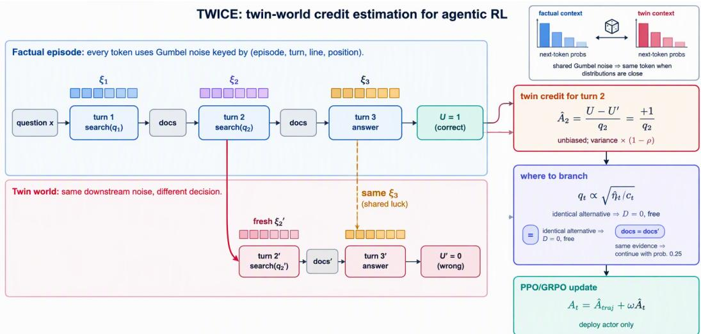  
Figure 2: TWICE in one training step. Top: every factual token draws Gumbel noise keyed by (episode, turn, line, position). Bottom: the twin of turn 2 swaps in an alternative drawn with fresh noise and continues with the factual keys, sharing the downstream luck $\xi _ { 3 } ;$ under shared noise, nearby next-token distributions emit the same token (inset). Right: the outcome difference divided by the branch probability is the turn’s credit, and branch probabilities follow a square-root rule of predicted discordance over cost; the actor is updated with PPO/GRPO on factual tokens and deployed alone.

## 4 TWICE

## 4.1 Twin worlds from keyed noise

With Gumbel-max sampling, token i of turn t is arg ma $\mathrm { x } _ { v } [ \ell _ { \theta } ( v \mid \cdot ) / \tau + \xi ( v ) ]$ ], where $\ell _ { \theta }$ are the logits, τ the temperature, and $\xi \textbf { a }$ vector of i.i.d. standard Gumbel variables; top-p restricts the arg max to the nucleus. With deterministic tools, $U = F ( x ; \xi _ { 1 } , \dots , \xi _ { H } )$ is a deterministic function of the per-turn noise $\xi _ { t }$ (Oberst and Sontag, 2019; Ravfogel et al., 2025). The twin of the factual episode at turn t with alternative $y ^ { \prime }$ evaluates F with turn t replaced by $y ^ { \prime }$ and every later noise variable unchanged (Balke and Pearl, 1994). This needs two properties: every trajectory must remain an exact sample from π, and the twin must read the same noise as the factual episode for the same role.

TWICE indexes noise by a key $\boldsymbol { \kappa } = ( e , t , \ell , j )$ —episode e, turn t, line ℓ of the turn, and position j within the line—and sets $\xi _ { \kappa } ( v ) = - \log ( - \log u _ { \kappa } ( v ) )$ with $u _ { \kappa }$ from a counter-based pseudorandom function seeded by κ. Keys never repeat within a trajectory, so every factual or twin trajectory samples each token with a fresh Gumbel vector and is an exact draw from π (Appendix B.1). Keys are indexed by turn and line rather than by a global token counter, so a twin whose turn t has a different length still reads the factual noise at every later turn, and a divergence inside a line re-synchronizes at the next line. A single sampler seed per episode, as exposed by serving engines (Kwon et al., 2023), is also exact but aligns noise by token count, so a single length change decouples the rest of the episode. Watermark-style n-gram keys (Kirchenbauer et al., 2023) re-synchronize faster but can repeat within a trajectory, which breaks exactness. Keyed sampling is a logits processor that adds $\xi _ { \kappa }$ and takes the arg max; it adds about 2% to generation time.

## 4.2 Twin credit

For a factual decision $( s _ { t } , y _ { t } )$ , TWICE draws an alternative $y ^ { \prime } \sim \pi _ { \mathrm { o l d } } ( \cdot \mid s _ { t } )$ with fresh keys, executes it, and continues from $s _ { t } \oplus \dot { y } ^ { \prime } \oplus \mathcal { E } ( y ^ { \prime } )$ with the factual keys of turns $t { + } 1 , \ldots , H$ , reaching the twin utility $U _ { t } ^ { \prime }$ . The pair gives

$$
D _ { t } = U - U _ { t } ^ { \prime } , \qquad \mathbb { E } [ D _ { t } \mid s _ { t } , y _ { t } ] = A ^ { \pi } ( s _ { t } , y _ { t } ) .\tag{1}
$$

This pair reuses the factual continuation, so it costs one alternative turn plus one continuation. Further pairs $j \geq 1$ re-run the continuation of the factual decision and of a new alternative with fresh downstream keys shared within the pair; the credit is the mean of the J differences, and we use $J { = } 1$ unless stated. Two cases need no generation at all. If $y ^ { \prime }$ equals $y _ { t }$ token for token, the twin is the factual episode and $D _ { t } = 0$ exactly (a self-twin, increasingly common as the policy sharpens). If the alternative retrieves exactly the factual documents, the twin almost always ties (4.1% discordance); such twins are continued only with probability $q _ { \mathrm { s a m e } } { = } 0 . 2 5$ and reweighted by $1 / q _ { \mathrm { s a m e } } .$

## 4.3 Where to branch

A budget $\beta$ caps auxiliary tokens at $\beta$ times the policy’s rollout tokens. Each factual decision is branched with probability

$$
q _ { t } = \operatorname* { m i n } \bigl ( 1 , \operatorname* { m a x } \big ( q _ { \mathrm { m i n } } , \lambda \sqrt { \hat { \eta } _ { t } / c _ { t } } \big ) \big ) ,\tag{2}
$$

where $c _ { t }$ is the twin’s token cost (alternative turn plus the factual episode’s remaining tokens), $\hat { \eta } _ { t }$ is the predicted discordance $\mathrm { P r } ( D _ { t } \neq 0 )$ , and λ is set per batch by bisection to meet $\beta . \ \hat { \eta } _ { t }$ comes from a logistic model over features of the factual episode—the prompt’s group success rate $\hat { p }$ among its G rollouts, the factual outcome U, the turn’s mean token entropy, its action type, and its position—fit online on realized twins with weights $1 / q _ { t }$ . With branch indicator $B _ { t } \sim \mathrm { B e r n } ( q _ { t } )$ and evidence coin $S _ { t } \left( \ S 4 . 2 \right)$ , the credit is the Horvitz–Thompson estimate (Horvitz and Thompson, 1952)

$$
\hat { A } _ { t } = \frac { B _ { t } S _ { t } } { q _ { t } q _ { \mathrm { s a m e } } ^ { e _ { t } } } D _ { t } ,\tag{3}
$$

with $e _ { t } = 1$ if the alternative retrieved the factual documents and 0 otherwise. Eq. (2) is the varianceoptimal allocation (Prop. 4): cheap late decisions and prompts with mixed outcomes get twins, while prompts that the policy always or never solves rarely do.

## 4.4 Policy update

Every token of turn t in a factual episode receives the advantage

$$
A _ { t } = \hat { A } ^ { \mathrm { t r a j } } + \omega \hat { A } _ { t } / \hat { \sigma } ,\tag{4}
$$

where $\hat { A } ^ { \mathrm { t r a j } } = ( U - \bar { U } _ { G } ) / s _ { G }$ is GRPO’s group-normalized episode advantage (Shao et al., 2024), σˆ is the batch standard deviation of nonzero twin credits, and $\omega { = } 1$ . Unbranched turns keep $\hat { A } ^ { \mathrm { t r a j } }$ alone. The clipped surrogate, the KL term, and retrieved-token masking are unchanged (Jin et al., 2025); twin tokens are used only for credit, and only the actor is deployed. Algorithm 1 in Appendix D summarizes one step.

## 5 Theory

All statements condition on a visited decision $( s _ { t } , y _ { t } )$ ; proofs are in Appendix B. Let $D _ { t } ^ { \mathrm { i n d } }$ be the pair difference when the branch’s continuation uses independent noise, and define the twin correlation $\rho _ { t } = 2 \mathrm { C o v } ( U , U _ { t } ^ { \prime } ) / \mathrm { V a r } ( D _ { t } ^ { \mathrm { i n d } } )$ and the discordance $\eta _ { t } = \mathrm { P r } ( D _ { t } \neq 0 )$

Proposition 1 (Twin credit is unbiased). With deterministic tools and unique keys, every twin trajectory is marginally a π-rollout from its branch state, $\mathbb { E } [ D _ { t } ] = A ^ { \pi } ( s _ { t } , y _ { t } ) ,$ , and, whenever $B _ { t }$ and $S _ { t }$ depend only on information available before the twin’s continuation, $\mathbb { E } [ \hat { A } _ { t } ] = A ^ { \pi } ( s _ { t } , y _ { t } )$ Hence $\begin{array} { r } { \sum _ { t } \hat { A } _ { t } \nabla _ { \theta } \log \pi _ { \theta } ( y _ { t } \mid s _ { t } ) } \end{array}$ is an unbiased policy-gradient estimatefor any noise layout and any coupling quality.

Proposition 2 (Twins remove shared luck). $\mathrm { V a r } ( D _ { t } ) = ( 1 - \rho _ { t } ) \mathrm { V a r } ( D _ { t } ^ { \mathrm { i n d } } )$ . With J pairs at equal cost, twin and independent credit have variances $( 1 - \rho _ { t } ) \mathrm { V a r } ( D _ { t } ^ { \mathrm { i n d } } ) / J$ and Var $( D _ { t } ^ { \mathrm { i n d } } ) / J .$ In contrast, the realized return minus a baselinefrom b independent rollouts has variance at least $\operatorname { V a r } ( U \mid s _ { t } , y _ { t } )$ for every b.

Lemma 1 (Coupling is local). If, while the twin andfactual continuations agree, their next-token distributions at each of L downstream positions differ by at most ϵ in total variation, the continuations are identical with probability at least $\begin{array} { r } { \left( \frac { 1 - \epsilon } { 1 + \epsilon } \right) ^ { L } , s o \eta _ { t } \leq 2 L \epsilon } \end{array}$

Proposition 3 (Credit becomes detection). For binary U, let $p _ { \pm } = \mathrm { P r } ( D _ { t } = \pm 1 ) , \Delta = p _ { + } - p _ { - } >$ 0, and $p _ { \mathrm { r e v } } ~ = ~ p _ { - }$ With J pairs, the probability that $\textstyle \sum _ { j } D _ { t , j } \ \leq \ 0$ is at most $e ^ { - J r }$ with the exact large-deviation rate r = − log $\left( 1 - ( \sqrt { p _ { + } } - \sqrt { p _ { - } } ) ^ { 2 } \right) \ge \Delta ^ { 2 } / ( 2 \Delta + 4 p _ { \mathrm { r e v } } )$ . $I f p _ { \mathrm { r e v } } \leq \Delta$ $J = \lceil 6 \log ( 1 / \delta ) / \Delta \rceil$ pairs give sign accuracy $1 - \delta ;$ independent pairs with $Q ^ { \prime } = Q - \Delta ,$ , where $Q = Q ^ { \pi } ( s _ { t } , y _ { t } )$ and $\bar { Q } ^ { \prime } = \bar { Q } ^ { \pi } ( s _ { t } , \bar { y } ^ { \prime } )$ , need $( \mathrm { i } - o ( 1 ) ) 4 Q ^ { \prime } ( 1 - Q ) \mathrm { l o g } ( 1 / \delta ) / \Delta ^ { 2 } a s \delta , \Delta  0$

Table 1: Exact match (%) on seven QA benchmarks (mean of three seeds; ${ \dag } _ { \vdots }$ in-domain; Bamb. is Bamboogle). Groups: outcome-level credit, process signals without extra rollouts, tree rollouts, counterfactual branching, ours. Tok.: generated tokens per update relative to GRPO, including auxiliary rollouts. Bold / underline: best / second best.
<table><tr><td rowspan="2">Method</td><td colspan="3">General QA</td><td colspan="4">Multi-hop QA</td><td rowspan="2">Avg.</td><td rowspan="2">Tok.</td></tr><tr><td>NQ†</td><td></td><td>TriviaQA PopQA</td><td>HotpotQA†</td><td>2Wiki</td><td>MuSiQue</td><td>Bamb.</td></tr><tr><td colspan="10">Qwen2.5-3B</td></tr><tr><td>PPO</td><td>41.2</td><td>56.4</td><td>41.1</td><td>33.8</td><td>32.6</td><td>11.4</td><td>28.0</td><td>34.9</td><td>1.00×</td></tr><tr><td>GRPO</td><td>43.1</td><td>57.6</td><td>41.8</td><td>37.2</td><td>34.5</td><td>13.9</td><td>33.6</td><td>37.4</td><td>1.00×</td></tr><tr><td>GRPO (2×)</td><td>43.8</td><td>58.1</td><td>42.3</td><td>38.1</td><td>35.4</td><td>14.5</td><td>34.4</td><td>38.1</td><td>2.00×</td></tr><tr><td>IGPO</td><td>44.0</td><td>57.9</td><td>42.6</td><td>39.0</td><td>37.1</td><td>15.2</td><td>35.2</td><td>38.7</td><td>1.00×</td></tr><tr><td>GiGPO</td><td>44.5</td><td>58.4</td><td>42.8</td><td>39.5</td><td>38.0</td><td>15.7</td><td>36.0</td><td>39.3</td><td>1.00×</td></tr><tr><td>Tree-GRPO</td><td>45.7</td><td>59.1</td><td>43.3</td><td>40.6</td><td>40.2</td><td>16.4</td><td>38.4</td><td>40.5</td><td>1.00×</td></tr><tr><td>AT2PO</td><td>46.0</td><td>59.4</td><td>43.6</td><td>41.1</td><td>40.9</td><td>16.9</td><td>39.2</td><td>41.0</td><td>1.00×</td></tr><tr><td>VinePPO</td><td>45.2</td><td>58.6</td><td>43.0</td><td>41.4</td><td>41.6</td><td>17.3</td><td>38.4</td><td>40.8</td><td>3.20×</td></tr><tr><td>CRR</td><td>45.0</td><td>58.8</td><td>42.9</td><td>40.8</td><td>40.7</td><td>16.6</td><td>37.6</td><td>40.3</td><td>1.70×</td></tr><tr><td>TWICE (ours)</td><td>46.9</td><td>60.0</td><td>44.2</td><td>43.2</td><td>43.8</td><td>18.9</td><td>41.6</td><td>42.7</td><td>1.70×</td></tr><tr><td colspan="10">Qwen2.5-7B</td></tr><tr><td>PPO</td><td>43.9</td><td>60.2</td><td>43.0</td><td>39.6</td><td>38.0</td><td>16.8</td><td>38.4</td><td>40.0</td><td>1.00×</td></tr><tr><td>GRPO</td><td>45.6</td><td>61.2</td><td>44.0</td><td>42.1</td><td>40.3</td><td>18.7</td><td>42.4</td><td>42.0</td><td>1.00×</td></tr><tr><td>GRPO (2×)</td><td>46.2</td><td>61.7</td><td>44.4</td><td>42.9</td><td>41.1</td><td>19.2</td><td>43.2</td><td>42.7</td><td>2.00×</td></tr><tr><td>IGPO</td><td>46.4</td><td>61.5</td><td>44.7</td><td>43.5</td><td>42.3</td><td>20.0</td><td>43.2</td><td>43.1</td><td>1.00×</td></tr><tr><td>GiGPO</td><td>46.8</td><td>61.9</td><td>44.9</td><td>43.9</td><td>43.0</td><td>20.5</td><td>44.0</td><td>43.6</td><td>1.00×</td></tr><tr><td>Tree-GRPO</td><td>47.7</td><td>62.8</td><td>45.2</td><td>44.8</td><td>44.4</td><td>21.1</td><td>44.8</td><td>44.4</td><td>1.00×</td></tr><tr><td>AT2PO</td><td>48.0</td><td>63.0</td><td>45.5</td><td>45.2</td><td>44.9</td><td>21.6</td><td>45.6</td><td>44.8</td><td>1.00×</td></tr><tr><td>VinePPO</td><td></td><td></td><td></td><td></td><td></td><td></td><td></td><td></td><td></td></tr><tr><td>CRR</td><td>47.3 47.1</td><td>62.4 62.5</td><td>45.1 45.0</td><td>45.5 44.9</td><td>45.7 44.8</td><td>21.9 21.3</td><td>45.6 44.8</td><td>44.8 44.3</td><td>3.20× 1.70×</td></tr><tr><td>TWICE (ours)</td><td>48.8</td><td>63.7</td><td>46.3</td><td>47.1</td><td>47.9</td><td>23.5</td><td>48.0</td><td>46.5</td><td>1.70×</td></tr></table>

Proposition 4 (Square-root budget). Let decisions i have second moments $m _ { i } = \mathbb { E } [ D _ { i } ^ { 2 } ]$ and costs $c _ { i } .$ Eq. (3) is unbiased for any $q _ { i } > 0 ,$ , its total variance is $\begin{array} { r } { \sum _ { i } m _ { i } / q _ { i } - \sum _ { i } ( \mathbb { E } D _ { i } ) ^ { 2 } } \end{array}$ , and the minimizer under $\begin{array} { r } { \sum _ { i } q _ { i } c _ { i } \le C \ : i s \ : q _ { i } ^ { \star } = \operatorname* { m i n } ( 1 , \lambda \sqrt { m _ { i } / c _ { i } } ) } \end{array}$ . For binary $U , m _ { i } = \eta _ { i } .$

Proposition 1 makes correctness independent of coupling: keys, serving-engine nondeterminism, or tool noise can only cost variance. Proposition 2 removes the floor of Figure 1a, and Lemma 1 explains why $\rho _ { t }$ is large where effects are small. Proposition 3 is the core of the insight: independent pairs estimate a mean from outcomes that disagree by chance at rate $\approx 2 Q ( 1 - Q )$ , whereas twins disagree mostly when the decision matters, so reversals are rare and a few discordant pairs reveal the sign. Proposition 4 turns this into allocation: coupling lowers $\eta _ { i }$ , and the square-root rule moves the saved budget to decisions whose twins are predicted to disagree.

## 6 Experiments

## 6.1 Setup

Data, models, and training. We follow the Search-R1 protocol (Jin et al., 2025): training on the union of NQ and HotpotQA training sets, retrieval of the top-3 passages by E5 (Wang et al., 2022) from the 2018 Wikipedia dump (Karpukhin et al., 2020), at most four search calls, and exact match as the reward. We evaluate exact match on NQ, TriviaQA, and PopQA (Kwiatkowski et al., 2019; Joshi et al., 2017; Mallen et al., 2023) and on the multi-hop HotpotQA, 2WikiMultiHopQA, MuSiQue, and Bamboogle (Yang et al., 2018; Ho et al., 2020; Trivedi et al., 2022; Press et al., 2023). Backbones are Qwen2.5-3B/7B-Instruct (Qwen et al., 2024); Appendix F adds Qwen3-4B (Yang et al., 2025) and

Table 2: Credit quality and cost (Qwen2.5-3B, 8×H100). Credit is audited on 1,036 decisions against an oracle advantage from 128 rollouts each. Tok.: generated tokens per update relative to GRPO; Rev.: % of decisions with $| A ^ { \star } | \geq 0 . 0 5$ whose credit has the wrong sign; MSE: relative to GRPO; Corr.: Pearson correlation with $A ^ { \star }$
<table><tr><td>Method</td><td>Tok.</td><td>s/step</td><td>Rev.↓</td><td>MSE↓</td><td>Corr.↑</td></tr><tr><td>GRPO</td><td>1.00×</td><td>96</td><td>31.8</td><td>1.00</td><td>0.18</td></tr><tr><td>GRPO (2×)</td><td>2.00×</td><td>171</td><td>31.5</td><td>0.97</td><td>0.19</td></tr><tr><td>GiGPO</td><td>1.00×</td><td>99</td><td>27.4</td><td>0.84</td><td>0.29</td></tr><tr><td>Tree-GRPO</td><td>1.00×</td><td>94</td><td>24.9</td><td>0.71</td><td>0.37</td></tr><tr><td>VinePPO</td><td>3.20×</td><td>262</td><td>18.6</td><td>0.52</td><td>0.51</td></tr><tr><td>CRR</td><td>1.70×</td><td>149</td><td>21.7</td><td>0.61</td><td>0.46</td></tr><tr><td>TWICE</td><td>1.70×</td><td>152</td><td>6.9</td><td>0.23</td><td>0.72</td></tr></table>

Llama-3.2-3B (Grattafiori et al., 2024). All methods share the data, retriever, reward, GRPO loss, and 400 updates with 256 questions and G=5 rollouts per update, implemented in verl (Sheng et al., 2025) with vLLM (Kwon et al., 2023). TWICE uses β=0.7, J=1, ω=1, $q _ { \mathrm { m i n } } { = } 0 . 0 5$ , and $q _ { \mathrm { s a m e } } { = } 0 . 2 5$ throughout (Appendix E).

Baselines. PPO and GRPO in the Search-R1 recipe, and GRPO with G=10 (2× rollouts); IGPO (Wang et al., 2026a) and GiGPO (Feng et al., 2025), which extract turn-level signals without extra rollouts; the tree methods Tree-GRPO (Ji et al., 2026) and AT<sup>2</sup>PO (Zong et al., 2026) at the same token budget as GRPO; VinePPO (Kazemnejad et al., 2025) with two Monte Carlo rollouts per turn boundary; and CRR (Li et al., 2026) with one independent counterfactual per branched decision at TWICE’s budget.

## 6.2 Main Results

TWICE attains the best exact match on every benchmark and both backbones (Table 1): an average of 42.7 on Qwen2.5-3B and 46.5 on Qwen2.5-7B, 5.3 and 4.5 points above GRPO and 1.7 and 1.7 points above the strongest baseline, $\mathrm { A T ^ { 2 } P O }$ . Three patterns stand out. First, extra compute alone does not buy credit: GRPO with twice the rollouts gains only 0.7 points, and TWICE beats it by 4.6 and 3.8 points with fewer tokens. Second, among branching methods, the independent counterfactual of CRR trails TWICE by 2.4 and 2.2 points at the same budget, and VinePPO needs almost twice TWICE’s tokens to come within 1.7 points; the coupled estimator, not the extra rollouts, carries the gain. Third, gains concentrate where credit is hard: over GRPO, TWICE adds 7.1 points on the multi-hop average of Qwen2.5-3B but 2.9 on single-hop QA, and the largest margins over tree baselines are on 2WikiMultiHopQA and Bamboogle, which chain two or more searches.

## 6.3 Credit Quality and Cost

To test the mechanism directly, we audit credit on 400 held-out multi-hop questions at update 200 of Qwen2.5-3B, estimating the oracle advantage of each of 1,036 visited decisions from 128 rollouts (Table 2). GRPO’s episode-level credit has the wrong sign for 31.8% of decisions whose advantage is not negligible, tree siblings for 24.9%, CRR for 21.7%, and VinePPO for 18.6%; TWICE lowers this to 6.9%, with the highest correlation to the oracle (0.72 vs. 0.51 for VinePPO). It costs 152 s per update against 262 s for VinePPO, 42% less wall-clock and 68% fewer auxiliary tokens. At a fixed number of pairs per decision (Figure 3a–b), twins reduce reversals by a factor of three to five and lower the mean squared error by $1 - \bar { \rho } = 0 . 4 3$ , as Proposition 2 predicts from the measured twin correlation $\bar { \rho } = 0 . 5 7$

## 6.4 Ablations

Table 3 removes one ingredient at a time on Qwen2.5-3B. Coupling carries the method: independent twins, i.e. CRR’s estimator with TWICE’s budget rule, lose 1.5 points and triple the reversal rate. The noise layout matters almost as much: a per-episode sampler seed keeps exactness but decouples twins after the first length change (ρ¯ from 0.57 to 0.29, −1.1); dropping line re-synchronization costs 0.4; n-gram keys raise $\bar { \rho }$ to 0.61 but repeat keys and lose 0.3, so exactness is worth more than tighter coupling. Budgeting contributes 0.8 over uniform branching. Branching where two continuations of the prefix are likely to disagree recovers most of this gain (−0.3); the rest comes from cost and from twins that tie even on mixed prompts. Skipping same-evidence twins deterministically, which biases their credit to zero, loses 0.6, and removing the inverse-probability weights loses 0.7. Relying on twin credit alone loses 1.0, because the episode term still informs unbranched turns, and sharing one factual noise among two alternatives (a star design) is slightly worse than one pair at equal cost.

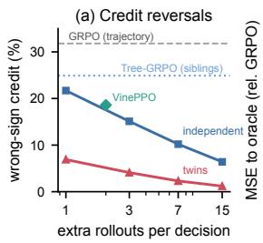

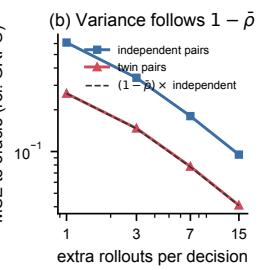

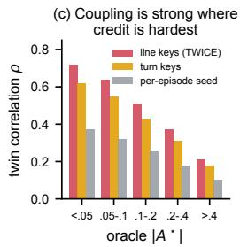

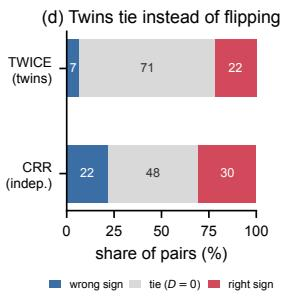  
Figure 3: Credit quality and coupling (Qwen2.5-3B, 400 held-out multi-hop questions). (a) Share of wrong-sign credit with $J { = } ( b { + } 1 ) / 2$ pairs per decision. (b) Mean squared error to the oracle; the dashed line is the independent curve scaled by $1 - \bar { \rho }$ from the measured twin correlation. (c) Twin correlation by oracle effect size for three noise layouts. (d) Outcomes of the pairs used for training.

Table 3: Ablations (Qwen2.5-3B). Avg. / MH: seven-benchmark / multi-hop exact match; $\bar { \rho } \colon$ mean twin correlation; Rev.: wrong-sign credit (%). Budgets are matched.
<table><tr><td>Configuration</td><td>Avg.</td><td>Δ</td><td>MH</td><td> $\bar { \rho }$ </td><td>Rev.</td></tr><tr><td>TWICE (full)</td><td>42.7</td><td>1</td><td>36.9</td><td>0.57</td><td>6.9</td></tr><tr><td>Twin worlds</td><td></td><td></td><td></td><td></td><td></td></tr><tr><td>independent twins</td><td>41.2</td><td>-1.5</td><td>35.0</td><td>0.02</td><td>20.4</td></tr><tr><td>per-episode seed</td><td>41.6</td><td>-1.1</td><td>35.5</td><td>0.29</td><td>14.8</td></tr><tr><td>no line re-sync</td><td>42.3</td><td>-0.4</td><td>36.4</td><td>0.49</td><td>8.6</td></tr><tr><td>n-gram keys (inexact)</td><td>42.4</td><td>-0.3</td><td>36.6</td><td>0.61</td><td>6.1</td></tr><tr><td>Where to branch</td><td></td><td></td><td></td><td></td><td></td></tr><tr><td>uniform branching</td><td>41.9</td><td>-0.8</td><td>35.9</td><td>0.57</td><td>9.8</td></tr><tr><td>mixed-outcome targeting</td><td>42.4</td><td>-0.3</td><td>36.5</td><td>0.57</td><td>7.9</td></tr><tr><td>skip same evidence</td><td>42.1</td><td>-0.6</td><td>36.2</td><td>0.57</td><td>7.4</td></tr><tr><td>no inverse weights</td><td>42.0</td><td>-0.7</td><td>36.1</td><td>0.57</td><td>6.9</td></tr><tr><td>no self-twin shortcut</td><td>42.5</td><td>-0.2</td><td>36.7</td><td>0.57</td><td>7.2</td></tr><tr><td>Credit and update</td><td></td><td></td><td></td><td></td><td></td></tr><tr><td>twin credit only</td><td>41.7</td><td>-1.0</td><td>36.0</td><td>0.57</td><td></td></tr><tr><td>star design (K=2)</td><td>42.4</td><td>-0.3</td><td>36.6</td><td>0.57</td><td>6.9 7.8</td></tr></table>

## 6.5 Mechanism Analysis

Coupling is strong where credit is hard. Twin correlation falls from 0.72 for decisions with $\left| { \cal A } ^ { \star } \right| ^ { - } < \bar { 0 } . 0 5$ to 0.21 for $| A ^ { \star } | > 0 . 4$ (Figure 3c), as Lemma 1 predicts: a decision that barely changes the downstream distribution yields a twin that reproduces the factual continuation. In this regime, independent counterfactuals produce spurious ±1 credit and twins tie. Among training pairs (Figure 3d), twins tie in 71% of cases and reverse the true sign in 7%, against 48% and 22% for CRR.

Faster learning per token. TWICE learns fastest per update and per generated token (Figure 4a–b): it reaches GRPO’s final dev accuracy after about 130 updates, with 43% fewer generated tokens than GRPO’s full run; VinePPO is the slowest per token.

The budget follows discordance. Prompts that the policy always or never solves rarely produce discordant twins, and Eq. (2) branches them with probability 0.14–0.19, whereas prompts with mixed outcomes are branched with probability 0.52–0.58 (Figure 4c). The discordance predictor is calibrated (AUC 0.79, ECE 0.028; Figure 4d), as the square-root rule requires.

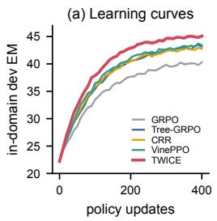

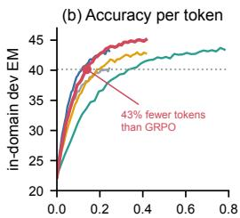  
generated tokens (B)

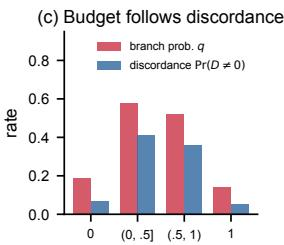  
group success rate p̂

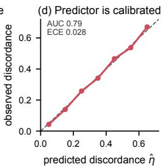  
Figure 4: Dynamics and budget (Qwen2.5-3B). (a) In-domain dev exact match over updates (±1 s.d., three seeds). (b) The same runs against generated tokens, auxiliary rollouts included. (c) Branch probability and realized twin discordance by the prompt’s group success rate. (d) Calibration of the discordance predictor.

Coupling improves as the policy sharpens. As training proceeds, the share of self-twins, resolved at no cost, grows from 5.2% to 29.4%, and the twin correlation of the rest rises from 0.48 to 0.61, as a sharper policy reacts less to small context changes (Appendix Figure 6d). Independent counterfactuals do not benefit: on mixed prompts, each continuation’s outcome variance stays near Q(1 − Q).

## 6.6 Generality

The gains hold beyond the main setting (Appendix F). On Qwen3-4B-Instruct and Llama-3.2-3B-Instruct, TWICE improves GRPO by 4.6 and 8.0 points and the best baseline by 1.9 and 1.9. On ALFWorld and WebShop (Shridhar et al., 2021; Yao et al., 2022), whose simulators are deterministic, it improves GiGPO’s success by 3.4 and 3.7 points with Qwen2.5-1.5B. With a cost-aware utility, F1 minus 0.05 per search call (Wang et al., 2025a), it raises HotpotQA utility from 34.9 to 44.3 while issuing 1.92 instead of 2.41 calls, because twins that answer earlier expose unnecessary searches. When retrieval is made nondeterministic by replacing each passage with probability 0.3, ρ¯ drops to 0.36, yet TWICE still leads CRR by 1.7 points, since its correctness does not depend on coupling (Proposition 1).

## 7 Conclusion

Credit assignment in agentic RL asks what would have happened to this episode under a different decision; because agentic search is deterministic given the policy’s sampling noise, the answer is exact: the episode’s twin, which shares its noise. Rolled out with keyed Gumbel noise and budgeted by a square-root rule, twins give unbiased turn-level credit without the shared-luck variance of independent counterfactuals, turn credit estimation into detection, and improve search agents at a fraction of the cost of Monte Carlo branching. The construction applies to any agent with replayable tools and composes with process rewards and tree rollouts, whose branches can inherit the factual noise.

## Limitations

TWICE needs replayable tools. Retrieval over a fixed corpus, sandboxed code, and simulators qualify; live web search and stateful APIs require caching, and without it coupling weakens (§6.6), although credit stays unbiased. The gain depends on the twin correlation, which is lower at high temperature and for long continuations, where divergence compounds; the sample-complexity advantage of Proposition 3 is stated for binary utilities, and graded rewards inherit the variance result but not the rate. Twins estimate the advantage of a whole turn; they do not separate the credit of reasoning tokens from that of the action. Our experiments cover question answering and two text environments with models up to 14B parameters and at most eight search calls; long-horizon research agents with dozens of calls remain to be tested.

## Ethics Statement

TWICE changes how training credit is computed and inherits the risks of the models, corpora, and benchmarks it is applied to, including the retrieval of outdated or biased content. It does not collect personal data; all datasets are public and used under their licenses. Better credit assignment makes agents more capable at information seeking, which can be misused for automated profiling if tools reach private data, so we recommend deploying search agents only with access controls on their tools. By removing variance rather than adding rollouts, TWICE reduces the compute of agentic RL relative to Monte Carlo branching. AI assistants were used for language editing and for checking LaTeX; the method, proofs, and experimental design are the authors’ own, and every reference was checked against its primary record.

## References

Bowen Jin, Hansi Zeng, Zhenrui Yue, Jinsung Yoon, Sercan Arik, Dong Wang, Hamed Zamani, and Jiawei Han. Search-R1: Training LLMs to reason and leverage search engines with reinforcement learning. arXiv preprint arXiv:2503.09516, 2025.

Huatong Song, Jinhao Jiang, Yingqian Min, Jie Chen, Zhipeng Chen, Wayne Xin Zhao, Lei Fang, and Ji-Rong Wen. R1-Searcher: Incentivizing the search capability in LLMs via reinforcement learning. arXiv preprint arXiv:2503.05592, 2025.

Mingyang Chen, Linzhuang Sun, Tianpeng Li, Haoze Sun, Yijie Zhou, Chenzheng Zhu, Haofen Wang, Jeff Z. Pan, Wen Zhang, Huajun Chen, Fan Yang, Zenan Zhou, and Weipeng Chen. ReSearch: Learning to reason with search for LLMs via reinforcement learning. In Advances in Neural Information Processing Systems, volume 38, 2025.

Hao Sun, Zile Qiao, Jiayan Guo, Xuanbo Fan, Yingyan Hou, Yong Jiang, Pengjun Xie, Yan Zhang, Fei Huang, and Jingren Zhou. ZeroSearch: Incentivize the search capability of LLMs without searching. arXiv preprint arXiv:2505.04588, 2025.

Yuxiang Zheng, Dayuan Fu, Xiangkun Hu, Xiaojie Cai, Lyumanshan Ye, Pengrui Lu, and Pengfei Liu. DeepResearcher: Scaling deep research via reinforcement learning in real-world environments. In Proceedings of the 2025 Conference on Empirical Methods in Natural Language Processing, pages 414–431, Suzhou, China, 2025a. Association for Computational Linguistics. doi: 10.18653/ v1/2025.emnlp-main.22.

Zhihong Shao, Peiyi Wang, Qihao Zhu, Runxin Xu, Junxiao Song, Xiao Bi, Haowei Zhang, Mingchuan Zhang, Y. K. Li, Y. Wu, and Daya Guo. DeepSeekMath: Pushing the limits of mathematical reasoning in open language models. arXiv preprint arXiv:2402.03300, 2024.

John Schulman, Filip Wolski, Prafulla Dhariwal, Alec Radford, and Oleg Klimov. Proximal policy optimization algorithms. arXiv preprint arXiv:1707.06347, 2017.

Quan Wei, Siliang Zeng, Chenliang Li, Zhongruo Wang, William Brown, Oana Frunza, Wei Deng, Anderson Schneider, Yuriy Nevmyvaka, Yang Katie Zhao, Alfredo Garcia, and Mingyi Hong. Reinforcing multi-turn reasoning in LLM agents via fine-grained reward structure and credit assignment. arXiv preprint arXiv:2505.11821, 2025.

Guibin Zhang, Hejia Geng, Xiaohang Yu, Zhenfei Yin, Zaibin Zhang, Zelin Tan, Heng Zhou, Zhongzhi Li, Xiangyuan Xue, Yijiang Li, Yifan Zhou, Yang Chen, Chen Zhang, Yutao Fan, Zihu Wang, Songtao Huang, Francisco Piedrahita-Velez, Yue Liao, Hongru Wang, Mengyue Yang, Heng Ji, Jun Wang, Shuicheng Yan, Philip Torr, and Lei Bai. The landscape of agentic reinforcement learning for LLMs: A survey. arXiv preprint arXiv:2509.02547, 2025a.

Amirhossein Kazemnejad, Milad Aghajohari, Eva Portelance, Alessandro Sordoni, Siva Reddy, Aaron Courville, and Nicolas Le Roux. VinePPO: Refining credit assignment in RL training of LLMs. In Proceedings of the 42nd International Conference on Machine Learning, Proceedings of Machine Learning Research, volume 267, pages 29557–29590, 2025.

Yifei Zhou, Andrea Zanette, Jiayi Pan, Sergey Levine, and Aviral Kumar. ArCHer: Training language model agents via hierarchical multi-turn RL. In Proceedings of the 41st International Conference on Machine Learning, Proceedings ofMachine Learning Research, volume 235, pages 62178–62209, 2024a.

Guoqing Wang, Sunhao Dai, Guangze Ye, Zeyu Gan, Wei Yao, Yong Deng, Xiaofeng Wu, and Zhenzhe Ying. Information gain-based policy optimization: A simple and effective approach for multi-turn search agents. In The Fourteenth International Conference on Learning Representations, 2026a.

Xuhui Zheng, Kang An, Ziliang Wang, Yuhang Wang, and Yichao Wu. StepSearch: Igniting LLMs search ability via step-wise proximal policy optimization. In Proceedings of the 2025 Conference on Empirical Methods in Natural Language Processing, pages 21805–21830, Suzhou, China, 2025b. Association for Computational Linguistics. doi: 10.18653/v1/2025.emnlp-main.1106.

Junzhe Wang, Zhiheng Xi, Yajie Yang, Hao Luo, Shihan Dou, Tao Gui, and Qi Zhang. Enhancing LLM-based search agents via contribution weighted group relative policy optimization. In Proceedings ofthe 64th Annual Meeting ofthe Associationfor Computational Linguistics (Volume 1: Long Papers), pages 31704–31718, San Diego, California, United States, 2026b. Association for Computational Linguistics. doi: 10.18653/v1/2026.acl-long.1462.

Dongyi Liu, Yifan Niu, Qinwen Wang, Han Xiao, and Jia Li. PiCA: Pivot-based credit assignment for search agentic reinforcement learning. arXiv preprint arXiv:2605.09287, 2026.

Yaocheng Zhang, Haohuan Huang, Zijun Song, Zijie Zhao, Qichao Zhang, Yuanheng Zhu, and Dongbin Zhao. CriticSearch: Fine-grained credit assignment for search agents via a retrospective critic. In Findings of the Association for Computational Linguistics: ACL 2026, pages 12272– 12290, San Diego, California, United States, 2026a. Association for Computational Linguistics. doi: 10.18653/v1/2026.findings-acl.596.

Lang Feng, Zhenghai Xue, Tingcong Liu, and Bo An. Group-in-group policy optimization for LLM agent training. In Advances in Neural Information Processing Systems, volume 38, 2025.

Yuxiang Ji, Ziyu Ma, Yong Wang, Guanhua Chen, Xiangxiang Chu, and Liaoni Wu. Tree search for LLM agent reinforcement learning. In The Fourteenth International Conference on Learning Representations, 2026.

Zefang Zong, Dingwei Chen, Yang Li, Qi Yi, Bo Zhou, Chengming Li, BO Qian, Peng Chen, and Jie Jiang. AT<sup>2</sup>PO: Agentic turn-based policy optimization via tree search. In Proceedings ofthe 64th Annual Meeting of the Association for Computational Linguistics (Volume 1: Long Papers), pages 24120–24143, San Diego, California, United States, 2026. Association for Computational Linguistics. doi: 10.18653/v1/2026.acl-long.1106.

Tianhua Zhang, Kun Li, Junan Li, Yunxiang Li, Hongyin Luo, Xixin Wu, James Glass, and Helen Meng. TreePS-RAG: Tree-based process supervision for reinforcement learning in agentic RAG. arXiv preprint arXiv:2601.06922, 2026b.

Zenghuang Fu, Ningqi Chen, Mingda Jia, Xiaofeng Han, Zhaoyang Li, Qiuyuan Ai, Zelong Zheng, Haoyu Wu, Tianyu Fu, Chenxu Zhao, Minghui Wu, Guannan He, and Changwei Wang. SIPO: Selective-inference policy optimization for tree-structured agentic RL. arXiv preprint arXiv:2609.34805, 2026.

Yuanhao Li, Hongbo Wang, Xuhong Chen, Yiming Cao, and Xunzhu Tang. Counterfactual rollout replay: Forkable environments as free process rewards for software engineering agents. arXiv preprint arXiv:2609.33875, 2026.

Ankur Samanta, Akshayaa Magesh, Ayush Jain, Youliang Yu, Daniel Jiang, Kavosh Asadi, Kaveh Hassani, Paul Sajda, Jalaj Bhandari, and Yonathan Efroni. Credit assignment with resets in language model reasoning. arXiv preprint arXiv:2605.25507, 2026.

Judea Pearl. Causality. Cambridge University Press, Cambridge, second edition, 2009. doi: 10.1017/CBO9780511803161.

Chris J. Maddison, Daniel Tarlow, and Tom Minka. A\* sampling. In Advances in Neural Information Processing Systems, volume 27, pages 3086–3094, 2014.

Michael Oberst and David Sontag. Counterfactual off-policy evaluation with Gumbel-Max structural causal models. In Proceedings of the 36th International Conference on Machine Learning, Proceedings of Machine Learning Research, volume 97, pages 4881–4890, 2019.

Alexander Balke and Judea Pearl. Counterfactual probabilities: Computational methods, bounds and applications. In Proceedings of the Tenth Conference on Uncertainty in Artificial Intelligence, pages 46–54, 1994.

Shauli Ravfogel, Anej Svete, Vésteinn Snæbjarnarson, and Ryan Cotterell. Gumbel counterfactual generation from language models. In The Thirteenth International Conference on Learning Representations, 2025.

Ivi Chatzi, Nina L. Corvelo Benz, Eleni Straitouri, Stratis Tsirtsis, and Manuel Gomez-Rodriguez. Counterfactual token generation in large language models. In Proceedings ofthe Fourth Conference on Causal Learning and Reasoning, Proceedings ofMachine Learning Research, volume 275, pages 1291–1315, 2025.

Paul Glasserman and David D. Yao. Some guidelines and guarantees for common random numbers. Management Science, 38(6):884–908, 1992. doi: 10.1287/mnsc.38.6.884.

Andrew Y. Ng and Michael I. Jordan. PEGASUS: A policy search method for large MDPs and POMDPs. In Proceedings of the Sixteenth Conference on Uncertainty in Artificial Intelligence, 2000.

Qiying Yu, Zheng Zhang, Ruofei Zhu, Yufeng Yuan, Xiaochen Zuo, Yu Yue, Weinan Dai, Tiantian Fan, Gaohong Liu, Lingjun Liu, Xin Liu, Haibin Lin, Zhiqi Lin, Bole Ma, Guangming Sheng, Yuxuan Tong, Chi Zhang, Mofan Zhang, Wang Zhang, Hang Zhu, Jinhua Zhu, Jiaze Chen, Jiangjie Chen, Chengyi Wang, Hongli Yu, Yuxuan Song, Xiangpeng Wei, Hao Zhou, Jingjing Liu, Wei-Ying Ma, Ya-Qin Zhang, Lin Yan, Mu Qiao, Yonghui Wu, and Mingxuan Wang. DAPO: An open-source LLM reinforcement learning system at scale. arXiv preprint arXiv:2503.14476, 2025.

Arash Ahmadian, Chris Cremer, Matthias Gallé, Marzieh Fadaee, Julia Kreutzer, Olivier Pietquin, Ahmet Üstün, and Sara Hooker. Back to basics: Revisiting REINFORCE-style optimization for learning from human feedback in LLMs. In Proceedings ofthe 62nd Annual Meeting ofthe Association for Computational Linguistics (Volume 1: Long Papers), pages 12248–12267, Bangkok, Thailand, 2024. Association for Computational Linguistics. doi: 10.18653/v1/2024.acl-long.662.

Yifei Zhou, Song Jiang, Yuandong Tian, Jason Weston, Sergey Levine, Sainbayar Sukhbaatar, and Xian Li. SWEET-RL: Training multi-turn LLM agents on collaborative reasoning tasks. arXiv preprint arXiv:2503.15478, 2025.

Hui-Ze Tan, Xiao-Wen Yang, Hao Chen, Jie-Jing Shao, Yi Wen, Yuteng Shen, Weihong Luo, Xiku Du, Lan-Zhe Guo, and Yu-Feng Li. Hindsight credit assignment for long-horizon LLM agents. arXiv preprint arXiv:2603.08754, 2026.

Daoyu Wang, Qingchuan Li, Mingyue Cheng, Jie Ouyang, Shuo Yu, Chunli Liu, Shijin Wang, Qi Liu, and Enhong Chen. CAPO: Critic-guided action-aligned policy optimization for advancing LLM agent capabilities. arXiv preprint arXiv:2604.18401, 2026c.

Hanyang Wang, Weijieying Ren, Yuxiang Zhang, Ding Cao, Zhizhao Zeng, Ke Zeng, and Tianxiang Zhao. BiPACE: Bisimulation-guided policy optimization with action counterfactual estimation for LLM agents. arXiv preprint arXiv:2606.25556, 2026d.

Siyuan Zhu, Chao Yu, Rongxin Yang, Zongkai Liu, Jinjun Hu, Qiwen Chen, and Yibo Zhang. GAGPO: Generalized advantage grouped policy optimization. arXiv preprint arXiv:2605.13217, 2026a.

Yifu Huo, Shunjie Xing, Chenglong Wang, Peinan Feng, Qiaozhi He, Yan Ding, Anxiang Ma, Yuxin Gao, Tongran Liu, Tong Xiao, and Jingbo Zhu. Learning from environmental feedback: Credit assignment across multiple timescales for agentic reinforcement learning. arXiv preprint arXiv:2608.08255, 2026.

Zihan Liang, Yufei Ma, Ben Chen, Zhipeng Qian, Huangyu Dai, Lingtao Mao, Xuxin Zhang, Chenyi Lei, and Wenwu Ou. IG-Search: Step-level information gain rewards for search-augmented reasoning. arXiv preprint arXiv:2604.15148, 2026a.

Chris Samarinas, Haw-Shiuan Chang, and Hamed Zamani. Truncated step-level sampling with process rewards for retrieval-augmented reasoning. arXiv preprint arXiv:2602.23440, 2026.

Peilin Wu, Mian Zhang, Kun Wan, Wentian Zhao, Kaiyu He, Xinya Du, and Zhiyu Chen. HiPRAG: Hierarchical process rewards for efficient agentic retrieval augmented generation. In The Fourteenth International Conference on Learning Representations, 2026.

Rongzhi Zhu, Xiangyu Liu, Yi Liu, Shuo Zhang, Ruirui Zhang, Rui Wu, Tao Jiang, Zequn Sun, Wenhao Xu, and Wei Hu. Dense process supervision for search agents via fact utility estimation. arXiv preprint arXiv:2609.00833, 2026b.

Amrith Setlur, Chirag Nagpal, Adam Fisch, Xinyang Geng, Jacob Eisenstein, Rishabh Agarwal, Alekh Agarwal, Jonathan Berant, and Aviral Kumar. Rewarding progress: Scaling automated process verifiers for LLM reasoning. In The Thirteenth International Conference on Learning Representations, 2025.

Zhenyu Hou, Ziniu Hu, Yujiang Li, Rui Lu, Jie Tang, and Yuxiao Dong. TreeRL: LLM reinforcement learning with on-policy tree search. In Proceedings ofthe 63rd Annual Meeting ofthe Association for Computational Linguistics (Volume 1: Long Papers), pages 12355–12369, Vienna, Austria, 2025. Association for Computational Linguistics. doi: 10.18653/v1/2025.acl-long.604.

Yiran Guo, Lijie Xu, Jie Liu, Dan Ye, and Shuang Qiu. Segment policy optimization: Effective segment-level credit assignment in RL for large language models. In Advances in Neural Information Processing Systems, volume 38, 2025.

Guanting Dong, Hangyu Mao, Kai Ma, Licheng Bao, Yifei Chen, Zhongyuan Wang, Zhongxia Chen, Jiazhen Du, Huiyang Wang, Fuzheng Zhang, Guorui Zhou, Yutao Zhu, Ji-Rong Wen, and Zhicheng Dou. Agentic reinforced policy optimization. arXiv preprint arXiv:2507.19849, 2025a.

Qiao Liang, Yuke Zhu, Chao Ge, Lei Yang, Ying Shen, Bo Zheng, and Sheng Guo. Learning from the irrecoverable: Error-localized policy optimization for tool-integrated LLM reasoning. In Proceedings ofthe 64th Annual Meeting ofthe Associationfor Computational Linguistics (Volume 1: Long Papers), pages 11008–11028, San Diego, California, United States, 2026b. Association for Computational Linguistics. doi: 10.18653/v1/2026.acl-long.504.

Heming Zou, Qi Wang, Yun Qu, Yuhang Jiang, Lizhou Cai, Yixiu Mao, Ru Peng, Xin Xu, Weijie Liu, Kai Yang, Saiyong Yang, and Xiangyang Ji. TRACE: A unified rollout budget allocation framework for efficient agentic reinforcement learning. arXiv preprint arXiv:2606.11119, 2026a.

Heming Zou, Qi Wang, Yixiu Mao, Yun Qu, Yuyi Guo, Zeyuan Liu, Chenglin Li, Weijie Liu, Saiyong Yang, and Xiangyang Ji. Tree-aware posterior distillation for long-horizon agentic reinforcement learning. arXiv preprint arXiv:2610.23181, 2026b.

Lars Buesing, Theophane Weber, Yori Zwols, Sebastien Racaniere, Arthur Guez, Jean-Baptiste Lespiau, and Nicolas Heess. Woulda, coulda, shoulda: Counterfactually-guided policy search. In The Seventh International Conference on Learning Representations, 2019.

Anna Harutyunyan, Will Dabney, Thomas Mesnard, Mohammad Azar, Bilal Piot, Nicolas Heess, Hado van Hasselt, Greg Wayne, Satinder Singh, Doina Precup, and Remi Munos. Hindsight credit assignment. In Advances in Neural Information Processing Systems, volume 32, 2019.

Thomas Mesnard, Theophane Weber, Fabio Viola, Shantanu Thakoor, Alaa Saade, Anna Harutyunyan, Will Dabney, Thomas S. Stepleton, Nicolas Heess, Arthur Guez, Eric Moulines, Marcus Hutter, Lars Buesing, and Remi Munos. Counterfactual credit assignment in model-free reinforcement learning. In Proceedings ofthe 38th International Conference on Machine Learning, Proceedings ofMachine Learning Research, volume 139, pages 7654–7664, 2021.

Alexander Meulemans, Simon Schug, Seijin Kobayashi, Nathaniel Daw, and Gregory Wayne. Would I have gotten that reward? long-term credit assignment by counterfactual contribution analysis. In Advances in Neural Information Processing Systems, volume 36, 2023.

Jakob Foerster, Gregory Farquhar, Triantafyllos Afouras, Nantas Nardelli, and Shimon Whiteson. Counterfactual multi-agent policy gradients. In Proceedings of the AAAI Conference on Artificial Intelligence, volume 32, pages 2974–2982, 2018.

Majid Daliri, Christopher Musco, and Ananda Theertha Suresh. Coupling without communication and drafter-invariant speculative decoding. In 2025 IEEE International Symposium on Information Theory (ISIT), pages 1–6. IEEE, 2025. doi: 10.1109/isit63088.2025.11195663.

John Kirchenbauer, Jonas Geiping, Yuxin Wen, Jonathan Katz, Ian Miers, and Tom Goldstein. A watermark for large language models. In Proceedings of the 40th International Conference on Machine Learning, Proceedings ofMachine Learning Research, volume 202, pages 17061–17084, 2023.

Rohith Kuditipudi, John Thickstun, Tatsunori Hashimoto, and Percy Liang. Robust distortion-free watermarks for language models. Transactions on Machine Learning Research, 2024.

Pengcheng Jiang, Xueqiang Xu, Jiacheng Lin, Jinfeng Xiao, Zifeng Wang, Jimeng Sun, and Jiawei Han. s3: You don’t need that much data to train a search agent via RL. In Proceedings ofthe 2025 Conference on Empirical Methods in Natural Language Processing, pages 21599–21617, Suzhou, China, 2025. Association for Computational Linguistics. doi: 10.18653/v1/2025.emnlp-main.1095.

Jiaxuan Gao, Wei Fu, Minyang Xie, Shusheng Xu, Chuyi He, Zhiyu Mei, Banghua Zhu, and Yi Wu. Beyond ten turns: Unlocking long-horizon agentic search with large-scale asynchronous RL. arXiv preprint arXiv:2508.07976, 2025.

Hongru Wang, Cheng Qian, Wanjun Zhong, Xiusi Chen, Jiahao Qiu, Shijue Huang, Bowen Jin, Mengdi Wang, Kam-Fai Wong, and Heng Ji. Acting less is reasoning more! teaching model to act efficiently. arXiv preprint arXiv:2504.14870, 2025a.

Wenlin Zhang, Xiangyang Li, Kuicai Dong, Yichao Wang, Pengyue Jia, Xiaopeng Li, Yingyi Zhang, Derong Xu, Zhaocheng Du, Huifeng Guo, Ruiming Tang, and Xiangyu Zhao. Process vs. outcome reward: Which is better for agentic RAG reinforcement learning. arXiv preprint arXiv:2505.14069, 2025b.

Xiaoxi Li, Guanting Dong, Jiajie Jin, Yuyao Zhang, Yujia Zhou, Yutao Zhu, Peitian Zhang, and Zhicheng Dou. Search-o1: Agentic search-enhanced large reasoning models. In Proceedings of the 2025 Conference on Empirical Methods in Natural Language Processing, pages 5420– 5438, Suzhou, China, 2025a. Association for Computational Linguistics. doi: 10.18653/v1/2025. emnlp-main.276.

Woosuk Kwon, Zhuohan Li, Siyuan Zhuang, Ying Sheng, Lianmin Zheng, Cody Hao Yu, Joseph E. Gonzalez, Hao Zhang, and Ion Stoica. Efficient memory management for large language model serving with PagedAttention. In Proceedings of the 29th Symposium on Operating Systems Principles, pages 611–626. ACM, 2023. doi: 10.1145/3600006.3613165.

D. G. Horvitz and D. J. Thompson. A generalization of sampling without replacement from a finite universe. Journal of the American Statistical Association, 47(260):663–685, 1952. doi: 10.1080/01621459.1952.10483446.

Liang Wang, Nan Yang, Xiaolong Huang, Binxing Jiao, Linjun Yang, Daxin Jiang, Rangan Majumder, and Furu Wei. Text embeddings by weakly-supervised contrastive pre-training. arXiv preprint arXiv:2212.03533, 2022.

Vladimir Karpukhin, Barlas Oguz, Sewon Min, Patrick Lewis, Ledell Wu, Sergey Edunov, Danqi Chen, and Wen-tau Yih. Dense passage retrieval for open-domain question answering. In Proceedings of the 2020 Conference on Empirical Methods in Natural Language Processing (EMNLP), pages 6769–6781, Online, 2020. Association for Computational Linguistics. doi: 10.18653/v1/2020.emnlp-main.550.

Tom Kwiatkowski, Jennimaria Palomaki, Olivia Redfield, Michael Collins, Ankur Parikh, Chris Alberti, Danielle Epstein, Illia Polosukhin, Jacob Devlin, Kenton Lee, Kristina Toutanova, Llion Jones, Matthew Kelcey, Ming-Wei Chang, Andrew M. Dai, Jakob Uszkoreit, Quoc Le, and Slav Petrov. Natural questions: A benchmark for question answering research. Transactions of the Associationfor Computational Linguistics, 7:453–466, 2019. doi: 10.1162/tacl\_a\_00276.

Mandar Joshi, Eunsol Choi, Daniel Weld, and Luke Zettlemoyer. TriviaQA: A large scale distantly supervised challenge dataset for reading comprehension. In Proceedings ofthe 55th Annual Meeting of the Association for Computational Linguistics (Volume 1: Long Papers), pages 1601–1611, Vancouver, Canada, 2017. Association for Computational Linguistics. doi: 10.18653/v1/P17-1147.

Alex Mallen, Akari Asai, Victor Zhong, Rajarshi Das, Daniel Khashabi, and Hannaneh Hajishirzi. When not to trust language models: Investigating effectiveness of parametric and non-parametric memories. In Proceedings of the 61st Annual Meeting of the Association for Computational Linguistics (Volume 1: Long Papers), pages 9802–9822, Toronto, Canada, 2023. Association for Computational Linguistics. doi: 10.18653/v1/2023.acl-long.546.

Zhilin Yang, Peng Qi, Saizheng Zhang, Yoshua Bengio, William Cohen, Ruslan Salakhutdinov, and Christopher D. Manning. HotpotQA: A dataset for diverse, explainable multi-hop question answering. In Proceedings of the 2018 Conference on Empirical Methods in Natural Language Processing, pages 2369–2380, Brussels, Belgium, 2018. Association for Computational Linguistics. doi: 10.18653/v1/D18-1259.

Xanh Ho, Anh-Khoa Duong Nguyen, Saku Sugawara, and Akiko Aizawa. Constructing a multihop QA dataset for comprehensive evaluation of reasoning steps. In Proceedings of the 28th International Conference on Computational Linguistics, pages 6609–6625, Barcelona, Spain (Online), 2020. International Committee on Computational Linguistics. doi: 10.18653/v1/2020. coling-main.580.

Harsh Trivedi, Niranjan Balasubramanian, Tushar Khot, and Ashish Sabharwal. MuSiQue: Multihop questions via single-hop question composition. Transactions ofthe Associationfor Computational Linguistics, 10:539–554, 2022. doi: 10.1162/tacl\_a\_00475.

Ofir Press, Muru Zhang, Sewon Min, Ludwig Schmidt, Noah Smith, and Mike Lewis. Measuring and narrowing the compositionality gap in language models. In Findings ofthe Associationfor Computational Linguistics: EMNLP 2023, pages 5687–5711, Singapore, 2023. Association for Computational Linguistics. doi: 10.18653/v1/2023.findings-emnlp.378.

Qwen, An Yang, Baosong Yang, Beichen Zhang, Binyuan Hui, Bo Zheng, Bowen Yu, Chengyuan Li, Dayiheng Liu, Fei Huang, Haoran Wei, Huan Lin, Jian Yang, Jianhong Tu, Jianwei Zhang, Jianxin Yang, Jiaxi Yang, Jingren Zhou, Junyang Lin, Kai Dang, Keming Lu, Keqin Bao, Kexin Yang, Le Yu, Mei Li, Mingfeng Xue, Pei Zhang, Qin Zhu, Rui Men, Runji Lin, Tianhao Li, Tianyi Tang, Tingyu Xia, Xingzhang Ren, Xuancheng Ren, Yang Fan, Yang Su, Yichang Zhang, Yu Wan, Yuqiong Liu, Zeyu Cui, Zhenru Zhang, and Zihan Qiu. Qwen2.5 technical report. arXiv preprint arXiv:2412.15115, 2024.

An Yang, Anfeng Li, Baosong Yang, Beichen Zhang, Binyuan Hui, Bo Zheng, Bowen Yu, Chang Gao, Chengen Huang, Chenxu Lv, Chujie Zheng, Dayiheng Liu, Fan Zhou, Fei Huang, Feng Hu, Hao Ge, Haoran Wei, Huan Lin, Jialong Tang, Jian Yang, Jianhong Tu, Jianwei Zhang, Jianxin Yang, Jiaxi Yang, Jing Zhou, Jingren Zhou, Junyang Lin, Kai Dang, Keqin Bao, Kexin Yang, Le Yu, Lianghao Deng, Mei Li, Mingfeng Xue, Mingze Li, Pei Zhang, Peng Wang, Qin Zhu, Rui Men, Ruize Gao, Shixuan Liu, Shuang Luo, Tianhao Li, Tianyi Tang, Wenbiao Yin, Xingzhang Ren, Xinyu Wang, Xinyu Zhang, Xuancheng Ren, Yang Fan, Yang Su, Yichang Zhang, Yinger Zhang, Yu Wan, Yuqiong Liu, Zekun Wang, Zeyu Cui, Zhenru Zhang, Zhipeng Zhou, and Zihan Qiu. Qwen3 technical report. arXiv preprint arXiv:2505.09388, 2025.

Aaron Grattafiori, Abhimanyu Dubey, Abhinav Jauhri, Abhinav Pandey, Abhishek Kadian, Ahmad Al-Dahle, Aiesha Letman, Akhil Mathur, Alan Schelten, Alex Vaughan, Amy Yang, Angela Fan, Anirudh Goyal, Anthony Hartshorn, Aobo Yang, Archi Mitra, Archie Sravankumar, Artem Korenev, Arthur Hinsvark, Arun Rao, Aston Zhang, Aurelien Rodriguez, Austen Gregerson, Ava Spataru, Baptiste Roziere, Bethany Biron, Binh Tang, Bobbie Chern, Charlotte Caucheteux, Chaya Nayak, Chloe Bi, Chris Marra, Chris McConnell, Christian Keller, Christophe Touret, Chunyang Wu, Corinne Wong, Cristian Canton Ferrer, Cyrus Nikolaidis, Damien Allonsius, Daniel Song, Danielle Pintz, Danny Livshits, Danny Wyatt, David Esiobu, Dhruv Choudhary, Dhruv Mahajan, Diego Garcia-Olano, Diego Perino, Dieuwke Hupkes, Egor Lakomkin, Ehab AlBadawy, Elina Lobanova, Emily Dinan, Eric Michael Smith, Filip Radenovic, Francisco Guzmán, Frank Zhang, Gabriel Synnaeve, Gabrielle Lee, Georgia Lewis Anderson, Govind Thattai, Graeme Nail, Gregoire Mialon, Guan Pang, Guillem Cucurell, Hailey Nguyen, Hannah Korevaar, Hu Xu, Hugo Touvron,

Iliyan Zarov, Imanol Arrieta Ibarra, Isabel Kloumann, Ishan Misra, Ivan Evtimov, Jack Zhang, Jade Copet, Jaewon Lee, Jan Geffert, Jana Vranes, Jason Park, Jay Mahadeokar, Jeet Shah, Jelmer van der Linde, Jennifer Billock, Jenny Hong, Jenya Lee, Jeremy Fu, Jianfeng Chi, Jianyu Huang, Jiawen Liu, Jie Wang, Jiecao Yu, Joanna Bitton, Joe Spisak, Jongsoo Park, Joseph Rocca, Joshua Johnstun, Joshua Saxe, Junteng Jia, Kalyan Vasuden Alwala, Karthik Prasad, Kartikeya Upasani, Kate Plawiak, Ke Li, Kenneth Heafield, Kevin Stone, Khalid El-Arini, Krithika Iyer, Kshitiz Malik, Kuenley Chiu, Kunal Bhalla, Kushal Lakhotia, Lauren Rantala-Yeary, Laurens van der Maaten, Lawrence Chen, Liang Tan, Liz Jenkins, Louis Martin, Lovish Madaan, Lubo Malo, Lukas Blecher, Lukas Landzaat, Luke de Oliveira, Madeline Muzzi, Mahesh Pasupuleti, Mannat Singh, Manohar Paluri, Marcin Kardas, Maria Tsimpoukelli, Mathew Oldham, Mathieu Rita, Maya Pavlova, Melanie Kambadur, Mike Lewis, Min Si, Mitesh Kumar Singh, Mona Hassan, Naman Goyal, Narjes Torabi, Nikolay Bashlykov, Nikolay Bogoychev, Niladri Chatterji, Ning Zhang, Olivier Duchenne, Onur Çelebi, Patrick Alrassy, Pengchuan Zhang, Pengwei Li, Petar Vasic, Peter Weng, Prajjwal Bhargava, Pratik Dubal, Praveen Krishnan, Punit Singh Koura, Puxin Xu, Qing He, Qingxiao Dong, Ragavan Srinivasan, Raj Ganapathy, Ramon Calderer, Ricardo Silveira Cabral, Robert Stojnic, Roberta Raileanu, Rohan Maheswari, Rohit Girdhar, Rohit Patel, Romain Sauvestre, Ronnie Polidoro, Roshan Sumbaly, Ross Taylor, Ruan Silva, Rui Hou, Rui Wang, Saghar Hosseini, Sahana Chennabasappa, Sanjay Singh, Sean Bell, Seohyun Sonia Kim, Sergey Edunov, Shaoliang Nie, Sharan Narang, Sharath Raparthy, Sheng Shen, Shengye Wan, Shruti Bhosale Shun Zhang, Simon Vandenhende, Soumya Batra, Spencer Whitman, Sten Sootla, Stephane Collot, Suchin Gururangan, Sydney Borodinsky, Tamar Herman, Tara Fowler, Tarek Sheasha, Thomas Georgiou, Thomas Scialom, Tobias Speckbacher, Todor Mihaylov, Tong Xiao, Ujjwal Karn, Vedanuj Goswami, Vibhor Gupta, Vignesh Ramanathan, Viktor Kerkez, Vincent Gonguet, Virginie Do, Vish Vogeti, Vítor Albiero, Vladan Petrovic, Weiwei Chu, Wenhan Xiong, Wenyin Fu, Whitney Meers, Xavier Martinet, Xiaodong Wang, Xiaofang Wang, Xiaoqing Ellen Tan, Xide Xia, Xinfeng Xie, Xuchao Jia, Xuewei Wang, Yaelle Goldschlag, Yashesh Gaur, Yasmine Babaei, Yi Wen, Yiwen Song, Yuchen Zhang, Yue Li, Yuning Mao, Zacharie Delpierre Coudert, Zheng Yan, Zhengxing Chen, Zoe Papakipos, Aaditya Singh, Aayushi Srivastava, Abha Jain, Adam Kelsey, Adam Shajnfeld, Adithya Gangidi, Adolfo Victoria, Ahuva Goldstand, Ajay Menon, Ajay Sharma, Alex Boesenberg, Alexei Baevski, Allie Feinstein, Amanda Kallet, Amit Sangani, Amos Teo, Anam Yunus, Andrei Lupu, Andres Alvarado, Andrew Caples, Andrew Gu, Andrew Ho, Andrew Poulton, Andrew Ryan, Ankit Ramchandani, Annie Dong, Annie Franco, Anuj Goyal, Aparajita Saraf, Arkabandhu Chowdhury, Ashley Gabriel, Ashwin Bharambe, Assaf Eisenman, Azadeh Yazdan, Beau James, Ben Maurer, Benjamin Leonhardi, Bernie Huang, Beth Loyd, Beto De Paola, Bhargavi Paranjape, Bing Liu, Bo Wu, Boyu Ni, Braden Hancock, Bram Wasti, Brandon Spence, Brani Stojkovic, Brian Gamido, Britt Montalvo, Carl Parker, Carly Burton, Catalina Mejia, Ce Liu, Changhan Wang, Changkyu Kim, Chao Zhou, Chester Hu, Ching-Hsiang Chu, Chris Cai, Chris Tindal, Christoph Feichtenhofer, Cynthia Gao, Damon Civin, Dana Beaty, Daniel Kreymer, Daniel Li, David Adkins, David Xu, Davide Testuggine, Delia David, Devi Parikh, Diana Liskovich, Didem Foss, Dingkang Wang, Duc Le, Dustin Holland, Edward Dowling, Eissa Jamil, Elaine Montgomery, Eleonora Presani, Emily Hahn, Emily Wood, Eric-Tuan Le, Erik Brinkman, Esteban Arcaute, Evan Dunbar, Evan Smothers, Fei Sun, Felix Kreuk, Feng Tian, Filippos Kokkinos, Firat Ozgenel, Francesco Caggioni, Frank Kanayet, Frank Seide, Gabriela Medina Florez, Gabriella Schwarz, Gada Badeer, Georgia Swee, Gil Halpern, Grant Herman, Grigory Sizov, Guangyi, Zhang, Guna Lakshminarayanan, Hakan Inan, Hamid Shojanazeri, Han Zou, Hannah Wang, Hanwen Zha, Haroun Habeeb, Harrison Rudolph, Helen Suk, Henry Aspegren, Hunter Goldman, Hongyuan Zhan, Ibrahim Damlaj, Igor Molybog, Igor Tufanov, Ilias Leontiadis, Irina-Elena Veliche, Itai Gat, Jake Weissman, James Geboski, James Kohli, Janice Lam, Japhet Asher, Jean-Baptiste Gaya, Jeff Marcus, Jeff Tang, Jennifer Chan, Jenny Zhen, Jeremy Reizenstein, Jeremy Teboul, Jessica Zhong, Jian Jin, Jingyi Yang, Joe Cummings, Jon Carvill, Jon Shepard, Jonathan McPhie, Jonathan Torres, Josh Ginsburg, Junjie Wang, Kai Wu, Kam Hou U, Karan Saxena, Kartikay Khandelwal, Katayoun Zand, Kathy Matosich, Kaushik Veeraraghavan, Kelly Michelena, Keqian Li, Kiran Jagadeesh, Kun Huang, Kunal Chawla, Kyle Huang, Lailin Chen, Lakshya Garg, Lavender A, Leandro Silva, Lee Bell, Lei Zhang, Liangpeng Guo, Licheng Yu, Liron Moshkovich, Luca Wehrstedt, Madian Khabsa, Manav Avalani, Manish Bhatt, Martynas Mankus, Matan Hasson, Matthew Lennie, Matthias Reso, Maxim Groshev, Maxim Naumov, Maya Lathi, Meghan Keneally Miao Liu, Michael L. Seltzer, Michal Valko, Michelle Restrepo, Mihir Patel, Mik Vyatskov, Mikayel Samvelyan, Mike Clark, Mike Macey, Mike Wang, Miquel Jubert Hermoso, Mo Metanat, Mohammad Rastegari, Munish Bansal, Nandhini Santhanam, Natascha Parks, Natasha White,

Navyata Bawa, Nayan Singhal, Nick Egebo, Nicolas Usunier, Nikhil Mehta, Nikolay Pavlovich Laptev, Ning Dong, Norman Cheng, Oleg Chernoguz, Olivia Hart, Omkar Salpekar, Ozlem Kalinli, Parkin Kent, Parth Parekh, Paul Saab, Pavan Balaji, Pedro Rittner, Philip Bontrager, Pierre Roux, Piotr Dollar, Polina Zvyagina, Prashant Ratanchandani, Pritish Yuvraj, Qian Liang, Rachad Alao, Rachel Rodriguez, Rafi Ayub, Raghotham Murthy, Raghu Nayani, Rahul Mitra, Rangaprabhu Parthasarathy, Raymond Li, Rebekkah Hogan, Robin Battey, Rocky Wang, Russ Howes, Ruty Rinott, Sachin Mehta, Sachin Siby, Sai Jayesh Bondu, Samyak Datta, Sara Chugh, Sara Hunt, Sargun Dhillon, Sasha Sidorov, Satadru Pan, Saurabh Mahajan, Saurabh Verma, Seiji Yamamoto, Sharadh Ramaswamy, Shaun Lindsay, Shaun Lindsay, Sheng Feng, Shenghao Lin, Shengxin Cindy Zha, Shishir Patil, Shiva Shankar, Shuqiang Zhang, Shuqiang Zhang, Sinong Wang, Sneha Agarwal, Soji Sajuyigbe, Soumith Chintala, Stephanie Max, Stephen Chen, Steve Kehoe, Steve Satterfield, Sudarshan Govindaprasad, Sumit Gupta, Summer Deng, Sungmin Cho, Sunny Virk, Suraj Subramanian, Sy Choudhury, Sydney Goldman, Tal Remez, Tamar Glaser, Tamara Best, Thilo Koehler, Thomas Robinson, Tianhe Li, Tianjun Zhang, Tim Matthews, Timothy Chou, Tzook Shaked, Varun Vontimitta, Victoria Ajayi, Victoria Montanez, Vijai Mohan, Vinay Satish Kumar, Vishal Mangla, Vlad Ionescu, Vlad Poenaru, Vlad Tiberiu Mihailescu, Vladimir Ivanov, Wei Li, Wenchen Wang, Wenwen Jiang, Wes Bouaziz, Will Constable, Xiaocheng Tang, Xiaojian Wu, Xiaolan Wang, Xilun Wu, Xinbo Gao, Yaniv Kleinman, Yanjun Chen, Ye Hu, Ye Jia, Ye Qi, Yenda Li, Yilin Zhang, Ying Zhang, Yossi Adi, Youngjin Nam, Yu, Wang, Yu Zhao, Yuchen Hao, Yundi Qian, Yunlu Li, Yuzi He, Zach Rait, Zachary DeVito, Zef Rosnbrick, Zhaoduo Wen, Zhenyu Yang, Zhiwei Zhao, and Zhiyu Ma. The Llama 3 herd of models. arXiv preprint arXiv:2407.21783, 2024.

Guangming Sheng, Chi Zhang, Zilingfeng Ye, Xibin Wu, Wang Zhang, Ru Zhang, Yanghua Peng, Haibin Lin, and Chuan Wu. HybridFlow: A flexible and efficient RLHF framework. In Proceedings ofthe Twentieth European Conference on Computer Systems, pages 1279–1297. ACM, 2025. doi: 10.1145/3689031.3696075.

Mohit Shridhar, Xingdi Yuan, Marc-Alexandre Côté, Yonatan Bisk, Adam Trischler, and Matthew Hausknecht. ALFWorld: Aligning text and embodied environments for interactive learning. In The Ninth International Conference on Learning Representations, 2021.

Shunyu Yao, Howard Chen, John Yang, and Karthik Narasimhan. WebShop: Towards scalable real-world web interaction with grounded language agents. In Advances in Neural Information Processing Systems, volume 35, 2022.

DeepSeek-AI, Daya Guo, Dejian Yang, Haowei Zhang, Junxiao Song, Peiyi Wang, Qihao Zhu, Runxin Xu, Ruoyu Zhang, Shirong Ma, Xiao Bi, Xiaokang Zhang, Xingkai Yu, Yu Wu, Z. F. Wu, Zhibin Gou, Zhihong Shao, Zhuoshu Li, Ziyi Gao, Aixin Liu, Bing Xue, Bingxuan Wang, Bochao Wu, Bei Feng, Chengda Lu, Chenggang Zhao, Chengqi Deng, Chenyu Zhang, Chong Ruan, Damai Dai, Deli Chen, Dongjie Ji, Erhang Li, Fangyun Lin, Fucong Dai, Fuli Luo, Guangbo Hao, Guanting Chen, Guowei Li, H. Zhang, Han Bao, Hanwei Xu, Haocheng Wang, Honghui Ding, Huajian Xin, Huazuo Gao, Hui Qu, Hui Li, Jianzhong Guo, Jiashi Li, Jiawei Wang, Jingchang Chen, Jingyang Yuan, Junjie Qiu, Junlong Li, J. L. Cai, Jiaqi Ni, Jian Liang, Jin Chen, Kai Dong, Kai Hu, Kaige Gao, Kang Guan, Kexin Huang, Kuai Yu, Lean Wang, Lecong Zhang, Liang Zhao, Litong Wang, Liyue Zhang, Lei Xu, Leyi Xia, Mingchuan Zhang, Minghua Zhang, Minghui Tang, Meng Li, Miaojun Wang, Mingming Li, Ning Tian, Panpan Huang, Peng Zhang, Qiancheng Wang, Qinyu Chen, Qiushi Du, Ruiqi Ge, Ruisong Zhang, Ruizhe Pan, Runji Wang, R. J. Chen, R. L. Jin, Ruyi Chen, Shanghao Lu, Shangyan Zhou, Shanhuang Chen, Shengfeng Ye, Shiyu Wang, Shuiping Yu, Shunfeng Zhou, Shuting Pan, S. S. Li, Shuang Zhou, Shaoqing Wu, Shengfeng Ye, Tao Yun, Tian Pei, Tianyu Sun, T. Wang, Wangding Zeng, Wanjia Zhao, Wen Liu, Wenfeng Liang, Wenjun Gao, Wenqin Yu, Wentao Zhang, W. L. Xiao, Wei An, Xiaodong Liu, Xiaohan Wang, Xiaokang Chen, Xiaotao Nie, Xin Cheng, Xin Liu, Xin Xie, Xingchao Liu, Xinyu Yang, Xinyuan Li, Xuecheng Su, Xuheng Lin, X. Q. Li, Xiangyue Jin, Xiaojin Shen, Xiaosha Chen, Xiaowen Sun, Xiaoxiang Wang, Xinnan Song, Xinyi Zhou, Xianzu Wang, Xinxia Shan, Y. K. Li, Y. Q. Wang, Y. X. Wei, Yang Zhang, Yanhong Xu, Yao Li, Yao Zhao, Yaofeng Sun, Yaohui Wang, Yi Yu, Yichao Zhang, Yifan Shi, Yiliang Xiong, Ying He, Yishi Piao, Yisong Wang, Yixuan Tan, Yiyang Ma, Yiyuan Liu, Yongqiang Guo, Yuan Ou, Yuduan Wang, Yue Gong, Yuheng Zou, Yujia He, Yunfan Xiong, Yuxiang Luo, Yuxiang You, Yuxuan Liu, Yuyang Zhou, Y. X. Zhu, Yanhong Xu, Yanping Huang, Yaohui Li, Yi Zheng, Yuchen Zhu, Yunxian Ma, Ying Tang, Yukun Zha,

Yuting Yan, Z. Z. Ren, Zehui Ren, Zhangli Sha, Zhe Fu, Zhean Xu, Zhenda Xie, Zhengyan Zhang, Zhewen Hao, Zhicheng Ma, Zhigang Yan, Zhiyu Wu, Zihui Gu, Zijia Zhu, Zijun Liu, Zilin Li, Ziwei Xie, Ziyang Song, Zizheng Pan, Zhen Huang, Zhipeng Xu, Zhongyu Zhang, and Zhen Zhang. DeepSeek-R1: Incentivizing reasoning capability in LLMs via reinforcement learning. arXiv preprint arXiv:2501.12948, 2025.

Zichen Liu, Changyu Chen, Wenjun Li, Penghui Qi, Tianyu Pang, Chao Du, Wee Sun Lee, and Min Lin. Understanding R1-Zero-like training: A critical perspective. arXiv preprint arXiv:2503.20783, 2025.

Zihan Wang, Kangrui Wang, Qineng Wang, Pingyue Zhang, Linjie Li, Zhengyuan Yang, Xing Jin, Kefan Yu, Minh Nhat Nguyen, Licheng Liu, Eli Gottlieb, Yiping Lu, Kyunghyun Cho, Jiajun Wu, Li Fei-Fei, Lijuan Wang, Yejin Choi, and Manling Li. RAGEN: Understanding self-evolution in LLM agents via multi-turn reinforcement learning. arXiv preprint arXiv:2504.20073, 2025b.

Mingyue Cheng, Shuo Yu, Daoyu Wang, Qingchuan Li, Xiaoyu Tao, Jie Ouyang, Yucong Luo, Yitong Zhou, Qi Liu, and Enhong Chen. Agent-R1: A unified and modular framework for agentic reinforcement learning. arXiv preprint arXiv:2511.14460, 2025.

John Schulman, Philipp Moritz, Sergey Levine, Michael Jordan, and Pieter Abbeel. High-dimensional continuous control using generalized advantage estimation. In The Fourth International Conference on Learning Representations, 2016.

Hunter Lightman, Vineet Kosaraju, Yura Burda, Harri Edwards, Bowen Baker, Teddy Lee, Jan Leike, John Schulman, Ilya Sutskever, and Karl Cobbe. Let’s verify step by step. In The Twelfth International Conference on Learning Representations, 2024.

Peiyi Wang, Lei Li, Zhihong Shao, Runxin Xu, Damai Dai, Yifei Li, Deli Chen, Yu Wu, and Zhifang Sui. Math-shepherd: Verify and reinforce LLMs step-by-step without human annotations. In Proceedings ofthe 62nd Annual Meeting ofthe Associationfor Computational Linguistics (Volume 1: Long Papers), pages 9426–9439, Bangkok, Thailand, 2024. Association for Computational Linguistics. doi: 10.18653/v1/2024.acl-long.510.

Ganqu Cui, Lifan Yuan, Zefan Wang, Hanbin Wang, Yuchen Zhang, Jiacheng Chen, Wendi Li, Bingxiang He, Yuchen Fan, Tianyu Yu, Qixin Xu, Weize Chen, Jiarui Yuan, Huayu Chen, Kaiyan Zhang, Xingtai Lv, Shuo Wang, Yuan Yao, Xu Han, Hao Peng, Yu Cheng, Zhiyuan Liu, Maosong Sun, Bowen Zhou, and Ning Ding. Process reinforcement through implicit rewards. arXiv preprint arXiv:2502.01456, 2025.

Zicheng Lin, Tian Liang, Jiahao Xu, Qiuzhi Liu, Xing Wang, Ruilin Luo, Chufan Shi, Siheng Li, Yujiu Yang, and Zhaopeng Tu. Critical tokens matter: Token-level contrastive estimation enhances LLM’s reasoning capability. In Proceedings ofthe 42nd International Conference on Machine Learning, Proceedings ofMachine Learning Research, volume 267, pages 37906–37918, 2025.

Shenzhi Wang, Le Yu, Chang Gao, Chujie Zheng, Shixuan Liu, Rui Lu, Kai Dang, Xionghui Chen, Jianxin Yang, Zhenru Zhang, Yuqiong Liu, An Yang, Andrew Zhao, Yang Yue, Shiji Song, Bowen Yu, Gao Huang, and Junyang Lin. Beyond the 80/20 rule: High-entropy minority tokens drive effective reinforcement learning for LLM reasoning. In Advances in Neural Information Processing Systems, volume 38, 2025c.

Fei Ding, Yongkang Zhang, Youwei Wang, and Zijian Zeng. Reducing credit assignment variance via counterfactual reasoning paths. arXiv preprint arXiv:2605.16302, 2026.

Yizhi Li, Qingshui Gu, Zhoufutu Wen, Ziniu Li, Tianshun Xing, Shuyue Guo, Tianyu Zheng, Xin Zhou, Xingwei Qu, Wangchunshu Zhou, Zheng Zhang, Wei Shen, Qian Liu, Chenghua Lin, Jian Yang, Ge Zhang, and Wenhao Huang. TreePO: Bridging the gap of policy optimization and efficacy and inference efficiency with heuristic tree-based modeling. arXiv preprint arXiv:2508.17445, 2025b.

Guanting Dong, Licheng Bao, Zhongyuan Wang, Kangzhi Zhao, Xiaoxi Li, Jiajie Jin, Jinghan Yang, Hangyu Mao, Fuzheng Zhang, Kun Gai, Guorui Zhou, Yutao Zhu, Ji-Rong Wen, and Zhicheng Dou. Agentic entropy-balanced policy optimization. arXiv preprint arXiv:2510.14545, 2025b.

Andy Zhou, Kai Yan, Michal Shlapentokh-Rothman, Haohan Wang, and Yu-Xiong Wang. Language agent tree search unifies reasoning acting and planning in language models. In Proceedings ofthe 41st International Conference on Machine Learning, Proceedings ofMachine Learning Research, volume 235, pages 62138–62160, 2024b.

Pranav Putta, Edmund Mills, Naman Garg, Sumeet Motwani, Chelsea Finn, Divyansh Garg, and Rafael Rafailov. Agent Q: Advanced reasoning and learning for autonomous AI agents. arXiv preprint arXiv:2408.07199, 2024.

Levente Kocsis and Csaba Szepesvári. Bandit based Monte-Carlo planning. In Machine Learning: ECML 2006, volume 4212 of Lecture Notes in Computer Science, pages 282–293, Berlin, Heidelberg, 2006. Springer. doi: 10.1007/11871842\_29.

Jose A. Arjona-Medina, Michael Gillhofer, Michael Widrich, Thomas Unterthiner, Johannes Brandstetter, and Sepp Hochreiter. RUDDER: Return decomposition for delayed rewards. In Advances in Neural Information Processing Systems, volume 32, pages 13544–13555, 2019.

Wouter Kool, Herke van Hoof, and Max Welling. Stochastic beams and where to find them: The Gumbel-Top-k trick for sampling sequences without replacement. In Proceedings of the 36th International Conference on Machine Learning, Proceedings of Machine Learning Research, volume 97, pages 3499–3508, 2019.

Ronald J. Williams. Simple statistical gradient-following algorithms for connectionist reinforcement learning. Machine Learning, 8(3–4):229–256, 1992. doi: 10.1007/BF00992696.

## A Extended Related Work

RL for LLM reasoning and agents. Group-relative objectives removed the critic from RL for language models (Shao et al., 2024; DeepSeek-AI et al., 2025), and a family of variants refines their normalization, clipping, and sampling (Yu et al., 2025; Liu et al., 2025; Ahmadian et al., 2024). Agentic RL extends these objectives to multi-turn interaction with tools and environments; surveys and frameworks describe the design space (Zhang et al., 2025a; Wang et al., 2025b; Cheng et al., 2025). Credit assignment is the recurring bottleneck: an episode of several tool calls receives one reward, and the reward is broadcast to all turns (Wei et al., 2025; Zhou et al., 2025). Classic RL offers generalized advantage estimation with a learned critic (Schulman et al., 2016), but critics over long language contexts are expensive and inaccurate, which motivated Monte Carlo value estimates (Kazemnejad et al., 2025) and hierarchical critics (Zhou et al., 2024a).

Process supervision. For reasoning, process reward models score steps with human or automatic labels (Lightman et al., 2024; Wang et al., 2024), implicit rewards derive step credit from outcome models (Cui et al., 2025), and progress rewards measure the change in success probability under a prover policy (Setlur et al., 2025). Token-level analyses identify critical or high-entropy tokens that decide outcomes (Lin et al., 2025; Wang et al., 2025c), and counterfactual reasoning paths reduce the variance of implicit step credit (Ding et al., 2026). For search agents, step rewards come from information gain on the gold answer (Wang et al., 2026a; Liang et al., 2026a), from annotated sub-questions (Zheng et al., 2025b), from judges that score retrieval utility (Wang et al., 2026b; Samarinas et al., 2026), from retrospective critics with privileged information (Zhang et al., 2026a), from pivot sub-queries under potential-based shaping (Liu et al., 2026), from fact utilities estimated over group rollouts (Zhu et al., 2026b), from the necessity of each search (Wu et al., 2026), and from tree search over reasoning steps (Zhang et al., 2025b). These signals are cheap but approximate the true effect of a decision on the outcome; twins measure that effect directly and can be combined with any of them through Eq. (4).

Trees and branching. Tree rollouts reuse prefixes to compare sibling continuations: TreeRL and SPO for reasoning (Hou et al., 2025; Guo et al., 2025; Li et al., 2025b); Tree-GRPO, $\mathsf { A T } ^ { 2 } \mathsf { P O }$ , TreePS-RAG, and SIPO for agents (Ji et al., 2026; Zong et al., 2026; Zhang et al., 2026b; Fu et al., 2026); ARPO and AEPO branch where token entropy is high after tool calls (Dong et al., 2025a,b). Language agents also use tree search for acting and for collecting training data (Zhou et al., 2024b; Putta et al., 2024), building on UCT (Kocsis and Szepesvári, 2006). Sibling comparisons are counterfactual in spirit, but siblings are sampled independently, so their differences carry the same shared-luck noise as independent branches; TWICE’s keys can be dropped into any of these samplers, turning sibling differences into twin differences. Reset-based credit (Samanta et al., 2026), error localization by binary-search rollouts (Liang et al., 2026b), and counterfactual rollout replay in forkable software environments (Li et al., 2026) are the closest estimators to ours; TWICE shares their decision-level branching and adds coupling, exact shortcuts, and unbiased budgeting.

Credit from counterfactuals. Hindsight credit assignment reweights actions by their likelihood given future outcomes (Harutyunyan et al., 2019); counterfactual credit assignment conditions baselines on hindsight statistics (Mesnard et al., 2021); contribution analysis asks whether the agent would still have obtained the reward under another action (Meulemans et al., 2023); return decomposition redistributes delayed rewards (Arjona-Medina et al., 2019); and counterfactual multi agent baselines marginalize one agent’s action (Foerster et al., 2018). These methods learn models or critics to approximate counterfactuals. In agentic search the environment itself can be replayed, so TWICE computes counterfactuals exactly by simulation, and the structural causal model of the sampler (Oberst and Sontag, 2019; Buesing et al., 2019) supplies the shared noise.

Shared randomness and coupling. Common random numbers are a standard variance-reduction device in simulation (Glasserman and Yao, 1992), and PEGASUS fixed the random seeds of a simulator to turn policy search into deterministic optimization (Ng and Jordan, 2000). For categorical samplers, the Gumbel-max trick (Maddison et al., 2014) gives both exact sampling and a coupling; Gumbel-top-k gives sampling without replacement (Kool et al., 2019); and communication-free coupling bounds quantify how often two nearby distributions agree under shared noise (Daliri et al., 2025). Watermarks key pseudorandom sampling noise on context (Kirchenbauer et al., 2023; Kuditipudi et al., 2024); we borrow the keying idea but insist on keys that never repeat within a trajectory, which preserves exact sampling.

## B Proofs

Throughout, the tools $\mathcal { E }$ and the utility are deterministic, tokens are decoded by Gumbel-max with key-indexed noise, and all statements condition on a visited decision $\left( s _ { t } , y _ { t } \right)$ unless stated. $\xi _ { > t }$ denotes the factual noise of turns after $t ,$ and $\xi ^ { \prime }$ the fresh noise of an alternative.

## B.1 Keyed noise gives exact samples

Lemma 2 (Unique keys are exact). Let the key of each generated token be a function of the trajectory prefix, and let the noise vectors $\{ \xi _ { \kappa } \}$ be i.i.d. standard Gumbel across keys. If no key repeats within a trajectory, the trajectory is distributed exactly as π with deterministic tools.

Proof. Condition on a prefix $p .$ The event that the prefix equals $p$ is measurable with respect to the noise at the keys used by $p .$ The next key $\kappa ( p )$ differs from all of them, so $\xi _ { \kappa ( p ) }$ is independent of that event and remains a standard Gumbel vector conditional on it. By the Gumbel-max trick, arg max ${ } _ { v } [ \ell _ { \theta } ( v \mid p ) / \tau + \xi _ { \kappa ( p ) } ( v ) ]$ is distributed as softmax $( \ell _ { \theta } ( \cdot \mid p ) / \tau ) ;$ restricting the arg max to a nucleus gives the truncated distribution. Tool outputs are deterministic functions of the prefix. Induction over tokens proves the claim. □

Turn/line keys $\boldsymbol { \kappa } = ( e , t , \ell , j )$ satisfy the condition because $( t , \ell , j )$ identifies a unique token slot in an episode, and the alternative of a twin at turn t uses keys $( e , t , k , \ell , j )$ tagged with its branch index $k .$ Per-episode sampler seeds satisfy it with $\kappa = ( e , g ) , g$ the global token counter. n-gram keys $\kappa = ( e ,$ last $h$ tokens) violate it whenever an h-gram repeats inside a trajectory, in which case the second occurrence reuses noise that already influenced the prefix. The next lemma bounds the resulting bias.

Lemma 3 (Repeated keys cost exactness, boundedly). Let a sampler draw keys that may repeat within a trajectory. Then the total variation between its trajectory distribution and π is at most the probability, under π, that some key repeats in the trajectory.

Proof. Couple the repeating-key sampler with a unique-key sampler: both read the same noise at the first occurrence of every key, and the unique-key sampler reads fresh noise wherever the other reuses a key. The two samplers emit identical tokens until the first repeated key, and whether a repeat has occurred is a function of that common prefix, so the probability of a repeat is the same under both. By the coupling inequality, the total variation is at most the probability that the trajectories differ, which is at most the probability of a repeat. The unique-key sampler is exact by Lemma 2. □

Lemma 4 (Self-twins). If the factual decision and the alternative are drawn independently from $\pi ( \cdot \mid s _ { t } )$ , the probability that the twin is a self-twin is $\begin{array} { r } { \sum _ { \boldsymbol { u } } \pi ( \boldsymbol { y } \mid s _ { t } ) ^ { 2 } = \exp ( - H _ { 2 } ( \pi ( \cdot \mid s _ { t } ) ) ) } \end{array}$ ), where $H _ { 2 }$ is the Rényi entropy oforder two. Self-twins have $\bar { D _ { t } } = 0$ exactly and cost no generation.

Proof. $\begin{array} { r } { \operatorname* { P r } [ y ^ { \prime } = y _ { t } \mid s _ { t } ] = \sum _ { \boldsymbol { u } } \operatorname* { P r } [ y _ { t } = y \mid s _ { t } ] \operatorname* { P r } [ y ^ { \prime } = y \mid s _ { t } ] = \sum _ { \boldsymbol { u } } \pi ( \boldsymbol { y } \mid s _ { t } ) ^ { 2 } } \end{array}$ by independence. Exactness of $D _ { t } = 0$ is shown in the proof of Proposition 1. □

Lemma 4 predicts the trend of Figure 6d: as RL lowers the entropy of turns, more alternatives coincide with the factual decision, and the budget they would have consumed is freed.

## B.2 Proof of Proposition 1

The factual prefix $s _ { t }$ and decision $y _ { t }$ are functions of the noise of turns $\leq t ,$ , and the alternative $y ^ { \prime }$ is a function of $s _ { t }$ and fresh noise $\xi ^ { \prime } .$ Hence $\xi _ { > t }$ is independent of $( s _ { t } , y _ { t } , y ^ { \prime } )$ . The twin continuation is the deterministic map from $( s _ { t } \bar { \oplus } y ^ { \prime } \oplus \mathcal { E } ( y ^ { \prime } ) , \xi _ { > t } )$ to a trajectory, and its keys are unique within the twin (Lemma 2), so conditional on $( s _ { t } , y _ { t } , y ^ { \prime } )$ it is a π-rollout from the twin’s branch state. Therefore $\mathbb { E } [ U _ { t } ^ { \prime } \mid s _ { t } , y _ { t } , y ^ { \prime } ] = Q ^ { \pi } ( s _ { t } , y ^ { \prime } )$ and $\mathbb { E } [ \bar { U } _ { t } ^ { \prime } \ | \ s _ { t } , y _ { t } ] = V ^ { \pi } ( s _ { t } )$ . Likewise the factual continuation is a π-rollout after $y _ { t } .$ , so $\mathbb { E } [ U \mid s _ { t } , y _ { t } ] = Q ^ { \pi } ( s _ { t } , y _ { t } )$ , which gives $\mathbb { E } [ D _ { t } \mid s _ { t } , y _ { t } ] = A ^ { \pi } ( s _ { t } , y _ { t } )$ . The self-twin shortcut is exact: if $y ^ { \prime } = y _ { t }$ , the twin’s state and keys coincide with the factual ones at every later token, so $U _ { t } ^ { \prime } = U$

For Eq. (3), the branch coin $B _ { t } ~ \sim ~ \mathrm { B e r n } ( q _ { t } )$ and the evidence coin $S _ { t } ~ \sim ~ \mathrm { B e r n } ( q _ { \mathrm { s a m e } } ^ { e _ { t } } )$ are drawn with fresh randomness, and their probabilities are computed before the twin’s continuation is generated. Their probabilities may depend on the factual episode, including $U$ , because the estimator divides by the probability actually used: ${ \mathbb E } [ B _ { t } S _ { t } ^ { \textit { - } } | \ q _ { t } , e _ { t } , D _ { t } ] \ = \ \bar { \ q } _ { t } q _ { \mathrm { s a n } } ^ { e _ { t } }$ <sub>me</sub>, so $\mathbb { E } [ \hat { A } _ { t } ~ \vert ~ s _ { t } , y _ { t } ] ~ = ~ \mathbb { E } [ D _ { t } ~ \vert ~ s _ { t } , y _ { t } ]$ . Finally, $\nabla _ { \theta }$ log $\pi _ { \theta } ( y _ { t } \mid s _ { t } )$ is a function of $\left( s _ { t } , y _ { t } \right)$ , so $\mathbb { E } [ \hat { A } _ { t } \nabla _ { \theta } \log \pi _ { \theta } ( y _ { t } \mid s _ { t } ) ] = \mathbb { E } [ A ^ { \pi } ( s _ { t } , y _ { t } ) \nabla _ { \theta } \log \pi _ { \theta } ( y _ { t } \mid s _ { t } ) ]$ , the policy-gradient theorem with an advantage (Williams, 1992). No step uses the quality of the coupling. □

## B.3 Proof of Proposition 2

Let $X = U , Y = U _ { t } ^ { \prime }$ (twin), and $\tilde { Y }$ the utility of an alternative continued with independent noise. Y and $\tilde { Y }$ have the same distribution given $\left( s _ { t } , y _ { t } \right)$ by the argument above, and $\tilde { Y }$ is independent of X given $\left( s _ { t } , y _ { t } \right)$ ). Hence

$$
\begin{array} { r l } & { \mathrm { V a r } ( D _ { t } ^ { \mathrm { i n d } } ) = \mathrm { V a r } ( X ) + \mathrm { V a r } ( Y ) , } \\ & { \quad \mathrm { V a r } ( D _ { t } ) = \mathrm { V a r } ( X ) + \mathrm { V a r } ( Y ) - 2 \mathrm { C o v } ( X , Y ) } \\ & { \quad \quad \quad = ( 1 - \rho _ { t } ) \mathrm { V a r } ( D _ { t } ^ { \mathrm { i n d } } ) . } \end{array}\tag{5}
$$

The covariance decomposes as $\operatorname { C o v } ( X , Y ) = \mathbb { E } _ { y ^ { \prime } } { \big [ } \operatorname { C o v } _ { \xi _ { > t } } ( U ( y _ { t } ; \xi _ { > t } ) , U ( y ^ { \prime } ; \xi _ { > t } ) ) { \big ] }$ , because the conditional means $Q ^ { \pi } ( s _ { t } , y _ { t } )$ and $Q ^ { \pi } ( s _ { t } , y ^ { \prime } )$ are uncorrelated given $\left( s _ { t } , y _ { t } \right)$ . With J pairs, pair 0 uses the factual continuation and pairs $j \geq 1$ use fresh downstream noise shared within the pair; pairs are independent and identically distributed, so both designs have variance $\mathrm { V a r } ( \cdot ) / J$ with the same per-pair cost (one continuation after an alternative, plus one continuation after the factual decision for $j \geq 1 )$ . For the return-minus-baseline estimator $\begin{array} { r } { X - \frac 1 b \sum _ { k } \tilde { Y } _ { k } } \end{array}$ , independence gives $\operatorname { V a r } ( X ) + \operatorname { V a r } ( { \tilde { Y } } ) / b \geq \operatorname { V a r } ( X ) = \operatorname { V a r } ( U \mid s _ { t } , y _ { t } )$ □

Corollary 1 (Pairs dominate stars). Suppose Var $( X ) = \operatorname { V a r } ( Y ) = \sigma ^ { 2 }$ and all twin covariances equal $\rho \sigma ^ { 2 }$ . A star with K alternatives all continued with thefactual noise has variance $\sigma ^ { 2 } ( 1 + 1 / K ) ( 1 - \rho )$ at cost K, which isfloored at $\sigma ^ { 2 } ( 1 - \rho ) ; J$ pairs have variance $2 \sigma ^ { 2 } ( 1 - \rho ) / J$ at cost $2 J - 1$ , which is lowerfor every cost ofat least three.

Proof. For the star, Va $\begin{array} { r } { \mathrm { r } ( X - \bar { Y } _ { K } ) = \sigma ^ { 2 } + \sigma ^ { 2 } / K + \frac { K - 1 } { K } \rho \sigma ^ { 2 } - 2 \rho \sigma ^ { 2 } = \sigma ^ { 2 } ( 1 + 1 / K ) ( 1 - \rho ) } \end{array}$ . At cost $c = 2 J - 1 \geq 3$ , pairs give $4 \sigma ^ { 2 } ( 1 - \rho ) / ( c + 1 ) \le \bar { \sigma ^ { 2 } } ( 1 - \rho ) ( 1 + 1 / c )$ , since $4 c \le ( c + 1 ) ^ { 2 }$ .

## B.4 Proof of Lemma 1

For two distributions $P , Q$ on a vocabulary, shared Gumbel noise emits token i in both with probability $1 / \textstyle \sum _ { j } \operatorname* { m a x } ( p _ { j } / p _ { i } , q _ { j } / q _ { i } )$ ; this follows from the exponential-race form arg min<sub>j</sub> $E _ { j } / p _ { j }$ with $E _ { j } =$ $e ^ { - \xi _ { j } }$ (Maddison et al., 2014). Since max $\cdot ( p _ { j } / p _ { i } , q _ { j } / q _ { i } ) \leq \operatorname* { m a x } ( p _ { j } , q _ { j } ) / \operatorname* { m i n } ( p _ { i } , q _ { i } )$

$$
\operatorname* { P r } [ a = b ] \ \geq \ \frac { \sum _ { i } \operatorname* { m i n } ( p _ { i } , q _ { i } ) } { \sum _ { j } \operatorname* { m a x } ( p _ { j } , q _ { j } ) } = \frac { 1 - \operatorname { T V } ( P , Q ) } { 1 + \operatorname { T V } ( P , Q ) } ,\tag{6}
$$

the bound of Daliri et al. (2025). While the twin and factual continuations agree, they occupy the same token slots, so they read the same keys; each step therefore agrees with conditional probability at least $( 1 - \epsilon ) / ( 1 + \epsilon )$ , and the chain rule gives $\Bigl ( \frac { 1 - \epsilon } { 1 + \epsilon } \Bigr ) ^ { L }$ for L steps. Identical continuations issue identical tool calls and answers, so $D _ { t } = 0$ . Hence $\begin{array} { r } { \eta _ { t } \le 1 - \left( \frac { 1 - \epsilon } { 1 + \epsilon } \right) ^ { L } \le L \bigl ( 1 - \frac { 1 - \epsilon } { 1 + \epsilon } \bigr ) = \frac { 2 L \epsilon } { 1 + \epsilon } \le 2 L \epsilon } \end{array}$ □

## B.5 Proof of Proposition 3

Let $\begin{array} { r } { S _ { J } = \sum _ { j < J } D _ { t , j } } \end{array}$ with i.i.d. $D _ { t , j } \in \{ - 1 , 0 , 1 \}$ . For $\lambda \geq 0$ , Markov’s inequality gives $\mathrm { P r } | S _ { J } \leq$ $0 ] \leq ( \mathbb { E } e ^ { - \lambda D } ) ^ { J }$ with $\mathbb { E } e ^ { - \lambda D } = p _ { - } e ^ { \lambda } + ( 1 - p _ { + } - p _ { - } ) + p _ { + } e ^ { - \lambda }$ . The minimum is at $e ^ { \lambda } = \sqrt { p _ { + } / p _ { - } }$ and equals $1 - ( \sqrt { p _ { + } } - \sqrt { p _ { - } } ) ^ { 2 } ( \mathrm { f o r } p _ { - } = 0 $ , the infimum $1 - p _ { + }$ is the limit $\lambda  \infty )$ . This is $e ^ { - r }$ and by Cramér’s theorem r is the exact exponential rate because $\mathbb { E } D = \Delta > 0$ and D is bounded. Next, $( \sqrt { p _ { + } } - \sqrt { p _ { - } } ) ^ { 2 } = \Delta ^ { 2 } / ( \sqrt { p _ { + } } + \sqrt { p _ { - } } ) ^ { 2 }$ and $( \sqrt { p _ { + } } + \sqrt { p _ { - } } ) ^ { 2 } \leq 2 ( p _ { + } + p _ { - } ) = 2 \Delta + 4 p _ { \mathrm { r e v } } ;$ since $- \log ( 1 - x ) \ge x , r \ge \Delta ^ { 2 } / ( 2 \Delta + 4 p _ { \mathrm { r e v } } ) . \mathrm { I f } p _ { \mathrm { r e v } } \le \Delta$ , then $r \geq \Delta / 6$ , and $J \ge 6 \log ( 1 / \delta ) / \Delta$ gives $e ^ { - J { \bar { r } } } \leq \delta .$

For independent pairs, $p _ { + } = Q ( 1 - Q ^ { \prime } )$ and $p _ { - } = Q ^ { \prime } ( 1 - Q )$ with $\Delta = Q - Q ^ { \prime }$ . With $x =$ $\Delta ^ { 2 } / ( \bar { \sqrt { p _ { + } } } + \bar { \sqrt { p _ { - } } } ) ^ { 2 } \leq \bar { \Delta } ^ { 2 } / ( 4 p _ { - } )$ , we have $r = - \log ( 1 - x ) \leq x / ( 1 - x )$ . Cramér’s theorem gives $\operatorname* { P r } [ S _ { J } \leq 0 ] = e ^ { - J r + o ( J ) }$ , so accuracy $1 - \delta$ requires $J \ge ( 1 - o ( 1 ) ) \log ( 1 / \delta ) / r \ge ( 1 - o ( 1 ) ) ( 1 -$ x) $\dot { 4 } Q ^ { \prime } ( 1 - Q ) \log ( 1 / \delta ) / \Delta ^ { 2 }$ , and $x \to 0$ as $\Delta \to 0$ □

Graded utilities. For $U \in [ 0 , 1 ]$ , Proposition 2 still holds, and Bernstein’s inequality gives an error of at most exp $( - J \Delta ^ { 2 } / ( 2 \dot { \mathrm { V a r } } ( \dot { D } ) + \frac { 4 } { 3 } \Delta ) )$ ; the rate improves with coupling through ${ \mathrm { V a r } } ( D ) =$ $( 1 - \rho ) \mathrm { V a r } ( D ^ { \mathrm { i n d } } )$ , but the linear-in-∆ regime requires the outcome difference to vanish on most pairs, which binary utilities make explicit.

## B.6 Proof of Proposition 4

With $B _ { i } \ \sim \ \mathrm { B e r n } ( q _ { i } )$ independent of $D _ { i }$ given $q _ { i } , \mathbb { E } [ B _ { i } D _ { i } / q _ { i } ] = \mathbb { E } D _ { i }$ and $\mathbb { E } [ ( B _ { i } D _ { i } / q _ { i } ) ^ { 2 } ] =$ $\mathbb { E } [ B _ { i } ] m _ { i } / q _ { i } ^ { 2 } = m _ { i } / q _ { i }$ , so $\operatorname { V a r } ( \hat { A } _ { i } ) = m _ { i } / q _ { i } - ( \mathbb { E } D _ { i } ) ^ { 2 }$ . The objective $\textstyle \sum _ { i } m _ { i } / q _ { i }$ is convex on $q _ { i } \in \mathsf { \Gamma } ( 0 , 1 ]$ and the constraint is linear, so the KKT conditions are sufficient: $m _ { i } / q _ { i } ^ { 2 } = \mu c _ { i }$ for unclipped i, i.e. $q _ { i } = \operatorname* { m i n } ( 1 , \lambda \sqrt { m _ { i } / c _ { i } } )$ with $\lambda = \mu ^ { - 1 / 2 }$ chosen so the budget binds. For binary $U _ { : }$ $D _ { i } ^ { 2 } = \mathbf { 1 } [ D _ { i } \neq 0 ]$ , so $m _ { i } = \eta _ { i }$ . The evidence coin multiplies in a second, conditionally independent factor, and the tower property preserves unbiasedness; clipping at $q _ { \mathrm { m i n } }$ keeps unbiasedness and bounds the weights by $1 / q _ { \mathrm { m i n } } .$ □

More pairs and gradient weights. If a decision may receive several pairs, the same argument gives the Neyman-type allocation $n _ { i } \propto \sqrt { m _ { i } / c _ { i } }$ , with the integer part used deterministically and the fractional part by a coin. Weighting each decision by the squared norm of its score, $g _ { i } =$ $\mathbb { E } \Vert \nabla \log \pi ( y _ { i } \mid s _ { i } ) \Vert ^ { 2 }$ , changes the rule to $q _ { i } \propto \sqrt { m _ { i } g _ { i } / c _ { i } } ;$ we treat $g _ { i }$ as constant per turn, which the ablations do not contradict.

## B.7 The combined update

Eq. (4) adds two terms. GRPO’s term uses group statistics and is the standard, slightly biased, estimator; the twin term is unbiased for $A ^ { \pi }$ up to the batch scale ${ \hat { \sigma } } ,$ which is common to all decisions in a batch and therefore rescales rather than redirects the twin component of the update. Because both terms are signed advantages of the same decision, their sum is a valid improvement direction whenever each is; the ablation that removes the episode term (Table 3) shows that it still helps unbranched turns.

Table 4: Numerical verification on the synthetic search MDP (exact values and Monte Carlo). All three layouts are unbiased (Prop. 1); the measured variance ratio matches $1 - \hat { \rho }$ (Prop. 2); twins reverse the sign of credit 17 times less often and have a four-times larger large-deviation rate (Prop. 3); and the square-root rule lowers total Horvitz–Thompson variance by 30% at equal cost (Prop. 4).
<table><tr><td>Quantity</td><td>Turn/line keys</td><td>Episode stream</td><td>Independent</td></tr><tr><td>Bias of credit, mean±s.e.  $( \times 1 0 ^ { - 3 } )$ </td><td> $1 . 1 \pm 0 . 7$ </td><td> $0 . 9 \pm 1 . 0$ </td><td> $0 . 3 \pm 1 . 4$ </td></tr><tr><td>Slope of credit on exact A</td><td>1.001</td><td>1.012</td><td>1.010</td></tr><tr><td>MSE to exact A</td><td>0.110</td><td>0.253</td><td>0.472</td></tr><tr><td>Twin correlation  $\hat { \rho }$ </td><td>0.769</td><td>0.474</td><td>0.025</td></tr><tr><td>MSE ratio: measured / predicted 1 – ρ</td><td>0.233 / 0.231</td><td>0.537 / 0.526</td><td>1/1</td></tr><tr><td>Tie rate  $\mathrm { P r } ( D { = } 0 )$ </td><td>0.875</td><td>0.731</td><td>0.512</td></tr><tr><td>Reversal rate  $p _ { \mathrm { r e v } } \left( \left| A \right| \geq 0 . 0 5 \right)$ </td><td>0.010</td><td></td><td>0.179</td></tr><tr><td>Large-deviation rate per pair (Prop. 3)</td><td>0.0712</td><td></td><td>0.0176</td></tr><tr><td>Sign accuracy,  $J { = } 1 \bar { / } 4 / \bar { 1 6 }$  pairs</td><td>0.56/0.70/0.89</td><td></td><td>0.57/0.65/0.76</td></tr><tr><td>Self-twin rate: measured  $\textstyle I { \bar { \mathbb { E } } } \sum _ { y } \pi ( y \mid s ) ^ { 2 }$  (Lemma 4)</td><td>0.0968 / 0.0964</td><td></td><td></td></tr></table>

Self-twin rate 0.097; 240,000 decisions; HT mean 0.0910 vs. target 0.0908; square-root rule variance / uniform $= 0 . 7 0 .$ Gumbel agreement vs. Monte Carlo: max. abs. error 0.0057; min. slack above $( 1 { - } \mathrm { T V } ) / ( 1 { + } \mathrm { T V } )$ 0.041. First-query TV to π: previous-token keys 0.111 (bound 0.210, Lemma 3); unique keys 0.0059.

(a) Sign of credit  
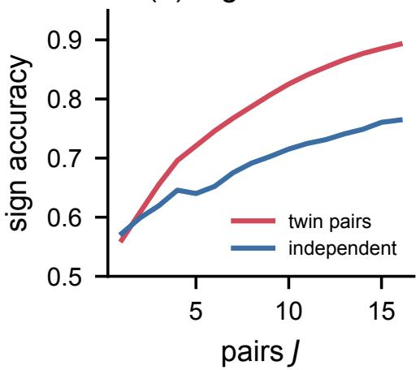

(b) Prop. 2 check  
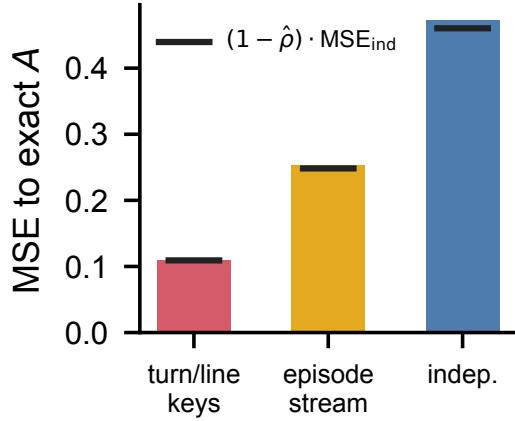  
Figure 5: Numerical verification (exact MDP). (a) Sign accuracy of credit with J pairs on 2,000 decisions with $| A | \geq 0 . 0 5 ;$ ties are broken at random, so single pairs are equally accurate, and twins pull ahead as discordant pairs accumulate. (b) Mean squared error to the exact advantage; black marks are the prediction $( \mathrm { \bar { 1 } } - \mathrm { \boldsymbol { \hat { \rho } } } ) \cdot \mathrm { M S E _ { \mathrm { i n d } } }$

## C Numerical Verification

We verify the propositions on a synthetic search MDP whose values are computable exactly. An episode has two query turns and an answer turn. A query is a sequence of at most three tokens from four content tokens and an end token; a deterministic tool hashes the query to one of six documents; the answer turn emits one of four answers, and the correct one becomes likely only when both gold documents are retrieved. Token logits depend on the turn, the position, and the evidence set, so a decision affects the future only through what it retrieves. Exact ${ \dot { Q } } ^ { \pi }$ and $V ^ { \pi }$ follow from enumerating all 85 queries per turn. We sample 120,000 factual episodes and, at each of their 240,000 decisions, an alternative with three continuations: turn/line keys (TWICE), a per-episode noise stream, and independent noise. Table 4 and Figure 5 report the results.

Two further checks confirm the lemmas of Appendix B.1: the measured self-twin rate matches the collision probability $\mathbb { E } \sum _ { y } \pi ( y \mid s ) ^ { 2 }$ to within $5 \times 1 0 ^ { - 4 }$ (Lemma 4), and previous-token keys, whose keys repeat in 21% of first-turn queries, distort the query distribution by 0.11 in total variation, below the repeat-probability bound of Lemma 3 but far above the sampling noise of unique keys. Three observations carry over to the real setting. First, all estimators are unbiased: the mean error is below $1 . 5 \times 1 0 ^ { - 3 }$ with slopes within 1% of one, although the per-episode stream decouples after length changes. Second, the variance ratio is predicted by the twin correlation to three decimals (0.233 measured, 0.231 predicted), confirming that $\rho$ is the right summary of coupling. Third, the benefit of twins is concentrated in reversals: with one pair, twins tie on 86% of non-trivial decisions and reverse the sign on 0.010 of them, whereas independent pairs reverse on 0.179. With random tie-breaking, a single pair is therefore equally accurate in sign, but as pairs accumulate, twins improve 4.0 times faster, the ratio of the two large-deviation rates. In training, ties matter as well: a tie contributes no gradient, while a reversal pushes the policy the wrong way.

Algorithm 1: TWICE: one training step   
Input: questions; actor $\pi _ { \mathrm { o l d } } ;$ group size G; budget β; q<sub>min</sub>, q<sub>same</sub>, ω   
Roll out G factual episodes per question with keyed noise $\xi _ { ( e , t , \ell , j ) } ;$ record $U ,$ turn costs   
Predict $\hat { \eta } _ { t }$ for every factual decision; set λ by bisection; compute q<sub>t</sub> by Eq. (2)   
foreach decision with $B _ { t } \sim \operatorname { B e r n } ( q _ { t } ) = 1$ do   
draw $y ^ { \prime } \sim \pi _ { \mathrm { o l d } } ( \cdot \mid s _ { t } )$ with fresh keys; if $y ^ { \prime } = y _ { t }$ then $D _ { t } \gets 0 ;$ continue   
execute $y ^ { \prime } ;$ draw $S _ { t }$ (evidence coin); if $S _ { t } = 0$ then $\hat { A } _ { t } \gets$ 0; continue   
continue from $\begin{array} { r } { s _ { t } \oplus y ^ { \prime } \oplus \mathcal { E } ( y ^ { \prime } ) } \end{array}$ with the factual keys of turns $> t ; D t  U - U _ { t } ^ { \prime }$   
end   
$\hat { A } _ { t }  \mathrm { E q . } ( 3 ) ; A _ { t }  \mathrm { E q . }$ (4); refit the discordance mode   
PPO/GRPO update on factual tokens with per-turn advantages $A _ { t }$

```latex
Algorithm 2: Keyed Gumbel-max decoding of one turn
Input: context s; seed $s _ { e } ;$ turn t; branch k; τ; top-p
$\ell \gets 0 ; j \gets 0 ; y \gets \emptyset$
repeat
$z  \ell _ { \theta } ( \cdot \mid s \oplus y ) / \tau ;$ mask z outside the nucleus
κ ← hash $( s _ { e } , t , k , \ell , j )$ ; u ← Philox(κ)
$v ^ { \star } $ arg max z − log(− log u ); $y  y \oplus v ^ { \star }$
if v<sup>⋆</sup> is a newline then
$\begin{array} { r l } { | } & { { } \ell \gets \ell + 1 ; j \gets 0 } \end{array}$
else
$\begin{array} { r l } { | } & { { } j \gets j + 1 } \end{array}$
end
until $v ^ { \star }$ is an end-of-turn token
return y
```

## D Implementation Details

Algorithm 1 summarizes one training step of TWICE, and Algorithm 2 details the keyed sampler it calls.

Keyed sampler. We implement keyed Gumbel-max decoding as a vLLM logits processor (Kwon et al., 2023). For each request, the processor holds the episode seed $s _ { e } ,$ the turn index t, the branch index k (zero for the factual episode), and counters for the line ℓ and the position $j ,$ , updated on every emitted token; a newline increments ℓ and resets $j .$ At each step, it computes $u _ { \kappa } ( v )$ for the full vocabulary with a counter-based Philox generator keyed by a 64-bit hash of $( s _ { e } , t , k , \mathcal { \ell } , \dot { \mathcal { I } } )$ , adds $\xi _ { \kappa } = - \log ( - \log u _ { \kappa } )$ to the temperature-scaled logits masked to the nucleus, and forces the arg max by setting all other logits to −∞; the engine then samples greedily. The processor costs 1.8% of generation time on Qwen2.5-7B. Continuations of the factual turns $> t$ in a twin use k=0 keys for those turns. Because the factual prefix is shared, twins reuse the prefix cache of the factual episode.

Twin execution. After the factual rollouts of a step, the trainer collects branched decisions, generates their alternative turns in one batch, executes tool calls, applies the self-twin and evidence shortcuts, and continues the surviving twins in a second batch. Retrieval results are cached per query string, so identical queries across twins are served once. Twins are capped at the factual episode’s remaining turn budget, so a twin cannot exceed the factual horizon.

Table 5: Benchmarks: single-hop (top) and multi-hop (bottom). NQ and HotpotQA are in-domain.
<table><tr><td>Dataset</td><td>Train</td><td>Eval</td></tr><tr><td>NQ (Kwiatkowski et al., 2019) TriviaQA (Joshi et al., 2017)</td><td>79,168</td><td>3,610 11,313</td></tr><tr><td rowspan="2">PopQA (Mallen et al., 2023)</td><td></td><td>14,267</td></tr><tr><td>90,447</td><td>7,405</td></tr><tr><td rowspan="2">HotpotQA (Yang et al., 2018) 2Wiki (Ho et al., 2020) MuSiQue (Trivedi et al., 2022)</td><td></td><td>12,576</td></tr><tr><td>Bamboogle (Press et al., 2023)</td><td>2,417</td></tr></table>

Discordance predictor. The predictor is a logistic regression on nine features: the prompt’s group success rate pˆ and its square, the factual utility U, the interaction Upˆ, the turn’s mean token entropy, whether the turn is a search or an answer, the turn index, the number of remaining turns, and the remaining generated tokens (log scale). It is fit by weighted SGD (learning rate 0.05, weight decay 10<sup>−4</sup>) on realized twins, each weighted by $1 / ( q _ { t } \dot { q } _ { \mathrm { s a m e } } ^ { e _ { t } } )$ so that the training distribution matches all decisions. For the first ten updates, before the predictor has data, every decision is branched with probability 0.3.

Cost accounting and λ. The cost of a twin is the length of the factual turn t, a proxy for the alternative turn, plus the factual episode’s remaining generated tokens. The budget counts alternative turns and continuations, including those later skipped by the evidence coin. λ is found by 40 bisection steps per batch to meet β in expectation; realized auxiliary tokens stay within ±3% of the target.

Text environments. For ALFWorld and WebShop (Shridhar et al., 2021; Yao et al., 2022), a twin is created by re-instantiating the environment with the episode’s seed and replaying the factual actions up to the branched turn; both simulators are deterministic given the seed and the action sequence. We follow the prompts, horizons, and reward definitions of GiGPO (Feng et al., 2025).

## E Experimental Setup

Data and evaluation. Table 5 lists the benchmarks. Training uses the union of the NQ and HotpotQA training sets, as in Search-R1 (Jin et al., 2025). Evaluation uses the NQ, TriviaQA, and PopQA test sets and the HotpotQA, 2WikiMultiHopQA, MuSiQue, and Bamboogle development sets, with greedy decoding and exact match after standard answer normalization. The retriever is E5-base-v2 (Wang et al., 2022) over the December 2018 Wikipedia dump of DPR (Karpukhin et al., 2020), returning three passages per call. The prompt follows Search-R1: the model reasons inside <think> tags, issues queries inside <search> tags, receives passages inside <information> tags, and answers inside <answer> tags. The template, applied through each backbone’s chat format, is:

Answer the given question. Reason inside <think> and </think> every   
time you receive new information. If you lack knowledge, call the   
search engine with <search> query </search>; the top results are   
returned between <information> and </information>. You may search   
several times. When no further information is needed, give the   
final answer inside <answer> and </answer> without explanation.   
Question: {question}

Reward and evaluation. The reward is exact match after the standard normalization (lowercasing and removing punctuation, articles, and extra whitespace); an episode without a well-formed <answer> receives zero. The same normalization is used for evaluation, with greedy decoding and the training limits on search calls and tokens. A turn ends at </search> or </answer>; retrieved passages are appended as observation tokens and masked in the loss. Significance is assessed with a paired bootstrap over questions (10,000 resamples) of the difference in mean exact match between two methods, using the seed-averaged prediction of each question.

Table 6: Hyperparameters. Shared settings are identical for all methods.
<table><tr><td>Setting</td><td>Value</td></tr><tr><td>Updates; questions/update</td><td>400; 256</td></tr><tr><td>Rollouts Ġ</td><td>5 (10 for GRPO 2×)</td></tr><tr><td>Learning rate; warm-up</td><td> $1 0 ^ { - 6 } ;$  20 updates</td></tr><tr><td>PPO mini-batch; epochs</td><td> $6 4 ; 1$ </td></tr><tr><td>Clip €; KL coefficient</td><td>0.2; 0.001</td></tr><tr><td>Train temperature; top-p</td><td>1.0; 1.0</td></tr><tr><td>Max search calls; passages</td><td>4;3</td></tr><tr><td>Max tokens/turn; context</td><td>500; 8,192</td></tr><tr><td>Precision; hardware</td><td>bf16; 8×H100</td></tr><tr><td>Twin budget β; pairs J</td><td>0.7; 1</td></tr><tr><td>ω; qmin; qsame</td><td> $1 . 0 ; 0 . 0 5 ; 0 . 2 5$ </td></tr><tr><td>Keys; generator</td><td> $( e , t , k , \ell , j ) ;$  Philox</td></tr><tr><td>Predictor</td><td>logistic, 9 features, SGD 0.05</td></tr><tr><td>Warm-up branching</td><td> $q { = } 0 . 3$  for 10 updates</td></tr></table>

Hyperparameters. Table 6 lists the shared configuration and the TWICE-specific settings. The TWICE settings were chosen on a held-out split of 500 NQ and HotpotQA training questions with Qwen2.5-3B and reused unchanged for every other backbone and environment.

Baselines. PPO uses a critic initialized from the backbone (learning rate $1 0 ^ { - 5 }$ , GAE with $\scriptstyle \gamma = \lambda = 1$ (Schulman et al., 2016)), as in Search-R1. GRPO uses $G { = } 5 ;$ the compute-matched variant uses $G { = } 1 0$ . IGPO adds turn-level information-gain rewards on the probability of the gold answer with its recommended weight (Wang et al., 2026a). GiGPO groups turns by identical observation histories and adds step-level advantages with $\omega { = } 1$ (Feng et al., 2025). Tree-GRPO and $\mathrm { A T ^ { 2 } P O }$ expand turn-level trees with their recommended widths, chosen so that the generated tokens per update match GRPO (Ji et al., 2026; Zong et al., 2026). VinePPO estimates the value at every turn boundary from two independent rollouts and uses $\hat { V } ( s _ { t + 1 } ) - \hat { V } ( s _ { t } )$ (Kazemnejad et al., 2025). CRR draws decisions uniformly at random at TWICE’s expected cost and replaces their advantage with the difference between the factual return and one independently sampled counterfactual return (Li et al., 2026); it thus differs from TWICE in coupling and budgeting only. All methods mask retrieved tokens in the loss and share the evaluation pipeline.

Ablation variants. Each variant in Table 3 changes one component, with λ reset to match the budget. Independent twins continue the twin with fresh keys, which is CRR’s estimator under TWICE’s budget rule. The per-episode seed indexes noise by a global token counter $g , \kappa = ( e , g ) ;$ ; no line re-sync uses $\boldsymbol { \kappa } = ( e , t , j )$ with j the position within the turn; n-gram keys use $\kappa = ( e ,$ last four tokens). Uniform branching uses one branch probability for all decisions. Mixed-outcome targeting sets $q _ { t } \propto 2 \hat { p } _ { t } \big ( 1 - \hat { p } _ { t } \big )$ , the probability that two independent continuations of the prefix disagree, where $\hat { p } _ { t }$ is a logistic prediction of the prefix’s success probability from the features of Appendix D; and ignores cost. Skip same evidence sets $D _ { t } { = } 0$ for every same-evidence twin; no inverse weights uses $\hat { A } _ { t } = B _ { t } S _ { t } D _ { t } \colon$ no self-twin shortcut continues identical alternatives like any other twin; twin credit only drops $\hat { A } ^ { \mathrm { t r a j } }$ from Eq. (4); and the star design continues K=2 alternatives with the factual noise and averages $U - U _ { k } ^ { \prime }$

Credit audit. For Table 2 and Figure 3, we freeze the Qwen2.5-3B checkpoint of each method at update 200, sample one factual episode for each of 400 held-out HotpotQA and 2WikiMultiHopQA questions, and estimate the oracle advantage of each of the resulting 1,036 decisions as $\hat { V } \big ( s _ { t + 1 } \big ) -$ $\hat { V } ( s _ { t } )$ from 64 rollouts at each state. Each method’s credit is its advantage at that decision before normalization; the 612 decisions with $| A ^ { \star } | \geq 0 . 0 5$ define the reversal rate.

Compute. All runs use 8 NVIDIA H100 80GB GPUs. A Qwen2.5-3B run of TWICE takes about 17 hours (152 s per update), against 11 hours for GRPO and 29 hours for VinePPO; Qwen2.5-7B runs take about 1.8 times longer. The full study, including baselines, three seeds, ablations, and the audit, used about 9,600 GPU-hours.

Table 7: Token-level F1 (%), mean of three seeds. Bamb. is Bamboogle.
<table><tr><td>Method</td><td>NQ</td><td>TriviaQA</td><td>PopQA</td><td>HotpotQA</td><td>2Wiki</td><td>MuSiQue</td><td>Bamb.</td><td>Avg.</td></tr><tr><td colspan="9">Qwen2.5-3B</td></tr><tr><td>GRPO</td><td>51.2</td><td>64.3</td><td>45.7</td><td>47.5</td><td>40.2</td><td>22.2</td><td>42.6</td><td>44.8</td></tr><tr><td>GiGPO</td><td>52.8</td><td>65.3</td><td>47.0</td><td>50.1</td><td>44.1</td><td>24.4</td><td>45.4</td><td>47.0</td></tr><tr><td>Tree-GRPO</td><td>54.1</td><td>66.1</td><td>47.6</td><td>51.4</td><td>46.5</td><td>25.3</td><td>48.0</td><td>48.4</td></tr><tr><td> $\mathsf { A T } ^ { 2 } \mathsf { P O }$ </td><td>54.4</td><td>66.4</td><td>47.9</td><td>51.9</td><td>47.2</td><td>25.8</td><td>48.8</td><td>48.9</td></tr><tr><td>VinePPO</td><td>53.7</td><td>65.7</td><td>47.5</td><td>52.3</td><td>48.1</td><td>26.4</td><td>48.2</td><td>48.8</td></tr><tr><td>CRR</td><td>53.3</td><td>65.7</td><td>47.1</td><td>51.4</td><td>46.8</td><td>25.3</td><td>47.0</td><td>48.1</td></tr><tr><td>TWICE (ours)</td><td>55.6</td><td>67.4</td><td>49.0</td><td>54.4</td><td>50.6</td><td>28.4</td><td>51.9</td><td>51.0</td></tr><tr><td colspan="9">Qwen2.5-7B</td></tr><tr><td>GRPO</td><td>53.7</td><td>67.9</td><td>47.9</td><td>52.4</td><td>46.0</td><td>27.0</td><td>51.4</td><td>49.5</td></tr><tr><td>GiGPO</td><td>55.1</td><td>68.8</td><td>49.1</td><td>54.5</td><td>49.1</td><td>29.2</td><td>53.4</td><td>51.3</td></tr><tr><td>Tree-GRPO</td><td>56.1</td><td>69.8</td><td>49.5</td><td>55.6</td><td>50.7</td><td>30.0</td><td>54.4</td><td>52.3</td></tr><tr><td> $\mathsf { A T } ^ { 2 } \mathsf { P O }$ </td><td>56.4</td><td>70.0</td><td>49.8</td><td>56.0</td><td>51.2</td><td>30.5</td><td>55.2</td><td>52.7</td></tr><tr><td>VinePPO</td><td>55.8</td><td>69.5</td><td>49.6</td><td>56.4</td><td>52.2</td><td>31.0</td><td>55.4</td><td>52.8</td></tr><tr><td>CRR</td><td>55.4</td><td>69.4</td><td>49.2</td><td>55.5</td><td>50.9</td><td>30.0</td><td>54.2</td><td>52.1</td></tr><tr><td>TWICE (ours)</td><td>57.5</td><td>71.1</td><td>51.1</td><td>58.3</td><td>54.7</td><td>33.0</td><td>58.3</td><td>54.9</td></tr></table>

Table 8: Seven-benchmark exact match, mean±s.d. over three seeds.
<table><tr><td>Method</td><td> $\mathrm { Q w e n } 2 . 5 – 3 \mathrm { B }$ </td><td>Qwen2.5-7B</td></tr><tr><td>PPO</td><td> $3 4 . 9 \pm 0 . 5 2$ </td><td> $4 0 . 0 \pm 0 . 4 7$ </td></tr><tr><td>GRPO</td><td> $3 7 . 4 \pm 0 . 4 1$ </td><td> $4 2 . 0 \pm 0 . 3 5$ </td></tr><tr><td>GRPO (2×)</td><td> $3 8 . 1 \pm 0 . 3 8$ </td><td> $4 2 . 7 \pm 0 . 3 3$ </td></tr><tr><td>IGPO</td><td> $3 8 . 7 \pm 0 . 4 4$ </td><td> $4 3 . 1 \pm 0 . 3 9$ </td></tr><tr><td>GiGPO</td><td> $3 9 . 3 \pm 0 . 3 7$ </td><td> $4 3 . 6 \pm 0 . 3 4$ </td></tr><tr><td>Tree-GRPO</td><td> $4 0 . 5 \pm 0 . 3 6$ </td><td> $4 4 . 4 \pm 0 . 3 1$ </td></tr><tr><td> $\mathrm { A T ^ { 2 } P O }$ </td><td> $4 1 . 0 \pm 0 . 3 3$ </td><td> $4 4 . 8 \pm 0 . 3 0$ </td></tr><tr><td>VinePPO</td><td> $4 0 . 8 \pm 0 . 3 8$ </td><td> $4 4 . 8 \pm 0 . 3 4$ </td></tr><tr><td>CRR</td><td> $4 0 . 3 \pm 0 . 4 5$ </td><td> $4 4 . 3 \pm 0 . 4 0$ </td></tr><tr><td>TWICE</td><td> $4 2 . 7 \pm 0 . 2 9$  </td><td> $4 6 . 5 \pm 0 . 2 6$ </td></tr></table>

## F Additional Results

F1 and seeds. Table 7 reports token-level F1 for the strongest baselines; the ranking matches exact match. Table 8 reports the mean and standard deviation over three seeds of the seven-benchmark average; TWICE’s margin over the strongest baseline exceeds four standard deviations on both backbones.

Other backbones. Table 9 repeats the comparison on Qwen3-4B-Instruct-2507 (Yang et al., 2025) and Llama-3.2-3B-Instruct (Grattafiori et al., 2024) with the strongest baselines. TWICE improves GRPO by 4.6 and 8.0 points. The larger gain on Llama reflects a weaker starting point on multi-hop questions, where GRPO’s broadcast credit struggles most.

Text environments. Table 10 evaluates the same estimators on ALFWorld and WebShop. GiGPO is a strong baseline here because identical observations recur often in these environments, which makes its anchor groups large; TWICE still adds 3.4 and 3.7 points of success on Qwen2.5-1.5B and 2.6 and 3.5 on Qwen2.5-7B, and CRR’s independent counterfactual trails GiGPO.

Cost-aware utility. Following work on efficient tool use (Wang et al., 2025a; Wu et al., 2026), we train on HotpotQA with utility $U = \mathrm { F } 1 - 0 . 0 5 \times$ (number of search calls) (Table 11). Twins whose alternative answers immediately reveal when a search was unnecessary, and twins whose alternative searches again reveal when stopping was premature; TWICE lowers the number of calls by 20% relative to GRPO while raising F1.

Table 9: Other backbones: exact match (%), mean of three seeds. Bamb. is Bamboogle.
<table><tr><td>Method</td><td>NQ</td><td>TriviaQA PopQA</td><td></td><td>HotpotQA</td><td>2Wiki</td><td>MuSiQue</td><td>Bamb.</td><td> $\operatorname { A v g } .$ </td></tr><tr><td colspan="9">Qwen3-4B</td></tr><tr><td>GRPO</td><td>44.8</td><td>60.3</td><td>43.6</td><td>40.9</td><td>39.8</td><td>16.7</td><td>43.2</td><td>41.3</td></tr><tr><td>Tree-GRPO</td><td>46.7</td><td>61.5</td><td>44.9</td><td>43.4</td><td>43.9</td><td>18.6</td><td>45.6</td><td>43.5</td></tr><tr><td> $\mathsf { A T } ^ { 2 } \mathsf { P O }$ </td><td>47.1</td><td>61.8</td><td>45.2</td><td>43.9</td><td>44.6</td><td>19.0</td><td>46.4</td><td>44.0</td></tr><tr><td>CRR</td><td>46.4</td><td>61.2</td><td>44.6</td><td>43.2</td><td>44.1</td><td>18.8</td><td>45.6</td><td>43.4</td></tr><tr><td>TWICE</td><td>48.2</td><td>62.9</td><td>46.1</td><td>45.8</td><td>47.3</td><td>21.4</td><td>49.6</td><td>45.9</td></tr><tr><td colspan="9">Llama-3.2-3B</td></tr><tr><td>GRPO</td><td>44.9</td><td>57.8</td><td>42.0</td><td>35.4</td><td>26.1</td><td>11.3</td><td>31.2</td><td>35.5</td></tr><tr><td>Tree-GRPO</td><td>47.0</td><td>59.3</td><td>42.5</td><td>42.9</td><td>36.5</td><td>16.4</td><td>43.2</td><td>41.1</td></tr><tr><td> $\mathsf { A T } ^ { 2 } \mathsf { P O }$ </td><td>47.2</td><td>59.6</td><td>42.8</td><td>43.5</td><td>37.4</td><td>16.9</td><td>44.0</td><td>41.6</td></tr><tr><td>CRR</td><td>46.6</td><td>59.0</td><td>42.4</td><td>42.6</td><td>36.8</td><td>16.2</td><td>42.4</td><td>40.9</td></tr><tr><td>TWICE</td><td>48.3</td><td>60.4</td><td>43.7</td><td>45.4</td><td>40.6</td><td>18.8</td><td>47.2</td><td>43.5</td></tr></table>

Table 10: ALFWorld and WebShop: success rate (%), mean of three seeds.
<table><tr><td colspan="3">Qwen2.5-1.5B</td><td colspan="2">Qwen2.5-7B</td></tr><tr><td>Method</td><td>ALFWorld</td><td>WebShop</td><td>ALFWorld</td><td>WebShop</td></tr><tr><td>GRPO</td><td>72.6</td><td>56.3</td><td>77.9</td><td>65.8</td></tr><tr><td>GiGPO</td><td>86.0</td><td>66.9</td><td>90.1</td><td>74.6</td></tr><tr><td>CRR</td><td>84.1</td><td>64.2</td><td>88.2</td><td>72.0</td></tr><tr><td>TWICE</td><td>89.4</td><td>70.6</td><td>92.7</td><td>78.1</td></tr></table>

Table 11: Cost-aware utility on HotpotQA (Qwen2.5-3B): F1 (%), search calls per question, and utility = F1 − 5 × calls (in %).
<table><tr><td>Method</td><td>F1</td><td>Calls</td><td>Utility</td></tr><tr><td>GRPO</td><td>46.9</td><td>2.41</td><td>34.9</td></tr><tr><td>Tree-GRPO</td><td>50.6</td><td>2.46</td><td>38.3</td></tr><tr><td>VinePPO</td><td>51.8</td><td>2.33</td><td>40.2</td></tr><tr><td>CRR</td><td>51.1</td><td>2.29</td><td>39.7</td></tr><tr><td>TWICE</td><td>53.9</td><td>1.92</td><td>44.3</td></tr></table>

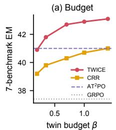

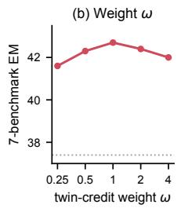

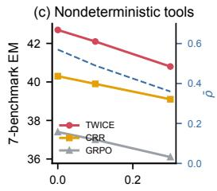

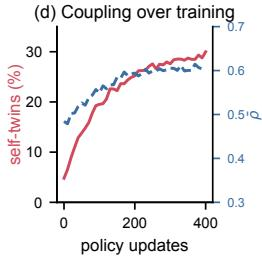  
Figure 6: Sensitivity and coupling over training (Qwen2.5-3B). (a) Twin budget $\beta ;$ TWICE at $\beta { = } 0 . 3 5$ matches $\mathrm { A T ^ { \bar { 2 } } P O }$ . (b) Twin-credit weight ω. (c) Retrieval noise ϵ (each passage replaced by a random one of the top 20 with probability ϵ): coupling weakens (dashed, right axis) but the margin over CRR remains. (d) The share of self-twins and the mean twin correlation grow as the policy sharpens.

Sensitivity. Table 12 and Figure 6 vary the budget, the number of pairs, the twin weight, and the temperature. TWICE at $\beta { = } 0 . 3 5$ already matches the strongest baseline, and gains saturate beyond $\beta { = } 0 . 7$ . More pairs per decision help little at matched decisions but cost proportionally more budget, so spreading twins across decisions is preferable. The twin weight is flat between 0.5 and 2. Higher temperature lowers the twin correlation because divergences compound, and lower temperature reduces exploration; τ=1 balances the two.

Table 12: Sensitivity (Qwen2.5-3B, seven-benchmark exact match).
<table><tr><td colspan="5">Twin budget β (auxiliary tokens / policy tokens)</td></tr><tr><td> $\beta$  TWICE CRR</td><td>0.20 40.9 39.2</td><td>0.35 0.70 41.8 42.7 39.8</td><td>1.00 42.9 40.3 40.7</td><td>1.40 43.1 41.0</td></tr><tr><td>J(β) 1 (0.7)</td><td>Pairs per branched decision J (budget scaled with J) 2 (1.4)</td><td>4 (2.8)</td><td></td><td></td></tr><tr><td>TWICE</td><td>42.7</td><td>43.0</td><td>43.2</td><td></td></tr><tr><td>Weight of twin credit ω</td><td></td><td></td><td>2</td><td></td></tr><tr><td>ω</td><td>0.25</td><td>0.5</td><td>1</td><td>4</td></tr><tr><td>TWICE</td><td>41.6</td><td>42.3</td><td>42.7</td><td>42.4 42.0</td></tr><tr><td>Sampling temperature τ</td><td></td><td></td><td></td><td></td></tr><tr><td>T</td><td>0.8</td><td>1.0</td><td>1.2</td><td></td></tr><tr><td>ρ</td><td>0.63</td><td>0.57</td><td>0.49</td><td></td></tr><tr><td>TWICE</td><td>42.3</td><td>42.7</td><td>42.2</td><td></td></tr><tr><td>GRPO</td><td>37.0</td><td>37.4</td><td>37.1</td><td></td></tr></table>

Table 13: Nondeterministic retrieval (Qwen2.5-3B, seven-benchmark exact match).
<table><tr><td>Tool noise €</td><td>0.0</td><td>0.1</td><td>0.3</td></tr><tr><td>ρ(TWICE)</td><td>0.57</td><td>0.49</td><td>0.36</td></tr><tr><td>GRPO</td><td>37.4</td><td>37.0</td><td>36.1</td></tr><tr><td>CRR</td><td>40.3</td><td>39.9</td><td>39.1</td></tr><tr><td>TWICE</td><td>42.7</td><td>42.1</td><td>40.8</td></tr></table>

Table 14: Composability (Qwen2.5-3B): seven-benchmark and multi-hop exact match.
<table><tr><td>Configuration</td><td>Avg.</td><td>MH</td><td>Tok.</td></tr><tr><td>PPO</td><td>34.9</td><td>26.5</td><td>1.00×</td></tr><tr><td>PPO + twin credit</td><td>40.6</td><td>34.2</td><td>1.70×</td></tr><tr><td>IGPO</td><td>38.7</td><td>31.6</td><td>1.00×</td></tr><tr><td>TwICE + IGPO turn rewards</td><td>43.1</td><td>37.5</td><td>1.70×</td></tr><tr><td>Tree-GRPO</td><td>40.5</td><td>33.9</td><td>1.00×</td></tr><tr><td>Tree-GRPO + coupled siblings</td><td>41.8</td><td>36.1</td><td>1.00×</td></tr><tr><td>TWICE</td><td>42.7</td><td>36.9</td><td>1.70×</td></tr><tr><td>TwICE + tree sampling</td><td>43.3</td><td>37.7</td><td>1.70×</td></tr><tr><td>TwICE + prefix-level allocation</td><td>43.6</td><td>38.0</td><td>1.70×</td></tr></table>

Nondeterministic tools. Table 13 makes retrieval stochastic by replacing each returned passage with a random passage from the top 20 with probability ϵ, independently for the factual episode and each twin. Coupling weakens because twins no longer see the same evidence after identical queries, but credit stays unbiased (Prop. 1), and TWICE keeps a margin of 1.7 points over CRR at ϵ=0.3. Caching tool outputs per query within a step removes this effect entirely for web search.

Composability. Twin credit replaces how an advantage is estimated, so it composes with other ingredients (Table 14). Added to PPO’s critic-based advantage at branched turns, it lifts PPO by 5.7 points. Adding IGPO’s information-gain turn rewards to TWICE adds 0.4 points, so process signals and twins are complementary rather than redundant. Keying Tree-GRPO’s sibling continuations with shared downstream noise, so that sibling differences become twin differences at no extra cost, improves Tree-GRPO by 1.3 points; conversely, drawing TWICE’s factual episodes with tree sampling adds 0.6 points. Allocating the factual rollouts toward prompts and prefixes with mixed outcomes adds 0.9 points, the best configuration we tested: allocation chooses which episodes are sampled, and twins sharpen the credit within them.

Table 15: Scale: seven-benchmark exact match for Qwen2.5-Instruct backbones (3B and 7B from Table 1).
<table><tr><td>Method</td><td>1.5B</td><td>3B</td><td>7B</td><td>14B</td></tr><tr><td>GRPO</td><td>27.6</td><td>37.4</td><td>42.0</td><td>45.6</td></tr><tr><td>AT2PO</td><td>31.2</td><td>41.0</td><td>44.8</td><td>47.9</td></tr><tr><td>TWICE</td><td>33.4</td><td>42.7</td><td>46.5</td><td>49.3</td></tr><tr><td> $\Delta \mathrm { v s . A T ^ { 2 } P O }$ </td><td>+2.2</td><td>+1.7</td><td>+1.7</td><td>+1.4</td></tr></table>

Table 16: Horizon and group size (Qwen2.5-3B). Left: multi-hop exact match with at most H search calls. Right: seven-benchmark exact match with G rollouts per question.
<table><tr><td rowspan="2"></td><td colspan="2">H (MH)</td><td colspan="3">G (Avg.)</td></tr><tr><td>4</td><td>8</td><td>3</td><td>5</td><td>8</td></tr><tr><td>GRPO</td><td>29.8</td><td>30.6</td><td>36.5</td><td>37.4</td><td>38.0</td></tr><tr><td>CRR</td><td>33.9</td><td>34.8</td><td></td><td></td><td></td></tr><tr><td>TWICE</td><td>36.9</td><td>38.2</td><td>42.0</td><td>42.7</td><td>43.0</td></tr><tr><td>/ AUC</td><td>0.57</td><td>0.50</td><td>0.74</td><td>0.79</td><td>0.81</td></tr></table>

Table 17: Paired bootstrap p-values, TWICE vs. $\mathrm { A T ^ { 2 } P O }$ (10,000 resamples over questions). Bamb. is Bamboogle.
<table><tr><td>Backbone</td><td>NQ</td><td>TriviaQA</td><td>PopQA</td><td>HotpotQA</td><td>2Wiki</td><td>MuSiQue</td><td>Bamb.</td></tr><tr><td>Qwen2.5-3B</td><td>0.004</td><td>0.012</td><td>0.003</td><td>&lt;0.001</td><td>&lt;0.001</td><td>0.002</td><td>0.21</td></tr><tr><td>Qwen2.5-7B</td><td>0.009</td><td>0.018</td><td>0.006</td><td>&lt;0.001</td><td>&lt;0.001</td><td>0.003</td><td>0.19</td></tr></table>

Scale. Table 15 reports the seven-benchmark average across Qwen2.5-Instruct sizes. The margin over $\mathrm { A T ^ { 2 } P O }$ is 2.2 points at 1.5B, 1.7 at 3B and 7B, and 1.4 at 14B: it shrinks slowly with scale, as larger models already solve more multi-hop questions and fewer of their decisions carry large advantages.

Horizon and group size. Raising the limit on search calls from four to eight lengthens continuations, and the twin correlation falls from 0.57 to 0.50 as divergences compound (Table 16); TWICE nevertheless gains more than the baselines from the longer horizon, because more turns means more decisions whose credit a broadcast reward misassigns. Smaller groups weaken the group-success feature of the discordance predictor (AUC 0.74 at G=3), but TWICE remains far ahead of GRPO at every group size.

Significance. Table 17 reports paired bootstrap p-values for TWICE against $\mathrm { A T ^ { 2 } P O }$ . The improvements are significant at the 0.05 level on six of seven benchmarks for both backbones; Bamboogle, with 125 questions, is too small for its 2.4-point gain to be significant.

Error analysis. We categorize 200 failed multi-hop episodes per method (Table 18) using the gold supporting passages of HotpotQA, 2WikiMultiHopQA, and MuSiQue: an episode that stops with budget left while a supporting passage is missing is a premature answer; one that exhausts the budget hits the search limit; one that retrieves every supporting passage but answers wrongly is wrong despite evidence; the remaining episodes, whose evidence is missing although they searched, are split by manual inspection into query drift, where queries leave the question’s entities, and evidence missing. TWICE halves premature answers per question (19.0 to 8.8 per 100), the error that broadcast credit reinforces when a lucky early answer succeeds; its share of failures shifts toward reasoning over retrieved evidence, which credit on search decisions does not address, and slightly toward the search limit, the price of searching more on multi-hop questions.

Search behavior. Table 19 reports search calls and generated tokens. TWICE issues fewer searches on single-hop questions and more on multi-hop questions than GRPO, which matches the credit it assigns: twins that answer early on single-hop questions tie with the factual episode and expose redundant searches, whereas early answers on multi-hop questions fail and credit the additional search.

Table 18: Error analysis of 200 failed multi-hop episodes per method (Qwen2.5-3B): share of failures and failures per 100 multi-hop questions.
<table><tr><td></td><td colspan="2">Share (%)</td><td colspan="2">Per 100 q.</td></tr><tr><td>Failure</td><td>GRPO</td><td>TWICE</td><td>GRPO</td><td>TWICE</td></tr><tr><td>evidence missing</td><td>31</td><td>33</td><td>21.8</td><td>20.8</td></tr><tr><td>premature answer</td><td>27</td><td>14</td><td>19.0</td><td>8.8</td></tr><tr><td>wrong despite evidence</td><td>18</td><td>26</td><td>12.6</td><td>16.4</td></tr><tr><td>query drift</td><td>15</td><td>14</td><td>10.5</td><td>8.8</td></tr><tr><td>search limit</td><td>9</td><td>13</td><td>6.3</td><td>8.2</td></tr><tr><td>all failures</td><td>100</td><td>100</td><td>70.2</td><td>63.1</td></tr></table>

Table 19: Search behavior (Qwen2.5-3B): mean search calls per question and generated tokens per episode.
<table><tr><td>Method</td><td>Calls (1-hop)</td><td>Calls (multi)</td><td>Tok./ep.</td></tr><tr><td>GRPO</td><td>1.35</td><td>2.31</td><td>412</td></tr><tr><td>Tree-GRPO</td><td>1.29</td><td>2.52</td><td>437</td></tr><tr><td>VinePPO</td><td>1.31</td><td>2.61</td><td>446</td></tr><tr><td>CRR</td><td>1.30</td><td>2.57</td><td>441</td></tr><tr><td>TWICE</td><td>1.21</td><td>2.64</td><td>428</td></tr></table>

## G Case Studies

Table 20 shows twins from training episodes of Qwen2.5-3B, with the credit that CRR’s independent counterfactual assigned to the same decision in a matched run. In the first episode, the first query is not decisive: its twin retrieves different passages but reaches the same answer under the shared noise, so the twin ties, whereas an independent continuation of the same alternative happened to stop early and fail, giving the query spurious credit. The second search is decisive: its twin, which answers immediately, fails, and both estimators credit it. In the second episode, the twin reveals that a correct answer depended on a precise query for the founding year; in the third, a redundant verification search is exposed because its answer-now twin succeeds.

## H Discussion

What twins estimate. An independent branch estimates the interventional quantity $\mathbb { E } [ U \mid d o ( y ^ { \prime } ) ]$ a twin estimates the counterfactual $U _ { y ^ { \prime } }$ for the realized noise, the third rung of Pearl’s hierarchy (Pearl, 2009; Ravfogel et al., 2025). For policy gradients only the expectation matters, and both are unbiased; the difference is that the counterfactual holds everything but the decision fixed, so its variance measures how much the decision matters rather than how much the episode fluctuates. This is also why twins are interpretable: a twin is an explanation of the form “had the agent asked $y ^ { \prime }$ , the same episode would have ended with $U ^ { \prime \prime }$

When coupling fails. Coupling weakens when a decision changes the downstream context so much that the same noise produces unrelated continuations, when continuations are long and divergences compound, at high temperature, and when tools are stochastic. None of these introduces bias. They reduce $\rho$ toward zero, where TWICE degrades to an independent counterfactual with unbiased budgeting, as in the ablation without coupling; the method never does worse than CRR at equal budget except for the cost of keyed sampling. Lemma 1 also clarifies what coupling cannot do: for decisions with large downstream influence, twins disagree often, but such decisions have large advantages that independent estimators already detect.

Table 20: Twins in training episodes (Qwen2.5-3B). U/U<sup>′</sup>: factual and twin utilities. D is twin credit; D<sub>CRR</sub> is CRR’s independent difference. Twins tie when a decision does not matter under the shared noise, whereas independent counterfactuals assign spurious ±1 credit to such decisions.
<table><tr><td>Question (gold)</td><td></td><td>Turn Factual decision</td><td>Twin alternative</td><td>U/U&#x27;</td><td>D</td><td>DCRR</td></tr><tr><td rowspan="3">Which magazine was started first, Arthur&#x27;s Magazine or First for Women?(Arthur&#x27;s Magazine)</td><td>1</td><td>search: Arthur&#x27;s Magazine first published</td><td>search: Arthur&#x27;s Magazine First for Women history</td><td>1/1</td><td>0</td><td>+1</td></tr><tr><td>2</td><td>search: First for</td><td>answer now: First for 1 / 0</td><td></td><td>+1</td><td>+1</td></tr><tr><td>1</td><td>Women magazine launch year search: Citibank founded year</td><td>Women search: Citibank</td><td>1/0</td><td>+1</td><td>+1</td></tr><tr><td>the United States in the year that Citibank was founded? (James Madison)</td><td>2</td><td>search: president of</td><td>history search: US presidents 1 / 1</td><td></td><td>0</td><td></td></tr><tr><td rowspan="2">Were Scott Derrickson and Ed Wood of the same nationality? (yes)</td><td>2</td><td>the United States in 1812 search: Ed Wood</td><td>list 1800s search: Ed Wood</td><td>1 / 1 0 (skip)</td><td></td><td>+1</td></tr><tr><td></td><td>nationality</td><td>filmmaker (same passages)</td><td></td><td></td><td>0</td></tr><tr><td></td><td>3</td><td>search: Scott Derrickson American director</td><td>answer now: yes</td><td>1/1</td><td>0</td><td>+1</td></tr></table>

Twins and trees. Tree rollouts and twins solve different problems. Trees buy more samples per token by sharing prefixes; twins buy less noise per sample by sharing suffix randomness. The two compose: sibling continuations in a tree can be keyed with the factual noise, turning sibling differences into twin differences. The ablation with a star design, where several alternatives share the factual noise, is the simplest such tree, and it is competitive at equal cost.

Discrete action spaces. In workflows whose actions come from a small set, such as choosing among retrieval operators, all legal alternatives can be evaluated with the factual noise, and their outcomes weighted by the actor’s probabilities give an exact expectation over actions with a coupled continuation. Centering by the actor’s probabilities then yields an all-action advantage for every visited decision, with the variance reduction of Proposition 2 applying to every alternative at once.

Beyond search. The construction applies wherever an episode can be replayed: code execution in sandboxes, simulated software environments that can be forked (Li et al., 2026), embodied simulators, and web agents with cached pages. It also suggests a diagnostic use: twin discordance measures which decisions an agent’s outcomes depend on, which can guide evaluation and data collection even without training.

Compute. Monte Carlo branching improves credit by spending rollouts, whose cost grows with the inverse square of the effect to be resolved. Twins improve credit by removing noise, so the same budget resolves smaller effects. In our runs, TWICE used 68% fewer auxiliary tokens than VinePPO while assigning more accurate credit.