# Structure-preserving reduced-order models of thin panels in supersonic and hypersonic flow

Miguel A. Aguil´oa,∗

aMorphorm LLC, 100 Sun Avenue Northeast Suite 650, Albuquerque, NM 87109-4670, USA

## Abstract

We report structure-preserving reduced-order models of both challenge problems of the AePW-4 High-Speed Working Group [1]. They are the AFRL/SSC RC-19 clamped thin panel at Mach 1.92 and the UNSW HyMAX cantilever plate at Mach 5.85. For each problem one construction gives two models. The reference model is a physics-based Ritz–Galerkin model of the plate. The learned model keeps the reference model’s exact potential, fits the remaining generalized forces, and trains only its dissipation. Each model is built from the data package the working group distributes for its case. Neither package holds a time-resolved response or repeated runs. There is no ensemble to learn from. The physics is therefore carried by the form of the model rather than by data. The learned model’s energy balance holds for any weights by construction. On the trained model, at random states, its relative residual is $2 . 2 \times 1 0 ^ { - 1 5 }$ . On RC-19, inviscid shock relations applied to the package’s wedge geometry and schlieren shock angle predict a pressure ratio of 1.521. The ratio derived from the pressure-sensitive paint that Brouwer et al. [2] applied to the rigid panel is also 1.521. On the periodic case we ran the trained model thirty times, each from a diferent initial push. The mean dominant frequency is 1.0 % from the 236 Hz measured by Brouwer et al. [3]. Brouwer et al. simulated the experiment with their own reduced-order model. We take one periodic and one chaotic condition from their simulations. At both, the trained model gives the same regime as their model in all sixteen runs, eight from each buckled shape. It does so without their model’s 113 Hz spectral peak, which the experiment does not show. Because the response is chaotic, any model loses a single trajectory after a horizon set by the largest Lyapunov exponent. Measured displacements therefore correct the model through one more generalized force, which enters the same energy balance. We tested this correction in a twin experiment at the experiment’s 5 kHz measurement rate. With an ofline smoother it holds the panel state to 0.0125 thicknesses without noise and 0.0352 with 10 µm of noise. On HyMAX, with nothing fed back, the learned model tracks the reference model’s trailing-edge displacement for 65 ms to a relative error of 3.67 %.

Every prediction in the reported studies was registered before its run. Four of nine failed, and all four are reported. The one open comparison is the displacement standard deviation on the RC-19 attached-shock case. There our reference model gives about a sixteenth of the measured value. The gap is traced to inputs the public package does not carry, and we state the measurement that would close it.

Keywords: aeroelasticity, panel flutter, high-speed flow, reduced-order modeling, learned reduced-order model, structure preservation, port-Hamiltonian, discrete gradient, data assimilation, preregistration

## 1. Introduction

Thin panels on high-speed vehicles are loaded by the flow, heated by it, and driven by it into flutter [4, 5, 6]. A heated clamped panel buckles, and above the buckling temperature it has two stable buckled shapes. Each sits in a well, and a well is a minimum of the panel’s potential energy. In supersonic flow it can oscillate about one of them, switch between them, or do both in no repeatable order [7]. Which of these it does depends on the temperature rise and on the pressure across it. A design has to know the answer over the whole operating envelope, not at one point. High-fidelity coupled simulation resolves one condition at a cost of hours. Linear reduced-order models are afordable over the envelope but cannot represent a panel that crosses between buckled wells. A learned surrogate can be afordable and nonlinear. However, a surrogate whose energy change does not equal the work done on it cannot be defended to a reviewer. Nothing in its training says where it stops being valid.

The AePW-4 High-Speed Working Group [1, 8] poses two challenge problems that test these needs directly. The AFRL/SSC RC-19 clamped thin panel at Mach 1.92 has periodic and chaotic responses and a case with an impinging shock. The UNSW HyMAX cantilever plate sits at Mach 5.85 under an impinging shock in a short-duration facility. The group’s stated objectives include assessing coupled tools predictively. They also include identifying the gaps in high-speed experiments that future tests should close.

This work builds learned reduced-order models of both problems. Three observations organize it. First, the data packages the working group distributes for the two problems hold statistics, not trajectories. The RC-19 package supplies measured mode shapes, timeaveraged pressures and the nine points at which the response is reported. It holds no time history and no repeated runs. The response statistics at those points are published separately [3, 9]. A method that learns its physics from examples needs an ensemble that does not exist. The physics must therefore be carried by the model’s form, leaving little to learn. Second, the panel’s non-conservative forces are linear in its state. Piston theory and Rayleigh damping are both linear. Their coeficients are therefore fitted once, by least squares, and frozen, and only the dissipation is trained. Third, the response is chaotic. Any model of it, however accurate, loses a single trajectory within a horizon set by the largest Lyapunov exponent λ. That exponent is the exponential rate at which two neighboring trajectories separate. Tracking beyond that horizon needs measurement. The correction that measurement applies to the model must enter the energy balance as a generalized force, like the aerodynamic force. Our working hypothesis is the following.

Consider a reduced-order model of a thin panel in high-speed flow, built from the data a challenge-problem package provides and from published constants. Let it have four properties.

(i) Its elastic and membrane energy is expressed in the panel’s measured mode shapes. Its nonlinear stifness force is exactly the gradient of that energy.

(ii) Its aerodynamic and structural damping forces enter as generalized forces, with coeficients fitted by least squares and then held fixed.

(iii) Its only trained term is a dissipation that can remove energy, but never add it, for every value of its parameters.

(iv) It is advanced in time by a discrete-gradient step. That step replaces the energy gradient by its average along the step, which balances energy exactly at every step.

Such a model will satisfy four claims.

(P1) Its energy changes exactly by the work of its generalized forces minus its dissipation, for any trained weights and under any measurement correction.

(P2) At the simulation operating conditions of Brouwer et al. [3], it reproduces the regimes of their reduced-order model. It does so outside its training temperature and from both buckled wells.

(P3) It matches the experiment’s response statistics wherever the package supports a comparison.

(P4) It tracks the chaotic panel beyond its tracking horizon, given observations at the rate and points the experiment already uses.

We test the hypothesis on both challenge problems, with each claim’s acceptance conditions fixed before its run. RC-19 carries the weight of the test, because its package supports comparisons with experiment. P1 is checked at random states with amplitudes from 10−6 to 106, and along every trajectory. P2 is tested at the two simulation operating conditions of Brouwer et al. [3], sixteen runs each, eight from each well. P3 is tested against the measured response frequency and displacement standard deviation. P4 is tested in a twin experiment at the published sampling rate. There the reference model generates synthetic observations of its own trajectory. HyMAX then tests whether the same construction serves a second configuration unchanged. Every prediction was registered before its run. Four of the nine registered predictions broke (Table 11), and they are reported as findings (Section 9). P1 and P2 held. P3 held for the frequency, and failed for the displacement standard deviation on the attached-shock case, which Section 7.7 traces to data the package lacks. P4 held in the twin experiment and awaits a measured time series.

Place in the series. The earlier reports in this series [10, 11, 12] reduce fields on a mesh with Whitney forms. These are finite-element bases whose discrete derivatives mirror the continuous ones. This property is called the discrete de Rham structure. Thin panels are better described by their mode shapes. This report therefore uses a modal Hamiltonian reduction, in which the energy is written in the amplitudes of the mode shapes. It keeps the same commitments: exact energy accounting, dissipation that cannot add energy, and discrete balances that hold exactly.

## Contributions. This work contributes:

1. A reference model built on the RC-19 measurements (Sections 5.1 and 5.2). Its basis is the seven mode shapes measured on the panel before the test, made orthogonal by L¨owdin’s symmetric construction. Of all orthonormal sets, it gives the one nearest to the measured shapes. Its membrane stifness comes from solving the in-plane elasticity problem for every pair of modes. Its temperature field comes from the surface pressures measured by fifteen Kulite transducers on a rigid panel. Those pressures give the adiabatic wall temperature, which is the temperature an insulated wall reaches under the boundary layer. A fin equation then gives the panel’s temperature distribution. It models steady conduction from the heated panel into its cooler frame, calibrated on the panel and frame thermocouples.

2. A learned model whose energy balance holds for any parameters (Proposition 2). The rate of change of the panel’s energy always equals the power of the generalized forces minus the power the learned dissipation absorbs. Training cannot violate this balance, because it follows from the form of the model. The dissipation is positive definite for every parameter value. It can therefore only absorb energy (Lemma 2). The generalized aerodynamic force is fitted by least squares and then frozen (Section 5.8). On the trained model, at random states with amplitudes from $1 0 ^ { - 6 }$ to 106, the worst relative residual of the balance is $2 . 2 \times 1 0 ^ { - 1 5 }$

3. A discrete-gradient step for the learned model (Proposition 3). The training record is a family of reference model trajectories, generated with the average-vector-field (AVF) discrete gradient. The generalized-α method is the common alternative. The two steps carry diferent truncation errors and numerical damping. A model integrated diferently from its data drifts from them even when its forces are exact. Proposition 3 gives the learned model the same discrete-gradient step that generated its training record. Each such step removes that drift and balances the model’s energy exactly, for any trained weights. The trained models reported here were integrated with the generalized-α step (Section 5.9). The discrete-gradient step applies to them unchanged.

4. Assimilation as a generalized force (Section 5.11). Measured displacements at the instrumented points correct the model through one more generalized force. It is proportional to the error in the displacement and in its rate. Each time step still balances the panel’s energy exactly, with the work of this force reported as a separate term (Corollary 1). The two feedback gains are not tuned. They are set from the linearized equation for the model-to-truth error so that its largest Lyapunov exponent is negative. The nine published measurement points observe all seven modes: no combination of modes is invisible at all nine points. In a twin experiment at the published 5 kHz rate, the correction with an ofline smoother holds the model’s state to 0.0125 thicknesses without noise. A causal hold of the last sample reaches 0.325 (Section 7.6).

5. Comparisons as statistics (Sections 7.2 and 7.3). A thirty-member ensemble of the trained model, at the periodic case’s operating condition, places the mean dominant frequency at 238.4 Hz. That is 1.0 % from the measured 236 Hz. At the simulation operating conditions of Brouwer et al., it returns the regimes of their reduced-order model. It does so without that model’s 113 Hz peak, which the experiment does not show either. We also measure how an ensemble mean depends on the range of initial perturbations, or kicks, it samples. Every mean is quoted with that range.

6. A measured bound on the aerodynamic enrichment (Section 7.4). The reduced-order model of Brouwer et al. replaces freestream quantities in piston theory by local ones, which scales the aerodynamic operators by 5.4 %. Rather than build that enriched model, we measured what the scaling changes in our reference model. We ran it at the periodic case’s experimental operating condition in four ensembles of 192 runs each. They combine unscaled and scaled aerodynamic operators with release from each buckled well. A two one-sided equivalence test [13] compared the mean dominant frequency with and without scaling. It declares equivalence when the 95 % interval of the diference of means lies inside a band, here ±2 %, registered before the runs. The mean frequency moved 0.40 % in the lower well and 0.51 % in the upper well, inside the band. The fluctuation amplitude moved 2.4 %. Its elasticity, the percent change in amplitude per percent change in the coeficients, is 2.4/5.4 = 0.44.

7. A measured data requirement for the attached-shock case (Section 7.7). Forced at the measured pressure fluctuation level, the reference model’s displacement standard deviation there is 0.06 thicknesses. The measured value is 0.943, about sixteen times larger. Ruling out every admissible cause by measurement isolates one remaining mechanism. That mechanism is the dependence of the surface pressure on the panel’s deformed shape. Testing it requires time-resolved surface pressure, or a computation, on the deformed panel, which the package lacks.

8. One construction across two configurations (Section 8). The HyMAX model uses the RC-19 construction unchanged. With no observations fed back, it tracks the reference model’s trailing-edge displacement for 64.9 ms. Its relative root-mean-square error over that window is 3.67 %. It also detects, rather than assumes, which modal bases its data support. A six-mode basis is declined, because its whitened coordinates keep only eleven of its twelve state directions.

## 2. The challenge problems and what their packages hold

Both packages are distributed by the working group and marked Distribution A. They are used as distributed, and no number in this report is fitted to a measured flutter response. Two structural calibrations are stated where they are made: the thermal efectiveness on the buckling temperature rise, and the HyMAX bending stifness on the first frequency.

## 2.1. AFRL/SSC RC-19 clamped thin panel

The facility and the panel. The experiment [14, 15, 1] runs in a blowdown supersonic tunnel with a test section 131.1 mm high and 152.4 mm wide, at a nominal Mach number of 2.0. RANS simulations in the package give $1 . 9 2 \pm 0 . 0 2$ at the panel [1]. The panel is a steel plate of $2 5 3 . 9 \times 1 2 7 \times 0 . 6 3 5$ mm, set flush in the tunnel floor (Figure 1). A frame of $3 0 4 . 7 \times 1 5 2 . 4$ mm, 12.85 mm thick, clamps it on all four edges. A sealed cavity behind the panel holds the cavity pressure $p _ { c } .$ , which sets the static pressure diferential across it. The incoming boundary layer is 8.6 mm thick. In the heated runs the stagnation temperature is about 388 K at a stagnation pressure of 346 kPa. The flow heats the panel faster than its frame. The panel’s temperature therefore rises above the frame’s. The frame constrains the panel’s thermal expansion, which puts the panel into compression. It buckles once the rise exceeds about 5.6 K, which is the flat panel’s buckling temperature rise reported in [3]. One thermocouple on the panel and one on the frame measure their temperatures. The package’s temperature rise ∆T is the diference between the two readings.

The cases. The package defines three cases. Two have no shock on the panel and are labeled periodic and chaotic. The periodic case runs at a cavity pressure of 50.4 kPa and a temperature rise of 12.76 K. Brouwer et al. [3] report its measured dominant frequency as 236 Hz. The chaotic case runs at 51.5 kPa and a temperature rise of 14.74 K. Its cavity pressure is 0.49 kPa above the RANS reference surface pressure $p _ { s } = 5 1 . 0 \mathrm { k P a }$ of [3]. Brouwer et al. [3] report its measured dominant frequency as 257 Hz. The third case, attached-shock, mounts a wedge of length 110.7 mm and height 7.8 mm in the test section. Its leading edge is 86 mm upstream of the panel’s. The wedge places an oblique shock, measured at 35.7◦ in the schlieren, on the panel. That case runs at a cavity pressure of 68.9 kPa and is labeled periodic.

The instrumentation and what the package holds. For each case the package supplies the geometry of the tunnel, the wedge and the panel, and the operating conditions with their error bars. It supplies seven mode shapes measured before the test on an eleven by eleven grid, with their frequencies and damping (Figure 2). The panel’s edges were free during these modal measurements. It supplies the time-averaged surface pressure measured on a rigid panel by 15 Kulite transducers and 28 scanner taps. For the attached-shock case it adds the schlieren and a pressure-sensitive paint field [2]. The response was measured by digital image correlation at 5 kHz [1]. The package defines nine extraction points (Figure 1b). It does not hold the mean and the standard deviation of the displacement at those points. We take them from the published papers [3, 9]. The package’s spectral settings are Hamming windows of 0.2048 s with half overlap. The resolution is therefore $1 / 0 . 2 0 4 8 \mathrm { s } = 4 . 8 8 \mathrm { H z }$ Spectra and amplitudes in this report are read at three-quarter chord. The package supplies no time history of the response.

(a)  
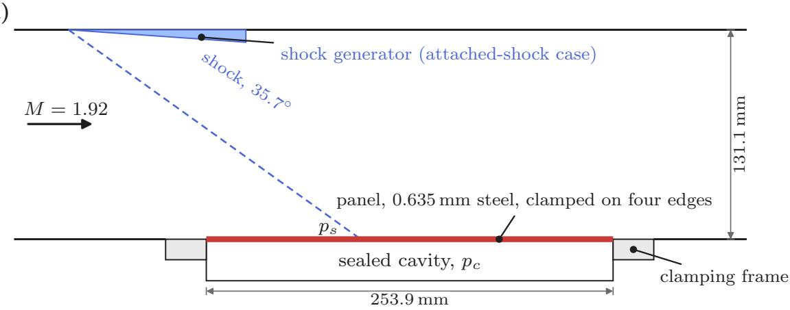  
(b)

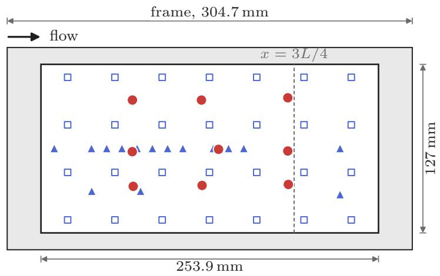  
scanner taps (28)  
Figure 1: The RC-19 configuration, with dimensions from the package. (a) The test section in side view. The panel is flush in the floor over a sealed cavity at pressure $p _ { c } .$ . Its flow side sees the surface pressure, whose RANS reference value is $p _ { s }$ . The shock generator and its shock, at the measured 35.7◦, are present on the attached-shock case only. The generator’s wall and the cavity depth are schematic. (b) The planform, with the clamping frame shaded, the rigid-panel pressure taps and the nine extraction points. The dashed line is the three-quarter-chord station at which spectra and amplitudes are read.

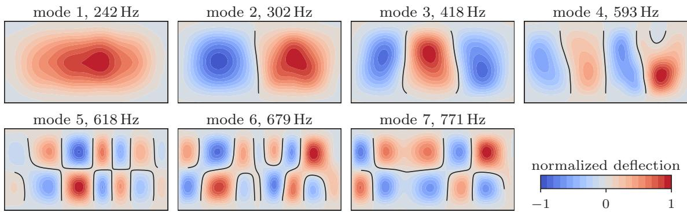  
Figure 2: The seven RC-19 mode shapes measured before the test, with their measured frequencies. They are interpolated by bicubic splines on the package’s grid, as in Section 5.1. Each is normalized to unit peak with its larger lobe positive. Black lines are nodal lines, where the mode’s deflection is zero. They separate regions that deflect in opposite directions.

## 2.2. UNSW HyMAX cantilever plate

The facility and the plate. The HyMAX experiment of UNSW Canberra [16] runs in the TUSQ Ludwieg tube of the University of Southern Queensland. The test flow is a free jet of compression-heated air at Mach 5.85. A forebody 100 mm long carries a flat plate of 6061-T6, $1 3 0 \times 8 0 \times 2$ mm (Figure 3a). The plate is attached by a bolted joint at its hinge line and is free at its trailing edge, 230 mm from the forebody’s leading edge. The shock is produced by a static shock generator [17]. The generator is a wedge 110 mm long with an included angle of $5 ^ { \circ }$ . Its leading edge sits 10 mm upstream of the forebody’s and 40 mm above its surface. Its angle of attack is $\alpha _ { g } = - 3 ^ { \circ }$ . The package defines the flow deflection as $\alpha _ { g }$ plus the wedge angle, − $3 ^ { \circ } + 5 ^ { \circ } = 2 ^ { \circ }$ . That is the case the working group makes mandatory, and $1 0 ^ { \circ }$ is optional. The inviscid oblique shock from its leading edge stands at 11.16◦. That is the weak-branch solution of the oblique-shock relation [18] for a $2 ^ { \circ }$ deflection at Mach 5.85. The shock meets the plate’s plane 40 mm/ tan 11.16◦ = 203 mm behind the generator’s leading edge. That is 93 mm behind the hinge, beside the first of the two shock positions the training trajectories use, $x _ { s } = 9 1$ and 117 mm. The flow lasts about 200 ms, and its freestream pressure is not stationary over the first 90 ms of that window (Figure 3b).

What the package holds. The package supplies one run, with its freestream pressure and temperature and the geometry of both configurations. It holds the surface pressure at four transducers sampled at 50 kHz, with their calibrations. Three sit on the forebody at 40, 50 and 60 mm, and one on the plate near its trailing edge at 220 mm. Schlieren images show the flexible plate and a rigid one at shock-generator angles of 2 and 10◦. The transducer on the plate sits under the impinging shock and reads about twice the freestream pressure. The one structural measurement is the first frequency, 83 Hz [16]. Xu and Dowell [19] compute 84.7 and 530.4 Hz for the first two modes, which we carry as a computational reference rather than as data. The package holds no displacement. It states that a measured trailing-edge displacement will be provided for validation [1]. It is not used here.

(a)  
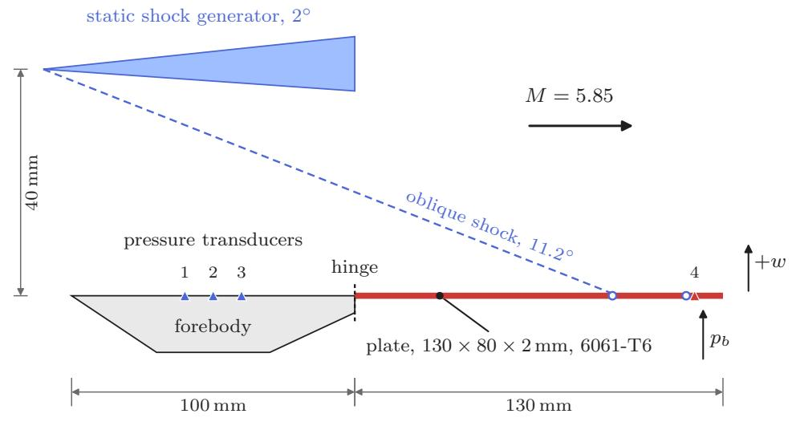

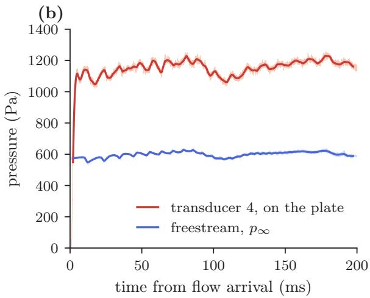

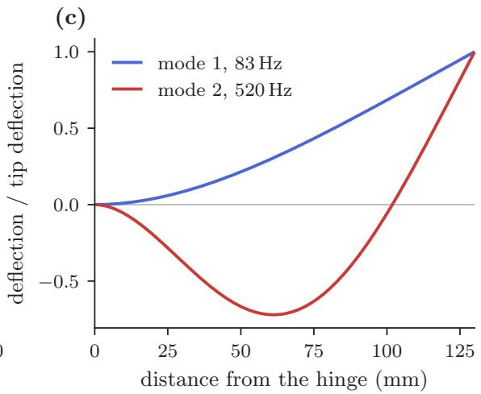  
Figure 3: The HyMAX configuration, $2 ^ { \circ }$ case. (a) Side view, dimensioned from the UNSW data package. The vertical scale is exaggerated two to one; angles are labeled with their true values. It shows the static shock generator, the forebody, the hinge, the plate and the four pressure transducers. The dashed line is the inviscid oblique shock from the generator’s leading edge at Mach 5.85. Open circles mark the two shock positions of the training trajectories, $x _ { s } = 9 1$ and 117 mm behind the hinge. The back pressure $p _ { b }$ is not measured, and w is positive toward the shock side. (b) The measured freestream pressure and the trailing-edge transducer over the 200 ms flow window. These are the inputs of the aerodynamic force, raw (light) and averaged over 2 ms (dark). (c) The two clamped-free modes of the reference model, calibrated on the measured first frequency.

## 3. Background and related work

Panel flutter and its reduced-order models. Panel flutter has been studied for decades, with first-order piston theory [20, 21] as its standard aerodynamic model [4, 22]. Nonlinear panel flutter at supersonic and hypersonic speeds is reviewed in [5], and its aerothermoelastic setting in [6]. A heated buckled plate in flutter can be chaotic, as Dowell showed for a deterministic autonomous model [7]. Reduced-order models of geometrically nonlinear structures are reviewed in [23]. The RC-19 experiments that the first challenge problem draws on are reported in [14, 15, 2].

The reduced-order model of Brouwer et al.. Brouwer et al. [3] built a reduced-order model and the simulations that accompany the RC-19 experiment. Their model projects a von K´arm´an plate on finite element modes and loads it with piston theory corrected for the boundary layer [24]. It references the static load to the computed surface pressure and damps the panel in Rayleigh form. It reproduces the published regimes, with two qualifications the authors state. Their periodic simulation required a cavity pressure 4.6 % from the measured one and a temperature rise 44.5 % from it. They attribute both ofsets to the distribution of the temperature rise. Their reduced model also shows a spectral peak near 113 Hz that the experiment does not show. They establish that the response is chaotic with a positive largest Lyapunov exponent, and report how it grows with temperature. The exponent is computed from their reduced model’s trajectories by the linearization of their Equations 19 to 23. Our reference model follows their Sections 2.2 and 5 closely, and the diferences are stated in Section 5.

The other working-group analyses. Piccolo Serafim et al. [9] correlate computations with the RC-19 measurements in the presence of an impinging shock. Xu and Dowell [19] model the HyMAX plate computationally, and Currao et al. [16] report the HyMAX experiment, its response and its first structural frequency. Ganti et al. [25] couple a wall-modeled large-eddy simulation to a finite element plate for a cantilevered aluminum panel at Mach 2.11. That panel overhangs a backward-facing step and is not the RC-19 panel. Their simulated response frequency matches the measurement they compare against to within 1 Hz. Brouwer [8] summarizes the working group’s cases and its first round of results.

Structure in learned models. A learned model can be made to respect a physical structure in two ways. The structure can be added to the objective as a penalty, as in physics-informed networks [26]. It then holds to the degree the penalty weight buys, and only where the penalty was sampled. Alternatively, it can be built into the parameterization, and then it holds for every value of the parameters. Examples are Hamiltonian networks [27], port Hamiltonian models [28] and port-Hamiltonian networks [29]. The models of this report are of the second kind. The panel is open: the flow does work on it, and the work can have either sign. The port-Hamiltonian form accounts for that work exactly instead of excluding it. The average-vector-field discrete gradient [30, 31, 32] carries the accounting through each time step exactly.

## 4. Notation

Table 1 collects the symbols used in the rest of this report. Bold lowercase letters are vectors over the retained modes, bold uppercase letters are matrices, and a calligraphic letter is a tensor of order four. An overdot is a derivative in physical time t, and a prime on a nondimensional state is a derivative in the nondimensional time $\tau = \omega _ { 1 } t$ . On the HyMAX beam, a prime on a shape or a deflection is a derivative in $x .$ Here $\omega _ { 1 }$ is the first modal circular frequency.

Table 1: Symbols.
<table><tr><td>Symbol</td><td>Meaning</td></tr><tr><td>Flow</td><td></td></tr><tr><td> $M , \beta$ </td><td>Mach number;  $\beta = \sqrt { M ^ { 2 } - 1 }$ </td></tr><tr><td> $p _ { 0 } , T _ { 0 } , p _ { 0 , \mathrm { r } }$ </td><td>stagnation pressure and temperature of a heated run; stagnation pressure</td></tr><tr><td> $p _ { \infty } , q _ { \infty } , V _ { \infty } , T _ { \infty }$   $f _ { M } , R _ { \mathrm { a i r } } , \operatorname* { P r }$ </td><td>of the rigid run freestream static pressure, dynamic pressure, speed, static temperature isentropic factor  $\begin{array} { r } { \dot { 1 } + \frac { \gamma - 1 } { 2 } \dot { M } ^ { 2 } ; } \end{array}$  gas constant of air; Prandtl number</td></tr><tr><td>γ</td><td>ratio of specific heats, 1.4</td></tr><tr><td> $p _ { \mathrm { p t } }$   $p _ { K }$ </td><td>piston-theory pressure, Equation (14) static pressure at a Kulite transducer on the rigid RC-19 panel</td></tr><tr><td> $p _ { c } , p _ { s } , \Delta p$ </td><td>RC-19 cavity pressure, reference surface pressure,  $\Delta p = p _ { c } - p _ { s }$ </td></tr><tr><td> $T _ { a w } , r _ { c }$ </td><td>adiabatic wall temperature and recovery factor, Equation (10)</td></tr><tr><td> $M _ { \ell }$ </td><td>local Mach number: on RC-19, from the measured surface pressure; on</td></tr><tr><td> $q _ { \ell } , \beta _ { \ell } , V _ { \ell }$ </td><td>HyMAX, freestream or post-shock local dynamic pressure, supersonic factor and flow speed on the HyMAX</td></tr><tr><td> $p _ { b } , x _ { s } , \Pi$ </td><td>plate, Equation (24) HyMAX back pressure, shock position from the hinge, measured shock</td></tr><tr><td></td><td>pressure ratio</td></tr><tr><td> $\alpha _ { g }$ </td><td>HyMAX forebody angle of attack</td></tr><tr><td> $M _ { n } , \Theta _ { s } , \Theta _ { w }$ </td><td>HyMAX shock-normal Mach number, shock angle, flow deflection</td></tr><tr><td> $p _ { \ell } , T _ { \ell }$   $p _ { 4 } , p _ { \mathrm { t o p } } , p _ { \mathrm { s t } }$ </td><td>HyMAX post-shock static pressure and temperature</td></tr><tr><td> $a , c$ </td><td>HyMAX trailing-edge transducer pressure; flow-side pressure on the plate; static pressure distribution, Equation (25) local piston-theory stiffness and damping coefficients on the HyMAX</td></tr><tr><td></td><td>plate, Equation (24)</td></tr><tr><td>Structure  $x , y , t$ </td><td>streamwise and spanwise coordinates; physical time</td></tr><tr><td> $n$ </td><td>number of retained modes</td></tr><tr><td> $\Omega , h , \rho$ </td><td>RC-19 panel planform; plate thickness, of the RC-19 panel or the HyMAX</td></tr><tr><td></td><td>plate by section; density</td></tr><tr><td> $E , \nu , \alpha , \mathbb { C }$ </td><td>Young's modulus, Poisson's ratio, thermal expansion, plane-stress stiff- ness times h</td></tr><tr><td> $w , \mathbf { u }$ </td><td>transverse deflection; in-plane displacement</td></tr><tr><td> $\mathcal { K } , U _ { b } , U _ { m } , \mathcal { W } _ { s }$ </td><td>kinetic, bending and membrane energy of the plate; work of the static pressure</td></tr><tr><td> $a _ { b }$ </td><td>symmetric bilinear form of the bending energy,  $\begin{array} { r } { U _ { b } = \frac { 1 } { 2 } a _ { b } ( w , w ) } \end{array}$ </td></tr><tr><td> $\delta \mathcal { W } , \mathcal { W }$ </td><td>virtual work of the pressures on the  $\mathrm { H y M A X }$  plate; total work of the aerodynamic force and the damping, Figure 4</td></tr><tr><td> $D _ { b } , \mathbf { K } _ { b }$ </td><td>flexural rigidity  $E h ^ { 3 } / [ 1 2 ( 1 - \nu ^ { 2 } ) ]$  ; modal bending stiffness matrix</td></tr><tr><td> $\mathcal { L } _ { g } , \tilde { \mathbf { M } }$ </td><td>Lagrangian  $\kappa - U ;$  mass matrix of the orthogonalized shapes</td></tr><tr><td> $\mathbf { u } _ { i j } , \boldsymbol { \eta } _ { i j }$ </td><td>in-plane displacement and membrane strain of the mode pair  $( i , j )$ </td></tr><tr><td> $\pmb { \sigma } _ { T } , \mathbf { u } _ { T }$ </td><td>thermal stress per kelvin; in-plane displacement under the thermal strain</td></tr><tr><td></td><td>alone membrane strain carried by the modal amplitudes, Equation (6)</td></tr><tr><td> $\mathbf { e } _ { q }$   $\varepsilon , \eta , \varepsilon _ { T }$ </td><td>in-plane strain, von Kármán membrane strain, thermal strain</td></tr><tr><td> $\Delta T , s _ { T } , \eta _ { T }$ </td><td>temperature rise, panel thermocouple minus frame thermocouple; unit-</td></tr><tr><td> $\vartheta , \bar { \vartheta } , L _ { f }$ </td><td>mean shape of the panel's temperature excess; thermal effectiveness panel temperature excess over the frame, its panel mean, fin length,</td></tr><tr><td></td><td>Equation (11) frame temperature; panel mean of the adiabatic wall temperature</td></tr><tr><td> $T _ { \mathrm { f r a m e } } , \bar { T } _ { a w }$   $k , h _ { c }$ </td><td>thermal conductivity of the panel; film coefficient of the boundary layer</td></tr><tr><td> $\phi _ { i } , \phi , \mathbf { M }$ </td><td>measured RC-19 mode shapes, singly and as a vector; their mass matrix,  $\begin{array} { r } { ( \mathbf { M } ) _ { i j } = \rho h \int \phi _ { i } \phi _ { j } \mathrm { d } A } \end{array}$ </td></tr><tr><td> $\tilde { \phi } _ { i } , \tilde { \phi }$ </td><td>unit-mass RC-19 mode shapes (measured, orthogonalized), singly and</td></tr><tr><td> $\psi _ { i } , \psi$ </td><td>as a vector unit-mass HyMAX mode shapes (clamped-free), singly and as a vector</td></tr><tr><td> $b , L , A _ { c } , I , E I$ </td><td>HyMAX plate width, length, section area, second moment of area,</td></tr><tr><td></td><td>bending stiffness position along the beam  $x / L ;$  clamped-free eigenvalue roots; shape</td></tr><tr><td> $\xi , \kappa _ { i } , \chi _ { i }$ </td><td>coefficient, Equation (18)</td></tr><tr><td> $\mathbf { I } , \delta _ { i j }$ </td><td>identity matrix; Kronecker delta</td></tr><tr><td> $f _ { i } , \omega _ { i } , \omega$ </td><td>modal frequency,  $\omega _ { i } = 2 \pi f _ { i } ;$  the vector of the  $\omega _ { i }$ </td></tr><tr><td> $\mathbf { q } , \mathbf { p }$ </td><td>modal displacement and momentum,  $\mathbf { p } = { \dot { \mathbf { q } } }$ </td></tr><tr><td> $H , U$ </td><td>Hamiltonian; its potential part</td></tr><tr><td> ${ \bf G } , n _ { T }$ </td><td>thermal preload operator, Equation  $( 7 ) ;$  stress resultant per kelvin</td></tr><tr><td> $\mathbf { K } ( \Delta T )$ </td><td>linear stiffness of the heated flat panel, Equation (9)</td></tr><tr><td> $\mathcal { D }$ </td><td>quartic membrane tensor, Equation (8)</td></tr><tr><td> $\ell , \ell _ { f }$ </td><td>generalized load of a unit pressure; of a measured pressure field</td></tr><tr><td> $\mathbf { C } , \alpha _ { d } , \beta _ { d } , \zeta$ </td><td>reference model damping; Rayleigh coefficients; HyMAX modal damping</td></tr><tr><td></td><td>ratio</td></tr><tr><td> $c _ { i }$  A, B</td><td>Rayleigh damping of mode i in the units of  $\tau , ( \alpha _ { d } + \beta _ { d } \omega _ { i } ^ { 2 } ) / \omega _ { 1 }$  aerodynamic stiffness and damping operators</td></tr><tr><td> $\mathbf { f } , \mathbf { g }$ </td><td>non-conservative generalized force; prescribed drive, dimensional in the</td></tr><tr><td></td><td>reference model and divided by  $w _ { s } \omega _ { 1 } ^ { 2 }$  in the learned model</td></tr><tr><td></td><td></td></tr><tr><td> $\mathbf { J } , \mathbf { R }$ </td><td>skew-symmetric structure matrix; dissipation matrix, Equation (12)</td></tr><tr><td> $\Delta t , \Delta \tau$ </td><td>integrator step size, in physical time and in τ</td></tr><tr><td></td><td></td></tr><tr><td> $\rho _ { \infty }$ </td><td>spectral radius at infinite frequency of the generalized-α step</td></tr><tr><td> $\mathbf { q } _ { m } , \mathbf { p } _ { m } , \mathbf { f } _ { m } , \overline { { \nabla U } }$ </td><td>step midpoint values; averaged potential gradient, Equation (26)</td></tr><tr><td>Learned model</td><td></td></tr><tr><td> $\mathbf { W } , \mathbf { W } ^ { \prime } , \boldsymbol { \tau }$ </td><td>nondimensional modal displacement (thicknesses), its rate, time  $\tau = \omega _ { 1 } t$ </td></tr><tr><td> $w _ { s }$ </td><td>displacement scale:  $W _ { 1 } = 1$  is one thickness of peak first-mode deflection for the learned model;</td></tr><tr><td> $\mathbf { x } , \mathbf { z }$ </td><td>state:  $( \mathbf { q } , \mathbf { p } )$  for the reference model,  $( \mathbf { W } , \mathbf { W } ^ { \prime } )$  conditioning parameters</td></tr><tr><td> $U _ { \mathrm { r e f } }$ </td><td>potential of the reference model, before nondimensionalization</td></tr><tr><td> $N _ { m } , N _ { t } ^ { ( m ) } , N _ { r } , \Delta t _ { r }$ </td><td>number of record members; time samples of member  $m ;$  1 time samples of</td></tr><tr><td></td><td>the whole record; time-sample spacing</td></tr><tr><td> $\bar { \mathbf { x } } , \mathbf { \Sigma } \Sigma _ { x }$   $\mathbf { V } , \mathbf { S }$ </td><td>record mean and covariance of the state eigenvectors of  $\Sigma _ { x } ;$  8 diagonal matrix of the square roots of its eigenvalues</td></tr><tr><td> $\tilde { \mathbf { x } } , \bar { \tilde { x } } , \sigma _ { \tilde { x } }$ </td><td>rotated and scaled state; the scalar mean and standard deviation of its</td></tr><tr><td></td><td>entries over the record learned dissipation, Equation (29); its diagonal parameters, low-rank</td></tr><tr><td> $\mathbf { D } , \mathbf { d } , \mathbf { L } , r$ </td><td>factor, and rank</td></tr><tr><td> $\gamma _ { D } , \pmb { \Lambda }$ </td><td>dissipation floor; diagonal part of D fitted force term, Equation (32); its coefficient matrix and constant offset</td></tr><tr><td> $\mathbf { Q } , \mathbf { A } _ { h } , \mathbf { b } _ { h }$   $\mathbf { r } , \mathbf { v }$ </td><td>fit target, the residual acceleration of Equation (34); features of the</td></tr><tr><td> $\hat { \mathbf z } , \bar { z } _ { j } , \sigma _ { z , j }$ </td><td>fitted force term standardized conditioning parameters, Equation (33); record mean and</td></tr><tr><td></td><td>standard deviation of entry  $j$ </td></tr><tr><td> $\epsilon _ { r }$   ${ \bf A } _ { W } , { \bf A } _ { W ^ { \prime } } , { \bf A } _ { z }$ </td><td>ridge weight of the fit, Equation (35) blocks of  ${ \bf A } _ { h }$  acting on displacements, rates and conditioning parameters</td></tr><tr><td> $\mathbf { F }$ </td><td>residual of the AVF step, solved by Newton's method</td></tr><tr><td> $\theta , J$ </td><td>trained parameters; objective, Equation (37)</td></tr><tr><td> $\mathbf { s } , \hat { \mathbf { s } } , N$ </td><td>recorded and predicted states in whitened coordinates; number of terms in the data sum</td></tr><tr><td> $\mu , c _ { u } , s _ { \mathrm { m a x } }$ </td><td>weight of the bound term; bound radius factor; largest state norm in the record</td></tr><tr><td> $R _ { \mathrm { s a t } } , R _ { \mathrm { k n e e } } , \varrho$ </td><td>radius and knee of the radial saturation of the rollout; its radial map</td></tr><tr><td colspan="2">Chaos and assimilation</td></tr><tr><td> $\lambda$ </td><td>largest Lyapunov exponent</td></tr><tr><td> $\delta$ </td><td>difference between two neighboring solutions, Equation (40)</td></tr><tr><td> $\varepsilon _ { 0 } , \sigma , T _ { h }$ </td><td>initial separation; state scale, about one thickness; tracking horizon,</td></tr><tr><td> $n _ { s }$ </td><td>Equation (43) number of instrumented points</td></tr><tr><td> $\Phi , \mathbf { M } _ { \Phi }$ </td><td>mode shapes at the instrumented points; observability Gramian</td></tr><tr><td> $\mathbf { y }$ </td><td> $\Phi \Phi ^ { \mathsf { T } }$  displacement readings at the instrumented points</td></tr><tr><td> ${ \bf y } _ { \mathrm { o b s } } , { \bf f } _ { \mathrm { o b s } }$ </td><td>observed readings; assimilation force</td></tr><tr><td> $\Delta t _ { s } , t _ { j } , \upsilon$ </td><td>observation interval; arrival time of sample  $j ;$  elapsed fraction</td></tr><tr><td> $k _ { p } , k _ { d }$ </td><td> $( t - t _ { j } ) / \Delta t _ { s }$  observer gains on the reading and on its rate</td></tr><tr><td> $S t a t i s t i c s$ </td><td></td></tr><tr><td></td><td></td></tr><tr><td> $N _ { e }$ </td><td>number of ensemble members</td></tr><tr><td> $e _ { \mathrm { r m s } } , N _ { w } , w _ { \mathrm { t e } }$ </td><td>HyMAX relative root-mean-square error, Equation (41); time samples in its window; trailing-edge displacement</td></tr><tr><td> $\delta _ { \mathrm { e q } } , s _ { \mathrm { p o o l } } , z _ { q } ^ { * }$ </td><td>equivalence tolerance; pooled standard deviation; standard normal quan- tile at probability q</td></tr></table>

## 5. Methods

Each case is modeled at two levels, and the distinction runs through the rest of this report. The reference model is a reduced physical model of the panel, assembled from the challenge package and from published constants with no training. It is a Hamiltonian in the measured modes, a generalized aerodynamic force, and an integrator whose discrete energy balance is exact. The learned model has the same Hamiltonian form. Its non-conservative forces are fitted and its dissipation is trained on a record. A record is a set of reference model trajectories (Section 5.5). After training, the learned model is called the trained model. Neither package holds a time-resolved response. The record is therefore generated rather than measured. The experimental measurements the package does hold, the response statistics, the surface pressures and the schlieren, grade the reference model against the experiment. The reference model grades the learned model. Table 2 states which level produced each result reported here. Where a result was first computed on the reference model, it was repeated on the trained model with the protocol unchanged. The prediction for each repeat was registered before its run (Section 9). On RC-19, the trained model’s fitted force term is a linear least-squares fit of the generalized aerodynamic and damping forces. It reproduces the reference model’s non-conservative forces over the record. The relative root-mean-square error is $3 . 6 \times 1 0 ^ { - 7 }$ , which is about one part in three million (Section 5.8). Agreement between the two levels therefore measures the fitted structure-preserving model and its integrator. It does not show that the dynamics were learned by training.

## 5.1. The RC-19 reference model

The panel is $2 5 3 . 9 \times 1 2 7 \times 0 . 6 3 5$ mm and clamped on its four edges (Figure 1). The coordinate x runs streamwise from its leading edge, and y spanwise from its centerline. The model follows Sections 2.2 and 5 of Brouwer et al. [3], with two diferences. It is built on the package’s measured mode shapes rather than on a finite element basis. Its temperature field is derived from the package’s own pressures.

The continuum model. Consider a von K´arm´an plate [22] occupying the planform Ω, of thickness h and density ρ. Its boundary ∂Ω is the panel’s four edges, where the frame clamps it. The plate has transverse deflection $w ( x , y , t )$ , positive away from the cavity and into the flow, and in-plane displacement $\mathbf { u } ( x , y , t )$ . Four energies describe it. The kinetic

Table 2: The level of the construction behind each result.
<table><tr><td>Result</td><td>Produced by</td></tr><tr><td>Energy identity at random states</td><td>reference model, and the trained model</td></tr><tr><td>Discrete budget along a trajectory Shock pressure ratio and adiabatic wall temperature derived from experimental measure-</td><td>reference model</td></tr><tr><td>Regime map at the simulation operating conditions reference model and trained model, six-</td><td>ments</td></tr><tr><td>of Brouwer et al.</td><td>teen repeats each, eight released from each buckled shape</td></tr><tr><td>Ensemble response frequency and amplitude</td><td>reference model and trained model, thirty realizations each</td></tr><tr><td>Aerodynamic sensitivity Lyapunov exponent</td><td>reference model, four ensembles of 192 reference model and trained model, at</td></tr><tr><td></td><td>5.7, 7.2, 8.7, 10.2, 11.7 and 14.74 K</td></tr><tr><td>Assimilation twin experiment Force fit, spectral band, amplitude and mean deflec- learned model</td><td>reference model, observing itself</td></tr><tr><td>tion against the record HyMAX trailing-edge rollout</td><td>learned model</td></tr></table>

and bending energies are

$$
K [ w ] \ = \ \frac 1 2 \int _ { \Omega } \rho h \dot { w } ^ { 2 } \mathrm { d } A , \qquad U _ { b } [ w ] \ = \ \frac 1 2 \int _ { \Omega } D _ { b } \Big [ ( \nabla ^ { 2 } w ) ^ { 2 } - 2 ( 1 - \nu ) \big ( w _ { , x x } w _ { , y y } - w _ { , x y } ^ { 2 } \big ) \Big ] \mathrm { d } A ,\tag{1}
$$

with the flexural rigidity $D _ { b } = E h ^ { 3 } / [ 1 2 ( 1 - \nu ^ { 2 } ) ]$ . A subscript after a comma denotes partial diferentiation, as in $w _ { , x y } = \partial ^ { 2 } w / \partial x \partial y$ . The membrane energy couples w to u,

$$
\begin{array} { c } { { U _ { m } [ w ] ~ = ~ \displaystyle \operatorname* { m i n } _ { { \bf u } = 0 ~ \mathrm { o n } ~ \partial \Omega } ~ \frac { 1 } { 2 } \int _ { \Omega } \left( { \boldsymbol \varepsilon } ( { \bf u } ) + \eta ( w ) - { \boldsymbol \varepsilon } _ { T } \right) : \mathbb { C } : \left( { \boldsymbol \varepsilon } ( { \bf u } ) + \eta ( w ) - { \boldsymbol \varepsilon } _ { T } \right) \mathrm { d } A , } } \\ { { \eta ( w ) = \frac { 1 } { 2 } \nabla w \otimes \nabla w . } } \end{array}\tag{2}
$$

Here $\begin{array} { r } { \varepsilon ( \mathbf { u } ) = \frac { 1 } { 2 } ( \nabla \mathbf { u } + \nabla \mathbf { u } ^ { \top } ) } \end{array}$ is the linear in-plane strain. C is the plane-stress stifness multiplied by $h ,$ with Young’s modulus E and Poisson’s ratio ν. $\varepsilon _ { T } = \alpha \eta _ { T } \Delta T s _ { T } ( x , y )$ I is the thermal strain of a temperature rise $\Delta T$ above the frame. Here α is the coeficient of thermal expansion and I the in-plane identity tensor. It is distributed with the unit-mean shape $s _ { T }$ and scaled by the thermal efectiveness ηT. Holding $\mathbf u = 0$ on ∂Ω is the clamped condition in the plane. The static pressure diferential $\Delta p$ across the panel does the work

$$
\mathcal { W } _ { s } [ w ] = \Delta p \int _ { \Omega } w \mathrm { d } A ,\tag{3}
$$

plus the work of the measured surface pressure’s deviation from its reference value, when that deviation is kept. The total potential energy is $U = U _ { b } + U _ { m } - \mathcal { W } _ { s }$ . The flow’s unsteady pressure $p _ { \mathrm { p t } }$ is not conservative. It enters as the generalized aerodynamic force of Section 5.2, through its virtual work − $\textstyle \int _ { \Omega } p _ { \mathrm { p t } } \delta w \mathrm { d } A$ . The reference model never evaluates $D _ { b }$ . The measured frequencies stand in for the bending energy, as the term list below explains.

The basis. The challenge package supplies seven mode shapes measured on the panel before the test (Figure 2). The basis retains all seven, giving $n = 7$ retained modes. The package supplies no further measured shapes. Each measured shape is interpolated by a bicubic spline on the package’s eleven by eleven grid. The integrals below are evaluated by four-point Gauss–Legendre quadrature on every spline cell. A bicubic spline is a cubic polynomial in each variable on every cell. A product of two spline factors therefore has degree at most six in each variable. The four-point rule is exact through degree seven. Hence the mass, aerodynamic and load integrals carry no quadrature error. The membrane and thermal integrals also contain finite-element fields, and they carry the discretization error of those meshes. The measured shapes are not exactly orthogonal in the mass inner product. With the mass matrix $\begin{array} { r } { ( \mathbf { M } ) _ { i j } = \rho h \int \phi _ { i } \phi _ { j } \mathrm { d } A } \end{array}$ , the largest normalized cross term $| ( \mathbf { M } ) _ { i j } | / \sqrt { ( \mathbf { M } ) _ { i i } ( \mathbf { M } ) _ { j j } }$ , over $i \neq j ,$ is 0.11. They are therefore replaced by their symmetric L¨owdin [33] orthogonalization, $\tilde { \boldsymbol { \phi } } = \mathbf { M } ^ { - 1 / 2 } \boldsymbol { \phi }$ . Of all orthonormal sets, this one is nearest to the measured shapes in the mass norm. That is what justifies assigning the measured frequencies to it. The deflection is $\begin{array} { r } { w = \sum _ { i } q _ { i } ( t ) \tilde { \phi } _ { i } ( x , y ) } \end{array}$ . Unit modal mass, ρh $\textstyle \int { \tilde { \phi } } _ { i } ^ { 2 } \mathrm { d } A = 1$ ， gives each $\tilde { \phi } _ { i }$ units of $\mathrm { k g ^ { - 1 / 2 } }$ . Since w is in meters, q is in m $\mathrm { k g ^ { 1 / 2 } }$

From the continuum model to the Hamiltonian. The continuum model has the Lagrangian $\mathcal { K } [ w ] - U [ w ]$ . Hamilton’s principle, with the virtual work of the unsteady pressure added, gives the von K´arm´an equations of the plate. The reduced model applies the same principle to deflections in the span of the modes only, $\begin{array} { r } { w = \sum _ { i } q _ { i } \tilde { \phi } _ { i } } \end{array}$ . This is the Ritz–Galerkin method. Every energy then becomes a function of the modal amplitudes, and the virtual work becomes f · δq with $\begin{array} { r } { \mathbf { f } = - \int _ { \Omega } p _ { \mathrm { p t } } \tilde { \phi } \mathrm { d } A } \end{array}$ . The Hamiltonian below is therefore the continuum total energy $\kappa + U$ , evaluated at the reduced deflection. Its rate of change is the continuum energy balance restricted to the modes.

Three steps carry out the substitution. First, substituting the expansion into the kinetic energy of Equation (1) gives $\begin{array} { r } { \mathcal { K } = \frac { 1 } { 2 } \dot { \mathbf { q } } ^ { \mathsf { T } } \tilde { \mathbf { M } } \dot { \mathbf { q } } } \end{array}$ , with $\begin{array} { r } { ( \tilde { \mathbf { M } } ) _ { i j } = \rho h \int \tilde { \phi } _ { i } \tilde { \phi } _ { j } \mathrm { d } A } \end{array}$ . The orthogonalized shapes have unit modal mass: $\begin{array} { r } { \tilde { \mathbf { M } } = \mathbf { M } ^ { - 1 / 2 } \mathbf { M } \mathbf { M } ^ { - 1 / 2 } = \mathbf { I } . } \end{array}$ , because M is symmetric positive definite, as is its inverse square root. Hence $\begin{array} { r } { { \cal K } = { \frac { 1 } { 2 } } | \dot { \bf q } | ^ { 2 } } \end{array}$

Second, substituting the expansion into the potential energy, $U = U _ { b } + U _ { m } - \mathcal { W } _ { s }$ , gives a polynomial in $\mathbf { q } .$

$$
\begin{array} { r } { U ( \mathbf { q } ) ~ = ~ \underbrace { \frac { 1 } { 2 } \mathbf { q } ^ { \top } \mathrm { d i a g } ( \omega ^ { 2 } ) } _ { \mathrm { b e n d i n g } } \mathbf { q } ~ + ~ \underbrace { \frac { 1 } { 2 } \eta \boldsymbol { \pi } n _ { T } \Delta T \mathbf { q } ^ { \top } \mathbf { G } \mathbf { q } } _ { \mathrm { t h e r m a l ~ p r e l o a d } } ~ + ~ \underbrace { \frac { 1 } { 4 } \mathcal { D } _ { i j k l } q _ { i } q _ { j } q _ { k } q _ { l } } _ { \mathrm { m e m b r a n e ~ h a r d e n i n g } } ~ \underbrace { - \Delta p \boldsymbol { \ell } \cdot \mathbf { q } - \boldsymbol { \ell } _ { f } \cdot \mathbf { q } } _ { \mathrm { s t a t i c ~ l o a d } } . } \end{array}\tag{4}
$$

In Equation (4), $\omega _ { i }$ is the circular frequency of mode i. The scalar $n _ { T }$ is the stress resultant per kelvin, and G the preload operator of Equation (7). The tensor D is the quartic membrane tensor of Equation (8). The vector ℓ is the generalized load of a unit pressure, and $\ell _ { f }$ is that of the measured surface pressure’s deviation from $p _ { s }$ . The bending and load terms follow directly from the expansion, as the list below shows. The thermal and membrane terms both come from $U _ { m }$ . Write the strain inside Equation (2) as $\varepsilon ( \mathbf { u } ) + \eta - \varepsilon _ { T }$ . With the expansion, $\begin{array} { r } { \pmb { \eta } = \sum _ { i j } q _ { i } q _ { j } \pmb { \eta } _ { i j } } \end{array}$ , where $\begin{array} { r } { \pmb { \eta } _ { i j } = \frac { 1 } { 2 } \operatorname { s y m } ( \nabla \tilde { \phi } _ { i } \otimes \nabla \tilde { \phi } _ { j } ) } \end{array}$ and sym $\begin{array} { r } { \mathbf { X } = \frac { 1 } { 2 } ( \mathbf { X } + \mathbf { X } ^ { \top } ) } \end{array}$ . The thermal strain is $\boldsymbol { \varepsilon _ { T } } = \eta _ { T } \Delta T \alpha s _ { T } \mathbf { I }$ . For fixed ${ \bf q } ,$ the in-plane displacement minimizes $U _ { m }$ , whose integrand is quadratic in u. The minimizer therefore solves a linear plane-stress problem, loaded linearly by $\eta$ and by $\varepsilon _ { T }$ . By superposition, $\begin{array} { r } { \mathbf { u } = \sum _ { i j } q _ { i } q _ { j } \mathbf { u } _ { i j } + \eta _ { T } \Delta T \mathbf { u } _ { T } } \end{array}$ . Each $\mathbf { u } _ { i j }$ satisfies $\begin{array} { r } { \int \varepsilon ( \delta \mathbf { u } ) : \mathbb { C } : \left( \varepsilon ( \mathbf { u } _ { i j } ) + \pmb { \eta } _ { i j } \right) \mathrm { d } A = 0 } \end{array}$ . Likewise, $\mathbf { u } _ { T }$ satisfies $\begin{array} { r } { \int \varepsilon ( \delta \mathbf { u } ) : \mathbb { C } : \left( \varepsilon ( \mathbf { u } _ { T } ) - \alpha s _ { T } \mathbf { I } \right) \mathrm { d } A = 0 } \end{array}$ . Both hold for every δu that vanishes on $\partial \Omega$ , and both displacements vanish there. With the thermal stress per kelvin

$$
\pmb { \sigma } _ { T } = \mathbb { C } : \big ( \pmb { \varepsilon } ( \mathbf { u } _ { T } ) - \alpha s _ { T } \mathbf { I } \big ) ,\tag{5}
$$

the total strain becomes $\mathbf e _ { q } + \eta _ { T } \Delta T \mathbb C ^ { - 1 } : \pmb { \sigma } _ { T }$ . Here $\begin{array} { r } { { \bf e } _ { q } = \sum _ { i j } q _ { i } q _ { j } \left( \varepsilon ( { \bf u } _ { i j } ) + \pmb { \eta } _ { i j } \right) } \end{array}$ . Expanding the quadratic form, and using the symmetry of C for the cross term, $U _ { m }$ splits into three parts,

$$
U _ { m } = \underbrace { \frac { 1 } { 2 } \int \mathbf { e } _ { q } : \mathbb { C } : \mathbf { e } _ { q } \mathrm { d } A } _ { \mathrm { q u a r t i c i n ~ q } } + \underbrace { \eta _ { T } \Delta T \int \mathbf { e } _ { q } : \sigma _ { T } \mathrm { d } A } _ { \mathrm { q u a d r a t i c i n ~ q } } + \underbrace { \frac { 1 } { 2 } ( \eta _ { T } \Delta T ) ^ { 2 } \int \sigma _ { T } : \mathbb { C } ^ { - 1 } : \sigma _ { T } \mathrm { d } A } _ { \mathrm { c o n s t a n t } } .\tag{6}
$$

The constant does not afect the dynamics and is dropped. The middle term of Equation (6) simplifies because $\pmb { \sigma } _ { T }$ is a self-equilibrated in-plane stress. By the definition of $\mathbf { u } _ { T }$ , it satisfies $\begin{array} { r } { \int \varepsilon ( \delta \mathbf { u } ) : \pmb { \sigma } _ { T } \mathrm { d } A = 0 } \end{array}$ for every in-plane displacement δu that vanishes on the edges ∂Ω. Each $\mathbf { u } _ { i j }$ vanishes there. Hence the work of $\pmb { \sigma } _ { T }$ on $\varepsilon ( \mathbf { u } _ { i j } )$ is zero, and only $\eta _ { i j }$ remains. Because the stress $\pmb { \sigma } _ { T }$ is symmetric, its contraction with sym X equals its contraction with X. Hence $\pmb { \eta } _ { i j } : \pmb { \sigma } _ { T } = \frac { 1 } { 2 } \pmb { \sigma } _ { T } : ( \nabla \tilde { \phi } _ { i } \otimes \nabla \tilde { \phi } _ { j } )$ . The middle term is then $\begin{array} { r } { \frac { 1 } { 2 } \eta _ { T } \Delta T \sum _ { i j } q _ { i } q _ { j } \int \pmb { \sigma } _ { T } : ( \nabla \tilde { \phi } _ { i } \otimes \bar { \nabla } \tilde { \phi } _ { j } ) \mathrm { d } A } \end{array}$ A. This is the thermal preload of Equation (4), with

$$
G _ { i j } \ = \ \frac { 1 } { n _ { T } } \int \pmb { \sigma } _ { T } : \left( \nabla \tilde { \phi } _ { i } \otimes \nabla \tilde { \phi } _ { j } \right) \mathrm { d } A .\tag{7}
$$

Here $n _ { T } = - E h \alpha / ( 1 - \nu )$ is the in-plane stress resultant per kelvin of uniform heating. For uniform heating, $s _ { T } = 1$ , and ${ \bf u } _ { T } = 0$ satisfies its defining equation. The trial stress $\mathbb { C } : ( - \alpha \mathbf { I } )$ is then constant, and a constant stress does no work on a displacement that vanishes on ∂Ω. The plane-stress stifness gives $\mathbb { C } : \mathbf { I } = E h \left( 1 + \nu \right) / ( 1 - \nu ^ { 2 } ) \mathbf { I } = E h / ( 1 - \nu ) \mathbf { I }$ which gives ${ \pmb \sigma } _ { T } = n _ { T } { \bf I }$ . G is thus the preload operator per kelvin of $\eta _ { T } \Delta T$ , in units of $n _ { T }$ The first term of Equation (6) is the membrane hardening of Equation (4), with

$$
\mathcal { D } _ { i j k l } = 2 \mathrm { \ S y m } \int \big ( \varepsilon ( \mathbf { u } _ { i j } ) + \eta _ { i j } \big ) : \mathbb { C } : \big ( \varepsilon ( \mathbf { u } _ { k l } ) + \eta _ { k l } \big ) \mathrm { d } A ,\tag{8}
$$

where Sym averages over all twenty-four permutations of $( i , j , k , l )$ . The factor and the average follow from the first term of Equation (6). Call its integral $X _ { i j k l }$ . The term is then ${ \textstyle \frac { 1 } { 2 } } X _ { i j k l } q _ { i } q _ { j } q _ { k } q _ { l } = { \textstyle \frac { 1 } { 4 } } ( 2 X _ { i j k l } ) q _ { i } q _ { j } q _ { k } q _ { l }$ . The product $q _ { i } q _ { j } q _ { k } q _ { l }$ is unchanged by any permutation of the indices. Replacing 2X by its average over permutations therefore leaves the sum unchanged.

Third, the Lagrangian $\mathcal { L } _ { g } = \mathcal { K } - U$ defines the generalized momenta $\mathbf { p } = \partial \mathcal { L } _ { g } / \partial \dot { \mathbf { q } }$ . The modal mass is unity, which gives $\mathbf { p } = \dot { \mathbf { q } }$ . The Legendre transform $H = \mathbf { p } \cdot { \dot { \mathbf { q } } } - { \mathcal { L } } _ { g }$ then gives the total energy, $\begin{array} { r } { H = \frac 1 2 | { \bf p } | ^ { 2 } + U ( { \bf q } ) } \end{array}$ . With Equation (4), and the two quadratic terms combined,

$$
\begin{array} { r } { H ( { \bf q } , { \bf p } ; \Delta T , \Delta p ) = \frac { 1 } { 2 } | { \bf p } | ^ { 2 } + \frac { 1 } { 2 } { \bf q } ^ { \mathrm { T } } \underbrace { \left[ \mathrm { d i a g } ( \omega ^ { 2 } ) + \eta _ { T } n _ { T } \Delta T { \bf G } \right] } _ { { \bf K } ( \Delta T ) } { \bf q } } \\ { + \frac { 1 } { 4 } \mathcal { D } _ { i j k l } q _ { i } q _ { j } q _ { k } q _ { l } - \Delta p \ell \cdot { \bf q } - \ell _ { f } \cdot { \bf q } . } \end{array}\tag{9}
$$

The matrix $\mathbf { K } ( \Delta T )$ is the linear stifness of the heated flat panel. For the measured temperature fields, the computed G is positive definite. Since $\eta _ { T } > 0$ and $n _ { T } < 0$ , heating then lowers every quadratic form $\mathbf { q } ^ { \mathsf { T } } \mathbf { K } ( \Delta T ) \mathbf { q }$ . The flat panel buckles at the smallest $\Delta T$ at which $\mathbf { K } ( \Delta T )$ loses positive definiteness. The quartic term of Equation (9) contributes a cubic force to Hamilton’s equations. That force is a true gradient only because D is symmetric.

Lemma 1 (The cubic force is a gradient). If D is invariant under every permutation of its indices, then $\begin{array} { r } { \partial _ { q _ { i } } \left( \frac { 1 } { 4 } \mathcal { D } _ { j k l m } q _ { j } q _ { k } q _ { l } q _ { m } \right) = \mathcal { D } _ { i j k l } q _ { j } q _ { k } q _ { l } } \end{array}$

Proof. By the product rule, $\partial _ { q _ { i } } ( q _ { j } q _ { k } q _ { l } q _ { m } ) = \delta _ { i j } q _ { k } q _ { l } q _ { m } + \delta _ { i k } q _ { j } q _ { l } q _ { m } + \delta _ { i l } q _ { j } q _ { k } q _ { m } + \delta _ { i m } q _ { j } q _ { k } q _ { l }$ with δ the Kronecker delta. Contracting with $\frac { 1 } { 4 } \mathcal { D } _ { j k l m }$ gives four sums. The second, for example, is ${ \begin{array} { l } { { \frac { 1 } { 4 } } { \mathcal { D } } _ { j i l m } q _ { j } q _ { l } q _ { m } } \end{array} }$ . Full symmetry lets i move to the first index, $\mathcal { D } _ { j i l m } = \mathcal { D } _ { i j l m }$ Renaming the summed indices to $j , k ,$ l then gives ${ \frac { 1 } { 4 } } { \mathcal { D } } _ { i j k l } q _ { j } q _ { k } q _ { l }$ . The other three sums give the same, and the four add to $\mathcal { D } _ { i j k l } q _ { j } q _ { k } q _ { l }$ □

Without full symmetry, the cubic force of a tensor assembled by quadrature is not the gradient of any energy. The energy identities below would then fail by the size of the asymmetry. This is why Equation (8) symmetrizes, and why the reference and learned models both use the symmetrized tensor.

Four remarks complete the terms of Equation (4).

• Bending. Substituting the expansion into $U _ { b }$ of Equation (1) gives $\begin{array} { r } { { \frac { 1 } { 2 } } \mathbf q ^ { \mathsf { T } } \mathbf K _ { b } \mathbf q } \end{array}$ , with a bending stifness matrix $\mathbf { K } _ { b }$ . Write $U _ { b } [ w ] = \textstyle { \frac { 1 } { 2 } } a _ { b } ( w , w )$ , with $a _ { b }$ the symmetric bilinear form of Equation (1). Then $( \mathbf { K } _ { b } ) _ { i j } = a _ { b } ( \tilde { \phi } _ { i } , \tilde { \phi } _ { j } )$ . A free-vibration mode $\tilde { \phi } _ { j }$ of frequency $\omega _ { j }$ satisfies $\begin{array} { r } { a _ { b } ( \tilde { \phi } _ { i } , \tilde { \phi } _ { j } ) = \omega _ { j } ^ { 2 } \rho h \int \tilde { \phi } _ { i } \tilde { \phi } _ { j } \mathrm { d } A } \end{array}$ for every i. Unit modal mass then gives $( \mathbf { K } _ { b } ) _ { i j } = \omega _ { j } ^ { 2 } \delta _ { i j }$ . Taking the measured shapes as those modes gives the bending term of Equation (4). Here $\omega _ { i } = 2 \pi f _ { i }$ , with the measured frequencies $f _ { i }$ from 242 Hz to 771 Hz. The package measured these frequencies with free edges, and all but the first are carried as measured. The bending energy $U _ { b }$ is therefore represented by the measurements, and the flexural rigidity never has to be assumed. The one exception is $\omega _ { 1 }$ . It is replaced by the installed fundamental of 263.67 Hz given in the package [1]. The package estimates it from the strain spectrum of the panel during tunnel startup.

• Thermal preload. For a uniform field $\mathbf { u } _ { T } = 0 , \pmb { \sigma } _ { T } = n _ { T } \mathbf { I }$ , and $\begin{array} { r } { G _ { i j } = \int \nabla \tilde { \phi } _ { i } \cdot \nabla \tilde { \phi } _ { j } \mathrm { d } A } \end{array}$ Against a uniform field of the same mean, a field cooler near the frame carries less compression where the shapes’ slopes are largest. The panel then buckles at a higher mean temperature rise. For the measured field, uT is computed with the same quadratic triangular elements as below, on a finer $4 8 \times 2 4$ structured mesh.

• Membrane hardening. Each $\mathbf { u } _ { i j }$ solves the plane-stress problem with $\mathbf { u } _ { i j } = 0$ on $\partial \Omega$ $\begin{array} { r } { \int \varepsilon ( \delta \mathbf { u } ) : \mathbb { C } : \left( \varepsilon ( \mathbf { u } _ { i j } ) + \pmb { \eta } _ { i j } \right) \mathrm { d } A = 0 } \end{array}$ for every admissible δu. The plane-stress problems, one per pair of modes, are solved with quadratic triangular elements on a $2 4 \times 1 2$ structured mesh of the panel.

• Static load. The pressure work of Equation (3) is $\begin{array} { r } { \mathcal { W } _ { s } = \Delta p \sum _ { i } q _ { i } \int \tilde { \phi } _ { i } \mathrm { d } A } \end{array}$ . Its negative, $- \mathcal { W } _ { s } ,$ is the load term of Equation (4). Here $\Delta p = p _ { c } - p _ { s }$ is the cavity pressure less the RANS surface pressure $p _ { s } = 5 1$ .0 kPa of [3], and $\textstyle \ell = \int { \tilde { \phi } } \mathrm { d } A$ . Referencing the static load to the surface pressure, not to the freestream, produces the asymmetry of the response about that pressure (Equation 25 of [3]). $\ell _ { f }$ is the generalized load of the measured surface pressure’s deviation from $p _ { s }$ . It is zero in every simulated record of this report (Section 5.5). The whole static load therefore enters through $\Delta p$

The package gives no material constants. We take $E = 2 0 5 \mathrm { { G P a } , \ \nu = 0 . 2 9 }$ and $\rho = 7 8 5 0 \mathrm { k g } \mathrm { m } ^ { - 3 } .$ These are the values for annealed AISI 4140 in [34]. The thermal expansion coeficient is $\alpha = 1 . 2 3 \times 1 0 ^ { - 5 } \mathrm { K ^ { - 1 } }$ , against the $1 . 2 2 \times 1 0 ^ { - 5 } \mathrm { { \dot { K } } ^ { - \bar { 1 } } }$ that [34] gives from 0 to $1 0 0 ^ { \circ } \mathrm { C }$ The measured frequencies fix the flexural stifness whatever E is taken to be. E enters only the membrane and thermal terms, and α only the thermal one. There α appears only in the product $\alpha \eta _ { T }$ . The thermal efectiveness $\eta _ { T }$ is the fraction of the thermocouple temperature diference that strains the panel in its plane. It is calibrated below on the measured buckling temperature. The choice between the two values of α therefore changes $\eta _ { T }$ by 0.8 % and leaves the model unchanged.

The temperature field. The shape $s T$ is derived from the package’s measurements in two steps. First, the adiabatic wall temperature that the boundary layer drives the surface toward follows from the Kulite pressures measured on the rigid panel. The local Mach number $M _ { \ell }$ follows from the static pressure $p _ { K }$ and the rigid run’s stagnation pressure $p _ { 0 , \mathrm { r } }$ through the isentropic relation $\begin{array} { r } { p _ { K } / p _ { 0 , \mathrm { r } } = \left( 1 + \frac { \gamma - 1 } { 2 } M _ { \ell } ^ { 2 } \right) ^ { - \gamma / ( \gamma - 1 ) } \left[ 1 8 \right] } \end{array}$ . The recovery relation [35] then gives

$$
T _ { a w } = T _ { 0 } { \frac { 1 + r _ { c } { \frac { \gamma - 1 } { 2 } } { \cal M } _ { \ell } ^ { 2 } } { 1 + { \frac { \gamma - 1 } { 2 } } { \cal M } _ { \ell } ^ { 2 } } } ,\tag{10}
$$

with the heated run’s stagnation temperature $T _ { 0 }$ and $\gamma = 1 . 4$ . The turbulent recovery factor is $r _ { c } = \mathrm { P r ^ { 1 / 3 } } = 0 . 8 9$ , with Prandtl number $\operatorname* { P r } = 0 . 7 1$ for air [35]. A quadratic surface in x and $y ,$ with six coeficients, is fitted by least squares to the fifteen Kulite values. It carries $T _ { a w }$ over the panel. Second, the panel is a thin fin [36] heated by the boundary layer and cooled by conduction to the frame. Its excess temperature over the frame, $\vartheta ,$ satisfies

$$
{ \cal L } _ { f } ^ { 2 } \nabla ^ { 2 } \vartheta = \vartheta - \left( T _ { a w } - T _ { \mathrm { f r a m e } } \right) \quad \mathrm { i n } \Omega , \qquad \vartheta = 0 \quad \mathrm { o n } \partial \Omega ,\tag{11}
$$

with one parameter, the fin length $L _ { f } = \sqrt { k h / h _ { c } }$ of a plate of conductivity k and thickness h under a film coeficient $h _ { c }$ . For the panel, $h = 0$ .635 mm and $k = 4 2 . 6 \mathrm { W } \mathrm { m } ^ { - 1 } \mathrm { K } ^ { - 1 }$ . This is the value for annealed AISI 4140 at $1 0 0 ^ { \circ } \mathrm { C } ~ [ 3 4 ] . ~ L _ { f }$ is set by the package’s panel and frame thermocouples. Their measured diference $\Delta T _ { \mathrm { { \scriptsize 3 } } }$ , divided by the mean driving diference $\bar { T } _ { a w } - T _ { \mathrm { f r a m e } } ,$ gives a ratio. $L _ { f }$ is the fin length whose panel-mean excess $\bar { \vartheta }$ reproduces that ratio. On the chaotic case that ratio is 0.464 and $L _ { f } = 2 5 . 7 \mathrm { m m }$ . The panel thermocouple sits in the steep temperature gradient near the frame [3]. The measured ratio therefore understates the panel’s mean excess, and this $L _ { f }$ cools the panel too much. The calibrated $L _ { f }$ is therefore an upper bound on the fin length. It lies above the range of 3.7 to 11.6 mm that film coeficients of 2000 down to $2 0 0 \mathrm { { W m ^ { - 2 } K ^ { - 1 } } }$ give. That range brackets an estimate at the test condition. The turbulent flat-plate correlation with the Colburn analogy [36] gives $h _ { c } \approx 5 7 0 \mathrm { W } \mathrm { m } ^ { - 2 } \mathrm { K } ^ { - 1 }$ with freestream properties. Taking the properties at Eckert’s reference temperature [37] gives 460 W $\mathrm { m ^ { - 2 } K ^ { - 1 } }$ . Both use the running length that grows the package’s 8.6 mm boundary layer, and they give $L _ { f }$ of 6.9 and 7.7 mm. The shape is $s _ { T } = \vartheta / \bar { \vartheta }$ . The thermal efectiveness $\eta _ { T } = 0 . 4 6 8$ is then the one value that places the flat panel’s buckling temperature rise at the 5.6 K reported in [3].

Adding the non-conservative forces. Hamilton’s equations, $\dot { \mathbf { q } } = \partial H / \partial \mathbf { p } = \mathbf { p }$ and $\dot { \textbf { p } } =$ $- \partial H / \partial { \bf q }$ , give the conservative motion. Damping and the aerodynamic pressure are not derived from a potential. By the Lagrange–d’Alembert principle, they enter through their virtual work. In modal coordinates that work is $( - \mathbf { C p } + \mathbf { f } ) \cdot \delta \mathbf { q }$ . They therefore appear as generalized forces on the momentum equation alone. With $\mathbf { x } = ( \mathbf { q } , \mathbf { p } )$ , the reference model is

$$
\dot { \mathbf { x } } = \left( \mathbf { J } - \mathbf { R } \right) \nabla _ { \mathbf { x } } H + \left[ \mathbf { \bar { f } } \right] , \qquad \mathbf { J } = \left[ \mathbf { 0 } \quad \mathbf { I } ^ { \intercal } \right] , \qquad \mathbf { R } = \left[ \mathbf { 0 } \quad \mathbf { 0 } \right] .\tag{12}
$$

This is the port-Hamiltonian form [28]. By the chain rule, $\mathrm { d } H / \mathrm { d } t = \nabla H ^ { \mathsf { T } } \dot { \mathbf { x } } = \nabla H ^ { \mathsf { T } } ( \mathbf { J } -$ $\mathbf { R } ) \nabla H + \nabla _ { \mathbf { p } } H \cdot \mathbf { f }$ . Since J is skew-symmetric, $\nabla H ^ { \mathsf { T } } \mathbf { J } \nabla H = 0$ . With $\nabla _ { \mathbf { p } } H = \mathbf { p }$ , the remaining terms give

$$
{ \frac { \mathrm { d } H } { \mathrm { d } t } } \ = \ - \mathbf { p } ^ { \mathsf { T } } \mathbf { C } \mathbf { p } \ + \ \mathbf { p } \cdot \mathbf { f } .\tag{13}
$$

Damping keeps this structure when C is symmetric positive semidefinite. Then $- \mathbf { p } ^ { \mathsf { T } } \mathbf { C p } \leq 0 .$ and damping can remove energy but never add it. Here $\mathbf { C } = \alpha _ { d } \mathbf { I } + \beta _ { d } \mathrm { d i a g } ( \omega ^ { 2 } )$ is the Rayleigh damping of [3], with $\alpha _ { d } = 1 5 \mathrm { s } ^ { - 1 }$ and $\beta _ { d } = 8 \times 1 0 ^ { - 7 } \mathrm { s }$ . It is diagonal with positive entries and therefore meets the condition. The learned dissipation of Section 5.7 meets the same condition by construction. The term p · f is the power of the generalized aerodynamic force of Section 5.2. It can take either sign. The records of this report carry no turbulent boundary-layer pressure forcing.

Nondimensional state. The record and the learned model use ${ \bf W } = { \bf q } / w _ { s }$ and $\tau = \omega _ { 1 } t$ , with $\mathbf { W } ^ { \prime } = \mathrm { d } \mathbf { W } / \mathrm { d } \tau$ . The scale is $w _ { s } = h / \operatorname* { m a x } _ { \Omega } | \tilde { \phi } _ { 1 } |$ . With this scale, $W _ { 1 } = 1$ places the first mode’s peak deflection at one panel thickness. In these units the post-flutter state is of order one in every component. With $\mathbf { q } = w _ { s } \mathbf { W }$ and $\mathbf { p } = w _ { s } \omega _ { 1 } \mathbf { W } ^ { \prime }$ , the kinetic energy is $w _ { s } ^ { 2 } \omega _ { 1 } ^ { 2 } \frac { 1 } { 2 } | \mathbf { W } ^ { \prime } | ^ { 2 }$ . The nondimensional energy is therefore $H / ( w _ { s } ^ { 2 } \omega _ { 1 } ^ { 2 } )$ . From Section 5.6 on, H denotes this nondimensional energy and x the nondimensional state (W, W′). Before it, x is $( \mathbf { q } , \mathbf { p } )$ and H is dimensional.

## 5.2. The generalized aerodynamic force

First-order piston theory [21], Equations 1 to 5 of [3], gives the quasi-steady pressure on the flow side of the panel,

$$
p _ { \mathrm { p t } } ( x , y , t ) = \frac { 2 q _ { \infty } } { \beta } \left( \frac { \partial w } { \partial x } + \frac { 1 } { V _ { \infty } } \frac { \partial w } { \partial t } \right) , \qquad \beta = \sqrt { M ^ { 2 } - 1 } , \quad q _ { \infty } = \frac { 1 } { 2 } \gamma p _ { \infty } M ^ { 2 } ,\tag{14}
$$

with $V _ { \infty }$ the freestream speed. Projected on the unit-mass modes it gives a generalized force $\mathbf { f } = - ( \mathbf { A } \mathbf { q } + \mathbf { B } \mathbf { p } )$ , with

$$
A _ { i j } = \frac { 2 q _ { \infty } } { \beta } \int \tilde { \phi } _ { i } \tilde { \phi } _ { j , x } \mathrm { d } A , \qquad B _ { i j } = \frac { 2 q _ { \infty } } { \beta V _ { \infty } } \int \tilde { \phi } _ { i } \tilde { \phi } _ { j } \mathrm { d } A .\tag{15}
$$

These entries follow from substituting $\begin{array} { r } { w = \sum _ { j } q _ { j } \tilde { \phi } _ { j } } \end{array}$ into $\begin{array} { r } { \mathbf { f } = - \int p _ { \mathrm { p t } } \tilde { \phi } \mathrm { d } A } \end{array}$ , with $\partial w / \partial t =$ $\textstyle \sum _ { j } p _ { j } { \tilde { \phi } } _ { j }$ since $\mathbf { p } = { \dot { \mathbf { q } } }$ . Unit modal mass with uniform ρh gives $\textstyle \int \tilde { \phi } _ { i } \tilde { \phi } _ { j } \mathrm { d } A = \delta _ { i j } / ( \rho h )$ . Hence $\mathbf { B } = 2 q _ { \infty } / ( \beta V _ { \infty } \rho h ) \mathbf { I }$ , which is symmetric positive definite, and its power $- \mathbf { p } ^ { \mathsf { T } } \mathbf { B p }$ is never positive. Integrating $A _ { i j }$ by parts in x gives $- A _ { j i }$ plus a boundary integral of $\tilde { \phi } _ { i } \tilde { \phi } _ { j }$ . The package supplies the shapes with zero edge rows and columns, hence they vanish on the clamped edges. That integral is therefore zero, and A is skew-symmetric. Computed, $\| \mathbf { A } + \mathbf { A } ^ { \mathsf { T } } \| / \| \mathbf { A } \|$ is about $1 0 ^ { - 1 5 }$ . The power of A, −p · Aq, can take either sign. It is the only term in the model that can feed energy from the flow into the panel. Flutter enters there and nowhere else. The flow state comes from each case’s heated-run stagnation pressure $p _ { 0 }$ and temperature $T _ { 0 }$ in the package. The Mach number is the test-section value $M = 1 . 9 4$ of [3], which they support with boundary-layer measurements. The package’s RANS simulations give $1 . 9 2 \pm 0 . 0 2$ at the panel (Section 2.1). With $f _ { M } = 1 \overline { { { + } } } \frac { \gamma - \bar { 1 } } { 2 } M ^ { 2 }$ and $\gamma = 1 . 4$ , the isentropic relations [18] give $p _ { \infty } = p _ { 0 } f _ { M } ^ { - \gamma / ( \gamma - 1 ) }$ and $T _ { \infty } = T _ { 0 } / f _ { M }$ . The dynamic pressure is $q _ { \infty } = { \textstyle \frac { 1 } { 2 } } \gamma p _ { \infty } M ^ { 2 }$ , and the speed is $V _ { \infty } = M \sqrt { \gamma R _ { \mathrm { a i r } } T _ { \infty } }$ , with $R _ { \mathrm { a i r } } = 2 8 7 . 9 \mathrm { k g } ^ { - 1 } \mathrm { K } ^ { - 1 }$ . For the periodic case, $p _ { 0 } = 3 4 7 . 5 \mathrm { { k P a } }$ and $T _ { 0 } = 3 8 8 . 3 \mathrm { { K } }$ give $p _ { \infty } =$ 48.8 kPa, q = 128.4 kPa and $V _ { \infty } = 5 7 9$ m s−1. For the chaotic case, $p _ { 0 } = 3 4 6 . 5$ kPa and $T _ { 0 } = 3 8 7 . 2 \mathrm { K }$ give $4 8 . 6 \mathrm { k P a }$

128.1 kPa and $\mathrm { 5 7 8 } \mathrm { m s ^ { - 1 } }$ . The power of this force, $- \mathbf { p } \cdot ( \mathbf { A } \mathbf { q } + \mathbf { B } \mathbf { p } )$ , can take either sign, and nothing in the construction bounds it. That is intended: this force is where the flow does work on the panel, and the construction reports that work rather than constraining it.

## 5.3. The HyMAX reference model

The HyMAX plate is $1 3 0 \times 8 0 \times 2$ mm of 6061-T6, bolted to the forebody at its hinge line and free at its trailing edge (Figure 3). The model idealizes the bolted joint as a clamp. The plate’s measured response is linear and dominated by the first mode [16]. The ratio of the two computed frequencies of [19], $5 3 0 . 4 / 8 4 . 7 = 6 . 2 6$ , is close to the clamped-free beam’s own. That ratio is $( \kappa _ { 2 } / \kappa _ { 1 } ) ^ { 2 } = ( 4 . 6 9 4 / 1 . 8 7 5 ) ^ { 2 } = 6 . 2 6 7$ , with $\kappa _ { i }$ the eigenvalue roots of Equation (18) below. The reference model is therefore an Euler–Bernoulli beam of the plate’s width b and length L.

The continuum model. Let x run from the hinge, $w ( x , t )$ be the deflection, positive toward the shock side, $A _ { c } = b h$ and $I = b h ^ { 3 } / 1 2$ . The thickness is $h = 2 \mathrm { { m m } }$ , and the 6061-T6 density is $\rho = 2 7 0 0 \mathrm { k g m ^ { - 3 } }$ , from the data sheet the package names [38]. On the beam, a prime denotes diferentiation in x. The beam’s kinetic and bending energies are

$$
{ \mathcal K } [ w ] = \frac 1 2 \int _ { 0 } ^ { L } \rho A _ { c } \dot { w } ^ { 2 } \mathrm { d } x , \qquad U _ { b } [ w ] = \frac 1 2 \int _ { 0 } ^ { L } E I \left( w ^ { \prime \prime } \right) ^ { 2 } \mathrm { d } x .\tag{16}
$$

The flow-side pressure $p _ { \mathrm { t o p } }$ pushes the plate toward $- w$ . The back pressure $p _ { b }$ , which is not measured, pushes it back. Their virtual work is $\begin{array} { r } { \delta \mathcal { W } = - b \int _ { 0 } ^ { L } \left[ p _ { \mathrm { t o p } } ( x , t ) - p _ { b } \right] } \end{array}$ δw dx. Hamilton’s principle with this work, and with the clamped-free conditions, gives the beam equation

$$
\rho A _ { c } \ddot { w } + E I w ^ { \prime \prime \prime \prime } = - b \big [ p _ { \mathrm { t o p } } ( x , t ) - p _ { b } \big ] , \qquad w ( 0 ) = w ^ { \prime } ( 0 ) = 0 , \quad w ^ { \prime \prime } ( L ) = w ^ { \prime \prime \prime } ( L ) = 0 .\tag{17}
$$

The basis. The plate is expanded in its first two clamped-free modes [39], and the number of retained modes is $n = 2$ . Section 8 shows that a third mode does not reduce the error. The mode shapes are

$$
\psi _ { i } ( \xi ) ~ = ~ \cosh \kappa _ { i } \xi - \cos \kappa _ { i } \xi - \chi _ { i } \big ( \sinh \kappa _ { i } \xi - \sin \kappa _ { i } \xi \big ) , \qquad \chi _ { i } = \frac { \sinh \kappa _ { i } - \sin \kappa _ { i } } { \cosh \kappa _ { i } + \cos \kappa _ { i } } ,\tag{18}
$$

with $\xi = x / L$ and cos $\kappa _ { i }$ cosh $\kappa _ { i } + 1 = 0$ , which gives $\kappa _ { 1 } = 1 . 8 7 5 1$ and $\kappa _ { 2 } = 4 . 6 9 4 1$ . Each mode solves the beam’s own eigenproblem, $E I \psi _ { i } ^ { \prime \prime \prime \prime } = \omega _ { i } ^ { 2 } \rho A _ { c } \psi _ { i }$ , with the clamped-free conditions and $\omega _ { i } ^ { 2 } = ( \kappa _ { i } / L ) ^ { 4 } E I / ( \rho A _ { c } )$ . The functions of Equation (18) satisfy $\textstyle \int _ { 0 } ^ { 1 } \psi _ { i } ^ { 2 } \mathrm { d } \xi = 1$ Multiplying each by $( \rho A _ { c } L ) ^ { - 1 / 2 }$ scales it to unit modal mass, $\begin{array} { r } { \int _ { 0 } ^ { L } \rho A _ { c } \psi _ { i } \psi _ { j } \mathrm { d } x = \delta _ { i j } } \end{array}$ . From here on, ψi denotes the scaled shape, and $\psi = ( \psi _ { 1 } , \psi _ { 2 } )$ . EI is scaled so that $f _ { 1 }$ is the measured 83 Hz [16]. Since $\omega _ { i } \propto \kappa _ { i } ^ { 2 } , f _ { 2 } = f _ { 1 } ( \kappa _ { 2 } / \kappa _ { 1 } ) ^ { 2 } = 8 3 \mathrm { H z } \times 6 . 2 6 7 = 5 2 0 \mathrm { H z }$

From the continuum model to the Hamiltonian. The reduction follows the three steps of Section 5.1, with $\begin{array} { r } { w = \sum _ { i } q _ { i } ( t ) \psi _ { i } ( x ) } \end{array}$ . First, unit modal mass turns the kinetic energy of Equation (16) into $\begin{array} { r } { \mathcal { K } = \frac { 1 } { 2 } | \dot { \mathbf { q } } | ^ { 2 } } \end{array}$

Second, the bending energy becomes $U _ { b } = \textstyle \frac { 1 } { 2 } \mathbf { q } ^ { \mathsf { T } } \mathbf { K } _ { b } \mathbf { q }$ , with $\begin{array} { r } { ( { \bf K } _ { b } ) _ { i j } = \int _ { 0 } ^ { L } E I \psi _ { i } ^ { \prime \prime } \psi _ { j } ^ { \prime \prime } } \end{array}$ dx. Integrating by parts twice moves two derivatives from $\psi _ { i }$ onto $\psi _ { j }$ . The boundary terms vanish, because $\psi _ { i }$ and $\psi _ { i } ^ { \prime }$ are zero at the clamp and $\psi _ { j } ^ { \prime \prime }$ and $\psi _ { j } ^ { \prime \prime \prime }$ at the free end. The eigenproblem then gives

$$
( \mathbf { K } _ { b } ) _ { i j } \ = \ \int _ { 0 } ^ { L } \psi _ { i } E I \psi _ { j } ^ { \prime \prime \prime } \mathrm { d } x \ = \ \omega _ { j } ^ { 2 } \int _ { 0 } ^ { L } \rho A _ { c } \psi _ { i } \psi _ { j } \mathrm { d } x \ = \ \omega _ { j } ^ { 2 } \delta _ { i j } ,\tag{19}
$$

which gives $\begin{array} { r } { U _ { b } = \frac { 1 } { 2 } \mathbf q ^ { \mathsf { T } } \mathrm { d i a g } ( \omega ^ { 2 } ) \mathbf q } \end{array}$ . The plate’s measured response is linear. The beam therefore carries no membrane or thermal term, and its potential is purely quadratic.

Third, the Lagrangian $\kappa - U _ { b }$ defines the generalized momenta $\mathbf { p } = \dot { \mathbf { q } }$ , and the Legendre transform gives

$$
\begin{array} { r } { H (  { \mathbf { q } } ,  { \mathbf { p } } ) = \frac { 1 } { 2 } |  { \mathbf { p } } | ^ { 2 } + \frac { 1 } { 2 }  { \mathbf { q } } ^ { \top } \mathrm { d i a g } ( \omega ^ { 2 } )  { \mathbf { q } } . } \end{array}\tag{20}
$$

The virtual work of the pressures becomes $\mathbf { f } \cdot \delta \mathbf { q } .$ , with

$$
\mathbf { f } ( t ) \ = \ - b \int _ { 0 } ^ { L } \left[ p _ { \mathrm { t o p } } ( x , t ) - p _ { b } \right] { \psi } \mathrm { d } x .\tag{21}
$$

Unlike the RC-19 static load, the measured static pressure here varies in time. It therefore cannot enter U as a potential, and it enters f as a prescribed drive.

The port-Hamiltonian form. With modal damping $\mathbf { C } = \mathrm { { d i a g } } ( 2 \zeta \omega _ { i } )$ , the HyMAX reference model takes the form of Equation (12), with the H of Equation (20). Its rate law is $\dot { \mathbf { q } } = \mathbf { p }$ and $\dot { \mathbf { p } } = - \operatorname { d i a g } ( \omega ^ { 2 } ) \mathbf { q } - \mathbf { C p } + \mathbf { f }$ . The energy balance is that of Equation (13). C is diagonal with positive entries, and damping can therefore only remove energy. The damping ratio is $\zeta = 0 . 0 1$ . The package holds no displacement. This value is therefore a setting rather than a measurement. The paragraph below splits f into the prescribed drive and a state-dependent aerodynamic force.

The aerodynamic force. The flow-side pressure in Equation (21) has two parts, $p _ { \mathrm { t o p } } =$ $p _ { \mathrm { s t } } + p _ { \mathrm { p t } }$ . The static part $p _ { \mathrm { s t } }$ is set by the measured pressures. The part $p _ { \mathrm { p t } }$ follows the plate’s motion through piston theory, Equation (14), with local coeficients. The freestream pressure $p _ { \infty } ( t )$ at Mach 5.85 is not stationary over the first 90 ms of the Ludwieg-tube flow (Figure 3b). It enters first-order piston theory as a time-varying inflow. Downstream of the shock position $x _ { s }$ , the flow state is the one behind an oblique shock [18] of the measured pressure ratio. That ratio is $\Pi ( t ) = p _ { 4 } ( t ) / p _ { \infty } ( t )$ , with $p _ { 4 }$ the trailing-edge transducer. The ratio fixes the shock’s normal Mach number $M _ { n }$ , its angle $\Theta _ { s }$ on the weak branch, and the flow deflection $\Theta _ { w } .$

$$
M _ { n } ^ { 2 } = 1 + { \frac { \gamma + 1 } { 2 \gamma } } ( \Pi - 1 ) , \qquad \sin \Theta _ { s } = { \frac { M _ { n } } { M } } , \qquad \tan \Theta _ { w } = { \frac { 2 \cot \Theta _ { s } ( M ^ { 2 } \sin ^ { 2 } \Theta _ { s } - 1 ) } { M ^ { 2 } ( \gamma + \cos 2 \Theta _ { s } ) + 2 } } , \qquad \sin ^ { 2 } \theta _ { w } = { \frac { M ^ { 2 } \sin ^ { 2 } \Theta _ { s } } { M ^ { 2 } + ( \gamma + \cos 2 \Theta _ { s } ) + 2 } }\tag{22}
$$

with $M = 5 . 8 5$ and $\gamma = 1 . 4$ . The post-shock Mach number and temperature are

$$
M _ { \ell } = \frac { 1 } { \sin ( \Theta _ { s } - \Theta _ { w } ) } \sqrt { \frac { 1 + \frac { \gamma - 1 } { 2 } M _ { n } ^ { 2 } } { \gamma M _ { n } ^ { 2 } - \frac { \gamma - 1 } { 2 } } } , \qquad \frac { T _ { \ell } } { T _ { \infty } } = \Pi \frac { 2 + ( \gamma - 1 ) M _ { n } ^ { 2 } } { ( \gamma + 1 ) M _ { n } ^ { 2 } } .\tag{23}
$$

Here $T _ { \infty }$ is the package’s measured freestream temperature, averaged over the flow window. The post-shock pressure is $p _ { \ell } = \Pi p _ { \infty }$ . The local dynamic pressure is $\begin{array} { r } { q _ { \ell } = \frac { 1 } { 2 } \gamma p _ { \ell } M _ { \ell } ^ { 2 } } \end{array}$ , and the local speed is $V _ { \ell } = M _ { \ell } { \sqrt { \gamma R _ { \mathrm { a i r } } T _ { \ell } } }$ . With the local coeficients

$$
a ( x , t ) = { \frac { 2 q _ { \ell } ( x , t ) } { \beta _ { \ell } ( x , t ) } } , \qquad c ( x , t ) = { \frac { 2 q _ { \ell } ( x , t ) } { \beta _ { \ell } ( x , t ) V _ { \ell } ( x , t ) } } ,\tag{24}
$$

where $q _ { \ell } , \beta _ { \ell } = \sqrt { M _ { \ell } ^ { 2 } - 1 }$ and $V _ { \ell }$ are the local dynamic pressure, supersonic factor and flow speed. They take the freestream state upstream of $x _ { s }$ and the post-shock state downstream of it. Then the generalized force is

$$
\begin{array} { r l r } { \mathbf { f } ( t ) = } & { \mathbf { g } ( t ) - \mathbf { A } ( t ) \mathbf { q } - \mathbf { B } ( t ) \mathbf { p } , \quad } & { A _ { i j } ( t ) = b \displaystyle \int _ { 0 } ^ { L } a \psi _ { i } \psi _ { j } ^ { \prime } \mathrm { d } x , \quad } & { B _ { i j } ( t ) = b \displaystyle \int _ { 0 } ^ { L } c \psi _ { i } \psi _ { j } \mathrm { d } x , } \\ & { } & { g _ { i } ( t ) = - b \displaystyle \int _ { 0 } ^ { L } \big [ p _ { \mathrm { s t } } ( x , t ) - p _ { b } \big ] \psi _ { i } \mathrm { d } x , \quad } & { p _ { \mathrm { s t } } ( x , t ) = \left\{ \begin{array} { l l } { p _ { \mathrm { o s } } ( t ) , } & { x \leq x _ { s } , } \\ { \Pi ( t ) p _ { \infty } ( t ) , } & { x > x _ { s } . } \end{array} \right. } \end{array}\tag{25}
$$

Here the $\psi _ { i }$ are the unit-mass shapes. The static pressure $p _ { \mathrm { s t } }$ jumps at $x _ { s }$ . It is the footprint of the impinging shock on the plate, anchored to the level the trailing-edge transducer measures. The measured signals are resampled at the record’s time samples, which are the instants at which the record stores the state (Section 5.5). Hence $\mathbf { g } ,$ A and B are known at every time sample and are interpolated linearly between them. The two unmeasured quantities, $p _ { b }$ and $x _ { s } .$ , are not fitted. The record’s trajectories sample three values of $p _ { b }$ and two of $x _ { s } .$ . The back pressures are 0.9, 1.0 and 1.1 times the time mean of the three forebody transducers. The shock positions are 0.7L and 0.9L from the hinge. The inviscid estimate of Section 2.2, 93 mm, lies between them.

## 5.4. Time integration of the reference model

The reference model is integrated with the average-vector-field (AVF) discrete gradient [30]. For a step of size $\Delta t$ from $\left( \mathbf { q } _ { 0 } , \mathbf { p } _ { 0 } \right)$ to $\left( \mathbf { q } _ { 1 } , \mathbf { p } _ { 1 } \right)$ , with midpoints ${ \bf q } _ { m } = { \textstyle \frac { 1 } { 2 } } ( { \bf q } _ { 0 } + { \bf q } _ { 1 } )$ and ${ \bf p } _ { m } = { \textstyle \frac { 1 } { 2 } } ( { \bf p } _ { 0 } + { \bf p } _ { 1 } )$ , the step is

$$
\begin{array} { r } { \mathbf { q } _ { 1 } - \mathbf { q } _ { 0 } = \Delta t \mathbf { p } _ { m } , \qquad \mathbf { p } _ { 1 } - \mathbf { p } _ { 0 } = \Delta t \bigl [ - \boldsymbol { \overline { { \nabla U } } } + \mathbf { f } _ { m } \bigr ] , \qquad \boldsymbol { \overline { { U } } } = \frac { 1 } { 6 } \bigl [ \nabla U ( \mathbf { q } _ { 0 } ) + 4 \nabla U ( \mathbf { q } _ { m } ) + \nabla U ( \mathbf { q } _ { 1 } ) \bigr ] , } \end{array}\tag{26}
$$

where $U$ is the potential part of H. The term $\mathbf { f } _ { m }$ collects every non-conservative generalized force at the midpoint: the damping, the aerodynamic force, and any prescribed load $\mathbf { g } .$ Unlike f in Equation (12), $\mathbf { f } _ { m }$ includes the damping force.

Proposition 1 (Discrete energy balance). Let $\begin{array} { r } { H (  { \mathbf { q } } ,  { \mathbf { p } } ) = \frac { 1 } { 2 } |  { \mathbf { p } } | ^ { 2 } + U (  { \mathbf { q } } ) } \end{array}$ , with U a polynomial of degree at most four in q, and write $H _ { k } = H ( \mathbf { q } _ { k } , \mathbf { p } _ { k } { \bar { ) } } { \mathrm { ~ } } f o r { \mathrm { ~ } } k = 0 , 1$ . For any step of Equation (26), and for any $\mathbf { f } _ { m }$ whatever, $H _ { 1 } - H _ { 0 } = \Delta t \mathbf { p } _ { m } \cdot \mathbf { f } _ { m }$ exactly.

Proof. Write $\Delta \mathbf { q } = \mathbf { q } _ { 1 } - \mathbf { q } _ { 0 }$ . The diference $H _ { 1 } - H _ { 0 }$ is the change in kinetic energy plus the change in potential energy. We treat the two parts in turn.

Kinetic part. A diference of squares factors as a sum times a diference. With ${ \bf p } _ { m } = { \textstyle \frac { 1 } { 2 } } ( { \bf p } _ { 0 } + { \bf p } _ { 1 } )$

$$
\begin{array} { r } { \frac { 1 } { 2 } \big ( | { \mathbf p } _ { 1 } | ^ { 2 } - | { \mathbf p } _ { 0 } | ^ { 2 } \big ) \ = \ \frac { 1 } { 2 } ( { \mathbf p } _ { 1 } + { \mathbf p } _ { 0 } ) \cdot ( { \mathbf p } _ { 1 } - { \mathbf p } _ { 0 } ) \ = \ { \mathbf p } _ { m } \cdot ( { \mathbf p } _ { 1 } - { \mathbf p } _ { 0 } ) \ = \ \Delta t { \mathbf p } _ { m } \cdot \big ( - \overline { { \nabla U } } + { \mathbf f } _ { m } \big ) , } \end{array}
$$

where the last equality uses the momentum update of Equation (26).

Potential part. Follow the straight segment $\mathbf { q } ( \varsigma ) = \mathbf { q } _ { 0 } + \varsigma \Delta \mathbf { q }$ for $0 \leq \varsigma \leq 1$ . By the fundamental theorem of calculus and the chain rule, with $\mathrm { d } \mathbf { q } / \mathrm { d } \varsigma = \Delta \mathbf { q }$

$$
U ( \mathbf { q } _ { 1 } ) - U ( \mathbf { q } _ { 0 } ) \ = \ \int _ { 0 } ^ { 1 } \frac { \mathrm { d } } { \mathrm { d } \varsigma } U \big ( \mathbf { q } ( \varsigma ) \big ) \mathrm { d } \varsigma \ = \ \int _ { 0 } ^ { 1 } \nabla U \big ( \mathbf { q } ( \varsigma ) \big ) \cdot \Delta \mathbf { q } \mathrm { d } \varsigma .
$$

Since $U$ has degree at most four in q, ∇U has degree at most three. Since $\mathbf { q } ( \varsigma )$ is linear in $\varsigma ,$ the integrand is a polynomial of degree at most three in $\varsigma .$ Simpson’s rule, $\begin{array} { r } { \int _ { 0 } ^ { 1 } \varphi \mathrm { d } \varsigma = \frac { 1 } { 6 } [ \varphi ( 0 ) + 4 \bar { \varphi } ( \frac { 1 } { 2 } ) + \varphi ( 1 ) ] } \end{array}$ ], is exact for polynomials of degree at most three. Apply it to the integrand $\varphi ( \varsigma ) = \nabla U \big ( \mathbf { q } ( \varsigma ) \big ) \cdot \Delta \mathbf { q }$ . Its nodes are $\mathbf { q } ( 0 ) = \mathbf { q } _ { 0 } , \mathbf { q } ( \frac { 1 } { 2 } ) = \mathbf { q } _ { m }$ and $\mathbf { q } ( 1 ) = \mathbf { q } _ { 1 }$ The vector $\Delta \mathbf q$ does not depend on ς and factors out of the three-point sum. The integral is therefore exactly

$$
U ( \mathbf { q } _ { 1 } ) - U ( \mathbf { q } _ { 0 } ) \ = \ \overline { { \nabla U } } \cdot \Delta \mathbf { q } \ = \ \Delta t \overline { { \nabla U } } \cdot \mathbf { p } _ { m } ,
$$

with $\overline { { \nabla U } }$ as in Equation (26), and the last equality from its position update $\Delta \mathbf { q } = \Delta t \mathbf { p } _ { m }$ Sum. Adding the two parts, the $\overline { { \nabla U } }$ terms cancel:

$$
H _ { 1 } - H _ { 0 } = \Delta t \mathbf { p } _ { m } \cdot \left( - \overline { { \nabla U } } + \mathbf { f } _ { m } \right) + \Delta t \overline { { \nabla U } } \cdot \mathbf { p } _ { m } = \Delta t \mathbf { p } _ { m } \cdot \mathbf { f } _ { m } .
$$

No assumption on $\mathbf { f } _ { m }$ was used. The identity therefore holds for any non-conservative force. □

Equation (9) is quartic, and the HyMAX Hamiltonian is quadratic. Proposition 1 therefore applies to both. The implicit step is solved by Newton’s method with the analytic Hessian. The energy balance of Proposition 1 is then exact up to the solver tolerance and roundof, and the computed residual is what is reported. With $\mathbf { f } _ { m } = - \mathbf { C } \mathbf { p } _ { m }$ alone, Proposition 1 gives $H _ { 1 } - H _ { 0 } = - \Delta t  { \mathbf { p } } _ { m } ^ { \top } \mathbf { C }  { \mathbf { p } } _ { m } \leq 0$ , because C is positive semidefinite. With $\mathbf { f } _ { m } = 0 , H _ { 1 } = H _ { 0 }$

## 5.5. The record

A record is a family of reference model trajectories that difer in the parameters of the Hamiltonian or of the aerodynamic force. Each trajectory is a member of the record. Every RC-19 member starts from the buckled static shape under the temperature rise $\Delta T$ alone, with $\Delta p = 0$ , as in Section 5.3 of [3]. The shape is found by a trust-region minimization of the potential and polished by Newton’s method. A first-mode displacement of 10−3 thicknesses, the initial kick, is then added. The kick sets a reproducible departure from the static shape. Every HyMAX member starts with the plate at rest before the flow arrives. The state is stored at fixed instants called time samples, spaced uniformly by $\Delta t _ { r }$ . At each time sample a member stores the state, the prescribed load g and the energy H. It also stores the exact rate $\dot { \mathbf { p } }$ from the reference model’s equations of motion, not diferenced from stored states.

• RC-19. Three members at $\Delta T = 1 2 . 7 6 \mathrm { K }$ , with cavity pressures of 49.90, 50.43 and 50.96 kPa. These are the package’s measured 50.43 kPa and that value plus and minus its stated error of 0.53 kPa. The cavity diferential $\Delta p = p _ { c } - p _ { s }$ , with $p _ { s } = 5 1 . 0 \mathrm { { k P a } }$ is −1103, −571 and −39 Pa. Each lasts 0.5 s, which is a fixed setting. It is stored at 25 kHz and integrated at 50 kHz, which gives two steps per time sample. The storage rate is a setting of the training, not of the experiment. At the experiment’s 5 kHz, a component near 1 kHz has five time samples per period. At 25 kHz it has twenty-five. All three are released from the same buckled static shape. That shape is one of the two wells of the potential. All three are chaotic, and each switches between the two wells.

• HyMAX. Six members: back pressures of 494, 549 and 603 Pa, each with the shock at $x _ { s } = 9 1$ and 117 mm. Each runs from −2 ms to 200 ms of the measured flow, stored at 25 kHz and integrated at 50 kHz. The 200 ms is the package’s flow window. At 5 kHz storage the Nyquist frequency would be 2.5 kHz, below the higher modes of the basis comparisons of Section 8. Every member is driven by the same measured freestream and trailing-edge pressures.

In neither case is the family an ensemble of experiments. It varies how one set of measured inputs loads the structure.

## 5.6. The learned model

The learned model advances the nondimensional state $\mathbf { x } = ( \mathbf { W } , \mathbf { W } ^ { \prime } ) \in \mathbb { R } ^ { 2 n }$ . It is conditioned on the parameter vector z: $( \Delta p , \Delta T )$ for RC-19 and $( p _ { b } , x _ { s } )$ for HyMAX. Its rate law is

$$
\begin{array} { r l r } { { \mathbf W } ^ { \prime \prime } = - \nabla _ { \mathbf W } U ( { \mathbf W } ; { \mathbf z } ) - { \mathbf D } { \mathbf W } ^ { \prime } + { \mathbf g } ( \tau ) + { \mathbf Q } ( { \mathbf W } , { \mathbf W } ^ { \prime } , { \mathbf z } ) , } & { } & { H = \frac { 1 } { 2 } | { \mathbf W } ^ { \prime } | ^ { 2 } + U ( { \mathbf W } ; { \mathbf z } ) , } \end{array}\tag{27}
$$

in which $U ( \mathbf { W } ; \mathbf { z } ) = U _ { \mathrm { r e f } } ( w _ { s } \mathbf { W } ) / ( w _ { s } ^ { 2 } \omega _ { 1 } ^ { 2 } )$ is the reference model’s potential $U _ { \mathrm { r e f } }$ in nondimensional form, held fixed and not trained. The drive g is the reference model’s generalized

drive divided by $w _ { s } \omega _ { 1 } ^ { 2 }$ , D is the learned dissipation, and $\mathbf { Q }$ is the fitted force term. For RC-19 the drive is zero and U depends on z. For HyMAX U is independent of z. The conditioning enters the prescribed drive g and the fitted term.

Proposition 2 (The energy identity). Let U be any continuously diferentiable potential. For every value of the trained and fitted parameters, every state and every z, solutions of Equation (27) satisfy

$$
\frac { \mathrm { d } H } { \mathrm { d } \tau } = \mathbf { W } ^ { \prime } \cdot ( \mathbf { g } + \mathbf { Q } ) - \mathbf { W } ^ { \prime \mathsf { T } } \mathbf { D } \mathbf { W } ^ { \prime } .\tag{28}
$$

Proof. Along a solution, W and $\mathbf { W } ^ { \prime }$ vary in $\tau ,$ and $\mathbf { z }$ is held fixed. The chain rule applied to $\begin{array} { r } { H = \frac { 1 } { 2 } | \mathbf { W } ^ { \prime } | ^ { 2 } + U ( \mathbf { W } ; \mathbf { z } ) } \end{array}$ then gives two terms, one from each part,

$$
\frac { \mathrm { d } H } { \mathrm { d } \tau } = \mathbf { W } ^ { \prime } \cdot \mathbf { W } ^ { \prime \prime } + \nabla \mathbf { w } U \cdot \mathbf { W } ^ { \prime } .
$$

The first comes from $\frac { 1 } { 2 } | \mathbf { W } ^ { \prime } | ^ { 2 }$ , whose gradient with respect to $\mathbf { W } ^ { \prime }$ is $\mathbf { W } ^ { \prime }$ . The second needs $U$ to be continuously diferentiable, and nothing more. Substitute $\mathbf { W } ^ { \prime \prime }$ from Equation (27):

$$
\mathbf { W } ^ { \prime } \cdot \mathbf { W } ^ { \prime \prime } = - \mathbf { W } ^ { \prime } \cdotp \nabla \mathbf { w } U - \mathbf { W } ^ { \prime \prime } \mathbf { D } \mathbf { W } ^ { \prime } + \mathbf { W } ^ { \prime } \cdot \left( \mathbf { g } + \mathbf { Q } \right) .
$$

Adding $\nabla _ { \mathbf { W } } U \cdot \mathbf { W } ^ { \prime }$ cancels the first term, which leaves Equation (28). The cancellation uses only the form of Equation (27), in which the conservative force is exactly $- \nabla { \mathbf { w } } U$ No property of $\mathbf { Q } ,$ D or g was used. The identity therefore holds for every value of the parameters. If z varied along the trajectory, a term $\partial _ { \mathbf { z } } U \cdot \mathbf { z } ^ { \prime }$ would appear. Every record and rollout in this report holds z fixed. □

Proposition 2 places no condition on Q or D, and that is the point of it. The identity is a property of the form of Equation (27), not of its parameters. It holds at the random initialization and after every epoch. An epoch is one pass of the optimizer over the training samples. It holds even after a poor optimizer step. For the quartic $U$ of RC-19, the model evaluates the cubic force as $\mathcal { D } _ { i j k l } W _ { j } W _ { k } W _ { l }$ . Here $\mathcal { D }$ is the quartic membrane tensor of Equation (8), in nondimensional form. This force is the gradient of $U$ only when $\mathcal { D }$ is fully symmetric (Lemma 1). The identity therefore rests on that symmetrization.

The coordinates. The optimizer works in standardized, whitened coordinates. Let x¯ and $\Sigma _ { x }$ be the mean and covariance of x over the record. Let V hold the eigenvectors of $\Sigma _ { x }$ and S the diagonal matrix of the square roots of its eigenvalues. Let $\tilde { \mathbf { x } } = \mathbf { S } ^ { - 1 } \mathbf { V } ^ { \mathsf { T } } ( \mathbf { x } - \bar { \mathbf { x } } )$ with mean $\bar { \tilde { x } }$ and standard deviation $\sigma _ { \tilde { x } }$ taken over all entries of x˜ in the record. Both are scalars. The whitened state is $\mathbf { s } = ( \tilde { \mathbf { x } } - \bar { \tilde { x } } \mathbf { 1 } ) / \sigma _ { \tilde { x } }$ , with 1 the vector of ones. An eigenvector is dropped when its eigenvalue is below $1 0 ^ { - 1 0 }$ times the largest. This afine change of variables is computed once from the record. The model evaluates Equation (27) in the physical coordinates $( \mathbf { W } , \mathbf { W } ^ { \prime } )$ and maps the resulting rate back to the whitened coordinates. The map is invertible only if the whitening keeps all $2 n$ directions. A model whose whitening drops a direction is therefore rejected. Its coordinates no longer represent the state in which the identity is stated.

## 5.7. The learned dissipation

The dissipation is

$$
{ \bf D } = \mathrm { d i a g } \big ( \gamma _ { D } + \mathrm { s o f t p l u s } ( \mathbf { d } ) \big ) + { \bf L } { \bf L } ^ { \top } , \qquad { \bf d } \in \mathbb { R } ^ { n } , \quad { \bf L } \in \mathbb { R } ^ { n \times r } , \quad \gamma _ { D } \geq 0 ,\tag{29}
$$

where softplus $( d ) = \ln ( 1 + e ^ { d } )$ is applied to each entry $d _ { i }$ of d. The floor $\gamma _ { D }$ is a constant fixed before training. The optimizer adjusts $\boldsymbol { \theta } = ( { \bf d } , { \bf L } )$ and nothing else.

Equation (29) is built to meet the requirement that Equation (28) sets. There $\mathbf { W } ^ { \prime \top } \mathbf { D } \mathbf { W } ^ { \prime }$ is the power the dissipation removes, and it must be positive for every nonzero velocity $\mathbf { W } ^ { \prime }$ . Otherwise the dissipation could feed energy into the panel. Only the symmetric part of D enters this power. Let Z be antisymmetric, with $\mathbf { Z } ^ { \mathsf { T } } = - \mathbf { Z }$ . A scalar equals its own transpose. Hence $\mathbf { W } ^ { \prime \mathsf { T } } \mathbf { Z } \mathbf { W } ^ { \prime } = \mathbf { W } ^ { \prime \mathsf { T } } \mathbf { Z } ^ { \mathsf { T } } \mathbf { W } ^ { \prime } = - \mathbf { W } ^ { \prime \mathsf { T } } \mathbf { Z } \mathbf { W } ^ { \prime }$ . A scalar equal to its own negative is zero. The requirement is therefore that D be symmetric positive definite. Each of the two parts of Equation (29) has one role. The diagonal part, with strictly positive entries $\gamma _ { D }$ + softplus $( d _ { i } )$ , damps every modal velocity on its own. The part $\mathbf { L L } ^ { \mathsf { T } }$ adds $| { \bf L } ^ { \mathsf { T } } { \bf W } ^ { \prime } | ^ { 2 } \geq 0$ to the power, and its of-diagonal entries couple the modes. For $r < n$ it is singular, because $\mathbf { L } ^ { \mathsf { T } } \mathbf { W } ^ { \prime } = 0$ has nonzero solutions $\mathbf { W } ^ { \prime }$ . It therefore cannot serve alone. With $r = n$ and $\gamma _ { D } = 0$ , the two parts can represent any symmetric positive definite matrix $\mathbf { D } _ { \star }$ . Take $\gamma _ { \star }$ between zero and the smallest eigenvalue of $\mathbf { D } _ { \star } .$ , and set every $d _ { i } = \ln ( e ^ { \gamma _ { \star } } - 1 )$ , so that every diagonal entry is $\gamma _ { \star }$ . The remainder $\mathbf { D } _ { \star } - \gamma _ { \star } \mathbf { I }$ is then symmetric positive definite, and its Cholesky factor gives L with $\mathbf { L L } ^ { \mathsf { T } } = \mathbf { D } _ { \star } - \gamma _ { \star } \mathbf { I }$

Lemma 2 (The dissipation cannot supply energy). For every finite θ, D is symmetric positive definite, and hence $\mathbf { W } ^ { \prime \top } \mathbf { D } \mathbf { W } ^ { \prime } > 0$ whenever $\mathbf { W } ^ { \prime } \neq 0$

Proof. Write $\mathbf { D } = \mathbf { A } + \mathbf { L } \mathbf { L } ^ { \mathsf { T } }$ , with Λ the diagonal matrix of entries $\Lambda _ { i i } = \gamma _ { D } + \mathrm { s o f t p l u s } ( d _ { i } )$

Symmetry. A diagonal matrix equals its transpose: $\pmb { \Lambda } ^ { \top } = \pmb { \Lambda }$ . The transpose of a product reverses its factors, which gives $( \mathbf { L } \mathbf { L } ^ { \mathsf { T } } ) ^ { \mathsf { T } } = ( \mathbf { L } ^ { \mathsf { T } } ) ^ { \mathsf { T } } \mathbf { L } ^ { \mathsf { T } } = \mathbf { L } \mathbf { L } ^ { \mathsf { T } }$ . The sum D is therefore symmetric.

The quadratic form. Take any $\mathbf { a } \in \mathbb { R } ^ { n }$ . The form is linear in the matrix, which gives

$$
\mathbf { a } ^ { \mathsf { T } } \mathbf { D } \mathbf { a } = \mathbf { a } ^ { \mathsf { T } } \mathbf { \Lambda } \mathbf { a } + \mathbf { a } ^ { \mathsf { T } } \mathbf { L } \mathbf { L } ^ { \mathsf { T } } \mathbf { a } .\tag{30}
$$

In index form the first term is $\textstyle \sum _ { i , j } a _ { i } \Lambda _ { i j } a _ { j }$ . Every of-diagonal entry of Λ is zero, which leaves only the terms with $i = j$ , and $\begin{array} { r } { \mathbf { a } ^ { \top } \pmb { \Lambda } \mathbf { a } = \sum _ { i } \Lambda _ { i i } a _ { i } ^ { 2 } } \end{array}$ . In the second term, set $\mathbf { c } = \mathbf { L } ^ { \mathsf { T } } \mathbf { a } \in \mathbb { R } ^ { r }$ Then $\mathbf { a } ^ { \mathsf { T } } \mathbf { L } = \mathbf { c } ^ { \mathsf { T } }$ , and the term is $\mathbf { c } ^ { \mathsf { T } } \mathbf { c } = | \mathbf { c } | ^ { 2 }$ . Equation (30) becomes

$$
\mathbf { a } ^ { \mathsf { T } } \mathbf { D } \mathbf { a } = \sum _ { i = 1 } ^ { n } \left( \gamma _ { D } + \mathrm { s o f t p l u s } ( d _ { i } ) \right) a _ { i } ^ { 2 } \ + \ | \mathbf { L } ^ { \mathsf { T } } \mathbf { a } | ^ { 2 } .\tag{31}
$$

The sign of each term. For finite $d _ { i } , e ^ { d _ { i } } > 0$ . Hence $1 + e ^ { d _ { i } } > 1$ and $\mathrm { s o f t p l u s } ( d _ { i } ) > 0$ With $\gamma _ { D } \geq 0$ , every coeficient $\Lambda _ { i i }$ is strictly positive. A squared norm is never negative. Hence the last term of Equation (31) is non-negative.

Conclusion. Let $\mathbf { a } \neq 0$ . At least one entry $a _ { k }$ is nonzero. Hence the sum in Equation (31) is at least $\Lambda _ { k k } a _ { k } ^ { 2 } > 0$ . Adding the non-negative last term keeps it positive. Hence $\mathbf { a } ^ { \mathsf { T } } \mathbf { D } \mathbf { a } > 0$ for every nonzero a. A symmetric matrix with this property is positive definite by definition. Setting $\mathbf { a } = \mathbf { W } ^ { \prime }$ gives the statement. □

The lemma holds for every value of d and L that training can produce. Its proof relies only on the algebraic form of Equation (29), a positive diagonal matrix plus $\mathbf { L L ^ { \mathsf { T } } }$ . It does not depend on the training record, the number of epochs, or whether the optimizer converged. Positive definiteness is thus guaranteed before training, after training, and after an unsuccessful training run. The one requirement is that θ be finite. As $d _ { i } \to - \infty$ $\mathrm { s o f t p l u s } ( d _ { i } )  0$ , and with $\gamma _ { D } = 0$ the matrix would be only positive semidefinite.

No constraint and no penalty is needed to keep the dissipation admissible because every finite θ gives a positive definite D. The vector d holds one entry for each of the n retained modes and the n by r factor L holds nr entries. The parameter vector θ therefore holds $n + n r$ numbers. RC-19 retains $n = 7$ measured modes and uses rank $r = 4$ , a fixed setting, giving $7 + 2 8 = 3 5$ numbers. HyMAX retains $n = 2$ modes and uses the full rank $r = 2$ giving $2 + 4 = 6$ numbers. Every run reported here sets the floor to $\gamma _ { D } = 0$ . Brouwer et al. [3] damp the same panel with the two-parameter Rayleigh form. Equation (29) contains that form as a special case. In the units of τ, the Rayleigh force $- \mathbf { C p }$ becomes $- \omega _ { 1 } ^ { - 1 } \mathbf { C } \mathbf { W } ^ { \prime }$ a diagonal matrix with positive entries $c _ { i } = ( \alpha _ { d } + \beta _ { d } \omega _ { i } ^ { 2 } ) / \omega _ { 1 }$ . Setting ${ \bf L } = 0 , \gamma _ { D } = 0$ and $d _ { i } = \ln ( e ^ { c _ { i } } - 1 )$ ) gives $\mathrm { s o f t p l u s } ( d _ { i } ) = c _ { i }$ , which reproduces it exactly.

## 5.8. The fitted force term

The fitted force term is afine in the features $\mathbf { v } = ( \mathbf { W } , \mathbf { W } ^ { \prime } , \hat { \mathbf { z } } )$

$$
{ \bf Q } ( { \bf W } , { \bf W } ^ { \prime } , { \bf z } ) = { \bf A } _ { h } { \bf v } + { \bf b } _ { h } ,\tag{32}
$$

where $\mathbf { A } _ { h } \in \mathbb { R } ^ { n \times ( 2 n + 2 ) }$ is the coeficient matrix and $\mathbf { b } _ { h } \in \mathbb { R } ^ { n }$ the constant ofset. The feature vector v stacks the n modal displacements, the n modal rates and the two standardized conditioning parameters zˆ. Its length is therefore $2 n + 2$

The conditioning features. Let $\mathbf { z } ^ { ( m ) }$ be the conditioning vector of record member $m .$ , for $m = 1 , \ldots , N _ { m }$ . Each entry $j = 1 , 2$ is standardized over the members,

$$
\begin{array} { r l r } { \displaystyle \hat { z } _ { j } ~ = ~ \frac { z _ { j } - \bar { z } _ { j } } { \sigma _ { z , j } } , ~ } & { \bar { z } _ { j } ~ = ~ \frac { 1 } { N _ { m } } \sum _ { m = 1 } ^ { N _ { m } } z _ { j } ^ { ( m ) } , } & \\ { \displaystyle \sigma _ { z , j } ~ = ~ \operatorname* { m a x } \left( \left[ \frac { 1 } { N _ { m } - 1 } \sum _ { m = 1 } ^ { N _ { m } } \left( z _ { j } ^ { ( m ) } - \bar { z } _ { j } \right) ^ { 2 } \right] ^ { 1 / 2 } , ~ 1 0 ^ { - 8 } \right) . } & \end{array}\tag{33}
$$

The mean $\bar { z } _ { j }$ and the deviation σ are computed once from the record. An entry that $\sigma _ { z , j }$ does not vary over the record equals $\bar { z } _ { j }$ at every member, and hence $\hat { z } _ { j } = 0$ there. RC-19 retains $n = 7$ measured modes (Section 5.1). Hence ${ \bf A } _ { h }$ is seven by sixteen and $\mathbf { b } _ { h }$ has seven entries.

The $\it { \Omega } \mathcal { f } t .$ The fitted term is not trained. Before the first epoch it is fitted by ridge-regularized least squares [40] to the residual acceleration

$$
\mathbf { r } \ = \ \mathbf { W } _ { \mathrm { e x a c t } } ^ { \prime \prime } + \nabla \mathbf { w } U - \mathbf { g }\tag{34}
$$

over every time sample of every record member. Here ${ \mathbf { W } _ { \mathrm { e x a c t } } ^ { \prime \prime } = \dot { \mathbf { p } } / ( w _ { s } \omega _ { 1 } ^ { 2 } ) }$ is the exact acceleration stored with the record, in the units of $\tau$ . Let $\mathbf { v } _ { k }$ and $\mathbf { r } _ { k }$ be the features and the residual acceleration at time sample k. Member m stores $N _ { t } ^ { ( m ) }$ time samples, and k runs over all $\begin{array} { r } { N _ { r } = \sum _ { m = 1 } ^ { N _ { m } } N _ { t } ^ { ( m ) } } \end{array}$ of them. The coeficients solve

$$
\operatorname* { m i n } _ { \mathbf { A } _ { h } \in \mathbb { R } ^ { n \times ( 2 n + 2 ) } , \mathbf { b } _ { h } \in \mathbb { R } ^ { n } } \sum _ { k = 1 } ^ { N _ { r } } \left| \mathbf { A } _ { h } \mathbf { v } _ { k } + \mathbf { b } _ { h } - \mathbf { r } _ { k } \right| ^ { 2 } + \epsilon _ { r } N _ { r } \big ( \| \mathbf { A } _ { h } \| _ { F } ^ { 2 } + | \mathbf { b } _ { h } | ^ { 2 } \big ) , \qquad \epsilon _ { r } = 1 0 ^ { - 8 } ,\tag{35}
$$

with $\| \cdot \| _ { F }$ the Frobenius norm. The fitted term is then held fixed during training. Each RC-19 member covers 0.5 s at 25 kHz. Counting the initial state, that gives $N _ { t } ^ { ( m ) } =$ $0 . 5 \times 2 5 0 0 0 + 1 = 1 2 5 0 1$ , and the three members give $N _ { r } = 3 7 5 0 3$ . Each $\mathrm { H y M A X }$ member covers 202 ms, which gives $N _ { t } ^ { ( m ) } = 5 0 5 1$ , and the six members give $N _ { r } = 3 0 3 0 6$

The rate. The fit must use the exact rate $\dot { \mathbf { p } }$ stored with the record (Section 5.5). The aerodynamic force is a correction of about two percent on the elastic rate. In a test, the reference model was sampled at ${ \mathrm { 5 } } \mathrm { k H z } .$ , which is the rate of the experiment’s digital image correlation (Section 2.1). A finite-diference rate then erred by twelve times that force. The fit then returned a term that was not the aerodynamic force. A measured record carries no exact rate. The only rate available would then be a fourth-order central diference, $\dot { \mathbf { p } } _ { k } \approx ( - \mathbf { p } _ { k + 2 } + 8 \mathbf { p } _ { k + 1 } - 8 \mathbf { p } _ { k - 1 } + \mathbf { p } _ { k - 2 } ) / ( 1 2 \Delta t _ { r } )$ , with $\Delta t _ { r }$ the time-sample spacing. The test above shows that this rate needs a finer sampling than the experiment’s.

The drive. The drive $\mathbf { g }$ in Equation (34) is subtracted at the time samples, not at the points between them where the integrator samples it. A drive that varies between time samples would otherwise leave a residual that the fitted term absorbs.

What the fit can represent. On RC-19 the reference model’s non-conservative forces, − $- \left( \mathbf { A } \mathbf { q } + \mathbf { \right. }$ $\mathbf { B p } ) - \mathbf { C p } $ , are linear in the state. With $\mathbf { q } = w _ { s } \mathbf { W } , \mathbf { p } = w _ { s } \omega _ { 1 } \mathbf { W } ^ { \prime }$ , and accelerations divided by $w _ { s } \omega _ { 1 } ^ { 2 }$ , they become $- \omega _ { 1 } ^ { - 2 } \mathbf { A } \mathbf { W } - \omega _ { 1 } ^ { - 1 } ( \bar { \mathbf { B } } + \mathbf { C } ) \mathbf { W } ^ { \prime }$ . Equation (32) represents them exactly, with ${ \bf A } _ { h } = [ - \omega _ { 1 } ^ { - 2 } { \bf A } , ~ - \omega _ { 1 } ^ { - 1 } ( { \bf B } + { \bf C } )$ , 0] and $\mathbf b _ { h } = \mathbf 0$ . The fit residual then measures only the error of the least-squares solve. On $\mathrm { H y M A X }$ the operators follow the measured inflow in time. A fitted term with constant coeficients can therefore represent them only on average. The fit residual there measures that limitation, and Section 8 reports it.

Parameter count. A reader checking the RC-19 model should count thirty-five trained numbers and $7 \times 1 6 + 7 = 1 1 9$ fitted ones. The potential adds fixed coeficients that are neither trained nor fitted. Those are seven frequencies, forty-nine entries in the preload operator G and seven in the load vector $\ell .$ The quartic tensor D adds $7 ^ { 4 } = 2 4 0 1$ . The total is $7 + 4 9 + 7 + 2 4 0 1 = 2 4 6 4$

## 5.9. Time integration of the learned model

The learned model, written as a first-order system in $\mathbf { x } ,$ is integrated by one of two time-stepping schemes. Both are second-order accurate.

Generalized-α. The first scheme is the generalized-α method of Chung and Hulbert [41], which the earlier reports of this series also use [12]. Its first-order form is that of Jansen et al. [42]. Its parameters follow from one number, the spectral radius at infinite frequency $\rho _ { \infty } .$ which sets how strongly the step damps high frequencies. This $\rho _ { \infty }$ is a parameter of the step, not a density. We take $\rho _ { \infty } = 0 . 5$ , the value of the open-systems report [12]. At $\rho _ { \infty } = 1$ the step is the implicit midpoint rule, which leaves high-frequency content undamped. It satisfies Equation (28) only up to its truncation error. Its numerical damping and truncation error difer from those of the AVF step that generated the record. The trained RC-19 and $\mathrm { H y M A X }$ models reported in this work were trained and evaluated with this step.

The AVF step. This is Equation (26) applied to Equation (27), with $\mathbf { f } _ { m } = - \mathbf { D } \mathbf { W } _ { m } ^ { \prime } +$ $\mathbf { Q } ( \mathbf { x } _ { m } , \mathbf { z } ) + \mathbf { g }$ , at the step size the reference model used to generate the record.

Proposition 3 (Discrete identity for the learned model). Let $\mathbf { x } _ { \mathrm { 0 } }$ and $\mathbf { x } _ { 1 }$ be the states before and after one AVF step of size $\Delta \tau$ . Let $\begin{array} { r } { { \bf x } _ { m } = \frac { 1 } { 2 } ( { \bf x } _ { 0 } + { \bf x } _ { 1 } ) = ( { \bf W } _ { m } , { \bf W } _ { m } ^ { \prime } ) } \end{array}$ , and $\begin{array} { r } { { H _ { k } } = \frac { 1 } { 2 } | \mathbf { W } _ { k } ^ { \prime } | ^ { 2 } + U ( \mathbf { W } _ { k } ; \mathbf { z } ) ~ f o r ~ k = 0 , 1 } \end{array}$ . For every value of the trained and fitted parameters, $H _ { 1 } - \bar { H } _ { 0 } = \Delta \tau \mathbf { W } _ { m } ^ { \prime } \cdot \left( \mathbf { Q } ( \mathbf { x } _ { m } , \mathbf { z } ) + \mathbf { g } - \mathbf { D } \mathbf { W } _ { m } ^ { \prime } \right)$

Proof. Replace q by W, p by $\mathbf { W } ^ { \prime }$ and $\Delta t$ by $\Delta \tau$ in Equation (26). The learned step then has the same two updates, with $U ( \cdot ; \mathbf { z } )$ in place of U. With z fixed, U is a polynomial in W of degree at most four: quartic for RC-19 and quadratic for HyMAX. The kinetic part of H is $\frac { 1 } { 2 } | \mathbf { W } ^ { \prime } | ^ { 2 }$ , as Proposition 1 requires. That proof uses only the two updates and places no condition on $\mathbf { f } _ { m }$ . In particular, $\mathbf { f } _ { m }$ may depend on $\mathbf { x } _ { 1 }$ through $\mathbf { x } _ { m }$ . Substituting $\mathbf { f } _ { m } = - \mathbf { D } \mathbf { W } _ { m } ^ { \prime } + \mathbf { Q } ( \mathbf { x } _ { m } , \mathbf { z } )$ + g gives the statement. □

With the AVF step, the learned model and the reference model share one integrator. No diference therefore arises from the time stepping itself. On a chaotic record this matters, because any per-step diference grows as $e ^ { \lambda t }$ , with λ the record’s largest Lyapunov exponent. Section 7.5 measures what the choice changes. The AVF step is solved by Newton’s method with the Jacobian in closed form. Split $\mathbf { A } _ { h } = [ \mathbf { A } _ { W } , \mathbf { A } _ { W ^ { \prime } } , \mathbf { A } _ { z } ]$ by the three blocks of features. The step solves $\mathbf { F } ( \mathbf { x } _ { 1 } ) = 0$ , with $\mathbf { F } _ { W } = \mathbf { W } _ { 1 } - \mathbf { W } _ { 0 } - \Delta \boldsymbol { \tau } \mathbf { W } _ { m } ^ { \prime }$ and $\mathbf { F } _ { W ^ { \prime } } = \mathbf { W } _ { 1 } ^ { \prime } - \mathbf { W } _ { 0 } ^ { \prime } + \Delta \tau ( \overline { { \nabla U } } - \mathbf { f } _ { m } )$ . Diferentiating each term,

$$
\begin{array} { r l } & { \frac { \partial \mathbf { F } _ { W } } { \partial \mathbf { W } _ { 1 } } = \mathbf { I } , \qquad \quad \frac { \partial \mathbf { F } _ { W } } { \partial \mathbf { W } _ { 1 } ^ { \prime } } = - \frac { \Delta \tau } { 2 } \mathbf { I } , } \\ & { \frac { \partial \mathbf { F } _ { W ^ { \prime } } } { \partial \mathbf { W } _ { 1 } } = \Delta \tau \big [ \frac { 1 } { 3 } \nabla ^ { 2 } U ( \mathbf { W } _ { m } ) + \frac { 1 } { 6 } \nabla ^ { 2 } U ( \mathbf { W } _ { 1 } ) \big ] - \frac { \Delta \tau } { 2 } \mathbf { A } _ { W } , \quad \frac { \partial \mathbf { F } _ { W ^ { \prime } } } { \partial \mathbf { W } _ { 1 } ^ { \prime } } = \mathbf { I } - \frac { \Delta \tau } { 2 } \big ( \mathbf { A } _ { W ^ { \prime } } - \mathbf { D } \big ) . } \end{array}\tag{36}
$$

The factors $\textstyle { \frac { 1 } { 2 } }$ and $\frac { 1 } { 6 }$ come from $\begin{array} { r } { \mathbf { x } _ { m } = \frac { 1 } { 2 } ( \mathbf { x } _ { 0 } + \mathbf { x } _ { 1 } ) } \end{array}$ and from the weights of $\overline { { \nabla U } }$ . The Hessian of U is explicit, D is itself a matrix, and the fitted force term is evaluated at the midpoint ${ \bf x } _ { m }$ . Its derivative with respect to the end state $\mathbf { x } _ { 1 }$ is therefore half the columns of ${ \bf A } _ { h }$ that multiply W and $\mathbf { W } ^ { \prime }$ . The columns that multiply z do not enter, because z is fixed. Gradients of the objective with respect to θ are taken through the converged Newton solution by the implicit function theorem [43]. At $\mathbf { F } ( \mathbf { x } _ { 1 } ) = 0 , \partial \mathbf { x } _ { 1 } / \partial \boldsymbol \theta = - ( \partial \mathbf { F } / \partial \mathbf { x } _ { 1 } ) ^ { - 1 } \partial \mathbf { F } / \partial \boldsymbol \theta$ . The parameters enter F only through $\mathbf { D } \mathbf { W } _ { m } ^ { \prime }$ in $\mathbf { f } _ { m }$

## 5.10. The objective

The objective is a data term and a one-sided bound,

$$
J ( \theta ) = \frac { 1 } { 2 n N } \sum _ { i = 1 } ^ { N } \left. \hat { \mathbf { s } } _ { i } ( \theta ) - \mathbf { s } _ { i } \right. ^ { 2 } + \mu \Bigl \langle \operatorname* { m a x } \bigl ( 0 , \ : \lVert \hat { \mathbf { s } } \rVert - c _ { u } s _ { \operatorname* { m a x } } \bigr ) ^ { 2 } \Bigr \rangle ,\tag{37}
$$

in which $\hat { \mathbf { s } } _ { i }$ is the predicted state in the whitened coordinates and $\mathbf { s } _ { i }$ is the recorded one. The norm $\| \cdot \|$ is Euclidean, and in the second term ˆs stands for each $\hat { \mathbf { s } } _ { i }$

The data term. Each training sample is a rollout. The model starts from one recorded state and is integrated over sixteen time samples, with no recorded state fed back. The sum and the mean $\langle \cdot \rangle$ run over these sixteen time samples and over the samples of a batch. Together they comprise N predicted states. Dividing by 2n averages the squared error over the 2n components of each state.

The bound term. Let $s _ { \mathrm { m a x } }$ be the largest $\| \mathbf s \|$ over all time samples of the record. The second term is zero whenever the norm of the predicted state stays within $c _ { u } = 1 . 4$ times $s _ { \mathrm { m a x } }$ . Beyond that bound it keeps one diverging rollout from spoiling an epoch. Its weight is $\mu = 0 . 0 5$

Guards on the rollout. Two guards act on the rollout itself. The first is a radial saturation. With radius $R _ { \mathrm { s a t } } = 3 s _ { \mathrm { m a x } }$ and knee $R _ { \mathrm { k n e e } } = 0 . 9 R _ { \mathrm { s a t } }$ , it maps ˆs to ˆs $\varrho ( \| \hat { \mathbf { s } } \| ) / \| \hat { \mathbf { s } } \|$ . Write $\hat { s } = \| \hat { \mathbf { s } } \|$ Then $\varrho ( \hat { s } ) = \hat { s }$ for $\hat { s } \le R _ { \mathrm { k n e e } }$ , and $\varrho ( \hat { s } ) = R _ { \mathrm { k n e e } } + ( R _ { \mathrm { s a t } } - R _ { \mathrm { k n e e } } )$ tanh $\big ( ( \hat { s } - R _ { \mathrm { k n e e } } ) / ( R _ { \mathrm { s a t } } -$ $R _ { \mathrm { k n e e } } ) )$ beyond. The map is exactly the identity below $2 . 7 s _ { \mathrm { m a x } }$ , is continuously diferentiable, and never exceeds $3 s _ { \mathrm { m a x } }$ . The second guard skips the optimizer update for any batch whose rollout exceeds fifty times $s _ { \mathrm { m a x } }$ . No update was skipped in the runs reported here.

The optimizer. Optimization is by Adam [44], at a learning rate of $2 \times 1 0 ^ { - 3 }$ annealed on a cosine schedule [45] to $1 0 ^ { - 5 }$ over a budget of 400 epochs. Batches hold eight samples. Gradients are clipped to unit norm. When the Euclidean norm of the gradient over all trained parameters exceeds one, the gradient is rescaled to norm one. The learning rates, epoch budget, window, batch, bound and guard factors follow the protocol of the opensystems report of this series [12]. They were carried over unchanged and not tuned for these problems. The trained model carries the parameters of its final epoch.

The objective contains no term that expresses conservation, dissipativity, symmetry, or any residual of the governing equations. Proposition 2 is not encouraged by the objective. It is a property of the parameterization, and Lemma 2 is a property of Equation (29). In a penalty formulation such as a physics-informed network [26], the governing equations compete with the data for weight in a sum. They hold only to the degree the penalty buys. Here there is no rate of exchange between the two, and the optimizer cannot trade structure for fit.

## 5.11. Assimilation as a generalized force

Because the response is chaotic (Section 7.5), no model tracks a single realization indefinitely. A small diference between the model state and the true state grows as $e ^ { \lambda t }$ with λ the largest Lyapunov exponent. Let the diference start at size $\varepsilon _ { 0 }$ . The state scale $\sigma$ is the size of the response, at which the diference saturates. The tracking horizon is the time to grow from $\varepsilon _ { 0 }$ to σ, $T _ { h } = \lambda ^ { - 1 } \ln ( \sigma / \varepsilon _ { 0 } )$ . A more accurate model reduces $\varepsilon _ { 0 } .$ which lengthens the horizon only logarithmically. Correcting the state with measurement is therefore built into the same energy accounting, as one more generalized force. This section adds that correction to the reference model and derives its gains. Section 7.6 tests it in a twin experiment with synthetic observations. The test asks whether the experiment’s published points and rate would sufice to track the panel. No other result in this report depends on it.

Let $\Phi \in \mathbb { R } ^ { n \times n _ { s } }$ hold the unit-mass mode shapes at the $n _ { s }$ instrumented points. The instrument then reads $\mathbf { y } = \Phi ^ { \mathsf { T } } \mathbf { q }$ . The correction is a form of nudging [46], a Luenberger observer [47] acting through the same generalized forces as the flow. It feeds back the error in both the reading and its rate,

$$
\mathbf { f } _ { \mathrm { o b s } } \ = \ k _ { p } \ \Phi \big ( \mathbf { y } _ { \mathrm { o b s } } - \Phi ^ { \mathsf { T } } \mathbf { q } \big ) \ + \ k _ { d } \ \Phi \big ( \dot { \mathbf { y } } _ { \mathrm { o b s } } - \Phi ^ { \mathsf { T } } \mathbf { p } \big ) , \qquad \mathbf { M } _ { \Phi } = \Phi \Phi ^ { \mathsf { T } } .\tag{38}
$$

Here $\mathbf { f } _ { \mathrm { o b s } }$ is the correction force, and $\mathbf { y } _ { \mathrm { o b s } }$ and $\dot { \mathbf { y } } _ { \mathrm { o b s } }$ are the observed reading and its rate. The scalars $k _ { p } > 0$ and $k _ { d } > 0$ are the gains on the reading and on its rate. The matrix $\mathbf { M } _ { \Phi }$ is the observability Gramian of the instrumented points. It is applied in two halves. The state-dependent half, $- k _ { p } \mathbf { M } _ { \Phi } \mathbf { q } - k _ { d } \mathbf { M } _ { \Phi } \mathbf { p }$ , is added to the aerodynamic operators, $\mathbf { A } \to \mathbf { A } + k _ { p } \mathbf { M } _ { \Phi }$ and $\mathbf { B } \to \mathbf { B } + k _ { d } \mathbf { M } _ { \Phi }$ , and the implicit step solves it with the Newton Jacobian. The measurement half, $k _ { p } \Phi \mathbf { y } _ { \mathrm { o b s } } + k _ { d } \Phi { \dot { \mathbf { y } } } _ { \mathrm { o b s } }$ , is a function of time alone and enters as a drive. The rate term must use the rate of the observation. Feeding back $- k _ { d } \mathbf { M } _ { \Phi } \mathbf { p }$ alone would leave a drive proportional to the true velocity that never vanishes. The error equation below would then not be the one being solved. The observed rate is the diference of consecutive samples, which carries the instrument’s noise with it. Each reading at each point carries independent zero-mean Gaussian noise of a stated standard deviation. Noise is drawn once per sample, not at every evaluation. The observer therefore cannot average it away.

Between samples, the reading is reconstructed in one of two ways. Let samples $\mathbf { y } _ { j }$ arrive at $t _ { j } = j \Delta t _ { s }$ , and let $t _ { j } \leq t < t _ { j + 1 }$ . A zero-order hold uses ${ \bf y } _ { j }$ and the rate $( \mathbf { y } _ { j } - \mathbf { y } _ { j - 1 } ) / \Delta t _ { s }$

It is the only reconstruction available in real time. A smoother uses ${ \bf y } _ { j } + v ( { \bf y } _ { j + 1 } - { \bf y } _ { j } )$ with $v = ( t - t _ { j } ) / \Delta t _ { s }$ , and the rate $( \mathbf { y } _ { j + 1 } - \mathbf { y } _ { j } ) / \Delta t _ { s }$ . It uses the next sample as well as the last. The smoother is non-causal. It is legitimate here only because assimilating a recorded series is an ofline problem. Every tracking number reported in Section 7.6 states which reconstruction produced it.

Corollary 1 (The budget closes under assimilation). Consider the reference model in physical time, with the operators and the drive above. Every AVF step satisfies $H _ { 1 } - H _ { 0 } =$ $\Delta t { _ { \mathbf { p } } } _ { m } \cdot \mathbf { f } _ { m }$ exactly, where $\mathbf { f } _ { m }$ now includes the correction. The work done by the observer is a reported term of the budget.

Proof. The correction changes $\mathbf { f } _ { m }$ and leaves U unchanged. With it, $\mathbf { f } _ { m } = - \mathbf { C } \mathbf { p } _ { m } - ( \mathbf { A } +$ $k _ { p } { \bf M } _ { \Phi } ) { \bf q } _ { m } - ( { \bf B } + k _ { d } { \bf M } _ { \Phi } ) { \bf p } _ { m } + { \bf g } + k _ { p } \Phi { \bf y } _ { \mathrm { o b s } } + k _ { d } \Phi \dot { \bf y } _ { \mathrm { o b s } }$ . Proposition 1 holds for any $\mathbf { f } _ { m } ,$ which gives the statement. The observer’s share of the change is $\Delta t { } \mathbf { p } _ { m } \cdot \mathbf { f } _ { \mathrm { o b s } , m }$ , with $\mathbf { f } _ { \mathrm { o b s } , m }$ the correction evaluated at the step’s midpoint. □

The corollary does not say that energy is conserved. Assimilation injects energy by design. It says that the discrete energy balance holds exactly, and that the injected energy appears as a separate, reported term. A filter that reset the state between steps would change H by a jump that is the work of no force. The balance $H _ { 1 } - H _ { 0 } = \Delta t \mathbf { p } _ { m } \cdot \mathbf { f } _ { m }$ would then fail at every reset. The correction is therefore a continuous force rather than a jump.

The gains are derived, not tuned. The derivation starts from the corrected reference model, which consists of the modal equations of motion of the panel with the correction added. With $\mathbf { p } = \dot { \mathbf { q } }$ and the correction’s $\mathbf { f } _ { m }$ from the proof above, it reads

$$
\ddot { \bf q } + \left( { \bf C } + { \bf B } + k _ { d } { \bf M } _ { \Phi } \right) \dot { \bf q } + \nabla U ( { \bf q } ) + \left( { \bf A } + k _ { p } { \bf M } _ { \Phi } \right) { \bf q } = { \bf g } + k _ { p } \Phi { \bf y } _ { \mathrm { o b s } } + k _ { d } \Phi \dot { \bf y } _ { \mathrm { o b s } } .\tag{39}
$$

Let q and $\mathbf { q } + \delta$ both solve Equation (39) with the same observations. Write Equation (39) for each and subtract the first from the second. The right-hand side is a function of time alone and cancels. Each linear term leaves the same operator acting on δ. The potential leaves $\nabla U ( \mathbf { q } + \delta ) - \nabla U ( \mathbf { q } )$ . A first-order Taylor expansion gives $\nabla U ( \mathbf { q } + \pmb { \delta } ) - \nabla U ( \mathbf { q } ) =$ $\nabla ^ { 2 } U ( \mathbf { q } ) \delta + O ( | \delta | ^ { 2 } )$ , with $\nabla ^ { 2 } U$ the Hessian of the potential. Dropping the second-order term gives the error equation

$$
\ddot { \pmb { \delta } } + \left( \mathbf { C } + \mathbf { B } + k _ { d } \mathbf { M } _ { \Phi } \right) \dot { \pmb { \delta } } + \left( \nabla ^ { 2 } U ( \mathbf { q } ) + \mathbf { A } + k _ { p } \mathbf { M } _ { \Phi } \right) \pmb { \delta } = 0 ,\tag{40}
$$

which is Equation 19 of [3] with the gains added to the operators. Its largest Lyapunov exponent, the closed-loop exponent, is computed along the trajectory being tracked. The estimator [48] is the one used for the uncorrected, open-loop panel. The critical gain is the smallest $k _ { p }$ , at a fixed $k _ { d } .$ , for which the closed-loop exponent is negative. It is found by bisection. At the chaotic condition, with an open-loop exponent of $2 8 5 \mathrm { s ^ { - 1 } }$ , no position gain alone made the closed-loop exponent negative. A restoring force turns growth into oscillation but does not damp it. Rate feedback contracted the error.

$\mathbf { M } _ { \Phi }$ is symmetric positive semidefinite, because $\mathbf { a } ^ { \mathsf { T } } \Phi \Phi ^ { \mathsf { T } } \mathbf { a } = | \Phi ^ { \mathsf { T } } \mathbf { a } | ^ { 2 } \geq 0$ for every a. A positive gain can therefore only add stifness or damping to the error dynamics. Its condition number decides whether the instrumented points can observe every mode. If mode i had a node at every point, row i of Φ would be zero. Then $\mathbf { 1 } _ { i } ^ { \top } \mathbf { M } _ { \Phi } \mathbf { 1 } _ { i } = 0$ , with ${ \bf 1 } _ { i }$ the ith unit vector, and $\mathbf { M } _ { \Phi }$ would be singular. No gain could then recover that mode’s amplitude.

The observations in this work are synthetic. They are readings of a reference model trajectory, sampled at the rate and with the noise stated with each result in Section 7.6. This is a twin experiment [49], in which the model is exact and only its initial state is wrong. It measures the tracking error that a given sampling rate and noise level allow. It is not agreement with the experiment.

## 6. Experimental setup and verification protocol

## 6.1. Training

Training data. The reference models generate both training records from the challengeproblem packages [1]. The HyMAX model is trained on the six-member record of Section 5.5. The RC-19 model is trained on the three-member record of the same section, at the periodic case’s temperature rise of 12.76 K. Sections 7.3 and 7.5 run the RC-19 model at other temperatures.

Temperature could enter the RC-19 model in two places. One is the exact potential $U .$ The other is the fitted force term, where the standardized temperature rise $\hat { z } _ { 2 }$ of Equation (33) multiplies the column $\mathbf { a } _ { T }$ of $\mathbf { A } _ { z } .$ . The training record holds the single value $\Delta T = 1 2 . 7 6 \mathrm { K }$ . Every member therefore has $z _ { 2 } ^ { ( m ) } = \bar { z } _ { 2 }$ , and Equation (33) gives $\hat { z } _ { 2 } = 0$ at every time sample. Thus, the product $\mathbf { a } _ { T } \hat { z } _ { 2 }$ vanishes, and $\mathbf { a } _ { T }$ does not appear in the data term of Equation (35). Only the ridge term acts on $\mathbf { a } _ { T } .$ , and it is smallest at $\mathbf { a } _ { T } = \mathbf { 0 }$ . Hence, ${ \bf a } _ { T } = { \bf 0 }$ and the temperature reaches the RC-19 model only through $U .$

Stopping. Training stopped after 128 epochs for RC-19 and 263 for HyMAX, within a budget of 400. A second HyMAX model with three retained modes, reported in Section $^ { 8 , }$ stopped after 247 epochs. Convergence is judged against the lowest epoch mean of the objective J of Equation (37) recorded in each run. On RC-19 that lowest value is $2 . 4 4 \times 1 0 ^ { - 5 }$ at the 97th epoch. The epoch mean was $2 . 5 9 \times 1 0 ^ { - 5 }$ after the first epoch and within one percent of the lowest value after the second. On HyMAX the lowest value is $3 . 1 7 \times 1 0 ^ { - 5 }$ , at the 135th epoch, and the epoch mean was within one percent of it after the fifth. Over the last twenty epochs the epoch mean varied by 2.5 percent on RC-19 and 3.5 percent on $\mathrm { H y M A X }$

## 6.2. RC-19 protocol

Preregistration. Following [50], the prediction of each study was fixed before its run, together with its acceptance conditions and the statistics they test. Table 11 lists them, and no condition was moved afterward. One condition proved unusable: R2 set a tolerance below the noise of its statistic. Its failure is reported, and its replacement, R3, was fixed before the replacement run (Section 9).

Estimators. Each RC-19 response is summarized by the quantities of Table 3, all read at three-quarter chord, with displacements in thicknesses. The spectra use the package’s spectral settings (Section 2.1). Every model frequency therefore lies on a 4.88 Hz grid. The measured 236 Hz of Brouwer et al. [3] lies between two bins of this grid, at 234.4 and 239.3 Hz. The two regime thresholds and the band-error power fraction are fixed settings of this study. The Lyapunov estimator was checked on one mode of stifness $- 9 0 0 ^ { 2 } \mathrm { s } ^ { - 2 }$ , whose error obeys $\ddot { \delta } = 9 0 0 ^ { \bar { 2 } } \delta$ and grows at exactly $9 0 0 \mathrm { { s } ^ { - 1 } }$ . It returns $9 0 0 . 1 \mathrm { s } ^ { - 1 }$

Table 3: Estimators of the RC-19 responses, all read at three-quarter chord.
<table><tr><td>Quantity</td><td>Definition</td><td>Setting</td></tr><tr><td>Regime</td><td>static when the displacement standard deviation is below the static threshold; otherwise periodic when the dominant spectral peak and its two neighboring bins carry more</td><td>static threshold 0.02 thicknesses; periodic fraction one half</td></tr><tr><td>Dominant frequency</td><td>otherwise chaotic strongest bin of the displacement spectrum</td><td>Hamming windows of 0.2048 s, half overlap;</td></tr><tr><td>Amplitude</td><td>standard deviation of the displacement, in</td><td>4.88 Hz bins</td></tr><tr><td>Peak amplitude</td><td>thicknesses largest deflection magnitude over the record, in thicknesses</td><td></td></tr><tr><td>Band error</td><td>root-mean-square difference of base-10 log power between two spectra, divided by the root-mean-square of the reference spectrum&#x27;s</td><td>bins ranked by reference power and kept until they hold 99 % of it</td></tr><tr><td>Largest Lyapunov exponent</td><td>log power, over the strongest reference bins growth rate of the linearized error equations of Brouwer et al., Equations 19 to 23 of [3], marched along the model&#x27;s own trajectory with</td><td></td></tr></table>

Repeat sets and ensembles. In a chaotic response, a frequency means nothing without the number of trajectories behind it. The two buckled static shapes of opposite sign of the heated panel are called its wells. A kick is a small first-mode displacement that is added to the buckled shape before release. A repeat set is eight kicked releases per well, with kicks spaced logarithmically from $1 0 ^ { - 3 }$ to $1 0 ^ { - 1 }$ thicknesses. Eight is a fixed setting of this study.

A single release cannot decide a regime. A set therefore needs several. An ensemble of $N _ { e }$ members samples kicks inside a stated interval and reports a mean with its standard deviation. The ensembles of Section 7.2 hold thirty members. The relative standard error of a sample standard deviation is about $1 / \sqrt { 2 ( N _ { e } - 1 ) }$ , which is 32 % at six members and 13 % at thirty.

Vocabulary. Several sources produce a number in this report, and they are easily run together. The terms in Table 4 are used strictly. Two operating conditions recur, and they difer. The experimental operating condition is the one the tunnel ran at. The simulation operating conditions are two conditions from the simulations of Brouwer et al. [3]. The periodic one, at 52.7 kPa and 8.8 K, is the single-well response of their Fig. 11a. The chaotic one, at 51.1 kPa and 13.6 K, is that of their Fig. 12. Self-consistency is agreement of the trained model with the reference model that generated its record. It also bounds the learning rather than the physics. Experimental agreement appears only in Section 7.2.

Table 4: The source of a quantity, and the term this report uses for it.
<table><tr><td>Term</td><td>What produced it</td><td>Example</td></tr><tr><td>experimental measurement derived from experimental a calculation from quantities measurements</td><td>the wind tunnel the tunnel measured</td><td>the 236 Hz response frequency the adiabatic wall temperature from the Kulite pressures; the pressure ratio of 1.521 from the</td></tr><tr><td>result of Brouwer et al. simulation result</td><td>the reduced-order model of [3] its regimes; its 113 Hz peak namics of [3]</td><td>the computational fluid dy- the 377 K wall temperature</td></tr><tr><td>reference model result</td><td>Section 5, not trained</td><td>the reduced physics model of the aerodynamic sensitivity; the assimilation twin experiment</td></tr><tr><td>trained-model prediction</td><td>tion 5.6</td><td>the learned model of Sec- the ensemble frequency of 238.4Hz</td></tr></table>

## 6.3. HyMAX protocol

The HyMAX study compares the trained model’s trailing-edge displacement with one member of the six-member HyMAX record (Section 5.5). That member has a back pressure $p _ { b } = 5 4 9 \mathrm { P a }$ and the shock at $x _ { s } = 1 1 7$ mm from the hinge. The trained model runs in free rollout from recorded time sample 100. No recorded state is fed back after it. Over a window of $N _ { w }$ time samples after the start, the relative root-mean-square error is

$$
e _ { \mathrm { r m s } } ~ = ~ \left[ \frac { \sum _ { k = 1 } ^ { N _ { w } } \left( w _ { \mathrm { t e } } ( t _ { k } ) - w _ { \mathrm { t e } } ^ { \mathrm { r e f } } ( t _ { k } ) \right) ^ { 2 } } { \sum _ { k = 1 } ^ { N _ { w } } w _ { \mathrm { t e } } ^ { \mathrm { r e f } } ( t _ { k } ) ^ { 2 } } \right] ^ { 1 / 2 } .\tag{41}
$$

Here $w _ { \mathrm { t e } } ( t _ { k } )$ and $w _ { \mathrm { t e } } ^ { \mathrm { r e f } } ( t _ { k } )$ are the trailing-edge displacements of the trained model and of the record member at time sample k. The error is quoted with its window since an error without its window is not a result. The early window spans $N _ { w } = 4 8$ time samples, 1.9 ms, which is three training windows of 16 each. The full window spans the whole 64.9 ms rollout. The start time sample and the early window are fixed settings of the study.

## 7. RC-19: the clamped panel at Mach 1.92

## 7.1. Exact structure, and self-consistency

The energy identity of Proposition 2 was checked on the trained weights at random states with amplitudes from $1 0 ^ { - 6 }$ to $1 0 ^ { 6 }$ , 24 states per amplitude. At each state, $\mathrm { d } H / \mathrm { d } \tau$ by automatic diferentiation is compared with the right side of Equation (28). The relative residual is their diference divided by the largest of the terms that cancel. The worst relative residual is $2 . 2 \times 1 0 ^ { - 1 5 }$ . The individual terms span about forty-five decades over that amplitude range. These are measurements of roundof, not of how well a condition was learned. Proposition 1 states the discrete energy balance of one AVF step. We checked it along eighty reference model trajectories at the simulation and the experimental operating conditions. The worst residual per step, divided by the energy H at that step, is $3 . 8 \times 1 0 ^ { - 1 1 }$ The learned dissipation was positive definite at every training epoch of every model, as Lemma 2 requires. Figure 4 shows both checks.

Table 5 reports the trained model against the reference model whose record it was fitted to. The fitted force term reproduces the reference model’s non-conservative operators to $3 . 6 \times 1 0 ^ { - 7 }$ relative error. Figure 5 shows the fitted and exact forces of the first three modes and the residual at every time sample of the record. Its displacement block matches the aerodynamic stifness operator −A to $9 . 6 \times 1 0 ^ { - 7 }$ . Its rate block matches the aerodynamic and structural damping, $- ( \mathbf { B } + \mathbf { C } )$ , to $7 . 3 \times 1 0 ^ { - 7 }$ . The fitted term thus carries the structural damping as well as the aerodynamic force. The trained dissipation therefore has nothing left to carry. Its eigenvalues settle at $2 \times 1 0 ^ { - 8 }$ to $1 0 ^ { - 7 }$ , against 0.010 to 0.020 for the reference model’s damping in the same units. Training confirms the fit on this record rather than improving it. On a record whose non-conservative forces are not linear in the state, the trained dissipation would carry what the fitted term cannot. These records do not test that.

Three of the reference model’s own spectral quantities are inputs rather than results. Modes two to seven carry the measured frequencies because the basis is the measured shapes. The installed first frequency and the buckling temperature are the two values the reference model is calibrated on (Section 5.1). Agreement on those three is a check of the construction, not a prediction.

## 7.2. Agreement with the experimental measurements

The package and the published papers support three comparisons with the experiment, and we make all three. None of the numbers below is fitted to a response measurement.

(a)  
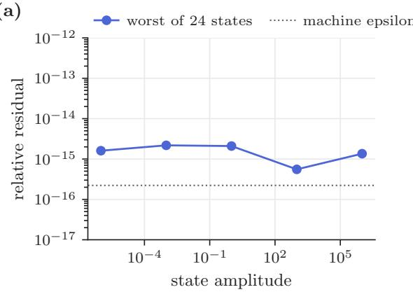

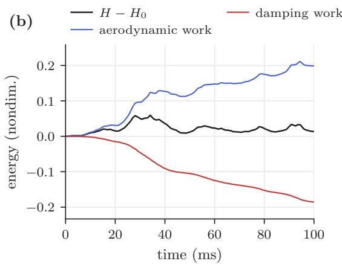

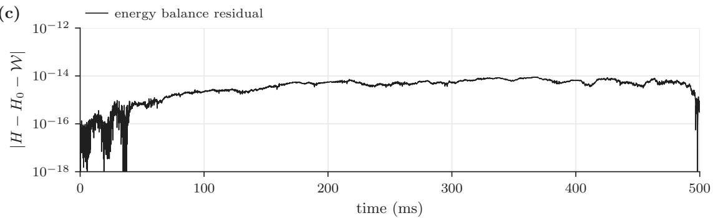  
Figure 4: The energy accounting, measured. (a) The worst relative residual of the energy identity, Equation (28), on the trained weights, against state amplitude over twelve decades. Each point is the worst of 24 random states. (b) Along one record member of the reference model, the change in energy $H - H _ { 0 }$ and the work done by the aerodynamic force and the damping. (c) The closure $| H - H _ { 0 } - \mathcal { W } |$ at every step of the record, where  is the total work of the two forces.

The shock, from geometry alone. As in [2], the wedge angle follows from the package’s wedge height and length, and the shock angle from its schlieren. The exact two-shock reflection [51] then predicts a pressure ratio of 1.521. The measured ratio is also 1.521. It is the ratio of two centerline medians of the package’s pressure-sensitive paint, measured on the rigid panel in the attached-shock case [2]. The medians are taken over $x = 1 1 2$ to 145 mm behind the pressure rise and $x = 8 0$ to 92 mm ahead of it. Other reasonable windows give 1.515 to 1.522. The prediction band of 1.45 to 1.60 comes from the package’s uncertainties. These are ±0.9 mm on the 7.8 mm wedge height and $\pm 0 . 6 2 ^ { \circ }$ on the $3 5 . 7 ^ { \circ }$ shock angle.

The wall temperature, from the package’s own pressures. On the chaotic case the adiabatic wall temperature derived from the Kulite pressures is 369.4 K, and from the scanner pressures 369.5 K. The simulation result of [3] is 377 K. The two instruments agree with each other to 0.1 K, and each difers from the simulation by about 7.5 K. That agreement, not the diference from 377 K, is the finding. Both values are derived from experimental measurements, and the simulation is a computation. Figure 6 shows the shock and the wall temperature.

(a)  
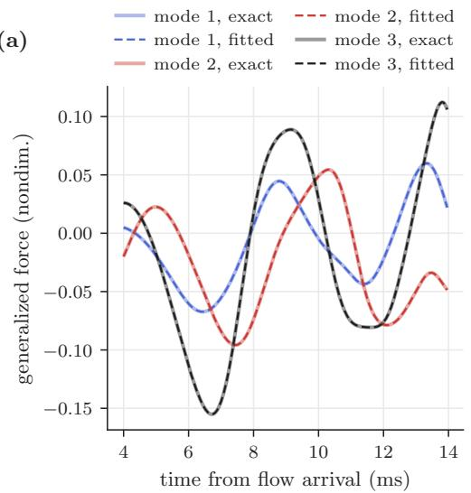

(b)  
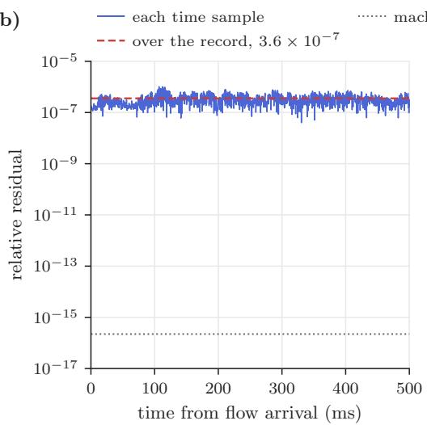  
Figure 5: The fitted force term of the periodic-case trained model against the reference model’s exact non-conservative force, $- ( \mathbf { A } \mathbf { q } + ( \mathbf { B } + \mathbf { C } ) \mathbf { p } )$ . Both are evaluated on the states of the record member at 50.43 kPa. (a) The first three of the seven modes over 10 ms. Solid lines are exact and dashed lines fitted. (b) The residual norm at each time sample, relative to the root-mean-square norm of the exact force over the record. The dashed line is the relative root-mean-square error, $3 . 6 \times \overset { \cdot } { 1 0 ^ { - 7 } }$ over the time samples where the exact force exceeds five percent of its largest norm.

Table 5: Self-consistency: the trained RC-19 model against the reference model that generated its record. These are not comparisons with experimental measurements, which are in Section 7.2. The last three statistics are taken on one record member, at $5 0 . 4 3 \mathrm { k P a } .$ at the nine extraction points. They cover one free rollout of 48 time samples, 1.9 ms. The band error uses the log-power measure of Table 3, with the spectral window set to the whole 48-sample rollout, and is the largest over the points. The amplitude ratio is the smallest and largest over the points. The mean error is the largest over the points.
<table><tr><td>Quantity</td><td>Measured</td></tr><tr><td>Energy identity on the trained weights, worst relative residual</td><td> $2 . 2 \times 1 0 ^ { - 1 5 }$ </td></tr><tr><td>Fitted non-conservative forces, relative error</td><td> $3 . 6 \times 1 0 ^ { - 7 }$ </td></tr><tr><td>Spectral band error</td><td> $0 . 1 6 \%$ </td></tr><tr><td>Amplitude, ratio of standard deviations</td><td>0.993 to 1.015</td></tr><tr><td>Mean deflection error</td><td>0.0009 thicknesses</td></tr><tr><td>Learned dissipation, positive definite</td><td>in every epoch, by construction</td></tr></table>

The response frequency, as a statistic. We ran thirty-member ensembles of the trained and the reference model at the periodic case’s experimental operating condition. Table 6 compares their statistics with the measured 236 Hz. The two mean frequencies lie within one 4.88 Hz spectral bin of each other. Each lies within 1.1 % of the measurement. The amplitude of Table 3 is equally stable in both ensembles. Its standard deviation across the members is 1.6 % of its mean for each model. On the chaotic case the reference model’s thirty-member ensemble gives a mean frequency of 239.6 Hz with a standard deviation of 12.8 Hz. That mean is 6.8 % below the measured 257 Hz that Brouwer et al. report for the chaotic case [3]. Figure 7 shows the two periodic-case ensembles.

Table 6: Thirty-member ensembles at the periodic case’s experimental operating condition.
<table><tr><td></td><td>Trained model</td><td>Reference model</td><td>Measured</td></tr><tr><td>Mean dominant frequency (Hz)</td><td>238.4</td><td>237.2</td><td>236</td></tr><tr><td>Standard deviation across members (Hz)</td><td>12.3</td><td>10.5</td><td></td></tr><tr><td>Difference from measured</td><td>1.0%</td><td>0.5%</td><td></td></tr><tr><td>Mean amplitude (thicknesses)</td><td>0.760</td><td>0.752</td><td></td></tr><tr><td>Amplitude standard deviation / mean</td><td>1.6%</td><td>1.6%</td><td></td></tr><tr><td>Amplitude full range / mean</td><td>5.7%</td><td>6.5%</td><td></td></tr></table>

These ensemble means depend on the interval of kicks that the ensemble samples. A kick is the first-mode displacement added to the buckled shape before release (Section 5.5). The thirty kicks of each ensemble span ±1.8 % about the set’s median kick. The aerodynamic study of Section 7.4 measured this dependence with a larger ensemble of 192 members. That ensemble uses unscaled aerodynamic operators and releases every member from the upper well. Its kicks span ±11.9 %. Its first thirty members are the reference ensemble of Table 6, and they give a mean frequency of 237.19 Hz. All 192 give 233.34 Hz. The diference could come from the sample size or from the wider interval. Splitting the 192 members by interval separates the two. The 31 members with kicks inside ±1.8 % give 237.20 Hz, and the 161 outside it give 232.60 Hz. The mean therefore follows the interval, not the sample size. An ensemble mean must therefore be quoted with its kick interval.

## 7.3. The regime map at the simulation operating conditions of Brouwer et al.

The reference model, at the experimental operating condition of the periodic case, returns a chaotic response. The reduced-order model of Brouwer et al. returns one as well, and it needed adjusted simulation operating conditions to place its periodic case. We therefore asked whether our two models reproduce its regime map when given its own inputs. The prediction, registered before the run, was periodic at a cavity pressure of 52.7 kPa and a temperature rise of 8.8 K. It was chaotic at 51.1 kPa and 13.6 K. The periodic condition is the single-well response of Fig. 11a of [3]. Their periodic companion to the experiment, in their Fig. 13, uses 7.1 K instead. The chaotic condition is that of their Fig. 12.

(a) measured foot of the interaction  
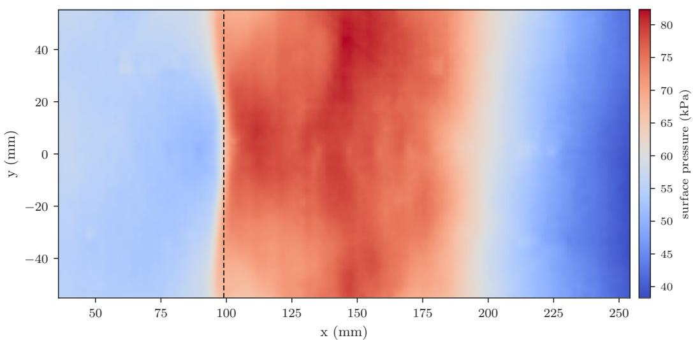

(b) paint, ratio 1.521 prediction band predicted, ratio 1.521 ahead of the shock  
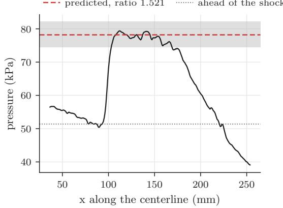

(c) from Kulite pressures simulation, 377 K from scanner pressures  
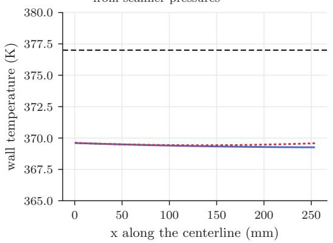  
Figure 6: Two comparisons from the package’s own measurements with nothing fitted. (a) The pressuresensitive paint field of the attached-shock case on the rigid panel; the dashed line is the measured foot of the interaction. (b) Its centerline against the plateau the two-shock reflection predicts from the wedge geometry, with the band set by the package’s uncertainties in wedge height and shock angle. The dotted line is the pressure ahead of the shock. (c) The adiabatic wall temperature along the centerline of the chaotic case. The temperature is derived from the Kulite and from the scanner pressures. The dashed line is the simulation result of Brouwer et al. [3].

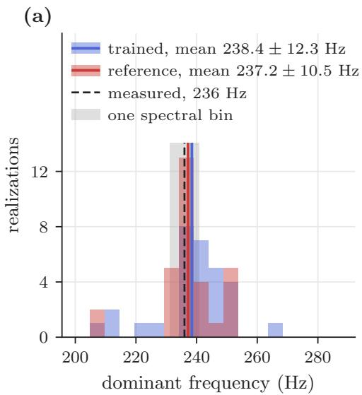

(b)  
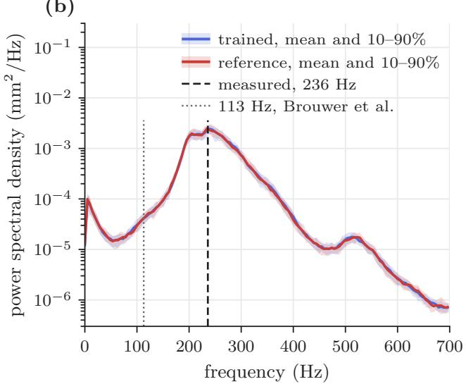  
Figure 7: The thirty-member ensembles at the periodic case’s experimental operating condition. (a) The dominant frequency of every realization, trained model against reference model, with the ensemble means as solid lines. The dashed line is the measured 236 Hz, and the shaded band one spectral bin. (b) The mean spectrum of each ensemble at three-quarter chord, with the 10th to 90th percentile band. The dotted line marks the 113 Hz peak of the reduced-order model of Brouwer et al., which neither ensemble shows.

Table 7: The regime at the simulation operating conditions of Brouwer et al. [3]. Each entry is a repeat set of sixteen releases, eight from each buckled well. The trained model was trained at a temperature rise of 12.76 K. Both conditions therefore lie outside its training temperature.
<table><tr><td>Condition</td><td>Brouwer et al. Reference [3]</td><td>model</td><td>Trained model</td><td>Agreement</td></tr><tr><td>52.7 kPa, 8.8 K</td><td>periodic</td><td>periodic</td><td>periodic</td><td>16 of 16</td></tr><tr><td>51.1 kPa, 13.6 K</td><td>chaotic</td><td>chaotic</td><td>chaotic</td><td>16 of 16</td></tr></table>

The prediction held on both the reference and the trained model, at both conditions, from both wells, in every repeat (Table 7, Figure 8). At the periodic simulation operating condition, every repeat of the trained model returns the same 253.9 Hz bin, as the reference model does. The amplitude of Table 3 is 0.7164 thicknesses for the trained model and 0.7161 for the reference model, which agree to 0.04 %. At the chaotic simulation operating condition, the trained model’s median frequency over its sixteen repeats is 249.0 Hz. The reference model that generated its record, with the periodic case’s thermal field, gives 239.3 Hz. Brouwer et al. [3] report a peak at 113 Hz in their reduced-order model that the experiment does not show. Neither of our models shows it in any repeat or in any of the thirty ensemble realizations of Section 7.2.

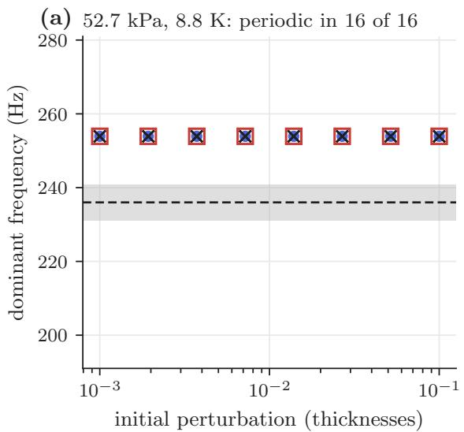

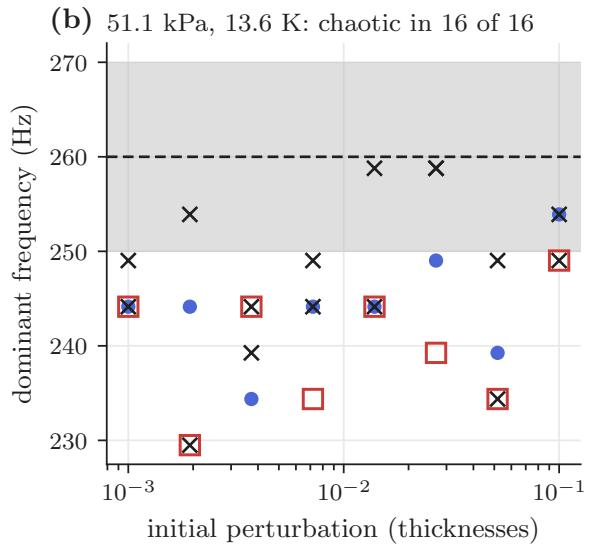  
Figure 8: The regime at the simulation operating conditions of Brouwer et al., on the reference model. Each panel holds sixteen repeats, kicked over two decades and released from both buckled wells. (a) At the periodic simulation operating condition every repeat returns one frequency, and the two wells coincide. (b) At the chaotic simulation operating condition the frequencies scatter, which is the response rather than numerical noise. The dashed line is the measured dominant frequency reported by Brouwer et al. [3]. It is 236 Hz for the periodic case. For the chaotic case it is approximately 260 Hz, from the discussion of their Fig. 12. Their Section 5.4 gives 257 Hz for the same case, which lies inside the band. The shaded band is a tolerance set in this study. It is 4.88 Hz, one bin of the frequency grid, for the sharp periodic peak. It is 10 Hz for the broad chaotic one. Crosses mark the trained model at the same kicks. It returns the same regimes in every repeat (Table 7).

What this settles is where the regime disagreement at the experimental operating condition lives. With the inputs of Brouwer et al., our models return the regimes of their model. The disagreement is therefore a property of the inputs, not of the aerodynamic model. The inputs in question are the distribution of the temperature rise and the pressure the static load is referenced to. The reduced-order model of Brouwer et al. has the same disagreement. Brouwer et al. [3] report the ofsets of their periodic companion simulation at

7.1 K. It sits 4.6 % of the experiment in cavity pressure and 44.5 % of in temperature rise.

One comparison with the experiment at the simulation operating conditions does not agree. Our frequency at the periodic simulation operating condition is 253.9 Hz, which is 7.6 % above the measured 236 Hz. Our peak amplitude at the simulation operating conditions is 1.54 to 1.95 thicknesses. The measured oscillation amplitude at three-quarter chord reaches about 1.8 thicknesses in Fig. 7a of [3]. Those measurements span the experimental runs rather than the simulation operating conditions. Their amplitude measure may also difer from our peak amplitude, and the comparison is therefore approximate. Brouwer et al. report that their periodic companion misses the measured amplitude by 31.7 %.

## 7.4. What the aerodynamic model contributes

The reference model’s aerodynamic force is first-order piston theory with freestream coeficients. The enrichment that Brouwer et al. apply replaces freestream quantities by local ones. That scales the aerodynamic operators by the local to freestream pressure ratio. Brouwer et al. give a mean RANS surface pressure of 51.0 kPa against a freestream pressure of 48.4 kPa [3], a ratio of $5 1 . 0 / 4 8 . 4 = 1 . 0 5 4$ . Rather than build the enriched model, we measured what that scaling changes.

The first registered prediction was that the scaling leaves the regime unchanged and moves the dominant frequency by less than 2 %. At the periodic simulation operating condition, it moved the frequency by 0.00 Hz. At the experimental operating condition, where the response is chaotic, the median frequency moved by +3.23 and −3.00 % in the two wells. The condition failed. It set a tolerance of 4.7 Hz, two percent of 236 Hz, on a frequency that the estimator quantizes at 4.88 Hz. Across repeats that frequency has a standard deviation of 16.3 Hz. The two wells also moved in opposite directions, which a change in the aerodynamic coeficients cannot cause. The failure therefore lies in the condition rather than the physics (Section 9). The replacement, R3, was registered before its run. It has two clauses: the mean frequency is equivalent within two percent, and the spectral change stays within sampling.

The mean-frequency clause uses an equivalence test, because a diference test cannot support a claim of no efect. It applies two one-sided tests [13] to each well. The 95 % interval for the diference of the two ensemble means must lie inside $\pm \delta _ { \mathrm { e q } }$ . The tolerance $\delta _ { \mathrm { e q } }$ is two percent of the well’s unscaled ensemble mean, which gives about 4.7 Hz. This two percent was registered before the runs without reference to the frequency’s sampling noise. Section 9 reports what that cost.

The ensemble size gives the test 80 % power. It uses the pooled standard deviation $s _ { \mathrm { p o o l } } = 1 6 . 3$ Hz across repeats. It also uses $\delta _ { \mathrm { e q } } = 4 . 7 2$ Hz, the tolerance of the well whose unscaled mean is 236.12 Hz. Each configuration then needs

$$
N _ { e } \ \ge \ \frac { 2 s _ { \mathrm { p o o l } } ^ { 2 } \big ( z _ { 0 . 9 7 5 } ^ { * } + z _ { 0 . 8 0 } ^ { * } \big ) ^ { 2 } } { \delta _ { \mathrm { e q } } ^ { 2 } } \ = \ 1 8 7 . 2\tag{42}
$$

members, where $z _ { 0 . 9 7 5 } ^ { * } = 1 . 9 6$ and $z _ { 0 . 8 0 } ^ { * } = 0 . 8 4$ are standard normal quantiles. The minimum is therefore 188 members, and each ensemble used 192.

The spectral clause tests the change in the spectrum against sampling, using the band error of Table 3. The band error between the mean spectra of the two configurations must not exceed that between the odd and even members of one configuration.

Four ensembles of 192 reference model members were run at the experimental operating condition of the periodic case, unscaled and scaled, released from each well. The reference model is the right model for this study, because its aerodynamic operators can be scaled directly. The trained model’s fitted force term matches them to relative errors of $9 . 6 \times 1 0 ^ { - 7 }$ and $7 . 3 \times 1 0 ^ { - 7 }$ (Section 7.1).

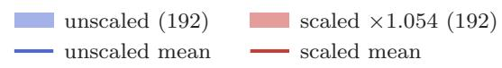

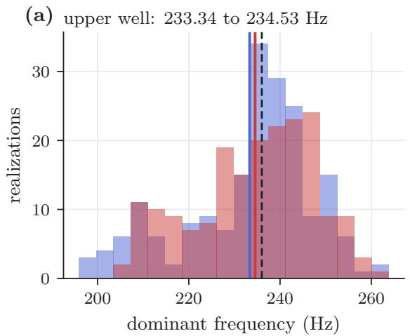

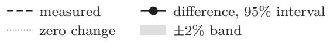

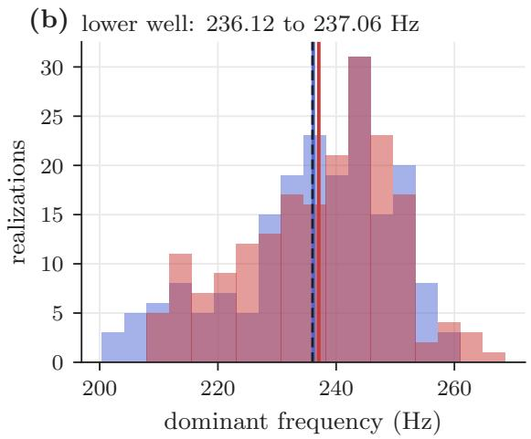

(c)  
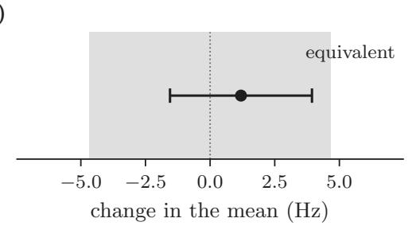

(d)  
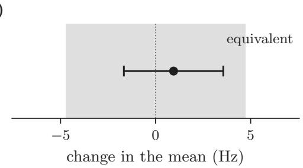  
Figure 9: Equivalence of the mean response frequency under the enrichment, on the reference model. (a, b) The dominant frequency over 192 realizations in each configuration, per buckled well. Solid lines are the ensemble means, and the dashed line is the measured value. $( \mathrm { c } , \mathrm { d } )$ The diference of the means with its 95 % interval, inside the registered equivalence band. The ensemble means from the two wells bracket the measured value.

The mean frequency is equivalent within 2 % in both wells. In the lower well the shift is 0.40 %, with an interval of $[ - 1 . 6 7 , + 3 . 5 6 ]$ Hz. In the upper well it is 0.51 %, with $[ - 1 . 5 5 , + 3 . 9 4 ]$ Hz (Figure 9). Each band is two percent of that well’s unscaled mean: ±4.72 Hz of 236.12 Hz and ±4.67 Hz of 233.34 Hz. The movements of +3.23 and −3.00 % under the first prediction were therefore sampling. The spectrum, however, does respond. The band error between configurations is 3.09 and 3.74 times the band error between odd and even members (Figure 10). The amplitude rises by 2.31 and 2.55 %, outside its own interval in both wells. The criterion required both the frequency test and the spectrum test to pass, and it is not met. The two tests disagree, and the disagreement is the result.

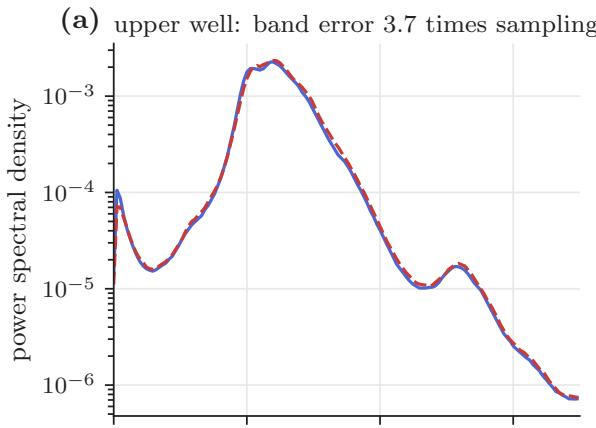

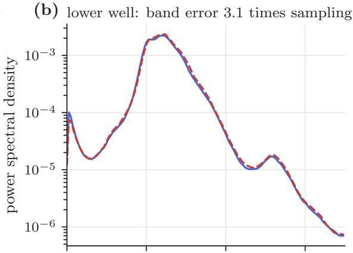

(c)  
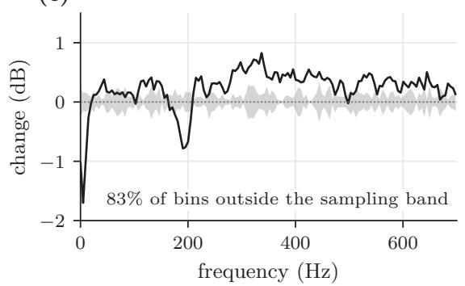

(d)  
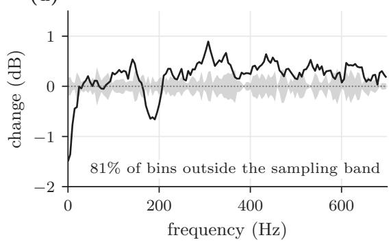  
Figure 10: Aerodynamic sensitivity at the experimental operating condition, from four ensembles of 192 reference model members. (a, b) The mean spectrum per buckled well, with the aerodynamic operators unscaled and scaled by the local to freestream pressure ratio. (c, d) The change between the two configurations, against the diference between the odd and even members of one configuration, which is sampling alone.

The local-coeficient enrichment of Brouwer et al. has a small but measurable efect. A 5.4 % change in the aerodynamic coeficients moves the amplitude by 2.4 %, which is an elasticity of $2 . 4 / 5 . 4 = 0 . 4 4$ . It does not move the mean frequency measurably. The enrichment is therefore a percent-level refinement of accuracy. It does not set the regime label, and Section 7.7 shows that it does not set the fluctuation level.

## 7.5. Chaos and the tracking horizon

The exponent. Brouwer et al. [3] establish the chaos with a positive largest Lyapunov exponent that rises with temperature. Figure 11 shows the sweep described below.

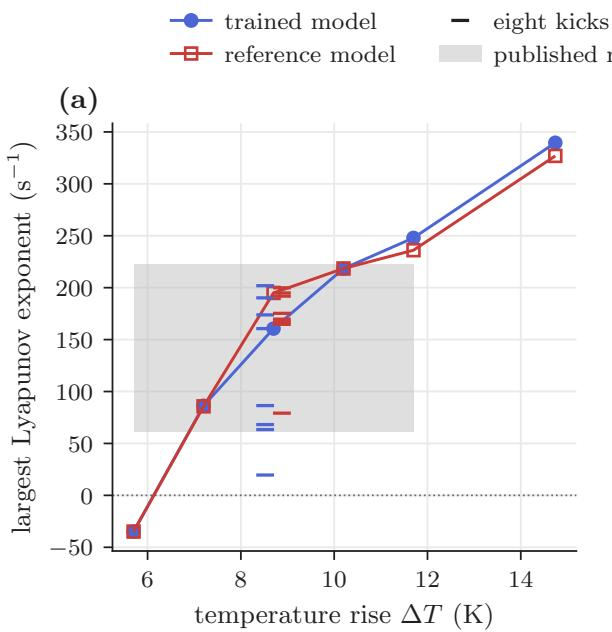

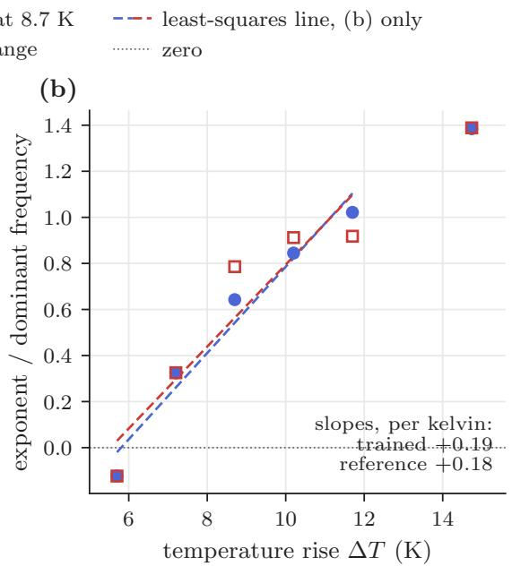  
Figure 11: The largest Lyapunov exponent over temperature at 51.1 kPa, one trajectory per temperature, trained model against the reference model that generated its record. (a) The exponent, with the range Brouwer et al. report over their five temperatures, 5.7 to 11.7 K. The short bars at 8.7 K are eight trajectories per model, kicked logarithmically from $\bar { 1 } 0 ^ { - 3 }$ to $1 0 ^ { - 1 }$ thicknesses. (b) The exponent divided by each model’s dominant frequency, with least-squares lines over the five published temperatures.

We march the linearized error equations of Brouwer et al. (Equations 19 to 23 of [3]) along the trained model’s own trajectories. The linearization is the trained model’s own. The result reproduces that behavior. The sweep runs at 51.1 kPa and six temperatures from 5.7 to 14.74 K. There the trained model and the reference model that generated its record, with the periodic case’s thermal field, agree in sign at all six. Both are negative at 5.7 K, where each gives $- 3 4 . 9 \mathrm { { s } ^ { - 1 } }$ . At 7.2, 10.2, 11.7 and 14.74 K their diference, relative to the reference model, is at most 5.1 %. At 8.7 K they difer by 17.6 %, 160.6 against $\mathrm { 1 9 4 . 9 s ^ { - 1 } }$ which broke the registered tolerance of 15 %.

That temperature was then examined by a measurement registered before its run. Eight trajectories were run on each model at 8.7 K, with kicks spaced logarithmically from $1 0 ^ { - 3 }$ to $1 0 ^ { - 1 }$ thicknesses. They give exponents from 19.6 to $2 0 1 . 9 \mathrm { s } ^ { - 1 }$ on the trained model and $7 9 . 2$ to $\mathrm { 1 9 9 . 9 s ^ { - 1 } }$ on the reference model. The ranges overlap, each is wider than 17.6 % of its median, and a Mann–Whitney rank test [52] does not distinguish them (two-sided p-value 0.19). At this temperature a single trajectory does not determine the exponent on either level. The broken comparison says nothing against the trained model, and the prediction stays broken as registered. The trained model’s median, $1 2 3 . 5 \mathrm { s } ^ { - 1 }$ , sits below the reference model’s, $\mathrm { 1 7 2 . 5 s ^ { - 1 } }$ . With eight trajectories per model that diference is not resolved. If it is real, the integrators are a candidate cause. The trained model uses the generalized-α step, which damps high frequencies numerically. The reference model uses the energy-conserving AVF step. Numerical damping could lower the growth rate of small separations, and with it the exponent. We did not run the larger set of trajectories that would test this.

The same caution applies to the trend. Brouwer et al. report exponents at five temperatures, 5.7 to 11.7 K at 51.1 kPa. Over those five we divide the exponent by each model’s own dominant frequency. That ratio rises 0.19 per kelvin on the trained model and 0.18 on the reference model. On both, the exponents at 7.2, 8.7 and 10.2 K fall inside the published range of 61 to $ { 2 2 2 \mathrm { s } ^ { - 1 } }$ . Each value rests on one trajectory per temperature and carries the spread just measured. The slope and the count are therefore indicative, not established.

The horizon. Chaos limits every model of this panel, ours included. A model started at a separation $\varepsilon _ { 0 }$ from the truth separates as $e ^ { \lambda t }$ until it reaches the state scale $\sigma .$ The state scale is the size of the response itself, at which the separation saturates. The tracking horizon is therefore

$$
T _ { h } = { \frac { 1 } { \lambda } } \ln \left( { \frac { \sigma } { \varepsilon _ { 0 } } } \right) .\tag{43}
$$

Starting accuracy enters through a logarithm. At 51.1 kPa and the chaotic case’s 14.74 K, the reference model with the chaotic case’s thermal field has an exponent of $\mathrm { 3 4 9 s ^ { - 1 } }$ . The sweep above, with the periodic case’s thermal field, gives $3 2 7 { \mathrm { s } } ^ { - 1 }$ at the same temperature. One decade of starting accuracy then buys ln $1 0 / \lambda = 6 . 6 \mathrm { m s }$ . A model exact to doubleprecision roundof starts near $\varepsilon _ { 0 } = 1 0 ^ { - 1 6 }$ . The state scale is about one thickness. Here and below, tracking ends at half of it, $\sigma / 2 = 0 . 5$ . With $\sigma / 2$ in place of $\sigma _ { \mathrm { : } }$ , that model would track l $1 ( 0 . 5 / 1 0 ^ { - 1 6 } ) / \lambda \approx 1 0 4$ ms. That is the ceiling for any model of this panel computed in that arithmetic.

The bound needs no learned model. Its rate λ is measured on the reference model alone, and its starting error $\varepsilon _ { 0 }$ is whatever a model achieves. A model that starts at $\varepsilon _ { 0 } = 1 0 ^ { - 2 }$ tracks ln $( 0 . 5 / 1 0 ^ { - 2 } ) / \lambda = 1 1 . 2$ ms. At $\varepsilon _ { 0 } = 1 0 ^ { - 5 }$ it tracks ln $( 0 . 5 / 1 0 ^ { - 5 } ) / \lambda = 3 1 . 0$ ms. Each further decade of starting accuracy adds only 6.6 ms. Improving the model therefore extends the horizon only slowly.

The horizon is why the comparisons of this report are statistics, which are reproducible, rather than the peak of a single realization, which is not. Brouwer et al. [3] grade their own model the same way. Their published exponent comes from their reduced model’s trajectories. Their model therefore loses a trajectory on the same clock. Tracking beyond the horizon cannot come from model quality or integrator quality. It needs measurement.

## 7.6. Tracking by assimilation

The assimilation of Section 5.11 was tested in a twin experiment. In a twin experiment the model is exact and only its state is wrong. The test therefore measures what the observations can support, not what the model’s physics lacks.

The truth is one reference model member at the chaotic case’s experimental operating condition of 51.49 kPa and 14.74 K. It starts in the upper well with a kick of $1 0 ^ { - 3 }$ thicknesses, runs 0.12 s, and is sampled at 25 kHz. A copy of the reference model starts with its firstmode displacement $1 0 ^ { - 3 }$ thicknesses away from the truth’s. The copy is corrected with the truth’s displacements at the nine published extraction points. It takes two discrete-gradient steps per time sample. The correction of Equation (38) acts like springs and dampers that tie the copy to the truth at the nine points. The gain $k _ { p }$ is the spring stifness, acting on the displacement mismatch. The gain $k _ { d }$ is the damping coeficient, acting on the mismatch in its rate. The tracking runs use $k _ { p } = 1 0 ^ { 5 } \mathrm { N m ^ { - 1 } }$ and $k _ { d } = 5 \times 1 0 ^ { 3 } \mathrm { N s m ^ { - 1 } }$ . The gain study uses a 0.2 s member at the same condition.

The energy budget of Corollary 1 closes under assimilation, with the observer’s work reported as a separate term. The worst per-step defect, divided by the larger of the step’s two energies, is $3 \times 1 0 ^ { - 1 3 }$

Observability. The nine published points observe all seven modes. The observability Gramian $\mathbf { M } _ { \Phi }$ of Equation (38) has a condition number, the ratio of its largest to its smallest eigenvalue, of 45. The least visible combination of modes therefore registers about $\sqrt { 4 5 } \approx 6 . 7$ times more weakly in amplitude than the most visible one. Amplitude scales as the square root of a Gramian eigenvalue. No mode has a node at all nine points, and recovering the weakest one does not demand a large amplification of noise. That was not assured in advance, because the points were chosen for imaging rather than for observability.

Gains. The open-loop exponent is the largest Lyapunov exponent of the error equation (40) with both gains set to zero. On the trajectory of this twin experiment it is $2 8 5 \mathrm { s ^ { - 1 } }$ . The $\mathrm { 3 4 9 s ^ { - 1 } }$ of Section 7.5 comes from another trajectory, at 51.1 kPa with the chaotic case’s thermal field. The diference lies within the single-trajectory scatter measured there.

Both gains act on the unit-mass modal coordinates. Position feedback alone does not contract the error. With $k _ { d } = 0 ,$ , no position gain up to $k _ { p } = 1 0 ^ { 1 4 }$ did. Rate feedback does, but more of it is not better. The smallest position gain tested is $k _ { p } = 1 0 ^ { 2 }$ , and at both rate gains below the error already contracts there. Both closed-loop exponents are therefore quoted at $k _ { p } = 1 0 ^ { 2 }$ . The exponent is $- 1 0 . 6 \mathrm { { s } ^ { - 1 } }$ at $k _ { d } = 2 \times 1 0 ^ { 3 }$ and only $- 2 . 6 \mathrm { s } ^ { - 1 }$ at $k _ { d } = 2 \times 1 0 ^ { 4 }$ . A negative exponent means the error shrinks rather than grows. With feedback the copy therefore stays on the truth for as long as observations arrive, instead of leaving it after a horizon.

A one-mode argument explains why. At $k _ { p } = 1 0 ^ { 2 }$ the position feedback is negligible. The largest eigenvalue of $k _ { p } \mathbf { M } _ { \Phi }$ is $1 0 ^ { 2 } \times 1 9 5 = \mathrm { \dot { 2 } . 0 \times 1 0 ^ { 4 } }$ . That is under one percent of the flat panel’s smallest squared natural frequency $\omega _ { 1 } ^ { 2 } = 2 . 7 \times 1 0 ^ { 6 } \mathrm { s ^ { - 2 } }$ . The error equation (40) therefore keeps the panel’s own stifness $\nabla ^ { 2 } U + \mathbf { A }$ . Consider one overdamped mode, and let $K _ { \delta }$ be its stifness. The roots of $s _ { r } ^ { 2 } + k _ { d } s _ { r } + K _ { \delta } = 0$ are then real, and the slower root is about $- K _ { \delta } / k _ { d } .$ . Raising $k _ { d }$ therefore slows the decay. The measured rates difer by a factor of 4.1 rather than the predicted ten. The one-mode picture is therefore qualitative.

Tracking against observation rate. Without observations the copy leaves the truth after about ln $( 0 . 5 / 1 0 ^ { - 3 } ) / ( 2 8 5 \mathrm { s ^ { - 1 } } ) \approx 2 2$ ms. The late tracking error is taken over the second half of the 0.12 s run, from 60 to 120 ms, which lies entirely past that horizon. It is the median of the Euclidean norm of the modal displacement error divided by $w _ { s } ,$ in thicknesses. Table 8 and Figure 12 give it.

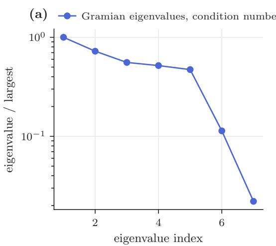

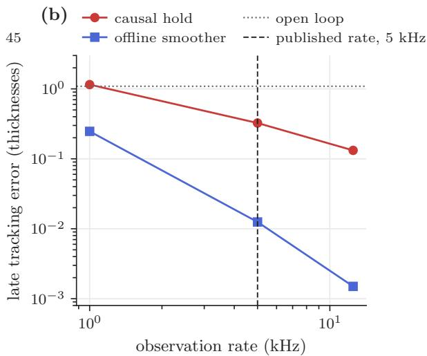  
Figure 12: Assimilation through the nine published points. (a) The eigenvalues of the observability Gramian ${ \bf M } _ { \Phi } ,$ relative to the largest; their ratio is the condition number. (b) The late tracking error of the twin experiment against observation rate, with the causal hold and the ofline smoother. The dotted line is the open-loop error, and the dashed line the published 5 kHz rate.

Open loop it saturates at 1.09 thicknesses, which is the size of the response itself. With the causal hold, the error falls linearly with the observation interval and is insensitive to the gain over three decades. That is the signature of the hold’s reconstruction, not of the information in the data. With the ofline smoother it falls roughly as the square of the interval. This rate is the order of the smoother’s reconstruction. At the experiment’s 5 kHz measurement rate, the smoother holds the state to 0.0125 thicknesses, twenty-six times smaller than the hold’s 0.325.

Table 8: Late tracking error against observation rate, in panel thicknesses, in a twin experiment on the reference model, observed at the nine published points. The experiment’s measurement rate is 5 kHz. Open loop the error is 1.09. Samples per cycle divide the observation rate by 240 Hz, the reference model’s mean dominant frequency on the chaotic case, 239.6 Hz, rounded.
<table><tr><td>Observation rate</td><td>Samples per cycle</td><td>Causal hold</td><td>Offline smoother</td></tr><tr><td>1 kHz</td><td>4.2</td><td>1.151</td><td>0.247</td></tr><tr><td>5 kHz, the published rate</td><td>20.8</td><td>0.325</td><td>0.0125</td></tr><tr><td>12.5 kHz</td><td>52</td><td>0.132</td><td>0.0015</td></tr></table>

Noise. At 5 kHz with the smoother the error is 0.0125 thicknesses without noise, 0.0130 with one micron of noise on each reading, and 0.0352 with ten. The noise is Gaussian, independent at each point and each sample. Ten microns is 0.016 thicknesses of the 0.635 mm panel. Once noise dominates, the error settles at $0 . 0 3 5 2 / 0 . 0 1 6 \approx 2 . 2 $ times the noise level. That is what a linear observer with a well-conditioned Gramian should give.

This result is a best case, not a validation. It assumes an exact model and observations generated by that model. The published layout and rate, with an ofline smoother, hold the reference model’s state to 0.0130 thicknesses with 1 µm of measurement noise. With 10 µm the error is 0.0352. Measured data would add the model’s own error to these values. The result also states what future data must provide for assimilation: displacement time histories at the nine points, at 5 kHz, with noise near one micron. The public package holds no response time series. The published statistics come from Brouwer et al. [3] and Piccolo Serafim et al. [9].

## 7.7. The open comparison, and the measurement that closes it

One comparison with the experiment remains open on the attached-shock case. The measured deflection at three-quarter chord on the centerline has a standard deviation of 0.943 thicknesses. We digitized it from a figure of [9] that plots the mean deflection and the lines one standard deviation above and below it. At three-quarter chord those three lines read +0.096, +1.035 and −0.850 thicknesses. Half the spread between the outer two is $( 1 . 0 3 5 + 0 . 8 5 0 ) / 2 = 0 . 9 4 3$

The reference model is driven by a random surface pressure at the measured fluctuation level. That level is $0 . 0 0 9 6 q _ { \infty }$ in root-mean-square, where $q _ { \infty }$ is the freestream dynamic pressure. It is the Kulite reading beneath the incident shock in Fig. 16(b) of [2]. The random pressure is Gaussian, flat from 20 to 2000 Hz, and correlated over the boundary-layer thickness of 8.6 mm. Each run discards its first 0.25 s to remove the decay from the initial state and keeps the next 2 s. Over three random seeds, the model’s deflection at the same station has a standard deviation of 0.057 to 0.062 thicknesses. That is about a sixteenth of the measured 0.943. Figure 13 shows the mean shape and this deviation.

The published statistics do not say how the panel moves. Switching between two buckled shapes, a limit cycle, and broadband motion about one shape all reproduce the published mean and deviation. The factor of sixteen therefore does not depend on which of these motions the panel performs. No learned model was built for this case. The gap lies in the reference model, upstream of any learning.

Every parametric candidate cause inside the physically admissible range was eliminated by measurement (Table 9). One structural mechanism remains, and it is stated below. One of them, a learned conservative correction to the potential, was registered as a prediction, run, and falsified. The aerodynamic enrichment of Section 7.4 is bounded with the others. Amplitude scales as the coeficients to the power 0.44. Closing a sixteenfold deficit would therefore need the coeficients scaled by $1 6 ^ { 1 / 0 . 4 4 } \approx 1 0 ^ { 2 . 7 }$ . No enrichment of piston theory provides that.

Table 9: Candidate causes of the fluctuation deficit on the attached-shock case, and how each was eliminated.
<table><tr><td>Candidate cause</td><td>How it was eliminated</td></tr><tr><td>Turbulent forcing level</td><td>bounded by the facility&#x27;s own unsteady measure- ments [2]; the response is linear in it and reaches a third of the measurement at five times the measured level</td></tr><tr><td>Temperature</td><td>bounded above by the adiabatic wall Edge stiffness, membrane stiffness, swept across the admissible range; none closes the</td></tr><tr><td>and the modal basis</td><td>deficit Shock position, and its dependence on each thickness of deflection moves the measured</td></tr><tr><td>the panel&#x27;s deflection</td><td>shock footprint 0.88 mm upstream; a self-consistent solve with that shift still finds one equilibrium Shock strength, and the same depen- closed by shock-expansion theory on the deflected</td></tr><tr><td>dence A learned conservative correction to registered, run, and falsified</td><td>panel</td></tr><tr><td>the potential The enriched aerodynamic model</td><td>amplitude elasticity of 0.44 to the piston coefficients</td></tr><tr><td></td><td>(Section 7.4)</td></tr></table>

What remains is structural rather than a parameter. The reference model is loaded by the pressure field measured on the rigid panel, held fixed as the panel deflects. The real field depends on the panel’s deformed shape, and that dependence changes the efective aeroelastic stifness. With the fixed field the reference model reproduces the measured chordwise mean shape to a root-mean-square deviation of 0.22 thicknesses. The profile digitized from [9] carries a reading error of about 0.11. The mean is therefore not where it fails. Testing the mechanism needs either time-resolved surface data or a computation on the deformed geometry. The public package carries neither. The same limitation shows in the reduced-order model of Brouwer et al., which needed adjusted inputs to place its own

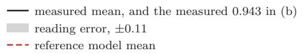

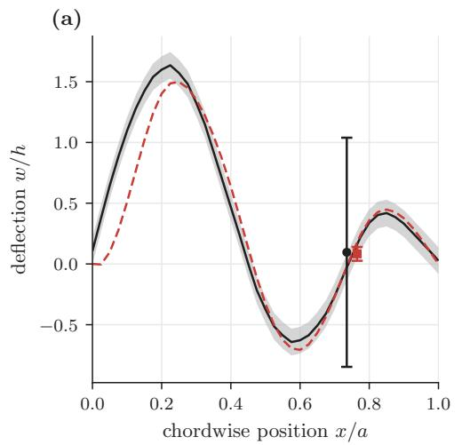

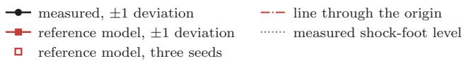

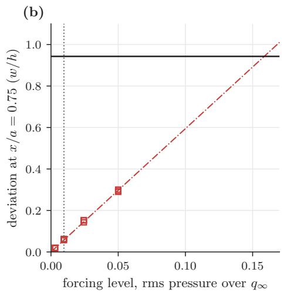  
Figure 13: The attached-shock case, with the reference model against the measurement digitized from [9]. The reference model uses the measured static and thermal fields, seven measured modes and clamped edges. (a) The chordwise mean deflection on the centerline at the measured forcing level. The shaded band is the reading error of the digitized profile. The bars at three-quarter chord span plus and minus one standard deviation. (b) The model’s standard deviation at three-quarter chord against the forcing level, which is the root-mean-square surface pressure divided by $q _ { \infty }$ . Each level has three random seeds. The deviation grows linearly with the forcing level and reaches the measured 0.943 only near sixteen times the measured level. The dotted line marks that measured level. Each run lasts 2.25 s, and its first 0.25 s is discarded.

regimes.

Two items of data would close this comparison. The first is the time series behind the published statistics at the nine points, or a statement that none was retained. Section 7.6 shows that the published rate and a plausible noise level sufice to use it. The second is a computational record on the deformed geometry of the attached-shock case, which would test the remaining mechanism directly.

## 8. HyMAX: the cantilever plate at Mach 5.85

The HyMAX model is the RC-19 construction applied to a diferent configuration. The plate is a cantilever rather than a clamped panel, at Mach 5.85 rather than 1.92. An oblique shock impinges on the plate, which the RC-19 training cases lack, and the inflow varies in time. What changed is the reference model and its generalized forces. The energy identity (Proposition 2), the learned dissipation (Lemma 2), the fitted force term, the objective and the integrator are unchanged from Section 5. No term was added to the objective.

Table 10 and Figure 14 give the relative root-mean-square error $e _ { \mathrm { r m s } }$ of Equation (41), under the protocol of Section 6.3. Over the early window, the first 1.9 ms, it is 0.31 %. Over the whole 64.9 ms rollout it is 3.67 %, and that is the result to read. The error grows linearly rather than exponentially, because the $\mathrm { H y M A X }$ response is not chaotic (Figure 15a). The fitted force term represents the time-varying aerodynamic operators only on average, and its small residual acts at the first-mode frequency. On a mode damped at $\zeta = 0 . 0 1$ that residual builds up over cycles. The build-up stays linear for times short against $1 / ( \zeta \omega _ { 1 } ) \approx 1 9 0$ ms. The trained model follows the reference model’s trailing edge through about five first-mode cycles, $6 4 . 9 \mathrm { { m s } \times 8 3 \mathrm { { H z } \approx 5 . 4 } }$ , to within four percent, with nothing fed back.

Table 10: HyMAX: relative root-mean-square error of the trailing-edge displacement in free rollout, against the reference model record member, for the trained model after 263 epochs.
<table><tr><td>Window</td><td>Duration</td><td>Relative error</td></tr><tr><td>First 48 time samples</td><td>1.9ms</td><td>0.31%</td></tr><tr><td>Full rollout</td><td>64.9 ms</td><td>3.67%</td></tr></table>

The error that remains is the one Section 5.8 anticipates. The reference model’s aerodynamic operators follow the measured dynamic pressure in time, and a fitted term with constant coeficients can represent them only on average. Over the record’s states, the fitted generalized forces correlate with the reference model’s exact forces at a Pearson coeficient of 0.998, over both modes pooled. Figure 14(c) shows the residual. The fitted first-mode force follows the exact one with a slightly larger swing, and the second mode’s matches closely.

Two further results concern the number of retained modes. A third mode does not reduce the error. Two and three modes give 0.307 and 0.294 % over the first 1.9 ms, and 3.67 % over the full rollout. Figure 15 shows the two errors over the rollout. A six-mode basis is not admissible. With six modes the state has twelve components, but the whitened coordinate of Section 5.6 keeps only eleven independent directions. The sixth mode, near 7 kHz, is resolved at the record’s 25 kHz rate but carries no representable energy under the measured drive. The map back to physical coordinates is then not invertible, and the basis is rejected. The largest usable basis is therefore determined by the record rather than assumed. The model reports what its data do not support, instead of fitting a direction the data do not contain.

These results are graded against the HyMAX reference model, not against the experiment. The reference model’s first frequency is the measured 83 Hz by construction. Its second, 520 Hz, lies within 2 % of the 530.4 Hz computed by Xu and Dowell [19]. Its damping ratio, $\zeta = 0 . 0 1$ , is a setting rather than a measurement.

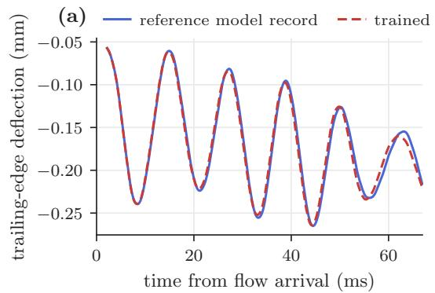

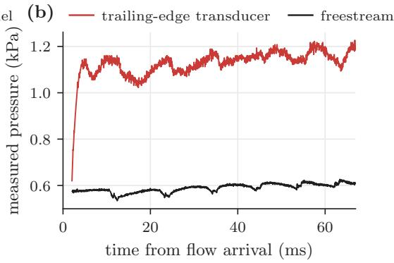

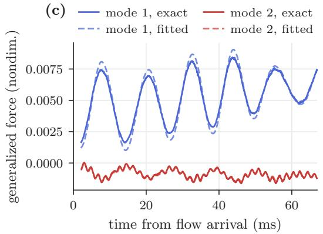

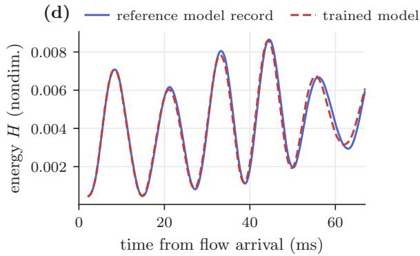  
Figure 14: HyMAX in free rollout from one recorded state. (a) The trailing-edge deflection of the trained model against the reference model record member it is graded on. (b) The measured freestream and trailing-edge pressures that drive both. (c) The state-dependent generalized force of each mode, exact and fitted, evaluated on the record’s states. (d) The energy along the rollout.

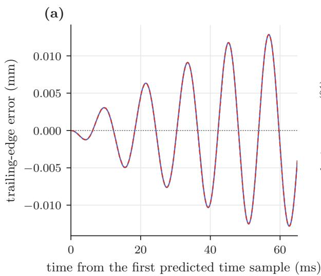

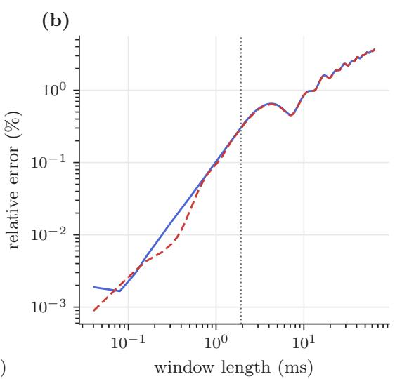  
Figure 15: HyMAX trained models with two and three retained modes, trained for 263 and 247 epochs, in free rollout from the time sample of Figure 14. (a) The trailing-edge displacement error, model minus reference model record. (b) The relative root-mean-square error over a window from the first predicted time sample, against the window’s length. The dotted line marks 48 time samples, 1.9 ms.

## 9. Preregistered predictions and their outcomes

Table 11 lists the predictions registered for the studies this report presents, in the order registered, with their outcomes. A prediction is broken when any registered condition fails. Four of nine broke: A1, R2, R3 and T5. All are retained as registered, and no threshold was moved. Twenty-one earlier predictions, made while the reference models were developed, concern superseded configurations and are not listed.

R2 broke because its condition sat below its own noise. Every frequency the estimator returns lies on the package’s 4.88 Hz spectral grid. Two percent of 236 Hz is 4.7 Hz, less than one grid interval. The two wells moved by the same 7.3 Hz in opposite directions. A change in the aerodynamic coeficients does not do that, since it stifens or softens both wells in the same sense. Within one repeat set, the frequency range, largest minus smallest, was 39 to 44 Hz, against a pooled standard deviation of 16.3 Hz. The condition placed a two percent tolerance on a quantity whose standard deviation across repeats was 16.3 Hz, about seven percent. Its estimator is quantized at 4.88 Hz, about two percent. It was registered without checking it against the noise of the quantity it tested. The replacement R3 changed the statistic, not the tolerance, and sized its sample from the measured spread before the run.

R3 broke on one of its two clauses, and that is its result. Its mean-frequency clause held and its spectral clause did not. Section 7.4 reports both. Together they bound the localcoeficient enrichment of Brouwer et al.: it moves the amplitude by 2.4 %, not the mean frequency.

T5 broke at one temperature. The follow-up measurement of Section 7.5, eight trajectories per model at 8.7 K, was registered before it ran. It found the 17.6 % diference inside the scatter of single-trajectory exponents. That diagnosis does not re-grade the prediction.

What the four trained-model predictions that held license. In T2 to T4 the trained model was run outside its training temperature, with the generalized-α step it was trained with. It returns the reference model’s regimes, ensemble frequency and amplitude, and, like the reference model, shows no 113 Hz peak. These results may therefore be attributed to the trained model. The fitted force term reproduces the reference model’s non-conservative forces to a relative root-mean-square error of $3 . 6 \times 1 0 ^ { - 7 }$ . These results therefore measure the fitted structure-preserving model and its integrator. They do not show that training learned the dynamics.

## 10. Discussion

One generated record sufices when the physics is in the model’s form. Neither challenge problem ofers an ensemble, and neither ofers a time-resolved response. The models of this report needed neither, because almost nothing in them is learned from data. The RC-19 model has 35 trained numbers and 119 fitted ones, against 2464 fixed numbers in its potential (Section 5.8). The energy identity holds for any weights, hence at the random initialization and at every epoch. The optimizer therefore never had to find the physics. What the record determines is the non-conservative part. On RC-19 a ridge-regularized least-squares fit determines it to a relative error of $3 . 6 \times 1 0 ^ { - 7 }$ before the first epoch. On HyMAX the same fit is limited by the time variation of the aerodynamic operators. There the fitted and exact forces have a Pearson correlation of 0.998, over both modes pooled.

Table 11: The predictions registered for the RC-19 studies of this report, and their outcomes. Row A1 tests a correction to the reference model on the attached-shock case. Rows R1 to R3 test the reference model, and rows T1 to T5 the trained model.
<table><tr><td></td><td>Registered prediction</td><td>Outcome</td><td>Verdict</td></tr><tr><td>A1</td><td>shock case, transfers unchanged: it reproduces the two no-shock regimes and their frequency within 15 %, at</td><td>A learned conservative correction to size test passed; neither regime repro- broken the potential, fitted on the attached- duced; the chaotic case turned periodic</td><td></td></tr><tr><td>R1</td><td>terms Regime at the simulation operating as predicted in every repeat conditions of Brouwer et al.: peri- odic at 52.7kPa, 8.8 K; chaotic at</td><td></td><td>held</td></tr><tr><td>R2</td><td>51.1 kPa, 13.6 K; both wells changed and moves the frequency the experimental operating condition</td><td>Scaling the aerodynamic operators regime unchanged; median frequency broken by 1.054 leaves the regime un- +3.23 and -3.00 % in the two wells at</td><td></td></tr><tr><td>R3</td><td>less than 2% 2 %, and spectral change within sam- 3.1 and 3.7 times the sampling level</td><td>Mean frequency equivalent within frequency within; spectral band error broken</td><td></td></tr><tr><td>T1</td><td>pling, both wells Energy identity on the trained weights at most 10-12</td><td> $2 . 2 \times 1 0 ^ { - 1 5 }$ </td><td>held</td></tr><tr><td>T2</td><td>dition: 16 of 16 periodic; frequency against 0.7161 within one bin and amplitude within</td><td>Periodic simulation operating con- 16 of 16; 253.9 Hz, zero spread; 0.7164 held</td><td></td></tr><tr><td>T3</td><td>5 % of the reference model tion: 16 of 16 chaotic on the trained 239.3 Hz and on the reference model with the</td><td>Chaotic simulation operating condi- 16 of 16 on each; medians 249.0 and held</td><td></td></tr><tr><td>T4</td><td>same thermal field one bin of the reference model; 30; 0.760 against 0.752 113 Hz absent in 30 of 30; amplitude</td><td>Ensemble: mean frequency within 238.4 against 237.2 Hz; absent in 30 of held</td><td></td></tr><tr><td>T5</td><td>within 5 % Lyapunov exponent: sign agrees at sign at all six; 17.6 % at 8.7K six temperatures; within 15 % where</td><td></td><td>broken</td></tr></table>

What training did here. On these records, training changed little. On RC-19 the fitted term absorbed the reference model’s damping. The trained dissipation’s eigenvalues settled at $2 \times 1 0 ^ { - 8 } \mathrm { t o } \ 1 0 ^ { - 7 }$ , against 0.010 to 0.020 for that damping. That is the expected outcome when the reference model’s non-conservative forces are linear in the state. We report it as such, not as a success of the optimizer. The trained model’s value in this report is that its results do not depend on the reference model being available. It runs at conditions it was not trained at, from its trained parameters alone, with its energy identity and positive-definite dissipation intact. Whether the trained dissipation earns its place has to be tested on a record whose dissipation is not linear, which a measured response would provide.

Structure tells the user what the data cannot support. The HyMAX construction rejected a six-mode basis, because the measured drive does not excite the sixth mode. A penalty formulation could fit the unsupported direction and still report a small loss. The RC-19 reference model reports the work the flow does on the panel, and the work the assimilation correction does on it. Both are terms of the discrete energy budget, which closes to roundof. In both cases the built-in structure is more useful as a diagnostic than as a constraint. A failure appears at the step where it occurs, as a budget term, and not later as a drift.

Statistics, chaos and assimilation. A chaotic panel cannot be forecast trajectory by trajectory beyond a horizon of tens of milliseconds at practical starting accuracy. Even an exact model computed in double precision loses the trajectory after about 100 ms. The comparisons that are reproducible are statistics. Every ensemble mean of this report is quoted with its member count and kick interval, because Section 7.2 shows that the mean depends on that interval. Past the horizon, only measurement can keep a model on the realized trajectory. The twin experiment of Section 7.6 shows that the nine published points, sampled at 5 kHz, would sufice for ofline reconstruction. That requires the time series behind the published statistics, which the package does not hold.

The preregistered predictions. Each of the four broken predictions of Table 11 carries a lesson. A1 showed that a correction fitted at one condition is a calibration, not physics. R2 showed that an acceptance condition must be sized against the noise of its statistic before it is registered. T5 showed that a single-trajectory Lyapunov exponent at 8.7 K is a range, not a value. That also qualifies the quoted rise of the exponent with temperature, which uses one trajectory per temperature. A preregistration in which every prediction held would have been less informative and less credible.

## 11. Limitations

The limitations of this work follow mostly from the data the two public packages contain. Both packages were assembled to grade computations against statistics, not to train or to track a model. We describe first what they hold and what they lack. We then state what each gap implies for the results, and close with the limits of scope that are our own.

The data available. The RC-19 response is reported as statistics at nine points in the published papers [3, 9]. These are the mean, the standard deviation and spectra. The public package defines the points but does not hold the statistics. It holds no time history, and each case is a single run with no repeats. Because the response is chaotic, a single statistic carries sampling spread that one run cannot estimate. The package gives no material constants. The plate’s modulus, density and thermal expansion are therefore taken from a materials database [34]. The temperature field rests on two thermocouples. One is on the panel and the other is on the frame. The panel thermocouple sits in the thermal gradient near the frame [3]. The field’s shape is therefore inferred rather than measured. Surface pressures were measured on a rigid panel only, never on the deflecting one. The HyMAX package holds one run of surface pressure at four points. Its one structural frequency, 83 Hz, comes from [16]. It holds no displacement, no damping estimate, and no measure of the pressure behind the plate or of the shock’s footprint on it.

What the gaps imply for the learned models. With no time-resolved response, the record each model is trained on is generated by the reference model rather than measured. The comparisons of the learned model are therefore self-consistency, and the comparisons with experiment are made through statistics alone. A second consequence follows from the reference model’s form. Its non-conservative forces are linear in the state, and a leastsquares fit recovers them to a relative root-mean-square error of $3 . 6 \times 1 0 ^ { - 7 }$ before training begins. The accuracy in Table 5 is thus set by that fit, and training changes it little. Whether the learned dissipation adds accuracy on its own needs a record whose dissipation is not linear. A measured record would be one. The assimilation result of Section 7.6 has the same origin. With no measured time series to assimilate, it is a twin experiment. It establishes what the published sampling rate and layout can support, and it is not agreement with the experiment.

On HyMAX the gaps are wider. The back pressure and shock position were not measured. The record therefore spans three back pressures and two shock positions. The damping ratio, $\zeta = 0 . 0 1$ , is a setting, and the HyMAX results are graded against that case’s own reference model. The package states that a measured trailing-edge displacement will be provided for validation [1]. It is not used here, and Section 8 contains no comparison with experiment.

Limits of the comparisons with experiment. Four RC-19 comparisons fall short, and each traces to an input rather than to the method. At the periodic simulation operating condition, our models’ frequency, 253.9 Hz, sits 7.6 % above the measured 236 Hz. On the chaotic case, the reference model’s ensemble mean of 239.6 Hz sits 6.8 % below the measured 257 Hz. Neither our models nor that of Brouwer et al. returns the measured periodic regime at the measured inputs. This points to the temperature field the package cannot resolve. The reference model also uses the Mach number of Brouwer et al., 1.94. The package’s computed value is 1.92. At the same stagnation conditions, the freestream static pressure rises as the Mach number falls. The dynamic pressure would then rise by about one percent, and the piston coeficient $2 q _ { \infty } / \beta$ by about 2.5 %. On the attached-shock case, the reference model’s fluctuation level is about sixteen times below the measurement, and no learned model was built for that case. Section 7.7 leaves the dependence of the pressure field on the deflected shape as the one untested cause. The package measures that field on a rigid panel only.

Two statistical limits apply to every comparison. An ensemble mean depends on the interval of initial perturbations it sampled. Each mean in this report is therefore quoted with its interval. Likewise, a Lyapunov exponent from one trajectory is a range, not a value. The trend over temperature was computed from one trajectory per temperature. At 8.7 K, the eight trajectories per model of Section 7.5 span ranges wider than the diference between the models.

Limits of scope. We did not measure the trained model’s cost per time step, and no comparison of cost against computational fluid dynamics was made. No speedup is claimed, and none is implied.

## 12. Conclusions and outlook

We built structure-preserving learned reduced-order models of both AePW-4 High-Speed Working Group challenge problems with one construction. Each model was built from the data package that the working group distributes for its case. The energy identity holds to roundof on the trained weights. The learned dissipation cannot supply energy at any parameter value. The discrete-gradient step closes the energy budget at every step, including under assimilation.

On RC-19, inviscid shock relations applied to the package’s wedge geometry and schlieren shock angle predict a shock pressure ratio of 1.521. The measured value comes from the pressure-sensitive paint that Brouwer et al. [2] applied to the rigid panel. The ratio of its centerline pressures behind and ahead of the shock is also 1.521. The trained model’s thirty-member ensemble places the mean response frequency within one percent of the 236 Hz measured by Brouwer et al. [3]. At two conditions taken from their simulations, the trained model returns the regimes of their model in every repeat. It does so without the 113 Hz peak of their model, which the experiment does not show. Brouwer et al. enrich piston theory with local coeficients. On the reference model, that enrichment changes the fluctuation amplitude by only 0.44 percent per percent change in the coeficients.

The chaos of the panel limits any model to a tracking horizon of tens of milliseconds. In a twin experiment, assimilation at the nine published points and the published 5 kHz rate holds the state past that horizon. The tracking error then stays near one percent of a thickness. On HyMAX the trained model follows its reference model’s trailing edge for 65 ms with nothing fed back. Its relative error over that rollout is 3.67 %.

The open items are data rather than method. The time series behind the RC-19 statistics would allow the experiment itself to be assimilated, and trajectories rather than statistics to be graded. They would also allow training on a measured record. The fitted force term and the learned dissipation would then absorb what the reference physics misses.

A deployed digital twin would run the learned model with the assimilation force on live measurements. Three steps separate the twin experiment of Section 7.6 from that use. First, real-time tracking must use the causal hold, which holds the state to 0.325 thicknesses at 5 kHz against the smoother’s 0.0125. A twin would therefore need a higher observation rate or a better causal reconstruction. Second, the correction must absorb model error as well as state error. The twin experiment used an exact model and did not test that. Third, the correction has run only on the reference model. With the learned model, the observer’s work in the energy budget would measure what the model misses.

Further data would close the remaining comparisons. A computation or a measurement on the deformed geometry of the attached-shock case would test the one mechanism left for its fluctuation deficit. That mechanism is the dependence of the pressure field on the deflected shape. The HyMAX trailing-edge displacement would turn that case’s selfconsistency into experimental agreement. On the side of the method, two records are missing. Testing what the trained dissipation can carry needs a record whose non-conservative forces are not linear in the state. Testing the temperature dependence of the fitted term needs a record that spans temperature.

The construction is not specific to these panels. Equation (9) is a Ritz–Galerkin model of a von K´arm´an plate, and a finite element model can supply its operators directly [23]. Fitting then sets every term whose form the physics fixes. Training is reserved for the remaining terms. With finite element records across material and thermal parameters, the conditioned model could be tested on held-out parameter sets, registered in advance. That test requires a modal basis valid across the parameter range, and data that excite every retained mode.

## Reproducibility

Data availability. The challenge-problem packages are distributed by the AePW-4 High-Speed Working Group [1]. The records of this report are generated from them by the reference models of Section 5. Inquiries may be directed to the corresponding author.

## References

[1] NASA Engineering and Safety Center Academy, Fourth aeroelastic prediction workshop: High speed working group, https://nescacademy.nasa.gov/workshops/ AePW4/public/wg/high\_speed, accessed 3 September 2026.

[2] K. R. Brouwer, R. A. Perez, T. J. Beberniss, S. M. Spottswood, Surface pressure measurements and predictions in shock-dominated flows, in: AIAA AVIATION 2023 Forum, San Diego, CA, 2023, aIAA Paper 2023-4134. doi:10.2514/6.2023-4134.

[3] K. R. Brouwer, R. A. Perez, T. J. Beberniss, S. M. Spottswood, D. A. Ehrhardt, R. Wiebe, Investigation of aeroelastic instabilities for a thin panel in turbulent flow, Nonlinear Dynamics 104 (2021) 3323–3346. doi:10.1007/s11071-021-06571-4.

[4] E. H. Dowell, Panel flutter: a review of the aeroelastic stability of plates and shells, AIAA Journal 8 (3) (1970) 385–399. doi:10.2514/3.5680.

[5] C. Mei, K. Abdel-Motagaly, R. Chen, Review of nonlinear panel flutter at supersonic and hypersonic speeds, Applied Mechanics Reviews 52 (10) (1999) 321–332. doi: 10.1115/1.3098919.

[6] J. J. McNamara, P. P. Friedmann, Aeroelastic and aerothermoelastic analysis in hypersonic flow: past, present, and future, AIAA Journal 49 (6) (2011) 1089–1122. doi:10.2514/1.J050882.

[7] E. H. Dowell, Flutter of a buckled plate as an example of chaotic motion of a deterministic autonomous system, Journal of Sound and Vibration 85 (3) (1982) 333–344. doi:10.1016/0022-460X(82)90259-0.

[8] K. Brouwer, AePW-4 high-speed working group: An overview of recent progress and future directions, AIAA AVIATION Forum, Aeroelastic Prediction Workshop session, presentation, 22 July 2025. Distribution A, AFRL-2025-3295 (2025).

[9] L. Piccolo Serafim, E. Dowell, K. Brouwer, Correlation of mathematical model with AFRL RC-19 aerothermoelastic experiment including an impinging shock, AIAA AVIATION Forum, Las Vegas, NV, presentation, 22 July 2025 (2025).

[10] M. A. Aguil´o, Structure-preserving reduced-order forecasting of transient, parametric flows with neural Whitney forms and a hybridizable neural integrator, technical report, Morphorm LLC; arXiv submission in preparation (2026).

[11] M. A. Aguil´o, A structure-preserving mortar coupling of reduced-order fluid and structure forecasters for fluid–structure interaction, technical report, Morphorm LLC; arXiv submission in preparation (2026).

[12] M. A. Aguil´o, Structure-preserving reduced-order forecasting of open flows with prescribed and learned boundary fluxes, technical report, Morphorm LLC; arXiv submission in preparation (2026).

[13] D. J. Schuirmann, A comparison of the two one-sided tests procedure and the power approach for assessing the equivalence of average bioavailability, Journal of Pharmacokinetics and Biopharmaceutics 15 (6) (1987) 657–680. doi:10.1007/BF01068419.

[14] S. M. Spottswood, T. J. Beberniss, T. G. Eason, R. A. Perez, J. M. Donbar, D. A. Ehrhardt, Z. B. Riley, Exploring the response of a thin, flexible panel to shockturbulent boundary-layer interactions, Journal of Sound and Vibration 443 (2019) 74–89. doi:10.1016/j.jsv.2018.11.035.

[15] K. R. Brouwer, R. A. Perez, T. J. Beberniss, S. M. Spottswood, D. A. Ehrhardt, Experiments on a thin panel excited by turbulent flow and shock/boundary-layer interactions, AIAA Journal 59 (7) (2021) 2737–2752. doi:10.2514/1.J060114.

[16] G. Currao, A. Neely, C. Kennell, S. Gai, D. Buttsworth, Hypersonic fluid–structure interaction on a cantilevered plate with shock impingement, AIAA Journal 57 (11) (2019) 4819–4834. doi:10.2514/1.J058375.

[17] G. M. D. Currao, L. P. McQuellin, A. J. Neely, S. L. Gai, S. O’Byrne, F. Zander, D. R. Buttsworth, J. J. McNamara, I. Jahn, Hypersonic oscillating shock-wave/boundarylayer interaction on a flat plate, AIAA Journal 59 (3) (2021) 940–959. doi:10.2514/ 1.J059590.

[18] Ames Research Staf, Equations, tables, and charts for compressible flow, NACA Report 1135, National Advisory Committee for Aeronautics (1953).

[19] H. Xu, E. Dowell, Computational modeling of the HyMAX experiment in support of a new aeroelastic experimental design, AIAA AVIATION Forum, Aeroelastic Prediction Workshop session, presentation, 22 July 2025 (2025).

[20] M. J. Lighthill, Oscillating airfoils at high Mach number, Journal of the Aeronautical Sciences 20 (6) (1953) 402–406. doi:10.2514/8.2657.

[21] H. Ashley, G. Zartarian, Piston theory: a new aerodynamic tool for the aeroelastician, Journal of the Aeronautical Sciences 23 (12) (1956) 1109–1118. doi:10.2514/8.3740.

[22] E. H. Dowell, Aeroelasticity of Plates and Shells, Noordhof International, Leyden, 1975.

[23] M. P. Mignolet, A. Przekop, S. A. Rizzi, S. M. Spottswood, A review of indirect/nonintrusive reduced order modeling of nonlinear geometric structures, Journal of Sound and Vibration 332 (10) (2013) 2437–2460. doi:10.1016/j.jsv.2012.10.017.

[24] K. R. Brouwer, J. J. McNamara, Enriched piston theory for expedient aeroelastic loads prediction in the presence of shock impingements, AIAA Journal 57 (3) (2019) 1288–1302. doi:10.2514/1.J057595.

[25] H. Ganti, L. Bravo, A. Ghosal, P. Khare, Mutual interactions between a thin flexible panel and supersonic flows, arXiv preprint arXiv:2501.08875.

[26] M. Raissi, P. Perdikaris, G. E. Karniadakis, Physics-informed neural networks: A deep learning framework for solving forward and inverse problems involving nonlinear partial diferential equations, Journal of Computational Physics 378 (2019) 686–707. doi:10.1016/j.jcp.2018.10.045.

[27] S. Greydanus, M. Dzamba, J. Yosinski, Hamiltonian neural networks, in: Advances in Neural Information Processing Systems (NeurIPS), Vol. 32, 2019, pp. 15353–15363.

[28] A. van der Schaft, D. Jeltsema, Port-Hamiltonian systems theory: an introductory overview, Vol. 1 of Foundations and Trends in Systems and Control, Now Publishers, 2014.

[29] S. A. Desai, M. Mattheakis, D. Sondak, P. Protopapas, S. J. Roberts, Port-Hamiltonian neural networks for learning explicit time-dependent dynamical systems, Physical Review E 104 (3) (2021) 034312. doi:10.1103/PhysRevE.104.034312.

[30] G. R. W. Quispel, D. I. McLaren, A new class of energy-preserving numerical integration methods, Journal of Physics A: Mathematical and Theoretical 41 (4) (2008) 045206. doi:10.1088/1751-8113/41/4/045206.

[31] O. Gonzalez, Time integration and discrete Hamiltonian systems, Journal of Nonlinear Science 6 (5) (1996) 449–467. doi:10.1007/BF02440162.

[32] R. I. McLachlan, G. R. W. Quispel, N. Robidoux, Geometric integration using discrete gradients, Philosophical Transactions of the Royal Society A 357 (1754) (1999) 1021– 1045. doi:10.1098/rsta.1999.0363.

[33] P.-O. L¨owdin, On the non-orthogonality problem connected with the use of atomic wave functions in the theory of molecules and crystals, The Journal of Chemical Physics 18 (3) (1950) 365–375. doi:10.1063/1.1747632.

[34] MatWeb, AISI 4140 steel, annealed at 815 °C (1500 °F), furnace cooled 11 °C/hour to 665 °C, air cooled, 25 mm round, material property data sheet, https://www.matweb. com/search/DataSheet.aspx?MatGUID=7b75475aa1bc41618788f63c6500d36b, density, modulus, Poisson’s ratio, linear thermal expansion $\left( 0 { - } 1 0 0 ^ { \circ } \mathrm { C } \right)$ and thermal conductivity (100 °C).

[35] F. M. White, Viscous Fluid Flow, 3rd Edition, McGraw-Hill, New York, 2006.

[36] F. P. Incropera, D. P. DeWitt, T. L. Bergman, A. S. Lavine, Fundamentals of Heat and Mass Transfer, 6th Edition, Wiley, Hoboken, NJ, 2007.

[37] E. R. G. Eckert, Engineering relations for heat transfer and friction in high-velocity laminar and turbulent boundary-layer flow over surfaces with constant pressure and temperature, Transactions of the ASME 78 (6) (1956) 1273–1283. doi:10.1115/1. 4014011.

[38] MatWeb, Aluminum 6061-T6; 6061-T651, material property data sheet, https://www.matweb.com/search/datasheet.aspx?matguid= b8d536e0b9b54bd7b69e4124d8f1d20a, cited by the HyMAX challenge-problem package as the plate’s material specification.

[39] R. D. Blevins, Formulas for Natural Frequency and Mode Shape, Van Nostrand Reinhold, New York, 1979.

[40] A. E. Hoerl, R. W. Kennard, Ridge regression: biased estimation for nonorthogonal problems, Technometrics 12 (1) (1970) 55–67. doi:10.1080/00401706.1970. 10488634.

[41] J. Chung, G. M. Hulbert, A time integration algorithm for structural dynamics with improved numerical dissipation: the generalized-α method, Journal of Applied Mechanics 60 (2) (1993) 371–375. doi:10.1115/1.2900803.

[42] K. E. Jansen, C. H. Whiting, G. M. Hulbert, A generalized-α method for integrating the filtered Navier–Stokes equations with a stabilized finite element method, Computer Methods in Applied Mechanics and Engineering 190 (3–4) (2000) 305–319. doi: 10.1016/S0045-7825(00)00203-6.

[43] S. Bai, J. Z. Kolter, V. Koltun, Deep equilibrium models, in: Advances in Neural Information Processing Systems, Vol. 32, 2019.

[44] D. P. Kingma, J. Ba, Adam: A method for stochastic optimization, in: International Conference on Learning Representations (ICLR), 2015, arXiv:1412.6980 [cs.LG].

[45] I. Loshchilov, F. Hutter, SGDR: Stochastic gradient descent with warm restarts, in: International Conference on Learning Representations, 2017.

[46] J. E. Hoke, R. A. Anthes, The initialization of numerical models by a dynamicinitialization technique, Monthly Weather Review 104 (12) (1976) 1551–1556. doi: 10.1175/1520-0493(1976)104<1551:TIONMB>2.0.CO;2.

[47] D. G. Luenberger, Observing the state of a linear system, IEEE Transactions on Military Electronics 8 (2) (1964) 74–80. doi:10.1109/TME.1964.4323124.

[48] G. Benettin, L. Galgani, A. Giorgilli, J.-M. Strelcyn, Lyapunov characteristic exponents for smooth dynamical systems and for Hamiltonian systems; a method for computing all of them. Part 1: Theory, Meccanica 15 (1) (1980) 9–20. doi:10.1007/BF02128236.

[49] E. Kalnay, Atmospheric Modeling, Data Assimilation and Predictability, Cambridge University Press, Cambridge, 2003.

[50] B. A. Nosek, C. R. Ebersole, A. C. DeHaven, D. T. Mellor, The preregistration revolution, Proceedings of the National Academy of Sciences 115 (11) (2018) 2600– 2606. doi:10.1073/pnas.1708274114.

[51] J. D. Anderson, Jr., Fundamentals of Aerodynamics, 4th Edition, McGraw-Hill, New York, 2007.

[52] H. B. Mann, D. R. Whitney, On a test of whether one of two random variables is stochastically larger than the other, The Annals of Mathematical Statistics 18 (1) (1947) 50–60. doi:10.1214/aoms/1177730491.