# TRACE2WORLD: RECONSTRUCTING APP WORLDS FROM REAL INTERACTION TRACES FOR SCALABLE GUI AGENT TRAINING

Zezhou Wang1∗, Hanzhang Zhou2, Panrong Tong2, Quyu Kong2, Pengxiang Li3, Steven Hoi2, Zhuzhong Qian1†, Yue Wang2†

1Nanjing University 2Alibaba Token Hub, Alibaba Group 3Beijing Institute of Technology

## ABSTRACT

Scaling GUI reinforcement learning requires environments that preserve real-app behavior. Yet coupling behavior inference with coding can turn partial traces into runnable mocks with incorrect state transitions. We introduce Trace2World, which separates global behavior reconstruction from implementation. It reconciles traces into a shared, source-linked app model, then compiles an executable environment. Independent replay of source workflows localizes mismatches for bounded implementation repair. Validated worlds then support learner-adaptive task and environment augmentation within source-supported behavior. From 1,570 traces, Trace2World constructs 50 environments. On 200 workflows across ten apps, 91.1% are reproduced end to end, versus 59.8% for the strongest matched task-local baseline. Source-grounded validation retains 94.0% of simulated training gains on real devices, versus 54.7% under self-validation. Learner guidance raises benchmark success from 56.9% to 61.1%. Training in Trace2World further improves the model by 20.2 points on our benchmark, 5.4–16.2 points across four external GUI benchmarks, and 16.3 points on 100 real-device tasks. Reliable reconstruction separates what behavior source evidence supports from whether the implementation preserves it.

(a) Same traces, different reconstructed worlds  

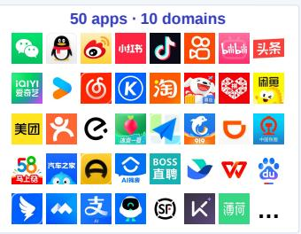

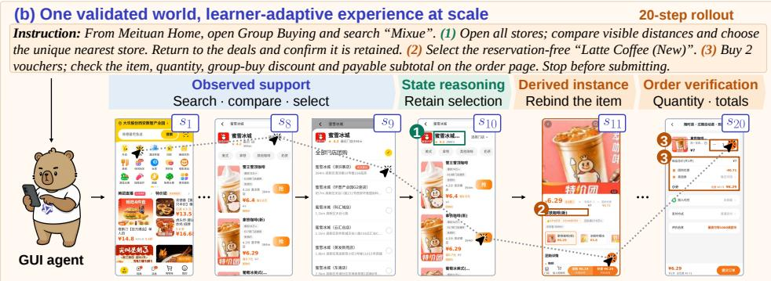  
Figure 1: Faithful app worlds, learner-adaptive experience at scale. (a) Left: Baseline environments constructed from the same source traces. Right: 50 reconstructed apps across ten domains. (b) Learner-adaptive tasks recombine source-supported behavior with state reasoning, derived instances, and order verification. A derived instance reuses observed page structure and purchase actions with new item data; here, a latte replaces the source trace’s snow-top coffee without changing app semantics.

## 1 INTRODUCTION

Online reinforcement learning improves GUI agents through repeated interaction (Bai et al., 2024; Qi et al., 2025; Qin et al., 2025; Xu et al., 2025). Real apps are hard to reset, and exploratory actions can change remote state or commit transactions (Rawles et al., 2025; Xie et al., 2024; Kong et al., 2026; Yan et al., 2025). Simulators offer controlled starts, yet training value depends on transfer: visual (Rusu et al., 2017) or dynamics (Peng et al., 2018) gaps can break learned policies. For pixel-based GUI agents, these gaps lie in what the policy sees and what its actions do, so we use fidelity to mean preserving the source app’s task-relevant observations and action semantics, including state, data, intermediate effects, and outcomes, not only its look or final value.

Obtaining faithful environments at scale, however, remains difficult. MobileGym authors app behavior by hand (Wu et al., 2026). Coding agents reduce this manual work, and every existing route hands them the semantics as well: CUA-Gym codes mocks from topic specifications (Wang et al., 2026), GUI-GENESIS codes a task-local site from one trace (Cao et al., 2026), and PhoneWorld, in concurrent work, codes reusable Android pages from frequency-ranked screen types, consecutive-screen transitions, and page specifications written from two or three screenshots, then checks representative flows with human QA (Liu et al., 2026). None asks which shared identities, initial states, data, guards, or conflicting effects the traces support: the coding agent settles them while writing the mock, and builder tests or a human comparison of representative flows then close fidelity. Reconstruction reduced to implementation fails on the app’s own workflows even at the level of structure: on the same recordings, our matched PhoneWorld-style build preserves source page surfaces on only 39.3% of workflows, 1.8 pp above a topic-specification builder (Table 1). Automating code has not settled which app behavior the code may commit to, and two failures follow.

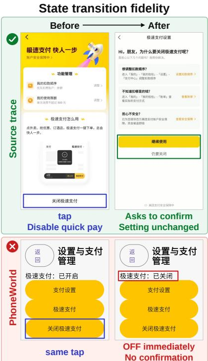

Partial paths do not define the app. Each trace exposes only one path from one initial state (Rawles et al., 2023; Deng et al., 2023): Home screens showing Xi’an and Beijing may be two pages or one page in two city states, while one control can have state-dependent effects (Section 3.2). A page-transition graph records what was observed, not the state condition that explains it, so coding before reconciliation hardens one interpretation into the app. Across our

Figure 2: Same goal, different first transition. The source’s first Disable quick pay tap opens a confirmation; our matched PhoneWorld-style reconstruction saves the disabled value on that tap.

matched builds of this family, routes reach 50.4–94.8% of endpoints yet preserve only 16.7–59.8% of source workflows (Table 1; Figure 1a and Appendix F.1).

Passing tests do not establish fidelity. An implementation and the tests derived from the same interpretation can agree while both diverge from the source (Barr et al., 2015). In Meituan, tapping Disable quick pay opens a confirmation without changing the saved setting; our PhoneWorld-style reconstruction disables it immediately yet passes a final-value check (Figure 2), rewarding a policy for a transition the real app does not perform. Thus the terminal value alone cannot show that the workflow matches the source.

Both failures arise when an ambiguous page identity, state value, or action effect becomes a coding choice before the traces are reconciled or an independent check can contest it. The remaining challenge is therefore not a better coding loop but a question no existing route poses:

## Which app semantics do partial traces actually support, and what evidence may accept an implementation of them?

Trace2World answers with two boundaries, semantic commitment before implementation and source acceptance afterward: it resolves open-ended app semantics before construction, then reduces later failures to local repair over a concrete package. It first reconciles repeated observations into shared page and entity identities, then separates mutable state, reusable data, and task-specific initial values. When observed state explains different effects, the model records a conditional rule; otherwise the conflict remains unresolved and outside executable scope. Because every supported relation keeps its source links, additional traces widen supported behavior without admitting unsupported shortcuts (Figure 3).

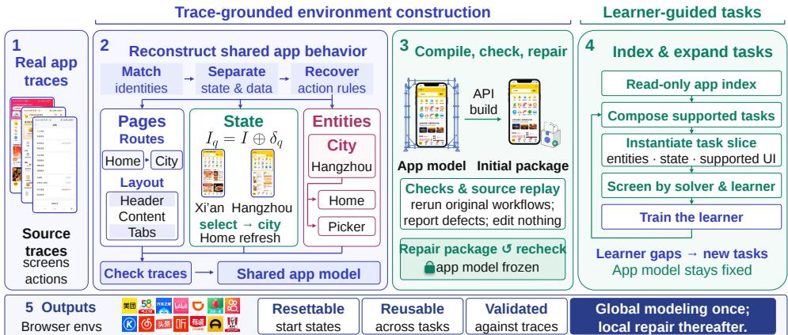  
Figure 3: Semantic commitment before implementation, source acceptance afterward. Partial traces are reconciled into one source-linked model of shared app behavior; unresolved behavior stays non-executable. Bounded API calls compile the model into a package; code checks and replay of the original workflows only report defects, and repair edits the package while the model stays frozen. The validated world is indexed read-only and expanded with learner-guided tasks.

Bounded API calls then compile the fixed model into an initial browser environment per app. Code checks and independent replay of each original workflow compare information, intermediate effects, and terminal state with the source and only report defects; a bounded repair loop edits the package under the frozen model, and a workflow that cannot pass without changing the model is excluded. Finally, learner feedback guides task composition from a read-only index of the validated world: it changes what is practiced or instantiates supported behavior, but never redefines what the app means. Our contributions follow this sequence:

1. Global behavior reconstruction as the semantic contract. Source-linked semantics are fixed from evidence before any code exists. From 1,570 partial traces, we build 50 shared worlds; on 200 workflows across ten apps, 91.1% pass all six source checks versus 59.8% for the strongest existing route, our matched task-local GUI-GENESIS-style build.

2. Source-grounded detection with bounded local repair. Independent replay of every original workflow checks six source obligations, apart from builder tests and RL rewards, and shows that every existing route reaches endpoints it cannot preserve. Replacing replay with self-validation lowers the share passing all six from 91.1% to 79.1% and real-device gain retention from 94.0% to 54.7%.

3. Validated worlds that index and expand cheaply. Forty validated environments supply 1,280 seed and 768 learner-guided tasks within fixed source support. Learner guidance raises benchmark success from 56.9% to 61.1%; our final policy improves on four external GUI benchmarks and by 16.3 points on real devices.

## 2 RELATED WORK

Environment construction and semantic fidelity. Constructed GUI environments differ less in how they are coded than in where their semantics come from and what evidence establishes correctness (Table A1). AndroidWorld executes the real application, while MobileGym, WebArena, and AppWorld author environment behavior by hand (Rawles et al., 2025; Wu et al., 2026; Zhou et al., 2024; Trivedi et al., 2024). CUA-Gym synthesizes topic-based mocks together with their verifiers (Wang et al., 2026), GUI-GENESIS builds one task-local site and reward per trace (Cao et al., 2026), and PhoneWorld, in concurrent work, codes reusable Android mocks from recovered screen types and transitions and closes representative flows by human side-by-side QA (Liu et al., 2026). These coding-agent routes commit semantics inside implementation. Trace2World changes the semantic contract: every trace of an app is reconciled into one source-linked model before any code exists, unresolved conflicts stay outside executable scope, and independent replay of every source workflow decides acceptance.

Experience supply and evolving tasks. A separate line of work adapts training experience once an environment exists. Online GUI RL and task synthesis draw new experience from interaction (Bai et al., 2024; Qi et al., 2025; Yang et al., 2025; Xue et al., 2026; Xu et al., 2025; Shi et al., 2025). Qwen-UI-Agent synthesizes tasks, environments, and executable verifiers and iterates on failure analysis (Zhou et al., 2026); Agent-World uses capability gaps to evolve tool-environment curricula (Dong et al., 2026). Learnability-driven curricula adapt task selection to learner competence (Sukhbaatar et al., 2018; Wang et al., 2019; Dennis et al., 2020; Jiang et al., 2021). The pipeline connects the two lines through a validated app world: semantics are reconstructed and accepted once per app, while learner feedback changes only which supported behavior is practiced.

## 3 TRACE2WORLD

## 3.1 FROM TRACES TO ONE SHARED APP

A source trace records one successful human workflow on a real app: its instruction, observations, actions, terminal criterion, and collection metadata. It exposes only one path from one initial state. Trace2World reconciles traces from the same app into one shared app model: common pages and entities, mutable state, reusable data, task-specific initial values, and state-dependent action effects, each linked to supporting source steps. Ambiguous or unsupported behavior remains non-executable. This model is the semantic commitment boundary between source evidence and browser code.

To separate reconstruction, implementation, and task authoring, Trace2World maintains three objects. The app model S is reconstructed once from source traces and then frozen; the executable package E is the browser world and the only object repair edits; and the task-facing index I is a read-only projection of a validated package for task authoring. Source replay checks Er against the recordings, while learner feedback changes which supported experience is generated. This separation yields one resettable environment per app with task-specific initial state rather than task-specific semantics; definitions and the algorithm appear in Appendix A.

## 3.2 RECONCILING APP SEMANTICS ACROSS TRACES

Two observations may look different because they show different pages, different values of the same state, or one entity rendered on different surfaces. The pipeline first matches repeated pages, action hosts, and entities across traces using their containment, routes, lifecycle, and observed transitions. It then separates stable interface structure from mutable state and reusable data. For example, the Xi’an and Beijing entries in Figure 4 share one Home page; city is state set at task reset, so changing the task does not duplicate the page or alter its action rules.

Actions that appear identical can still have different effects. The model links each candidate effect to the source step that shows its precondition and result. If observed state explains a difference, the app model records that condition. If no observed condition explains conflicting effects, it keeps the conflict unresolved instead of choosing one interpretation. Concretely, each supported interaction has a page and control, an action and guard, state or data reads and writes, a destination, and a visible postcondition. The resulting action rule is reused across workflows.

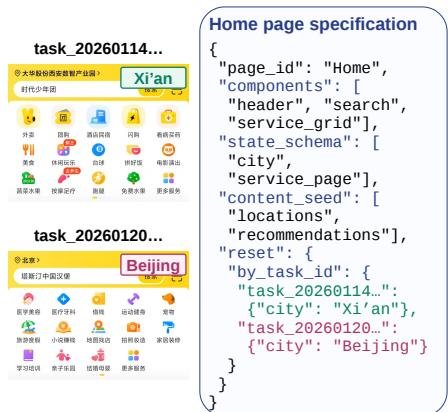  
Figure 4: Two traces, one Home page. Xi’an and Beijing are supported initial values of the same city state field. The task selects a reset value; subsequent behavior uses the shared page and statedependent action rules.

A final support check requires complete page and entity mappings, compatible effects, their data dependencies, and coverage of the cited evidence (Appendices A.1 and A.3).

An app’s traces may exceed one model context, so reconciliation uses bounded shards and reductions that preserve source links, unresolved conflicts, and uncovered evidence. Across all 50 apps, the largest model-visible call is 33.2K tokens under a 40K-token budget, with 99.1% audited semantic coverage (Appendices A.5 and E.2.1).

## 3.3 BUILDING AND VALIDATING THE ENVIRONMENT

Bounded API calls compile the supported part of the app model into page instructions and then into an initial standalone, DOM-backed browser package; no open-ended coding agent builds the world. A central state kernel owns business state and applies guarded updates; page code chooses only rendering, routes, and storage. Unsupported controls stay visible but inert, and unsupported clicks or failed guards leave business state unchanged. Code checks confirm that required pages, resources, hosts, bindings, and resets are present; they establish that the package runs, not that it matches the source app (Appendix B.1).

Source validation replays each recorded workflow from reset in the package. A read-only checker compares the original trace with the resulting information, intermediate effects, and terminal state without seeing the app model, generated verifier, or repair log; contract probes also check reset, repeated actions, guards, and supported alternatives. Detection and editing are separate roles: neither check edits anything, and each failure becomes a defect packet naming the step and the expected and observed state.

Compilation gives repair a concrete executable hypothesis. Reconstruction jointly infers identity, state, data, and action dynamics from partial evidence; repair localizes mismatches within the package. A bounded agent receives the package, defect packet, and source evidence, edits only the package, and reruns both checks. It may correct state updates, control handlers, or other implementation errors exposed by the source, but cannot change the frozen app model or add unsupported behavior. Freezing reduces joint revision of semantics and implementation to local repair of one artifact under a fixed contract.

Repair remains bounded by reconstructed support. A workflow that cannot pass without changing the app model is excluded after three repair waves; later model revisions begin a separate construction revision. The evaluator for RL reward and held-out success is separate from source replay (Appendices B.2–B.3), so validation can reject a workflow accepted by the package’s own success check (Figure 2). After trace collection, acceptance requires no human QA; human fidelity labels serve only the independent evaluation audit (Appendix E.1.4).

## 3.4 LEARNER-GUIDED TASK GENERATION

After source replay, Trace2World extracts a read-only index of the validated package’s surfaces, entities, observable fields, supported operations, and already-modeled dependencies, retaining source and implementation tags. The indexer reconstructs no behavior. Task generation queries the index to compose tasks, rebind observed entities or initial states, and select combinations relevant to the current learner (Figure 5). Candidates requiring unsupported app-level transitions, guards, or effects are rejected.

A supported task may still need content or implementation absent from the package. Trace2World instantiates schema-backed entities, values, and state or materializes already-supported operations as a task slice. GUI execution and affected seed-task regressions check the expanded package before the index is refreshed. Learner feedback may expose these gaps but cannot change the app model (Appendices C and E.3.3). Augmentation thus amortizes one semantic reconstruction and source acceptance across tasks.

A fixed external solver filters unsolvable candidates; four current-learner attempts estimate reward SD, with values above 0.1 marking useful variation. Saturated candidates may be refined twice within source support. Training on 1,280 seeds yields $\pi _ { 1 } ;$ two 384-task guided batches then yield $\pi _ { 2 }$ and $\pi _ { 3 }$ (the final policy). Task membership, environment revision, and evaluator freeze before each stage (Appendix C.3).

Evaluation-only cross-app tasks join two source-validated app-local indexes: a GUI-visible output in A conditions work in $B ,$ and a visible result in B changes the final action after returning to A, adding

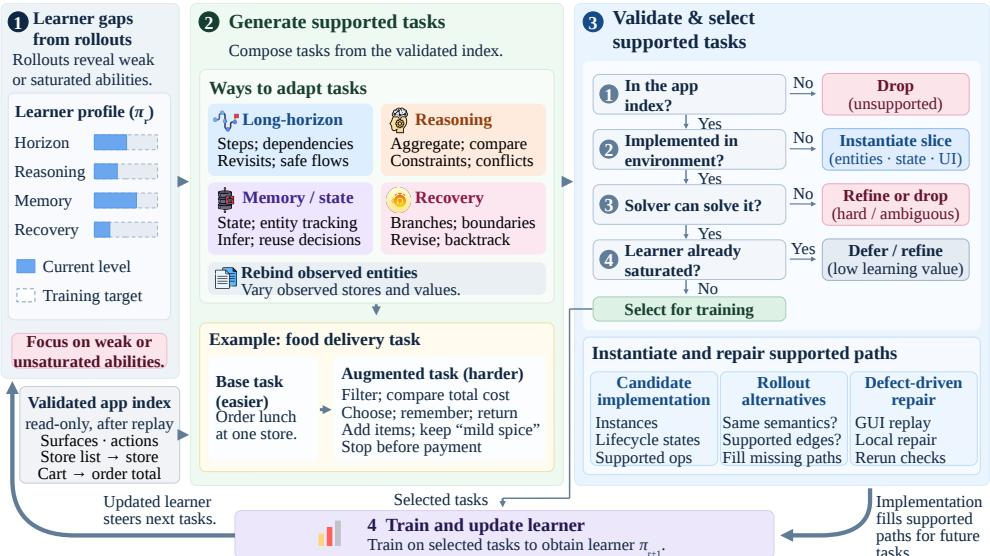  
Figure 5: Learner-guided tasks from a validated app index. Task generation combines supported surfaces, operations, and dependencies from the validated package’s read-only index into a fooddelivery task adapted to the current learner. Learner gaps guide sampling; source, GUI, solver, and learner-signal checks screen candidates. Missing entity, state, or UI slices are instantiated in the package; the app model is unchanged. Other icons by Freepik from Flaticon.  
a frozen task-level dependency but no app-local behavior or cross-app source recording. All 2,048 optimization tasks remain single-app (Appendix B.4).

## 4 EXPERIMENTS

The pipeline constructs one shared environment per app from 1,570 real-app traces across 50 apps. Forty apps supply 1,280 seed and 768 learner-guided tasks for policy training; the other ten contribute construction traces but no optimization tasks and form the unseen-app split. We test three questions: (i) do reconstruction and independent source validation preserve recorded workflows on a fixed 200-workflow, ten-app set; (ii) do validated worlds support useful adaptive training on Trace2World-Bench and four external GUI benchmarks; and (iii) do simulation gains transfer to real devices on 100 paired tasks across 20 policy-training apps? Qwen3.5-9B (Qwen Team, 2026) is trained with DAPO (Yu et al., 2025) across three frozen stages; Qwen3.7-Plus is used only for solvability screening. Full split, horizon, model-role, and training contracts appear in Appendices D.2, D.3, and D.4.

## 4.1 END-TO-END RECONSTRUCTION FIDELITY

Setup and metrics. All conditions use the same 200 source workflows from the ten apps held out from policy training, one per domain. We operationalize fidelity as workflowfidelity, the share of source workflows that pass all six checks: reachability, surface, state, effect, terminal outcome, and data. Equivalent routes and page partitions pass when they preserve the required decisions and effects. A blinded GPT-5.6 Sol reviewer compares each anonymous execution with its source recording and labels every check P/F; missing evidence is F, and rates are macro-averaged over apps (Appendix E.1.1).

We reimplement Direct Agent, CUA-Gym, PhoneWorld-style, and GUI-GENESIS-style on the same substrate, tools, runtime, and recordings, with matched model capability per builder role and each route’s construction rules (Appendix E.1.2). Builder rows compare complete construction contracts; only the controls isolate one factor: no-trace variants withhold the recordings, and self-validation changes only the validation source (Table E1).

Reachability alone overstates reconstruction quality. With the same recordings, Direct Agent, CUA-Gym, and PhoneWorld-style reach 50.4–57.0% of endpoints, yet only 16.7–22.4% of their workflows pass all six checks (Table 1). The task-local GUI-GENESIS-style build reaches 94.8% but

Table 1: End-to-end reconstruction fidelity (%). Ten-app macro means over the same 200 source workflows. All six (workflow fidelity) requires every check; Reach checks only the endpoint.
<table><tr><td rowspan="2">Method</td><td rowspan="2">Overall All six</td><td colspan="2">Structure</td><td colspan="3">State</td><td rowspan="2">Data</td></tr><tr><td>Reach</td><td>Surface</td><td>State</td><td>Effect</td><td>Terminal</td></tr><tr><td>Direct w/o traces</td><td>5.2</td><td>28.4</td><td>14.8</td><td>22.7</td><td>15.0</td><td>15.9</td><td>12.8</td></tr><tr><td>Direct + traces</td><td>16.7</td><td>53.6</td><td>35.3</td><td>41.2</td><td>34.6</td><td>33.7</td><td>31.7</td></tr><tr><td>CUA-Gym w/o traces</td><td>8.2</td><td>34.4</td><td>20.0</td><td>29.0</td><td>22.6</td><td>21.5</td><td>19.6</td></tr><tr><td>CUA-Gym + traces</td><td>19.9</td><td>50.4</td><td>37.5</td><td>38.0</td><td>35.0</td><td>35.3</td><td>35.0</td></tr><tr><td>PhoneWorld-style</td><td>22.4</td><td>57.0</td><td>39.3</td><td>46.8</td><td>41.5</td><td>39.8</td><td>38.5</td></tr><tr><td>GUI-GENESIS-style</td><td>59.8</td><td>94.8</td><td>83.9</td><td>76.6</td><td>77.0</td><td>79.4</td><td>78.4</td></tr><tr><td>Trace2World</td><td>91.1</td><td>98.0</td><td>93.7</td><td>93.3</td><td>93.8</td><td>93.7</td><td>94.1</td></tr><tr><td>Control (not our method)</td><td></td><td></td><td></td><td></td><td></td><td></td><td></td></tr><tr><td>Self-validation</td><td>79.1</td><td>98.5</td><td>90.4</td><td>87.0</td><td>85.0</td><td>88.0</td><td>89.1</td></tr></table>

passes 59.8%, with the State that workflows share at 76.6%. Trace2World reaches 98.0% and passes 91.1% (per-app contrasts in Appendix E.1.3).

The gap reflects where app behavior is committed. When semantic inference and implementation are coupled, an uncertain page identity, state value, or action effect becomes a coding choice before conflicting source evidence is reconciled. A builder can therefore recover a reachable surface while encoding the wrong state or effect behind it. Trace2World instead reconstructs source-linked behavior before compilation and leaves unresolved conflicts outside executable support.

The ordering is not explained by a stronger constructor or reviewer bias. GPT-5.2 performs Trace2World’s reconciliation and initial compilation, and GPT-5.5 only its verification and repair, whereas compared builders receive GPT-5.5 in every role they define. Blind human relabeling agrees with the automated reviewer on 90.2% of the same 1,200 packets and preserves the ordering (Appendices D.2 and E.1.4).

More source evidence expands supported behavior without collapsing fidelity. Growing the trace set of the same ten apps from 100 to 290 traces expands supported routes from 270 to 512 and visual obligations from 553 to 1,076, while workflow fidelity, scored against each trace budget’s own supported scope, moves only from 92.6% to 91.1% (Figure E3 in Appendix E.2.2). Across all 1,570 source workflows, 74.6% pass source replay on the first attempt and all close within the K = 3 automated repair cap without human QA (Appendix E.2.3). A seed build takes an estimated 3.6 hours and 1,160 model calls per app, comparable to PhoneWorld-style and below GUI-GENESIS-style (Appendix E.2.4).

## 4.2 SOURCE-GROUNDED VALIDATION

Setup and metrics. The self-validation control changes only validation evidence under the same construction stages and inputs (Table 1). We compare stage-1 policies on the same 100 paired sim/device tasks, with matched goals, restorable starts, terminal criteria, and action budgets; the 50 entity/state rebindings and 50 held-out workflows never enter RL, and results average training seeds (Appendix E.4.1).

Self-consistency does not establish source fidelity. Replacing source-trace validation with selfvalidation lowers workflow fidelity from 91.1% to 79.1% while Reach stays near 98%. Independent source rechecks reject 22/160 (13.8%) self-accepted executions versus 1/176 (0.6%) source-accepted ones (Appendix E.1.3). A separate 400-execution audit isolates the mechanism: giving the same model reviewer the source trace raises defect coverage from 43.2% to 68.4% and precision from 73.6% to 88.2% while flagging fewer clean executions (Appendix E.2.6).

Source-trace validation decides how much environment gain transfers. On the shared 100-task panel, source validation retains 94.0% of its 16.7-pp simulated gain on real devices (15.7 pp), versus 54.7% of 17.7 pp under self-validation (9.7 pp), a 6.0-pp paired difference (seed SD 1.0). With training matched and simulated gains nearly equal, the rise in simulation-only passes from 10.0% to 18.3% locates the transfer loss in behavior the simulator accepts but the device rejects.

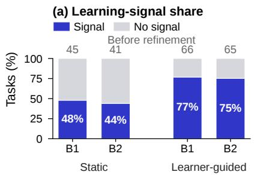

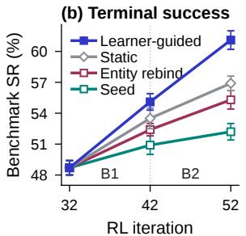

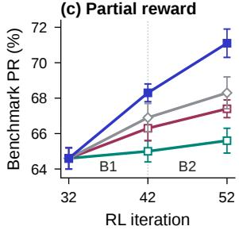  
Figure 6: Learner-guided task supply. (a) Learning-signal share in selected tasks (four-attempt reward SD > 0.1); gray labels above bars show the corresponding first-valid share before bounded refinement. Only learner-guided generation refines candidates; B1/B2 use the current branch learner. (b,c) Trace2World-Bench SR/PR for iteration/rollout-matched continuations; only the two augmentation branches also share $H = 4 5$ . Error bars show three-seed SD.

## 4.3 LEARNER-GUIDED TASK GENERATION

Setup and metrics. Four branches fork from $\pi _ { 1 }$ for the same 20 RL iterations (32–52), environment revisions, sampler, and evaluator: learner-guided generation uses feedback; static generation removes it from the same generator; entity rebinding substitutes seed-template entities; and seed continuation redraws seed tasks, each with two 384-task training-only batches. Static and learner-guided tasks also share H = 45; seed-based tasks use H = 30. Four attempts per candidate under its class budget give current-policy difficulty (mean pass) and learning signal (reward SD above 0.1); the held-out benchmark reports SR and PR.

Learner feedback makes tasks harder for the learner, not easier. Cross-surface composition, lifecycle revisit, and conditional recovery become more common than in the 1,280 seeds, and the dependency-heavy share rises from 46% to 71% across the two guided batches. The current learner’s pass rate among validated candidates falls from 41% to 29% while the fixed solver’s moves only from 71% to 66%, and 194 of 200 audited accepted candidates are independently solvable by humans; the new tasks recombine supported capabilities rather than add semantics (Appendices E.3.3 and E.3.2).

New tasks expand implementation, not semantics. The support gate rejects 77 and 90 of the 576 candidates proposed per guided round (Table E8), so selected tasks bind only indexed, supported items. Of 611 terminal-reaching attempt cases on paths absent from source traces, 486 are sourceequivalent, 402 already executing and 84 materialized from supported edges; the remaining 125 ambiguous, invalid, or unresolved cases stay outside support (Appendix E.3.3).

Learner-conditioned generation supplies tasks with learning signal. Across the two batches, 76.8/75.3% of guided tasks carry learning signal versus 47.9/44.0% for the static control. The gap precedes bounded refinement, which is sparse: only 14.1/14.5% of validated lineages enter it, and about 60% of those become selectable within two rounds. Feedback thus changes which supported tasks are proposed, not just which candidates are rescued (Figure 6a, Appendix E.3.2).

Learner-guided batches outperform matched continuations. At iteration 52, SR is 61.1% guided, 56.9% static, 55.3% entity rebinding, and 52.2% seed continuation. The two H = 45-matched augmentation branches differ by 4.2 pp, isolating learner feedback (Figure 6b,c); external MobileGym keeps the ordering (25.2±1.2 versus 22.2±1.3 SR). Budget does not substitute for feedback: training on all 426/427 validated candidates for 54 iterations reaches 57.8% SR, and seed continuation matched to the guided run’s 1,351 retained groups needs 79 iterations to reach 54.3% (Appendix E.3.2).

## 4.4 DOWNSTREAM POLICY PERFORMANCE AND REAL-APP TRANSFER

Setup and metrics. Trace2World-Bench has 1,044 tasks: 868 on training apps (256 entity replacements, 512 held-out workflows, 100 evaluation-only two-app returns) and 176 on unseen apps; none enters training, task generation, or checkpoint selection. Action caps are H = 30/45/60 for source-derived, augmented, and two-app tasks. We report terminal SR and final-state PR over three attempts per task and three training seeds; external suites are evaluation-only (Appendices D.3 and E.3.1).

Table 2: Downstream policy performance (%). Trace2World-Bench and MobileGym (MG) report SR/PR; AndroidWorld (AW), MobileWorld (MW), and AndroidDaily (AD) report SR (MW: GUIonly SR@50). Reference agents give capability context; the fixed Qwen3.5-9B block isolates training gain. Bold marks the best in each block (Appendices E.3.1, E.3.4).
<table><tr><td rowspan="2">Model</td><td colspan="5">Trace2World-Bench (SR / PR)</td><td rowspan="2">MG SR / PR</td><td rowspan="2">AW SR</td><td rowspan="2">MW SR@50</td><td rowspan="2">AD SR</td></tr><tr><td>Entity repl.</td><td>Held-out workflow</td><td>Cross-app</td><td>Unseen apps</td><td>Overall</td></tr><tr><td>Proprietary models</td><td></td><td></td><td></td><td></td><td></td><td></td><td></td><td></td><td></td></tr><tr><td>Gemini 3.1 Pro</td><td></td><td></td><td>75.1 / 82.2 69.0 / 76.258.0 / 67.0 65.7 / 71.968.9 / 76.1 31.3 / 44.6</td><td></td><td></td><td></td><td></td><td></td><td></td></tr><tr><td>GPT-5.5</td><td></td><td></td><td></td><td></td><td>74.5 / 82.568.3 / 76.857.3 / 66.366.1 / 73.868.4 / 76.7</td><td></td><td></td><td>62.4</td><td></td></tr><tr><td>Qwen3.7-Plus</td><td></td><td></td><td>76.3 / 83.470.6 / 78.459.0 / 67.868.8 / 76.470.6 / 78.332.8 / 46.081.0</td><td></td><td></td><td></td><td></td><td>62.3</td><td>79.8</td></tr><tr><td>Open-source GUI agents</td><td></td><td></td><td></td><td></td><td></td><td></td><td></td><td></td><td></td></tr><tr><td>UI-TARS-1.5-7B 54.4 / 66.045.2 / 58.5 30.3 / 44.2 39.6 / 50.8 45.1 / 57.7 13.8 / 26.3 30.0</td><td></td><td></td><td></td><td></td><td></td><td></td><td></td><td></td><td></td></tr><tr><td>MAI-UI-8B</td><td></td><td></td><td>66.3 / 76.958.1 / 69.845.0 / 57.551.9 / 62.7 57.8 / 69.2</td><td></td><td></td><td>21.5 / -</td><td>70.7</td><td>27.5</td><td></td></tr><tr><td>UI-Venus-2-9B</td><td></td><td></td><td>64.2 / 75.056.8 / 67.544.7 / 56.052.8 / 61.456.8 / 67.2</td><td></td><td></td><td>52.7 / –</td><td>80.2</td><td>65.8</td><td></td></tr><tr><td>Controlled environment training (Qwen3.5-9B)</td><td></td><td></td><td></td><td></td><td></td><td></td><td></td><td></td><td></td></tr><tr><td>Base policy</td><td>49.2 / 63.5 40.2 / 55.1 26.0 / 41.3 39.2 / 52.6 40.9 / 55.4 9.0 / 19.7 57.8</td><td></td><td></td><td></td><td></td><td></td><td></td><td>18.5</td><td>47.2</td></tr><tr><td>Stage-1 policy</td><td>57.0 / 72.648.6 / 65.1 35.3 / 52.044.3 / 58.948.7 / 64.615.8 / 28.460.1</td><td></td><td></td><td></td><td></td><td></td><td></td><td>21.9</td><td>51.9</td></tr><tr><td>Ours</td><td>68.4 / 78.962.4 / 71.850.7 / 60.552.8 / 63.761.1 / 71.1 25.2 / 40.763.2</td><td></td><td></td><td></td><td></td><td></td><td></td><td>27.4</td><td>58.3</td></tr></table>

Training transfers beyond reconstructed environments. Our final policy gains 20.2 pp SR and 15.7 pp PR over the fixed-backbone base on Trace2World-Bench (Table 2), and the same 52-iteration run improves SR on all four external suites: MobileGym by 16.2 pp, AndroidWorld by 5.4 pp, MobileWorld by 8.9 pp, and AndroidDaily by 11.1 pp (Appendix E.3.1). On the 176 tasks from apps excluded from policy training it gains 13.6 pp, against 21.6 pp on training-app tasks of different difficulty (Appendix E.3.4).

Gains also reach compositions that no training task contains. All 2,048 optimization tasks are single-app, yet the largest slice gain is on the 100 evaluation-only two-app tasks: 24.7 pp SR (26.0 to 50.7), 15.4 pp of it from the two learner-guided stages. The share of failures carrying a handoff tag is unchanged (32.4 versus 33.1%), so competence learned in one validated world carries across the return dependency rather than only handoff behavior (Table 2, Appendix E.3.5).

Table 3: Real-device transfer on 100 paired tasks. Gains over base (pp; three-seed mean ± SD); real/sim is gain retention, and Sim-only pass is simulation-only success.
<table><tr><td></td><td colspan="2">Matched stage-1 source</td><td>Stage 3</td></tr><tr><td>Metric</td><td>Self- validation</td><td>Source-trace validation</td><td>Ours</td></tr><tr><td>Real gain</td><td>9.7±2.1</td><td>15.7±1.5</td><td>16.3±2.1</td></tr><tr><td>Sim. gain</td><td>17.7±1.5</td><td>16.7±2.1</td><td>18.7±1.5</td></tr><tr><td>Real/sim gain</td><td>54.7%</td><td>94.0%</td><td>87.5%</td></tr><tr><td>Sim-only pass</td><td>18.3%</td><td>10.0%</td><td>10.7%</td></tr></table>

Training halves hard loops; remaining failures are not budget-limited. Across 3,132

Trace2World-Bench attempts, hard loops fall from 16.1% under the base policy to 8.5% under our final policy and false completions from 12.7% to 10.2%. Of the 613 final-policy failures reaching their horizon, 511 make no new checkpoint in their last ten actions and a 15-action extension rescues only 18: the step budget is not the binding constraint (Appendix E.3.5).

The final policy keeps most of its simulated gain on real devices. It retains 87.5% of its simulated gain and lifts sim/device agreement from 81.3 to 85.0% (Table 3, Appendix E.4.2).

## 5 CONCLUSION

Trace2World separates two problems that agentic reconstruction conflates: global reasoning reconstructs app behavior once from partial traces, leaving unresolved effects non-executable, while later source mismatches become local repairs over one world that independent replay accepts. This contract reaches 91.1% workflow fidelity versus 59.8% for the strongest existing route and keeps 94.0% of simulated gains on real devices versus 54.7% under self-validation. Reusing validated worlds amortizes reconstruction and source validation across learner-guided tasks. The bottleneck for scalable GUI RL is no longer producing runnable mocks but reconstructing app worlds whose state and effects are fixed by evidence, checked on the source workflows, and trusted without human QA.

## ETHICS STATEMENT

We use source traces collected by consenting operators from accounts they control, with consent covering research use and public release. We release the source recordings and derived trace records used for construction together with the generated environments and evaluation artifacts (Appendix D.1). Before public release, every recording is reviewed for credentials and session material, personal identifiers, private communications, precise locations, payment or order information, and third-party personal data; affected regions are redacted when this does not alter the research-relevant interaction evidence, and a trace is withheld and listed when safe release is not possible.

The released material provides no production credentials, privileged backend access, or automation authority over the original services; environments are isolated browser reimplementations with synthetic content that use application names and examples only to identify the systems studied, without implying affiliation or endorsement. Real-device evaluation begins from restorable states and excludes irreversible actions (Appendix E.4.1). Recordings, included visual resources, and environments are additionally reviewed for applicable service terms, redistribution rights, and trade dress concerns; an artifact that fails review is withheld and reported. The artifacts are intended for controlled GUI-agent research; use against live services requires account-holder authorization and compliance with applicable rules.

## AI USE STATEMENT

Generative models are components of Trace2World, supporting trace interpretation and semantic induction, environment implementation and repair, task generation and refinement, and rollout-based screening and evaluation (Section 4). In preparing this work, generative AI tools also assisted code development, figure preparation, manuscript drafting and revision, and review of methodological and experimental descriptions. Generated environments and tasks are assessed under the shared evaluator boundaries in Appendix D and the study-specific protocols in Appendix E; human assessment covers the sampled evaluation packets in Appendix E.1.4. The authors retain responsibility for the study design, the verification and interpretation of results, and the final manuscript and artifacts.

## REFERENCES

Kevin Allix, Tegawende F. Bissyand´ e, Jacques Klein, and Yves Le Traon. AndroZoo: Collecting´ millions of Android apps for the research community. In Proceedings ofthe 13th International Conference on Mining Software Repositories (MSR), pp. 468–471, 2016.

Hao Bai, Yifei Zhou, Mert Cemri, Jiayi Pan, Alane Suhr, Sergey Levine, and Aviral Kumar. DigiRL: Training in-the-wild device-control agents with autonomous reinforcement learning. Advances in Neural Information Processing Systems, 37:12461–12495, 2024.

Earl T. Barr, Mark Harman, Phil McMinn, Muzammil Shahbaz, and Shin Yoo. The oracle problem in software testing: A survey. IEEE Transactions on Software Engineering, 41(5):507–525, 2015.

Yuan Cao, Dezhi Ran, Mengzhou Wu, Yuzhe Guo, Xin Chen, Ang Li, Gang Cao, Gong Zhi, Hao Yu, Linyi Li, Wei Yang, and Tao Xie. GUI-GENESIS: Automated synthesis of efficient environments with verifiable rewards for gui agent post-training. arXiv preprint arXiv:2602.14093, 2026.

Yuxiang Chai, Shunye Tang, Han Xiao, Weifeng Lin, Hanhao Li, Jiayu Zhang, Liang Liu, Pengxiang Zhao, Guangyi Liu, Guozhi Wang, Shuai Ren, Rongduo Han, Haining Zhang, Siyuan Huang, and Hongsheng Li. A3: Android agent arena for mobile GUI agents with essential-state procedural evaluation. In Findings ofthe Associationfor Computational Linguistics: ACL 2026, pp. 3774– 3789, 2026. doi: 10.18653/v1/2026.findings-acl.184. URL https://aclanthology.org/ 2026.findings-acl.184/.

Xiang Deng, Yu Gu, Boyuan Zheng, Shijie Chen, Samuel Stevens, Boshi Wang, Huan Sun, and Yu Su. Mind2Web: Towards a generalist agent for the web. Advances in Neural Information Processing Systems, 36:28091–28114, 2023.

Michael Dennis, Natasha Jaques, Eugene Vinitsky, Alexandre Bayen, Stuart Russell, Andrew Critch, and Sergey Levine. Emergent complexity and zero-shot transfer via unsupervised environment design. In Advances in Neural Information Processing Systems, 2020.

Guanting Dong, Junting Lu, Junjie Huang, Wanjun Zhong, Longxiang Liu, Shijue Huang, Zhenyu Li, Yang Zhao, Xiaoshuai Song, Xiaoxi Li, Jiajie Jin, Yutao Zhu, Hanbin Wang, Fangyu Lei, Qinyu Luo, Mingyang Chen, Zehui Chen, Jiazhan Feng, Ji-Rong Wen, and Zhicheng Dou. Agent-World: Scaling real-world environment synthesis for evolving general agent intelligence. arXiv preprint arXiv:2604.18292, 2026.

Minqi Jiang, Edward Grefenstette, and Tim Rocktaschel. Prioritized level replay. In¨ International Conference on Machine Learning, volume 139 of Proceedings of Machine Learning Research, pp. 4940–4950, 2021.

Quyu Kong, Xu Zhang, Zhenyu Yang, Nolan Gao, Chen Liu, Panrong Tong, Chenglin Cai, Hanzhang Zhou, Jianan Zhang, Liangyu Chen, Zhidan Liu, Steven Hoi, and Yue Wang. MobileWorld: Benchmarking autonomous mobile agents in agent-user interactive and MCP-augmented environments. In Proceedings of the 64th Annual Meeting of the Association for Computational Linguistics (Volume 1: Long Papers), pp. 6142–6167, 2026. doi: 10.18653/v1/2026.acl-long.278.

Pei Liu, Li Li, Yanjie Zhao, Xiaoyu Sun, and John Grundy. AndroZooOpen: Collecting large-scale open source Android apps for the research community. In Proceedings ofthe 17th International Conference on Mining Software Repositories (MSR), pp. 548–552, 2020.

Yuxuan Liu, Xin Lai, Junyi Li, Pengyuan Lyu, Jason, Yiduo Guo, Zhengyao Fang, Yang Ding, Yi Zhang, Weinong Wang, Huawen Shen, Xingran Zhou, Liang Wu, Fei Tang, Sunqi Fan, Shangpin Peng, Zheng Ruan, Anran Zhang, Chengquan Zhang, Han Hu, Benyou Wang, Ji-Rong Wen, Rui Yan, and Zhengyang Tang. PhoneWorld: Scaling phone-use agent environments. arXiv preprint arXiv:2605.29486, 2026.

Xing Han Lu, Amirhossein Kazemnejad, Nicholas Meade, Arkil Patel, Dongchan Shin, Alejandra \` Zambrano, Karolina Stanczak, Peter Shaw, Christopher J. Pal, and Siva Reddy. AgentRewardBench:´ Evaluating automatic evaluations of web agent trajectories. In Conference on Language Modeling, 2025.

Xue Bin Peng, Marcin Andrychowicz, Wojciech Zaremba, and Pieter Abbeel. Sim-to-real transfer of robotic control with dynamics randomization. In IEEE International Conference on Robotics and Automation, 2018. doi: 10.1109/ICRA.2018.8460528.

Zehan Qi, Xiao Liu, Iat Long Iong, Hanyu Lai, Xueqiao Sun, Wenyi Zhao, Yu Yang, Xinyue Yang, Jiadai Sun, Shuntian Yao, Tianjie Zhang, Wei Xu, Jie Tang, and Yuxiao Dong. WebRL: Training LLM web agents via self-evolving online curriculum reinforcement learning. In International Conference on Learning Representations, 2025.

Yujia Qin, Yining Ye, Junjie Fang, Haoming Wang, Shihao Liang, Shizuo Tian, Junda Zhang, Jiahao Li, Yunxin Li, Shijue Huang, Wanjun Zhong, Kuanye Li, Jiale Yang, Yu Miao, Woyu Lin, Longxiang Liu, Xu Jiang, Qianli Ma, Jingyu Li, Xiaojun Xiao, Kai Cai, Chuang Li, Yaowei Zheng, Chaolin Jin, Chen Li, Xiao Zhou, Minchao Wang, Haoli Chen, Zhaojian Li, Haihua Yang, Haifeng Liu, Feng Lin, Tao Peng, Xin Liu, and Guang Shi. UI-TARS: Pioneering automated gui interaction with native agents. arXiv preprint arXiv:2501.12326, 2025.

Qwen Team. Qwen3.5: Towards native multimodal agents, February 2026. URL https://qwen. ai/blog?id=qwen3.5.

Christopher Rawles, Alice Li, Daniel Rodriguez, Oriana Riva, and Timothy Lillicrap. AndroidInTheWild: A large-scale dataset for android device control. Advances in Neural Information Processing Systems, 36:59708–59728, 2023.

Christopher Rawles, Sarah Clinckemaillie, Yifan Chang, Jonathan Waltz, Gabrielle Lau, Marybeth Fair, Alice Li, William Bishop, Wei Li, Folawiyo Campbell-Ajala, Daniel Toyama, Robert Berry, Divya Tyamagundlu, Timothy Lillicrap, and Oriana Riva. AndroidWorld: A dynamic benchmark ing environment for autonomous agents. In International Conference on Learning Representations, 2025.

Andrei A. Rusu, Matej Vecerˇ ´ık, Thomas Rothorl, Nicolas Heess, Razvan Pascanu, and Raia Hadsell.¨ Sim-to-real robot learning from pixels with progressive nets. In Proceedings of the 1st Annual Conference on Robot Learning, volume 78 of Proceedings of Machine Learning Research, pp. 262–270, 2017. URL https://proceedings.mlr.press/v78/rusu17a.html.

John Schulman, Filip Wolski, Prafulla Dhariwal, Alec Radford, and Oleg Klimov. Proximal policy optimization algorithms. arXiv preprint arXiv:1707.06347, 2017.

Zhihong Shao, Peiyi Wang, Qihao Zhu, Runxin Xu, Junxiao Song, Xiao Bi, Haowei Zhang, Mingchuan Zhang, Y. K. Li, Y. Wu, and Daya Guo. DeepSeekMath: Pushing the limits of mathematical reasoning in open language models. arXiv preprint arXiv:2402.03300, 2024.

Yucheng Shi, Wenhao Yu, Zaitang Li, Yonglin Wang, Hongming Zhang, Ninghao Liu, Haitao Mi, and Dong Yu. MobileGUI-RL: Advancing mobile GUI agent through reinforcement learning in online environment. arXiv preprint arXiv:2507.05720, 2025.

Chenglei Si, Yanzhe Zhang, Ryan Li, Zhengyuan Yang, Ruibo Liu, and Diyi Yang. Design2Code: Benchmarking multimodal code generation for automated front-end engineering. In Proceedings of the 2025 Conference of the Nations of the Americas Chapter of the Association for Computational Linguistics: Human Language Technologies (Volume 1: Long Papers), pp. 3956–3974, 2025. doi: 10.18653/v1/2025.naacl-long.199.

Luca Soldaini, Rodney Kinney, Akshita Bhagia, Dustin Schwenk, David Atkinson, Russell Authur, Ben Bogin, Khyathi Chandu, Jennifer Dumas, Yanai Elazar, Valentin Hofmann, Ananya Harsh Jha, Sachin Kumar, Li Lucy, Xinxi Lyu, Nathan Lambert, Ian Magnusson, Jacob Morrison, Niklas Muennighoff, Aakanksha Naik, Crystal Nam, Matthew E. Peters, Abhilasha Ravichander, Kyle Richardson, Zejiang Shen, Emma Strubell, Nishant Subramani, Oyvind Tafjord, Pete Walsh, Luke Zettlemoyer, Noah A. Smith, Hannaneh Hajishirzi, Iz Beltagy, Dirk Groeneveld, Jesse Dodge, and Kyle Lo. Dolma: an open corpus of three trillion tokens for language model pretraining research. In Proceedings of the 62nd Annual Meeting of the Association for Computational Linguistics (ACL), 2024.

Sainbayar Sukhbaatar, Zeming Lin, Ilya Kostrikov, Gabriel Synnaeve, Arthur Szlam, and Rob Fergus. Intrinsic motivation and automatic curricula via asymmetric self-play. In International Conference on Learning Representations, 2018.

Harsh Trivedi, Tushar Khot, Mareike Hartmann, Ruskin Manku, Vinty Dong, Edward Li, Shashank Gupta, Ashish Sabharwal, and Niranjan Balasubramanian. AppWorld: A controllable world of apps and people for benchmarking interactive coding agents. In Proceedings of the 62nd Annual Meeting of the Association for Computational Linguistics (Volume 1: Long Papers), pp. 16022–16076, 2024. doi: 10.18653/v1/2024.acl-long.850.

Venus Team. UI-Venus-2 technical report. arXiv preprint arXiv:2609.00028, 2026.

Bin Wang, Chao Xu, Xiaomeng Zhao, Linke Ouyang, Fan Wu, Zhiyuan Zhao, Rui Xu, Kaiwen Liu, Yuan Qu, Fukai Shang, Bo Zhang, Liqun Wei, Zhihao Sui, Wei Li, Botian Shi, Yu Qiao, Dahua Lin, and Conghui He. MinerU: An open-source solution for precise document content extraction. arXiv preprint arXiv:2409.18839, 2024. doi: 10.48550/arXiv.2409.18839. URL https://arxiv.org/abs/2409.18839.

Bowen Wang, Dunjie Lu, Junli Wang, Tianyi Bai, Shixuan Liu, Zhipeng Zhang, Haiquan Wang, Hao Hu, Tianbao Xie, Shuai Bai, Dayiheng Liu, Que Shen, Junyang Lin, and Tao Yu. CUA-Gym: Scaling verifiable training environments and tasks for computer-use agents. arXiv preprint arXiv:2605.25624, 2026.

Rui Wang, Joel Lehman, Jeff Clune, and Kenneth O. Stanley. Paired open-ended trailblazer (POET): Endlessly generating increasingly complex and diverse learning environments and their solutions. arXiv preprint arXiv:1901.01753, 2019.

Dingbang Wu, Rui Hao, Haiyang Wang, Shuzhe Wu, Han Xiao, Zhenghong Li, Bojiang Zhou, Zheng Ju, Zichen Liu, Lue Fan, and Zhaoxiang Zhang. MobileGym: A verifiable and highly parallel simulation platform for mobile gui agent research. arXiv preprint arXiv:2605.26114, 2026. doi: 10.48550/arXiv.2605.26114. URL https://arxiv.org/abs/2605.26114.

Shitao Xiao, Zheng Liu, Peitian Zhang, and Niklas Muennighoff. C-Pack: Packaged resources to advance general Chinese embedding. arXiv preprint arXiv:2309.07597, 2023.

Tianbao Xie, Danyang Zhang, Jixuan Chen, Xiaochuan Li, Siheng Zhao, Ruisheng Cao, Toh Jing Hua, Zhoujun Cheng, Dongchan Shin, Fangyu Lei, Yitao Liu, Yiheng Xu, Shuyan Zhou, Silvio Savarese, Caiming Xiong, Victor Zhong, and Tao Yu. OSWorld: Benchmarking multimodal agents for open-ended tasks in real computer environments. Advances in Neural Information Processing Systems, 37:52040–52094, 2024.

Yifan Xu, Xiao Liu, Xinghan Liu, Jiaqi Fu, Hanchen Zhang, Bohao Jing, Shudan Zhang, Yuting Wang, Wenyi Zhao, and Yuxiao Dong. MobileRL: Online agentic reinforcement learning for mobile GUI agents. arXiv preprint arXiv:2509.18119, 2025.

Taofeng Xue, Chong Peng, Mianqiu Huang, Linsen Guo, Tiancheng Han, Haozhe Wang, Jianing Wang, Xiaocheng Zhang, Xin Yang, Dengchang Zhao, Jinrui Ding, Xiandi Ma, Yuchen Xie, Peng Pei, Xunliang Cai, and Xipeng Qiu. EvoCUA: Evolving computer use agents via learning from scalable synthetic experience. arXiv preprint arXiv:2601.15876, 2026.

Haolong Yan, Jia Wang, Xin Huang, Yeqing Shen, Ziyang Meng, Zhimin Fan, Kaijun Tan, Jin Gao, Lieyu Shi, Mi Yang, et al. Step-GUI technical report. arXiv preprint arXiv:2512.15431, 2025.

Chenyu Yang, Shiqian Su, Shi Liu, Xuan Dong, Yue Yu, Weijie Su, Xuehui Wang, Zhaoyang Liu, Jinguo Zhu, Hao Li, Wenhai Wang, Yu Qiao, Xizhou Zhu, and Jifeng Dai. ZeroGUI: Automating online gui learning at zero human cost. arXiv preprint arXiv:2505.23762, 2025.

Qiying Yu, Zheng Zhang, Ruofei Zhu, Yufeng Yuan, Xiaochen Zuo, Yu Yue, Weinan Dai, Tiantian Fan, Gaohong Liu, Juncai Liu, Lingjun Liu, Xin Liu, Haibin Lin, Zhiqi Lin, Bole Ma, Guangming Sheng, Yuxuan Tong, Chi Zhang, Mofan Zhang, Ru Zhang, Wang Zhang, Hang Zhu, Jinhua Zhu, Jiaze Chen, Jiangjie Chen, Chengyi Wang, Hongli Yu, Yuxuan Song, Xiangpeng Wei, Hao Zhou, Jingjing Liu, Wei-Ying Ma, Ya-Qin Zhang, Lin Yan, Yonghui Wu, and Mingxuan Wang. DAPO: An open-source LLM reinforcement learning system at scale. Advances in Neural Information Processing Systems, 38:113222–113244, 2025.

Hanzhang Zhou, Xu Zhang, Panrong Tong, Jianan Zhang, Liangyu Chen, Quyu Kong, Chenglin Cai, Chen Liu, Yue Wang, Jingren Zhou, and Steven Hoi. MAI-UI technical report: Real-world centric foundation GUI agents. arXiv preprint arXiv:2512.22047, 2025.

Hanzhang Zhou et al. Qwen-UI-Agent technical report: Toward next-generation real-world centric foundation GUI agents. arXiv preprint arXiv:2607.28227, 2026.

Shuyan Zhou, Frank F. Xu, Hao Zhu, Xuhui Zhou, Robert Lo, Abishek Sridhar, Xianyi Cheng, Tianyue Ou, Yonatan Bisk, Daniel Fried, Uri Alon, and Graham Neubig. WebArena: A realistic web environment for building autonomous agents. In International Conference on Learning Representations, 2024.

## Appendix Table of Contents

<table><tr><td></td><td>METHODOLOGY</td></tr><tr><td colspan="2">Semantic Reconciliation Across Traces</td></tr><tr><td>A A.1</td><td>Source-Trace Preprocessing</td></tr><tr><td>A.2</td><td>Behavior Support and Implementation Scope</td></tr><tr><td>A.3</td><td>Semantic Reconciliation and Support Validation</td></tr><tr><td>A.4</td><td>Task-Conditioned Initialization and Reset</td></tr><tr><td>A.5</td><td>Context-Bounded Reconciliation</td></tr><tr><td>B</td><td>Environment Construction and Validation</td></tr><tr><td>B.1</td><td>Environment Architecture and Export</td></tr><tr><td>B.2</td><td>Source-Trace Validation and Repair</td></tr><tr><td>B.3</td><td>State-Based Verification</td></tr><tr><td>B.4</td><td>Cross-Application Workflows</td></tr><tr><td>C</td><td>Learner-Guided Task Supply under Fixed Semantics</td></tr><tr><td>C.1</td><td>Task Candidate Authoring</td></tr><tr><td>C.2</td><td>Task Implementation and Screening</td></tr><tr><td>C.3</td><td>Augmentation Batches and Policy Training</td></tr><tr><td colspan="2">EXPERIMENTS</td></tr><tr><td></td><td></td></tr><tr><td>D</td><td>System Configuration and Evaluation Protocols</td></tr><tr><td>D.1</td><td>Trace2World Resource Contract</td></tr><tr><td>D.2 D.3</td><td>Agent Interface and Model Roles</td></tr><tr><td>D.4</td><td>Application, Task, and Evaluation Splits Policy Optimization and Rollout Configuration</td></tr><tr><td>D.5</td><td>Evaluator Roles and Non-Interference</td></tr><tr><td>D.6</td><td>Evaluation Record Binding</td></tr><tr><td>E</td><td>Extended Results and Analysis</td></tr><tr><td>E.1</td><td>Environment Fidelity and Reviewer Validation</td></tr><tr><td>E.2</td><td>Construction Scaling, Validation, and Cost</td></tr><tr><td>E.3</td><td>Policy Gains from Learner-Guided Task Supply</td></tr><tr><td>E.4</td><td>Transfer to Real Applications</td></tr><tr><td>E.5</td><td>Scope, Limitations, and Future Work</td></tr><tr><td colspan="2">CASES AND RESOURCES</td></tr><tr><td>F</td><td>Case Studies</td></tr><tr><td>F.1</td><td>Matched Baseline Trajectories on One Shared Workflow</td></tr><tr><td>F.2</td><td>Schema-Backed Task Augmentation</td></tr><tr><td></td><td></td></tr><tr><td>F.3</td><td>Seed and Augmented Workflows</td></tr><tr><td>F.4</td><td>Cross-Application Return Dependency</td></tr><tr><td>F.5 G</td><td>Reconstruction Gallery Prompt Templates</td></tr><tr><td></td><td></td></tr></table>

## A SEMANTIC RECONCILIATION ACROSS TRACES

This appendix formalizes the reconciliation summarized in Section 3.2, from source-trace preprocessing through bounded-context scheduling. It opens by placing that contract among existing environment builders.

Comparison scope. Table A1 expands the main-text positioning along five axes: where app behavior comes from, what is represented before coding, how cross-trace effects are handled, how behavior is implemented, and which evidence is used for acceptance. It preserves each system’s native target rather than treating the absence of an external-app fidelity objective as a failed check. Appendix E.1.2 defines the builders reimplemented under one experimental contract.

Table A1: Semantics and acceptance across GUI environments. Columns group systems by the source of app behavior; rows distinguish input, representation, cross-trace semantic rules, implementation, and native acceptance evidence. Task checks in authored or synthesized worlds do not certify fidelity to an external app. PhoneWorld uses agentic construction with representative human QA; Trace2World fixes source-linked semantics before coding and replays each recorded workflow. CUA-Gym targets desktop and web software; the other systems target mobile applications. Counts use native units; paired denotes same-task simulation/device evaluation and unpaired a separate real benchmark (Appendix E.4). AndroidWorld and MobileGym memory figures are reported by MobileGym (Wu et al., 2026); Trace2World’s is marginal PSS at 16 concurrent episodes across the 50-app portfolio (Appendix E.2.5). These are contextual cross-host figures; dashes mean no comparable figure here.
<table><tr><td colspan="2">Real / designed</td><td colspan="2">Topic / task-local</td><td colspan="2">Trace-grounded</td></tr><tr><td>Axis</td><td>AndroidWorld MobileGym</td><td>CUA-Gym</td><td>GUI- GENESIS</td><td>PhoneWorld</td><td>Trace2World</td></tr><tr><td>Construction input</td><td>real Android apps and task simulator and definitions</td><td>authored tasks</td><td>topic request</td><td>one traced task</td><td>real trajectories and screenshots</td><td>all app traces</td></tr><tr><td>Behavior representation</td><td></td><td>real app itself authored state topic-based and actions</td><td>mock</td><td></td><td>task-local site screen graph, shared IDs, page PRDs, mutable state</td><td>state/data, guards and effects</td></tr><tr><td>Cross-trace state/effect rule</td><td>native app</td><td>authored</td><td>topic specification</td><td>task-local</td><td>no explicit source-linked rule</td><td>guarded or unresolved</td></tr><tr><td>Implementation native apps path</td><td></td><td>hand- authored simulator</td><td>Plan-Dev- Web agents</td><td>code agent</td><td>PRDs → coding agent</td><td>model → API compile → agentic repair</td></tr><tr><td>Acceptance evidence</td><td>oracle</td><td>real-app task authored task generated checks</td><td>verifier and filter</td><td>code-native reward and golden path</td><td>smoke tests and human comparison</td><td>replay of every source workflow</td></tr><tr><td>Memory per episode How training</td><td>~4.5 GB</td><td>~400 MB</td><td></td><td></td><td></td><td>218MiB</td></tr><tr><td>tasks are produced</td><td>set</td><td>fixed authored parameterized co-generated one task per templates</td><td>with environment</td><td>environment</td><td>generated from content, state schema, and PRDs</td><td>learner- guided within fixed support</td></tr><tr><td>Sim-to-Real evidence</td><td>is target</td><td>n/a; emulator paired 59-task held-out signal subset benchmark</td><td>transfer</td><td>held-out real-app tasks benchmark (unpaired)</td><td>real- gains (unpaired)</td><td>paired 100-task balanced panel</td></tr><tr><td>Scale (native units)</td><td>templates</td><td>20 apps / 116 28 apps / 416 110 templates</td><td>environments task /32,112 tuples</td><td>one site per</td><td>34 apps / 16 domains</td><td>50 apps / 1,280 seed + 768 learner- guided tasks</td></tr></table>

## A.1 SOURCE-TRACE PREPROCESSING

Reconciliation consumes recorded traces, not raw recordings. Preprocessing selects the traces that enter construction, gives every recorded step a typed disposition and a semantic description, and extracts the visual resources those steps contain. It produces only trace- and step-linked local evidence: canonical page identity, State fields, guards, and verifier predicates are decided later by reconciliation and are never authored here.

Preprocessing covers the fixed 50-application construction corpus: 19 multi-service applications contribute 950 traces and 31 single-service applications contribute 620, for 1,570 traces in total. Figure A2 visualizes step dispositions. Table A2 then jointly reports trace selection and the visualevidence volume it produces. Resource extraction is summarized in text.

Trace selection and diversity control. Operators record complete workflows on one real application from a frozen app-level task catalog that varies goals, entry routes, entity bindings, launch states, and supported compositions. A recording is admitted only when visible terminal evidence or an independent receipt establishes its outcome at the recorded application revision; a recorder flag or a generated description is insufficient, and agent-generated exploration is excluded. Admission certifies the outcome, not the necessity of each intermediate action, so retries and corrections stay in the evidence. Admitted recordings exceed the per-application budget, and selection keeps diversity rather than volume: candidates must contain at least four in-app interaction steps once launch, terminal, and handover rows are discounted; task instructions are embedded with the bge-large-zh-v1.5 encoder (Xiao et al., 2023) and clustered, and traces are drawn to cover clusters while avoiding duplicate action-signature prefixes. Across the corpus, this process retains the fixed 1,570-trace construction set from 6,541 admitted recordings, a 24.0% retention rate (Table A2). Figure A1 instantiates the diversity side of that trade on Meituan: halving the pool from 106 admitted candidates to 50 selected traces leaves every occupied workflow bucket populated, and the selected traces carry 50 distinct action signatures with no repeated three-action prefix.

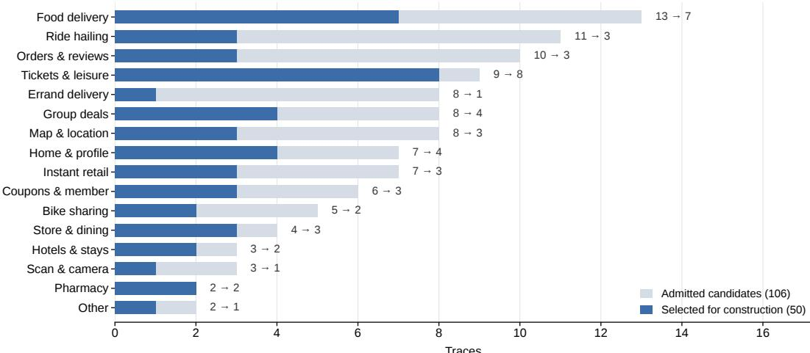  
Figure A1: Selection halves volume while keeping workflow coverage (Meituan). Light bars count admitted candidate recordings and blue overlays count the traces selected for construction; right-side counts read candidate → selected. All 16 occupied buckets retain at least one selected trace. Buckets are a post-hoc keyword grouping of the recorded instruction text, not a registered product taxonomy.

Step disposition and semantic description. Each recorded step stores a device event, one screenshot, and a marked screenshot in which pointer geometry, typed text, and drag paths are drawn onto the observation. One bounded API pass per trace (Appendix G) reads the raw action payload together with the marked screenshot and returns, for every step, a verdict in {KEEP, DROP, OBSERVE}, a semantic description naming the visible target rather than a coordinate, and a reason; at trace level it returns a normalized instruction and a terminal contract. A deterministic pass then reconciles those verdicts with the raw event: launcher and app-entry rows become DROP, a recorded completion becomes OBSERVE so its observation is retained as terminal evidence while its action stays non-executable, and privacy or login handovers are excluded from behavior. Every raw row keeps exactly one typed disposition with its reason; nothing is deleted, so a later stage can still audit why a step left the executable set. These descriptions remain step-local hypotheses subject to cross-trace reconciliation and cannot override the raw event.

Corpus-wide step statistics. One recorded step carries one screenshot, so the disposition count is also the screenshot budget. The full construction corpus contains 16,472 recorded frames (Figure A2). Executable in-app steps account for 12,680 frames (77.0%), while 1,570 terminal observations (9.5%) remain as evidence without an executable terminal action. The four pre-semantic removal categories total 2,222 frames (13.5%). Their composition shows that launch boundaries dominate the reduction: launcher or app-entry frames contribute 9.2%, compared with 1.6% transient gates, 2.6% no-effect interactions, and 0.2% human handovers.

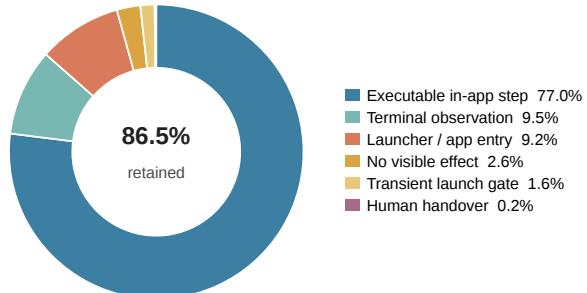  
Figure A2: Disposition of 16,472 recorded frames across the 1,570-trace corpus. Executable steps (77.0%) and terminal observations (9.5%) are retained as induction evidence; launcher/app-entry, transient-gate, no-effect, and human-handover frames are removed before semantic calls (13.5% combined).

Visual-evidence selection. Visual-evidence selection (Appendix B.1) chooses a page-level visual basis from retained observations after page obligations have been projected; it does not change step dispositions or decide app semantics. Across the corpus, this basis contains 9,918 selected screenshots (Table A2), 39.8% fewer than the recorded frames and 30.4% fewer than the retained disposition inputs.

Table A2: Source-trace and visual-evidence selection across the full construction corpus. Candidate recordings form the admissible pool, selected traces constitute the fixed 1,570-trace construction set, and selected screenshots form the page-level visual basis. Retention is selected traces divided by candidate recordings within each collection-budget stratum.
<table><tr><td></td><td></td><td colspan="3">Trace selection</td><td colspan="2">Visual evidence</td></tr><tr><td>Stratum</td><td>Apps</td><td>Candidate recordings</td><td>Selected traces</td><td>Retention</td><td>Selected screenshots</td><td>Screens / trace</td></tr><tr><td>Multi-service</td><td>19</td><td>2,005</td><td>950</td><td>47.4%</td><td>5,206</td><td>5.48</td></tr><tr><td>Single-service</td><td>31</td><td>4,536</td><td>620</td><td>13.7%</td><td>4,712</td><td>7.60</td></tr><tr><td>Full corpus</td><td>50</td><td>6,541</td><td>1,570</td><td>24.0%</td><td>9,918</td><td>6.32</td></tr></table>

Visual-resource extraction. Generated pages reuse the icons, product images, banners, and background art displayed in the selected evidence. The MinerU API (Wang et al., 2024) extracts and classifies these resources as icon, image, banner, or background. Each record is deduplicated by content digest, bound to its source step and observation, and labeled per page so the builder can address resources by role. MinerU output is local evidence: it supplies what a surface displayed, never which canonical page owns it or what an action does. A resource whose owning relation fails source support is retained in Σ and not rendered.

## A.2 BEHAVIOR SUPPORT AND IMPLEMENTATION SCOPE

$\Omega _ { R }$ is the set of Structure, State, and Data relations supported by the frozen traces, not the complete commercial application. Unsupported or irreducibly ambiguous behavior stays outside that set. A rendered region without an app-specification binding cannot trigger an action, route, or transaction. At round $r ,$ the implemented behavior scope $\Omega _ { I } ^ { ( r ) } \subseteq \Omega _ { R }$ records the supported behavior currently available for training. The support set determines what may be implemented; the implemented scope determines what is available. A held-out task may compose familiar supported primitives without becoming construction evidence. Within an episode, only components bound to the current task within that scope can accept interactions. A visible component outside that boundary returns NOT INTERACTIVE when acted on and cannot change business state; it is not an implied cross-task affordance.

## A.3 SEMANTIC RECONCILIATION AND SUPPORT VALIDATION

Algorithm 1 orders the four semantic operations; Appendix A.5 specifies the shared context-bounded schedule used to execute its reconciliation and factorization phases. Appendix G condenses their semantic decision rule. RESTORE pools transition candidates from pre/post observations, marked geometry, action payloads, and lifecycle context, retaining links to the originating trace and step alongside alternative host/effect hypotheses, including no effect. RECONCILE distinguishes structural owners, runtime variants, and presentations of the same entity; FACTORIZE expresses the reconciled candidates as Structure–State–Data relations; SUPPORTED retains only relations that satisfy the source-support contract below.

Algorithm 1 App-specification reconciliation   
Require: real app traces R, phase budgets $\{ B _ { \phi } \}$   
Ensure: reconciled app specification S of supported Structure–State–Data relations with evidence   
map Σ   
1: E ← RESTORE(R)   
2: O ← HIERARCHICALPHASE(RECONCILE, $E , B _ { \mathrm { o w n e r } } )$   
3: C ← HIERARCHICALPHASE(FACTORIZE, O, Bsemantic)   
4: $S \gets \emptyset$   
5: for all $c \in C$ do   
6: if SUPPORTED(c) then   
7: $S \gets S \cup$ {c}   
8: else   
9: RECORDFAILURE(c)   
10: return S

(1)

For each execution key, the supported consequence is compatible across all supporting observations. Stable shell and route continuity, entry/exit conditions, lifecycle, and entity lineage determine canonical identity. Conflicting consequences remain unresolved until evidence supplies a discriminator; neither filenames nor majority agreement can settle semantic ownership. Table A3 defines the residual factorization.

Table A3: Structure–State–Data factorization. Rows distinguish stable interaction topology, mutable task/action-conditioned fields, and reusable domain entities after owner reconciliation. The final column states the supported app-specification relation, preventing task-local variation from becoming duplicated pages or data.

<table><tr><td>Layer</td><td>Evidence rule</td><td>App-specification commitment</td></tr><tr><td>Structure</td><td>Interaction topology that remains stable across tasks and runtime variation.</td><td>Canonical pages/surfaces, routes, containment, visible hosts, overlays, and bindings.</td></tr><tr><td>State</td><td></td><td>Launch-, guard-, or action-conditioned mu- Initialization deltas, fields, guards, reads/writes, table variation owned by a canonical surface reducers, projections, terminal conditions, and</td></tr><tr><td>Data</td><td>or entity. or tasks, including stable resource bindings. sources rather than task-local aliases.</td><td>reset. Identity and attributes reused across pages Canonical entities, attributes, relations, and re-</td></tr></table>

Factorization. FACTORIZE operates over reconciled observations of complete traces, so every step of a path is interpreted with its canonical page and entity identities. It proposes typed State fields with their owning surface or entity, guards, and one consequence per execution key. Deterministic validation requires every field to name a canonical owner, every guard to reference an observed field and its evidence steps, and every consequence to cite the source transitions that support it. The phase also records, per canonical page and trace, field values at first entry and values written by later transitions; initialization (Appendix $_ { \mathrm { A . 4 ) } }$ uses this separation to distinguish launch values from runtime writes. Relations merge only on canonical identities, and incompatible supported consequences remain unresolved rather than being selected by frequency.

Support-validation contract. SUPPORTED requires qualified source support, total local-tocanonical mappings, compatible effects or an explicit non-executable contradiction, compilercomplete fields and dependencies, and coverage of required evidence. RECORDFAILURE retains an unresolved or rejected relation and its failed gate; unsupported or incomplete relations are not compiled. For example, a menu and cart may expose one item under different aliases: item identity is Data, quantity is State, and the two hosts remain separate Structure surfaces.

## A.4 TASK-CONDITIONED INITIALIZATION AND RESET

The supported State schema and transition relations fix the dynamics of one shared environment; initialization fixes where each task starts in it. A browser environment keeps one canonical state x over the fields supported as State; pages are views of $x ,$ never stores. An episode of task $q$ evolves as

$$
\begin{array} { r } { x _ { 0 } ^ { ( q ) } = \mathrm { R e s e t } \big ( I _ { \mathrm { e n v } } , \delta _ { q } ^ { \mathrm { l a u n c h } } \big ) , \qquad o _ { t } = \mathrm { V i e w } _ { p _ { t } } ( x _ { t } ) , } \end{array}
$$

$$
\begin{array} { r } { x _ { t + 1 } = \left\{ \begin{array} { l l } { T ( x _ { t } , a _ { t } ) } & { \mathrm { i f ~ t h e ~ g u a r d ~ o f ~ } ( p _ { t } , h _ { t } , a _ { t } ) \mathrm { ~ h o l d s ~ a t ~ } x _ { t } , } \\ { x _ { t } } & { \mathrm { o t h e r w i s e } , } \end{array} \right. } \end{array}\tag{2}
$$

where $I _ { \mathrm { e n v } }$ assigns every mutable field its default, $T$ applies the supported consequence for the execution key $( \mathrm { E q . 1 } )$ , and $\operatorname { V i e w } _ { p }$ renders the fields that surface p projects. View $\mathit { \Delta } ^ { J } p$ acts on state at run time; the compiler’s Project (Appendix B.1) acts on the app specification. The equation abstracts the GUI as follows. The current page $p _ { t }$ , open overlay, focus, scroll offset, and pending selection are view variables kept beside $x _ { t } \colon$ a legal action may change them without mutating $x _ { t }$ (a route, tab, or overlay transition), and the consequence $T$ may set the destination page. $\mathbf { A }$ coordinate action is resolved to a host $h _ { t }$ by hit-testing the rendered view at the moment of the action; a coordinate that hits no host is an unbound attempt and fails closed. Typing targets the focused host. The runtime waits up to 5 s for a declared navigation target and 50 ms after pointer or gesture actions; screenshot capture waits for fonts and an animation frame. Later asynchronous updates can appear in a subsequent observation, and the public wait action can advance them (Appendix D.2).

Dynamic interaction mask. The compiler binds route and effect authority only to admitted hosts and removes navigation authority when a referenced target page was not materialized. For a coordinate $( u , v )$ , an actionability preflight obtains the ordered DOM stack from elementsFromPoint, identifies the active interaction layer (the page or the topmost open modal, drawer, or sheet), and examines only visible, enabled candidates. A deeper authorized element cannot be selected through an opaque or pointer-intercepting element; a topmost descendant or activation label may resolve to its owning host. The candidate must then match the permitted event type. If none passes, the harness returns NOT INTERACTIVE without issuing the browser pointer event. If one passes, only that host receives the event, and the transition runtime checks its guard before route, reducer, or transaction dispatch. Recomputing this predicate after layout, scroll, and overlay changes keeps unsupported chrome visually present while preventing it from acquiring behavior through browser defaults or hidden hotspots.

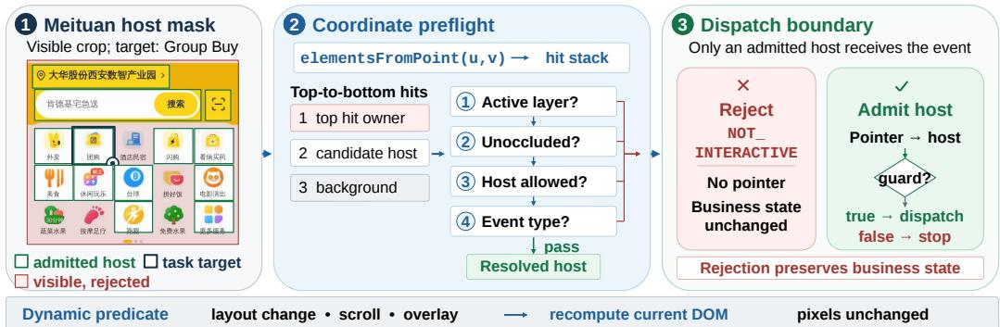  
Figure A3: Dynamic interaction authority on the generated Meituan Home. Green marks every admitted host in the visible crop; blue singles out Group Buy as the example task target, and red marks unbound regions for illustration rather than a runtime overlay. The current DOM stack admits only visible, unobscured hosts on the active layer; other coordinates return NOT INTERACTIVE before event dispatch.

Launch values. Let $v _ { i } ( f )$ be the value of State field f when trace i first enters canonical page p without having written f; an earlier write makes the value runtime state and removes the trace from the launch set of $( p , f )$ . Traces with $v _ { i } ( f ) \neq v _ { j } ( f )$ raise a launch conflict on $( p , f )$ , resolved by the first applicable rule:

1. Launch field. If every differing value is visible in its trace’s launch observation or is a premise of the recorded task (account or persona, region, target entity, or pre-existing data such as a saved listing, an unrated order, or a contact), $f$ is a launch field: $I _ { \mathrm { e n v } } ( f )$ is the neutral value when some trace shows one (empty cart, default filter, no selection) and otherwise the value most traces share, and each trace whose value differs stores it as $\delta _ { q _ { i } } ^ { \mathrm { l a u n c h } } ( f ) = v _ { i } ( f )$ . Page $p$ keeps one identity.

2. Conflict to guard. If $v _ { i } ( f ) = g ( c _ { i } )$ for a canonical field c and a supported map g (price by region, button label by lifecycle, detail fields by selected entity), f is projected from $c ,$ the affected execution keys gain a guard on $c ,$ and the conflict moves to $( p , c )$ , which the same rules resolve.

3. Unresolved. Otherwise the conflict is recorded on $( p , f ) ;$ : neither value is compiled, no value is keyed by task identifier, and tasks that depend on f stay outside $\Omega _ { I }$ until evidence arrives.

A direct launch observation precedes an inferred guard. The default in Rule 1 is not a vote: it is itself an observed value, it affects only tasks that leave $\bar { \boldsymbol { f } }$ undeclared, and every trace’s task carries its own value, so each source task starts exactly as its recording did. Conflicts between action consequences under one execution key follow Rule 2 or remain non-executable (Appendix A.3).

Launch support for generated tasks. A generated task may declare $\delta _ { q } ^ { \mathrm { l a u n c h } } ( f ) = v$ only if some trace observed v as a launch value of f or a supported operation sequence from $I _ { \mathrm { e n v } }$ reaches v; the second case uses the effect values of the operations that write $f$ and the records the read model exposes for the entity type of f. Declared fields must already belong to State: a delta cannot add pages, routes, entities, or attributes.

Runtime state ownership. Each episode runs in a fresh browser context: the state kernel creates a session for the task, applies $\delta _ { q } ^ { \mathrm { l a u n c h } }$ over $I _ { \mathrm { e n v } }$ , seals the initial snapshot, and renders the entry surface; Reset restores the fixed reset snapshot and clears runtime state, events, transactions, and reward. The session identifier is the task’s storage namespace and appears nowhere in $T , { \mathrm { V i e w } } _ { p } ,$ or the reward; only guarded transitions mutate x during an episode, guard-false attempts fail closed, and page-local caches never define business state. Instrumentation reads the task identifier only to map checkpoints. The zero-action and reset probes of Table B2 test this contract directly: a launch must render the declared fields without progress or reward, and repeated Reset must reproduce $x _ { 0 } ^ { ( q ) }$

## A.5 CONTEXT-BOUNDED RECONCILIATION

RECONCILE and FACTORIZE use the same hierarchical execution schedule. Sharding changes how evidence is assigned to API calls, while the semantic mappings, support gates, and contradiction handling of Appendix A.3 remain invariant. For phase input $N _ { \phi } ,$ , per-call budget $B _ { \phi } , K _ { \phi } = \lceil N _ { \phi } / B _ { \phi } \rceil$

Table B1: Runtime architecture of an exported application package. All layers are served under one origin. “Owns” denotes authoritative responsibility; “Boundary” states what that layer cannot decide.
<table><tr><td>Layer</td><td>Packaged form</td><td>Owns</td><td>Boundary</td></tr><tr><td>Presentation</td><td>Static HTML/CSS/- JavaScript; one page per canonical route</td><td>Renders  $\operatorname { V i e w } _ { p } ( x )$  and maps pointer or keyboard input to registered reads and actions</td><td>Disposable UI state only; no business state or task-specific product branches</td></tr><tr><td>State interface</td><td>One shared JavaScript client and typed same-origin API</td><td>Stable entity and affordance identity; registered reads, queries, and guarded transactions</td><td>No direct database or browser-storage writes; a failed guard cannot mutate state</td></tr><tr><td>State kernel</td><td>Packaged state module immutable world plus one writable overlay per episode</td><td>Canonical entities, relations, fields, or same-origin service; atomic transitions, revisions, diffs, and receipts</td><td>The world is immutable; overlays are session-isolated</td></tr><tr><td></td><td>Episode control Private lifecycle and initial-state template</td><td>Creates, initializes, seals, resets, finalizes, and deletes an episode</td><td>Unreachable from pages; reset rebuilds the overlay and clears its ledger</td></tr><tr><td>Evaluation</td><td>Task/evaluator manifests and a read-only state view</td><td>Computes checkpoints and reward from finalized snapshots and diffs; receipts supplement order or count</td><td>Cannot mutate state or branch product behavior on task identity</td></tr></table>

shards, reducer fan-in $b _ { \phi } ,$ , and maximum partial size $S _ { \phi }$ , balanced execution gives

$$
C _ { \phi } ^ { \mathrm { p e a k } } = O ( \operatorname* { m a x } \{ B _ { \phi } , b _ { \phi } S _ { \phi } \} ) , \qquad N _ { \phi } ^ { \mathrm { c a l s } } = O ( K _ { \phi } ) , \qquad D _ { \phi } = O ( \log _ { b _ { \phi } } K _ { \phi } ) .\tag{3}
$$

In Algorithm 2, SHARD forms source-complete groups within budget B; the typed API producer F emits bounded partials. REDUCE constructs the next level with fan-in b, preserving source-trace links, local-to-global mappings, contradictions, and uncovered obligations. VALIDATE returns the sole remaining partial only if coverage, total mappings, source support, and contradiction preservation hold against input E. Any helper failure aborts induction rather than yielding an empty app specification. With fixed budgets, peak per-call context is constant in trace-pool size; aggregate calls, tokens, and cost can still grow linearly.

Algorithm 2 Context-bounded hierarchical phase   
1: function HIERARCHICALPHASE(F, E, B)   
2: Q ← SHARD(E, B)   
3: $\dot { Q }  \{ F ( q ; B ) : q \in Q \}$   
4: while $| Q | > 1$ do   
5: Q ← REDUCE(F, Q, b)   
6: return VALIDATE(Q, E)

## B ENVIRONMENT CONSTRUCTION AND VALIDATION

## B.1 ENVIRONMENT ARCHITECTURE AND EXPORT

The compiler projects each page specification $\mathcal { C } _ { p } = \mathrm { P r o j e c t } _ { p } ( S , \Omega _ { I } ^ { ( r ) } )$ from validated canonical semantics: page ownership, hosts, guards, reads/writes, destinations, projections, reset, and verifiervisible consequences. Bounded API compilation combines this specification with its visual evidence set to emit a DOM-backed HTML/CSS/JavaScript application in Chromium (Si et al., 2025). Each canonical route becomes a static page served under one origin with the packaged state kernel, and every page uses the same state client. Table B1 makes the runtime authority boundaries explicit.

Packages realize the kernel either inside the page runtime over packaged world data or as a separate same-origin service over a SQLite world; both expose the same client and boundaries, and the service form additionally separates the kernel from page code by a process boundary. The standalone package also carries task definitions, evaluators, resources, and manifests. The app specification, visual evidence, source traces, and evidence map Σ stay outside the execution path as audit sidecars.

Visual-evidence selection. For each materialized page $p ,$ the page-environment projection and source-linked visual signatures define obligations $U _ { p }$ for its shell, action hosts, selected states, overlays, and appearance variants. Each retained source screenshot covers only the obligations visible in that observation; render role and lifecycle distinguish the canonical initial layout from later states. The selector solves a minimum set cover over these signatures, retains a canonical-layout observation when the initial view depends on one, and records the complete candidate universe and uncovered obligations. When coverage cannot be established, it keeps a conservative visual basis but marks the selection uncertified; a missing image never becomes evidence for a semantic relation (Algorithm 3).

Algorithm 3 Page-level visual-evidence selection   
Require: retained screenshots $F _ { p } ,$ page projection $C _ { p } ,$ source-linked visual signatures $V _ { p }$   
Ensure: selected visual basis $B _ { p } ^ { \dot { } }$ and coverage record $L _ { p }$   
1: $U _ { p } \gets$ NORMALIZEOBLIGATIONS $( C _ { p } , \breve { V _ { p } } )$   
2: for all $f \in F _ { p }$ do   
3: rf ← RENDERROLE(f); Af ← VISIBLECOVERAGE $( f , U _ { p } , r _ { f } )$   
4: end for   
5: $W _ { p }  U _ { p } \backslash \bigcup _ { f \in F _ { p } } A _ { f }$   
6: $\mathbf { i f } U _ { p } \neq \emptyset$ and $\boldsymbol { W _ { p } } ^ { \prime } = \boldsymbol { \mathcal { O } }$ then   
7: $\overset { \cdot } { B _ { p } }  \mathbf { M I N I M U M C O V E R } ( \{ A _ { f } : f \in F _ { p } \} , U _ { p } )$   
8: else   
9: $B _ { p }$ ← CONSERVATIVEBASIS $( F _ { p } ) \mathrm { ~ : ~ }$ ; mark coverage uncertified   
10: if initial layout requires visual authority and $B _ { p }$ lacks its canonical observation then   
11: add the eligible canonical-layout observation to $B _ { p } ,$ , or record its absence   
12: $L _ { p } \gets \mathsf { R }$ ECORDCOVERAGE $( F _ { p } , B _ { p } , U _ { p } , \{ A _ { f } \} , W _ { p } .$ , source steps)   
13: return $( B _ { p } , L _ { p } )$

Export checks canonical-consumer coverage, identifier and field agreement, build/resource integrity, independent host/reset entry, and a smoke execution. Compilation consumes page specifications, but the exported runtime reads only packaged pages, the registered state interface, and episode state; it does not read the reconciled app specification, source traces, or repair history. Algorithm 4 then establishes behavioral validity on the exported revision.

## B.2 SOURCE-TRACE VALIDATION AND REPAIR

BUILDOBLIGATIONS derives a per-trace checklist from source-trace evidence. EXECUTE starts each affected trace at native reset in a fresh browser context, records visible GUI operations, and stops at the first blocker; it cannot access the review oracle, inject state, or repair. REVIEW is independent and operates on a frozen evidence packet: it reads the complete source trace before the execution and compares required information, decisions, effects, lifecycle, and terminal state, allowing valid alternative paths and unequal sequence lengths. It may emit PASS or the first material mismatch with its owner, but it cannot modify the source trace, checklist, environment, or execution, drive actions, extend a stopped execution, or perform repairs.

Algorithm 4 Environment validation and repair   
Require: browser environment $E _ { 0 } ,$ frozen page specifications ${ \mathcal { C } } ,$ source traces $R ,$ repair budget $K$   
Ensure: validated environment or dropped slice   
1: O ← BUILDOBLIGATIONS(R); $\bar { E }  E _ { 0 }$   
2: for $k = 0 , 1 , \ldots , K$ do   
3: X ← EXECUTE(E, O)   
4: z ← REVIEW(R, X, O)   
5: if z = PASS then z ← PROBE(E, C, O)   
6: if z = PASS then return VERIFIED(E)   
7: if $k = K$ or not REPAIRABLE(z | C) then break   
8: $( E , \Delta ) \gets \mathrm { R E P A I R } ( E , z \mid \mathcal { C } )$   
9: INVALIDATE(∆)   
10: return DROPSLICE(E, z)

PROBE applies the verification contract below and Table B2, returning PASS or an attributed failure. REVIEW and PROBE only report: a failure is a defect packet naming the step, the expected and observed state, and the affected obligations. REPAIRABLE holds when the packet can be closed by editing the package under fixed C: rendering, route wiring, storage, bindings, projection, a missing implementation of a supported relation, or a supported relation whose realized state update or control behavior differs from the source. A packet whose closure would require behavior outside C, that is, a new page identity, state or data relation, guard, or effect that no source evidence supports, is not repairable, and C is never edited inside the loop. REPAIR receives the existing package, the packet, and the source evidence and edits only the package; correcting a wrongly realized effect changes the package, not the model. INVALIDATE removes execution, review, probe, and checkpoint evidence intersecting edited dependencies $\Delta ;$ ; affected traces restart at step zero, while identical consumed slices retain their evidence. Shared runtime/reset edits reach all dependent tasks. The default $K = 3$ allows an initial check, three repairs, and a final check. VERIFIED returns revision-matched evidence with the environment. DROPSLICE records the packet and its owner and freezes the environment without the slice that failed validation; a dropped slice can re-enter only through a new reconciliation over its source evidence and a fresh compilation, which is a construction revision rather than a repair. Appendix G gives the condensed review prompt; full prompts and routing records are in the artifact.

## B.3 STATE-BASED VERIFICATION

Verification maps supported obligations to business-state checkpoints, canonical producers and reducers, visible projections, and evaluator consumers. Partial progress and terminal success remain separate: checkpoints represent completed subgoals, not actions or hidden reasoning. A valid alternative path passes when it realizes the same contracted state. Legal actions must realize their contracted projection; illegal attempts preserve business state and dispatch no route or transaction:

$$
a \in \mathcal { A } _ { P } ^ { + } ( x ) \Rightarrow \mathrm { P r o j } _ { \mathrm { b i z } } ( \mathrm { E x e c } _ { P } ( x , a ) ) = \mathrm { P r o j } _ { \mathrm { b i z } } ( \mathcal { C } _ { P } ( x , a ) ) ,\tag{4}
$$

$$
a \in \mathcal { A } _ { P } ^ { - } ( x ) \Rightarrow \operatorname { P r o j } _ { \mathrm { b i z } } ( \operatorname { E x e c } _ { P } ( x , a ) ) = \operatorname { P r o j } _ { \mathrm { b i z } } ( x ) , \quad \operatorname { D i s p a t c h } ( x , a ) = \emptyset .\tag{5}
$$

Here $\mathinner { \mathcal { A } _ { P } ^ { + } }$ and $\mathcal { A } _ { P } ^ { - }$ are legal and guard-false, wrong-type, or unbound attempts; $\mathcal { C } _ { P }$ is the prescribed transition. $\mathrm { P r o j _ { b i z } }$ is compiled from the app specification, not hand-specified: it keeps the State fields and Data records supported by $\Omega _ { R }$ and drops the route, overlay, focus, scroll, and selection variables of the view. Ephemeral UI changes do not count as business effects. The same digest must pass natural GUI execution, independent sequence review, and every applicable probe in Table B2 before validation passes.

Table B2: Mandatory probe matrix. Every probe runs on the same environment digest; the required verdict is judged on canonical business state, never on a screenshot.
<table><tr><td>Probe</td><td>Required verdict</td><td>False pass it exposes</td></tr><tr><td>Zero-action initial state</td><td>no progress, no reward</td><td>reward granted at launch; leaked prior state</td></tr><tr><td>Each legal partial stage</td><td>progress only</td><td>terminal credit for route-only arrival</td></tr><tr><td>Wrong entity or value</td><td>fail</td><td>terminal check that ignores the bound object</td></tr><tr><td>Premature terminal</td><td>fail</td><td>success declared before the required mutation</td></tr><tr><td>Repeated action</td><td>judged on final state</td><td>double credit from a historical maximum</td></tr><tr><td>Correct terminal</td><td>pass</td><td>missing verifier-visible consequence</td></tr><tr><td>Fresh reset, back-to-back episodes</td><td>tions, reward cleared</td><td>state, events, transac- cross-episode leakage</td></tr><tr><td>Legitimate alternative path</td><td>tracted state</td><td>pass iff same con- trace-path imitation as the reward</td></tr></table>

## B.4 CROSS-APPLICATION WORKFLOWS

Source recordings are application-local. Cross-app benchmark authoring composes exactly two validated app-local task-facing indexes; it may add a task-level dependency, but no new local field, route, entity relation, state transition, or effect. A typed, GUI-visible output in A supplies an input or guard in B, and a visible result in B must affect a later action after returning to A. Independent A-then-B completions and hidden-state handoffs are rejected. The runner preserves each app’s state while backgrounded. The joint terminal contract checks both local outcomes, both handoff values, and the final decision in $\bar { A : } G = g _ { A } ^ { \mathrm { p r e } } \wedge h _ { A  B } \wedge g _ { B } \wedge h _ { B  A } \wedge g _ { A } ^ { \mathrm { f i n a l } }$ . Local behavior is validated against its source traces; the composition is validated against this frozen joint contract, since no source recording spans the complete cross-app episode. Benchmark authoring creates the composition graph before evaluation; after freezing, environment construction and repair, learner-guided task generation, training, and checkpoint selection cannot inspect the graph or joint oracle (Appendix E.3.1).

## C LEARNER-GUIDED TASK SUPPLY UNDER FIXED SEMANTICS

## C.1 TASK CANDIDATE AUTHORING

Task-facing index. After a package passes source replay, the indexer extracts a read-only index $I _ { r } = \Pi ( E _ { r }$ , replay records, $S _ { \mathrm { a n c h o r s } } )$ from the source-validated package $E _ { r }$ ; the frozen app model contributes only stable identifiers, provenance, and support anchors, so the index never reads a stale specification once repair has moved the package closer to the source. The index lists surface, host, and control identifiers, entity schemas, observable fields, supported operation identifiers, observable outcomes, implementation status, and source links; guards, effects, and destinations appear as references to already-established operations rather than as a second copy of transition semantics. A dependency index records producer, consumer, value type, entity scope, freshness, and the supported discovery path that makes an instruction-implicit value observable. Reconstructing dynamics is the modeling problem; the indexer does not reconstruct app behavior but extracts addressable structure from the validated world and attaches references to established operations and dependencies, so it has no semantic authority. Every emitted item must reference a supported relation and its evidence, an item that cannot be resolved is dropped rather than inferred, and no transition, guard, or effect is introduced. Because extraction is cheap, the index is refreshed after each instantiated task slice rather than re-derived by modeling (Appendix G).

Candidate binding. Task authoring reads this index and performs no structure extraction of its own. A candidate binds its user goal and terminal value, launch state, business subtasks and decisions, cross-state dependencies, evidence revisits, acceptable terminal set, reset boundary, and evaluatorobservable outcome to indexed items and their sources. A missing support binding rejects the candidate; a binding whose item is supported but not yet implemented routes to implementation rather than to reconciliation. Appendices G and G give the condensed indexing and task-authoring instructions; Algorithm 5 owns screening and selection.

Cross-application benchmark authoring. The learner-guided branch produces only single-app training tasks. A separate pre-evaluation branch joins two source-validated app-local indexes through typed, GUI-visible handoffs $A \to B \to A$ . Its local requirements satisfy $\operatorname { R e q } _ { A } ( c ) \subseteq \Omega _ { R } ^ { A }$ and $\mathrm { R e q } _ { B } ( c ) \subseteq \Omega _ { R } ^ { B }$ . Pairs are selected before policy outcomes by typed handoff compatibility in both directions; within a pair, tasks must differ in dependency structure rather than only entity bindings. The producer’s surface, field, type, freshness, and entity scope must match the consumer’s input or guard; the second handoff must change the final action in the preserved state of A. The branch freezes a joint terminal contract and rejects independent task concatenations. It adds a task-level dependency over supported local semantics, not an application transition inferred from a cross-app source trace (Appendix B.4). The resulting 100 tasks enter only Trace2World-Bench, before any policy evaluation.

Difficulty follows the four capabilities in Figure 5: long-horizon, reasoning, memory/state, and recovery/backtracking. Schema-backed instance variation changes entities and values without claiming a new workflow. Deliberately long tasks require at least seven business subtasks, four non-trivial decisions, three cross-state dependencies, and two evidence revisits, plus two required difficulty phenomena with at least one information- or state-bearing. Navigation and repeated clicks do not satisfy this floor. Full prompts and fine-grained annotations are in the artifact.

## C.2 TASK IMPLEMENTATION AND SCREENING

IMPLEMENT instantiates a candidate’s task slice in the package: schema-backed entity, value, and state instances, hosts and state-dependent transitions of already-supported operations, projections, reset/session isolation, and evaluator-visible consequences. It adds no app-level transition, guard, or effect beyond the frozen model. It checks fresh GUI execution and affected seed-task regression, then refreshes the task-facing index. For ENVDEFECT, it reproduces the failure on the current revision and calls Algorithm 4 with the remaining repair budget. Its persistent per-slice ledger checks the threewave cap before each repair and retains counts across requeues and refinements. It returns a validated environment, edited dependencies $\Delta .$ , and a status; failed slices are excluded. REQUEUEAFFECTED invalidates intersecting queued evidence and moves affected selections back to $Q ,$ preserving their repair counts.

PASSATFOUR returns four valid attempts each from the preceding learner $\pi _ { L }$ and a fixed stronger solver $\pi _ { S }$ (instantiated in Appendix D.2), or early failure records for diagnosis. Invalid infrastructure or environment attempts are retained but do not count. DIAGNOSE first attributes non-learner faults. A complete, fault-free screen is held if the solver never succeeds, marked REFINABLE if learner mean reward exceeds 0.8, and otherwise SELECTABLE. Screening attempts never enter training, reward, or formal evaluation credit.

Algorithm 5 Learner-guided task selection   
Require: validated environment $E ,$ supported candidates C, learner $\pi _ { L } .$ , solver $\pi _ { S }$   
Ensure: next task batch A   
1: $A  \emptyset ; Q  \{ ( c , \mathrm { N E W } ) : c \in \mathcal { C } \}$   
2: while $Q \neq \emptyset$ do   
3: $( c , z ) \gets \mathrm { P o p } ( Q )$   
4: $( E , \Delta , z ) \gets \mathrm { I M P L E M E N T } ( E , c , z )$   
5: (A, Q) ← REQUEUEAFFECTED $( { \dot { A } } , Q , \Delta )$   
6: $\mathbf { i f } \ z \neq$ READY then RECORD(c, z); continue   
7: $( A _ { L } , A _ { S } ) \gets \mathrm { P A S S A T F O U R } ( E , c , \pi _ { L } , \pi _ { S } )$   
8: $\dot { z } \gets \mathrm { D I A G N O S E } ( c , A _ { L } , A _ { S } )$   
9: if $z = { \mathrm { S E L E C T A B L E } }$ then $A  A \cup \{ c \} ;$ ; continue   
10: if z = ENVDEFECT then $Q  Q \cup \{ ( c , z ) \}$ ; continue   
11: Q ← Q ∪ REFINEORHOLD(c, z)   
12: return FREEZE $( E , A )$

REFINEORHOLD returns $\{ ( c ^ { \prime } , \mathrm { N E W } ) \}$ when an actionable task issue or saturation allows a concrete supported refinement; otherwise it records a deferral/hold and returns $\mathcal { O } .$ Refinement is one-directional and bounded: a lineage is refined at most twice, saturated lineages are made more demanding within fixed support, and hard or solver-unsolved lineages are held, never simplified (Appendix E.3.2). Refinements repeat implementation and screening. RECORD logs failed validation and its owner; exhausted slices are dropped. FREEZE binds selected tasks and current evidence to the final environment revision. A discovered path is implemented only when its edges are supported and its task semantics are equivalent. App-specification support stays fixed; the artifact retains routing decisions and immutable attempts used for independent failure reproduction.

## C.3 AUGMENTATION BATCHES AND POLICY TRAINING

A training stage is one pass over a frozen task batch; an RL iteration is one DAPO optimizer step within that stage. The three stages use seed tasks, augmented batch 1, and augmented batch 2. For stage $r , B _ { 1 } = \mathcal { N } , B _ { 2 } = \mathcal { A } _ { 1 }$ , and $B _ { 3 } = A _ { 2 }$ , with $\pi _ { r } = \mathrm { D A P O } ( \pi _ { r - 1 } ; B _ { r } )$ . After seed training, generation reads $\pi _ { 1 } \mathrm { ^ { * } s }$ task outcomes; after the first augmented batch, it reads $\pi _ { 2 } \mathrm { ^ { * } s }$ task outcomes, saturation, solver failures, and attributed defects. Each task is screened with the same preceding learner. Batch manifests freeze task signatures, membership, launch specifications, preceding checkpoint, screening attempts, and environment revisions before optimization. Appendix G specifies how prior practice outcomes condition the next authoring pass. Between stages, supported implementation changes must be reverified before the next freeze.

Each batch is shuffled once and consumed without replacement; the learner continues its preceding weights and never replays earlier batches. The optimized reward is the environment task evaluator’s checkpoint credit. Task t declares $k _ { t }$ checkpoints $c _ { t 1 } , \ldots , c _ { t k _ { t } }$ , each a predicate over the final business state $x _ { T }$ of an attempt, with $c _ { t k _ { t } }$ the task’s terminal condition; checkpoints are unordered and equally weighted, so an alternative path that reaches the same final state earns the same credit, and a state that is undone before the episode ends earns none. With $s = \mathcal { W } [ c _ { t k _ { t } } ( x _ { T } ) ]$ the terminal verdict,

$$
q = \left\{ \begin{array} { l l } { 1 } & { s = 1 , } \\ { \frac { 1 } { k _ { t } } \sum _ { i = 1 } ^ { k _ { t } } \mathcal { H } [ c _ { t i } ( x _ { T } ) ] } & { s = 0 . } \end{array} \right.\tag{6}
$$

A task group contains G = 8 sampled trajectories, and it is retained only if the population SD of its eight rewards exceeds 0.1: all-success and all-fail groups are dropped before optimization, as is a group whose rewards differ by one checkpoint in only one sample of a task with four or more checkpoints. DAPO (Yu et al., 2025) uses token-level, group-mean-centered and group-stdnormalized advantages, asymmetric PPO clipping (Schulman et al., 2017; Shao et al., 2024), and dynamic sampling over the retained groups. No format reward, KL, entropy bonus, or overlongreward shaping is added. The terminal checkpoint is fixed by the schedule, and held-out scores never guide generation, stopping, or selection. Batch sizes, RL-iteration counts, and the remaining run settings are fixed in Appendix D.4.

## D SYSTEM CONFIGURATION AND EVALUATION PROTOCOLS

This section records what the release contains and the shared settings and evaluation boundaries needed to reproduce the experiments: the resource contract, the agent interface and model roles, the application/task/evaluation partitions, the policy-optimization schedule, and the evaluator roles and evaluation-record binding. Appendix E co-locates each study’s setup, baselines or controls, metrics, and supplementary results. Within each matched comparison, the settings below are held fixed unless the local protocol names the changed factor.

## D.1 TRACE2WORLD RESOURCE CONTRACT

Trace2World is released as an environment-construction resource rather than as a benchmark alone. The release binds the source evidence, reconstructed environments, training-task supply, evaluation sets, and fidelity records used in this study (Table D1). Trace2World-Bench is one frozen evaluation view over the resulting environment portfolio; it is not the construction target. Two terms separate evidence from its use. A source trace is the semantic unit $( q , o _ { 0 } , a _ { 0 } , \dots , o _ { T } )$ of Section 3.1; a source recording is the released evidence behind it: the screenshot sequence, raw device actions, marked observations, instruction, terminal contract, and collection metadata. Source recordings and derived trace records are released together and preserve the complete research-relevant chronology, including retries and corrections, subject only to the privacy, security, and redistribution screening in the Ethics Statement. Each trace binds a source digest, a release digest, a release-review status, and a redaction manifest that declares every redacted region with its reason and its semantic effect; a trace whose safe release would alter its interaction evidence is withheld and listed rather than trimmed.

Table D1: Trace2World resource contract. Scale, role, and released artifact of each component. Source traces are construction evidence and the external fidelity authority; the environment portfolio is the reusable resource; Trace2World-Bench is one evaluation view over it.
<table><tr><td>Component</td><td>Scale</td><td>Role</td><td>Released artifact</td></tr><tr><td>Source traces</td><td>1,570 / 50 apps</td><td>construction evidence; external fidelity authority</td><td>source recordings, action records, instructions, terminal contracts, collection metadata</td></tr><tr><td>Construction pipeline</td><td>one shared pipeline</td><td>trace → reconciled specification → environment</td><td>preprocessing, reconciliation, compilation, validation, and repair code</td></tr><tr><td>Environment portfolio</td><td>50 apps / 10 domains</td><td>resettable GUI RL substrate</td><td>standalone packages with state and evaluator manifests</td></tr><tr><td>Training-task supply</td><td>1,280 seed + 768 learner-guided</td><td>policy optimization</td><td>task, launch, support, and evaluator manifests</td></tr><tr><td>Trace2World- Bench</td><td>1,044 tasks</td><td>frozen policy evaluation</td><td>task definitions, split identities, evaluators</td></tr><tr><td>Fidelity study</td><td>200 workflows / 10 apps</td><td>reconstruction correctness</td><td>source/execution packets, reviewer labels, human adjudication</td></tr><tr><td>Real-device panel</td><td>100 tasks / 20 apps</td><td>paired sim-to-real evidence</td><td>frozen task manifests, paired outcomes</td></tr></table>

## D.2 AGENT INTERFACE AND MODEL ROLES

The learner observes the instruction, action history, and the three most recent screenshots, and emits one call from Table D2. Coordinates use [0, 999]2, projected to the current screenshot and browser

CSS frame. Trace records, evidence maps, checkpoints, hidden state, repair diagnoses, and oracle predicates are not observations. An action on a component outside the current task binding or implemented behavior scope, or any other invalid or non-interactive action, consumes a step, changes no business state, and returns only NOT INTERACTIVE, revealing neither the correct target nor the next action. A missing or inconsistent legal host is an environment blocker, not a learner error. Step budgets are given in Appendix D.4; open app is restricted to the episode manifest.

Table D3: Policy-facing rollout protocol. A step is one public action call, including rejected calls and terminal submissions; it cannot batch several GUI actions. The task construction class fixes the cap before policy outcomes.  
Table D2: Action space. The same public interface serves training and evaluation rollouts.
<table><tr><td>Action</td><td>Arguments</td><td>Definition</td></tr><tr><td>click/double_click/long-press</td><td>coordinate</td><td>tap, double-tap, or 500 ms press at the point</td></tr><tr><td>type</td><td>text</td><td>enter text into the focused ed- itable control</td></tr><tr><td>swipe/scroll</td><td>direction; optional coordinate</td><td>finger-motion direction / content-motion direction</td></tr><tr><td>drag</td><td>start, end coordinates</td><td>drag from start to end</td></tr><tr><td>open_app</td><td>app name</td><td>open the named application (episode manifest only)</td></tr><tr><td>system_button</td><td>{home, back, enter}</td><td>press the system button</td></tr><tr><td>wait answer</td><td>seconds (≤ 30)</td><td>wait</td></tr><tr><td></td><td>text</td><td>submit a textual answer and end the trajectory</td></tr><tr><td>terminate</td><td>{success, fail}</td><td>end the trajectory with the de- clared status</td></tr></table>

<table><tr><td>Field</td><td>Episode contract</td></tr><tr><td>Policy observation</td><td>Instruction, action history, three most recent screenshots, and feedback for the preceding rejected action; no trace, hidden state, or evaluator access.</td></tr><tr><td>Action unit</td><td>One call from Table D2 per policy decision. Invalid actions, wait, open_app, answer, and terminate each use one decision; a nonterminal call is followed by a new observation.</td></tr><tr><td>Geometry</td><td>The model uses [0, 999]2 coordinates, mapped through the current screenshot to the browser CSS viewport; each package declares its viewport and device scale.</td></tr><tr><td>Settling</td><td>Declared navigation targets wait up to 5 s; pointer and gesture actions add 50 ms. Before a screenshot, the host waits for fonts and an animation frame. wait is a separate, budgeted action.</td></tr><tr><td>Stop and score</td><td>A terminal call or the class cap ends the attempt. In both cases the task evaluator scores the final business state and required receipts; a declared success does not override its verdict.</td></tr><tr><td>Horizon</td><td>H = 30 source-derived single-app; 45 augmented single-app; 60 two-app return composition. Single-app caps match across screening, RL, and evaluation; two-app tasks enter only the benchmark.</td></tr><tr><td>Reset and return</td><td>A fresh browser context starts from the task&#x27;s fixed launch state; reset clears episode state, events, transactions, and reward. Cross-app switching preserves each app&#x27;s state while backgrounded.</td></tr></table>

The 50-app runtime profile fixes a 430×884 CSS-pixel viewport at device scale factor two, producing 860 × 1768 raw PNG observations. Model-side image processing is configured independently of this environment geometry. Training and evaluation decoding, token limits, and attempt counts appear in Table D6 and Appendix E.3.1.

Model roles. Construction uses two distinct model roles. GPT-5.2 serves every bounded API call in the construction pipeline, including source-trace preprocessing (Appendix A.1), semantic reconciliation, and initial package compilation; GPT-5.5 drives package-level verification and brownfield repair in the agentic Codex flow. The bounded API stage therefore runs on the weaker of the two models, while every compared builder receives GPT-5.5 in each role it defines, so the fidelity margin does not follow from model capability. The initial environment, agentic fixloop, and task-augmentation stages remain separate. Qwen3.5-9B is the learner; Qwen3.7-Plus is the fixed solvability solver;

GPT-5.6 Sol is the frozen offline fidelity reviewer (Appendix E.1.1) and, in isolated contexts, the PhoneWorld-style QA reviewer. It never supplies training rewards or held-out SR/PR; those use the environment’s programmatic task evaluator. The policy-optimization schedule and hyperparameters are specified in Appendix D.4.

## D.3 APPLICATION, TASK, AND EVALUATION SPLITS

The experimental design separates environment construction from policy optimization. All 50 applications and all 1,570 traces are used to construct the 50 environments. Policy optimization uses tasks from 40 applications only. The other ten applications, selected one per domain before task generation, form the unseen-application test split: they supply construction traces but no seed or learner-guided task, candidate slot, screening rollout, or RL update. Table D4 lists all 50 applications by domain and makes the 40/10 policy split explicit.

Table D4: Application roster by domain and policy split. All 50 applications provide construction traces. The 40 policy-training applications supply optimization tasks; the ten held-out evaluation applications, one per domain, supply no seed, candidate, screening, or RL-update task.
<table><tr><td>Domain</td><td>Policy-training apps (40)</td><td>Held-out eval app (10)</td></tr><tr><td>Social &amp; community</td><td>WeChat; QQ; Weibo; Xiaohongshu</td><td>Zhihu</td></tr><tr><td>News &amp; short video</td><td>Kuaishou; Bilibili; Toutiao; Tencent News</td><td>Douyin</td></tr><tr><td>Long video &amp; audio</td><td>iQIYI; Youku; NetEase Cloud Music; Kugou Music; Ximalaya</td><td>QQ Music</td></tr><tr><td>Commerce &amp; resale</td><td>Taobao; JD; Xianyu; Dewu</td><td>Pinduoduo</td></tr><tr><td>Local services &amp; food</td><td>Meituan; Dianping; Dingdong Maicai; KFC; Hema</td><td>Ele.me</td></tr><tr><td>Mobility, travel &amp; tickets</td><td>Amap; Ctrip; Didi; Railway 12306; Damai</td><td>Taopiaopiao</td></tr><tr><td>Auto, housing &amp; jobs</td><td>58Tongcheng; Autohome; Dongchedi; BOSS Zhipin</td><td>Beike</td></tr><tr><td></td><td>Work, learning &amp; search Feishu; WPS Office; Baidu; DingTalk; Youdao Dictionary; Baidu Tencent Meeting Netdisk</td><td></td></tr><tr><td>Payment &amp; logistics</td><td>Alipay; SF Express</td><td>Cainiao</td></tr><tr><td>Health &amp; fitness</td><td>Boohee Health</td><td>Keep</td></tr></table>

Construction-trace allocation. The 1,570 trace count is a pre-collection evidence quota, not a train/test partition. An application with at least three independent service lines receives 50 traces; the other applications receive 20. Thus 19 multi-service applications contribute 950 traces and 31 singleservice applications contribute 620. The multi-service set is WeChat, QQ, Douyin, Kuaishou, Taobao, JD, Pinduoduo, Meituan, Amap, Ctrip, 58Tongcheng, Autohome, Dongchedi, Beike, Xiaohongshu, Bilibili, Dianping, Baidu, and Alipay. A service line is fixed from the product surface before collection and has its own catalog or service plus a transactional record and lifecycle. Domain is descriptive and is used to stratify held-out and audit sets; it does not determine the collection quota.

Table D5: Evaluation sets, partitions, and denominators. This table is the sole size owner for the Trace2World-Bench result columns in Table E10; SR there averages three attempts per task. Entity replacements sample training-side workflow skeletons and do not reduce the complete 20% held-out-workflow split. Fidelity and device transfer retain separate populations.
<table><tr><td>Evaluation set</td><td>Application coverage</td><td>Size / partition</td></tr><tr><td>Fidelity (construction-exposed)</td><td>10-app reconstruction set</td><td>200 workflows (16–26/app)</td></tr><tr><td>Trace2World-Bench</td><td>all 50 apps</td><td>1,044 tasks</td></tr><tr><td>Policy-training-app subtotal</td><td>40 policy-training apps / 10 frozen pairs</td><td>868 tasks</td></tr><tr><td>Entity replacement</td><td>training-side workflow skeletons</td><td>256 tasks</td></tr><tr><td>Held-out workflow</td><td>20% signature split (320 seed + 192 aug.)</td><td>512 tasks</td></tr><tr><td>Cross-app</td><td>10 policy-training-app pairs</td><td>100 tasks (10/pair)</td></tr><tr><td>Tasks from unseen apps</td><td>10 apps excluded from policy training</td><td>176 tasks</td></tr><tr><td>Device transfer</td><td>20 policy-training apps</td><td>100 tasks (5/app)</td></tr></table>

How evaluation tasks are separated. The fidelity evaluation set samples supported workflows from ten applications without replacement and scores the same 200 construction-exposed workflows with the same six binary diagnostic questions for every construction condition at equal application weight. The ten-app roster coincides with the policy-held-out roster, but the estimator uses only these paired workflow judgments and equal application weighting; it is not a held-out policy test. The primary policy uses 2,048 optimization tasks: 1,280 seed tasks followed by two 384-task learner-guided batches, all on the 40 policy-training applications. Entity-rebinding variants enter only the matched training control: two additional 384-task batches change entities while retaining seed workflow structure, and replace rather than accompany the learner-guided batches in that branch.

Before any outcome is observed, the 40 policy-training apps define 2,560 single-app workflow signatures. The split is stratified by source family: 1,600 representative seed-family signatures yield 1,280 train / 320 test, and 960 augmentation-family signatures yield 768 train / 192 test. A seed or augmentation task enters the 512-task test slice whenever its complete goal, launch state, terminal predicate, primitive order, recovery structure, and composition signature is absent from training. Entity replacement then samples 160 seed-family and 96 augmentation-family skeletons from the 2,048-task training side while freezing new task IDs and canonical entity lineages that appear in no RL batch; it therefore tests entity shift without consuming the workflow test split.

The four Trace2World-Bench slices in Table D5 are disjoint as evaluation task identities and exhaust the 1,044-task denominator. Tasks from unseen apps are single-application only. Cross-application tasks use policy-training applications and form a 100-task Trace2World-Bench slice with ten disjoint two-app pairs and ten structurally distinct, return-dependent tasks per pair (Appendix E.3.4). No benchmark identity enters an optimization batch or guides learner-guided generation, screening, or checkpoint selection. The pair roster, orientation, typed handoffs, and joint terminal contracts are frozen before policy outcomes.

The fixed device-transfer population is the 100-task, 20-app panel in Table D5: 50 unseen entity/state rebindings and 50 workflows drawn from the 512-task held-out-workflow slice. The latter are an overlapping real-device subset of Trace2World-Bench rather than an independent benchmark. Appendix E.4.1 owns the within-app allocation, counterbalancing, eligibility, pairing, and estimands. The benchmark’s cross-app slice is simulation-only and adds no real-device executions. Batch freezing follows Appendix C.3; the artifact manifest records the roster with class, service-line count, domain, trace identities, collection quotas, and split identities.

## D.4 POLICY OPTIMIZATION AND ROLLOUT CONFIGURATION

The three frozen batches contain 1,280/384/384 single-app tasks on the 40 training apps. With at most 40 task groups per RL iteration,

$$
K _ { r } = \lceil | \boldsymbol { \mathcal { B } } _ { r } | / 4 0 \rceil , \qquad ( K _ { 1 } , K _ { 2 } , K _ { 3 } ) = ( 3 2 , 1 0 , 1 0 ) .\tag{7}
$$

The final iterations therefore contain 40/24/24 tasks. Table D6 fixes the group size, retention and no-refill rules, checkpoints, and remaining settings for every matched condition.

Table D6: Policy-optimization and rollout configuration. All matched training conditions use these settings; changing any field defines a new condition. The public-action horizon follows the frozen construction class in training, screening, Trace2World-Bench, and real-device episodes.
<table><tr><td>Field</td><td>Value</td><td>Note</td></tr><tr><td>Initial policy</td><td>Qwen3.5-9B</td><td>no SFT warm-up</td></tr><tr><td>Objective</td><td>DAPO</td><td>clip-higher, dynamic sampling, token-level loss</td></tr><tr><td>Reward</td><td>checkpoint credit q</td><td>Eq. 6; no format or length terms</td></tr><tr><td>€low / €high</td><td>0.2 / 0.28</td><td>DAPO defaults</td></tr><tr><td>KL / entropy coefficient</td><td>0/0</td><td>no reference model</td></tr><tr><td>Tasks / RL iteration</td><td>at most 40</td><td>shuffled once per stage; no replacement</td></tr><tr><td>Retained groups / RL iteration N</td><td>at most 32</td><td>reward SD ≤ 0.1 dropped; no refill</td></tr><tr><td>Task-group size G</td><td>8 trajectories</td><td>sampled for each task group</td></tr><tr><td>Task-supply stages</td><td>3</td><td>seed, augmented batch 1, augmented batch 2</td></tr><tr><td>RL iterations / stage</td><td>32 / 10 / 10</td><td> $K _ { r } = \lceil \rceil \breve { B } _ { r } \lvert / 4 0 \rceil$ </td></tr><tr><td>Final-iteration tasks</td><td>40 / 24 / 24</td><td>no padding or repeated draws</td></tr><tr><td>Optimizer / learning rate</td><td>AdamW / 1 × 10−⁶</td><td>constant, no warmup</td></tr><tr><td>Mini-batch</td><td>64 trajectories</td><td>up to 4 gradient steps per RL iteration</td></tr><tr><td>Training / evaluation temperature</td><td>1.0 / 0.7</td><td>Trace2World-Bench SR/PR; external-suite protocols</td></tr><tr><td>Evaluation checkpoints</td><td>0 / 32 / 42 / 52</td><td>cumulative RL iterations; base and stage ends</td></tr><tr><td>Screenshots in context</td><td>3</td><td>most recent</td></tr><tr><td>Episode step budget H</td><td>30 / 45 / 60</td><td>source-derived / augmented / cross-app</td></tr><tr><td>Max context / response length</td><td>32K / 4K</td><td>tokens</td></tr><tr><td>Seeds</td><td>3 (0, 1, 2)</td><td>all training and policy-evaluation runs; mean ± std</td></tr></table>

Construction-class horizons. An episode step is one public GUI action, including open app and switches. The class is fixed from the task manifest before any model outcome: 1,280 sourcederived training tasks use H = 30 and 768 augmented training tasks use H = 45; no cross-app task enters RL. Trace2World-Bench contains 656 source-derived single-app tasks (160 seed-family entity replacements, 320 seed-family workflow holdouts, and 176 unseen-app tasks), 288 augmented single-app tasks (96 entity replacements and 192 workflow holdouts), and 100 two-app compositions. The paired device panel has 80 source-derived and 20 augmentation-family tasks, each with the same cap in simulation and on device. The 30/45/60 assignment follows provenance and structural composition rather than model success.

Table D7: Legal-path calibration of the frozen Trace2World-Bench horizons. Path lengths count public GUI actions from reset to terminal state. Every cross-app task is completed by a human through the agent’s action interface before admission, with a 45-action human cap; the agent receives 60. The two single-app classes use frozen legal paths and GUI checks.
<table><tr><td>Task class</td><td>Tasks</td><td>Certified</td><td>Median</td><td>P90</td><td>Max</td><td>H</td></tr><tr><td>Source-derived single-app</td><td>656</td><td>656</td><td>9</td><td>17</td><td>24</td><td>30</td></tr><tr><td>Augmented single-app</td><td>288</td><td>288</td><td>18</td><td>29</td><td>36</td><td>45</td></tr><tr><td>Two-app return composition</td><td>100</td><td>100</td><td>27</td><td>39</td><td>44</td><td>60</td></tr></table>

## D.5 EVALUATOR ROLES AND NON-INTERFERENCE

We distinguish three checks. Construction-time validation verifies trace obligations on builder executions. The environment task evaluator programmatically evaluates business-state checkpoints to supply the RL reward and held-out SR/PR. The independent fidelity reviewer compares raw source-trace evidence with generated executions and supplies binary reconstruction labels; it never scores training or held-out rollouts.

The three outputs are not interchangeable: construction-time validation can trigger environment repair, task-evaluator credit can train or score a policy, and fidelity-review labels can support only the reconstruction study. Final evaluation and human annotations never return to construction, task filtering, or checkpoint selection.

## D.6 EVALUATION RECORD BINDING

Every evaluation event binds its input identities, artifact or policy revision, native start or reset state, execution packet digest, retry history, evaluator revision, seed, and reducer. A score is valid only for its declared packet and estimand; it cannot be reused as evidence for a different construction, policy, or transfer population.

## E EXTENDED RESULTS AND ANALYSIS

This appendix reports the setup, metrics, baselines, controls, and supporting results for Sections 4.1– 4.4: reconstruction fidelity and validation first, then construction scaling, policy gains and task supply, and real-device transfer. Appendix D defines the shared settings and evaluator boundaries; complete qualitative cases are in Appendix F.

## E.1 ENVIRONMENT FIDELITY AND REVIEWER VALIDATION

## E.1.1 FIDELITY PROTOCOL AND EVALUATION PACKETS

Evaluation unit and labels. The frozen GPT-5.6 Sol reviewer compares each anonymous execution with its task-aligned source trace and cannot see constructor identity, generated checks, or repair history. Six P/F diagnostics cover Structure (Reach and Surface), State (initialization/lifecycle, action Effect, and Terminal outcome), and Data (entities, relations, and values). Missing or contradicted required evidence is F; equivalent routes and page partitions are allowed when they preserve the required decision and effect (Zhou et al., 2024; Chai et al., 2026). The all-six workflow verdict is P only when every diagnostic passes. Every diagnostic uses the same tasks with no N/A label, and rates first average within app and then equally across apps.

Execution and scope. Evaluation starts from the native reset or declared task preset and permits at most max(80, 3L) GUI actions for a source trace of length L. Up to two recollections address stale or incomplete capture; the first complete packet is scored, while an absent valid packet remains incomplete. The implemented behavior scope fixes which visible components may act for that episode, so a correct NOT INTERACTIVE outside the task boundary is not a capability failure. State invariance and the absence of unsupported effects serve as negative obligations when no positive mutation is required.

Validation and records. Builder-side validation is reapplied to the independently collected evaluation packet before the review label is exposed. This recheck is separate from construction-time validation; the false-pass rate is the app-macro fraction of recheck-passing tasks whose all-six verdict is F. Each final record binds the artifact and source trace digests, native start, packet, six labels, cited observations, and decisive discrepancy. The full instruction and record schema remain in the artifact.

## E.1.2 COMPARED BUILDERS AND CONTROLS

Two kinds of comparison appear in the fidelity study. Comparisons among builders evaluate complete end-to-end construction contracts and support no stage-wise causal attribution; only the interfacepreserving controls below change one declared factor against Trace2World, with all other inputs, model settings, evaluator evidence, and the execution-time limit shared unless stated below. Oracleassisted runs are excluded from primary comparisons, and a defect in a shared environment invalidates all affected conditions and requires matched reruns.

Environment builders and controls. We use builder for an end-to-end environment-construction method and condition for one scored configuration; the no-trace and self-validation conditions are controls, not additional builders. All conditions share the app-level request, model revision, tools, runtime substrate, native recording pool, and a 6-hour per-app wall-clock limit covering construction, review, and repair. Model requests are metered but not capped. At the limit, the current artifact is frozen; unfinished builds remain failures. Within the Direct Agent and CUA-Gym pairs, w/o traces withholds only recordings and derived summaries; the construction query and research access stay

fixed. These pairs isolate evidence access. Comparisons among builders test complete end-to-end alternatives (Table E1).  
Table E1: Environment builders and controls under the shared experimental contract. Input, behavior source, and validation are distinct. Trace-access variants and the validation-evidence control each change one factor.
<table><tr><td>Condition</td><td>Input</td><td>Behavior source</td><td>Validation</td></tr><tr><td>Direct Agent ± traces</td><td>in +traces</td><td></td><td>app request; recordings implicit in generated code self-execution and debugging</td></tr><tr><td>CUA-Gym ± traces</td><td>ings in +traces</td><td></td><td>topic/research; record- Plan-agent specification Dev-Web loop against the plan</td></tr><tr><td>PhoneWorld-style (reimpl.)</td><td>transitions</td><td>specifications</td><td>recorded screens and screen types and page two independent screen-QA rounds with fixes</td></tr><tr><td>GUI-GENESIS-style (reimpl.)</td><td></td><td>written reward</td><td>one traced task per site task-local site and co- static checks and own golden path</td></tr><tr><td>Trace2World, validation</td><td>self- same traces and con- shared app specification struction stages</td><td></td><td>tests generated from the same in- terpretation decide validation</td></tr><tr><td>Trace2World</td><td>same real-app traces</td><td>reconciled State, and Data</td><td>Structure, independent source-trace review and state probes</td></tr></table>

Direct Agent is an iterative coding process, not a single call. CUA-Gym follows its Plan–Dev– Web process (Wang et al., 2026). GUI-GENESIS-style creates standalone task-local sites with up to five retries (Cao et al., 2026); costs are aggregated per app and unbuilt sites remain failures. PhoneWorld-style follows 25–30 frequency-ranked screen types, consecutive-screen transitions, and page specifications based on two or three screenshots (Liu et al., 2026). Its two side-by-side QA rounds replace the original human audit with an isolated model reviewer; only construction evidence is visible, QA time counts toward the limit, and the final evaluator never sees QA transcripts. At our September 2026 artifact check, the linked public PhoneWorld repository provides app source, tasks, and an evaluation runner, but not the construction agent’s orchestration, prompts, and repair workflow. This row therefore tests a matched reimplementation of the described construction route, rather than an execution of the authors’ original agentic pipeline.

Validation-evidence control. The self-validation control keeps stages, schemas, models, evidence, and the execution-time limit fixed, replacing only independent source-trace validation with the environment’s generated verifiers; the frozen artifact is then scored by the independent evaluator on the same 200-workflow sample (Appendix E.1.3).

## E.1.3 WORKFLOW FIDELITY ACROSS ENVIRONMENT BUILDERS

Where each contract loses correctness. Table E2 separates reaching an endpoint from the obligations that follow it. Reach is the highest diagnostic for every condition, so the informative quantity is the distance from a condition’s Reach to its own weakest diagnostic: 21.9 pp for Direct Agent + traces, 15.4 pp for CUA-Gym + traces, 18.5 pp for PhoneWorld-style, 18.2 pp for GUI-GENESIS-style, and 4.3 pp for Trace2World. Which diagnostic sits at that minimum also differs. The three builders that target one shared application without reconciling observations across traces bottom out on Data or Effect, that is, on the values and transitions behind a surface that already looks right. For these three, every diagnostic except Reach fails more often than it passes, and given the same recordings PhoneWorld-style’s screen taxonomy and transition graph add only 1.8 pp in Surface and 2.5 pp in workflow fidelity over CUA-Gym + traces. GUI-GENESIS-style is the only builder whose weakest diagnostic is State, the obligation a task-local site is never required to carry from one workflow to the next. The self-validation control reopens the distance to 13.5 pp while holding Reach at 98.5%, so the compression is a property of the validation evidence rather than of Trace2World’s stages alone. Withholding recordings moves structure more than state: from w/o traces to + traces, Direct Agent gains 22.9 pp on average over Reach and Surface against 18.6 pp over State, Effect, and Terminal, and CUA-Gym gains 16.8 pp against 11.7 pp, while workflow fidelity stays below 20% in both. Recordings therefore buy reachable structure faster than they buy semantics. These are outcome profiles over complete construction contracts: they locate which obligations fail, not which construction stage caused it.

Table E2: Diagnostic fidelity and reviewer agreement (%). Method rows use the primary 200- workflow, ten-app evaluation set and report workflow fidelity plus the six P/F diagnostics assigned by the frozen GPT-5.6 Sol reviewer; missing or contradicted evidence is F, and the All six column requires every diagnostic. The final row reports exact automated–adjudicated-human label agreement on the same 1,200 method–workflow packets. It validates the labels and is not a second performance condition.
<table><tr><td rowspan="2">Method / audit statistic</td><td rowspan="2">Overall All six</td><td colspan="2">Structure</td><td colspan="3">State</td><td rowspan="2">Data</td></tr><tr><td>Reach</td><td>Surface</td><td>State</td><td>Effect</td><td>Terminal</td></tr><tr><td>Direct Agent w/o traces</td><td>5.2</td><td>28.4</td><td>14.8</td><td>22.7</td><td>15.0</td><td>15.9</td><td>12.8</td></tr><tr><td>Direct Agent + traces</td><td>16.7</td><td>53.6</td><td>35.3</td><td>41.2</td><td>34.6</td><td>33.7</td><td>31.7</td></tr><tr><td>CUA-Gym w/o traces</td><td>8.2</td><td>34.4</td><td>20.0</td><td>29.0</td><td>22.6</td><td>21.5</td><td>19.6</td></tr><tr><td>CUA-Gym + traces</td><td>19.9</td><td>50.4</td><td>37.5</td><td>38.0</td><td>35.0</td><td>35.3</td><td>35.0</td></tr><tr><td>PhoneWorld-style (reimpl.)</td><td>22.4</td><td>57.0</td><td>39.3</td><td>46.8</td><td>41.5</td><td>39.8</td><td>38.5</td></tr><tr><td>GUI-GENESIS-style (reimpl.)</td><td>59.8</td><td>94.8</td><td>83.9</td><td>76.6</td><td>77.0</td><td>79.4</td><td>78.4</td></tr><tr><td>Trace2World</td><td>91.1</td><td>98.0</td><td>93.7</td><td>93.3</td><td>93.8</td><td>93.7</td><td>94.1</td></tr><tr><td>Controls (not our method)</td><td></td><td></td><td></td><td></td><td></td><td></td><td></td></tr><tr><td>Self-validation</td><td>79.1</td><td>98.5</td><td>90.4</td><td>87.0</td><td>85.0</td><td>88.0</td><td>89.1</td></tr><tr><td>Reviewer agreement (same packets) Exact automated-human agreement</td><td>90.2</td><td>97.4</td><td>96.2</td><td>96.3</td><td>95.8</td><td>96.7</td><td>96.0</td></tr></table>

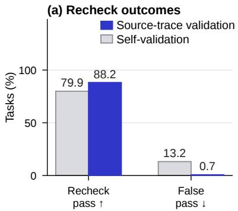

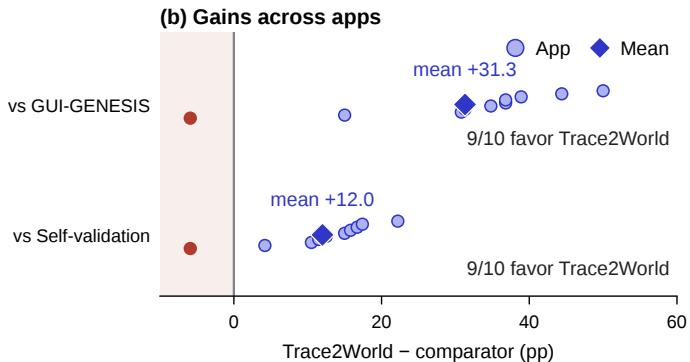  
Figure E1: Validation-evidence control and per-application robustness. Both panels use the primary 200-task, ten-app evaluation set. (a) Grouped bars compare recheck pass and false-pass rates for source-trace validation and the matched self-validation control; higher and lower are better, respectively. (b) Each circle is one app’s paired workflow-fidelity difference between Trace2World and the comparator; diamonds are macro-app means, positive values favor our method, and the shaded region marks reversals. No resampled interval is estimated.

Why the profiles take this shape. One interpretation is that the difficult commitment is semantic rather than implementation-level. When semantic inference and implementation are coupled, an uncertain page identity, state value, or action effect must become a concrete coding choice before it can remain an explicit conflict, and later checks mainly test that implementation of the chosen reading. Trace2World moves the commitment upstream: model-proposed relations are factorized into explicit Structure, State, and Data, unresolved conflicts stay outside the compiled support, bounded API compilation emits the initial package from the resulting page specifications, and agentic repair edits that package without redefining their semantics. This is consistent with the high reach but low workflow fidelity above and with Appendix F.1, where a task-local builder reproduces one workflow exactly while task-local correctness does not determine state shared across workflows. The ordering is also not explained by assigning Trace2World the stronger constructor: its reconciliation and initial compilation run on GPT-5.2, whereas every compared builder receives GPT-5.5 in the construction roles it defines (Appendix D.2). These remain mechanism-consistent interpretations of complete construction contracts, not a stage-wise causal ablation.

A second factor may amplify the difficulty for native applications. A website ships its production client to any crawler, and open pretraining corpora are correspondingly dominated by web content at trilliontoken scale (Soldaini et al., 2024). A real mobile application ships a binary: the largest Android research collections distribute APK artifacts (Allix et al., 2016), while source-linked collections necessarily cover the open-source subset (Liu et al., 2020), which excludes the large consumer applications studied here. Rendered interaction is therefore the broadly available evidence of a real application’s production semantics, which is what source traces provide. We treat this as an amplifier rather than an explanation of Trace2World’s advantage: cross-trace ambiguity is a property of partial evidence rather than of the constructor, and a builder-written verifier remains self-referential however strong that constructor becomes.

Figure E1a isolates the matched validation-evidence control. The source-trace recheck passes 176 evaluation executions: 175 P and one F; its 24 rejections comprise 19 F and five P. The self-validation recheck passes 160: 138 P and 22 F. These joint labels measure recheck precision. They do not establish why an independently passing execution was rejected or where a failing condition diverged; those diagnoses require the paired execution packets. Construction-time validation covers all 1,570 seed workflows (Table E4); evaluation rechecks use the separate 200-task population.

Per-application direction of the contrasts. On the 200-task sample, Trace2World has 180 passes and 20 confirmed failures; every verdict is P or F, so workflow fidelity is a complete count rather than a bound. The ten-app set is the complete evaluation population, so paired contrasts are reported per application rather than as resampled intervals: with ten applications as the unit of replication, Figure E1b shows all ten paired app differences and marks the macro-app mean; positive values favor Trace2World. Trace2World exceeds the trace-conditioned and no-trace baselines in all ten apps. Against GUI-GENESIS-style (a 31.3-pp macro-app lead) and self-validation (12.0 pp), it is higher in nine apps and lower in one (Taopiaopiao, −5.9 pp in both contrasts). The only inferential statement is design-based. Under the sharp null that the construction contract changes no application’s workflow fidelity, the sign of each paired difference is exchangeable; a sign-flip permutation test enumerates all $\dot { 2 } ^ { 1 0 } = 1 , \dot { 0 } 2 4$ sign assignments and counts those whose mean is at least as extreme as the observed mean, which gives exact $p = 4 / 1 , 0 2 4 = 0 . 0 0 4$ for the GUI-GENESIS-style contrast and $6 / 1 , 0 2 4 = 0 . 0 0 6$ for self-validation, while the all-positive contrasts sit at the floor of $2 / 1 , 0 2 4 = 0 . \dot { 0 } 0 2$ . The test assumes no population of applications beyond the ten evaluated, and no interval is estimated.

A final value can conceal a wrong transition. The proportion of all task packets whose value-only check passes while their Effect judgment is a confirmed failure is 14.3% for PhoneWorld-style, 10.9% for CUA-Gym + traces, 15.6% for Direct + traces, 13.2% for GUI-GENESIS-style, and 4.5% for Trace2World. Figure 2 illustrates the missing-confirmation form of this error.

## E.1.4 HUMAN VALIDATION AND AUTOMATED-REVIEWER AGREEMENT

The human audit relabels the same 200 workflows from the ten-app reconstruction roster under each of the six trace-conditioned construction conditions, yielding 1,200 anonymous method–workflow packets. Two annotators inspect the raw source trace and execution with the same six P/F questions; a

third adjudicates disagreements. No additional applications or performance population are introduced;   
Table E3 reports the adjudicated labels per condition only to locate the automated reviewer’s bias.

Table E3: Adjudicated human workflow-fidelity labels on the same 1,200 packets (%). Automated and human-adjudicated workflow fidelity are ten-app macro means over the 200 workflows of each condition; ∆ is human minus automated in pp. Joint counts are human/automated labels pooled over the 200 workflows. The human column qualifies the automated reviewer’s labels; it is not a second performance condition.
<table><tr><td>Method</td><td>Automated</td><td>Human</td><td>∆</td><td>P/P</td><td>P/F</td><td>F/P</td><td>F/F</td></tr><tr><td>Direct Agent + traces</td><td>16.7</td><td>19.4</td><td>2.7</td><td>26</td><td>12</td><td>7</td><td>155</td></tr><tr><td>CUA-Gym + traces</td><td>19.9</td><td>22.1</td><td>2.2</td><td>31</td><td>12</td><td>7</td><td>150</td></tr><tr><td>Phone World-style (reimpl.)</td><td>22.4</td><td>23.8</td><td>1.4</td><td>37</td><td>10</td><td>7</td><td>146</td></tr><tr><td>GUI-GENESIS-style (reimpl.)</td><td>59.8</td><td>63.6</td><td>3.8</td><td>108</td><td>18</td><td>10</td><td>64</td></tr><tr><td>Trace2World</td><td>91.1</td><td>93.5</td><td>2.4</td><td>178</td><td>9</td><td>4</td><td>9</td></tr><tr><td>Control (not our method)</td><td></td><td></td><td></td><td></td><td></td><td></td><td></td></tr><tr><td>Self-validation</td><td>79.1</td><td>80.7</td><td></td><td>1.6 149</td><td>12</td><td>9</td><td>30</td></tr></table>

The final row of Table E2 reports exact automated–human agreement for workflow fidelity and each diagnostic on the same audit packets. Workflow-label macro-F1 is 90.2%, with 92.3/87.9% pass precision/recall; the lower recall is consistent with the automated reviewer’s conservative bias. Under adjudicated human labels every condition scores 1.4–3.8 pp higher than under the automated reviewer, so the bias is shared across routes rather than favoring one of them; the ordering of Table 1 is unchanged, and our method’s margins over GUI-GENESIS-style and self-validation are 29.9 and 12.8 pp under human labels (Table E3). The two original annotators agree on 87.8% of all-six labels before adjudication, and 160 packets require adjudication in at least one dimension. These agreement statistics qualify the automated scores; they do not create a second application or performance population (Lu et al.\` , 2025).

## E.2 CONSTRUCTION SCALING, VALIDATION, AND COST

These quantities describe construction inputs, context, and cost; they are separate from policy improvement under additional training tasks.

## E.2.1 CONTEXT AND CALL SCALING WITH LONGER TRACE PREFIXES

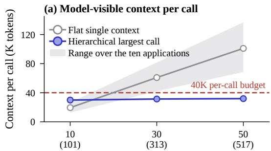  
Traces per application (mean included screenshots)

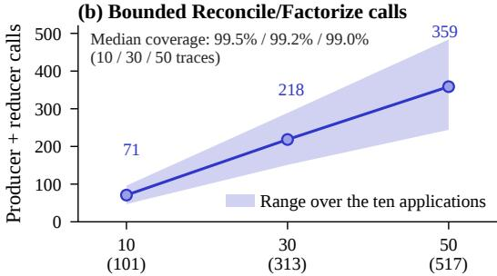  
Traces per application (mean included screenshots)  
Figure E2: Context-bounded induction across ten applications and nested 10/30/50-trace prefixes. The horizontal axis is the trace prefix; the value in parentheses is the mean number of in-app screenshots included at that prefix, which is the unit the context and call estimates are computed from. Lines are ten-application means and shaded bands span those applications. (a) Flat single-context input (gray) exceeds the 40K budget at every 30- and 50-trace point, whereas the largest hierarchical call (blue) remains within 28.7–33.2K tokens. (b) Bounded RECONCILE/FACTORIZE producer-plusreducer calls; in-panel values are application means. Median audited semantic coverage at 10/30/50 traces is shown in the panel.

Across all 50 environments, peak model-visible context has a median/P95/maximum of 28.9/31.7/33.2K tokens, no call exceeds the 40K budget, semantic coverage is 99.1%, and the conservative fallback rate is 1.8%. The ten-application replay resolves this by trace prefix while still estimating from included screenshots (101, 313, and 517 on average). All flat inputs fit at 10 traces (12.7–26.8K tokens), but every 30- and 50-trace input exceeds the 40K budget (42.0–136.8K), whereas the largest hierarchical call stays within 28.7–33.2K; producer/reducer calls grow from 47–96 at 10 traces to 244–484 at 50. The near-linear growth in traces is compositional rather than assumed: about 0.70 calls per included screenshot, and 10.1–10.4 screenshots per trace at every prefix. Screenshots per trace range 7.0–13.3 across applications, which the band width carries. These call counts cover RECONCILE and FACTORIZE, not later implementation, verification, or repair. Every bounded result must still pass the source-coverage, mapping, support, and contradiction audits, so partitioning changes work scheduling without changing which behavior the evidence supports. Coverage is evaluated against the source-linked obligations of the current prefix; later traces contribute to a separate full-evidence coverage denominator. Flat execution is a comparison only where its input fits, not an assumed reference beyond the context limit.

## E.2.2 RECONSTRUCTION QUALITY AND EVIDENCE COMPRESSION WITH MORE SOURCE TRACES

Figure E3 uses the ten applications excluded from policy training and the per-application workflow counts of Table 1. Nested Low/Mid/Full subsets use 10/25/50 traces per multi-service app and 10/15/20 per single-service app (100, 180, and 290 traces in total), and each subset is scored against its own induced routes, visual obligations, and workflows. For each subset, route precision and recall divide matched routes by predicted and subset-supported routes. For the visual evidence set of Appendix B.1, support precision is the supported share of selected screenshots, obligation recall is the covered share of source-supported visual obligations, and compression is one minus selected over candidate screenshots. All displayed rates are macro-averaged over applications.

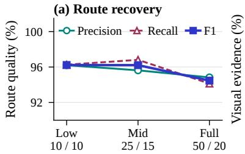

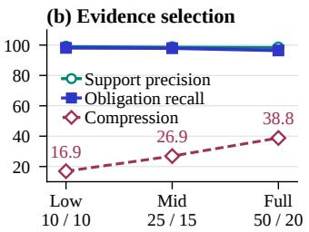

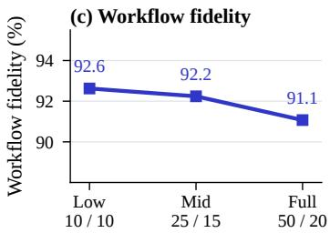  
Source traces per application (multi-service / single-service)  
Figure E3: Shared-semantics reconstruction under expanding trace support. Low/Mid/Full use 10/25/50 traces per multi-service app and 10/15/20 per single-service app; panels report route recovery, evidence selection, and workflow fidelity against each budget’s own induced target.

From Low to Full, supported routes grow from 270 to 512 and visual obligations from 553 to 1,076. Route F1 moves from 96.2% to 94.5%, visual-support precision and obligation recall from 99.0/98.2% to 98.4/96.5%, and workflow fidelity from 92.6% to 91.1%, while evidence compression rises from 16.9% to 38.8%. Figure E4 below localizes the visual-selection reduction on the twenty Meituan pages with the most candidate observations.

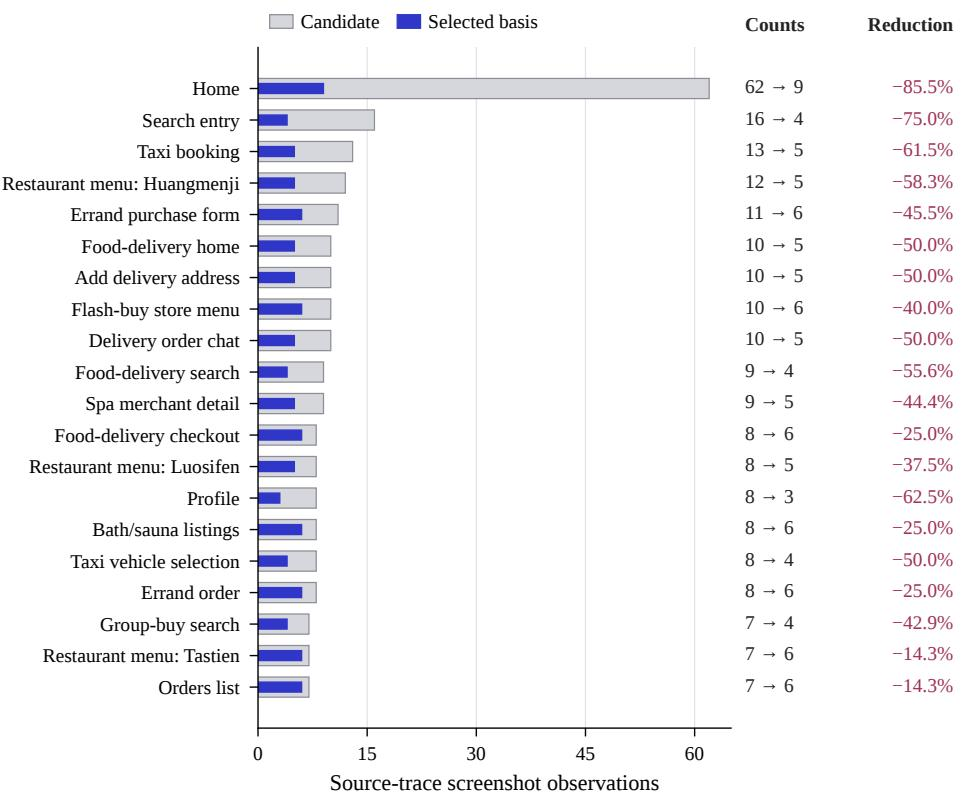  
Figure E4: Top-20 pagewise screenshot compression in Meituan. Pages from the 50-trace sourcetrace set are ranked by candidate observations; ties use the first source-trace occurrence and then filename. Light bars count candidate observations and blue overlays count the selected visual evidence set; right-side counts use candidate → selected order. These pages retain 105 of 241 observations and account for 136 of the 166 reductions across all 159 pages (81.9%).

## E.2.3 AUTOMATED VALIDATION AND REPAIR-WAVE ACCOUNTING

Trace-backed seed workflows and generated candidates follow related but distinct funnels. Every seed workflow is a source obligation and must validate within the $K = 3$ repair cap. Generated candidates must first pass support, then validation, and finally learner–solver filtering. Table E4 keeps those denominators separate and reports newly closed cases at each repair wave.

Table E4: Validation and admission funnels. Read each population from left to right. Percentages name their denominator; + counts are cases newly closed at that repair wave rather than cumulative totals. Fresh-GUI validation is capped at $K = 3 .$
<table><tr><td>Population</td><td></td><td>Evidence support Fresh-GUI validation and repair</td><td>Training use</td></tr><tr><td>Seed workflows 1,570 across 50 apps</td><td>1,570 pass (100% of seeds)</td><td>1,171 at  $\mathrm { w a v e } 0 ( 7 4 . 6 \% ) ; + 2 6 1 / + 1 0 3 / + 3 5$  at waves 1/2/3; 1,570 validated, 0 unresolved</td><td>1,280 seeds from the 40 training apps</td></tr><tr><td>Generated candidates 1,152 proposals across 40 apps</td><td>985 pass (85.5% of proposals)</td><td>673 at wave 0 (68.3% of supported);  $+ 1 1 3 / + 4 6 / + 2 1$  at waves 1/2/3; 853 validated (86.6%), 132 not validated by  $K = 3$ </td><td>768 admitted (90.0% of validated)</td></tr></table>

The 1,280 seed tasks are the workflows belonging to the 40 policy-training applications, so that last step is an application partition rather than a rejection gate. Of the 132 support-passing candidates not validated by $K = { \bar { 3 } } ,$ 60 have an incomplete dependency slice, 43 lack an evaluator-observable outcome, and 29 retain an unreproduced environment defect. Of the 85 validated candidates not admitted, 49 are saturated for the learner, 24 remain unsolved by the solver, and 12 are deferred.

The self-validation control also validates all 1,570 builder executions: 1,294 (82.4%) at wave 0, then 173, 72, and 31 after one, two, and three repair waves. Its mean 0.26 waves per workflow is lower than Trace2World’s 0.36. These are builder-execution events; the independent execution rechecks in Figure E1a use separate packets. We do not convert repair waves into model calls because the preserved logs do not expose a comparable stage-level call boundary for this control.

Repair-round interpretation. A repair round is one edit made from failure evidence followed by fresh re-verification, whatever the number of requests inside it; a shared fix that closes several tasks is counted once. Table E4 gives the complete wave distribution. All seed workflows close by K = 3 (mean 0.36 rounds), whereas 13.4% of support-passing augmented candidates reach the cap and are dropped. A round is an observable repair outcome, not a fixed number of model turns.

## E.2.4 CONSTRUCTION COST

The matched construction comparison uses the same ten-app, 200-workflow roster as Table 1 under the same construction models, reasoning setting, tools, trace bundle, and eight-worker schedule, with a 6-hour per-app wall-clock limit. Model calls are metered but not capped. Following CUTV, one call is one completed model-execution step (one model response); multiple tool actions emitted by that response still count once. Trace2World applies this unit to two disjoint parts: the bounded API pipeline that produces the initial Package, and an agentic workflow that performs package-level initial verification followed by the verify–repair–reverify fixloop. Elapsed time includes each app’s verification and repair but excludes independent scoring and human pauses.

Table E5: Mean construction budget and Trace2World time/call decomposition. (a) Perapplication totals on the matched ten-app roster; Trace2World reports each total on the first line and (API pipeline + agentic workflow) below. (b) Share of the 602 mean API-pipeline calls by phase; wedge area and legend percentages use the pipeline-only denominator. Generated-task construction is accounted separately.

(a) Mean construction cost
<table><tr><td>Builder</td><td>Hours</td><td>Calls/app</td></tr><tr><td>Direct w/o traces</td><td>0.92</td><td>248</td></tr><tr><td>Direct + traces</td><td>1.27</td><td>319</td></tr><tr><td>CUA-Gym w/o traces</td><td>1.82</td><td>344</td></tr><tr><td>CUA-Gym + traces</td><td>2.14</td><td>392</td></tr><tr><td>PhoneWorld-style</td><td>5.02</td><td>1,118</td></tr><tr><td>GUI-GENESIS-style</td><td>5.90</td><td>2,415</td></tr><tr><td>Trace2World seed</td><td>3.60 (0.50 + 3.10) (602 + 558)</td><td>1,160</td></tr></table>

(b) API-pipeline phase share  
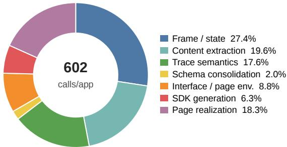

At the reported 1,160-call mean, 602 calls (51.9%) belong to the API pipeline and 558 (48.1%) to the agentic workflow. The 3.60-hour elapsed-time estimate separates a 0.50-hour highly concurrent pipeline from a 3.10-hour agentic workflow, estimated as 558 completed model-execution steps at 20 seconds per step. The agentic workload covers initial verification of all 20 matched workflows plus projected repair and re-verification work on the shared Package. Generated-task construction remains outside this matched seed comparison; the DAPO runs use the RL-iteration schedules of Appendix D.4.

## E.2.5 RUNTIME COST ACROSS THE 50-APP PORTFOLIO

We profile all 50 applications on one eight-core Xeon host with 61.4 GiB of RAM. All apps share one serving process and read-only packages. Table E6 reports per-application package size (50 apps), process launch to a healthy API (ten trials), first task initialization after display acquisition (one task per app), warm task reinitialization after teardown (three per app), and alternating click/scroll /step probes (ten per app). The warm timer starts after teardown; the step probe excludes screenshot acquisition and model inference. P95 is an empirical nearest-rank value.

Table E6: Runtime cost of the full 50-app portfolio. Each app contributes to package and tasktiming summaries; host starts use ten trials. Units and sample counts are explicit for each row.
<table><tr><td>Metric</td><td>n</td><td>Median</td><td>P95</td></tr><tr><td>Package on disk, raw / app</td><td>50</td><td>18.9MiB</td><td>46.3 MiB</td></tr><tr><td>Package on disk, tar.gz / app</td><td>50</td><td>8.2 MiB</td><td>20.8 MiB</td></tr><tr><td>Writable state / episode</td><td>50</td><td>0 KiB</td><td>412 KiB</td></tr><tr><td>Host process to healthy API</td><td>10</td><td>3.06 s</td><td>3.42s</td></tr><tr><td>First task initialization after display acquisition</td><td>50</td><td>258 ms</td><td>555 ms</td></tr><tr><td>Warm task reinitialization, init only</td><td>150</td><td>229 ms</td><td>512 ms</td></tr><tr><td>Click/scroll / step round trip</td><td>500</td><td>94ms</td><td>365 ms</td></tr></table>

The idle host occupies 420 MiB PSS. At 16 concurrent episodes, each additional episode accounts for 164 MiB of system MemAvailable loss or 218 MiB of marginal PSS. A 24-episode, six-callper-episode click/scroll probe reaches 82.6 calls/s with 174/915 ms median/P95 round-trip latency. These are API probes, not complete agent rollouts. For context, MobileGym reports about 400 MB per browser instance, while its comparison puts AndroidWorld at about 4.5 GB, AndroidLab at about 6 GB, and MobileWorld at at least 4.5 GB (Wu et al., 2026). The latter values use the source paper’s respective measurement or estimate and are not a matched hardware comparison.

## E.2.6 SOURCE-TRACE EVIDENCE FOR DEFECT REVIEW AND REPRODUCE-BEFORE-REPAIR

Source evidence improves defect coverage and review precision together. We freeze 400 executions from a separately selected 20-app construction-review set: ten defective and ten clean task/revision pairs per app. Two independent annotators establish defects and blocking severity, with adjudication, before the model reviewers run. Each execution receives three isolated reviews with the same model, output schema, and token cap: execution only; source trace plus execution with an open-ended prompt; and the same source-trace/execution evidence with the contrastive rubric. The last pair isolates the rubric; the first pair isolates source-trace access. No reviewer sees another reviewer’s findings. The balanced sample estimates sensitivity and clean-case rejection separately, not their deployment prevalence.

Table E7: Construction-time review ablation. All rows use the same model, output schema, and token cap; each lower row adds the named evidence or instruction. The 200 defective executions contain 599 adjudicated defects. Defects found is defect-level coverage; reported defects correct is precision. The last two columns use separate sets of 200 defective and 200 clean executions.
<table><tr><td>Review condition</td><td>Defects found (%)↑</td><td>Reported defects correct (%) ↑</td><td>Defective execs. missed / 200 ↓</td><td>Clean execs. flagged / 200 ↓</td></tr><tr><td>Execution only</td><td>43.2%</td><td>73.6%</td><td>34</td><td>42</td></tr><tr><td>+ source trace</td><td>68.4%</td><td>88.2%</td><td>8</td><td>28</td></tr><tr><td>+ contrastive rubric</td><td>86.0%</td><td>93.0%</td><td>1</td><td>20</td></tr></table>

Across the 20 applications, defect-coverage ranges are 29.0–58.6%, 51.6–79.3%, and 77.4–96.6% for the three rows. The ordering is stable across applications: the rubric reviewer covers more defects than the plain reviewer in 19 of 20 apps (tied in 1), and the plain reviewer more than the execution-only reviewer in 18 of 20 (tied in 1, lower in 1).

Regressions caught by re-execution from step zero. Over the 50 applications, 1,884 environment edits were made during repair. Re-executing every dependent trace from step zero after each edit found 233 (12.4%) that broke a previously passing dependent packet; reusing the stale suffix of the earlier execution would have certified 214 of them. Fresh execution incurs the reported 1.9× repair-loop execution overhead.

Reproduce-before-repair. We sample 400 initially environment-attributed failures, 20 per audit app, with one task/revision per sample. Each receives three fresh executions with the same reset and account state. Independent adjudicators inspect all attempts and state evidence and assign every case an owner: 253 are persistent environment defects, 32 intermittent environment defects, and 115 model/task errors. Thus one non-reproduction does not justify reclassification. Of the 285 confirmed environment defects, 274 close within K = 3; the remaining 11 retain their status. These counts describe the sampled failure population, not the incidence of defects in all rollouts.

## E.3 POLICY GAINS FROM LEARNER-GUIDED TASK SUPPLY

## E.3.1 EVALUATION METRICS, BENCHMARK PROTOCOLS, AND MATCHED CONDITIONS

The 1,044 Trace2World-Bench identities enter no training batch. Table D5 fixes its four disjoint slices and signature split. Each task has three complete evaluation attempts under the construction-class budget of Table D6: seed-family and unseen-app tasks use 30 steps, augmentation-family tasks use 45, and evaluation-only cross-app tasks use 60. The same family cap applies to single-app training and evaluation, and both metrics use all 1,044 tasks. Infrastructure, provider, and environment failures are resolved and retried, with their counts reported separately; they neither count as agent failures nor remove a task from the denominator. No validation split is used; Appendix C.3 fixes the terminal checkpoint. The 100 cross-application tasks follow the persistent runner and held-out joint-oracle boundary of Appendix B.4 and contribute once each to the benchmark denominator.

Partial reward and terminal success. For task t and valid attempt $j ,$ let $q _ { t j } ~ \in ~ [ 0 , 1 ]$ be the programmatic task evaluator’s checkpoint credit of Eq. 6 on the attempt’s final business state, and let $s _ { t j } \in \{ 0 , 1 \}$ be its terminal verdict. For the full held-out task set T and its three completed attempts per task, we report

$$
\mathrm { P R } = \frac { 1 0 0 } { 3 | T | } \sum _ { t \in T } \sum _ { j = 1 } ^ { 3 } q _ { t j } , \qquad \mathrm { S R } = \frac { 1 0 0 } { 3 | T | } \sum _ { t \in T } \sum _ { j = 1 } ^ { 3 } s _ { t j } .\tag{8}
$$

Both metrics average the same three attempts within each task and weight all tasks equally. PR retains partial completion; SR credits each attempt only for complete terminal success. The three training seeds form the outer mean and SD, separately from a task’s three evaluation attempts.

Absolute capability and controlled training gain. The reference GUI agents in Table 2 provide absolute capability context; their backbones, GUI pretraining, post-training objectives, and interaction scaffolds can differ (Qin et al., 2025; Zhou et al., 2025; 2026). UI-Venus-2-9B, for example, also starts from Qwen3.5-9B but adds multimodal trajectory mid-training, domain-specific step-level offline RL, and multi-teacher on-policy distillation over mobile, web, desktop, grounding, and CAPTCHA tasks (Venus Team, 2026). Our final policy starts from Qwen3.5-9B without SFT warm-up and completes 52 DAPO iterations on 2,048 single-app training tasks (Table D6); the external suites are reserved for evaluation. Comparing it with the base holds initialization and evaluation fixed for this training intervention. UI-Venus-2 supplies absolute capability context under a different post-training program, rather than a matched training control. Agent frameworks that wrap a general model are not compared because each suite’s protocol fixes the agent template.

Protocols. Each external column is produced under its benchmark’s own protocol: task set, agent template, observation, step budget, trial count, decoding temperature, and success criterion. Our policies enter every suite through the suite’s screenshot-only observation and its released action adapter, with no Trace2World environment, evaluator, or step budget carried over. MobileGym-Bench resets before each task and grants 15/30/45/60 steps by level (+15 for AnswerSheet tasks); general models use the generic v2 template and specialized GUI agents their native adapters; SR averages four parameter-resampled trials for open-weight policies and one run for proprietary policies, and partial reward (PR) is the suite evaluator’s partial credit over those trials. AndroidWorld runs the standard 116-task suite on the reference emulator with its programmatic checkers, a single run per task, and the suite’s per-task step budget, which the maintainers set at about twice the human completion length. MobileWorld evaluates its GUI-only track of 117 tasks with a 50-round limit per task, single run, and backend-state verification, which is what SR@50 denotes; its 44 user-interaction and 40 MCP tasks are outside this evaluation. AndroidDaily runs the 235 end-to-end tasks on live applications with its LLM-based completion judge and reports single-run SR; the released protocol fixes no step limit beyond the judge’s termination, so none is imposed. Reference models are run by us only on Trace2World-Bench; their external-suite cells are the published values at each suite’s reported setting and are marked † in the Appendix owner tables. These suite-specific metrics are

(a) Candidate funnel and fixed yield

separate from Trace2World-Bench’s mean of three complete attempts per task under the budget of Table D6.

Our three policies are means over three training seeds; the reference rows are single published checkpoints and carry no seed spread, so Table 2 prints means only. Across seeds our policies vary by 0.5–1.5 points on the suite headline scores and by 1.0–3.9 points on the slices, widest on AndroidDaily’s 24-task high-ambiguity slice and narrowest on its 164-task low-ambiguity slice.

Each complete result table in Appendix E.3.4 states its native slice denominators. These released partitions are protocol-specific and distinct from Trace2World’s four overlapping task capabilities; no slice is pooled across suites.

Matched task-supply conditions. Seed continuation draws 384 seed tasks without replacement within each later stage; entity rebinding uses two new 384-task training batches that retain sampled seed workflow templates while changing their bound entities. These 768 variants are trainingonly identities and do not enter Trace2World-Bench. Static augmentation uses two new 384-task batches generated with the learner-guided condition’s prompts, difficulty principles, support checks, environment validation, and fixed-solver screen, but authored before $\pi _ { 2 }$ exists, without learner task outcomes, saturation estimates, or learner-guided refinement, and selected by random draw from the solver-solvable candidates. All three fork from $\pi _ { 1 }$ , follow the same 20-iteration continuation to RL iteration 52, and are evaluated at the same iteration checkpoints; initialization at the fork, sampler, environment revisions, and evaluator are matched. Two longer-schedule controls select all validated candidates without screening, or continue the seed tasks until their retained groups match the learner-guided run; these population-matched and signal-matched comparisons are reported with the task-generation results below.

## E.3.2 LEARNER FEEDBACK TARGETS HARDER TASKS WHILE PRESERVING SOLVABILITY

A useful learner-guided supply must fill each batch with tasks that expose current-policy weaknesses while a fixed stronger solver can still complete them. Each round realizes 576 of at most 640 candidate slots $( 2 4 \times 1 0 + 1 6 \times 2 5 )$ ; Table E8 separates the resulting funnel from the screening and composition shift.

Table E8: Feedback rounds preserve training yield while shifting learner-relative difficulty and task composition. (a) Candidate funnel for R1/R2, which follow stages 1/2. (b) Mean pass over four fresh attempts per validated task and dependency-heavy share among selected; lower learner pass means harder tasks and fixed-solver pass measures solvability. Dependency-heavy comprises cross-surface, lifecycle-revisit, and recovery tasks.  
(b) Validated-task screening
<table><tr><td>Round</td><td>Proposed</td><td>Source- supported</td><td>Validated</td><td>Selected</td><td>Round</td><td>Learner pass among validated (%)</td><td>Fixed-solver pass among validated (%)</td><td>Dependency-heavy among selected (%)</td></tr><tr><td>R1</td><td>576</td><td>499</td><td>426</td><td>384</td><td>R1</td><td>41</td><td>71</td><td>46</td></tr><tr><td>R2</td><td>576</td><td>486</td><td>427</td><td>384</td><td>R2</td><td>29</td><td>66</td><td>71</td></tr></table>

Panel (a) shows that both rounds fill the same 384-task training batch. Panel (b) shows that the current-learner pass fraction falls from 41% to 29%, while the fixed solver still passes 66% and the dependency-heavy share rises from 46% to 71%. The change is therefore in learner-relative difficulty and task composition, not in batch size.

Solver as a solvability screen. We audit both selection decisions on the original, unmodified candidate: 20 solver-rejected and ten solver-accepted candidates per audit app, 400 and 200 in total. Two annotators independently attempt the original task and adjudicate disagreements; refined versions are scored separately. Of the rejected candidates, 36 are solvable: a conditional rejection error of 9.0% (0–5 of 20 per app). Of the accepted candidates, 194/200 are independently solvable. These stratified samples estimate P(solvable | rejected) and P(solvable | accepted); they do not estimate the fraction of all solvable tasks that the solver rejects without the population selection weights.

Learner signal on supplied tasks. We evaluate validated and selected tasks after batch freezing, using the shared $\pi _ { 1 }$ for R1 and each condition’s $\pi _ { 2 }$ for R2. Figure 6a shows that fixed-solver static selection yields only a modest signal gain, whereas learner feedback produces higher-signal batches.

Solvability and learner-relative training value therefore require separate screens; the four-attempt signal rule is detailed in Appendix C.3.

Bounded refinement raises learning signal without simplifying hard tasks. The gap is already present at first validation, before refinement. Table E9 shows that only 60/426 (14.1%) and 62/427 (14.5%) validated lineages are REFINABLE; the fixed two-round flow makes 36/60 and 37/62 of them selectable and raises validated-lineage signal by 5.6/5.4 pp. Hard and solver-unsolved lineages are never simplified. The gap persists under the opposite $\pi _ { 2 }$ (73.4% vs. 41.9%) and eight-trajectory groups (78.9%/75.8% vs. 56.8%/52.9%).

Table E9: Bounded hardening acts on about 14% of validated lineages, recovers about 60% within two rounds, and raises validated-lineage signal by 5.4–5.6 pp. (a) Outcomes compare R1/R2; recovered-total percentages use the refinable pool, and the recovery and held rows partition it. (b) Signal is the validated-lineage share with four-attempt reward $\mathrm { S D } > 0 . 1 ;$ ; saturation uses the 384 selected tasks. REFINABLE means fixed-solver success and learner mean reward above 0.8. Each round separately excludes 12 solver-unsolved and 6 deferred lineages outside this pool. Hard and solver-unsolved lineages are never simplified, and the $K = 3$ implementation repair is separate.  
(a) Refinement accounting
<table><tr><td>Outcome</td><td>R1</td><td>R2</td></tr><tr><td>Refinable / validated</td><td>60 / 426 (14.1%)</td><td>62 / 427 (14.5%)</td></tr><tr><td>Recovered after first</td><td>29</td><td>30</td></tr><tr><td>Recovered after second</td><td>7</td><td>7</td></tr><tr><td>Recovered total</td><td>36 (60.0%)</td><td>37 (59.7%)</td></tr><tr><td>Held: no supported hardening</td><td>9</td><td>9</td></tr><tr><td>Held: still easy at cap</td><td>15</td><td>16</td></tr></table>

(b) Effect on learning signal
<table><tr><td>Metric</td><td>R1</td><td>R2</td></tr><tr><td>Signal: first valid (%)</td><td>66.0</td><td>64.6</td></tr><tr><td>Signal: post-refinement (%)</td><td>71.6</td><td>70.0</td></tr><tr><td>Signal gain (pp)</td><td>+5.6</td><td>+5.4</td></tr><tr><td>Saturated among selected (%)</td><td>8.6</td><td>3.9</td></tr></table>

MobileGym and budget-robustness checks for task augmentation. Figure $^ { 6 \mathrm { b } , \mathrm { c } }$ owns the iteration- and rollout-matched Trace2World-Bench SR/PR trajectories; only the static and learnerguided augmentation branches also match on the 45-step task horizon. At RL iteration 52, MobileGym SR is $1 9 . { \bar { 7 } } \pm 1 . 2 , 2 1 . 0 \pm 0 . 8 , 2 2 . 2 \pm 1 . 3 .$ and $2 5 . 2 \pm 1 . { \overline { { 2 } } }$ for seed continuation, entity rebinding, static augmentation, and learner-guided batches. Two different-budget controls test robustness: selecting all 426/427 validated candidates runs for 54 iterations, retains 1,244 informative groups, and reaches Trace2World-Bench SR/PR $5 7 . 8 \pm 1 . 1 / 6 8 . 6 \pm 0 . 8$ and MobileGym SR $2 3 . 4 \pm 1 . 3 ;$ matching the learner-guided run’s 1,351 retained groups with seed continuation requires 79 iterations and reaches $5 4 . 3 \pm { \bar { 0 } } . 8 / 6 7 . 0 \pm 0 . 6$ and $2 0 . 1 \pm 1 . 0$ . Because these controls change the optimization budget, they test robustness and do not enter the same-budget causal contrast.

## E.3.3 NEW TASK COMPOSITIONS STAY WITHIN SOURCE-SUPPORTED BEHAVIOR

Task augmentation may recombine supported operations beyond any recorded path. The path and launch-state audit separates two conditional accounting chains to test whether departures from literal replay remain supported. Figure E5 and Figure E6 use separate units and denominators; their counts are not pooled. Every semantically equivalent path case is already executable or materialized from supported edges, while the remaining 125 ambiguous, invalid, or unresolved entries remain outside support.

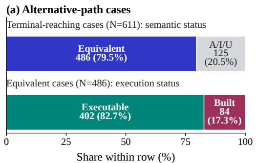

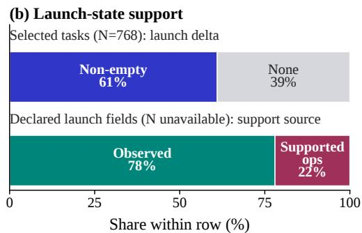  
Figure E5: Alternative paths and launch states remain source-supported. (a) Of 611 terminalreaching attempt cases on paths absent from the recorded traces, 486 are semantically equivalent; within those 486 cases, 402 already execute and 84 are materialized from supported edges. A/I/U denotes ambiguous, invalid, or unresolved. Counts are attempt-associated cases, not deduplicated paths. (b) Of 768 selected generated tasks, 61% declare a non-empty launch delta; among declared launch fields, 78% use directly observed contexts and 22% are reachable by supported operations. The task and field rows use different denominators; the field count is unavailable.

Task augmentation raises capability-probe prevalence. Figure E6 compares four directly supported capability probes in the seed and learner-guided task supplies: aggregation for reasoning, cross-surface composition and lifecycle revisit for memory/state, and conditional recovery for recovery/backtracking. Long-horizon requires the full task-authoring criteria (Appendix C.1) and has no equivalent marginal in this accounting. Task-level joint labels are unavailable, so capability unions are not inferred from these marginals.

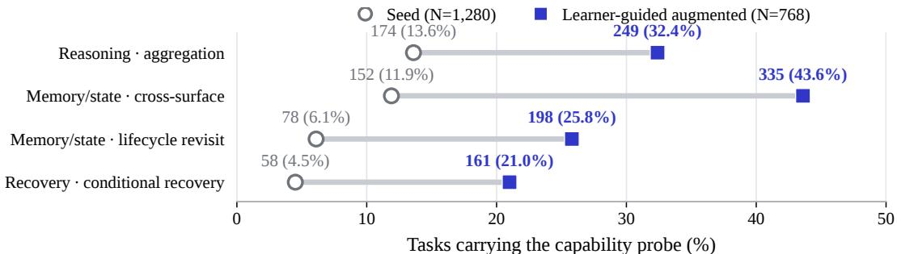  
Figure E6: Task augmentation raises the prevalence of capability probes. Each row compares, within 1,280 seed tasks and 768 learner-guided augmented tasks, the share carrying the named probe; endpoint labels give count (share). Rows are overlapping task-level marginals, so one task may contribute to multiple rows and the shares do not form a partition.

Cross-surface shows the largest increase, from 11.9% to 43.6%; aggregation, lifecycle revisit, and conditional recovery rise from 13.6/6.1/4.5% to 32.4/25.8/21.0%. These changes describe which tasks are supplied for training; their matched outcome remains in Figure 6b,c.

## E.3.4 COMPLETE TRACE2WORLD-BENCH AND EXTERNAL BENCHMARK RESULTS

Table D5 defines the six Trace2World-Bench result columns and owns their sizes and trial protocol. The first table reports each model’s SR / PR pair across all six columns. The following tables report each evaluated external track’s native endpoint and every slice available in the frozen result owners; their protocols and denominators are defined in Appendix E.3.1.

Table E10: Complete Trace2World-Bench model results. Each model occupies one row and each result cell reports terminal SR / mean partial reward PR, both in percent. Columns cover the three task strata, their overall result under Training apps, unseen applications, and the complete benchmark across all apps. Table D5 is the sole owner of partition sizes and the three-attempt protocol; Appendix E.3.1 defines the evaluation contract.
<table><tr><td rowspan="2">Model</td><td colspan="4">Training apps</td><td rowspan="2">Unseen apps</td><td rowspan="2">All apps</td></tr><tr><td>Entity replacement workflow</td><td>Held-out</td><td>Cross-app</td><td>Overall</td></tr><tr><td colspan="7">Proprietary Models</td></tr><tr><td>Qwen3.7-Plus</td><td>76.3 / 83.4 70.6 / 78.4 59.0 / 67.8 71.0 / 78.7 68.8 / 76.4 70.6 / 78.3</td><td></td><td></td><td></td><td></td><td></td></tr><tr><td>GPT-5.5</td><td></td><td></td><td>74.5 / 82.5 68.3 / 76.857.3 / 66.368.9 / 77.366.1 / 73.868.4 / 76.7</td><td></td><td></td><td></td></tr><tr><td>Gemini 3.1 Pro</td><td></td><td>75.1 / 82.2 69.0 / 76.2 58.0 / 67.069.5 / 76.965.7 / 71.968.9 / 76.1</td><td></td><td></td><td></td><td></td></tr><tr><td>Gemini 3.5 Flash</td><td>72.4 / 81.1 66.2 / 74.655.7 / 64.966.8 / 75.462.5 / 70.766.1 / 74.6</td><td></td><td></td><td></td><td></td><td></td></tr><tr><td colspan="7">Open-source Models</td></tr><tr><td>UI-TARS-1.5-7B</td><td>54.4 / 66.045.2 / 58.5 30.3 / 44.2 46.2 / 59.1 39.6 / 50.8 45.1 / 57.7</td><td></td><td></td><td></td><td></td><td></td></tr><tr><td>AutoGLM-Phone-9B</td><td></td><td></td><td>63.3 / 74.5 54.9 / 67.043.3 / 55.956.0 / 67.948.7 / 59.854.8 / 66.6</td><td></td><td></td><td></td></tr><tr><td>UI-Venus-1.5-8B</td><td></td><td></td><td>65.2 / 75.857.6 / 67.745.7 / 56.658.5 / 68.852.1 / 61.557.4 / 67.6</td><td></td><td></td><td></td></tr><tr><td>MAI-UI-8B</td><td></td><td></td><td>66.3 / 76.9 58.1 / 69.845.0 / 57.559.0 / 70.551.9 / 62.757.8 / 69.2</td><td></td><td></td><td></td></tr><tr><td>UI-Venus-2-9B</td><td></td><td></td><td>64.2 / 75.056.8 / 67.544.7 / 56.057.6 / 68.452.8 / 61.456.8 / 67.2</td><td></td><td></td><td></td></tr><tr><td colspan="7">Ours (Qwen3.5-9B backbone)</td></tr><tr><td>Base policy</td><td>49.2 / 63.5 40.2 / 55.1 26.0 / 41.3 41.2 / 56.0 39.2 / 52.6 40.9 / 55.4</td><td></td><td></td><td></td><td></td><td></td></tr><tr><td>Stage-1 policy</td><td></td><td>57.0 / 72.648.6 / 65.1 35.3 / 52.049.6 / 65.844.3 / 58.948.7 / 64.6</td><td></td><td></td><td></td><td></td></tr><tr><td>Ours</td><td>68.4 / 78.9 62.4 / 71.850.7 / 60.562.8 / 72.652.8 / 63.761.1 / 71.1</td><td></td><td></td><td></td><td></td><td></td></tr></table>

Table E10 makes the common frozen result fields for all 12 evaluated models directly auditable. The four capability probes in Figure E6 characterize the task-supply pool, overlap, and have no frozen model-by-task evaluation ledger; they therefore cannot be reduced into per-baseline capability scores.

Table E11: AndroidWorld and MobileWorld GUI-only model comparisons (%). AndroidWorld reports standard-suite SR, except the explicitly marked published pass@3 row. MobileWorld reports SR@50 over all 117 GUI-only tasks; Single-app and Cross-app partition our three-policy results into 44 and 73 tasks. The frozen published-source records contain only the GUI-only overall score, so their slice cells are dashes. †: published reference rows; protocols and source reports are in Appendix E.3.1.  
(a) AndroidWorld
<table><tr><td>Model</td><td>SR</td></tr><tr><td>Proprietary Models</td><td></td></tr><tr><td>Qwen3.7-Plus† Gemini-2.5 Computer Use†</td><td>81.0 69.7</td></tr><tr><td>Open-source Models</td><td></td></tr><tr><td>MobileRL-9B Step-GUI-8B (pass @3)†</td><td>80.2 80.2</td></tr><tr><td>UI-Venus-2-27B†</td><td>84.0</td></tr><tr><td>UI-Venus-2-9B†</td><td>80.2</td></tr><tr><td>GELab-Zero-4B†</td><td>75.9</td></tr><tr><td>UI-Venus-1.5-8B†</td><td>73.7</td></tr><tr><td>MAI-UI-8B†</td><td>70.7</td></tr><tr><td>GUI-Owl-7B†</td><td>66.4</td></tr><tr><td>UI-TARS-1.5-7B†</td><td></td></tr><tr><td>UI-TARS-1.5†</td><td>30.0 64.2</td></tr><tr><td></td><td></td></tr><tr><td>Ours</td><td></td></tr><tr><td>Base policy</td><td>57.8</td></tr><tr><td>Stage-1 policy</td><td>60.1</td></tr><tr><td>Ours</td><td>63.2</td></tr></table>

(b) MobileWorld GUI-only (50 steps)
<table><tr><td>Model</td><td>All (117)</td><td>Single-app Cross-app (44) (73)</td></tr><tr><td>Proprietary Models</td><td></td><td></td></tr><tr><td>Kimi-K3†</td><td>74.4</td><td></td></tr><tr><td>Seed-2.1-Pro†</td><td>73.2</td><td></td></tr><tr><td>GPT-5.6 Sol†</td><td>70.1</td><td></td></tr><tr><td>GPT-5.5†</td><td>62.4</td><td></td></tr><tr><td>Claude Opus 4.8†</td><td>67.5</td><td></td></tr><tr><td>Seed-2.0-Pro†</td><td>63.2</td><td></td></tr><tr><td>Qwen3.7-Plus†</td><td>62.3</td><td></td></tr><tr><td>Kimi-K2.6†</td><td>55.6</td><td></td></tr><tr><td>Open-source Models</td><td></td><td></td></tr><tr><td>Qwen-UI-Agent-27B†</td><td>82.1</td><td></td></tr><tr><td>UI-Venus-2-27B†</td><td>76.1</td><td></td></tr><tr><td>UI-Venus-2-9B†</td><td></td><td></td></tr><tr><td>GUI-Owl-1.5-32B†</td><td>65.8</td><td></td></tr><tr><td>Qwen3.6-27B†</td><td>43.9</td><td></td></tr><tr><td>MAI-UI-8B†</td><td>36.8</td><td></td></tr><tr><td>UI-Venus-1.5-8B†</td><td>27.5</td><td></td></tr><tr><td></td><td>22.2</td><td></td></tr><tr><td>Ours (Qwen3.5-9B backbone)</td><td></td><td>13.2</td></tr><tr><td>Base policy</td><td>18.5</td><td>27.3</td></tr><tr><td>Stage-1 policy</td><td>21.9</td><td>32.6 15.5</td></tr><tr><td>Ours</td><td>27.4</td><td>41.7 18.7</td></tr></table>

Table E12: MobileGym-Bench model and task-slice results (%). The 256 tasks comprise L1/L2/L3/L4 counts 20/73/83/80 and atomic/sequential/transfer/deep-dive counts 22/110/56/68. SR/PR and trial aggregation follow Appendix E.3.1.
<table><tr><td>Model</td><td>SR</td><td>PR</td><td>L1</td><td>L2</td><td>L3</td><td></td><td>L4 Atomic Seq. Transfer Deep</td><td></td><td></td><td></td></tr><tr><td colspan="11">Proprietary Models</td></tr><tr><td>Gemini 3.1 Pro</td><td>31.3 44.6 100.0 56.2 20.5 2.5</td><td></td><td></td><td></td><td></td><td></td><td>77.3</td><td>41.8</td><td>7.1</td><td>19.1</td></tr><tr><td>Doubao-Seed-2.0-Pro</td><td></td><td></td><td>34.0 47.5 100.0 60.3 24.1 3.8</td><td></td><td></td><td></td><td>81.8</td><td>45.5</td><td>8.9</td><td>20.6</td></tr><tr><td>Qwen3.7-Plus</td><td></td><td></td><td>32.846.0 100.0 57.5 22.9 3.8</td><td></td><td></td><td></td><td>77.3</td><td>43.6</td><td>8.9</td><td>20.6</td></tr><tr><td colspan="9">Open-source Models</td></tr><tr><td>UI-Venus-2-27B</td><td>60.5</td><td></td><td></td><td></td><td></td><td></td><td></td><td></td><td></td><td></td></tr><tr><td>UI-Venus-2-9B</td><td>52.7</td><td></td><td></td><td></td><td></td><td></td><td></td><td></td><td></td><td></td></tr><tr><td>MAI-UI-8B</td><td>21.5</td><td></td><td></td><td></td><td></td><td></td><td></td><td></td><td></td><td></td></tr><tr><td>AutoGLM-Phone-9B</td><td></td><td>20.035.3</td><td>86.2</td><td>33.6</td><td>9.6</td><td>1.9</td><td>56.8</td><td>25.7</td><td>7.1</td><td>9.6</td></tr><tr><td>UI-Venus-1.5-8B</td><td></td><td>15.4 28.3</td><td>85.0</td><td>21.9</td><td>6.0</td><td>1.9</td><td>37.5</td><td>20.7</td><td>6.2</td><td>7.4</td></tr><tr><td>GUI-Owl-1.5-8B-Think</td><td></td><td>15.1 28.8</td><td>76.2</td><td>26.0</td><td>4.2</td><td>1.2</td><td>44.3</td><td>20.9</td><td>2.7</td><td>6.6</td></tr><tr><td>UI-TARS-1.5-7B</td><td></td><td>13.8 26.3</td><td>77.5</td><td>21.9</td><td>3.0</td><td>1.6</td><td>37.5</td><td>20.2</td><td>2.7</td><td>4.8</td></tr><tr><td>Step-GUI-4B</td><td></td><td>12.925.7</td><td>83.8</td><td>17.8</td><td>2.4</td><td>1.6</td><td></td><td></td><td></td><td></td></tr><tr><td>Qwen3-VL-4B-Instruct</td><td></td><td>9.4 20.1</td><td>71.2</td><td>12.3</td><td>0.6</td><td>0.3</td><td></td><td></td><td></td><td></td></tr><tr><td>Qwen3-VL-4B + MobileGym GRPO 22.2</td><td></td><td></td><td>92.5</td><td>37.7</td><td></td><td>11.7 1.2</td><td></td><td>一</td><td></td><td></td></tr><tr><td colspan="9"></td></tr><tr><td>Ours (Qwen3.5-9B backbone) Base policy</td><td></td><td>9.0 19.7 67.9</td><td></td><td>11.6 0.7 0.4</td><td></td><td></td><td>24.6</td><td>14.5</td><td>1.2</td><td>1.3</td></tr><tr><td>Ours</td><td></td><td>25.2 40.7 94.6</td><td></td><td>47.8 11.7 1.1</td><td></td><td></td><td>63.6</td><td>36.1</td><td>4.5</td><td>12.3</td></tr></table>

Table E13: AndroidDaily-235 end-to-end results (%). Columns follow the benchmark task-type (106/93/36 tasks), complexity (174/30/31), and ambiguity (164/47/24) axes of the released task table. †: Step-GUI report; total-only references also use the Qwen-UI-Agent report (Zhou et al., 2026). Base and final policies form the matched pair.
<table><tr><td>Model Filter Query Analyze Atomic Comp. Cond. Low Mid High Total</td></tr><tr><td>Proprietary Models</td><td></td></tr><tr><td>Qwen3.7-Plus†</td></tr><tr><td>Open-source Models</td></tr><tr><td>Qwen-UI-Agent-27B</td></tr><tr><td>97.5 57.9 56.6</td></tr><tr><td>UI-TARS-1.5† 57.6 66.0 36.7 61.4 13.6 60.4 57.1 54.9</td></tr><tr><td>Step-GUI-8B† 52.5 63.8 33.0 59.1 14.0 42.9 54.1 44.6 61.5 52.5 38.3 59.5 49.1</td></tr><tr><td>Step-GUI-4B† 44.8 64.3 33.7 54.0 19.6 42.9 51.2</td></tr><tr><td>Ours (Qwen3.5-9B backbone)</td></tr><tr><td></td></tr><tr><td>Base policy 46.5 54.5 30.6 54.8 11.1 39.8 48.4 44.0 45.8 47.2 Ours 59.7 64.9 37.0 66.7 15.6 52.7 60.0 55.3 52.8 58.3</td></tr><tr><td></td></tr></table>

Table E14: AndroidDaily-235 results by scenario (%). The matched base and final policies use the same 78/61/43/37/16 transportation/shopping/social/content/local-service tasks; gains are percentage points.
<table><tr><td>Model</td><td>Transp. (78)</td><td>Shop. (61)</td><td>Social (43)</td><td>Content (37)</td><td>Local (16)</td><td>Total</td></tr><tr><td>Base policy</td><td>48.7</td><td>46.4</td><td>46.5</td><td>47.7</td><td>43.8</td><td>47.2</td></tr><tr><td>Ours</td><td>58.1</td><td>57.9</td><td>58.9</td><td>59.5</td><td>56.3</td><td>58.3</td></tr><tr><td>Gain (pp)</td><td>+9.4</td><td>+11.5</td><td>+12.4</td><td>+11.8</td><td>+12.5</td><td>+11.1</td></tr></table>

## E.3.5 HORIZON CALIBRATION AND REMAINING POLICY FAILURES

Table D7 certifies a legal completion path below each pre-frozen construction-class horizon. Its cross-app lengths come from public-interface human completions, not a cross-app source recording. To separate truncation from agent behavior, we classify every failed Trace2World-Bench attempt by its first attributable terminal mode after excluding and retrying provider, environment, and evaluator invalid attempts. False completion means the policy declares success while the joint terminal predicate is false; hard loop means repeated no-effect actions; grounding means dominant non-interactive targets; stalled or wandering means no dominant repeated action but no effective late progress. Explicit give-up, format/no-action, and overdue termination complete the mutually exclusive taxonomy. A cross-app handoff error is an additional tag, not an eighth terminal category.

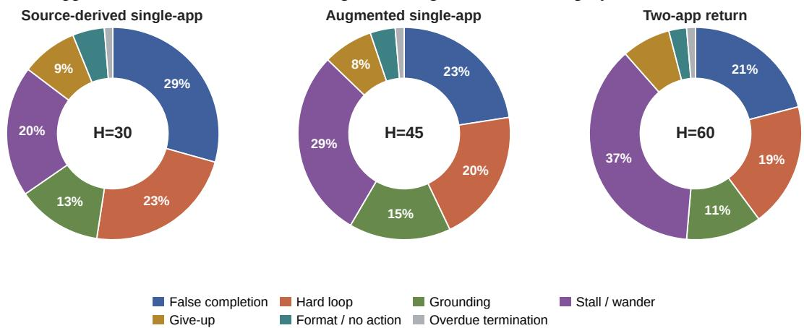  
Figure E7: Failure-mode composition of our final policy by horizon class. Each pie normalizes the seven mutually exclusive terminal modes over failed attempts in that class; labeled shares are rounded to whole percentages, and slices below 7.5% remain in the legend without an in-slice label. Cross-app handoff errors are orthogonal tags, not an eighth slice.

Across all 3,132 attempts, hard-loop failures fall from 16.1% under the base policy to 8.5% under our final policy; false completions fall from 12.7% to 10.2%. Figure E7 shows that stalled or wandering failures make up a larger share of augmented than source-derived failures (28.8% versus 19.9%). In the cross-app class, 33.1% of final-policy failures carry an A → B or B → A dependency tag, compared with 32.4% under the base policy. The tag covers lost or incompatible handoff values, a final A decision that ignores B, and incorrect assumptions about A’s preserved state; it can overlap any pie slice.

Of the final policy’s 613 failed attempts that reach their class horizon (330/206/77 by class), 511 make no new checkpoint in their final ten actions (275/172/64). Continuing the same policy for 15 extra public actions from those cap states rescues 18 attempts (8/7/3), without changing the reported benchmark scores. Hitting the cap is therefore a termination observation, not itself a diagnosis of insufficient task budget; the late-progress and extension checks localize the remaining ceiling effect on this frozen evaluation set.

## E.4 TRANSFER TO REAL APPLICATIONS

## E.4.1 BALANCED 100-TASK REAL-DEVICE PROTOCOL AND MATCHED BASELINES

We freeze a paired 100-task panel on 20 policy-training apps, five per app: 50 entity rebindings retain a seed workflow schema but use unseen values and starts, while 50 workflow identities come from Trace2World-Bench’s frozen held-out-workflow slice (30 seed-family and 20 augmentation-family). Ten apps use a 3:2 entity/workflow mix and ten use 2:3, counterbalanced by domain and constructiontrace budget. The workflow half overlaps the benchmark and is not a second independent evaluation set.

Within each app–family stratum, candidate order and reversible, equivalently restorable eligibility are frozen before simulator or device outcomes; an ineligible candidate advances within the same stratum. The same identities are evaluated for three training seeds in both substrates, with substrate order randomized and goal, start, terminal criterion, and each task’s 30- or 45-step single-application budget from Table D6 held fixed, so a simulator/device mismatch cannot come from different step limits. Only live entity values may be rebound after content drift. No panel identity or outcome enters construction, training, repair, or checkpoint selection.

Agreement is the share of identical simulator/device outcomes, with both directional mismatches also reported. The real/sim gain ratio is $R = [ S R _ { \mathrm { r e a l } } ( \pi _ { 3 } ) - S R _ { \mathrm { r e a l } } ( \pi _ { 0 } ) ] / [ S R _ { \mathrm { e n v } } ( \pi _ { 3 } ) - S R _ { \mathrm { e n v } } ( \pi _ { 0 } ) ]$ Means and ratios precede rounding; the training seed is the replication unit and defines every SD.

Five tasks per app do not estimate per-app effects; equal allocation makes the overall task mean equal the macro-app mean, and the two 50-task family rows remain descriptive slices.

Matched training-source conditions. The self-checked and Trace2World source comparison holds fixed all 1,280 seed identities, launch and terminal contracts, learner, sampler, task order, and 32 RL iterations; only the environments change. Missing implementations remain failures. These stage-1 policies are distinct from our final policy and are scored only on the panel above.

## E.4.2 SOURCE-TRACE VALIDATION IMPROVES PAIRED SIM-TO-REAL RETENTION

The protocol and estimands are fixed in Appendix E.4.1; this subsection adds outcome levels, task-family slices, and the matched-source decomposition.

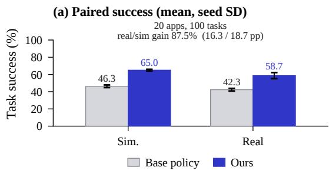

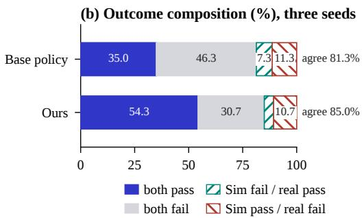  
Figure E8: Paired transfer on 100 tasks across 20 applications. The panel balances 50 entity rebindings and 50 Trace2World-Bench workflow holdouts; complementary 3:2 and 2:3 app-level mixes keep five tasks per app. (a) Base and stage-3 task success in both substrates; error bars are seed SD. (b) Mean paired outcome composition. Agreement includes both-pass and both-fail.

Table E15: Balanced task-family transfer slices. The fixed panel contains 50 unseen entity/state rebindings and 50 workflows sampled directly from the 512-task Trace2World-Bench held-outworkflow slice. Percentages; agreement is base / trained over three seeds.
<table><tr><td>Slice</td><td>N</td><td>Base env.</td><td>Base real</td><td>Trained env.</td><td>Trained real</td><td>Agreement</td></tr><tr><td>Entity rebinding</td><td>50</td><td>58.7</td><td>54.0</td><td>79.3</td><td>73.3</td><td>78.0 / 84.7</td></tr><tr><td>Held-out workflow</td><td>50</td><td>34.0</td><td>30.7</td><td>50.7</td><td>44.0</td><td>84.7 / 85.3</td></tr><tr><td>All tasks</td><td>100</td><td>46.3</td><td>42.3</td><td>65.0</td><td>58.7</td><td>81.3 / 85.0</td></tr></table>

Both task families improve on the device: entity rebindings rise from 54.0% to 73.3%, and held-out workflows from 30.7% to 44.0%. These are descriptive slices; aggregate gains and seed SDs are reported in Table 3.

Against self-validation, source-trace validation’s 6.0-pp real-device gain advantage decomposes as −1.0 + 8.3 − 1.3 = 6.0 pp. The terms are respectively the environment-pass difference, the reduction in simulation-only passes, and the device-only difference. The simulation-only term dominates; the other two terms are smaller and point in the opposite direction. This separates invalid simulated success from a larger simulated training gain.

Our final policy passes only on the real device for 4.3% of tasks (base: 7.3%); it passes in simulation but fails on the device for 10.7% (base: 11.3%). Live content and combinations beyond the recorded workflows are possible contributors, but these joint counts do not identify the causes of the remaining transfer gap.

## E.5 SCOPE, LIMITATIONS, AND FUTURE WORK

This paper evaluates Trace2World on mobile applications reconstructed as DOM-backed browser environments from traces collected at one point in time, with proprietary models in the construction, validation, screening, and review roles. Three limitations follow from this scope, and each points to a direct extension. First, a browser reimplementation renders differently from the native application, so the paired device study bounds rather than removes the substrate gap; that panel covers policytraining applications, while unseen-application transfer is measured in reconstructed environments.

Extending the paired panel to held-out applications, and the substrate to desktop and native rendering, are extensions of the same protocol. Second, we report initial construction cost but not refresh cost. Because every supported relation keeps its source links, application behavior that changes after collection—a new entry surface, a changed action effect—can be reconciled from new traces and re-accepted by the same replay, so the intended maintenance path is incremental refresh rather than rebuild; its accounting is future work. Third, all optimization tasks are single-app, and the construction roles run on proprietary models with the bounded API stage on the weaker of the two (Appendix D.2). Since gains already reach the evaluation-only two-app slice, training on validated cross-app compositions is a natural next step, as are open-weight substitution in each role and, eventually, using a trained policy’s own validated executions as additional construction evidence to close the loop from policy back to world.

## F CASE STUDIES

The cases first compare complete visible trajectories for one shared Meituan workflow across the Reference, four environment builders, and Trace2World. They then cover Meituan’s schema-backed augmentation, seed and augmented workflows in one 58Tongcheng environment, and a Railway 12306–Didi composition with a return dependency. The final gallery collects reconstructed pages and application home screens.

## F.1 MATCHED BASELINE TRAJECTORIES ON ONE SHARED WORKFLOW

The shared task starts from the Meituan home, enters Group-buy and Beauty/Hair, searches for WanSen Men’s Hair Design, opens the Wash+Style deal, applies a CNY 6 Meituan coupon so that the payable amount changes from CNY 38 to CNY 32, and selects Alipay without pressing Confirm transaction. It belongs to the five-task sample frozen before any subject or evaluation result. Figures F1a–h start every condition from the Meituan home and retain the complete visible trace through either the pre-commit terminal or the first missing required action. The successful Reference, GUI-GENESIS, and Trace2World sequences each contain 13 frames; Direct+Reference, CUA-Gym+Reference, and PhoneWorld stop where continuation is no longer supported by a visible control.

  
¥24.8 4.3折¥58

## Reference · Meituan coupon workflow

Shared workflow: WanSen voucher → ¥6 coupon → Alipay; stop before Confirm transaction.

## Meituan home

  
美团直播382观看

  
呷哺呷哺草原小肥羊家庭

  
【工作日特惠】单人闲时健康

  
幸运咖【闭眼 买】人气果咖4

  
神券)瑞幸咖啡(大华西安

Co 规频

  
蜜雪冰城【闭眼围不踩雷】

## Focus search

:23

历史搜索

搜索

猜你想搜

麻将馆

棋牌室

达官电竞

麻将棋牌房

瑞幸咖啡

烧烤

麻将

瑞幸

L·KD桌球棋牌俱乐部

奶茶

## 01

## Enter Group-buy

下午5:22

大华股份西安数智产业园>

## 特价团天天有低价

  
塔斯汀中国汉堡| 【百万爆品】单人四

  
蜜雪冰城」【蜜雪冰 城】纯茶&果茶3进

  
霸舌生滚牛肉米粉【眼时福利】特色酸

  
按摩足疗

  
神脊能胀  
新品特惠  
万森男士发型设计|洗发+造型

  
德發興茶冰廳超值尊享单人餐

  
牛约堡【买1赠1】特色牛肉堡2个4.5分 西安软件新城店

04

## Type ‘WanSen Men’s Hair Design’

下午5:23

万森男士发型设计

万森男士发型设计(大都荟店)

万森男士发型设计(雁塔店)

日 万森男士发型设计(Momo park店)

查找全部相关结果

9.1km

## Open Beauty / Hair

  
万森男士发型设计洗发+造型

05

## 邻尚Tony美发沙龙【美团专属】设计师洗剪吹

韩霖美发【总监/店长】精剪+洗吹+造型

## 万森男士发型★5.0 最近门店5.5km

万森男士发型设计

## Submit search

下午5:23

  
¥326.4折¥50神券最高能至30+  
神券最高脂至30

【新客专属-不满章免费】发型设计+剪发+造型+修眉

【新客专享】洗剪吹+修眉(不满意不收费

【品质爆款】高级设计师精剪+造型+修眉(不满意免费)

【人气爆款-不满意免费重做】烫/染二选一+剪发+发型设计

¥1584.2折¥380

【学生认证专项】烫染2选1+剪发+设计T

## Reference · Meituan coupon workflow

Shared workflow: WanSen voucher → ¥6 coupon → Alipay; stop before Confirm transaction.

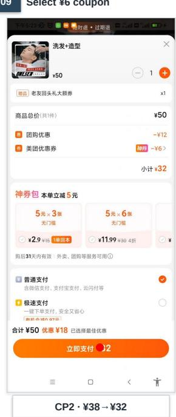

德發興茶冰廳|超值尊享单人  
餐  
31

  
￥23.96.4折￥50

## GUI-GENESIS · Meituan coupon workflow

Shared workflow: WanSen voucher → ¥6 coupon → Alipay; stop before Confirm transaction.

## 00

## Meituan home

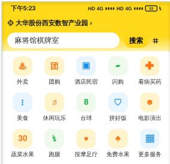

  
呷哺呷哺|草原小肥羊家庭￥135￥1937折

  
【工作日特惠】单人闲时健康￥85.85

## Focus search

## 下午5:23

麻将棋牌室

## 历史搜索

乌剑居酒屋 蜜雪冰城瑞幸咖啡

有线圆孔耳机

竞长安·映山红电竞

## 猜你喜欢

麻将馆 棋牌室 达官电竞 麻将棋牌室

L·KD桌球棋牌俱乐部

## 01

## Enter Group-buy

## 下午5:23

## HD 4G H 4G

## 02

## Type ‘WanSen Men’s Hair Design’

04

## Open Beauty / Hair

## 下午5:23

## 卡一秀美学烫染·漂发接发【出门必备】舒适洗吹造型

万森男士发型设计

万森男士发型设计(大都荟店

万森男士发型设计(Momo park店)

万森男士发型设计(雁塔店)

## 万森男士发型设计|洗发+造型

查找全部相关结果

## FAIRY·梵芮|【总监剪发】风格裁剪·发型设计

邻尚 Tony 美发沙龙 |【美团专属】设计师洗剪吹

05

## Submit search

## 下午5:23

## HD 4G  HD 4G

万森男士发型设计

## 万森男士发型

选择门店

## 洗发+造型

【新客专属-不满意免费】发型设计+剪发+造型+修眉

￥21.11

¥24.8

【品质爆款】高级设计师精剪+造型+修眉(不满意免费)

¥47.3

C 3i

【人气爆款-不满意免费重做】烫/染二选一+剪抢+发型设计

## GUI-GENESIS · Meituan coupon workflow

Shared workflow: WanSen voucher → ¥6 coupon → Alipay; stop before Confirm transaction.

06

## Open ‘Wash + Style’ deal

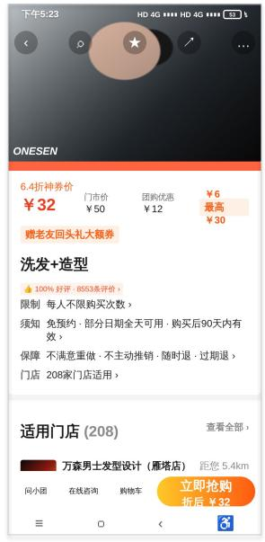

07

Buy now

洗发+造型

商品总价(共1件)

团购优惠

券美团优惠券

立即支付￥38

09

## Select ¥6 coupon

10

Pay ¥32

## 洗发+造型

¥50

下午5:23

订单

赠品 老友回头礼大额券

￥32.00

商品总价(共1件)

￥50

美团优惠券

小计¥32

神券包本单立减5元

5元×3张无门槛

普通支付

极速支付

合计￥50优惠￥18已选择最佳优惠

立即支付 ￥32

展开

服务

确认交易

CP2 · ¥38→¥32

## Expand payment methods

下午5:23

订单

￥32.00

美团支付

更多

塔斯汀中国汉堡【百万...

奶茶咖啡

## Trace2World · Meituan coupon workflow

Shared workflow: WanSen voucher → ¥6 coupon → Alipay; stop before Confirm transaction.

00

## Meituan home

  
塔斯汀【百万爆品】单人四¥14.8¥26.85.6折

  
虎头炸·潮汕南 炸鸡招牌 ¥16.68

## 尖叫星期子

  
口购物车  
我的

03

## Focus search

搜索

历史搜索

蜜雪冰城

瑞幸咖啡

耳机有线圆孔

猜你想搜

达官电竞

奶茶

⑥

烧烤

味之园·社区食堂

马子禄牛肉面

茶话弄热

luckin coffee瑞幸咖啡

王菊面馆

聚变健身

## Enter Group-buy

## 特价团天天有低价

  
蜜雪冰城| 【蜜雪冰城..

  
必胜客|一人食 3件套

  
推荐

  
美食

  
休闲玩乐

04

Type ‘WanSen Men’s Hair Design’

万森男士发型设计

搜索

万森男士发型设计

万森男士发型设计(大学城店)

查找全部相关结果

## Open Beauty / Hair

## 卡一秀美学烫染·漂发接发|【出门必备】舒适洗吹造型

## 万森男士发型设计 |洗发 + 造型

05

## Submit search

## 万森男士发型设计

万森男士发型☆5.0 最近门店5.5km

选择门店

## 洗发+造型

## 【新客专属-不满意免费】发型设计+剪发+造型+修眉

## 【新客专享】洗剪吹+修眉(不满意不收费)

## 【品质爆款】高级设计师精剪+造型+修眉(不满意免费)

  
小计¥38

  
Open coupon picker

  
美团优惠券

## Trace2World · Meituan coupon workflow

Shared workflow: WanSen voucher → ¥6 coupon → Alipay; stop before Confirm transaction.

06

## Open ‘Wash + Style’ deal

09

## Select ¥6 coupon

10

Pay ¥32

立即支付 ¥38

## Expand payment methods

¥32.00

合计 ¥50 优惠 ¥18 已选择最佳优惠

立即支付 ¥32

确认交易

确认交易

CP2 · ¥38→¥32

## Pre-commit terminal states

Alipay selected · Confirm transaction untouched

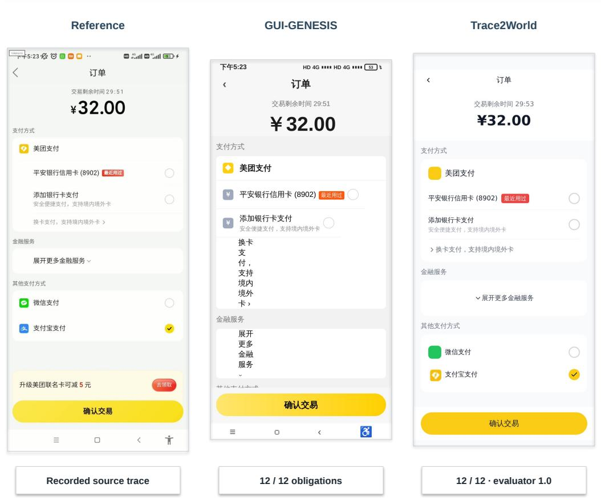

## Shared task criteria for all three traces

WanSen Wash + Style · ¥6 coupon: ¥38 → ¥32 · Alipay selected before confirmation

Attempt · Enter Group-buy

Executed obligations: 0 / 12

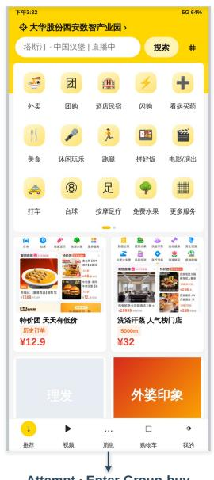

## First blockers in app-wide baselines

## Meituan home → first unsupported required action

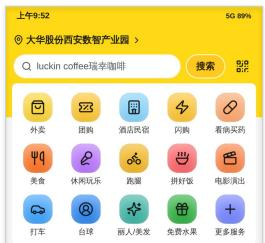

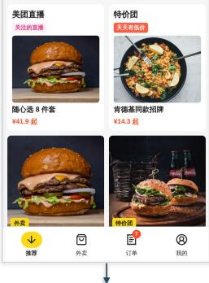  
Attempt · Enter Group-buy

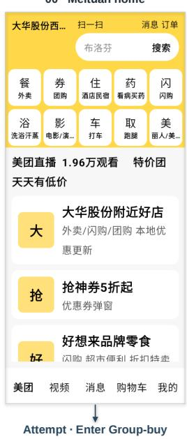

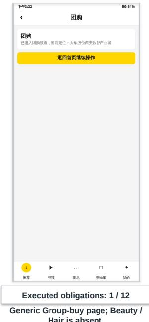

  
Group-buy resolves to the unchanged home shell.

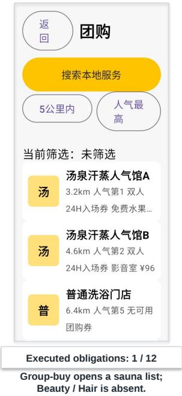

Figure F1: Complete same-task trajectories from the Meituan home (eight pages). (a–b) The frozen marked Reference establishes entity resolution, coupon arithmetic, and the pre-commit terminal; top-left numbers are local step indices, red dots mark the next recorded action, and the terminal panel identifies the stop. (c–d) GUI-GENESIS completes the workflow in its task-local site. (e–f) Trace2World completes the same workflow in one shared 100-task world. (g) One rubric below the aligned terminal frames specifies the deal, coupon-adjusted amount, and pre-commit payment boundary for all three traces; the Trace2World terminal payment indicators use an isolated display-only view correction, with the raw capture retained in the artifact. The original Trace2World package evaluator scores the frozen run 1.0. (h) Direct+Reference reaches a generic Group-buy page but exposes no Beauty/Hair control, CUA-Gym+Reference returns to the unchanged home shell, and PhoneWorld opens a sauna list. Every sequence starts at home; failed traces end at their first missing required action without an inferred suffix. This single case diagnoses mechanisms rather than failure frequencies. 56

The comparison separates three failure mechanisms, and each follows the builder’s own construction contract (Table E1). Direct preserves a recognizable shell but loses the task’s category transition, satisfying 1 of the 12 in-application obligations. CUA-Gym, whose specification is authored from topic research with the recordings only as auxiliary input, does not materialize even the first route effect and satisfies 0. Our PhoneWorld-style reimplementation abstracts the recordings into frequencyranked screen types, collapses Group-buy into the wrong local-service family, and satisfies 1. None of the three degrades gradually: all stop after two visible frames, at the first category transition. GUI-GENESIS is correct for this task, satisfying 12 of 12 across 13 frames, so the case does not support a semantic-failure claim against it; its remaining boundary is that the execution closes one task-local site rather than one app-wide world. Trace2World satisfies the same 12 obligations while preserving the shared world, the ordered state changes, and an evaluator-owned pre-commit terminal. The contrast is therefore not between agentic and non-agentic implementation: GUI-GENESIS reproduces this single workflow exactly, so agentic construction can realize a task-local workflow. The distinction appears when several traces must define one reusable application, where identity, state, and effects have to stay consistent across workflows; Trace2World fixes those semantics before its own implementation loop begins. These are qualitative mechanism diagnoses, not estimates for the full construction population.

## F.2 SCHEMA-BACKED TASK AUGMENTATION

Supported augmentation. Figure 1 contrasts a 13-action source trace with a 20-step augmented rollout in the same Meituan environment. The source establishes search, store selection, return to the deal list, item detail, quantity control, and checkout. The augmentation composes those behaviors into a nearest-store comparison, a retained selection after returning, a quantity update, and a pre-submission amount check.

Evidence boundary. The latte detail is a new entity binding of the observed item-detail template, hence a schema-backed instance under Appendix C.1, rather than a newly observed screen. The six frames show the selected 394 m store, the revisit, the latte instance, and checkout. Because the last frame precedes the increment, it displays one voucher; saved terminal checks record two vouchers, CNY 14.00 goods, a CNY 1.42 discount, and CNY 12.58 payable. This case demonstrates one supported within-application composition, not population-level workflow diversity or a training effect.

## F.3 SEED AND AUGMENTED WORKFLOWS

The two traces use one 58Tongcheng environment at different task boundaries: the seed reconstructs a recorded rental-search workflow, whereas the augmentation composes comparison, revisit, persistent state, and recovery over supported behavior. They are distinct tasks rather than two environments or one extended trace, and remain qualitative examples rather than estimates of difficulty or training effects.

Seed reconstruction. The two views audit different fidelity obligations: Figure F2 preserves complete action chronology and the terminal verdict, while Figure F4 compares matched page states.

推荐附近公寓

  
58查连合作公寓

# 58Tongcheng: seed trace comparison

Panel 1/4 · steps 01–03 in each trace

## TASK INSTRUCTION

Open Rentals, choose Entire Rental, apply the VR Viewing filter, open the first result, launch the VR panorama, and inspect the room with a viewing motion.

## REAL APP · PHYSICAL DEVICE

## click([302,203])

  
青年三巷23号小区2室2厅1卫邻地铁 配官齐全南北通透900元  
精装一室一厅吾悦广场环普创新城 阿房宫南...1300元

  
←租房有保障更安心)

## click([130,253])

  
推荐 视频找房  
整租|科技路沿线高新三路财富中心 人保大厦咖啡街区 高新...

## click([829,112])

## GENERATED APP · TRACE2WORLD

## click([307,223])

## click([122,246])

  
推荐 附近 公寓 视频找房

  
整租|东方美谷百曲乐苑1室1厅1卫南北通透 电梯房

  
2100元/月

## click([882,384])

## 58Tongcheng: seed trace comparison

Panel 2/4 · steps 04–06 in each trace REAL APP · PHYSICAL DEVICE

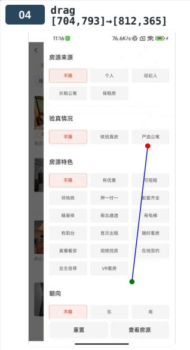

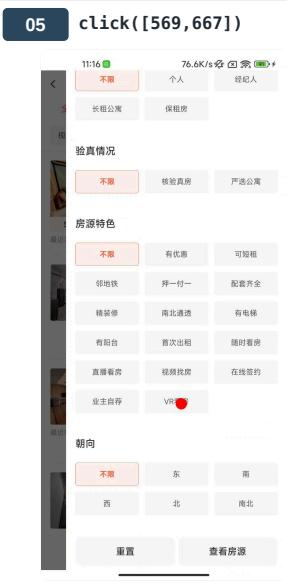

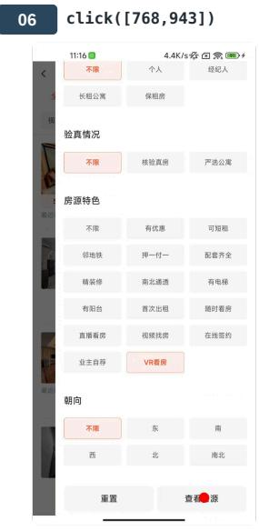

## GENERATED APP · TRACE2WORLD

## click([541,751])

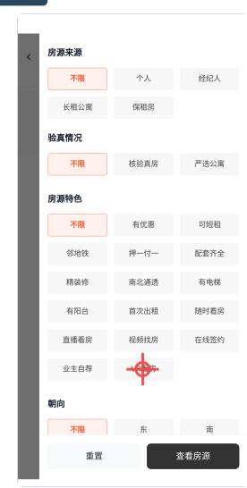

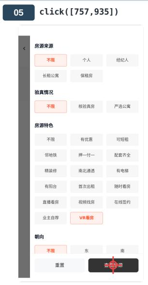

# 58Tongcheng: seed trace comparison

## Panel 3/4 · steps 07–09 in each trace REAL APP · PHYSICAL DEVICE

## click([667,234])

## click([179,575])

## click([500,222])

## GENERATED APP · TRACE2WORLD

## click([224,545])

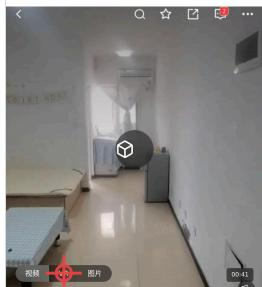

08

## click([500,221])

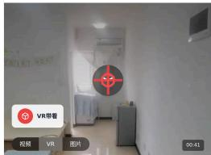

打电话

09

## drag

## [500,625]→[138,625]

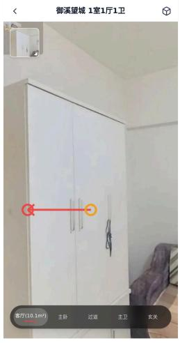

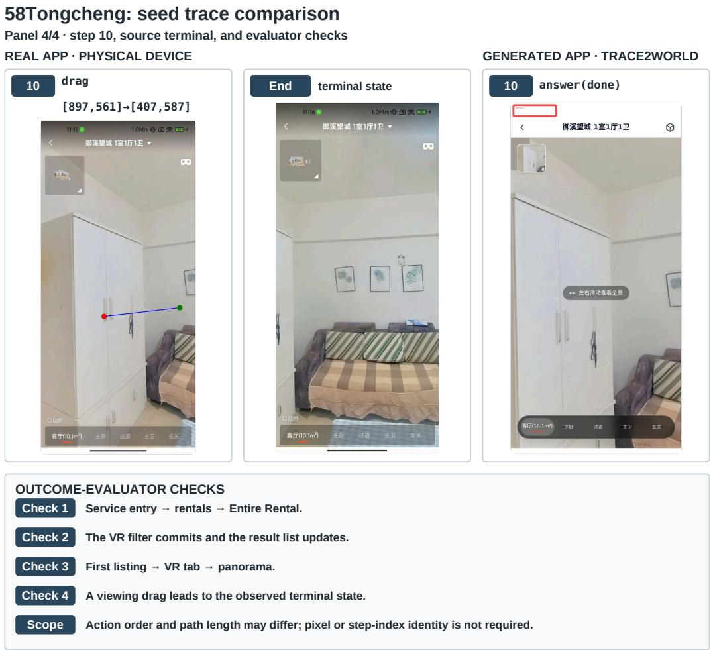  
Figure F2: Trace-wise real-app/generated-app execution for a seed 58Tongcheng task (four pages). The upper sequence is the human physical-device execution and terminal observation; the lower sequence is a successful execution in the Trace2World environment. The numbered cards follow each trace’s own action order; the unnumbered terminal observation is separate. The final panel lists the outcome-evaluator checks and the alignment boundary.

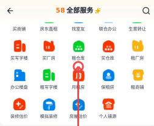

  
58全部服务

Augmented execution. Unlike the seed comparison, this case tests composition and recovery within fixed supported behavior. Figure F3 retains rejected attempts rather than presenting only the successful path; the seed sequence is not duplicated.

## 58Tongcheng: augmented trace

Panel 1/4 · steps 01–06

## TASK INSTRUCTION

Compare two building-material merchants by rating, review count, verification, and service tags;

verify the strictly dominant merchant, return and recompute, reopen it, expand folded reviews,

like exactly the first previously unliked review once, and confirm identity and state. Do not call, consult, or claim a coupon.

## click([122,508])

  
公司搬家|企业搬迁|日式搬家

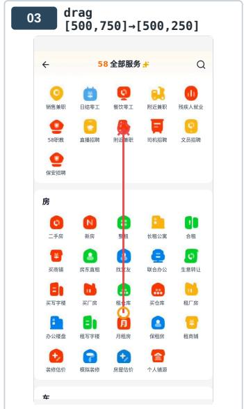

## drag[500,750]→[500,250]

## click([314,778])

## click([194,535])

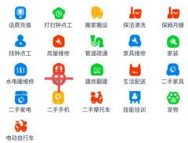

## 58Tongcheng: augmented trace

## Panel 2/4 · steps 07–12

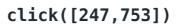

09

## click([247,498])

## click([416,498])

## click([63,72])

  
全西安可服务

精诚建材沙子石子..

## 商家服务

精诚建材 沙子石子..

精诚建材沙子石子...

## 58Tongcheng: augmented trace

## Panel 3/4 · steps 13–17

14

## click([497,732])

## click([862,364])

  
Figure F3: Complete augmented-task generated-app execution in 58Tongcheng (four pages). Each card shows a full marked pre-action viewport and a public-schema action. The 20-action trace retains three no-new-observation attempts as context-reuse cards and includes return, recomputation, branch expansion, one persistent like, and recovery from an unintended merchant page. The terminal evaluator requires the listed checks and vetoes calling, consultation, or coupon collection; the case remains qualitative.

精装一室一厅吾悦广场环普创新城 阿房宫南...1300元

# 58Tongcheng: matched page states

Page 1/2 · three matched states

## TASK INSTRUCTION

Open Rentals, choose Entire Rental, apply the VR Viewing filter, open the first result, launch the VR panorama, and swipe to inspect the room.

## Service home

## REAL APP · PHYSICAL DEVICE

  
青年三巷23号小区2室2厅1卫邻地铁 配套齐全 南北通透900元

## GENERATED APP · TRACE2WORLD

## Rental channel

## REAL APP · PHYSICAL DEVICE

## GENERATED APP · TRACE2WORLD

## VR filter

## REAL APP · PHYSICAL DEVICE

## GENERATED APP · TRACE2WORLD

# 58Tongcheng: matched page states Page 2/2 · two matched states

## TASK INSTRUCTION

Open Rentals, choose Entire Rental, apply the VR Viewing filter, open the first result, launch the VR panorama, and swipe to inspect the room.

  
GENERATED APP · TRACE2WORLD

  
Figure F4: 58Tongcheng reconstruction gallery (five matched page states across two figure pages). The paired pages cover service entry, the rental channel, VR filtering, a property detail, and the interactive panorama.

01 click([472,598])

## F.4 CROSS-APPLICATION RETURN DEPENDENCY

This case tests a return dependency rather than two independent completions: the matched and unmatched Didi quotes of RMB 30.6 and RMB 34.6 must remain available after resuming Railway 12306, and the selected quote must bind the final unpaid order. Figure F5 exposes the joint checkpoints and terminal vetoes.

## Railway 12306 → Didi → Railway 12306

Panel 1/5 · instruction first · steps 01–03

## TASK INSTRUCTION

In Railway 12306, verify that first class on the 07:07 G652 train from Xi'an North to Beijing West is directly purchasable. Before creating the order, open Didi and prepare a one-seat Special Carpool ride from Feihong Roujiamo (Yunshui Tianjing Restaurant) to Xi'an North–West Entrance. Compare the matched and unmatched fares. If the matched fare is no more than RMB 32 and is lower than the unmatched fare, return to Railway 12306, select G652 first class for Yang Qian with seat preference C, and stop on the unpaid-order page; otherwise return without creating a railway order. Do not call the ride or pay for the train ticket.

  
02 open\_app("Didi")

  
First class · RMB 824.5 directly purchasable

## Railway 12306 → Didi → Railway 12306

Panel 2/5 · steps 04–09 · Didi route setup

Railway 12306 → Didi → Railway 12306  

Railway 12306 → Didi → Railway 12306 Panel 4/5 · steps 16–20 · terminal observation  

  
Figure F5: Railway 12306 → Didi → Railway 12306 return-dependency case (20 actions and a terminal observation over five pages). Numeric card labels are local step indices. The final panel lists eight ordered evaluator checks for the Railway eligibility, Didi fare gate, persistent return, order binding, and unpaid terminal, together with the cross-application bindings and terminal vetoes. The panels assemble separately recorded app-local executions; no single frozen execution record spans the complete cross-application episode.

## F.5 RECONSTRUCTION GALLERY

The gallery pairs physical-device observations from human source traces with archived environment executions at the same task-conditioned page state. Every panel retains the full marked pre-action viewport; marks identify pending public-schema action geometry. The gallery aligns page identity and task-relevant visible state while allowing different legitimate paths and non-task visual differences.

Xiaohongshu: matched page states

Page 1/2 · three matched states

TASK INSTRUCTION

Search for Three Squirrels, open its verified profile, message the first store product, and select Very Satisfied in the service-rating sheet.

## Xiaohongshu: matched page states Page 2/2 · two matched states

TASK INSTRUCTION   
Search for Three Squirrels, open its verified profile, message the first store product, and select Very Satisfied in the service-rating sheet.

  
Figure F6: Xiaohongshu reconstruction gallery (five matched page states across two figure pages). The paired pages cover the discover shell, verified search result, verified profile, store-product picker, and service-rating sheet. Each pair shares one task, launch, and task-conditioned visible state; differences outside that state remain visible.

## Bilibili: matched page states

Page 1/2 · three matched states

## TASK INSTRUCTION

Search Bilibili for food tutorials, open Filters, select the 10–30, 30–60, and 60+ minute duration buckets, then apply the filter to display matching tutorials.

## Video home

## REAL APP · PHYSICAL DEVICE

## Food search results

## REAL APP · PHYSICAL DEVICE

## GENERATED APP · TRACE2WORLD

## GENERATED APP · TRACE2WORLD

## Filter sheet

## GENERATED APP · TRACE2WORLD

  
Figure F7: Bilibili reconstruction gallery (five matched page states across two figure pages). The paired pages cover video home, food-query results, the filter sheet, three selected long-duration buckets, and the resulting tutorial list.

## Bilibili: matched page states Page 2/2 · two matched states

Search Bilibili for food tutorials, open Filters, select the 10–30, 30–60, and 60+ minute duration buckets, then apply the filter to display matching tutorials.

## GENERATED APP · TRACE2WORLD

## Railway 12306: matched page states

Page 1/2 · three matched states

## TASK INSTRUCTION

Query Lanzhou to Qingyang on February 15, choose D2643 second-class waitlist, bind passenger Yang Zhe, confirm the notice, and stop on the unpaid waitlist order.

## Bound query

GENERATED APP · TRACE2WORLD  

GENERATED APP · TRACE2WORLD  

## Railway 12306: matched page states

Page 2/2 · two matched states

## TASK INSTRUCTION

Query Lanzhou to Qingyang on February 15, choose D2643 second-class waitlist, bind passenger Yang Zhe, confirm the notice, and stop on the unpaid waitlist order.

  
Figure F8: Railway 12306 reconstruction gallery (five matched page states across two figure pages). The paired pages cover a date-and-route query, the D2643 result, waitlist confirmation, passenger binding, and the unpaid terminal order.

  
REAL APP · PHYSICAL DEVICE

# Dingdong Maicai: matched page states

Page 1/2 · three matched states

## TASK INSTRUCTION

Open Vegetables and Soy Products, combine the Second Item Half Price and Flash Sale filters, then add the specified tomato and dried bean-curd products.

## Grocery home

## REAL APP · PHYSICAL DEVICE

## Category surface

## GENERATED APP · TRACE2WORLD

## GENERATED APP · TRACE2WORLD

## Combined filter

## GENERATED APP · TRACE2WORLD

# Dingdong Maicai: matched page states Page 2/2 · two matched states

## TASK INSTRUCTION

Open Vegetables and Soy Products, combine the Second Item Half Price and Flash Sale filters, then add the specified tomato and dried bean-curd products.

  
Figure F9: Dingdong Maicai reconstruction gallery (five matched page states across two figure pages). The paired pages cover grocery home, category entry, combined promotion filters, a productvariant sheet, and the resulting cart state.

Weibo  
Bilibili  

## Xiaohongshu

## NetEase Music

## Ximalaya

Figure F10: Generated-app home screens (1/2). Default states of formal augmented browser environments; fresh browsers, common viewport, no task-specific initialization. Device shells are hidden; app content and controls remain. The twenty apps match the human-audit roster (Appendix D.3); these images illustrate entry diversity.

Twenty-application home-screen gallery.

Didi  

## Meituan

## 58Tongcheng

## Dingdong Maicai

KFC  

## Railway 12306

## Xianyu

  
Figure F11: Generated-app home screens (2/2). Local-service, travel, grocery, food, shopping, and automotive entry surfaces captured from formal augmented browser environments at a common viewport. Decorative phone shells are hidden and app controls retained.  
先鉴别后发货的开m 创者

## Dewu

## Dongchedi

## G PROMPT TEMPLATES

The six templates follow the pipeline’s decision boundaries: raw traces become local evidence, repeated observations become candidate shared semantics, a compiled package is checked against source traces by report-only checks, the validated package is extracted into a task-facing index, and prior learner outcomes guide the next tasks composed over that index. They are method-level condensations of the workflow, not verbatim run-time prompts. Two short rules then locate repair authority and the separate evaluation-only cross-app branch.

## Source-trace preprocessing: disposition and description

<table><tr><td rowspan=2 colspan=4>ROLE   Classify ONE raw trace without editing it.INPUT Each raw action (family, coordinates, typed value,status) and the marked screenshot BEFORE it. A</td></tr><tr><td rowspan=1 colspan=1></td></tr><tr><td rowspan=1 colspan=1></td><td rowspan=1 colspan=3>circle marks the host; TYPE marks an input; a red</td></tr><tr><td rowspan=1 colspan=1></td><td rowspan=1 colspan=3>rectangle marks existing text; a drag line marks</td></tr><tr><td rowspan=1 colspan=1></td><td rowspan=9 colspan=3>direction and scroll region; no mark may indicatea terminal row.Classify every row, describe kept rows, then writethe task instruction and terminal contract.ITION Give every raw row a reason:visible effect or necessary interaction;no effect, redundant recovery, or launch context</td></tr><tr><td rowspan=1 colspan=1></td></tr><tr><td rowspan=2 colspan=1>ORDER</td></tr><tr><td rowspan=1 colspan=1></td></tr><tr><td rowspan=1 colspan=1></td><td rowspan=1 colspan=1>+he</td></tr><tr><td rowspan=1 colspan=1>DISPOS</td></tr><tr><td rowspan=1 colspan=1>keep</td><td rowspan=1 colspan=2>visible effect or neces</td></tr><tr><td rowspan=1 colspan=1>drop</td></tr><tr><td rowspan=1 colspan=1></td><td rowspan=1 colspan=3></td></tr><tr><td rowspan=1 colspan=1>obse</td><td rowspan=1 colspan=3>rve terminal row kept as evidence, not an action.</td></tr><tr><td rowspan=1 colspan=4>DESCRIBE For kept rows, name the visible host and purpose;</td></tr><tr><td rowspan=1 colspan=1></td><td rowspan=4 colspan=3>give both ordinal and readable list-item identity,exact typed value, or gesture direction and region.</td></tr><tr><td rowspan=1 colspan=1></td></tr><tr><td rowspan=1 colspan=1></td><td rowspan=9 colspan=3>uses only kept rows. The contract records observedboundary, outcome fields, last relevant step, commitstatus, required/forbidden state, source evidence,and remaining uncertainty.invent labels, outcomes, or invisible actions;include dropped behavior in the task; or assigncanonical pages, State fields, guards, or verifierpredicates before reconciliation.</td></tr><tr><td rowspan=1 colspan=1>OUTPUT</td><td rowspan=2 colspan=3>task instructio: then teriitil contract. The ta</td></tr><tr><td rowspan=1 colspan=1></td></tr><tr><td rowspan=1 colspan=1></td></tr><tr><td rowspan=1 colspan=1></td></tr><tr><td rowspan=1 colspan=1></td></tr><tr><td rowspan=1 colspan=1>NEVER</td></tr><tr><td rowspan=1 colspan=1></td></tr><tr><td rowspan=1 colspan=1></td></tr></table>

## Cross-trace reconciliation and factorization

<table><tr><td>ROLE</td><td>Propose one shared app model from many trace-local observations. Preserve uncertainty; do not build UI.</td></tr><tr><td>INPUT</td><td>Restored pre/post transition candidates, marked hosts, action values, lifecycle context, and trace-step links.</td></tr><tr><td>MATCH</td><td>Map local pages, hosts, and entities to canonical owners using shell and route continuity, containment,</td></tr><tr><td></td><td>entry/exit state, entity lineage, and transitions. Similar text or appearance alone is insufficient. FOR EACH candidate execution key (page, host, action, observed guard), propose reads,</td></tr><tr><td></td><td>writes, destination, visible postcondition, and projection, citing every supporting source step. FACTOR Structure: stable pages, routes, hosts, containment. State: owned mutable fields, guards, transitions,</td></tr><tr><td></td><td>initialization, reset, and visible projections. Data: reusable entity identity, attributes, relations, and source-bound resources. CONFLICT If observed state explains divergent effects,</td></tr></table>

Otherwise retain alternatives as unresolved.

OUTPUT Canonical-mapping and relation CANDIDATES, source links, conflicts, and missing dependencies. The separate Supported gate admits only complete, compatible, source-covered relations.

NEVER settle ownership by filename, majority vote, visual similarity, implementation convenience, or a later task’s needs; self-admit an unsupported relation.

## Construction-time source-trace validation

ROLE Review a FROZEN GUI execution against its source trace. Emit a verdict and next owner; do not act.

INPUT Chronological SOURCE marked screenshots, then persisted EXECUTION screenshots with action labels; the instruction and per-step state, lifecycle, projection, typeahead, and terminal checklist.

ORDER Read the full SOURCE sequence before EXECUTION. Compare causal states, not equal row indices. Each SOURCE row is pre-action: its next row or terminal evidence establishes the intended effect.

CHECK The marked target is the current visible host, not a destination or a post-action leak. Check whole initial/current viewports: route and start data, chrome, selected tabs, overlays, list content, density, scale, anchor, and crop origin. Check action value, exact host scope, reachability, enabled state, lifecycle, parent projection, scroll region, and autocomplete order. Check forbidden future state and terminal obligations.

OUTPUT One trajectory verdict: review\_pass\_candidate, generated\_env\_mismatch with subtype, page\_boundary\_blocker, reference\_oracle\_blocker, or evidence\_blocked; give the first mismatch with source/execution evidence, repairability, and owner. A pass candidate still needs independent probes.

NEVER pass a right click in a wrong viewport; dismiss scale/anchor/crop differences without evidence; infer success from missing evidence or elapsed time; edit the trace, checklist, run, or environment.

## Task-facing index of the validated environment

ROLE Extract a read-only index of ONE validated app for task authoring. Extract; do not model, do not generate tasks, do not introduce app behavior.

INPUT The source-validated package and its replay records (surfaces, hosts, controls, fields, entities, reset, lifecycle); the frozen app model only for stable IDs, provenance, and support anchors.

OUTPUT app\_index with stable surface/host/control IDs, entity schemas, observable fields and outcomes, supported operation IDs with references to their established guards/effects, implementation status, evidence links, and exclusions.

OUTPUT dependency\_index with each visible producer field, consumer action or decision, value type, entity scope, freshness, legal discovery path, and supporting source steps, taken from already modeled relations.

MARK Supported composition opportunities: aggregation,

RULE Every emitted item must reference an existing supported relation and its source evidence; the index has no semantic authority. Drop what cannot resolve.

EXCLUDE unsupported or unresolved behavior, inaccessible producers, incompatible types or scope, and non-observable outcomes. Retain supported items tagged as not yet implemented.

NEVER infer a transition, guard, or effect; invent a page, route, field, relation, state, action, lifecycle, or dependency; infer diversity from wording or names.

## Rollout-to-gap summary for the next batch

ROLE Summarize what the PRECEDING learner needs to practice within the frozen, source-supported app index.   
INPUT Frozen prior practice-task manifest, learner rollouts and checkpoint/terminal outcomes, task capability and dependency labels, fixed-solver outcomes when present, and attributed environment/task/provider defects.   
FIRST Separate non-learner faults and invalid attempts. Do not count them as learner competence evidence.   
GROUP By supported capability and dependency motif: attempts, terminal/partial progress, repeated or no-effect actions, lost state/entity bindings, recovery behavior, weak combinations, and saturation.   
OUTPUT Evidence-linked conditioning notes: weak or unsaturated motifs to target, saturated motifs to deprioritize, and concrete failure patterns. Carry uncertainty when attribution is incomplete.   
NEVER inspect held-out benchmark outcomes; alter app semantics; call an environment or solver failure a learner gap; request unsupported interactions.

## Supported single-app task authoring and bounded hardening

ROLE Author SINGLE-APP training candidates over the frozen task-facing index and its dependency index.

INPUT Supported IDs, evidence, reset/terminal contracts; guided augmentation also receives preceding learner gaps. Seed and static omit that conditioning.

GENERATE Goal/terminal value, start/reset, supported path, acceptable end states, subtasks/decisions with later consumers, visible sources, scope/freshness/discovery, verification/correction, evaluator-visible result. Bind required surface/state/action/entity/dependency IDs to source evidence; otherwise reject.

DIFFICULTY Use supported aggregation, state composition, lifecycle/recovery, or multi-entity constraints. For a deliberately long task, require >=7 business subtasks, 4 decisions, 3 cross-state dependencies, 2 evidence revisits, and 2 evidenced phenomena, one information- or state-bearing. Clicks do not count.

HARDEN Only a solver-solvable lineage diagnosed as saturated (learner mean reward >0.8) enters this branch. Add supported dependencies or evidence revisits, retain all prior obligations, and stop after at most two refinements. Send each revision to implementation

<table><tr><td rowspan=1 colspan=1>REPAIR</td><td></td></tr><tr><td rowspan=1 colspan=1></td><td></td></tr><tr><td rowspan=2 colspan=1></td><td></td></tr><tr><td rowspan=1 colspan=1>storage, bindings, projection, a missing</td></tr><tr><td rowspan=1 colspan=1></td><td rowspan=1 colspan=1>implementation of a</td></tr><tr><td rowspan=2 colspan=1></td><td rowspan=2 colspan=1>update or control</td></tr><tr><td rowspan=2 colspan=1>realized wrongly.</td></tr><tr><td></td><td rowspan=1 colspan=1></td></tr><tr><td rowspan=1 colspan=1>AFTER</td><td rowspan=1 colspan=1>Invalidate depen</td></tr><tr><td rowspan=1 colspan=1></td><td rowspan=1 colspan=1>from reset and re</td></tr><tr><td rowspan=2 colspan=1>DROP</td><td></td></tr><tr><td rowspan=1 colspan=1>A defect that cannot</td></tr><tr><td rowspan=1 colspan=1></td><td rowspan=1 colspan=1>package within the</td></tr><tr><td rowspan=2 colspan=1></td><td></td></tr><tr><td rowspan=1 colspan=1>would need a page i</td></tr><tr><td rowspan=1 colspan=1></td><td rowspan=1 colspan=1>the source does not</td></tr><tr><td rowspan=1 colspan=1></td><td rowspan=1 colspan=1>slice.</td></tr><tr><td rowspan=1 colspan=1>NEVER</td><td rowspan=1 colspan=1>edit. the ann snecif</td></tr></table>

and screening.

HOLD Hard or solver-unsolved lineages; never simplify them.   
MAY request schema-backed entity/value/state instances or the instantiation of an indexed, not-yet-implemented supported operation as the candidate’s task slice.   
NEVER add hidden metrics, task IDs, unsupported app behavior, new transitions/guards/effects, unverifiable outcomes, wording-only diversity, or navigation for length.

## Workflow rule: repair under a frozen app model

## Workflow rule: typed two-app evaluation composition

INPUT Two source-validated app-local task-facing indexes with dependency indexes. No learner outcomes are seen.   
MODE H=60, evaluation only. Require human GUI completion within 45 public actions.

COMPOSE A GUI-visible typed A -> B -> A handoff: an A value supplies a B input/guard; a B result changes the final action in preserved A state. Check type, entity scope, freshness, visible discovery, and value parity.

FREEZE Pair, orientation, task signature, and joint terminal oracle before policy evaluation; keep it outside training and environment repair.

REJECT Independent task concatenation, stale/hidden transfer, lost return state, or any new app-local semantics.

NEVER treat the composition as a cross-app source recording.