# The Value of System 1 Models in Medicine

Xiufeng Yang1,\*, Konstantinos Vrettos2,\*, Zeineb Ben Chaaben1, Fabian Drexel1, Jannik Lübberstedt1, Johannes Moll1, Anirudh Narayanan1, Frederike Stumpf1, Cosmin I. Bercea1, Jiawen Wang1, Evangelia E. Vassalou3, Krischan Braitsch4, Sebastian Ziegelmayer1, Markus Graf1, Marcus R. Makowski1, Lisa Adams1, Nassir Navab5, Michail E. Klontzas2,3,6,+, Keno Bressem1,7,8,9,+

## Abstract

Background Many clinical decisions are a choice among a few fixed options, taken quickly and in large numbers. Such decisions also need an uncertainty estimate to know when to defer to a clinician. Generative language models answer slowly in free text and state their confidence poorly. In contrast, System 1 models answer zero-shot with a probability for each answer. However, their performance across clinical tasks is unknown.

Methods Four System 1 models, two proprietary and two with open weights, were evaluated zero-shot on 86 public tasks from 14 clinical domains in 20 languages, spanning examination questions and medical imaging (radiography, CT and MRI). Tasks were assigned to six capability tiers before analysis. The primary outcome was the area under the receiver-operatingcharacteristic curve (AUROC). Secondary outcomes included calibration, language efects and comparisons with published results and generative models.

Results Across 179,111 cases, the mean AUROC of the best model per task was 0.94 for medical knowledge, 0.93 for text understanding, 0.83 for clinical judgement from text, 0.89 for image perception, 0.84 for 2D image findings and 0.69 for volumetric findings, with 0.54 for pulmonary embolism on CT. Imaging tasks scored 0.09 (95% CI, 0.06 to 0.11) lower than text tasks (P < 0.001). The best model matched or exceeded the best published result on 13 of 26 text tasks and on 8 of 35 imaging tasks. Triage nurses outperformed the best model (accuracy, 0.85 vs. 0.56). One decision took 0.34 to 0.44 seconds and 24 to 81 joules on open-weight models run locally. Accuracy on identical questions fell by up to 39 percentage points from English to Yoruba. Generative models of the same family were 11 to 76 times slower, with 3 to 5 percentage points higher balanced accuracy.

Conclusions System 1 models decide quickly, cheaply and with usable confidence when the answer is stated in a text or recalled from medical knowledge, but not when it must be judged or read from an image.

## INTRODUCTION

Many clinical decisions represent choices among a few fixed options that must be made quickly and in bulk. A triage nurse assigns one of five acuity levels within minutes of arrival, a radiologist decides whether a CT pulmonary angiogram demonstrates embolism, and a coder selects one procedure code for each of thousands of cases. A model that makes such decisions must also state how certain it is, so that confident answers can be acted on and uncertain cases passed to a clinician.1–3 Generative large language models perform well on a series of medical tasks,4;5 but they write each answer token by token, often following a reasoning trace, which takes several seconds per decision and uses far more energy than a task-specific model.6 The confidence they state in text is poorly calibrated and barely separates correct from incorrect answers.7;8 On the contrary, System 1 models receive a state, such as a report, an image or both, together with one or more typed questions, and return a probability for every answer option in a single forward pass without generating text. Their name refers to dual-process theory, which separates fast, intuitive System 1 judgement from slow, deliberate System 2 reasoning, the mode that generative models resemble when they reason in text.9;10

The open question is which clinical decisions such a model can be trusted with. The answer to a clinical case can be stated in a report, recalled from medical knowledge, judged from several findings, or seen in an image. Of 519 studies of large language models in health care, 44.5% tested medical knowledge such as licensingexamination questions, and 5% used real patient-care data.11 Where other tasks were tested, performance fell from more than 86% on licensing-examination questions12 to lower accuracy on real clinical cases and conversations.13;14 On radiologic images, GPT-4V identified the imaging modality in all 515 images but detected abnormalities in 0% to 90%, depending on the finding, 15 and multimodal models scored lower on volumetric than on two-dimensional images.16 If performance depends on where the answer lies, a single benchmark score misrepresents a model, a construct-validity problem known from general AI benchmarks.17

To evaluate the value of System 1 models in medicine, we tested four models on 86 tasks from 14 clinical domains, with the tasks ordered in six capability tiers from medical knowledge to volumetric findings. We measured which clinical decisions the models can take on, whether their probabilities are calibrated, how they perform outside English, and what their speed costs in time, money, energy and accuracy, against a generative model of the same family.

## METHODS

Study Design and Tasks. This cross-sectional evaluation used public, de-identified datasets under their respective licences. Candidate tasks came from a taxonomy of 87 clinical decision tasks in 18 domains and from further public datasets with a fixed answer format (Supplementary Appendix, Section S1). A task was included when its data and reference labels were public and its licence allowed transfer to a model hosted on a commercial API. Eighty-six tasks from 14 clinical domains met these criteria. Table S1 lists every task with the publication of its dataset. Eight of them are language versions of another task and were analysed only for language efects, which left 78 primary tasks (Figure 1). Each task used the oficial test split or a seeded random sample of up to 1,000 cases, in some tasks enriched for rare classes, and volumetric tasks used 81 to 436 studies. The tasks comprised 179,111 cases, with the reference standard released by the dataset authors.

Prior to result summarisation, each task was assigned to one of six capability tiers. Medical knowledge covered examination questions and terminology, text understanding covered information stated in a report, abstract or sentence, and clinical judgement from text covered decisions that integrate patient information, such as triage acuity or variant class. The three imaging tiers included image perception (acquisition, anatomy and image quality), two-dimensional (2D) image findings, and volumetric findings on CT or MRI.

System 1 Models. Four System 1 models were evaluated through the OpenRouter decision interface, each in the latest version available in October 2026. Clef (Cloudflare, 27 billion parameters) and Clef-flash (Cloudflare, 9.5 billion parameters) have open weights, and GPT-6

Luna Decisions (OpenAI) and Jev 1.14 (TypeSafe AI) are proprietary. A request held a state of text and up to four images, and one or more typed questions with a yes-or-no answer, a choice of one of n options, or an ordered score. The model returned a probability for every option. All questions of a case were sent in one request, zero-shot, with a one-sentence description of the input. Volumetric studies were read as axial slices at a fixed spacing, with one request per slice. The study-level probability was the maximum over slices for yes-or-no questions and the mean over slices for other questions. On four 2D imaging tasks, Jev 1.14 received higher-resolution versions of the same images since its interface accepts larger images. Every request was logged as sent.

Generative Comparison. Clef and Clef-flash were compared with their generative backbones, Qwen3.8-27B18 and Qwen3.5-9B,19 and GPT-6 Luna Decisions with the generative GPT-6 Luna. The comparison covered 32 text and 2D imaging tasks. For each task, 100 randomly selected cases were sent to the generative model with the same state and questions as the System 1 model had received, including an instruction to choose one option per question, and an output schema restricted to the answer options. Default reasoning settings were kept. An answer that failed or could not be parsed counted as wrong.

Local Runs and Energy. Clef and Clef-flash were additionally run locally from the released checkpoints, on a single NVIDIA RTX 5090 GPU. Local Clef’s answers were compared with the hosted versions, which confirmed that the two agreed before the local runs were utilised. Energy was measured on a sub-sample of 42 tasks and it followed the AI Research Label of the CEDARS framework for reporting the environmental footprint of clinical AI.20 The measurements come from the GPU driver’s cumulative energy counter through NVML (power usage efectiveness taken as 1.0 for a single workstation GPU). CodeCarbon (v3.3.1) ran alongside to convert energy to CO2e at the local grid carbon intensity (Greece, 337 g CO e per kWh). Energy is reported per decision and summarised as the median and IQR over tasks. Latency was measured per request. The providers of the hosted models (GPT-6 Luna Decisions, Jev 1.14) publish no per-request energy figures for them.

Reference Results. For every task, published results on the same dataset were collected from the original dataset or challenge publication, from oficial leaderboards, and from a search of PubMed and the web for later work up to October 2026. Every value was checked against its source and classified as a task-specific model, a generative language model, a rule-based classifier, or clinicians and expert annotators. A published result was compared only when it used the same label set and metric on the matching questions. The highest such result per task is reported as the best published result.

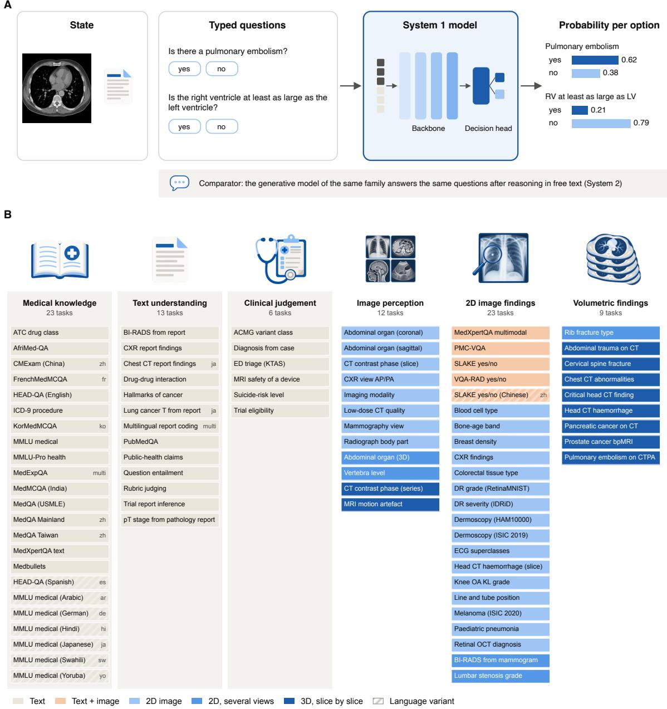  
Figure 1 | Study Design. Panel A shows how a System 1 model answers. Text, one or more images, or both enters the model with typed questions, and the model returns a probability for each option in one forward pass. The generative model of the same family served as comparator on 32 tasks. Panel B shows the 86 tasks by capability tier and input type. Hatched tiles are language versions of another task and were analysed for language efects only.

Outcomes. The primary outcome was the area under the receiver-operating-characteristic curve (AUROC), computed per question as a macro average of one-versusrest curves for more than two options, and averaged over the questions of a task. Secondary outcomes were the balanced accuracy of the most probable option, expressed relative to chance as $( \mathrm { B A } - 1 / k ) / ( 1 - 1 / k )$ for k classes so that 0 is chance and 1 is perfect, the top-label expected calibration error (ECE), 1;21 selective accuracy after withholding the least confident answers, 22 cost per 1,000 requests at provider prices, latency per request and energy per decision.

Statistical Analysis. Any question that a model refused or failed was scored as wrong, with the label prevalence as its probability. Task-level 95% confidence intervals (CIs) were estimated using 1,000 bootstrap resamples of cases. Task estimates were pooled within each tier and model using DerSimonian–Laird random-efects models. Two contrasts were specified in advance, imaging versus text tiers and a linear trend across the three imaging tiers, and both were estimated by random-efects meta-regression. AUROC was also summarised by question type. The accuracy of each language version on identical items was compared with English by paired bootstrap and the exact McNemar test. System 1 and generative models were compared by the mean tasklevel diference in balanced accuracy, with 95% CIs from a task bootstrap. Secondary analyses were not adjusted for multiplicity. Analyses used Python 3.13, pandas 3.0, NumPy 2.5, SciPy 1.18 and scikit-learn 1.9. Code and all model outputs are available in the project repository at https://github.com/twin-x-eu/ system1-models-in-medicine.

## RESULTS

Tasks and Models. The 86 tasks covered 20 languages and yielded 2.4 million model answers across 179,111 cases (Figure 1). GPT-6 Luna Decisions refused 4,008 case–question pairs (1.3%), Clef and Clef-flash each failed on one pair, and Jev 1.14 answered every question. Refused and failed questions were scored as wrong. Jev 1.14 was the best model on 45 of 78 tasks. Results per task are given in Table S2.

Capability Gradient. For the best model on each task, the random-efects mean AUROC was 0.94 (95% CI, 0.92 to 0.97) for medical knowledge, 0.93 (95% CI, 0.91 to 0.94) for text understanding, 0.89 (95% CI, 0.84 to 0.94) for image perception, 0.84 (95% CI, 0.81 to 0.87) for 2D image findings and 0.69 (95% CI, 0.60 to 0.79) for volumetric findings (Figure 2). Imaging tasks scored 0.09 (95% CI, 0.06 to 0.11) lower than text tasks (P < 0.001), and AUROC fell by 0.09 (95% CI, 0.06 to 0.13) per tier from image perception to volumetric findings (P < 0.001). Both contrasts were significant for each of the four models (Figure 2B). Clinical judgement from text reached 0.83 (95% CI, 0.73 to 0.93), lower than the other two text tiers. Chance-corrected balanced accuracy fell from 0.74 for medical knowledge to 0.20 for volumetric findings, and its trend across the imaging tiers was not significant (P = 0.10, Figure 2C).

The best model reached an AUROC of 0.99 on licensing-examination questions (MedQA)23 and 1.00 on findings stated in chest radiograph reports. On volumetric imaging it reached 0.54 for pulmonary embolism, 24 0.59 for cervical spine fracture, 25 0.59 for clinically significant prostate cancer26 and 0.48 for rib fracture type, and four of nine volumetric tasks stayed below 0.60. Intracranial haemorrhage on head CT reached 0.90. 27 On imaging tasks, questions that assigned the whole image to one of several options reached a median AUROC of 0.87, yes-or-no questions on the presence of a finding reached 0.74, and ordered grades 0.71. On text tasks, yes-or-no questions reached 0.99.

Comparison with Published Results and Clinicians. A published result on the same dataset, label set and metric was available for 61 tasks (Figure 3). On text tasks, the best System 1 model matched (within 0.01) or exceeded the best published result in 13 of 26 tasks, with a median diference of −0.01. On imaging tasks it did so in 8 of 35 tasks, with a median diference of −0.17. Clinicians or expert annotators outperformed the best model in 6 of the 10 tasks for which such a comparison existed. Triage nurses assigned the emergency acuity level with an accuracy of 0.85, compared with 0.56 for the best model,28 and a points-based rule classified genetic variants with an accuracy of 0.95, compared with 0.73. 29;30 Zero-shot System 1 models are therefore competitive with purpose-built systems on text, but not on images or where a codified rule already exists.

Calibration and Selective Answering. The median top-label ECE across models was 0.05 to 0.07 on text tasks and 0.11 to 0.17 on imaging tasks (Figure 4A and 4B). On imaging tasks, GPT-6 Luna Decisions was overconfident, and about 80% of its most confident answers were correct. Withholding the less confident half of the answers raised accuracy on text tasks from between 0.76 and 0.83 to between 0.96 and 0.99, and on imaging tasks from between 0.66 and 0.70 to between 0.79 and 0.91 (Figure 4C).

Language. On the same 1,089 medical examination questions, accuracy in every language version was lower than in English for every model (Figure 4D). The decline was smallest in German and largest in Yoruba, where it ranged from 20.1 (95% CI, 17.6 to 22.5) percentage points for Jev 1.14 to 39.4 (95% CI, 36.3 to 42.4) for Clef-flash, whose accuracy fell from 0.93 to 0.54. The performance measured in English therefore overstates what these models deliver in a low-resource language.

System 1 and Generative Models. On identical cases, the balanced accuracy of each System 1 model was lower than that of the generative model of its family, by 4.3 (95% CI, 2.4 to 6.3) percentage points for GPT-6 Luna Decisions, 3.3 (95% CI, 0.0 to 6.5) for Clef and 4.8 (95% CI, 1.0 to 8.5) for Clef-flash, over 32 tasks each (Figure 5A). The diference was smaller on imaging tasks, where Clef-flash and Qwen3.5-9B difered by 0.4 (95% CI, −1.5 to 2.3) percentage points. Each System 1 model scored higher than its generative counterpart on 8 or 9 of the 32 tasks. Generative models required a median of 4.8 to 30.3 seconds per request, compared with 0.34 to 0.44 seconds for System 1 models, and incurred 2- to 22-fold higher costs (Figure 5B and 5C).

Environmental Impact of System 1 Models. Energy was measured directly on the two open-weight models, Clef and Clef-flash, both run locally on one RTX 5090 GPU over 42 of the tasks and 117,263 decisions each (Methods). The median energy of one decision was 23.5 joules for Clef-flash (IQR, 17.2 to 51.3) and 80.9 joules for Clef (IQR, 68.4 to 125.5). That is 6.5 to 22.5 watthours of GPU-board energy per 1,000 decisions and, including CPU and RAM and at the carbon intensity of the local grid, 2.8 to 12.1 g CO2e per 1,000 decisions (Figure 6). Across capability tiers, the median energy per 1,000 decisions was lowest for medical knowledge (4.8 watt-hours for Clef-flash and 19.2 for Clef) and highest for text understanding (19.3 and 47.6). One kilowatt-hour buys roughly 153,000 decisions from Clefflash and 44,500 from Clef. Decisions that included an image cost 1.6 to 2.3 times as much energy as text-only decisions, and the length of the input mattered more than its type. On the three tasks with the longest documents, the energy of a decision rose to 2.1 to 5.0 times the median for that model. The two models together took 234,526 decisions for 4.3 kilowatt-hours of GPUboard energy. The energy of a single System 1 decision is therefore small enough that it is not the limiting factor in deploying one at scale.

A  
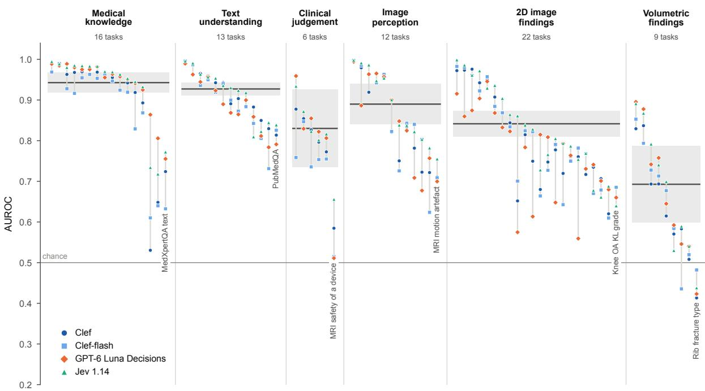

B  
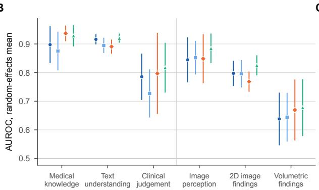  
C

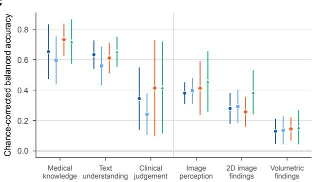  
Figure 2 | Capability Map. Panel A shows the AUROC of each primary task (columns) for the four System 1 models, with tasks grouped by capability tier and sorted by the best model. Grey vertical lines span the four models. Horizontal bars and shaded bands show the random-efects mean AUROC of the best model per task with its 95% CI, and the weakest task of each tier is labelled. Panels B and C show the random-efects mean per tier and model with 95% CIs for AUROC and for chance-corrected balanced accuracy, where 0 is chance and 1 is perfect. Refused or failed questions were scored as wrong.

Local versus API Inference. Clef and Clef-flash have open weights and can run inside a hospital network, so patient data do not need to leave the institution. Run locally, they reproduced the hosted interface closely. On chest radiograph report findings, local Clef gave a mean AUROC of 0.99 equal to the version inferenced through the API, and agreed with it on 99.7% of answers, while on visual question answering, the values were 0.947 against 0.942 and 97.2% agreement.

## DISCUSSION

System 1 models answered medical examination questions and identified findings described in radiology reports with high accuracy, with inference times below half a second and for a few joules per decision. On text-based tasks, predicted probabilities were well calibrated, closely reflecting observed accuracy. However, performance declined on tasks requiring the integration of multiple findings, such as assigning acuity levels in emergency triage. On imaging tasks, they accurately identified imaging modalities and anatomical regions but frequently failed to detect specific abnormalities. Performance on volumetric CT and MRI tasks was particularly limited, approaching chance levels in four of nine tasks.

For information extraction from clinical text, the case for zero-shot System 1 models is strong. The best System 1 model matched or exceeded the best published result on 13 of 26 text tasks without any training on the task, including results from models that had been fine-tuned for that task. For the T staging of lung cancer from CT reports, the best System 1 model reached an accuracy of 0.78, compared with 0.67 for fine-tuned Japanese BERT models. 31 For the pathological T stage from pathology reports, it reached an AUROC of 0.96, compared with 0.94 for a fine-tuned Clinical-BigBird model.32 A zero-shot System 1 model could therefore replace models that require task-specific fine-tuning. Each decision took less than half a second and 23.5 to 80.9 joules, with costs ranging from 0.02 to 0.16 USD per 1,000 requests. Withholding the 50% of predictions with the lowest confidence increased accuracy on text-based tasks to 0.96 to 0.99. These findings suggest that System 1 models could support large-scale report labelling, information extraction, and literature screening, while referring uncertain cases to clinicians or slower, more computationally intensive models.3;22 Clef and Clef-flash have openly available weights and can be deployed within hospital networks.

A Text tasks  
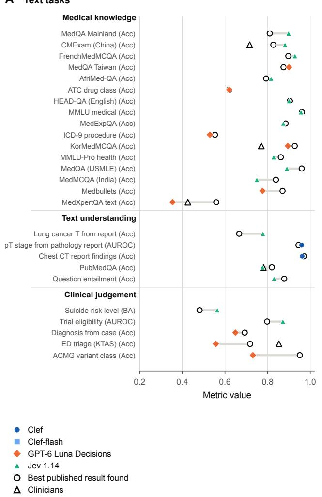

B Imaging tasks  
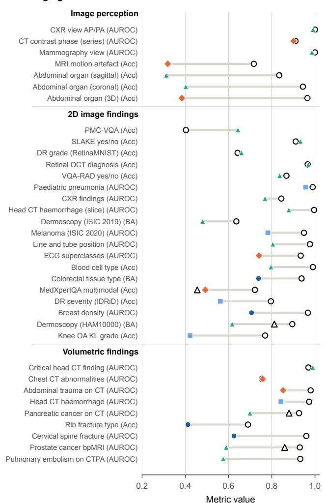  
Figure 3 | System 1 Models, Published Results and Clinicians. Panel A shows text tasks and Panel B imaging tasks. For each task with a published result on the same dataset, label set and metric, the best of the four System 1 models (coloured marker) is shown with the best published result (open circle), which can be a task-specific model, a generative language model or a rule, and with clinicians or expert annotators (open triangle). Values of the System 1 models are computed on the questions that match the published result and can difer from the task-level AUROC. Acc denotes accuracy and BA balanced accuracy.

Accuracy declined on tasks requiring clinical judgement, such as assigning triage acuity or classifying variants, even when all relevant information was provided in the input. System 1 models generate predictions in a single forward pass, relying on knowledge encoded in their weights. Unlike generative models that produce explicit reasoning traces, 33 they lack intermediate reasoning steps through which multiple findings can be evaluated and integrated before reaching a decision. Across the five tasks requiring clinical judgement, the generative backbones of Clef and Clef-flash achieved accuracies 11 and 15 percentage points higher, respectively, compared with diferences of 3 and 5 percentage points across all 32 evaluated tasks. Enabling System 1 models to generate reasoning traces before making predictions could help narrow this performance gap.

An additional limitation of most medical benchmarks is their predominantly English-language content. Similarly, most language models, including System 1 models, are trained primarily on English-language data.34;35 Reflecting this, the System 1 models were most accurate in English. On the same 1,089 examination questions, accuracy fell by 2 to 7 percentage points in German, a high-resource language, and by 20 to 39 percentage points in Yoruba, a low-resource language. Generative models lose accuracy in low-resource languages in a similar manner. 35;36

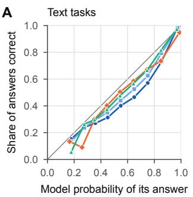

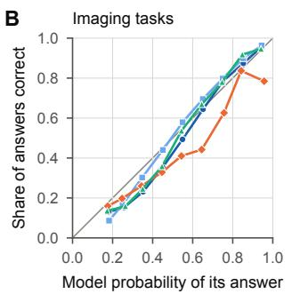

C  
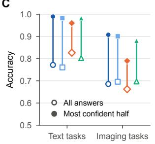

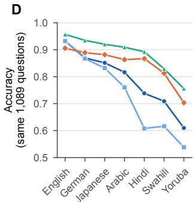  
Figure 4 | Calibration and Language. Panels A and B show the share of correct answers against the probability the model gave its answer, pooled over text tasks in Panel A and over imaging tasks in Panel B. The diagonal marks perfect calibration. Panel C shows, for each model, the accuracy of all answers (open marker) and of its most confident half (filled marker) on text and imaging tasks. Panel D shows accuracy on the same 1,089 medical examination questions in seven languages.

A  
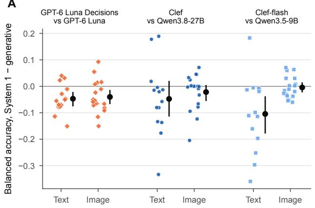

B  
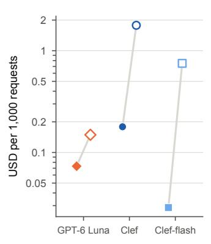  
C

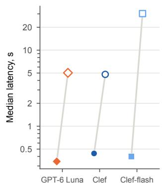  
Figure 5 | System 1 and Generative Models. Panel A shows, for each task, the balanced accuracy of the System 1 model minus that of the generative model of the same family on identical cases, with the mean and 95% CI (task bootstrap) for text and imaging tasks. The pairs are GPT-6 Luna Decisions and GPT-6 Luna, Clef and Qwen3.8-27B, and Clef-flash and Qwen3.5-9B. Panels B and C show the cost per 1,000 requests and the median latency per request on logarithmic scales, with filled markers for System 1 models and open markers for generative models.

Most System 1 models also accept images, but read medical images far less accurately than models trained for the task. The best System 1 model matched or exceeded the best published result in 8 of 35 imaging tasks, compared with 13 of 26 text tasks, with a median diference of −0.17 on imaging tasks. For clinically significant prostate cancer on MRI, it reached an AUROC of 0.59, compared with 0.86 for radiologists.26 Calibration was also worse on imaging tasks, and only about 80% of the most confident answers of GPT-6 Luna Decisions were correct. Volumetric imaging was most challenging as the current interface of System 1 models accepts at most four images per request and no volumes. CT and MRI studies were therefore sent as single slices every 3 to 10 mm, and a small finding can lie between two slices. The choice of pooling rule over slices did not change the results (Supplementary Appendix, Section S6.3). Furthermore, radiographic images had to be downsampled, for example mammograms at 1,024 pixels on the long side, at which microcalcifications cover few pixels. Generative models also lose accuracy when volumes are given as image sequences, 16 which indicates a property of how vision-language models process images in general.

The open-weight decision models Clef and Clef-flash are based on the Qwen family of generative models, allowing a direct comparison of the two model types. The decision models and their backbones did not difer in accuracy, however the decision models were better calibrated, with a median expected calibration error of 0.12 for Clef-flash against 0.20 for its backbone, and 0.07 for Clef against 0.13. Against the generative backbone with reasoning, the System 1 models were 3 to 5 percentage points less accurate and 11 to 76 times faster.

This study has limitations. Models were used zeroshot with a one-sentence description of the input. Taskspecific prompts and fine-tuning were not tested. A System 1 model trained on the records of 3.6 million patients from one health system, CS1-4B, was recently reported to outperform open decision models of up to 27 billion parameters on 13 of 14 tasks in held-out patients from that system.37 Its weights have not yet been released, so it could not be included here. Public datasets can be part of the training data, which raises results on text tasks in particular. Larger frontier generative models were not tested and are likely more accurate on many tasks, but they are slower and more expensive than the generative models compared herein.

A  
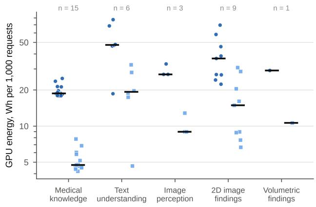

B  
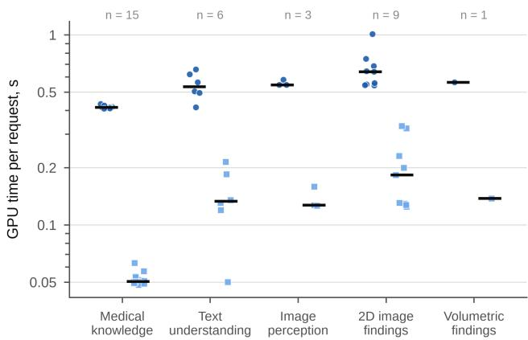  
Figure 6 | Energy of Locally Run System 1 Models. Panel A shows the GPU energy per 1,000 requests and Panel B the GPU time per request of Clef (8-bit) and Clef-flash (bf16), run locally on one NVIDIA RTX 5090, for each primary task by capability tier. Energy is the whole-board GPU energy. Bars show the median over tasks, and n is the number of tasks per tier. No clinical-judgement task was run locally

For predefined clinical decisions on text, in particular information extraction, System 1 models are ready for use, with fast, inexpensive and well-calibrated answers. They are as accurate as their backbones but better calibrated, and open weights let a hospital run them sustainably on its own data. However, they are currently limited in questions requiring clinical reasoning and in interpreting medical images, in particular CT and MRI volumes.

## ACKNOWLEDGEMENTS

Funded by the European Union under Horizon Europe grant agreement No 101287679 (TWIN-X). Views and opinions expressed are however those of the authors only and do not necessarily reflect those of the European Union or the European Health and Digital Executive Agency (HaDEA). Neither the European Union nor the granting authority can be held responsible for them.

## REFERENCES

[1] Ben Van Calster, David J McLernon, Maarten van Smeden, Laure Wynants, Ewout W Steyerberg, and Topic Group ‘Evaluating diagnostic tests and prediction models’ of the STRATOS initiative. Calibration: the Achilles heel of predictive analytics. BMC Med, 17(1):230, 2019. doi: 10.1186/ s12916-019-1466-7.

[2] Benjamin Kompa, Jasper Snoek, and Andrew L Beam. Second opinion needed: communicating uncertainty in medical machine learning. NPJ Digit Med, 4(1):4, 2021. doi: 10.1038/s41746-020-00367-3.

[3] Krishnamurthy Dj Dvijotham, Jim Winkens, Melih Barsbey, Sumedh Ghaisas, Robert Stanforth, Nick Pawlowski, Patricia Strachan, Zahra Ahmed, Shekoofeh Azizi, Yoram Bachrach, Laura Culp, Mayank Daswani, Jan Freyberg, Christopher Kelly, Atilla Kiraly, et al. Enhancing the reliability and accuracy of

AI-enabled diagnosis via complementarity-driven deferral to clinicians. Nat Med, 29(7):1814–1820, 2023. doi: 10.1038/ s41591-023-02437-x.

[4] Karan Singhal, Shekoofeh Azizi, Tao Tu, S Sara Mahdavi, Jason Wei, Hyung Won Chung, Nathan Scales, Ajay Tanwani, Heather Cole-Lewis, Stephen Pfohl, Perry Payne, Martin Seneviratne, Paul Gamble, Chris Kelly, Abubakr Babiker, et al. Large language models encode clinical knowledge. Nature, 620(7972): 172–180, 2023. doi: 10.1038/s41586-023-06291-2.

[5] Harsha Nori, Nicholas King, Scott Mayer McKinney, Dean Carignan, and Eric Horvitz. Capabilities of GPT-4 on medical challenge problems, 2023. arXiv:2303.13375.

[6] Sasha Luccioni, Yacine Jernite, and Emma Strubell. Power hungry processing: watts driving the cost of AI deployment? In Proceedings of the 2024 ACM Conference on Fairness, Ac countability, and Transparency, pages 85–99, 2024. doi: 10.1145/3630106.3658542.

[7] Thomas Savage, John Wang, Robert Gallo, Abdessalem Boukil, Vishwesh Patel, Seyed Amir Ahmad Safavi-Naini, Ali Soroush, and Jonathan H Chen. Large language model uncertainty proxies: discrimination and calibration for medical diagnosis and treatment. J Am Med Inform Assoc, 32(1):139–149, 2025. doi: 10.1093/jamia/ocae254.

[8] Mahmud Omar, Reem Agbareia, Benjamin S Glicksberg, Girish N Nadkarni, and Eyal Klang. Benchmarking the confidence of large language models in answering clinical questions: cross-sectional evaluation study. JMIR Med Inform, 13:e66917, 2025. doi: 10.2196/66917.

[9] Daniel Kahneman. Thinking, Fast and Slow. Farrar, Straus and Giroux, New York, 2011. ISBN 9780374275631.

[10] Pat Croskerry. A universal model of diagnostic reasoning. Acad Med, 84(8):1022–1028, 2009. doi: 10.1097/ACM. 0b013e3181ace703.

[11] Suhana Bedi, Yutong Liu, Lucy Orr-Ewing, Dev Dash, Sanmi Koyejo, Alison Callahan, Jason A Fries, Michael Wornow, Ak shay Swaminathan, Lisa Soleymani Lehmann, Hyo Jung Hong, Mehr Kashyap, Akash R Chaurasia, Nirav R Shah, Karandeep Singh, et al. Testing and evaluation of health care applications of large language models: a systematic review. JAMA, 333(4): 319–328, 2025. doi: 10.1001/jama.2024.21700.

[12] Karan Singhal, Tao Tu, Juraj Gottweis, Rory Sayres, Ellery Wulczyn, Mohamed Amin, Le Hou, Kevin Clark, Stephen R Pfohl, Heather Cole-Lewis, Darlene Neal, Qazi Mamunur Rashid, Mike Schaekermann, Amy Wang, Dev Dash, et al. Toward expert-level medical question answering with large language models. Nat Med, 31(3):943–950, 2025. doi: 10.1038/s41591-024-03423-7.

[13] Paul Hager, Friederike Jungmann, Robbie Holland, Kunal Bhagat, Inga Hubrecht, Manuel Knauer, Jakob Vielhauer, Marcus Makowski, Rickmer Braren, Georgios Kaissis, and Daniel Rueckert. Evaluation and mitigation of the limitations of large language models in clinical decision-making. Nat Med, 30(9): 2613–2622, 2024. doi: 10.1038/s41591-024-03097-1.

[14] Shreya Johri, Jaehwan Jeong, Benjamin A Tran, Daniel I Schlessinger, Shannon Wongvibulsin, Leandra A Barnes, Hong-Yu Zhou, Zhuo Ran Cai, Eliezer M Van Allen, David Kim, Roxana Daneshjou, and Pranav Rajpurkar. An evaluation framework for clinical use of large language models in patient interaction tasks. Nat Med, 31(1):77–86, 2025. doi: 10.1038/s41591-024-03328-5.

[15] Quirin D Strotzer, Felix Nieberle, Laura S Kupke, Gerardo Napodano, Anna Katharina Muertz, Stefanie Meiler, Ingo Einspieler, Janine Rennert, Michael Strotzer, Isabel Wiesinger, Christina Wendl, Christian Stroszczynski, Okka W Hamer, and Andreas Schicho. Toward foundation models in radiology? Quantitative assessment of GPT-4V’s multimodal and multianatomic region capabilities. Radiology, 313(2):e240955, 2024. doi: 10.1148/radiol.240955.

[16] Qingxia Wu, Qingxia Wu, Peipei Zhang, Zhifeng Yi, Yu Shen, Yan Bai, Hongna Tan, Pei Dong, Zhong Xue, Neil Roberts, and Meiyun Wang. A bilingual benchmark for evaluating diagnostic performance of multimodal large language models in radiology (RadM-Bench): evaluation development and validation. J Med Internet Res, 28:e92183, 2026. doi: 10.2196/92183.

[17] Inioluwa Deborah Raji, Emily M. Bender, Amandalynne Paullada, Emily Denton, and Alex Hanna. AI and the everything in the whole wide world benchmark. In Proceedings of the Neural Information Processing Systems Track on Datasets and Benchmarks, volume 1, 2021. doi: 10.48550/arXiv.2111.15366. URL https:// datasets-benchmarks-proceedings.neurips.cc/paper/2021/ hash/084b6fbb10729ed4da8c3d3f5a3ae7c9-Abstract-round2. html. arXiv:2111.15366.

[18] Qwen Team. Qwen3.8-Max: A new bar for coding and cowork, August 2026. URL https://qwen.ai/blog?id=qwen3.8.

[19] Qwen Team. Qwen3.5: Towards native multimodal agents, February 2026. URL https://qwen.ai/blog?id=qwen3.5.

[20] Tugba Akinci D’Antonoli and Florence Doo. CEDARS: Carbon, energy diagnostics and reporting for sustainability. Software, 2026. URL https://github.com/takinci/cedars. Apache-2.0. Accessed October 2026.

[21] Chuan Guo, Geof Pleiss, Yu Sun, and Kilian Q. Weinberger. On calibration of modern neural networks. In Proceedings of the 34th International Conference on Machine Learning, volume 70 of Proceedings of Machine Learning Research, pages 1321– 1330, 2017. doi: 10.48550/arXiv.1706.04599. URL https:// proceedings.mlr.press/v70/guo17a.html. arXiv:1706.04599.

[22] Yonatan Geifman and Ran El-Yaniv. Selective classification for deep neural networks. In Advances in Neural Information Processing Systems, volume 30, 2017. doi: 10.48550/arXiv.1705.08500. URL https://proceedings.neurips.cc/paper/2017/hash/ 4a8423d5e91fda00bb7e46540e2b0cf1-Abstract.html. arXiv:1705.08500.

[23] Di Jin, Eileen Pan, Nassim Oufattole, Wei-Hung Weng, Hanyi Fang, and Peter Szolovits. What disease does this patient have? A large-scale open domain question answering dataset from medical exams. Appl Sci, 11(14):6421, 2021. doi: 10.3390/ app11146421.

[24] Errol Colak, Felipe C Kitamura, Stephen B Hobbs, Carol C Wu, Matthew P Lungren, Luciano M Prevedello, Jayashree Kalpathy-Cramer, Robyn L Ball, George Shih, Anouk Stein, Safwan S Halabi, Emre Altinmakas, Meng Law, Parveen Kumar, Karam A Manzalawi, et al. The RSNA Pulmonary Embolism CT dataset. Radiol Artif Intell, 3(2):e200254, 2021. doi: 10.1148/ryai.2021200254.

[25] Hui Ming Lin, Errol Colak, Tyler Richards, Felipe C Kitamura, Luciano M Prevedello, Jason Talbott, Robyn L Ball, Ekim

Gumeler, Kristen W Yeom, Mohammad Hamghalam, Amber L Simpson, Jasna Strika, Deniz Bulja, Salita Angkurawaranon, Almudena Pérez-Lara, et al. The RSNA Cervical Spine Fracture CT dataset. Radiol Artif Intell, 5(5):e230034, 2023. doi: 10.1148/ryai.230034.

[26] Anindo Saha, Joeran S Bosma, Jasper J Twilt, Bram van Ginneken, Anders Bjartell, Anwar R Padhani, David Bonekamp, Geert Villeirs, Georg Salomon, Gianluca Giannarini, Jayashree Kalpathy-Cramer, Jelle Barentsz, Klaus H Maier-Hein, Mirabela Rusu, Olivier Rouvière, et al. Artificial intelligence and radiologists in prostate cancer detection on MRI (PI-CAI): an international, paired, non-inferiority, confirmatory study. Lancet Oncol, 25(7):879–887, 2024. doi: 10.1016/S1470-2045(24)00220-1.

[27] Sasank Chilamkurthy, Rohit Ghosh, Swetha Tanamala, Mustafa Biviji, Norbert G Campeau, Vasantha Kumar Venugopal, Vidur Mahajan, Pooja Rao, and Prashant Warier. Deep learning algorithms for detection of critical findings in head CT scans: a retrospective study. Lancet, 392(10162):2388–2396, 2018. doi: 10.1016/S0140-6736(18)31645-3.

[28] Sun-Hee Moon, Jae Lan Shim, Keun-Sook Park, and Chon-Suk Park. Triage accuracy and causes of mistriage using the Korean Triage and Acuity Scale. PLoS One, 14(9):e0216972, 2019. doi: 10.1371/journal.pone.0216972.

[29] Sue Richards, Nazneen Aziz, Sherri Bale, David Bick, Soma Das, Julie Gastier-Foster, Wayne W Grody, Madhuri Hegde, Elaine Lyon, Elaine Spector, Karl Voelkerding, Heidi L Rehm, and ACMG Laboratory Quality Assurance Committee. Standards and guidelines for the interpretation of sequence variants: a joint consensus recommendation of the American College of Medical Genetics and Genomics and the Association for Molecular Pathology. Genet Med, 17(5):405–424, 2015. doi: 10.1038/gim.2015.30.

[30] Sean V Tavtigian, Steven M Harrison, Kenneth M Boucher, and Leslie G Biesecker. Fitting a naturally scaled point system to the ACMG/AMP variant classification guidelines. Hum Mutat, 41(10):1734–1737, 2020. doi: 10.1002/humu.24088.

[31] Yuta Nakamura, Shouhei Hanaoka, Shuntaro Yada, Shoko Wakamiya, and Eiji Aramaki. NTCIR-17 MedNLP-SC radiology report subtask overview: dataset and solutions for automated lung cancer staging. In Proceedings of the 17th NTCIR Conference on Evaluation of Information Access Technologies, pages 145–151, 2023. doi: 10.20736/0002001328.

[32] Jenna Kefeli, Jacob Berkowitz, Jose M Acitores Cortina, Kevin K Tsang, and Nicholas P Tatonetti. Generalizable and automated classification of TNM stage from pathology reports with external validation. Nat Commun, 15(1):8916, 2024. doi: 10.1038/s41467-024-53190-9.

[33] Jason Wei, Xuezhi Wang, Dale Schuurmans, Maarten Bosma, Brian Ichter, Fei Xia, Ed Chi, Quoc Le, and Denny Zhou. Chainof-thought prompting elicits reasoning in large language models, 2023. URL https://arxiv.org/abs/2201.11903.

[34] Shivalika Singh, Angelika Romanou, Clémentine Fourrier, David Ifeoluwa Adelani, Jian Gang Ngui, Daniel Vila-Suero, Peerat Limkonchotiwat, Kelly Marchisio, Wei Qi Leong, Yosephine Susanto, Raymond Ng, Shayne Longpre, Sebastian Ruder, Wei-Yin Ko, Antoine Bosselut, et al. Global MMLU: understanding and addressing cultural and linguistic biases in multilingual evaluation. In Proceedings of the 63rd Annual Meeting of the Associationfor Computational Linguistics (Volume 1: Long Papers), pages 18761–18799, 2025. doi: 10.18653/v1/2025.acl-long.919.

[35] Charles Nimo, Tobi Olatunji, Abraham Toluwase Owodunni, Tassallah Abdullahi, Emmanuel Ayodele, Mardhiyah Sanni, Ezinwanne C. Aka, Folafunmi Omofoye, Foutse Yuehgoh, Timothy Faniran, Bonaventure F. P. Dossou, Moshood O. Yekini, Jonas Kemp, Katherine A Heller, Jude Chidubem Omeke, et al. AfriMed-QA: a Pan-African, multi-specialty, medical questionanswering benchmark dataset. In Proceedings of the 63rd Annual Meeting of the Association for Computational Linguis-

tics (Volume 1: Long Papers), pages 1948–1973, 2025. doi: 10.18653/v1/2025.acl-long.96.

[36] Iñigo Alonso, Maite Oronoz, and Rodrigo Agerri. MedExpQA: multilingual benchmarking of large language models for medical question answering. Artif Intell Med, 155:102938, 2024. doi: 10.1016/j.artmed.2024.102938.

[37] Andrew Zhang, Trinh T. L. Vuong, Sophia J. Wagner, Dongmin Bang, Tong Ding, Yuchang Su, Mary Cipperman, Christina S. Chen, Judith Lefkes, Ramin Kahidi, Ming Y. Lu, Caiwei Tian, Tianhao Luo, Jingnan Ma, Rowland Pettit, Long Phi Le, and Faisal Mahmood. A general-purpose system one decision model for clinical records, 2026. URL https://arxiv.org/abs/ 2610.27099.

[38] Ankit Pal, Logesh Kumar Umapathi, and Malaikannan Sankarasubbu. MedMCQA: a large-scale multi-subject multi-choice dataset for medical domain question answering. In Proceedings of the Conference on Health, Inference, and Learning, volume 174 of Proceedings of Machine Learning Research, pages 248– 260, 2022. doi: 10.48550/arXiv.2203.14371. URL https:// proceedings.mlr.press/v174/pal22a.html. arXiv:2203.14371.

[39] David Vilares and Carlos Gómez-Rodríguez. HEAD-QA: a healthcare dataset for complex reasoning. In Proceedings ofthe 57th Annual Meeting of the Association for Computational Linguistics, pages 960–966, 2019. doi: 10.18653/v1/P19-1092.

[40] Dan Hendrycks, Collin Burns, Steven Basart, Andy Zou, Mantas Mazeika, Dawn Song, and Jacob Steinhardt. Measuring massive multitask language understanding. In International Conference on Learning Representations (ICLR), 2021. doi: 10.48550/arXiv.2009.03300. URL https://iclr.cc/virtual/ 2021/poster/2962. arXiv:2009.03300.

[41] Yubo Wang, Xueguang Ma, Ge Zhang, Yuansheng Ni, Abhranil Chandra, Shiguang Guo, Weiming Ren, Aaran Arulraj, Xuan He, Ziyan Jiang, Tianle Li, Max Ku, Kai Wang, Alex Zhuang, Rongqi Fan, et al. MMLU-Pro: a more robust and challenging multi-task language understanding benchmark. In Advances in Neural Information Processing Systems (Datasets and Benchmarks Track), volume 37, pages 95266–95290, 2024. doi: 10.48550/arXiv.2406.01574. URL https://papers.nips.cc/paper\_files/paper/2024/hash/ ad236edc564f3e3156e1b2feafb99a24-Abstract-Datasets\_ and\_Benchmarks\_Track.html. arXiv:2406.01574.

[42] Yuxin Zuo, Shang Qu, Yifei Li, Zhangren Chen, Xuekai Zhu, Ermo Hua, Kaiyan Zhang, Ning Ding, and Bowen Zhou. MedXpertQA: benchmarking expert-level medical reasoning and understanding. In Proceedings of the 42nd International Conference on Machine Learning, volume 267 of Proceedings of Machine Learning Research, pages 80961–80990, 2025. doi: 10.48550/arXiv.2501.18362. URL https://proceedings.mlr. press/v267/zuo25a.html. arXiv:2501.18362.

[43] Hanjie Chen, Zhouxiang Fang, Yash Singla, and Mark Dredze. Benchmarking large language models on answering and explaining challenging medical questions. In Proceedings of the 2025 Conference of the Nations of the Americas Chapter of the Association for Computational Linguistics: Human Language Technologies (Volume 1: Long Papers), pages 3563–3599, 2025. doi: 10.18653/v1/2025.naacl-long.182.

[44] Sunjun Kweon, Byungjin Choi, Gyouk Chu, Junyeong Song, Daeun Hyeon, Sujin Gan, Jueon Kim, Minkyu Kim, Rae Woong Park, and Edward Choi. KorMedMCQA: multi-choice question answering benchmark for Korean healthcare professional licensing examinations, 2024. arXiv:2403.01469.

[45] Junling Liu, Peilin Zhou, Yining Hua, Dading Chong, Zhongyu Tian, Andrew Liu, Helin Wang, Chenyu You, Zhenhua Guo, Lei Zhu, and Michael Lingzhi Li. Benchmarking large language models on CMExam – a comprehensive Chinese medical exam dataset. In Advances in Neural Information Processing Systems (Datasets and Benchmarks Track), volume 36, pages 52430–52452, 2023. doi: 10.48550/arXiv.2306.03030. URL https://papers.nips.cc/paper\_files/paper/2023/hash/ a48ad12d588c597f4725a8b84af647b5-Abstract-Datasets\_ and\_Benchmarks.html. arXiv:2306.03030.

[46] Yanis Labrak, Adrien Bazoge, Richard Dufour, Béatrice Daille, Pierre-Antoine Gourraud, Emmanuel Morin, and Mickael Rouvier. FrenchMedMCQA: a French multiple-choice question answering dataset for medical domain. In Proceedings of the 13th International Workshop on Health Text Mining and Information Analysis (LOUHI), pages 41–46, 2022. doi: 10.18653/v1/2022.louhi-1.5.

[47] Ofir Ben Shoham and Nadav Rappoport. MedConceptsQA: open source medical concepts QA benchmark. Comput Biol Med, 182:109089, 2024. doi: 10.1016/j.compbiomed.2024. 109089.

[48] Dina Demner-Fushman, Marc D Kohli, Marc B Rosenman, Sonya E Shooshan, Laritza Rodriguez, Sameer Antani, George R Thoma, and Clement J McDonald. Preparing a collection of radiology examinations for distribution and retrieval. J Am Med Inform Assoc, 23(2):304–310, 2016. doi: 10.1093/jamia/ocv080.

[49] Yosuke Yamagishi, Yuta Nakamura, Tomohiro Kikuchi, Yuki Sonoda, Hiroshi Hirakawa, Shintaro Kano, Satoshi Nakamura, Shouhei Hanaoka, Takeharu Yoshikawa, and Osamu Abe. Development of a large-scale dataset of chest computed tomography reports in Japanese and a high-performance finding classification model: dataset development and validation study. JMIR Med Inform, 13:e71137, 2025. doi: 10.2196/71137.

[50] Ibrahim Ethem Hamamci, Sezgin Er, Chenyu Wang, Furkan Almas, Ayse Gulnihan Simsek, Sevval Nil Esirgun, Irem Dogan, Omer Faruk Durugol, Benjamin Hou, Suprosanna Shit, Weicheng Dai, Murong Xu, Hadrien Reynaud, Muhammed Furkan Dasdelen, Bastian Wittmann, et al. Generalist foundation models from a multimodal dataset for 3D computed tomography. Nat Biomed Eng, 10(8):1610–1628, 2026. doi: 10.1038/s41551-025-01599-y.

[51] Bastien Le Guellec, Kokou Adambounou, Lisa C Adams, Thibault Agripnidis, Sung Soo Ahn, Radhia Ait Chalal, Tugba Akinci D’Antonoli, Philippe Amouyel, Henrik Andersson, Raphaël Bentegeac, Claudio Benzoni, Antonino Andrea Blandino, Felix Busch, Elif Can, Riccardo Cau, et al. PARROT, an open multilingual radiology reports dataset. Eur J Radiol Artif Intell, 5:100066, 2026. doi: 10.1016/j.ejrai.2025.100066.

[52] José Luis Vázquez Noguera, Alejandro Torres-Hurtado, Helena Gómez-Adorno, Julio César Mello-Román, Enrique Javier Fleitas-Alvarez, Federico Fernando Espinola Schulze, Miguel Garcia-Torres, Carlos Domingo Méndez Gaona, Pedro Esteban Gardel Sotomayor, Silvia Vázquez Noguera, Norma Elizabeth Zaracho Amarilla, and Oxades Wilfrido Gamarra Esquivel. Mammography reporting dataset with BI-RADS system for natural language processing applications: addressing public data gaps in Spanish. Data Brief, 61:111761, 2025. doi: 10.1016/j.dib.2025.111761.

[53] Jenna Kefeli and Nicholas Tatonetti. TCGA-Reports: a machinereadable pathology report resource for benchmarking textbased AI models. Patterns (N Y), 5(3):100933, 2024. doi: 10.1016/j.patter.2024.100933.

[54] Mael Jullien, Marco Valentino, and André Freitas. SemEval-2024 task 2: safe biomedical natural language inference for clinical trials. In Proceedings ofthe 18th International Workshop on Semantic Evaluation (SemEval-2024), pages 1947–1962, 2024. doi: 10.18653/v1/2024.semeval-1.271. URL https: //aclanthology.org/2024.semeval-1.271/.

[55] Qiao Jin, Bhuwan Dhingra, Zhengping Liu, William Cohen, and Xinghua Lu. PubMedQA: a dataset for biomedical research question answering. In Proceedings of the 2019 Conference on Empirical Methods in Natural Language Processing and the 9th International Joint Conference on Natural Language Processing (EMNLP-IJCNLP), pages 2567–2577, 2019. doi: 10.18653/v1/ D19-1259.

[56] María Herrero-Zazo, Isabel Segura-Bedmar, Paloma Martínez, and Thierry Declerck. The DDI corpus: an annotated corpus with pharmacological substances and drug-drug interactions. J Biomed Inform, 46(5):914–920, 2013. doi: 10.1016/j.jbi. 2013.07.011.

[57] Isabel Segura-Bedmar, Paloma Martínez, and María Herrero-Zazo. SemEval-2013 task 9: extraction of drug-drug interactions from biomedical texts (DDIExtraction 2013). In Second Joint Conference on Lexical and Computational Semantics (\*SEM), Volume 2: Proceedings of the Seventh International Workshop on Semantic Evaluation (SemEval 2013), pages 341– 350, 2013. URL https://aclanthology.org/S13-2056/.

[58] Simon Baker, Ilona Silins, Yufan Guo, Imran Ali, Johan Högberg, Ulla Stenius, and Anna Korhonen. Automatic semantic classification of scientific literature according to the hallmarks of cancer. Bioinformatics, 32(3):432–440, 2016. doi: 10.1093/bioinformatics/btv585.

[59] Neema Kotonya and Francesca Toni. Explainable automated fact-checking for public health claims. In Proceedings of the 2020 Conference on Empirical Methods in Natural Language Processing (EMNLP), pages 7740–7754, 2020. doi: 10.18653/v1/ 2020.emnlp-main.623. URL https://aclanthology.org/2020. emnlp-main.623/.

[60] Asma Ben Abacha, Chaitanya Shivade, and Dina Demner-Fushman. Overview of the MEDIQA 2019 shared task on textual inference, question entailment and question answering. In Proceedings of the 18th BioNLP Workshop and Shared Task, pages 370–379, 2019. doi: 10.18653/v1/W19-5039. URL https://aclanthology.org/W19-5039/.

[61] Rahul K Arora, Jason Wei, Rebecca Soskin Hicks, Preston Bowman, Joaquin Quiñonero-Candela, Foivos Tsimpourlas, Michael Sharman, Meghan Shah, Andrea Vallone, Alex Beutel, Johannes Heidecke, and Karan Singhal. HealthBench: evaluating large language models towards improved human health, 2025. arXiv:2505.08775.

[62] Yakun Zhu, Zhongzhen Huang, Linjie Mu, Yutong Huang, Wei Nie, Jiaji Liu, Shaoting Zhang, Pengfei Liu, and Xiaofan Zhang. DiagnosisArena: benchmarking diagnostic reasoning for large language models. In Findings of the Association for Computational Linguistics: ACL 2026, pages 3074–3098, 2026. doi: 10.18653/v1/2026.findings-acl.151. URL https:// aclanthology.org/2026.findings-acl.151/. arXiv:2505.14107.

[63] Heidi L Rehm, Jonathan S Berg, Lisa D Brooks, Carlos D Bustamante, James P Evans, Melissa J Landrum, David H Ledbetter, Donna R Maglott, Christa Lese Martin, Robert L Nussbaum, Sharon E Plon, Erin M Ramos, Stephen T Sherry, Michael S Watson, and ClinGen. ClinGen–the Clinical Genome Resource. N Engl J Med, 372(23):2235–2242, 2015. doi: 10.1056/NEJMsr1406261.

[64] Kirk Roberts, Dina Demner-Fushman, Ellen M Voorhees, Steven Bedrick, and William R Hersh. Overview of the TREC 2022 Clinical Trials track. In The Thirty-First Text REtrieval Conference Proceedings (TREC 2022), NIST Special Publication 500-338, 2022. doi: 10.6028/NIST.SP. 500-338.trials-overview. URL https://trec.nist.gov/pubs/ trec31/papers/Overview\_trials.pdf.

[65] Manas Gaur, Amanuel Alambo, Joy Prakash Sain, Ugur Kursuncu, Krishnaprasad Thirunarayan, Ramakanth Kavuluru, Amit Sheth, Randy Welton, and Jyotishman Pathak. Knowledge-aware assessment of severity of suicide risk for early intervention. In The World Wide Web Conference (WWW ’19), pages 514–525, 2019. doi: 10.1145/3308558.3313698.

[66] U.S. Food and Drug Administration. AccessGUDID: Global Unique Device Identification Database (GUDID), 2026. URL https://accessgudid.nlm.nih.gov/. Accessed October 2026.

[67] Universidade Federal de São Paulo (UNIFESP). UNIFESP X-ray Body Part Classifier Competition, 2022. URL https://www.kaggle.com/datasets/felipekitamura/ unifesp-xray-bodypart-classification. Accessed October 2026.

[68] Xiaosong Wang, Yifan Peng, Le Lu, Zhiyong Lu, Mohammadhadi Bagheri, and Ronald M. Summers. ChestX-ray8: hospital-scale chest X-ray database and benchmarks on weaklysupervised classification and localization of common thorax diseases. In Proceedings of the IEEE Conference on Computer Vi

sion and Pattern Recognition (CVPR), pages 3462–3471, 2017. doi: 10.1109/CVPR.2017.369.

[69] Johannes Rückert, Louise Bloch, Raphael Brüngel, Ahmad Idrissi-Yaghir, Henning Schäfer, Cynthia S Schmidt, Sven Koitka, Obioma Pelka, Asma Ben Abacha, Alba G Seco de Herrera, Henning Müller, Peter A Horn, Felix Nensa, and Christoph M Friedrich. ROCOv2: Radiology Objects in COntext version 2, an updated multimodal image dataset. Sci Data, 11 (1):688, 2024. doi: 10.1038/s41597-024-03496-6.

[70] Rebecca Sawyer Lee, Francisco Gimenez, Assaf Hoogi, Kanae Kawai Miyake, Mia Gorovoy, and Daniel L Rubin. A curated mammography data set for use in computer-aided detection and diagnosis research. Sci Data, 4:170177, 2017. doi: 10.1038/sdata.2017.177.

[71] Rebecca Sawyer-Lee, Francisco Gimenez, Assaf Hoogi, and Daniel Rubin. Curated Breast Imaging Subset of Digital Database for Screening Mammography (CBIS-DDSM), 2016. Data set.

[72] Krzysztof Bartnik, Tomasz Bartczak, Mateusz Krzyziński, Krzysztof Korzeniowski, Krzysztof Lamparski, Piotr Wę- grzyn, Eric Lam, Mateusz Bartkowiak, Tadeusz Wróblewski, Katarzyna Mech, Magdalena Januszewicz, and Przemysław Biecek. WAW-TACE: a hepatocellular carcinoma multiphase CT dataset with segmentations, radiomics features, and clinical data. Radiol Artif Intell, 6(6):e240296, 2024. doi: 10.1148/ryai.240296.

[73] Jiancheng Yang, Rui Shi, Donglai Wei, Zequan Liu, Lin Zhao, Bilian Ke, Hanspeter Pfister, and Bingbing Ni. MedMNIST v2 - A large-scale lightweight benchmark for 2D and 3D biomedical image classification. Sci Data, 10(1):41, 2023. doi: 10.1038/ s41597-022-01721-8.

[74] Patrick Bilic, Patrick Christ, Hongwei Bran Li, Eugene Vorontsov, Avi Ben-Cohen, Georgios Kaissis, Adi Szeskin, Colin Jacobs, Gabriel Efrain Humpire Mamani, Gabriel Chartrand, Fabian Lohöfer, Julian Walter Holch, Wieland Sommer, Felix Hofmann, Alexandre Hostettler, et al. The Liver Tumor Segmentation Benchmark (LiTS). Med Image Anal, 84:102680, 2023. doi: 10.1016/j.media.2022.102680.

[75] Anjany Sekuboyina, Malek E Husseini, Amirhossein Bayat, Maximilian Löfler, Hans Liebl, Hongwei Li, Giles Tetteh, Jan Kukačka, Christian Payer, Darko Štern, Martin Urschler, Maodong Chen, Dalong Cheng, Nikolas Lessmann, Yujin Hu, et al. VerSe: a vertebrae labelling and segmentation benchmark for multi-detector CT images. Med Image Anal, 73: 102166, 2021. doi: 10.1016/j.media.2021.102166.

[76] Ádám Nárai, Petra Hermann, Tibor Auer, Péter Kemenczky, János Szalma, István Homolya, Eszter Somogyi, Pál Vakli, Béla Weiss, and Zoltán Vidnyánszky. Movement-related artefacts (MR-ART) dataset of matched motion-corrupted and clean structural MRI brain scans. Sci Data, 9(1):630, 2022. doi: 10.1038/s41597-022-01694-8.

[77] Wonkyeong Lee, Fabian Wagner, Adrian Galdran, Yongyi Shi, Wenjun Xia, Ge Wang, Xuanqin Mou, Md Atik Ahamed, Abdullah Al Zubaer Imran, Ji Eun Oh, Kyungsang Kim, Jong Tak Baek, Dongheon Lee, Boohwi Hong, Philip Tempelman, et al. Low-dose computed tomography perceptual image quality assessment. Med Image Anal, 99:103343, 2025. doi: 10.1016/j. media.2024.103343.

[78] Daniel S Kermany, Michael Goldbaum, Wenjia Cai, Carolina C S Valentim, Huiying Liang, Sally L Baxter, Alex McKeown, Ge Yang, Xiaokang Wu, Fangbing Yan, Justin Dong, Made K Prasadha, Jacqueline Pei, Magdalene Y L Ting, Jie Zhu, et al. Identifying medical diagnoses and treatable diseases by imagebased deep learning. Cell, 172(5):1122–1131.e9, 2018. doi: 10.1016/j.cell.2018.02.010.

[79] Jennifer S N Tang, Jarrel C Y Seah, Adil Zia, Jay Gajera, Richard N Schlegel, Aaron J N Wong, Dayu Gai, Shu Su, Tony Bose, Marcus L Kok, Alex Jarema, George N Harisis, Chris-Tin Cheng, Helen Kavnoudias, Wayland Wang, et al. CLiP, catheter and line position dataset. Sci Data, 8(1):285, 2021. doi: 10.1038/s41597-021-01066-8.

[80] Safwan S Halabi, Luciano M Prevedello, Jayashree Kalpathy-Cramer, Artem B Mamonov, Alexander Bilbily, Mark Cicero, Ian Pan, Lucas Araújo Pereira, Rafael Teixeira Sousa, Nitamar Abdala, Felipe Campos Kitamura, Hans H Thodberg, Leon Chen, George Shih, Katherine Andriole, et al. The RSNA pediatric bone age machine learning challenge. Radiology, 290(2):498–503, 2019. doi: 10.1148/radiol.2018180736.

[81] Pingjun Chen, Linlin Gao, Xiaoshuang Shi, Kyle Allen, and Lin Yang. Fully automatic knee osteoarthritis severity grading using deep neural networks with a novel ordinal loss. Comput Med Imaging Graph, 75:84–92, 2019. doi: 10.1016/j. compmedimag.2019.06.002.

[82] Pingjun Chen. Knee osteoarthritis severity grading dataset, 2018. Data set.

[83] Tyler J Richards, Adam E Flanders, Errol Colak, Luciano M Prevedello, Robyn L Ball, Felipe Kitamura, John Mongan, Maryam Vazirabad, Hui-Ming Lin, Anne Kendell, Thanat Kanthawang, Salita Angkurawaranon, Emre Altinmakas, Hakan Dogan, Paulo Eduardo de Aguiar Kuriki, et al. The RSNA Lumbar Degenerative Imaging Spine Classification (LumbarDISC) dataset. Radiol Artif Intell, 8(2):e250480, 2026. doi: 10.1148/ryai.250480.

[84] Adam E Flanders, Luciano M Prevedello, George Shih, Safwan S Halabi, Jayashree Kalpathy-Cramer, Robyn Ball, John T Mongan, Anouk Stein, Felipe C Kitamura, Matthew P Lungren, Gagandeep Choudhary, Lesley Cala, Luiz Coelho, Monique Mogensen, Fanny Morón, et al. Construction of a machine learning dataset through collaboration: the RSNA 2019 Brain CT Hemorrhage Challenge. Radiol Artif Intell, 2 (3):e190211, 2020. doi: 10.1148/ryai.2020190211.

[85] Noel Codella, Veronica Rotemberg, Philipp Tschandl, M Emre Celebi, Stephen Dusza, David Gutman, Brian Helba, Aadi Kalloo, Konstantinos Liopyris, Michael Marchetti, Harald Kittler, and Allan Halpern. Skin lesion analysis toward melanoma detection 2018: a challenge hosted by the International Skin Imaging Collaboration (ISIC), 2019. arXiv:1902.03368.

[86] Philipp Tschandl, Clif Rosendahl, and Harald Kittler. The HAM10000 dataset, a large collection of multi-source dermatoscopic images of common pigmented skin lesions. Sci Data, 5:180161, 2018. doi: 10.1038/sdata.2018.161.

[87] Noel C F Codella, David Gutman, M Emre Celebi, Brian Helba, Michael A Marchetti, Stephen W Dusza, Aadi Kalloo, Konstantinos Liopyris, Nabin Mishra, Harald Kittler, and Allan Halpern. Skin lesion analysis toward melanoma detection: a challenge at the 2017 International Symposium on Biomedical Imaging (ISBI), hosted by the International Skin Imaging Collaboration (ISIC). In 2018 IEEE 15th International Symposium on Biomedical Imaging (ISBI 2018), pages 168–172, 2018. doi: 10.1109/ISBI.2018.8363547. arXiv:1710.05006.

[88] Carlos Hernández-Pérez, Marc Combalia, Sebastian Podlipnik, Noel C F Codella, Veronica Rotemberg, Allan C Halpern, Ofer Reiter, Cristina Carrera, Alicia Barreiro, Brian Helba, Susana Puig, Veronica Vilaplana, and Josep Malvehy. BCN20000: dermoscopic lesions in the wild. Sci Data, 11(1):641, 2024. doi: 10.1038/s41597-024-03387-w.

[89] Veronica Rotemberg, Nicholas Kurtansky, Brigid Betz-Stablein, Liam Cafery, Emmanouil Chousakos, Noel Codella, Marc Combalia, Stephen Dusza, Pascale Guitera, David Gutman, Allan Halpern, Brian Helba, Harald Kittler, Kivanc Kose, Steve Langer, et al. A patient-centric dataset of images and metadata for identifying melanomas using clinical context. Sci Data, 8 (1):34, 2021. doi: 10.1038/s41597-021-00815-z.

[90] Prasanna Porwal, Samiksha Pachade, Ravi Kamble, Manesh Kokare, Girish Deshmukh, Vivek Sahasrabuddhe, and Fabrice Meriaudeau. Indian Diabetic Retinopathy Image Dataset (IDRiD): a database for diabetic retinopathy screening research. Data, 3(3):25, 2018. doi: 10.3390/data3030025.

[91] Ruhan Liu, Xiangning Wang, Qiang Wu, Ling Dai, Xi Fang, Tao Yan, Jaemin Son, Shiqi Tang, Jiang Li, Zijian Gao, Adrian Galdran, J M Poorneshwaran, Hao Liu, Jie Wang, Yerui Chen, et al. DeepDRiD: diabetic retinopathy-grading and image

quality estimation challenge. Patterns (N Y), 3(6):100512, 2022. doi: 10.1016/j.patter.2022.100512.

[92] Jakob Nikolas Kather, Johannes Krisam, Pornpimol Charoentong, Tom Luedde, Esther Herpel, Cleo-Aron Weis, Timo Gaiser, Alexander Marx, Nektarios A Valous, Dyke Ferber, Lina Jansen, Constantino Carlos Reyes-Aldasoro, Inka Zörnig, Dirk Jäger, Hermann Brenner, et al. Predicting survival from colorectal cancer histology slides using deep learning: a retrospective multicenter study. PLoS Med, 16(1):e1002730, 2019. doi: 10.1371/journal.pmed.1002730.

[93] Andrea Acevedo, Anna Merino, Santiago Alférez, Ángel Molina, Laura Boldú, and José Rodellar. A dataset of microscopic peripheral blood cell images for development of automatic recognition systems. Data Brief, 30:105474, 2020. doi: 10.1016/j.dib.2020.105474.

[94] Patrick Wagner, Nils Strodthof, Ralf-Dieter Bousseljot, Dieter Kreiseler, Fatima I Lunze, Wojciech Samek, and Tobias Schaefter. PTB-XL, a large publicly available electrocardiography dataset. Sci Data, 7(1):154, 2020. doi: 10.1038/ s41597-020-0495-6.

[95] Jason J Lau, Soumya Gayen, Asma Ben Abacha, and Dina Demner-Fushman. A dataset of clinically generated visual questions and answers about radiology images. Sci Data, 5: 180251, 2018. doi: 10.1038/sdata.2018.251.

[96] Bo Liu, Li-Ming Zhan, Li Xu, Lin Ma, Yan Yang, and Xiao-Ming Wu. SLAKE: a semantically-labeled knowledge-enhanced dataset for medical visual question answering. In 2021 IEEE 18th International Symposium on Biomedical Imaging (ISBI), pages 1650–1654, 2021. doi: 10.1109/ISBI48211. 2021.9434010. arXiv:2102.09542.

[97] Xiaoman Zhang, Chaoyi Wu, Ziheng Zhao, Weixiong Lin, Ya Zhang, Yanfeng Wang, and Weidi Xie. Development of a large-scale medical visual question-answering dataset. Commun Med (Lond), 4(1):277, 2024. doi: 10.1038/ s43856-024-00709-2.

[98] Jefrey D Rudie, Hui-Ming Lin, Robyn L Ball, Sabeena Jalal, Luciano M Prevedello, Savvas Nicolaou, Brett S Marinelli, Adam E Flanders, Kirti Magudia, George Shih, Melissa A Davis, John Mongan, Peter D Chang, Ferco H Berger, Sebastiaan Hermans, et al. The RSNA Abdominal Traumatic Injury CT (RATIC) dataset. Radiol Artif Intell, 6(6):e240101, 2024. doi: 10.1148/ryai.240101.

[99] Natalia Alves, Megan Schuurmans, Dawid Rutkowski, Anindo Saha, Pierpaolo Vendittelli, Nancy Obuchowski, Marjolein H Liedenbaum, Ingfrid S Haldorsen, Anders Molven, Derya Yakar, Jeroen Geerdink, Sebastiaan van Koeverden, Deniece M Riviere, Wulphert Venderink, Robbert de Haas, et al. Artificial intelligence and radiologists in pancreatic cancer detection using standard of care CT scans (PANORAMA): an international, paired, non-inferiority, confirmatory, observational study. Lancet Oncol, 27(1):116–124, 2026. doi: 10.1016/S1470-2045(25)00567-4.

[100] Liang Jin, Jiancheng Yang, Kaiming Kuang, Bingbing Ni, Yiyi Gao, Yingli Sun, Pan Gao, Weiling Ma, Mingyu Tan, Hui Kang, Jiajun Chen, and Ming Li. Deep-learning-assisted detection and segmentation of rib fractures from CT scans: development and validation of FracNet. EBioMedicine, 62:103106, 2020. doi: 10.1016/j.ebiom.2020.103106.

## Supplementary Appendix The Value of System 1 Models in Medicine

S1 Task Selection 14   
S2 Requests 14   
S3 Scoring 14   
S4 Generative Comparison 14   
S5 Reference Results 14   
S6 Supplementary Results 14   
S6.1 All Tasks and Models . . 14   
S6.2 System 1 Models and Their Backbones 14   
S6.3 Pooling of Slices . . 14   
S6.4 Generative Comparison . 14   
List of Figures   
S1 AUROC of every task and model . . 15   
S2 System 1 models against their backbones 16   
S3 Pooling of slices . 16   
List of Tables   
S1 Evaluated tasks . 17   
S2 AUROC per task and model 19   
S3 Random-efects means per capability tier . 21   
S4 System 1 and generative models . 22   
S5 Published results 25

## S1 Task Selection

The taxonomy splits radiology into five layers (acquisition and metadata, image quality, anatomy, findings, and examination or patient level). Table S1 lists the evaluated tasks.

## S2 Requests

The state contained the case text as released, such as the question stem, the report sections or the triage fields, or a one-sentence description of the input together with the image. Each option of a choice question had a short description, and each level of an ordered score was described in words. Images larger than 4 MiB were downsampled by half until they were below 4 MiB. For Jev 1.14, images with a side below 280 or above 1,568 pixels were rescaled. The four 2D imaging tasks with higher-resolution images for Jev 1.14 were melanoma in ISIC 2020, paediatric pneumonia, retinal OCT and diabetic retinopathy grade in RetinaMNIST. On OpenRouter, Clef and Clef-flash were routed only to the Cloudflare provider, because another provider ignored images. When a model refused a question, the question was removed, the request was repeated with the remaining questions, and the refusal was logged. Volumetric slices were taken within the relevant body region, with the window named in the text.

## S3 Scoring

For yes-or-no questions, the AUROC used the probability of the positive option. For other questions, the macro average included only the options present in the reference. Balanced accuracy was the recall of the most probable option, averaged over the reference classes. Probabilities were normalised to sum to one, because two models round probabilities to two decimals. The expected calibration error used 10 equal-width bins of the top-label probability. When a task shared its requests with another task (chest radiograph findings and view, head CT haemorrhage and critical findings), each question was counted in one task only.

## S4 Generative Comparison

The generative models replied in JSON. Qwen3.8-27B answered the first 50 of the 100 cases per task. Reasoning tokens were counted and billed.

## S5 Reference Results

Table S5 lists every published result with its type.

## S6 Supplementary Results

## S6.1 All Tasks and Models

Figure S1 shows the AUROC of every task for every model. Table S2 gives the AUROC with 95% CIs, and Table S3 the random-efects means per tier.

## S6.2 System 1 Models and Their Backbones

On 20 tasks, Clef and Clef-flash were also compared with their backbones, Qwen3.8-27B and Qwen3.5-9B, with the backbone read out over the same options (Figure S2). Each task had one primary endpoint. The sign test across tasks was not significant for Clef-flash (better on 14 tasks and worse on 5, Holm-adjusted P=0.13) or Clef (12 and 7, Holm-adjusted P=0.36). Five of the 16 significant advantages of a System 1 model disappeared or reversed after the backbone readout was corrected for its option prior.

## S6.3 Pooling of Slices

For volumetric tasks, the mean study-level AUROC of yes-or-no questions over tasks and models was 0.68 with the maximum over slices, 0.69 with the mean of the three highest slices and 0.69 with the mean over slices (Figure S3). Pulmonary embolism and cervical spine fracture stayed close to chance under every rule.

## S6.4 Generative Comparison

Table S4 lists the balanced accuracy and cost of each System 1 model and its generative model per task.

<table><tr><td rowspan=3 colspan=11>GP L-LunaDecisions                                                                 GP -LnaCletFtashCleFtlashDecisionsJ114    v114001 MedQA (USMLE)</td></tr><tr><td rowspan=1 colspan=1></td><td rowspan=1 colspan=1></td><td rowspan=1 colspan=3></td><td rowspan=1 colspan=1></td><td rowspan=1 colspan=1></td></tr><tr><td rowspan=1 colspan=1>0.97</td><td rowspan=1 colspan=1>0.92</td><td rowspan=1 colspan=2>0.980.99</td><td rowspan=1 colspan=1></td><td rowspan=1 colspan=1>0.98</td><td rowspan=1 colspan=1>0.99</td><td rowspan=1 colspan=1>0.89</td><td rowspan=1 colspan=1>0.99</td></tr><tr><td rowspan=1 colspan=2>002 MedMCQA (India)</td><td rowspan=1 colspan=1>0.89</td><td rowspan=1 colspan=1>0.87</td><td rowspan=1 colspan=2>0.92  0.93</td><td rowspan=1 colspan=1>045 Imaging modality</td><td rowspan=1 colspan=1>1.00</td><td rowspan=1 colspan=1>1.00</td><td rowspan=1 colspan=1>0.99</td><td rowspan=1 colspan=1>1.00</td></tr><tr><td rowspan=1 colspan=2>003 HEAD-QA (English)</td><td rowspan=1 colspan=1>0.96</td><td rowspan=1 colspan=1>0.95</td><td rowspan=1 colspan=2>0.96  0.97</td><td rowspan=1 colspan=1>046 Mammography view</td><td rowspan=1 colspan=1>0.92</td><td rowspan=1 colspan=1>0.96</td><td rowspan=1 colspan=1>0.96</td><td rowspan=1 colspan=1>0.99</td></tr><tr><td rowspan=1 colspan=2>004 HEAD-QA (Spanish)</td><td rowspan=1 colspan=1>0.96</td><td rowspan=1 colspan=1>0.95</td><td rowspan=1 colspan=2>0.97  0.97</td><td rowspan=1 colspan=1>047 CT contrast phase (series)</td><td rowspan=1 colspan=1>0.82</td><td rowspan=1 colspan=1>0.82</td><td rowspan=1 colspan=1>0.90</td><td rowspan=1 colspan=1>0.90</td></tr><tr><td rowspan=1 colspan=2>005 MMLU medical</td><td rowspan=1 colspan=1>0.99</td><td rowspan=1 colspan=1>0.99</td><td rowspan=1 colspan=2>0.98  0.99</td><td rowspan=1 colspan=1>048 CT contrast phase (slice)</td><td rowspan=1 colspan=1>0.75</td><td rowspan=1 colspan=1>0.73</td><td rowspan=1 colspan=1>0.85</td><td rowspan=1 colspan=1>0.84</td></tr><tr><td rowspan=5 colspan=2>006 MMLU-Pro health007 MedXpertQA text008 Medbullets009 AfriMed-QA010 MedExpQA</td><td rowspan=1 colspan=1>0.97</td><td rowspan=1 colspan=1>0.96</td><td rowspan=1 colspan=2>0.96  0.97</td><td rowspan=1 colspan=1>049 Abdominal organ (3D)</td><td rowspan=1 colspan=1>0.83</td><td rowspan=1 colspan=1>0.84</td><td rowspan=1 colspan=1>0.82</td><td rowspan=1 colspan=1>0.84</td></tr><tr><td rowspan=1 colspan=1>0.72</td><td rowspan=1 colspan=1>0.63</td><td rowspan=1 colspan=1>0.76</td><td rowspan=1 colspan=1>0.77</td><td rowspan=1 colspan=1>050 Abdominal organ (coronal)</td><td rowspan=1 colspan=1>0.78</td><td rowspan=1 colspan=1>0.84</td><td rowspan=1 colspan=1>0.71</td><td rowspan=1 colspan=1>0.82</td></tr><tr><td rowspan=1 colspan=1>0.92</td><td rowspan=1 colspan=1>0.83</td><td rowspan=1 colspan=1>0.94</td><td rowspan=1 colspan=1>0.94</td><td rowspan=1 colspan=1>051 Abdominal organ (sagittal)</td><td rowspan=1 colspan=1>0.72</td><td rowspan=1 colspan=1>0.80</td><td rowspan=1 colspan=1>0.68</td><td rowspan=1 colspan=1>0.80</td></tr><tr><td rowspan=1 colspan=1>0.94</td><td rowspan=1 colspan=1>0.92</td><td rowspan=1 colspan=1>0.95</td><td rowspan=1 colspan=1>0.95</td><td rowspan=1 colspan=1>052 Vertebra level</td><td rowspan=1 colspan=1>0.94</td><td rowspan=1 colspan=1>0.94</td><td rowspan=1 colspan=1>0.97</td><td rowspan=1 colspan=1>0.95</td></tr><tr><td rowspan=1 colspan=1>0.96</td><td rowspan=1 colspan=1>0.92</td><td rowspan=1 colspan=1>0.96</td><td rowspan=1 colspan=1>0.96</td><td rowspan=1 colspan=1>053 MRI motion artefact</td><td rowspan=1 colspan=1>0.71</td><td rowspan=1 colspan=1>0.71</td><td rowspan=1 colspan=1>0.70</td><td rowspan=1 colspan=1>0.76</td></tr><tr><td rowspan=1 colspan=2>011 KorMedMCQA</td><td rowspan=1 colspan=1>0.96</td><td rowspan=1 colspan=1>0.93</td><td rowspan=1 colspan=1>0.99</td><td rowspan=1 colspan=1>0.98</td><td rowspan=1 colspan=1>054 Low-dose CT quality</td><td rowspan=1 colspan=1>0.72</td><td rowspan=1 colspan=1>0.62</td><td rowspan=1 colspan=1>0.76</td><td rowspan=1 colspan=1>0.78</td></tr><tr><td rowspan=1 colspan=2>012 CMExam (China)</td><td rowspan=1 colspan=1>0.97</td><td rowspan=1 colspan=1>0.95</td><td rowspan=1 colspan=1>0.97</td><td rowspan=1 colspan=1>0.98</td><td rowspan=1 colspan=1>055 CXR findings</td><td rowspan=1 colspan=1>0.72</td><td rowspan=1 colspan=1>0.77</td><td rowspan=1 colspan=1>0.73</td><td rowspan=1 colspan=1>0.77</td></tr><tr><td rowspan=1 colspan=2>013 MedQA Mainland</td><td rowspan=1 colspan=1>0.98</td><td rowspan=1 colspan=1>0.96</td><td rowspan=1 colspan=1>0.98</td><td rowspan=1 colspan=1>0.98</td><td rowspan=1 colspan=1>056 Paediatric pneumonia</td><td rowspan=1 colspan=1>0.95</td><td rowspan=1 colspan=1>0.96</td><td rowspan=1 colspan=1>0.95</td><td rowspan=1 colspan=1>0.93</td></tr><tr><td rowspan=1 colspan=2>014 MedQA Taiwan</td><td rowspan=1 colspan=1>0.97</td><td rowspan=1 colspan=1>0.95</td><td rowspan=1 colspan=1>0.98</td><td rowspan=1 colspan=1>0.98</td><td rowspan=1 colspan=1>057 Line and tube position</td><td rowspan=1 colspan=1>0.78</td><td rowspan=1 colspan=1>0.79</td><td rowspan=1 colspan=1>0.65</td><td rowspan=1 colspan=1>0.81</td></tr><tr><td rowspan=1 colspan=2>015 FrenchMedMCQA</td><td rowspan=1 colspan=1>0.99</td><td rowspan=1 colspan=1>0.97</td><td rowspan=1 colspan=1>0.99</td><td rowspan=1 colspan=1>0.99</td><td rowspan=1 colspan=1>058 Bone-age band</td><td rowspan=1 colspan=1>0.75</td><td rowspan=1 colspan=1>0.73</td><td rowspan=1 colspan=1>0.81</td><td rowspan=1 colspan=1>0.77</td></tr><tr><td rowspan=1 colspan=2>016 MMLU medical (Arabic)</td><td rowspan=1 colspan=1>0.95</td><td rowspan=1 colspan=1>0.93</td><td rowspan=1 colspan=1>0.98</td><td rowspan=1 colspan=1>0.98</td><td rowspan=1 colspan=1>059 Knee OA KL grade</td><td rowspan=1 colspan=1>0.66</td><td rowspan=1 colspan=1>0.69</td><td rowspan=1 colspan=1>0.66</td><td rowspan=1 colspan=1>0.64</td></tr><tr><td rowspan=1 colspan=2>017 MMLU medical (Hindi)</td><td rowspan=1 colspan=1>0.92</td><td rowspan=1 colspan=1>0.84</td><td rowspan=1 colspan=1>0.98</td><td rowspan=1 colspan=1>0.98</td><td rowspan=1 colspan=1>060 Lumbar stenosis grade</td><td rowspan=1 colspan=1>0.68</td><td rowspan=1 colspan=1>0.66</td><td rowspan=1 colspan=1>0.81</td><td rowspan=1 colspan=1>0.73</td></tr><tr><td rowspan=1 colspan=2>018 MMLU medical (Japanese)</td><td rowspan=1 colspan=1>0.97</td><td rowspan=1 colspan=1>0.96</td><td rowspan=1 colspan=1>0.98</td><td rowspan=1 colspan=1>0.98</td><td rowspan=1 colspan=1>061 Head CT haemorrhage (slice)</td><td rowspan=1 colspan=1>0.76</td><td rowspan=1 colspan=1>0.75</td><td rowspan=1 colspan=1>0.76</td><td rowspan=1 colspan=1>0.79</td></tr><tr><td rowspan=1 colspan=1></td><td rowspan=1 colspan=1>019 MMLU medical (Swahili)</td><td rowspan=1 colspan=1>0.90</td><td rowspan=1 colspan=1>0.85</td><td rowspan=1 colspan=1>0.96</td><td rowspan=1 colspan=1>0.96</td><td rowspan=1 colspan=1>062 BI-RADS from mammogram</td><td rowspan=1 colspan=1>0.62</td><td rowspan=1 colspan=1>0.61</td><td rowspan=1 colspan=1>0.68</td><td rowspan=1 colspan=1>0.69</td></tr><tr><td rowspan=1 colspan=1></td><td rowspan=1 colspan=1>020 MMLU medical (Yoruba)</td><td rowspan=1 colspan=1>0.85</td><td rowspan=1 colspan=1>0.79</td><td rowspan=1 colspan=1>0.91</td><td rowspan=1 colspan=1>0.93</td><td rowspan=1 colspan=1>063 Breast density</td><td rowspan=1 colspan=1>0.71</td><td rowspan=1 colspan=1>0.68</td><td rowspan=1 colspan=1>0.70</td><td rowspan=1 colspan=1>0.66</td></tr><tr><td rowspan=1 colspan=1></td><td rowspan=1 colspan=1>021 MMLU medical (German)</td><td rowspan=1 colspan=1>0.98</td><td rowspan=1 colspan=1>0.97</td><td rowspan=1 colspan=1>0.98</td><td rowspan=1 colspan=1>0.99</td><td rowspan=1 colspan=1>064 Dermoscopy (HAM10000)</td><td rowspan=1 colspan=1>0.87</td><td rowspan=1 colspan=1>0.87</td><td rowspan=1 colspan=1>0.83</td><td rowspan=1 colspan=1>0.90</td></tr><tr><td rowspan=1 colspan=1></td><td rowspan=1 colspan=1>022 ATC drug class</td><td rowspan=1 colspan=1>0.53</td><td rowspan=1 colspan=1>0.61</td><td rowspan=1 colspan=1>0.86</td><td rowspan=1 colspan=1>0.73</td><td rowspan=1 colspan=1>065 Dermoscopy (ISIC 2019)</td><td rowspan=1 colspan=1>0.81</td><td rowspan=1 colspan=1>0.82</td><td rowspan=1 colspan=1>0.78</td><td rowspan=1 colspan=1>0.84</td></tr><tr><td rowspan=1 colspan=1></td><td rowspan=1 colspan=1>023 ICD-9 procedure</td><td rowspan=1 colspan=1>0.65</td><td rowspan=1 colspan=1>0.64</td><td rowspan=1 colspan=1>0.81</td><td rowspan=1 colspan=1>0.72</td><td rowspan=1 colspan=1>066 Melanoma (ISIC 2020)</td><td rowspan=1 colspan=1>0.76</td><td rowspan=1 colspan=1>0.78</td><td rowspan=1 colspan=1>0.56</td><td rowspan=1 colspan=1>0.75</td></tr><tr><td rowspan=1 colspan=1></td><td rowspan=1 colspan=1>024 CXR report findings</td><td rowspan=1 colspan=1>1.00</td><td rowspan=1 colspan=1>1.00</td><td rowspan=1 colspan=1>0.99</td><td rowspan=1 colspan=1>1.00</td><td rowspan=1 colspan=1>067 DR severity (IDRiD)</td><td rowspan=1 colspan=1>0.75</td><td rowspan=1 colspan=1>0.82</td><td rowspan=1 colspan=1>0.61</td><td rowspan=1 colspan=1>0.83</td></tr><tr><td rowspan=1 colspan=1></td><td rowspan=1 colspan=1>025 Chest CT report findings</td><td rowspan=1 colspan=1>0.99</td><td rowspan=1 colspan=1>0.99</td><td rowspan=1 colspan=1>0.96</td><td rowspan=1 colspan=1>0.99</td><td rowspan=1 colspan=1>068 DR grade (RetinaMNIST)</td><td rowspan=1 colspan=1>0.65</td><td rowspan=1 colspan=1>0.70</td><td rowspan=1 colspan=1>0.57</td><td rowspan=1 colspan=1>0.86</td></tr><tr><td rowspan=1 colspan=1></td><td rowspan=1 colspan=1>026 Multilingual report coding</td><td rowspan=1 colspan=1>0.96</td><td rowspan=1 colspan=1>0.94</td><td rowspan=1 colspan=1>0.94</td><td rowspan=1 colspan=1>0.96</td><td rowspan=1 colspan=1>069 Retinal OCT diagnosis</td><td rowspan=1 colspan=1>0.97</td><td rowspan=1 colspan=1>0.98</td><td rowspan=1 colspan=1>0.92</td><td rowspan=1 colspan=1>1.00</td></tr><tr><td rowspan=1 colspan=1></td><td rowspan=1 colspan=1>027 Lung cancer T from report</td><td rowspan=1 colspan=1>0.94</td><td rowspan=1 colspan=1>0.92</td><td rowspan=1 colspan=1>0.92</td><td rowspan=1 colspan=1>0.95</td><td rowspan=1 colspan=1>070 Colorectal tissue type</td><td rowspan=1 colspan=1>0.98</td><td rowspan=1 colspan=1>0.96</td><td rowspan=1 colspan=1>0.87</td><td rowspan=1 colspan=1>0.96</td></tr><tr><td rowspan=1 colspan=1></td><td rowspan=1 colspan=1>028 BI-RADS from report</td><td rowspan=1 colspan=1>0.88</td><td rowspan=1 colspan=1>0.84</td><td rowspan=1 colspan=1>0.86</td><td rowspan=1 colspan=1>0.81</td><td rowspan=1 colspan=1>071 Blood cell type</td><td rowspan=1 colspan=1>0.97</td><td rowspan=1 colspan=1>0.98</td><td rowspan=1 colspan=1>0.86</td><td rowspan=1 colspan=1>0.99</td></tr><tr><td rowspan=1 colspan=2>029 pT stage from pathology report</td><td rowspan=1 colspan=1>0.96</td><td rowspan=1 colspan=1>0.95</td><td rowspan=1 colspan=1>0.96</td><td rowspan=1 colspan=1>0.96</td><td rowspan=1 colspan=1>072 ECG superclasses</td><td rowspan=1 colspan=1>0.73</td><td rowspan=1 colspan=1>0.67</td><td rowspan=1 colspan=1>0.74</td><td rowspan=1 colspan=1>0.68</td></tr><tr><td rowspan=1 colspan=2>030 Trial report inference</td><td rowspan=1 colspan=1>0.90</td><td rowspan=1 colspan=1>0.87</td><td rowspan=1 colspan=1>0.86</td><td rowspan=1 colspan=1>0.92</td><td rowspan=1 colspan=1>073 VQA-RAD yes/no</td><td rowspan=1 colspan=1>0.91</td><td rowspan=1 colspan=1>0.88</td><td rowspan=1 colspan=1>0.87</td><td rowspan=1 colspan=1>0.94</td></tr><tr><td rowspan=1 colspan=2>031 PubMedQA</td><td rowspan=1 colspan=1>0.81</td><td rowspan=1 colspan=1>0.83</td><td rowspan=1 colspan=1>0.79</td><td rowspan=1 colspan=1>0.84</td><td rowspan=1 colspan=1>074 SLAKE yes/no</td><td rowspan=1 colspan=1>0.94</td><td rowspan=1 colspan=1>0.92</td><td rowspan=1 colspan=1>0.90</td><td rowspan=1 colspan=1>0.97</td></tr><tr><td rowspan=1 colspan=2>032 Drug-drug interaction</td><td rowspan=1 colspan=1>0.89</td><td rowspan=1 colspan=1>0.90</td><td rowspan=1 colspan=1>0.87</td><td rowspan=1 colspan=1>0.93</td><td rowspan=1 colspan=1>075 SLAKE yes/no (Chinese)</td><td rowspan=1 colspan=1>0.96</td><td rowspan=1 colspan=1>0.92</td><td rowspan=1 colspan=1>0.93</td><td rowspan=1 colspan=1>0.99</td></tr><tr><td rowspan=1 colspan=2>033 Hallmarks of cancer</td><td rowspan=1 colspan=1>0.94</td><td rowspan=1 colspan=1>0.94</td><td rowspan=1 colspan=1>0.89</td><td rowspan=1 colspan=1>0.94</td><td rowspan=1 colspan=1>076 PMC-VQA</td><td rowspan=1 colspan=1>0.84</td><td rowspan=1 colspan=1>0.83</td><td rowspan=1 colspan=1>0.82</td><td rowspan=1 colspan=1>0.86</td></tr><tr><td rowspan=1 colspan=2>034 Public-health claims</td><td rowspan=1 colspan=1>0.85</td><td rowspan=1 colspan=1>0.81</td><td rowspan=1 colspan=1>0.81</td><td rowspan=1 colspan=1>0.82</td><td rowspan=1 colspan=1>077 MedXpertQA multimodal</td><td rowspan=1 colspan=1>0.72</td><td rowspan=1 colspan=1>0.64</td><td rowspan=1 colspan=1>0.79</td><td rowspan=1 colspan=1>0.79</td></tr><tr><td rowspan=1 colspan=2>035 Question entailment</td><td rowspan=1 colspan=1>0.88</td><td rowspan=1 colspan=1>0.88</td><td rowspan=1 colspan=1>0.90</td><td rowspan=1 colspan=1>0.92</td><td rowspan=1 colspan=1>078 Head CT haemorrhage</td><td rowspan=1 colspan=1>0.83</td><td rowspan=1 colspan=1>0.85</td><td rowspan=1 colspan=1>0.90</td><td rowspan=1 colspan=1>0.89</td></tr><tr><td rowspan=1 colspan=2>036 Rubric judging</td><td rowspan=1 colspan=1>0.83</td><td rowspan=1 colspan=1>0.73</td><td rowspan=1 colspan=1>0.78</td><td rowspan=1 colspan=1>0.84</td><td rowspan=1 colspan=1>079 Critical head CT finding</td><td rowspan=1 colspan=1>0.84</td><td rowspan=1 colspan=1>0.79</td><td rowspan=1 colspan=1>0.88</td><td rowspan=1 colspan=1>0.87</td></tr><tr><td rowspan=1 colspan=2>037 ED triage (KTAS)</td><td rowspan=1 colspan=1>0.80</td><td rowspan=1 colspan=1>0.75</td><td rowspan=1 colspan=1>0.82</td><td rowspan=1 colspan=1>0.80</td><td rowspan=1 colspan=1>080 Chest CT abnormalities</td><td rowspan=1 colspan=1>0.69</td><td rowspan=1 colspan=1>0.71</td><td rowspan=1 colspan=1>0.76</td><td rowspan=1 colspan=1>0.74</td></tr><tr><td rowspan=1 colspan=2>038 Diagnosis from case</td><td rowspan=1 colspan=1>0.83</td><td rowspan=1 colspan=1>0.74</td><td rowspan=1 colspan=1>0.85</td><td rowspan=1 colspan=1>0.82</td><td rowspan=1 colspan=1>081 Pulmonary embolism on CTPA</td><td rowspan=1 colspan=1>0.51</td><td rowspan=1 colspan=1>0.52</td><td rowspan=1 colspan=1>0.54</td><td rowspan=1 colspan=1>0.54</td></tr><tr><td rowspan=1 colspan=2>039 ACMG variant class</td><td rowspan=1 colspan=1>0.88</td><td rowspan=1 colspan=1>0.76</td><td rowspan=1 colspan=1>0.96</td><td rowspan=1 colspan=1>0.93</td><td rowspan=1 colspan=1>082 Cervical spine fracture</td><td rowspan=1 colspan=1>0.57</td><td rowspan=1 colspan=1>0.58</td><td rowspan=1 colspan=1>0.59</td><td rowspan=1 colspan=1>0.53</td></tr><tr><td rowspan=1 colspan=2>040 Trial eligibility</td><td rowspan=1 colspan=1>0.85</td><td rowspan=1 colspan=1>0.85</td><td rowspan=1 colspan=1>0.83</td><td rowspan=1 colspan=1>0.87</td><td rowspan=1 colspan=1>083 Abdominal trauma on CT</td><td rowspan=1 colspan=1>0.69</td><td rowspan=1 colspan=1>0.73</td><td rowspan=1 colspan=1>0.74</td><td rowspan=1 colspan=1>0.79</td></tr><tr><td rowspan=1 colspan=2>041 Suicide-risk level</td><td rowspan=1 colspan=1>0.77</td><td rowspan=1 colspan=1>0.75</td><td rowspan=1 colspan=1>0.81</td><td rowspan=1 colspan=1>0.82</td><td rowspan=1 colspan=1>084 Pancreatic cancer on CT</td><td rowspan=1 colspan=1>0.61</td><td rowspan=1 colspan=1>0.68</td><td rowspan=1 colspan=1>0.64</td><td rowspan=1 colspan=1>0.70</td></tr><tr><td rowspan=1 colspan=2>042 MRI safety of a device</td><td rowspan=1 colspan=1>0.58</td><td rowspan=1 colspan=1>0.51</td><td rowspan=1 colspan=1>0.51</td><td rowspan=1 colspan=1>0.66</td><td rowspan=1 colspan=1>085 Prostate cancer bpMRI</td><td rowspan=1 colspan=1>0.58</td><td rowspan=1 colspan=1>0.44</td><td rowspan=1 colspan=1>0.55</td><td rowspan=1 colspan=1>0.59</td></tr><tr><td rowspan=1 colspan=2>043 Radiograph body part</td><td rowspan=1 colspan=1>0.95</td><td rowspan=1 colspan=1>0.96</td><td rowspan=1 colspan=1>0.96</td><td rowspan=1 colspan=1>0.95</td><td rowspan=1 colspan=1>086 Rib fracture type</td><td rowspan=1 colspan=1>0.41</td><td rowspan=1 colspan=1>0.48</td><td rowspan=1 colspan=1>0.42</td><td rowspan=1 colspan=1>0.44</td></tr></table>

Figure S1 | AUROC of every task (rows, numbered as in Table S1) and model (columns). Blue shades mark values above chance (0.5) and red shades values below chance.

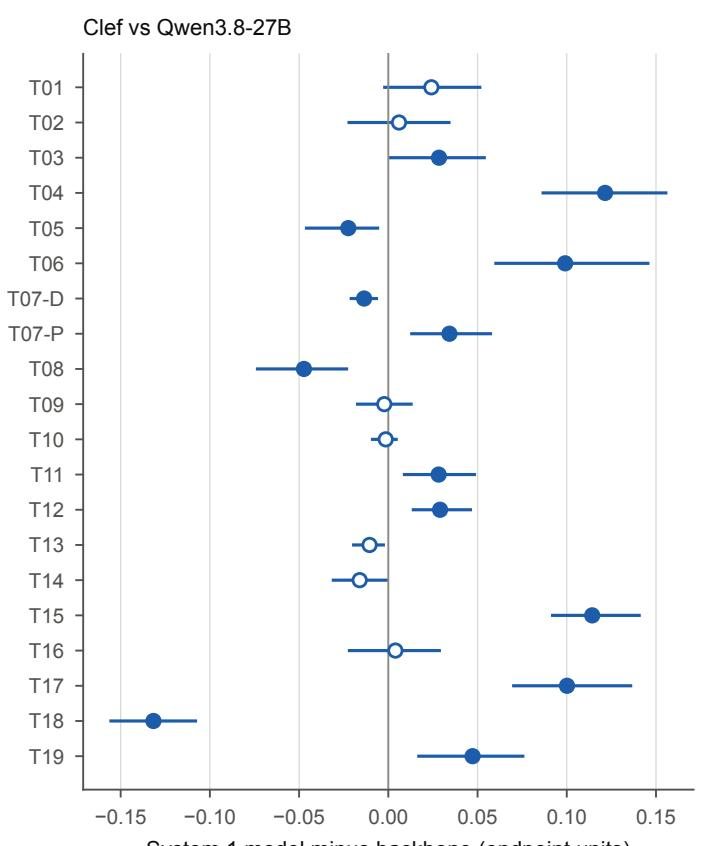

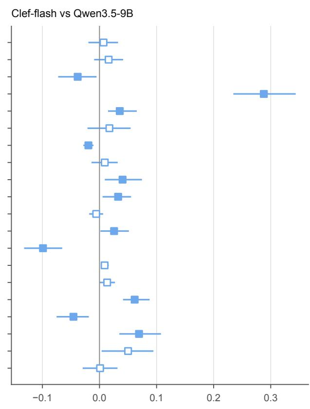  
System 1 model minus backbone (endpoint units)  
Figure S2 | Primary endpoint of each System 1 model minus that of its backbone on 20 tasks, with 95% bias-corrected and accelerated bootstrap CIs. Filled markers indicate Holm-adjusted P<0.05 within the task.

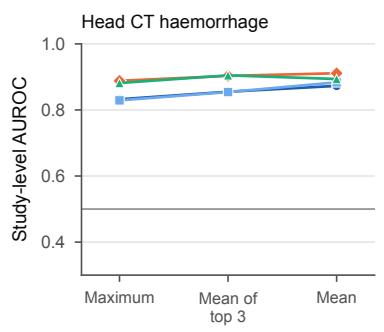

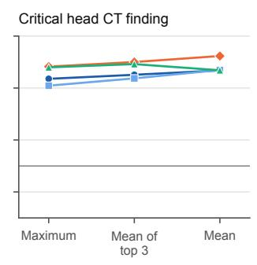

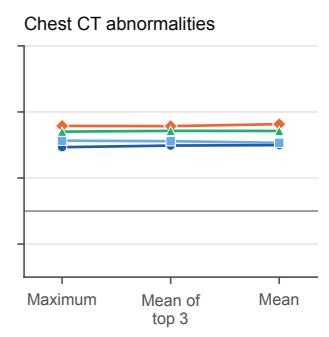

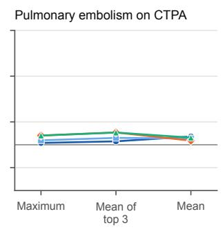

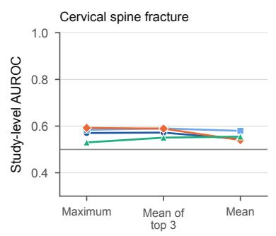

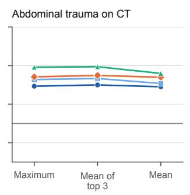

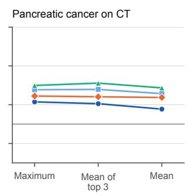

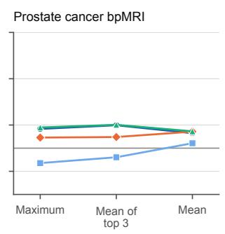  
Figure S3 | Study-level AUROC of volumetric tasks with yes-or-no questions, averaged over questions, when the slice probabilities of a study were combined by their maximum (primary rule), the mean of the three highest, or the mean over all slices. Each panel shows one task and each line one model.

Ta b le S 1 | Ta s ks Ta s ks 004 0 1 6 0 1 7 0 1 8 0 1 9 020 02 1 075 a re la n u a e ve rs i o n s of a n oth e r ta s k M CQ d e n otes m u lti le-c h o i ce u esti o n s VQA vis u a l u esti o n a n swe ri n g a n d E D e m e rge n cy d e pa rtm e n t.
<table><tr><td>No.</td><td>Task</td><td>Dataset</td><td>Tier</td><td>Input</td><td>Language</td><td>Cases</td><td>Questions</td></tr><tr><td>001</td><td>USMLE-style MCQ (MedQA, 4 options)</td><td> $\mathrm { M e d Q A } ^ { 2 3 }$ </td><td>Medical knowledge</td><td>text</td><td>English</td><td>1,273</td><td>1</td></tr><tr><td>002</td><td>Indian medical entrance exam MCQ (MedMCQA)</td><td> $\mathrm { M e d M C Q A } ^ { 3 8 }$ </td><td>Medical knowledge</td><td>text</td><td>English</td><td>4,183</td><td>1</td></tr><tr><td>003</td><td>Spanish healthcare specialisation exam MCQ (HEAD-QA)</td><td> $\mathrm { \Delta } \mathrm { H E A D - Q } \mathrm { \bar { A } } ^ { 3 9 }$ </td><td>Medical knowledge</td><td>text</td><td>English</td><td>2,675</td><td>1</td></tr><tr><td>004</td><td>Spanish healthcare specialisation exam MCQ, Spanish original (HEAD-QA)</td><td> $\mathrm { H E A D - Q A } ^ { 3 9 }$ </td><td>Medical knowledge</td><td>text</td><td>Spanish</td><td>2,675</td><td>1</td></tr><tr><td>005</td><td>Medical subsets of MMLU</td><td> $\mathrm { M M L U } ^ { 4 0 }$ </td><td>Medical knowledge</td><td>text</td><td>English</td><td>1,089</td><td>1</td></tr><tr><td>006</td><td>Health questions of MMLU-Pro</td><td> $\mathrm { M M L U - P r o } ^ { 4 1 }$ </td><td>Medical knowledge</td><td>text</td><td>English</td><td>818</td><td>1</td></tr><tr><td>007</td><td>Expert-level medical MCQ, text (MedXpertQA Text)</td><td> $\mathrm { M e d X p e r t Q A } ^ { 4 2 }$ </td><td>Medical knowledge</td><td>text</td><td>English</td><td>2,450</td><td>1</td></tr><tr><td>008 009</td><td>Hard clinical case MCQ (Medbullets op5)</td><td> $\mathrm { M e d b u l l e t s ~ o p } 5 ^ { 4 3 }$ </td><td>Medical knowledge</td><td>text</td><td>English</td><td>308</td><td>1</td></tr><tr><td>010</td><td>Pan-African medical MCQ (AfriMed-QA v2)</td><td> $\mathrm { A f r i M e d } { \cdot } \mathrm { Q A } \ \mathrm { \bar { v } } 2 ^ { 3 5 }$ </td><td>Medical knowledge</td><td>text</td><td>English</td><td>3,600</td><td>1</td></tr><tr><td>011</td><td>Multilingual clinical-case MCQ (MedExpQA)</td><td> $\mathrm { M e d E x p Q A } ^ { 3 6 }$ </td><td>Medical knowledge</td><td>text</td><td>Several</td><td>500</td><td>1</td></tr><tr><td>012</td><td>Korean healthcare licensing exam MCQ (KorMedMCQA)</td><td> $\mathrm { K o r M e d M C Q A } ^ { 4 4 }$ </td><td>Medical knowledge</td><td>text</td><td>Korean</td><td>3,009</td><td>1</td></tr><tr><td>013</td><td>Chinese national medical licensing exam MCQ (CMExam) Chinese medical licensing exam MCQ (MedQA Mainland)</td><td> $\mathrm { C M E x a m } ^ { 4 5 }$ </td><td>Medical knowledge</td><td>text</td><td>Chinese</td><td>6,607</td><td>1</td></tr><tr><td></td><td>014 Taiwanese medical licensing exam MCQ (MedQA Taiwan)</td><td> $\mathrm { M e d Q A } ^ { 2 3 }$ </td><td>Medical knowledge</td><td>text</td><td>Chinese</td><td>3,426</td><td>1</td></tr><tr><td></td><td>015 French pharmacy exam MCQ (FrenchMedMCQA)</td><td> $\mathrm { M e d Q A } ^ { 2 3 }$ </td><td>Medical knowledge</td><td>text</td><td>Chinese</td><td>1,413</td><td>1</td></tr><tr><td></td><td></td><td> $\mathrm { F r e n c h M e d M C Q A } ^ { 4 6 }$ </td><td>Medical knowledge</td><td>text</td><td>French</td><td>321</td><td>1</td></tr><tr><td>017</td><td>016 Medical subsets of MMLU in Arabic (Global-MMLU) Medical subsets of MMLU in Hindi (Global-MMLU)</td><td> $\mathrm { G l o b a l - M M L U ^ { 3 4 } }$ </td><td>Medical knowledge</td><td>text</td><td>Arabic</td><td>1,089</td><td>1</td></tr><tr><td></td><td>018 Medical subsets of MMLU in Japanese (Global-MMLU)</td><td> $\mathrm { G l o b a l - M M L U } ^ { 3 4 }$ </td><td>Medical knowledge</td><td>text</td><td>Hindi</td><td>1,089</td><td>1</td></tr><tr><td>019</td><td>Medical subsets of MMLU in Swahili (Global-MMLU)</td><td> $\mathrm { G l o b a l - M M L U ^ { 3 4 } }$ </td><td>Medical knowledge</td><td>text</td><td>Japanese</td><td>1,089</td><td>1</td></tr><tr><td>020</td><td>Medical subsets of MMLU in Yoruba (Global-MMLU)</td><td> $\mathrm { G l o b a l - M M L U } ^ { 3 4 }$   $\mathrm { G l o b a l - M M L U ^ { 3 4 } }$ </td><td>Medical knowledge</td><td>text</td><td>Swahili</td><td>1,089</td><td>1</td></tr><tr><td>021</td><td>Medical subsets of MMLU in German (Global-MMLU)</td><td> $\mathrm { G l o b a l - M M L U } ^ { 3 4 }$ </td><td>Medical knowledge</td><td>text</td><td>Yoruba</td><td>1,089</td><td>1</td></tr><tr><td>022</td><td>Drug class from ATC code (MedConceptsQA)</td><td> $\mathrm { M e d C o n c e p t s Q A ^ { 4 7 } }$ </td><td>Medical knowledge</td><td>text</td><td>German</td><td>1,089</td><td>1</td></tr><tr><td>023</td><td>Procedure description from ICD-9-CM code (MedConceptsQA)</td><td> $\mathrm { M e d C o n c e p t s Q A ^ { 4 7 } }$ </td><td>Medical knowledge</td><td>text</td><td>English</td><td>18,806</td><td>1</td></tr><tr><td>024</td><td>Chest radiograph report findings (OpenI / IU X-ray)</td><td></td><td>Medical knowledge</td><td>text</td><td>English</td><td>13,766</td><td>1</td></tr><tr><td>025</td><td></td><td> $\mathrm { O p e n I / I U X – r a y ^ { 4 8 } }$ </td><td>Text understanding</td><td>text</td><td>English</td><td>3,832</td><td>13</td></tr><tr><td>026</td><td>Chest CT findings from Japanese reports (CT-RATE-JPN) Modality and ICD-10 chapters of multilingual reports (PARROT)</td><td> $\mathrm { C T - R A T E - J P N } ^ { 4 9 ; 5 0 }$   $\mathrm { P A R R O T } ^ { 5 1 }$ </td><td>Text understanding</td><td>text</td><td>Japanese</td><td>150</td><td>18</td></tr><tr><td>027</td><td>Lung cancer T category from radiology reports (NTCIR-17 RR-TNM)</td><td> $\mathrm { N T C I R - 1 7 ~ R R { \cdot } T N M ^ { 3 1 } }$ </td><td>Text understanding</td><td>text</td><td>Several</td><td>2,738</td><td>13</td></tr><tr><td>028</td><td>BI-RADS category from breast imaging reports (Paraguay corpus)</td><td> $\mathrm { P a r a g u a y r e p o r t s } ^ { 5 2 }$ </td><td>Text understanding</td><td>text</td><td>Japanese</td><td>243</td><td>1</td></tr><tr><td>029</td><td>Pathologic T stage from a pathology report (TCGA)</td><td> $\mathrm { T C G A r e p o r t s } ^ { 3 2 ; 5 3 }$ </td><td>Text understanding</td><td>text</td><td>English</td><td>1,000</td><td>1</td></tr><tr><td>030</td><td>Clinical-trial report inference (NLI4CT, SemEval-2024 Task 2)</td><td> $\mathrm { N L I 4 C T } ^ { \bar { 5 4 } }$ </td><td>Text understanding</td><td>text</td><td>English English</td><td>1,000</td><td>1</td></tr><tr><td>031</td><td>Biomedical research QA (PubMedQA PQA-L)</td><td> $\mathrm { P u b M e d Q A P Q A – L } ^ { 5 5 }$ </td><td>Text understanding</td><td>text</td><td></td><td>500</td><td>1</td></tr><tr><td>032</td><td></td><td></td><td>Text understanding</td><td>text</td><td>English</td><td>500</td><td>1</td></tr><tr><td>033</td><td>Drug-drug interaction type (DDI-2013)</td><td> $\mathrm { D D I } { - } 2 0 1 3 ^ { 5 6 ; 5 7 }$ </td><td>Text understanding</td><td>text</td><td>English</td><td>1,000</td><td>1</td></tr><tr><td>034</td><td>Hallmarks of cancer in abstracts (HoC)</td><td> $_ \mathrm { H o C } 5 8$ </td><td>Text understanding</td><td>text</td><td>English</td><td>371</td><td>10</td></tr><tr><td>035</td><td>Public-health claim veracity (PUBHEALTH)</td><td> $\mathrm { P U B H E A L T H } ^ { 5 9 }$ </td><td>Text understanding</td><td>text</td><td>English</td><td>1,233</td><td>1</td></tr><tr><td>036</td><td>Consumer health question entailment (MEDIQA-RQE 2019)</td><td> $\mathrm { M E D I Q A { \cdot } R Q E } 2 0 1 9 ^ { 6 0 }$ </td><td>Text understanding</td><td>text</td><td>English</td><td>230</td><td>1</td></tr><tr><td>037</td><td>Rubric criterion judging (HealthBench meta-evaluation)</td><td> $\mathrm { H e a l t h B e n c h } ^ { 6 1 }$ </td><td>Text understanding</td><td>text</td><td>English</td><td>1,000</td><td>1</td></tr><tr><td>038</td><td>ED triage acuity (KTAS)</td><td> $\mathrm { K T A S } ^ { 2 8 }$ </td><td>Clinical judgement from text text</td><td></td><td>English</td><td>1,267</td><td>1</td></tr><tr><td></td><td>Diagnosis selection from a published case (DiagnosisArena)</td><td> $\mathrm { D i a g n o s i s A r e n a } ^ { 6 2 }$ </td><td>Clinical judgement from text text</td><td></td><td>English</td><td>915</td><td>1</td></tr><tr><td>039</td><td>ACMG/AMP five-tier variant classification (ClinGen)</td><td> $\mathrm { C l i n G e n } ^ { 6 3 }$ </td><td>Clinical judgement from text text</td><td></td><td>English</td><td>1,000</td><td>1</td></tr><tr><td>040</td><td>Patient-trial eligibility (TREC Clinical Trials 2021/2022)</td><td> $\mathrm { T R E C  C T } 2 0 2 1 / 2 2 ^ { 6 4 }$ </td><td>Clinical judgement from text text</td><td></td><td>English</td><td>500</td><td>1</td></tr><tr><td>041</td><td>Suicide-risk severity of a Reddit user (Reddit C-SSRS)</td><td> $\mathrm { R e d d i t } \mathsf { C } \mathsf { - S S R S } ^ { 6 5 }$ </td><td>Clinical judgement from text text</td><td></td><td>English</td><td>500</td><td>1</td></tr><tr><td>042</td><td>MRI safety status of a device (FDA AccessGUDID)</td><td> $\mathrm { F D A \ A c c e s s G U D I D ^ { 6 6 } }$ </td><td>Clinical judgement from text text</td><td></td><td>English</td><td>1,000</td><td>1</td></tr><tr><td>043</td><td>Radiograph body part</td><td> $\mathrm { U N I F E S P ~ b o d y ~ p a r t } ^ { 6 7 }$ </td><td>Image perception</td><td>2D</td><td>English</td><td>593</td><td>1</td></tr><tr><td>044</td><td>Chest radiograph view AP vs PA (NIH ChestX-ray14)</td><td> $\mathrm { N I H C h e s t X – r a y 1 4 ^ { 6 8 } }$ </td><td>Image perception</td><td>2D</td><td>English</td><td>716</td><td>1</td></tr><tr><td>045 Imaging modality (ROCOv2)</td><td></td><td> $\operatorname { R O C O v 2 } ^ { 6 9 }$ </td><td>Image perception</td><td>2D</td><td>English</td><td>794</td><td></td></tr><tr><td>No. Task</td><td></td><td>Dataset</td><td>Tier</td><td>Input</td><td>Language Cases</td><td></td><td>Questions</td></tr><tr><td></td><td>046 Mammography view CC vs MLO (CBIS-DDSM)</td><td>CBIS-DDSM70;71</td><td>Image perception</td><td>2D</td><td>English</td><td>645</td><td>1</td></tr><tr><td>047</td><td>CT contrast phase (series level, WAW-TACE)</td><td>WAW-TACE72</td><td>Image perception</td><td>3D</td><td>English</td><td>160</td><td>1</td></tr><tr><td>048</td><td>Contrast status and phase (single slice, WAW-TACE)</td><td>WAW-TACE72</td><td>Image perception</td><td>2D</td><td>English</td><td>960</td><td>2</td></tr><tr><td>049</td><td>Abdominal organ on CT, 3D (OrganMNIST3D)</td><td>OrganMNIST3D 73;74</td><td>Image perception</td><td>2D multi-view English</td><td></td><td>610</td><td>1</td></tr><tr><td>050</td><td>Abdominal organ on coronal CT (OrganCMNIST)</td><td>OrganCMNIST73;74</td><td>Image perception</td><td>2D</td><td>English</td><td>8,216</td><td>1</td></tr><tr><td>051</td><td>Abdominal organ on sagittal CT (OrganSMNIST)</td><td>OrganSMNIST 73;74</td><td>Image perception</td><td>2D</td><td>English</td><td>8,827</td><td>1</td></tr><tr><td>052</td><td>Marked vertebra level on CT (VerSe)</td><td>VerSe75</td><td>Image perception</td><td>2D multi-view English</td><td></td><td>219</td><td>2</td></tr><tr><td></td><td>053 MRI motion artefact severity (MR-ART)</td><td>MR-ART76</td><td>Image perception</td><td>3D</td><td>English</td><td>436</td><td>1</td></tr><tr><td></td><td>054 Diagnostic image quality of low-dose CT (LDCTIQAC 2023)</td><td>LDCTIQAC 202377</td><td>Image perception</td><td>2D</td><td>English</td><td>1,000</td><td>1</td></tr><tr><td></td><td>055 Chest radiograph multi-label findings (NIH ChestX-ray14)</td><td>NIH ChestX-ray1468</td><td>2D image findings</td><td>2D</td><td>English</td><td>716</td><td>14</td></tr><tr><td></td><td>056 Pneumonia on paediatric chest radiographs (PneumoniaMNIST)</td><td>PneumoniaMNIST73;78</td><td>2D image findings</td><td>2D</td><td>English</td><td>624</td><td>1</td></tr><tr><td>057</td><td>Line and tube position on chest radiographs</td><td>RANZCR CLiP 68;79</td><td>2D image findings</td><td>2D</td><td>English</td><td>497</td><td>11</td></tr><tr><td>058</td><td>Paediatric bone-age band</td><td>RSNA bone age 80</td><td>2D image findings</td><td>2D</td><td>English</td><td>500</td><td>1</td></tr><tr><td>059</td><td>Knee osteoarthritis KL grade</td><td>OAI (Chen 2018) 81;82</td><td>2D image findings</td><td>2D</td><td>English</td><td>1,000</td><td>1</td></tr><tr><td>060 061</td><td>Lumbar degenerative stenosis grade</td><td>RSNA lumbar 202483</td><td>2D image findings</td><td>2D multi-view</td><td>English</td><td>1,000</td><td>5</td></tr><tr><td>062</td><td>Head CT haemorrhage and subtype (slice)</td><td>RSNA ICH 201984</td><td>2D image findings</td><td>2D</td><td>English</td><td>1,000</td><td>6</td></tr><tr><td></td><td>BI-RADS assessment from mammograms (CBIS-DDSM)</td><td>CBIS-DDSM70;71</td><td>2D image findings</td><td>2D multi-view</td><td>English</td><td>704</td><td>1</td></tr><tr><td>063 064</td><td>Breast density category (CBIS-DDSM)</td><td>CBIS-DDSM70;71</td><td>2D image findings</td><td>2D</td><td>English</td><td>643</td><td>1</td></tr><tr><td>065</td><td>Dermoscopic lesion diagnosis (HAM10000 / ISIC 2018 Task 3)</td><td>HAM1000085;86</td><td>2D image findings</td><td>2D</td><td>English</td><td>515</td><td>1</td></tr><tr><td>066</td><td>Dermoscopic lesion diagnosis (ISIC 2019)</td><td>ISIC 2019 86–88</td><td>2D image findings</td><td>2D</td><td>English</td><td>8,238</td><td>1</td></tr><tr><td>067</td><td>Melanoma vs other lesion (SIIM-ISIC 2020)</td><td>SIIM-ISIC 2020 89</td><td>2D image findings</td><td>2D</td><td>English</td><td>33,126</td><td>1</td></tr><tr><td>068</td><td>Diabetic retinopathy severity (IDRiD)</td><td>IDRiD90</td><td>2D image findings</td><td>2D</td><td>English</td><td>516</td><td>1</td></tr><tr><td>069</td><td>Diabetic retinopathy grade (RetinaMNIST)</td><td>RetinaMNIST73;91</td><td>2D image findings</td><td>2D</td><td>English</td><td>400</td><td>1</td></tr><tr><td>070</td><td>Retinal OCT diagnosis (OCTMNIST)</td><td>OCTMNIST73;78</td><td>2D image findings</td><td>2D</td><td>English</td><td>1,000</td><td>1</td></tr><tr><td>071</td><td>Colorectal H&amp;E tissue type (CRC-VAL-HE-7K)</td><td>CRC-VAL-HE-7K92</td><td>2D image findings</td><td>2D</td><td>English</td><td>900</td><td>1</td></tr><tr><td>072</td><td>Blood cell type (BloodMNIST)</td><td>BloodMNIST73;93</td><td>2D image findings</td><td>2D</td><td>English</td><td>3,421</td><td>1</td></tr><tr><td></td><td>12-lead ECG superclasses (PTB-XL, rendered as image)</td><td>PTB-XL94</td><td>2D image findings</td><td>2D</td><td>English</td><td>2,198</td><td>5</td></tr><tr><td></td><td>073 Radiology VQA, closed yes/no questions (VQA-RAD)</td><td>VQA-RAD95</td><td>2D image findings</td><td>text+image</td><td>English</td><td>251</td><td>1</td></tr><tr><td>075</td><td>074 Radiology VQA, closed yes/no questions (SLAKE)</td><td>SLAKE96</td><td>2D image findings</td><td>text+image</td><td>English</td><td>355</td><td>1</td></tr><tr><td></td><td>Radiology VQA in Chinese, closed yes/no questions (SLAKE)</td><td>SLAKE96</td><td>2D image findings</td><td>text+image</td><td>Chinese</td><td>347</td><td>1</td></tr><tr><td>076</td><td>Biomedical figure VQA (PMC-VQA)</td><td>PMC-VQA97</td><td>2D image findings</td><td>text+image</td><td>English</td><td>2,000</td><td>1</td></tr><tr><td>077 078</td><td>Expert-level medical MCQ with images (MedXpertQA MM)</td><td>MedXpertQA 42</td><td>2D image findings</td><td>text+image</td><td>English</td><td>2,000</td><td>1</td></tr><tr><td></td><td>Head CT haemorrhage and subtype (scan level, CQ500)</td><td>CQ50027</td><td>Volumetric findings</td><td>3D</td><td>English</td><td>81</td><td>6</td></tr><tr><td>079</td><td>Critical head CT finding (CQ500)</td><td>CQ500 27</td><td>Volumetric findings</td><td>3D</td><td>English</td><td>81</td><td>4</td></tr><tr><td>080</td><td>Chest CT multi-abnormality (CT-RATE)</td><td>CT-RATE50</td><td>Volumetric findings</td><td>3D</td><td>English</td><td>100</td><td>18</td></tr><tr><td>081</td><td>Pulmonary embolism on CTPA</td><td>RSNA PE 2020 24</td><td>Volumetric findings</td><td>3D</td><td>English</td><td>150</td><td>6</td></tr><tr><td>082</td><td>Cervical spine fracture on CT</td><td>RSNA C-spine 2022 25</td><td>Volumetric findings</td><td>3D</td><td>English</td><td>200</td><td>8</td></tr><tr><td>083</td><td>Traumatic abdominal organ injury on CT</td><td>RSNA trauma 2023 98</td><td>Volumetric findings</td><td>3D</td><td>English</td><td>200</td><td>8</td></tr><tr><td>084</td><td>Pancreatic ductal adenocarcinoma on contrast-enhanced CT (PANORAMA) PANORAMA99</td><td></td><td>Volumetric findings</td><td>3D</td><td>English</td><td>300</td><td>1</td></tr><tr><td>085</td><td>Clinically significant prostate cancer on bpMRI (PI-CAI)</td><td>PI-CAI26</td><td>Volumetric findings</td><td>3D</td><td>English</td><td>200</td><td>1</td></tr><tr><td></td><td>086 Rib fracture type (FractureMNIST3D, RibFrac)</td><td>FractureMNIST3D 73;100</td><td>Volumetric findings</td><td></td><td>2D multi-view English</td><td>240</td><td>1</td></tr></table>

Ta b le S2 | AU RO C pe r tas k a n d m od e l with 95% C I fro m 1 000 bootstra p resa m p les of cases. Refu sed o r fa i led q u esti o n s we re sco red as w ro n g with th e la be l p reva le n ce a s p ro ba b i l i ty.
<table><tr><td rowspan=1 colspan=10>No.Task                                Clef          Clef-flash    GPT-6 Luna Decisions    Jev 1.14</td></tr><tr><td rowspan=1 colspan=10>001MedQA (USMLE)              0.97 (0.96–0.97)0.92 (0.90–0.93)   0.98 (0.97–0.98)   0.99 (0.98–0.99)</td></tr><tr><td rowspan=1 colspan=10>002MedMCQA (India)             0.89 (0.89–0.90) 0.87 (0.86–0.88)   0.92 (0.92–0.93)   0.93 (0.93–0.94)</td></tr><tr><td rowspan=1 colspan=10>003HEAD-QA (English)            0.96 (0.95–0.96) 0.95 (0.94–0.95)   0.96 (0.96–0.97)   0.97 (0.96–0.97)</td></tr><tr><td rowspan=1 colspan=1>004</td><td rowspan=1 colspan=9>HEAD-QA (Spanish)           0.96 (0.95–0.97)0.95 (0.94–0.95)   0.97 (0.96–0.97)  0.97 (0.97–0.98)</td></tr><tr><td rowspan=1 colspan=1>005</td><td rowspan=1 colspan=9>MMLU medical                0.99 (0.98–0.99) 0.99 (0.98–0.99)   0.98 (0.98–0.99)   0.99 (0.98–0.99)</td></tr><tr><td rowspan=1 colspan=1>006</td><td rowspan=1 colspan=3>MMLU-Pro health              0.97 (0.96–0.97)</td><td rowspan=1 colspan=6>0.96 (0.95–0.97)   0.96 (0.94–0.96)   0.97 (0.96–0.98)</td></tr><tr><td rowspan=1 colspan=1>007</td><td rowspan=1 colspan=3>MedXpertQA text              0.72 (0.71–0.73)</td><td rowspan=1 colspan=4>0.63 (0.62–0.64)  0.76 (0.74–0.77)</td><td rowspan=1 colspan=2>0.77 (0.76–0.78)</td></tr><tr><td rowspan=1 colspan=1>008</td><td rowspan=1 colspan=3>Medbullets                    0.92 (0.90–0.94)</td><td rowspan=1 colspan=1>0.83 (</td><td rowspan=1 colspan=3>0.80–0.86)   0.94 (0.92–0.96)</td><td rowspan=1 colspan=2>0.94 (0.93–0.96)</td></tr><tr><td rowspan=1 colspan=1>009</td><td rowspan=1 colspan=3>AfriMed-QA                   0.94 (0.94–0.95)</td><td rowspan=1 colspan=1>0.92 (</td><td rowspan=1 colspan=3>0.91–0.93)   0.95 (0.95–0.96)</td><td rowspan=1 colspan=2>0.95 (0.95–0.96)</td></tr><tr><td rowspan=1 colspan=1>010</td><td rowspan=1 colspan=2>MedExpQA                    0.96 (</td><td rowspan=1 colspan=1>0.95–0.97)</td><td rowspan=1 colspan=4>0.92 (0.91–0.94)   0.96 (0.94–0.97)</td><td rowspan=1 colspan=2>0.96 (0.95–0.98)</td></tr><tr><td rowspan=1 colspan=1>011</td><td rowspan=1 colspan=2>KorMedMCQA                 0.96 (</td><td rowspan=1 colspan=1>0.96–0.97)</td><td rowspan=1 colspan=1>0.93 (</td><td rowspan=1 colspan=3>0.92–0.93)   0.99 (0.99–0.99)</td><td rowspan=1 colspan=2>0.98 (0.98–0.98)</td></tr><tr><td rowspan=1 colspan=1>012</td><td rowspan=1 colspan=2>CMExam (China)              0.97 (</td><td rowspan=1 colspan=1>0.97–0.97)</td><td rowspan=1 colspan=1>0.95 (</td><td rowspan=1 colspan=3>0.95–0.96)   0.97 (0.97–0.98)</td><td rowspan=1 colspan=2>0.98 (0.98–0.99)</td></tr><tr><td rowspan=1 colspan=1>013</td><td rowspan=1 colspan=2>MedQA Mainland              0.98 (</td><td rowspan=1 colspan=1>0.98–0.98)</td><td rowspan=1 colspan=1>0.96 (</td><td rowspan=1 colspan=3>0.96–0.97)   0.98 (0.97–0.98)</td><td rowspan=1 colspan=2>0.98 (0.98–0.99)</td></tr><tr><td rowspan=1 colspan=1>014 M</td><td rowspan=1 colspan=2>edQA Taiwan                0.97 (</td><td rowspan=1 colspan=1>0.96–0.98)</td><td rowspan=1 colspan=1>0.95 (</td><td rowspan=1 colspan=3>0.95–0.96)   0.98 (0.98–0.99)</td><td rowspan=1 colspan=2>0.98 (0.98–0.99)</td></tr><tr><td rowspan=1 colspan=1>015</td><td rowspan=1 colspan=2>FrenchMedMCQA              0.99 (</td><td rowspan=1 colspan=1>0.98–0.99)</td><td rowspan=1 colspan=1>0.97 (</td><td rowspan=1 colspan=1>0.95–0.98)</td><td rowspan=1 colspan=2>0.99 (0.98–1.00)</td><td rowspan=1 colspan=1>0.99 (</td><td rowspan=1 colspan=1>0.99–1.00)</td></tr><tr><td rowspan=1 colspan=1>016</td><td rowspan=1 colspan=2>MMLU medical (Arabic)        0.95 (</td><td rowspan=1 colspan=1>0.94–0.96)</td><td rowspan=1 colspan=1>0.93 (</td><td rowspan=1 colspan=1>0.92–0.94)</td><td rowspan=1 colspan=2>0.98 (0.97–0.98)</td><td rowspan=1 colspan=1>0.98 (</td><td rowspan=1 colspan=1>0.98–0.99)</td></tr><tr><td rowspan=1 colspan=1>017</td><td rowspan=1 colspan=2>MMLU medical (Hindi)        0.92 (</td><td rowspan=1 colspan=1>0.91–0.93)</td><td rowspan=1 colspan=1>0.84 (</td><td rowspan=1 colspan=3>0.83–0.86)   0.98 (0.97–0.98)</td><td rowspan=1 colspan=1>0.98 (</td><td rowspan=1 colspan=1>0.97–0.99)</td></tr><tr><td rowspan=1 colspan=1>018</td><td rowspan=1 colspan=2>MMLU medical (Japanese)     0.97 (</td><td rowspan=1 colspan=1>0.96–0.97)</td><td rowspan=1 colspan=1>0.96 (</td><td rowspan=1 colspan=1>0.95–0.97)</td><td rowspan=1 colspan=2>0.98 (0.97–0.98)</td><td rowspan=1 colspan=1>0.98 (</td><td rowspan=1 colspan=1>0.98–0.99)</td></tr><tr><td rowspan=1 colspan=1>019</td><td rowspan=1 colspan=2>MMLU medical (Swahili)       0.90 (</td><td rowspan=1 colspan=1>0.89–0.92)</td><td rowspan=1 colspan=1>0.85 (</td><td rowspan=1 colspan=1>0.83–0.86)</td><td rowspan=1 colspan=2>0.96 (0.95–0.96)</td><td rowspan=1 colspan=1>0.96 (</td><td rowspan=1 colspan=1>0.95–0.97)</td></tr><tr><td rowspan=1 colspan=1>020</td><td rowspan=1 colspan=2>MMLU medical (Yoruba)       0.85 (</td><td rowspan=1 colspan=1>0.83–0.86)</td><td rowspan=1 colspan=1>0.79 (</td><td rowspan=1 colspan=1>0.77–0.81)</td><td rowspan=1 colspan=2>0.91 (0.90–0.93)</td><td rowspan=1 colspan=1>0.93 (</td><td rowspan=1 colspan=1>0.92–0.94)</td></tr><tr><td rowspan=1 colspan=1>021</td><td rowspan=1 colspan=2>MMLU medical (German)      0.98 (</td><td rowspan=1 colspan=1>0.97–0.98)</td><td rowspan=1 colspan=1>0.97 (</td><td rowspan=1 colspan=1>0.96–0.98)</td><td rowspan=1 colspan=2>0.98 (0.97–0.99)</td><td rowspan=1 colspan=1>0.99 (</td><td rowspan=1 colspan=1>0.98–0.99)</td></tr><tr><td rowspan=1 colspan=1>022</td><td rowspan=1 colspan=2>ATC drug class                0.53 (</td><td rowspan=1 colspan=1>0.52–0.54)</td><td rowspan=1 colspan=1>0.61 (</td><td rowspan=1 colspan=1>0.60–0.62)</td><td rowspan=1 colspan=2>0.86 (0.86–0.87)</td><td rowspan=1 colspan=1>0.73 (</td><td rowspan=1 colspan=1>0.73–0.74)</td></tr><tr><td rowspan=1 colspan=1>023</td><td rowspan=1 colspan=2>ICD-9 procedure              0.65 (</td><td rowspan=1 colspan=1>0.64–0.65)</td><td rowspan=1 colspan=1>0.64 (</td><td rowspan=1 colspan=1>0.63–0.65)</td><td rowspan=1 colspan=2>0.81 (0.80–0.81)</td><td rowspan=1 colspan=1>0.72 (</td><td rowspan=1 colspan=1>0.71–0.72)</td></tr><tr><td rowspan=1 colspan=1>024</td><td rowspan=1 colspan=1>CXR report findings</td><td rowspan=1 colspan=1>1.00 (</td><td rowspan=1 colspan=1>0.99–1.00)</td><td rowspan=1 colspan=1>1.00 (</td><td rowspan=1 colspan=1>0.99–1.00)</td><td rowspan=1 colspan=2>0.99 (0.99–0.99)</td><td rowspan=1 colspan=1>1.00 (</td><td rowspan=1 colspan=1>1.00–1.00)</td></tr><tr><td rowspan=1 colspan=1>025</td><td rowspan=1 colspan=1>Chest CT report findings</td><td rowspan=1 colspan=1>0.99 (</td><td rowspan=1 colspan=1>0.98–0.99)</td><td rowspan=1 colspan=1>0.99 (</td><td rowspan=1 colspan=1>0.98–0.99)</td><td rowspan=1 colspan=1>0.96 (0.96–0.97)</td><td rowspan=1 colspan=1></td><td rowspan=1 colspan=1>0.99 (</td><td rowspan=1 colspan=1>0.99–0.99)</td></tr><tr><td rowspan=1 colspan=1>026</td><td rowspan=1 colspan=1>Multilingual report coding</td><td rowspan=1 colspan=1>0.96 (</td><td rowspan=1 colspan=1>0.96–0.97)</td><td rowspan=1 colspan=1>0.94 (</td><td rowspan=1 colspan=1>0.93–0.94)</td><td rowspan=1 colspan=1>0.94 (0.94–0.95)</td><td rowspan=1 colspan=1></td><td rowspan=1 colspan=1>0.96 (</td><td rowspan=1 colspan=1>0.96–0.97)</td></tr><tr><td rowspan=1 colspan=1>027</td><td rowspan=1 colspan=2>Lung cancer T from report     0.94 (</td><td rowspan=1 colspan=1>0.92–0.96)</td><td rowspan=1 colspan=1>0.92 (</td><td rowspan=1 colspan=1>0.90–0.94)</td><td rowspan=1 colspan=2>0.92 (0.89–0.95)</td><td rowspan=1 colspan=1>0.95 (</td><td rowspan=1 colspan=1>0.93–0.97)</td></tr><tr><td rowspan=1 colspan=1>028</td><td rowspan=1 colspan=2>BI-RADS from report          0.88 (</td><td rowspan=1 colspan=1>0.87–0.90)</td><td rowspan=1 colspan=1>0.84 (</td><td rowspan=1 colspan=1>0.82–0.86)</td><td rowspan=1 colspan=2>0.86 (0.82–0.89)</td><td rowspan=1 colspan=2>0.81 (0.77–0.84)</td></tr><tr><td rowspan=1 colspan=1>029</td><td rowspan=1 colspan=2>pT stage from pathology report0.96 (</td><td rowspan=1 colspan=1>0.95–0.97)</td><td rowspan=1 colspan=1>0.95 (</td><td rowspan=1 colspan=1>0.94–0.96)</td><td rowspan=1 colspan=2>0.96 (0.94–0.97)</td><td rowspan=1 colspan=2>0.96 (0.95–0.97)</td></tr><tr><td rowspan=1 colspan=1>030</td><td rowspan=1 colspan=2>Trial report inference          0.90 (</td><td rowspan=1 colspan=1>0.88–0.93)</td><td rowspan=1 colspan=1>0.87 (</td><td rowspan=1 colspan=1>0.84–0.90)</td><td rowspan=1 colspan=2>0.86 (0.83–0.90)</td><td rowspan=1 colspan=2>0.92 (0.90–0.95)</td></tr><tr><td rowspan=1 colspan=1>031</td><td rowspan=1 colspan=2>PubMedQA                    0.81 (</td><td rowspan=1 colspan=1>0.78–0.84)</td><td rowspan=1 colspan=1>0.83 (</td><td rowspan=1 colspan=1>0.79–0.86)</td><td rowspan=1 colspan=2>0.79 (0.76–0.83)</td><td rowspan=1 colspan=2>0.84 (0.81–0.87)</td></tr><tr><td rowspan=1 colspan=1>032</td><td rowspan=1 colspan=1>Drug-drug interaction</td><td rowspan=1 colspan=1>0.89 (</td><td rowspan=1 colspan=1>0.88–0.91)</td><td rowspan=1 colspan=1>0.90 (</td><td rowspan=1 colspan=1>0.89–0.91)</td><td rowspan=1 colspan=2>0.87 (0.85–0.89)</td><td rowspan=1 colspan=2>0.93 (0.92–0.94)</td></tr><tr><td rowspan=1 colspan=1>033</td><td rowspan=1 colspan=1>Hallmarks of cancer</td><td rowspan=1 colspan=1>0.94 (</td><td rowspan=1 colspan=1>0.93–0.95)</td><td rowspan=1 colspan=1>0.94 (</td><td rowspan=1 colspan=1>0.93–0.95)</td><td rowspan=1 colspan=2>0.89 (0.87–0.91)</td><td rowspan=1 colspan=2>0.94 (0.93–0.94)</td></tr><tr><td rowspan=1 colspan=1>034</td><td rowspan=1 colspan=1>Public-health claims</td><td rowspan=1 colspan=1>0.85 (</td><td rowspan=1 colspan=1>0.83–0.87)</td><td rowspan=1 colspan=1>0.81 (</td><td rowspan=1 colspan=1>0.78–0.83)</td><td rowspan=1 colspan=2>0.81 (0.79–0.84)</td><td rowspan=1 colspan=2>0.82 (0.80–0.84)</td></tr><tr><td rowspan=1 colspan=1>035</td><td rowspan=1 colspan=1>Question entailment</td><td rowspan=1 colspan=1>0.88 (</td><td rowspan=1 colspan=1>0.84–0.92)</td><td rowspan=1 colspan=1>0.88 (</td><td rowspan=1 colspan=1>0.84–0.92)</td><td rowspan=1 colspan=2>0.90 (0.86–0.94)</td><td rowspan=1 colspan=2>0.92 (0.88–0.95)</td></tr><tr><td rowspan=1 colspan=1>036</td><td rowspan=1 colspan=1>Rubric judging</td><td rowspan=1 colspan=1>0.83 (</td><td rowspan=1 colspan=1>0.79–0.86)</td><td rowspan=1 colspan=1>0.73 (</td><td rowspan=1 colspan=1>0.69–0.77)</td><td rowspan=1 colspan=4>0.78 (0.75–0.82)   0.84 (0.81–0.88)</td></tr><tr><td rowspan=1 colspan=1>037</td><td rowspan=1 colspan=1>ED triage (KTAS)</td><td rowspan=1 colspan=1>0.80 (</td><td rowspan=1 colspan=1>0.78–0.81)</td><td rowspan=1 colspan=1>0.75 (</td><td rowspan=1 colspan=5>0.73–0.77)   0.82 (0.80–0.84)   0.80 (0.78–0.82)</td></tr><tr><td rowspan=1 colspan=1>038</td><td rowspan=1 colspan=1>Diagnosis from case</td><td rowspan=1 colspan=1>0.83 (</td><td rowspan=1 colspan=1>0.81–0.85)</td><td rowspan=1 colspan=1>0.74 (</td><td rowspan=1 colspan=5>0.71–0.76)   0.85 (0.83–0.87)   0.82 (0.80–0.84)</td></tr><tr><td rowspan=1 colspan=1>039</td><td rowspan=1 colspan=2>ACMG variant class            0.88 (</td><td rowspan=1 colspan=1>0.87–0.89)</td><td rowspan=1 colspan=1>0.76 (</td><td rowspan=1 colspan=5>0.74–0.78)   0.96 (0.95–0.96)   0.93 (0.92–0.94)</td></tr><tr><td rowspan=1 colspan=1>040</td><td rowspan=1 colspan=2>Trial eligibility                0.85 (</td><td rowspan=1 colspan=1>0.83–0.88)</td><td rowspan=1 colspan=1>0.85 (</td><td rowspan=1 colspan=5>0.82–0.88)   0.83 (0.80–0.86)   0.87 (0.84–0.90)</td></tr><tr><td rowspan=1 colspan=1>041</td><td rowspan=1 colspan=2>Suicide-risk level              0.77 (</td><td rowspan=1 colspan=1>0.75–0.80)</td><td rowspan=1 colspan=1>0.75 (</td><td rowspan=1 colspan=5>0.73–0.78)   0.81 (0.78–0.83)   0.82 (0.79–0.84)</td></tr><tr><td rowspan=1 colspan=1>042</td><td rowspan=1 colspan=2>MRI safety of a device         0.58 (</td><td rowspan=1 colspan=1>0.56–0.61)</td><td rowspan=1 colspan=1>0.51 (</td><td rowspan=1 colspan=5>0.49–0.54)   0.51 (0.49–0.53)   0.66 (0.64–0.68)</td></tr><tr><td rowspan=1 colspan=1>043</td><td rowspan=1 colspan=2>Radiograph body part         0.95 (</td><td rowspan=1 colspan=1>0.94–0.96)</td><td rowspan=1 colspan=1>0.96 (</td><td rowspan=1 colspan=5>0.96–0.97)   0.96 (0.95–0.96)   0.95 (0.95–0.96)</td></tr><tr><td rowspan=1 colspan=1>044</td><td rowspan=1 colspan=2>CXR view AP/PA              0.98 (</td><td rowspan=1 colspan=1>0.97–0.99)</td><td rowspan=1 colspan=1>0.99 (</td><td rowspan=1 colspan=5>0.98–0.99)   0.89 (0.86–0.91)   0.99 (0.99–0.99)</td></tr><tr><td rowspan=1 colspan=1>045 I</td><td rowspan=1 colspan=3>maging modality              1.00 (1.00–1.00)</td><td rowspan=1 colspan=1>1.00 (</td><td rowspan=1 colspan=5>1.00–1.00)   0.99 (0.99–1.00)   1.00 (1.00–1.00)</td></tr></table>

<table><tr><td>No. Task</td><td></td><td>Clef</td><td>Clef-flash</td><td>GPT-6 Luna Decisions</td><td>Jev 1.14</td></tr><tr><td></td><td>046 Mammography view</td><td>0.92 (0.90–0.94)</td><td>0.96 (0.95–0.98)</td><td>0.96 (0.95–0.98)</td><td>0.99 (0.98–0.99)</td></tr><tr><td>047</td><td>CT contrast phase (series)</td><td>0.82 (0.79–0.85)</td><td>0.82 (0.78–0.86)</td><td>0.90 (0.87–0.93)</td><td>0.90 (0.87–0.92)</td></tr><tr><td>048</td><td>CT contrast phase (slice)</td><td>0.75 (0.73–0.77)</td><td>0.73 (0.70–0.75)</td><td>0.85 (0.83–0.86)</td><td>0.84 (0.82–0.86)</td></tr><tr><td>049</td><td>Abdominal organ (3D)</td><td>0.83 (0.82–0.85)</td><td>0.84 (0.83–0.86)</td><td>0.82 (0.81–0.84)</td><td>0.84 (0.82–0.85)</td></tr><tr><td></td><td>050 Abdominal organ (coronal)</td><td>0.78 (0.78–0.79)</td><td>0.84 (0.84–0.84)</td><td>0.71 (0.70–0.71)</td><td>0.82 (0.82–0.83)</td></tr><tr><td></td><td>051 Abdominal organ (sagittal)</td><td>0.72 (0.72–0.73)</td><td>0.80 (0.80–0.81)</td><td>0.68 (0.67–0.68)</td><td>0.80 (0.80–0.81)</td></tr><tr><td></td><td>052 Vertebra level</td><td>0.94 (0.93–0.95)</td><td>0.94 (0.93–0.95)</td><td>0.97 (0.96–0.97)</td><td>0.95 (0.94–0.96)</td></tr><tr><td></td><td>053 MRI motion artefact</td><td>0.71 (0.69–0.74)</td><td>0.71 (0.68–0.73)</td><td>0.70 (0.67–0.72)</td><td>0.76 (0.73–0.78)</td></tr><tr><td></td><td>054 Low-dose CT quality</td><td>0.72 (0.70–0.74)</td><td>0.62 (0.60–0.65)</td><td>0.76 (0.74–0.78)</td><td>0.78 (0.77–0.80)</td></tr><tr><td>055</td><td>CXR findings</td><td>0.72 (0.69–0.74)</td><td>0.77 (0.75–0.79)</td><td>0.73 (0.71–0.76)</td><td>0.77 (0.75–0.79)</td></tr><tr><td></td><td>056 Paediatric pneumonia</td><td>0.95 (0.93–0.96)</td><td>0.96 (0.94–0.97)</td><td>0.95 (0.93–0.96)</td><td>0.93 (0.91–0.95)</td></tr><tr><td></td><td>057 Line and tube position</td><td>0.78 (0.76–0.79)</td><td>0.79 (0.78–0.80)</td><td>0.65 (0.63–0.67)</td><td>0.81 (0.79–0.82)</td></tr><tr><td>058</td><td>Bone-age band</td><td>0.75 (0.73–0.77)</td><td>0.73 (0.71–0.75)</td><td>0.81 (0.79–0.83)</td><td>0.77 (0.75–0.78)</td></tr><tr><td>059</td><td>Knee OA KL grade</td><td>0.66 (0.64–0.68)</td><td>0.69 (0.67–0.70)</td><td>0.66 (0.63–0.69)</td><td>0.64 (0.62–0.66)</td></tr><tr><td></td><td>060 Lumbar stenosis grade</td><td>0.68 (0.66–0.70)</td><td>0.66 (0.65–0.68)</td><td>0.81 (0.80–0.83)</td><td>0.73 (0.71–0.75)</td></tr><tr><td>061</td><td>Head CT haemorrhage (slice)</td><td>0.76 (0.74–0.78)</td><td>0.75 (0.73–0.77)</td><td>0.76 (0.74–0.78)</td><td>0.79 (0.77–0.80)</td></tr><tr><td></td><td>062 BI-RADS from mammogram</td><td>0.62 (0.59–0.65)</td><td>0.61 (0.59–0.65)</td><td>0.68 (0.65–0.70)</td><td>0.69 (0.65–0.72)</td></tr><tr><td>063</td><td>Breast density</td><td>0.71 (0.68–0.73)</td><td>0.68 (0.65–0.71)</td><td>0.70 (0.67–0.73)</td><td>0.66 (0.63–0.69)</td></tr><tr><td></td><td>064 Dermoscopy (HAM10000)</td><td>0.87 (0.85–0.89)</td><td>0.87 (0.85–0.89)</td><td>0.83 (0.81–0.85)</td><td>0.90 (0.89–0.92)</td></tr><tr><td></td><td>065 Dermoscopy (ISIC 2019)</td><td>0.81 (0.81–0.82)</td><td>0.82 (0.82–0.83)</td><td>0.78 (0.77–0.79)</td><td>0.84 (0.83–0.84)</td></tr><tr><td></td><td>066 Melanoma (ISIC 2020)</td><td>0.76 (0.74–0.78)</td><td>0.78 (0.76–0.80)</td><td>0.56 (0.53–0.59)</td><td>0.75 (0.73–0.77)</td></tr><tr><td>067</td><td>DR severity (IDRiD)</td><td>0.75 (0.72–0.78)</td><td>0.82 (0.80–0.85)</td><td>0.61 (0.58–0.64)</td><td>0.83 (0.81–0.85)</td></tr><tr><td>068</td><td>DR grade (RetinaMNIST)</td><td>0.65 (0.61–0.69)</td><td>0.70 (0.66–0.74)</td><td>0.57 (0.54–0.61)</td><td>0.86 (0.83–0.89)</td></tr><tr><td>069</td><td>Retinal OCT diagnosis</td><td>0.97 (0.97–0.98)</td><td>0.98 (0.98–0.99)</td><td>0.92 (0.90–0.93)</td><td>1.00 (1.00–1.00)</td></tr><tr><td></td><td>070 Colorectal tissue type</td><td>0.98 (0.97–0.98)</td><td>0.96 (0.95–0.97)</td><td>0.87 (0.86–0.89)</td><td>0.96 (0.95–0.97)</td></tr><tr><td>071</td><td>Blood cell type</td><td>0.97 (0.97–0.98)</td><td>0.98 (0.98–0.98)</td><td>0.86 (0.85–0.87)</td><td>0.99 (0.98–0.99)</td></tr><tr><td></td><td>072 ECG superclasses</td><td>0.73 (0.72–0.75)</td><td>0.67 (0.66–0.68)</td><td>0.74 (0.73–0.75)</td><td>0.68 (0.66–0.69)</td></tr><tr><td></td><td>073 VQA-RAD yes/no</td><td>0.91 (0.87–0.94)</td><td>0.88 (0.84–0.92)</td><td>0.87 (0.82–0.91)</td><td>0.94 (0.91–0.96)</td></tr><tr><td></td><td>074 SLAKE yes/no</td><td>0.94 (0.92–0.96)</td><td>0.92 (0.89–0.95)</td><td>0.90 (0.87–0.94)</td><td>0.97 (0.96–0.99)</td></tr><tr><td>075</td><td>SLAKE yes/no (Chinese)</td><td>0.96 (0.94–0.98)</td><td>0.92 (0.89–0.95)</td><td>0.93 (0.90–0.96)</td><td>0.99 (0.98–0.99)</td></tr><tr><td>076 PMC-VQA</td><td></td><td>0.84 (0.83–0.86)</td><td>0.83 (0.82–0.85)</td><td>0.82 (0.81–0.84)</td><td>0.86 (0.85–0.88)</td></tr><tr><td>077</td><td>MedXpertQA multimodal</td><td>0.72 (0.70–0.73)</td><td>0.64 (0.63–0.66)</td><td>0.79 (0.78–0.81)</td><td>0.79 (0.78–0.81)</td></tr><tr><td></td><td>078 Head CT haemorrhage</td><td>0.83 (0.75–0.89)</td><td>0.85 (0.80–0.91)</td><td>0.90 (0.85–0.94)</td><td>0.89 (0.84–0.93)</td></tr><tr><td>079</td><td>Critical head CT finding</td><td>0.84 (0.78–0.88)</td><td>0.79 (0.74–0.85)</td><td>0.88 (0.83–0.92)</td><td>0.87 (0.83–0.90)</td></tr><tr><td></td><td>080 Chest CT abnormalities</td><td>0.69 (0.66–0.73)</td><td>0.71 (0.68–0.74)</td><td>0.76 (0.73–0.79)</td><td>0.74 (0.71–0.77)</td></tr><tr><td></td><td>081 Pulmonary embolism on CTPA</td><td>0.51 (0.45–0.56)</td><td>0.52 (0.45–0.59)</td><td>0.54 (0.49–0.59)</td><td>0.54 (0.49–0.59)</td></tr><tr><td></td><td>082 Cervical spine fracture</td><td>0.57 (0.51–0.63)</td><td>0.58 (0.53–0.64)</td><td>0.59 (0.54–0.65)</td><td>0.53 (0.47–0.60)</td></tr><tr><td></td><td>083 Abdominal trauma on CT</td><td>0.69 (0.64–0.74)</td><td>0.73 (0.68–0.77)</td><td>0.74 (0.68–0.79)</td><td>0.79 (0.75–0.83)</td></tr><tr><td></td><td>084 Pancreatic cancer on CT</td><td>0.61 (0.55–0.68)</td><td>0.68 (0.61–0.74)</td><td>0.64 (0.58–0.71)</td><td>0.70 (0.64–0.75)</td></tr><tr><td></td><td>085 Prostate cancer bpMRI</td><td>0.58 (0.50–0.66)</td><td>0.44 (0.36–0.51)</td><td>0.55 (0.46–0.63)</td><td>0.59 (0.51–0.67)</td></tr><tr><td></td><td>086 Rib fracture type</td><td>0.41 (0.37–0.46)</td><td>0.48 (0.43–0.53)</td><td>0.42 (0.37–0.47)</td><td>0.44 (0.39–0.49)</td></tr></table>

Ta b le S3 | Ra n d o m -efects m ea n pe r ca pa b i l ity ti e r with 95% C I . Best d e n otes th e best of th e fo u r m od e ls o n ea c h ta s k.
<table><tr><td>Tier</td><td>Tasks Metric</td><td></td><td>Clef</td><td>Clef-flash</td><td>GPT-6 Luna Decisions</td><td>Jev 1.14</td><td>Best</td></tr><tr><td rowspan="2">Medical knowledge</td><td rowspan="2"></td><td>16 AUROC</td><td>0.90 (0.83–0.96)</td><td>0.88 (0.81–0.94)</td><td>0.94 (0.91–0.96)</td><td>0.93 (0.89–0.97)</td><td>0.94 (0.92–0.97)</td></tr><tr><td>Chance-corrected BA</td><td>0.65 (0.47–0.83)</td><td>0.60 (0.44–0.75)</td><td>0.73 (0.63–0.84)</td><td>0.72 (0.57–0.87)</td><td>0.74 (0.63–0.85)</td></tr><tr><td rowspan="2">Text understanding</td><td></td><td>13 AUROC</td><td>0.92 (0.90–0.93)</td><td>0.89 (0.87–0.92)</td><td>0.89 (0.87–0.92)</td><td>0.92 (0.90–0.94)</td><td>0.93 (0.91–0.94)</td></tr><tr><td></td><td>Chance-corrected BA 0.63 (0.54–0.73)</td><td></td><td>0.56 (0.43–0.69)</td><td>0.61 (0.51–0.71)</td><td>0.65 (0.55–0.75)</td><td>0.66 (0.57–0.75)</td></tr><tr><td rowspan="2">Clinical judgement from text</td><td></td><td>6 AUROC</td><td>0.79 (0.70–0.87)</td><td>0.73 (0.64–0.81)</td><td>0.80 (0.66–0.94)</td><td>0.82 (0.73–0.90)</td><td>0.83 (0.73–0.93)</td></tr><tr><td></td><td>Chance-corrected BA 0.34 (0.14–0.55)</td><td></td><td>0.24 (0.10–0.38)</td><td>0.41 (0.10–0.73)</td><td>0.42 (0.12–0.72)</td><td>0.44 (0.12–0.77)</td></tr><tr><td rowspan="2">Image perception</td><td></td><td>12 AUROC</td><td>0.84 (0.77–0.92)</td><td>0.85 (0.79–0.91)</td><td>0.85 (0.76–0.93)</td><td>0.88 (0.83–0.94)</td><td>0.89 (0.84–0.94)</td></tr><tr><td></td><td>Chance-corrected BA 0.38 (0.31–0.45)</td><td></td><td>0.40 (0.31–0.48)</td><td>0.41 (0.24–0.59)</td><td>0.46 (0.26–0.66)</td><td>0.45 (0.28–0.61)</td></tr><tr><td rowspan="2">2D image findings</td><td></td><td>22 AUROC</td><td>0.80 (0.75–0.84)</td><td>0.80 (0.75–0.84)</td><td>0.77 (0.73–0.80)</td><td>0.83 (0.79–0.86)</td><td>0.84 (0.81–0.87)</td></tr><tr><td></td><td>Chance-corrected BA 0.28 (0.18–0.38)</td><td></td><td>0.29 (0.18–0.40)</td><td>0.26 (0.16–0.35)</td><td>0.39 (0.24–0.53)</td><td>0.40 (0.27–0.53)</td></tr><tr><td rowspan="2">Volumetric findings</td><td></td><td>9 AUROC</td><td>0.64 (0.55–0.73)</td><td>0.64 (0.56–0.73)</td><td>0.67 (0.56–0.78)</td><td>0.68 (0.58–0.78)</td><td>0.69 (0.60–0.79)</td></tr><tr><td></td><td>Chance-corrected BA 0.13 (0.05–0.21) 0.14 (0.04–0.23)</td><td></td><td></td><td>0.14 (0.07–0.22)</td><td>0.16 (0.04–0.27)</td><td>0.20 (0.09–0.32)</td></tr></table>

Ta b le S4 | Syste m 1 m od e l a ga i n st th e ge n e rative m od e l of its fa m i ly o n th e sa m e ca ses 1 00 pe r ta s k a n d 50 fo r C lef a n d Qwe n 3 . 8-27 B . BA d e n otes ba la n ced a cc u ra cy U S D/1 k th e cost i n U S d o l la rs pe r 1 000 req u ests S 1 th e Syste m 1 m od e l a n d ge n th e ge n e rative m od e l
<table><tr><td>No. Task</td><td></td><td>System 1</td><td>Generative</td><td>BA S1 BA gen.</td><td></td><td>USD/1k S1 USD/1k gen.</td><td></td></tr><tr><td>001</td><td>MedQA (USMLE)</td><td>Clef</td><td>Qwen3.8-27B</td><td>0.84</td><td>0.92</td><td>0.08</td><td>1.40</td></tr><tr><td>027</td><td>Lung cancer T from report</td><td>Clef</td><td>Qwen3.8-27B</td><td>0.65</td><td>0.83</td><td>0.11</td><td>1.62</td></tr><tr><td>028</td><td>BI-RADS from report</td><td>Clef</td><td>Qwen3.8-27B</td><td>0.54</td><td>0.35</td><td>0.12</td><td>1.64</td></tr><tr><td>029</td><td>pT stage from pathology report Clef</td><td></td><td>Qwen3.8-27B</td><td>0.85</td><td>0.86</td><td>0.32</td><td>0.96</td></tr><tr><td>030</td><td>Trial report inference</td><td>Clef</td><td>Qwen3.8-27B</td><td>0.90</td><td>0.89</td><td>0.15</td><td>1.27</td></tr><tr><td>031</td><td>PubMedQA</td><td>Clef</td><td>Qwen3.8-27B</td><td>0.57</td><td>0.70</td><td>0.12</td><td>1.03</td></tr><tr><td>032</td><td>Drug-drug interaction</td><td>Clef</td><td>Qwen3.8-27B</td><td>0.80</td><td>0.88</td><td>0.08</td><td>1.15</td></tr><tr><td>036</td><td>Rubric judging</td><td>Clef</td><td>Qwen3.8-27B</td><td>0.82</td><td>0.64</td><td>0.26</td><td>1.70</td></tr><tr><td>037</td><td>ED triage (KTAS)</td><td>Clef</td><td>Qwen3.8-27B</td><td>0.52</td><td>0.54</td><td>0.08</td><td>2.11</td></tr><tr><td>038</td><td>Diagnosis from case</td><td>Clef</td><td>Qwen3.8-27B</td><td>0.55</td><td>0.61</td><td>0.14</td><td>2.21</td></tr><tr><td>039</td><td>ACMG variant class</td><td>Clef</td><td>Qwen3.8-27B</td><td>0.39</td><td>0.72</td><td>0.08</td><td>2.45</td></tr><tr><td>040</td><td>Trial eligibility</td><td>Clef</td><td>Qwen3.8-27B</td><td>0.65</td><td>0.66</td><td>0.24</td><td>1.69</td></tr><tr><td>041</td><td>Suicide-risk level</td><td>Clef</td><td>Qwen3.8-27B</td><td>0.48</td><td>0.62</td><td>0.44</td><td>1.82</td></tr><tr><td>042</td><td>MRI safety of a device</td><td>Clef</td><td>Qwen3.8-27B</td><td>0.25</td><td>0.25</td><td>0.07</td><td>0.72</td></tr><tr><td>043</td><td>Radiograph body part</td><td>Clef</td><td>Qwen3.8-27B</td><td>0.77</td><td>0.77</td><td>0.27</td><td>0.74</td></tr><tr><td>045</td><td>Imaging modality</td><td>Clef</td><td>Qwen3.8-27B</td><td>0.97</td><td>0.97</td><td>0.17</td><td>0.53</td></tr><tr><td>046</td><td>Mammography view</td><td>Clef</td><td>Qwen3.8-27B</td><td>0.61</td><td>0.81</td><td>0.19</td><td>1.73</td></tr><tr><td>048</td><td>CT contrast phase (slice)</td><td>Clef</td><td>Qwen3.8-27B</td><td>0.52</td><td>0.53</td><td>0.15</td><td>2.21</td></tr><tr><td>052</td><td>Vertebra level</td><td>Clef</td><td>Qwen3.8-27B</td><td>0.62</td><td>0.58</td><td>0.36</td><td>2.02</td></tr><tr><td>054</td><td>Low-dose CT quality</td><td>Clef</td><td>Qwen3.8-27B</td><td>0.33</td><td>0.41</td><td>0.11</td><td>1.34</td></tr><tr><td>055</td><td>CXR findings</td><td>Clef</td><td>Qwen3.8-27B</td><td>0.62</td><td>0.60</td><td>0.47</td><td>2.13</td></tr><tr><td>057</td><td>Line and tube position</td><td>Clef</td><td>Qwen3.8-27B</td><td>0.57</td><td>0.63</td><td>0.62</td><td>3.07</td></tr><tr><td>058</td><td>Bone-age band</td><td>Clef</td><td>Qwen3.8-27B</td><td>0.17</td><td>0.26</td><td>0.26</td><td>2.33</td></tr><tr><td>059</td><td>Knee OA KL grade</td><td>Clef</td><td>Qwen3.8-27B</td><td>0.20</td><td>0.17</td><td>0.09</td><td>2.24</td></tr><tr><td></td><td>060 Lumbar stenosis grade</td><td>Clef</td><td>Qwen3.8-27B</td><td>0.43</td><td>0.35</td><td>0.50</td><td>2.92</td></tr><tr><td>061</td><td>Head CT haemorrhage (slice)</td><td>Clef</td><td>Qwen3.8-27B</td><td>0.56</td><td>0.56</td><td>0.29</td><td>2.19</td></tr><tr><td>062</td><td>BI-RADS from mammogram</td><td>Clef</td><td>Qwen3.8-27B</td><td>0.27</td><td>0.31</td><td>0.26</td><td>2.41</td></tr><tr><td>063</td><td>Breast density</td><td>Clef</td><td>Qwen3.8-27B</td><td>0.28</td><td>0.28</td><td>0.21</td><td>1.95</td></tr><tr><td>064</td><td>Dermoscopy (HAM10000)</td><td>Clef</td><td>Qwen3.8-27B</td><td>0.47</td><td>0.46</td><td>0.14</td><td>1.83</td></tr><tr><td>067</td><td>DR severity (IDRiD)</td><td>Clef</td><td>Qwen3.8-27B</td><td>0.30</td><td>0.30</td><td>0.24</td><td>1.57</td></tr><tr><td>070</td><td>Colorectal tissue type</td><td>Clef</td><td>Qwen3.8-27B</td><td>0.79</td><td>0.75</td><td>0.09</td><td>1.59</td></tr><tr><td>072</td><td>ECG superclasses</td><td>Clef</td><td>Qwen3.8-27B</td><td>0.49</td><td>0.62</td><td>0.38</td><td>3.11</td></tr><tr><td>001</td><td>MedQA (USMLE)</td><td>Clef-flash</td><td>Qwen3.5-9B</td><td>0.72</td><td>0.92</td><td>0.01</td><td>0.65</td></tr><tr><td>027</td><td>Lung cancer T from report</td><td>Clef-flash</td><td>Qwen3.5-9B</td><td>0.48</td><td>0.84</td><td>0.02</td><td>0.81</td></tr><tr><td>028</td><td>BI-RADS from report</td><td>Clef-flash</td><td>Qwen3.5-9B</td><td>0.51</td><td>0.32</td><td>0.02</td><td>0.80</td></tr><tr><td>029</td><td>pT stage from pathology report Clef-flash</td><td></td><td>Qwen3.5-9B</td><td>0.79</td><td>0.89</td><td>0.05</td><td>0.61</td></tr><tr><td>030</td><td>Trial report inference</td><td>Clef-flash</td><td>Qwen3.5-9B</td><td>0.79</td><td>0.90</td><td>0.03</td><td>0.72</td></tr><tr><td>031</td><td>PubMedQA</td><td>Clef-flash</td><td>Qwen3.5-9B</td><td>0.57</td><td>0.58</td><td>0.02</td><td>0.71</td></tr><tr><td>032</td><td>Drug-drug interaction</td><td>Clef-flash</td><td>Qwen3.5-9B</td><td>0.69</td><td>0.80</td><td>0.01</td><td>0.78</td></tr><tr><td>036</td><td>Rubric judging</td><td>Clef-flash</td><td>Qwen3.5-9B</td><td>0.65</td><td>0.65</td><td>0.04</td><td>0.72</td></tr><tr><td>037</td><td>ED triage (KTAS)</td><td>Clef-flash</td><td>Qwen3.5-9B</td><td>0.46</td><td>0.47</td><td>0.01</td><td>0.89</td></tr><tr><td>038</td><td>Diagnosis from case</td><td>Clef-flash</td><td>Qwen3.5-9B</td><td>0.45</td><td>0.62</td><td>0.02</td><td>0.87</td></tr><tr><td>039</td><td>ACMG variant class</td><td>Clef-flash</td><td>Qwen3.5-9B</td><td>0.34</td><td>0.64</td><td>0.01</td><td>1.17</td></tr><tr><td>040</td><td>Trial eligibility</td><td>Clef-flash</td><td>Qwen3.5-9B</td><td>0.67</td><td>0.68</td><td>0.04</td><td>0.83</td></tr><tr><td>041</td><td>Suicide-risk level</td><td>Clef-flash</td><td>Qwen3.5-9B</td><td>0.28</td><td>0.53</td><td>0.07</td><td>1.00</td></tr><tr><td>No.</td><td>Task</td><td>System 1</td><td>Generative</td><td>BA S1</td><td>BA gen.</td><td>USD/1k S1</td><td>USD/1k gen.</td></tr><tr><td></td><td>042 MRI safety of a device</td><td>Clef-flash</td><td>Qwen3.5-9B</td><td>0.21</td><td>0.23</td><td>0.01</td><td>0.88</td></tr><tr><td>043</td><td>Radiograph body part</td><td>Clef-flash</td><td>Qwen3.5-9B</td><td>0.84</td><td>0.81</td><td>0.04</td><td>0.23</td></tr><tr><td>045</td><td>Imaging modality</td><td>Clef-flash</td><td>Qwen3.5-9B</td><td>0.97</td><td>0.97</td><td>0.03</td><td>0.19</td></tr><tr><td>046</td><td>Mammography view</td><td>Clef-flash</td><td>Qwen3.5-9B</td><td>0.68</td><td>0.74</td><td>0.03</td><td>0.29</td></tr><tr><td>048</td><td>CT contrast phase (slice)</td><td>Clef-flash</td><td>Qwen3.5-9B</td><td>0.64</td><td>0.58</td><td>0.02</td><td>0.37</td></tr><tr><td>052</td><td>Vertebra level</td><td>Clef-flash</td><td>Qwen3.5-9B</td><td>0.53</td><td>0.47</td><td>0.06</td><td>1.27</td></tr><tr><td>054</td><td>Low-dose CT quality</td><td>Clef-flash</td><td>Qwen3.5-9B</td><td>0.33</td><td>0.37</td><td>0.02</td><td>0.23</td></tr><tr><td>055</td><td>CXR findings</td><td>Clef-flash</td><td>Qwen3.5-9B</td><td>0.65</td><td>0.65</td><td>0.08</td><td>0.72</td></tr><tr><td>057</td><td>Line and tube position</td><td>Clef-flash</td><td>Qwen3.5-9B</td><td>0.58</td><td>0.60</td><td>0.10</td><td>1.27</td></tr><tr><td>058</td><td>Bone-age band</td><td>Clef-flash</td><td>Qwen3.5-9B</td><td>0.23</td><td>0.24</td><td>0.04</td><td>1.50</td></tr><tr><td>059</td><td>Knee OA KL grade</td><td>Clef-flash</td><td>Qwen3.5-9B</td><td>0.35</td><td>0.28</td><td>0.01</td><td>0.39</td></tr><tr><td>060</td><td>Lumbar stenosis grade</td><td>Clef-flash</td><td>Qwen3.5-9B</td><td>0.33</td><td>0.39</td><td>0.08</td><td>1.84</td></tr><tr><td>061</td><td>Head CT haemorrhage (slice)</td><td>Clef-flash</td><td>Qwen3.5-9B</td><td>0.56</td><td>0.62</td><td>0.05</td><td>0.61</td></tr><tr><td>062</td><td>BI-RADS from mammogram</td><td>Clef-flash</td><td>Qwen3.5-9B</td><td>0.33</td><td>0.37</td><td>0.04</td><td>1.04</td></tr><tr><td>063</td><td>Breast density</td><td>Clef-flash</td><td>Qwen3.5-9B</td><td>0.33</td><td>0.30</td><td>0.03</td><td>0.44</td></tr><tr><td>064</td><td>Dermoscopy (HAM10000)</td><td>Clef-flash</td><td>Qwen3.5-9B</td><td>0.52</td><td>0.53</td><td>0.02</td><td>0.49</td></tr><tr><td>067</td><td>DR severity (IDRiD)</td><td>Clef-flash</td><td>Qwen3.5-9B</td><td>0.32</td><td>0.35</td><td>0.04</td><td>0.83</td></tr><tr><td>070</td><td>Colorectal tissue type</td><td>Clef-flash</td><td>Qwen3.5-9B</td><td>0.65</td><td>0.68</td><td>0.01</td><td>0.25</td></tr><tr><td>072</td><td>ECG superclasses</td><td>Clef-flash</td><td>Qwen3.5-9B</td><td>0.51</td><td>0.51</td><td>0.06</td><td>1.75</td></tr><tr><td>001</td><td>MedQA (USMLE)</td><td>GPT-6 Luna Decisions</td><td>GPT-6 Luna</td><td>0.90</td><td>0.97</td><td>0.03</td><td>0.08</td></tr><tr><td>027</td><td>Lung cancer T from report</td><td>GPT-6 Luna Decisions</td><td>GPT-6 Luna</td><td>0.76</td><td>0.91</td><td>0.04</td><td>0.09</td></tr><tr><td>028</td><td>BI-RADS from report</td><td>GPT-6 Luna Decisions</td><td>GPT-6 Luna</td><td>0.32</td><td>0.37</td><td>0.04</td><td>0.09</td></tr><tr><td>029</td><td>pT stage from pathology report GPT-6 Luna Decisions</td><td></td><td>GPT-6 Luna</td><td>0.86</td><td>0.87</td><td>0.13</td><td>0.18</td></tr><tr><td>030</td><td>Trial report inference</td><td>GPT-6 Luna Decisions</td><td>GPT-6 Luna</td><td>0.79</td><td>0.86</td><td>0.07</td><td>0.12</td></tr><tr><td>031</td><td>PubMedQA</td><td>GPT-6 Luna Decisions</td><td>GPT-6 Luna</td><td>0.55</td><td>0.63</td><td>0.05</td><td>0.08</td></tr><tr><td>032</td><td>Drug-drug interaction</td><td>GPT-6 Luna Decisions</td><td>GPT-6 Luna</td><td>0.79</td><td>0.84</td><td>0.03</td><td>0.06</td></tr><tr><td>036</td><td>Rubric judging</td><td>GPT-6 Luna Decisions</td><td>GPT-6 Luna</td><td>0.64</td><td>0.62</td><td>0.11</td><td>0.20</td></tr><tr><td>037</td><td>ED triage (KTAS)</td><td>GPT-6 Luna Decisions</td><td>GPT-6 Luna</td><td>0.53</td><td>0.56</td><td>0.03</td><td>0.10</td></tr><tr><td>038</td><td>Diagnosis from case</td><td>GPT-6 Luna Decisions</td><td>GPT-6 Luna</td><td>0.66</td><td>0.77</td><td>0.05</td><td>0.12</td></tr><tr><td>039</td><td>ACMG variant class</td><td>GPT-6 Luna Decisions</td><td>GPT-6 Luna</td><td>0.85</td><td>0.82</td><td>0.03</td><td>0.13</td></tr><tr><td>040</td><td>Trial eligibility</td><td>GPT-6 Luna Decisions</td><td>GPT-6 Luna</td><td>0.64</td><td>0.60</td><td>0.09</td><td>0.15</td></tr><tr><td>041</td><td>Suicide-risk level</td><td>GPT-6 Luna Decisions</td><td>GPT-6 Luna</td><td>0.54</td><td>0.61</td><td>0.19</td><td>0.27</td></tr><tr><td>042</td><td>MRI safety of a device</td><td>GPT-6 Luna Decisions</td><td>GPT-6 Luna</td><td>0.25</td><td>0.30</td><td>0.02</td><td>0.12</td></tr><tr><td>043</td><td>Radiograph body part</td><td>GPT-6 Luna Decisions</td><td>GPT-6 Luna</td><td>0.88</td><td>0.90</td><td>0.11</td><td>0.18</td></tr><tr><td>045</td><td>Imaging modality</td><td>GPT-6 Luna Decisions</td><td>GPT-6 Luna</td><td>0.96</td><td>0.95</td><td>0.07</td><td>0.09</td></tr><tr><td>046</td><td>Mammography view</td><td>GPT-6 Luna Decisions</td><td>GPT-6 Luna</td><td>0.74</td><td>0.79</td><td>0.08</td><td>0.13</td></tr><tr><td>048</td><td>CT contrast phase (slice)</td><td>GPT-6 Luna Decisions</td><td>GPT-6 Luna</td><td>0.72</td><td>0.79</td><td>0.07</td><td>0.16</td></tr><tr><td>052</td><td>Vertebra level</td><td>GPT-6 Luna Decisions</td><td>GPT-6 Luna</td><td>0.64</td><td>0.58</td><td>0.13</td><td>0.60</td></tr><tr><td>054</td><td>Low-dose CT quality</td><td>GPT-6 Luna Decisions</td><td>GPT-6 Luna</td><td>0.40</td><td>0.46</td><td>0.04</td><td>0.08</td></tr><tr><td>055</td><td>CXR findings</td><td>GPT-6 Luna Decisions</td><td>GPT-6 Luna</td><td>0.67</td><td>0.65</td><td>0.29</td><td>0.38</td></tr><tr><td>057</td><td>Line and tube position</td><td>GPT-6 Luna Decisions</td><td>GPT-6 Luna</td><td>0.55</td><td>0.62</td><td>0.32</td><td>0.79</td></tr><tr><td>058</td><td>Bone-age band</td><td>GPT-6 Luna Decisions</td><td>GPT-6 Luna</td><td>0.34</td><td>0.45</td><td>0.10</td><td>0.30</td></tr><tr><td>059</td><td>Knee OA KL grade</td><td>GPT-6 Luna Decisions</td><td>GPT-6 Luna</td><td>0.25</td><td>0.33</td><td>0.03</td><td>0.13</td></tr><tr><td>060</td><td>Lumbar stenosis grade</td><td>GPT-6 Luna Decisions</td><td>GPT-6 Luna</td><td>0.50</td><td>0.57</td><td>0.21</td><td>0.64</td></tr><tr><td>061</td><td>Head CT haemorrhage (slice)</td><td>GPT-6 Luna Decisions</td><td>GPT-6 Luna</td><td>0.59</td><td>0.60</td><td>0.15</td><td>0.26</td></tr><tr><td>062</td><td>BI-RADS from mammogram</td><td>GPT-6 Luna Decisions</td><td>GPT-6 Luna</td><td>0.29</td><td>0.44</td><td>0.10</td><td>0.27</td></tr><tr><td></td><td>063 Breast density</td><td>GPT-6 Luna Decisions</td><td>GPT-6 Luna</td><td>0.33</td><td>0.32</td><td>0.08</td><td>0.14</td></tr><tr><td>No. Task</td><td></td><td>System 1</td><td>Generative</td><td>BA S1</td><td>BA gen.</td><td>USD/1k S1</td><td>USD/1k gen.</td></tr><tr><td>064</td><td>Dermoscopy (HAM10000)</td><td>GPT-6 Luna Decisions</td><td>GPT-6 Luna</td><td>0.44</td><td>0.51</td><td>0.05</td><td>0.16</td></tr><tr><td>067</td><td>DR severity (IDRiD)</td><td>GPT-6 Luna Decisions</td><td>GPT-6 Luna</td><td>0.33</td><td>0.42</td><td>0.10</td><td>0.22</td></tr><tr><td>070</td><td>Colorectal tissue type</td><td>GPT-6 Luna Decisions</td><td>GPT-6 Luna</td><td>0.55</td><td>0.45</td><td>0.03</td><td>0.10</td></tr><tr><td></td><td>072 ECG superclasses</td><td>GPT-6 Luna Decisions</td><td>GPT-6 Luna</td><td>0.57</td><td>0.62</td><td>0.19</td><td>0.75</td></tr></table>

Ta b le S5 | P u b l is h ed res u lts with th e sa m e d ata set la be l set a n d m etri c w h i c h ca n u se oth e r s p l its a n d th e best of th e fo u r Syste m 1 m od e ls o n th e q u esti o n s th at m atc h th e p u b l is h ed res u lt ( Best S 1) Best S 1 ca n th e refo re d i fe r fro m th e ta s k- leve l AU RO C i n Ta b le S2
<table><tr><td>No. Task</td><td></td><td>Type</td><td>Reference</td><td>Source</td><td>Metric</td><td>Ref. Best S1</td><td></td></tr><tr><td></td><td>001 MedQA (USMLE)</td><td>Generative language model</td><td>o01-preview, zero-shot</td><td>Nori 2024</td><td>accuracy</td><td>0.96</td><td>0.89</td></tr><tr><td></td><td>001 MedQA (USMLE)</td><td>Task-specific model</td><td>Med-Gemini-L 1.0 (self-training, uncertainty-guided web search)</td><td>Saab 2024</td><td>accuracy</td><td>0.91</td><td>0.89</td></tr><tr><td></td><td>002 MedMCQA (India)</td><td>Generative language model</td><td>o1-preview, zero-shot</td><td>Nori 2024</td><td>accuracy</td><td>0.84</td><td>0.75</td></tr><tr><td></td><td>002 MedMCQA (India)</td><td>Task-specific model</td><td>Med-PaLM 2 (ensemble refinement)</td><td>Singhal 2025</td><td>accuracy</td><td>0.72</td><td>0.75</td></tr><tr><td></td><td>003 HEAD-QA (English)</td><td>Generative language model</td><td>GPT-5, zero-shot</td><td>Yang 2026</td><td>accuracy</td><td>0.90</td><td>0.90</td></tr><tr><td>005</td><td>MMLU medical</td><td>Generative language model</td><td>GPT-5</td><td>Wang 2025</td><td>accuracy</td><td>0.96</td><td>0.96</td></tr><tr><td></td><td>006 MMLU-Pro health</td><td>Generative language model</td><td>Gemini-3.1-Pro</td><td>Wang 2024 (leaderboard)</td><td>accuracy</td><td>0.86</td><td>0.83</td></tr><tr><td></td><td>007 MedXpertQA text</td><td>Clinicians</td><td>Expert (pre-licensed humans)</td><td>Zuo 2025</td><td>accuracy</td><td>0.43</td><td>0.35</td></tr><tr><td>008</td><td>007 MedXpertQA text</td><td>Generative language model</td><td>GPT-5</td><td>Wang 2025 Bedi 2025 (MedHELM)</td><td>accuracy</td><td>0.56</td><td>0.35</td></tr><tr><td>009</td><td>Medbullets AfriMed-QA</td><td>Generative language model</td><td>GPT-5 (2025-08-07)</td><td>Olatunji 2025</td><td>accuracy</td><td>0.87</td><td>0.78</td></tr><tr><td></td><td></td><td>Generative language model</td><td>GPT-4o, zero-shot</td><td></td><td>accuracy</td><td>0.79</td><td>0.82</td></tr><tr><td></td><td>010 MedExpQA 010 MedExpQA</td><td>Generative language model Task-specific model</td><td>o4-mini, zero-shot Mistral-7B (fine-tuned), no RAG</td><td>Yang 2026</td><td>accuracy</td><td>0.88</td><td>0.87</td></tr><tr><td>011</td><td>KorMedMCQA</td><td>Clinicians</td><td>Examinees average (licensing exam institute)</td><td>Alonso 2024 Kweon 2024</td><td>accuracy</td><td>0.68</td><td>0.87</td></tr><tr><td>011</td><td>KorMedMCQA</td><td>Generative language model</td><td>o1-preview, 5-shot</td><td>Kweon 2024</td><td>accuracy</td><td>0.77</td><td>0.89</td></tr><tr><td></td><td>012 CMExam (China)</td><td>Clinicians</td><td>Human exam takers</td><td>Liu 2023</td><td>accuracy</td><td>0.93</td><td>0.89</td></tr><tr><td>012</td><td>CMExam (China)</td><td>Generative language model</td><td>Qwen2.5-72B-Instruct</td><td>Baichuan 2025</td><td>accuracy</td><td>0.72</td><td>0.88</td></tr><tr><td>012</td><td>CMExam (China)</td><td>Task-specific model</td><td>ChatGLM-CMExam (fine-tuned)</td><td>Liu 2023</td><td>accuracy</td><td>0.83</td><td>0.88</td></tr><tr><td></td><td>013 MedQA Mainland</td><td>Generative language model</td><td>GPT-4 (5-shot CoT)</td><td>Qiu 2024</td><td>accuracy accuracy</td><td>0.45</td><td>0.88</td></tr><tr><td></td><td>013 MedQA Mainland</td><td>Task-specific model</td><td>MMed-Llama 3 8B (fine-tuned)</td><td>Qiu 2024</td><td>accuracy</td><td>0.81</td><td>0.90</td></tr><tr><td></td><td>014 MedQA Taiwan</td><td>Generative language model</td><td>GPT-4-base (pre-alignment), 5-shot</td><td>Nori 2023</td><td>accuracy</td><td>0.79</td><td>0.90</td></tr><tr><td></td><td>014 MedQA Taiwan</td><td>Task-specific model</td><td>BioBERT-large (machine-translated to English + retrieval)</td><td>Jin 2021</td><td>accuracy</td><td>0.87</td><td>0.90</td></tr><tr><td></td><td>015 FrenchMedMCQA</td><td>Generative language model</td><td>GPT-4, 3-shot</td><td>Wang 2024 (Apollo)</td><td>accuracy</td><td>0.42 0.90</td><td>0.90</td></tr><tr><td>022</td><td>ATC drug class</td><td>Generative language model</td><td>GPT-4-0125-preview, 4-shot</td><td>Shoham 2024</td><td>accuracy</td><td>0.62</td><td>0.93</td></tr><tr><td>023</td><td>ICD-9 procedure</td><td>Generative language model</td><td>GPT-4-0125-preview, 4-shot</td><td>Shoham 2024</td><td>accuracy</td><td>0.55</td><td>0.62 0.53</td></tr><tr><td>025</td><td>Chest CT report findings</td><td>Generative language model</td><td>GPT-4o (gpt-4o-2024-11-20), zero-shot, JSON output</td><td>Yamagishi 2025</td><td>accuracy</td><td>0.97</td><td>0.96</td></tr><tr><td>027</td><td>Lung cancer T from report</td><td>Generative language model</td><td>GPT-3.5-turbo, zero-shot, full TNM definitions in prompt</td><td>Matsuo 2024</td><td>accuracy</td><td>0.57</td><td>0.78</td></tr><tr><td>027</td><td>Lung cancer T from report</td><td>Task-specific model</td><td>NAISTSOCRR-2 (fine-tuned Japanese BERTs)</td><td>Nakamura 2023</td><td>accuracy</td><td>0.67</td><td>0.78</td></tr><tr><td>029</td><td>pT stage from pathology report</td><td>Task-specific model</td><td>BB-TEN (Clinical-BigBird, fine-tuned)</td><td>Kefeli 2024</td><td>AUROC</td><td>0.94</td><td>0.96</td></tr><tr><td>031</td><td>PubMedQA</td><td>Clinicians</td><td>Single human annotator</td><td>Jin 2019</td><td>accuracy</td><td>0.78</td><td>0.78</td></tr><tr><td></td><td>031 PubMedQA</td><td>Generative language model</td><td>GPT-4 + Medprompt (kNN few-shot, self-generated CoT,</td><td>Nori 2023 (Medprompt)</td><td>accuracy</td><td>0.82</td><td>0.78</td></tr><tr><td></td><td>031 PubMedQA</td><td>Task-specific model</td><td>choice-shuffle ensemble) MedGemma 27B (text, test-time scaling)</td><td></td><td></td><td></td><td></td></tr><tr><td>035</td><td>Question entailment</td><td>Generative language model</td><td>gemma-4-31B-it, five-shot</td><td>Sellergren 2025 Wu 2025 (BRIDGE)</td><td>accuracy accuracy</td><td>0.77</td><td>0.78</td></tr><tr><td>035</td><td>Question entailment</td><td>Task-specific model</td><td>PANLP (ensemble, rank 1)</td><td>Ben Abacha 2019</td><td>accuracy</td><td>0.88 0.75</td><td>0.83 0.83</td></tr><tr><td>037</td><td>ED triage (KTAS)</td><td>Clinicians</td><td>Triage nurses (KTAS_RN)</td><td>Moon 2019 (in-data)</td><td>accuracy</td><td>0.85</td><td>0.56</td></tr><tr><td>037</td><td>ED triage (KTAS)</td><td>Generative language model</td><td>KATE (GPT-40, 40 kNN shots)</td><td>Lee 2026</td><td>accuracy</td><td>0.72</td><td>0.56</td></tr><tr><td>037</td><td>ED triage (KTAS)</td><td>Task-specific model</td><td>Llama 3.1 8B, fine-tuned</td><td>Lee 2026</td><td>accuracy</td><td>0.65</td><td>0.56</td></tr><tr><td>038</td><td>Diagnosis from case</td><td>Generative language model</td><td>03</td><td>Zhu 2026</td><td>accuracy</td><td>0.69</td><td>0.65</td></tr><tr><td>039</td><td>ACMG variant class</td><td>Rule</td><td>ACMG/AMP points system on panel evidence codes</td><td>Tavtigian 2020 (in-data)</td><td>accuracy</td><td>0.95</td><td>0.73</td></tr><tr><td>040</td><td>Trial eligibility</td><td>Generative language model</td><td>TrialGPT-Ranking (GPT-4)</td><td>Jin 2024</td><td>AUROC</td><td>0.80</td><td>0.87</td></tr><tr><td>040</td><td>Trial eligibility</td><td>Task-specific model</td><td>BioLinkBERT cross-encoder (MedNLI)</td><td>Jin 2024</td><td>AUROC</td><td>0.62</td><td>0.87</td></tr><tr><td></td><td>041 Suicide-risk level</td><td>Generative language model GPT-4, zero-shot (best prompt)</td><td></td><td>Xu 2024 (Mental-LLM)</td><td></td><td></td><td></td></tr><tr><td></td><td></td><td></td><td></td><td></td><td></td><td>balanced accuracy 0.44</td><td>0.56</td></tr></table>

<table><tr><td rowspan=1 colspan=10>No. Task                          Type                      Reference                                                 Source                    Metric            Ref. Best S1</td></tr><tr><td rowspan=1 colspan=2>041 Suicide-risk level</td><td rowspan=1 colspan=8>Task-specific model        Mental-FLAN-T5 (FLAN-T5-XXL, instruction-finetuned on four Xu 2024 (Mental-LLM)     balanced accuracy0.48   0.56</td></tr><tr><td rowspan=1 colspan=1></td><td rowspan=1 colspan=1></td><td rowspan=1 colspan=3></td><td rowspan=1 colspan=5>mental-health datasets)</td></tr><tr><td rowspan=1 colspan=1>044 C</td><td rowspan=1 colspan=1>XR view AP/PA</td><td rowspan=1 colspan=3>Task-specific model</td><td rowspan=1 colspan=1>ResNet-18</td><td rowspan=1 colspan=4>Kim 2019                  AUROC          1.00   0.99</td></tr><tr><td rowspan=1 colspan=1>046 M</td><td rowspan=1 colspan=1>ammography view</td><td rowspan=1 colspan=3>Task-specific model</td><td rowspan=1 colspan=1>ResNet-50, fine-tuned, 256 × 256 px</td><td rowspan=1 colspan=4>Yi 2019                   AUROC          1.00  0.99</td></tr><tr><td rowspan=1 colspan=1>047 CT</td><td rowspan=1 colspan=1>contrast phase (series)</td><td rowspan=1 colspan=3>Task-specific model</td><td rowspan=1 colspan=1>2dFM_BERT (frozen MAE ViT-L/16 + BERT)</td><td rowspan=1 colspan=4>Hou 2025                 AUROC          0.91  0.90</td></tr><tr><td rowspan=1 colspan=1>049</td><td rowspan=1 colspan=1>Abdominal organ (3D)</td><td rowspan=1 colspan=3>Task-specific model</td><td rowspan=1 colspan=1>3D CNN with Kinetics-400 video initialization, fine-tuned</td><td rowspan=1 colspan=4>Jain 2024                 accuracy         0.97  0.38</td></tr><tr><td rowspan=1 colspan=1>050 A</td><td rowspan=1 colspan=1>bdominal organ (coronal)</td><td rowspan=1 colspan=3>Generative language model</td><td rowspan=1 colspan=1>Qwen3-VL-8B with retrieved exemplars and rules (in-contex</td><td rowspan=1 colspan=4>t Zhao 2026                 accuracy         0.94  0.40</td></tr><tr><td rowspan=1 colspan=1></td><td rowspan=1 colspan=1></td><td rowspan=1 colspan=3></td><td rowspan=1 colspan=1>learning, frozen)</td><td rowspan=1 colspan=4></td></tr><tr><td rowspan=1 colspan=1>050 Ab</td><td rowspan=1 colspan=1>dominal organ (coronal)</td><td rowspan=1 colspan=3>Task-specific model</td><td rowspan=1 colspan=1>DenseNet-121, 128 px</td><td rowspan=1 colspan=4>Doerrich 2024             accuracy         0.94  0.40</td></tr><tr><td rowspan=1 colspan=1>051</td><td rowspan=1 colspan=1>Abdominal organ (sagittal)</td><td rowspan=1 colspan=3>Task-specific model</td><td rowspan=1 colspan=1>DenseNet-121, 64 px</td><td rowspan=1 colspan=2>Doerrich 2024             accuracy</td><td rowspan=1 colspan=1>0.83</td><td rowspan=1 colspan=1>0.31</td></tr><tr><td rowspan=1 colspan=1>053 M</td><td rowspan=1 colspan=1>RI motion artefact</td><td rowspan=1 colspan=3>Task-specific model</td><td rowspan=1 colspan=1>FewSOME (unsupervised few-shot)</td><td rowspan=1 colspan=2>Belton 2024               accuracy</td><td rowspan=1 colspan=1>0.72</td><td rowspan=1 colspan=1>0.32</td></tr><tr><td rowspan=1 colspan=1>055 C</td><td rowspan=1 colspan=1>XR findings</td><td rowspan=1 colspan=3>Task-specific model</td><td rowspan=1 colspan=1>Ark+ (Swin-L, 768 px; fine-tuned)</td><td rowspan=1 colspan=2>Ma 2025 (Ark+)           AUROC</td><td rowspan=1 colspan=1>0.84</td><td rowspan=1 colspan=1>0.77</td></tr><tr><td rowspan=1 colspan=1>056 Pa</td><td rowspan=1 colspan=1>ediatric pneumonia</td><td rowspan=1 colspan=3>Generative language model</td><td rowspan=1 colspan=1>MedGemma-27B, evolved prompt, no fine-tuning</td><td rowspan=1 colspan=2>Sviridov 2026             accuracy</td><td rowspan=1 colspan=2>0.84  0.79</td></tr><tr><td rowspan=1 colspan=1>056</td><td rowspan=1 colspan=1>Paediatric pneumonia</td><td rowspan=1 colspan=3>Task-specific model</td><td rowspan=1 colspan=1>DINO ViT-B/16, linear probing, 224 px</td><td rowspan=1 colspan=2>Doerrich 2025             AUROC</td><td rowspan=1 colspan=2>0.99  0.96</td></tr><tr><td rowspan=1 colspan=1>057</td><td rowspan=1 colspan=1>Line and tube position</td><td rowspan=1 colspan=3>Clinicians</td><td rowspan=1 colspan=1>Radiologist (Reader 2 of 2, board-certified/board-eligible)</td><td rowspan=1 colspan=2>Güzel 2026                balanced</td><td rowspan=1 colspan=2>accuracy 0.75  0.50</td></tr><tr><td rowspan=1 colspan=1>057 Li</td><td rowspan=1 colspan=1>ne and tube position</td><td rowspan=1 colspan=1>Generative l</td><td rowspan=1 colspan=2>anguage model</td><td rowspan=1 colspan=1>Gemini 3.1 Flash Lite Preview, zero-shot (Swan-Ganz)</td><td rowspan=1 colspan=1>Güzel 2026</td><td rowspan=1 colspan=1>balancec</td><td rowspan=1 colspan=2>0.54  0.87</td></tr><tr><td rowspan=1 colspan=1>057 L</td><td rowspan=1 colspan=1>ine and tube position</td><td rowspan=1 colspan=1>Task-specifi</td><td rowspan=1 colspan=2>c model</td><td rowspan=1 colspan=1>Rank 1 (All Data Are Ext)</td><td rowspan=1 colspan=1>Kaggle RANZCR CLiP</td><td rowspan=1 colspan=1>AUROC</td><td rowspan=1 colspan=2>0.98   0.81</td></tr><tr><td rowspan=1 colspan=1></td><td rowspan=1 colspan=1></td><td rowspan=1 colspan=1></td><td rowspan=1 colspan=2></td><td rowspan=1 colspan=1></td><td rowspan=1 colspan=1>private LB</td><td rowspan=1 colspan=1></td><td rowspan=1 colspan=1></td><td rowspan=1 colspan=1></td></tr><tr><td rowspan=2 colspan=1>059 K</td><td rowspan=1 colspan=1>nee OA KL grade</td><td rowspan=1 colspan=1>Task-specifi</td><td rowspan=1 colspan=2>c model</td><td rowspan=2 colspan=1>Ensemble of 6 ImageNet-pretrained CNNs, per-modeloptimised input size, mix voting</td><td rowspan=1 colspan=1>Pi 2023</td><td rowspan=1 colspan=1>accuracy</td><td rowspan=1 colspan=1>0.77</td><td rowspan=1 colspan=1>0.42</td></tr><tr><td rowspan=1 colspan=1></td><td rowspan=1 colspan=1></td><td rowspan=1 colspan=2></td><td rowspan=1 colspan=1></td><td rowspan=1 colspan=1></td><td rowspan=1 colspan=1></td><td rowspan=1 colspan=1></td></tr><tr><td rowspan=1 colspan=1>061 He</td><td rowspan=1 colspan=1>ad CT haemorrhage (slice)</td><td rowspan=1 colspan=1>Generative</td><td rowspan=1 colspan=1>language</td><td rowspan=1 colspan=1>model</td><td rowspan=1 colspan=1>Gemini 2.0 Flash, zero-shot</td><td rowspan=1 colspan=1>Wang 2025</td><td rowspan=1 colspan=1>accuracy</td><td rowspan=1 colspan=1>0.75</td><td rowspan=1 colspan=1>0.71</td></tr><tr><td rowspan=1 colspan=1>061 He</td><td rowspan=1 colspan=1>ad CT haemorrhage (slice)</td><td rowspan=1 colspan=1>Task-specifi</td><td rowspan=1 colspan=1>c model</td><td rowspan=1 colspan=1></td><td rowspan=1 colspan=1>Rank-1 Kaggle ensemble</td><td rowspan=1 colspan=1>Wang 2021</td><td rowspan=1 colspan=1>AUROC</td><td rowspan=1 colspan=1>1.00</td><td rowspan=1 colspan=1>0.88</td></tr><tr><td rowspan=1 colspan=1>063 Br</td><td rowspan=1 colspan=1>east density</td><td rowspan=1 colspan=1>Task-specifi</td><td rowspan=1 colspan=2>c model</td><td rowspan=1 colspan=1>LG-DPTNet: multi-view (CC + MLO) fusion, dynamic</td><td rowspan=1 colspan=1>Zhong 2023</td><td rowspan=1 colspan=1>AUROC</td><td rowspan=1 colspan=1>0.97</td><td rowspan=1 colspan=1>0.71</td></tr><tr><td rowspan=1 colspan=1></td><td rowspan=1 colspan=1></td><td rowspan=1 colspan=1></td><td rowspan=1 colspan=2></td><td rowspan=1 colspan=1>pyramid convolution + cross-transformer</td><td rowspan=1 colspan=1></td><td rowspan=1 colspan=1></td><td rowspan=1 colspan=1></td><td rowspan=1 colspan=1></td></tr><tr><td rowspan=1 colspan=1>064 D</td><td rowspan=1 colspan=1>ermoscopy (HAM10000)</td><td rowspan=1 colspan=1>Clinicians</td><td rowspan=1 colspan=2></td><td rowspan=1 colspan=1>Human experts (&gt; 10 years)</td><td rowspan=1 colspan=2>Tschandl 2019             balanced</td><td rowspan=1 colspan=1>accuracy 0.81</td><td rowspan=1 colspan=1>0.62</td></tr><tr><td rowspan=1 colspan=1>064 D</td><td rowspan=1 colspan=1>ermoscopy (HAM10000)</td><td rowspan=1 colspan=1>Generative</td><td rowspan=1 colspan=1>language</td><td rowspan=1 colspan=1>model</td><td rowspan=1 colspan=1>Hulu-Med-7B, zero-shot</td><td rowspan=1 colspan=2>Liu 2026 (DermAgent)     accuracy</td><td rowspan=1 colspan=1>0.53</td><td rowspan=1 colspan=1>0.63</td></tr><tr><td rowspan=1 colspan=1>064 D</td><td rowspan=1 colspan=1>ermoscopy (HAM10000)</td><td rowspan=1 colspan=1>Task-specifi</td><td rowspan=1 colspan=1>c model</td><td rowspan=1 colspan=1></td><td rowspan=1 colspan=1>Rank 1, team &#x27;Minjie&#x27;, approach &#x27;ensemble b4</td><td rowspan=1 colspan=2>ISIC 2018 live leaderboard balanced</td><td rowspan=1 colspan=1>accuracy0.90</td><td rowspan=1 colspan=1>0.62</td></tr><tr><td rowspan=1 colspan=1></td><td rowspan=1 colspan=1></td><td rowspan=1 colspan=1></td><td rowspan=1 colspan=2></td><td rowspan=1 colspan=1>ce+fl+cepos+ds1 b3 ce&#x27;</td><td rowspan=1 colspan=2></td><td rowspan=1 colspan=1></td><td rowspan=1 colspan=1></td></tr><tr><td rowspan=1 colspan=1>065 D</td><td rowspan=1 colspan=1>ermoscopy (ISIC 2019)</td><td rowspan=1 colspan=1>Task-specifi</td><td rowspan=1 colspan=2>c model</td><td rowspan=1 colspan=1>Rank 1 (DAISYLab, EfficientNet ensemble, external data)</td><td rowspan=1 colspan=2>ISIC 2019 leaderboard     balanced</td><td rowspan=1 colspan=1>accuracy 0.64</td><td rowspan=1 colspan=1>0.48</td></tr><tr><td rowspan=1 colspan=1>066 M</td><td rowspan=1 colspan=1>elanoma (ISIC 2020)</td><td rowspan=1 colspan=1>Task-specifi</td><td rowspan=1 colspan=2>c model</td><td rowspan=1 colspan=1>Rank 1 of 3,308 entries (CNN ensemble)</td><td rowspan=1 colspan=2>Kurtansky 2024            AUROC</td><td rowspan=1 colspan=1>0.95</td><td rowspan=1 colspan=1>0.78</td></tr><tr><td rowspan=1 colspan=1>067 D</td><td rowspan=1 colspan=1>R severity (IDRiD)</td><td rowspan=1 colspan=1>Task-specifi</td><td rowspan=1 colspan=2>c model</td><td rowspan=1 colspan=1>Multi-stage transfer learning (ImageNet → EyePACS → DDR</td><td rowspan=1 colspan=1>Shi 2023</td><td rowspan=1 colspan=1>accuracy</td><td rowspan=1 colspan=1>0.80</td><td rowspan=1 colspan=1>0.56</td></tr><tr><td rowspan=1 colspan=1></td><td rowspan=1 colspan=1></td><td rowspan=1 colspan=1></td><td rowspan=1 colspan=2></td><td rowspan=1 colspan=1>→ IDRiD) + class-balanced loss</td><td rowspan=1 colspan=1></td><td rowspan=1 colspan=1></td><td rowspan=1 colspan=1></td><td rowspan=1 colspan=1></td></tr><tr><td rowspan=1 colspan=1>068 D</td><td rowspan=1 colspan=1>R grade (RetinaMNIST)</td><td rowspan=1 colspan=1>Generative l</td><td rowspan=1 colspan=2>anguage model</td><td rowspan=1 colspan=1>Gemini-3-flash, zero-shot</td><td rowspan=1 colspan=1>Zhao 2026</td><td rowspan=1 colspan=1>accuracy</td><td rowspan=1 colspan=1>0.44</td><td rowspan=1 colspan=1>0.66</td></tr><tr><td rowspan=1 colspan=1>068</td><td rowspan=1 colspan=1>DR grade (RetinaMNIST)</td><td rowspan=1 colspan=1>Task-specifi</td><td rowspan=1 colspan=1>c model</td><td rowspan=1 colspan=1></td><td rowspan=1 colspan=1>VGG16, end-to-end training, 224 × 224</td><td rowspan=1 colspan=1>Doerrich 2025</td><td rowspan=1 colspan=1>accuracy</td><td rowspan=1 colspan=1>0.64</td><td rowspan=1 colspan=1>0.66</td></tr><tr><td rowspan=1 colspan=1>069</td><td rowspan=1 colspan=1>Retinal OCT diagnosis</td><td rowspan=1 colspan=1>Task-specifi</td><td rowspan=1 colspan=1>c model</td><td rowspan=1 colspan=1></td><td rowspan=1 colspan=1>Inception V3, ImageNet transfer learning (108,312 training</td><td rowspan=1 colspan=1>Kermany 2018</td><td rowspan=1 colspan=1>accuracy</td><td rowspan=1 colspan=1>0.97</td><td rowspan=1 colspan=1>0.97</td></tr><tr><td rowspan=1 colspan=1></td><td rowspan=1 colspan=1></td><td rowspan=1 colspan=1></td><td rowspan=1 colspan=2></td><td rowspan=1 colspan=1>images)</td><td rowspan=1 colspan=1></td><td rowspan=1 colspan=1></td><td rowspan=1 colspan=1></td><td rowspan=1 colspan=1></td></tr><tr><td rowspan=1 colspan=1>070</td><td rowspan=1 colspan=1>070 Colorectal tissue type</td><td rowspan=1 colspan=1>Generative l</td><td rowspan=1 colspan=2>anguage model</td><td rowspan=1 colspan=1>GPT-4V, 5-shot in-context (kNN)</td><td rowspan=1 colspan=2>Ferber 2024               accuracy</td><td rowspan=1 colspan=2>0.78   0.74</td></tr><tr><td rowspan=1 colspan=1>070</td><td rowspan=1 colspan=1>Colorectal tissue type</td><td rowspan=1 colspan=1>Task-specifi</td><td rowspan=1 colspan=2>c model</td><td rowspan=1 colspan=1>CONCH, linear probe trained on NCT-CRC-HE-100K</td><td rowspan=1 colspan=2>Lu 2024 (CONCH)         balanced</td><td rowspan=1 colspan=2>accuracy0.94  0.74</td></tr><tr><td rowspan=1 colspan=1>071</td><td rowspan=1 colspan=1>Blood cell type</td><td rowspan=1 colspan=1>Task-specifi</td><td rowspan=1 colspan=2>c model</td><td rowspan=1 colspan=1>DenseNet-121, end-to-end, 224 px</td><td rowspan=1 colspan=2>Doerrich 2025             accuracy</td><td rowspan=1 colspan=1>0.99</td><td rowspan=1 colspan=1>0.80</td></tr><tr><td rowspan=1 colspan=1>072 EC</td><td rowspan=1 colspan=1>G superclasses</td><td rowspan=1 colspan=1>Generative l</td><td rowspan=1 colspan=2>anguage model</td><td rowspan=1 colspan=1>GPT-4o, zero-shot</td><td rowspan=1 colspan=2>Liu 2024 (PULSE)          AUROC</td><td rowspan=1 colspan=1>0.56</td><td rowspan=1 colspan=1>0.74</td></tr><tr><td rowspan=1 colspan=1>072 EC</td><td rowspan=1 colspan=1>G superclasses</td><td rowspan=1 colspan=1>Task-specifi</td><td rowspan=1 colspan=2>c model</td><td rowspan=1 colspan=1>Ensemble of all models</td><td rowspan=1 colspan=2>Strodthoff 2021            AUROC</td><td rowspan=1 colspan=2>0.93   0.74</td></tr><tr><td rowspan=1 colspan=1>073 V</td><td rowspan=1 colspan=1>QA-RAD yes/no</td><td rowspan=1 colspan=1>Generative l</td><td rowspan=1 colspan=2>anguage model</td><td rowspan=1 colspan=1>GPT-5-mini, zero-shot chain-of-thought</td><td rowspan=1 colspan=2>Wang 2025                accuracy</td><td rowspan=1 colspan=2>0.75  0.84</td></tr><tr><td rowspan=1 colspan=1>073 V</td><td rowspan=1 colspan=1>QA-RAD yes/no</td><td rowspan=1 colspan=1>Task-specifi</td><td rowspan=1 colspan=2>c model</td><td rowspan=1 colspan=1>MedVInT-TD (fine-tuned)</td><td rowspan=1 colspan=2>Zhang 2023               accuracy</td><td rowspan=1 colspan=2>0.87  0.84</td></tr><tr><td rowspan=1 colspan=1>074 S</td><td rowspan=1 colspan=1>LAKE yes/no</td><td rowspan=1 colspan=1>Generative l</td><td rowspan=1 colspan=2>anguage model</td><td rowspan=1 colspan=1>MedGemma 4B, zero-shot</td><td rowspan=1 colspan=2>Sellergren 2025           accuracy</td><td rowspan=1 colspan=2>0.88  0.93</td></tr><tr><td rowspan=1 colspan=1>074 S</td><td rowspan=1 colspan=1>LAKE yes/no</td><td rowspan=1 colspan=1>Task-specifi</td><td rowspan=1 colspan=2>c model</td><td rowspan=1 colspan=1>M2I2 (supervised)</td><td rowspan=1 colspan=2>Li 2023                   accuracy</td><td rowspan=1 colspan=2>0.91  0.93</td></tr><tr><td rowspan=1 colspan=1>076 P</td><td rowspan=1 colspan=1>MC-VQA</td><td rowspan=1 colspan=1>Generative l</td><td rowspan=1 colspan=2>anguage model</td><td rowspan=1 colspan=1>LLaVA-Med, zero-shot</td><td rowspan=1 colspan=2>Zhang 2023               accuracy</td><td rowspan=1 colspan=2>0.35  0.64</td></tr><tr><td rowspan=1 colspan=1>076</td><td rowspan=1 colspan=1>PMC-VQA</td><td rowspan=1 colspan=3>Task-specific model</td><td rowspan=1 colspan=1>MedVInT-TD (trained on PMC-VQA)</td><td rowspan=1 colspan=2>Zhang 2023               accuracy</td><td rowspan=1 colspan=2>0.40   0.64</td></tr></table>

<table><tr><td>No. Task</td><td></td><td>Type</td><td>Reference</td><td>Source</td><td>Metric</td><td>Ref. Best S1</td><td></td></tr><tr><td></td><td>077 MedXpertQA multimodal</td><td>Clinicians</td><td>Expert (pre-licensed humans)</td><td>Zuo 2025</td><td>accuracy</td><td>0.46 0.72</td><td>0.49</td></tr><tr><td></td><td>077 MedXpertQA multimodal</td><td>Generative language model GPT-5</td><td></td><td>Wang 2025</td><td>accuracy</td><td></td><td>0.49</td></tr><tr><td>078 079</td><td>Head CT haemorrhage</td><td>Task-specific model</td><td>Qure.ai deep learning algorithms</td><td>Chilamkurthy 2018</td><td>AUROC AUROC</td><td>0.97</td><td>0.84</td></tr><tr><td></td><td>Critical head CT finding 080 Chest CT abnormalities</td><td>Task-specific model</td><td>Qure.ai deep learning algorithms CT-CLIP VocabFine</td><td>Chilamkurthy 2018</td><td>AUROC</td><td>0.97 0.76</td><td>0.99 0.76</td></tr><tr><td></td><td>081 Pulmonary embolism on CTPA</td><td>Task-specific model Task-specific model</td><td>Attention-based CNN-RNN, strongly supervised (all slice</td><td>Hamamci 2026 Hu 2025</td><td>AUROC</td><td>0.93</td><td>0.58</td></tr><tr><td></td><td></td><td></td><td>labels)</td><td></td><td></td><td></td><td></td></tr><tr><td></td><td>082 Cervical spine fracture</td><td>Task-specific model</td><td>Mean of top 8 Kaggle algorithms</td><td>Lee 2024</td><td>AUROC</td><td>0.96</td><td>0.63</td></tr><tr><td>083</td><td>Abdominal trauma on CT</td><td>Task-specific model</td><td>Mean of 8 winning challenge models</td><td>Hermans 2025</td><td>AUROC</td><td>0.98</td><td>0.85</td></tr><tr><td></td><td>084 Pancreatic cancer on CT</td><td>Clinicians</td><td>68 radiologists (pooled)</td><td>Alves 2026</td><td>AUROC</td><td>0.88</td><td>0.70</td></tr><tr><td>084</td><td>Pancreatic cancer on CT</td><td>Task-specific model</td><td>Rank 1 (MountainHill / DTI, DTI_PANORAMA)</td><td>PANORAMA leaderboard</td><td>AUROC</td><td>0.93</td><td>0.70</td></tr><tr><td>085</td><td>085 Prostate cancer bpMRI</td><td>Clinicians</td><td>62 radiologists (mpMRI, PI-RADS 2.1)</td><td>Saha 2024</td><td>AUROC</td><td>0.86 0.93</td><td>0.59</td></tr><tr><td></td><td>5Prostate cancer bpMRI</td><td>Task-specific model</td><td>PI-CAI AI system</td><td>Saha 2024</td><td>AUROC</td><td>0.69</td><td>0.59</td></tr><tr><td></td><td>086 Rib fracture type</td><td>Task-specific model</td><td>Evolutionary neural architecture search with genetic-algorithm data augmentation</td><td>Ali 2024</td><td>accuracy</td><td></td><td>0.41</td></tr></table>