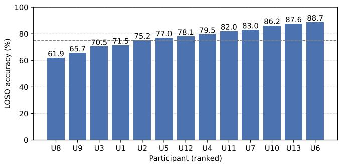
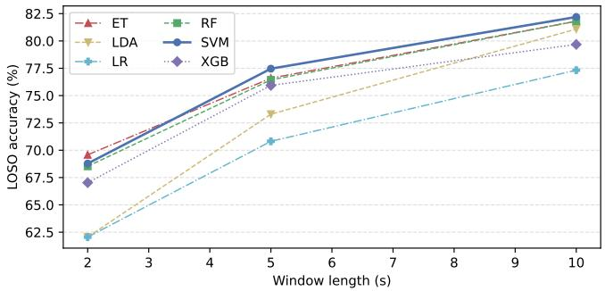

# Towards Field-Deployable Wearable IMU Systems for Occupational Activity Recognition

Ihsan Ul Haq

James Brusey

Farnad Nasirzadeh

Centre for Computational Science

Centre for Computational Science

School of Architecture and

and Mathematical Modelling

and Mathematical Modelling

Coventry University, UK

Built Environment

haqi8@uni.coventry.ac.uk

Coventry University, UK

aa3172@coventry.ac.uk

Deakin University, Australia

farnad.nasirzadeh@deakin.edu.au

Chandan Karmakar

School of Information Technology

Deakin University, Australia

karmakar@deakin.edu.au

Abstract—Wearable inertial measurement unit (IMU) systems for construction worker human activity recognition (HAR) routinely report aggregate accuracies above 95 %, rarely under genuine subject-independent (leave-one-subject-out (LOSO)) evaluation, masking the per-individual variance that determines real-world deployment performance. Using the VTT-ConIoT benchmark, we conduct, to our knowledge, the first systematic configuration sensitivity analysis of this dataset: six classifiers across five sensor placements and three window sizes under a single LOSO protocol, a personalised-calibration pilot, and a validated comparison of tabular GAN-based and standard timeseries augmentation. Per-subject LOSO accuracy for the main multi-sensor, 16-class configuration ranges from 61.9 % to 88.7 % (mean 77.5 %), a 27 pp spread, though all data are laboratorycollected. Multi-sensor fusion and longer windows both improve accuracy; standard augmentation gives small, consistent gains, while Conditional Tabular GAN (CTGAN) augmentation actively harms accuracy with a demonstrated distributional-fidelity mechanism; and personalised calibration recovers 16.8 pp for the weakest participants from just 30 % of their own data. These findings provide evidence-grounded configuration guidance for scaling occupational body sensor networks towards field deployment.

Index Terms—body sensor networks; IMU; HAR; construction workers; LOSO; sensor placement; configuration sensitivity; synthetic data augmentation; occupational health; personalised monitoring

## I. INTRODUCTION

Work-related musculoskeletal disorders (WMSDs) remain a leading cause of long-term occupational disability in construction, driven by repetitive lifting, awkward postures, and prolonged whole-body vibration [1]. Wearable IMUs, combined with supervised machine learning (ML), offer a scalable, low-cost pathway to continuous in-field ergonomic monitoring. Such systems can classify worker activity with sufficient fidelity to trigger real-time alerts and safety coaching. This is a key step towards the personalised health ecosystems envisioned by the Body Sensor Networks (BSN) community.

The VTT-ConIoT dataset [2] is one of the few publicly available multi-sensor IMU benchmarks designed specifically for construction worker HAR, which has attracted five independent deep-learning studies since its 2022 release [3]–[7], each reporting accuracy up to ≈99 % and suggesting that the classification problem is nearly solved. We argue that this conclusion is premature, for two reasons detailed in Section II: most of these figures are not obtained under genuine subjectindependent evaluation, and none report per-subject variability. Three critical questions remain for this benchmark, and for construction IMU systems more broadly:

1) Are high aggregate accuracies stable across individual workers, or do they conceal large per-subject variance?

2) How do sensor placement, window length, and classifier choice jointly determine field-relevant performance?

3) Can synthetic data augmentation reduce the per-subject gap for practitioners who cannot collect large cohorts?

Addressing these questions means translating body sensor networks from lab to life: a system with high aggregate accuracy in a controlled setting may still perform unreliably for specific individuals in the field when that aggregate is not subject-independent. This paper makes three contributions:

1) To our knowledge, the first per-subject LOSO decomposition for the main multi-sensor, 16-class configuration of VTT-ConIoT, quantifying the cross-subject performance spread within this benchmark (Section IV-A).

2) A systematic configuration sensitivity map, covering sensor placement, window size, and six classifier families, with a hyperparameter-tuning check (Sections IV-B–IV-C) and a personalised-calibration pilot (Section IV-E).

3) A validated comparison of GAN-based and standard time-series augmentation, clarifying when each is (and is not) likely to help (Section IV-D).

## II. RELATED WORK

## A. Construction Worker HAR on VTT-ConIoT

The original VTT-ConIoT study [2] reported Support Vector Machine (SVM) baselines of 78 %/89 % (16-/6-class, 5 s window; 84 %/94 % at 10 s) under LOSO, and a per-subject breakdown (39 % to 62 %, mean 52 %) only for its simpler single-sensor 6-class baseline; a per-subject decomposition for the main multi-sensor, 16-class configuration is absent from the literature.

Five subsequent studies report up to ≈99 % accuracy on this benchmark, rarely under genuine subject independence: long short-term memory (LSTM) [3] and convolutional neural network (CNN)-based [4] models use k-fold crossvalidation without stating subject independence (up to 98.55 % and 99.91 %); [5] reports a participant-grouped 5-fold result (98.68 %) vs. its own strict LOSO result (91.20 %); [6] applies genuine LOSO only to the simplified single-sensor 6-class baseline (52 %, matching [2] rather than ≈99 %); and [7] uses a subject-blind split, reporting 70 % to 83 % F1 while citing [4]’s 99.9 % only as related work. The few studies evaluating subject-independently on a comparable configuration report figures well below ≈99 %; none report per-subject distributions; sensor-placement rankings conflict across papers; and none examine configuration trade-offs or augmentation.

Placement optimality is sensitive to protocol, classifier, and window length [8], and window size has a monotonic positive effect across HAR datasets [9]; generative adversarial network (GAN)-based augmentation [10] does not reliably outperform standard time-series transforms [11], [12]. No such sensitivity or augmentation study exists for construction-specific HAR.

## III. DATASET AND METHODS

## A. VTT-ConIoT Dataset

VTT-ConIoT [2] contains data from 13 healthy adult participants (age 25–55; 10 M/3 F) performing 16 construction activities in a controlled laboratory, grouped into six task families (painting, cleaning, climbing, hands-up, floor-work, walking). At the main 5 s-window configuration the 16 activity classes are approximately balanced: 715 windows for 15 classes and 660 for the remaining one (11,385 windows total), so no class-imbalance correction was applied. Three Aistin iProxoxi sensors were worn simultaneously: trouser pocket/hip, upper back, and shoulder/hand, sampled at ≈100 Hz.

## B. Preprocessing and Feature Extraction

Accelerometer, gyroscope, and per-sensor acceleration norm channels (21 total) were retained; magnetometer and barometric channels were excluded. A sliding window approach was applied with a fixed 100-sample (1 s) stride across three durations: 2 s (200 samples), 5 s (500 samples), and 10 s (1000 samples), corresponding to 50 %, 80 %, and 90 % overlap respectively. From each window, 147 statistical features were extracted (mean, median, variance, 25th/75th percentile, minimum, maximum; 7 statistics × 7 values × 3 sensors). Features were standardised within each LOSO fold using parameters estimated from the training split only, then applied to the test split to prevent data leakage.

## C. Classifiers

Six classifiers were evaluated: Random Forest (RF), Extra Trees (ET), XGBoost (XGB), Linear Discriminant Analysis (LDA), Logistic Regression (LR), and SVM (RBF kernel), all with default scikit-learn hyperparameters (only the random seed fixed and, where needed for convergence, the iteration limit increased) to reflect out-of-the-box deployment. To check whether default configurations are a fair basis for comparison, we additionally ran a nested hyperparameter search (RF, XGB, SVM, LR; inner LOSO-consistent grouped search on training participants only, never touching the held-out participant) and report the tuned-vs-default delta in Section IV-B.

## D. Evaluation Protocol and Sensor Configurations

All reported results use a single consistent protocol: participant-wise LOSO cross-validation, 13 folds, each holding out one participant for testing, with feature standardisation fit on the training fold only, for every sensor configuration and window length, avoiding conclusions resting on the identity of a single held-out subset.

Five sensor subsets were evaluated: All (back + hip + hand), Back only, Hand only, Trouser/Hip only, and Trouser accelerometer-only (ablation).

## E. Additional Validation Experiments

Personalised calibration: to test whether target-participant data closes the per-subject gap (Section IV-A), each LOSO fold was retrained with a calibration slice of the held-out participant’s own data (0 %/10 %/20 %/30 %, split by temporal order per activity to avoid window-overlap leakage) added to training, evaluated on the remaining disjoint portion. Augmentation: CTGAN [10] was fit per activity class, strictly inside the training fold, generating synthetic samples 1:1 with each class’s real training count, on a 6-of-13-fold representative subset (weakest-to-strongest participants, Section IV-A) at 100 epochs, with a 10-epoch, 3-seed variance check on two of those folds; synthetic-vs-real similarity was checked per feature (Kolmogorov–Smirnov). The jitter/scaling/time-warp method of Um et al. [11] was evaluated identically on this subset and the full 13-fold protocol, with RF, ET, LDA, LR, SVM. Deep-learning baseline: a 1-D CNN was trained on raw 5 s windows (21 channels × 500 timesteps) per fold, with class-weighted loss, dropout, batch normalisation, and early stopping on a training-participant-only validation split.

## IV. RESULTS

## A. Per-Subject LOSO Decomposition

Fig. 1 shows per-participant LOSO accuracy for the allsensors, 5 s window, SVM configuration. Once every classifier is correctly feature-scaled per fold, SVM is the bestperforming classifier for this configuration. Individual accuracies range from 61.9 % to 88.7 % (mean $7 7 . 5 \% \pm 8 . 3 \%$ macro-F1 75.1 %), a 27 pp spread. This aggregate is our own LOSO result for the main multi-sensor, 16-class configuration, well below the ≈99 % headline figures often quoted for this benchmark (Section II).

This spread shows that a single aggregate statistic, even our own genuinely subject-independent one, conceals large persubject variability: the weakest quartile (Users 8, 9, 3) sits at

  
Fig. 1. Per-subject LOSO accuracy, ranked lowest to highest, main configuration (SVM, all sensors, 5 s); dashed line marks an illustrative 75 % grouping aid, not a deployment threshold.

61.9 % to 70.5 %, the strongest (Users 10, 13, 6) at 86.2 % to 88.7 %. The illustrative 75 % line in Fig. 1 aids visual grouping only, with no clinical, regulatory, or operational basis. For field deployment, the worst-case individual, not the mean, is the operationally relevant figure: 61.9 % is well above the 6.25 % random baseline for 16 classes, but far enough below the cohort mean that this worker would be systematically underserved by a one-size-fits-all model.

## B. Sensor Configuration and Classifier Comparison

Table I reports LOSO mean accuracy across five sensor placements and six classifiers at the 5 s window, under the same protocol throughout. Multi-sensor fusion is strongest for every classifier: for SVM, fusing all sensors gains 9.6 pp over the best single sensor (Back); back and hand perform comparably as single sensors, both clearly outperforming trouser. Restricting the trouser sensor to its 4 accelerometer channels (dropping gyroscope) reduces accuracy by 11.3 pp for SVM. Pooling the main configuration’s confusion matrix across all 13 folds, the two most confused task-family pairs are Walking→Climbing and HandsUp→Painting. These activities share overlapping whole-body motion signatures.

Hyperparameter Tuning: Separately, a nested hyperparameter search found a tuned-vs-default delta of at most 1.1 pp (and for RF, tuning did not outperform defaults at all), indicating defaults are not a materially unfair basis for this classifier comparison.

Deep-Learning Baseline: A class-weighted, regularised 1- D CNN achieved only 55.7 % mean accuracy (macro-F1 51.9 %) under the same protocol, clearly below the classical classifiers. Classical feature-based classifiers thus remain more sample-efficient than a from-scratch CNN here, far below the ≈99 % deep-learning figures reported elsewhere for this dataset, underscoring that those figures are not obtained under genuine subject-independent evaluation (Section II).

## C. Window Size Sensitivity

Fig. 2 shows accuracy as a function of window length for all six classifiers using all sensors, under the same LOSO protocol as Table I. Every classifier improves monotonically with window length; for SVM, accuracy rises from 68.8 % (2 s) to 77.5 % (5 s) to 82.2 % (10 s), a 13.4 pp gain from

TABLE I  
LOSO MEAN ACCURACY (%) OVER 13 FOLDS, BY SENSOR CONFIGURATION AND CLASSIFIER (5 s WINDOW; STD 6 pp TO 11 pp)
<table><tr><td>Clf.</td><td>All</td><td>Back</td><td>Hand</td><td>Trouser</td><td>Trsr-Accel</td></tr><tr><td>SVM</td><td>77.5</td><td>67.9</td><td>66.4</td><td>53.1</td><td>41.8</td></tr><tr><td>ET</td><td>76.6</td><td>66.8</td><td>64.9</td><td>52.1</td><td>37.4</td></tr><tr><td>RF</td><td>76.4</td><td>67.1</td><td>65.1</td><td>55.0</td><td>38.2</td></tr><tr><td>XGB</td><td>75.9</td><td>67.0</td><td>66.6</td><td>54.3</td><td>38.4</td></tr><tr><td>LDA</td><td>73.3</td><td>59.8</td><td>60.2</td><td>49.4</td><td>42.7</td></tr><tr><td>LR</td><td>70.8</td><td>63.3</td><td>62.8</td><td>53.3</td><td>46.9</td></tr></table>

  
Fig. 2. LOSO accuracy vs. window length (all sensors), one line per classifier; SVM (bold) is the main-text classifier.

2 s to 10 s. This trend is consistent with the general HAR literature [9]: longer windows capture complete activity cycles (e.g., a full paint stroke, stair ascent) and produce more stable statistical estimates. For real-time ergonomic alert systems the 5 s window offers a strong balance between accuracy and feedback latency; 2 s remains the only window among those tested that comes close when the fastest available response is required, at a real accuracy cost.

## D. Synthetic Data Augmentation

Table II reports the CTGAN-augmented comparison: CT-GAN was fit per activity class, strictly inside each held-out participant’s training fold, on a 6-of-13-fold representative subset (the four weakest, one median, one strongest participant per Section IV-A), at 100 epochs; standard jitter/scaling/timewarp augmentation [11] was evaluated on the same subset and, as a corroborating check, on the full 13-fold protocol (−0.1 pp to 0.4 pp, consistent in sign and magnitude).

On the shared 6-fold subset (Table II), the two methods diverge sharply: standard augmentation gives small, mostly positive gains (−0.1 pp to 0.7 pp), while CTGAN degrades accuracy for every classifier (−0.1 pp to −5.5 pp, worst for LDA). A per-feature Kolmogorov–Smirnov test found 294/294 (100 %) feature comparisons distinguishable from real data at $p \ < \ 0 . 0 5 \div$ the synthetic samples are not distributionally faithful, consistent with CTGAN treating each time-step as an independent tabular row and losing IMU windows’ autocorrelation. A 3-seed check on the weakest and strongest participants varied by only a few points, so this is not a single unlucky run. This sharpens prior evidence that generative augmentation does not reliably improve on simpler, physically motivated approaches for IMU-based HAR [12]. Here, it is actively counter-productive.

TABLE II  
AUGMENTATION DELTA (6-OF-13-FOLD LOSO SUBSET, USERS 8,5,1,9,2,6, 5 s WINDOW)
<table><tr><td>Clf.</td><td>Base</td><td>+StdAug</td><td>∆</td><td>+CTGAN</td><td>∆</td></tr><tr><td>RF</td><td>73.3</td><td>73.5</td><td>+0.2</td><td>72.1</td><td>-2.0</td></tr><tr><td>ET</td><td>73.0</td><td>73.6</td><td>+0.6</td><td>73.6</td><td>-0.1</td></tr><tr><td>LDA</td><td>69.7</td><td>69.5</td><td>-0.1</td><td>63.6</td><td>-5.5</td></tr><tr><td>LR</td><td>66.1</td><td>66.8</td><td>+0.7</td><td>64.5</td><td>-1.4</td></tr><tr><td>SVM</td><td>73.3</td><td>74.1</td><td>+0.7</td><td>72.4</td><td>-1.4</td></tr></table>

## E. Personalised Calibration

The per-subject gap is concentrated in a minority of participants rather than distributed uniformly across the cohort. We therefore tested whether a small amount of target-participant data could narrow this gap. Among the four weakest participants, mean accuracy increased from 68.4 % without calibration data to 85.2 % after adding 30 % of each participant’s own temporally disjoint data to the training set, recovering 16.8 pp. This result identifies low-data personalised calibration as a practical mitigation for one-size-fits-all deployment.

## V. DISCUSSION

## A. Cross-Subject Variability and Deployment Guidance

Our results show that the mean accuracy alone conceals substantial variation across participants. The worst-case participant represents workers whose movement, morphology, or task style deviate from the training distribution. This is precisely the population for whom monitoring is most safety-critical, and whom a mean-only report would hide. Overlapping-window leakage is a distinct, compounding pitfall reported across the HAR field [13], which is why every result here uses grouped LOSO rather than a hold-out split. For practitioners: report per-subject distributions, not aggregates; prefer multi-sensor fusion, which benefits more here than in feature-reduced configurations [5]; and favour a 5 s to 10 s window.

## B. Augmentation, Personalisation, and Model Choice

The augmentation results favour simple, physically motivated transformations over CTGAN-style synthesis. Jitter, scaling, and time-warping [11] offer a low-cost first step for expanding this IMU feature representation. In contrast, CTGAN actively degrades accuracy, with the distributionalfidelity analysis providing a likely explanation. GAN-based approaches may still be appropriate for the separate, unvalidated goal of synthesising new movement styles, rather than additional samples from existing participants.

Personalised calibration narrows the per-subject gap for the weakest participants with minimal data (Section IV-E), and hyperparameter tuning yielded at most 1.1 pp over defaults (Section IV-B), confirming the classifier comparison is fair.

## VI. CONCLUSION

We present, to our knowledge, the first systematic configuration sensitivity analysis of the VTT-ConIoT construction worker IMU benchmark under a single consistent LOSO protocol. Our per-subject decomposition reveals a 27 pp crosssubject spread (61.9 % to 88.7 %, mean 77.5 %), concealed by the ≈99 % headline figures quoted elsewhere for this benchmark. Multi-sensor fusion, a 5 s to 10 s window, and properlyscaled classical classifiers form a robust baseline; standard augmentation gives small, consistent gains while CTGAN augmentation harms accuracy; and personalised calibration recovers 16.8 pp for the weakest participants from just 30 % of their own data, and a from-scratch CNN baseline remains behind the classical ensembles under this same protocol.

## ACKNOWLEDGEMENT AND CODE AVAILABILITY

The authors thank VTT Technical Research Centre of Finland for making the VTT-ConIoT dataset publicly available. Code and aggregated results to reproduce the experiments in this paper are available at https://github.com/IhsanUlHaq/ bsn2026-imu-har.

## REFERENCES

[1] J. E. Naranjo, C. A. Mora, D. F. Bustamante Villagómez, M. G. Mancheno Falconi, and M. V. Garcia, “Wearable sensors in industrial ergonomics: Enhancing safety and productivity in Industry 4.0,” Sensors, vol. 25, no. 5, p. 1526, 2025.

[2] S.-M. Mäkelä, A. Lämsä, J. S. Keränen, J. Liikka, J. Ronkainen, J. Peltola, J. Häikiö, S. Järvinen, and M. Bordallo López, “Introducing VTT-ConIoT: A realistic dataset for activity recognition of construction workers using IMU devices,” Sustainability, vol. 14, no. 1, p. 220, 2022.

[3] S. Mekruksavanich, P. Jantawong, N. Hnoohom, and A. Jitpattanakul, “Wearable-based activity recognition of construction workers using LSTM neural networks,” in Proc. 37th Int. Tech. Conf. Circuits/Syst., Comput. Commun. (ITC-CSCC), 2022, pp. 1–4.

[4] S. Mekruksavanich and A. Jitpattanakul, “Automatic recognition of construction worker activities using deep learning approaches and wearable inertial sensors,” Intelligent Automation & Soft Computing, vol. 36, no. 2, pp. 2111–2128, 2023.

[5] ——, “Construction worker activity recognition using deep residual convolutional network based on fused IMU sensor data in Internet-of-Things environment,” IoT, vol. 6, no. 3, p. 36, 2025.

[6] A. Lämsä, J. Tervonen, J. Liikka, C. Á. Casado, and M. B. López, “Video2IMU: Realistic IMU features and signals from videos,” in Proc. 2022 IEEE-EMBS Int. Conf. on Wearable and Implantable Body Sensor Networks (BSN), 2022, pp. 1–5.

[7] H. Chen, G. Liu, and J. Li, “Two-dimensional geometry representation learning-based construction workers activities detection with flexible IMU solution,” Buildings, vol. 15, no. 13, p. 2372, 2025.

[8] A. Tsukamoto, N. Yoshida, T. Yonezawa, K. Mase, and Y. Enokibori, “Where are the best positions of IMU sensors for HAR? — approach by a garment device with fine-grained grid IMUs,” in Proc. ACM Int. Joint Conf. Pervasive Ubiquitous Comput. (UbiComp/ISWC Adjunct), 2023, pp. 445–450.

[9] O. Banos, J.-M. Galvez, M. Damas, H. Pomares, and I. Rojas, “Window size impact in human activity recognition,” Sensors, vol. 14, no. 4, pp. 6474–6499, 2014.

[10] L. Xu, M. Skoularidou, A. Cuesta-Infante, and K. Veeramachaneni, “Modeling tabular data using conditional GAN,” Advances in Neural Information Processing Systems, vol. 32, 2019.

[11] T. T. Um, F. M. J. Pfister, D. Pichler, S. Endo, M. Lang, S. Hirche, U. Fietzek, and D. Kulic, “Data augmentation of wearable sensor data´ for Parkinson’s disease monitoring using convolutional neural networks,” in Proc. 19th ACM Int. Conf. Multimodal Interaction (ICMI), 2017, pp. 216–220.

[12] Z. Leng, A. Iyer, and T. Plötz, “Scaling human activity recognition: A comparative evaluation of synthetic data generation and augmentation techniques,” arXiv preprint, vol. 2506.07612, 2025.

[13] A. A. Khaked, N. Oishi, D. Roggen, and P. Lago, “In shift and in variance: Assessing the robustness of HAR deep learning models against variability,” Sensors, vol. 25, no. 2, p. 430, 2025.