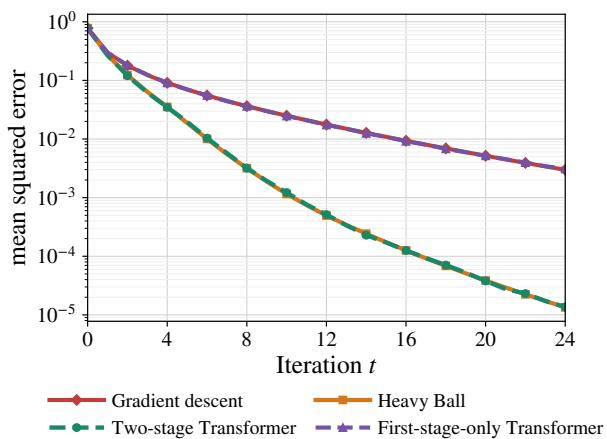
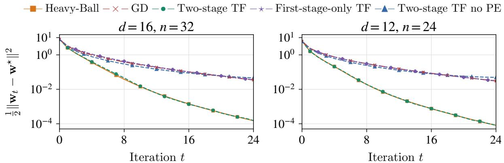
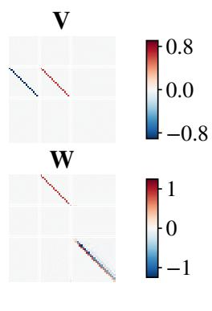
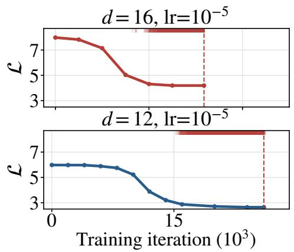
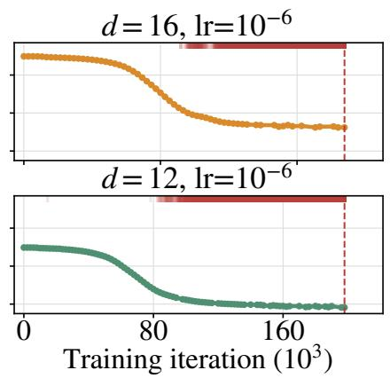

# Transformers with CoT Discover Heavy-Ball Acceleration Through Training

Yuxuan Cai∗ and Yuan Cao†

## Abstract

Modern transformers often solve complex tasks by generating and refining intermediate reasoning steps. To develop a theoretical understanding of chain-of-thought (CoT) reasoning, a notable recent study by Huang et al. (2025) viewed transformers as algorithm executors, and showed that when transformers’ CoT steps are supervised by a gradient-descent teacher, they can learn to implement gradient descent for in-context weight prediction in linear regression. In this paper, we study the same in-context weight prediction task but ask whether CoT reasoning can go beyond merely imitating the teacher algorithm. We show that, after initial supervision from a gradient-descent teacher, further trajectory-level supervision using the true regression weights leads the model to implement the Heavy-Ball method, thereby achieving acceleration over the original teacher. Notably, this accelerated algorithm emerges without supervision from any Heavy-Ball teacher. Our results provide a concrete theoretical example in which transformer reasoning can discover new algorithms through training, rather than merely imitate the algorithm used for supervision.

## 1 Introduction

Transformers have demonstrated remarkable success across a wide range of applications, including natural language processing (Vaswani et al., 2017) and computer vision (Dosovitskiy, 2020). These models have also exhibited complex reasoning abilities, particularly in mathematical problem solving and coding (Chowdhery et al., 2023). Chain-of-thought (CoT) reasoning has emerged as a key approach for enhancing such reasoning capabilities, enabling models to generate intermediate reasoning steps before producing the final answer (Wei et al., 2022; Kojima et al., 2022).

To theoretically understand the capabilities of transformers, recent works have viewed transformers as “algorithm executors.” In particular, transformers have been shown to implement optimization algorithms for in-context learning tasks, where the context is modeled as the training dataset for a learning problem. Aky¨urek et al. (2022); Von Oswald et al. (2023) empirically demonstrated that transformers can perform in-context linear regression via gradient descent. Zhang et al. (2024) theoretically showed that one-layer transformers can be trained to perform in-context linear regression, while Ahn et al. (2023) showed that deep transformers can be trained to implement preconditioned gradient descent. Guo et al. (2024); Bai et al. (2023) further demonstrated the in-context learning capabilities of transformers by constructing multi-head ReLU transformers that implement a variety of learning algorithms. Gatmiry et al. (2024) showed that looped transformers can implement gradient descent for in-context linear regression. More recently, Huang et al. (2025) showed that, when supervised by a gradient descent teacher, transformers can learn to use CoT reasoning for in-context weight prediction, with each reasoning step implementing one gradient descent update.

In this work, we consider a setting similar to that of Huang et al. (2025), where transformers use CoT to perform in-context weight prediction. However, rather than asking whether transformers can mimic a gradientdescent teacher, we ask a diferent question: Can transformers with CoT go beyond mimicking the teacher algorithm and discover new algorithms through training? To investigate this question, we consider a two-stage training procedure. In Stage 1, we supervise the transformer’s CoT trajectory using a gradient descent teacher, following the setup of Huang et al. (2025). In Stage 2, we replace the teacher supervision with supervision from the true regression weights. We find that, when trained via this two-stage procedure, transformers with CoT can learn the Heavy-Ball method, achiev-

  
Figure 1: Comparison of gradient descent, Heavy-Ball, a transformer trained solely based on gradient-descent supervision, and a transformer trained first using the gradient-descent teacher and then using ground-truth regression weights.

ing acceleration over the gradient descent teacher in Stage 1 (see Figure 1). We also establish rigorous theoretical guarantees to further demonstrate and explain this phenomenon.

The main contributions of our work are as follows:

• We identify an interesting phenomenon: as illustrated in Figure 1, a transformer trained solely with gradient-descent supervision learns to implement multi-step gradient descent, consistent with previous results (Huang et al., 2025). However, when further trained under trajectory supervision of the ground-truth regression weights, the transformer surprisingly learns to generate CoT trajectories that approximate the Heavy-Ball method, achieving acceleration. Notably, the Heavy-Ball method emerges without supervision from a Heavy-Ball teacher, demonstrating the capability of CoT to discover “new” algorithms unseen during training.

• We provide a theoretical explanation for how transformers with CoT learn the heavy-ball method. We show that, despite the nonconvex loss landscape, both stages of training succeed, with the corresponding objective functions attaining near-optimal values. We further identify the algorithm implemented by the trained transformer after the two-stage procedure and prove that its learned CoT iterates approximate the Heavy-Ball method. This establishes that the model not only optimizes the prescribed objectives, but also internalizes an accelerated optimization procedure. Our result therefore gives a rigorous demonstration of how transformers with CoT can go beyond mimicking a gradient descent teacher and discover a faster algorithm through training.

• The setting in this paper goes beyond classic in-context learning formulations. First, to distinguish the Heavy-Ball method from gradient descent, we consider a setting with a Marchenko–Pastur spectral limit, in contrast to prior settings with well-concentrated sample covariance matrices (Zhang et al., 2024; Huang et al., 2025). Second, the second stage training is without teacher forcing, and the loss lacks a clean analytical form due to the autoregressive nature of the outputs.

To overcome these dificulties, we introduce auxiliary parameters to establish training convergence and develop recursively defined matrix polynomials to analyze the second-stage loss. The matrix polynomials also serve as a central tool for characterizing the connection between the learned algorithm and the Heavy-Ball method. These new proof techniques may be of independent interest.

## 2 Preliminaries

In this section, we introduce the in-context weight prediction task, the setting of one-layer linear self-attention with CoT, and the two-stage training procedure considered in this work.

## 2.1 In-Context Weight Prediction with CoT

In-context weight prediction. A line of recent works (Ahn et al., 2023; Bai et al., 2023; Zhang et al., 2024) has studied in-context learning under a theoretical setting where the goal is to predict an unknown response $y _ { \mathrm { { q u e r y } } }$ , given a query $\mathbf { x } _ { \mathrm { q u e r y } }$ and a collection of context data pairs $\{ ( { \bf x } _ { i } , y _ { i } ) \} _ { i \in [ n ] }$ Beyond directly outputting the query response, Huang et al. (2025); Zhang and Cao (2026) further studied in-context weight prediction, where the goal is to predict the regression model weights.

In our work, we study the same in-context weight prediction task as in Huang et al. (2025). Specifically, the context is given as a training data set $\{ ( { \bf x } _ { i } , y _ { i } ) \} _ { i \in [ n ] }$ of a linear regression task. We assume that each context is associated with a ground-truth linear regression vector $\mathbf { w } ^ { \star }$ , randomly generated according to the standard Gaussian distribution $\mathbf { w } ^ { \star } \sim N ( 0 , \mathbf { I } _ { d } )$ . Given $\mathbf { w } ^ { \star }$ , for each $i \in [ n ]$ , we independently generate $\mathbf { x } _ { i } \sim N ( 0 , \mathbf { I } _ { d } )$ and set $y _ { i } = \mathbf { x } _ { i } ^ { \top } \mathbf { w } ^ { \star }$ . In the in-context weight prediction task, independent copies of $( \{ ( \mathbf { x } _ { i } , y _ { i } ) \} _ { i \in [ n ] } , \mathbf { w } ^ { \star } )$ are available for training, and the goal is to obtain a model that can predict the corresponding $\mathbf { w } ^ { \star }$ based on new contexts.

Linear self-attention architecture. We consider a simplified linear self-attention (LSA) model by removing the softmax nonlinearity, merging the projection and value matrices into $\mathbf { V } \in \mathbb { R } ^ { d _ { e } \times d _ { e } }$ and merging the key and query matrices into $\mathbf { W } \in \mathbb { R } ^ { d _ { e } \times d _ { e } }$ , which follows the settings in recent works (Zhang et al., 2024; Ahn et al., 2023; Gatmiry et al., 2024; Huang et al., 2025). Here $d _ { e }$ denotes the dimension of the token embeddings. For an input matrix Z, we denote

$$
F _ { \mathrm { L S A } } ( \mathbf { Z } ; \mathbf { V } , \mathbf { W } ) = \mathbf { Z } + \mathbf { V } \mathbf { Z } \cdot \mathbf { Z } ^ { \top } \mathbf { W } \mathbf { Z } .\tag{2.1}
$$

Chain-of-thought reasoning. In CoT reasoning, a transformer model autoregressively generates reasoning steps before reaching the final result. For in-context weight prediction, we follow a similar setup to that considered in Huang et al. (2025), where the reasoning steps correspond to iterations of an optimization algorithm, and consider the initial input of the transformer model as follows:

$$
\mathbf { Z } _ { 0 } : = \left[ \begin{array} { l l } { \mathbf { X } } & { \mathbf { 0 } _ { d \times 1 } } \\ { \mathbf { y } } & { 0 } \\ { \mathbf { 0 } _ { d \times n } } & { \mathbf { w } _ { 0 } } \\ { \mathbf { 0 } _ { 1 \times n } } & { 1 } \\ { \mathbf { 0 } _ { T \times n } } & { \mathbf { e } _ { 0 } } \end{array} \right] \in \mathbb { R } ^ { d _ { e } \times ( n + 1 ) } , \quad \mathbf { X } : = \frac { 1 } { \sqrt { n } } \left[ \mathbf { x } _ { 1 } \quad \mathbf { x } _ { 2 } \quad \cdot \cdot \cdot \quad \mathbf { x } _ { n } \right] \in \mathbb { R } ^ { d \times n } ,\tag{2.2}
$$

where $\mathbf { w } _ { 0 }$ is the initialization of the optimization algorithm. Following Huang et al. (2025), we assume ${ \bf w } _ { 0 } = { \bf 0 } _ { d }$ , and also assume that the training data set $\{ ( \mathbf { x } _ { i } , y _ { i } ) \} _ { i \in [ n ] }$ and the weight vectors are encoded in separate dimensions in the token embeddings. However, diferent from Huang et al. (2025), we include factors $1 / \sqrt { n }$ in the definitions of X and $\mathbf { y } .$ This diference is minor, since Huang et al. (2025) instead include an additional factor of $1 / n$ in their definition of linear attention. Consequently, the well-trained model analyzed in their work is equivalent to one in which the $1 / n$ factor in linear attention is omitted and the factors of $1 / { \sqrt { n } }$ are included in X and y. A more important diference is that we introduce a one-hot positional encoding ${ \bf e } _ { 0 } =$ $[ 1 , 0 , . . . , 0 ] ^ { \top } \in \mathbb { R } ^ { T }$ for the initialization token, where $T$ denotes the maximum number of $\mathrm { C o T }$ steps. Notably, incorporating these positional encodings requires us to specify a maximum number of reasoning steps before defining the model. Accordingly, each token has total embedding dimension $d _ { e } : = 2 d + T + 2$

Now we can define the input of the t-th reasoning step recursively. Specifically, we denote the model prediction as $\mathbf { w } _ { t + 1 } : = F _ { \mathrm { L S A } } ( \mathbf { Z } _ { t } ; \mathbf { V } , \mathbf { W } ) _ { [ d + 2 : 2 d + 1 , - 1 ] }$ and append it to $\mathbf { Z } _ { t }$ so that

$$
\begin{array} { r } { \mathbf { Z } _ { t + 1 } = \left[ \mathbf { Z } _ { t } , ( \mathbf { 0 } _ { d } ^ { \top } , 0 , \mathbf { w } _ { t + 1 } ^ { \top } , 1 , \mathbf { e } _ { t + 1 } ^ { \top } ) ^ { \top } \right] , \quad 0 \leq t < T - 1 , } \end{array}
$$

where $\mathbf { e } _ { t } = \big ( \underbrace { 0 , \dots , 0 } _ { t } , 1 , \underbrace { 0 , \dots , 0 } _ { T - t - 1 } \big ) ^ { \top } \in \mathbb { R } ^ { T }$ is the one-hot positional encoding.

## 2.2 Two-Stage Training

We consider a two-stage training framework. Stage 1 introduces supervision from a gradient-descent teacher, while in Stage $^ { 2 , }$ we supervise the CoT trajectory with the true regression weights. Stage 1. In Stage 1, following Huang et al. (2025), we consider supervision from a gradient-descent teacher with teacher forcing. The input to the transformer at iteration t is given as follows:

$$
\mathbf { Z } _ { t } ^ { \mathrm { G D } } = \left[ \begin{array} { c c c c c c } { \mathbf { X } } & { \mathbf { 0 } _ { d \times 1 } } & { \mathbf { 0 } _ { d \times 1 } } & { \cdots } & { \mathbf { 0 } _ { d \times 1 } } \\ { \mathbf { y } } & { 0 } & { 0 } & { \cdots } & { 0 } \\ { \mathbf { 0 } _ { d \times n } } & { \mathbf { w } _ { 0 } } & { \mathbf { w } _ { 1 } ^ { \mathrm { G D } } } & { \cdots } & { \mathbf { w } _ { t } ^ { \mathrm { G D } } } \\ { \mathbf { 0 } _ { 1 \times n } } & { 1 } & { 1 } & { \cdots } & { 1 } \\ { \mathbf { 0 } _ { T \times n } } & { \mathbf { e } _ { 0 } } & { \mathbf { e } _ { 1 } } & { \cdots } & { \mathbf { e } _ { t } } \end{array} \right] \in \mathbb { R } ^ { d _ { e } \times ( n + t + 1 ) } , \qquad 0 \le t < T ,
$$

where, for $t \geq 1 , \mathbf { w } _ { t } ^ { \mathrm { G D } } = \mathbf { w } _ { t - 1 } ^ { \mathrm { G D } } - \eta _ { 0 } \mathbf { X } ( \mathbf { X } ^ { \top } \mathbf { w } _ { t - 1 } ^ { \mathrm { G D } } - \mathbf { y } ^ { \top } )$ is the teacher’s iterate after t gradient steps. The learning rate $\eta _ { 0 }$ is fixed across all steps and tasks. Given $\mathbf { Z } _ { t } ^ { \mathrm { G D } }$ , we aim to train the transformer to predict the next gradient-descent iterate. We consider gradient flow over the population loss:

$$
\mathcal { L } _ { \mathrm { G D } } ( { \bf V } , { \bf W } ) = \frac { 1 } { { 2 T } } \mathbb { E } \left[ \sum _ { t = 0 } ^ { T - 1 } \| F _ { \mathrm { L S A } } ( \mathbf { Z } _ { t } ^ { \mathrm { G D } } ; { \bf V } , { \bf W } ) _ { [ d + 2 : 2 d + 1 , - 1 ] } - { \bf w } _ { t + 1 } ^ { \mathrm { G D } } \| ^ { 2 } \right] .\tag{2.3}
$$

The gradient flow dynamics of the parameters are

$$
\frac { \mathrm { d } \pmb { \theta } } { \mathrm { d } \tau } = - \nabla _ { \pmb { \theta } } \mathcal { L } _ { \mathrm { G D } } ( \pmb { \theta } ) , \qquad \pmb { \theta } : = ( \mathbf { V } , \mathbf { W } ) .\tag{2.4}
$$

We train the model until $\mathcal { L } _ { \mathrm { G D } }$ is minimized below a threshold.

Stage 2. We then consider further training the transformer on ground-truth solutions $\mathbf { w } ^ { \star }$ without supervision from any classical algorithm. At the t-th iteration, the transformer makes predictions

based on its own autoregressively generated sequence $\mathbf { w } _ { 0 } , \mathbf { w } _ { 1 } , \ldots , \mathbf { w } _ { t }$ . Therefore, we define

$$
\mathbf { Z } _ { t } = \left[ \begin{array} { l l l l l l } { \mathbf { X } } & { \mathbf { 0 } _ { d \times 1 } } & { \mathbf { 0 } _ { d \times 1 } } & { \cdots } & { \mathbf { 0 } _ { d \times 1 } } \\ { \mathbf { y } } & { 0 } & { 0 } & { \cdots } & { 0 } \\ { \mathbf { 0 } _ { d \times n } } & { \mathbf { w } _ { 0 } } & { \mathbf { w } _ { 1 } } & { \cdots } & { \mathbf { w } _ { t } } \\ { \mathbf { 0 } _ { 1 \times n } } & { 1 } & { 1 } & { \cdots } & { 1 } \\ { \mathbf { 0 } _ { T \times n } } & { \mathbf { e } _ { 0 } } & { \mathbf { e } _ { 1 } } & { \cdots } & { \mathbf { e } _ { t } } \end{array} \right] \in \mathbb { R } ^ { d _ { e } \times ( n + t + 1 ) } , \qquad 0 \le t < T ,
$$

and define the training loss in Stage 2 as

$$
\mathcal { L } ( \mathbf { V } , \mathbf { W } ) = \frac { 1 } { 2 T } \mathbb { E } \left[ \sum _ { t = 0 } ^ { T - 1 } \left. F _ { \mathrm { L S A } } ( \mathbf { Z } _ { t } ; \mathbf { V } , \mathbf { W } ) _ { [ d + 2 : 2 d + 1 , - 1 ] } - \mathbf { w } ^ { \star } \right. ^ { 2 } \right] .\tag{2.5}
$$

We use exact population gradient flow on the raw parameters:

$$
\frac { \mathrm { d } \pmb { \theta } } { \mathrm { d } \tau } = - \nabla _ { \pmb { \theta } } \mathcal { L } ( \pmb { \theta } ) .\tag{2.6}
$$

Notably, without teacher forcing, Equation (2.5) does not have a clean analytic form because $\mathbf { Z } _ { t }$ is generated autoregressively. During training, $\mathbf { w } _ { 1 } , \ldots , \mathbf { w } _ { T }$ can be very complex, which difers substantially from Stage 1, as well as the setting of Huang et al. (2025).

We note that Stage 1 is analogous to pretraining with next-token prediction and to supervised fine-tuning: the input contains teacher weights rather than the model’s own predictions. The loss function in Stage 2 can be viewed as an objective resembling reinforcement learning post-training with discount factor 1. However, because our setting of in-context linear regression is simplified, these analogies serve only as high-level motivation for considering such a training procedure. They do not imply that our analysis directly yields conclusions about general pretraining or post-training.

## 3 Main Result

In this section, we prove the convergence of the two-stage training procedure and show that the final solution approximates the time-varying Heavy-Ball method, defined as follows.

Let $\{ ( \alpha _ { t } , \beta _ { t } ) \} _ { t = 0 } ^ { T - 1 }$ be any sequence with $\beta _ { 0 } = 0$ . Initialize $\mathbf { w } _ { 0 } ^ { \mathrm { H B } } = \mathbf { 0 } _ { d }$ and for $1 \leq t < T$ , define

$$
\mathbf { w } _ { 1 } ^ { \mathrm { H B } } = \alpha _ { 0 } \mathbf { X } \mathbf { y } ^ { \top } , \quad \mathbf { w } _ { t + 1 } ^ { \mathrm { H B } } = \mathbf { w } _ { t } ^ { \mathrm { H B } } - \alpha _ { t } ( \mathbf { X } \mathbf { X } ^ { \top } \mathbf { w } _ { t } ^ { \mathrm { H B } } - \mathbf { X } \mathbf { y } ^ { \top } ) + \beta _ { t } ( \mathbf { w } _ { t } ^ { \mathrm { H B } } - \mathbf { w } _ { t - 1 } ^ { \mathrm { H B } } ) .\tag{3.1}
$$

We consider the best coeficients under the same loss objective:

$$
\{ ( \boldsymbol { \alpha } _ { t } ^ { \star } , \beta _ { t } ^ { \star } ) \} _ { t = 0 } ^ { T - 1 } \in \mathop { \mathrm { a r g m i n } } _ { \{ ( \boldsymbol { \alpha } _ { t } , \beta _ { t } ) \} _ { t = 0 } ^ { T - 1 } , \beta _ { 0 } = 0 } \frac { 1 } { 2 T } \sum _ { t = 1 } ^ { T } \mathbb { E } \| \mathbf { w } _ { t } ^ { \mathrm { H B } } - \mathbf { w } ^ { \star } \| ^ { 2 } .
$$

In the following, we introduce two technical assumptions. We first note that the transformer input (2.2) is given as a block matrix, motivating us to consider the weight matrices as block

matrices:

$$
\mathbf { V } = [ { \begin{array} { l l l l l } { \mathbf { V } _ { 1 1 } } & { \mathbf { V } _ { 1 2 } } & { \mathbf { V } _ { 1 3 } } & { \mathbf { V } _ { 1 4 } } & { \mathbf { V } _ { 1 5 } } \\ { \mathbf { V } _ { 2 1 } } & { \mathbf { V } _ { 2 2 } } & { \mathbf { V } _ { 2 3 } } & { \mathbf { V } _ { 2 4 } } & { \mathbf { V } _ { 2 5 } } \\ { \mathbf { V } _ { 3 1 } } & { \mathbf { V } _ { 3 2 } } & { \mathbf { V } _ { 3 3 } } & { \mathbf { V } _ { 3 4 } } & { \mathbf { V } _ { 3 5 } } \\ { \mathbf { V } _ { 4 1 } } & { \mathbf { V } _ { 4 2 } } & { \mathbf { V } _ { 4 3 } } & { \mathbf { V } _ { 4 4 } } & { \mathbf { V } _ { 4 5 } } \\ { \mathbf { V } _ { 5 1 } } & { \mathbf { V } _ { 5 2 } } & { \mathbf { V } _ { 5 3 } } & { \mathbf { V } _ { 5 4 } } & { \mathbf { V } _ { 5 5 } } \end{array} } ] , \qquad \mathbf { W } = [  \begin{array} { l l l l l } { \mathbf { W } _ { 1 1 } } & { \mathbf { W } _ { 1 2 } } & { \mathbf { W } _ { 1 3 } } & { \mathbf { W } _ { 1 4 } } & { \mathbf { W } _ { 1 5 } } \\ { \mathbf { W } _ { 2 1 } } & { \mathbf { W } _ { 2 2 } } & { \mathbf { W } _ { 2 3 } } & { \mathbf { W } _ { 2 4 } } & { \mathbf { W } _ { 2 5 } } \\ { \mathbf { W } _ { 3 1 } } & { \mathbf { W } _ { 3 2 } } & { \mathbf { W } _ { 3 3 } } & { \mathbf { W } _ { 3 4 } } & { \mathbf { W } _ { 3 5 } } \\ { \mathbf { W } _ { 4 1 } } & { \mathbf { W } _ { 4 2 } } & { \mathbf { W } _ { 4 3 } } & { \mathbf { W } _ { 4 4 } } &  \mathbf { W } _ { 4 5 } \end{array}
$$

where the block row and column sizes are $( d , 1 , d , 1 , T )$ . We make the following assumptions.

Assumption 3.1. We assume that the initialization of the parameters satisfies

$$
\mathbf { V } ( 0 ) = \left( \begin{array} { l l l l l } { \mathbf { 0 } } & { \mathbf { 0 } } & { \mathbf { 0 } } & { \mathbf { 0 } } & { \mathbf { 0 } } \\ { \mathbf { 0 } } & { 0 } & { \mathbf { 0 } } & { 0 } & { \mathbf { 0 } } \\ { \mathbf { 0 } } & { \mathbf { 0 } } & { v _ { 3 3 } ( 0 ) \mathbf { I } _ { d } } & { \mathbf { 0 } } & { \mathbf { 0 } } \\ { \mathbf { 0 } } & { 0 } & { \mathbf { 0 } } & { 0 } & { \mathbf { 0 } } \\ { \mathbf { 0 } } & { \mathbf { 0 } } & { \mathbf { 0 } } & { \mathbf { 0 } } & { 0 } \end{array} \right) , \qquad \mathbf { W } ( 0 ) = \left( \begin{array} { l l l l l } { \mathbf { 0 } } & { \mathbf { 0 } } & { \mathbf { 0 } } & { \mathbf { 0 } } & { \mathbf { 0 } } \\ { \mathbf { 0 } } & { 0 } & { \mathbf { 0 } } & { \sigma } & { \mathbf { 0 } } \\ { \mathbf { 0 } } & { \mathbf { 0 } } & { \mathbf { 0 } } & { \mathbf { 0 } } & { \mathbf { 0 } } \\ { \mathbf { 0 } } & { 0 } & { \mathbf { 0 } } & { 0 } & { \mathbf { 0 } } \\ { \mathbf { 0 } } & { \mathbf { 0 } } & { \mathbf { 0 } } & { \mathbf { 0 } } & { \mathbf { 0 } } \end{array} \right) .\tag{3.2}
$$

Here $v _ { 3 3 } ( 0 )$ and σ are any constants satisfying $v _ { 3 3 } ( 0 ) > 0$ and $\sigma \ < \ 0$ , independent of $d , n , T$ Further, we fix ${ \bf W } _ { 3 3 } = { \bf 0 } _ { d \times d }$ for all $\tau > 0$

Assumption 3.1 is a technical assumption that poses constraints on the initialization and on freezing one of the blocks in the W matrix. We note that similar assumptions have been frequently considered in theoretical studies of the training dynamics of transformer models. For example, Huang et al. (2025); Wu et al. (2026a) considered almost zero initializations with certain non-zero blocks. Huang et al. (2025); Gatmiry et al. (2024) considered freezing certain blocks in the weight matrices.

We also make the following assumption specifying hyperparameter scalings considered in this paper.

$$
\mathbf { A s s u m p t i o n 3 . 2 . ~ S u p p o s e ~ t h a t } ~ T = \Theta ( ( \log d ) ^ { 1 / 4 } ) , ~ \eta _ { 0 } \in [ 0 . 4 , 0 . 9 ] , ~ n = \Theta ( d ) , \mathrm { a n d } ~ d / n \leq 0 . 1 .
$$

We emphasize that Assumption 3.2 introduces a key diference compared with related work (Huang et al., 2025), where the authors assumed that $n = \Theta ( d \log ^ { 5 } d ) \gg d ,$ implying that the sample covariance matrix $\begin{array} { r } { \mathbf { S } = n ^ { - 1 } \sum _ { i = 1 } ^ { n } \mathbf { x } _ { i } \mathbf { x } _ { i } ^ { \top } } \end{array}$ concentrates around $\mathbf { I } _ { d }$ . Notably, $\mathbf { S } \approx \mathbf { I } _ { d }$ is a setting where the Heavy-Ball method and gradient descent achieve the same convergence rate. Hence, to convincingly demonstrate the learning of the Heavy-Ball method, we consider a diferent regime where n and d are proportional to each other. In this setting, the eigenvalue distribution of S is asymptotically characterized by the Marchenko-Pastur (MP) law (Marˇcenko and Pastur, 1967).

We now show that, under the initialization above and the two-stage training procedure, our transformer model discovers the Heavy-Ball method.

Theorem 3.3. For any $0 < \epsilon < 1$ , suppose that $n , d = \Omega ( \exp ( \log ^ { 4 } ( 1 / \epsilon ) ) )$ . Further suppose that the training with gradient flow (2.4) in Stage 1 stops after $\tau _ { 1 } = d ^ { o ( 1 ) } + O ( T \log d )$ , and the follow-up Stage 2 training with gradient flow (2.6) runs for $\tau - \tau _ { 1 } = O ( d ^ { 1 / \alpha + o ( 1 ) } \epsilon ^ { - 1 / \alpha } )$ , where $\alpha > 0$ is a constant independent of $d , n , T$ . Then under Assumptions 3.1 and 3.2, the following results hold: • The training loss in Stage 1 reaches $\mathcal { L } _ { \mathrm { G D } } \leq d ^ { - 1 / 4 }$

• The training loss in Stage 2 reaches $\mathcal { L } - \operatorname* { m i n } \mathcal { L } \leq \epsilon$

• Uniformly for $T / 2 \leq t < T$ , it holds that

$$
\begin{array} { r } { \frac { \mathbb { E } \| \mathbf { w } _ { t + 1 } ( \tau ) - \mathbf { w } _ { t } ^ { \mathrm { H B } } \| ^ { 2 } } { \mathbb { E } \| \mathbf { w } _ { t } ^ { \mathrm { H B } } - \mathbf { w } ^ { \star } \| ^ { 2 } } \leq \epsilon . } \end{array}
$$

Here $\mathbf { w } _ { t } ^ { \mathrm { H B } }$ denotes the t-th iterate of the Heavy-Ball method with parameters $\{ ( \alpha _ { t } ^ { \star } , \beta _ { t } ^ { \star } ) \} _ { t = 0 } ^ { T - 1 }$

Theorem 3.3 shows that the training in both stage 1 and stage 2 converges, despite the nonconvex loss landscape. Moreover, the last conclusion of Theorem 3.3 shows that the transformer produces CoT steps whose $t + 1 \mathrm { - t h }$ step is close to the t-th iteration of the Heavy-Ball method. This demonstrates that the algorithm learned by the transformer is essentially equivalent to the Heavy-Ball method. Notably, the two-stage training procedure never involves supervision from any Heavy-Ball teacher. Our result thus indicates that transformers with CoT are capable of discovering unseen algorithms through proper training, providing complementary findings to Huang et al. (2025) where the authors demonstrated the capability of transformers to recover the gradient-descent teacher algorithm.

Theorem 3.3 is under the assumption that $n , d = \Omega ( \exp ( \log ^ { 4 } ( 1 / \epsilon ) ) )$ . This condition is superpolynomial but subexponential in $1 / \epsilon$ . While such a super-polynomial assumption is relatively strong, the last conclusion in Theorem 3.3 with $\epsilon = 0 . 5$ can already imply that $\begin{array} { r l } { \mathbb { E } \| \mathbf { w } _ { t + 1 } ( \tau ) - \mathbf { w } ^ { \star } \| ^ { 2 } = } & { { } } \end{array}$ $O ( \mathbb { E } \| \mathbf { w } _ { t } ^ { \mathrm { H B } } - \mathbf { w } ^ { \star } \| ^ { 2 } )$ . Therefore, Theorem 3.3 demonstrates that transformers with CoT can discover an algorithm with an accelerated convergence rate under mild assumptions.

## 4 Proof sketch

In this section, we outline the proof of Theorem 3.3. Since we consider the setting where $n = \Theta ( d )$ and the eigenvalues of S follow the MP law, even in Stage 1, our analysis is significantly diferent from the prior work (Huang et al., 2025). Stage 2 is also more challenging without teacher forcing. To address these challenges, we develop a proof technique based on auxiliary parameters.

We first identify the parameter structure preserved throughout training.

Lemma 4.1. Throughout the two-stage training, the parameters $\mathbf { V } ( \tau ) , \mathbf { W } ( \tau )$ retain the form

$$
\mathbf V ( \tau ) = \left( \begin{array} { c c c c } { \mathbf 0 } & { \mathbf 0 } & { \mathbf 0 } & { \mathbf 0 } & { \mathbf 0 } \\ { \mathbf 0 } & { \mathbf 0 } & { \mathbf 0 } & { 0 } & { \mathbf 0 } \\ { v _ { 3 1 } ( \tau ) \mathbf I _ { d } \mathbf 0 } & { v _ { 3 3 } ( \tau ) \mathbf I _ { d } \mathbf 0 } & { \mathbf 0 } & { \mathbf 0 } \\ { \mathbf 0 } & { \mathbf 0 } & { \mathbf 0 } & { \mathbf 0 } & { \mathbf 0 } \\ { \mathbf 0 } & { \mathbf 0 } & { \mathbf 0 } & { \mathbf 0 } & { \mathbf 0 } \end{array} \right) , \quad \mathbf W ( \tau ) = \left( \begin{array} { c c c c } { \mathbf 0 \mathbf 0 } & { w _ { 1 3 } ( \tau ) \mathbf I _ { d } } & { \mathbf 0 } & { \mathbf 0 } \\ { \mathbf 0 } & { \mathbf 0 } & { w _ { 2 4 } ( \tau ) } & { \mathbf w _ { 2 5 } ( \tau ) } \\ { \mathbf 0 \mathbf 0 } & { \mathbf 0 } & { \mathbf 0 } & { \mathbf 0 } \\ { \mathbf 0 } & { \mathbf 0 } & { w _ { 4 4 } ( \tau ) } & { \mathbf w _ { 4 5 } ( \tau ) } \\ { \mathbf 0 \mathbf 0 } & { \mathbf 0 } & { \mathbf w _ { 5 4 } ( \tau ) } & { \mathbf W _ { 5 5 } ( \tau ) } \end{array} \right) .
$$

Lemma 4.1 shows that our parameters remain on a manifold throughout two-stage training. By this lemma, we can reduce the analysis of the full matrices V, W to that of

$$
\bar { \pmb \theta } ( \tau ) = \bigl ( \mathbf { V } _ { 3 1 } ( \tau ) , \mathbf { W } _ { 1 3 } ( \tau ) , \mathbf { V } _ { 3 3 } ( \tau ) , w _ { 2 4 } ( \tau ) , \mathbf { w } _ { 2 5 } ( \tau ) , w _ { 4 4 } ( \tau ) , \mathbf { w } _ { 4 5 } ( \tau ) , \mathbf { w } _ { 5 4 } ( \tau ) , \mathbf { W } _ { 5 5 } ( \tau ) \bigr ) .
$$

This conclusion also allows us to establish the following lemma.

Lemma 4.2. Throughout training in Stages 1 and 2, the t-th CoT iterate $\mathbf { w } _ { t } ( \tau )$ has the form $\mathbf { w } _ { t } ( \tau ) = p _ { t , \bar { \pmb { \theta } } ( \tau ) } ( \mathbf { S } ) \mathbf { w } ^ { \star }$ , where $p _ { t , \bar { \pmb \theta } ( \tau ) }$ is a polynomial of degree at most t with zero constant term.

Lemma 4.2 is central to our analysis. Since we consider the challenging setting where $n = \Theta ( d )$ the sample covariance matrix S cannot be approximated by the identity matrix, and the study of the training dynamics requires precise characterization of their dependence on S. Lemma 4.2 provides this characterization. Recall that the losses in both stages are defined by the distance from $\mathbf { w } _ { t }$ to $\mathbf { w } ^ { \star }$ or $\mathbf { w } _ { t } ^ { \mathrm { G D } }$ . By Lemma 4.2, we can express the losses in the two stages as functions of matrix polynomials in S. We now give the two-stage analysis.

Stage 1. Thanks to Lemma 4.2, we can give the following decomposition of the training loss.

Lemma 4.3. The population loss can be written as

$$
\mathcal { L } _ { \mathrm { G D } } ( \tau ) = \mathbb { E } \left[ \begin{array} { c } { A ( \mathbf { S } ) ( \widetilde { \theta } _ { 1 } ( \tau ) - \eta _ { 0 } ) ^ { 2 } + B ( \mathbf { S } ) ( \widetilde { \theta } _ { 2 } ( \tau ) + \eta _ { 0 } ) ^ { 2 } } \\ { + \left\| \mathbf { C } _ { 1 } ( \mathbf { S } ) ( \widetilde { \theta } _ { 2 } ( \tau ) + \eta _ { 0 } ) + \mathbf { C } _ { 2 } ( \mathbf { S } ) \mathrm { v e c } ( \widetilde { \Theta } _ { 3 } ( \tau ) - \eta _ { 0 } \mathbf { e } _ { 1 } ( \mathbf { 1 } _ { T } - \mathbf { e } _ { 0 } ) ^ { \mathsf { T } } ) \right\| ^ { 2 } } \end{array} \right] .
$$

where $A , B \in \mathbb { R } , \mathbf { C } _ { 1 } \in \mathbb { R } ^ { ( T - 1 ) d ^ { 2 } \times 1 } , \mathbf { C } _ { 2 } \in \mathbb { R } ^ { ( T - 1 ) d ^ { 2 } \times T ^ { 2 } }$ are explicit functions of S, and

$$
\begin{array} { r l r l } & { \widetilde { \theta } _ { 1 } : = v _ { 3 1 } ( w _ { 2 4 } + \mathbf { w } _ { 2 5 } \mathbf { e } _ { 0 } ) , \quad } & { \widetilde { \theta } _ { 2 } : = v _ { 3 1 } w _ { 1 3 } , \quad } & { \widetilde { \Theta } _ { 3 } \in \mathbb { R } ^ { T \times T } , } \\ & { ( \widetilde { \Theta } _ { 3 } ) _ { 1 t } : = v _ { 3 1 } ( w _ { 2 4 } + \mathbf { w } _ { 2 5 } \mathbf { e } _ { t } ) + \eta _ { 0 } v _ { 3 3 } \big ( w _ { 4 4 } + \mathbf { w } _ { 4 5 } \mathbf { e } _ { t } + \mathbf { e } _ { 1 } ^ { \top } \mathbf { w } _ { 5 4 } + \mathbf { e } _ { 1 } ^ { \top } \mathbf { W } _ { 5 5 } \mathbf { e } _ { t } \big ) , \quad } & { 1 \le t < T , } \\ & { ( \widetilde { \Theta } _ { 3 } ) _ { \ell t } : = v _ { 3 3 } \big ( w _ { 4 4 } + \mathbf { w } _ { 4 5 } \mathbf { e } _ { t } + \mathbf { e } _ { \ell } ^ { \top } \mathbf { w } _ { 5 4 } + \mathbf { e } _ { \ell } ^ { \top } \mathbf { W } _ { 5 5 } \mathbf { e } _ { t } \big ) , \quad } & { 2 \le \ell \le t < T . } \end{array}
$$

Lemma 4.3 implies that, as gradient flow minimizes $\mathcal { L } _ { \mathrm { G D } } ( \tau )$ , we have $\widetilde { \theta } _ { 1 } ( \tau )  \eta _ { 0 } , \widetilde { \theta } _ { 2 } ( \tau )  - \eta _ { 0 }$ and $\widetilde { \Theta } _ { 3 } ( \tau )  \eta _ { 0 } \mathbf { e } _ { 1 } ( \mathbf { 1 } _ { T } - \mathbf { e } _ { 0 } ) ^ { \mathsf { T } }$ . This further motivates us to use $\widetilde { \theta } _ { 1 } , \widetilde { \theta } _ { 2 } , \widetilde { \Theta } _ { 3 }$ as auxiliary parameters to study convergence. We emphasize that the training dynamics we analyze are still gradient flow in the original parameters; the auxiliary parameters are only a tool for the proof.

The next lemma shows that the gradients in these auxiliary parameters control the three terms in the loss decomposition.

Lemma 4.4. There exists a constant $c _ { 1 } > 0$ such that

$$
\left| \partial _ { \widetilde { \theta } _ { 1 } ( \tau ) } \mathcal { L } _ { \mathrm { G D } } ( \tau ) \right| ^ { 2 } + \frac { 1 } { d } \left| \partial _ { \widetilde { \theta } _ { 2 } ( \tau ) } \mathcal { L } _ { \mathrm { G D } } ( \tau ) \right| ^ { 2 } + | | \nabla _ { \widetilde { \Theta } _ { 3 } ( \tau ) } \mathcal { L } _ { \mathrm { G D } } ( \tau ) | | _ { F } ^ { 2 } \geq c _ { 1 } \frac { d / n } { T } \mathcal { L } _ { \mathrm { G D } } ( \tau ) .
$$

Notably, this inequality concerns auxiliary parameters, whereas convergence requires a PL inequality for the original parameters. Therefore, we define

$$
\widetilde { \pmb { \theta } } ( \tau ) : = \big ( \widetilde { \theta } _ { 1 } ( \tau ) , \widetilde { \theta } _ { 2 } ( \tau ) , \widetilde { \Theta } _ { 3 } ( \tau ) \big ) , \qquad \mathbf { J } _ { 1 } ( \bar { \pmb { \theta } } ( \tau ) ) : = \frac { \partial \widetilde { \pmb { \theta } } ( \tau ) } { \partial \bar { \pmb { \theta } } ( \tau ) } .
$$

Then we have the following lemma.

Lemma 4.5. There is a time $\tau _ { 0 } = d ^ { o ( 1 ) }$ and a constant $c _ { 2 } > 0$ such that, for every $\tau \geq \tau _ { 0 }$

$$
\begin{array} { r } { \mathbf { J } _ { 1 } (  { \bar { \theta } } ( \tau ) ) \mathbf { J } _ { 1 } (  { \bar { \theta } } ( \tau ) ) ^ { \top } \succeq c _ { 2 } \mathrm { d i a g } ( 1 , d ^ { - 1 } , \mathbf { I } ) . } \end{array}
$$

Note that the inequality in Lemma 4.5 holds only after a time $\tau _ { 0 } = d ^ { o ( 1 ) }$ . This highlights the challenge of the problem: the PL condition is established only in the later phase of training.

For every perturbation (δV, δW), Lemma B.1 gives

$$
D _ { ( \mathbf { V } , \mathbf { W } ) } \mathcal { L } _ { \mathrm { G D } } [ \delta \mathbf { V } , \delta \mathbf { W } ] = D _ { \bar { \theta } } \mathcal { L } _ { \mathrm { G D } } [ \delta \bar { \theta } ] .
$$

The same lemma gives $\mathbf { V } _ { 3 1 } = v _ { 3 1 } \mathbf { I } _ { d } , \mathbf { W } _ { 1 3 } = w _ { 1 3 } \mathbf { I } _ { d } ,$ , and ${ \bf V } _ { 3 3 } = v _ { 3 3 } { \bf I } _ { d } .$ , so the scalar directions are represented by multiples of $\mathbf { I } _ { d }$ with the corresponding Frobenius metric. The gradients of all

omitted blocks vanish by the same lemma. Hence

$$
\begin{array} { r } { \left\| \nabla _ { ( \mathbf { V } , \mathbf { W } ) } \mathcal { L } _ { \mathrm { G D } } \right\| ^ { 2 } = \left\| \nabla _ { \bar { \theta } } \mathcal { L } _ { \mathrm { G D } } \right\| ^ { 2 } = \left\| \mathbf { J } _ { 1 } ( \bar { \theta } ) ^ { \top } \nabla _ { \widetilde { \theta } } \mathcal { L } _ { \mathrm { G D } } \right\| ^ { 2 } . } \end{array}
$$

Combining Lemmas 4.4 and 4.5 therefore gives the PL inequality with respect to $\bar { \pmb { \theta } } .$ This further leads to the following inequality:

$$
- \frac { \mathrm { d } } { \mathrm { d } \tau } \mathcal { L } _ { \mathrm { G D } } ( \tau ) = | | \nabla _ { \bar { \theta } ( \tau ) } \mathcal { L } _ { \mathrm { G D } } ( \tau ) | | ^ { 2 } \geq c _ { 1 } c _ { 2 } \frac { d / n } { T } \mathcal { L } _ { \mathrm { G D } } ( \tau ) , \qquad \tau \geq \tau _ { 0 } .
$$

Solving this inequality proves the first conclusion of Theorem 3.3: it takes a training time $\tau =$ $d ^ { o ( 1 ) } + O ( ( n T / d ) \log d )$ to reach $\mathcal { L } _ { \mathrm { G D } } \leq d ^ { - 1 / 4 }$

Stage 2. Our Stage 2 analysis has two parts: (i) convergence analysis and (ii) comparison with the Heavy-Ball method. We first discuss part (i) convergence analysis. We have the following lemma.

Lemma 4.6. In Stage 2, the training loss can be written as

$$
\mathcal L ( \tau ) = \frac { 1 } { 2 T } \mathbb E \sum _ { t = 1 } ^ { T } \| p _ { t , \bar { \theta } ( \tau ) } ( \mathbf S ) - \mathbf I _ { d } \| _ { F } ^ { 2 } ,
$$

where $p _ { t , \bar { \pmb { \theta } } ( \tau ) } ( \mathbf { S } )$ is a polynomial defined recursively by

$$
\begin{array} { r l } & { p _ { 0 , \bar { \theta } ( \tau ) } ( \mathbf { S } ) = \mathbf { 0 } _ { d \times d } , \qquad p _ { 1 , \bar { \theta } ( \tau ) } ( \mathbf { S } ) = \widetilde { \theta } _ { 1 } ( \tau ) \mathbf { S } , } \\ & { p _ { t + 1 , \bar { \theta } ( \tau ) } ( \mathbf { S } ) = ( \mathbf { I } _ { d } + \widetilde { \theta } _ { 2 } ( \tau ) \mathbf { S } ) p _ { t , \bar { \theta } ( \tau ) } ( \mathbf { S } ) + \displaystyle \sum _ { 1 \leq \ell \leq t } p _ { \ell , \bar { \theta } ( \tau ) } ( \mathbf { S } ) ( \widetilde { \Theta } _ { 4 } ( \tau ) ) _ { \ell t } , \quad 1 \leq t < T . } \end{array}
$$

Here, $ { \widetilde { \theta } } _ { 1 } ( \tau )$ and $ { \widetilde { \theta } } _ { 2 } ( \tau )$ are defined in Lemma 4.3, and $ { \widetilde { \Theta } } _ { 4 } \in  { \mathbb { R } } ^ { T \times T }$ is given as

$$
\begin{array} { r l r l } & { ( \widetilde { \Theta } _ { 4 } ) _ { 1 t } : = \widetilde { \theta } _ { 1 } ^ { - 1 } v _ { 3 1 } ( w _ { 2 4 } + \mathbf { w } _ { 2 5 } \mathbf { e } _ { t } ) + v _ { 3 3 } \big ( w _ { 4 4 } + \mathbf { w } _ { 4 5 } \mathbf { e } _ { t } + \mathbf { e } _ { 1 } ^ { \Gamma } \mathbf { w } _ { 5 4 } + \mathbf { e } _ { 1 } ^ { \Gamma } \mathbf { W } _ { 5 5 } \mathbf { e } _ { t } \big ) , } & & { 1 \le t < T , } \\ & { ( \widetilde { \Theta } _ { 4 } ) _ { \ell t } : = v _ { 3 3 } \big ( w _ { 4 4 } + \mathbf { w } _ { 4 5 } \mathbf { e } _ { t } + \mathbf { e } _ { \ell } ^ { \top } \mathbf { w } _ { 5 4 } + \mathbf { e } _ { \ell } ^ { \top } \mathbf { W } _ { 5 5 } \mathbf { e } _ { t } \big ) , } & & { 2 \le \ell \le t < T . } \end{array}
$$

Lemma 4.6 gives the loss function based on the matrix polynomials $p _ { t , \bar { \pmb { \theta } } ( \tau ) } ( \mathbf { S } )$ Compared with Lemma 4.3 in Stage 1, this result is significantly more complicated, as $p _ { t , { \bar { \pmb \theta } } ( \tau ) } ( \mathbf { S } )$ is defined recursively. This is due to the fact that the transformer takes its own outputs in the previous reasoning steps in Stage 2. Despite this more challenging setting, we can still show the PL inequality for these auxiliary parameters $\widetilde { \theta } _ { 1 } , \widetilde { \theta } _ { 2 } , \widetilde { \Theta } _ { 4 }$ . Write $\mathcal { L } ^ { \ast }$ for the minimum of ${ \mathcal { L } } .$ . Then we have the following result.

Lemma 4.7. In Stage 2, there exists a constant $c _ { 3 } > 0$ such that the following PL inequality holds:

$$
\frac { 1 } { d } \left| \partial _ { \tilde { \theta } _ { 1 } ( \tau ) } \mathcal { L } ( \tau ) \right| ^ { 2 } + \frac { 1 } { d } \left| \partial _ { \tilde { \theta } _ { 2 } ( \tau ) } \mathcal { L } ( \tau ) \right| ^ { 2 } + \frac { 1 } { \sqrt { d } } \left\| \nabla _ { \tilde { \Theta } _ { 4 } ( \tau ) } \mathcal { L } ( \tau ) \right\| _ { F } ^ { 2 } \geq c _ { 3 } \frac { d / n } { T } ( \mathcal { L } ( \tau ) - \mathcal { L } ^ { * } ) .
$$

Similar to Stage 1, we aim to translate the PL condition from the auxiliary parameters to $\bar { \pmb { \theta } }$ Define

$$
\widetilde { \pmb { \theta } } ^ { \prime } ( \tau ) : = \big ( \widetilde { \theta } _ { 1 } ( \tau ) , \widetilde { \theta } _ { 2 } ( \tau ) , \widetilde { \Theta } _ { 4 } ( \tau ) \big ) , \qquad \mathbf { J } _ { 2 } ( \bar { \pmb { \theta } } ( \tau ) ) : = \frac { \partial \widetilde { \pmb { \theta } } ^ { \prime } ( \tau ) } { \partial \bar { \pmb { \theta } } ( \tau ) } .
$$

Then we have the following lemma.

Lemma 4.8. There exists a constant $c _ { 4 } > 0$ such that for all $\tau \geq \tau _ { 1 }$ ，

$$
\mathbf { J } _ { 2 } ( \bar { \theta } ( \tau ) ) \mathbf { J } _ { 2 } ( \bar { \theta } ( \tau ) ) ^ { \mathsf { T } } \succeq \frac { c _ { 4 } } { d ^ { o ( 1 ) } + \frac { d / n } { T } \tau } \mathrm { d i a g } \Big ( d ^ { - 1 } , d ^ { - 1 } , d ^ { - 1 / 2 } \mathbf { I } \Big ) .
$$

Combining Lemmas 4.7 and 4.8 gives

$$
- \frac { \mathrm { ~ d ~ } } { \mathrm { ~ d } \tau } ( \mathcal { L } ( \tau ) - \mathcal { L } ^ { * } ) = \| \nabla _ { \bar { \theta } ( \tau ) } \mathcal { L } ( \tau ) \| ^ { 2 } \geq \frac { c _ { 3 } c _ { 4 } ( d / n ) } { T \left( d ^ { o ( 1 ) } + \frac { d / n } { T } \tau \right) } ( \mathcal { L } ( \tau ) - \mathcal { L } ^ { * } ) .
$$

Solving this inequality gives, for some constant $\alpha > 0$ and every $0 < \epsilon < 1 , \mathcal { L } ( \tau ) - \mathcal { L } ^ { * } \leq \epsilon$ after time $O \left( d ^ { o ( 1 ) } ( \epsilon / d ) ^ { - 1 / \alpha } \right)$ . This proves the second conclusion of Theorem 3.3.

We now explain the proof of the last conclusion of Theorem 3.3 and discuss the comparison with the Heavy-Ball method. By Lemma 4.2, the iterates given by the trained transformer can be expressed by a matrix polynomial of S. This motivates us to give the following definition. Define

$$
\begin{array} { r l } & { p _ { t } ^ { \star } : = \underset { \ b { p } ( 0 ) = 0 } { \arg \operatorname* { m i n } } \mathbb { E } | | \ b { p } ( \mathbf { S } ) \mathbf { w } ^ { \star } - \mathbf { w } ^ { \star } | | ^ { 2 } , \qquad 0 \leq t < T . } \\ & { \qquad \underset { \mathrm { d e g } p \leq t } { \deg { p } } } \end{array}
$$

In fact, recent works have pointed out that $p _ { t } ^ { \star }$ is related to the Heavy-Ball method under the MP law (Pedregosa and Scieur, 2020; Scieur and Pedregosa, 2020). However, these results mostly focus on the asymptotic case when $n , d \to \infty$ . Here we give the following lemma under the finite $n , d$ setting.

Lemma 4.9. For every $0 \leq t < T$

$$
p _ { t } ^ { \star } ( \mathbf { S } ) \mathbf { w } ^ { \star } = \mathbf { w } _ { t } ^ { \mathrm { H B } } .
$$

Moreover, there exists a constant $c _ { 5 } > 0$ such that, uniformly for $T / 2 \leq t < T$

$$
\mathbb { E } | | \mathbf { w } _ { t } ^ { \mathrm { H B } } - \mathbf { w } ^ { \star } | | ^ { 2 } \geq c _ { 5 } d \left( \frac { d } { n } \right) ^ { t } .
$$

Now we relate the algorithm learned by the transformer model to the Heavy-Ball method by comparing $p _ { t , \bar { \pmb \theta } ( \tau ) }$ with $p _ { t } ^ { \star }$ . Based on Lemma 4.7, we can further show that $ { \widetilde { \theta ^ { \prime } } } ( \tau ) \to  { \widetilde { \theta ^ { \prime } } } ^ { \star }$ and $| \widetilde { \theta } _ { 2 } ^ { \star } | < 1$ By the definition of $p _ { t , \bar { \pmb \theta } ( \tau ) }$ in Lemma $4 . 6 ,$ , we see that $p _ { t , \bar { \pmb \theta } ( \tau ) }$ can also be equivalently defined by $ { \widetilde { \theta ^ { \prime } } } ( \tau )$ . Therefore, we introduce a slight abuse of notation and denote by p the training limit of $p _ { t , \tilde { \theta } ^ { \prime } }$ $p _ { t , \bar { \pmb \theta } ( \tau ) }$ . By Lemma 4.2, $p _ { t , \tilde { \theta ^ { \prime } } }$ ⋆ further determines a unique $\mathbf { w } _ { t } ^ { \star }$ by

$$
\begin{array} { r } { \mathbf { w } _ { t } ^ { \star } : = p _ { t , \widetilde { \theta } ^ { \prime \star } } ( \mathbf { S } ) \mathbf { w } ^ { \star } , \qquad 0 \leq t \leq T . } \end{array}
$$

It follows from Lemma 4.6 that the highest-degree coeficient of $\widehat { \cal P } _ { t + 1 , \widetilde { \pmb { \theta } } ^ { \prime } }$ is $\widetilde { \theta } _ { 1 } ^ { \star } ( \widetilde { \theta } _ { 2 } ^ { \star } ) ^ { t }$ . For fixed $\widetilde { \theta _ { 1 } ^ { \star } }$ and $\widetilde { \theta } _ { 2 } ^ { \star }$ , the coeficients of degrees $1 , \ldots , t$ can be freely adjusted through $ { \widetilde { \Theta } } _ { 4 }$ . Hence $p _ { t + 1 , \widetilde { \pmb { \theta } } ^ { \prime } }$ ⋆ is the optimal degree-(t + 1) polynomial with a certain highest-degree coeficient. Since $| \widetilde { \theta } _ { 2 } ^ { \star } | < 1$ , the highest-degree coeficient decays exponentially, suggesting that for late $t , p _ { t + 1 , \tilde { \theta } ^ { \prime } }$ approaches $p _ { t } ^ { \star }$ Motivated by this, we have the following lemma.

Lemma 4.10. There exists a constant $c _ { 6 } > 0$ such that, uniformly for $T / 2 \leq t < T$

$$
\begin{array} { r } { \mathbb { E } | | { \mathbf { w } } _ { t + 1 } ^ { \star } - { \mathbf { w } } _ { t } ^ { \mathrm { H B } } | | ^ { 2 } = \mathbb { E } | | [ p _ { t + 1 , \tilde { { \theta } } ^ { \star } } ( { \mathbf { S } } ) - p _ { t } ^ { \star } ( { \mathbf { S } } ) ] { \mathbf { w } } ^ { \star } | | ^ { 2 } \leq c _ { 6 } d \exp \Big [ - 2 ( \log d ) ^ { 1 / 4 } \Big ] \left( \frac { d } { n } \right) ^ { t } . } \end{array}
$$

Note that $\mathbf { w } _ { t } ( \tau )  \mathbf { w } _ { t } ^ { \star }$ as ${ \mathcal { L } } ( \tau ) \to { \mathcal { L } } ^ { * }$ . By choosing a suficiently large $\tau ,$ , we can make $\mathbf { w } _ { t } ( \tau )$ suficiently close to $\mathbf { w } _ { t } ^ { \star }$ so that, uniformly for $T / 2 \leq t < T$

$$
\mathbb { E } | | \mathbf { w } _ { t + 1 } ( \tau ) - \mathbf { w } _ { t + 1 } ^ { \star } | | ^ { 2 } \leq \frac { c _ { 5 } \epsilon } { 4 } d \left( \frac { d } { n } \right) ^ { T } .
$$

Combining Lemmas 4.9 and 4.10 with the triangle inequality gives, uniformly for $T / 2 \leq t < T$

$$
\frac { \mathbb { E } | | { \bf w } _ { t + 1 } ( \tau ) - { \bf w } _ { t } ^ { \mathrm { H B } } | | ^ { 2 } } { \mathbb { E } | | { \bf w } _ { t } ^ { \mathrm { H B } } - { \bf w } ^ { \star } | | ^ { 2 } } \leq \epsilon / 2 + \frac { 2 c _ { 6 } } { c _ { 5 } } \exp \Bigl [ - 2 ( \log d ) ^ { 1 / 4 } \Bigr ] \leq \epsilon
$$

for $n , d = \Omega ( \exp ( \log ^ { 4 } ( 1 / \epsilon ) ) )$ and $0 < \epsilon < 1$ , the preceding estimates prove Theorem 3.3.

## 5 Experiment

In this section, we introduce our experimental setup to empirically examine our theoretical results. In all the experiments, we test two settings with $( d , n ) = ( 1 6 , 3 2 )$ and (12, 24) respectively. We set the maximum CoT steps as $T = 2 4$ , and let the learning rate of the GD teacher in Stage 1 be $\eta _ { 0 } = 0 . 5$ . The entries of V, W are initialized independently from ${ \cal N } ( { \bf 0 } , 1 0 ^ { - 4 } { \bf I } )$ . We use float64 online $\mathrm { A d a m } ( \mathrm { W } )$ with zero weight decay, learning rate $1 0 ^ { - 6 }$ , and batch size 6144 to train the models. The in-context weight prediction data are generated exactly following the definitions in Subsection 2.1.

Several aspects of our experiments difer from the theoretical setting. First of all, we consider Gaussian random initialization for the weight matrices V and W, without freezing any blocks or entries. Moreover, in Stage 1, we remove teacher forcing and define the loss using iterates generated autoregressively by the transformer itself. In addition, we train the model using online stochastic Adam rather than gradient descent/flow. Finally, while our theory assumes $d / n < 0 . 1$ this condition is not satisfied in our experimental setup. We remark that strictly following the theoretical setting yields similar experimental results. The above modifications are included mainly to empirically show that our theoretical findings can capture more general training behavior in practice.

We evaluate several methods for in-context weight prediction. Besides transformers trained with the two-stage procedure, we consider transformers trained using only Stage 1 or only Stage 2. We also examine a transformer variant without positional encodings. We compare these models with a well-tuned time-varying heavy-ball method and the gradient-descent teacher used in Stage 1.

Figure 2 presents experiment results in two settings, $d = 1 6 , n = 3 2$ and $d = 1 2 , n = 2 4$ . In both settings, the transformer trained with the two-stage procedure closely matches the Heavy-Ball method, consistent with Theorem 3.3. In contrast, both (i) the transformer without positional encodings, trained under the same two-stage procedure, and (ii) the transformer trained only in the first stage with gradient-descent supervision perform similarly to gradient descent. This further demonstrates the necessity of the two-stage training procedure together with positional encodings for the CoT steps. The second-stage-only transformer is not stable and therefore is not included in Figure 2.

  
Figure 2: In-context weight prediction performance of several models and baseline algorithms.

Figure 3 further shows example heat maps of the weight matrices learned via two-stage training, along with evidence that training a randomly initialized transformer directly in the second stage is unstable. The learned parameter structure is consistent with Lemma 4.1: the dominant blocks are $\mathbf { W } _ { 1 3 } , \mathbf { V } _ { 3 1 } , \mathbf { V } _ { 3 3 } , w _ { 2 4 } , \mathbf { W } _ { 5 5 }$ , while the remaining entries are small. $\mathbf { V } _ { 3 1 } , \mathbf { W } _ { 1 3 } , \mathbf { V } _ { 3 3 }$ are approximately diagonal, whereas $\mathbf { W } _ { 5 5 }$ has clear nonzero of-diagonal entries. By contrast, direct second-stage training from random initialization, tested for $d \in \{ 1 2 , 1 6 \}$ with $n = 3 2$ , consistently leads to nonfinite gradients, with smaller learning rates only delaying failure.

  
Figure 3: Examples of the heatmaps of learned weight matrices after the two-stage training for $d = 1 6 , n = 3 2$ (left), together with the progress of second-stage-only training for $n = 3 2$ under four diferent combinations of dimension d and learning rate (right). For second-stage-only training, nonfinite gradient values are marked in red. When nonfinite gradients occur, we do not stop training immediately; instead, we allow the model to retry using a newly generated independent in-context dataset. Training is terminated only after nonfinite gradients are observed for 20 consecutive retries. Dashed lines indicate termination.

## 6 Conclusion

In this paper, we study in-context weight prediction with transformers using CoT reasoning. We focus on whether transformers with CoT can go beyond mimicking a teacher algorithm and discover new algorithms. We show that a two-stage training paradigm enables such discovery: the first stage supervises the CoT trajectory with a gradient-descent teacher, while the second stage trains the model using only the ground-truth regression weights. The learned model discovers the Heavy-Ball method, achieving acceleration over the gradient-descent teacher used in the first stage.

Our current analysis is limited to linear self-attention for in-context linear regression. Extending the findings to more practical softmax attention and more general learning tasks are important future work directions. Moreover, our current setup considers training with gradient flow. Extending the training methods to other training algorithms, including stochastic gradient descent, AdamW, and reinforcement learning-based training techniques, is also interesting future work directions. It is also interesting to extend our findings to other types of positional encodings.

## A Related Works

Expressive power and generalization of transformers as algorithm executors. A line of recent works studies transformers as algorithm executors, aiming to characterize what algorithms can be implicitly implemented by transformers through in-context learning. Li et al. (2023) provide a theoretical framework for understanding transformers as algorithm executors and establish generalization and stability properties for in-context learning. Chen and Zou (2024) investigate how transformer depth afects sequence learning capabilities, showing that while shallow transformers can achieve memorization, more sophisticated reasoning and generalization behaviors require deeper architectures. Cao et al. (2025) study transformer expressivity in Bayesian network sequence modeling and show that transformers can implement in-context maximum likelihood estimation and autoregressive sampling. Shi et al. (2025) characterize the approximation and estimation capabilities of vision transformers for hierarchical compositional models.

Recent works further explore the connection between transformer computation and classical statistical algorithms. Mousavi-Hosseini et al. (2026) study the statistical advantages of transformers over feedforward and recurrent architectures by analyzing their sample complexity under dynamic sparse retrieval settings. Li et al. (2026a) analyze the robustness of transformers in the presence of context hijacking for linear classification tasks. Li et al. (2026b) study when unlabeled data can provably improve in-context learning performance and show that deeper or looped transformers can implicitly construct iterative estimators related to classical semi-supervised learning algorithms. Wu et al. (2026b) investigate transformer-based time-series forecasting through the case study of Moirai and provide theoretical insights into how transformers perform sequential prediction tasks.

Training guarantees of transformers. A complementary line of work studies whether gradientbased training can enable transformers to recover nontrivial algorithmic structures and computational mechanisms. Jelassi et al. (2022) show that vision transformers can provably learn spatial structures under appropriate training settings. Nichani et al. (2024) investigate how gradient descent enables transformers to recover latent causal structures, while Wang et al. (2024) demonstrate that transformers can learn sparse token selection mechanisms that are dificult for fully connected networks to recover. Chen et al. (2024) characterize the emergence and training dynamics of induction heads, revealing how attention mechanisms learn retrieval-like behaviors from data. Li et al. (2024) prove that a one-layer transformer can learn one-nearest-neighbor prediction in context, and Wang et al. (2025) study the learning of compositional functions with transformers under easy-to-hard data curricula.

Recent works further extend these training guarantees to broader algorithmic settings. Chen and Li (2025) establish provable learning guarantees for multi-head attention layers. Gozeten et al. (2025) show that test-time training can improve transformers as in-context learners. Shi and Cao (2026) analyze how transformers learn random walk structures, while Zhang et al. (2026) study teacher-student settings and prove that gradient-trained transformers can learn classes of teacher models. Wu et al. (2026a) and Zhang and Cao (2026) further investigate looped transformers and normalized gradient descent, providing theoretical guarantees for iterative optimization procedures implemented by transformers.

Studies on chain-of-thought reasoning. Recent works also study chain-of-thought (CoT) reasoning as a mechanism that enables transformers to perform multi-step computation. Wei et al. (2022) introduced the CoT prompting method to enhance the reasoning capability of language models by generating intermediate reasoning steps. Before the formalization of CoT, Nye et al. (2021) demonstrated that allowing models to produce intermediate computations through scratchpads can substantially improve multi-step problem solving. Subsequent works proposed various extensions of CoT and scratchpad prompting to improve reasoning eficiency and reliability (Wang et al., 2022; Yao et al., 2023).

Recent studies have further investigated the mechanisms underlying CoT from empirical, interpretability, and theoretical perspectives. Wang et al. (2023); Saparov and He (2022) empirically analyzed the reasoning behaviors induced by CoT, while Wu et al. (2023); Hou et al. (2023) examined how intermediate reasoning emerges from transformer computation through mechanistic analysis. On the theoretical side, Merrill and Sabharwal (2024); Feng et al. (2023) characterized the expressive power of transformers with CoT, showing that intermediate reasoning steps can substantially extend their computational capabilities. Hu et al. (2026) further investigated the statistical foundations of CoT prompting.

Going beyond these studies, Huang et al. (2025) provided the first theoretical analysis of CoT training dynamics in an in-context learning setting, showing that transformers trained with CoT supervision can learn to implement multi-step gradient descent. Yang et al. (2026b) showed that transformers with CoT can learn to implement path finding algorithms in trees. More recently, Yang et al. (2026a) showed that transformers with CoT can be trained by policy gradient under a depth-wise curriculum to perform randomized depth-first search. Our work builds upon this line of research by studying whether CoT trajectory-level training can enable transformers to discover accelerated optimization algorithms beyond the supervised teacher algorithm.

## B Proof of Stage 1 convergence

We use lower-case unbolded letters for scalars, lower-case bold letters for vectors, and upper-case bold letters for matrices. For a positive integer m, let $[ m ] = \{ 1 , \dots , m \}$ . We use ${ \mathbf I } _ { m }$ for the $m \times m$ identity matrix, ${ \bf 0 } _ { m }$ and ${ \bf 1 } _ { m }$ for the zero and all-ones vectors in $\mathbb { R } ^ { m }$ , and $\mathbf { 0 } _ { m \times k }$ for the $m \times k$ zero matrix. For a matrix A, $\mathbf { A } _ { [ : , - 1 ] }$ denotes its last column, $\mathbf { A } _ { [ i : j , - 1 ] }$ denotes rows i through j of that column, and $\mathrm { v e c } ( \mathbf { A } )$ stacks its columns into a vector. For an efective array, entries outside the displayed active index ranges are defined to be zero. The arrays retain their stated ambient dimensions; sums and derivatives below are restricted to the displayed active ranges. We write $\mathbf { V } _ { i j }$ and $\mathbf { W } _ { i j }$ for the blocks of the parameter matrices V and W, with the block sizes specified below. We use $\| \mathbf { v } \| = \| \mathbf { v } \| _ { 2 }$ for the Euclidean norm of a vector, and $\| \mathbf { A } \| _ { 2 }$ and $\| \mathbf { A } \| _ { F }$ for the spectral and Frobenius norms of a matrix, respectively. The notation 1{·} denotes the indicator.

The output is $\mathbf { w } _ { t + 1 } : = F _ { \mathrm { L S A } } ( \mathbf { Z } _ { t } ^ { \mathrm { G D } } ; \mathbf { V } , \mathbf { W } ) _ { [ d + 2 : 2 d + 1 , - 1 ] }$ . Before imposing any zero-gradient identities, direct multiplication with the single block $\mathbf { W } _ { 3 3 }$ fixed to zero gives

$$
\begin{array} { r l } & { \Psi _ { 1 } : 1 - \mathbf { w } _ { i } ^ { \mathrm { A B } } \mid \mathbf { U } _ { 1 } \mathbf { N } _ { \mathrm { A } } \sum _ { i = 1 } ^ { N } \mathbb { M } _ { i } ( ( \begin{array} { l } { \mathbf { x } _ { i } ^ { \mathrm { A B } } / \sqrt { N } ) ^ { \mathrm { R } } } \\ { \mathbf { w } _ { i } ^ { \mathrm { A B } } / \sqrt { N } } \\ { \mathbf { w } _ { i } ^ { \mathrm { B B } } / } \\ { \mathbf { w } _ { i } ^ { \mathrm { B B } } / } \end{array} ) \mathbf { w } ( \begin{array} { l } { \mathbf { 0 } _ { i } } \\ { \mathbf { w } _ { i } ^ { \mathrm { B C } } } \\ { \mathbf { w } _ { i } ^ { \mathrm { B C } } } \\ { \mathbf { w } _ { i } ^ { \mathrm { B D } } } \\ { \mathbf { w } _ { i } ^ { \mathrm { B D } } } \end{array} ) ) } \\ & { \qquad + \mathbf { V } _ { \mathfrak { A } } \sum _ { i = 1 } ^ { N } \sqrt { N } ( ( \begin{array} { l } { \mathbf { x } _ { i } ^ { \mathrm { A B } } / \sqrt { N } } \\ { \mathbf { w } _ { i } ^ { \mathrm { B C } } / \sqrt { N } } \\ { 0 } \\ { 0 } \\ { 0 } \\ { 0 } \end{array} ) ^ { \mathrm { R } } ( \begin{array} { l } { \mathbf { 0 } _ { i } } \\ { \mathbf { w } _ { i } ^ { \mathrm { B C } } } \\ { \mathbf { w } _ { i } ^ { \mathrm { B D } } } \\ { \mathbf { w } _ { i } ^ { \mathrm { B D } } } \\ { \mathbf { w } _ { i } ^ { \mathrm { B D } } } \end{array} ) ) } \\ &  \qquad + \underbrace  \sum _ { i = 1 } ^ { N } ( \mathbf { V } _ { \mathfrak { A } } \mathbf { w } _ { i } ^ { \mathrm { A C } } \mathbf { N } _ { i } ^ { \mathrm { C } } ) ( \begin{array} { l }  ( \mathbf { u } _ { i } ^ { \mathrm { B } } ) ^ \end{array} \end{array}\tag{B.1}
$$

For the data-token terms, the block multiplication is

$$
\begin{array} { r l } & { \mathbf { V } _ { \mathrm { 3 1 } } \displaystyle \sum _ { i = 1 } ^ { n } \frac { \mathbf { X } _ { i } } { \sqrt { n } } ( ( \begin{array} { c } { \mathbf { x } _ { i } / \sqrt { n } } \\ { y _ { i } / \sqrt { n } } \\ { \mathbf { 0 } _ { d } } \\ { 0 } \\ { \mathbf { 0 } _ { T } } \end{array} ) ^ { \mathrm { T } } \mathbf { W } ( \begin{array} { c } { \mathbf { 0 } _ { d } } \\ { \mathbf { 0 } } \\ { \mathbf { 1 } } \\ { \mathbf { 1 } } \\ { \mathbf { e } _ { t } } \end{array} ) ) } \\ & { = \mathbf { V } _ { \mathrm { 3 1 } } \displaystyle \sum _ { i = 1 } ^ { n } \frac { \mathbf { X } _ { i } } { \sqrt { n } } [ \frac { \mathbf { X } _ { i } ^ { \top } } { \sqrt { n } } ( \mathbf { W } _ { \mathrm { 1 3 } } \mathbf { w } _ { t } ^ { \mathrm { G D } } + \mathbf { W } _ { \mathrm { 1 4 } } + \mathbf { W } _ { \mathrm { 1 5 } } \mathbf { e } _ { t } ) + \frac { y _ { i } } { \sqrt { n } } ( \mathbf { W } _ { \mathrm { 2 3 } } \mathbf { w } _ { t } ^ { \mathrm { G D } } + w _ { \mathrm { 2 4 } } + \mathbf { w } _ { \mathrm { 2 5 } } \mathbf { e } _ { t } ) ] } \\ &  = \displaystyle \frac { 1 } { n } \sum _ { i = 1 } ^ { n } \mathbf { V } _ { \mathrm { 3 1 } } \mathbf { X } _ { i } [ \mathbf { X } _ { i } ^ { \top } ( \mathbf { W } _ { \mathrm { 1 3 } } \mathbf { w } _ { t } ^ { \mathrm { G D } } + \mathbf { W } _ { \mathrm { 1 4 } } + \mathbf { W } _ { \mathrm { 1 5 } } \mathbf { e } _ { t } ) + y _ { i } ( \mathbf { W } _ { \mathrm { 2 3 } } \mathbf { w } _ { t } ^ { \mathrm { G D } } + w _ { \mathrm { 2 4 } } + \mathbf { w } _ { \mathrm { 2 5 } } \ \end{array}\tag{B.2}
$$

$$
\begin{array} { l } { { \displaystyle { \bf V } _ { 3 2 } \sum _ { i = 1 } ^ { n } \frac { y _ { i } } { \sqrt { n } } ( ( \begin{array} { c } { { { \bf x } _ { i } / \sqrt { n } } } \\ { { { \bf 0 } _ { d } } } \\ { { { \bf 0 } } } \\ { { { \bf 0 } _ { T } } } \end{array} ) ^ { \top } } } \\ { { \displaystyle = \frac { 1 } { n } \sum _ { i = 1 } ^ { n } { \bf V } _ { 3 2 } y _ { i } [ { \bf x } _ { i } ^ { \top } ( { \bf W } _ { 1 3 } { \bf w } _ { t } ^ { \mathrm { G D } } + { \bf W } _ { 1 4 } + { \bf W } _ { 1 5 } { \bf e } _ { t } ) + y _ { i } ( { \bf W } _ { 2 3 } { \bf w } _ { t } ^ { \mathrm { G D } } + w _ { 2 4 } + { \bf w } _ { 2 5 } { \bf e } _ { t } ) ] . } } \end{array}\tag{B.3}
$$

For the teacher-weight columns, the corresponding multiplication is

$$
\begin{array} { r l } & { \quad \displaystyle \sum _ { \ell = 0 } ^ { t } ( \mathbf { V } _ { 3 3 } \mathbf { w } _ { \ell } ^ { \mathrm { G D } } + \mathbf { V } _ { 3 4 } + \mathbf { V } _ { 3 5 } \mathbf { e } _ { \ell } ) \left( \left( \begin{array} { l } { 0 _ { d } } \\ { 0 } \\ { \mathbf { w } _ { \ell } ^ { \mathrm { G D } } } \\ { 1 } \\ { 1 } \end{array} \right) ^ { \mathsf { T } } \mathbf { W } \left( \begin{array} { l } { 0 _ { d } } \\ { 0 } \\ { \mathbf { w } _ { \ell } ^ { \mathrm { G D } } } \\ { 1 } \\ { 1 } \end{array} \right) \right) } \\ & { = \displaystyle \sum _ { \ell = 0 } ^ { t } ( \mathbf { V } _ { 3 3 } \mathbf { w } _ { \ell } ^ { \mathrm { G D } } + \mathbf { V } _ { 3 4 } + \mathbf { V } _ { 3 5 } \mathbf { e } _ { \ell } ) \left[ ( \mathbf { w } _ { \ell } ^ { \mathrm { G D } } ) ^ { \mathsf { T } } ( \mathbf { W } _ { 3 4 } + \mathbf { W } _ { 3 5 } \mathbf { e } _ { t } ) + \mathbf { W } _ { 4 3 } \mathbf { w } _ { \ell } ^ { \mathrm { G D } } + w _ { 4 4 } + \mathbf { w } _ { 4 5 } \mathbf { e } _ { t } \right. } \\ & { \qquad \left. + \mathbf { e } _ { \ell } ^ { \mathsf { T } } ( \mathbf { W } _ { 5 3 } \mathbf { w } _ { \ell } ^ { \mathrm { G D } } + \mathbf { w } _ { 5 4 } + \mathbf { W } _ { 5 5 } \mathbf { e } _ { t } ) \right] . } \end{array}\tag{B.4}
$$

Combining these three block products gives

$$
\begin{array} { c } { { \displaystyle { \bf w } _ { t + 1 } = { \bf w } _ { t } ^ { \mathrm { G D } } + \frac { 1 } { n } \sum _ { i = 1 } ^ { n } ( { \bf V } _ { 3 1 } { \bf x } _ { i } + { \bf V } _ { 3 2 } y _ { i } ) [ { \bf x } _ { i } ^ { \top } ( { \bf W } _ { 1 3 } { \bf w } _ { t } ^ { \mathrm { G D } } + { \bf W } _ { 1 4 } + { \bf W } _ { 1 5 } { \bf e } _ { t } )  } } \\ { { \displaystyle \qquad + y _ { i } ( { \bf W } _ { 2 3 } { \bf w } _ { t } ^ { \mathrm { G D } } + w _ { 2 4 } + { \bf w } _ { 2 5 } { \bf e } _ { t } ) ] } } \\ { { \displaystyle + \sum _ { \ell = 0 } ^ { t } ( { \bf V } _ { 3 3 } { \bf w } _ { \ell } ^ { \mathrm { G D } } + { \bf V } _ { 3 4 } + { \bf V } _ { 3 5 } { \bf e } _ { \ell } ) [ ( { \bf w } _ { \ell } ^ { \mathrm { G D } } ) ^ { \top } ( { \bf W } _ { 3 4 } + { \bf W } _ { 3 5 } { \bf e } _ { t } )  \qquad } } \\ { { \displaystyle \qquad + { \bf W } _ { 4 3 } { \bf w } _ { t } ^ { \mathrm { G D } } + w _ { 4 4 } + { \bf w } _ { 4 5 } { \bf e } _ { t }  } } \\ { { \displaystyle \qquad + { \bf e } _ { \ell } ^ { \top } ( { \bf W } _ { 5 3 } { \bf w } _ { t } ^ { \mathrm { G D } } + { \bf w } _ { 5 4 } + { \bf W } _ { 5 5 } { \bf e } _ { t } ) ] . } } \end{array}\tag{B.5}
$$

## B.1 Stage 1 invariant parameter structure

Lemma B.1. During Stage 1 training, the parameter matrices retain the following form, which is the Stage-1 part of Lemma 4.1:

$$
\mathbf { V } = \left( \begin{array} { c c c c c } { { \bf 0 } } & { { \bf 0 } } & { { \bf 0 } } & { { \bf 0 } } & { { \bf 0 } } \\ { { \bf 0 } } & { { \bf 0 } } & { { \bf 0 } } & { { \bf 0 } } & { { \bf 0 } } \\ { { v _ { 3 1 } } { \bf I } _ { d } } & { { \bf 0 } } & { { v _ { 3 3 } } { \bf I } _ { d } } & { { \bf 0 } } & { { \bf 0 } } \\ { { \bf 0 } } & { { \bf 0 } } & { { \bf 0 } } & { { \bf 0 } } & { { \bf 0 } } \\ { { \bf 0 } } & { { \bf 0 } } & { { \bf 0 } } & { { \bf 0 } } & { { \bf 0 } } \end{array} \right) , \qquad \mathbf { W } = \left( \begin{array} { c c c c c } { { \bf 0 } } & { { \bf 0 } } & { { w _ { 1 3 } } { \bf I } _ { d } } & { { \bf 0 } } & { { \bf 0 } } \\ { { \bf 0 } } & { { \bf 0 } } & { { \bf 0 } } & { { w _ { 2 4 } } } & { { \bf w _ { 2 5 } } } \\ { { \bf 0 } } & { { \bf 0 } } & { { \bf 0 } } & { { \bf 0 } } & { { \bf 0 } } \\ { { \bf 0 } } & { { \bf 0 } } & { { \bf 0 } } & { { w _ { 4 4 } } } & { { \bf w _ { 4 5 } } } \\ { { \bf 0 } } & { { \bf 0 } } & { { \bf 0 } } & { { \bf w _ { 5 4 } } } & { { \bf W _ { 5 5 } } } \end{array} \right) .\tag{B.6}
$$

Here B denotes any trainable zero block displayed in (B.6).

Proof of Lemma B.1. (i) Since $\mathbf { Z } _ { t } ^ { \mathrm { G D } }$ is independent of the parameters, diferentiating (2.3) using (B.5) at (B.6) gives

$$
\nabla _ { \mathbf { V } _ { i j } } \mathcal { L } _ { \mathrm { G D } } = 0 \quad ( i \neq 3 ) , \qquad \nabla _ { \mathbf { W } _ { i j } } \mathcal { L } _ { \mathrm { G D } } = 0 \quad ( j \in \{ 1 , 2 \} ) .
$$

For $\mathbf { V } _ { 3 2 } , \mathbf { V } _ { 3 4 } , \mathbf { V } _ { 3 5 }$ , we obtain

$$
\nabla _ { \mathbf { V } _ { 3 2 } } Z _ { \mathrm { G D } } = \frac { 1 } { T } \sum _ { t = 0 } ^ { T - 1 } \mathbb { E } \left[ ( \mathbf { w } _ { t + 1 } - \mathbf { w } _ { t + 1 } ^ { \mathrm { G D } } ) \left\{ ( \mathbf { w } ^ { \star } ) ^ { \mathsf { T } } \mathbf { S W } _ { 1 3 } \mathbf { w } _ { t } ^ { \mathrm { G D } } + ( w _ { 2 4 } + \mathbf { w } _ { 2 5 } \mathbf { e } _ { t } ) ( \mathbf { w } ^ { \star } ) ^ { \mathsf { T } } \mathbf { S w } ^ { \star } \right\} \right] = \mathbf { 0 } _ { d } ,
$$

$$
\nabla _ { \mathbf { V } _ { 3 4 } } \mathcal { L } _ { \mathrm { G D } } = \frac { 1 } { T } \sum _ { t = 0 } ^ { T - 1 } \mathbb { E } \left[ ( \mathbf { w } _ { t + 1 } - \mathbf { w } _ { t + 1 } ^ { \mathrm { G D } } ) \sum _ { \ell = 0 } ^ { t } \left( w _ { 4 4 } + \mathbf { w } _ { 4 5 } \mathbf { e } _ { t } + \mathbf { e } _ { \ell } ^ { \mathsf { T } } \mathbf { w } _ { 5 4 } + \mathbf { e } _ { \ell } ^ { \mathsf { T } } \mathbf { W } _ { 5 5 } \mathbf { e } _ { t } \right) \right] = \mathbf { 0 } _ { d } ,
$$

$$
\nabla _ { \mathbf { V } _ { 3 5 } } \mathcal { L } _ { \mathrm { G D } } = \frac { 1 } { T } \sum _ { t = 0 } ^ { T - 1 } \mathbb { E } \left[ ( \mathbf { w } _ { t + 1 } - \mathbf { w } _ { t + 1 } ^ { \mathrm { G D } } ) \sum _ { \ell = 0 } ^ { t } \left( w _ { 4 4 } + \mathbf { w } _ { 4 5 } \mathbf { e } _ { t } + \mathbf { e } _ { \ell } ^ { \mathsf { T } } \mathbf { w } _ { 5 4 } + \mathbf { e } _ { \ell } ^ { \mathsf { T } } \mathbf { W } _ { 5 5 } \mathbf { e } _ { t } \right) \mathbf { e } _ { \ell } ^ { \mathsf { T } } \right] = \mathbf { 0 } _ { d \times T } .
$$

Similarly,

$$
\nabla _ { \mathbf { W } _ { 1 4 } } \mathcal { L } _ { \mathrm { G D } } = \frac { 1 } { T } \sum _ { t = 0 } ^ { T - 1 } \mathbb { E } \left[ \mathbf { S } \mathbf { V } _ { 3 1 } ^ { \top } ( \mathbf { w } _ { t + 1 } - \mathbf { w } _ { t + 1 } ^ { \mathrm { G D } } ) \right] = \mathbf { 0 } _ { d } ,
$$

$$
\nabla _ { \mathbf { W } _ { 1 5 } } \mathcal { L } _ { \mathrm { G D } } = \frac { 1 } { T } \sum _ { t = 0 } ^ { T - 1 } \mathbb { E } \left[ \mathbf { S } \mathbf { V } _ { 3 1 } ^ { \mathsf { T } } ( \mathbf { w } _ { t + 1 } - \mathbf { w } _ { t + 1 } ^ { \mathrm { G D } } ) \mathbf { e } _ { t } ^ { \mathsf { T } } \right] = \mathbf { 0 } _ { d \times T } ,
$$

$$
\nabla _ { \mathbf { W } _ { 2 3 } } \mathcal { L } _ { \mathrm { G D } } = \frac { 1 } { T } \sum _ { t = 0 } ^ { T - 1 } \mathbb { E } \left[ ( \mathbf { w } ^ { \star } ) ^ { \mathsf { T } } \mathbf { S } \mathbf { V } _ { 3 1 } ^ { \mathsf { T } } ( \mathbf { w } _ { t + 1 } - \mathbf { w } _ { t + 1 } ^ { \mathrm { G D } } ) ( \mathbf { w } _ { t } ^ { \mathrm { G D } } ) ^ { \mathsf { T } } \right] = \mathbf { 0 } _ { 1 \times d } ,
$$

$$
\nabla _ { \mathbf { W } _ { 3 4 } } \mathcal { L } _ { \mathrm { G D } } = \frac { 1 } { T } \sum _ { t = 0 } ^ { T - 1 } \mathbb { E } \left[ \sum _ { \ell = 0 } ^ { t } \mathbf { w } _ { \ell } ^ { \mathrm { G D } } ( \mathbf { w } _ { \ell } ^ { \mathrm { G D } } ) ^ { \mathsf { T } } \mathbf { V } _ { 3 3 } ^ { \mathsf { T } } ( \mathbf { w } _ { t + 1 } - \mathbf { w } _ { t + 1 } ^ { \mathrm { G D } } ) \right] = \mathbf { 0 } _ { d } ,
$$

$$
\nabla \mathbf { w } _ { 3 5 } \mathcal { L } _ { \mathrm { G D } } = \frac { 1 } { T } \sum _ { t = 0 } ^ { T - 1 } \mathbb { E } \left[ \sum _ { \ell = 0 } ^ { t } \mathbf { w } _ { \ell } ^ { \mathrm { G D } } ( \mathbf { w } _ { \ell } ^ { \mathrm { G D } } ) ^ { \mathsf { T } } \mathbf { V } _ { 3 3 } ^ { \mathsf { T } } ( \mathbf { w } _ { t + 1 } - \mathbf { w } _ { t + 1 } ^ { \mathrm { G D } } ) \mathbf { e } _ { t } ^ { \mathsf { T } } \right] = \mathbf { 0 } _ { d \times T } ,
$$

$$
\nabla _ { \mathbf { W } _ { 4 3 } } \mathcal { L } _ { \mathrm { G D } } = \frac { 1 } { T } \sum _ { t = 0 } ^ { T - 1 } \mathbb { E } \left[ \sum _ { \ell = 0 } ^ { t } ( \mathbf { w } _ { \ell } ^ { \mathrm { G D } } ) ^ { \mathsf { T } } \mathbf { V } _ { 3 3 } ^ { \mathsf { T } } ( \mathbf { w } _ { t + 1 } - \mathbf { w } _ { t + 1 } ^ { \mathrm { G D } } ) ( \mathbf { w } _ { t } ^ { \mathrm { G D } } ) ^ { \mathsf { T } } \right] = \mathbf { 0 } _ { 1 \times d } ,
$$

$$
\nabla _ { \mathbf { W } _ { 5 3 } } \mathcal { L } _ { \mathrm { G D } } = \frac { 1 } { T } \sum _ { t = 0 } ^ { T - 1 } \mathbb { E } \left[ \sum _ { \ell = 0 } ^ { t } \mathbf { e } _ { \ell } ( \mathbf { w } _ { \ell } ^ { \mathrm { G D } } ) ^ { \mathsf { T } } \mathbf { V } _ { 3 3 } ^ { \mathsf { T } } ( \mathbf { w } _ { t + 1 } - \mathbf { w } _ { t + 1 } ^ { \mathrm { G D } } ) ( \mathbf { w } _ { t } ^ { \mathrm { G D } } ) ^ { \mathsf { T } } \right] = \mathbf { 0 } _ { T \times d } .
$$

Note that

$$
\mathbf { w } _ { t } ^ { \mathrm { G D } } = \left( \mathbf { I } _ { d } - ( \mathbf { I } _ { d } - \eta _ { 0 } \mathbf { S } ) ^ { t } \right) \mathbf { w } ^ { \star }
$$

for every t, and (B.5) shows that $\mathbf { w } _ { t + 1 }$ is also odd in $\mathbf { w } ^ { \star }$ . Thus, every expression inside the expectations above is odd in $\mathbf { w } ^ { \star }$ . Since $\mathbf { w } ^ { \star } \sim N ( 0 , \mathbf { I } _ { d } )$ , all these gradients are zero. Consequently,

$$
\frac { \mathrm { d } B } { \mathrm { d } \tau } = - \nabla _ { B } \mathcal { L } _ { \mathrm { G D } } = 0 , \qquad B ( \tau ) = B ( 0 ) = 0
$$

for every zero block B in (B.6).

(ii) For every $\mathbf { U } \in \mathbb { R } ^ { d \times d }$ with $\mathbf { U } ^ { \top } \mathbf { U } = \mathbf { U } \mathbf { U } ^ { \top } = \mathbf { I } _ { d }$

$$
( \mathbf { x } _ { i } , \mathbf { w } ^ { \star } , \mathbf { w } _ { t } ^ { \mathrm { G D } } ) \mapsto ( \mathbf { U } \mathbf { x } _ { i } , \mathbf { U } \mathbf { w } ^ { \star } , \mathbf { U } \mathbf { w } _ { t } ^ { \mathrm { G D } } ) ,
$$

and

$$
( \mathbf { V } _ { 3 1 } , \mathbf { W } _ { 1 3 } , \mathbf { V } _ { 3 3 } ) \mapsto ( \mathbf { U V } _ { 3 1 } \mathbf { U } ^ { \top } , \mathbf { U W } _ { 1 3 } \mathbf { U } ^ { \top } , \mathbf { U V } _ { 3 3 } \mathbf { U } ^ { \top } ) ,
$$

$$
{ \mathcal { L } } _ { \mathrm { G D } } ( \mathbf { V } _ { \mathrm { 3 1 } } , \mathbf { W } _ { \mathrm { 1 3 } } , \mathbf { V } _ { \mathrm { 3 3 } } ) \mapsto { \mathcal { L } } _ { \mathrm { G D } } ( \mathbf { U V } _ { \mathrm { 3 1 } } \mathbf { U } ^ { \top } , \mathbf { U W } _ { \mathrm { 1 3 } } \mathbf { U } ^ { \top } , \mathbf { U V } _ { \mathrm { 3 3 } } \mathbf { U } ^ { \top } ) ,
$$

$$
\begin{array} { r l } & { \nabla _ { \mathbf { A } } \mathcal { L } _ { \mathrm { G D } } | _ { ( \mathbf { V } _ { 3 1 } , \mathbf { W } _ { 1 3 } , \mathbf { V } _ { 3 3 } ) } \mapsto \mathbf { U } \nabla _ { \mathbf { A } } \mathcal { L } _ { \mathrm { G D } } | _ { ( \mathbf { V } _ { 3 1 } , \mathbf { W } _ { 1 3 } , \mathbf { V } _ { 3 3 } ) } \mathbf { U } ^ { \top } , \quad \mathbf { A } \in \{ \mathbf { V } _ { 3 1 } , \mathbf { W } _ { 1 3 } , \mathbf { V } _ { 3 3 } \} . } \end{array}
$$

The loss is unchanged by this transformation. Since $\mathbf { U A } ( 0 ) \mathbf { U } ^ { \top } = \mathbf { A } ( 0 )$ for all three blocks, uniqueness of the gradient-flow ODE gives

$$
\mathbf { U A } ( \tau ) \mathbf { U } ^ { \top } = \mathbf { A } ( \tau ) \qquad ( \mathbf { U } ^ { \top } \mathbf { U } = \mathbf { I } _ { d } , \ \tau \geq 0 ) .
$$

Fix τ . Taking U to flip the sign of coordinate i gives, for $j \neq i ,$

$$
( \mathbf { A } ) _ { i j } = ( \mathbf { U A U } ^ { \top } ) _ { i j } = - ( \mathbf { A } ) _ { i j } , \qquad ( \mathbf { A } ) _ { i j } = 0 .
$$

Thus A is diagonal. Taking U to exchange coordinates i and $j$ gives

$$
( \mathbf { A } ) _ { i i } = ( \mathbf { U } \mathbf { A } \mathbf { U } ^ { \top } ) _ { i i } = ( \mathbf { A } ) _ { j j } .
$$

Hence

$$
{ \bf V } _ { 3 1 } ( \tau ) = v _ { 3 1 } ( \tau ) { \bf I } _ { d } , \qquad { \bf W } _ { 1 3 } ( \tau ) = w _ { 1 3 } ( \tau ) { \bf I } _ { d } , \qquad { \bf V } _ { 3 3 } ( \tau ) = v _ { 3 3 } ( \tau ) { \bf I } _ { d } .
$$

## B.2 Proofs of Lemmas 4.3–4.5

Throughout the appendices, we use the same scaling assumptions:

$$
n = \Theta ( d ) , \qquad { \frac { d } { n } } \leq { \frac { 1 } { 1 0 } } , \qquad T = \Theta \Bigl ( ( \log d ) ^ { 1 / 4 } \Bigr ) ,\tag{B.7}
$$

and, for all suficiently large $d ,$

$$
\left( { \frac { d } { n } } \right) ^ { 2 } T \geq 1 0 2 4 ( \log d ) ^ { 1 / 4 } .\tag{B.8}
$$

## B.3 Proof of Lemma 4.3

For the spectral form of the loss $\mathcal { L } _ { \mathrm { G D } }$ , let $\nu _ { d , n }$ be the expected spectral law of S, and let $\mu _ { d / n }$ be the Marchenko-Pastur law. We use the polynomial inner products and norms

$$
\begin{array} { r l } & { \mathbb { E } _ { \lambda \sim \nu _ { d , n } } f ( \lambda ) = \displaystyle \frac { 1 } { d } \mathbb { E } \mathrm { ~ t r ~ } f ( \mathbf { S } ) , } \\ & { \qquad \langle f , g \rangle _ { d , n } = \displaystyle \frac { 1 } { d } \mathbb { E } \mathrm { ~ t r } \big ( f ( \mathbf { S } ) g ( \mathbf { S } ) \big ) , \qquad \qquad \| R \| _ { d , n } ^ { 2 } = \langle R , R \rangle _ { d , n } , } \\ & { \langle f , g \rangle _ { \mathrm { M P } } = \mathbb { E } _ { \lambda \sim \mu _ { d / n } } [ f ( \lambda ) g ( \lambda ) ] , \qquad \quad \| R \| _ { \mathrm { M P } } ^ { 2 } = \langle R , R \rangle _ { \mathrm { M P } } . } \end{array}
$$

Proof of Lemma 4.3. By the definition of the Stage-1 loss (2.3),

$$
\mathcal { L } _ { \mathrm { G D } } = \frac { 1 } { 2 T } \mathbb { E } \sum _ { t = 0 } ^ { T - 1 } \left. F _ { \mathrm { L S A } } ( \mathbf { Z } _ { t } ^ { \mathrm { G D } } ; \mathbf { V } , \mathbf { W } ) _ { [ d + 2 : 2 d + 1 , - 1 ] } - \mathbf { w } _ { t + 1 } ^ { \mathrm { G D } } \right. ^ { 2 } .\tag{B.9}
$$

Under the parameter structure in Lemma B.1, the update (D.3) and the identity $\mathbf { X } \mathbf { y } ^ { \top } = \mathbf { S } \mathbf { w } ^ { \star }$ give

$$
\begin{array} { r l } & { F _ { \mathrm { L S A } } ( \mathbf { Z } _ { 0 } ^ { \mathrm { G D } } ; \mathbf { V } , \mathbf { W } ) _ { [ d + 2 : 2 d + 1 , - 1 ] } = \widetilde { \theta } _ { 1 } \mathbf { S } \mathbf { w } ^ { \star } , } \\ & { F _ { \mathrm { L S A } } ( \mathbf { Z } _ { t } ^ { \mathrm { G D } } ; \mathbf { V } , \mathbf { W } ) _ { [ d + 2 : 2 d + 1 , - 1 ] } = \mathbf { w } _ { t } ^ { \mathrm { G D } } + \widetilde { \theta } _ { 2 } \mathbf { S } \mathbf { w } _ { t } ^ { \mathrm { G D } } + ( \widetilde { \Theta } _ { 3 } ) _ { 1 t } \mathbf { S } \mathbf { w } ^ { \star } } \\ & { ~ + ~ \displaystyle \sum _ { \ell = 2 } ^ { t } ( \widetilde { \Theta } _ { 3 } ) _ { \ell t } \mathbf { w } _ { \ell } ^ { \mathrm { G D } } , \qquad 1 \leq t < T . } \end{array}
$$

The GD teacher follows

$$
\mathbf { w } _ { t + 1 } ^ { \mathrm { G D } } = \mathbf { w } _ { t } ^ { \mathrm { G D } } + \eta _ { 0 } \mathbf { S } ( \mathbf { w } ^ { \star } - \mathbf { w } _ { t } ^ { \mathrm { G D } } ) .
$$

Therefore, the residual in (B.9) is

$$
\begin{array} { r l } & { F _ { \mathrm { L S A } } ( \mathbf { Z } _ { 0 } ^ { \mathrm { G D } } ; \mathbf { V } , \mathbf { W } ) _ { [ d + 2 : 2 d + 1 , - 1 ] } - \mathbf { w } _ { 1 } ^ { \mathrm { G D } } = ( \widetilde { \theta } _ { 1 } - \eta _ { 0 } ) \mathbf { S } \mathbf { w } ^ { \star } , } \\ & { F _ { \mathrm { L S A } } ( \mathbf { Z } _ { t } ^ { \mathrm { G D } } ; \mathbf { V } , \mathbf { W } ) _ { [ d + 2 : 2 d + 1 , - 1 ] } - \mathbf { w } _ { t + 1 } ^ { \mathrm { G D } } = ( \widetilde { \theta } _ { 2 } + \eta _ { 0 } ) \mathbf { S } \mathbf { w } _ { t } ^ { \mathrm { G D } } + \big ( ( \widetilde { \Theta } _ { 3 } ) _ { 1 t } - \eta _ { 0 } \big ) \mathbf { S } \mathbf { w } ^ { \star } } \\ & { ~ + \displaystyle \sum _ { \ell = 2 } ^ { t } ( \widetilde { \Theta } _ { 3 } ) _ { \ell t } \mathbf { w } _ { \ell } ^ { \mathrm { G D } } , \qquad 1 \leq t < T . } \end{array}
$$

For $p _ { t } ^ { \mathrm { G D } } ( \boldsymbol { \lambda } ) : = 1 - ( 1 - \eta _ { 0 } \boldsymbol { \lambda } ) ^ { t } , \mathbf { w } _ { t } ^ { \mathrm { G D } } = p _ { t } ^ { \mathrm { G D } } ( \mathbf { S } ) \mathbf { w } ^ { \star }$ . Thus, after conditioning on S and using $\mathbb { E } [ \mathbf { w } ^ { \star } ( \mathbf { w } ^ { \star } ) ^ { \sf T } \mid \mathbf { S } ] = \mathbf { I } _ { d } ,$

$$
\begin{array} { l l } { { } } & { { A _ { 0 } ( \lambda ) = ( \widetilde { \theta } _ { 1 } - \eta _ { 0 } ) \lambda , } } \\ { { } } & { { \displaystyle A _ { t } ( \lambda ) = ( \widetilde { \theta } _ { 2 } + \eta _ { 0 } ) \lambda p _ { t } ^ { \mathrm { G D } } ( \lambda ) + \big ( ( \widetilde { \Theta } _ { 3 } ) _ { 1 t } - \eta _ { 0 } \big ) \lambda + \sum _ { \ell = 2 } ^ { t } ( \widetilde { \Theta } _ { 3 } ) _ { \ell t } p _ { \ell } ^ { \mathrm { G D } } ( \lambda ) , \qquad 1 \le t < T , } } \\ { { } } & { { \displaystyle \mathcal { L } _ { \mathrm { G D } } = \frac { 1 } { 2 T } \sum _ { t = 0 } ^ { T - 1 } \mathbb { E } \mathrm { t r } \big ( A _ { t } ( \mathbf { S } ) ^ { 2 } \big ) . } } \end{array}\tag{B.10}
$$

Let $P _ { t }$ be the orthogonal projection in $\langle \cdot , \cdot \rangle _ { d , n }$ onto span $\{ \lambda , p _ { 2 } ^ { \mathrm { G D } } , \ldots , p _ { t } ^ { \mathrm { G D } } \}$ . Thus, $P _ { t }$ separates the degree-(t + 1) component $\lambda p _ { t } ^ { \mathrm { G D } }$ from the lower-degree span span $\{ \lambda , p _ { 2 } ^ { \mathrm { G D } } , \ldots , p _ { t } ^ { \mathrm { G D } } \}$ . By orthogonality,

$$
A _ { t } = ( \widetilde { \theta } _ { 2 } + \eta _ { 0 } ) \big ( \lambda p _ { t } ^ { \mathrm { G D } } - P _ { t } [ \lambda p _ { t } ^ { \mathrm { G D } } ] \big ) + P _ { t } A _ { t } .\tag{B.11}
$$

The two summands in (B.11) are orthogonal in $\langle \cdot , \cdot \rangle _ { d , n }$ . For $1 \leq t < T$ , direct projection of the expression for $A _ { t }$ in (B.10) gives

$$
\begin{array} { l } { { ( { \cal P } _ { t } { \cal A } _ { t } ) ( { \bf S } ) = ( \widetilde { \theta } _ { 2 } + \eta _ { 0 } ) ( { \cal P } _ { t } [ \lambda p _ { t } ^ { \mathrm { G D } } ] ) ( { \bf S } ) + ( ( \widetilde { \Theta } _ { 3 } ) _ { 1 t } - \eta _ { 0 } ) { \bf S } } } \\ { { \displaystyle ~ + \sum _ { \ell = 2 } ^ { t } ( \widetilde { \Theta } _ { 3 } ) _ { \ell t } p _ { \ell } ^ { \mathrm { G D } } ( { \bf S } ) . } } \end{array}
$$

Substituting this expansion and the orthogonality in (B.11) into (B.10) gives

$$
\begin{array} { l } { { \displaystyle { \mathcal { L } } _ { \mathrm { G D } } = \mathbb { E } \bigg [ \frac { \| { \bf S } \| _ { F } ^ { 2 } } { 2 T } ( \widetilde { { \boldsymbol \theta } } _ { 1 } - { \boldsymbol \eta } _ { 0 } ) ^ { 2 } + \frac { 1 } { 2 T } \sum _ { t = 1 } ^ { T - 1 } \big \| ( \widetilde { { \boldsymbol \theta } } _ { 2 } + { \boldsymbol \eta } _ { 0 } ) \big ( \lambda p _ { t } ^ { \mathrm { G D } } - P _ { t } [ \lambda p _ { t } ^ { \mathrm { G D } } ] \big ) ( { \bf S } ) \big \| _ { F } ^ { 2 } } } \\ { { \displaystyle ~ + \frac { 1 } { 2 T } \sum _ { t = 1 } ^ { T - 1 } \Big \| ( \widetilde { { \boldsymbol \theta } } _ { 2 } + { \boldsymbol \eta } _ { 0 } ) \big ( P _ { t } [ \lambda p _ { t } ^ { \mathrm { G D } } ] \big ) ( { \bf S } ) + \big ( ( \widetilde { { \bf e } } _ { 3 } ) _ { 1 t } - { \boldsymbol \eta } _ { 0 } \big ) { \bf S } } } \\ { { \displaystyle ~ + \sum _ { \ell = 2 } ^ { t } ( \widetilde { { \bf e } } _ { 3 } ) _ { \ell t } p _ { \ell } ^ { \mathrm { G D } } ( { \bf S } ) \Big \| _ { F } ^ { 2 } \bigg ] . } } \end{array}
$$

Here $t = 1 , \dots , T - 1$ indexes blocks of $d ^ { 2 }$ rows. To write the expanded expression compactly, define

$$
\begin{array} { l l } { { \displaystyle { \cal A } ( { \bf S } ) : = \frac { \| { \bf S } \| _ { F } ^ { 2 } } { 2 T } , \qquad B ( { \bf S } ) : = \frac { 1 } { 2 T } \sum _ { t = 1 } ^ { T - 1 } \| ( \lambda p _ { t } ^ { \mathrm { G D } } - P _ { t } [ \lambda p _ { t } ^ { \mathrm { G D } } ] ) ( { \bf S } ) \| _ { F } ^ { 2 } } , }  \\ { { \displaystyle [ { \bf C } _ { 1 } ( { \bf S } ) ] _ { t } : = \frac { 1 } { \sqrt { 2 T } } \mathrm { v e c } \big ( ( P _ { t } [ \lambda p _ { t } ^ { \mathrm { G D } } ] ) ( { \bf S } ) \big ) , } } \\ { { \displaystyle [ { \bf C } _ { 2 } ( { \bf S } ) ] _ { t , ( \ell , s ) } : = \frac { 1 \| \{ t = s \} } { \sqrt { 2 T } } \left\{ \begin{array} { l l } { { \mathrm { v e c } ( { \bf S } ) , } } & { { \ell = 1 , 1 \le s < T , } } \\ { { \mathrm { v e c } ( p _ { \ell } ^ { \mathrm { G D } } ( { \bf S } ) ) , } } & { { 2 \le \ell \le s < T , } } \\ { { { \bf O } _ { d ^ { 2 } } , } } & { { \mathrm { o t h e r w i s e } , } } \end{array} \right. } } & { { 0 \le \ell , s < T . } } \end{array}
$$

Here $\mathbf { C } _ { 2 } ( \mathbf { S } )$ is the vertical stacking of the block rows $[ \mathbf { C } _ { 2 } ( \mathbf { S } ) ] _ { t } , \ 1 \ \leq \ t \ < \ T$ . Equivalently, for $\Delta \in \mathbb { R } ^ { T \times T }$

$$
\left[ \mathbf { C } _ { 2 } ( \mathbf { S } ) \operatorname { v e c } ( \boldsymbol { \Delta } ) \right] _ { t } = \frac { 1 } { \sqrt { 2 T } } \left( \Delta _ { 1 t } \operatorname { v e c } ( \mathbf { S } ) + \sum _ { \ell = 2 } ^ { t } \Delta _ { \ell t } \operatorname { v e c } \bigl ( p _ { \ell } ^ { \mathrm { G D } } ( \mathbf { S } ) \bigr ) \right) , \qquad 1 \leq t < T .
$$

Therefore, the Stage-1 loss can be written as

$$
\begin{array} { r l } & { \mathcal { L } _ { \mathrm { G D } } = \underbrace { \mathbb { E } \big [ A ( \mathbf { S } ) ( \widetilde { \theta } _ { 1 } - \eta _ { 0 } ) ^ { 2 } \big ] } _ { \mathcal { L } _ { \mathrm { G D } , \mathrm { A } } } } \\ & { \qquad + \underbrace { \mathbb { E } \big [ B ( \mathbf { S } ) ( \widetilde { \theta } _ { 2 } + \eta _ { 0 } ) ^ { 2 } \big ] } _ { \mathcal { L } _ { \mathrm { G D } , \mathrm { B } } } } \\ & { \qquad + \underbrace { \mathbb { E } \Big \| \mathbf { C } _ { 1 } ( \mathbf { S } ) ( \widetilde { \theta } _ { 2 } + \eta _ { 0 } ) + \mathbf { C } _ { 2 } ( \mathbf { S } ) \mathrm { v e c } \big ( \widetilde { \Theta } _ { 3 } - \eta _ { 0 } \mathbf { e } _ { 1 } \big ( \mathbf { 1 } _ { T } - \mathbf { e } _ { 0 } \big ) ^ { \mathsf { T } } \big ) \Big \| ^ { 2 } } _ { \mathcal { L } _ { \mathrm { G D } , \mathrm { C } } } . } \end{array}\tag{B.12}
$$

By Lemma B.1, the gradient with respect to the trainable blocks of (V, W) reduces to $\nabla _ { \bar { \theta } } \mathcal { L } _ { \mathrm { G D } }$ Hence,

$$
\begin{array} { r l } { - \frac { \mathrm { d } } { \mathrm { d } \tau } C _ { \mathrm { G D } } = \| \nabla _ { \tilde { \theta } } \mathcal { L } _ { \mathrm { G D } } \| ^ { 2 } } & { } \\ { = } & { \| \nabla _ { \mathrm { V } _ { 3 } } \mathcal { L } _ { \mathrm { G D } } \| _ { F } ^ { 2 } + \| \nabla _ { \mathrm { W } _ { 1 3 } } \mathcal { L } _ { \mathrm { G D } } \| _ { F } ^ { 2 } + \| \nabla _ { \mathrm { V } _ { 3 3 } } \mathcal { L } _ { \mathrm { G D } } \| _ { F } ^ { 2 } } \\ & { \quad + \| \partial _ { \mathrm { a g } _ { \perp } } \mathcal { L } _ { \mathrm { G D } } \| ^ { 2 } + \| \nabla _ { \mathrm { w } _ { 2 3 } } \mathcal { L } _ { \mathrm { G D } } \| ^ { 2 } + \| \partial _ { \mathrm { a g } _ { \perp } } \mathcal { L } _ { \mathrm { G D } } \| ^ { 2 } } \\ & { \quad + \| \nabla _ { \mathrm { w } _ { 4 } , \mathrm { G D } } \| ^ { 2 } + \| \nabla _ { \mathrm { w } _ { 5 } , \perp } \mathcal { L } _ { \mathrm { G D } } \| ^ { 2 } + \| \nabla _ { \mathrm { w } _ { 5 } , \perp } C _ { \mathrm { G D } } \| _ { F } ^ { 2 } } \\ & { = \frac { 1 } { d } ( | \partial _ { \mathrm { s } _ { \mathrm { m } } } \mathcal { L } _ { \mathrm { G D } } | ^ { 2 } + | \partial _ { \mathrm { a v } _ { 1 3 } } \mathcal { L } _ { \mathrm { G D } } | ^ { 2 } + | \partial _ { \mathrm { v } _ { 3 } , \mathrm { s } } \mathcal { L } _ { \mathrm { G D } } | ^ { 2 } ) } \\ &  \quad + \| \partial _ { \mathrm { a g } _ { \perp } } \mathcal { L } _ { \mathrm { G D } } \| ^ { 2 } + \| \nabla _  \mathrm { w } _ { 5 } , \mathrm \end{array}\tag{B.13}
$$

Lemma B.2. Along the Stage-1 flow, for every training time $\tau _ { : }$

$$
v _ { 3 1 } ( \tau ) ^ { 2 } - w _ { 1 3 } ( \tau ) ^ { 2 } - \frac { w _ { 2 4 } ( \tau ) ^ { 2 } + \| { \bf w } _ { 2 5 } ( \tau ) \| ^ { 2 } } { d } = - \frac { \sigma ^ { 2 } } { d } ,\tag{B.14}
$$

$$
d v _ { 3 3 } ( \tau ) ^ { 2 } - | w _ { 4 4 } ( \tau ) | ^ { 2 } - \| { \bf w } _ { 4 5 } ( \tau ) \| ^ { 2 } - \| { \bf w } _ { 5 4 } ( \tau ) \| ^ { 2 } - \| { \bf W } _ { 5 5 } ( \tau ) \| _ { F } ^ { 2 } = d v _ { 3 3 } ( 0 ) ^ { 2 } ,\tag{B.15}
$$

$$
\sum _ { t = 0 } ^ { T - 1 } ( \mathbf { w } _ { 2 5 } ( \tau ) ) _ { t } - w _ { 2 4 } ( \tau ) = - \sigma .\tag{B.16}
$$

Consequently, $v _ { 3 3 } ( \tau ) \geq v _ { 3 3 } ( 0 ) > 0$

Proof. (i) Define

$$
I _ { 1 } ( \tau ) : = v _ { 3 1 } ( \tau ) ^ { 2 } - w _ { 1 3 } ( \tau ) ^ { 2 } - \frac { w _ { 2 4 } ( \tau ) ^ { 2 } + \| { \bf w } _ { 2 5 } ( \tau ) \| ^ { 2 } } { d } .
$$

For fixed $\tau ,$ consider the rescaling

$$
( v _ { 3 1 } ( \tau ) , w _ { 1 3 } ( \tau ) , w _ { 2 4 } ( \tau ) , { \mathbf w } _ { 2 5 } ( \tau ) ) \mapsto ( e ^ { \zeta } v _ { 3 1 } ( \tau ) , e ^ { - \zeta } w _ { 1 3 } ( \tau ) , e ^ { - \zeta } w _ { 2 4 } ( \tau ) , e ^ { - \zeta } { \mathbf w } _ { 2 5 } ( \tau ) ) .
$$

This rescaling preserves the products

$$
\begin{array} { r l } & { ~ ( e ^ { \zeta } v _ { 3 1 } ( \tau ) ) ( e ^ { - \zeta } w _ { 1 3 } ( \tau ) ) = v _ { 3 1 } ( \tau ) w _ { 1 3 } ( \tau ) , } \\ & { ( e ^ { \zeta } v _ { 3 1 } ( \tau ) ) \big ( e ^ { - \zeta } w _ { 2 4 } ( \tau ) + e ^ { - \zeta } \mathbf { w } _ { 2 5 } ( \tau ) \mathbf { e } _ { t } \big ) = v _ { 3 1 } ( \tau ) \big ( w _ { 2 4 } ( \tau ) + \mathbf { w } _ { 2 5 } ( \tau ) \mathbf { e } _ { t } \big ) , \quad 0 \le t < T . } \end{array}
$$

Hence $\widetilde { \theta } _ { 1 } , \widetilde { \theta } _ { 2 }$ , and ${ \widetilde { \Theta } } _ { 3 }$ are unchanged by the rescaling, so (B.12) shows that the loss is unchanged as well. Diferentiating the loss along this rescaling at ζ = 0 gives

$$
\begin{array} { l } { { \displaystyle 0 = \left. \frac { \mathrm { d } } { \mathrm { d } \zeta } \mathcal { L } _ { \mathrm { G D } } \right. _ { \zeta = 0 } } } \\ { { \displaystyle ~ = v _ { 3 1 } ( \tau ) \partial _ { v _ { 3 1 } } \mathcal { L } _ { \mathrm { G D } } ( \tau ) - w _ { 1 3 } ( \tau ) \partial _ { w _ { 1 3 } } \mathcal { L } _ { \mathrm { G D } } ( \tau ) } } \\ { { \displaystyle ~ - w _ { 2 4 } ( \tau ) \partial _ { w _ { 2 4 } } \mathcal { L } _ { \mathrm { G D } } ( \tau ) - \left. \mathbf { w } _ { 2 5 } ( \tau ) , \nabla _ { \mathbf { w } _ { 2 5 } } \mathcal { L } _ { \mathrm { G D } } ( \tau ) \right. } . }  \end{array}
$$

By (2.4) and the scalar gradient relations in (B.13),

$$
\begin{array} { l l } { \dot { v } _ { 3 1 } ( \tau ) = - \displaystyle \frac { 1 } { d } \partial _ { v _ { 3 1 } } \mathcal { L } _ { \mathrm { G D } } ( \tau ) , } & { \qquad \dot { w } _ { 1 3 } ( \tau ) = - \displaystyle \frac { 1 } { d } \partial _ { w _ { 1 3 } } \mathcal { L } _ { \mathrm { G D } } ( \tau ) , } \\ { \dot { w } _ { 2 4 } ( \tau ) = - \partial _ { w _ { 2 4 } } \mathcal { L } _ { \mathrm { G D } } ( \tau ) , } & { \qquad \dot { \mathbf { w } } _ { 2 5 } ( \tau ) = - \nabla _ { \mathbf { w } _ { 2 5 } } \mathcal { L } _ { \mathrm { G D } } ( \tau ) . } \end{array}
$$

Consequently,

$$
\begin{array} { l } { \displaystyle \frac { \mathrm { d } } { \mathrm { d } \tau } I _ { 1 } ( \tau ) = 2 v _ { 3 1 } ( \tau ) \dot { v } _ { 3 1 } ( \tau ) - 2 w _ { 1 3 } ( \tau ) \dot { w } _ { 1 3 } ( \tau ) } \\ { \displaystyle \qquad - \frac { 2 } { d } \Big ( w _ { 2 4 } ( \tau ) \dot { w } _ { 2 4 } ( \tau ) + \big \langle \mathbf { w } _ { 2 5 } ( \tau ) , \dot { \mathbf { w } } _ { 2 5 } ( \tau ) \big \rangle \Big ) } \\ { \displaystyle \qquad = - \frac { 2 } { d } \Big ( v _ { 3 1 } ( \tau ) \partial _ { v _ { 3 1 } } \mathcal { L } _ { \mathrm { G D } } ( \tau ) - w _ { 1 3 } ( \tau ) \partial _ { w _ { 1 3 } } \mathcal { L } _ { \mathrm { G D } } ( \tau ) } \\ { \displaystyle \qquad - w _ { 2 4 } ( \tau ) \partial _ { w _ { 2 4 } } \mathcal { L } _ { \mathrm { G D } } ( \tau ) - \big \langle \mathbf { w } _ { 2 5 } ( \tau ) , \nabla _ { \mathbf { w } _ { 2 5 } } \mathcal { L } _ { \mathrm { G D } } ( \tau ) \big \rangle \Big ) } \\ { \displaystyle \qquad = 0 . } \end{array}
$$

Thus $I _ { 1 } ( \tau ) = I _ { 1 } ( 0 ) = - \sigma ^ { 2 } / d ;$ which proves (B.14).

(ii) The same argument applies to the rescaling

$$
( v _ { 3 3 } ( \tau ) , w _ { 4 4 } ( \tau ) , \mathbf { w } _ { 4 5 } ( \tau ) , \mathbf { w } _ { 5 4 } ( \tau ) , \mathbf { W } _ { 5 5 } ( \tau ) ) \mapsto ( e ^ { \zeta } v _ { 3 3 } ( \tau ) , e ^ { - \zeta } w _ { 4 4 } ( \tau ) , e ^ { - \zeta } \mathbf { w } _ { 4 5 } ( \tau ) , e ^ { - \zeta } \mathbf { w } _ { 5 4 } ( \tau ) , e ^ { - \zeta } \mathbf { W } _ { 5 5 } ( \tau ) ) .
$$

Each product with $v _ { 3 3 }$ in ${ \widetilde { \Theta } } _ { 3 }$ is unchanged, so the same argument gives (B.15). It follows that $v _ { 3 3 } ( \tau ) ^ { 2 } \geq v _ { 3 3 } ( 0 ) ^ { 2 }$ ; continuity and $v _ { 3 3 } ( 0 ) > 0$ then give $v _ { 3 3 } ( \tau ) \geq v _ { 3 3 } ( 0 ) > 0$

$$
I _ { 3 } ( \tau ) : = \sum _ { t = 0 } ^ { T - 1 } ( \mathbf { w } _ { 2 5 } ( \tau ) ) _ { t } - w _ { 2 4 } ( \tau ) .
$$

For fixed $\tau ,$ consider the translation

$$
( w _ { 2 4 } ( \tau ) , \mathbf { w } _ { 2 5 } ( \tau ) ) \mapsto ( w _ { 2 4 } ( \tau ) + \zeta , \mathbf { w } _ { 2 5 } ( \tau ) - \zeta \mathbf { 1 } _ { T } ^ { \mathsf { T } } ) .
$$

For every $0 \leq t < T$ , it preserves

$$
\begin{array} { r } { w _ { 2 4 } ( \tau ) + \zeta + ( \mathbf { w } _ { 2 5 } ( \tau ) - \zeta \mathbf { 1 } _ { T } ^ { \top } ) \mathbf { e } _ { t } = w _ { 2 4 } ( \tau ) + \mathbf { w } _ { 2 5 } ( \tau ) \mathbf { e } _ { t } . } \end{array}
$$

Thus $\widetilde { \theta } _ { 1 } , \widetilde { \theta } _ { 2 }$ , and ${ \widetilde { \Theta } } _ { 3 }$ , and hence the loss, are unchanged. Diferentiating along this translation at $\zeta = 0$ gives

$$
0 = \left. \frac { \mathrm { d } } { \mathrm { d } \zeta } \mathcal { L } _ { \mathrm { G D } } \right| _ { \zeta = 0 } = \partial _ { w _ { 2 4 } } \mathcal { L } _ { \mathrm { G D } } ( \tau ) - \sum _ { t = 0 } ^ { T - 1 } ( \nabla _ { \mathbf { w } _ { 2 5 } } \mathcal { L } _ { \mathrm { G D } } ( \tau ) ) _ { t } .
$$

Substituting the gradient flow (2.4) into the derivative of $I _ { 3 } ( \tau )$ now gives

$$
\begin{array} { l } { \displaystyle \frac { \mathrm { d } } { \mathrm { d } \tau } I _ { 3 } ( \tau ) = \sum _ { t = 0 } ^ { T - 1 } ( \dot { \mathbf { w } } _ { \mathrm { 2 5 } } ( \tau ) ) _ { t } - \dot { w } _ { \mathrm { 2 4 } } ( \tau ) } \\ { = - \sum _ { t = 0 } ^ { T - 1 } ( \nabla _ { \mathbf { w } _ { \mathrm { 2 5 } } } \mathcal { L } _ { \mathrm { G D } } ( \tau ) ) _ { t } + \partial _ { w _ { \mathrm { 2 4 } } } \mathcal { L } _ { \mathrm { G D } } ( \tau ) } \\ { = 0 . } \end{array}
$$

Thus $I _ { 3 } ( \tau ) = I _ { 3 } ( 0 ) = - \sigma$ , which proves (B.16).

Lemma B.3. For any $ { \widetilde { \theta } } _ { 2 } ,  { \widetilde { \Theta } } _ { 3 }$ as in Lemma 4.3, for all suficiently large $d ,$

$$
\begin{array} { r l } & { \mathbb { E } \Big [ B ( \mathbf { S } ) ( \widetilde { \theta } _ { 2 } + \eta _ { 0 } ) ^ { 2 } + \Big \lVert \mathbf { C } _ { 1 } ( \mathbf { S } ) ( \widetilde { \theta } _ { 2 } + \eta _ { 0 } ) } \\ & { \qquad + \mathbf { C } _ { 2 } ( \mathbf { S } ) \operatorname { v e c } \big ( \widetilde { \Theta } _ { 3 } - \eta _ { 0 } \mathbf { e } _ { 1 } ( \mathbf { 1 } _ { T } - \mathbf { e } _ { 0 } ) ^ { \mathsf { T } } \big ) \Big \rVert ^ { 2 } \Big ] } \\ & { \qquad \geq c \frac { d / n } { T } \Big ( d ( \widetilde { \theta } _ { 2 } + \eta _ { 0 } ) ^ { 2 } + \big \lVert \widetilde { \Theta } _ { 3 } - \eta _ { 0 } \mathbf { e } _ { 1 } ( \mathbf { 1 } _ { T } - \mathbf { e } _ { 0 } ) ^ { \mathsf { T } } \big \rVert _ { F } ^ { 2 } \Big ) . } \end{array}\tag{B.17}
$$

Proof. By the definitions of $B , \mathbf { C } _ { 1 } , \mathbf { C } _ { 2 }$ and the expansion in (B.10),

$$
\mathcal { L } _ { \mathrm { G D , B } } = ( \widetilde { \theta } _ { 2 } + \eta _ { 0 } ) ^ { 2 } \mathbb { E } B ( \mathbf { S } ) , \qquad \mathcal { L } _ { \mathrm { G D , C } } = \frac { 1 } { 2 T } \sum _ { t = 1 } ^ { T - 1 } \mathbb { E } \operatorname { t r } \bigl ( ( P _ { t } A _ { t } ) ( \mathbf { S } ) ^ { 2 } \bigr ) .
$$

Since $P _ { 1 }$ projects onto span $\{ \lambda \}$ ,

$$
\begin{array} { r l } { \mathbb { E } B ( \mathbf { S } ) - \frac { 1 } { 2 T } \displaystyle \sum _ { \ell = 1 } ^ { T - 1 } \mathbb { E } \Big \lVert ( \lambda p _ { \ell } ^ { \mathrm { G D } } - P _ { \ell } [ \lambda p _ { \ell } ^ { \mathrm { G D } } ] ) ( \mathbf { S } ) \Big \rVert _ { F } ^ { 2 } } & { } \\ & { \geq \frac { 1 } { 2 T } \displaystyle \mathbb { E } [ ( | \lambda p _ { \ell } ^ { \mathrm { G D } } - P _ { \ell } [ \lambda p _ { \ell } ^ { \mathrm { G D } } ] ) ( \mathbf { S } ) \Big \rVert _ { F } ^ { 2 } } \\ & { = \frac { \eta _ { 0 } ^ { 2 } } { 2 T } \displaystyle \operatorname* { m i n } _ { \mathrm { e } \in \mathbb { R } } \mathbb { E } [ \mathbf { S } ^ { 2 } - b \mathbf { S } ] _ { \ell } ^ { 2 } \quad \quad \quad ( p _ { \mathrm { i } } ^ { \mathrm { G D } } ( \lambda ) = \eta _ { 0 } \lambda ) } \\ & { = \frac { \eta _ { 0 } ^ { 2 } } { T ^ { 2 } } \displaystyle \operatorname* { m i n } _ { \mathrm { e } \in \mathbb { R } } \Big \{ \mathbb { E } \left\{ \operatorname { c r } ( \mathbf { S } ^ { 4 } ) - 2 b \mathbb { E } \mathrm { t r } ( \mathbf { S } ^ { 3 } ) + b ^ { 2 } \mathbb { E } \mathrm { t r } ( \mathbf { S } ^ { 2 } ) \right\} } \\ & { = \frac { \eta _ { 0 } ^ { 2 } } { T ^ { 2 } } \left( \mathbb { E } \mathrm { t r } ( \mathbf { S } ^ { 4 } ) - \frac { \left( \mathbb { E } \mathrm { t r } ( \mathbf { S } ^ { 3 } ) \right) ^ { 2 } } { \mathbb { E } \mathrm { t r } ( \mathbf { S } ^ { 2 } ) } \right) \quad \quad \quad \Big ( b = \frac { \mathbb { E } \mathrm { t r } ( \mathbf { S } ^ { 3 } ) } { \mathbb { E } \mathrm { t r } ( \mathbf { S } ^ { 2 } ) } \Big ) } \\ & { \geq c \frac { d ( d / \eta ) } { T } . } \end{array}\tag{B.18}
$$

where the last line follows from Lemma F.18 and $\eta _ { 0 } \geq 0 . 4$

For the remaining coeficients, the projection of (B.10) gives

$$
\big ( ( \widetilde { \Theta } _ { 3 } ) _ { 1 t } - \eta _ { 0 } \big ) \mathbf { S } + \sum _ { \ell = 2 } ^ { t } ( \widetilde { \Theta } _ { 3 } ) _ { \ell t } p _ { \ell } ^ { \mathrm { G D } } ( \mathbf { S } ) = ( P _ { t } A _ { t } ) ( \mathbf { S } ) - ( \widetilde { \theta } _ { 2 } + \eta _ { 0 } ) \big ( P _ { t } [ \lambda p _ { t } ^ { \mathrm { G D } } ] \big ) ( \mathbf { S } ) .
$$

We first consider general coeficients $u _ { 1 } , \ldots , u _ { t } \in \mathbb { R }$ for $1 \leq t < T$ , and write

$$
f ( \lambda ) = u _ { 1 } \lambda + \sum _ { \ell = 2 } ^ { t } u _ { \ell } p _ { \ell } ^ { \mathrm { G D } } ( \lambda ) = \sum _ { k = 1 } ^ { t } c _ { k } \lambda ^ { k } .
$$

With $z = 1 - \eta _ { 0 } \lambda$ , the two representations give

$$
\begin{array} { r } { f \left( \cfrac { 1 - z } { \eta _ { 0 } } \right) = \cfrac { u _ { 1 } } { \eta _ { 0 } } ( 1 - z ) + \displaystyle \sum _ { \ell = 2 } ^ { t } u _ { \ell } ( 1 - z ^ { \ell } ) } \\ { = \displaystyle \sum _ { k = 1 } ^ { t } c _ { k } \eta _ { 0 } ^ { - k } \sum _ { j = 0 } ^ { k } ( - 1 ) ^ { j } \binom { k } { j } z ^ { j } . } \end{array}
$$

Comparing the coeficients of $z , z ^ { 2 } , \dots , z ^ { t }$ yields

$$
u _ { 1 } = \sum _ { k = 1 } ^ { t } k \eta _ { 0 } ^ { 1 - k } c _ { k } , \qquad u _ { \ell } = ( - 1 ) ^ { \ell + 1 } \sum _ { k = \ell } ^ { t } { \binom { k } { \ell } } \eta _ { 0 } ^ { - k } c _ { k } , \quad 2 \le \ell \le t .
$$

Since $\eta _ { 0 } ^ { - 1 } \leq 2 . 5$ and $k , \binom { k } { \ell } \leq 2 ^ { t }$ , Cauchy–Schwarz gives

$$
\sum _ { \ell = 1 } ^ { t } u _ { \ell } ^ { 2 } \leq t \sum _ { k = 1 } ^ { t } \left[ k ^ { 2 } \eta _ { 0 } ^ { 2 - 2 k } + \sum _ { \ell = 2 } ^ { k } { \binom { k } { \ell } } ^ { 2 } \eta _ { 0 } ^ { - 2 k } \right] c _ { k } ^ { 2 } \leq t ^ { 2 } 2 5 ^ { t } \sum _ { k = 1 } ^ { t } c _ { k } ^ { 2 } .
$$

The finite-Wishart moment bound in Lemma F.19 therefore implies

$$
\begin{array} { r l } & { \displaystyle \frac { 1 } { d } \mathbb { E } \mathrm { t r } \big ( f ( \mathbf { S } ) ^ { 2 } \big ) \geq \frac { ( d / n ) ^ { t } } { 2 ( t + 1 ) 1 6 ^ { t } } \sum _ { k = 1 } ^ { t } c _ { k } ^ { 2 } } \\ & { \qquad \geq \frac { ( d / n ) ^ { t } } { 2 t ^ { 2 } ( t + 1 ) 4 0 0 ^ { t } } \displaystyle \sum _ { \ell = 1 } ^ { t } u _ { \ell } ^ { 2 } } \\ & { \qquad \geq \exp \{ - C T \log ( e + T ) \} \big ( d / n \big ) ^ { C T } \displaystyle \sum _ { \ell = 1 } ^ { t } u _ { \ell } ^ { 2 } . } \end{array}\tag{B.19}
$$

We then apply this estimate column by column with

$$
( u _ { 1 } , \ldots , u _ { t } ) ^ { \mathsf { T } } = [ \widetilde { \Theta } _ { 3 } - \eta _ { 0 } \mathbf { e } _ { 1 } ( \mathbf { 1 } _ { T } - \mathbf { e } _ { 0 } ) ^ { \mathsf { T } } ] _ { 1 : t , t } ,
$$

and sum over $1 \leq t < T$ . Splitting the squared norm gives

$$
\begin{array} { r l } & { \| \widetilde { \Theta } _ { s } - 7 \eta \Theta _ { 1 } ( 1 , T - \Theta _ { 0 } ) ^ { \mathrm { T } } \| _ { F } ^ { 2 } } \\ & { \qquad \leq \operatorname* { s g p } \{ C T \log ( \epsilon + T ) \} \{ n \mu \} ^ { C T } \frac { 1 } { \epsilon - 1 } \mathbb { E } { \mathbf { u } } \Big [ ( ( R , A _ { s } ) ( \mathbf { S } ) - ( \widetilde { \theta } _ { 2 } + \eta _ { 0 } ) ( T \mu ) g _ { s } ^ { ( \mathbb { D } ) } ) ( \mathbf { S } ) ^ { 2 } \Big ] } \\ &  \qquad \leq \operatorname* { s g p } \{ C T \log ( \epsilon + T ) \} \{ n \mu \} ^ { C T } \frac { 2 ^ { \frac { 1 } { 2 } } \sum _ { i = 1 } ^ { 1 } \Big [ \mathbb { E } | ( R , A _ { s } ) ( \mathbf { S } ) \| _ { F } ^ { 2 } + ( \widetilde { \theta } _ { 2 } + \eta _ { 0 } ) ^ { 2 } \mathbb { E } \Big ] ( \mathcal { F } _ { i } | \mathcal { S } g _ { s } ^ { ( \mathbb { D } ) } | ) ( \mathbf { S } ) \Big | _ { F } ^ { 2 } \Big ] } \\ &  \qquad - \operatorname* { s g p } \{ C T \log ( \epsilon + T ) \} \{ n \mu \} ^ { C T } [ \frac { 2 ^ { \frac { 1 } { 2 } - 1 } \mathbb { E } | ( R , A _ { s } ) ( \mathbf { S } ) | _ { F } ^ { 2 } + 2 ( \widetilde { \theta } _ { 2 } + \eta _ { 0 } ) ^ { 2 } \sum _ { i = 1 } ^ { \eta - 1 } \| R _ { i } [ \mathcal { M } _ { i } ^ { \mathrm { G P } } ] \| _ { d , u } ^ { 2 } }  \sum _ { i = 1 } ^ { \eta - 1 } \mathbb { E } | ( R , A _ { s } ) ( \mathbf { S } ) | _ { F } ^ { 2 } + 2 ( \widetilde { \theta } _ { 2 } + \eta _ { 0 } ) ^ { 2 } \sum _ { i = 1 } ^ { \eta - 1 } \| R _ { i } [ \mathcal  \end{array}
$$

Here the loss decomposition (B.12) gives

$$
\sum _ { t = 1 } ^ { T - 1 } \mathbb { E } \big \| \big ( P _ { t } A _ { t } \big ) ( \mathbf { S } ) \big \| _ { F } ^ { 2 } = \sum _ { t = 1 } ^ { T - 1 } \mathbb { E } \operatorname { t r } \big ( ( P _ { t } A _ { t } ) ( \mathbf { S } ) ^ { 2 } \big ) = 2 T \mathcal { L } _ { \mathrm { G D , C } } ,
$$

and the last inequality uses $\| P _ { t } [ \lambda p _ { t } ^ { \mathrm { G D } } ] \| _ { d , n } \leq \| \lambda p _ { t } ^ { \mathrm { G D } } \| _ { d , n }$ and Lemma F.20. Substituting the lower bound for $\mathbb { E } B ( \mathbf { S } )$ yields

$$
\begin{array} { r l r } {  { \frac { d / n } { T } \big \| \widetilde { \Theta } _ { 3 } - \eta _ { 0 } \mathbf { e } _ { 1 } \big ( \mathbf { 1 } _ { T } - \mathbf { e } _ { 0 } \big ) ^ { \mathsf { T } } \big \| _ { F } ^ { 2 } } } \\ & { } & { \leq \displaystyle \frac { C T } { d } \exp \{ C T \log ( e + T ) \} ( n / d ) ^ { C T } \big ( \mathcal { L } _ { \mathrm { G D , B } } + \mathcal { L } _ { \mathrm { G D , C } } \big ) } \\ & { } & { \leq \mathcal { L } _ { \mathrm { G D , B } } + \mathcal { L } _ { \mathrm { G D , C } } \qquad ( n = \Theta ( d ) , \ T = \Theta ( ( \log d ) ^ { 1 / 4 } ) \big ) . } \end{array}
$$

Combining this estimate with $d ( d / n ) ( \widetilde { \theta } _ { 2 } + \eta _ { 0 } ) ^ { 2 } / T \le C \mathcal { L } _ { \mathrm { G D , B } }$ proves (B.17).

Lemma B.4. Under (3.2), for every deterministic $H = d ^ { o ( 1 ) }$ , uniformly for $0 \leq \tau \leq H$

$$
\begin{array} { r l r } { \underset { 0 \leq r \leq \tau } { \operatorname* { s u p } } \left( \vert v _ { 3 1 } ( r ) \vert + \vert w _ { 1 3 } ( r ) \vert + \vert v _ { 3 3 } ( r ) - v _ { 3 3 } ( 0 ) \vert \right) \leq C \sqrt { \frac { \tau } { T } } , } & { } & \\ { \underset { 0 \leq r \leq \tau } { \operatorname* { s u p } } \Vert \mathbf { W } _ { 5 5 } ( r ) \Vert _ { F } \leq C \sqrt { \frac { d \tau } { T } } , } & { } & \\ { \int _ { 0 } ^ { \tau } \left( \vert \dot { v } _ { 3 1 } ( r ) \vert + \vert \dot { v } _ { 3 3 } ( r ) \vert \right) \mathrm { d } r \leq C \sqrt { \frac { \tau } { T } } , } & { } & \\ { \int _ { 0 } ^ { \tau } \left. \left( \frac { v _ { 3 1 } } { v _ { 3 3 } } \right) ^ { \prime } ( r ) \right. \mathrm { d } r \leq C \left( \sqrt { \frac { \tau } { T } } + \frac { \tau } { T } \right) . } \end{array}\tag{B.20}
$$

Proof. At initialization, $A _ { t } ( \lambda ) = - \eta _ { 0 } \lambda ( 1 - \eta _ { 0 } \lambda ) ^ { t }$ . Lemma F.16 gives the bound needed below:

$$
\begin{array} { l } { { \displaystyle \frac { { \mathcal { L } } _ { \mathrm { G D } } ( 0 ) } { d } = \frac { \eta _ { 0 } ^ { 2 } } { 2 T } \sum _ { t = 0 } ^ { T - 1 } \frac { 1 } { d } \mathbb { E } \mathrm { t r } \big [ \mathbf { S } ^ { 2 } ( { \mathbf I } - \eta _ { 0 } \mathbf { S } ) ^ { 2 t } \big ] } } \\ { ~ \leq \frac { C } { T } \sum _ { t = 0 } ^ { T - 1 } ( 1 7 / 2 0 ) ^ { 2 t } + d ^ { - 1 + o ( 1 ) } } \\ { \leq \frac { C } { T } . } \end{array}\tag{B.21}
$$

Indeed, Lemma F.16 is applied with $( a , b ) = ( 2 t , 2 )$ , and the summed error remains $d ^ { - 1 + o ( 1 ) }$ ; since $T = \Theta ( ( \log d ) ^ { 1 / 4 } )$ , this is $o ( T ^ { - 1 } )$ . Thus

$$
\mathcal { L } _ { \mathrm { G D } } ( 0 ) \leq \frac { C d } { T } .\tag{B.22}
$$

Write

$$
\bar { \pmb { \theta } } = ( v _ { 3 1 } , w _ { 1 3 } , v _ { 3 3 } , w _ { 2 4 } , \mathbf { w } _ { 2 5 } , w _ { 4 4 } , \mathbf { w } _ { 4 5 } , \mathbf { w } _ { 5 4 } , \mathbf { W } _ { 5 5 } )
$$

for the active scalar, vector, and matrix coordinates. By (B.13),

$$
\begin{array} { r l } & { - \displaystyle \frac { \mathrm { d } } { \mathrm { d } \tau } \mathcal { L } _ { \mathrm { G D } } = \| \nabla _ { \bar { \theta } } \mathcal { L } _ { \mathrm { G D } } \| ^ { 2 } } \\ & { = d \big ( \dot { v } _ { 3 1 } ^ { 2 } + \dot { w } _ { 1 3 } ^ { 2 } + \dot { v } _ { 3 3 } ^ { 2 } \big ) + \dot { w } _ { 2 4 } ^ { 2 } + \| \dot { \mathbf { w } } _ { 2 5 } \| ^ { 2 } + \dot { w } _ { 4 4 } ^ { 2 } + \| \dot { \mathbf { w } } _ { 4 5 } \| ^ { 2 } } \\ & { \quad \quad + \| \dot { \mathbf { w } } _ { 5 4 } \| ^ { 2 } + \| \dot { \mathbf { W } } _ { 5 5 } \| _ { F } ^ { 2 } . } \end{array}
$$

Consequently, for $0 \leq \tau \leq H$

$$
\begin{array} { r l r } {  { \int _ { 0 } ^ { \tau } d \big ( \dot { v } _ { 3 1 } ^ { 2 } + \dot { w } _ { 1 3 } ^ { 2 } + \dot { v } _ { 3 3 } ^ { 2 } \big ) \mathrm { d } r + \int _ { 0 } ^ { \tau } \big ( \dot { w } _ { 2 4 } ^ { 2 } + \| \dot { \mathbf { w } } _ { 2 5 } \| ^ { 2 } + \dot { w } _ { 4 4 } ^ { 2 } + \| \dot { \mathbf { w } } _ { 4 5 } \| ^ { 2 } + \| \dot { \mathbf { w } } _ { 5 4 } \| ^ { 2 } + \| \dot { \mathbf { w } } _ { 5 5 } \| _ { F } ^ { 2 } \big ) \mathrm { d } r } } \\ & { } & { = \mathcal { L } _ { \mathrm { G D } } ( 0 ) - \mathcal { L } _ { \mathrm { G D } } ( \tau ) \le \frac { C d } { T } , } \\ & { } & { \displaystyle \int _ { 0 } ^ { \tau } \big ( \dot { v } _ { 3 1 } ^ { 2 } + \dot { w } _ { 1 3 } ^ { 2 } + \dot { v } _ { 3 3 } ^ { 2 } \big ) \mathrm { d } r \le \frac { C } { T } , } \\ & { } & { \displaystyle \int _ { 0 } ^ { \tau } \| \dot { \mathbf { W } } _ { 5 5 } \| _ { F } ^ { 2 } \mathrm { d } r \le \frac { C d } { T } . } \end{array}
$$

(i) By Cauchy–Schwarz and the initialization,

$$
\begin{array} { r l r } {  { \operatorname* { s u p } _ { 0 \leq r \leq \tau } | v _ { 3 1 } ( r ) | \leq | v _ { 3 1 } ( 0 ) | + \sqrt { \tau } ( \int _ { 0 } ^ { \tau } \dot { v } _ { 3 1 } ^ { 2 } \mathrm { d } r ) ^ { 1 / 2 } \leq C \sqrt { \frac { \tau } { T } } , } } \\ & { } & { \underset { 0 \leq r \leq \tau } { \operatorname* { s u p } } | w _ { 1 3 } ( r ) | \leq | w _ { 1 3 } ( 0 ) | + \sqrt { \tau } ( \int _ { 0 } ^ { \tau } \dot { w } _ { 1 3 } ^ { 2 } \mathrm { d } r ) ^ { 1 / 2 } \leq C \sqrt { \frac { \tau } { T } } , } \\ & { } & { \underset { 0 \leq r \leq \tau } { \operatorname* { s u p } } | v _ { 3 3 } ( r ) - v _ { 3 3 } ( 0 ) | \leq \sqrt { \tau } ( \int _ { 0 } ^ { \tau } \dot { v } _ { 3 3 } ^ { 2 } \mathrm { d } r ) ^ { 1 / 2 } \leq C \sqrt { \frac { \tau } { T } } . ~ } \end{array}
$$

(ii) Similarly,

$$
\begin{array} { r l } & { \displaystyle \underset { 0 \leq r \leq \tau } { \operatorname* { s u p } } \| \mathbf { W } _ { 5 5 } ( r ) \| _ { F } \leq \| \mathbf { W } _ { 5 5 } ( 0 ) \| _ { F } + \sqrt { \tau } \left( \int _ { 0 } ^ { \tau } \| \dot { \mathbf { W } } _ { 5 5 } \| _ { F } ^ { 2 } \mathrm { d } r \right) ^ { 1 / 2 } \leq C \sqrt { \frac { d \tau } { T } } , } \\ & { \displaystyle \int _ { 0 } ^ { \tau } \left( | \dot { v } _ { 3 1 } | + | \dot { v } _ { 3 3 } | \right) \mathrm { d } r } \\ & { \quad \leq \sqrt { \tau } \left[ \left( \int _ { 0 } ^ { \tau } \dot { v } _ { 3 1 } ^ { 2 } \mathrm { d } r \right) ^ { 1 / 2 } + \left( \int _ { 0 } ^ { \tau } \dot { v } _ { 3 3 } ^ { 2 } \mathrm { d } r \right) ^ { 1 / 2 } \right] \leq C \sqrt { \frac { \tau } { T } } . } \end{array}
$$

(iii) Finally, $v _ { 3 3 } ( r ) \geq v _ { 3 3 } ( 0 ) > 0$ by (B.15), and hence

$$
\begin{array} { r l } & { \int _ { 0 } ^ { \tau } \left| \left( \frac { v _ { 3 1 } } { v _ { 3 3 } } \right) ^ { \prime } \right| \mathrm { d } r } \\ & { = \int _ { 0 } ^ { \tau } \left| \frac { \dot { v } _ { 3 1 } v _ { 3 3 } - v _ { 3 1 } \dot { v } _ { 3 3 } } { v _ { 3 3 } ^ { 2 } } \right| \mathrm { d } r } \\ & { \leq C \int _ { 0 } ^ { \tau } | \dot { v } _ { 3 1 } | \mathrm { d } r + C \underset { 0 \leq r \leq \tau } { \operatorname* { s u p } } | v _ { 3 1 } ( r ) | \int _ { 0 } ^ { \tau } | \dot { v } _ { 3 3 } | \mathrm { d } r } \\ & { \leq C \sqrt { \frac { \tau } { T } } + C \frac { \tau } { T } \qquad \left( v _ { 3 3 } ( r ) \geq v _ { 3 3 } ( 0 ) > 0 \right) . } \end{array}
$$

Lemma B.5. Under (3.2), for every deterministic interval $[ 0 , H ]$ with $H = d ^ { o ( 1 ) }$ , uniformly for $0 \leq s \leq \tau \leq H$ 2

$$
\begin{array} { l } { \displaystyle \left| w _ { 1 3 } ( \tau ) - w _ { 1 3 } ( s ) + \frac { 2 \mathbb { E } [ B ( \mathbf { S } ) ] } { d } \int _ { s } ^ { \tau } v _ { 3 1 } ( r ) ( \widetilde { \theta } _ { 2 } ( r ) + \eta _ { 0 } ) \mathrm { d } r \right| } \\ { \displaystyle \quad \leq \frac { \exp \{ C T \log ( e + T ) \} ( n / d ) ^ { C T } } { \sqrt { d } } ( 1 + H / T ) ^ { 3 / 2 } = d ^ { - 1 / 2 + o ( 1 ) } . } \end{array}\tag{B.23}
$$

Proof. Since the projection $P _ { t }$ enters the calculations below, we record its coeficients explicitly before estimating them. For $1 \leq t < T$ , define the projection coeficients $u _ { 1 t } , \ldots , u _ { t t }$ by

$$
P _ { t } [ \lambda p _ { t } ^ { \mathrm { G D } } ] = u _ { 1 t } \lambda + \sum _ { \ell = 2 } ^ { t } u _ { \ell t } p _ { \ell } ^ { \mathrm { G D } } .\tag{B.24}
$$

The residual is orthogonal to the t-dimensional projection space, so

$$
\begin{array} { r l } { \big \langle \lambda p _ { t } ^ { \mathrm { G D } } - P _ { t } [ \lambda p _ { t } ^ { \mathrm { G D } } ] , \lambda \big \rangle _ { d , n } = 0 , } & { { } } \\ { \big \langle \lambda p _ { t } ^ { \mathrm { G D } } - P _ { t } [ \lambda p _ { t } ^ { \mathrm { G D } } ] , p _ { j } ^ { \mathrm { G D } } \big \rangle _ { d , n } = 0 , \qquad 2 \leq j \leq t . } \end{array}
$$

Substituting the projection expansion into these identities gives

$$
\begin{array} { r l } & { \left. u _ { 1 t } \lambda + \displaystyle \sum _ { \ell = 2 } ^ { t } u _ { \ell t } p _ { \ell } ^ { \mathrm { G D } } , \lambda \right. _ { d , n } = \left. \lambda p _ { t } ^ { \mathrm { G D } } , \lambda \right. _ { d , n } , } \\ & { \left. u _ { 1 t } \lambda + \displaystyle \sum _ { \ell = 2 } ^ { t } u _ { \ell t } p _ { \ell } ^ { \mathrm { G D } } , p _ { j } ^ { \mathrm { G D } } \right. _ { d , n } = \left. \lambda p _ { t } ^ { \mathrm { G D } } , p _ { j } ^ { \mathrm { G D } } \right. _ { d , n } , 2 \leq j \leq t . } \end{array}
$$

Thus the projection conditions give the explicit system

$$
\begin{array} { r l } { \left( \begin{array} { c c c c } { \langle \lambda , \lambda \rangle _ { d , n } } & { \langle p _ { 2 } ^ { \mathrm { G D } } , \lambda \rangle _ { d , n } } & { \cdots } & { \langle p _ { t } ^ { \mathrm { G D } } , \lambda \rangle _ { d , n } } \\ { \langle \lambda , p _ { 2 } ^ { \mathrm { G D } } \rangle _ { d , n } } & { \langle p _ { 2 } ^ { \mathrm { G D } } , p _ { 2 } ^ { \mathrm { G D } } \rangle _ { d , n } } & { \cdots } & { \langle p _ { t } ^ { \mathrm { G D } } , p _ { 2 } ^ { \mathrm { G D } } \rangle _ { d , n } } \\ { \vdots } & & { \vdots } & { \ddots } & { \vdots } \\ { \langle \lambda , p _ { t } ^ { \mathrm { G D } } \rangle _ { d , n } } & { \langle p _ { 2 } ^ { \mathrm { G D } } , p _ { t } ^ { \mathrm { G D } } \rangle _ { d , n } } & { \cdots } & { \langle p _ { t } ^ { \mathrm { G D } } , p _ { t } ^ { \mathrm { G D } } \rangle _ { d , n } } \end{array} \right) \left( \begin{array} { c } { u _ { 1 t } } \\ { u _ { 2 t } } \\ { \vdots } \\ { u _ { t t } } \end{array} \right) = \left( \begin{array} { c } { \langle \lambda p _ { t } ^ { \mathrm { G D } } , \lambda \rangle _ { d , n } } \\ { \langle \lambda p _ { t } ^ { \mathrm { G D } } , p _ { 2 } ^ { \mathrm { G D } } \rangle _ { d , n } } \\ { \vdots } \\ { \langle \lambda p _ { t } ^ { \mathrm { G D } } , p _ { t } ^ { \mathrm { G D } } \rangle _ { d , n } } \end{array} \right) . } \end{array}
$$

By Lemma F.21, the Gram matrix in this display is positive definite, so the system is nonsingular. Since $p _ { 1 } ^ { \mathrm { G D } } = \eta _ { 0 } \lambda$ and $0 . 4 \leq \eta _ { 0 } \leq 0 . 9$ , replacing $p _ { 1 } ^ { \mathrm { G D } }$ by λ changes the first column only by a bounded factor. The coeficient bound in Lemma F.22, applied to the displayed projection identity, gives, column by column,

$$
\begin{array} { r l r } {  { \sum _ { \ell = 1 } ^ { t } u _ { \ell t } ^ { 2 } \le \exp \{ C T \log ( e + T ) \} ( n / d ) ^ { C T } \sum _ { \ell = 1 } ^ { t } \bigl | \langle P _ { t } [ \lambda p _ { t } ^ { \mathrm { G D } } ] , p _ { \ell } ^ { \mathrm { G D } } \rangle _ { d , n } \bigr | ^ { 2 } } } \\ & { } & { \le \exp \{ C T \log ( e + T ) \} ( n / d ) ^ { C T } \sum _ { \ell = 1 } ^ { t } \| P _ { t } [ \lambda p _ { t } ^ { \mathrm { G D } } ] \| _ { d , n } ^ { 2 } \| p _ { \ell } ^ { \mathrm { G D } } \| _ { d , n } ^ { 2 } } \\ & { } & { \le C t \exp \{ C T \log ( e + T ) \} ( n / d ) ^ { C T } \| P _ { t } [ \lambda p _ { t } ^ { \mathrm { G D } } ] \| _ { d , n } ^ { 2 } . } \end{array}
$$

After enlarging C, the factor $t \leq T$ is absorbed into $\exp \{ C T \log ( e + T ) \}$ . Summing this estimate and using Lemma F.20 yields

$$
\begin{array} { r l r } {  { \sum _ { t = 1 } ^ { T - 1 } \sum _ { \ell = 1 } ^ { t } u _ { \ell t } ^ { 2 } \le \exp \{ C T \log ( e + T ) \} ( n / d ) ^ { C T } \sum _ { t = 1 } ^ { T - 1 } \| P _ { t } [ \lambda p _ { t } ^ { \mathrm { G D } } ] \| _ { d , n } ^ { 2 } } } \\ & { } & { \le \exp \{ C T \log ( e + T ) \} ( n / d ) ^ { C T } \sum _ { t = 1 } ^ { T - 1 } \| \lambda p _ { t } ^ { \mathrm { G D } } \| _ { d , n } ^ { 2 } } \\ & { } & { \le C T \exp \{ C T \log ( e + T ) \} ( n / d ) ^ { C T } . } \end{array}\tag{B.25}
$$

For each $1 \leq t < T$ , the definitions of $\mathbf { C } _ { 1 } , \mathbf { C } _ { 2 }$ give

$$
[ \mathbf { C } _ { 1 } ( \mathbf { S } ) ] _ { t } = \frac { 1 } { \sqrt { 2 T } } \operatorname { v e c } \left( u _ { 1 t } \mathbf { S } + \sum _ { \ell = 2 } ^ { t } u _ { \ell t } p _ { \ell } ^ { \mathrm { G D } } ( \mathbf { S } ) \right)
$$

$$
= \sum _ { \ell = 1 } ^ { t } u _ { \ell t } [ \mathbf { C } _ { 2 } ( \mathbf { S } ) ] _ { t , ( \ell , t ) } .
$$

For $1 \leq \ell \leq t < T$ , direct diferentiation gives

$$
\begin{array} { r } { ( \nabla _ { \widetilde { \Theta } _ { 3 } } \mathcal { L } _ { \mathrm { G D } , \mathrm { C } } ) _ { \ell t } = 2 \mathbb { E } \Big \langle [ \mathbf { C } _ { 1 } ( \mathbf { S } ) ] _ { t } ( \widetilde { \theta } _ { 2 } + \eta _ { 0 } ) \big [ \mathbf { C } _ { 2 } ( \mathbf { S } ) \mathrm { v e c } ( \widetilde { \Theta } _ { 3 } - \eta _ { 0 } \mathbf { e } _ { 1 } ( \mathbf { 1 } _ { T } - \mathbf { e } _ { 0 } ) ^ { \mathsf { T } } ) \big ] _ { t } , [ \mathbf { C } _ { 2 } ( \mathbf { S } ) ] _ { t , ( \ell , t ) } \Big \rangle . } \end{array}
$$

Since $\partial _ { w _ { 1 3 } } \widetilde { \theta } _ { 1 } = 0 , \partial _ { w _ { 1 3 } } \widetilde { \theta } _ { 2 } = v _ { 3 1 }$ , and $\partial _ { w _ { 1 3 } } \widetilde { \Theta } _ { 3 } = 0$ , the chain rule and the preceding block identities give

$$
\begin{array} { l } { \displaystyle \partial _ { w _ { 1 3 } } \mathcal { L } _ { \mathrm { G D , C } } = 2 v _ { 3 1 } \sum _ { t = 1 } ^ { T - 1 } \mathbb { E } \Big \langle [ \mathbf { C } _ { 1 } ( \mathbf { S } ) ] _ { t } ( \widetilde { \theta } _ { 2 } + \eta _ { 0 } ) \big [ \mathbf { C } _ { 2 } ( \mathbf { S } ) \mathrm { v e c } ( \widetilde { \Theta } _ { 3 } - \eta _ { 0 } \mathbf { e } _ { 1 } ( \mathbf { 1 } _ { T } - \mathbf { e } _ { 0 } ) ^ { \mathsf { T } } ) \big ] _ { t } , [ \mathbf { C } _ { 1 } ( \mathbf { S } ) ] _ { t } \Big \rangle } \\ { = v _ { 3 1 } \displaystyle \sum _ { t = 1 } ^ { T - 1 } \sum _ { \ell = 1 } ^ { t } u _ { \ell t } ( \nabla _ { \widetilde { \Theta } _ { 3 } } \mathcal { L } _ { \mathrm { G D , C } } ) _ { \ell t } . } \end{array}
$$

Consequently,

$$
\begin{array} { l } { \displaystyle \partial _ { w _ { 1 3 } } \mathcal { L } _ { \mathrm { G D } } = 2 v _ { 3 1 } \mathbb { E } [ B ( \mathbf { S } ) ] ( \widetilde { \theta } _ { 2 } + \eta _ { 0 } ) + \partial _ { w _ { 1 3 } } \mathcal { L } _ { \mathrm { G D , C } } } \\ { \displaystyle = 2 v _ { 3 1 } \mathbb { E } [ B ( \mathbf { S } ) ] ( \widetilde { \theta } _ { 2 } + \eta _ { 0 } ) + v _ { 3 1 } \sum _ { t = 1 } ^ { T - 1 } \sum _ { \ell = 1 } ^ { t } u _ { \ell t } ( \nabla _ { \widetilde { \Theta } _ { 3 } } \mathcal { L } _ { \mathrm { G D , C } } ) _ { \ell t } . } \end{array}
$$

For $1 \leq \ell \leq t < T$ , the chain rule for the auxiliary parameterization gives

$$
\begin{array} { r l } & { \nabla _ { ( \mathbf { W } _ { 5 5 } ) _ { \ell t } } \mathcal { L } _ { \mathrm { G D , C } } = \eta _ { 0 } ^ { 1 \{ \ell = 1 \} } v _ { 3 3 } ( \nabla _ { \widetilde { \Theta } _ { 3 } } \mathcal { L } _ { \mathrm { G D , C } } ) _ { \ell t } , } \\ & { \qquad ( \dot { \mathbf { W } } _ { 5 5 } ) _ { \ell t } = - \nabla _ { ( \mathbf { W } _ { 5 5 } ) _ { \ell t } } \mathcal { L } _ { \mathrm { G D , C } } } \\ & { \qquad = - \eta _ { 0 } ^ { 1 \{ \ell = 1 \} } v _ { 3 3 } ( \nabla _ { \widetilde { \Theta } _ { 3 } } \mathcal { L } _ { \mathrm { G D , C } } ) _ { \ell t } . } \end{array}
$$

Substituting this identity into $\dot { w } _ { 1 3 } = - \partial _ { w _ { 1 3 } } \mathcal { L } _ { \mathrm { G D } } / d$ yields

$$
\dot { w } _ { 1 3 } = - \frac { 2 v _ { 3 1 } } { d } \mathbb { E } [ B ( \mathbf { S } ) ] ( \widetilde { \theta } _ { 2 } + \eta _ { 0 } ) + \frac { v _ { 3 1 } } { d v _ { 3 3 } } \sum _ { t = 1 } ^ { T - 1 } \sum _ { \ell = 1 } ^ { t } \frac { u _ { \ell t } } { \eta _ { 0 } ^ { 1 \{ \ell = 1 \} } } ( \dot { \mathbf { W } } _ { 5 5 } ) _ { \ell t } .\tag{B.26}
$$

By Lemma B.4, the four bounds in (B.20) hold on $[ 0 , H ]$ . Integrating (B.26) by parts therefore gives

$$
\begin{array} { l } { { \displaystyle w _ { 1 3 } ( \tau ) - w _ { 1 3 } ( s ) + \frac { 2 \mathbb { E } [ B ( \mathbf { S } ) ] } { d } \int _ { s } ^ { \tau } v _ { 3 1 } ( r ) ( \widetilde { \theta } _ { 2 } ( r ) + \eta _ { 0 } ) \mathrm { d } r } } \\ { { \displaystyle ~ = \frac { 1 } { d } \left[ \frac { v _ { 3 1 } } { v _ { 3 3 } } \sum _ { t = 1 } ^ { T - 1 } \sum _ { \ell = 1 } ^ { t } \frac { u _ { \ell t } ( \mathbf { W } _ { 5 5 } ) _ { \ell t } } { \eta _ { 0 } ^ { 1 \{ \ell = 1 \} } } \right] _ { s } ^ { \tau } } } \\ { { \displaystyle ~ - \frac { 1 } { d } \int _ { s } ^ { \tau } \left( \frac { v _ { 3 1 } } { v _ { 3 3 } } \right) ^ { \prime } \sum _ { t = 1 } ^ { T - 1 } \sum _ { \ell = 1 } ^ { t } \frac { u _ { \ell t } ( \mathbf { W } _ { 5 5 } ) _ { \ell t } } { \eta _ { 0 } ^ { 1 \{ \ell = 1 \} } } \mathrm { d } r } . } \end{array}
$$

Taking absolute values and applying Cauchy–Schwarz gives

$$
\begin{array} { r l } & { | { \frac { 1 } { \sqrt { d } } } [ { \underset { \operatorname* { s u p } } { \operatorname* { s u p } } } ( \sum _ { i = 1 } ^ { n - 1 } \frac { 1 } { \sqrt { d } } , \dot { x } _ { i } ) ] ^ { - 1 } - { \frac { 1 } { d } } \int _ { 0 } ^ { \infty } ( { \underset { \operatorname* { s u p } } { \operatorname* { s u p } } } ) ^ { - 1 } \sum _ { i = 1 } ^ { n } \frac { 1 } { \sqrt { d } } \frac { \dot { x } _ { i } } { \sqrt { d } } ( { \underset { \operatorname* { s u p } } { \operatorname* { s u p } } } ) \dot { x } _ { i } } \\ & { \leq \frac { C } { d } ( \sum _ { i = 1 } ^ { n - 1 } \frac { 1 } { \sqrt { d } } \frac { \dot { x } _ { i } } { \sqrt { d } } ) ^ { 1 / 2 } [ \underset { \operatorname* { s u p } } { \operatorname* { s u p } } | \frac { \dot { y } _ { 0 } \dot { x } _ { i } ( \hat { x } _ { i } ) } { \sqrt { d } } | ( \mathrm { H } _ { \operatorname* { s u p } } ( \hat { x } ) ) | -      { \operatorname* { s u p } } _ { 0 }  \frac { \dot { y } _ { 0 } } { \sqrt { d } }  ( \mathrm { H } _ { \operatorname* { s u p } } ( \hat { x } ) )    } \\ & { \qquad \quad \quad \quad \quad \quad \quad \quad \quad \quad \quad \quad \quad \quad \quad \quad \quad \quad \quad \quad \quad \quad \quad \quad \quad \quad \quad \quad \quad \quad \quad \quad \quad \quad \quad \quad \quad \quad \quad \quad \quad } \\ & &  \leq \frac { C } { \sqrt { d } } ( \frac { \hat { x } _ { i - 1 } } { \sqrt { d } } \frac { 1 } { \sqrt { d } } - \frac { 1 } { \sqrt { d } } \frac { 1 } { \sqrt { d } } ) ^ { 1 / 2 } [ \frac { d } { \sqrt { d } } ( \frac   \end{array}
$$

This proves Lemma B.5.

Lemma B.6. Under (3.2), there is a time $\tau _ { 0 } = d ^ { o ( 1 ) }$ such that

$$
v _ { 3 1 } < 0 , \qquad w _ { 1 3 } > 0 , \qquad v _ { 3 1 } ( w _ { 2 4 } + { \bf w } _ { 2 5 } { \bf e } _ { 0 } ) \geq \frac { \eta _ { 0 } } { 2 } , \qquad - v _ { 3 1 } w _ { 1 3 } \geq \frac { \eta _ { 0 } } { 2 } .\tag{B.27}
$$

At that time, $\mathcal { L } _ { \mathrm { G D } } < 9 \eta _ { 0 } ^ { 2 } \mathbb { E } [ B ( \mathbf { S } ) ] / 1 6$ . Consequently, for all $\tau \geq \tau _ { 0 }$

$$
- v _ { 3 1 } w _ { 1 3 } > { \frac { \eta _ { 0 } } { 4 } } , \qquad | v _ { 3 1 } | \ge C ^ { - 1 } > 0 .\tag{B.28}
$$

Proof. By the finite-Wishart identity $\| \lambda \| _ { d , n } ^ { 2 } = d ^ { - 1 } \mathbb { E } \operatorname { t r } ( \mathbf { S } ^ { 2 } ) = 1 + ( d + 1 ) / n$ in Lemma F.17,

$$
\begin{array} { l } { \displaystyle 1 \leq \| \boldsymbol \lambda \| _ { d , n } ^ { 2 } = 1 + \frac { d + 1 } { n } \leq C , } \\ { \displaystyle c \frac { d } { n } \leq \sum _ { t = 1 } ^ { T - 1 } \bigl \| \boldsymbol \lambda p _ { t } ^ { \mathrm { G D } } - { \cal P } _ { t } [ \lambda p _ { t } ^ { \mathrm { G D } } ] \bigr \| _ { d , n } ^ { 2 } \leq 2 \frac { d } { n } . } \end{array}\tag{B.29}
$$

The lower bound in the second line is estimated in (B.18). The upper bound is Lemma F.23. The loss decomposition reads

$$
\begin{array} { l } { \displaystyle \frac { \mathcal { L } _ { \mathrm { G D } } } { d } = \frac { \| \boldsymbol { \lambda } \| _ { d , n } ^ { 2 } } { 2 T } \big ( v _ { 3 1 } ( w _ { 2 4 } + { \mathbf { w } } _ { 2 5 } { \mathbf { e } } _ { 0 } ) - \eta _ { 0 } \big ) ^ { 2 } } \\ { \displaystyle \qquad + \frac { 1 } { 2 T } \sum _ { t = 1 } ^ { T - 1 } \big \| \boldsymbol { \lambda } p _ { t } ^ { \mathrm { G D } } - P _ { t } \big [ \boldsymbol { \lambda } p _ { t } ^ { \mathrm { G D } } \big ] \big \| _ { d , n } ^ { 2 } \big ( v _ { 3 1 } w _ { 1 3 } + \eta _ { 0 } \big ) ^ { 2 } } \\ { \displaystyle \qquad + \frac { 1 } { 2 T } \sum _ { t = 1 } ^ { T - 1 } \big \| P _ { t } A _ { t } \big \| _ { d , n } ^ { 2 } . } \end{array}
$$

(i) Dynamics of $v _ { 3 1 }$ . Set

$$
\begin{array} { r } { \tau _ { b } = d ^ { - 1 } \exp \{ \frac { 1 } { 4 } \sqrt { \log d } \} = d ^ { - 1 + o ( 1 ) } . } \end{array}
$$

At initialization, $v _ { 3 1 } ( 0 ) = w _ { 1 3 } ( 0 ) = 0 , \mathbf W _ { 5 5 } ( 0 ) = 0 , w _ { 2 4 } ( 0 ) + ( \mathbf w _ { 2 5 } ( 0 ) ) _ { t } = \sigma < 0 , \mathrm { a n d } v _ { 3 3 } ( 0 ) > 0 , \nonumber$ On the region

$$
\begin{array} { c } { \left| v _ { 3 1 } \right| + \left| w _ { 1 3 } \right| \leq d ^ { - 1 / 3 } , } \\ { \left| \left| ( w _ { 2 4 } + \mathbf { w } _ { 2 5 } \mathbf { e } _ { t } ) _ { t = 0 } ^ { T - 1 } - \sigma \mathbf { 1 } _ { T } \right| \right| _ { 2 } \leq \displaystyle \frac { 1 } { 2 } , \qquad v _ { 3 3 } \leq 2 v _ { 3 3 } ( 0 ) , } \end{array}
$$

Lemma B.4 gives the needed early-energy bounds on $[ 0 , \tau _ { b } ]$ . For each $0 \leq t < T$ , the gradient-flow equation first gives

$$
\frac { \mathrm { d } } { \mathrm { d } \tau } ( w _ { 2 4 } + \mathbf { w } _ { 2 5 } \mathbf { e } _ { t } ) = - \partial _ { w _ { 2 4 } } \mathcal { L } _ { \mathrm { G D } } - ( \nabla _ { \mathbf { w } _ { 2 5 } } \mathcal { L } _ { \mathrm { G D } } ) _ { t } .
$$

The chain rule for $\widetilde { \theta } _ { 1 } = v _ { 3 1 } ( w _ { 2 4 } + \mathbf { w } _ { 2 5 } \mathbf { e } _ { 0 } )$ and the first row of ${ \widetilde { \Theta } } _ { 3 }$ gives

$$
\begin{array} { r l } & { \displaystyle \partial _ { w _ { 2 4 } } \mathcal { L } _ { \mathrm { G D } } = v _ { 3 1 } \partial _ { \widetilde { \theta } _ { 1 } } \mathcal { L } _ { \mathrm { G D } } + v _ { 3 1 } \sum _ { s = 1 } ^ { T - 1 } \partial _ { ( \widetilde { \Theta } _ { 3 } ) _ { 1 s } } \mathcal { L } _ { \mathrm { G D } } , } \\ & { \displaystyle ( \nabla _ { \mathbf { w } _ { 2 5 } } \mathcal { L } _ { \mathrm { G D } } ) _ { t } = v _ { 3 1 } \mathbb { 1 } \{ t = 0 \} \partial _ { \widetilde { \theta } _ { 1 } } \mathcal { L } _ { \mathrm { G D } } + v _ { 3 1 } \mathbb { 1 } \{ 1 \leq t < T \} \partial _ { ( \widetilde { \Theta } _ { 3 } ) _ { 1 t } } \mathcal { L } _ { \mathrm { G D } } , \qquad 0 \leq t < T . } \end{array}
$$

The loss decomposition gives the parameter derivatives

$$
\begin{array} { r l } & { \qquad \partial _ { \tilde { \theta } _ { 1 } } \mathcal { L } _ { \mathrm { G D } } = 2 \mathbb { E } [ A ( \mathbf { S } ) ] ( \widetilde { \theta } _ { 1 } - \eta _ { 0 } ) , } \\ & { ( \nabla _ { \widetilde { \Theta } _ { 3 } } \mathcal { L } _ { \mathrm { G D } } ) _ { \ell t } = 2 \mathbb { E } \Big \langle [ \mathbf { C } _ { 1 } ( \mathbf { S } ) ] _ { t } ( \widetilde { \theta } _ { 2 } + \eta _ { 0 } ) } \\ & { \qquad + \left[ \mathbf { C } _ { 2 } ( \mathbf { S } ) \mathrm { v e c } ( \widetilde { \Theta } _ { 3 } - \eta _ { 0 } \mathbf { e } _ { 1 } ( \mathbf { 1 } _ { T } - \mathbf { e } _ { 0 } ) ^ { \mathsf { T } } ) \right] _ { t } , [ \mathbf { C } _ { 2 } ( \mathbf { S } ) ] _ { t , ( \ell , t ) } \Big \rangle , \qquad 1 \le \ell \le t < T . } \end{array}
$$

By Cauchy–Schwarz,

$$
\begin{array} { l } { \displaystyle | \partial _ { \tilde { \theta } _ { 1 } } \mathcal { L } _ { \mathrm { G D } } | ^ { 2 } = 4 \mathbb { E } [ A ( \mathbf { S } ) ] \mathcal { L } _ { \mathrm { G D } , \mathbf { A } } \leq C d \mathcal { L } _ { \mathrm { G D } , \mathbf { A } } , } \\ { \displaystyle \| \nabla _ { \tilde { \Theta } _ { 3 } } \mathcal { L } _ { \mathrm { G D } } \| _ { F } ^ { 2 } = 4 \sum _ { t = 1 } ^ { T - 1 } \sum _ { \ell = 1 } ^ { t } \left| \mathbb { E } \Big \langle [ \mathbf { C } _ { 1 } ( \mathbf { S } ) ] _ { t } ( \tilde { \theta } _ { 2 } + \eta _ { 0 } ) + \big [ \mathbf { C } _ { 2 } ( \mathbf { S } ) \mathrm { v e c } ( \tilde { \Theta } _ { 3 } - \eta _ { 0 } \mathbf { e } _ { 1 } ( \mathbf { 1 } _ { T } - \mathbf { e } _ { 0 } ) ^ { \top } ) \big ] _ { t } , [ \mathbf { C } _ { 2 } ( \mathbf { S } ) ] _ { t } , ( \ell , t ) \Big \rangle \right| ^ { 2 } } \\ { \leq C d \mathbb { E } \Big \| \mathbf { C } _ { 1 } ( \mathbf { S } ) ( \widetilde { \theta } _ { 2 } + \eta _ { 0 } ) + \mathbf { C } _ { 2 } ( \mathbf { S } ) \mathrm { v e c } ( \tilde { \Theta } _ { 3 } - \eta _ { 0 } \mathbf { e } _ { 1 } ( \mathbf { 1 } _ { T } - \mathbf { e } _ { 0 } ) ^ { \top } ) \Big \| ^ { 2 } } \\ { = C d \big ( \mathcal { L } _ { \mathrm { G D } , \mathbf { B } } + \mathcal { L } _ { \mathrm { G D } , \mathbf { C } } \big ) . } \end{array}
$$

Here the coeficient bounds use Lemma F.20 and the loss decomposition (B.12). Hence,

$$
\begin{array} { r l r } & { } & { \left\| \left( \frac { \mathrm { d } } { \mathrm { d } \tau } ( w _ { 2 4 } + \mathbf { w } _ { 2 5 } \mathbf { e } _ { t } ) \right) _ { t = 0 } ^ { T - 1 } \right\| _ { 2 } ^ { 2 } = \left\| ( \partial _ { w _ { 2 4 } } \mathcal { L } _ { \mathrm { G D } } + ( \nabla _ { \mathbf { w } _ { 2 5 } } \mathcal { L } _ { \mathrm { G D } } ) _ { t } ) _ { t = 0 } ^ { T - 1 } \right\| _ { 2 } ^ { 2 } } \\ & { } & { \leq C v _ { 3 1 } ^ { 2 } T \left( | \partial _ { \tilde { \theta } _ { 1 } } \mathcal { L } _ { \mathrm { G D } } | ^ { 2 } + \| \nabla _ { \tilde { \Theta } _ { 3 } } \mathcal { L } _ { \mathrm { G D } } \| _ { F } ^ { 2 } \right) } \\ & { } & { \leq C v _ { 3 1 } ^ { 2 } T d \mathcal { L } _ { \mathrm { G D } } . } \end{array}
$$

Taking square roots and using $\mathcal { L } _ { \mathrm { G D } } ( \tau ) \le \mathcal { L } _ { \mathrm { G D } } ( 0 ) \le C d / T$ gives

$$
\begin{array} { r l r } & { } & { \left\| \left( \frac { \mathrm { d } } { \mathrm { d } \tau } ( w _ { 2 4 } + \mathbf { w } _ { 2 5 } \mathbf { e } _ { t } ) \right) _ { t = 0 } ^ { T - 1 } \right\| _ { 2 } = \left\| \big ( \partial _ { w _ { 2 4 } } \mathcal { L } _ { \mathrm { G D } } + ( \nabla _ { \mathbf { w } _ { 2 5 } } \mathcal { L } _ { \mathrm { G D } } ) _ { t } \big ) _ { t = 0 } ^ { T - 1 } \right\| _ { 2 } } \\ & { } & { \leq C | v _ { 3 1 } | \sqrt { T d \mathcal { L } _ { \mathrm { G D } } } } \\ & { } & { \leq C | v _ { 3 1 } | \sqrt { T d ( C d / T ) } \leq C d | v _ { 3 1 } | . } \end{array}\tag{B.30}
$$

Integrating the two scalar gradient-flow equations from the initialization and using this estimate gives, for $0 \leq \tau \leq \tau _ { b }$ 2

$$
\begin{array} { r l } & { \left| v _ { 3 1 } ( \tau ) \right| = \left| \displaystyle \int _ { 0 } ^ { \tau } \dot { v } _ { 3 1 } ( r ) \mathrm { d } r \right| \le \frac { C \eta } { \sqrt { T } } \le C \frac { \eta } { \sqrt { T } } = d ^ { - 1 + o ( 1 ) } , } \\ & { \left| w _ { 1 3 } ( \tau ) \right| = \left| \displaystyle \int _ { 0 } ^ { \tau } \dot { w } _ { 1 3 } ( r ) \mathrm { d } r \right| \le \frac { C } { \sqrt { T } } \displaystyle \int _ { 0 } ^ { \tau } \left| v _ { 3 1 } ( r ) \right| \mathrm { d } r \le C \frac { \tau _ { b } ^ { 2 } } { T } = d ^ { - 2 + o ( 1 ) } , } \\ & { \left| \left( w _ { 2 4 } + \mathbf { w } _ { 2 5 } \mathbf { e } _ { t } \right) _ { t = 0 } ^ { T - 1 } - \sigma { \mathbf { 1 } } _ { T } \right| _ { 2 } = \left\| \displaystyle \int _ { 0 } ^ { \tau } \left( \frac { \mathrm { d } } { \mathrm { d } r } \left( w _ { 2 4 } + \mathbf { w } _ { 2 5 } \mathbf { e } _ { t } \right) \right) _ { t = 0 } ^ { T - 1 } \mathrm { d } r \right\| _ { 2 } } \\ & { \qquad \le C d \displaystyle \int _ { 0 } ^ { \tau } \left| v _ { 3 1 } ( r ) \right| \mathrm { d } r \le C d \frac { \tau _ { b } ^ { 2 } } { \sqrt { T } } = d ^ { - 1 + o ( 1 ) } , } \\ & { \left| v _ { 3 3 } ( \tau ) - v _ { 3 3 } ( 0 ) \right| = \left| \displaystyle \int _ { 0 } ^ { \tau } \dot { v } _ { 3 3 } ( r ) \mathrm { d } r \right| \le \displaystyle \int _ { 0 } ^ { \tau } \left| \dot { v } _ { 3 3 } ( r ) \right| \mathrm { d } r \le C \sqrt { \frac { \eta } { T } } = d ^ { - 1 / 2 + o ( 1 ) } . } \end{array}\tag{B.31}
$$

These estimates keep the trajectory in the displayed region. For $1 \leq t < T$ , the functions $p _ { t } ^ { \mathrm { G D } }$ , the projections $P _ { t }$ , and the spectral variable $\lambda$ are fixed along the flow. Diferentiating the expression for $A _ { t }$ in (B.10) therefore gives

$$
\begin{array} { r l } & { \frac { \mathrm { d } } { \mathrm { d } \tau } A _ { t } ( \lambda ) = ( v _ { 3 1 } w _ { 1 3 } ) ^ { \prime } \lambda p _ { t } ^ { \mathrm { G D } } ( \lambda ) + \left( ( \widetilde { \Theta } _ { 3 } ) _ { 1 t } \right) ^ { \prime } \lambda + \displaystyle \sum _ { \ell = 2 } ^ { t } \left( ( \widetilde { \Theta } _ { 3 } ) _ { \ell t } \right) ^ { \prime } p _ { \ell } ^ { \mathrm { G D } } ( \lambda ) } \\ & { \quad \quad \quad \quad = ( v _ { 3 1 } w _ { 1 3 } ) ^ { \prime } \lambda p _ { t } ^ { \mathrm { G D } } ( \lambda ) + \left( v _ { 3 1 } ( w _ { 2 4 } + \mathbf { w } _ { 2 5 } \mathbf { e } _ { t } ) \right) ^ { \prime } \lambda } \\ & { \quad \quad \quad \quad \quad + \partial _ { v _ { 3 3 } } A _ { t } ( \lambda ) \dot { v } _ { 3 3 } + \partial _ { w _ { 4 4 } } A _ { t } ( \lambda ) \dot { w } _ { 4 4 } + \langle \nabla _ { \mathbf { w } _ { 4 5 } } A _ { t } ( \lambda ) , \dot { \mathbf { w } } _ { 4 5 } \rangle } \\ & { \quad \quad \quad \quad \quad + \left. \nabla _ { \mathbf { w } _ { 5 4 } } A _ { t } ( \lambda ) , \dot { \mathbf { w } } _ { 5 4 } \right. + \left. \nabla _ { \mathbf { w } _ { 5 5 } } A _ { t } ( \lambda ) , \dot { \mathbf { W } } _ { 5 5 } \right. _ { F } . } \end{array}
$$

Indeed, the first two terms are obtained from $( \widetilde { \theta } _ { 2 } + \eta _ { 0 } ) \lambda p _ { t } ^ { \mathrm { G D } }$ and $( ( \widetilde { \Theta } _ { 3 } ) _ { 1 t } - \eta _ { 0 } ) \lambda$ , respectively, using ${ \widetilde \theta } _ { 2 } \ = \ v _ { 3 1 } w _ { 1 3 }$ and the definition of the first row of $\Theta _ { 3 } ;$ the remaining terms are the chain-rule derivatives through $v _ { 3 3 } , w _ { 4 4 } , \mathbf { w } _ { 4 5 } , \mathbf { w } _ { 5 4 } , \mathbf { W } _ { 5 5 }$ . Applying $P _ { t }$ and using $P _ { t } \lambda = \lambda$ gives

$$
\begin{array} { r l r } {  { \frac { \mathrm { d } } { \mathrm { d } \tau } ( P _ { t } A _ { t } ) = \frac { \mathrm { d } } { \mathrm { d } \tau } ( v _ { 3 1 } w _ { 1 3 } ) P _ { t } ( \lambda p _ { t } ^ { \mathrm { G D } } ) + \frac { \mathrm { d } } { \mathrm { d } \tau } \big [ v _ { 3 1 } ( w _ { 2 4 } + \mathbf { w } _ { 2 5 } \mathbf { e } _ { t } ) \big ] \lambda } } \\ & { } & { ~ + P _ { t } \partial _ { v _ { 3 3 } } A _ { t } \frac { \mathrm { d } v _ { 3 3 } } { \mathrm { d } \tau } + P _ { t } \partial _ { w _ { 4 4 } } A _ { t } \frac { \mathrm { d } w _ { 4 4 } } { \mathrm { d } \tau } } \\ & { } & { ~ + P _ { t }  \nabla _ { \mathbf { w } _ { 4 5 } } A _ { t } , \frac { \mathrm { d } \mathbf { w } _ { 4 5 } } { \mathrm { d } \tau }  + P _ { t }  \nabla _ { \mathbf { w } _ { 5 4 } } A _ { t } , \frac { \mathrm { d } \mathbf { w } _ { 5 4 } } { \mathrm { d } \tau }  } \\ & { } & { ~ + P _ { t }  \nabla _ { \mathbf { w } _ { 5 5 } } A _ { t } , \frac { \mathrm { d } \mathbf { W } _ { 5 5 } } { \mathrm { d } \tau }  _ { F } . } \end{array}
$$

Consequently, the chain rule, the gradient-flow equations, and (B.13) give

$$
\begin{array} { r l } & { \displaystyle \frac { \mathrm { d } } { \mathrm { d } \tau } \sum _ { t = 1 } ^ { T - 1 } \frac { 1 } { d } \mathbb { E } \Big \| ( P _ { t } A _ { t } ) ( \mathbf { S } ) \Big \| _ { F } ^ { 2 } = 2 \sum _ { t = 1 } ^ { T - 1 } \frac { 1 } { d } \mathbb { E } \Big \langle ( P _ { t } A _ { t } ) ( \mathbf { S } ) , \frac { \mathrm { d } } { \mathrm { d } \tau } \big [ ( P _ { t } A _ { t } ) ( \mathbf { S } ) \big ] \Big \rangle _ { F } } \\ & { \qquad = - 2 T \left| \partial _ { v _ { 3 3 } } \frac { \mathcal { L } _ { \mathrm { G D } } } { d } \right| ^ { 2 } - 2 d T \left| \partial _ { w _ { 4 4 } } \frac { \mathcal { L } _ { \mathrm { G D } } } { d } \right| ^ { 2 } } \\ & { \qquad - 2 d T \left( \left\| \nabla _ { \mathbf { w } 4 5 } \frac { \mathcal { L } _ { \mathrm { G D } } } { d } \right\| ^ { 2 } + \left\| \nabla _ { \mathbf { w } 5 4 } \frac { \mathcal { L } _ { \mathrm { G D } } } { d } \right\| ^ { 2 } + \left\| \nabla _ { \mathbf { w } 5 5 } \frac { \mathcal { L } _ { \mathrm { G D } } } { d } \right\| _ { F } ^ { 2 } \right) } \\ & { \qquad + 2 \sum _ { t = 1 } ^ { T - 1 } \frac { 1 } { d } \mathbb { E } \Big \langle ( P _ { t } A _ { t } ) ( \mathbf { S } ) , \Big ( ( v _ { 3 1 } w _ { 1 3 } ) ^ { \prime } P _ { t } ( \lambda p _ { t } ^ { \mathrm { G D } } ) + \big ( v _ { 3 1 } ( w _ { 2 4 } + \mathbf { w } _ { 2 5 } \mathsf { e } _ { t } ) \big ) ^ { \prime } \Big \lambda \Big ) ( \mathbf { S } ) \Big \rangle _ { F } . } \end{array}\tag{B.32}
$$

For example, the $v _ { 3 3 }$ term in the first line above is

$$
\begin{array} { r } { 2 \displaystyle \sum _ { t = 1 } ^ { T - 1 } \left. P _ { t } A _ { t } , P _ { t } \partial _ { v _ { 3 3 } } A _ { t } \dot { v } _ { 3 3 } \right. _ { d , n } = 2 T \partial _ { v _ { 3 3 } } \left( \frac { \mathcal { L } _ { \mathrm { G D } } } { d } \right) \dot { v } _ { 3 3 } } \\ { = - 2 T \left. \partial _ { v _ { 3 3 } } \frac { \mathcal { L } _ { \mathrm { G D } } } { d } \right. ^ { 2 } , } \end{array}
$$

while the four ordinary block terms are, respectively,

$$
\begin{array} { c } { \displaystyle {  \begin{array} { c } { 2 \displaystyle { \sum _ { t = 1 } ^ { T - 1 } }  { P _ { t } A _ { t } , P _ { t } \partial _ { w _ { 4 } 4 } \ A _ { t } \dot { w } _ { 4 4 } }  _ { d , n } = - 2 d T | \partial _ { w _ { 4 } 4 } \frac { \mathcal { L } _ { \mathrm { G D } } } { d } | ^ { 2 } } , } } \\ { \displaystyle { 2 \sum _ { t = 1 } ^ { T - 1 } }  { P _ { t } A _ { t } , P _ { t } \nabla _ { { \bf w } _ { 4 } 5 } A _ { t } \dot { \bf w } _ { 4 5 } }  _ { d , n } = - 2 d T \| \nabla _ { { \bf w } _ { 4 } 5 } \frac { \mathcal { L } _ { \mathrm { G D } } } { d } } \| ^ { 2 } ,   \\ { \displaystyle {  \sum _ { t = 1 } ^ { T - 1 }  { P _ { t } A _ { t } , P _ { t } \nabla _ { { \bf w } _ { 5 } 4 } A _ { t } \dot { \bf w } _ { 5 4 } }  _ { d , n } = - 2 d T \| \nabla _ { { \bf w } _ { 5 } 4 } \frac { \mathcal { L } _ { \mathrm { G D } } } { d } } \| ^ { 2 } } ,   \\ { \displaystyle { 2 \sum _ { t = 1 } ^ { T - 1 }  { P _ { t } A _ { t } , P _ { t } \nabla _ { { \bf w } _ { 5 } 5 } A _ { t } \dot { \bf w } _ { 5 } }  _ { d , n } = - 2 d T \| \nabla _ { { \bf w } _ { 5 } 5 } \frac { \mathcal { L } _ { \mathrm { G D } } } { d } } \| ^ { 2 } } ,   \\  \displaystyle  2 \sum _ { t = 1 } ^ { T - 1 }  { P _ { t } A _ { t } , P _ { t } \nabla _ { { \bf w } _ { 5 } 5 } A _ { t } \dot { \bf w } _ { 5 } }  _ { d , n } = - 2 d T \| \nabla _  { \bf w } _ { 5 } 5 \end{array} \end{array}
$$

For $1 \leq \ell \leq t < T$ , diferentiating the coeficient multiplying $p _ { \ell } ^ { \mathrm { G D } }$ in the auxiliary parameterization gives

$$
\begin{array} { r l r } {  { \nabla _ { ( \mathbf { W } _ { 5 5 } ) _ { \ell t } } \frac { \mathcal { L } _ { \mathrm { G D } } } { d } = \frac { v _ { 3 3 } } { T }  P _ { t } A _ { t } , p _ { \ell } ^ { \mathrm { G D } }  _ { d , n } , } } \\ & { } & { \| \nabla _ { \mathbf { W } _ { 5 5 } } \frac { \mathcal { L } _ { \mathrm { G D } } } { d } \| _ { F } ^ { 2 } = \frac { v _ { 3 3 } ^ { 2 } } { T ^ { 2 } } \sum _ { t = 1 } ^ { T - 1 } \displaystyle \sum _ { \ell = 1 } ^ { t } | \big \langle P _ { t } A _ { t } , p _ { \ell } ^ { \mathrm { G D } } \big \rangle _ { d , n } | ^ { 2 } } \\ & { } & { \geq \frac { v _ { 3 3 } ( 0 ) ^ { 2 } } { T ^ { 2 } } \exp \{ - C T \log ( e + T ) \} ( d / n ) ^ { C T } \sum _ { t = 1 } ^ { T - 1 } \| P _ { t } A _ { t } \| _ { d , n } ^ { 2 } , } \end{array}
$$

where the last inequality uses $v _ { 3 3 } \geq v _ { 3 3 } ( 0 ) > 0$ from Lemma B.2 and Lemma F.21. Substituting this bound into the preceding diferential identity and discarding the other negative squares yields

$$
\frac { \mathrm { d } } { \mathrm { d } \tau } \sum _ { t = 1 } ^ { T - 1 } \| P _ { t } A _ { t } \| _ { d , n } ^ { 2 } \leq - \frac { 2 d v _ { 3 3 } ( 0 ) ^ { 2 } } { T } \exp \{ - C T \log ( e + T ) \} { ( d / n ) } ^ { C T } \sum _ { t = 1 } ^ { T - 1 } \| P _ { t } A _ { t } \| _ { d , n } ^ { 2 }
$$

$$
+  2 \sum _ { t = 1 } ^ { T - 1 }  P _ { t } A _ { t } , ( v _ { 3 1 } w _ { 1 3 } ) ^ { \prime } P _ { t } ( \lambda p _ { t } ^ { \mathrm { G D } } ) + ( v _ { 3 1 } ( w _ { 2 4 } + { \bf w } _ { 2 5 } { \bf e } _ { t } ) ) ^ { \prime } \lambda  _ { d , n } .
$$

For the first forcing term, Cauchy–Schwarz and Lemma F.20 give

$$
\begin{array} { r l } & { \frac { | ( v _ { 3 1 } w _ { 1 3 } ) ^ { \prime } | \displaystyle \sum _ { t = 1 } ^ { T - 1 } \left\{ \langle P _ { t } A _ { t } , P _ { t } ( \lambda p _ { t } ^ { \mathrm { G D } } ) \rangle _ { d , n } \right\} | } { \displaystyle \left( \displaystyle \sum _ { t = 1 } ^ { T - 1 } \lVert P _ { t } A _ { t } \rVert _ { d , n } ^ { 2 } \right) ^ { 1 / 2 } } } \\ & { \le | ( v _ { 3 1 } w _ { 1 3 } ) ^ { \prime } | \left( \displaystyle \sum _ { t = 1 } ^ { T - 1 } \lVert P _ { t } ( \lambda p _ { t } ^ { \mathrm { G D } } ) \rVert _ { d , n } ^ { 2 } \right) ^ { 1 / 2 } } \\ & { \le | ( v _ { 3 1 } w _ { 1 3 } ) ^ { \prime } | \left( \displaystyle \sum _ { t = 1 } ^ { T - 1 } \lVert \lambda p _ { t } ^ { \mathrm { G D } } \rVert _ { d , n } ^ { 2 } \right) ^ { 1 / 2 } \le C \sqrt { T } \left| ( v _ { 3 1 } w _ { 1 3 } ) ^ { \prime } \right| . } \end{array}
$$

For the second forcing term, the same argument, together with $\| \lambda \| _ { d , n } \leq C$ from Lemma F.17, gives

$$
\begin{array} { r l } & { \displaystyle \frac { \displaystyle \sum _ { t = 1 } ^ { T - 1 } \left. \left. P _ { t } A _ { t } , \left( v _ { 3 1 } ( w _ { 2 4 } + \mathbf { w } _ { 2 5 } \mathbf { e } _ { t } ) \right) ^ { \prime } \lambda \right. _ { d , n } \right. } { \displaystyle \left( \sum _ { t = 1 } ^ { T - 1 } \| P _ { t } A _ { t } \| _ { d , n } ^ { 2 } \right) ^ { 1 / 2 } } } \\ & { \leq \| \lambda \| _ { d , n } \left( \displaystyle \sum _ { t = 1 } ^ { T - 1 } \left. \left( v _ { 3 1 } ( w _ { 2 4 } + \mathbf { w } _ { 2 5 } \mathbf { e } _ { t } ) \right) ^ { \prime } \right. ^ { 2 } \right) ^ { 1 / 2 } } \\ & { \leq C \left\| \left( v _ { 3 1 } ( w _ { 2 4 } + \mathbf { w } _ { 2 5 } \mathbf { e } _ { t } ) \right) _ { 1 \leq t < T } ^ { \prime } \right\| _ { 2 } . } \end{array}
$$

Thus, with the explicit damping coeficient displayed above,

$$
\begin{array} { r l r } {  { \nabla _ { \tau } ( \sum _ { t = 1 } ^ { T - 1 } \| P _ { t } A _ { t } \| _ { d , n } ^ { 2 } ) ^ { 1 / 2 } \leq - a _ { d } ( \sum _ { t = 1 } ^ { T - 1 } \| P _ { t } A _ { t } \| _ { d , n } ^ { 2 } ) ^ { 1 / 2 } } } \\ & { } & { +  C ( \sqrt { T } | ( v _ { 3 1 } w _ { 1 3 } ) ^ { \prime } | + \| ( v _ { 3 1 } ( w _ { 2 4 } + \mathbf { w } _ { 2 5 } \mathbf { e } _ { t } ) ) ^ { \prime } _ { 1 \leq t < T } \| _ { 2 } ) , } \end{array}\tag{B.33}
$$

where

$$
a _ { d } : = \frac { d } { T } \exp \{ - C T \log ( e + T ) \} ( d / n ) ^ { C T } .
$$

By Gr¨onwall’s inequality applied to (B.33),

$$
\begin{array} { r } { \displaystyle \left( \sum _ { t = 1 } ^ { T - 1 } \| P _ { t } A _ { t } ( \tau _ { b } ) \| _ { d , n } ^ { 2 } \right) ^ { 1 / 2 } \leq e ^ { - a _ { d } \tau _ { b } } \left( \sum _ { t = 1 } ^ { T - 1 } \| P _ { t } A _ { t } ( 0 ) \| _ { d , n } ^ { 2 } \right) ^ { 1 / 2 } } \\ { \displaystyle \qquad + C \int _ { 0 } ^ { \tau _ { b } } e ^ { - a _ { d } ( \tau _ { b } - r ) } \left[ \sqrt { T } | ( v _ { 3 1 } w _ { 1 3 } ) ^ { \prime } ( r ) | \right. } \end{array}
$$

$$
\begin{array} { r l } & { \quad + \| ( \ln \mathbf { a } ( \mathbf { s } \mathbf { z } ) + \mathbf { w } _ { 2 } \mathbf { s } \mathbf { e } \mathbf { s } ) \| _ { 2 } ^ { \mathcal { S } } \exp \| \frac { 1 } { 2 } \| \mathbf { z } } \\ & { \leq c ^ { - 3 n } + C \sqrt { T } \int _ { 0 } ^ { \infty } | ( \sum _ { ( \Lambda : \mathbb { R } ^ { n } ) \leq 1 } | \ln ( \mathbf { z } ) + C \int _ { 0 } ^ { T } | | \ln ( \mathbf { s } \mathbf { z } + \mathbf { w } _ { 2 } \mathbf { e } \mathbf { s } \mathbf { z } ) | _ { 2 } ^ { \mathcal { S } } |  \mathrm { d } t } \\ & { \leq C ^ { - 3 n } \ \mathrm { ~ , ~ C ~ } \sqrt { T } [ \operatorname* { s u p } _ { 1 } \ | \mathbf { s } | ( T ) \int _ { 0 } ^ { T } | \ln ( \mathbf { s } ) ( T ) |  \mathrm { d } t } \\ & { \quad +  \mathcal { C } \int _ { 0 } ^ { T } | \log ( \epsilon ) | \ | \partial _ { t } ( \mathbf { s } ) + \operatorname* { w h . c s e } _ { 3 } | \log ( \epsilon \tau ) | _ { 2 } ^ { \mathcal { S } }  \mathrm { d } t } \\ & { \quad  + C \int _ { 0 } ^ { T } | | | ( \omega _ { 1 } \mathbf { s } ) + \operatorname* { w h . c s e } _ { 3 } | \log ( \epsilon ) | | _ { 2 } ^ { \mathcal { S } }  \mathrm { d } t } \\ & { \leq C \int _ { 0 } ^ { T } | | | ( \omega _ { 1 } \mathbf { s } ) + ( \log \epsilon ) | _ { 2 } \exp \| \epsilon | \ \int _ { 0 } ^ { T } \mathrm { d } t } \\ &  \leq \bar { \epsilon } ^ { - 3 n } + C \frac { \Gamma _ { T } ^ { n } } { T } + C \int _ { 0 } ^ { T } ( \epsilon | \mathbf { s } _ { 1 } ( \end{array}\tag{B.34}
$$

The fourth displayed inequality in (B.34) uses (B.30) and (B.31). On the displayed region,

$$
\| ( w _ { 2 4 } + \mathbf { w } _ { 2 5 } \mathbf { e } _ { t } ) _ { 0 \leq t < T } \| _ { 2 } \leq C \sqrt { T } .
$$

Integrating the same bound once more gives

$$
\begin{array} { r l } { \displaystyle \int _ { 0 } ^ { \tau _ { b } } \left( \sum _ { t = 1 } ^ { T - 1 } \| P _ { t } A _ { t } \| _ { d , n } ^ { 2 } \right) ^ { 1 / 2 } \mathrm { d } r \leq \tau _ { b } d ^ { - 2 0 } + C \tau _ { b } \sqrt { T } \displaystyle \int _ { 0 } ^ { \tau _ { b } } | ( v _ { 3 1 } w _ { 1 3 } ) ^ { \prime } | \mathrm { d } r } & { } \\ { + C \tau _ { b } \displaystyle \int _ { 0 } ^ { \tau _ { b } } \left\| \big ( v _ { 3 1 } ( w _ { 2 4 } + { \mathbf w } _ { 2 5 } { \mathbf e } _ { t } ) \big ) _ { 1 \leq t < T } ^ { \prime } \right\| _ { 2 } \mathrm { d } r } & { } \\ { \leq \displaystyle \frac { T } { d } \exp \{ C T \log ( e + T ) \} ( n / d ) ^ { C T } ( 1 + \tau _ { b } ) . } \end{array}\tag{B.35}
$$

The exact $v _ { 3 1 }$ equation, obtained from (B.12) and the chain rule, is

$$
\begin{array} { l } { { \displaystyle \dot { v } _ { 3 1 } = - \frac { \| \boldsymbol { \lambda } \| _ { d , n } ^ { 2 } } { T } ( w _ { 2 4 } + { \mathbf { w } } _ { 2 5 } { \mathbf { e } } _ { 0 } ) \big \{ { v } _ { 3 1 } \big ( w _ { 2 4 } + { \mathbf { w } } _ { 2 5 } { \mathbf { e } } _ { 0 } \big ) - \eta _ { 0 } \big \} } } \\ { ~ - \frac { w _ { 1 3 } } { T } \displaystyle \sum _ { t = 1 } ^ { T - 1 } \| \lambda p _ { t } ^ { \mathrm { G D } } - P _ { t } [ \lambda p _ { t } ^ { \mathrm { G D } } ] \| _ { d , n } ^ { 2 } \big ( { v } _ { 3 1 } w _ { 1 3 } + \eta _ { 0 } \big ) }  \\ { ~ - \frac { 1 } { T } \displaystyle \sum _ { t = 1 } ^ { T - 1 } \big \langle P _ { t } A _ { t } , \big ( w _ { 2 4 } + { \mathbf { w } } _ { 2 5 } { \mathbf { e } } _ { t } \big ) \lambda + w _ { 1 3 } P _ { t } ( \lambda p _ { t } ^ { \mathrm { G D } } ) \big \rangle _ { d , n } . }  \end{array}\tag{B.36}
$$

The first term in (B.36) is bounded by

$$
\begin{array} { r l } & { \displaystyle - \frac { \| \boldsymbol \lambda \| _ { d , n } ^ { 2 } } { T } ( w _ { 2 4 } + \mathbf { w } _ { 2 5 } \mathbf { e } _ { 0 } ) \big \{ { v } _ { 3 1 } \big ( w _ { 2 4 } + \mathbf { w } _ { 2 5 } \mathbf { e } _ { 0 } \big ) - \eta _ { 0 } \big \} } \\ & { \displaystyle = - \frac { \| \boldsymbol \lambda \| _ { d , n } ^ { 2 } } { T } \vert w _ { 2 4 } + \mathbf { w } _ { 2 5 } \mathbf { e } _ { 0 } \vert \{ \eta _ { 0 } - v _ { 3 1 } \big ( w _ { 2 4 } + \mathbf { w } _ { 2 5 } \mathbf { e } _ { 0 } \big ) \} } \\ & { \displaystyle \le - \frac { c } { T } \qquad \mathrm { o n ~ t h e ~ d i s p l a y e d ~ r e g i o n } . } \end{array}\tag{B.37}
$$

Here we used (B.29) and $\eta _ { 0 } \geq 0 . 4$ . For the second term, (B.29) and (B.31) give

$$
\begin{array} { r l } & { \int _ { \mathbb { R } } ^ { - \infty } | \eta _ { \gamma } \sum _ { i = 1 } ^ { \infty } \{ \lambda _ { i } \xi _ { i } \xi _ { i } ^ { 0 , 1 } - \lambda _ { i } \xi _ { i } ^ { 0 , 1 } \} \sum _ { k = 0 } ^ { \infty } | \lambda _ { i } \xi _ { i } ^ { 0 , 1 } - \lambda _ { i } ^ { 0 , 2 } | ^ { 2 } d k } \\ & { \leq \frac { C } { \lambda _ { i } \xi _ { i } ^ { 0 , 1 } } \sum _ { k = 0 } ^ { \infty } | \lambda _ { i } ^ { 0 , 1 } - \lambda _ { i } ^ { 0 , 1 } \xi _ { i } ^ { 0 , 1 } | ^ { 2 } \sum _ { k = 0 } ^ { \infty } \lambda _ { i } ^ { 0 , 1 } \xi _ { i } ^ { 0 , 1 } \partial _ { k } \xi _ { i } ^ { 0 , 1 } \partial _ { k } \xi _ { i } ^ { 0 , 1 } } \\ & { \leq \frac { C ^ { 2 } } { \lambda _ { i } \xi _ { i } ^ { 0 , 1 } } \frac { \lambda _ { i } ^ { 0 , 1 } } { \alpha _ { 0 } \alpha _ { 0 } \alpha _ { 0 } \alpha _ { 0 } \alpha _ { k } ^ { 1 } \alpha _ { 0 } \alpha _ { 0 } \alpha _ { k } ^ { 1 } } \sum _ { k = 0 } ^ { \infty } \lambda _ { i } ^ { 0 , 2 } \frac { \lambda _ { i } ^ { 0 , 2 } } { \alpha _ { 0 } \alpha _ { 0 } \alpha _ { k } ^ { 1 } } \sum _ { k = 0 } ^ { \infty } \lambda _ { i } ^ { 0 , 3 } } \\ &  \int _ { \mathbb { R } } ^ { \infty } | \frac { 1 } { \lambda _ { i } ^ { 0 , 1 } } \sum _ { k = 0 } ^ { \infty } \lambda _ { i } \xi _ { i } \xi _ { i } \xi _ { i } \xi _ { i } \xi _ { i } ^ { 0 , 1 } + \lambda _ { i } ^ { 0 , 2 } \xi _ { i } \xi _ { i } ^ { 0 , 1 } \xi _  i \end{array}\tag{B.38}
$$

Here the middle inequality uses the displayed region, (B.29), (B.25), and (B.35). Consequently, integrating (B.36) and using (B.37) and (B.38) gives

(B.39)

$$
\begin{array} { r l } { \displaystyle \quad } & { \displaystyle \kappa _ { \Re \mathrm { d } } ( \tau ) | \alpha | = \int _ { 0 } ^ { \infty } \hat { \kappa } _ { \Re \mathrm { d } } ( \tau ) \mathrm { d } \tau \leq - \frac { \pi } { C ^ { \prime } } - \alpha ( \frac { \alpha } { T } ) \leq - \frac { \nu } { 2 C ^ { \prime } } - \frac { \nu } { C ( T ) } < - \frac { 1 } { C ( T ) } , } \\ { \displaystyle \mathrm { e x } _ { \Re \mathrm { [ s u p ] } ( [ \alpha , 2 + 1 ] \times [ \alpha , 2 + 1 ] \times [ \alpha , 1 ] \times [ \alpha , 2 + 1 ] \times [ \alpha , 3 ( \tau ) , 1 ] \times [ \alpha , 1 ] \times [ \alpha , 2 + 1 ] } ] } \\ & { \displaystyle \geq | \langle \mathbf { v } _ { \Re \mathrm { d } } ( \tau ) | [ ( \tau ) - [ ( \mathrm { i } \mathrm { e x g } + \mathrm { v e } _ { \Re \mathrm { d } } \mathrm { v e } _ { \mathrm { i n } } ] ) _ { \mathrm { i n } } ^ { 2 } - \alpha \mathbf { 1 } \tau ] | _ { 2 } \rangle } \\ & { \displaystyle \qquad \quad \leq | \mathrm { c u p } _ { \mathrm { i n } } ( \tau ) | [ ( 1 - 1 / 2 ) \times [ \alpha , 1 ] \times [ \alpha , 1 ] ] } \\ & { \displaystyle \mathrm { [ e q u , ( v ) , \mathrm { l i n g ~ ( \alpha ) \in \mathbb { N } \mathrm { d } } ] } } \\ & { \displaystyle \qquad \leq \mathrm { c v . ~ s u p ~ } | [ \mathrm { s u p } _ { \mathrm { i n } } ( \tau ) | _ { \mathrm { s u p } } | \mathrm { v a p ~ ( \alpha , \tau ) } | _ { \mathrm { i n } } ^ { 2 } ] } \\ & { \displaystyle \leq C \frac { \pi } { \sqrt { T } } \frac { \pi } { T } - C \frac { \gamma ^ { 2 } } { 2 } - C \frac { \gamma ^ { 3 } } { 2 } - \alpha ^ { - 1 } \alpha \mathrm { i n f } , } \\ &  \displaystyle \sum _ { \ell = 1 } ^ { \infty } | \end{array}\tag{B.40}
$$

(B.41)

(B.42)

Here the first line uses (B.37) and (B.38); the second uses the third bound in (B.31) and the initialization; the third uses (B.31); and the fourth uses (B.34). Using (B.12), we further obtain;

all quantities in the next display are evaluated at $\tau _ { b } \colon$

$$
\begin{array} { r l } & { \mathbb { E } _ { \lambda } ^ { \lambda } \Bigg [ \Bigg | \mathbb { E } _ { \lambda } \Bigg \{ \mathbf { u } _ { \lambda ^ { \prime } , \lambda } ^ { \lambda } \Bigg [ \mathbf { u } _ { \lambda ^ { \prime } , \lambda } ^ { \lambda } \Bigg [ \mathbf { x } _ { \lambda ^ { \prime } } ^ { \lambda } \Bigg ] - \mathbf { u } _ { \lambda ^ { \prime } } ^ { \lambda } \Bigg \} \Bigg | \mathbf { x } _ { \lambda ^ { \prime } } ^ { \lambda } \Bigg | \mathbf { x } _ { \lambda ^ { \prime } } ^ { \lambda } \Bigg ] } \\ & { = \Bigg [ \mathbb { E } _ { \lambda } \Bigg [ \Bigg | \mathbf { x } _ { \lambda ^ { \prime } } ^ { \lambda } \Bigg [ \Bigg | \mathbf { x } _ { \lambda ^ { \prime } } ^ { \lambda } \Bigg [ - \mathbf { u } _ { \lambda ^ { \prime } } ^ { \lambda } \Bigg ( - \mathbf { u } _ { \lambda ^ { \prime } } ^ { \lambda } \Bigg ) \mathbf { x } _ { \lambda ^ { \prime } } - \mathbf { u } _ { \lambda ^ { \prime } } ^ { \lambda } \Bigg ] - \mathbf { u } _ { \lambda ^ { \prime } } ^ { \lambda } \Bigg ] } \\ &  \quad + \underbrace { \mathrm { s u b s . } \Bigg [ \mathbf { u } _ { \lambda ^ { \prime } } ^ { \lambda } \Bigg [ \mathbf { x } _ { \lambda ^ { \prime } } ^ { \lambda } \Bigg ] - \mathbf { u } _ { \lambda ^ { \prime } } ^ { \lambda } \Bigg [ \mathbf { x } _ { \lambda ^ { \prime } } ^ { \lambda } \Bigg [ - \mathbf { u } _ { \lambda ^ { \prime } } ^ { \lambda } \Bigg ] \mathbf { x } _ { \lambda ^ { \prime } } + \mathbf { u } _ { \lambda ^ { \prime } } ^ { \lambda } \Bigg ] - \sum _ { \mathbf { u } ^ { \prime } } ^ { \lambda } \Bigg [ \mathbf { E } _ { \lambda ^ { \prime } } ^ { \lambda } \Bigg [ \mathbf { x } _ { \lambda ^ { \prime } } ^ { \lambda } \Bigg ] \mathbf { x } _ { \lambda ^ { \prime } } \Bigg ] } \\ &  = \Bigg [ \mathbb { E } _  \lambda ^  \prime \end{array}\tag{B.43}
$$

Here the fourth line uses (B.29) and (B.40), while the fifth line uses (B.41) and (B.42). At any point with $v _ { 3 1 } = 0$ , the loss decomposition and (B.43) give

$$
\begin{array} { r l r } {  { \frac { \mathcal { L } _ { \mathrm { { G D } } } ( \tau ) } { d } \geq \frac { \eta _ { 0 } ^ { 2 } } { 2 T } ( \| \lambda \| _ { d , n } ^ { 2 } + \sum _ { t = 1 } ^ { T - 1 } \| \lambda p _ { t } ^ { \mathrm { G D } } - P _ { t } [ \lambda p _ { t } ^ { \mathrm { G D } } ] \| _ { d , n } ^ { 2 } ) } } \\ & { } & { \quad \quad \geq \frac { \mathcal { L } _ { \mathrm { G D } } ( \tau _ { b } ) } { d } + \frac { 1 } { C d T } \geq \frac { \mathcal { L } _ { \mathrm { G D } } ( \tau ) } { d } + \frac { 1 } { C d T } , \quad } \end{array}\tag{B.44}
$$

Since the loss is nonincreasing, continuity implies

$$
v _ { 3 1 } ( \tau ) < 0 , \qquad \tau \geq \tau _ { b } .
$$

(ii) Dynamics of $w _ { 1 3 }$ . Before $- v _ { 3 1 } w _ { 1 3 }$ reaches $3 \eta _ { 0 } / 4$ , the integrated identity from Lemma B.5,

together with (B.44), gives

$$
\begin{array} { l } { \displaystyle \left. m _ { 1 3 } ( r ) - w _ { 1 3 } ( w _ { 1 } ) - \frac { 1 } { T } \frac { \gamma - 1 } { \Gamma _ { 1 1 } } \vert M _ { f } ^ { \mathrm { e f f } } - R _ { 1 } ^ { \mathrm { i } } \lambda \beta \beta ^ { \mathrm { e f f } } ) \vert \vert _ { 4 } ^ { 2 } \int _ { a } ^ { r } ( - r _ { 0 1 } ) ( r _ { 3 1 } w _ { 1 3 } + r _ { 0 1 } ) d r _ { 1 } \right. } \\ { \displaystyle \qquad \le d ^ { - 1 / 2 + \delta + 1 / 3 } , } \\ { \displaystyle - w _ { 3 1 } w _ { 1 2 } \le \frac { \delta } { 4 } } \\ { = \frac { \delta } { 4 } } \\ { \displaystyle w _ { 1 3 } ( r ) \sum _ { \alpha } w _ { 1 3 } ( w _ { 1 } ) - \frac { 1 } { 4 } \lambda ^ { 1 / 2 } ( \kappa 1 ) \sum _ { \alpha = 1 } ^ { \delta - 1 } d W _ { 1 } ^ { - 1 } \left. \nabla \cdot \nabla u \mathbf { u } _ { 1 } \right. \ge \frac { \delta } { 4 } , } \\ { - d _ { 1 } ^ { - 1 / 2 + \delta } w _ { 1 3 } ( \le - b _ { 1 } ) ( r ) w _ { 1 3 } ( \le ) \frac { \delta + 1 } { 4 } , } \\ { \displaystyle - d _ { 1 } ^ { - 1 / 2 + \delta } w _ { 1 } ( \le - b _ { 1 } ) ( \kappa ) \sum _ { \alpha = 1 } ^ { \delta - 1 } d _ { 1 } , } \\ { \displaystyle \frac { \partial _ { 1 } w _ { 1 4 } ( \textbf { H } ) } { 2 T } \le \frac { \delta } { 4 } ( \kappa 1 ) \sum _ { \alpha = 1 } ^ { \delta - 1 / 3 } d _ { 1 , \alpha } ( 0 ) ( 1 ) \gamma _ { \alpha } , } \\  \displaystyle \frac { 1 } { 2 T } \sum _ { \alpha = 1 } ^ { \frac { 1 } { \gamma - 1 } } \vert M _ { \alpha } ^ { \mathrm { e f f } } - P _ { 1 } ^ { \mathrm { i } } \vert \vert _ { 4 } ^ { 2 }  \end{array}\tag{B.45}
$$

Here the last inequality uses the upper bound in (B.29).

By (B.13) and (B.22),

$$
\mathcal { L } _ { \mathrm { G D } } ( \tau ) \leq \mathcal { L } _ { \mathrm { G D } } ( 0 ) \leq \frac { C d } { T } , \qquad \tau \geq 0 .\tag{B.46}
$$

We first prove that $v _ { 3 1 } ( \tau ) \neq 0$ for every $\tau \geq \tau _ { b }$ . By (B.43) and loss monotonicity, for every such $\tau ,$

$$
\begin{array} { r l } & { \displaystyle \frac { \eta _ { 0 } ^ { 2 } } { 2 T } \left( \| \boldsymbol { \lambda } \| _ { d , n } ^ { 2 } + \sum _ { t = 1 } ^ { T - 1 } \| \boldsymbol { \lambda } p _ { t } ^ { \mathrm { G D } } - P _ { t } [ \boldsymbol { \lambda } p _ { t } ^ { \mathrm { G D } } ] \| _ { d , n } ^ { 2 } \right) - \frac { \mathcal { L } _ { \mathrm { G D } } ( \tau ) } { d } } \\ & { = \frac { \eta _ { 0 } ^ { 2 } } { 2 T } \left( \| \boldsymbol { \lambda } \| _ { d , n } ^ { 2 } + \sum _ { t = 1 } ^ { T - 1 } \| \boldsymbol { \lambda } p _ { t } ^ { \mathrm { G D } } - P _ { t } [ \boldsymbol { \lambda } p _ { t } ^ { \mathrm { G D } } ] \| _ { d , n } ^ { 2 } \right) - \frac { \mathcal { L } _ { \mathrm { G D } } ( \tau _ { b } ) } { d } + \frac { \mathcal { L } _ { \mathrm { G D } } ( \tau _ { b } ) - \mathcal { L } _ { \mathrm { G D } } ( \tau ) } { d } } \\ & { \geq \frac { 1 } { C d T } > 0 . } \end{array}\tag{B.47}
$$

Using (B.12), expand the same deficit after multiplying by $T \colon$

$$
\begin{array} { r l } & { \mathbb { P } _ { 2 } ^ { \lambda } ( \| \lambda \| _ { \mathcal { H } _ { \sigma } ^ { \lambda } } ^ { 2 } \{ \frac { 1 } { \lambda } \sum _ { i = 1 } ^ { n } | \lambda \phi _ { i } ^ { ( \lambda ) } - \mu _ { i } | \| \sum _ { \alpha = 1 } ^ { n } \mu _ { i } ^ { ( \lambda ) } \{ \sum _ { \alpha = 1 } ^ { n } \mu _ { i } ^ { ( \lambda ) } \{ \lambda _ { \alpha = 1 } ^ { \lambda } \} ^ { 2 } \}  -  } \\ & { +  \frac { 1 } { 2 } | \lambda \| _ { \mathcal { H } _ { \sigma } ^ { \lambda } } ^ { 2 } \{ \frac { 1 } { \lambda } \sum _ { i = 1 } ^ { n } \{ \lambda _ { \alpha = 1 } ^ { \lambda } \{ \alpha _ { 1 } + \alpha _ { 2 } + \alpha _ { 2 } + \alpha _ { 3 } \} - \lambda _ { \alpha = 1 } ^ { \lambda } \} ^ { 2 } \}  } \\ & { +  \sum _ { \alpha = 1 } ^ { n } | \lambda \| _ { \mathcal { H } _ { \sigma } ^ { \lambda } } ^ { 2 } \{ \frac { 1 } { \lambda } \sum _ { i = 1 } ^ { n } \{ \lambda _ { \alpha = 1 } ^ { \lambda } \{ \lambda _ { \alpha = 1 } ^ { \lambda } \{ \sum _ { \alpha = 1 } ^ { \lambda } \{ \lambda _ { \alpha = 1 } ^ { \lambda } \{ \lambda _ { \alpha = 1 } ^ { \lambda } - \alpha _ { 3 } \} \} ^ { 2 } \} - \sum _ { \alpha = 1 } ^ { \lambda } \{ \frac { 1 } { \lambda } \sum _ { \alpha = 1 } ^ { \lambda } \{ \lambda _ { \alpha = 1 } ^ { \lambda } \} ^ { 2 } \} \}  } \\ &  - \frac { 1 } { 2 } | \lambda \| _ { \mathcal { H } _ { \sigma } ^ { \lambda } } ^ { 2 } \{ \frac { 1 } { \lambda } \sum _ { i = 1 }  \end{array}\tag{B.48}
$$

By (B.14), the required product bounds are

$$
\begin{array} { r l } & { \quad w _ { 2 4 } ^ { 2 } + \| { \bf w } _ { 2 5 } \| ^ { 2 } = d v _ { 3 1 } ^ { 2 } - d w _ { 1 3 } ^ { 2 } + \sigma ^ { 2 } \leq d v _ { 3 1 } ^ { 2 } + \sigma ^ { 2 } , } \\ & { \quad | w _ { 2 4 } + { \bf w } _ { 2 5 } { \bf e } _ { 0 } | ^ { 2 } \leq 2 ( w _ { 2 4 } ^ { 2 } + | { \bf w } _ { 2 5 } { \bf e } _ { 0 } | ^ { 2 } ) } \\ & { \quad \quad \quad \quad \quad \quad \quad \quad \quad \leq 2 \left( w _ { 2 4 } ^ { 2 } + \| { \bf w } _ { 2 5 } \| ^ { 2 } \right) \leq 2 ( \sigma ^ { 2 } + d v _ { 3 1 } ^ { 2 } ) , } \\ & { \quad \quad | v _ { 3 1 } ( w _ { 2 4 } + { \bf w } _ { 2 5 } { \bf e } _ { 0 } ) | \leq \sqrt { 2 } | v _ { 3 1 } | \sqrt { \sigma ^ { 2 } + d v _ { 3 1 } ^ { 2 } } , } \\ & { \quad \quad \quad \quad \quad w _ { 1 3 } ^ { 2 } = v _ { 3 1 } ^ { 2 } - \frac { w _ { 2 4 } ^ { 2 } + \| { \bf w } _ { 2 5 } \| ^ { 2 } } { d } + \frac { \sigma ^ { 2 } } { d } \leq v _ { 3 1 } ^ { 2 } + \frac { \sigma ^ { 2 } } { d } , } \\ & { \quad \quad \quad \quad | v _ { 3 1 } w _ { 1 3 } | \leq | v _ { 3 1 } | \sqrt { v _ { 3 1 } ^ { 2 } + \sigma ^ { 2 } / d } . } \end{array}\tag{B.49}
$$

Substituting (B.49) into (B.48), and using (B.29), gives

$$
\begin{array} { r l } & { \displaystyle \frac { \eta _ { 0 } ^ { 2 } } { 2 } \left( \| \boldsymbol { \lambda } \| _ { d , n } ^ { 2 } + \sum _ { t = 1 } ^ { T - 1 } \| \boldsymbol { \lambda } p _ { t } ^ { \mathrm { G D } } - P _ { t } [ \boldsymbol { \lambda } p _ { t } ^ { \mathrm { G D } } ] \| _ { d , n } ^ { 2 } \right) - T \frac { \mathcal L _ { \mathrm { G D } } ( \tau ) } { d } } \\ & { \leq C | v _ { 3 1 } | \sqrt { \sigma ^ { 2 } + d v _ { 3 1 } ^ { 2 } } + C \left( \sum _ { t = 1 } ^ { T - 1 } \| \boldsymbol { \lambda } p _ { t } ^ { \mathrm { G D } } - P _ { t } [ \boldsymbol { \lambda } p _ { t } ^ { \mathrm { G D } } ] \| _ { d , n } ^ { 2 } \right) | v _ { 3 1 } | \sqrt { v _ { 3 1 } ^ { 2 } + \sigma ^ { 2 } / d } } \\ & { \leq C \big ( | v _ { 3 1 } | + \sqrt { d } v _ { 3 1 } ^ { 2 } \big ) . } \end{array}\tag{B.50}
$$

Indeed, $d / n \leq 1 / 1 0$ and σ is fixed, so the second term is bounded by $C ( | v _ { 3 1 } | + v _ { 3 1 } ^ { 2 } )$ and the first by $C ( | v _ { 3 1 } | + \sqrt { d } v _ { 3 1 } ^ { 2 } )$ . The elementary implication

$$
x \leq C ( y + { \sqrt { d } } y ^ { 2 } ) \quad \Longrightarrow \quad y ^ { 2 } \geq C ^ { - 1 } \operatorname* { m i n } \{ x ^ { 2 } , x / { \sqrt { d } } \}
$$

now applies with x equal to the left-hand side of (B.50) and $y = | v _ { 3 1 } |$ . Thus

$$
\begin{array} { r } { v _ { 3 1 } ^ { 2 } \geq C ^ { - 1 } \operatorname* { m i n } \Biggl \{ \left[ \frac { \eta _ { 0 } ^ { 2 } } { 2 } \left( \| \lambda \| _ { d , n } ^ { 2 } + \displaystyle \sum _ { t = 1 } ^ { T - 1 } \| \lambda p _ { t } ^ { \mathrm { G D } } - P _ { t } [ \lambda p _ { t } ^ { \mathrm { G D } } ] \| _ { d , n } ^ { 2 } \right) - T \frac { \mathscr { L } _ { \mathrm { G D } } ( \tau ) } { d } \right] ^ { 2 } , } \\ { \frac { 1 } { \sqrt { d } } \left[ \frac { \eta _ { 0 } ^ { 2 } } { 2 } \left( \| \lambda \| _ { d , n } ^ { 2 } + \displaystyle \sum _ { t = 1 } ^ { T - 1 } \| \lambda p _ { t } ^ { \mathrm { G D } } - P _ { t } [ \lambda p _ { t } ^ { \mathrm { G D } } ] \| _ { d , n } ^ { 2 } \right) - T \frac { \mathscr { L } _ { \mathrm { G D } } ( \tau ) } { d } \right] \Biggr \} . } \end{array}\tag{B.51}
$$

The common expression

$$
\frac { \eta _ { 0 } ^ { 2 } } { 2 } \left( \| \boldsymbol { \lambda } \| _ { d , n } ^ { 2 } + \sum _ { t = 1 } ^ { T - 1 } \| \boldsymbol { \lambda } p _ { t } ^ { \mathrm { G D } } - \boldsymbol { P } _ { t } [ \boldsymbol { \lambda } p _ { t } ^ { \mathrm { G D } } ] \| _ { d , n } ^ { 2 } \right) - T \frac { \mathcal { L } _ { \mathrm { G D } } ( \tau ) } { d }
$$

appearing in both entries of the minimum in (B.51) is at least $1 / ( C d )$ by (B.47). Therefore the right-hand side of (B.51) is strictly positive, and hence $v _ { 3 1 } ( \tau ) \neq 0$ for every $\tau \geq \tau _ { b }$

By the chain rule, (B.13), the coeficient estimate in Lemma B.3, and Lemma F.21, the relevant raw-coordinate derivatives are as follows. Since $( \mathbf { w } _ { 2 5 } ) _ { 0 }$ enters only through $\widetilde { \theta } _ { 1 } = v _ { 3 1 } ( w _ { 2 4 } + \mathbf { w } _ { 2 5 } \mathbf { e } _ { 0 } )$

$$
\begin{array} { r l } & { \partial _ { ( \mathbf { w } _ { \mathrm { 2 5 } } ) _ { 0 } } \mathcal { L } _ { \mathrm { G D } } = \partial _ { \widetilde { \theta } _ { 1 } } \mathcal { L } _ { \mathrm { G D } } \partial _ { ( \mathbf { w } _ { \mathrm { 2 5 } } ) _ { 0 } } \big [ v _ { 3 1 } \big ( \boldsymbol { w } _ { \mathrm { 2 4 } } + \mathbf { w } _ { \mathrm { 2 5 } } \mathbf { e } _ { 0 } \big ) \big ] = v _ { 3 1 } \partial _ { \widetilde { \theta } _ { 1 } } \mathcal { L } _ { \mathrm { G D } } , } \\ & { \qquad \partial _ { \widetilde { \theta } _ { 1 } } \mathcal { L } _ { \mathrm { G D } } = \cfrac { 1 } { T } \mathbb { E } \operatorname { t r } \big ( A _ { 0 } ( \mathbf { S } ) \mathbf { S } \big ) = \cfrac { 1 } { T } \mathbb { E } \operatorname { t r } \big ( ( \widetilde { \theta } _ { 1 } - \eta _ { 0 } ) \mathbf { S } ^ { 2 } \big ) } \\ & { \qquad = \cfrac { d } { T } \| \boldsymbol { \lambda } \| _ { d , n } ^ { 2 } \big ( v _ { 3 1 } \big ( \boldsymbol { w } _ { \mathrm { 2 4 } } + \mathbf { w } _ { \mathrm { 2 5 } } \mathbf { e } _ { 0 } \big ) - \eta _ { 0 } \big ) . } \end{array}
$$

For $1 \leq \ell \leq t < T$ , the coeficient directions satisfy

$$
\begin{array} { r l } & { \partial _ { ( \mathbf { W } _ { 5 5 } ) _ { 1 t } } \mathcal { L } _ { \mathrm { G D } } = \eta _ { 0 } v _ { 3 3 } \frac { 1 } { T } \mathbb { E } \mathrm { t r } \big ( ( P _ { t } A _ { t } ) ( \mathbf { S } ) \mathbf { S } \big ) = \displaystyle \frac { d v _ { 3 3 } } { T } \langle P _ { t } A _ { t } , p _ { 1 } ^ { \mathrm { G D } } \rangle _ { d , n } , } \\ & { \partial _ { ( \mathbf { W } _ { 5 5 } ) _ { \boldsymbol { \epsilon } t } } \mathcal { L } _ { \mathrm { G D } } = v _ { 3 3 } \frac { 1 } { T } \mathbb { E } \mathrm { t r } \big ( ( P _ { t } A _ { t } ) ( \mathbf { S } ) p _ { \boldsymbol { \ell } } ^ { \mathrm { G D } } ( \mathbf { S } ) \big ) = \displaystyle \frac { d v _ { 3 3 } } { T } \langle P _ { t } A _ { t } , p _ { \boldsymbol { \ell } } ^ { \mathrm { G D } } \rangle _ { d , n } , 2 \leq \boldsymbol { \ell } \leq t . } \end{array}
$$

Hence, by Lemma F.22,

$$
\begin{array} { r l } & { \displaystyle \frac { 1 } { d } \left\| \nabla _ { \mathbf { W } _ { 5 5 } } \mathcal { L } _ { \mathrm { G D } } \right\| _ { F } ^ { 2 } = \frac { d v _ { 3 3 } ^ { 2 } } { T ^ { 2 } } \displaystyle \sum _ { t = 1 } ^ { T - 1 } \displaystyle \sum _ { \ell = 1 } ^ { t } \left| \langle P _ { t } A _ { t } , p _ { \ell } ^ { \mathrm { G D } } \rangle _ { d , n } \right| ^ { 2 } } \\ & { \qquad \geq \frac { d v _ { 3 3 } ( 0 ) ^ { 2 } } { T ^ { 2 } } \exp \{ - C T \log ( e + T ) \} ( d / n ) ^ { C T } \displaystyle \sum _ { t = 1 } ^ { T - 1 } \| P _ { t } A _ { t } \| _ { d , n } ^ { 2 } . } \end{array}
$$

Therefore,

$$
\begin{array} { r l }  \frac { \partial } { \partial t } \frac { \partial \hat { \mathbf { f } } _ { 1 } } { \partial t } - \frac { \partial } { \partial t } \nabla _ { \phi , \phi , \phi , \phi , \phi , \phi , \phi , \phi , \phi , \phi , \phi , \phi , \phi , \phi , \phi , \phi , \phi , \phi , \phi , \phi , \phi , \phi , \phi , \phi , \phi , \phi , \phi , \phi , \phi , \phi , \phi , \phi , \phi , \phi , \phi , \phi , \phi , \phi , \phi , \phi , \phi , \phi , \phi , \phi , \phi , \phi , \phi , \phi , \phi , \phi , \phi , \phi , \phi , \phi , \phi , \phi , \phi , \phi , \phi , \phi , \phi , \phi , \phi , \phi , \phi , \phi , \phi , \phi , \phi , \phi , \phi , \phi , \phi , \phi , \phi , \phi , \phi , \phi , \phi , \phi , \phi , \phi , \phi , \phi , \phi , \phi , \phi , \phi , \phi , \phi , \phi , \phi , \phi , \phi , \phi , \phi , \phi , \phi , \phi , \phi , \phi , \phi , \phi , \phi , \phi , \phi , \phi , \phi , \phi , \phi , \phi , \phi , \phi \ } & { \frac { \partial } { \partial } { \partial } \nabla _ { \phi \phi \phi } \nabla _ { \phi \phi } \nabla _ { \phi \phi } \phi \nabla _ { \phi \phi } \phi \nabla _ { \phi \phi } \phi \cdot \nabla _ { \phi \phi } \nabla _ { \phi \phi } \phi \cdot \nabla _ { \phi \phi } \nabla _ { \phi \phi } \phi \cdot \nabla _ { \phi \phi } \nabla _ { \phi \phi } \phi \cdot \nabla _ { \phi \phi } \nabla _ { \phi \phi } \phi \cdot \nabla _ { \phi \phi } \nabla _ { \phi \phi } \phi \cdot \nabla _ { \phi \phi } \nabla _ { \phi \phi } \phi \cdot \nabla _ { \phi \phi } \nabla _ { \phi \phi } \phi } &  \frac { \partial } { \partial } \nabla _ { \phi \phi } \nabla _ { \phi \phi } \nabla _ { \phi \phi } \phi \cdot \nabla _ { \phi \phi } \nabla _ { \phi \phi } \phi \cdot \nabla _   \end{array}\tag{B.52}
$$

The inequality changing $T ^ { - 2 }$ to $T ^ { - 1 }$ uses $\| \lambda \| _ { d , n } ^ { 2 } \ge 1 , v _ { 3 3 } \ge v _ { 3 3 } ( 0 ) > 0$ , and absorbs one factor $T ^ { - 1 }$ into ex $\mathrm { p } \{ - C T \log ( e + T ) \}$ . The final equality is the loss decomposition (B.12). As long as $\mathcal { L } _ { \mathrm { G D } } / d \geq \eta _ { 0 } ^ { 2 } \Vert \lambda \Vert _ { d , n } ^ { 2 } / ( 8 T )$ , the prethreshold bound (B.45) yields

$$
\begin{array} { r l } & { \displaystyle \frac { \mathcal { L } _ { \mathrm { G D } } } { d } - \frac { 1 } { 2 T } \sum _ { t = 1 } ^ { T - 1 } { \| \lambda p _ { t } ^ { \mathrm { G D } } - P _ { t } [ \lambda p _ { t } ^ { \mathrm { G D } } ] \| _ { d , n } ^ { 2 } ( v _ { 3 1 } w _ { 1 3 } + \eta _ { 0 } ) ^ { 2 } } } \\ & { \displaystyle \geq \frac { \eta _ { 0 } ^ { 2 } \| \lambda \| _ { d , n } ^ { 2 } } { 8 T } - ( 1 + o ( 1 ) ) \frac { \eta _ { 0 } ^ { 2 } } { T } \frac { d } { n } } \\ & { \displaystyle \geq \frac { c } { T } , } \end{array}\tag{B.53}
$$

where the last line uses (B.29), $\| \lambda \| _ { d , n } ^ { 2 } \geq 1$ , and $d / n \leq 1 / 1 0$ . Combining (B.51) and (B.53) with (B.52) gives

$$
\begin{array} { r l r } {  { - \frac { \mathrm { d } } { \mathrm { d } \tau } \frac { \mathcal { L } _ { \mathrm { G D } } } { d } \ge \frac { c } { T } \exp \{ - C T \log ( e + T ) \} ( d / n ) ^ { C T } } } \\ & { } & { \times \operatorname* { m i n } \Bigg \{ d [ \frac { \eta _ { 0 } ^ { 2 } } { 2 } ( \| \lambda \| _ { d , n } ^ { 2 } + \sum _ { t = 1 } ^ { T - 1 } \| \lambda p _ { t } ^ { \mathrm { G D } } - P _ { t } [ \lambda p _ { t } ^ { \mathrm { G D } } ] \| _ { d , n } ^ { 2 } ) - T \frac { \mathcal { L } _ { \mathrm { G D } } } { d } ] ^ { 2 } , } \\ & { } & { \sqrt { d } [ \frac { \eta _ { 0 } ^ { 2 } } { 2 } ( \| \lambda \| _ { d , n } ^ { 2 } + \sum _ { t = 1 } ^ { T - 1 } \| \lambda p _ { t } ^ { \mathrm { G D } } - P _ { t } [ \lambda p _ { t } ^ { \mathrm { G D } } ] \| _ { d , n } ^ { 2 } ) - T \frac { \mathcal { L } _ { \mathrm { G D } } } { d } ] \Bigg \} . } \end{array}\tag{B.54}
$$

The expression in (B.54) consists of a τ -independent term and − ${ \cdot } T { \mathcal { L } } _ { \mathrm { G D } } / d .$ . Its derivative is therefore

$- T \mathrm { d } ( \mathcal { L } _ { \mathrm { G D } } / d ) / \mathrm { d } \tau$ , and (B.54) gives a scalar ODE inequality with the two rates $d x ^ { 2 }$ and $\sqrt { d } x$ , after removing its common factor. Starting from (B.43), solving first with the $d x ^ { 2 }$ rate from $1 / ( C d )$ to $d ^ { - 1 / 2 }$ gives

$$
\int _ { 1 / ( C d ) } ^ { d ^ { - 1 / 2 } } { \frac { \mathrm { d } x } { d x ^ { 2 } } } = { \frac { 1 } { d } } \left( C d - { \sqrt { d } } \right) \leq C .\tag{B.55}
$$

Once the quantity reaches $d ^ { - 1 / 2 }$ , solving with the $\sqrt { d }$ x rate up to $C$ gives

$$
\int _ { d ^ { - 1 / 2 } } ^ { C } \frac { \mathrm { d } x } { \sqrt { d } x } = \frac { 1 } { \sqrt { d } } \log ( C \sqrt { d } ) \leq C d ^ { - 1 / 2 } \log d .\tag{B.56}
$$

Restoring the common factor in (B.54), these two time contributions are bounded by

$$
T \exp \{ C T \log ( e + T ) \} ( n / d ) ^ { C T } \quad \mathrm { a n d } \quad T \exp \{ C T \log ( e + T ) \} ( n / d ) ^ { C T } d ^ { - 1 / 2 } \log d ,\tag{B.57}
$$

respectively. Thus the total time is

$$
T \exp \{ C T \log ( e + T ) \} ( n / d ) ^ { C T } \bigl ( 1 + d ^ { - 1 / 2 } \log d \bigr ) = d ^ { o ( 1 ) } .\tag{B.58}
$$

Therefore, before time $H / 2$ , either

$$
- v _ { 3 1 } w _ { 1 3 } = \frac { 3 \eta _ { 0 } } { 4 } ,\tag{B.59}
$$

or

$$
\begin{array} { r l } & { \frac { \mathcal { L } _ { \mathrm { G D } } } { d } \leq \frac { \eta _ { 0 } ^ { 2 } \| \lambda \| _ { d , n } ^ { 2 } } { 8 T } , } \\ & { \frac { \eta _ { 0 } } { 2 } \leq v _ { 3 1 } ( w _ { 2 4 } + \mathbf { w } _ { 2 5 } \mathbf { e } _ { 0 } ) \leq \frac { 3 \eta _ { 0 } } { 2 } , } \\ & { - v _ { 3 1 } \geq C ^ { - 1 } d ^ { - 1 / 4 } . } \end{array}\tag{B.60}
$$

Indeed, the first term in (B.12) gives

$$
\begin{array} { c } { { \displaystyle { | v _ { 3 1 } ( w _ { 2 4 } + { \bf w } _ { 2 5 } { \bf e } _ { 0 } ) - \eta _ { 0 } | ^ { 2 } \le \frac { 2 T } { \| \lambda \| _ { d , n } ^ { 2 } } \frac { \mathcal { L } _ { \mathrm { G D } } } { d } } } } \\ { { \displaystyle { \le \frac { \eta _ { 0 } ^ { 2 } } { 4 } } , } } \\ { { \displaystyle { | v _ { 3 1 } ( w _ { 2 4 } + { \bf w } _ { 2 5 } { \bf e } _ { 0 } ) | ^ { 2 } \le 2 d v _ { 3 1 } ^ { 2 } \left( v _ { 3 1 } ^ { 2 } + \frac { \sigma ^ { 2 } } { d } \right) } , } } \\ { { \displaystyle { \frac { \eta _ { 0 } ^ { 2 } } { 4 } \le 2 d v _ { 3 1 } ^ { 2 } \left( v _ { 3 1 } ^ { 2 } + \frac { \sigma ^ { 2 } } { d } \right) } , } } \end{array}\tag{B.61}
$$

which gives the second and third lines of (B.60).

If (B.59) has not occurred, let s be the first time at which (B.60) holds. Then Lemma B.5 and (B.45) give, for every later time before (B.59),

$$
\begin{array} { c l c r } { \displaystyle { w _ { 1 3 } ( \tau ) - w _ { 1 3 } ( s ) \geq \frac { 1 } { T } \sum _ { t = 1 } ^ { T - 1 } \| \lambda p _ { t } ^ { \mathrm { G D } } - P _ { t } [ \lambda p _ { t } ^ { \mathrm { G D } } ] \| _ { d , n } ^ { 2 } \int _ { s } ^ { \tau } ( - v _ { 3 1 } ) ( v _ { 3 1 } w _ { 1 3 } + \eta _ { 0 } ) \mathrm { d } r - d ^ { - 1 / 2 + o ( 1 ) } } } \\ { \displaystyle { \ge \frac { c } { T } d ^ { - 1 / 4 } \sum _ { t = 1 } ^ { T - 1 } \| \lambda p _ { t } ^ { \mathrm { G D } } - P _ { t } [ \lambda p _ { t } ^ { \mathrm { G D } } ] \| _ { d , n } ^ { 2 } ( \tau - s ) - d ^ { - 1 / 2 + o ( 1 ) } . } } \end{array}\tag{B.62}
$$

Since $w _ { 1 3 } ( s ) \geq - d ^ { - 1 / 2 + o ( 1 ) }$ , after an additional time at most

$$
C T \left( \sum _ { t = 1 } ^ { T - 1 } \lVert \lambda p _ { t } ^ { \mathrm { G D } } - P _ { t } [ \lambda p _ { t } ^ { \mathrm { G D } } ] \rVert _ { d , n } ^ { 2 } \right) ^ { - 1 } = d ^ { o ( 1 ) } ,\tag{B.63}
$$

we obtain

$$
\begin{array} { r } { w _ { 1 3 } ( \tau ) \geq 4 d ^ { - 1 / 4 } - d ^ { - 1 / 2 + o ( 1 ) } \geq 3 d ^ { - 1 / 4 } , } \\ { - v _ { 3 1 } ( \tau ) \geq \sqrt { w _ { 1 3 } ( \tau ) ^ { 2 } - \sigma ^ { 2 } / d } \geq \frac { 1 } { 2 } w _ { 1 3 } ( \tau ) . } \end{array}\tag{B.64}
$$

Let $\tau _ { 1 }$ be the first time at which $w _ { 1 3 } ( \tau _ { 1 } ) \geq 3 d ^ { - 1 / 4 }$ . On the interval before (B.59), Lemma B.5 and (B.64) give

$$
\begin{array} { l } { \displaystyle \boldsymbol { w } _ { 1 3 } ( \tau ) - \boldsymbol { w } _ { 1 3 } ( \tau _ { 1 } ) \geq \frac { 1 } { T } \sum _ { t = 1 } ^ { T - 1 } \| \boldsymbol { \mathcal { D } } _ { t } ^ { \mathrm { G D } } - \boldsymbol { F } _ { t } [ \boldsymbol { \lambda } p _ { t } ^ { \mathrm { G D } } ] \| _ { d , n } ^ { 2 } \int _ { \tau _ { 1 } } ^ { \tau } ( - v _ { 3 1 } ) ( v _ { 3 1 } \boldsymbol { w } _ { 1 3 } + \eta _ { 0 } ) \mathrm { d } r - d ^ { - 1 / 2 + o ( 1 ) } } \\ { \displaystyle \geq \frac { c } { T } \sum _ { t = 1 } ^ { T - 1 } \| \boldsymbol { \mathcal { D } } _ { t } ^ { \mathrm { G D } } - \boldsymbol { F } _ { t } [ \boldsymbol { \lambda } p _ { t } ^ { \mathrm { G D } } ] \| _ { d , n } ^ { 2 } \int _ { \tau _ { 1 } } ^ { \tau } \boldsymbol { w } _ { 1 3 } ( r ) \mathrm { d } r - d ^ { - 1 / 2 + o ( 1 ) } . } \end{array}\tag{B.65}
$$

Gronwall’s inequality, using $w _ { 1 3 } ( \tau _ { 1 } ) \geq 3 d ^ { - 1 / 4 }$ and the error in (B.65), yields

$$
\begin{array} { l } { { w _ { 1 3 } ( \tau ) \geq \left( 2 d ^ { - 1 / 4 } - d ^ { - 1 / 2 + o ( 1 ) } \right) \exp \left\{ \displaystyle \frac { c } { T } \sum _ { t = 1 } ^ { T - 1 } \| \lambda p _ { t } ^ { \mathrm { G D } } - P _ { t } [ \lambda p _ { t } ^ { \mathrm { G D } } ] \| _ { d , n } ^ { 2 } ( \tau - \tau _ { 1 } ) \right\} } } \\ { { - d ^ { - 1 / 2 + o ( 1 ) } . } } \end{array}\tag{B.66}
$$

Consequently, $w _ { 1 3 }$ reaches 2 after at most

$$
C T \left( \sum _ { t = 1 } ^ { T - 1 } \lVert \lambda p _ { t } ^ { \mathrm { G D } } - P _ { t } [ \lambda p _ { t } ^ { \mathrm { G D } } ] \rVert _ { d , n } ^ { 2 } \right) ^ { - 1 } \log d = d ^ { o ( 1 ) }\tag{B.67}
$$

additional time. At that time,

$$
- v _ { 3 1 } w _ { 1 3 } \ge w _ { 1 3 } \sqrt { w _ { 1 3 } ^ { 2 } - \sigma ^ { 2 } / d } \ge 2 \sqrt { 4 - \sigma ^ { 2 } / d } > \frac { 3 \eta _ { 0 } } { 4 } ,\tag{B.68}
$$

which contradicts the assumption that (B.59) has not occurred. Therefore (B.59) occurs at a time $\tau _ { * } \le H / 2$

(iii) No exit. At $\tau _ { * }$ , (B.14) gives

$$
\begin{array} { c } { { \displaystyle \left( \frac { 3 \eta _ { 0 } } { 4 } \right) ^ { 2 } = v _ { 3 1 } ( \tau _ { * } ) ^ { 2 } w _ { 1 3 } ( \tau _ { * } ) ^ { 2 } } } \\ { { { } } } \\ { { { \displaystyle \leq v _ { 3 1 } ( \tau _ { * } ) ^ { 2 } \left( v _ { 3 1 } ( \tau _ { * } ) ^ { 2 } + \frac { \sigma ^ { 2 } } { d } \right) } , } } \end{array}\tag{B.69}
$$

and hence $| v _ { 3 1 } ( \tau _ { * } ) | \geq C ^ { - 1 }$ . By (B.20), for $\tau _ { * } \le \tau \le \tau _ { * } + \tau _ { b }$

$$
\begin{array} { r l r } & { } & { | v _ { 3 1 } ( \tau ) - v _ { 3 1 } ( \tau _ { * } ) | \le \sqrt { \tau _ { b } } \left( \displaystyle \int _ { \tau _ { * } } ^ { \tau _ { * } + \tau _ { b } } \dot { v } _ { 3 1 } ^ { 2 } \mathrm { d } r \right) ^ { 1 / 2 } \le C \sqrt { \frac { \eta _ { b } } { T } } , } \\ & { } & { | w _ { 1 3 } ( \tau ) - w _ { 1 3 } ( \tau _ { * } ) | \le \sqrt { \tau _ { b } } \left( \displaystyle \int _ { \tau _ { * } } ^ { \tau _ { * } + \tau _ { b } } \dot { w } _ { 1 3 } ^ { 2 } \mathrm { d } r \right) ^ { 1 / 2 } \le C \sqrt { \frac { \tau _ { b } } { T } } , } \\ & { } & { - v _ { 3 1 } ( \tau ) w _ { 1 3 } ( \tau ) = \frac { 3 \eta _ { 0 } } { 4 } + o ( 1 ) , \qquad | v _ { 3 1 } ( \tau ) | \ge \frac { 1 } { 2 C } . ~ } \end{array}\tag{B.70}
$$

Thus the loss term minus the projection-error term in (B.52) satisfies

$$
\begin{array} { r l } & { \frac { \mathcal { L } _ { \mathrm { G D } } ( \tau ) } { d } - \displaystyle \frac { 1 } { 2 T } \sum _ { t = 1 } ^ { T - 1 } \| \lambda p _ { t } ^ { \mathrm { G D } } - P _ { t } [ \lambda p _ { t } ^ { \mathrm { G D } } ] \| _ { d , n } ^ { 2 } ( v _ { 3 1 } w _ { 1 3 } + \eta _ { 0 } ) ^ { 2 } } \\ & { \geq \displaystyle \frac { \mathcal { L } _ { \mathrm { G D } } ( \tau ) } { d } - \left( \frac { \eta _ { 0 } ^ { 2 } } { 3 2 } + o ( 1 ) \right) \displaystyle \frac { 1 } { T } \sum _ { t = 1 } ^ { T - 1 } \| \lambda p _ { t } ^ { \mathrm { G D } } - P _ { t } [ \lambda p _ { t } ^ { \mathrm { G D } } ] \| _ { d , n } ^ { 2 } . } \end{array}\tag{B.71}
$$

Since $| v _ { 3 1 } | \geq 1 / ( 2 C )$ on this interval, (B.52) and (B.71) give

$$
\begin{array} { r l } & { - \displaystyle \frac { \mathrm { d } } { \mathrm { d } \tau } \frac { \mathcal { L } _ { \mathrm { G D } } } { d } \geq c \exp \{ - C T \log ( e + T ) \} ( d / n ) ^ { C T } d } \\ & { \qquad \quad \times \left[ \displaystyle \frac { \mathcal { L } _ { \mathrm { G D } } } { d } - \left( \frac { \eta _ { 0 } ^ { 2 } } { 3 2 } + o ( 1 ) \right) \displaystyle \frac { 1 } { T } \sum _ { t = 1 } ^ { T - 1 } \| \lambda p _ { t } ^ { \mathrm { G D } } - P _ { t } [ \lambda p _ { t } ^ { \mathrm { G D } } ] \| _ { d , n } ^ { 2 } \right] . } \end{array}\tag{B.72}
$$

Let $\tau _ { 0 } = \tau _ { * } + \tau _ { b }$ . Integrating the preceding linear inequality gives

$$
\begin{array} { r l } { \displaystyle \frac { \mathcal { L } _ { \mathrm { G D } } ( \Psi _ { 0 } ) } { d } \leq \bigg ( \frac { \eta _ { 0 } ^ { 2 } } { 3 2 } + o ( 1 ) \bigg ) \frac { 1 } { T } \frac { T - 1 } { t - 1 } \| \mathcal { D } _ { t } ^ { \mathrm { G D } } - P _ { t } [ \lambda p _ { t } ^ { \mathrm { G D } } ] \| _ { \mathcal { A } , n } ^ { 2 } } & { } \\ & { \quad \quad + \exp \left\{ - c d \eta _ { t } \exp \left( - C T \log \left( c + T \right) \right) \left( d / m \right) ^ { C T } \right\} \frac { \mathcal { L } _ { \mathrm { G D } } \left( \tau _ { * } \right) } { d } } \\ & { \leq \bigg ( \frac { \eta _ { 0 } ^ { 2 } } { 3 2 } + o ( 1 ) \bigg ) \frac { 1 } { T } \frac { T - 1 } { t - 1 } \| \mathcal { D } _ { t } ^ { \mathrm { G D } } - P _ { t } [ \lambda p _ { t } ^ { \mathrm { G D } } ] \| _ { \mathcal { A } , n } ^ { 2 } } \\ & { \quad \quad + o \left( \displaystyle \frac { 1 } { T } \sum _ { i = 1 } ^ { T - 1 } \| \lambda p _ { t } ^ { \mathrm { G D } } - P _ { t } [ \lambda p _ { t } ^ { \mathrm { G D } } ] \| _ { \mathcal { A } , n } ^ { 2 } \right) } \\ & { < \frac { 9 \eta _ { 0 } ^ { 2 } } { 3 2 T } \frac { 1 - 1 } { \| \mathcal { D } _ { t } ^ { \mathrm { G D } } - P _ { t } [ \lambda p _ { t } ^ { \mathrm { G D } } ] \| _ { \mathcal { A } , n } ^ { 2 } } . } \end{array}\tag{B.73}
$$

Here $d \tau _ { b } \exp \{ - C T \log ( e + T ) \} ( d / n ) ^ { C T } \geq 2 0$ log d for large $d ,$ by the definition of $\tau _ { b }$ . Since

$$
\mathbb { E } B ( \mathbf { S } ) = \frac { d } { 2 T } \sum _ { t = 1 } ^ { T - 1 } \Vert \lambda p _ { t } ^ { \mathrm { G D } } - P _ { t } [ \lambda p _ { t } ^ { \mathrm { G D } } ] \Vert _ { d , n } ^ { 2 } ,\tag{B.74}
$$

(B.73) gives

$$
\mathcal { L } _ { \mathrm { G D } } ( \tau _ { 0 } ) < \frac { 9 \eta _ { 0 } ^ { 2 } } { 1 6 } \mathbb { E } B ( \mathbf { S } ) .\tag{B.75}
$$

The first term of (B.12) then gives

$$
\begin{array} { r l } & { | v _ { 3 1 } ( w _ { 2 4 } + { \mathbf w } _ { 2 5 } { \mathbf e } _ { 0 } ) - \eta _ { 0 } | ^ { 2 } \leq \displaystyle \frac { 2 T } { \| \lambda \| _ { d , n } ^ { 2 } } \displaystyle \frac { \mathcal { L } _ { \mathrm { G D } } ( \tau _ { 0 } ) } { d } } \\ & { \qquad < \displaystyle \frac { 9 \eta _ { 0 } ^ { 2 } } { 1 6 } \displaystyle \frac { \sum _ { t = 1 } ^ { T - 1 } \| \lambda p _ { t } ^ { \mathrm { G D } } - P _ { t } [ \lambda p _ { t } ^ { \mathrm { G D } } ] \| _ { d , n } ^ { 2 } } { \| \lambda \| _ { d , n } ^ { 2 } } } \\ & { \qquad \leq \displaystyle \frac { 9 \eta _ { 0 } ^ { 2 } } { 1 6 } \displaystyle \frac { 2 d / n } { 1 } < \displaystyle \frac { \eta _ { 0 } ^ { 2 } } { 4 } , } \end{array}\tag{B.76}
$$

The second inequality uses (B.29), and the last uses $d / n \leq 1 / 1 0$ . Since $v _ { 3 1 } < 0$ by (B.44),

$$
\begin{array} { c } { { w _ { 1 3 } ( \tau _ { 0 } ) = \displaystyle \frac { - v _ { 3 1 } ( \tau _ { 0 } ) w _ { 1 3 } ( \tau _ { 0 } ) } { - v _ { 3 1 } ( \tau _ { 0 } ) } > 0 , } } \\ { { v _ { 3 1 } ( \tau _ { 0 } ) ( w _ { 2 4 } + { \bf w } _ { 2 5 } { \bf e } _ { 0 } ) \geq \eta _ { 0 } - | v _ { 3 1 } ( w _ { 2 4 } + { \bf w } _ { 2 5 } { \bf e } _ { 0 } ) - \eta _ { 0 } | \geq \displaystyle \frac { \eta _ { 0 } } { 2 } , } } \\ { { \widetilde { \theta } _ { 2 } ( \tau _ { 0 } ) = v _ { 3 1 } ( \tau _ { 0 } ) w _ { 1 3 } ( \tau _ { 0 } ) = - \displaystyle \frac { 3 \eta _ { 0 } } { 4 } + o ( 1 ) \leq - \displaystyle \frac { \eta _ { 0 } } { 2 } . } } \end{array}\tag{B.77}
$$

If − $v _ { 3 1 } w _ { 1 3 } \leq \eta _ { 0 } / 4$ at a later time, then

$$
\begin{array} { r l r } {  { v _ { 3 1 } w _ { 1 3 } + \eta _ { 0 } = \eta _ { 0 } - ( - v _ { 3 1 } w _ { 1 3 } ) \geq \frac { 3 \eta _ { 0 } } { 4 } , } } \\ & { } & \\ & { } & { \qquad \mathscr { L } _ { \mathrm { G D } } \geq \displaystyle \frac { d } { 2 T } \sum _ { t = 1 } ^ { T - 1 } \| \lambda p _ { t } ^ { \mathrm { G D } } - P _ { t } [ \lambda p _ { t } ^ { \mathrm { G D } } ] \| _ { d , n } ^ { 2 } ( v _ { 3 1 } w _ { 1 3 } + \eta _ { 0 } ) ^ { 2 } } \\ & { } & \\ & { } & { \qquad \geq \displaystyle \frac { 9 \eta _ { 0 } ^ { 2 } } { 1 6 } \mathbb { E } B ( \mathbf { S } ) > \mathscr { L } _ { \mathrm { G D } } ( \tau _ { 0 } ) , } \end{array}\tag{B.78}
$$

contradicting loss monotonicity. Therefore, for every $\tau \geq \tau _ { 0 }$

$$
\begin{array} { l } { \displaystyle - v _ { 3 1 } ( \tau ) w _ { 1 3 } ( \tau ) > \frac { \eta _ { 0 } } 4 , } \\ { \displaystyle \left( \frac { \eta _ { 0 } } 4 \right) ^ { 2 } < v _ { 3 1 } ( \tau ) ^ { 2 } w _ { 1 3 } ( \tau ) ^ { 2 } } \\ { \displaystyle \le v _ { 3 1 } ( \tau ) ^ { 2 } \left( v _ { 3 1 } ( \tau ) ^ { 2 } + \frac { \sigma ^ { 2 } } d \right) , } \\ { \displaystyle | v _ { 3 1 } ( \tau ) | \ge C ^ { - 1 } > 0 . } \end{array}\tag{B.79}
$$

This proves (B.27) and (B.28).

## B.4 Proof of Lemma 4.4

Proof. The first term in (B.12) depends only on $ { \widetilde { \theta } } _ { 1 }$ . The moment estimate for $A ( \mathbf { S } )$ gives

$$
| \partial _ { \widetilde { \theta } _ { 1 } } \mathcal { L } _ { \mathrm { G D } } | ^ { 2 } \geq c \frac { d / n } { T } \mathcal { L } _ { \mathrm { G D , A } } .
$$

For the remaining two terms, the bound (B.17) and the decomposition (B.12) give

$$
\frac { 1 } { d } | \partial _ { \widetilde { \theta } _ { 2 } } \mathcal { L } _ { \mathrm { G D } } | ^ { 2 } + \| \nabla _ { \widetilde { \Theta } _ { 3 } } \mathcal { L } _ { \mathrm { G D } } \| _ { F } ^ { 2 } \geq c \frac { d / n } { T } \big ( \mathcal { L } _ { \mathrm { G D } , \mathrm { B } } + \mathcal { L } _ { \mathrm { G D } , \mathrm { C } } \big ) .
$$

Combining the two estimates proves

$$
| \partial _ { \widetilde { \theta } _ { 1 } } \mathcal { L } _ { \mathrm { G D } } | ^ { 2 } + \frac { 1 } { d } | \partial _ { \widetilde { \theta } _ { 2 } } \mathcal { L } _ { \mathrm { G D } } | ^ { 2 } + \Vert \nabla _ { \widetilde { \Theta } _ { 3 } } \mathcal { L } _ { \mathrm { G D } } \Vert _ { F } ^ { 2 } \geq c \frac { d / n } { T } \mathcal { L } _ { \mathrm { G D } } .
$$

## B.5 Proof of Lemma 4.5

Proof. Lemmas B.6 and B.2 give $| v _ { 3 1 } | \geq c$ and $v _ { 3 3 } \geq c$ for $\tau \geq \tau _ { 0 }$ . Use the active raw blocks θ¯ from Lemma B.1, with the Frobenius norm on matrix blocks. For the auxiliary map in Lemma 4.3,

$$
{ \bf J } _ { 1 } = \nabla _ { \bar { \theta } } \widetilde { \pmb { \theta } } , \qquad \delta \widetilde { \pmb { \theta } } = { \bf J } _ { 1 } \delta \bar { \pmb { \theta } } , \qquad \widetilde { \pmb { \theta } } = ( \widetilde { \theta } _ { 1 } , \widetilde { \theta } _ { 2 } , \widetilde { \pmb { \Theta } } _ { 3 } ) .
$$

We construct a right inverse R by specifying $\delta { \bar { \pmb { \theta } } } = R \delta { \widetilde { \pmb { \theta } } } ;$

$$
\delta { \bf V } _ { 3 1 } = \delta { \bf V } _ { 3 3 } = { \bf 0 } , \qquad \delta w _ { 2 4 } = \delta w _ { 4 4 } = 0 , \qquad \delta { \bf w } _ { 4 5 } = \delta { \bf w } _ { 5 4 } = { \bf 0 } ,
$$

$$
\delta { \bf W } _ { 1 3 } = \frac { \delta \widetilde { \theta } _ { 2 } } { v _ { 3 1 } } { \bf I } _ { d } , \qquad \delta ( { \bf w } _ { 2 5 } ) _ { 0 } = \frac { \delta \widetilde { \theta } _ { 1 } } { v _ { 3 1 } } ,
$$

$$
\delta ( \mathbf { w } _ { 2 5 } ) _ { t } = \frac { \delta ( \widetilde { \Theta } _ { 3 } ) _ { 1 t } } { v _ { 3 1 } } , \qquad 1 \leq t < T ,
$$

$$
\delta ( \mathbf { W } _ { 5 5 } ) _ { \ell t } = \left\{ \begin{array} { l l } { \delta ( \widetilde { \Theta } _ { 3 } ) _ { \ell t } / v _ { 3 3 } , } & { 2 \leq \ell \leq t < T , } \\ { 0 , } & { \mathrm { o t h e r w i s e } . } \end{array} \right.
$$

Since $\delta \mathbf { W } _ { 1 3 } = \delta w _ { 1 3 } \mathbf { I } _ { d }$ and $\delta v _ { 3 1 } = \delta v _ { 3 3 } = 0$ , diferentiating the two scalar products gives

$$
\begin{array} { r l } & { \langle \nabla _ { \bar { \theta } } \widetilde { \theta } _ { 1 } , \delta \bar { \theta } \rangle = ( w _ { 2 4 } + \mathbf { w } _ { 2 5 } \mathbf { e } _ { 0 } ) \delta v _ { 3 1 } + v _ { 3 1 } ( \delta w _ { 2 4 } + \delta \mathbf { w } _ { 2 5 } \mathbf { e } _ { 0 } ) } \\ & { \quad = v _ { 3 1 } \delta ( \mathbf { w } _ { 2 5 } ) _ { 0 } = v _ { 3 1 } \displaystyle \frac { \delta \widetilde { \theta } _ { 1 } } { v _ { 3 1 } } = \delta \widetilde { \theta } _ { 1 } , } \\ & { \quad \langle \nabla _ { \bar { \theta } } \widetilde { \theta } _ { 2 } , \delta \bar { \theta } \rangle = w _ { 1 3 } \delta v _ { 3 1 } + v _ { 3 1 } \delta w _ { 1 3 } = v _ { 3 1 } \displaystyle \frac { \delta \widetilde { \theta } _ { 2 } } { v _ { 3 1 } } = \delta \widetilde { \theta } _ { 2 } . } \end{array}
$$

For the first row and the remaining entries, respectively, the same definitions give

$$
\begin{array} { r l } & { \langle \nabla _ { \bar { \theta } } ( \widetilde { \Theta } _ { 3 } ) _ { 1 t } , \delta \bar { \theta } \rangle = v _ { 3 1 } \delta ( \mathbf w _ { 2 5 } ) _ { t } + \eta _ { 0 } v _ { 3 3 } \delta ( \mathbf W _ { 5 5 } ) _ { 1 t } } \\ & { \quad = v _ { 3 1 } \frac { \delta ( \widetilde { \Theta } _ { 3 } ) _ { 1 t } } { v _ { 3 1 } } + 0 = \delta ( \widetilde { \Theta } _ { 3 } ) _ { 1 t } , \qquad 1 \leq t < T , } \\ & { \quad \langle \nabla _ { \bar { \theta } } ( \widetilde { \Theta } _ { 3 } ) _ { t t } , \delta \bar { \theta } \rangle } \\ & { \quad = v _ { 3 3 } \delta ( \delta w _ { 4 4 } + \delta \mathbf w _ { 4 5 } \mathbf e _ { t } + \mathbf e _ { \ell } ^ { \mathsf { T } } \delta \mathbf w _ { 5 4 } + \mathbf e _ { \ell } ^ { \mathsf { T } } \delta \mathbf W _ { 5 5 } \mathbf e _ { t } ) } \\ & { \quad = v _ { 3 3 } \delta ( \mathbf W _ { 5 5 } ) _ { \ell t } = v _ { 3 3 } \frac { \delta ( \widetilde { \Theta } _ { 3 } ) _ { \ell t } } { v _ { 3 3 } } = \delta ( \widetilde { \Theta } _ { 3 } ) _ { \ell t } , \qquad 2 \leq \ell \leq t < T . } \end{array}
$$

Thus, for every auxiliary variation,

$$
{ \bf J } _ { 1 } R \delta \widetilde { \pmb { \theta } } = \delta \widetilde { \pmb { \theta } } , \qquad { \bf J } _ { 1 } R = { \bf I } .
$$

Moreover, $\| \mathbf { I } _ { d } \| _ { F } ^ { 2 } = d$ and the lower bounds on $| v _ { 3 1 } | , v _ { 3 3 }$ give

$$
\begin{array} { r l } & { \displaystyle | R \delta \tilde { \theta } | ^ { 2 } = \| \delta \mathbf { W } _ { 1 3 } \| _ { F } ^ { 2 } + \| \delta \mathbf { w } _ { 2 5 } \| ^ { 2 } + \| \delta \mathbf { W } _ { 5 5 } \| _ { F } ^ { 2 } } \\ & { \displaystyle = \frac { d } { v _ { 3 1 } ^ { 2 } } | \delta \tilde { \theta _ { 2 } } | ^ { 2 } + \frac { 1 } { v _ { 3 1 } ^ { 2 } } \left[ | \delta \tilde { \theta } _ { 1 } | ^ { 2 } + \sum _ { t = 1 } ^ { T - 1 } | \delta ( \widetilde { \Theta } _ { 3 } ) _ { 1 t } | ^ { 2 } \right] } \\ & { \quad + \frac { 1 } { v _ { 3 3 } ^ { 2 } } \displaystyle \sum _ { t = 1 } ^ { T - 1 } \sum _ { \ell = 2 } ^ { t } | \delta ( \widetilde { \Theta } _ { 3 } ) _ { \ell t } | ^ { 2 } } \\ & { \leq C \left[ | \delta \tilde { \theta _ { 1 } } | ^ { 2 } + d | \delta \tilde { \theta } _ { 2 } | ^ { 2 } + \| \delta \widetilde { \Theta } _ { 3 } \| _ { F } ^ { 2 } \right] . } \end{array}
$$

Equivalently, $\| R \mathrm { d i a g } ( 1 , d ^ { - 1 / 2 } , { \bf I } ) \| _ { \mathrm { o p } } ^ { 2 } \le C$ . To obtain the matrix lower bound, use $\mathbf { J } _ { 1 } R = \mathbf { I }$ and Cauchy–Schwarz:

$$
\begin{array} { r l } & { | \delta \widetilde { \theta } _ { 1 } | ^ { 2 } + d ^ { - 1 } | \delta \widetilde { \theta } _ { 2 } | ^ { 2 } + | | \delta \widetilde { \Theta } _ { 3 } | | _ { F } ^ { 2 } } \\ & { = \left. \delta \widetilde { \theta } , \mathbf { J } _ { 1 } R \big ( \delta \widetilde { \theta } _ { 1 } , d ^ { - 1 } \delta \widetilde { \theta } _ { 2 } , \delta \widetilde { \Theta } _ { 3 } \big ) \right. } \\ & { = \left. \mathbf { J } _ { 1 } ^ { \top } \delta \widetilde { \theta } , R \big ( \delta \widetilde { \theta } _ { 1 } , d ^ { - 1 } \delta \widetilde { \theta } _ { 2 } , \delta \widetilde { \Theta } _ { 3 } \big ) \right. } \\ & { \leq \| \mathbf { J } _ { 1 } ^ { \top } \delta \widetilde { \theta } \| \left\| R \big ( \delta \widetilde { \theta } _ { 1 } , d ^ { - 1 } \delta \widetilde { \theta } _ { 2 } , \delta \widetilde { \Theta } _ { 3 } \big ) \right\| } \\ & { \leq \sqrt { C } \| \mathbf { J } _ { 1 } ^ { \top } \delta \widetilde { \theta } \| \left[ | \delta \widetilde { \theta } _ { 1 } | ^ { 2 } + d ^ { - 1 } | \delta \widetilde { \theta } _ { 2 } | ^ { 2 } + \| \delta \widetilde { \Theta } _ { 3 } \| _ { F } ^ { 2 } \right] ^ { 1 / 2 } . } \end{array}
$$

Consequently,

$$
\begin{array} { r l } & { ( \delta \widetilde { \pmb { \theta } } ) ^ { \mathsf { T } } { \mathbf { J } } _ { 1 } { \mathbf { J } } _ { 1 } ^ { \mathsf { T } } \delta \widetilde { \pmb { \theta } } = \| { \mathbf { J } } _ { 1 } ^ { \mathsf { T } } \delta \widetilde { \pmb { \theta } } \| ^ { 2 } } \\ & { \ge C ^ { - 1 } \left[ | \delta \widetilde { \theta } _ { 1 } | ^ { 2 } + d ^ { - 1 } | \delta \widetilde { \theta } _ { 2 } | ^ { 2 } + \| \delta \widetilde { \Theta } _ { 3 } \| _ { F } ^ { 2 } \right] , } \\ & { { \mathbf { J } } _ { 1 } { \mathbf { J } } _ { 1 } ^ { \mathsf { T } } \succeq c \mathrm { d i a g } ( 1 , d ^ { - 1 } , { \mathbf { I } } ) . } \end{array}
$$

Lemma B.7. For $\tau \geq \tau _ { 0 }$

$$
- \frac { \mathrm { d } } { \mathrm { d } \tau } \mathcal { L } _ { \mathrm { G D } } \geq c \frac { d / n } { T } \mathcal { L } _ { \mathrm { G D } } .\tag{B.80}
$$

Proof. By the chain rule and Lemmas 4.4–4.5,

$$
- \frac { \mathrm { d } } { \mathrm { d } \tau } \mathcal { L } _ { \mathrm { G D } } = \| \nabla _ { \widetilde { \theta } } \mathcal { L } _ { \mathrm { G D } } \| ^ { 2 } \geq c \left[ | \partial _ { \widetilde { \theta } _ { 1 } } \mathcal { L } _ { \mathrm { G D } } | ^ { 2 } + d ^ { - 1 } | \partial _ { \widetilde { \theta } _ { 2 } } \mathcal { L } _ { \mathrm { G D } } | ^ { 2 } + \| \nabla _ { \widetilde { \Theta } _ { 3 } } \mathcal { L } _ { \mathrm { G D } } \| _ { F } ^ { 2 } \right] \geq c \frac { d / n } { T } \mathcal { L } _ { \mathrm { G D } } .
$$

Proof of Theorem 3.3. Solving Lemma B.7 with (B.22) and $\tau _ { 0 } = d ^ { o ( 1 ) }$ from Lemma B.6 gives

$$
\mathcal { L } _ { \mathrm { G D } } ( \tau ) \leq \frac { C d } { T } \exp \left[ - c \frac { d / n } { T } ( \tau - \tau _ { 0 } ) \right] , \qquad \tau \geq \tau _ { 0 } .
$$

Thus $\mathcal { L } _ { \mathrm { G D } } \leq \epsilon _ { \mathrm { G D } } = d ^ { - 1 / 4 }$ is reached within $d ^ { o ( 1 ) } + O ( T \log d )$ time.

## C Handof from Stage 1 to Stage 2

Under (B.7), Lemma B.7 gives a Stage-1 time $\tau _ { 1 } = d ^ { o ( 1 ) } + O ( T \log d )$ at which $\mathcal { L } _ { \mathrm { G D } } ( \tau _ { 1 } ) \leq d ^ { - 1 / 4 }$

## C.1 The Stage-1 endpoint

Lemma C.1. At every Stage-1 point,

$$
\begin{array} { r l r } & { } & { | v _ { 3 1 } ( w _ { 2 4 } + { \bf w } _ { 2 5 } { \bf e } _ { 0 } ) - \eta _ { 0 } | ^ { 2 } + | v _ { 3 1 } w _ { 1 3 } + \eta _ { 0 } | ^ { 2 } + \displaystyle \sum _ { t = 1 } ^ { T - 1 } | ( \widetilde { \Theta } _ { 3 } ) _ { 1 t } - \eta _ { 0 } | ^ { 2 } + \displaystyle \sum _ { t = 1 } ^ { T - 1 } \displaystyle \sum _ { \ell = 2 } ^ { t } | ( \widetilde { \Theta } _ { 3 } ) _ { \ell t } | ^ { 2 } } \\ & { } & { \leq \exp \{ C T \log ( e + T ) \} ( n / d ) ^ { C T } \displaystyle \frac { \mathcal { L } _ { \mathrm { G D } } } { d } = d ^ { o ( 1 ) } \displaystyle \frac { \mathcal { L } _ { \mathrm { G D } } } { d } . } \end{array}\tag{C.1}
$$

Proof. By (B.10),

$$
\widetilde { \theta } _ { 1 } - \eta _ { 0 } = [ \lambda ] A _ { 0 } , \qquad \widetilde { \theta } _ { 2 } + \eta _ { 0 } = \eta _ { 0 } ^ { - 1 } [ \lambda ^ { 2 } ] A _ { 1 } .
$$

For $1 \leq t < T$ , the same identity gives

$$
A _ { t } - ( \widetilde { \theta } _ { 2 } + \eta _ { 0 } ) \lambda p _ { t } ^ { \mathrm { G D } } = \big ( ( \widetilde { \Theta } _ { 3 } ) _ { 1 t } - \eta _ { 0 } \big ) \lambda + \sum _ { \ell = 2 } ^ { t } ( \widetilde { \Theta } _ { 3 } ) _ { \ell t } p _ { \ell } ^ { \mathrm { G D } } .
$$

The coeficient inversion proved in Lemma B.3 therefore yields

$$
\begin{array} { r l r } {  { \big \vert ( \widetilde { \Theta } _ { 3 } ) _ { 1 t } - \eta _ { 0 } \big \vert ^ { 2 } + \displaystyle \sum _ { \ell = 2 } ^ { t } \vert ( \widetilde { \Theta } _ { 3 } ) _ { \ell t } \big \vert ^ { 2 } } } \\ & { } & { \leq t ^ { 2 } 2 5 ^ { t } \displaystyle \sum _ { k = 1 } ^ { t } \bigg \vert \big [ \lambda ^ { k } \big ] \big ( A _ { t } - ( \widetilde { \theta } _ { 2 } + \eta _ { 0 } ) \lambda p _ { t } ^ { \mathrm { G D } } \big ) \bigg \vert ^ { 2 } } \\ & { } & { \leq 2 t ^ { 2 } 2 5 ^ { t } \displaystyle ( \displaystyle \sum _ { k = 1 } ^ { t + 1 } \big \vert \big [ \lambda ^ { k } \big ] A _ { t } \big \vert ^ { 2 } + 4 ^ { t } \big \vert \widetilde { \theta } _ { 2 } + \eta _ { 0 } \big \vert ^ { 2 } ) . } \end{array}
$$

(Here $\begin{array} { r } { \sum _ { k = 1 } ^ { t } | [ \lambda ^ { k } ] ( \lambda p _ { t } ^ { \mathrm { G D } } ) | ^ { 2 } \leq \sum _ { k = 0 } ^ { t } \binom { t } { k } ^ { 2 } \leq 4 ^ { t } } \end{array}$ , since $\eta _ { 0 } \leq 1 . )$ Summing over t and using the first two identities gives

$$
\begin{array} { r l } & { | \widetilde { \theta } _ { 1 } - \eta _ { 0 } | ^ { 2 } + | \widetilde { \theta } _ { 2 } + \eta _ { 0 } | ^ { 2 } + \displaystyle \sum _ { t = 1 } ^ { T - 1 } | ( \widetilde { \Theta } _ { 3 } ) _ { 1 t } - \eta _ { 0 } | ^ { 2 } + \displaystyle \sum _ { t = 1 } ^ { T - 1 } \sum _ { \ell = 2 } ^ { t } | ( \widetilde { \Theta } _ { 3 } ) _ { \ell t } | ^ { 2 } } \\ & { \leq \exp \{ C T \log ( e + T ) \} \displaystyle \sum _ { t = 0 } ^ { T - 1 } \sum _ { k = 1 } ^ { t + 1 } | [ \lambda ^ { k } ] A _ { t } | ^ { 2 } . } \end{array}
$$

Finally, (F.56) in Lemma F.19 implies

$$
\begin{array} { l } { \displaystyle \sum _ { t = 0 } ^ { T - 1 } \sum _ { k = 1 } ^ { t + 1 } | [ \lambda ^ { k } ] A _ { t } | ^ { 2 } \leq 2 ( T + 1 ) 1 6 ^ { T } ( n / d ) ^ { T } \frac { 1 } { d } \sum _ { t = 0 } ^ { T - 1 } \mathbb { E } \operatorname { t r } \bigl ( A _ { t } ( \mathbf { S } ) ^ { 2 } \bigr ) } \\ { = 4 T ( T + 1 ) 1 6 ^ { T } ( n / d ) ^ { T } \frac { \mathcal { L } _ { \mathrm { G D } } } { d } . } \end{array}
$$

Substitution proves (C.1), with ex $\scriptstyle \{ C T \log ( e + T ) \} ( n / d ) ^ { C T } = d ^ { o ( 1 ) }$ by (B.7).

Lemma C.2. At any Stage-1 time satisfying $\mathcal { L } _ { \mathrm { G D } } \leq d ^ { - 1 / 4 }$ ，

$$
\begin{array} { r } { | v _ { 3 1 } | + | w _ { 1 3 } | + | v _ { 3 3 } | \le d ^ { o ( 1 ) } , } \\ { | w _ { 2 4 } | + \| \mathbf { w } _ { 2 5 } \| + \displaystyle \sum _ { B \in \{ 4 4 , 4 5 , 5 4 , 5 5 \} } \| \mathbf { W } _ { B } \| _ { F } \le d ^ { o ( 1 ) } , } \\ { \displaystyle \operatorname* { m a x } _ { 1 \le \ell \le t < T } v _ { 3 3 } | w _ { 4 4 } + \mathbf { w } _ { 4 5 } \mathbf { e } _ { t } + \mathbf { e } _ { \ell } ^ { \mathsf { T } } \mathbf { w } _ { 5 4 } + \mathbf { e } _ { \ell } ^ { \mathsf { T } } \mathbf { W } _ { 5 5 } \mathbf { e } _ { t } | \le d ^ { o ( 1 ) } . } \end{array}\tag{C.2}
$$

Proof. First consider the first time the loss reaches $d ^ { - 1 / 4 }$ . Lemmas B.6 and B.7 bound this time by

$$
d ^ { o ( 1 ) } + C \frac { T } { d / n } \log ( d ^ { 5 / 4 } ) = d ^ { o ( 1 ) } .
$$

The scalar energy identity gives, up to this time,

$$
\operatorname* { s u p } _ { \tau } ( | v _ { 3 1 } | + | w _ { 1 3 } | + | v _ { 3 3 } | ) + \int ( | \dot { v } _ { 3 1 } | + | \dot { w } _ { 1 3 } | + | \dot { v } _ { 3 3 } | ) \mathrm { d } \tau \leq d ^ { o ( 1 ) } , \qquad v _ { 3 3 } \geq v _ { 3 3 } ( 0 ) > 0 .
$$

For $1 \leq \ell \leq t < T$ , the two coeficient maps are

$$
\left[ \mathbb { 1 } _ { \{ \ell = 1 \} } ( 1 \mathrm { \bf ~ e } _ { t } ^ { \mathsf { T } } ) \right] _ { \ell , t } { \binom { w _ { 2 4 } } { \mathbf { w } _ { 2 5 } ^ { \mathsf { T } } } } = \left( \mathbb { 1 } _ { \{ \ell = 1 \} } ( w _ { 2 4 } + \mathbf { w } _ { 2 5 } \mathbf { e } _ { t } ) \right) _ { \ell , t } ,
$$

$$
\begin{array} { r } { \left[ ( 1 \mathrm { \bf ~ e } _ { t } ^ { \mathsf { T } } \mathrm { \bf ~ e } _ { \ell } ^ { \mathsf { T } } ( { \bf e } _ { t } \otimes { \bf e } _ { \ell } ) ^ { \mathsf { T } } ) \right] _ { \ell , t } \left( \begin{array} { c } { w _ { 4 4 } } \\ { { \bf w } _ { 4 5 } ^ { \mathsf { T } } } \\ { { \bf w } _ { 5 4 } } \\ { \mathrm { v e c } ( { \bf W } _ { 5 5 } ) } \end{array} \right) } \\ { = \left( w _ { 4 4 } + { \bf w } _ { 4 5 } { \bf e } _ { t } + { \bf e } _ { \ell } ^ { \mathsf { T } } { \bf w } _ { 5 4 } + { \bf e } _ { \ell } ^ { \mathsf { T } } { \bf W } _ { 5 5 } { \bf e } _ { t } \right) _ { \ell , t } . } \end{array}\tag{C.3}
$$

Their second row Gram matrix satisfies

$$
\big [ ( 1 + \mathbb { 1 } _ { \{ \ell = j \} } ) ( 1 + \mathbb { 1 } _ { \{ t = s \} } ) \big ] _ { ( \ell , t ) , ( j , s ) } \succeq \mathbf { I } , \qquad \big | \big [ ( 1 + \mathbb { 1 } _ { \{ \ell = j \} } ) ( 1 + \mathbb { 1 } _ { \{ t = s \} } ) \big ] \big | _ { 2 } \leq C T ^ { 2 } .
$$

Define the fixed matrix

$$
\begin{array} { r l r } {  { \mathbf { K } : = [ \mathbf { I } - \frac { 1 } { 2 } ( \mathbf { \frac { 1 } { e _ { 0 } } } ) ( 1 \mathbf { \Sigma } \mathbf { e } _ { 0 } ^ { \mathsf { T } } ) ] [ \mathbb { 1 } _ { \{ \ell = 1 \} } \binom { 1 } { \mathbf { e } _ { t } } ] _ { \ell , t } } } \\ & { } & { \cdot [ ( 1 + \mathbb { 1 } _ { \{ \ell = j \} } ) ( 1 + \mathbb { 1 } _ { \{ t = s \} } ) ] _ { ( \ell , t ) , ( j , s ) } ^ { - 1 } } \\ & { } & { \cdot [ ( 1 \mathbf { \Sigma } \mathbf { e } _ { s } ^ { \mathsf { T } } \mathbf { \Sigma } \mathbf { e } _ { j } ^ { \mathsf { T } } \mathbf { \Sigma } ( \mathbf { e } _ { s } \otimes \mathbf { e } _ { j } ) ^ { \mathsf { T } } ) ] _ { j , s } , \qquad \| \mathbf { K } \| _ { 2 } \leq C T ^ { 2 } . } \end{array}\tag{C.4}
$$

The chain rule of $w _ { 4 4 } , \mathbf { w } _ { 4 5 } , \mathbf { w } _ { 5 4 } , \mathbf { W } _ { 5 5 }$ give

$$
\left( \begin{array} { c } { \boldsymbol { w } _ { 4 4 } } \\ { \mathbf { w } _ { 4 5 } ^ { \mathsf { T } } } \\ { \mathbf { w } _ { 5 4 } } \\ { \mathrm { v e c } ( \mathbf { W } _ { 5 5 } ) } \end{array} \right) \in \mathrm { r a n g e } \big [ ( 1 \ : \ : \mathbf { e } _ { t } ^ { \mathsf { T } } \ : \ : \mathbf { e } _ { \ell } ^ { \mathsf { T } } \ : ( \mathbf { e } _ { t } \otimes \mathbf { e } _ { \ell } ) ^ { \mathsf { T } } ) \big ] _ { \ell , t } ^ { \mathsf { T } } ,
$$

$$
\sum _ { B \in \{ 4 4 , 4 5 , 5 4 , 5 5 \} } \| \mathbf { W } _ { B } \| _ { F } ^ { 2 } \leq \sum _ { 1 \leq \ell \leq t < T } \left| w _ { 4 4 } + \mathbf { w } _ { 4 5 } \mathbf { e } _ { t } + \mathbf { e } _ { \ell } ^ { \mathsf { T } } \mathbf { w } _ { 5 4 } + \mathbf { e } _ { \ell } ^ { \mathsf { T } } \mathbf { W } _ { 5 5 } \mathbf { e } _ { t } \right| ^ { 2 } ,\tag{C.5}
$$

$$
\left[ \mathbf { I } - \frac { 1 } { 2 } \left( \mathbf { e } _ { 0 } \right) ( 1 \ \mathbf { e } _ { 0 } ^ { \mathsf { T } } ) \right] \left( \dot { w } _ { 2 5 } \right) = \frac { v _ { 3 1 } } { \eta _ { 0 } v _ { 3 3 } } \mathbf { K } \left( \begin{array} { c } { \dot { w } _ { 4 4 } } \\ { \dot { \mathbf { w } } _ { 4 5 } ^ { \mathsf { T } } } \\ { \dot { \mathbf { w } } _ { 5 4 } } \\ { \mathrm { v e c } ( \dot { \mathbf { W } } _ { 5 5 } ) } \end{array} \right) .\tag{C.6}
$$

By the definition of ${ \widetilde { \Theta } } _ { 3 }$ in Lemma 4.3 and $v _ { 3 1 } ( w _ { 2 4 } + \mathbf { w } _ { 2 5 } \mathbf { e } _ { 0 } ) = \widetilde { \theta } _ { 1 }$ 2

$$
\begin{array} { r l } & { \mathbf { K } \left( \begin{array} { c } { w _ { 4 4 } } \\ { \mathbf { w } _ { 4 5 } ^ { \mathsf { T } } } \\ { \mathbf { w } _ { 5 4 } } \\ { \mathbf { v } \mathbf { e c } ( \mathbf { W } _ { 5 5 } ) } \end{array} \right) + \frac { v _ { 3 1 } } { \eta _ { 0 } v _ { 3 3 } } \mathbf { K } \mathbf { K } ^ { \mathsf { T } } \left[ \mathbf { I } - \frac { 1 } { 2 } \left( \begin{array} { c } { 1 } \\ { \mathbf { e } _ { 0 } } \end{array} \right) \left( \begin{array} { c } { 1 } \\ { \mathbf { e } _ { 0 } ^ { \mathsf { T } } } \end{array} \right) \right] \left( \begin{array} { c } { w _ { 2 4 } } \\ { \mathbf { w } _ { 2 5 } ^ { \mathsf { T } } } \end{array} \right) } \\ & { \quad = \mathbf { K } \left( \begin{array} { c } { \mathbf { 0 } _ { 2 T + 1 } } \\ { \mathbf { v e c } \left( \left[ \begin{array} { c } { \left( \tilde { \Theta } _ { 3 } \right) _ { \ell t } - \frac { 1 } { 2 } \tilde { \theta } _ { 1 } \mathbb { 1 } _ { \{ \ell } = 1 }  \right\right)} \\ { \eta _ { 0 } ^ { \mathsf { I } } \ell - 1 \chi _ { v _ { 3 3 } } } \end{array}] _ { \ell , t }  \right)} \end{array}  .  \end{array}\tag{C.7}
$$

Equation (C.1) implies

$$
\| \mathbf { K } (  \mathrm { v e c } ( [ \frac { ( \widetilde { \Theta } _ { 3 } ) _ { \ell t } - \frac { 1 } { 2 } \widetilde { \theta } _ { 1 } \mathbb { 1 } _ { \{ \ell = 1 \} } } { \eta _ { 0 } ^ { \mathbb { 1 } _ { \{ \ell = 1 \} } } v _ { 3 3 } } ] _ { \ell , t } ) ) \| _ { 2 } \leq d ^ { o ( 1 ) } .
$$

Diferentiating (C.7) and using (C.6) yields

$$
\begin{array} { r l } & { \frac { \mathrm { d } } { \mathrm { d } \tau } \left\{ \left( \mathbf { I } + \frac { v _ { 3 1 } ^ { 2 } } { \eta _ { 0 } ^ { 2 } v _ { 3 3 } ^ { 2 } } \mathbf { K } \mathbf { K } ^ { \top } \right) ^ { 1 / 2 } \left[ \mathbf { I } - \frac { 1 } { 2 } \left( \mathbf { \Lambda } _ { \mathbf { e } _ { 0 } } ^ { 1 } \right) \left( 1 ~ \mathbf { e } _ { 0 } ^ { \mathsf { T } } \right) \right] \left( \mathbf { \Lambda } _ { \mathbf { w } _ { 2 5 } ^ { \mathsf { T } } } ^ { w _ { 2 4 } } \right) \right\} } \\ & { \qquad = \frac { v _ { 3 1 } } { \eta _ { 0 } v _ { 3 3 } } \left( \mathbf { I } + \frac { v _ { 3 1 } ^ { 2 } } { \eta _ { 0 } ^ { 2 } v _ { 3 3 } ^ { 2 } } \mathbf { K } \mathbf { K } ^ { \top } \right) ^ { - 1 / 2 } \mathbf { K } \frac { \mathrm { d } } { \mathrm { d } \tau } \left( \mathrm { v e c } \left( \left[ \frac { \left( \widetilde { \Theta } _ { 3 } \right) _ { \ell t } - \frac { 1 } { 2 } \widetilde { \theta } _ { 1 } \mathbb { 1 } _ { \left\{ \ell = 1 \right\} } } { \eta _ { 0 } ^ { 1 } \left\{ \varepsilon = 1 \right\} } \right] _ { \ell , \ell } \right) \right) . } \end{array}
$$

Integration by parts gives

$$
\begin{array} { l } { \displaystyle [ ( \mathbf { I } + \frac { v _ { 3 1 } ^ { 2 } } { \eta _ { 0 } ^ { 2 } v _ { 3 3 } ^ { 2 } } \mathbf { K } \mathbf { K } ^ { \top } ) ^ { 1 / 2 } [ \mathbf { I } - \frac { 1 } { 2 } ( \mathbf { \Lambda } _ { \mathbf { e } _ { 0 } } ^ { 1 } ) ( \mathbf { \Lambda } _ { \mathbf { e } _ { 0 } ^ { \top } } ) ] ( \frac { w _ { 2 4 } } { \mathbf { W } _ { 2 5 } ^ { \top } } )  } \\ { \displaystyle  \qquad - \frac { v _ { 3 1 } } { \eta _ { 0 } v _ { 3 3 } } ( \mathbf { I } + \frac { v _ { 3 1 } ^ { 2 } } { \eta _ { 0 } ^ { 2 } v _ { 3 3 } ^ { 2 } } \mathbf { K } \mathbf { K } ^ { \top } ) ^ { - 1 / 2 } \mathbf { K } (  \mathrm { v e c } ( [ \frac { ( \widetilde { \Theta } _ { 3 } ) _ { \mathcal { R } } - \frac { 1 } { 2 } \widetilde { \theta } _ { 1 } \mathbf { I } _ { \{ \mathcal { E } } = 1 \atop \eta _ { 0 } } } { \eta _ { 0 } ^ { 1 } ( \varepsilon - 1 ) } ] _ { \mathcal { E } , \mathcal { W } 3 } ) ) ] _ { 0 } ^ { \tau }  \\  \displaystyle = - \int _ { 0 } ^ { \tau } ( \frac { \mathrm { d } } { \mathrm { d } s } \frac { v _ { 3 1 } } { \eta _ { 0 } v _ { 3 3 } } ) ( \mathbf { I } + \frac { v _ { 3 1 } ^ { 2 } } { \eta _ { 0 } ^ { 2 } v _ { 3 3 } ^ { 2 } } \mathbf { K } \mathbf { K } ^ { \top } ) ^ { - 3 / 2 } \mathbf { K } ( \mathrm { v e c } ( [ \frac  ( \widetilde { \Theta } _ { 3 } ) _ { \mathcal { R } } ( t - \frac { 1 } { 2 } \widetilde { \theta } _ { 1 } \mathbb { I } _  \{ \mathcal  E \end{array}\tag{C.8}
$$

Since

$$
\left\| \left( \mathbf { I } + \frac { v _ { 3 1 } ^ { 2 } } { \eta _ { 0 } ^ { 2 } v _ { 3 3 } ^ { 2 } } \mathbf { K } \mathbf { K } ^ { \mathsf { T } } \right) ^ { - \alpha } \right\| _ { 2 } \leq 1 \quad ( \alpha \geq 0 ) , \qquad \operatorname* { s u p } _ { \tau } \left| \frac { v _ { 3 1 } } { \eta _ { 0 } v _ { 3 3 } } \right| + \int \left| \frac { \mathrm { d } } { \mathrm { d } \tau } \frac { v _ { 3 1 } } { \eta _ { 0 } v _ { 3 3 } } \right| \mathrm { d } \tau \leq d ^ { o ( 1 ) } ,
$$

we obtain

$$
\operatorname* { s u p } _ { \tau } \left\| \left[ \mathbf { I } - \frac { 1 } { 2 } \left( \mathbf { \Sigma } _ { \mathbf { e } _ { 0 } } ^ { 1 } \right) ( 1 ~ \mathbf { e } _ { 0 } ^ { \mathsf { T } } ) \right] \left( { \boldsymbol w } _ { 2 5 } ( \tau ) ^ { \mathsf { T } } \right) \right\| _ { 2 } \le d ^ { o ( 1 ) } .\tag{C.9}
$$

At the first hitting time, (C.1) and (B.14) give

$$
| v _ { 3 1 } | \geq c , \qquad \left\| \frac { \widetilde { \theta } _ { 1 } } { 2 v _ { 3 1 } } \left( { 1 \atop \mathbf { e } _ { 0 } } \right) \right\| _ { 2 } \leq d ^ { o ( 1 ) } .
$$

Thus (C.5) and the definition of ${ \widetilde { \Theta } } _ { 3 }$ in Lemma 4.3 imply

$$
| w _ { 2 4 } | + \| \mathbf { w } _ { 2 5 } \| _ { 2 } + \sum _ { B \in \{ 4 4 , 4 5 , 5 4 , 5 5 \} } \| \mathbf { W } _ { B } \| _ { F } \leq d ^ { o ( 1 ) } .
$$

In fact, the coeficient estimate and the two identities in (B.14)–(B.15) also give, at this endpoint,

$$
v _ { 3 1 } ^ { 2 } = \eta _ { 0 } + o ( 1 ) , \qquad w _ { 1 3 } ^ { 2 } = \eta _ { 0 } + o ( 1 ) , \qquad v _ { 3 3 } ^ { 2 } = v _ { 3 3 } ( 0 ) ^ { 2 } + d ^ { - 1 + o ( 1 ) } .\tag{C.10}
$$

The signs are $v _ { 3 1 } < 0 < w _ { 1 3 }$

For any subsequent time $\tau ,$ , the definition of (2.6) and Lemma B.7 give

$$
\int _ { \tau } ^ { \infty } \left( \| \dot { \mathbf { V } } ( s ) \| _ { F } ^ { 2 } + \| \dot { \mathbf { W } } ( s ) \| _ { F } ^ { 2 } \right) ^ { 1 / 2 } \mathrm { d } s \leq C \sqrt { \frac { T } { d / n } \mathcal { L } _ { \mathrm { G D } } ( \tau ) } \leq d ^ { - 1 / 8 + o ( 1 ) } .
$$

This follows by integrating $- \mathcal { L } _ { \mathrm { G D } } ^ { \prime } / \sqrt { \mathcal { L } _ { \mathrm { G D } } }$ and using Lemma B.7. Thus the raw bounds remain valid at every later Stage-1 time, and the balance identities again give (C.10). □

## C.2 The Stage-2 initial loss

The auxiliary parameters $\widetilde { \theta } _ { 1 } , \widetilde { \theta } _ { 2 } , \widetilde { \Theta } _ { 4 }$ and the rollout polynomials $p _ { t }$ are those in Lemma 4.6. The following lemma compares this autoregressive rollout with the GD teacher trajectory.

Lemma C.3. Let $\tau _ { 1 }$ be a Stage-1 time at which $\mathcal { L } _ { \mathrm { G D } } ( \tau _ { 1 } ) \leq d ^ { - 1 / 4 }$ , and keep exactly the same raw parameters as the initial parameters of Stage 2, resetting only the time origin. Then ${ \bf W } _ { 3 3 } = { \bf 0 } _ { d \times d } .$ scalar-identity invariance is preserved, and $v _ { 3 3 } ( \tau _ { 1 } ) \geq v _ { 3 3 } ( 0 ) > 0$ . At this endpoint,

$$
\begin{array} { l } { { ( \widetilde { \theta } _ { 1 } - \eta _ { 0 } ) ^ { 2 } + ( \widetilde { \theta } _ { 2 } + \eta _ { 0 } ) ^ { 2 } } } \\ { { \displaystyle \quad + \sum _ { t = 1 } ^ { T - 1 } \left| \widetilde { \theta } _ { 1 } ( \widetilde { \Theta } _ { 4 } ) _ { 1 t } - \eta _ { 0 } \right| ^ { 2 } + \sum _ { t = 1 } ^ { T - 1 } \sum _ { \ell = 2 } ^ { t } ( \widetilde { \Theta } _ { 4 } ) _ { \ell t } ^ { 2 } \le d ^ { - 1 / 4 + o ( 1 ) } . } } \end{array}\tag{C.11}
$$

The autoregressively generated polynomials from the unchanged raw endpoint therefore satisfy

$$
\frac { 1 } { 2 T d } \sum _ { t = 1 } ^ { T } \mathbb { E } \mathrm { t r } \Big ( \big [ p _ { t } ( \mathbf { S } ) - \{ \mathbf { I } - ( \mathbf { I } - \eta _ { 0 } \mathbf { S } ) ^ { t } \} \big ] ^ { 2 } \Big ) \leq d ^ { - 1 / 4 + o ( 1 ) } .\tag{C.12}
$$

Consequently its Stage-2 outcome loss obeys

$$
\sqrt { \frac { \mathscr { L } ( 0 ) } { d } } \leq \left\{ \frac { 1 } { 2 T d } \sum _ { t = 1 } ^ { T } \mathbb { E } \ \mathrm { t r } \big [ ( \mathbf { I } - \eta _ { 0 } \mathbf { S } ) ^ { 2 t } \big ] \right\} ^ { 1 / 2 } + d ^ { - 1 / 8 + o ( 1 ) } .\tag{C.13}
$$

Proof. Lemma C.1 and $\mathcal { L } _ { \mathrm { G D } } ( \tau _ { 1 } ) \leq d ^ { - 1 / 4 }$ give

$$
\begin{array} { r l r } {  { ( \widetilde { \theta } _ { 1 } - \eta _ { 0 } ) ^ { 2 } + ( \widetilde { \theta } _ { 2 } + \eta _ { 0 } ) ^ { 2 } } } \\ & { } & { + \displaystyle \sum _ { t = 1 } ^ { T - 1 } \vert ( \widetilde { \Theta } _ { 3 } ) _ { 1 t } - \eta _ { 0 } \vert ^ { 2 } + \displaystyle \sum _ { t = 1 } ^ { T - 1 } \sum _ { \ell = 2 } ^ { t } ( \widetilde { \Theta } _ { 3 } ) _ { \ell t } ^ { 2 } \leq d ^ { - 5 / 4 + o ( 1 ) } . } \end{array}\tag{C.14}
$$

In particular, $\widetilde { \theta } _ { 1 } > 0 > \widetilde { \theta } _ { 2 }$ for suficiently large d. By the definitions of ${ \widetilde { \Theta } } _ { 3 }$ and $ { \widetilde { \Theta } } _ { 4 }$ ,

$$
\widetilde { \theta } _ { 1 } ( \widetilde { \Theta } _ { 4 } ) _ { 1 t } - ( \widetilde { \Theta } _ { 3 } ) _ { 1 t } = ( \widetilde { \theta } _ { 1 } - \eta _ { 0 } ) v _ { 3 3 } \big ( w _ { 4 4 } + \mathbf { w } _ { 4 5 } \mathbf { e } _ { t } + \mathbf { e } _ { 1 } ^ { \mathsf { T } } \mathbf { w } _ { 5 4 } + \mathbf { e } _ { 1 } ^ { \mathsf { T } } \mathbf { W } _ { 5 5 } \mathbf { e } _ { t } \big ) .
$$

Lemma C.2 gives

$$
v _ { 3 3 } ^ { 2 } \sum _ { t = 1 } ^ { T - 1 } | w _ { 4 4 } + \mathbf { w } _ { 4 5 } \mathbf { e } _ { t } + \mathbf { e } _ { 1 } ^ { \top } \mathbf { w } _ { 5 4 } + \mathbf { e } _ { 1 } ^ { \top } \mathbf { W } _ { 5 5 } \mathbf { e } _ { t } | ^ { 2 } \leq d ^ { o ( 1 ) } .
$$

Therefore,

$$
\begin{array} { l } { \displaystyle \sum _ { t = 1 } ^ { T - 1 } \left| \widetilde { \theta } _ { 1 } ( \widetilde { \Theta } _ { 4 } ) _ { 1 t } - \eta _ { 0 } \right| ^ { 2 } } \\ { \displaystyle \quad \le 2 \sum _ { t = 1 } ^ { T - 1 } | ( \widetilde { \Theta } _ { 3 } ) _ { 1 t } - \eta _ { 0 } | ^ { 2 } + 2 | \widetilde { \theta } _ { 1 } - \eta _ { 0 } | ^ { 2 } d ^ { o ( 1 ) } \le d ^ { - 5 / 4 + o ( 1 ) } \le d ^ { - 1 / 4 + o ( 1 ) } . } \end{array}
$$

Since $( \widetilde { \Theta } _ { 4 } ) _ { \ell t } = ( \widetilde { \Theta } _ { 3 } ) _ { \ell t }$ for $\ell \geq 2$ , (C.14) now gives (C.11).

We compare $p _ { t }$ with $1 - ( 1 - \eta _ { 0 } \lambda ) ^ { t }$ . Subtract at each step the exact GD identity

$$
\mathbf { I } - ( \mathbf { I } - \eta _ { 0 } \mathbf { S } ) ^ { t + 1 } = ( \mathbf { I } - \eta _ { 0 } \mathbf { S } ) \{ \mathbf { I } - ( \mathbf { I } - \eta _ { 0 } \mathbf { S } ) ^ { t } \} + \eta _ { 0 } \mathbf { S }
$$

from the recurrence in Lemma 4.6. The diference satisfies the exact identity

$$
\begin{array} { r l } & { p _ { t + 1 } ( \lambda ) - \left. 1 - ( 1 - \eta _ { 0 } \lambda ) ^ { t + 1 } \right. } \\ & { \ = ( 1 + \widetilde { \theta _ { 2 } } \lambda ) \big [ p _ { t } ( \lambda ) - \left. 1 - ( 1 - \eta _ { 0 } \lambda ) ^ { t } \right. \big ] } \\ & { \quad + ( \eta _ { 0 } + \widetilde { \theta _ { 2 } } ) \lambda \lbrace 1 - ( 1 - \eta _ { 0 } \lambda ) ^ { t } \rbrace } \\ & { \quad + \big [ \widetilde { \theta } _ { 1 } ( \widetilde { \Theta } _ { 4 } ) _ { 1 t } - \eta _ { 0 } \big ] \lambda } \\ & { \quad + \displaystyle \sum _ { \ell = 2 } ^ { t } ( \widetilde { \Theta } _ { 4 } ) _ { \ell t } \big [ p _ { \ell } ( \lambda ) - \left. 1 - ( 1 - \eta _ { 0 } \lambda ) ^ { \ell } \right. \big ] } \end{array}
$$

$$
+ \sum _ { \ell = 2 } ^ { t } ( \widetilde { \Theta } _ { 4 } ) _ { \ell t } \{ 1 - ( 1 - \eta _ { 0 } \lambda ) ^ { \ell } \} .\tag{C.15}
$$

For the base step,

$$
p _ { 1 } ( \lambda ) - \{ 1 - ( 1 - \eta _ { 0 } \lambda ) \} = ( \widetilde { \theta } _ { 1 } - \eta _ { 0 } ) \lambda , \qquad \sum _ { j = 0 } ^ { 1 } \big | [ \lambda ^ { j } ] \big [ p _ { 1 } - \{ 1 - ( 1 - \eta _ { 0 } \lambda ) \} \big ] \big | ^ { 2 } = | \widetilde { \theta } _ { 1 } - \eta _ { 0 } | ^ { 2 } .
$$

For the induction step, by (C.11), for all suficiently large d,

$$
| \widetilde { \theta } _ { 2 } | \leq 2 , \qquad \sum _ { \ell = 1 } ^ { T - 1 } \sum _ { \ell = 2 } ^ { t } ( \widetilde { \Theta } _ { 4 } ) _ { \ell t } ^ { 2 } \leq d ^ { - 1 / 4 + o ( 1 ) } .
$$

The sum of the absolute coeficients of $1 - ( 1 - \eta _ { 0 } \lambda ) ^ { \ell }$ is at most $2 ^ { \ell } + 1$ . Multiplication by $1 + \widetilde { \theta } _ { 2 } \lambda$ increases a coeficient norm by at most $1 + | \widetilde { \theta _ { 2 } } | \leq 3$ . Thus (C.15) and Cauchy–Schwarz give

$$
\begin{array} { r l r } {  { ( \sum _ { j = 0 } ^ { t + 1 }   \lambda ^ { j }   p _ { t + 1 } - \{ 1 - ( 1 - \eta _ { 0 } \lambda ) ^ { t + 1 } \}   ^ { 2 } ) ^ { 1 / 2 } } } \\ & { } & { \leq ( 3 + \sqrt { T } [ \sum _ { \ell = 2 } ^ { t } ( \widetilde { \Theta } _ { 4 } ) _ { \ell \ell } ^ { 2 } ] ^ { 1 / 2 } ) \displaystyle \operatorname* { m a x } _ { 1 \leq s \leq t } ( \sum _ { j = 0 } ^ { s }   \lambda ^ { j }   p _ { s } - \{ 1 - ( 1 - \eta _ { 0 } \lambda ) ^ { s } \}   ^ { 2 } ) ^ { 1 / 2 } } \\ & { } & { + C 2 ^ { T } \sqrt { T } [ ( \widetilde { \theta } _ { 2 } + \eta _ { 0 } ) ^ { 2 } + | \widetilde { \theta } _ { 1 } ( \widetilde { \Theta } _ { 4 } ) _ { 1 t } - \eta _ { 0 } | ^ { 2 } + \sum _ { \ell = 2 } ^ { t } ( \widetilde { \Theta } _ { 4 } ) _ { \ell t } ^ { 2 } ] ^ { 1 / 2 } . } \end{array}
$$

Here $\sqrt { T } d ^ { - 1 / 8 + o ( 1 ) } < 1$ , so the factor multiplying the maximum is at most four. Iterating this inequality from the base step gives

$$
\begin{array} { r l r } {  { \sum _ { t = 1 } ^ { T } \sum _ { j = 0 } ^ { t } \big | [ \lambda ^ { j } ] \big [ p _ { t } - \{ 1 - ( 1 - \eta _ { 0 } \lambda ) ^ { t } \} \big ] \big | ^ { 2 } \le \exp \{ C T \log ( e + T ) \} \Bigg [ ( \widetilde { \theta } _ { 1 } - \eta _ { 0 } ) ^ { 2 } + ( \widetilde { \theta } _ { 2 } + \eta _ { 0 } ) ^ { 2 } } } \\ & { } & { + \sum _ { t = 1 } ^ { T - 1 } \big | \widetilde { \theta } _ { 1 } ( \widetilde { \Theta } _ { 4 } ) _ { 1 t } - \eta _ { 0 } \big | ^ { 2 } + \sum _ { t = 1 } ^ { T - 1 } \sum _ { \ell = 2 } ^ { t } ( \widetilde { \Theta } _ { 4 } ) _ { \ell t } ^ { 2 } \Bigg ] \le d ^ { - 1 / 4 + o ( 1 ) } . } \end{array}
$$

Finally, Lemma F.15 bounds the norm of the finite-Wishart moment matrix through degree $T$ by ex $\ u \{ \dot { C } T \log ( e + T ) \} = d ^ { o ( 1 ) }$ . Therefore

$$
\begin{array} { r l } {  { \frac { 1 } { 2 T } \sum _ { t = 1 } ^ { T } \mathbb { E } _ { \lambda \sim \nu _ { d , n } } [ ( p _ { t } ( \lambda ) - \{ 1 - ( 1 - \eta _ { 0 } \lambda ) ^ { t } \} ) ^ { 2 } ] } } \\ & { \leq \frac { \exp \{ C T \log ( e + T ) \} } { 2 T } \sum _ { t = 1 } ^ { T } \sum _ { j = 0 } ^ { t }  [ \lambda ^ { j } ] [ p _ { t } - \{ 1 - ( 1 - \eta _ { 0 } \lambda ) ^ { t } \} ]  ^ { 2 } \leq d ^ { - 1 / 4 + o ( 1 ) } , } \end{array}
$$

which proves (C.12).

The triangle inequality and (C.12) give

$$
\begin{array} { l } { \displaystyle \sqrt { \frac { \mathcal { L } ( 0 ) } { d } } \leq \left\{ \frac { 1 } { 2 T d } \sum _ { t = 1 } ^ { T } \mathbb { E } \mathrm { t r } \big [ ( \mathbf { I } - \eta _ { 0 } \mathbf { S } ) ^ { 2 t } \big ] \right\} ^ { 1 / 2 } } \\ { \displaystyle \qquad + \left\{ \frac { 1 } { 2 T d } \sum _ { t = 1 } ^ { T } \mathbb { E } \mathrm { t r } \Big ( \big [ p _ { t } ( \mathbf { S } ) - \{ \mathbf { I } - ( \mathbf { I } - \eta _ { 0 } \mathbf { S } ) ^ { t } \} \big ] ^ { 2 } \Big ) \right\} ^ { 1 / 2 } } \\ { \leq \left\{ \frac { 1 } { 2 T d } \sum _ { t = 1 } ^ { T } \mathbb { E } \mathrm { t r } \big [ ( \mathbf { I } - \eta _ { 0 } \mathbf { S } ) ^ { 2 t } \big ] \right\} ^ { 1 / 2 } + d ^ { - 1 / 8 + o ( 1 ) } , } \end{array}
$$

which proves (C.13).

## D Proof of Stage 2 convergence

## D.1 Stage 2 part of Lemma 4.1

Proof of the Stage 2 part of Lemma 4.1. At the Stage-1/Stage-2 handof, (B.6) holds by the preceding proof. For the autoregressive inputs in Stage 2, the block multiplication gives

$$
\begin{array} { l } { { \displaystyle { \bf w } _ { t + 1 } = { \bf w } _ { t } + \frac { 1 } { n } \sum _ { i = 1 } ^ { n } ( { \bf V } _ { 3 1 } { \bf x } _ { i } + { \bf V } _ { 3 2 } y _ { i } ) \left[ { \bf x } _ { i } ^ { T } ( { \bf W } _ { 1 3 } { \bf w } _ { t } + { \bf W } _ { 1 4 } + { \bf W } _ { 1 5 } { \bf e } _ { t } ) \right. } \ ~ } \\ { { \displaystyle ~ + y _ { i } ( { \bf W } _ { 2 3 } { \bf w } _ { t } + w _ { 2 4 } + { \bf w } _ { 2 5 } { \bf e } _ { t } ) } \Big ] } \ ~  \\ { { \displaystyle ~ + \sum _ { \ell = 0 } ^ { t } ( { \bf V } _ { 3 3 } { \bf w } _ { \ell } + { \bf V } _ { 3 4 } + { \bf V } _ { 3 5 } { \bf e } _ { \ell } ) \left[ { \bf w } _ { \ell } ^ { T } ( { \bf W } _ { 3 4 } + { \bf W } _ { 3 5 } { \bf e } _ { t } ) + { \bf W } _ { 4 3 } { \bf w } _ { t } + w _ { 4 4 } + { \bf w } _ { 4 5 } { \bf e } _ { l } \right. } \ ~ } \\ { { \displaystyle ~ \left. + { \bf e } _ { \ell } ^ { T } ( { \bf W } _ { 5 3 } { \bf w } _ { t } + { \bf w } _ { 5 4 } + { \bf W } _ { 5 5 } { \bf e } _ { t } ) \right] } . } \end{array}\tag{D.1}
$$

Substituting (B.6) and using $\mathbf { X } \mathbf { y } ^ { T } = \mathbf { S } \mathbf { w } ^ { \star }$ yields

$$
\begin{array} { l } { { \displaystyle { \bf w } _ { t + 1 } = { \bf w } _ { t } + v _ { 3 1 } w _ { 1 3 } { \bf S } { \bf w } _ { t } + v _ { 3 1 } \big ( w _ { 2 4 } + { \bf w } _ { 2 5 } { \bf e } _ { t } \big ) { { \bf X } } { \bf y } ^ { T } } \ ~ } \\ { { \displaystyle ~ + v _ { 3 3 } \sum _ { \ell = 0 } ^ { t } } \big ( w _ { 4 4 } + { \bf w } _ { 4 5 } { \bf e } _ { t } + { \bf e } _ { \ell } ^ { T } { \bf w } _ { 5 4 } + { \bf e } _ { \ell } ^ { T } { \bf W } _ { 5 5 } { \bf e } _ { t } \big ) { \bf w } _ { \ell } . } \end{array}\tag{D.2}
$$

(i) Diferentiating (2.5) using (D.1) at (B.6) gives

$$
\nabla _ { \mathbf { V } _ { i j } } \mathcal { L } = 0 \quad ( i \neq 3 ) , \qquad \nabla _ { \mathbf { W } _ { i j } } \mathcal { L } = 0 \quad ( j \in \{ 1 , 2 \} ) ,
$$

since these blocks do not occur in the output recurrence. To include the dependence through the generated histories, diferentiate (D.2) with respect to $\mathbf { w } _ { t + 1 }$ , holding $\mathbf { w } _ { 0 } , \ldots , \mathbf { w } _ { t }$ fixed and

propagating the derivative through every later iterate. For $t + 1 \leq s < T$ , this gives explicitly

$$
\begin{array} { r l } & { \displaystyle \frac { \partial \mathbf { w } _ { t + 1 } } { \partial \mathbf { w } _ { t + 1 } } = \mathbf { I } _ { d } , } \\ & { \displaystyle \frac { \partial \mathbf { w } _ { s + 1 } } { \partial \mathbf { w } _ { t + 1 } } = ( \mathbf { I } _ { d } + v _ { 3 1 } w _ { 1 3 } \mathbf { S } ) \frac { \partial \mathbf { w } _ { s } } { \partial \mathbf { w } _ { t + 1 } } } \\ & { \quad \quad \quad \quad \quad + v _ { 3 3 } \displaystyle \sum _ { \ell = t + 1 } ^ { s } \left( w _ { 4 4 } + \mathbf { w } _ { 4 5 } \mathbf { e } _ { s } + \mathbf { e } _ { \ell } ^ { T } \mathbf { w } _ { 5 4 } + \mathbf { e } _ { \ell } ^ { T } \mathbf { W } _ { 5 5 } \mathbf { e } _ { s } \right) \frac { \partial \mathbf { w } _ { \ell } } { \partial \mathbf { w } _ { t + 1 } } . } \end{array}
$$

For $\mathbf { V } _ { 3 2 } , \mathbf { V } _ { 3 4 } , \mathbf { V } _ { 3 5 }$ , the chain rule therefore gives

$$
\begin{array} { r } { \nabla { \mathbf { v } } _ { 3 2 } \mathscr { L } = \cfrac { 1 } { T } \displaystyle \sum _ { t = 0 } ^ { T - 1 } \sum _ { s = t + 1 } ^ { T } \mathbb { E } \Big [ \bigg ( \frac { \partial { \mathbf { w } } _ { s } } { \partial { \mathbf { w } } _ { t + 1 } } \bigg ) ^ { T } \left( { \mathbf { w } } _ { s } - { \mathbf { w } } ^ { \star } \right) \Big \{ ( { \mathbf { w } } ^ { \star } ) ^ { T } { \mathbf { S } } { \mathbf { W } } _ { 1 3 } { \mathbf { w } } _ { t } } \\ { + \left( w _ { 2 4 } + { \mathbf { w } } _ { 2 5 } { \mathbf { e } } _ { t } \right) ( { \mathbf { w } } ^ { \star } ) ^ { T } { \mathbf { S } } { \mathbf { w } } ^ { \star } \Big \} \Big ] = \mathbf { 0 } _ { d } , } \end{array}
$$

$$
\begin{array} { r l } & { \nabla _ { \mathbf { V } _ { 3 4 } } \mathcal { L } = \displaystyle \frac { 1 } { T } \sum _ { t = 0 } ^ { T - 1 } \sum _ { s = t + 1 } ^ { T } \mathbb { E } \Big [ \bigg ( \frac { \partial \mathbf { w } _ { s } } { \partial \mathbf { w } _ { t + 1 } } \bigg ) ^ { T } \left( \mathbf { w } _ { s } - \mathbf { w } ^ { \star } \right) } \\ & { \qquad \quad \cdot \displaystyle \sum _ { \ell = 0 } ^ { t } \big ( w _ { 4 4 } + \mathbf { w } _ { 4 5 } \mathbf { e } _ { t } + \mathbf { e } _ { \ell } ^ { T } \mathbf { w } _ { 5 4 } + \mathbf { e } _ { \ell } ^ { T } \mathbf { W } _ { 5 5 } \mathbf { e } _ { t } \big ) \Big ] = \mathbf { 0 } _ { d } , } \end{array}
$$

$$
\begin{array} { r l r } {  { \nabla \mathbf { v } _ { 3 5 } \mathcal { L } = \frac { 1 } { T } \sum _ { t = 0 } ^ { T - 1 } \displaystyle \sum _ { s = t + 1 } ^ { T } \mathbb { E } \Big [ \bigg ( \frac { \partial \mathbf { w } _ { s } } { \partial \mathbf { w } _ { t + 1 } } \bigg ) ^ { T } \big ( \mathbf { w } _ { s } - \mathbf { w } ^ { \star } \big ) } } \\ & { } & { \cdot \displaystyle \sum _ { \ell = 0 } ^ { t } \big ( w _ { 4 4 } + \mathbf { w } _ { 4 5 } \mathbf { e } _ { t } + \mathbf { e } _ { \ell } ^ { T } \mathbf { w } _ { 5 4 } + \mathbf { e } _ { \ell } ^ { T } \mathbf { W } _ { 5 5 } \mathbf { e } _ { t } \big ) \mathbf { e } _ { \ell } ^ { T } \Big ] = \mathbf { 0 } _ { d \times T } . } \end{array}
$$

Similarly,

$$
\nabla _ { \mathbf { W } _ { 1 4 } } \mathcal { L } = \frac { 1 } { T } \sum _ { t = 0 } ^ { T - 1 } \sum _ { s = t + 1 } ^ { T } \mathbb { E } \Big [ \mathbf { S } \mathbf { V } _ { 3 1 } ^ { T } \left( \frac { \partial \mathbf { w } _ { s } } { \partial \mathbf { w } _ { t + 1 } } \right) ^ { T } \left( \mathbf { w } _ { s } - \mathbf { w } ^ { \star } \right) \Big ] = \mathbf { 0 } _ { d } ,
$$

$$
\nabla _ { \mathbf { W } _ { 1 5 } } \mathcal { L } = \frac { 1 } { T } \sum _ { t = 0 } ^ { T - 1 } \sum _ { s = t + 1 } ^ { T } \mathbb { E } \Big [ \mathbf { S } \mathbf { V } _ { 3 1 } ^ { T } \left( \frac { \partial \mathbf { w } _ { s } } { \partial \mathbf { w } _ { t + 1 } } \right) ^ { T } \left( \mathbf { w } _ { s } - \mathbf { w } ^ { \star } \right) \mathbf { e } _ { t } ^ { T } \Big ] = \mathbf { 0 } _ { d \times T } ,
$$

$$
\nabla _ { \mathbf { W } _ { 2 3 } } \mathcal { L } = \frac { 1 } { T } \sum _ { t = 0 } ^ { T - 1 } \sum _ { s = t + 1 } ^ { T } \mathbb { E } \Big [ ( \mathbf { w } ^ { \star } ) ^ { T } \mathbf { S } \mathbf { V } _ { 3 1 } ^ { T } \left( \frac { \partial \mathbf { w } _ { s } } { \partial \mathbf { w } _ { t + 1 } } \right) ^ { T } ( \mathbf { w } _ { s } - \mathbf { w } ^ { \star } ) \mathbf { w } _ { t } ^ { T } \Big ] = \mathbf { 0 } _ { 1 \times d } ,
$$

$$
\nabla { \mathbf { w } } _ { 3 4 } \mathcal { L } = \frac { 1 } { T } \sum _ { t = 0 } ^ { T - 1 } \sum _ { s = t + 1 } ^ { T } \mathbb { E } \Big [ \sum _ { \ell = 0 } ^ { t } \mathbf { w } _ { \ell } \mathbf { w } _ { \ell } ^ { T } \mathbf { V } _ { 3 3 } ^ { T } \left( \frac { \partial \mathbf { w } _ { s } } { \partial \mathbf { w } _ { t + 1 } } \right) ^ { T } ( \mathbf { w } _ { s } - \mathbf { w } ^ { \star } ) \Big ] = \mathbf { 0 } _ { d } ,
$$

$$
\nabla _ { \mathbf { W } _ { 3 5 } } \mathcal { L } = \frac { 1 } { T } \sum _ { t = 0 } ^ { T - 1 } \sum _ { s = t + 1 } ^ { T } \mathbb { E } \left[ \sum _ { \ell = 0 } ^ { t } \mathbf { w } _ { \ell } \mathbf { w } _ { \ell } ^ { T } \mathbf { V } _ { 3 3 } ^ { T } \left( \frac { \partial \mathbf { w } _ { s } } { \partial \mathbf { w } _ { t + 1 } } \right) ^ { T } ( \mathbf { w } _ { s } - \mathbf { w } ^ { \star } ) \mathbf { e } _ { t } ^ { T } \right] = \mathbf { 0 } _ { d \times T } ,
$$

$$
\nabla \mathbf { w } _ { 4 3 } \mathcal { L } = \frac { 1 } { T } \sum _ { t = 0 } ^ { T - 1 } \sum _ { s = t + 1 } ^ { T } \mathbb { E } \Big [ \sum _ { \ell = 0 } ^ { t } \mathbf { w } _ { \ell } ^ { T } \mathbf { v } _ { 3 3 } ^ { T } \left( \frac { \partial \mathbf { w } _ { s } } { \partial \mathbf { w } _ { t + 1 } } \right) ^ { T } ( \mathbf { w } _ { s } - \mathbf { w } ^ { \star } ) \mathbf { w } _ { t } ^ { T } \Big ] = \mathbf { 0 } _ { 1 \times d } ,
$$

$$
\nabla \mathbf { w } _ { 5 3 } \mathcal { L } = \frac { 1 } { T } \sum _ { t = 0 } ^ { T - 1 } \sum _ { s = t + 1 } ^ { T } \mathbb { E } \left[ \sum _ { \ell = 0 } ^ { t } \mathbf { e } _ { \ell } \mathbf { w } _ { \ell } ^ { T } \mathbf { V } _ { 3 3 } ^ { T } \left( \frac { \partial \mathbf { w } _ { s } } { \partial \mathbf { w } _ { t + 1 } } \right) ^ { T } ( \mathbf { w } _ { s } - \mathbf { w } ^ { \star } ) \mathbf { w } _ { t } ^ { T } \right] = \mathbf { 0 } _ { T \times d } .
$$

To verify the zero equalities, first note that ${ \bf w } _ { 0 } = { \bf 0 } _ { d }$ . Since $\mathbf { X } \mathbf { y } ^ { T } = \mathbf { S } \mathbf { w } ^ { \star }$ , induction in (D.2) shows that every $\mathbf { w } _ { t }$ is odd in $\mathbf { w } ^ { \star }$ . The displayed derivative recurrence involves only S and the parameters, so every $\partial \mathbf { w } _ { s } / \partial \mathbf { w } _ { t + 1 }$ is independent of $\mathbf { w } ^ { \star }$ . In the three V-gradients, the factor $\mathbf { w } _ { s } - \mathbf { w } ^ { \star }$ is odd, whereas each remaining factor is even. The same holds for $\mathbf { W } _ { 1 4 } , \mathbf { W } _ { 1 5 }$ . Each of the other five W-gradients contains three factors that are odd in $\mathbf { w } ^ { \star }$ . Thus every displayed integrand is odd and has zero expectation under $\mathbf { w } ^ { \star } \sim N ( \mathbf { 0 } , \mathbf { I } _ { d } )$ . Consequently,

$$
\frac { \mathrm { d } B } { \mathrm { d } \tau } = - \nabla _ { B } \mathcal { L } = 0 , \qquad B ( \tau ) = B ( \tau _ { 1 } ) = 0
$$

for every zero block B in (B.6).

(ii) For every $\mathbf { U } \in \mathbb { R } ^ { d \times d }$ with $\mathbf { U } ^ { \top } \mathbf { U } = \mathbf { U } \mathbf { U } ^ { \top } = \mathbf { I } _ { d }$

$$
( { \bf x } _ { i } , { \bf w } ^ { \star } , { \bf w } _ { t } ) \mapsto ( { \bf U } { \bf x } _ { i } , { \bf U } { \bf w } ^ { \star } , { \bf U } { \bf w } _ { t } ) ,
$$

and

$$
\begin{array} { r l } & { ( \mathbf { V } _ { 3 1 } , \mathbf { W } _ { 1 3 } , \mathbf { V } _ { 3 3 } ) \mapsto ( \mathbf { U V } _ { 3 1 } \mathbf { U } ^ { \top } , \mathbf { U W } _ { 1 3 } \mathbf { U } ^ { \top } , \mathbf { U V } _ { 3 3 } \mathbf { U } ^ { \top } ) , } \\ & { \mathcal { L } ( \mathbf { V } _ { 3 1 } , \mathbf { W } _ { 1 3 } , \mathbf { V } _ { 3 3 } ) \mapsto \mathcal { L } ( \mathbf { U V } _ { 3 1 } \mathbf { U } ^ { \top } , \mathbf { U W } _ { 1 3 } \mathbf { U } ^ { \top } , \mathbf { U V } _ { 3 3 } \mathbf { U } ^ { \top } ) , } \\ & { \nabla _ { A } \mathcal { L } | _ { ( \mathbf { V } _ { 3 1 } , \mathbf { W } _ { 1 3 } , \mathbf { V } _ { 3 3 } ) } \mapsto \mathbf { U } \nabla _ { A } \mathcal { L } | _ { ( \mathbf { V } _ { 3 1 } , \mathbf { W } _ { 1 3 } , \mathbf { V } _ { 3 3 } ) } \mathbf { U } ^ { \top } , \quad A \in \{ \mathbf { V } _ { 3 1 } , \mathbf { W } _ { 1 3 } , \mathbf { V } _ { 3 3 } \} . } \end{array}
$$

The loss is unchanged by this transformation. Since $\mathbf { U } A ( \tau _ { 1 } ) \mathbf { U } ^ { \top } = A ( \tau _ { 1 } )$ for all three blocks, uniqueness of the gradient-flow ODE gives

$$
\mathbf { U } A ( \tau ) \mathbf { U } ^ { \top } = A ( \tau ) \qquad ( \mathbf { U } ^ { \top } \mathbf { U } = \mathbf { I } _ { d } , \ \tau \geq \tau _ { 1 } ) .
$$

Fix $\tau .$ . Taking U to flip the sign of coordinate i gives, for $j \neq i ,$

$$
( A ) _ { i j } = ( \mathbf { U } A \mathbf { U } ^ { \top } ) _ { i j } = - ( A ) _ { i j } , \qquad ( A ) _ { i j } = 0 .
$$

Thus A is diagonal. Taking U to exchange coordinates i and $j$ gives

$$
( A ) _ { i i } = ( \mathbf { U } A \mathbf { U } ^ { \top } ) _ { i i } = ( A ) _ { j j } .
$$

Hence

$$
{ \bf V } _ { 3 1 } ( \tau ) = v _ { 3 1 } ( \tau ) { \bf I } _ { d } , \qquad { \bf W } _ { 1 3 } ( \tau ) = w _ { 1 3 } ( \tau ) { \bf I } _ { d } , \qquad { \bf V } _ { 3 3 } ( \tau ) = v _ { 3 3 } ( \tau ) { \bf I } _ { d } .
$$

Substituting the parameter form (B.6) into the expansion (B.5) gives the Stage-1 update

$$
\begin{array} { r l } & { \mathbf { w } _ { t + 1 } = \mathbf { w } _ { t } ^ { \mathrm { G D } } + v _ { 3 1 } w _ { 1 3 } \mathbf { S } \mathbf { w } _ { t } ^ { \mathrm { G D } } + v _ { 3 1 } ( w _ { 2 4 } + \mathbf { w } _ { 2 5 } \mathbf { e } _ { t } ) \mathbf { X } \mathbf { y } ^ { \top } } \\ & { \qquad + v _ { 3 3 } \displaystyle \sum _ { \ell = 0 } ^ { t } ( w _ { 4 4 } + \mathbf { w } _ { 4 5 } \mathbf { e } _ { t } + \mathbf { e } _ { \ell } ^ { \top } \mathbf { w } _ { 5 4 } + \mathbf { e } _ { \ell } ^ { \top } \mathbf { W } _ { 5 5 } \mathbf { e } _ { t } ) \mathbf { w } _ { \ell } ^ { \mathrm { G D } } . } \end{array}\tag{D.3}
$$

## D.2 Stage 2 part of Lemma 4.2

Proof of the Stage 2 part of Lemma 4.2. Under the parameter structure in Lemma B.1, the update (D.2) and the identity $\mathbf { X } \mathbf { y } ^ { \top } = \mathbf { S } \mathbf { w } ^ { \star }$ give

$$
\begin{array} { r } { \mathbf { w } _ { 0 } = \mathbf { 0 } _ { d } , \qquad \mathbf { w } _ { 1 } = v _ { 3 1 } ( w _ { 2 4 } + \mathbf { w } _ { 2 5 } \mathbf { e } _ { 0 } ) \mathbf { S } \mathbf { w } ^ { \star } . } \end{array}
$$

The autoregressive iterates follow (D.2). Therefore, define

$$
\begin{array} { r l } & { \quad p _ { 0 , \bar { \theta } } ( \lambda ) = 0 , \qquad p _ { 1 , \bar { \theta } } ( \lambda ) = v _ { 3 1 } ( w _ { 2 4 } + \mathbf { w } _ { 2 5 } \mathbf { e } _ { 0 } ) \lambda , } \\ & { p _ { t + 1 , \bar { \theta } } ( \lambda ) = ( 1 + v _ { 3 1 } w _ { 1 3 } \lambda ) p _ { t , \bar { \theta } } ( \lambda ) + v _ { 3 1 } ( w _ { 2 4 } + \mathbf { w } _ { 2 5 } \mathbf { e } _ { t } ) \lambda } \\ & { \qquad + v _ { 3 3 } \displaystyle \sum _ { \ell = 0 } ^ { t } ( w _ { 4 4 } + \mathbf { w } _ { 4 5 } \mathbf { e } _ { t } + \mathbf { e } _ { \ell } ^ { T } \mathbf { w } _ { 5 4 } + \mathbf { e } _ { \ell } ^ { T } \mathbf { W } _ { 5 5 } \mathbf { e } _ { t } ) p _ { \ell , \bar { \theta } } ( \lambda ) , \qquad 1 \leq t < T . } \end{array}\tag{D.4}
$$

For $p _ { t , \bar { \pmb \theta } }$ defined above, $\mathbf { w } _ { t } = p _ { t . \bar { \theta } } ( \mathbf { S } ) \mathbf { w } ^ { \star }$ . We prove these claims by mathematical induction on t. The basis step $t = 0$ follows from $p _ { 0 , \bar { \pmb { \theta } } } = 0$ . For the induction step, assume that $p _ { t , \bar { \pmb { \theta } } } ( 0 ) = 0$ and $\deg p _ { t , \bar { \theta } } \leq t$ hold through time t. The recurrence then gives

$$
p _ { t + 1 , \bar { \theta } } ( 0 ) = 0 , \qquad \deg p _ { t + 1 , \bar { \theta } } \leq t + 1 .
$$

Indeed, the first term in the recurrence has degree at most $t + 1$ , the forcing term has degree one, and every term in the sum has degree at most $\ell \leq t ;$ all terms have zero constant coeficient. Hence the same claims hold at time $t + 1$ , and the induction proves the Stage 2 part of Lemma 4.2.

## D.3 Proof of Lemma 4.6

On the invariant subspace in Lemma 4.1, define

$$
\begin{array} { r } { \widetilde { \theta } _ { 1 } = v _ { 3 1 } ( w _ { 2 4 } + \mathbf { w } _ { 2 5 } \mathbf { e } _ { 0 } ) , \qquad \widetilde { \theta } _ { 2 } = v _ { 3 1 } w _ { 1 3 } . } \end{array}\tag{D.5}
$$

For $ { \widetilde { \theta } } _ { 1 } \neq 0$ , define $ { \widetilde { \Theta } } _ { 4 } \in  { \mathbb { R } } ^ { T \times T }$ by

$$
\begin{array} { r l r } & { ( \widetilde { \Theta } _ { 4 } ) _ { 1 t } : = \frac { v _ { 3 1 } \left( w _ { 2 4 } + \mathbf { w } _ { 2 5 } \mathbf { e } _ { t } \right) } { \widetilde { \theta } _ { 1 } } + v _ { 3 3 } \left( w _ { 4 4 } + \mathbf { w } _ { 4 5 } \mathbf { e } _ { t } + \mathbf { e } _ { 1 } ^ { \mathsf { T } } \mathbf { w } _ { 5 4 } + \mathbf { e } _ { 1 } ^ { \mathsf { T } } \mathbf { W } _ { 5 5 } \mathbf { e } _ { t } \right) , } & { 1 \le t < T , } \\ & { ( \widetilde { \Theta } _ { 4 } ) _ { \ell t } : = v _ { 3 3 } \left( w _ { 4 4 } + \mathbf { w } _ { 4 5 } \mathbf { e } _ { t } + \mathbf { e } _ { \ell } ^ { \mathsf { T } } \mathbf { w } _ { 5 4 } + \mathbf { e } _ { \ell } ^ { \mathsf { T } } \mathbf { W } _ { 5 5 } \mathbf { e } _ { t } \right) , } & { 2 \le \ell \le t < T . } \end{array}\tag{D.6}
$$

All other entries are zero. Thus, by the Stage 2 part of Lemma 4.2 and (D.4), writing $p _ { t } = p _ { t , \bar { \theta } }$

$$
p _ { 0 } = 0 , \quad p _ { 1 } = \widetilde { \theta } _ { 1 } \lambda , \qquad p _ { t + 1 } = ( 1 + \widetilde { \theta } _ { 2 } \lambda ) p _ { t } + \sum _ { \ell = 1 } ^ { t } p _ { \ell } ( \widetilde { \Theta } _ { 4 } ) _ { \ell t } , \quad 1 \leq t < T .\tag{D.7}
$$

Since $\mathbf { w } _ { t } ~ = ~ p _ { t } ( \mathbf { S } ) \mathbf { w } ^ { \star }$ and $\mathbb { E } [ { \mathbf { w } } ^ { \star } ( { \mathbf { w } } ^ { \star } ) ^ { T } ~ | ~ { \mathbf { S } } ] ~ = ~ { \mathbf { I } } _ { d }$ , conditioning on S gives the loss formula in Lemma 4.6.

For $\begin{array} { r } { R ( \lambda ) = \sum _ { j = 0 } ^ { m } r _ { j } \lambda ^ { j } } \end{array}$ and $[ m ] = \{ 1 , \dots , m \}$ , write

$$
\begin{array} { r l r } & { } & { [ \lambda ^ { j } ] R = r _ { j } , \qquad \mathrm { c o e f f } _ { [ m ] } ( R ) = ( r _ { 1 } , \dots , r _ { m } ) ^ { \mathsf { T } } , } \\ & { } & { \Vert R \Vert _ { \mathrm { c o e f f } } ^ { 2 } = | r _ { 0 } | ^ { 2 } + \Vert \mathrm { c o e f f } _ { [ m ] } ( R ) \Vert _ { 2 } ^ { 2 } . \qquad } \end{array}
$$

Coeficient vectors are padded by zeros when needed.

Lemma D.1. For nonzero $\widetilde { \theta } _ { 1 } , \widetilde { \theta } _ { 2 } , p _ { t }$ has leading term $\widetilde { \theta } _ { 1 } \widetilde { \theta } _ { 2 } ^ { t - 1 } \lambda ^ { t } , 1 \leq t \leq T$

Proof. The base case is $p _ { 1 } = \widetilde { \theta } _ { 1 } \lambda .$ . Suppose the claim holds through step t. In (D.7), every term other than $\widetilde { \theta } _ { 2 } \lambda p _ { t }$ has degree at most $t ,$ so

$$
[ \lambda ^ { t + 1 } ] p _ { t + 1 } = \widetilde { \theta } _ { 2 } [ \lambda ^ { t } ] p _ { t } = \widetilde { \theta } _ { 1 } \widetilde { \theta } _ { 2 } ^ { t } .\tag{D.8}
$$

This proves the claim by induction.

On the invariant subspace, the normalized Frobenius metric is

$$
\begin{array} { r l } & { \frac { 1 } { d } \big ( \| \mathrm { d } \mathbf { V } \| _ { F } ^ { 2 } + \| \mathrm { d } \mathbf { W } \| _ { F } ^ { 2 } \big ) = ( \mathrm { d } v _ { 3 1 } ) ^ { 2 } + ( \mathrm { d } w _ { 1 3 } ) ^ { 2 } + ( \mathrm { d } v _ { 3 3 } ) ^ { 2 } } \\ & { \qquad + \frac { 1 } { d } \big \{ ( \mathrm { d } w _ { 2 4 } ) ^ { 2 } + \| \mathrm { d } \mathbf { w } _ { 2 5 } \| _ { 2 } ^ { 2 } + ( \mathrm { d } w _ { 4 4 } ) ^ { 2 } + \| \mathrm { d } \mathbf { w } _ { 4 5 } \| _ { 2 } ^ { 2 } } \\ & { \qquad + \| \mathrm { d } \mathbf { w } _ { 5 4 } \| _ { 2 } ^ { 2 } + \| \mathrm { d } \mathbf { W } _ { 5 5 } \| _ { F } ^ { 2 } \big \} . } \end{array}\tag{D.9}
$$

Consequently, gradient flow for $\mathcal { L } / d$ is the coordinate system

$$
\begin{array} { r l r l } & { \dot { v } _ { 3 1 } = - \nabla _ { v _ { 3 1 } } ( \mathcal { L } / d ) , } & { \dot { w } _ { 1 3 } = - \nabla _ { w _ { 1 3 } } ( \mathcal { L } / d ) , } & { \dot { v } _ { 3 3 } = - \nabla _ { v _ { 3 3 } } ( \mathcal { L } / d ) , } \\ & { \dot { w } _ { 2 4 } = - d \nabla _ { w _ { 2 4 } } ( \mathcal { L } / d ) , } & { \dot { \mathbf { w } } _ { 2 5 } = - d \nabla _ { \mathbf { w } _ { 2 5 } } ( \mathcal { L } / d ) , } \\ & { \dot { w } _ { 4 4 } = - d \nabla _ { w _ { 4 4 } } ( \mathcal { L } / d ) , } & { \dot { \mathbf { w } } _ { 4 5 } = - d \nabla _ { \mathbf { w } _ { 4 5 } } ( \mathcal { L } / d ) , } \\ & { \dot { \mathbf { w } } _ { 5 4 } = - d \nabla _ { \mathbf { w } _ { 5 4 } } ( \mathcal { L } / d ) , } & { \dot { \mathbf { W } } _ { 5 5 } = - d \nabla _ { \mathbf { w } _ { 5 5 } } ( \mathcal { L } / d ) . } \end{array}\tag{D.10}
$$

Lemma D.2. Along the Stage-2 flow, for every training time $\tau ,$

$$
v _ { 3 1 } ( \tau ) ^ { 2 } - w _ { 1 3 } ( \tau ) ^ { 2 } - \frac { w _ { 2 4 } ( \tau ) ^ { 2 } + \| { \bf w } _ { 2 5 } ( \tau ) \| ^ { 2 } } { d } = - \frac { \sigma ^ { 2 } } { d } ,\tag{D.11}
$$

$$
d v _ { 3 3 } ( \tau ) ^ { 2 } - | w _ { 4 4 } ( \tau ) | ^ { 2 } - \| \mathbf { w } _ { 4 5 } ( \tau ) \| ^ { 2 } - \| \mathbf { w } _ { 5 4 } ( \tau ) \| ^ { 2 } - \| \mathbf { W } _ { 5 5 } ( \tau ) \| _ { F } ^ { 2 } = d ( v _ { 3 3 } ^ { \mathrm { i n i t } } ) ^ { 2 } ,\tag{D.12}
$$

$$
\sum _ { t = 0 } ^ { T - 1 } ( \mathbf { w } _ { 2 5 } ( \tau ) ) _ { t } - w _ { 2 4 } ( \tau ) = - \sigma .\tag{D.13}
$$

Here $v _ { 3 3 } ^ { \mathrm { i n i t } } > 0$ is the scalar at the original initialization (3.2). Consequently, $v _ { 3 3 } ( \tau ) \geq v _ { 3 3 } ^ { \mathrm { i n i t } } > 0$

Proof. The exact identities in Lemma B.2 hold here as well: the same rescalings and translation preserve the Stage-2 recurrence (D.2), and the raw parameters are unchanged at the handof.

## D.4 Polynomial coeficients and loss decomposition

Lemma D.3. For $\widetilde { \theta } _ { 1 } \widetilde { \theta } _ { 2 } \neq 0$ and $1 \leq t \leq T$

$$
\operatorname { s p a n } \{ p _ { 1 } , \dots , p _ { t } \} = \operatorname { s p a n } \{ \lambda , \dots , \lambda ^ { t } \} .\tag{D.14}
$$

Proof. By Lemma D.1 and $p _ { j } ( 0 ) = 0$

$$
p _ { 1 } = \widetilde { \theta } _ { 1 } \lambda , \quad p _ { 2 } = \widetilde { \theta } _ { 1 } \widetilde { \theta } _ { 2 } \lambda ^ { 2 } + \cdot \cdot \cdot , \quad \ldots , \quad p _ { t } = \widetilde { \theta } _ { 1 } \widetilde { \theta } _ { 2 } ^ { t - 1 } \lambda ^ { t } + \cdot \cdot \cdot .
$$

Their coeficient matrix in $\lambda , \ldots , \lambda ^ { t }$ is triangular with nonzero diagonal, hence invertible. This proves (D.14). □

Building on Lemma D.3, and given that analyzing L through span $\{ p _ { 1 } , \ldots , p _ { t } \}$ is dificult because $p _ { t }$ is generated autoregressively, we transform the recurrence (D.7) to the basis $\lambda , \ldots , \lambda ^ { t }$ . For $1 \leq j \leq t < T$ , define the triangular coeficient array $ { \widetilde { \theta } } _ { 5 } \in  { \mathbb { R } } ^ { T \times T }$ by

$$
( \widetilde { \theta } _ { 5 } ) _ { j t } : = [ \lambda ^ { j } ] p _ { t + 1 } ( \lambda ) .\tag{D.15}
$$

All other entries are zero. By Lemma D.1,

$$
p _ { t + 1 } ( \lambda ) = \widetilde { \theta } _ { 1 } \widetilde { \theta } _ { 2 } ^ { t } \lambda ^ { t + 1 } + \sum _ { j = 1 } ^ { t } ( \widetilde { \theta } _ { 5 } ) _ { j t } \lambda ^ { j } .\tag{D.16}
$$

In this way, we obtain another expression for $p _ { t }$ in the monomial basis. By Lemma D.3, $p _ { 1 } , \ldots , p _ { t }$ form a basis of span $\{ \lambda , \ldots , \lambda ^ { t } \}$ . Since the leading terms cancel in $p _ { t + 1 } - ( 1 + { \widetilde { \theta } } _ { 2 } \lambda ) p _ { t } , \ ( \mathrm { D } . 7 )$ and (D.16) give equivalent parameterizations, with a unique correspondence between the active entries of $ { \widetilde { \Theta } } _ { 4 }$ and ${ \widetilde { \theta } } _ { 5 }$ for fixed nonzero $\widetilde { \theta } _ { 1 } , \widetilde { \theta } _ { 2 }$ . For $1 \leq t < T$ , let

$$
\mathbf { H } _ { t } = \left[ \left. \lambda ^ { i } , \lambda ^ { j } \right. _ { d , n } \right] _ { 1 \leq i , j \leq t } .\tag{D.17}
$$

The moment bound (F.56) in Lemma F.19 gives

$$
\lambda _ { \operatorname* { m i n } } ( \mathbf { H } _ { t } ) \geq \frac { ( d / n ) ^ { t } } { 2 ( t + 1 ) 1 6 ^ { t } } > 0 , \qquad 1 \leq t < T .
$$

For the rollout polynomials, write

$$
R _ { t } ( \boldsymbol { \lambda } ) = p _ { t } ( \boldsymbol { \lambda } ) - 1 , \qquad \mathbf { w } _ { t } - \mathbf { w } ^ { \star } = R _ { t } ( \mathbf { S } ) \mathbf { w } ^ { \star } .
$$

Lemma D.4. For nonzero $\widetilde { \theta } _ { 1 } , \widetilde { \theta } _ { 2 }$ , let

$$
\widetilde { \theta } _ { 5 } ^ { \star } ( \widetilde { \theta } _ { 1 } , \widetilde { \theta } _ { 2 } ) : = \operatorname * { a r g m i n } _ { \widetilde { \theta } _ { 5 } } \mathcal { L } ( \widetilde { \theta } _ { 1 } , \widetilde { \theta } _ { 2 } , \widetilde { \theta } _ { 5 } ) .\tag{D.18}
$$

Define the two nonnegative loss terms by

$$
\mathcal { L } _ { A } : = \mathcal { L } - \operatorname* { m i n } _ { \widetilde { \theta } _ { 5 } } \mathcal { L } , \qquad \mathcal { L } _ { B } : = \operatorname* { m i n } _ { \widetilde { \theta } _ { 5 } } \mathcal { L } - \mathcal { L } ^ { \star } .\tag{D.19}
$$

Then ${ \mathcal { L } } - { \mathcal { L } } ^ { \star } = { \mathcal { L } } _ { A } + { \mathcal { L } } _ { B }$ , with

$$
\frac { \mathcal { L } _ { A } } { d } = \frac { 1 } { 2 T } \sum _ { t = 1 } ^ { T - 1 } \bigl ( \widetilde { \theta } _ { 5 } - \widetilde { \theta } _ { 5 } ^ { \star } ( \widetilde { \theta } _ { 1 } , \widetilde { \theta } _ { 2 } ) \bigr ) _ { 1 : t , t } ^ { \top } \mathbf { H } _ { t } \bigl ( \widetilde { \theta } _ { 5 } - \widetilde { \theta } _ { 5 } ^ { \star } ( \widetilde { \theta } _ { 1 } , \widetilde { \theta } _ { 2 } ) \bigr ) _ { 1 : t , t } ,
$$

$$
\frac { \mathcal { L } _ { B } } { d } = \frac { 1 } { 2 T } \left[ C _ { \nu } ( - \widetilde { \theta } _ { 2 } ) \bigl ( \widetilde { \theta } _ { 1 } - \frac { B _ { \nu } ( - \widetilde { \theta } _ { 2 } ) } { C _ { \nu } ( - \widetilde { \theta } _ { 2 } ) } ) \bigr ) ^ { 2 } + \frac { B _ { \nu } ( - \widetilde { \theta } _ { 2 } ^ { \star } ) ^ { 2 } } { C _ { \nu } ( - \widetilde { \theta } _ { 2 } ^ { \star } ) } - \frac { B _ { \nu } ( - \widetilde { \theta } _ { 2 } ) ^ { 2 } } { C _ { \nu } ( - \widetilde { \theta } _ { 2 } ) } \right] .\tag{D.20}
$$

We write $\nu = \nu _ { d , n }$ . Here $B _ { \nu } , C _ { \nu }$ are given by (D.25), and $- \widetilde { \theta } _ { 2 } ^ { \star }$ is the maximizer in Lemma D.8. No-

tably, as L is minimized, $\begin{array} { r } { \widetilde { \theta } _ { 1 } ( \widetilde { \theta } _ { 2 } ) = \frac { B _ { \nu } ( - \widetilde { \theta } _ { 2 } ) } { C _ { \nu } ( - \widetilde { \theta } _ { 2 } ) } } \end{array}$ for a certain $ { \widetilde { \theta } } _ { 2 }$ . Thus, the global minimizing parameters satisfy $\widetilde { \theta } _ { 1 } ^ { \star } = \widetilde { \theta } _ { 1 } ^ { \star } ( \widetilde { \theta } _ { 2 } ^ { \star } )$ and $\widetilde { \theta } _ { 5 } ^ { \star } = \widetilde { \theta } _ { 5 } ^ { \star } ( \widetilde { \theta } _ { 1 } ^ { \star } , \widetilde { \theta } _ { 2 } ^ { \star } )$ .

Proof. For $1 \leq t \leq T$ and $\ell \in \mathbb { R }$ , let

$$
R _ { t , \ell } ^ { \nu } = \underset { R ( 0 ) = - 1 , \mathrm { ~ d e g } } { \mathrm { a r g m i n } } \underset { R \leq t } { \| R \| _ { d , n } ^ { 2 } } .
$$

For $t \geq 2$ , write each feasible polynomial as

$$
R ( \lambda ) = - 1 + \sum _ { i = 1 } ^ { t - 1 } ( [ \lambda ^ { i } ] R ) \lambda ^ { i } + \ell \lambda ^ { t } .
$$

For $1 \leq j < t$

$$
\begin{array} { r l r } {  { \nabla _ { [ \lambda ^ { j } ] R } \| R \| _ { d , n } ^ { 2 } = 2 \langle R , \lambda ^ { j } \rangle _ { d , n } } } \\ & { } & { = 2 \sum _ { i = 1 } ^ { t - 1 } \langle \lambda ^ { i } , \lambda ^ { j } \rangle _ { d , n } [ \lambda ^ { i } ] R - 2 \langle \lambda ^ { j } , 1 - \ell \lambda ^ { t } \rangle _ { d , n } . } \end{array}
$$

At the minimum these derivatives vanish, so

$$
\begin{array} { r l } & { \displaystyle \sum _ { i = 1 } ^ { t - 1 } \langle \lambda ^ { i } , \lambda ^ { j } \rangle _ { d , n } [ \lambda ^ { i } ] R _ { t , \ell } ^ { \nu } = \langle \lambda ^ { j } , 1 - \ell \lambda ^ { t } \rangle _ { d , n } , 1 \le j < t , } \\ & { \displaystyle { \bf H } _ { t - 1 } \mathrm { c o e f f } _ { [ t - 1 ] } ( R _ { t , \ell } ^ { \nu } ) = \left( \langle \lambda ^ { j } , 1 - \ell \lambda ^ { t } \rangle _ { d , n } \right) _ { j = 1 } ^ { t - 1 } . } \end{array}
$$

(The displayed Gram bound makes the quadratic strictly convex.) Solving this system gives

$$
\begin{array} { r l } & { \mathrm { c o e f f } _ { [ t - 1 ] } ( R _ { t , \ell } ^ { \nu } ) = \mathbf { H } _ { t - 1 } ^ { - 1 } \big ( \langle \lambda ^ { j } , 1 - \ell \lambda ^ { t } \rangle _ { d , n } \big ) _ { j = 1 } ^ { t - 1 } } \\ & { \qquad = \mathbf { H } _ { t - 1 } ^ { - 1 } \big ( \langle \lambda ^ { j } , 1 \rangle _ { d , n } \big ) _ { j = 1 } ^ { t - 1 } - \ell \mathbf { H } _ { t - 1 } ^ { - 1 } \big ( \langle \lambda ^ { j } , \lambda ^ { t } \rangle _ { d , n } \big ) _ { j = 1 } ^ { t - 1 } } \\ & { \qquad = \mathrm { c o e f f } _ { [ t - 1 ] } ( R _ { t , 0 } ^ { \nu } ) + \ell \left[ \mathrm { c o e f f } _ { [ t - 1 ] } ( R _ { t , 1 } ^ { \nu } ) - \mathrm { c o e f f } _ { [ t - 1 ] } ( R _ { t , 0 } ^ { \nu } ) \right] . } \end{array}
$$

The constant and leading coeficients agree as well. Therefore

$$
R _ { t , \ell } ^ { \nu } = R _ { t , 0 } ^ { \nu } + \ell ( R _ { t , 1 } ^ { \nu } - R _ { t , 0 } ^ { \nu } ) , \qquad \langle R _ { t , \ell } ^ { \nu } , \lambda ^ { j } \rangle _ { d , n } = 0 \quad ( 1 \leq j < t ) .\tag{D.21}
$$

(For $t = 1 , R _ { 1 . \ell } ^ { \nu } = \ell \lambda - 1 . )$ For degree $t + 1$ and $\ell = \widetilde { \theta } _ { 1 } \widetilde { \theta } _ { 2 } ^ { t }$ , this gives

$$
\mathbf { H } _ { t } \big ( \widetilde { \theta } _ { 5 } ^ { \star } ( \widetilde { \theta } _ { 1 } , \widetilde { \theta } _ { 2 } ) \big ) _ { 1 : t , t } = \big ( \langle \lambda ^ { j } , 1 - \widetilde { \theta } _ { 1 } \widetilde { \theta } _ { 2 } ^ { t } \lambda ^ { t + 1 } \rangle _ { d , n } \big ) _ { j = 1 } ^ { t } .\tag{D.22}
$$

Thus

$$
p _ { t + 1 } - 1 = R _ { t + 1 , \widetilde { \theta } _ { 1 } \widetilde { \theta } _ { 2 } ^ { t } } ^ { \nu } + \sum _ { j = 1 } ^ { t } \bigl ( \widetilde { \theta } _ { 5 } - \widetilde { \theta } _ { 5 } ^ { \star } ( \widetilde { \theta } _ { 1 } , \widetilde { \theta } _ { 2 } ) \bigr ) _ { j t } \lambda ^ { j } ,\tag{D.23}
$$

$$
\left. R _ { t + 1 , \widetilde { \theta } _ { 1 } \widetilde { \theta } _ { 2 } ^ { t } } ^ { \nu } , \lambda ^ { j } \right. _ { d , n } = 0 , \qquad 1 \leq j \leq t < T .
$$

Squaring and summing therefore yields

$$
\begin{array} { l } { \displaystyle \frac { \mathcal { L } } { d } = \frac { 1 } { 2 T } \sum _ { t = 1 } ^ { T } \| p _ { t } - 1 \| _ { d , n } ^ { 2 } } \\ { = \displaystyle \frac { \mathcal { L } _ { A } } { d } + \frac { 1 } { 2 T } \sum _ { t = 1 } ^ { T } \| R _ { t , \tilde { \theta } _ { 1 } \tilde { \theta } _ { 2 } ^ { t - 1 } } ^ { \nu } \| _ { d , n } ^ { 2 } } \\ { = \displaystyle \frac { \mathcal { L } _ { A } } { d } + \frac { 1 } { 2 T } \left[ \sum _ { t = 1 } ^ { T } \| R _ { t , 0 } ^ { \nu } \| _ { d , n } ^ { 2 } - 2 \widetilde { \theta } _ { 1 } B _ { \nu } ( - \widetilde { \theta } _ { 2 } ) + \widetilde { \theta } _ { 1 } ^ { 2 } C _ { \nu } ( - \widetilde { \theta } _ { 2 } ) \right] , } \end{array}\tag{D.24}
$$

where the afine formula (D.21) gives

$$
\begin{array} { l } { { \displaystyle B _ { \nu } ( - \widetilde { \theta } _ { 2 } ) = - \sum _ { t = 1 } ^ { T } \widetilde { \theta } _ { 2 } ^ { t - 1 } \langle R _ { t , 0 } ^ { \nu } , R _ { t , 1 } ^ { \nu } - R _ { t , 0 } ^ { \nu } \rangle _ { d , n } } , } \\ { { \displaystyle C _ { \nu } ( - \widetilde { \theta } _ { 2 } ) = \sum _ { t = 1 } ^ { T } \widetilde { \theta } _ { 2 } ^ { 2 t - 2 } \| R _ { t , 1 } ^ { \nu } - R _ { t , 0 } ^ { \nu } \| _ { d , n } ^ { 2 } \geq \| \lambda \| _ { d , n } ^ { 2 } > 0 . } } \end{array}\tag{D.25}
$$

Completing the scalar square gives

$$
\frac { \mathcal { L } - \mathcal { L } _ { A } } { d } = \frac { 1 } { 2 T } \left[ \sum _ { t = 1 } ^ { T } \lVert R _ { t , 0 } ^ { \nu } \rVert _ { d , n } ^ { 2 } - \frac { B _ { \nu } ( - \widetilde { \theta } _ { 2 } ) ^ { 2 } } { C _ { \nu } ( - \widetilde { \theta } _ { 2 } ) } + C _ { \nu } ( - \widetilde { \theta } _ { 2 } ) \big ( \widetilde { \theta } _ { 1 } - \widetilde { \theta } _ { 1 } ^ { \star } ( \widetilde { \theta } _ { 2 } ) \big ) ^ { 2 } \right] .
$$

Lemma D.8 identifies the unique maximizer, and Lemma F.25 realizes its parameters. Hence

$$
\frac { \mathcal { L } ^ { \star } } { d } = \frac { 1 } { 2 T } \left[ \sum _ { t = 1 } ^ { T } \| R _ { t , 0 } ^ { \nu } \| _ { d , n } ^ { 2 } - \frac { B _ { \nu } ( - \widetilde { \theta } _ { 2 } ^ { \star } ) ^ { 2 } } { C _ { \nu } ( - \widetilde { \theta } _ { 2 } ^ { \star } ) } \right] .\tag{D.26}
$$

Subtracting proves (D.20). Minimizing its scalar square gives the following identities used below. In particular, with $ { \widetilde { \theta } } _ { 2 }$ fixed,

$$
\begin{array} { c } { { \displaystyle \operatorname* { m i n } _ { \widetilde { \theta } _ { 1 } , \widetilde { \theta } _ { 5 } } \mathcal { L } = \mathcal { L } ^ { \star } + \operatorname* { m i n } _ { \widetilde { \theta } _ { 1 } } \mathcal { L } _ { B } , } } \\ { { \displaystyle \frac { 2 T } { d } \operatorname* { m i n } _ { \widetilde { \theta } _ { 1 } } \mathcal { L } _ { B } = \frac { B _ { \nu } ( - \widetilde { \theta } _ { 2 } ^ { \star } ) ^ { 2 } } { C _ { \nu } ( - \widetilde { \theta } _ { 2 } ^ { \star } ) } - \frac { B _ { \nu } ( - \widetilde { \theta } _ { 2 } ) ^ { 2 } } { C _ { \nu } ( - \widetilde { \theta } _ { 2 } ) } , } } \\ { { \displaystyle \mathcal { L } _ { A } + \mathcal { L } _ { B } - \operatorname* { m i n } _ { \widetilde { \theta } _ { 1 } } \mathcal { L } _ { B } } } \\ { { \displaystyle d } } \end{array}\tag{D.27}
$$

## D.5 Finite-Wishart comparison

For $\nu = \nu _ { d , n }$ and $\mu = \mu _ { d / n } \mathrm { ~ }$ , the following estimates compare polynomial expectations under the two distributions. Conditioning on S gives

$$
\frac { \mathcal { L } } { d } = \frac { 1 } { 2 T } \sum _ { t = 1 } ^ { T } \frac { 1 } { d } \mathbb { E } \operatorname { t r } \big ( ( p _ { t } ( \mathbf { S } ) - \mathbf { I } _ { d } ) ^ { 2 } \big ) .\tag{D.28}
$$

Lemma D.5. Under (B.7), for all suficiently large d and all polynomials $f , g$ of degree at most $T _ { \ast }$

$$
| \langle f , g \rangle _ { d , n } - \langle f , g \rangle _ { \mathrm { M P } } | \leq \exp \{ C T \log ( e + T ) \} \left( { \frac { d } { n } } \right) ^ { - T } \left( { \frac { 1 } { d } } + { \frac { 1 } { n } } \right) \| f \| _ { \mathrm { M P } } \| g \| _ { \mathrm { M P } } .\tag{D.29}
$$

In particular,

$$
\frac { 1 } { 2 } \| \boldsymbol { f } \| _ { \mathrm { M P } } ^ { 2 } \leq \| \boldsymbol { f } \| _ { d , n } ^ { 2 } \leq \frac { 3 } { 2 } \| \boldsymbol { f } \| _ { \mathrm { M P } } ^ { 2 } .\tag{D.30}
$$

Proof. Expanding $f g$ and applying Lemma F.15 to each moment of order at most $2 T$ , followed by Cauchy–Schwarz, gives

$$
\begin{array} { r l } & { \langle f , g \rangle _ { d , n } - \langle f , g \rangle _ { \mathrm { M P } } | } \\ & { \quad \le \displaystyle \frac { \exp \{ C T \log ( e + T ) \} } { n } ( \displaystyle \sum _ { i = 0 } ^ { T } \lvert [ \lambda ^ { i } ] f \rvert ) ( \displaystyle \sum _ { j = 0 } ^ { T } \lvert [ \lambda ^ { j } ] g \rvert ) } \\ & { \quad \le \displaystyle \frac { ( T + 1 ) \exp \{ C T \log ( e + T ) \} } { n } \| f \| _ { \mathrm { c o e f f } } \| g \| _ { \mathrm { l o e f f } } } \\ & { \quad \le \displaystyle \frac { ( T + 1 ) ^ { 2 } \mathrm { t } ^ { T } \exp \{ C T \log ( e + T ) \} } { n } ( \displaystyle \frac { d } { n } ) ^ { - T } \| f \| _ { \mathrm { M P } } \| g \| _ { \mathrm { M P } } } \\ & { \quad \le \exp \{ C T \log ( e + T ) \} ( \displaystyle \frac { d } { n } ) ^ { - T } ( \displaystyle \frac { 1 } { d } + \displaystyle \frac { 1 } { n } ) \| f \| _ { \mathrm { M P } } \| g \| _ { \mathrm { M P } } . } \end{array}
$$

The third inequality uses Lemma F.4 for both $f$ and $g ;$ in the last inequality we enlarge the absolute constant C. This proves (D.29). Under (B.7),

$$
\exp \{ C T \log ( e + T ) \} \left( { \frac { d } { n } } \right) ^ { - T } \left( { \frac { 1 } { d } } + { \frac { 1 } { n } } \right) = d ^ { - 1 + o ( 1 ) } \leq { \frac { 1 } { 2 } } .
$$

Setting $g = f$ in (D.29) therefore gives

$$
- \frac { 1 } { 2 } \| \boldsymbol { f } \| _ { \mathrm { M P } } ^ { 2 } \leq \| \boldsymbol { f } \| _ { d , n } ^ { 2 } - \| \boldsymbol { f } \| _ { \mathrm { M P } } ^ { 2 } \leq \frac { 1 } { 2 } \| \boldsymbol { f } \| _ { \mathrm { M P } } ^ { 2 } ,
$$

which is (D.30).

For later use, (B.7) also gives the following numerical estimate. For every fixed absolute $C ,$

$$
T \log ( e + T ) + 6 T \log ( n / d ) = o ( \log d ) , \qquad \log { \frac { ( d / n ) ^ { 3 / 2 } } { 8 1 9 2 T } } = O ( \log \log d ) .
$$

Hence, for all suficiently large $d ,$

$$
\exp \{ C T \log ( e + T ) \} \left( { \frac { d } { n } } \right) ^ { - 6 T } \left( { \frac { 1 } { d } } + { \frac { 1 } { n } } \right) = d ^ { - 1 + o ( 1 ) } \leq { \frac { ( d / n ) ^ { 3 / 2 } } { 8 1 9 2 T } } .\tag{D.31}
$$

Lemma D.6. Assume (B.7) and write $\nu = \nu _ { d , n } , \mu = \mu _ { d / n }$ . For $1 \leq t \leq T , \ell \in \mathbb { R }$ , and $\sigma \in \{ \nu , \mu \}$ , let $R _ { t , \ell } ^ { \sigma }$ be the unique minimizer of

$$
\operatorname* { m i n } \left\{ \| R \| _ { \sigma } ^ { 2 } : R ( 0 ) = - 1 , \ \deg R \leq t , \ [ \lambda ^ { t } ] R = \ell \right\} .
$$

For each fixed $A \geq 0$ and all suficiently large $d ,$ uniformly for $| \ell | \leq A$

$$
\begin{array} { r l } & { \| R _ { t , \ell } ^ { \nu } - R _ { t , \ell } ^ { \mu } \| _ { \mathrm { c o e f f } } + \left| \| R _ { t , \ell } ^ { \nu } \| _ { d , n } ^ { 2 } - \| R _ { t , \ell } ^ { \mu } \| _ { \mathrm { M P } } ^ { 2 } \right| } \\ & { \quad \leq C _ { A } \exp \{ C T \log ( e + T ) \} \left( \displaystyle \frac { d } { n } \right) ^ { - 6 T } \left( \displaystyle \frac { 1 } { d } + \displaystyle \frac { 1 } { n } \right) . } \end{array}\tag{D.32}
$$

The constants C and $C _ { A }$ are independent of $d , n , T , d / n$ , with $C _ { A }$ depending only on A.

Proof. The polynomial $R ( \lambda ) = - 1 + \ell \lambda ^ { t }$ is admissible under both distributions. Using it as a comparison polynomial, minimality and (D.30) give

$$
\begin{array} { r l } & { \| R _ { t , \ell } ^ { \nu } \| _ { \mathrm { M P } } ^ { 2 } \leq 2 \| R _ { t , \ell } ^ { \nu } \| _ { d , n } ^ { 2 } \leq 2 \| R _ { t , \ell } ^ { \mu } \| _ { d , n } ^ { 2 } \leq 3 \| R _ { t , \ell } ^ { \mu } \| _ { \mathrm { M P } } ^ { 2 } , } \\ & { \| R _ { t , \ell } ^ { \mu } \| _ { \mathrm { M P } } \leq \| - 1 + \ell \lambda ^ { t } \| _ { \mathrm { M P } } \leq 1 + | \ell | \| \lambda ^ { t } \| _ { \mathrm { M P } } \leq 1 + A ( 1 + \sqrt { d / n } ) ^ { 2 t } \leq 1 + A 3 ^ { T } . } \end{array}
$$

Here the MP distribution is supported on $[ ( 1 - \sqrt { d / n } ) ^ { 2 } , ( 1 + \sqrt { d / n } ) ^ { 2 } ]$ , and $( 1 + { \sqrt { d / n } } ) ^ { 2 } < 3$ under (B.7).

For $t = 1$ , both minimizers equal $\ell \lambda - 1$ . For $t \geq 2$ , the orthogonality argument in the proof of Lemma D.4 applies under either distribution:

$$
\begin{array} { r } { \langle R _ { t , \ell } ^ { \sigma } , \lambda ^ { j } \rangle _ { \sigma } = 0 , \qquad \sigma \in \{ \nu , \mu \} , \quad 1 \leq j < t . } \end{array}
$$

Both minimizers have constant term −1 and leading coeficient $\ell ,$ so

$$
R _ { t , \ell } ^ { \nu } - R _ { t , \ell } ^ { \mu } = \sum _ { j = 1 } ^ { t - 1 } ( [ \lambda ^ { j } ] R _ { t , \ell } ^ { \nu } - [ \lambda ^ { j } ] R _ { t , \ell } ^ { \mu } ) \lambda ^ { j } .
$$

Hence, by orthogonality,

$$
\langle R _ { t , \ell } ^ { \nu } , R _ { t , \ell } ^ { \nu } - R _ { t , \ell } ^ { \mu } \rangle _ { d , n } = 0 , \qquad \langle R _ { t , \ell } ^ { \mu } , R _ { t , \ell } ^ { \nu } - R _ { t , \ell } ^ { \mu } \rangle _ { \mathrm { M P } } = 0 .
$$

Consequently,

$$
\begin{array} { r l } & { \| R _ { t , \ell } ^ { \nu } - R _ { t , \ell } ^ { \mu } \| _ { d , n } ^ { 2 } = \langle R _ { t , \ell } ^ { \nu } , R _ { t , \ell } ^ { \nu } - R _ { t , \ell } ^ { \mu } \rangle _ { d , n } - \langle R _ { t , \ell } ^ { \mu } , R _ { t , \ell } ^ { \nu } - R _ { t , \ell } ^ { \mu } \rangle _ { d , n } } \\ & { \qquad = - \langle R _ { t , \ell } ^ { \mu } , R _ { t , \ell } ^ { \nu } - R _ { t , \ell } ^ { \mu } \rangle _ { d , n } } \\ & { \qquad = \langle R _ { t , \ell } ^ { \mu } , R _ { t , \ell } ^ { \nu } - R _ { t , \ell } ^ { \mu } \rangle _ { \mathrm { M P } } - \langle R _ { t , \ell } ^ { \mu } , R _ { t , \ell } ^ { \nu } - R _ { t , \ell } ^ { \mu } \rangle _ { d , n } . } \end{array}
$$

Now apply Lemma D.5 to the last line:

$$
\begin{array} { r l r } {  { \frac { 1 } { 2 } \| R _ { t , \ell } ^ { \nu } - R _ { t , \ell } ^ { \mu } \| _ { \mathrm { M P } } ^ { 2 } \le \| R _ { t , \ell } ^ { \nu } - R _ { t , \ell } ^ { \mu } \| _ { d , n } ^ { 2 } } } \\ & { } & { \le \exp \{ C T \log ( e + T ) \} ( \frac { d } { n } ) ^ { - T } ( \frac { 1 } { d } + \frac { 1 } { n } ) \| R _ { t , \ell } ^ { \mu } \| _ { \mathrm { M P } } \| R _ { t , \ell } ^ { \nu } - R _ { t , \ell } ^ { \mu } \| _ { \mathrm { M P } } } \\ & { } & { \le ( 1 + A 3 ^ { T } ) \exp \{ C T \log ( e + T ) \} ( \frac { d } { n } ) ^ { - T } ( \frac { 1 } { d } + \frac { 1 } { n } ) \| R _ { t , \ell } ^ { \nu } - R _ { t , \ell } ^ { \mu } \| _ { \mathrm { M P } } . } \end{array}
$$

Thus

$$
\| R _ { t , \ell } ^ { \nu } - R _ { t , \ell } ^ { \mu } \| _ { \operatorname { M P } } \leq 2 ( 1 + A 3 ^ { T } ) \exp \{ C T \log ( e + T ) \} \left( { \frac { d } { n } } \right) ^ { - T } \left( { \frac { 1 } { d } } + { \frac { 1 } { n } } \right) .
$$

By Lemma F.4,

$$
\begin{array} { r l } & { \| R _ { t , \ell } ^ { \nu } - R _ { t , \ell } ^ { \mu } \| _ { \mathrm { c o e f f } } \leq \sqrt { T + 1 } 4 ^ { T } \left( \frac { d } { n } \right) ^ { - T / 2 } \| R _ { t , \ell } ^ { \nu } - R _ { t , \ell } ^ { \mu } \| _ { \mathrm { M P } } } \\ & { \qquad \leq 2 \sqrt { T + 1 } 4 ^ { T } ( 1 + A 3 ^ { T } ) \exp \{ C T \log ( e + T ) \} \left( \frac { d } { n } \right) ^ { - 3 T / 2 } \left( \frac { 1 } { d } + \frac { 1 } { n } \right) } \\ & { \qquad \leq C _ { A } \exp \{ C T \log ( e + T ) \} \left( \frac { d } { n } \right) ^ { - 6 T } \left( \frac { 1 } { d } + \frac { 1 } { n } \right) . } \end{array}
$$

Finally, minimality under each distribution gives

$$
\| R _ { t , \ell } ^ { \nu } \| _ { d , n } ^ { 2 } \leq \| R _ { t , \ell } ^ { \mu } \| _ { d , n } ^ { 2 } , \qquad \| R _ { t , \ell } ^ { \mu } \| _ { \mathrm { M P } } ^ { 2 } \leq \| R _ { t , \ell } ^ { \nu } \| _ { \mathrm { M P } } ^ { 2 } .
$$

Subtracting the corresponding terms yields

$$
\begin{array} { r } { \Vert R _ { t , \ell } ^ { \nu } \Vert _ { d , n } ^ { 2 } - \Vert R _ { t , \ell } ^ { \nu } \Vert _ { \mathrm { M P } } ^ { 2 } \leq \Vert R _ { t , \ell } ^ { \nu } \Vert _ { d , n } ^ { 2 } - \Vert R _ { t , \ell } ^ { \mu } \Vert _ { \mathrm { M P } } ^ { 2 } } \\ { \leq \Vert R _ { t , \ell } ^ { \mu } \Vert _ { d , n } ^ { 2 } - \Vert R _ { t , \ell } ^ { \mu } \Vert _ { \mathrm { M P } } ^ { 2 } . } \end{array}
$$

By Lemma D.5 and the norm bounds above,

$$
\begin{array} { r l } & { \| \displaystyle { R _ { t , \ell } ^ { p } } \| _ { { \bf 2 } , n } ^ { 2 } - \| R _ { t , \ell } ^ { \mu } \| _ { { \bf 2 M P } } ^ { 2 } | } \\ & { \quad \le \displaystyle { \operatorname* { m a x } _ { \sigma \in \{ s , p , \ell \} } \| \| R _ { t , \ell } ^ { \sigma } \| _ { d , n } ^ { 2 } } - \| R _ { t , \ell } ^ { \sigma } \| _ { { \bf 2 M P } } ^ { 2 } | } \\ & { \quad \le \displaystyle \exp \{ C T \log ( e + T ) \} ( \frac { d } { n } ) ^ { - T } ( \frac 1 d + \frac 1 n ) \displaystyle { \operatorname* { m a x } _ { \sigma \in \{ s , p , \ell \} } \| R _ { t , \ell } ^ { \sigma } \| _ { { \bf 1 M P } } ^ { 2 } } } \\ & { \quad \le 3 ( 1 + A 3 ^ { T } ) ^ { 2 } \exp \{ C T \log ( e + T ) \} ( \frac { d } { n } ) ^ { - T } ( \frac 1 d + \frac 1 n ) } \\ & { \quad \le C _ { A } \exp \{ C T \log ( e + T ) \} ( \frac { d } { n } ) ^ { - 6 T } ( \frac 1 d + \frac 1 n ) . } \end{array}
$$

Combining the coeficient and value estimates, and enlarging $C _ { A }$ , proves (D.32).

## D.6 Parameter bounds along Stage 2

Lemma D.7. Under (B.7), for all suficiently large d:

(i) Starting from the unchanged endpoint in Lemma C.3, throughout $0 \leq \tau \leq d ^ { - 1 / 2 }$

$$
\frac 1 { 1 0 0 } < \widetilde { \theta } _ { 1 } < 2 , \qquad - \widetilde { \theta } _ { 2 } = \eta _ { 0 } + O ( d ^ { - 1 / 4 } ) \in ( 8 / 2 5 , 2 3 / 2 5 ) , \qquad \frac { \mathscr L } { d } \le \frac { 4 9 } { 1 0 0 T } .\tag{D.33}
$$

Moreover, $c \leq | v _ { 3 1 } | , w _ { 1 3 } , v _ { 3 3 } \leq C$

(ii) Every auxiliary point with $ { \widetilde { \theta } } _ { 1 } \neq 0$ and $2 T { \mathcal { L } } / d \leq 7 d / ( 4 n )$ satisfies

$$
\frac { 3 } { 5 } < \widetilde { \theta } _ { 1 } < \frac { 3 } { 2 } , \qquad \frac { 1 } { 1 5 0 } < - \widetilde { \theta } _ { 2 } < \frac { 1 0 } { 3 } , \qquad \frac { d } { n } \widetilde { \theta } _ { 2 } ^ { 2 } < \frac { 9 } { 1 0 } < 1 .\tag{D.34}
$$

(iii) The Stage-2 flow from the endpoint of Lemma C.3 exists globally and satisfies, for every $\tau \geq 0$

$$
\frac { 1 } { 1 0 0 } < \widetilde { \theta } _ { 1 } < 2 , \qquad \frac { 1 } { 1 5 0 } < - \widetilde { \theta } _ { 2 } < \frac { 1 0 } { 3 } , \qquad \frac { d } { n } \widetilde { \theta } _ { 2 } ^ { 2 } < \frac { 9 } { 1 0 } , \qquad \frac { \mathcal { L } } { d } \le \frac { 4 9 } { 1 0 0 T } .\tag{D.35}
$$

Moreover, it reaches

$$
\frac { 2 T { \mathcal { L } } } { d } \leq \frac { 7 } { 4 } \frac { d } { n }\tag{D.36}
$$

before $d ^ { - 1 / 2 }$ , and

$$
1 + ( d / n ) ^ { - 1 / 2 } + v _ { 3 1 } ( \tau ) ^ { 2 } + v _ { 3 3 } ( \tau ) ^ { 2 } \leq d ^ { o ( 1 ) } + C \frac { d / n } { T } \tau \quad ( \tau \geq 0 ) .\tag{D.37}
$$

Proof of (i) and (ii). (i) Lemmas F.15 and F.7 give

$$
\begin{array} { r l r } {  { \operatorname* { s u p } _ { 0 . 4 \leq \eta _ { 0 } \leq 0 . 9 } | \sum _ { t = 1 } ^ { T } ( \| ( 1 - \eta _ { 0 } \lambda ) ^ { t } \| _ { d , n } ^ { 2 } - \| ( 1 - \eta _ { 0 } \lambda ) ^ { t } \| _ { \mathrm { M P } } ^ { 2 } ) | } } \\ & { } & { \leq \frac { \exp \{ C T \log ( e + T ) \} } { n } \sum _ { t = 1 } ^ { T } ( 1 + 0 . 9 ) ^ { 2 t } = d ^ { - 1 + o ( 1 ) } , } \\ & { } & { \sum _ { t = 1 } ^ { T } \| ( 1 - \eta _ { 0 } \lambda ) ^ { t } \| _ { d , n } ^ { 2 } \leq \sum _ { t = 1 } ^ { \infty } \| ( 1 - \eta _ { 0 } \lambda ) ^ { t } \| _ { \mathrm { M P } } ^ { 2 } + d ^ { - 1 + o ( 1 ) } < \frac { 3 } { 4 } + d ^ { - 1 + o ( 1 ) } . } \end{array}
$$

By Lemma C.3 and the triangle inequality,

$$
\frac { 2 T \mathcal { L } ( 0 ) } { d } \leq \left( \sqrt { \sum _ { t = 1 } ^ { T } \| ( 1 - \eta _ { 0 } \lambda ) ^ { t } \| _ { d , n } ^ { 2 } + d ^ { - 1 / 8 + o ( 1 ) } } \right) ^ { 2 }
$$

Cauchy–Schwarz gives, for $0 \leq \tau \leq d ^ { - 1 / 2 }$ 2

$$
\begin{array} { r l r } {  { \int _ { 0 } ^ { \tau } ( | \dot { v } _ { 3 1 } | + | \dot { w } _ { 1 3 } | + | \dot { v } _ { 3 3 } | ) \mathrm { d } s \le \sqrt { 3 \tau } ( \int _ { 0 } ^ { \tau } ( \dot { v } _ { 3 1 } ^ { 2 } + \dot { w } _ { 1 3 } ^ { 2 } + \dot { v } _ { 3 3 } ^ { 2 } ) \mathrm { d } s ) ^ { 1 / 2 } } } \\ & { } & { \le \sqrt { \frac { 3 \tau \mathcal { L } ( 0 ) } { d } } \le C d ^ { - 1 / 4 } / \sqrt { T } . ~ } \end{array}\tag{D.38}
$$

The estimates in Lemma C.2, specifically (C.10), therefore give $c \leq | v _ { 3 1 } | , w _ { 1 3 } , v _ { 3 3 } \leq C$ and $- { \widetilde { \theta } } _ { 2 } =$ $\eta _ { 0 } + O ( d ^ { - 1 / 4 } )$ . Since $0 . 4 \le \eta _ { 0 } \le 0 . 9$ , this lies in $( 8 / 2 5 , 2 3 / 2 5 )$ . The first summand of the loss satisfies

$$
\begin{array} { r l r } {  { ( \widetilde { \theta } _ { 1 } - 1 ) ^ { 2 } \le ( 1 + d / n + 1 / n ) \widetilde { \theta } _ { 1 } ^ { 2 } - 2 \widetilde { \theta } _ { 1 } + 1 } } \\ & { } & { \quad \quad \quad = \| \widetilde { \theta } _ { 1 } \lambda - 1 \| _ { d , n } ^ { 2 } \le \frac { 2 T \mathcal { L } ( \tau ) } { d } \le \frac { 2 T \mathcal { L } ( 0 ) } { d } < \frac { 4 9 } { 5 0 } < ( 9 9 / 1 0 0 ) ^ { 2 } . } \end{array}
$$

Thus $1 / 1 0 0 < \widetilde { \theta } _ { 1 } < 1 9 9 / 1 0 0 < 2$ . Global existence follows from Lemma F.24. Also, for every $\tau \geq 0$

$$
\begin{array} { l } { { 1 + ( d / n ) ^ { - 1 / 2 } + v _ { 3 1 } ( \tau ) ^ { 2 } + v _ { 3 3 } ( \tau ) ^ { 2 } \le 1 + ( d / n ) ^ { - 1 / 2 } + 2 v _ { 3 1 } ( 0 ) ^ { 2 } + 2 v _ { 3 3 } ( 0 ) ^ { 2 } } } \\ { { \displaystyle \qquad + 2 \tau \int _ { 0 } ^ { \tau } ( \dot { v } _ { 3 1 } ^ { 2 } + \dot { v } _ { 3 3 } ^ { 2 } ) \mathrm { d } s } } \\ { { \displaystyle \qquad \le d ^ { o ( 1 ) } + 2 \tau \frac { \mathcal { L } ( 0 ) - \mathcal { L } ( \tau ) } { d } \le d ^ { o ( 1 ) } + C \frac { d / n } { T } \tau . } } \end{array}
$$

(Use Lemma C.2 and $n = \Theta ( d ) . )$ This proves (D.37).

(ii) Since $p _ { 1 } ( \lambda ) = \widetilde { \theta } _ { 1 } \lambda$ and the first two MP moments are $\mathbb { E } [ \lambda ] = 1 , \mathbb { E } [ \lambda ^ { 2 } ] = 1 + d / n$

$$
\begin{array} { r l } & { \| p _ { 1 } - 1 \| _ { \mathrm { M P } } ^ { 2 } = \mathbb { E } _ { \lambda \sim \mu _ { d / n } } [ ( \widetilde { \theta } _ { 1 } \lambda - 1 ) ^ { 2 } ] } \\ & { \qquad = ( 1 + d / n ) \widetilde { \theta } _ { 1 } ^ { 2 } - 2 \widetilde { \theta } _ { 1 } + 1 } \\ & { \qquad = ( 1 - \widetilde { \theta } _ { 1 } ) ^ { 2 } + \displaystyle \frac { d } { n } \widetilde { \theta } _ { 1 } ^ { 2 } . } \end{array}
$$

The quadratic coeficient of $p _ { 2 }$ is $\widetilde { \theta } _ { 1 } \widetilde { \theta } _ { 2 }$ . Minimizing over its linear coeficient and applying (F.31) in Lemma F.5 with $( t , \ell ) = ( 2 , \widetilde { \theta } _ { 1 } \widetilde { \theta } _ { 2 } )$ gives

$$
\begin{array} { l } { \displaystyle \| p _ { 2 } - 1 \| _ { \mathrm { M P } } ^ { 2 } \geq \underset { \ell \in \mathbb { R } } { \mathrm { m i n } } \| \ell \lambda + \widetilde \theta _ { 1 } \widetilde \theta _ { 2 } \lambda ^ { 2 } - 1 \| _ { \mathrm { M P } } ^ { 2 } } \\ { \displaystyle = \frac { d / n } { 1 + d / n } ( 1 - \widetilde \theta _ { 1 } ( - \widetilde \theta _ { 2 } ) ) ^ { 2 } + \bigg ( \frac { d } { n } \bigg ) ^ { 2 } \widetilde \theta _ { 1 } ^ { 2 } \widetilde \theta _ { 2 } ^ { 2 } . } \end{array}
$$

The actual linear coeficient of $p _ { 2 }$ need not attain this minimum. Lemma D.5 and the loss formula then give

$$
\begin{array} { r l r } {  { \| p _ { 1 } - 1 \| _ { \mathrm { M P } } ^ { 2 } + \| p _ { 2 } - 1 \| _ { \mathrm { M P } } ^ { 2 } \leq \displaystyle \sum _ { t = 1 } ^ { T } \| p _ { t } - 1 \| _ { \mathrm { M P } } ^ { 2 } } } \\ & { } & { \leq ( 1 + d ^ { - 1 + o ( 1 ) } ) \frac { 2 T \mathcal { L } } { d } \leq \frac { 9 } { 5 } \frac { d } { n } . } \end{array}
$$

For $\widetilde { \theta } _ { 1 } \leq 3 / 5$

$$
\begin{array} { r l r } {  { ( 1 - \widetilde { \theta } _ { 1 } ) ^ { 2 } + \frac { d } { n } \widetilde { \theta } _ { 1 } ^ { 2 } - \frac { 9 } { 5 } \frac { d } { n } \geq ( 1 - \frac 3 5 ) ^ { 2 } + \frac { d } { n } ( \frac 3 5 ) ^ { 2 } - \frac { 9 } { 5 } \frac { d } { n } } } \\ & { } & { = \frac { 4 } { 2 5 } - \frac { 3 6 } { 2 5 } \frac { d } { n } \geq \frac 2 { 1 2 5 } > 0 \quad ( \frac 3 5 < \frac 1 { 1 + d / n } ) . } \end{array}
$$

Thus

$$
( 1 - \widetilde { \theta } _ { 1 } ) ^ { 2 } \leq \frac { 9 } { 5 } \frac { d } { n } \leq \frac { 9 } { 5 0 } < \frac { 1 } { 4 } , \qquad \frac { 3 } { 5 } < \widetilde { \theta } _ { 1 } < \frac { 3 } { 2 } .
$$

Subtracting minθe $\| p _ { 1 } - 1 \| _ { \mathrm { M P } } ^ { 2 } = ( d / n ) / ( 1 + d / n )$ gives

$$
\begin{array} { r } { ( 1 - \widetilde { \theta } _ { 1 } ( - \widetilde { \theta } _ { 2 } ) ) ^ { 2 } \leq \displaystyle \frac { 1 + d / n } { d / n } \left( \frac { 9 } { 5 } \frac { d } { n } - \frac { d / n } { 1 + d / n } \right) } \\ { = \displaystyle \frac { 4 } { 5 } + \frac { 9 } { 5 } \frac { d } { n } \leq \frac { 4 9 } { 5 0 } < \left( \frac { 9 9 } { 1 0 0 } \right) ^ { 2 } , } \end{array}
$$

$$
\frac { 1 } { 1 0 0 } < \widetilde { \theta } _ { 1 } ( - \widetilde { \theta } _ { 2 } ) < \frac { 1 9 9 } { 1 0 0 } ,
$$

$$
\frac { 1 } { 1 5 0 } = \frac { 1 / 1 0 0 } { 3 / 2 } < - \widetilde { \theta } _ { 2 } < \frac { 1 9 9 / 1 0 0 } { 3 / 5 } < \frac { 1 0 } { 3 } .
$$

For all t, Lemma F.5 also gives

$$
\begin{array} { r l } { \displaystyle \| p _ { t } - 1 \| _ { \mathrm { M P } } ^ { 2 } \geq ( d / n ) ^ { t } \widetilde { \theta } _ { 1 } ^ { 2 } \widetilde { \theta } _ { 2 } ^ { 2 t - 2 } , } & { } \\ { \displaystyle \widetilde { \theta } _ { 1 } ^ { 2 } \sum _ { k = 0 } ^ { T - 1 } \bigl ( ( d / n ) \widetilde { \theta } _ { 2 } ^ { 2 } \bigr ) ^ { k } \leq \frac { n } { d } \sum _ { t = 1 } ^ { T } \| p _ { t } - 1 \| _ { \mathrm { M P } } ^ { 2 } \leq \frac { 9 } { 5 } , } & { } \\ { \displaystyle \sum _ { k = 0 } ^ { T - 1 } \bigl ( ( d / n ) \widetilde { \theta } _ { 2 } ^ { 2 } \bigr ) ^ { k } < 5 < \sum _ { k = 0 } ^ { 7 } ( 9 / 1 0 ) ^ { k } } & { ( T \geq 8 ) . } \end{array}
$$

Hence $( d / n ) \widetilde { \theta } _ { 2 } ^ { 2 } < 9 / 1 0$

## D.7 Study of $\mathcal { L } _ { A }$ and $\mathcal { L } _ { B }$

The Stage-2 optimization reduces to maximizing the scalar function $B _ { \nu _ { d , n } } ^ { 2 } / C _ { \nu _ { d , n } }$ . We now establish that this reduced objective has a unique, nondegenerate global maximizer, and characterize its location and landscape.

(i) Global uniqueness.

Lemma D.8. For all suficiently large d under (B.7), the function $B _ { \nu _ { d , n } } ( - \widetilde { \theta } _ { 2 } ) ^ { 2 } / C _ { \nu _ { d , n } } ( - \widetilde { \theta } _ { 2 } )$ under the finite-Wishart distribution $\nu _ { d , n }$ has a unique nondegenerate global maximizer $\widetilde { \theta } _ { 2 } ^ { \star } \in \mathbb { R }$ . The point − $\widetilde { \theta } _ { 2 } ^ { \star } > 0$ is the only positive critical point of $B _ { \nu _ { d , n } } ^ { 2 } / C _ { \nu _ { d , n } }$

Proof. Write $\nu = \nu _ { d , n } , \mu = \mu _ { d / n }$ , and $\begin{array} { r } { S _ { k } = \sum _ { r = 0 } ^ { k } ( d / n ) ^ { r } } \end{array}$ . The MP counterparts have explicit coeficients: Lemma F.6 gives

$$
B _ { \mu } ( x ) = \sum _ { k = 0 } ^ { T - 1 } { \frac { ( d / n ) ^ { k } } { S _ { k } } } x ^ { k } , \qquad C _ { \mu } ( x ) = \sum _ { k = 0 } ^ { T - 1 } { \frac { ( d / n ) ^ { k } S _ { k + 1 } } { S _ { k } } } x ^ { 2 k } .\tag{D.39}
$$

To control the intersections with a horizontal line, for $y \in \mathbb { R }$ we consider

$$
\frac { B _ { \nu } ( x ) ^ { 2 } } { C _ { \nu } ( x ) } = y \quad \Longleftrightarrow \quad B _ { \nu } ( x ) ^ { 2 } - y C _ { \nu } ( x ) = 0 .
$$

Multiplication by $( 1 + x ) ^ { 2 }$ preserves the positive roots. For $\sigma \in \{ \nu , \mu \}$ , consider the coeficient

ratios

$$
r _ { j , \sigma } = \frac { [ x ^ { j } ] ( 1 + x ) ^ { 2 } B _ { \sigma } ( x ) ^ { 2 } } { [ x ^ { j } ] ( 1 + x ) ^ { 2 } C _ { \sigma } ( x ) } , \qquad 0 \le j \le 2 T .
$$

The denominator coeficients are positive by Lemma F.11, and

$$
[ x ^ { j } ] ( 1 + x ) ^ { 2 } ( B _ { \nu } ( x ) ^ { 2 } - y C _ { \nu } ( x ) ) = [ x ^ { j } ] ( 1 + x ) ^ { 2 } C _ { \nu } ( x ) ( r _ { j , \nu } - y ) .
$$

Its bound (F.47) gives

$$
\operatorname* { m a x } _ { 0 \leq j \leq 2 T } | r _ { j , \nu } - r _ { j , \mu } | = o ( ( d / n ) ^ { T } ) .
$$

Together with the MP ratio gaps and endpoint comparison in Lemma F.6, this preserves the ordering

$$
r _ { 0 , \nu } < r _ { 1 , \nu } < r _ { 2 , \nu } < r _ { 3 , \nu } > r _ { 4 , \nu } > \cdots > r _ { 2 T , \nu } , \qquad r _ { 2 T , \nu } < r _ { 0 , \nu } .
$$

Descartes’ rule gives at most one positive root for $y \le r _ { 0 , \nu }$ and at most two otherwise, counting multiplicity. Since the derivative is positive near zero and negative for large x, there is exactly one positive critical point, a nondegenerate global maximum. Coeficient positivity also gives

$$
| B _ { \nu } ( - x ) | < B _ { \nu } ( x ) , \qquad C _ { \nu } ( - x ) = C _ { \nu } ( x ) > 0 \quad ( x > 0 ) ,
$$

so the maximum is unique over R.

## (ii) Location of the maximizer.

Lemma D.9. Under (B.7), for all suficiently large d, the maximizer in Lemma D.8 satisfies

$$
\frac { 1 + d / n } { 1 + d / n + ( d / n ) ^ { 2 } } < - \widetilde { \theta } _ { 2 } ^ { \star } < 1 - \frac { ( d / n ) ^ { 2 } } { 1 2 8 } .\tag{D.40}
$$

Proof. Write $\nu = \nu _ { d , n } , \mu = \mu _ { d / n }$ . The bound (F.33) in Lemma F.6 gives the MP endpoint derivative signs, while (F.50) in Lemma F.13, with $j = 1$ , gives

$$
\operatorname* { s u p } _ { 0 \leq x \leq 1 } \left. \left( \frac { B _ { \nu } ^ { 2 } } { C _ { \nu } } \right) ^ { \prime } ( x ) - \left( \frac { B _ { \mu } ^ { 2 } } { C _ { \mu } } \right) ^ { \prime } ( x ) \right. \leq d ^ { - 1 + o ( 1 ) } .
$$

Since $d / n = \Theta ( 1 )$ under (B.7), the two derivative signs are preserved:

$$
\begin{array} { r l r } & { } & { \left( \frac { B _ { \nu } ^ { 2 } } { C _ { \nu } } \right) ^ { \prime } \left( \frac { 1 + d / n } { 1 + d / n + ( d / n ) ^ { 2 } } \right) \ge c ( d / n ) ^ { 4 } - d ^ { - 1 + o ( 1 ) } > 0 , } \\ & { } & { \left( \frac { B _ { \nu } ^ { 2 } } { C _ { \nu } } \right) ^ { \prime } \left( 1 - \frac { ( d / n ) ^ { 2 } } { 1 2 8 } \right) \le - c ( d / n ) ^ { 3 } + d ^ { - 1 + o ( 1 ) } < 0 . } \end{array}
$$

Continuity and Lemma D.8 place the unique maximizer between these arguments, proving (D.40).

(iii) Uniform landscape estimates.

Lemma D.10. Under (B.7), write $\nu = \nu _ { d , n }$ . For all suficiently large $d ,$ there are constants $c , C > 0$ independent of $d , n , T ,$ , such that

$$
\begin{array} { r l r } & { } & { - \left( \frac { B _ { \nu } ^ { 2 } } { C _ { \nu } } \right) ^ { \prime \prime } ( - \widetilde { \theta } _ { 2 } ) \ge C ^ { - 1 } , \vert \widetilde { \theta } _ { 2 } - \widetilde { \theta } _ { 2 } ^ { \star } \vert \le c , } \\ & { } & { \left. \left( \frac { B _ { \nu } ^ { 2 } } { C _ { \nu } } \right) ^ { \prime } ( - \widetilde { \theta } _ { 2 } ) \right. \ge C ^ { - 1 } , \vert \widetilde { \theta } _ { 2 } - \widetilde { \theta } _ { 2 } ^ { \star } \vert \ge c , } \\ & { } & { \frac { B _ { \nu } ( - \widetilde { \theta } _ { 2 } ^ { \star } ) ^ { 2 } } { C _ { \nu } ( - \widetilde { \theta } _ { 2 } ^ { \star } ) } - \frac { B _ { \nu } ( - \widetilde { \theta } _ { 2 } ) ^ { 2 } } { C _ { \nu } ( - \widetilde { \theta } _ { 2 } ) } \ge C ^ { - 1 } , \vert \widetilde { \theta } _ { 2 } - \widetilde { \theta } _ { 2 } ^ { \star } \vert \ge c . } \end{array}\tag{D.41}
$$

These estimates hold on

$$
\frac { 1 } { 1 5 0 } \leq - \widetilde \theta _ { 2 } \leq \frac { 1 0 } { 3 } , \qquad \frac { d } { n } ( - \widetilde \theta _ { 2 } ) ^ { 2 } \leq \frac { 9 } { 1 0 } .
$$

On the same region,

$$
C ^ { - 1 } | \widetilde { \theta } _ { 2 } - \widetilde { \theta } _ { 2 } ^ { \star } | ^ { 2 } \leq \frac { B _ { \nu } ( - \widetilde { \theta } _ { 2 } ^ { \star } ) ^ { 2 } } { C _ { \nu } ( - \widetilde { \theta } _ { 2 } ^ { \star } ) } - \frac { B _ { \nu } ( - \widetilde { \theta } _ { 2 } ) ^ { 2 } } { C _ { \nu } ( - \widetilde { \theta } _ { 2 } ) } \leq C | \widetilde { \theta } _ { 2 } - \widetilde { \theta } _ { 2 } ^ { \star } | ^ { 2 } .\tag{D.42}
$$

$$
\begin{array} { r l r } {  { ( \widetilde { \theta } _ { 2 } ^ { \star } - \widetilde { \theta } _ { 2 } ) \nabla _ { \widetilde { \theta } _ { 2 } } \frac { B _ { \nu } ( - \widetilde { \theta } _ { 2 } ) ^ { 2 } } { C _ { \nu } ( - \widetilde { \theta } _ { 2 } ) } } } \\ & { } & { \geq C ^ { - 1 } [ \frac { B _ { \nu } ( - \widetilde { \theta } _ { 2 } ^ { \star } ) ^ { 2 } } { C _ { \nu } ( - \widetilde { \theta } _ { 2 } ^ { \star } ) } - \frac { B _ { \nu } ( - \widetilde { \theta } _ { 2 } ) ^ { 2 } } { C _ { \nu } ( - \widetilde { \theta } _ { 2 } ) } ] . } \end{array}\tag{D.43}
$$

Proof. Write $\nu = \nu _ { d , n } , \mu = \mu _ { d / n }$ . Lemma D.8 gives

$$
\frac { B _ { \nu } ( - \widetilde { \theta } _ { 2 } ^ { \star } ) ^ { 2 } } { C _ { \nu } ( - \widetilde { \theta } _ { 2 } ^ { \star } ) } \geq \frac { B _ { \nu } ( - \widetilde { \theta } _ { 2 } ^ { \mathrm { M P } } ) ^ { 2 } } { C _ { \nu } ( - \widetilde { \theta } _ { 2 } ^ { \mathrm { M P } } ) } .
$$

Apply the last inequality of (F.51) in Lemma F.14, followed by Lemma F.13 with $j = 0$ , to obtain

$$
\begin{array} { r l } & { | \widetilde { \theta } _ { 2 } ^ { \star } - \widetilde { \theta } _ { 2 } ^ { \mathrm { M P } } | ^ { 2 } \leq C \left[ \frac { B _ { \mu } ( - \widetilde { \theta } _ { 2 } ^ { \mathrm { M P } } ) ^ { 2 } } { C _ { \mu } ( - \widetilde { \theta } _ { 2 } ^ { \mathrm { M P } } ) } - \frac { B _ { \mu } ( - \widetilde { \theta } _ { 2 } ^ { \star } ) ^ { 2 } } { C _ { \mu } ( - \widetilde { \theta } _ { 2 } ^ { \star } ) } \right] } \\ & { \qquad \leq 2 C \underset { 0 \leq x \leq 1 } { \operatorname* { s u p } } \left| \frac { B _ { \nu } ( x ) ^ { 2 } } { C _ { \nu } ( x ) } - \frac { B _ { \mu } ( x ) ^ { 2 } } { C _ { \mu } ( x ) } \right| \leq d ^ { - 1 + o ( 1 ) } . } \end{array}
$$

Thus $| \widetilde { \theta } _ { 2 } ^ { \star } - \widetilde { \theta } _ { 2 } ^ { \mathrm { M P } } | < c / 2$ for all suficiently large $d ,$ where $c$ is from Lemma F.14. The triangle inequality gives

$$
\begin{array} { r l } & { | \widetilde { \theta } _ { 2 } - \widetilde { \theta } _ { 2 } ^ { \star } | \leq c \implies | \widetilde { \theta } _ { 2 } - \widetilde { \theta } _ { 2 } ^ { \mathrm { M P } } | < 2 c , } \\ & { | \widetilde { \theta } _ { 2 } - \widetilde { \theta } _ { 2 } ^ { \star } | \geq c \implies | \widetilde { \theta } _ { 2 } - \widetilde { \theta } _ { 2 } ^ { \mathrm { M P } } | > c / 2 . } \end{array}
$$

Apply the first two inequalities of (F.51) in Lemma F.14 and Lemma F.13 with $j = 2 , 1$ , respectively. For the value gap, use the last inequality of (F.51), the displayed maximality inequality, and (F.50)

with $j = 0$ . Taking d suficiently large and enlarging C, we obtain

$$
\begin{array} { r l r } & { } & { - \left( \frac { B _ { \nu } ^ { 2 } } { C _ { \nu } } \right) ^ { \prime \prime } ( - \widetilde { \theta } _ { 2 } ) \ge - \left( \frac { B _ { \mu } ^ { 2 } } { C _ { \mu } } \right) ^ { \prime \prime } ( - \widetilde { \theta } _ { 2 } ) - d ^ { - 1 + o ( 1 ) } \ge C ^ { - 1 } , \qquad | \widetilde { \theta } _ { 2 } - \widetilde { \theta } _ { 2 } ^ { \star } | \le c , } \\ & { } & { \left| \left( \frac { B _ { \nu } ^ { 2 } } { C _ { \nu } } \right) ^ { \prime } ( - \widetilde { \theta } _ { 2 } ) \right| \ge \left| \left( \frac { B _ { \mu } ^ { 2 } } { C _ { \mu } } \right) ^ { \prime } ( - \widetilde { \theta } _ { 2 } ) \right| - d ^ { - 1 + o ( 1 ) } \ge C ^ { - 1 } , \qquad | \widetilde { \theta } _ { 2 } - \widetilde { \theta } _ { 2 } ^ { \star } | \ge c , } \\ & { } & { \frac { B _ { \nu } ( - \widetilde { \theta } _ { 2 } ^ { \star } ) ^ { 2 } } { C _ { \nu } ( - \widetilde { \theta } _ { 2 } ^ { \star } ) } - \frac { B _ { \nu } ( - \widetilde { \theta } _ { 2 } ) ^ { 2 } } { C _ { \nu } ( - \widetilde { \theta } _ { 2 } ) } \ge \frac { B _ { \mu } ( - \widetilde { \theta } _ { 2 } ^ { \mathrm { M P } } ) ^ { 2 } } { C _ { \mu } ( - \widetilde { \theta } _ { 2 } ^ { \mathrm { M P } } ) } - \frac { B _ { \mu } ( - \widetilde { \theta } _ { 2 } ) ^ { 2 } } { C _ { \mu } ( - \widetilde { \theta } _ { 2 } ) } - 2 d ^ { - 1 + o ( 1 ) } \ge C ^ { - 1 } , \quad | \widetilde { \theta } _ { 2 } - \widetilde { \theta } _ { 2 } ^ { \star } | \ge c . } \end{array}
$$

For $| \widetilde { \theta } _ { 2 } - \widetilde { \theta } _ { 2 } ^ { \star } | \leq c ,$ Taylor’s formula gives

$$
\begin{array} { r l } & { \frac { B _ { \nu } ( - \widetilde { \theta } _ { 2 } ^ { * } ) ^ { 2 } } { C _ { \nu } ( - \widetilde { \theta } _ { 2 } ^ { * } ) } - \frac { B _ { \nu } ( - \widetilde { \theta } _ { 2 } ) ^ { 2 } } { C _ { \nu } ( - \widetilde { \theta } _ { 2 } ) } } \\ & { \quad = | \widetilde { \theta } _ { 2 } - \widetilde { \theta } _ { 2 } ^ { * } | ^ { 2 } \int _ { 0 } ^ { 1 } ( 1 - s ) \left[ - \left( \frac { B _ { \nu } ^ { 2 } } { C _ { \nu } } \right) ^ { \prime \prime } \left( - \widetilde { \theta } _ { 2 } ^ { * } + s ( \widetilde { \theta } _ { 2 } ^ { * } - \widetilde { \theta } _ { 2 } ) \right) \right] \mathrm { d } s , } \\ &  \frac { ( \widetilde { \theta } _ { 2 } ^ { * } - \widetilde { \theta } _ { 2 } ) \nabla _ { \widetilde { \theta } _ { 2 } } \frac { B _ { \nu } ( - \widetilde { \theta } _ { 2 } ) ^ { 2 } } { C _ { \nu } ( - \widetilde { \theta } _ { 2 } ) } } \\ & { \quad = | \widetilde { \theta } _ { 2 } - \widetilde { \theta } _ { 2 } ^ { * } | ^ { 2 } \int _ { 0 } ^ { 1 } \left[ - \left( \frac { B _ { \nu } ^ { 2 } } { C _ { \nu } } \right) ^ { \prime \prime } \left( - \widetilde { \theta } _ { 2 } ^ { * } + s ( \widetilde { \theta } _ { 2 } ^ { * } - \widetilde { \theta } _ { 2 } ) \right) \right] \mathrm { d } s . } \end{array}
$$

Here $C ^ { - 1 } \le - ( B _ { \nu } ^ { 2 } / C _ { \nu } ) ^ { \prime \prime } \le C$ on the segment, by (D.41) and Lemma F.12. For $c \leq | \widetilde { \theta } _ { 2 } - \widetilde { \theta } _ { 2 } ^ { \star } | < 4$

$$
\begin{array} { c } { \displaystyle { C ^ { - 1 } \leq \frac { B _ { \nu } ( - \widetilde { \theta } _ { 2 } ^ { \star } ) ^ { 2 } } { C _ { \nu } ( - \widetilde { \theta } _ { 2 } ^ { \star } ) } - \frac { B _ { \nu } ( - \widetilde { \theta } _ { 2 } ) ^ { 2 } } { C _ { \nu } ( - \widetilde { \theta } _ { 2 } ) } \leq C , } } \\ { \displaystyle { ( \widetilde { \theta } _ { 2 } ^ { \star } - \widetilde { \theta } _ { 2 } ) \nabla _ { \widetilde { \theta } _ { 2 } } \frac { B _ { \nu } ( - \widetilde { \theta } _ { 2 } ) ^ { 2 } } { C _ { \nu } ( - \widetilde { \theta } _ { 2 } ) } = | \widetilde { \theta } _ { 2 } - \widetilde { \theta } _ { 2 } ^ { \star } | \left| \left( \frac { B _ { \nu } ^ { 2 } } { C _ { \nu } } \right) ^ { \prime } ( - \widetilde { \theta } _ { 2 } ) \right| \geq c C ^ { - 1 } } . } \end{array}
$$

(The derivative points toward the unique maximizer by Lemma D.8.) Enlarging C proves (D.42) and (D.43). □

Lemma D.11. Under (B.7), write $\nu = \nu _ { d , n }$ . For all suficiently large $d ,$

$$
\operatorname* { s u p } _ { 0 . 4 \leq - \widetilde { \theta } _ { 2 } \leq 0 . 9 } \left[ \sum _ { t = 1 } ^ { T } \Vert R _ { t , 0 } ^ { \nu } \Vert _ { d , n } ^ { 2 } - \frac { B _ { \nu } ( - \widetilde { \theta } _ { 2 } ) ^ { 2 } } { C _ { \nu } ( - \widetilde { \theta } _ { 2 } ) } \right] < \frac { 1 4 9 } { 1 0 0 } \frac { d } { n } .\tag{D.44}
$$

Proof. Write $\mu = \mu _ { d / n }$ and $\textstyle S _ { k } = \sum _ { r = 0 } ^ { k } ( d / n ) ^ { r }$ . Lemmas D.4, D.6, and F.13 give

$$
\begin{array} { r } { \displaystyle \sum _ { t = 1 } ^ { T } \| R _ { t , 0 } ^ { \nu } \| _ { d , n } ^ { 2 } - \frac { B _ { \nu } ( - \widetilde { \theta } _ { 2 } ) ^ { 2 } } { C _ { \nu } ( - \widetilde { \theta } _ { 2 } ) } = \displaystyle \sum _ { k = 0 } ^ { T - 1 } \frac { ( d / n ) ^ { k } } { S _ { k } } - \frac { B _ { \mu } ( - \widetilde { \theta } _ { 2 } ) ^ { 2 } } { C _ { \mu } ( - \widetilde { \theta } _ { 2 } ) } + O ( d ^ { - 1 + o ( 1 ) } ) } \\ { \displaystyle \leq \displaystyle \sum _ { k = 0 } ^ { T - 1 } \frac { ( d / n ) ^ { k } } { S _ { k } } - \frac { B _ { \mu } ( 0 . 4 ) ^ { 2 } } { C _ { \mu } ( 0 . 4 ) } + O ( d ^ { - 1 + o ( 1 ) } ) } \end{array}
$$

$$
\leq \frac { 3 6 } { 2 5 } \frac { d } { n } + O ( d ^ { - 1 + o ( 1 ) } ) < \frac { 1 4 9 } { 1 0 0 } \frac { d } { n } .
$$

(The first inequality uses Lemma F.6: $B _ { \mu } ^ { 2 } / C _ { \mu }$ increases on [0.4, 0.9], since $S _ { 1 } / S _ { 2 } > 0 . 9$ . The second is (F.41) in Lemma F.7.) □

## D.8 Coeficient and coordinate estimates

Lemma D.7(i)–(ii) gives

$$
\frac { 1 } { 1 0 0 } \leq \widetilde { \theta } _ { 1 } \leq 2 , \qquad \frac { 1 } { 1 5 0 } \leq - \widetilde { \theta } _ { 2 } \leq \frac { 1 0 } { 3 } , \qquad \frac { \mathscr { L } } { d } \leq \frac { C } { T } .
$$

These bounds hold along the initial interval $0 \leq \tau \leq d ^ { - 1 / 2 }$ and at every low-loss point in part (ii) of that lemma. Let

$$
\Lambda _ { T } = \exp \{ C T ^ { 2 } \log ( e + T ) \} ( n / d ) ^ { C T ^ { 2 } } = d ^ { o ( 1 ) } ,\tag{D.45}
$$

where C is a suficiently large fixed constant.

Lemma D.12. At these points, for all suficiently large $d ,$

$$
\sum _ { t = 1 } ^ { T } \| p _ { t } \| _ { \mathrm { c o e f f } } ^ { 2 } + \| \widetilde { \Theta } _ { 4 } \| _ { F } ^ { 2 } \leq \Lambda _ { T } , \qquad \operatorname* { m a x } _ { 1 \leq t < T } \left\| \left( [ \lambda ^ { i } ] p _ { j } \right) _ { 1 \leq i , j \leq t } ^ { - 1 } \right\| _ { 2 } \leq \Lambda _ { T } .
$$

Proof. By Lemmas D.5 and F.4 and the loss identity,

$$
\begin{array} { r l } & { \displaystyle \sum _ { t = 1 } ^ { T } \| p _ { t } - 1 \| _ { \mathrm { M P } } ^ { 2 } \leq 2 \displaystyle \sum _ { t = 1 } ^ { T } \| p _ { t } - 1 \| _ { d , n } ^ { 2 } = \frac { 4 T \mathcal { L } } { d } \leq C , } \\ & { \displaystyle \sum _ { t = 1 } ^ { T } \| p _ { t } \| _ { \mathrm { c o e f f } } ^ { 2 } \leq ( T + 1 ) 1 6 ^ { T } ( n / d ) ^ { T } \displaystyle \sum _ { t = 1 } ^ { T } \| p _ { t } \| _ { \mathrm { M P } } ^ { 2 } } \\ & { \qquad \leq 2 ( T + 1 ) 1 6 ^ { T } ( n / d ) ^ { T } \left( T + \frac { 4 T \mathcal { L } } { d } \right) \leq \exp \{ C T \log ( e + T ) \} ( n / d ) ^ { C T } . } \end{array}
$$

For $1 \leq t < T$ , define

$$
\mathbf { M } _ { t } = \left( \begin{array} { c c c c c } { | } & { | } & { } & { | } \\ { \operatorname { c o e f f } _ { [ t ] } ( p _ { 1 } ) } & { \operatorname { c o e f f } _ { [ t ] } ( p _ { 2 } ) } & { \cdots } & { \operatorname { c o e f f } _ { [ t ] } ( p _ { t } ) } \\ { | } & { | } & { } & { | } \end{array} \right) = \left( [ \lambda ^ { i } ] p _ { j } \right) _ { 1 \leq i , j \leq t } .
$$

The rows correspond to $\lambda , \lambda ^ { 2 } , \dots , \lambda ^ { t }$ . By Lemma $\mathrm { D . 1 } , \mathbf { M } _ { t }$ is upper triangular with diagonal $\widetilde { \theta } _ { 1 } \widetilde { \theta } _ { 2 } ^ { j - 1 }$ Let

$$
\mathbf D _ { t } = \operatorname { d i a g } ( \widetilde { \theta } _ { 1 } , \widetilde { \theta } _ { 1 } \widetilde { \theta } _ { 2 } , \dots , \widetilde { \theta } _ { 1 } \widetilde { \theta } _ { 2 } ^ { t - 1 } ) , \qquad \mathbf N _ { t } = \mathbf D _ { t } ^ { - 1 } \mathbf M _ { t } - \mathbf I .
$$

Then $\mathbf { N } _ { t }$ is strictly upper triangular, and hence

$$
{ \bf N } _ { t } ^ { t } = 0 , \qquad { \bf M } _ { t } = { \bf D } _ { t } ( { \bf I } + { \bf N } _ { t } ) , \qquad ( { \bf I } + { \bf N } _ { t } ) \sum _ { j = 0 } ^ { t - 1 } ( - { \bf N } _ { t } ) ^ { j } = { \bf I } - ( - { \bf N } _ { t } ) ^ { t } = { \bf I } .
$$

The preceding coeficient estimate and the scalar bounds give

$$
\| \mathbf { M } _ { t } \| _ { 2 } + \| \mathbf { D } _ { t } ^ { - 1 } \| _ { 2 } \leq \exp \{ C T \log ( e + T ) \} ( n / d ) ^ { C T } .
$$

Therefore

$$
\begin{array} { r l r } {  { \mathbf { M } _ { t } ^ { - 1 } = ( \mathbf { I } + \mathbf { N } _ { t } ) ^ { - 1 } \mathbf { D } _ { t } ^ { - 1 } = ( \mathbf { I } - \mathbf { N } _ { t } + \cdots + ( - \mathbf { N } _ { t } ) ^ { t - 1 } ) \mathbf { D } _ { t } ^ { - 1 } , } } \\ & { } & \\ { \| \mathbf { M } _ { t } ^ { - 1 } \| _ { 2 } \leq \| \mathbf { D } _ { t } ^ { - 1 } \| _ { 2 } \displaystyle \sum _ { j = 0 } ^ { t - 1 } \| \mathbf { N } _ { t } \| _ { 2 } ^ { j } } \\ & { } & { \leq t \| \mathbf { D } _ { t } ^ { - 1 } \| _ { 2 } ( 1 + \| \mathbf { D } _ { t } ^ { - 1 } \| _ { 2 } \| \mathbf { M } _ { t } \| _ { 2 } ) ^ { t - 1 } } \\ & { } & { \leq \exp \{ C T ^ { 2 } \log ( e + T ) \} ( n / d ) ^ { C T ^ { 2 } } . } \end{array}\tag{D.46}
$$

Applying this inverse to the recurrence gives

$$
\begin{array} { r l } & { ( \widetilde { \Theta } _ { 4 } ) _ { 1 : t , t } = \mathbf { M } _ { t } ^ { - 1 } \operatorname { c o e f f } _ { [ t ] } [ p _ { t + 1 } - ( 1 + \widetilde { \theta } _ { 2 } \lambda ) p _ { t } ] , } \\ & { \| \widetilde { \Theta } _ { 4 } \| _ { F } ^ { 2 } \leq C ( 1 + \widetilde { \theta } _ { 2 } ^ { 2 } ) \displaystyle \operatorname* { m a x } _ { t < T } \| \mathbf { M } _ { t } ^ { - 1 } \| _ { 2 } ^ { 2 } \displaystyle \sum _ { t = 1 } ^ { T } \| p _ { t } \| _ { \mathrm { c o e f f } } ^ { 2 } \leq \Lambda _ { T } . } \end{array}
$$

Lemma D.13. At the same points, for all suficiently large d,

$$
\left\| \frac { \partial \mathrm { v e c } \widetilde { \Theta } _ { 4 } } { \partial ( \widetilde { \theta } _ { 1 } , \widetilde { \theta } _ { 2 } , \mathrm { v e c } \widetilde { \theta } _ { 5 } ) } \right\| _ { \mathrm { o p } } ^ { 2 } \leq \Lambda _ { T } .\tag{D.47}
$$

Only the active entries occur in this derivative.

Proof. Use the history-inverse bounds in Lemma D.12. For any coordinate $\xi \in \{ \widetilde { \theta } _ { 1 } , \widetilde { \theta } _ { 2 } , ( \widetilde { \theta } _ { 5 } ) _ { j s } : 1 \leq$ $j \leq s < T \}$ , the monomial representation gives

$$
\frac { \partial p _ { t + 1 } } { \partial \widetilde { \theta } _ { 1 } } = \widetilde { \theta } _ { 2 } ^ { t } \lambda ^ { t + 1 } , ~ \frac { \partial p _ { t + 1 } } { \partial \widetilde { \theta } _ { 2 } } = t \widetilde { \theta } _ { 1 } \widetilde { \theta } _ { 2 } ^ { t - 1 } \lambda ^ { t + 1 } , ~ \frac { \partial p _ { t + 1 } } { \partial ( \widetilde { \theta } _ { 5 } ) _ { j s } } = \mathbb { 1 } _ { \{ s = t \} } \lambda ^ { j } .
$$

Also $\partial p _ { 1 } / \partial \widetilde { \theta } _ { 1 } = \lambda$ , and its other derivatives vanish. Diferentiating the recurrence by the product rule and collecting the coeficients of $p _ { 1 } , \ldots , p _ { t }$ gives

$$
\begin{array} { r } { \frac { \partial ( \widetilde { \bf Q } _ { 4 } ) _ { 1 : t , t } } { \partial \xi } = { \bf M } _ { t } ^ { - 1 } \mathrm { c o e f f } _ { [ t ] } \left[ \frac { \partial p _ { t + 1 } } { \partial \xi } - ( 1 + \widetilde { \theta } _ { 2 } \lambda ) \frac { \partial p _ { t } } { \partial \xi } - \mathbb { 1 } _ { \{ \xi = \widetilde { \theta } _ { 2 } \} } \lambda p _ { t } \right. } \\ { \left. - \displaystyle { \sum _ { \ell = 1 } ^ { t } } ( \widetilde { \bf Q } _ { 4 } ) _ { \ell t } \frac { \partial p _ { \ell } } { \partial \xi } \right] . } \end{array}\tag{D.48}
$$

The degree-(t + 1) coeficients cancel because $[ \lambda ^ { t + 1 } ] p _ { t + 1 } = \widetilde { \theta } _ { 2 } [ \lambda ^ { t } ] p _ { t }$ . The explicit derivatives imply

$$
\begin{array} { r l r } {  { \sum _ { \xi } \sum _ { t = 1 } ^ { T } \|  { \frac { \partial p _ { t } } { \partial \xi } } \| _ { \mathrm { c o e f f } } ^ { 2 } = 1 + \sum _ { t = 1 } ^ { T - 1 } ( | \widetilde { \theta } _ { 2 } | ^ { 2 t } + t ^ { 2 } \widetilde { \theta } _ { 1 } ^ { 2 } | \widetilde { \theta } _ { 2 } | ^ { 2 t - 2 } + t ) } } \\ & { } & { \leq C T ^ { 3 } ( 1 0 / 3 ) ^ { 2 T } . } \end{array}
$$

Taking norms and applying Cauchy–Schwarz yields

$$
\begin{array} { r } { | \displaystyle \frac { \partial \mathrm { v e c } \widetilde { \Theta } _ { 4 } } { \partial ( \widetilde { \theta } _ { 1 } , \widetilde { \theta } _ { 2 } , \mathrm { v e c } \widetilde { \theta } _ { 5 } ) } | | _ { \mathrm { o p } } ^ { 2 } \leq \sum _ { \xi } \| \displaystyle \frac { \partial \widetilde { \Theta } _ { 4 } } { \partial \xi } \| _ { F } ^ { 2 } } \\ { \leq C T \operatorname* { m a x } _ { t < T } \| \mathbf { M } _ { t } ^ { - 1 } \| _ { 2 } ^ { 2 } [ ( 1 + \widetilde { \theta } _ { 2 } ^ { 2 } + \| \widetilde { \Theta } _ { 4 } \| _ { F } ^ { 2 } ) \sum _ { \xi } \sum _ { t = 1 } ^ { T } \| \displaystyle \frac { \partial p _ { t } } { \partial \xi } \| _ { \mathrm { c o e f f } } ^ { 2 }  } \\ { \displaystyle \qquad +  \sum _ { t = 1 } ^ { T } \| p _ { t } \| _ { \mathrm { c o e f f } } ^ { 2 } ] } \\ { \leq \Lambda _ { T } . } \end{array}
$$

Only the active entries occur in the derivative and the sum.

Lemma D.14. At the same points, for all suficiently large $d ,$

$$
\operatorname* { m a x } _ { 1 \leq t < T } \| \mathbf { H } _ { t } ^ { - 1 } \| _ { 2 } + \sum _ { i = 1 } ^ { 2 } \left\| \frac { \partial \widetilde { \theta } _ { 5 } ^ { \star } ( \widetilde { \theta } _ { 1 } , \widetilde { \theta } _ { 2 } ) } { \partial \widetilde { \theta } _ { i } } \right\| _ { F } ^ { 2 } \leq \exp \{ C T \log ( e + T ) \} ( n / d ) ^ { C T } \leq \Lambda _ { T } .\tag{D.49}
$$

The loss gradients satisfy (D.51).

Proof. The matrix $\mathbf { H } _ { t }$ depends only on $\nu _ { d , n }$ , so diferentiating the normal equations in Lemma D.4 gives

$$
\begin{array} { r l } & { \mathbf { H } _ { t } ( \widetilde { \theta } _ { \boldsymbol { \mathsf { f } } } ^ { \star } ( \widetilde { \theta } _ { 1 } , \widetilde { \theta } _ { 2 } ) ) _ { 1 : t , t } = \left( \left. \lambda ^ { j } , \boldsymbol { 1 } - \widetilde { \theta } _ { 1 } \widetilde { \theta } _ { 2 } ^ { t } \lambda ^ { t + 1 } \right. _ { d , n } \right) _ { j = 1 } ^ { t } , } \\ & { \frac { \partial \left( \widetilde { \theta } _ { \boldsymbol { \mathsf { f } } } ^ { \star } ( \widetilde { \theta } _ { 1 } , \widetilde { \theta } _ { 2 } ) \right) _ { 1 : t , t } } { \partial \widetilde { \theta } _ { 1 } } = - \widetilde { \theta } _ { 2 } ^ { t } \mathbf { H } _ { t } ^ { - 1 } \left( \left. \lambda ^ { j } , \lambda ^ { t + 1 } \right. _ { d , n } \right) _ { j = 1 } ^ { t } , } \\ & { \frac { \partial \left( \widetilde { \theta } _ { \boldsymbol { \mathsf { f } } } ^ { \star } ( \widetilde { \theta } _ { 1 } , \widetilde { \theta } _ { 2 } ) \right) _ { 1 : t , t } } { \partial \widetilde { \theta } _ { 2 } } = - t \widetilde { \theta } _ { 1 } \widetilde { \theta } _ { 2 } ^ { t - 1 } \mathbf { H } _ { t } ^ { - 1 } \left( \left. \lambda ^ { j } , \lambda ^ { t + 1 } \right. _ { d , n } \right) _ { j = 1 } ^ { t } . } \end{array}\tag{D.50}
$$

For $\boldsymbol { a } \in \mathbb { R } ^ { t }$ , Lemmas D.5 and F.4 give

$$
\begin{array} { l } { { \displaystyle { a ^ { \mathsf { T } } } \mathbf { H } _ { t } a = \sum _ { j , k = 1 } ^ { t } a _ { j } a _ { k } \mathbb { E } _ { \lambda \sim \nu _ { d , n } } [ \lambda ^ { j + k } ] = \left\| \sum _ { j = 1 } ^ { t } a _ { j } \lambda ^ { j } \right\| _ { d , n } ^ { 2 } } } \\ { { \displaystyle \quad \quad \geq \frac { 1 } { 2 } \left\| \sum _ { j = 1 } ^ { t } a _ { j } \lambda ^ { j } \right\| _ { \mathrm { M P } } ^ { 2 } \geq \frac { ( d / n ) ^ { T } } { 2 ( T + 1 ) 1 6 ^ { T } } \| a \| _ { 2 } ^ { 2 } , } } \\ { { \displaystyle \| \mathbf { H } _ { t } ^ { - 1 } \| _ { 2 } = \lambda _ { \operatorname* { m i n } } ( \mathbf { H } _ { t } ) ^ { - 1 } \leq 2 ( T + 1 ) 1 6 ^ { T } ( n / d ) ^ { T } } . } \end{array}
$$

By Lemma F.15, the moment vector satisfies

$$
\begin{array} { r l } & { \left\| \big ( \langle \lambda ^ { j } , \lambda ^ { t + 1 } \rangle _ { d , n } \big ) _ { j = 1 } ^ { t } \right\| _ { 2 } ^ { 2 } = \displaystyle \sum _ { j = 1 } ^ { t } \big ( \mathbb { E } _ { \lambda \sim \nu _ { d , n } } [ \lambda ^ { j + t + 1 } ] \big ) ^ { 2 } } \\ & { \qquad \leq T \left( \displaystyle \operatorname* { m a x } _ { r \leq 2 T } \mathbb { E } _ { \lambda \sim \nu _ { d , n } } [ \lambda ^ { r } ] \right) ^ { 2 } \leq \exp \{ C T \log ( e + T ) \} . } \end{array}
$$

Furthermore,

$$
\sum _ { i = 1 } ^ { 2 } \left| \frac { \partial ( \widetilde { \theta } _ { 1 } \widetilde { \theta } _ { 2 } ^ { t } ) } { \partial \widetilde { \theta } _ { i } } \right| ^ { 2 } = | \widetilde { \theta } _ { 2 } | ^ { 2 t } + t ^ { 2 } \widetilde { \theta } _ { 1 } ^ { 2 } | \widetilde { \theta } _ { 2 } | ^ { 2 t - 2 } \leq C T ^ { 2 } ( 1 0 / 3 ) ^ { 2 T } .
$$

Substituting these three bounds into the diferentiated normal equations,

$$
\begin{array} { r l } & { \displaystyle \sum _ { i = 1 } ^ { 2 } \left\| \frac { \partial ( \widetilde { \theta } _ { \bar { 5 } } ^ { \star } ( \widetilde { \theta } _ { 1 } , \widetilde { \theta } _ { 2 } ) ) _ { 1 : i ; t , t } } { \partial \widetilde { \theta } _ { i } } \right\| _ { 2 } ^ { 2 } } \\ & { \quad \leq \| \mathbf { H } _ { t } ^ { - 1 } \| _ { 2 } ^ { 2 } \left\| \big ( \langle \lambda ^ { j } , \lambda ^ { t + 1 } \rangle _ { d , n } \big ) _ { j = 1 } ^ { t } \right\| _ { 2 } ^ { 2 } \displaystyle \sum _ { i = 1 } ^ { 2 } \left| \frac { \partial ( \widetilde { \theta } _ { 1 } \widetilde { \theta } _ { 2 } ^ { t } ) } { \partial \widetilde { \theta } _ { i } } \right| ^ { 2 } } \\ & { \quad \leq [ 2 ( T + 1 ) 1 6 ^ { T } ( n / d ) ^ { T } ] ^ { 2 } \exp \{ C T \log ( e + T ) \} C T ^ { 2 } ( 1 0 / 3 ) ^ { 2 T } } \\ & { \quad \leq \exp \{ C T \log ( e + T ) \} ( n / d ) ^ { C T } . } \end{array}
$$

Summing over t proves (D.49). Diferentiating (D.20) gives

$$
\begin{array} { r l } & { \left( \nabla _ { \widetilde { \theta } _ { 5 } } \frac { \mathcal { L } _ { A } } { d } \right) _ { 1 : t , t } = \left( \nabla _ { \widetilde { \theta } _ { 5 } } \frac { \mathcal { L } ( \widetilde { \theta } _ { 1 } , \widetilde { \theta } _ { 2 } , \widetilde { \theta } _ { 5 } ) } { d } \right) _ { 1 : t , t } } \\ & { \qquad = \frac { 1 } { T } \mathbf { H } _ { t } ( \widetilde { \theta } _ { 5 } - \widetilde { \theta } _ { 5 } ^ { \star } ( \widetilde { \theta } _ { 1 } , \widetilde { \theta } _ { 2 } ) ) _ { 1 : t , t } , } \\ & { \qquad \nabla _ { \widetilde { \theta } _ { i } } \frac { \mathcal { L } ( \widetilde { \theta } _ { 1 } , \widetilde { \theta } _ { 2 } , \widetilde { \theta } _ { 5 } ) } { d } = \nabla _ { \widetilde { \theta } _ { i } } \frac { \mathcal { L } _ { B } } { d } - \left. \frac { \partial \widetilde { \theta } _ { 5 } ^ { \star } ( \widetilde { \theta } _ { 1 } , \widetilde { \theta } _ { 2 } ) } { \partial \widetilde { \theta } _ { i } } , \nabla _ { \widetilde { \theta } _ { 5 } } \frac { \mathcal { L } ( \widetilde { \theta } _ { 1 } , \widetilde { \theta } _ { 2 } , \widetilde { \theta } _ { 5 } ) } { d } \right. _ { F } , \quad i = 1 , 2 . } \end{array}\tag{D.51}
$$

Proof of Lemma $D . 7 ( i i i )$ . For $0 \leq \tau \leq d ^ { - 1 / 2 }$ , use (D.33), proved in part (i). Cauchy–Schwarz and (D.10) give

$$
\begin{array} { l } { \displaystyle | w _ { 2 4 } ( \tau ) | ^ { 2 } + | | { \mathbf { w } } _ { 2 5 } ( \tau ) | | _ { 2 } ^ { 2 } \leq 2 \big ( | w _ { 2 4 } ( 0 ) | ^ { 2 } + | | { \mathbf { w } } _ { 2 5 } ( 0 ) | | _ { 2 } ^ { 2 } \big ) + 2 \tau \int _ { 0 } ^ { \tau } ( | \dot { w } _ { 2 4 } | ^ { 2 } + | | \dot { \mathbf { w } } _ { 2 5 } | | _ { 2 } ^ { 2 } ) \mathrm { d } s } \\ { \displaystyle \qquad \leq d ^ { o ( 1 ) } + 2 d \tau \frac { \mathcal { L } ( 0 ) - \mathcal { L } ( \tau ) } { d } \leq d ^ { o ( 1 ) } + \frac { C d \tau } { T } , } \\ { \displaystyle \sum _ { t = 1 } ^ { T - 1 } | w _ { 2 4 } + { \mathbf { w } } _ { 2 5 } { \mathbf { e } } _ { t } | ^ { 2 } \leq 2 T | w _ { 2 4 } | ^ { 2 } + 2 \| { \mathbf { w } } _ { 2 5 } \| _ { 2 } ^ { 2 } \leq d ^ { o ( 1 ) } + C d \tau . } \end{array}
$$

(The initial bound is Lemma C.2.)

By (D.5)–(D.6) and the chain rule,

$$
\begin{array} { r l } & { \nabla _ { \widetilde { \theta } _ { 1 } } \frac { \mathcal { L } ( \widetilde { \theta } _ { 1 } , \widetilde { \theta } _ { 2 } , \widetilde { \theta } _ { 5 } ) } { d } } \\ & { \quad = \frac { 1 } { v _ { 3 1 } } \nabla _ { ( \mathbf { w } _ { 2 5 } ) _ { 0 } } \frac { \mathcal { L } } { d } + \frac { v _ { 3 1 } } { \widetilde { \theta } _ { 1 } ^ { 2 } } \displaystyle \sum _ { t = 1 } ^ { T - 1 } ( w _ { 2 4 } + \mathbf { w } _ { 2 5 } \mathbf { e } _ { t } ) \nabla _ { ( \widetilde { \Theta } _ { 4 } ) _ { 1 t } } \frac { \mathcal { L } } { d } + \left. \nabla _ { \widetilde { \theta } _ { 1 } } \widetilde { \Theta } _ { 4 } , \nabla _ { \widetilde { \Theta } _ { 4 } } \frac { \mathcal { L } } { d } \right. _ { F } , } \\ & { \left( \nabla _ { \mathbf { w } _ { 5 5 } } \frac { \mathcal { L } } { d } \right) _ { \ell t } = v _ { 3 3 } \nabla _ { ( \widetilde { \Theta } _ { 4 } ) _ { \ell t } } \frac { \mathcal { L } } { d } , \qquad 1 \leq \ell \leq t < T . } \end{array}
$$

(The derivative of $ { \widetilde { \Theta } } _ { 4 }$ holds $\widetilde { \theta } _ { 2 } , \widetilde { \theta } _ { 5 }$ fixed.) Lemma D.13 therefore gives

$$
\begin{array} { r l } & { \nabla _ { \widetilde { \theta } _ { 1 } } \frac { \mathcal { L } \left( \widetilde { \theta } _ { 1 } , \widetilde { \theta } _ { 2 } , \widetilde { \theta } _ { 5 } \right) } { d } \bigg | ^ { 2 } } \\ & { \quad \le C \left| \nabla _ { ( \mathbf { w } _ { 2 5 } ) _ { 0 } } \frac { \mathcal { L } } { d } \right| ^ { 2 } + C \left( \Lambda _ { T } + \displaystyle \sum _ { t = 1 } ^ { T - 1 } | w _ { 2 4 } + \mathbf { w } _ { 2 5 } \mathbf { e } _ { t } | ^ { 2 } \right) \left\| \nabla _ { \widetilde { \Theta } _ { 4 } } \frac { \mathcal { L } } { d } \right\| _ { F } ^ { 2 } , } \\ & { \left\| \nabla _ { \widetilde { \theta } _ { 5 } } \frac { \mathcal { L } } { d } \right\| _ { F } ^ { 2 } \le \Lambda _ { T } \left\| \nabla _ { \widetilde { \Theta } _ { 4 } } \frac { \mathcal { L } } { d } \right\| _ { F } ^ { 2 } . } \end{array}
$$

Write $\nu = \nu _ { d , n }$ . The normal equations and scalar completion of the square in Lemma D.4 give

$$
\begin{array} { r l } & { \frac { \mathcal { E } _ { A } + \mathcal { E } _ { R } - \operatorname* { m i n } _ { \bar { t } } \mathcal { E } _ { B } } { d } } \\ & { \quad = \frac { \mathcal { E } _ { A } } { d } + \frac { G _ { \psi } ( \bar { t } - \bar { t } _ { \bar { \phi } } ) } { 2 T } ( \bar { \theta } _ { 1 } - \bar { \theta } _ { 1 } ^ { * } ( \bar { \theta } _ { 2 } ) ) ^ { 2 } } \\ & { \quad = \frac { T } { 2 } \frac { 1 } { \exp ( \bar { t } - \bar { t } _ { \bar { \phi } } ) } \Bigg ( \nabla _ { \Psi \Psi \Psi } \bar { \Phi } _ { \Psi \Psi } ^ { \top } \bigg ) ^ { 2 } } \\ & { \quad \quad = \frac { T } { 2 } \frac { 1 } { \exp ( \bar { t } - \bar { t } _ { \bar { \phi } } ) } \Bigg [ \nabla _ { \Psi \Psi \Psi } \bar { \Phi } _ { \Psi \Psi } ^ { \top } \bigg ( \nabla _ { \Psi \Psi \Psi } \bar { \Phi } _ { \Psi } ^ { \top } \bigg ) _ { 1 : \Psi } } \\ & { \quad \quad \quad + \frac { T } { 2 C \langle \psi _ { \psi } ( - \bar { t } _ { \bar { \phi } } ) \rangle } \Bigg [ \nabla _ { \bar { \theta } _ { 1 } } \frac { \mathcal { E } ( \bar { t } _ { \bar { \theta } } ) \bar { t } _ { \bar { \phi } } \bar { \theta } _ { 1 } ^ { * } } { d } +  \nabla _ { \bar { \theta } } \bar { \theta } _ { 1 } ^ { * } ( \bar { t } _ { \bar { \theta } } ) , \bar { \theta } _ { 2 }  \nabla _ { \bar { \theta } _ { 1 } } \frac { \mathcal { E } } { d } \bigg \rangle _ { F } \Bigg ] ^ { 2 } } \\ &  \quad \leq C T | \nabla _ { \langle \Psi \Psi , \bar { \Phi } } \frac { \mathcal { E } } { d } | ^ { 2 } + ( d ^ { ( 1 ) } \end{array}
$$

(Use $C _ { \nu } \geq 1$ , Lemma D.14, $\Lambda _ { T } ^ { 2 } = d ^ { o ( 1 ) }$ , and the displacement bound above.) Thus (D.10) implies

$$
- \frac { \mathrm { d } } { \mathrm { d } \tau } \frac { \mathcal { L } } { d } \geq \frac { c d } { T ( d ^ { o ( 1 ) } + d \tau ) } \frac { \mathcal { L } _ { A } + \mathcal { L } _ { B } - \operatorname* { m i n } _ { \widetilde { \theta } _ { 1 } } \mathcal { L } _ { B } } { d } .\tag{D.52}
$$

(Each $d ^ { o ( 1 ) }$ above is a bound independent of $\tau . )$

Lemmas D.11 and F.12 give

$$
\frac { 2 T } { d } \left( \mathcal { L } ^ { \star } + \operatorname* { m i n } _ { \widetilde { \theta } _ { 1 } } \mathcal { L } _ { B } \right) \leq \frac { 1 4 9 } { 1 0 0 } \frac { d } { n } + C d ^ { - 1 / 4 } \leq \frac { 8 } { 5 } \frac { d } { n } .
$$

Before (D.36) is reached,

$$
\begin{array} { r l r } {  { - \frac { \mathrm { d } } { \mathrm { d } \tau } ( \frac { \mathcal { L } } { d } - \frac { 4 } { 5 T } \frac { d } { n } ) \geq \frac { c d } { T ( d ^ { o ( 1 ) } + d \tau ) } ( \frac { \mathcal { L } } { d } - \frac { 4 } { 5 T } \frac { d } { n } ) , } } \\ & { } & { \frac { \mathcal { L } ( \tau ) } { d } - \frac { 4 } { 5 T } \frac { d } { n } \leq ( \frac { \mathcal { L } ( 0 ) } { d } - \frac { 4 } { 5 T } \frac { d } { n } ) \exp \{ - \frac { c } { T } \log ( 1 + \frac { d \tau } { d ^ { o ( 1 ) } } ) \} } \\ & { } & { \leq \frac { 4 9 } { 1 0 0 T } \exp \{ - \frac { c } { T } \log ( 1 + \frac { d \tau } { d ^ { o ( 1 ) } } ) \} . } \end{array}
$$

At $\tau = d ^ { - 1 / 2 }$ , this yields

$$
\begin{array} { r l } { \displaystyle \frac { 2 T \mathcal { L } ( d ^ { - 1 / 2 } ) } { d } \leq \frac { 8 } { 5 } \frac { d } { n } + \frac { 4 9 } { 5 0 } \exp \left. - \left( \frac { c } { 2 } + o ( 1 ) \right) \frac { \log d } { T } \right. } & { } \\ { \displaystyle < \frac { 7 } { 4 } \frac { d } { n } } & { \left( T = \Theta ( ( \log d ) ^ { 1 / 4 } ) , \frac { d } { n } = \Theta ( 1 ) \right) . } \end{array}
$$

Hence (D.36) is reached before $d ^ { - 1 / 2 }$ . Loss monotonicity preserves (D.36) thereafter. Combining (i) and (ii) proves (D.35). □

## D.9 Proof of Lemma 4.7

Proof. Lemma D.7(iii) gives

$$
\frac { 1 } { 1 0 0 } \leq \widetilde { \theta } _ { 1 } \leq 2 , \qquad \frac { 1 } { 1 5 0 } \leq - \widetilde { \theta } _ { 2 } \leq \frac { 1 0 } { 3 } , \qquad \frac { d } { n } \widetilde { \theta } _ { 2 } ^ { 2 } \leq \frac { 9 } { 1 0 } , \qquad \frac { \mathcal { L } } { d } \leq \frac { C } { T } .
$$

Write $\nu = \nu _ { d , n }$

(i) We first use the coordinates $( \widetilde { \theta } _ { 1 } , \widetilde { \theta } _ { 2 } , \widetilde { \theta } _ { 5 } )$ . By Lemma F.12,

$$
1 \leq C _ { \nu } ( - \widetilde { \theta } _ { 2 } ) \leq C , \qquad \sum _ { j = 0 } ^ { 2 } \left( \vert B _ { \nu } ^ { ( j ) } ( - \widetilde { \theta } _ { 2 } ) \vert + \vert C _ { \nu } ^ { ( j ) } ( - \widetilde { \theta } _ { 2 } ) \vert \right) \leq C .\tag{D.53}
$$

The two bounds (D.42) and (D.43) in Lemma D.10 imply

$$
\begin{array} { r l } & { \frac { B _ { \nu } ( - \widetilde { \theta } _ { 2 } ^ { \star } ) ^ { 2 } } { C _ { \nu } ( - \widetilde { \theta } _ { 2 } ^ { \star } ) } - \frac { B _ { \nu } ( - \widetilde { \theta } _ { 2 } ) ^ { 2 } } { C _ { \nu } ( - \widetilde { \theta } _ { 2 } ) } } \\ & { \quad \le C \vert \widetilde { \theta } _ { 2 } - \widetilde { \theta } _ { 2 } ^ { \star } \vert \left. \nabla _ { \widetilde { \theta } _ { 2 } } \frac { B _ { \nu } ( - \widetilde { \theta } _ { 2 } ) ^ { 2 } } { C _ { \nu } ( - \widetilde { \theta } _ { 2 } ) } \right. } \\ & { \quad \le \frac { 1 } { 2 } \left[ \frac { B _ { \nu } ( - \widetilde { \theta } _ { 2 } ^ { \star } ) ^ { 2 } } { C _ { \nu } ( - \widetilde { \theta } _ { 2 } ^ { \star } ) } - \frac { B _ { \nu } ( - \widetilde { \theta } _ { 2 } ) ^ { 2 } } { C _ { \nu } ( - \widetilde { \theta } _ { 2 } ) } \right] + C \left. \nabla _ { \widetilde { \theta } _ { 2 } } \frac { B _ { \nu } ( - \widetilde { \theta } _ { 2 } ) ^ { 2 } } { C _ { \nu } ( - \widetilde { \theta } _ { 2 } ) } \right. ^ { 2 } . } \end{array}
$$

(The second inequality uses the quadratic gap and Cauchy–Schwarz.) Diferentiating $\mathcal { L } _ { B }$ in Lemma D.4 gives

$$
\begin{array} { c } { { T \nabla _ { \widetilde { \theta } _ { 1 } } \displaystyle \frac { \mathcal { L } _ { B } } { d } = C _ { \nu } ( - \widetilde { \theta _ { 2 } } ) \big ( \widetilde { \theta } _ { 1 } - \widetilde { \theta } _ { 1 } ^ { \star } ( \widetilde { \theta } _ { 2 } ) \big ) , } } \\ { { 2 T \nabla _ { \widetilde { \theta } _ { 2 } } \displaystyle \frac { \mathcal { L } _ { B } } { d } = - 2 \widetilde { \theta } _ { 1 } \nabla _ { \widetilde { \theta } _ { 2 } } B _ { \nu } ( - \widetilde { \theta } _ { 2 } ) + \widetilde { \theta } _ { 1 } ^ { 2 } \nabla _ { \widetilde { \theta } _ { 2 } } C _ { \nu } ( - \widetilde { \theta } _ { 2 } ) , } } \\ { { \nabla _ { \widetilde { \theta } _ { 2 } } \displaystyle \frac { B _ { \nu } ( - \widetilde { \theta } _ { 2 } ) ^ { 2 } } { C _ { \nu } ( - \widetilde { \theta } _ { 2 } ) } = - 2 T \nabla _ { \widetilde { \theta } _ { 2 } } \displaystyle \frac { \mathcal { L } _ { B } } { d } } } \\ { { + \left[ \big ( \widetilde { \theta } _ { 1 } + \widetilde { \theta } _ { 1 } ^ { \star } ( \widetilde { \theta } _ { 2 } ) \big ) \nabla _ { \widetilde { \theta } _ { 2 } } C _ { \nu } ( - \widetilde { \theta } _ { 2 } ) - 2 \nabla _ { \widetilde { \theta } _ { 2 } } B _ { \nu } ( - \widetilde { \theta } _ { 2 } ) \right] \big ( \widetilde { \theta } _ { 1 } - \widetilde { \theta } _ { 1 } ^ { \star } ( \widetilde { \theta } _ { 2 } ) \big ) . } } \end{array}
$$

The bracket is bounded by (D.53), so

$$
| \widetilde { \theta } _ { 1 } - \widetilde { \theta } _ { 1 } ^ { \star } ( \widetilde { \theta } _ { 2 } ) | ^ { 2 } + \left| \nabla _ { \widetilde { \theta } _ { 2 } } \frac { B _ { \nu } ( - \widetilde { \theta } _ { 2 } ) ^ { 2 } } { C _ { \nu } ( - \widetilde { \theta } _ { 2 } ) } \right| ^ { 2 } \leq C T ^ { 2 } \sum _ { i = 1 } ^ { 2 } \left| \nabla _ { \widetilde { \theta } _ { i } } \frac { \mathcal { L } _ { B } } { d } \right| ^ { 2 } ,
$$

$$
\frac { \mathcal { L } _ { B } } { d } \leq \frac { C } { T } \left[ | \widetilde { \theta } _ { 1 } - \widetilde { \theta } _ { 1 } ^ { \star } ( \widetilde { \theta } _ { 2 } ) | ^ { 2 } + \left| \nabla _ { \widetilde { \theta } _ { 2 } } \frac { B _ { \nu } ( - \widetilde { \theta } _ { 2 } ) ^ { 2 } } { C _ { \nu } ( - \widetilde { \theta } _ { 2 } ) } \right| ^ { 2 } \right] \leq C T \sum _ { i = 1 } ^ { 2 } \left| \nabla _ { \widetilde { \theta } _ { i } } \frac { \mathcal { L } _ { B } } { d } \right| ^ { 2 } .
$$

For $\mathcal { L } _ { A }$ , Lemma D.14 gives

$$
\frac { \mathcal { L } _ { A } } { d } = \frac { T } { 2 } \sum _ { t = 1 } ^ { T - 1 } \left( \nabla _ { \widetilde { \theta } _ { 5 } } \frac { \mathcal { L } } { d } \right) _ { 1 : t , t } ^ { \mathsf { T } } \mathbf { H } _ { t } ^ { - 1 } \left( \nabla _ { \widetilde { \theta } _ { 5 } } \frac { \mathcal { L } } { d } \right) _ { 1 : t , t } \leq \frac { T \Lambda _ { T } } { 2 } \left. \nabla _ { \widetilde { \theta } _ { 5 } } \frac { \mathcal { L } } { d } \right. _ { F } ^ { 2 } ,
$$

$$
\nabla _ { \widetilde { \theta } _ { i } } \frac { \mathcal { L } _ { B } } { d } = \nabla _ { \widetilde { \theta } _ { i } } \frac { \mathcal { L } } { d } + \left. \nabla _ { \widetilde { \theta } _ { i } } \widetilde { \theta } _ { 5 } ^ { \star } ( \widetilde { \theta } _ { 1 } , \widetilde { \theta } _ { 2 } ) , \nabla _ { \widetilde { \theta } _ { 5 } } \frac { \mathcal { L } } { d } \right. _ { F } , \qquad i = 1 , 2 ,
$$

$$
\sum _ { i = 1 } ^ { 2 } \left| \nabla _ { \widetilde { \theta } _ { i } } \frac { \mathcal { L } _ { B } } { d } \right| ^ { 2 } \leq 2 \sum _ { i = 1 } ^ { 2 } \left| \nabla _ { \widetilde { \theta } _ { i } } \frac { \mathcal { L } } { d } \right| ^ { 2 } + 2 \Lambda _ { T } \left\| \nabla _ { \widetilde { \theta } _ { 5 } } \frac { \mathcal { L } } { d } \right\| _ { F } ^ { 2 } .
$$

Combining these estimates with ${ \mathcal { L } } - { \mathcal { L } } ^ { \star } = { \mathcal { L } } _ { A } + { \mathcal { L } } _ { B }$ proves

$$
\sum _ { i = 1 } ^ { 2 } \left| \nabla _ { \widetilde { \theta } _ { i } } \frac { \mathcal { L } ( \widetilde { \theta } _ { 1 } , \widetilde { \theta } _ { 2 } , \widetilde { \theta } _ { 5 } ) } { d } \right| ^ { 2 } + \Lambda _ { T } \left| \left| \nabla _ { \widetilde { \theta } _ { 5 } } \frac { \mathcal { L } } { d } \right| \right| _ { F } ^ { 2 } \geq \frac { c } { T } \frac { \mathcal { L } - \mathcal { L } ^ { \star } } { d } .\tag{D.54}
$$

(ii) Return to $( \widetilde { \theta } _ { 1 } , \widetilde { \theta } _ { 2 } , \widetilde { \Theta } _ { 4 } )$ . For $\xi = \widetilde { \theta } _ { 1 } , \widetilde { \theta } _ { 2 }$ or an active entry of ${ \widetilde { \theta } } _ { 5 }$ , the chain rule gives

$$
\nabla _ { \xi } \frac { \mathcal { L } ( \widetilde { \theta } _ { 1 } , \widetilde { \theta } _ { 2 } , \widetilde { \theta } _ { 5 } ) } { d } = \sum _ { i = 1 } ^ { 2 } \mathbb { 1 } _ { \{ \xi = \widetilde { \theta } _ { i } \} } \nabla _ { \widetilde { \theta } _ { i } } \frac { \mathcal { L } ( \widetilde { \theta } _ { 1 } , \widetilde { \theta } _ { 2 } , \widetilde { \Theta } _ { 4 } ) } { d } + \left. \nabla _ { \xi } \widetilde { \Theta } _ { 4 } , \nabla _ { \widetilde { \Theta } _ { 4 } } \frac { \mathcal { L } } { d } \right. _ { F } .
$$

Cauchy–Schwarz and Lemma D.13 imply

$$
\begin{array} { c } { \displaystyle \| \nabla _ { \widetilde { \theta } _ { \widetilde { \epsilon } } } \frac { \mathcal { L } } { d } \| _ { F } ^ { 2 } \leq \Lambda _ { T } \| \nabla _ { \widetilde { \Theta } _ { 4 } } \frac { \mathcal { L } } { d } \| _ { F } ^ { 2 } , } \\ { \displaystyle \sum _ { i = 1 } ^ { 2 } | \nabla _ { \widetilde { \theta } _ { i } } \frac { \mathcal { L } ( \widetilde { \theta } _ { 1 } , \widetilde { \theta } _ { 2 } , \widetilde { \theta } _ { 5 } ) } { d } | ^ { 2 } \leq 2 \displaystyle \sum _ { i = 1 } ^ { 2 } | \nabla _ { \widetilde { \theta } _ { i } } \frac { \mathcal { L } ( \widetilde { \theta } _ { 1 } , \widetilde { \theta } _ { 2 } , \widetilde { \Theta } _ { 4 } ) } { d } | ^ { 2 } } \\ { +  2 \Lambda _ { T } \| \nabla _ { \widetilde { \Theta } _ { 4 } } \frac { \mathcal { L } } { d } \| _ { F } ^ { 2 } . } \end{array}
$$

Substitution into (D.54) gives

$$
2 \sum _ { i = 1 } ^ { 2 } \left| \nabla _ { \widetilde { \theta } _ { i } } \frac { \mathcal { L } } { d } \right| ^ { 2 } + ( 2 \Lambda _ { T } + \Lambda _ { T } ^ { 2 } ) \left\| \nabla _ { \widetilde { \Theta } _ { 4 } } \frac { \mathcal { L } } { d } \right\| _ { F } ^ { 2 } \geq \frac { c } { T } \frac { \mathcal { L } - \mathcal { L } ^ { \star } } { d } .
$$

Since $2 \Lambda _ { T } + \Lambda _ { T } ^ { 2 } = d ^ { o ( 1 ) } \leq 2 \sqrt { d } ,$ , multiplying by $d / 2$ yields

$$
\frac { 1 } { d } \sum _ { i = 1 } ^ { 2 } | \nabla _ { \widetilde { \theta _ { i } } } \mathcal { L } | ^ { 2 } + \frac { 1 } { \sqrt { d } } \| \nabla _ { \widetilde { \Theta _ { 4 } } } \mathcal { L } \| _ { F } ^ { 2 } \geq c \frac { d / n } { T } ( \mathcal { L } - \mathcal { L } ^ { \star } ) \quad ( d / n \leq 1 / 1 0 ) .\tag{D.55}
$$

## D.10 Raw-parameter estimates

Lemma D.15. Under (B.7), along the Stage-2 flow, every variation of the active auxiliary parameters has a raw lift satisfying

$$
\begin{array} { r l r } {  { ( \mathrm { d } v _ { 3 1 } ) ^ { 2 } + ( \mathrm { d } w _ { 1 3 } ) ^ { 2 } + ( \mathrm { d } v _ { 3 3 } ) ^ { 2 } + \frac { 1 } { d } \big \{ ( \mathrm { d } w _ { 2 4 } ) ^ { 2 } + \| \mathrm { d } \mathbf { w } _ { 2 5 } \| ^ { 2 } + \| \mathrm { d } w _ { 4 4 } \| _ { F } ^ { 2 } + \| \mathrm { d } \mathbf { w } _ { 4 5 } \| _ { F } ^ { 2 } \big \} } } \\ & { } & { + \frac { 1 } { d } \big \{ \| \mathrm { d } \mathbf { w } _ { 5 4 } \| _ { F } ^ { 2 } + \| \mathrm { d } \mathbf { W } _ { 5 5 } \| _ { F } ^ { 2 } \big \} } \\ & { } & { \leq C \big ( 1 + ( d / n ) ^ { - 1 / 2 } + v _ { 3 1 } ^ { 2 } + v _ { 3 3 } ^ { 2 } \big ) \bigg \{ | \mathrm { d } \widetilde { \theta } _ { 1 } | ^ { 2 } + | \mathrm { d } \widetilde { \theta } _ { 2 } | ^ { 2 } + \frac { 1 } { d } \| \mathrm { d } \widetilde { \Theta } _ { 4 } \| _ { F } ^ { 2 } \bigg \} . } \end{array}\tag{D.56}
$$

Proof. As in the proof of the Stage-1 Jacobian bound, write

$$
\mathbf { J } _ { 2 } = \nabla _ { \bar { \theta } } \big ( \widetilde { \theta } _ { 1 } , \widetilde { \theta } _ { 2 } , \widetilde { \Theta } _ { 4 } \big ) , \qquad \mathbf { J } _ { 2 } \mathrm { d } \bar { \theta } = \big ( \mathrm { d } \widetilde { \theta } _ { 1 } , \mathrm { d } \widetilde { \theta } _ { 2 } , \mathrm { d } \widetilde { \Theta } _ { 4 } \big ) .
$$

For a prescribed auxiliary variation, choose

$$
\begin{array} { r l } & { \mathrm { d } v _ { 3 1 } = \frac { v _ { 3 1 } } { \widetilde { \theta } _ { 1 } } \mathrm { d } \widetilde { \theta } _ { 1 } , \qquad \mathrm { d } w _ { 1 3 } = \frac { \mathrm { d } \widetilde { \theta } _ { 2 } - \big ( \widetilde { \theta } _ { 2 } / \widetilde { \theta } _ { 1 } \big ) \mathrm { d } \widetilde { \theta } _ { 1 } } { v _ { 3 1 } } , } \\ & { \mathrm { d } v _ { 3 3 } = \mathrm { d } w _ { 2 4 } = \mathrm { d } \mathbf { w } _ { 2 5 } = \mathrm { d } w _ { 4 4 } = \mathrm { d } \mathbf { w } _ { 4 5 } = \mathrm { d } \mathbf { w } _ { 5 4 } = 0 , } \end{array}\tag{D.57}
$$

and, for $1 \leq t < T$ ，

$$
\mathrm { d } ( \mathbf { W } _ { 5 5 } ) _ { \ell t } = \frac { ( \mathrm { d } \widetilde { \Theta } _ { 4 } ) _ { \ell t } } { v _ { 3 3 } } , \qquad 1 \leq \ell \leq t .\tag{D.58}
$$

All other entries of $\mathrm { d } \mathbf { W } _ { 5 5 }$ are zero. Substitution into (D.5) and (D.6) gives, entry by entry,

$$
\begin{array} { r l r } & { \langle \nabla _ { \bar { \theta } } \widetilde { \theta } _ { 1 } , \mathrm { d } \bar { \theta } \rangle = \displaystyle \frac { \widetilde { \theta } _ { 1 } } { v _ { 3 1 } } \mathrm { d } v _ { 3 1 } = \mathrm { d } \widetilde { \theta } _ { 1 } , } & \\ & { \langle \nabla _ { \bar { \theta } } \widetilde { \theta } _ { 2 } , \mathrm { d } \bar { \theta } \rangle = w _ { 1 3 } \mathrm { d } v _ { 3 1 } + v _ { 3 1 } \mathrm { d } w _ { 1 3 } = \mathrm { d } \widetilde { \theta } _ { 2 } , } & \\ & { \langle \nabla _ { \bar { \theta } } ( \widetilde { \Theta } _ { 4 } ) _ { 1 t } , \mathrm { d } \bar { \theta } \rangle = v _ { 3 3 } \mathrm { d } ( \mathbf { W } _ { 5 5 } ) _ { 1 t } = ( \mathrm { d } \widetilde { \Theta } _ { 4 } ) _ { 1 t } , } & \\ & { \langle \nabla _ { \bar { \theta } } ( \widetilde { \Theta } _ { 4 } ) _ { \ell t } , \mathrm { d } \bar { \theta } \rangle = v _ { 3 3 } \mathrm { d } ( \mathbf { W } _ { 5 5 } ) _ { \ell t } = ( \mathrm { d } \widetilde { \Theta } _ { 4 } ) _ { \ell t } , } & { 2 \le \ell \le t < T . } & \end{array}
$$

Lemma D.7(iii) gives

$$
c \leq \widetilde { \theta } _ { 1 } \leq C , \qquad c \sqrt { d / n } \leq - \widetilde { \theta } _ { 2 } \leq C .
$$

The inherited invariants imply

$$
\begin{array} { r } { v _ { 3 1 } ^ { 4 } + \displaystyle \frac { \sigma ^ { 2 } } { d } v _ { 3 1 } ^ { 2 } \geq \widetilde { \theta } _ { 2 } ^ { 2 } \geq c ( d / n ) , \qquad \quad | v _ { 3 1 } | \geq c ( d / n ) ^ { 1 / 4 } , \ ~ } \\ { v _ { 3 3 } ^ { 2 } = ( v _ { 3 3 } ^ { \mathrm { i n i t } } ) ^ { 2 } + \displaystyle \frac { 1 } { d } \sum _ { B \in \{ 4 4 , 4 5 , 5 4 , 5 5 \} } \| \mathbf { W } _ { B } \| _ { F } ^ { 2 } , \quad \displaystyle v _ { 3 3 } \geq v _ { 3 3 } ^ { \mathrm { i n i t } } \geq c . } \end{array}
$$

The first lower bound uses $\sigma ^ { 2 } / d = o ( \sqrt { d / n } )$ . Thus

$$
\begin{array} { r l } & { | \mathrm { d } v _ { 3 1 } | ^ { 2 } + | \mathrm { d } w _ { 1 3 } | ^ { 2 } \le C \bigl ( v _ { 3 1 } ^ { 2 } + ( d / n ) ^ { - 1 / 2 } \bigr ) \bigl ( | \mathrm { d } \widetilde { \theta } _ { 1 } | ^ { 2 } + | \mathrm { d } \widetilde { \theta } _ { 2 } | ^ { 2 } \bigr ) , } \\ & { \qquad \frac { 1 } { d } \| \mathrm { d } \mathbf { W } _ { 5 5 } \| _ { F } ^ { 2 } \le \displaystyle \frac { C } { d } \| \mathrm { d } \widetilde { \Theta } _ { 4 } \| _ { F } ^ { 2 } . } \end{array}
$$

Thus the displayed variation is a right inverse of the auxiliary map. The last two estimates prove (D.56). □

## D.11 Proof of Lemma 4.8

Proof. As in the proof of the Stage-1 Jacobian bound, use the right inverse constructed in Lemma D.15.

$$
\begin{array} { r l } & { \mathbf { J } _ { 2 } \mathrm { d } \overline { { \theta } } = ( \mathrm { d } \widetilde { \theta } _ { 1 } , \mathrm { d } \widetilde { \theta } _ { 2 } , \left( ( \mathrm { d } \widetilde { \Theta } _ { 4 } ) _ { \ell t } \right) _ { 1 \leq \ell \leq t < T } ^ { \mathsf { T } } ) ^ { \mathsf { T } } , } \\ & { \| \mathrm { d } \overline { { \theta } } \| ^ { 2 } \leq C \big ( 1 + ( d / n ) ^ { - 1 / 2 } + v _ { 3 1 } ^ { 2 } + v _ { 3 3 } ^ { 2 } \big ) \left\{ d | \mathrm { d } \widetilde { \theta } _ { 1 } | ^ { 2 } + d | \mathrm { d } \widetilde { \theta } _ { 2 } | ^ { 2 } + \| \mathrm { d } \widetilde { \Theta } _ { 4 } \| _ { F } ^ { 2 } \right\} . } \end{array}
$$

The factors d come from $\| \mathbf { d } v _ { 3 1 } \mathbf { I } _ { d } \| _ { F } ^ { 2 } = d | \mathrm { d } v _ { 3 1 } | ^ { 2 }$ and $\| \mathrm { d } w _ { 1 3 } \mathbf { I } _ { d } \| _ { F } ^ { 2 } = d | \mathrm { d } w _ { 1 3 } | ^ { 2 }$ . Since $\mathbf { J } _ { 2 } \mathrm { d } \bar { \pmb { \theta } } = ( \mathrm { d } \widetilde { \theta } _ { 1 } , \mathrm { d } \widetilde { \theta } _ { 2 } , \mathrm { d } \widetilde { \pmb { \Theta } } _ { 4 } )$ 2 the minimum-norm characterization of $\mathbf { J } _ { 2 } \mathbf { J } _ { 2 } ^ { \mathsf { T } }$ gives

$$
\begin{array} { l } { \displaystyle \mathbf { J } _ { 2 } \mathbf { J } _ { 2 } ^ { \mathsf { T } } \succeq \frac { c } { 1 + ( d / n ) ^ { - 1 / 2 } + v _ { 3 1 } ^ { 2 } + v _ { 3 3 } ^ { 2 } } \mathrm { d i a g } ( d ^ { - 1 } , d ^ { - 1 } , \mathbf { I } ) } \\ { \displaystyle \qquad \succeq \frac { c } { 1 + ( d / n ) ^ { - 1 / 2 } + v _ { 3 1 } ^ { 2 } + v _ { 3 3 } ^ { 2 } } \mathrm { d i a g } ( d ^ { - 1 } , d ^ { - 1 } , d ^ { - 1 / 2 } \mathbf { I } ) . } \end{array}
$$

Apply (D.37) in Lemma D.7(iii). Consequently,

$$
\mathbf { J } _ { 2 } \mathbf { J } _ { 2 } ^ { \mathsf { T } } \succeq \frac { c } { d ^ { o ( 1 ) } + \frac { d / n } { T } \tau } \mathrm { d i a g } ( d ^ { - 1 } , d ^ { - 1 } , d ^ { - 1 / 2 } \mathbf { I } ) .
$$

In the time convention of Lemma 4.8, replace the elapsed time by $\tau - \tau _ { 1 } \leq \tau$

Lemma D.16. In the fixed-aspect-ratio regime of Theorem 3.3, there is a constant $c > 0$ such that along the Stage-2 flow,

$$
- \frac { \mathrm { d } } { \mathrm { d } \tau } \frac { \mathcal { L } } { d } \geq \frac { c ( d / n ) } { T \big ( 1 + ( d / n ) ^ { - 1 / 2 } + v _ { 3 1 } ^ { 2 } + v _ { 3 3 } ^ { 2 } \big ) } \left\{ \frac { \mathcal { L } - \mathcal { L } ^ { * } } { d } \right\} .\tag{D.59}
$$

Proof. Similar to the proof of Lemma B.7 in Section B, the chain rule, Lemma D.15, and Cauchy– Schwarz give

$$
- \frac { \mathrm { d } } { \mathrm { d } \tau } \frac { \mathcal { L } } { d } = \frac { 1 } { d } \| \nabla _ { \bar { \theta } } \mathcal { L } \| ^ { 2 }
$$

$$
\begin{array} { r l } & { \geq \frac { c } { 1 + ( d / n ) ^ { - 1 / 2 } + v _ { 3 1 } ^ { 2 } + v _ { 3 3 } ^ { 2 } } \left[ \displaystyle \sum _ { i = 1 } ^ { 2 } \left| \nabla _ { \widetilde { \theta } _ { i } } \frac { \mathcal { L } } { d } \right| ^ { 2 } + d \left\| \nabla _ { \widetilde { \Theta } _ { 4 } } \frac { \mathcal { L } } { d } \right\| _ { F } ^ { 2 } \right] } \\ & { \geq \frac { c } { 1 + ( d / n ) ^ { - 1 / 2 } + v _ { 3 1 } ^ { 2 } + v _ { 3 3 } ^ { 2 } } \left[ \displaystyle \sum _ { i = 1 } ^ { 2 } \left| \nabla _ { \widetilde { \theta } _ { i } } \frac { \mathcal { L } } { d } \right| ^ { 2 } + \sqrt { d } \left\| \nabla _ { \widetilde { \Theta } _ { 4 } } \frac { \mathcal { L } } { d } \right\| _ { F } ^ { 2 } \right] } \\ & { \geq \frac { c ( d / n ) } { T ( 1 + ( d / n ) ^ { - 1 / 2 } + v _ { 3 1 } ^ { 2 } + v _ { 3 3 } ^ { 2 } ) } \frac { \mathcal { L } - \mathcal { L } ^ { \star } } { d } . } \end{array}
$$

(The last line is Lemma 4.7.)

Convergence part of Theorem 3.3. As in the proof of Theorem 3.3 for Stage 1, Lemma D.7(iii) gives global existence, the parameter bounds, and entry into the low-loss region. Hence Lemmas D.12 and D.16 apply from Stage-2 time zero.

(i) By (D.37) and (D.59),

$$
- \frac { \mathrm { d } } { \mathrm { d } \tau } \frac { \mathcal { L } - \mathcal { L } ^ { \star } } { d } \geq \frac { c ( d / n ) / T } { d ^ { o ( 1 ) } + C ( d / n ) \tau / T } \frac { \mathcal { L } - \mathcal { L } ^ { \star } } { d } .
$$

Since, exactly as in the Stage-1 proof,

$$
\frac { \mathcal { L } ( 0 ) - \mathcal { L } ^ { \star } } { d } \leq \frac { \mathcal { L } ( 0 ) } { d } \leq \frac { 4 9 } { 1 0 0 T } \leq C \frac { d / n } { T } ,
$$

integration gives

$$
\frac { \mathcal { L } ( \tau ) - \mathcal { L } ^ { \star } } { d } \leq C \frac { d / n } { T } \left( 1 + \frac { ( d / n ) \tau } { T d ^ { o ( 1 ) } } \right) ^ { - \alpha } , \qquad \alpha > 0 .\tag{D.60}
$$

(ii) By (D.19),

$$
\frac { \mathcal { L } - \mathcal { L } ^ { \star } } { d } = \frac { \mathcal { L } _ { A } } { d } + \frac { \mathcal { L } _ { B } } { d } .
$$

Write $\nu = \nu _ { d , n }$ , with $\widehat { R } _ { T , t } = p _ { t , \widetilde { \theta } ^ { \prime } ^ { \star } } - 1$ . Lemma D.7(iii), and (ii) applied at the minimizer using Lemma D.11, place both points in

$$
\frac { 1 } { 1 0 0 } \leq \widetilde { \theta } _ { 1 } \leq 2 , \qquad \frac { 1 } { 1 5 0 } \leq ( - \widetilde { \theta } _ { 2 } ) \leq \frac { 1 0 } { 3 } , \qquad ( d / n ) ( - \widetilde { \theta } _ { 2 } ) ^ { 2 } \leq \frac { 9 } { 1 0 } .
$$

By (F.48) in Lemma F.12,

$$
c \leq C _ { \nu } ( - \widetilde { \theta } _ { 2 } ) \leq C , \qquad \left| \left( \frac { B _ { \nu } } { C _ { \nu } } \right) ^ { \prime } ( - \widetilde { \theta } _ { 2 } ) \right| \leq C .
$$

Hence

$$
\left| \widetilde { \theta } _ { 1 } ^ { \star } ( \widetilde { \theta } _ { 2 } ) - \widetilde { \theta } _ { 1 } ^ { \star } \right| = \left| \int _ { - \widetilde { \theta } _ { 2 } ^ { \star } } ^ { - \widetilde { \theta } _ { 2 } } \left( \frac { B _ { \nu } } { C _ { \nu } } \right) ^ { \prime } ( x ) \mathrm { d } x \right| \leq C | \widetilde { \theta } _ { 2 } - \widetilde { \theta } _ { 2 } ^ { \star } | .
$$

The definition of $\mathcal { L } _ { B }$ in (D.20) and the two inequalities of (D.42) in Lemma D.10 give

$$
\begin{array} { r l r } & { } & { | \widetilde { \theta } _ { 1 } - \widetilde { \theta } _ { 1 } ^ { \star } | ^ { 2 } + | \widetilde { \theta } _ { 2 } - \widetilde { \theta } _ { 2 } ^ { \star } | ^ { 2 } \qquad } \\ & { } & { \leq 2 \left| \widetilde { \theta } _ { 1 } - \widetilde { \theta } _ { 1 } ^ { \star } ( \widetilde { \theta } _ { 2 } ) \right| ^ { 2 } + C | \widetilde { \theta } _ { 2 } - \widetilde { \theta } _ { 2 } ^ { \star } | ^ { 2 } \leq C T \frac { \mathcal { L } _ { B } } { d } , } \end{array}
$$

$$
\begin{array} { c } { \displaystyle \frac { \mathcal { L } _ { B } } { d } \leq \frac { C } { T } \left\{ \left| \widetilde { \theta } _ { 1 } - \widetilde { \theta } _ { 1 } ^ { \star } ( \widetilde { \theta } _ { 2 } ) \right| ^ { 2 } + | \widetilde { \theta } _ { 2 } - \widetilde { \theta } _ { 2 } ^ { \star } | ^ { 2 } \right\} } \\ { \leq \displaystyle \frac { C } { T } \left\{ | \widetilde { \theta } _ { 1 } - \widetilde { \theta } _ { 1 } ^ { \star } | ^ { 2 } + | \widetilde { \theta } _ { 2 } - \widetilde { \theta } _ { 2 } ^ { \star } | ^ { 2 } \right\} . } \end{array}
$$

For $1 \leq t < T$ , subtracting the two instances of (D.22) gives

$$
\mathbf { H } _ { t } \big ( \widetilde { \theta } _ { \ 5 } ^ { \star } ( \widetilde { \theta } _ { 1 } , \widetilde { \theta } _ { 2 } ) - \widetilde { \theta } _ { 5 } ^ { \star } \big ) _ { 1 : t , t } = - \big ( \widetilde { \theta } _ { 1 } \widetilde { \theta } _ { 2 } ^ { t } - \widetilde { \theta } _ { 1 } ^ { \star } ( \widetilde { \theta } _ { 2 } ^ { \star } ) ^ { t } \big ) \big ( \langle \lambda ^ { j } , \lambda ^ { t + 1 } \rangle _ { d , n } \big ) _ { j = 1 } ^ { t } .
$$

Thus, for $1 \le j \le t$

$$
\left. \sum _ { i = 1 } ^ { t } ( \widetilde { \theta } _ { 5 } ^ { \star } ( \widetilde { \theta } _ { 1 } , \widetilde { \theta } _ { 2 } ) - \widetilde { \theta } _ { 5 } ^ { \star } ) _ { i t } \lambda ^ { i } + ( \widetilde { \theta } _ { 1 } \widetilde { \theta } _ { 2 } ^ { t } - \widetilde { \theta } _ { 1 } ^ { \star } ( \widetilde { \theta } _ { 2 } ^ { \star } ) ^ { t } ) \lambda ^ { t + 1 } , \lambda ^ { j } \right. _ { d , n } = 0 .
$$

By (D.20) and (F.46), squaring the coeficient expansion of $R _ { t } - \widehat { R } _ { T , t }$ therefore gives

$$
\begin{array} { l } { \displaystyle \sum _ { t = 1 } ^ { T } \| R _ { t } - \widehat { R } _ { T , t } \| _ { d , n } ^ { 2 } = \displaystyle \sum _ { t = 1 } ^ { T - 1 } \big ( \widetilde { \theta } _ { 5 } - \widetilde { \theta } _ { 5 } ^ { \star } ( \widetilde { \theta } _ { 1 } , \widetilde { \theta } _ { 2 } ) \big ) _ { 1 : t , t } ^ { \mathsf T } \mathbf { H } _ { t } \big ( \widetilde { \theta } _ { 5 } - \widetilde { \theta } _ { 5 } ^ { \star } ( \widetilde { \theta } _ { 1 } , \widetilde { \theta } _ { 2 } ) \big ) _ { 1 : t , t } } \\ { \displaystyle \qquad + \sum _ { k = 0 } ^ { T - 1 } c _ { k , \nu } \big ( \widetilde { \theta } _ { 1 } ( - \widetilde { \theta } _ { 2 } ) ^ { k } - \widetilde { \theta } _ { 1 } ^ { \star } ( - \widetilde { \theta } _ { 2 } ^ { \star } ) ^ { k } \big ) ^ { 2 } } \\ { \displaystyle \qquad = \frac { 2 T \mathcal { L } _ { A } } { d } + \sum _ { k = 0 } ^ { T - 1 } c _ { k , \nu } \big ( \widetilde { \theta } _ { 1 } ( - \widetilde { \theta } _ { 2 } ) ^ { k } - \widetilde { \theta } _ { 1 } ^ { \star } ( - \widetilde { \theta } _ { 2 } ^ { \star } ) ^ { k } \big ) ^ { 2 } . } \end{array}
$$

The coeficient bounds in Lemma F.10 and (F.48) give

$$
\begin{array} { r l r } & { } & { \quad \quad \quad c _ { 0 , \nu } , c _ { 1 , \nu } \geq c , \qquad \displaystyle \sum _ { k = 0 } ^ { T - 1 } c _ { k , \nu } ( - \widetilde { \theta } _ { 2 } ) ^ { 2 k } = C _ { \nu } ( - \widetilde { \theta } _ { 2 } ) \leq C , } \\ & { } & { \quad \quad \displaystyle \sum _ { k = 1 } ^ { T - 1 } k ^ { 2 } c _ { k , \nu } ( - \widetilde { \theta } _ { 2 } ) ^ { 2 k - 2 } = \frac { 1 } { 4 } \left\{ C _ { \nu } ^ { \prime \prime } ( - \widetilde { \theta } _ { 2 } ) + \frac { C _ { \nu } ^ { \prime } ( - \widetilde { \theta } _ { 2 } ) } { - \widetilde { \theta } _ { 2 } } \right\} \leq C . \qquad } \end{array}
$$

The mean-value theorem gives

$$
\begin{array} { r l } & { \displaystyle \sum _ { k = 0 } ^ { T - 1 } c _ { k , \nu } \bigl ( \widetilde \theta _ { 1 } ( - \widetilde \theta _ { 2 } ) ^ { k } - \widetilde \theta _ { 1 } ^ { \star } ( - \widetilde \theta _ { 2 } ^ { \star } ) ^ { k } \bigr ) ^ { 2 } } \\ & { \quad \le 2 C _ { \nu } ( - \widetilde \theta _ { 2 } ) | \widetilde \theta _ { 1 } - \widetilde \theta _ { 1 } ^ { \star } | ^ { 2 } } \\ & { \qquad + 2 ( \widetilde \theta _ { 1 } ^ { \star } ) ^ { 2 } | \widetilde \theta _ { 2 } - \widetilde \theta _ { 2 } ^ { \star } | ^ { 2 } \displaystyle \sum _ { k = 1 } ^ { T - 1 } k ^ { 2 } c _ { k , \nu } \operatorname* { m a x } \{ - \widetilde \theta _ { 2 } , - \widetilde \theta _ { 2 } ^ { \star } \} ^ { 2 k - 2 } } \\ & { \qquad \le C \left\{ | \widetilde \theta _ { 1 } - \widetilde \theta _ { 1 } ^ { \star } | ^ { 2 } + | \widetilde \theta _ { 2 } - \widetilde \theta _ { 2 } ^ { \star } | ^ { 2 } \right\} \le C T \displaystyle \frac { \mathcal { L } _ { B } } { d } . } \end{array}
$$

Conversely, since

$$
\widetilde { \theta } _ { 1 } ( \widetilde { \theta } _ { 2 } - \widetilde { \theta } _ { 2 } ^ { \star } ) = \widetilde { \theta } _ { 1 } \widetilde { \theta } _ { 2 } - \widetilde { \theta } _ { 1 } ^ { \star } \widetilde { \theta } _ { 2 } ^ { \star } - \widetilde { \theta } _ { 2 } ^ { \star } ( \widetilde { \theta } _ { 1 } - \widetilde { \theta } _ { 1 } ^ { \star } ) ,
$$

the first two summands imply

$$
\begin{array} { r l r } {  { \frac { \mathcal { L } _ { B } } { d } \leq \frac { C } { T } \{ | \widetilde { \theta } _ { 1 } - \widetilde { \theta } _ { 1 } ^ { \star } | ^ { 2 } + | \widetilde { \theta } _ { 2 } - \widetilde { \theta } _ { 2 } ^ { \star } | ^ { 2 } \} } } \\ & { } & { \leq \frac { C } { T } \{ | \widetilde { \theta } _ { 1 } - \widetilde { \theta } _ { 1 } ^ { \star } | ^ { 2 } + | \widetilde { \theta } _ { 1 } \widetilde { \theta } _ { 2 } - \widetilde { \theta } _ { 1 } ^ { \star } \widetilde { \theta } _ { 2 } ^ { \star } | ^ { 2 } \} } \\ & { } & { \leq \frac { C } { T } \displaystyle \sum _ { k = 0 } ^ { T - 1 } c _ { k , \nu } \bigl ( \widetilde { \theta } _ { 1 } ( - \widetilde { \theta } _ { 2 } ) ^ { k } - \widetilde { \theta } _ { 1 } ^ { \star } ( - \widetilde { \theta } _ { 2 } ^ { \star } ) ^ { k } \bigr ) ^ { 2 } . } \end{array}
$$

Together with ${ \mathcal { L } } - { \mathcal { L } } ^ { \star } = { \mathcal { L } } _ { A } + { \mathcal { L } } _ { B }$ , these estimates yield

$$
\frac { c } { T } \sum _ { t = 1 } ^ { T } \Vert R _ { t } ( \tau ) - \widehat { R } _ { T , t } \Vert _ { d , n } ^ { 2 } \leq \frac { \mathscr { L } ( \tau ) - \mathscr { L } ^ { * } } { d } \leq \frac { C } { T } \sum _ { t = 1 } ^ { T } \Vert R _ { t } ( \tau ) - \widehat { R } _ { T , t } \Vert _ { d , n } ^ { 2 } .\tag{D.61}
$$

Here $c , C$ may depend on the fixed comparison bounds in $n = \Theta ( d )$ , but not on $d , n , T$ . Combining this inequality with (D.60) yields

$$
\frac { \mathcal { L } ( \tau ) - \mathcal { L } ^ { * } } { d } + \sum _ { t = 1 } ^ { T } \| R _ { t } ( \tau ) - \widehat { R } _ { T , t } \| _ { d , n } ^ { 2 } \leq C T ^ { C } \left( \frac { d } { n } \right) ^ { - C } \frac { d / n } { T } \left( 1 + \frac { ( d / n ) \tau } { T d ^ { o ( 1 ) } } \right) ^ { - \alpha } .\tag{D.62}
$$

Solving (D.62) for the required accuracy gives the Stage-2 time bound in Theorem 3.3.

## E Comparison with the Heavy-Ball method

## E.1 Optimality of the Heavy-Ball trajectory

Lemma E.1. The jointly optimal trajectory $\mathbf { w } _ { t } ^ { \mathrm { H B } }$ defined after (3.1) exists and is unique. Its residual $R _ { t } ^ { \mathrm { H B } }$ at every time t, which satisfies $\mathbf { w } _ { t } ^ { \mathrm { H B } } - \mathbf { w } ^ { \star } = R _ { t } ^ { \mathrm { H B } } ( \mathbf { S } ) \mathbf { w } ^ { \star }$ , is the unique minimizer of

$$
\operatorname* { m i n } _ { \boldsymbol { R } ( 0 ) = - 1 \atop \mathrm { d e g } \boldsymbol { R } \leq t } \| \boldsymbol { R } \| _ { d , n } ^ { 2 } .
$$

Under (B.7), for all suficiently large d, uniformly for $1 \leq t \leq T$

$$
\frac 1 d \mathbb { E } \| { \bf w } _ { t } ^ { \mathrm { H B } } - { \bf w } ^ { \star } \| ^ { 2 } \geq \frac { 1 - d / n } { 2 } \left( \frac { d } { n } \right) ^ { t } .\tag{E.1}
$$

Proof. Every trajectory in (3.1) has a residual $R _ { t }$ with $R _ { t } ( 0 ) = - 1$ and deg $R _ { t } \leq t$ . Use the same definition of $p _ { t } ^ { \star }$ also at $t \ : = \ : T$ . The finite moment Gram matrices are positive definite, so the minimizers exist uniquely, and their normal equations are

$$
\langle p _ { t } ^ { \star } - 1 , \lambda p \rangle _ { d , n } = 0 \quad ( \deg p < t ) , \qquad p _ { 0 } ^ { \star } = 0 , \qquad p _ { t } ^ { \star } ( 0 ) - 1 = - 1 .\tag{E.2}
$$

For $t \geq 1$

$$
\deg ( p _ { t } ^ { \star } - 1 ) < t \implies 0 = \langle p _ { t } ^ { \star } - 1 , \lambda ( p _ { t } ^ { \star } - 1 ) \rangle _ { d , n } = \int _ { 0 } ^ { \infty } \lambda ( p _ { t } ^ { \star } - 1 ) ^ { 2 } \mathrm { d } \nu _ { d , n } > 0 ,
$$

a contradiction. Hence

$$
\deg ( p _ { t } ^ { \star } - 1 ) = t , \qquad [ \lambda ^ { t } ] ( p _ { t } ^ { \star } - 1 ) \neq 0 , \qquad \int _ { 0 } ^ { \infty } \lambda ( p _ { t } ^ { \star } - 1 ) ( p _ { j } ^ { \star } - 1 ) \mathop { } \mathrm { d } \nu _ { d , n } = 0 \quad ( 0 \leq j < t ) .
$$

Define the HB coeficients by

$$
\begin{array} { r l r } & { \alpha _ { 0 } ^ { \mathrm { H B } } = \frac { \langle 1 , \lambda \rangle _ { d , n } } { \langle \lambda , \lambda \rangle _ { d , n } } = \frac { 1 } { 1 + d / n + 1 / n } , } & { \beta _ { 0 } ^ { \mathrm { H B } } = 0 , } \\ & { \alpha _ { t } ^ { \mathrm { H B } } = - \frac { [ \lambda ^ { t + 1 } ] ( p _ { t + 1 } ^ { \star } - 1 ) } { [ \lambda ^ { t } ] ( p _ { t } ^ { \star } - 1 ) } , } & { 1 \le t < T , } \\ & { \beta _ { t } ^ { \mathrm { H B } } = \frac { [ \lambda ^ { t } ] ( p _ { t + 1 } ^ { \star } - 1 ) + \alpha _ { t } ^ { \mathrm { H B } } [ \lambda ^ { t - 1 } ] ( p _ { t } ^ { \star } - 1 ) } { [ \lambda ^ { t } ] ( p _ { t } ^ { \star } - 1 ) } - 1 , } & { 1 \le t < T . } \end{array}\tag{E.3}
$$

For $1 \leq t < T$ , the leading terms cancel, and

$$
\begin{array} { r l r } {  { \deg \{ p _ { t + 1 } ^ { \star } - 1 + \alpha _ { t } ^ { \mathrm { H B } } \lambda ( p _ { t } ^ { \star } - 1 ) \} \le t , } } \\ & { \int _ { 0 } ^ { \infty } \lambda \{ p _ { t + 1 } ^ { \star } - 1 + \alpha _ { t } ^ { \mathrm { H B } } \lambda ( p _ { t } ^ { \star } - 1 ) \} ( p _ { j } ^ { \star } - 1 ) \mathrm { d } \nu _ { d , n } } \\ & { } & { = \alpha _ { t } ^ { \mathrm { H B } } \langle p _ { t } ^ { \star } - 1 , \lambda ^ { 2 } ( p _ { j } ^ { \star } - 1 ) \rangle _ { d , n } = 0 , \qquad 0 \le j \le t - 2 . } \end{array}
$$

Thus

$$
p _ { t + 1 } ^ { \star } - 1 + \alpha _ { t } ^ { \mathrm { H B } } \lambda ( p _ { t } ^ { \star } - 1 ) \in \mathrm { s p a n } \{ p _ { t } ^ { \star } - 1 , p _ { t - 1 } ^ { \star } - 1 \} .
$$

Evaluating at zero and comparing the degree-t coeficients gives

$$
\begin{array} { r l } & { ~ p _ { 1 } ^ { \star } ( \lambda ) = \alpha _ { 0 } ^ { \mathrm { H B } } \lambda , } \\ & { ~ p _ { t + 1 } ^ { \star } - 1 = ( 1 + \beta _ { t } ^ { \mathrm { H B } } - \alpha _ { t } ^ { \mathrm { H B } } \lambda ) ( p _ { t } ^ { \star } - 1 ) - \beta _ { t } ^ { \mathrm { H B } } ( p _ { t - 1 } ^ { \star } - 1 ) , \qquad 1 \leq t < T . } \end{array}\tag{E.4}
$$

This is the recurrence in Pedregosa and Scieur (2020, Theorem 3.1). Substituting λ = S gives

$$
\begin{array} { r l } & { ~ p _ { 1 } ^ { \star } ( \mathbf { S } ) \mathbf { w } ^ { \star } = \alpha _ { 0 } ^ { \mathrm { H B } } \mathbf { X } \mathbf { y } ^ { \mathsf { T } } , } \\ & { p _ { t + 1 } ^ { \star } ( \mathbf { S } ) \mathbf { w } ^ { \star } = p _ { t } ^ { \star } ( \mathbf { S } ) \mathbf { w } ^ { \star } - \alpha _ { t } ^ { \mathrm { H B } } \{ \mathbf { S } p _ { t } ^ { \star } ( \mathbf { S } ) \mathbf { w } ^ { \star } - \mathbf { X } \mathbf { y } ^ { \mathsf { T } } \} } \\ & { ~ + \beta _ { t } ^ { \mathrm { H B } } \{ p _ { t } ^ { \star } ( \mathbf { S } ) \mathbf { w } ^ { \star } - p _ { t - 1 } ^ { \star } ( \mathbf { S } ) \mathbf { w } ^ { \star } \} . } \end{array}
$$

Therefore $p _ { t } ^ { \star } ( \mathbf { S } ) \mathbf { w } ^ { \star }$ is an admissible HB trajectory. For every admissible residual sequence, (E.2) gives the exact identity

$$
\frac { d } { 2 T } \sum _ { t = 1 } ^ { T } \left\{ \| R _ { t } \| _ { d , n } ^ { 2 } - \| p _ { t } ^ { \star } - 1 \| _ { d , n } ^ { 2 } \right\} = \frac { d } { 2 T } \sum _ { t = 1 } ^ { T } \| R _ { t } - ( p _ { t } ^ { \star } - 1 ) \| _ { d , n } ^ { 2 } \geq 0 .\tag{E.5}
$$

Equality holds if and only if $R _ { t } = p _ { t } ^ { \star } - 1$ for every t. Thus the jointly optimal trajectory is unique, and (E.3) uniquely determines its coeficients.

Finally, (D.30) and (F.27) in Lemma F.3 give

$$
\frac { 1 } { d } \mathbb { E } \| \mathbf { w } _ { t } ^ { \mathrm { H B } } - \mathbf { w } ^ { \star } \| ^ { 2 } = \| p _ { t } ^ { \star } - 1 \| _ { d , n } ^ { 2 }
$$

$$
\geq \frac { 1 } { 2 } \operatorname* { m i n } _ { \stackrel { ( 0 ) = - 1 } { \deg R \leq t } } \| R \| _ { \mathrm { M P } } ^ { 2 } = \frac { ( d / n ) ^ { t } } { 2 \sum _ { r = 0 } ^ { t } ( d / n ) ^ { r } } \geq \frac { 1 - d / n } { 2 } \left( \frac { d } { n } \right) ^ { t } .
$$

## E.2 The highest-degree coeficient

Lemma E.2. Under (B.7), let $\widehat { R } _ { T , t }$ be the finite-Wishart model-optimal residual. For all suficiently large d, uniformly for $0 \leq t < T$ 2

$$
\frac { \mathbb { E } \| \widehat { R } _ { T , t + 1 } ( \mathbf { S } ) \mathbf { w } ^ { \star } - ( \mathbf { w } _ { t } ^ { \mathrm { H B } } - \mathbf { w } ^ { \star } ) \| ^ { 2 } } { \mathbb { E } \| \mathbf { w } _ { t } ^ { \mathrm { H B } } - \mathbf { w } ^ { \star } \| ^ { 2 } } \leq \frac { C } { 1 - d / n } \left( 1 - \frac { ( d / n ) ^ { 2 } } { 1 2 8 } \right) ^ { 2 t } .\tag{E.6}
$$

Proof. By Lemmas D.1 and D.4, the lower-degree coeficients are optimal with the highest-degree coeficient fixed:

$$
\widehat { R } _ { T , t + 1 } = \underset { { R ( 0 ) = - 1 , \mathrm { ~ d e g } R \leq t + 1 } } { \operatorname { a r g m i n } } \| R \| _ { d , n } ^ { 2 } .\tag{E.7}
$$

When the highest-degree coeficient is zero, the same minimization is over degree at most t. Hence Lemma E.1 gives

$$
R _ { t + 1 , 0 } ^ { \nu _ { d , n } } = p _ { t } ^ { \star } - 1 , \qquad ( p _ { t } ^ { \star } ( \mathbf { S } ) - \mathbf { I } _ { d } ) \mathbf { w } ^ { \star } = \mathbf { w } _ { t } ^ { \mathrm { H B } } - \mathbf { w } ^ { \star } .
$$

Applying Lemma F.26 with $\ell = \widetilde { \theta } _ { 1 } ^ { \star } ( \widetilde { \theta } _ { 2 } ^ { \star } ) ^ { t }$ ，

$$
\begin{array} { r l } & { \frac { \mathbb { E } \| \widehat { R } _ { T , t + 1 } ( \mathbf { S } ) \mathbf { w } ^ { \star } - ( \mathbf { w } _ { t } ^ { \mathrm { H B } } - \mathbf { w } ^ { \star } ) \| ^ { 2 } } { \mathbb { E } \| \mathbf { w } _ { t } ^ { \mathrm { H B } } - \mathbf { w } ^ { \star } \| ^ { 2 } } } \\ & { \quad = \frac { \| \widehat { R } _ { T , t + 1 } - ( p _ { t } ^ { \star } - 1 ) \| _ { d , n } ^ { 2 } } { \| p _ { t } ^ { \star } - 1 \| _ { d , n } ^ { 2 } } = \frac { ( \widetilde { \theta } _ { 1 } ^ { \star } ) ^ { 2 } ( \widetilde { \theta } _ { 2 } ^ { \star } ) ^ { 2 t } c _ { t , \nu _ { d , n } } } { \| p _ { t } ^ { \star } - 1 \| _ { d , n } ^ { 2 } } } \\ & { \quad \leq \frac { 4 ( \widetilde { \theta } _ { 1 } ^ { \star } ) ^ { 2 } } { 1 - d / n } | \widetilde { \theta } _ { 2 } ^ { \star } | ^ { 2 t } . } \end{array}
$$

Lemmas D.9 and F.10 give

$$
0 < \widetilde { \theta } _ { 1 } ^ { \star } \leq \frac { 2 \sum _ { k = 0 } ^ { T - 1 } ( d / n ) ^ { k } } { ( 1 + d / n ) / 2 } \leq 8 , \qquad | \widetilde { \theta } _ { 2 } ^ { \star } | < 1 - \frac { ( d / n ) ^ { 2 } } { 1 2 8 } < 1 .
$$

Substitution proves (E.6).

Corollary E.3. Under the assumptions of Lemma E.2, for all suficiently large d, uniformly for $T / 2 \leq t < T$

$$
\frac { \mathbb { E } \| \widehat { R } _ { T , t + 1 } ( \mathbf { S } ) \mathbf { w } ^ { \star } - ( \mathbf { w } _ { t } ^ { \mathrm { H B } } - \mathbf { w } ^ { \star } ) \| ^ { 2 } } { \mathbb { E } \| \mathbf { w } _ { t } ^ { \mathrm { H B } } - \mathbf { w } ^ { \star } \| ^ { 2 } } \leq \exp \Bigl [ - 2 ( \log d ) ^ { 1 / 4 } \Bigr ] .\tag{E.8}
$$

Proof. By (B.8), for $t \geq T / 2$

$$
\frac { C } { 1 - d / n } \left( 1 - \frac { ( d / n ) ^ { 2 } } { 1 2 8 } \right) ^ { 2 t } \leq \frac { C } { 1 - d / n } \exp \left[ - \frac { ( d / n ) ^ { 2 } T } { 1 2 8 } \right]
$$

$$
\leq \frac { C } { 1 - d / n } \exp \Bigl [ - 8 ( \log d ) ^ { 1 / 4 } \Bigr ] \leq \exp \Bigl [ - 2 ( \log d ) ^ { 1 / 4 } \Bigr ] .
$$

## E.3 The trained trajectory

Completion of the proof of Theorem 3.3. For every polynomial f, conditioning on S gives $\begin{array} { r } { \mathbb { E } \| f ( \mathbf { S } ) \mathbf { w } ^ { \star } \| ^ { 2 } = } \end{array}$ $d \| f \| _ { d , n } ^ { 2 }$ . The exact decomposition is

$$
\begin{array} { r } { \mathbf { w } _ { t + 1 } ( \tau ) - \mathbf { w } _ { t } ^ { \mathrm { H B } } = \{ R _ { t + 1 } ( \tau ) - \widehat { R } _ { T , t + 1 } \} ( \mathbf { S } ) \mathbf { w } ^ { \star } + \widehat { R } _ { T , t + 1 } ( \mathbf { S } ) \mathbf { w } ^ { \star } - ( \mathbf { w } _ { t } ^ { \mathrm { H B } } - \mathbf { w } ^ { \star } ) . } \end{array}\tag{E.9}
$$

Equations (D.62) and (E.1) give, uniformly for $T / 2 \leq t < T$ 2

$$
\frac { d \| R _ { t + 1 } ( \tau ) - \widehat { R } _ { T , t + 1 } \| _ { d , n } ^ { 2 } } { \mathbb { E } \| \mathbf { w } _ { t } ^ { \mathrm { H B } } - \mathbf { w } ^ { \star } \| ^ { 2 } } \leq \frac { C } { ( 1 - d / n ) ( d / n ) ^ { 2 T + t } } \left( 1 + \frac { ( d / n ) \tau } { T d ^ { o ( 1 ) } } \right) ^ { - \alpha } .\tag{E.10}
$$

Here we used $T ^ { C - 1 } ( d / n ) ^ { 1 - C } \leq C ( d / n ) ^ { - 2 T }$ for large d. Choose τ so that (E.10) is at most $\epsilon / 4$ simultaneously for all these indices. It sufices to take

$$
\tau = { \cal O } \left( d ^ { o ( 1 ) } \frac { T } { d / n } \left[ \frac { 1 } { ( 1 - d / n ) ( d / n ) ^ { 3 T } \epsilon } \right] ^ { 1 / \alpha } \right) .
$$

Corollary E.3 bounds the second term in (E.9), in the same squared relative norm, by $\exp [ - 2 ( \log d ) ^ { 1 / 4 } ] \leq$ $\epsilon / 4$ for suficiently large d. The triangle inequality therefore yields

$$
\frac { \left( \mathbb { E } \| { \mathbf { w } } _ { t + 1 } ( \tau ) - { \mathbf { w } } _ { t } ^ { \mathrm { H B } } \| ^ { 2 } \right) ^ { 1 / 2 } } { \left( \mathbb { E } \| { \mathbf { w } } _ { t } ^ { \mathrm { H B } } - { \mathbf { w } } ^ { \star } \| ^ { 2 } \right) ^ { 1 / 2 } } \leq \frac { \sqrt { \epsilon } } { 2 } + \frac { \sqrt { \epsilon } } { 2 } = \sqrt { \epsilon } .
$$

Squaring proves the claimed comparison. Under (B.7), both $T / ( d / n )$ and $( ( 1 - d / n ) ( d / n ) ^ { 3 T } ) ^ { - 1 }$ are $d ^ { o ( 1 ) }$ , so the chosen Stage-2 time remains $O ( d ^ { o ( 1 ) } \epsilon ^ { - 1 / \alpha } )$ □

## F Supporting lemmas

In the MP estimates below, $\mu _ { d / n }$ denotes the MP distribution with $0 < d / n \leq 9 / 2 0$ and support

$$
[ ( 1 - \sqrt { d / n } ) ^ { 2 } , ( 1 + \sqrt { d / n } ) ^ { 2 } ] .
$$

Unless a distribution is indicated explicitly, norms and inner products are under this distribution.

## F.1 Function sign and rational certificate

The following lemma records the exact coeficient argument used in the function proof.

Lemma F.1. For $0 < d / n \le 9 / 2 0$ , the infinite function $B ( x ) ^ { 2 } / C ( x )$ in (F.3) has exactly one

critical point $x _ { \infty } \in ( 0 , ( d / n ) ^ { - 1 / 2 } )$ on its convergence interval. It satisfies

$$
\frac { 1 + d / n } { 1 + d / n + ( d / n ) ^ { 2 } } < x _ { \infty } < 1 , \qquad \frac { \mathrm { d } ^ { 2 } } { \mathrm { d } x ^ { 2 } } \frac { B ( x ) ^ { 2 } } { C ( x ) } \bigg | _ { x = x _ { \infty } } < 0 .\tag{F.1}
$$

Moreover,

$$
x _ { \infty } \leq 1 - { \frac { ( d / n ) ^ { 2 } } { 1 2 8 } } .\tag{F.2}
$$

Proof. The proof first establishes strict unimodality of the infinite series

$$
B ( x ) = \sum _ { k = 0 } ^ { \infty } { \frac { \left( { \frac { d } { n } } \right) ^ { k } } { \sum _ { r = 0 } ^ { k } \left( { \frac { d } { n } } \right) ^ { r } } } x ^ { k } , \qquad C ( x ) = \sum _ { k = 0 } ^ { \infty } { \frac { \left( { \frac { d } { n } } \right) ^ { k } \sum _ { r = 0 } ^ { k + 1 } \left( { \frac { d } { n } } \right) ^ { r } } { \sum _ { r = 0 } ^ { k } \left( { \frac { d } { n } } \right) ^ { r } } } x ^ { 2 k } , \qquad Q ( x ) = { \frac { B ( x ) ^ { 2 } } { C ( x ) } }\tag{F.3}
$$

on $\textstyle 0 < x < \left( { \frac { d } { n } } \right) ^ { - 1 / 2 }$ , and then transfers the unique nondegenerate critical point to the finite sums. Pairing the $( i , j )$ and $( j , i )$ terms in $2 B ^ { \prime } C - B C ^ { \prime }$ gives the absolutely convergent identity

$$
\begin{array} { r l } & { \frac { x } { 2 } \{ 2 B ^ { \prime } ( x ) C ( x ) - B ( x ) C ^ { \prime } ( x ) \} } \\ & { \quad = \displaystyle \sum _ { 0 \leq j < i } ( i - j ) \frac { \left( \frac { d } { n } \right) ^ { i } } { \sum _ { r = 0 } ^ { i } \left( \frac { d } { n } \right) ^ { r } } \frac { \left( \frac { d } { n } \right) ^ { j } } { \sum _ { r = 0 } ^ { j } \left( \frac { d } { n } \right) ^ { r } } x ^ { i + 2 j } } \\ & { \quad \quad \times \left\{ \displaystyle \sum _ { r = 0 } ^ { j + 1 } \left( \frac { d } { n } \right) ^ { r } - \displaystyle \sum _ { r = 0 } ^ { i + 1 } \left( \frac { d } { n } \right) ^ { r } x ^ { i - j } \right\} . } \end{array}\tag{F.4}
$$

Since

$$
\left( \sum _ { r = 0 } ^ { m + 1 } \left( \frac { d } { n } \right) ^ { r } \right) ^ { 2 } - \left( \sum _ { r = 0 } ^ { m } \left( \frac { d } { n } \right) ^ { r } \right) \left( \sum _ { r = 0 } ^ { m + 2 } \left( \frac { d } { n } \right) ^ { r } \right) = \left( \frac { d } { n } \right) ^ { m + 1 } > 0 ,
$$

the ratios $\scriptstyle \sum _ { r = 0 } ^ { m } \left( { \frac { d } { n } } \right) ^ { r } / \sum _ { r = 0 } ^ { m + 1 } \left( { \frac { d } { n } } \right) ^ { r }$ strictly increase. Hence every summand in (F.4) is nonnegative, with at least one strict, when

$$
0 < x \leq \frac { 1 + \frac { d } { n } } { 1 + \frac { d } { n } + ( \frac { d } { n } ) ^ { 2 } } .
$$

Every summand is negative when $\textstyle 1 \leq x < \left( { \frac { d } { n } } \right) ^ { - 1 / 2 }$ . Therefore

$$
Q ^ { \prime } ( x ) > 0 \quad \left( 0 < x \leq { \frac { 1 + { \frac { d } { n } } } { 1 + { \frac { d } { n } } + ( { \frac { d } { n } } ) ^ { 2 } } } \right) , \qquad Q ^ { \prime } ( x ) < 0 \quad ( 1 \leq x < \left( { \frac { d } { n } } \right) ^ { - 1 / 2 } ) .\tag{F.5}
$$

It remains to prove that $Q ^ { \prime }$ crosses zero only once in

$$
\left( \frac { 1 + d / n } { 1 + d / n + ( d / n ) ^ { 2 } } , 1 \right) .
$$

Multiply numerator and denominator by $( 1 + x ) ^ { 2 }$

$$
( 1 + x ) ^ { 2 } B ( x ) ^ { 2 } = \sum _ { j \geq 0 } A _ { j } x ^ { j } , \qquad ( 1 + x ) ^ { 2 } C ( x ) = \sum _ { j \geq 0 } D _ { j } x ^ { j } , \qquad D _ { j } > 0 .\tag{F.6}
$$

All $D _ { j }$ are positive. If

$$
\chi _ { j } = { \frac { 1 + \left( { \frac { d } { n } } \right) ^ { j } } { 1 - \left( { \frac { d } { n } } \right) ^ { j } } } , \qquad F _ { k } = { \frac { \sum _ { j = 1 } ^ { k + 1 } \chi _ { j } } { 1 - \left( { \frac { d } { n } } \right) ^ { k + 2 } } } , \qquad E _ { k } = F _ { k - 2 } + 2 \left( { \frac { d } { n } } \right) F _ { k - 1 } + \left( { \frac { d } { n } } \right) ^ { 2 } F _ { k } ,
$$

and

$$
v _ { m } = { \frac { 1 - \left( { \frac { d } { n } } \right) ^ { m + 2 } } { 1 - \left( { \frac { d } { n } } \right) ^ { m + 1 } } } ,
$$

direct convolution gives, for $m \geq 1$ ，

$$
\frac { A _ { 2 m } } { D _ { 2 m } } = ( 1 - \left( \frac { d } { n } \right) ) ^ { 2 } \left( \frac { d } { n } \right) ^ { m - 1 } \frac { E _ { 2 m } } { \left( \frac { d } { n } \right) v _ { m } + v _ { m - 1 } } ,\tag{F.7}
$$

$$
\frac { A _ { 2 m + 1 } } { D _ { 2 m + 1 } } = ( 1 - \left( \frac { d } { n } \right) ) ^ { 2 } \left( \frac { d } { n } \right) ^ { m - 1 } \frac { E _ { 2 m + 1 } } { 2 v _ { m } } .\tag{F.8}
$$

For completeness, the convolution used here is

$$
[ x ^ { k } ] B ( x ) ^ { 2 } = { \frac { ( 1 - \left( { \frac { d } { n } } \right) ) ^ { 2 } \left( { \frac { d } { n } } \right) ^ { k } } { 1 - \left( { \frac { d } { n } } \right) ^ { k + 2 } } } \sum _ { j = 1 } ^ { k + 1 } { \frac { 1 + \left( { \frac { d } { n } } \right) ^ { j } } { 1 - \left( { \frac { d } { n } } \right) ^ { j } } } .\tag{F.9}
$$

The first diferences are

$$
\frac { A _ { 1 } } { D _ { 1 } } - \frac { A _ { 0 } } { D _ { 0 } } = \frac { \left( \frac { d } { n } \right) } { ( 1 + \left( \frac { d } { n } \right) ) ^ { 2 } } > 0 ,\tag{F.10}
$$

$$
\frac { A _ { 2 } } { D _ { 2 } } - \frac { A _ { 1 } } { D _ { 1 } } = \frac { \left( \frac { d } { n } \right) \left( - 2 \left( \frac { d } { n } \right) ^ { 5 } + \left( \frac { d } { n } \right) ^ { 4 } + 9 \left( \frac { d } { n } \right) ^ { 3 } + 1 3 \left( \frac { d } { n } \right) ^ { 2 } + 8 \left( \frac { d } { n } \right) + 2 \right) } { ( 1 + \left( \frac { d } { n } \right) ) ^ { 2 } ( 1 + \left( \frac { d } { n } \right) + \left( \frac { d } { n } \right) ^ { 2 } ) ( \left( \frac { d } { n } \right) ^ { 3 } + 2 \left( \frac { d } { n } \right) ^ { 2 } + 3 \left( \frac { d } { n } \right) + 1 ) } > 0 ,\tag{F.11}
$$

$$
\frac { A _ { 3 } } { D _ { 3 } } - \frac { A _ { 2 } } { D _ { 2 } } = \frac { \left( \frac { d } { n } \right) ^ { 2 } \left( - 2 \left( \frac { d } { n } \right) ^ { 5 } + 3 \left( \frac { d } { n } \right) ^ { 3 } + 5 \left( \frac { d } { n } \right) ^ { 2 } + 4 \left( \frac { d } { n } \right) + 3 \right) } { \left( 1 + \left( \frac { d } { n } \right) ^ { 2 } \right) ( 1 + \left( \frac { d } { n } \right) + \left( \frac { d } { n } \right) ^ { 2 } ) ^ { 2 } \left( \left( \frac { d } { n } \right) ^ { 3 } + 2 \left( \frac { d } { n } \right) ^ { 2 } + 3 \left( \frac { d } { n } \right) + 1 \right) } > 0 .\tag{F.12}
$$

The last two numerators are positive because $\textstyle 2 \left( { \frac { d } { n } } \right) ^ { 5 } < 2 \left( { \frac { d } { n } } \right) ^ { 3 }$

Equations (F.7)-(F.8) show that

$$
\frac { A _ { 2 m + 1 } } { D _ { 2 m + 1 } } > \frac { A _ { 2 m + 2 } } { D _ { 2 m + 2 } } \Longleftrightarrow ( \left( \frac { d } { n } \right) v _ { m + 1 } + v _ { m } ) E _ { 2 m + 1 } - 2 \left( \frac { d } { n } \right) v _ { m } E _ { 2 m + 2 } > 0 , \quad m \geq 1 ,\tag{F.13}
$$

$$
\frac { A _ { 2 m } } { D _ { 2 m } } > \frac { A _ { 2 m + 1 } } { D _ { 2 m + 1 } } \Longleftrightarrow 2 v _ { m } E _ { 2 m } - ( \left( \frac { d } { n } \right) v _ { m } + v _ { m - 1 } ) E _ { 2 m + 1 } > 0 , \quad m \geq 2 .\tag{F.14}
$$

The direct rational certificate below proves both inequalities and hence shows

$$
\frac { A _ { 0 } } { D _ { 0 } } < \frac { A _ { 1 } } { D _ { 1 } } < \frac { A _ { 2 } } { D _ { 2 } } < \frac { A _ { 3 } } { D _ { 3 } } > \frac { A _ { 4 } } { D _ { 4 } } > \frac { A _ { 5 } } { D _ { 5 } } > \cdots .\tag{F.15}
$$

We next use a power-series form of Descartes’ rule. If $\begin{array} { r } { f ( x ) = \sum _ { j \geq 0 } b _ { j } x ^ { j } } \end{array}$ has positive radius of convergence and the nonzero coeficient sequence has at most r sign changes, then f has at most r positive zeros, counted with multiplicity. To prove this, induct on r. The case $r = 0$ is immediate.

Let k be the last index of the first constant-sign coeficient block and put

$$
g ( x ) = x f ^ { \prime } ( x ) - k f ( x ) = \sum _ { j \geq 0 } ( j - k ) b _ { j } x ^ { j } .
$$

The first block changes sign, the coeficient at k vanishes, and the next block keeps its sign, so $g$ has $r - 1$ sign changes. If the positive zeros of $f$ have total multiplicity $Z ,$ Rolle’s theorem applied to $x ^ { - k } f ( x )$ shows that $g$ has at least $Z - 1$ positive zeros counted with multiplicity. Induction gives $Z - 1 \leq r - 1$

For any real $y ,$ the coeficients of

$$
( 1 + x ) ^ { 2 } B ( x ) ^ { 2 } - y ( 1 + x ) ^ { 2 } C ( x )
$$

are $\begin{array} { r } { D _ { j } \big ( \frac { A _ { j } } { D _ { i } } ~ - ~ y \big ) } \end{array}$ . By (F.15), they have at most two sign changes. Hence every horizontal line intersects $Q$ at at most two positive points, counted with multiplicity. At a critical point x, the function $Q ( \cdot ) - Q ( x )$ has a zero of multiplicity at least two; the same Descartes bound makes that multiplicity exactly two. Thus every critical point is nondegenerate.

By (F.5), at least one critical point lies in $\textstyle \left( { \frac { 1 + d / n } { 1 + d / n + ( d / n ) ^ { 2 } } } , 1 \right)$ . The coeficient definition (F.6) gives

$$
Q ( 0 ) = \frac { A _ { 0 } } { D _ { 0 } } > 0 , \qquad \operatorname * { l i m } _ { x \uparrow ( d / n ) ^ { - 1 / 2 } } Q ( x ) = 0 .
$$

If there were more than one critical point, nondegeneracy and the endpoint derivative signs would give at least three. Let $x _ { 1 }$ and $x _ { 3 }$ be the first and last local maxima, and let $x _ { 2 }$ be a point of minimum value on the interval between them. Then $Q ( x _ { 1 } ) > Q ( 0 ) > 0 , Q ( x _ { 3 } ) > 0$ , and $Q ( x _ { 2 } ) < \mathrm { m i n } \{ Q ( x _ { 1 } ) , Q ( x _ { 3 } ) \}$ . Hence one can choose $y$ with

$$
\operatorname* { m a x } \{ Q ( x _ { 2 } ) , 0 \} < y < \operatorname* { m i n } \{ Q ( x _ { 1 } ) , Q ( x _ { 3 } ) \} .
$$

The intermediate-value theorem gives one intersection of $Q ( x ) = y$ between $x _ { 1 }$ and $x _ { 2 } .$ , one between $x _ { 2 }$ and $x _ { 3 }$ , and one after $x _ { 3 }$ , because the right endpoint limit is zero. This contradicts the Descartes bound of two positive intersections. Therefore $Q$ cannot have three or more critical points. Since every critical point is nondegenerate, the sign of $Q ^ { \prime }$ changes at each one; the positive sign on the left and negative sign on the right would force any number larger than one to be at least three. Hence $Q$ has exactly one critical point, it is a nondegenerate maximum, and it lies in $\big ( ( 1 + d / n ) / ( 1 + d / n + ( d / n ) ^ { 2 } ) , 1 \big )$

We now quantify its separation from 1. $\mathrm { A t } ~ x = 1$ , every summand on the right side of (F.4) is negative. Keeping only the term $( i , j ) = ( 1 , 0 )$ therefore gives

$$
\begin{array} { r l } & {  { \sum _ { 0 \le j < i } ( i - j ) \frac { ( \frac { d } { n } ) ^ { i } } { \sum _ { r = 0 } ^ { i } ( \frac { d } { n } ) ^ { r } } \frac { ( \frac { d } { n } ) ^ { j } } { \sum _ { r = 0 } ^ { j } ( \frac { d } { n } ) ^ { r } } x ^ { i + 2 j } \{ \sum _ { r = 0 } ^ { j + 1 } ( \frac { d } { n } ) ^ { r } - \sum _ { r = 0 } ^ { i + 1 } ( \frac { d } { n } ) ^ { r } x ^ { i - j } \} \Bigg | _ { x = 1 } } } \\ & { \le \frac { \frac { d } { n } } { \sum _ { r = 0 } ^ { 1 } ( \frac { d } { n } ) ^ { r } } \{ \sum _ { r = 0 } ^ { 1 } ( \frac { d } { n } ) ^ { r } - \sum _ { r = 0 } ^ { 2 } ( \frac { d } { n } ) ^ { r } \} = - \frac { ( \frac { d } { n } ) ^ { 3 } } { 1 + \frac { d } { n } } . } \end{array}\tag{F.16}
$$

For $0 \leq x \leq 1$ , termwise diferentiation is justified by absolute convergence. The bounds

$$
{ \frac { ( d / n ) ^ { k } } { \sum _ { r = 0 } ^ { k } ( d / n ) ^ { r } } } \leq ( d / n ) ^ { k } , \qquad \sum _ { r = 0 } ^ { k } ( d / n ) ^ { r } \leq ( 1 - d / n ) ^ { - 1 }
$$

then show that the absolute value of that derivative is at most

$$
\begin{array} { c } { { \displaystyle \frac { 3 } { 1 - \left( \frac { d } { n } \right) } \sum _ { 0 \leq j < i } ( i ^ { 2 } - j ^ { 2 } ) \left( \frac { d } { n } \right) ^ { i + j } } } \\ { { = \displaystyle \frac { 3 \left( \frac { d } { n } \right) ( 1 + 2 \left( \frac { d } { n } \right) + 3 \left( \frac { d } { n } \right) ^ { 2 } ) } { ( 1 - \left( \frac { d } { n } \right) ) ^ { 5 } ( 1 + \left( \frac { d } { n } \right) ) ^ { 2 } } . } } \end{array}\tag{F.17}
$$

Diferentiating the two geometric sums $\textstyle \sum _ { j = 0 } ^ { i - 1 } ( d / n ) ^ { j }$ and $\textstyle \sum _ { j = 0 } ^ { i - 1 } j ^ { 2 } ( d / n ) ^ { j }$ gives directly

$$
\sum _ { 0 \leq j < i } ( i ^ { 2 } - j ^ { 2 } ) \left( { \frac { d } { n } } \right) ^ { i + j } = { \frac { { \frac { d } { n } } \left( 1 + 2 { \frac { d } { n } } + 3 ( { \frac { d } { n } } ) ^ { 2 } \right) } { ( 1 - { \frac { d } { n } } ) ^ { 4 } ( 1 + { \frac { d } { n } } ) ^ { 2 } } } .
$$

The first displayed expression is simply the finite formulas for $\textstyle \sum _ { j = 0 } ^ { i - 1 } \left( { \frac { d } { n } } \right) ^ { j }$ and $\textstyle \sum _ { j = 0 } ^ { i - 1 } j ^ { 2 } \left( { \frac { d } { n } } \right) ^ { j }$ , followed by summation in i. The mean-value theorem, (F.16), and (F.17) now give

$$
\begin{array} { l } { \displaystyle \frac { x } { 2 } \{ 2 B ^ { \prime } ( x ) C ( x ) - B ( x ) C ^ { \prime } ( x ) \} \Big | _ { x = 1 - ( d / n ) ^ { 2 } / 1 2 8 } } \\ { \displaystyle \quad \leq - \frac { ( d / n ) ^ { 3 } } { 1 + d / n } \left\{ 1 - \frac { 3 \left( 1 + 2 ( d / n ) + 3 ( d / n ) ^ { 2 } \right) } { 1 2 8 ( 1 - d / n ) ^ { 5 } ( 1 + d / n ) } \right\} < 0 . } \end{array}\tag{F.18}
$$

Indeed, the fraction subtracted in braces is increasing in $\textstyle \left( { \frac { d } { n } } \right)$ . At the endpoint,

$$
\left. { \frac { 3 ( 1 + 2 \left( { \frac { d } { n } } \right) + 3 \left( { \frac { d } { n } } \right) ^ { 2 } ) } { 1 2 8 ( 1 - \left( { \frac { d } { n } } \right) ) ^ { 5 } ( 1 + \left( { \frac { d } { n } } \right) ) } } \right| _ { \left( { \frac { d } { n } } \right) = 9 / 2 0 } = { \frac { 3 7 6 1 2 5 0 } { 4 6 7 0 4 7 9 } } < 1 .
$$

The left side of (F.4) has the sign of $Q ^ { \prime }$ . Since $Q ^ { \prime }$ changes sign only once, at its unique maximizer $x _ { \infty }$

$$
x _ { \infty } < 1 - \frac { \left( \frac { d } { n } \right) ^ { 2 } } { 1 2 8 } .\tag{F.19}
$$

The finite-horizon function is handled by the exact coeficient-ratio lemma below; no $C ^ { 2 }$ perturbation of the finite function is used here. (F.19) proves the last assertion. □

Lemma F.2. The rational inequalities (F.13)-(F.14) hold for every $\textstyle 0 < { \bigl ( } { \frac { d } { n } } { \bigr ) } \leq 9 / 2 0$ in their stated index ranges.

Proof. For (F.13), set $\begin{array} { r } { r = \left( \frac { d } { n } \right) ^ { m } } \end{array}$ and $\begin{array} { r } { S = \sum _ { j = 1 } ^ { 2 m - 1 } \chi _ { j } } \end{array}$ . Substituting the definitions of $E _ { k }$ makes the left side afine in S:

$$
\Delta _ { m } ^ { \mathrm { o } } = \alpha _ { \mathrm { o } } ( \left( \frac { d } { n } \right) , r ) S + \beta _ { \mathrm { o } } ( \left( \frac { d } { n } \right) , r ) .
$$

After $\begin{array} { r } { r = \left( \frac { d } { n } \right) s . } \end{array}$ , exact common-denominator reduction gives

$$
\begin{array} { r l } & { \alpha _ { \circ } ( \left( \frac { d } { n } \right) , \left( \frac { d } { n } \right) s ) = \frac { ( 1 - \left( \frac { d } { n } \right) ) A _ { \circ } ( \left( \frac { d } { n } \right) , s ) } { ( 1 - \left( \frac { d } { n } \right) ^ { 4 } s ^ { 2 } ) ( 1 - \left( \frac { d } { n } \right) ^ { 6 } s ^ { 2 } ) ( 1 - \left( \frac { d } { n } \right) ^ { 3 } s ^ { 2 } ) ( 1 - \left( \frac { d } { n } \right) ^ { 5 } s ^ { 2 } ) } , } \\ & { \qquad \alpha _ { \circ } \chi _ { 1 } + \beta _ { \circ } = \frac { ( 1 - \left( \frac { d } { n } \right) ) \mathcal { L } _ { \circ } ( \left( \frac { d } { n } \right) , s ) } { \left[ ( 1 - ( \frac { d } { n } ) ^ { 2 } s ^ { 2 } ) ( 1 - ( \frac { d } { n } ) ^ { 2 } s ) ^ { 2 } ( 1 + ( \frac { d } { n } ) ^ { 2 } s ) \right. } . } \\ & { \qquad \times \left. ( 1 - ( \frac { d } { n } ) ^ { 6 } s ^ { 2 } ) ( 1 - ( \frac { d } { n } ) ^ { 3 } s ^ { 2 } ) ( 1 - ( \frac { d } { n } ) ^ { 5 } s ^ { 2 } ) \right] } \end{array}\tag{F.20}
$$

(F.21)

For (F.14), set $\begin{array} { r } { r = \left( \frac { d } { n } \right) ^ { m } } \end{array}$ and use the same S. After $\begin{array} { r } { r = \left( \frac { d } { n } \right) ^ { 2 } s } \end{array}$

$$
\begin{array} { r l } & { \alpha _ { \mathrm { e } } ( \left( \frac { d } { n } \right) , \left( \frac { d } { n } \right) ^ { 2 } s ) = \frac { ( 1 - \left( \frac { d } { n } \right) ) A _ { \mathrm { e } } ( \left( \frac { d } { n } \right) , s ) } { ( 1 - \left( \frac { d } { n } \right) ^ { 4 } s ^ { 2 } ) ( 1 - \left( \frac { d } { n } \right) ^ { 6 } s ^ { 2 } ) ( 1 - \left( \frac { d } { n } \right) ^ { 5 } s ^ { 2 } ) ( 1 - \left( \frac { d } { n } \right) ^ { 7 } s ^ { 2 } ) } , } \\ & { \alpha _ { \mathrm { e } } ( \chi _ { 1 } + \chi _ { 2 } ) + \beta _ { \mathrm { e } } = \frac { \mathcal { L } _ { \mathrm { e } } ( \left( \frac { d } { n } \right) , s ) } { \left[ \left( 1 + \frac { d } { n } \right) ( 1 - ( \frac { d } { n } ) ^ { 2 } s ) ^ { 2 } ( 1 + ( \frac { d } { n } ) ^ { 2 } s ) \right. } } \\ & { \left. \qquad \times ( 1 - ( \frac { d } { n } ) ^ { 3 } s ) ^ { 2 } ( 1 + ( \frac { d } { n } ) ^ { 3 } s ) ( 1 - ( \frac { d } { n } ) ^ { 5 } s ^ { 2 } ) ( 1 - ( \frac { d } { n } ) ^ { 7 } s ^ { 2 } ) \right] } .  \end{array}\tag{F.22}
$$

(F.23)

Every denominator is positive for $\textstyle 0 < { \bigl ( } { \frac { d } { n } } { \bigr ) } \leq 9 / 2 0$ and $0 < s \le 1$ . The four numerators are

$$
\begin{array} { r l } { A ^ { \prime } - \frac { 1 } { 2 ^ { 2 } } \frac { \partial ^ { 2 } } { \partial x ^ { 2 } } } & { \frac { \partial ^ { 2 } } { \partial x ^ { 2 } } } \\ & { = - \frac { 1 } { 2 ^ { 3 } } \frac { \partial ^ { 2 } } { \partial x ^ { 2 } } - \frac { 1 } { 2 ^ { 3 } } \frac { \partial ^ { 2 } } { \partial x ^ { 2 } } + \frac { 1 } { \partial x ^ { 2 } } \frac { \partial ^ { 2 } } { \partial x ^ { 3 } } - \frac { 1 } { 2 ^ { 3 } } \frac { \partial ^ { 2 } } { \partial x ^ { 3 } } - \frac { 1 } { 2 ^ { 3 } } \frac { \partial ^ { 2 } } { \partial x ^ { 3 } } - \frac { 1 } { 2 ^ { 3 } } \frac { \partial ^ { 2 } } { \partial x ^ { 3 } } - \frac { 1 } { 2 ^ { 3 } } \frac { \partial ^ { 2 } } { \partial x ^ { 3 } } - \frac { 1 } { 2 ^ { 3 } } \frac { \partial ^ { 2 } } { \partial x ^ { 3 } } } \\ & { \leq - \frac { 1 } { 2 ^ { 3 } } \frac { \partial ^ { 2 } } { \partial x ^ { 2 } } - \frac { 1 } { 2 ^ { 3 } } \frac { \partial ^ { 2 } } { \partial x ^ { 3 } } - \frac { 1 } { 2 ^ { 3 } } \frac { \partial ^ { 2 } } { \partial x ^ { 3 } } + \frac { 1 } { \partial x ^ { 2 } } \frac { \partial ^ { 2 } } { \partial x ^ { 3 } } - \frac { 1 } { 2 ^ { 3 } } \frac { \partial ^ { 2 } } { \partial x ^ { 3 } } - \frac { 1 } { 2 ^ { 3 } } \frac { \partial ^ { 2 } } { \partial x ^ { 3 } } - \frac { 1 } { 2 ^ { 3 } } \frac { \partial ^ { 2 } } { \partial x ^ { 3 } } } \\ &  \leq - \frac { 1 } { 2 ^ { 3 } } \frac { \partial ^ { 2 } } { \partial x ^ { 3 } } - \frac { 1 } { 2 ^ { 3 } } \frac { \partial ^ { 2 } }  \partial x \end{array}
$$

$$
\begin{array} { l l } { - 1 1 ( \frac { d } { n } ) ^ { 3 } - 4 ( \frac { d } { n } ) ^ { 2 } ) s } \\ { + 1 + 4 ( \frac { d } { n } ) + 4 ( \frac { d } { n } ) ^ { 2 } - ( \frac { d } { n } ) ^ { 4 } . } \end{array}
$$

For $0 < d / n \leq 9 / 2 0$ and $0 \leq s \leq 1$ , direct grouping of the displayed polynomials by the sign of each monomial gives

$$
\begin{array} { c } { { \displaystyle \mathcal { A } _ { \mathrm { o } } \bigg ( \frac { d } { n } , s \bigg ) \geq \frac { 5 } { 6 } , \qquad \mathcal { L } _ { \mathrm { o } } \bigg ( \frac { d } { n } , s \bigg ) \geq \frac { 1 } { 2 } , \qquad \mathcal { A } _ { \mathrm { e } } \bigg ( \frac { d } { n } , s \bigg ) \geq \frac { 2 } { 3 } , } } \\ { { \mathcal { L } _ { \mathrm { e } } \bigg ( \frac { d } { n } , s \bigg ) \geq 1 + \frac { d } { n } [ - 1 1 \big ( \frac { d } { n } \big ) ^ { 2 } - 6 \big ( \frac { d } { n } \big ) ^ { 3 } - 3 \big ( \frac { d } { n } \big ) ^ { 6 } - 2 \big ( \frac { d } { n } \big ) ^ { 8 }  } } \\ { {  \mathcal { L } _ { \mathrm { e } } \bigg ( \frac { d } { n } , s \bigg ) \geq 1 + \frac { d } { n } [ - 2 \big ( \frac { d } { n } \big ) ^ { 9 } - 7 \big ( \frac { d } { n } \big ) ^ { 1 0 } - 6 \big ( \frac { d } { n } \big ) ^ { 1 1 } - 1 3 \big ( \frac { d } { n } \big ) ^ { 1 2 } - 5 \big ( \frac { d } { n } \big ) ^ { 1 3 } ] \geq 1 . } } \\ { {  - 2 \big ( \frac { d } { n } \big ) ^ { 1 4 } - 2 \big ( \frac { d } { n } \big ) ^ { 1 5 } - 6 \big ( \frac { d } { n } \big ) ^ { 1 6 } - 1 6 \big ( \frac { d } { n } \big ) ^ { 2 1 } - 8 \big ( \frac { d } { n } \big ) ^ { 2 2 } ] } } \end{array}\tag{F.24}
$$

Indeed, the absolute sums of the negative monomials in the first three displayed polynomials are respectively less than $1 / 6 , 3 / 2$ , and $1 / 3$ after replacing $d / n$ and s by their endpoint bounds; their constant positive parts are at least 1, 2, and 1. For the last polynomial, use $s ^ { k } \leq 1$ on the negative terms, together with

$$
\begin{array} { r } { 4 \big ( \frac { d } { n } \big ) ^ { 2 } ( 1 - s ) \geq 0 , \qquad 2 \big ( \frac { d } { n } \big ) ^ { 1 7 } + 6 \big ( \frac { d } { n } \big ) ^ { 1 8 } \leq 6 \big ( \frac { d } { n } \big ) ^ { 1 7 } . } \end{array}
$$

The polynomial inside the square brackets in (F.24) is decreasing on $[ 0 , 9 / 2 0 ]$ . Its negative coeficients of degree at least six have absolute sum 72, so

$$
\begin{array} { l } { \displaystyle { \mathcal { L } } _ { \mathrm { e } } \left( \frac { d } { n } , s \right) \geq 1 + \frac { d } { n } \left[ 4 - 1 1 \left( \frac { 9 } { 2 0 } \right) ^ { 2 } - 6 \left( \frac { 9 } { 2 0 } \right) ^ { 3 } - 7 2 \left( \frac { 9 } { 2 0 } \right) ^ { 6 } \right] } \\ { \displaystyle > 1 + \frac { d } { 2 n } \geq 1 . } \end{array}
$$

Thus all four numerators are strictly positive on the stated domain. Equations (F.20)-(F.23), together with $S \geq \chi _ { 1 }$ for $m \geq 1$ and $S \ge \chi _ { 1 } + \chi _ { 2 }$ for $m \geq 2$ , prove (F.13)-(F.14). □

For each t, let $R _ { t } ^ { * }$ be the degree-at-most-t polynomial with $R _ { t } ^ { * } ( 0 ) = - 1$ minimizing $\| R _ { t } ^ { * } \| _ { \mathrm { M P } }$ For the MP maximizer $- \widetilde { \theta } _ { 2 } ^ { \mathrm { M P } }$ in Lemma F.6, let $\widetilde { \theta } _ { 1 } ^ { \mathrm { M P } } = B _ { \mu } ( - \widetilde { \theta } _ { 2 } ^ { \mathrm { M P } } ) / C _ { \mu } ( - \widetilde { \theta } _ { 2 } ^ { \mathrm { M P } } )$ , where $\mu = \mu _ { d / n } .$ By Lemma F.5, the MP-optimal residuals are

$$
\begin{array} { r } { R _ { T , t } = ( 1 - \widetilde \theta _ { 1 } ^ { \mathrm { M P } } ( - \widetilde \theta _ { 2 } ^ { \mathrm { M P } } ) ^ { t - 1 } ) R _ { t - 1 } ^ { * } + ( - 1 ) ^ { t - 1 } \widetilde \theta _ { 1 } ^ { \mathrm { M P } } ( - \widetilde \theta _ { 2 } ^ { \mathrm { M P } } ) ^ { t - 1 } \pi _ { t } , \qquad 1 \le t \le T . } \end{array}\tag{F.25}
$$

Lemma F.3. Let $\pi _ { 0 } = 1 , \pi _ { 1 } = \lambda - 1$ , and

$$
\pi _ { t + 1 } = \{ \lambda - ( 1 + \left( \frac { d } { n } \right) ) \} \pi _ { t } - \left( \frac { d } { n } \right) \pi _ { t - 1 } .\tag{F.26}
$$

Then $\{ \pi _ { t } \}$ is the monic orthogonal family for $\mu _ { d / n }$ , and

$$
| | R _ { t } ^ { * } | | ^ { 2 } = \frac { \left( \frac { d } { n } \right) ^ { t } } { \sum _ { r = 0 } ^ { t } \left( \frac { d } { n } \right) ^ { r } } , \qquad \pi _ { t } ( 0 ) = ( - 1 ) ^ { t } , \qquad | | \pi _ { t } | | ^ { 2 } = \left( \frac { d } { n } \right) ^ { t } .\tag{F.27}
$$

Moreover,

$$
R _ { t } ^ { * } ( \lambda ) = - \frac { \left( \frac { d } { n } \right) ^ { t } } { \sum _ { r = 0 } ^ { t } \left( \frac { d } { n } \right) ^ { r } } \sum _ { j = 0 } ^ { t } ( - 1 ) ^ { j } \left( \frac { d } { n } \right) ^ { - j } \pi _ { j } ( \lambda ) .\tag{F.28}
$$

Proof. Section 4 of Kusalik et al. (2005) with parameter $n / d$ and its degree-t polynomial evaluated at $( n / d ) \lambda$ and multiplied by $( d / n ) ^ { t }$ , gives (F.26), orthogonality, and squared norms $( d / n ) ^ { t }$ . The recurrence gives $\pi _ { t } ( 0 ) = ( - 1 ) ^ { t }$ . For every $R ( 0 ) = - 1$ of degree at most t, Cauchy-Schwarz gives

$$
1 = | R ( 0 ) | ^ { 2 } \leq \| R \| _ { \mathrm { M P } } ^ { 2 } \sum _ { j = 0 } ^ { t } \frac { \pi _ { j } ( 0 ) ^ { 2 } } { \| \pi _ { j } \| _ { \mathrm { M P } } ^ { 2 } } ,
$$

with equality only at (F.28). This proves the remaining identity in (F.27) and uniqueness. □

Lemma F.4. For every polynomial f of degree at most $T .$

$$
\begin{array} { r } { \| f \| _ { \mathrm { c o e f f } } \leq \sqrt { T + 1 } \ : 4 ^ { T } ( d / n ) ^ { - T / 2 } \| f \| _ { \mathrm { M P } } . } \end{array}
$$

Proof. The recurrence (F.26) gives $\begin{array} { r } { \sum _ { k = 0 } ^ { j } | [ \lambda ^ { k } ] \pi _ { j } | \leq 4 ^ { j } } \end{array}$ . By (F.27) and Cauchy-Schwarz,

$$
\begin{array} { r l r } {  { \| f \| _ { \mathrm { c o e f f } } \le \sum _ { j = 0 } ^ { T } 4 ^ { j } ( \frac { d } { n } ) ^ { - j } | \langle f , \pi _ { j } \rangle _ { \mathrm { M P } } | } } \\ & { } & { \le \sqrt { T + 1 } 4 ^ { T } ( \frac { d } { n } ) ^ { - T / 2 } \| f \| _ { \mathrm { M P } } . } \end{array}\tag{F.29}
$$

Lemma F.5. For every $\ell \in \mathbb { R }$

$$
\underset { [ \lambda ^ { t } ] _ { R = \ell } } { \mathrm { a r g m i n } } | | R | | _ { \mathrm { M P } } ^ { 2 } = \{ 1 + ( - 1 ) ^ { t } \ell \} R _ { t - 1 } ^ { * } + \ell \pi _ { t } ,\tag{F.30}
$$

$$
\operatorname* { m i n } _ { \deg R \leq t , \ R ( 0 ) = - 1 } | | R | | _ { \mathrm { M P } } ^ { 2 } = { \frac { \left( { \frac { d } { n } } \right) ^ { t - 1 } } { \sum _ { r = 0 } ^ { t - 1 } \left( { \frac { d } { n } } \right) ^ { r } } } \{ 1 + ( - 1 ) ^ { t } \ell \} ^ { 2 } + \left( { \frac { d } { n } } \right) ^ { t } \ell ^ { 2 } .\tag{F.31}
$$

Proof. Every admissible R is uniquely $q + \ell \pi _ { t }$ , where deg $q \leq t - 1$ and $q ( 0 ) \ : = \ : - 1 \ : - \ : ( - 1 ) ^ { t } \ell$ Lemma F.3 gives

$$
\lvert | q \rvert | ^ { 2 } \geq \{ 1 + ( - 1 ) ^ { t } \ell \} ^ { 2 } \frac { \left( \frac { d } { n } \right) ^ { t - 1 } } { \sum _ { r = 0 } ^ { t - 1 } \left( \frac { d } { n } \right) ^ { r } } ,
$$

with equality only at $q = \{ 1 + ( - 1 ) ^ { t } \ell \} R _ { t - 1 } ^ { * }$ . Since $\langle q , \pi _ { t } \rangle = 0$

$$
\begin{array} { r l } & { | | R | | ^ { 2 } = | | q | | ^ { 2 } + 2 \ell \langle q , \pi _ { t } \rangle + \ell ^ { 2 } | | \pi _ { t } | | ^ { 2 } } \\ & { \qquad \geq \{ 1 + ( - 1 ) ^ { t } \ell \} ^ { 2 } \frac { \left( \frac { d } { n } \right) ^ { t - 1 } } { \sum _ { r = 0 } ^ { t - 1 } \left( \frac { d } { n } \right) ^ { r } } + \ell ^ { 2 } \left( \frac { d } { n } \right) ^ { t } . } \end{array}
$$

This proves (F.30)-(F.31), including uniqueness.

## F.2 Finite-degree MP coeficient functions

Lemma F.6. Let $0 < d / n \leq 1 / 1 0 , T \geq 8$ , and $\textstyle S _ { k } = \sum _ { r = 0 } ^ { k } ( d / n ) ^ { r }$ . Under the MP distribution $\mu = \mu _ { d / n }$ , the coeficient functions are

$$
B _ { \mu } ( x ) = \sum _ { k = 0 } ^ { T - 1 } { \frac { ( d / n ) ^ { k } } { S _ { k } } } x ^ { k } , \qquad C _ { \mu } ( x ) = \sum _ { k = 0 } ^ { T - 1 } { \frac { ( d / n ) ^ { k } S _ { k + 1 } } { S _ { k } } } x ^ { 2 k } .\tag{F.32}
$$

The function $B _ { \mu } ^ { 2 } / C _ { \mu }$ has a unique nondegenerate global maximizer over R, on the positive half-axis, and

$$
\Biggl ( { \frac { B _ { \mu } ^ { 2 } } { C _ { \mu } } } \Biggr ) ^ { \prime } \Biggl ( { \frac { S _ { 1 } } { S _ { 2 } } } \Biggr ) \geq c ( d / n ) ^ { 4 } , \qquad \Biggl ( { \frac { B _ { \mu } ^ { 2 } } { C _ { \mu } } } \Biggr ) ^ { \prime } \Biggl ( 1 - { \frac { ( d / n ) ^ { 2 } } { 1 2 8 } } \Biggr ) \leq - c ( d / n ) ^ { 3 } .\tag{F.33}
$$

Moreover, the coeficient ratios

$$
\frac { [ x ^ { j } ] ( 1 + x ) ^ { 2 } B _ { \mu } ( x ) ^ { 2 } } { [ x ^ { j } ] ( 1 + x ) ^ { 2 } C _ { \mu } ( x ) } , \qquad 0 \leq j \leq 2 T ,
$$

strictly increase through $j = 3$ and strictly decrease thereafter; every adjacent gap has magnitude at least $c ( d / n ) ^ { T }$

Proof. By Lemma F.5, for $0 \leq k < T$

$$
\operatorname* { m i n } _ { \substack { R ( 0 ) = - 1 , \ \deg R \leq k + 1 } } \| R \| _ { \mathrm { M P } } ^ { 2 } = \frac { ( d / n ) ^ { k } } { S _ { k } } ( 1 - a ) ^ { 2 } + ( d / n ) ^ { k + 1 } a ^ { 2 } .\tag{F.34}
$$

The linear and quadratic coeficients in a are therefore

$$
b _ { k , \mu } = \frac { ( d / n ) ^ { k } } { S _ { k } } , \qquad c _ { k , \mu } = \frac { ( d / n ) ^ { k } S _ { k + 1 } } { S _ { k } } .\tag{F.35}
$$

Substituting $a = \widetilde { \theta } _ { 1 } ( - \widetilde { \theta } _ { 2 } ) ^ { k }$ and summing proves (F.32). We next prove the coeficient-ratio certificate. Write, only in this proof, $b _ { k } = b _ { k , \mu } , c _ { k } = c _ { k , \mu }$ , and put $q _ { j } = 0$ outside $0 \leq j \leq 2 T - 2$ Then

$$
[ x ^ { j } ] B _ { \mu } ( x ) ^ { 2 } = q _ { j } , \qquad [ x ^ { j } ] ( 1 + x ) ^ { 2 } B _ { \mu } ( x ) ^ { 2 } = q _ { j } + 2 q _ { j - 1 } + q _ { j - 2 } .
$$

Set

$$
A _ { j , T } = q _ { j } + 2 q _ { j - 1 } + q _ { j - 2 } , \qquad D _ { 2 m , T } = c _ { m } + c _ { m - 1 } , \quad D _ { 2 m + 1 , T } = 2 c _ { m } ,
$$

where $c _ { - 1 } = c _ { T } = 0$ , and $r _ { j , T } = A _ { j , T } / D _ { j , T }$ . For $j < T$ , the coeficients are identical to those of the infinite series in (F.6); hence the exact certificate (F.15) gives

$$
r _ { 0 , T } < r _ { 1 , T } < r _ { 2 , T } < r _ { 3 , T } > r _ { 4 , T } > \cdots > r _ { T - 1 , T } .
$$

For $b _ { k } = ( d / n ) ^ { k } / S _ { k }$

$$
\frac { b _ { k + 1 } } { b _ { k } } = \frac { d } { n } \frac { S _ { k } } { S _ { k + 1 } } < \frac { d } { n } .
$$

For $T - 1 \le j \le 2 T - 2$ , the finite convolution gives

$$
q _ { j + 1 } = \sum _ { i = j - T + 2 } ^ { T - 1 } b _ { i } b _ { j + 1 - i } \leq \frac { d } { n } \sum _ { i = j - T + 2 } ^ { T - 1 } b _ { i } b _ { j - i } \leq \frac { d } { n } q _ { j } .
$$

Consequently $q _ { j + 1 } \leq ( d / n ) q _ { j }$ for $T - 1 \le j \le 2 T - 2$ , while the infinite convolution identity gives

$$
\frac { q _ { j } } { q _ { j - 1 } } \leq \frac { d } { n } \frac { j + 1 } { j } , 1 \leq j < T .
$$

At the first two truncation transitions, $T \geq 8$ and $0 < d / n \leq 1 / 1 0$ give

$$
\begin{array} { r l } & { \frac { A _ { T , T } } { A _ { T - 1 , T } } \leq \frac { 1 + \frac { 8 } { 7 } ( 2 + d / n ) ( d / n ) } { 2 + \frac { 6 } { 7 ( d / n ) } } } \\ & { \qquad = \frac { ( d / n ) \left\{ 7 + 1 6 ( d / n ) + 8 ( d / n ) ^ { 2 } \right\} } { 6 + 1 4 ( d / n ) } \leq \frac { 3 } { 2 } \frac { d } { n } , } \\ & { \frac { A _ { T + 1 , T } } { A _ { T , T } } \leq \frac { 1 + ( 2 + d / n ) ( d / n ) } { 2 + \frac { 7 } { 8 ( d / n ) } } } \\ & { \qquad = \frac { 8 ( d / n ) ( 1 + d / n ) ^ { 2 } } { 7 + 1 6 ( d / n ) } \leq \frac { 3 } { 2 } \frac { d } { n } . } \end{array}\tag{F.36}
$$

(F.37)

For the last inequalities, substitute $d / n \leq 1 / 1 0$ in each numerator after factoring out $d / n ,$ and drop the positive linear term in its denominator. To treat both parities of $T .$ , observe that for $4 \leq m < T$

$$
{ \frac { c _ { m } } { c _ { m - 1 } } } = { \frac { d } { n } } \left( 1 - { \frac { ( d / n ) ^ { m } } { S _ { m } ^ { 2 } } } \right) \geq { \frac { d } { n } } \{ 1 - ( d / n ) ^ { 4 } \} .
$$

Each of the two denominator ratios is either $( 1 + c _ { m } / c _ { m - 1 } ) / 2 \mathrm { o r } 2 ( c _ { m } / c _ { m - 1 } ) / ( 1 + c _ { m } / c _ { m - 1 } )$ , with $4 \leq m < T$ . Thus

$$
\operatorname* { m i n } \left\{ \frac { D _ { T , T } } { D _ { T - 1 , T } } , \frac { D _ { T + 1 , T } } { D _ { T , T } } \right\} \geq \operatorname* { m i n } \left\{ \frac { 1 } { 2 } , \frac { 2 ( d / n ) \{ 1 - ( d / n ) ^ { 4 } \} } { 1 + ( d / n ) \{ 1 - ( d / n ) ^ { 4 } \} } \right\} \geq \frac { 9 } { 5 } \frac { d } { n } .
$$

Here $1 / 2 \geq ( 9 / 5 ) ( d / n )$ , and the second entry of the minimum is at least $2 ( d / n ) ( 1 - 1 0 ^ { - 4 } ) / ( 1 1 / 1 0 ) >$ $( 9 / 5 ) ( d / n )$ . Both truncation transitions therefore strictly decrease $r _ { j , T }$ , regardless of the parity of $T .$

For $T + 1 \le j \le 2 T - 2$ , put

$$
a _ { j } = \frac { q _ { j } } { q _ { j - 1 } } , \qquad b _ { j } = \frac { q _ { j - 1 } } { q _ { j - 2 } } .
$$

The convolution estimate above gives $0 < a _ { j } , b _ { j } \le d / n$ , and

$$
\frac { A _ { j + 1 , T } } { A _ { j , T } } \leq \frac { ( 2 + d / n ) a _ { j } + 1 } { a _ { j } + 2 + b _ { j } ^ { - 1 } } \leq \frac { ( 2 + d / n ) ( d / n ) + 1 } { ( d / n ) + 2 + ( d / n ) ^ { - 1 } } = \frac { d } { n } .
$$

Here the second inequality follows because the displayed fraction is increasing in each of $a _ { j }$ and $b _ { j }$

on the indicated interval. For the denominator coeficients, ${ \mathrm { i f ~ } } j = 2 m + 1$ , then

$$
\frac { D _ { j + 1 , T } } { D _ { j , T } } = \frac { 1 + c _ { m + 1 } / c _ { m } } { 2 } > \frac { 1 } { 2 } > \frac { d } { n } ,
$$

whereas if $j = 2 m$ , then

$$
\frac { D _ { j + 1 , T } } { D _ { j , T } } = \frac { 2 c _ { m } } { c _ { m } + c _ { m - 1 } } > \frac { d } { n } ,
$$

because $m \geq 4$

$$
\frac { c _ { m } } { c _ { m - 1 } } = \frac { d } { n } \left( 1 - \frac { ( d / n ) ^ { m } } { S _ { m } ^ { 2 } } \right) \geq \frac { d } { n } \{ 1 - ( d / n ) ^ { 4 } \} ,
$$

and $( 2 - d / n ) ( 1 - ( d / n ) ^ { 4 } ) > 1$ on $0 < d / n \leq 9 / 2 0$ . Therefore

$$
r _ { 0 , T } < r _ { 1 , T } < r _ { 2 , T } < r _ { 3 , T } > r _ { 4 , T } > \cdot \cdot \cdot > r _ { 2 T , T } .
$$

The exact certificate also gives an absolute C such that

$$
\operatorname* { m i n } _ { 0 \leq j < 2 T } | r _ { j + 1 , T } - r _ { j , T } | \geq C ^ { - 1 } ( d / n ) ^ { T } .\tag{F.38}
$$

For $j < T$ , the direct rational bounds in Lemma F.2 give, for $0 \leq s \leq 1$

$$
\operatorname* { m i n } \left\{ \boldsymbol { \mathcal { A } } _ { \mathrm { o } } \left( \frac { d } { n } , s \right) , \boldsymbol { \mathcal { L } } _ { \mathrm { o } } \left( \frac { d } { n } , s \right) , \boldsymbol { \mathcal { A } } _ { \mathrm { e } } \left( \frac { d } { n } , s \right) , \boldsymbol { \mathcal { L } } _ { \mathrm { e } } \left( \frac { d } { n } , s \right) \right\} \geq \frac { 1 } { 2 } .
$$

The remaining denominators are bounded above by absolute constants; the explicit factors in (F.7)- (F.14) and (F.12) are bounded below by a fixed multiple of $( d / n ) ^ { T }$ . For the two truncation transitions, the bounds in (F.36)-(F.37) and the common denominator-ratio lower bound give

$$
\operatorname* { m a x } \left\{ \frac { r _ { T , T } } { r _ { T - 1 , T } } , \frac { r _ { T + 1 , T } } { r _ { T , T } } \right\} \leq \frac { ( 3 / 2 ) ( d / n ) } { ( 9 / 5 ) ( d / n ) } = \frac { 5 } { 6 } < \frac { 9 } { 1 0 } .
$$

For $T + 1 \le j \le 2 T - 2$ , the estimates above give

$$
\frac { r _ { j + 1 , T } } { r _ { j , T } } = \frac { A _ { j + 1 , T } / A _ { j , T } } { D _ { j + 1 , T } / D _ { j , T } } \leq \frac { 9 } { 1 0 } .
$$

For odd $j ,$ this is $2 ( d / n ) \leq 9 / 1 0$ . For even $j ,$ it follows from

$$
\frac { 1 + ( d / n ) \{ 1 - ( d / n ) ^ { 4 } \} } { 2 \{ 1 - ( d / n ) ^ { 4 } \} } \leq \frac { 9 } { 1 0 } ,
$$

because $4 / 5 - d / n - ( 9 / 5 ) ( d / n ) ^ { 4 } + ( d / n ) ^ { 5 }$ is decreasing and positive at $d / n = 9 / 2 0$ . For the last pair,

$$
\frac { A _ { 2 T , T } } { A _ { 2 T - 1 , T } } = \frac { b _ { T - 1 } } { 2 ( b _ { T - 1 } + b _ { T - 2 } ) } \leq \frac { d / n } { 2 } , \qquad \frac { D _ { 2 T , T } } { D _ { 2 T - 1 , T } } = \frac { 1 } { 2 } ,
$$

so $r _ { 2 T , T } / r _ { 2 T - 1 , T } \leq d / n < 9 / 1 0$ as well. Thus every tail gap is at least

$$
\frac { 1 } { 1 0 } r _ { j , T } \geq \frac { 1 } { 1 0 } r _ { 2 T , T } = \frac { 1 } { 1 0 } \frac { ( d / n ) ^ { T - 1 } } { S _ { T - 1 } S _ { T } } \geq \frac { 1 } { 1 0 } \left( 1 - \frac { d } { n } \right) ^ { 2 } ( d / n ) ^ { T } ,
$$

which proves (F.38) for all remaining indices.

For every real y, the coeficients of $( 1 + x ) ^ { 2 } ( B _ { \mu } ( x ) ^ { 2 } - y C _ { \mu } ( x ) )$ ) are $D _ { j , T } ( r _ { j , T } - y )$ , so the certificate just proved gives at most two sign changes. Descartes’ rule therefore gives at most two positive zeros, counted with multiplicity. At any critical point of $B _ { \mu } ^ { 2 } / C _ { \mu }$ , subtracting its value produces a zero of multiplicity at least two. Its multiplicity is exactly two, so every positive critical point is nondegenerate.

The first and last ratio inequalities show that the derivative is positive near zero and negative for all suficiently large x. Also,

$$
\operatorname* { l i m } _ { x  \infty } \frac { B _ { \mu } ( x ) ^ { 2 } } { C _ { \mu } ( x ) } = r _ { 2 T , T } = \frac { ( d / n ) ^ { T - 1 } } { S _ { T - 1 } S _ { T } } < \frac { 1 } { 1 + d / n } = r _ { 0 , T } = \frac { B _ { \mu } ( 0 ) ^ { 2 } } { C _ { \mu } ( 0 ) } .
$$

If there were more than one positive critical point, consider the first and last local maxima and the minimum between them. Both maxima exceed the right endpoint limit. A horizontal line above this minimum and the right endpoint limit, but below both maxima, would have at least three positive intersections. This contradicts the Descartes bound. Thus there is exactly one positive critical point, a nondegenerate maximum. Since the coeficients of $B _ { \mu }$ are positive and include both parities,

$$
| B _ { \mu } ( - x ) | < B _ { \mu } ( x ) , \qquad C _ { \mu } ( - x ) = C _ { \mu } ( x ) > 0 \quad ( x > 0 ) .
$$

The positive maximum is consequently the unique global maximum on R.

We now prove the derivative bounds. Pairing terms gives

$$
\frac { x } { 2 } ( 2 B _ { \mu } ^ { \prime } C _ { \mu } - B _ { \mu } C _ { \mu } ^ { \prime } ) = \sum _ { 0 < j < i < T } \frac { ( i - j ) ( d / n ) ^ { i + j } x ^ { i + 2 j } } { S _ { i } S _ { j } } ( S _ { j + 1 } - x ^ { i - j } S _ { i + 1 } ) .\tag{F.39}
$$

Since

$$
\frac { S _ { k + 1 } } { S _ { k + 2 } } - \frac { S _ { k } } { S _ { k + 1 } } = \frac { ( d / n ) ^ { k + 1 } } { S _ { k + 1 } S _ { k + 2 } } > 0 , \qquad \frac { S _ { j + 1 } } { S _ { i + 1 } } = \prod _ { k = j + 1 } ^ { i } \frac { S _ { k } } { S _ { k + 1 } } \ge \left( \frac { S _ { 1 } } { S _ { 2 } } \right) ^ { i - j } ,
$$

every summand in (F.39) is nonnegative at $x = S _ { 1 } / S _ { 2 }$ . More specifically, since $T \geq 3$ , we consider the $( i , j ) = ( 2 , 0 )$ summand and obtain

$$
\frac { x } { 2 } ( 2 B _ { \mu } ^ { \prime } C _ { \mu } - B _ { \mu } C _ { \mu } ^ { \prime } ) \Big | _ { x = S _ { 1 } / S _ { 2 } } \geq 2 ( d / n ) ^ { 4 } \left( \frac { S _ { 1 } } { S _ { 2 } } \right) ^ { 2 } \frac { S _ { 1 } } { S _ { 2 } ^ { 3 } } \quad ( S _ { 2 } ^ { 2 } - S _ { 1 } S _ { 3 } = ( d / n ) ^ { 2 } ) .
$$

By (F.32),

$$
B _ { \mu } ( x ) \geq 1 , \qquad C _ { \mu } ( x ) \leq S _ { 1 } \sum _ { k \geq 0 } ( d / n ) ^ { k } = { \frac { S _ { 1 } } { 1 - d / n } } , \qquad 0 \leq x \leq 1 ,\tag{F.40}
$$

which proves the first bound in (F.33). For the second bound, every summand at $x = 1$ is negative, and the (1, 0) summand is $- ( d / n ) ^ { 3 } / S _ { 1 }$ . The derivative bound in the proof of Lemma F.1 also bounds this finite sum, since the same bound was obtained by summing absolute values. Thus the mean-value theorem gives

$$
\begin{array} { l } { \displaystyle \frac { x } { 2 } ( 2 B _ { \mu } ^ { \prime } C _ { \mu } - B _ { \mu } C _ { \mu } ^ { \prime } ) \Big | _ { x = 1 - ( d / n ) ^ { 2 } / 1 2 8 } } \\ { \displaystyle \quad \leq - \frac { ( d / n ) ^ { 3 } } { 1 + d / n } \left[ 1 - \frac { 3 ( 1 + 2 ( d / n ) + 3 ( d / n ) ^ { 2 } ) } { 1 2 8 ( 1 - d / n ) ^ { 5 } ( 1 + d / n ) } \right] \leq - c ( d / n ) ^ { 3 } . } \end{array}
$$

Together with (F.40), this proves (F.33).

□

Lemma F.7. For $0 < d / n \leq 1 / 1 0 , T \geq 8$ , and $\textstyle S _ { k } = \sum _ { r = 0 } ^ { k } ( d / n ) ^ { r }$

$$
\sum _ { k = 0 } ^ { T - 1 } \frac { ( d / n ) ^ { k } } { S _ { k } } - \frac { B _ { \mu } ( 0 . 4 ) ^ { 2 } } { C _ { \mu } ( 0 . 4 ) } \le \frac { 3 6 } { 2 5 } \frac { d } { n } , \qquad \mu = \mu _ { d / n } ,\tag{F.41}
$$

and

$$
\operatorname* { s u p } _ { 0 . 4 \leq \eta _ { 0 } \leq 0 . 9 } \sum _ { t = 1 } ^ { \infty } \mathbb { E } _ { \lambda \sim \mu _ { d / n } } [ ( 1 - \eta _ { 0 } \lambda ) ^ { 2 t } ] < \frac { 3 } { 4 } .\tag{F.42}
$$

Proof. By the coeficient formulas in Lemma $\mathrm { F . 6 } ,$

$$
\begin{array} { r l } & { \displaystyle \sum _ { k = 0 } ^ { T - 1 } \frac { ( d / n ) ^ { k } } { S _ { k } } - \frac { B _ { \mu } ( 0 . 4 ) ^ { 2 } } { C _ { \mu } ( 0 . 4 ) } } \\ & { = \displaystyle \operatorname* { m i n } _ { \vec { \theta } _ { 1 } } \sum _ { k = 0 } ^ { T - 1 } \left[ \frac { ( d / n ) ^ { k } } { S _ { k } } ( 1 - \widetilde { \theta } _ { 1 } 0 . 4 ^ { k } ) ^ { 2 } + ( d / n ) ^ { k + 1 } \widehat { \theta } _ { 1 } ^ { 2 } 0 . 4 ^ { 2 k } \right] } \\ & { \leq \displaystyle \frac { d / n } { S _ { 1 } } + \frac { d / n } { S _ { 1 } } \left( 1 - \frac { 0 . 4 } { S _ { 1 } } \right) ^ { 2 } + \frac { 0 . 4 ^ { 2 } ( d / n ) ^ { 2 } } { S _ { 1 } ^ { 2 } } + S _ { 1 } \sum _ { k = 2 } ^ { \infty } ( d / n ) ^ { k } } \\ & { \leq \left[ \frac { 3 4 } { 2 5 } + \left( \frac { 4 } { 2 5 } + \frac { 1 1 } { 9 } - \frac { 3 } { 5 } \right) \frac { d } { n } \right] \frac { d } { n } \leq \frac { 1 6 1 8 } { 1 1 2 5 } \frac { d } { n } < \frac { 3 6 } { 2 5 } \frac { d } { n } . } \end{array}
$$

(The first inequality uses the feasible choice $\widetilde { \theta } _ { 1 } \ = \ 1 / S _ { 1 }$ and bounds each $k \geq 2$ summand by $S _ { 1 } ( d / n ) ^ { k }$ . The next inequality follows from

$$
\frac { 1 + ( 1 - 0 . 4 / S _ { 1 } ) ^ { 2 } } { S _ { 1 } } \leq \frac { 3 4 } { 2 5 } - \frac { 3 } { 5 } \frac { d } { n } , \qquad \frac { 0 . 4 ^ { 2 } ( d / n ) } { S _ { 1 } ^ { 2 } } + \frac { S _ { 1 } ( d / n ) } { 1 - d / n } \leq \left( \frac { 4 } { 2 5 } + \frac { 1 1 } { 9 } \right) \frac { d } { n } .
$$

For the first bound, the diference between its right and left sides is

$$
\frac { ( d / n ) ( 7 + 7 ( d / n ) - 1 1 ( d / n ) ^ { 2 } - 1 5 ( d / n ) ^ { 3 } ) } { 2 5 ( 1 + d / n ) ^ { 3 } } \geq 0 .
$$

The second uses $S _ { 1 } / ( 1 - d / n ) \le 1 1 / 9 . )$

For the second estimate, the MP support gives $| 1 - \eta _ { 0 } \lambda | < 1$ throughout the stated parameter range. Summing the geometric series and integrating gives

$$
\begin{array} { r } { \displaystyle \sum _ { t = 1 } ^ { \infty } \mathbb { E } _ { \lambda \sim \mu _ { d / n } } [ ( 1 - \eta _ { 0 } \lambda ) ^ { 2 t } ] = - 1 + \frac { 1 } { 2 \eta _ { 0 } } \mathbb { E } _ { \lambda \sim \mu _ { d / n } } [ \lambda ^ { - 1 } ] + \frac { 1 } { 2 } \mathbb { E } _ { \lambda \sim \mu _ { d / n } } [ ( 2 - \eta _ { 0 } \lambda ) ^ { - 1 } ] } \\ { = - 1 + \frac { 1 } { 2 \eta _ { 0 } ( 1 - d / n ) } + \frac { 1 } { 4 } \displaystyle \sum _ { r = 0 } ^ { \infty } \left( \frac { \eta _ { 0 } } { 2 } \right) ^ { r } \mathbb { E } _ { \lambda \sim \mu _ { d / n } } [ \lambda ^ { r } ] . } \end{array}
$$

The expression is convex in $\eta _ { 0 } .$ , since every original summand is convex. It is increasing in $d / n \colon$ the

first term depending on $d / n$ is increasing, and for $r \geq 1$

$$
\mathbb { E } _ { \lambda \sim \mu _ { d / n } } [ \lambda ^ { r } ] = \sum _ { j = 1 } ^ { r } \frac { 1 } { r } \binom { r } { j } \binom { r } { j - 1 } ( d / n ) ^ { j - 1 } ,
$$

whose coeficients are nonnegative. The series converges uniformly on the stated range because $\eta _ { 0 } ( 1 + \sqrt { d / n } ) ^ { 2 } / 2 < 1$ . Its supremum is therefore attained at one of $( \eta _ { 0 } , d / n ) = ( 0 . 4 , 1 / 1 0 )$ and (0.9, 1/10). (Direct integration against the MP density gives these two values as

$$
{ \frac { 3 9 7 } { 7 2 } } - { \frac { \sqrt { 1 4 8 1 } } { 8 } } , \qquad { \frac { 8 2 3 } { 6 4 8 } } - { \frac { \sqrt { 6 9 6 1 } } { 7 2 } } .
$$

Both are less than $3 / 4 . )$ This proves (F.42).

## F.3 MP optimal-trajectory estimates

Lemma F.8. For $0 < d / n \leq 1 / 1 0$ and $T \geq 8$

$$
\bigl ( - { \widetilde { \theta } } _ { 2 } ^ { \mathrm { M P } } \bigr ) \leq 1 - \frac { \bigl ( \frac { d } { n } \bigr ) ^ { 2 } } { 1 2 8 } .\tag{F.43}
$$

Proof. This follows from Lemma F.6.

Lemma F.9. For the optimal residuals (F.25),

$$
\frac { \| R _ { T , t } - R _ { t - 1 } ^ { * } \| ^ { 2 } } { \| R _ { t - 1 } ^ { * } \| ^ { 2 } } = \left( \widetilde { \theta } _ { 1 } ^ { \mathrm { M P } } \right) ^ { 2 } ( - \widetilde { \theta } _ { 2 } ^ { \mathrm { M P } } ) ^ { 2 t - 2 } \sum _ { r = 0 } ^ { t } \left( \frac { d } { n } \right) ^ { r } \leq \frac { \left( 1 - \left( \frac { d } { n } \right) ^ { 2 } / 1 2 8 \right) ^ { 2 t - 2 } } { 1 - \left( \frac { d } { n } \right) } .\tag{F.44}
$$

Proof. Subtracting $R _ { t - 1 } ^ { * }$ in (F.25) and using $R _ { t - 1 } ^ { * } ~ \bot ~ \pi _ { t }$ gives the equality in (F.44). For $0 ~ \leq$ $( - \widetilde { \theta } _ { 2 } ) \leq 1$ , completion of squares and telescoping give

$$
\begin{array} { l l } { \displaystyle { C _ { \mu } ( - \widetilde { \theta } _ { 2 } ) - B _ { \mu } ( - \widetilde { \theta } _ { 2 } ) \geq \frac { d } { n } - \frac { 1 } { 4 ( d / n ) } \left( \frac { 1 } { 1 + d / n } - \frac { 1 } { \sum _ { r = 0 } ^ { T } ( d / n ) ^ { r } } \right) } } \\ { \displaystyle { \geq \frac { d } { n } \left( 1 - \frac { 1 } { 4 ( 1 + d / n ) } \right) > 0 } . } \end{array}
$$

Thus $0 \ < \ \widetilde { \theta } _ { 1 } ^ { \mathrm { M P } } \ < \ 1$ . The upper bound in (F.44) now follows from (F.43) and $\textstyle \sum _ { r = 0 } ^ { t } ( d / n ) ^ { r } \leq$ $( 1 - d / n ) ^ { - 1 }$ □

Lemma F.10. Assume (B.7), and write $\nu = \nu _ { d , n } , \mu = \mu _ { d / n }$ . For $\sigma \in \{ \nu , \mu \}$ , write the existing coeficient functions as

$$
B _ { \sigma } ( x ) = \sum _ { k = 0 } ^ { T - 1 } b _ { k , \sigma } x ^ { k } , \qquad C _ { \sigma } ( x ) = \sum _ { k = 0 } ^ { T - 1 } c _ { k , \sigma } x ^ { 2 k } .
$$

For all suficiently large d, their coeficients are positive and

$$
\operatorname* { m a x } _ { 0 \leq k < T } ( | b _ { k , \nu } - b _ { k , \mu } | + | c _ { k , \nu } - c _ { k , \mu } | ) \leq \exp \{ C T \log ( e + T ) \} ( n / d ) ^ { 6 T } \left( \frac { 1 } { d } + \frac { 1 } { n } \right) = d ^ { - 1 + o ( 1 ) } .\tag{F.45}
$$

All constants are independent of $d , n , T .$

Proof. The afine projection formula in the proof of Lemma D.4 gives

$$
\operatorname* { m i n } _ { \begin{array} { c } { { R ( 0 ) = - 1 , \mathrm { \ d e g \ } R \leq k + 1 } } \end{array} } | | R | | _ { \sigma } ^ { 2 } = | | R _ { k + 1 , 0 } ^ { \sigma } | | _ { \sigma } ^ { 2 } - 2 b _ { k , \sigma } a + c _ { k , \sigma } a ^ { 2 } .\tag{F.46}
$$

Lemma D.6 compares these minima at $a = 0 , 1 , - 1$ . The diference of the values at −1 and 1 determines the linear coeficient, and their second diference at zero determines the quadratic coeficient. This gives (F.45) after enlarging C. By (F.35) and $1 \leq S _ { k } \leq ( 1 - d / n ) ^ { - 1 }$ ，

$$
b _ { k , \mu } = \frac { ( d / n ) ^ { k } } { S _ { k } } \geq ( 1 - d / n ) ( d / n ) ^ { k } , \qquad c _ { k , \mu } = S _ { k + 1 } b _ { k , \mu } \geq b _ { k , \mu } .
$$

Since the error in (F.45) is $o \big ( ( d / n ) ^ { T } \big )$ , the finite-Wishart coeficients are positive as well. □

Lemma F.11. Under (B.7), write $\nu = \nu _ { d , n } , \mu = \mu _ { d / n }$ . For

$$
r _ { j , \sigma } = \frac { [ x ^ { j } ] ( 1 + x ) ^ { 2 } B _ { \sigma } ( x ) ^ { 2 } } { [ x ^ { j } ] ( 1 + x ) ^ { 2 } C _ { \sigma } ( x ) } , \qquad 0 \le j \le 2 T , \quad \sigma \in \{ \nu , \mu \} ,
$$

the denominator coeficients are at least $c ( d / n ) ^ { T }$ , and

$$
\operatorname* { m a x } _ { 0 \leq j \leq 2 T } | r _ { j , \nu } - r _ { j , \mu } | \leq C T \exp \{ C T \log ( e + T ) \} ( n / d ) ^ { 8 T } \left( { \frac { 1 } { d } } + { \frac { 1 } { n } } \right) = o ( ( d / n ) ^ { T } ) .\tag{F.47}
$$

Here $c , C > 0$ are independent of $d , n , T$ , and d is suficiently large.

Proof. The MP coeficients of $( 1 + x ) ^ { 2 } C _ { \mu }$ are bounded below by $c ( d / n ) ^ { T }$ , while those of $( 1 + x ) ^ { 2 } B _ { \mu } ^ { 2 }$ are bounded above by C. Expanding the products and using (F.45) gives

$$
\begin{array} { l } { \displaystyle \operatorname* { m a x } _ { 0 \leq j \leq 2 T } \left| [ x ^ { j } ] ( 1 + x ) ^ { 2 } ( B _ { \nu } ( x ) ^ { 2 } - B _ { \mu } ( x ) ^ { 2 } ) \right| } \\ { \displaystyle \qquad \leq C T \exp \{ C T \log ( e + T ) \} ( n / d ) ^ { 6 T } \left( \frac 1 d + \frac 1 n \right) , } \\ { \displaystyle \operatorname* { m a x } _ { 0 \leq j \leq 2 T } \left| [ x ^ { j } ] ( 1 + x ) ^ { 2 } ( C _ { \nu } ( x ) - C _ { \mu } ( x ) ) \right| } \\ { \displaystyle \qquad \leq C \exp \{ C T \log ( e + T ) \} ( n / d ) ^ { 6 T } \left( \frac 1 d + \frac 1 n \right) . } \end{array}
$$

The second error is $o \big ( ( d / n ) ^ { T } \big )$ , proving the denominator lower bound also under ν. Subtracting the two fractions proves (F.47). □

Lemma F.12. Under (B.7), write $\nu = \nu _ { d , n } , \mu = \mu _ { d / n }$ . For all suficiently large d, uniformly on $0 \leq x \leq 1 0 / 3 , ( d / n ) x ^ { 2 } \leq 9 / 1 0$

$$
C _ { \sigma } ( x ) \geq 1 , \qquad \operatorname* { m a x } _ { 0 \leq j \leq 2 } \bigl ( | B _ { \sigma } ^ { ( j ) } ( x ) | + | C _ { \sigma } ^ { ( j ) } ( x ) | \bigr ) \leq C , \quad \sigma \in \{ \nu , \mu \} ,\tag{F.48}
$$

and

$$
\operatorname* { m a x } _ { 0 \leq j \leq 2 } \bigl ( | B _ { \nu } ^ { ( j ) } ( x ) - B _ { \mu } ^ { ( j ) } ( x ) | + | C _ { \nu } ^ { ( j ) } ( x ) - C _ { \mu } ^ { ( j ) } ( x ) | \bigr ) \leq d ^ { - 1 + o ( 1 ) } .\tag{F.49}
$$

The constant C is independent of $d , n , T$

Proof. For $0 \le j \le 2$ , diferentiating the coeficient diferences in Lemma F.10 gives

$$
\begin{array} { l } { { \displaystyle | B _ { \nu } ^ { ( j ) } ( x ) - B _ { \mu } ^ { ( j ) } ( x ) | + | C _ { \nu } ^ { ( j ) } ( x ) - C _ { \mu } ^ { ( j ) } ( x ) | } } \\ { { \displaystyle \quad \leq C T ^ { 3 } ( 1 0 / 3 ) ^ { 2 T } \exp \{ C T \log ( e + T ) \} ( n / d ) ^ { 6 T } \left( \frac { 1 } { d } + \frac { 1 } { n } \right) = d ^ { - 1 + o ( 1 ) } . } } \end{array}
$$

This proves (F.49). The MP formulas ${ \mathrm { g i v e } } ,$ on the stated region,

$$
\operatorname* { m a x } _ { 0 \leq j \leq 2 } \bigl ( | B _ { \mu } ^ { ( j ) } ( x ) | + | C _ { \mu } ^ { ( j ) } ( x ) | \bigr ) \leq C \sum _ { k \geq 0 } ( k + 1 ) ^ { 2 } ( 9 / 1 0 ) ^ { k } \leq C .
$$

Moreover, (D.25) and Lemma F.15 give

$$
C _ { \nu } ( x ) \geq \mathbb { E } _ { \lambda \sim \nu } [ \lambda ^ { 2 } ] \geq \mathbb { E } _ { \lambda \sim \mu } [ \lambda ^ { 2 } ] = 1 + d / n \geq 1 , \qquad C _ { \mu } ( x ) \geq 1 + d / n \geq 1 .
$$

Together these prove (F.48).

Lemma F.13. Under (B.7), write $\nu = \nu _ { d , n } , \mu = \mu _ { d / n }$ . For all suficiently large $d ,$

$$
\operatorname* { m a x } _ { 0 \leq j \leq 2 } \operatorname* { s u p } _ { 0 \leq x \leq 1 0 / 3 } \left. \left( \frac { B _ { \nu } ^ { 2 } } { C _ { \nu } } \right) ^ { ( j ) } ( x ) - \left( \frac { B _ { \mu } ^ { 2 } } { C _ { \mu } } \right) ^ { ( j ) } ( x ) \right. \leq d ^ { - 1 + o ( 1 ) } .\tag{F.50}
$$

Proof. Apply the quotient rule through order two and Lemma F.12. Its lower bounds $C _ { \nu } , C _ { \mu } \geq$ 1 control the denominators, and its derivative comparison controls each diference of numerator factors. □

Lemma F.14. Under (B.7), for all suficiently large $d ,$ the MP maximizer $- \widetilde { \theta } _ { 2 } ^ { \mathrm { M P } }$ in Lemma F.6 satisfies the following estimates for fixed $c , C > 0$ , independent of $d , n , T$

$$
\begin{array} { r l r } & { } & { - \left( \frac { B _ { \mu } ^ { 2 } } { C _ { \mu } } \right) ^ { \prime \prime } ( x ) \ge C ^ { - 1 } , \qquad | x + \widetilde { \theta } _ { 2 } ^ { \mathrm { M P } } | \le 2 c , } \\ & { } & { \quad \quad \left| \left( \frac { B _ { \mu } ^ { 2 } } { C _ { \mu } } \right) ^ { \prime } ( x ) \right| \ge C ^ { - 1 } , \qquad | x + \widetilde { \theta } _ { 2 } ^ { \mathrm { M P } } | \ge c / 2 , } \\ & { } & { \quad \quad \frac { B _ { \mu } ( - \widetilde { \theta } _ { 2 } ^ { \mathrm { M P } } ) ^ { 2 } } { C _ { \mu } ( - \widetilde { \theta } _ { 2 } ^ { \mathrm { M P } } ) } - \frac { B _ { \mu } ( x ) ^ { 2 } } { C _ { \mu } ( x ) } \ge C ^ { - 1 } | x + \widetilde { \theta } _ { 2 } ^ { \mathrm { M P } } | ^ { 2 } . } \end{array}\tag{F.51}
$$

These estimates hold on $1 / 1 5 0 \leq x \leq 1 0 / 3 , ( d / n ) x ^ { 2 } \leq 9 / 1 0$ , with $\mu = \mu _ { d / n } .$

Proof. Compare the finite MP functions with the infinite series $B , C$ in (F.3). Their tails, through two derivatives, are bounded by

$$
\sum _ { k = T } ^ { \infty } ( k + 1 ) ^ { 2 } ( 9 / 1 0 ) ^ { k } \leq C T ^ { 2 } ( 9 / 1 0 ) ^ { T } .
$$

Both denominators are at least one, so the quotient rule gives

$$
\operatorname* { m a x } _ { 0 \leq j \leq 2 } \operatorname* { s u p } _ { 1 / 1 5 0 \leq x \leq 1 0 / 3 } \left. \left( \frac { B _ { \mu } ^ { 2 } } { C _ { \mu } } \right) ^ { ( j ) } ( x ) - \left( \frac { B ^ { 2 } } { C } \right) ^ { ( j ) } ( x ) \right. \leq C T ^ { 2 } ( 9 / 1 0 ) ^ { T } = o ( 1 ) .\tag{F.52}
$$

By Lemma F.1, the infinite objective has exactly one positive critical point $x _ { \infty } .$ with negative second derivative. The implicit-function theorem makes $x _ { \infty }$ continuous in $d / n$ , which stays in a fixed compact subset of $( 0 , 1 / 1 0 ]$ . Uniform convergence of the series and compactness therefore give a uniform negative second derivative near $x _ { \infty }$ , a positive lower bound for the magnitude of the first derivative away from it, and

$$
\frac { B ( x _ { \infty } ) ^ { 2 } } { C ( x _ { \infty } ) } - \frac { B ( x ) ^ { 2 } } { C ( x ) } \geq C ^ { - 1 } | x - x _ { \infty } | ^ { 2 }
$$

on the stated region. For the last bound, the quotient by $| x - x _ { \infty } | ^ { 2 }$ extends continuously at $x _ { \infty } .$ with value $- { \textstyle \frac { 1 } { 2 } } ( B ^ { 2 } / C ) ^ { \prime \prime } ( x _ { \infty } ) > 0$ . The MP endpoint localization and (F.52) then imply $- \widetilde { \theta } _ { 2 } ^ { \mathrm { M P } } -$ $x _ { \infty } = o ( 1 )$ , uniformly in $d / n$ . Transferring the curvature and derivative bounds gives the first two estimates in (F.51). Taylor’s formula gives the quadratic gap near the MP maximizer; uniform convergence and the strict infinite-objective gap give it on the remaining compact region. This proves the last estimate. □

## F.4 Gaussian Wishart moment estimates

The following classical estimate compares moments of a Gaussian sample covariance matrix with those under the MP distribution. We include the pairing argument to make its dependence on the moment order explicit.

Lemma F.15. Let $\begin{array} { r } { \mathbf { S } = n ^ { - 1 } \sum _ { a = 1 } ^ { n } \mathbf { x } _ { a } \mathbf { x } _ { a } ^ { \mathsf { T } } } \end{array}$ , where $\mathbf { x } _ { 1 } , \ldots , \mathbf { x } _ { n }$ are independent $N ( 0 , \mathbf { I } _ { d } )$ vectors. For every integer $k \geq 1$ and $1 \leq d \leq n ,$

$$
0 \leq { \frac { 1 } { d } } \mathbb { E } \operatorname { t r } ( \mathbf { S } ^ { k } ) - \mathbb { E } _ { \lambda \sim \mu _ { d / n } } [ \lambda ^ { k } ] \leq { \frac { ( 2 k - 1 ) ! ! } { n } } \leq { \frac { \exp \{ C k \log ( e + k ) \} } { n } } .\tag{F.53}
$$

The diference is zero for $k = 0$

Proof. Expanding the trace gives

$$
\frac { 1 } { d } \mathbb { E } \operatorname { t r } ( \mathbf { S } ^ { k } ) = \frac { 1 } { d n ^ { k } } \sum _ { i _ { 1 } , \ldots , i _ { k } = 1 } ^ { d } \sum _ { a _ { 1 } , \ldots , a _ { k } = 1 } ^ { n } \mathbb { E } \prod _ { j = 1 } ^ { k } ( { \mathbf { x } } _ { a _ { j } } ) _ { i _ { j } } ( { \mathbf { x } } _ { a _ { j } } ) _ { i _ { j + 1 } } , \qquad i _ { k + 1 } = i _ { 1 } .
$$

By Wick’s formula, the expectation is a sum over the (2k − 1)!! pairings of the 2k Gaussian entries (Bryc, 2008, Corollary 2.17). Each paired covariance is one when both its row and sample indices agree, and zero otherwise. If a pairing leaves r free row-index classes and c free sample-index classes, its contribution after summation is exactly

$$
{ \frac { d ^ { r } n ^ { c } } { d n ^ { k } } } = \left( { \frac { d } { n } } \right) ^ { r - 1 } n ^ { r + c - k - 1 } .
$$

The trace expansion describes a connected closed walk alternating between row and sample indices. Identifying the two occurrences in each pair gives a connected bipartite multigraph with r+c vertices and k edges. Consequently $r + c \leq k + 1$

Equality holds precisely when this graph is a tree. A closed walk on a tree that uses each edge twice traverses it once in each direction; the two occurrences of each edge are therefore nested or disjoint. Thus these are exactly the noncrossing pairings. Their contributions sum to

$$
\sum _ { r = 1 } ^ { k } \frac { 1 } { k } \binom { k } { r } \binom { k } { r - 1 } \left( \frac { d } { n } \right) ^ { r - 1 } = \mathbb { E } _ { \lambda \sim \mu _ { d / n } } [ \lambda ^ { k } ] ,
$$

the MP moment formula (Bishop et al., 2018, Corollary 3.3). For every remaining pairing, $r + c \leq k ;$ since $r \geq 1$ and $d / n \leq 1$ , its contribution satisfies

$$
0 \leq \left( { \frac { d } { n } } \right) ^ { r - 1 } n ^ { r + c - k - 1 } \leq { \frac { 1 } { n } } .
$$

All contributions are nonnegative. Subtracting the tree contributions and bounding the number of remaining pairings by (2k − 1)!! gives

$$
0 \leq { \frac { 1 } { d } } \mathbb { E } \operatorname { t r } ( \mathbf { S } ^ { k } ) - \mathbb { E } _ { \lambda \sim \mu _ { d / n } } [ \lambda ^ { k } ] \leq { \frac { ( 2 k - 1 ) ! ! } { n } } \leq { \frac { ( 2 k ) ^ { k } } { n } } \leq { \frac { \exp \{ C k \log ( e + k ) \} } { n } } .
$$

For $k = 0$ , both moments are one. This argument is finite-dimensional and applies to every $k ,$ including moment orders growing with d. □

## F.5 Teacher-polynomial estimates

All estimates below are uniform over the full interval $0 . 4 \leq \eta _ { 0 } \leq 0 . 9$ . Since $n = \Theta ( d )$

$$
\eta _ { 0 } ^ { T } \geq 0 . 4 ^ { T } = e ^ { - O ( T ) } = d ^ { - o ( 1 ) } .
$$

Lemma F.16. Under (B.7), the following estimates hold uniformly for $0 . 4 \le \eta _ { 0 } \le 0 . 9$ . On the support $[ ( 1 - \sqrt { d / n } ) ^ { 2 } , ( 1 + \sqrt { d / n } ) ^ { 2 } ]$ of the MP law,

$$
| 1 - \eta _ { 0 } \lambda | \leq \operatorname* { m a x } \Bigl \{ 1 - 0 . 4 ( 1 - \sqrt { d / n } ) ^ { 2 } , 0 . 9 ( 1 + \sqrt { d / n } ) ^ { 2 } - 1 \Bigr \} < \frac { 1 7 } { 2 0 } .
$$

Moreover, for all integers $a , b \geq 0$ with $a + b \leq 2 T$

$$
\left| \frac { 1 } { d } \mathbb { E } \operatorname { t r } [ \mathbf { S } ^ { b } ( \mathbf { I } - \eta _ { 0 } \mathbf { S } ) ^ { a } ] - \mathbb { E } _ { \lambda \sim \mu _ { d / n } } [ \lambda ^ { b } ( 1 - \eta _ { 0 } \lambda ) ^ { a } ] \right| \leq \exp \{ C T \log ( e + T ) \} \left( \frac { 1 } { d } + \frac { 1 } { n } \right) = d ^ { - 1 + o ( 1 ) } .
$$

Proof. The first estimate follows from $d / n \leq 1 / 1 0$ . For the second, expand $\mathbf { S } ^ { b } ( \mathbf { I } - \eta _ { 0 } \mathbf { S } ) ^ { a }$ and apply the finite-Wishart moment estimate term by term. Since $0 < \eta _ { 0 } \leq 1$ , the sum of the absolute binomial coeficients is at most $2 ^ { a }$ , which is absorbed into $\exp \{ C T \log ( e + T ) \}$ . This proves the displayed transfer estimate. The projection spaces are independent of the particular allowed step, since $\lambda , 1 - ( 1 - \eta _ { 0 } \lambda ) ^ { 2 } , \ldots , 1 - ( 1 - \eta _ { 0 } \lambda ) ^ { t }$ span all zero-constant polynomials of degree at most t. Their triangular change of basis and its inverse have cost at most $d ^ { o ( 1 ) }$ , because $\eta _ { 0 } ^ { T } \ge 0 . 4 ^ { T } = d ^ { - o ( 1 ) }$ Combining this with the finite-Wishart Gram lower bound gives the stated uniform scales. □

Lemma F.17. For $1 \leq d \leq n$ , the finite-Wishart second moment satisfies

$$
{ \frac { 1 } { d } } \mathbb { E } \operatorname { t r } ( \mathbf { S } ^ { 2 } ) = 1 + { \frac { d + 1 } { n } } .\tag{F.54}
$$

Proof. Wick’s formula gives

$$
{ \frac { 1 } { d } } \mathbb { E } \operatorname { t r } ( \mathbf { S } ^ { 2 } ) = 1 + { \frac { d + 1 } { n } } .
$$

Lemma F.18. For $1 \leq d \leq n$ , the finite-Wishart quadratic gap satisfies

$$
\operatorname* { i n f } _ { b \in \mathbb { R } } \frac { 1 } { d } \mathbb { E } \operatorname { t r } \big ( ( \mathbf { S } ^ { 2 } - b \mathbf { S } ) ^ { 2 } \big ) = \frac { 1 } { d } \mathbb { E } \operatorname { t r } ( \mathbf { S } ^ { 4 } ) - \frac { ( \mathbb { E } \operatorname { t r } ( \mathbf { S } ^ { 3 } ) ) ^ { 2 } } { d \mathbb { E } \operatorname { t r } ( \mathbf { S } ^ { 2 } ) } \geq \frac { d } { n } .\tag{F.55}
$$

Proof. Wick’s formula for the second, third, and fourth moments gives

$$
\begin{array} { l } { \displaystyle \frac 1 d \mathbb { E } \mathrm { t r } ( \mathbf { S } ^ { 2 } ) = 1 + \frac { d + 1 } n , } \\ { \displaystyle \frac 1 d \mathbb { E } \mathrm { t r } ( \mathbf { S } ^ { 3 } ) = 1 + \frac { 3 ( d + 1 ) } n + \frac { d ^ { 2 } + 3 d + 4 } { n ^ { 2 } } , } \\ { \displaystyle \frac 1 d \mathbb { E } \mathrm { t r } ( \mathbf { S } ^ { 4 } ) = 1 + \frac { 6 ( d + 1 ) } n + \frac { 6 d ^ { 2 } + 1 7 d + 2 1 } { n ^ { 2 } } + \frac { d ^ { 3 } + 6 d ^ { 2 } + 2 1 d + 2 0 } { n ^ { 3 } } . } \end{array}
$$

Substitution yields

$$
\begin{array} { l } { \displaystyle \frac { \mathbb { E } \mathrm { t r } ( \mathbf { S } ^ { 2 } ) \mathbb { E } \mathrm { t r } ( \mathbf { S } ^ { 4 } ) - ( \mathbb { E } \mathrm { t r } ( \mathbf { S } ^ { 3 } ) ) ^ { 2 } } { d ^ { 2 } } - \frac { d } { n } \frac { 1 } { d } \mathbb { E } \mathrm { t r } ( \mathbf { S } ^ { 2 } ) } \\ { = \left( \displaystyle \frac { d } { n } \right) ^ { 3 } + \frac { 1 + 4 ( d / n ) + 5 ( d / n ) ^ { 2 } + ( d / n ) ^ { 3 } } { n } + \frac { 1 0 + 1 7 ( d / n ) + 1 0 ( d / n ) ^ { 2 } } { n ^ { 2 } } } \\ { + \frac { 1 7 ( 1 + d / n ) } { n ^ { 3 } } + \frac { 4 } { n ^ { 4 } } \geq 0 . } \end{array}
$$

Completing the square in $b$ proves (F.55).

Lemma F.19. Under (B.7), for all suficiently large $d ,$ every $1 \leq t \leq T$ and $u _ { 1 } , \ldots , u _ { t } \in \mathbb { R }$ satisfy

$$
\begin{array} { r l } { \displaystyle \frac 1 d \mathbb E \mathrm { t r } \left[ \left( \sum _ { k = 1 } ^ { t } { \boldsymbol u } _ { k } { \bf S } ^ { k } \right) ^ { 2 } \right] = \frac 1 d \sum _ { j , k = 1 } ^ { t } { \boldsymbol u } _ { j } { \boldsymbol u } _ { k } \mathbb E \mathrm { t r } ( { \bf S } ^ { j + k } ) } & { } \\ { \displaystyle \geq \frac { ( d / n ) ^ { t } } { 2 ( t + 1 ) 1 6 ^ { t } } \sum _ { k = 1 } ^ { t } { \boldsymbol u } _ { k } ^ { 2 } . } \end{array}\tag{F.56}
$$

Proof. For the higher moments, apply (D.30) and (F.29) to $\scriptstyle \sum _ { k = 1 } ^ { t } u _ { k } \lambda ^ { k }$

$$
\frac 1 d \mathbb { E } \operatorname { t r } \left[ \left( \sum _ { k = 1 } ^ { t } u _ { k } \mathbf { S } ^ { k } \right) ^ { 2 } \right] \geq \frac { 1 } { 2 } \left\| \sum _ { k = 1 } ^ { t } u _ { k } \lambda ^ { k } \right\| _ { \mathrm { M P } } ^ { 2 } \geq \frac { ( d / n ) ^ { t } } { 2 ( t + 1 ) 1 6 ^ { t } } \sum _ { k = 1 } ^ { t } u _ { k } ^ { 2 } .
$$

Expanding the square gives the finite-moment identity in (F.56).

Lemma F.20. Under (B.7), for all suficiently large d, every $1 \leq t < T$ satisfies

$$
\frac { 1 } { d } \mathbb { E } \operatorname { t r } \big ( \mathbf { S } ^ { 2 } p _ { t } ^ { \mathrm { G D } } ( \mathbf { S } ) ^ { 2 } \big ) \leq C .\tag{F.57}
$$

Proof. Since $p _ { t } ^ { \mathrm { G D } } ( \mathbf { S } ) = \mathbf { I } _ { d } - ( \mathbf { I } _ { d } - \eta _ { 0 } \mathbf { S } ) ^ { t }$

$$
\begin{array} { r l } & { \frac { 1 } { d } \mathbb { E } \operatorname { t r } \big ( \mathbf { S } ^ { 2 } p _ { t } ^ { \mathrm { G D } } ( \mathbf { S } ) ^ { 2 } \big ) \leq \frac { 2 } { d } \mathbb { E } \operatorname { t r } ( \mathbf { S } ^ { 2 } ) + \frac { 2 } { d } \mathbb { E } \operatorname { t r } \big ( \mathbf { S } ^ { 2 } ( \mathbf { I } - \eta _ { 0 } \mathbf { S } ) ^ { 2 t } \big ) } \\ & { \qquad \leq 2 \left( 1 + \frac { d + 1 } { n } \right) + C ( 1 7 / 2 0 ) ^ { 2 t } + \exp \{ C T \log ( e + T ) \} \left( \frac { 1 } { d } + \frac { 1 } { n } \right) \leq C , } \end{array}
$$

where the second line follows from Lemma F.16. This proves the lemma.

Lemma F.21. Under (B.7), for every $1 \leq t < T$ and every $u _ { 1 } , \ldots , u _ { t } \in \mathbb { R }$

$$
\begin{array} { r l } { \displaystyle \sum _ { \ell = 1 } ^ { t } \left. \left. u _ { 1 } \lambda + \sum _ { j = 2 } ^ { t } u _ { j } p _ { j } ^ { \mathrm { G D } } , p _ { \ell } ^ { \mathrm { G D } } \right. _ { d , n } \right. ^ { 2 } } & { } \\ { \displaystyle \qquad \geq \exp \{ - C T \log ( e + T ) \} ( d / n ) ^ { C T } \left\| u _ { 1 } \lambda + \sum _ { j = 2 } ^ { t } u _ { j } p _ { j } ^ { \mathrm { G D } } \right\| _ { d , n } ^ { 2 } , \qquad p _ { \ell } ^ { \mathrm { G D } } ( \lambda ) = 1 - ( 1 - \eta _ { 0 } \lambda ) ^ { \ell } . } \end{array}
$$

Proof. The polynomials $p _ { 1 } ^ { \mathrm { G D } } , \ldots , p _ { t } ^ { \mathrm { G D } }$ form a triangular basis of the zero-constant polynomials of degree at most t, and $p _ { 1 } ^ { \mathrm { G D } } = \eta _ { 0 } \lambda$ . Writing such a polynomial in the monomial basis and using Lemma F.19, the finite-Wishart Gram matrix has smallest eigenvalue at least $( d / n ) ^ { t } / [ 2 ( t + 1 ) 1 6 ^ { t } ]$ The triangular change of basis from $( \lambda , \ldots , \lambda ^ { t } )$ to $( p _ { 1 } ^ { \mathrm { G D } } , \dots , p _ { t } ^ { \mathrm { G D } } )$ and its inverse have operator norms at most $\exp \{ C T \log ( e + T ) \}$ , because $\eta _ { 0 } ^ { - 1 } \leq 2 . 5$ . Combining these two bounds, and absorbing the resulting polynomial factors in $T$ into the exponential factor gives the displayed inequality.

Lemma F.22. Under (B.7), for every $1 \leq t < T$ and every $u _ { 1 } , \ldots , u _ { t } \in \mathbb { R }$

$$
\begin{array} { r l r } {  { \sum _ { \ell = 1 } ^ { t }   u _ { 1 } \lambda + \sum _ { j = 2 } ^ { t } u _ { j } p _ { j } ^ { \mathrm { G D } } , p _ { \ell } ^ { \mathrm { G D } }  _ { d , n }  ^ { 2 } \geq \exp \{ - C T \log ( e + T ) \} ( d / n ) ^ { C T } \sum _ { j = 1 } ^ { t } u _ { j } ^ { 2 } , } } \\ & { } & { p _ { \ell } ^ { \mathrm { G D } } ( \lambda ) = 1 - ( 1 - \eta _ { 0 } \lambda ) ^ { \ell } . } \end{array}
$$

Proof. The same triangular change-of-basis argument, together with the finite-Wishart Gram lower bound from Lemma F.19, controls the coeficient vector in the basis $( \lambda , p _ { 2 } ^ { \mathrm { G D } } , \ldots , p _ { t } ^ { \mathrm { G D } } )$ . Since $\eta _ { 0 } ^ { - 1 } \leq 2 . 5$ , the change-of-basis factors are bounded by $\exp \{ C T \log ( e + T ) \}$ , which gives the displayed inequality after enlarging the constant $C$ □

Lemma F.23. Under (B.7), for all suficiently large $d ,$

$$
\sum _ { t = 1 } ^ { T - 1 } \lVert \lambda p _ { t } ^ { \mathrm { G D } } - P _ { t } [ \lambda p _ { t } ^ { \mathrm { G D } } ] \rVert _ { d , n } ^ { 2 } \leq 2 { \frac { d } { n } } .\tag{F.58}
$$

Proof. Put $r = d / n$ and $\textstyle S _ { t } = \sum _ { j = 0 } ^ { t } r ^ { j }$ . Since $p _ { 1 } ^ { \mathrm { G D } } , \ldots , p _ { t } ^ { \mathrm { G D } }$ span the zero-constant polynomials of

degree at most t, the finite projection calculation based on (F.35) gives

$$
\displaystyle \operatorname* { m i n } _ { q ( 0 ) = 0 } \big \| \lambda p _ { t } ^ { \mathrm { G D } } - q \big \| _ { \mathrm { M P } } ^ { 2 } = \eta _ { 0 } ^ { 2 t } r ^ { t } \frac { S _ { t + 1 } } { S _ { t } } .\tag{F.59}
$$

Lemma F.16 and the inverse-Gram transfer therefore give, uniformly over $1 \leq t < T$ 2

$$
\begin{array} { r l } & { \displaystyle \sum _ { t = 1 } ^ { T - 1 } \big \| \lambda p _ { t } ^ { \mathrm { G D } } - P _ { t } \big [ \lambda p _ { t } ^ { \mathrm { G D } } \big ] \big \| _ { d , n } ^ { 2 } \leq \displaystyle \sum _ { t = 1 } ^ { T - 1 } \eta _ { 0 } ^ { 2 t } r ^ { t } \frac { S _ { t + 1 } } { S _ { t } } + d ^ { - 1 + o ( 1 ) } } \\ & { \qquad \leq \displaystyle \frac { 1 } { ( 1 - r ) ^ { 2 } } \displaystyle \sum _ { t = 1 } ^ { \infty } r ^ { t } + d ^ { - 1 + o ( 1 ) } } \\ & { \qquad = \displaystyle \frac { r } { ( 1 - r ) ^ { 2 } } + d ^ { - 1 + o ( 1 ) } } \\ & { \qquad \leq 2 r = 2 \displaystyle \frac { d } { n } , } \end{array}
$$

where $r \leq 1 / 1 0$ and $d ^ { - 1 + o ( 1 ) } = o ( r )$ under (B.7). This proves the lemma.

## F.6 Global existence of the gradient flows

Lemma F.24. Under Assumption 3.1, the raw gradient flows in both stages exist uniquely for all elapsed training times $\tau \geq 0$ . During Stage 1, for $0 \leq s \leq \tau$ 2

$$
\begin{array} { r l } & { \| \mathbf { V } ( \tau ) - \mathbf { V } ( s ) \| _ { F } ^ { 2 } + \| \mathbf { W } ( \tau ) - \mathbf { W } ( s ) \| _ { F } ^ { 2 } } \\ & { \quad \leq ( \tau - s ) \big ( \mathcal { L } _ { \mathrm { G D } } ( s ) - \mathcal { L } _ { \mathrm { G D } } ( \tau ) \big ) \leq ( \tau - s ) \mathcal { L } _ { \mathrm { G D } } ( s ) . } \end{array}
$$

The same bound holds during Stage 2 with $\mathcal { L } _ { \mathrm { G D } }$ replaced by $\mathcal { L } .$

Proof. Both losses are nonnegative polynomials in the trainable entries (the rollout length is finite and all Gaussian task moments are finite). Their gradients are locally Lipschitz, so both flows have unique local solutions. For Stage 1, Cauchy–Schwarz gives

$$
\begin{array} { r l r } {  { \| { \bf V } ( \tau ) - { \bf V } ( s ) \| _ { F } ^ { 2 } + \| { \bf W } ( \tau ) - { \bf W } ( s ) \| _ { F } ^ { 2 } } } \\ & { } & { \leq ( \tau - s ) \int _ { s } ^ { \tau } ( \| \dot { \bf V } ( r ) \| _ { F } ^ { 2 } + \| \dot { \bf W } ( r ) \| _ { F } ^ { 2 } ) \mathrm { d } r } \\ & { } & { = ( \tau - s ) \big ( \mathcal { L } _ { \mathrm { G D } } ( s ) - \mathcal { L } _ { \mathrm { G D } } ( \tau ) \big ) \leq ( \tau - s ) \mathcal { L } _ { \mathrm { G D } } ( s ) . } \end{array}
$$

The calculation is identical for Stage 2. At any finite endpoint of a maximal existence interval, this bound makes the raw trajectory Cauchy with a finite limit. Local existence at that limit extends the solution. Thus both maximal intervals are infinite. □

## F.7 Raw realization of the minimizing parameters

Lemma F.25. For every $\widetilde { \theta } _ { 1 } > 0 > \widetilde { \theta } _ { 2 }$ and finite active array $ { \widetilde { \Theta } } _ { 4 }$ , the recurrence (D.7) has a raw representative satisfying ${ \bf W } _ { 3 3 } = { \bf 0 } _ { d \times d }$ and (D.11)–(D.13). In particular, the auxiliary minimum in Lemma D.4 is attainable.

Proof. Set the unused blocks, $w _ { 4 4 } , \mathbf { w } _ { 4 5 } , \mathbf { w } _ { 5 4 }$ , and the first row of $\mathbf { W } _ { 5 5 }$ to zero. For $v _ { 3 1 } < 0$ , choose

$$
\begin{array} { r l r l } & { w _ { 1 3 } = \displaystyle \frac { \widetilde { \theta } _ { 2 } } { v _ { 3 1 } } , } \\ & { w _ { 2 4 } = \frac { \widetilde { \theta } _ { 1 } \left( 1 + \sum _ { t = 1 } ^ { T - 1 } ( \widetilde { \Theta } _ { 4 } ) _ { 1 t } \right) + \sigma v _ { 3 1 } } { v _ { 3 1 } ( T + 1 ) } , } \\ & { w _ { 2 5 } ) _ { 0 } = \displaystyle \frac { \widetilde { \theta } _ { 1 } } { v _ { 3 1 } } - w _ { 2 4 } , } & & { \ : ( \mathbf { w } _ { 2 5 } ) _ { t } = \frac { \widetilde { \theta } _ { 1 } ( \widetilde { \Theta } _ { 4 } ) _ { 1 t } } { v _ { 3 1 } } - w _ { 2 4 } , \qquad 1 \le t < T . } \end{array}
$$

Then

$$
\sum _ { t = 0 } ^ { T - 1 } ( \mathbf { w } _ { 2 5 } ) _ { t } - w _ { 2 4 } = - \sigma , \qquad v _ { 3 1 } ( w _ { 2 4 } + ( \mathbf { w } _ { 2 5 } ) _ { 0 } ) = \widetilde { \theta } _ { 1 } , \qquad \frac { v _ { 3 1 } ( w _ { 2 4 } + ( \mathbf { w } _ { 2 5 } ) _ { t } ) } { \widetilde { \theta } _ { 1 } } = ( \widetilde { \Theta } _ { 4 } ) _ { 1 t } .
$$

Moreover,

$$
w _ { 2 4 } ^ { 2 } + \| \mathbf { w } _ { 2 5 } \| _ { 2 } ^ { 2 } = \frac { \widetilde { \theta } _ { 1 } ^ { 2 } } { v _ { 3 1 } ^ { 2 } } \left[ 1 + \sum _ { t = 1 } ^ { T - 1 } ( \widetilde { \Theta } _ { 4 } ) _ { 1 t } ^ { 2 } - \frac { \left( 1 + \sum _ { t = 1 } ^ { T - 1 } ( \widetilde { \Theta } _ { 4 } ) _ { 1 t } \right) ^ { 2 } } { T + 1 } \right] + \frac { \sigma ^ { 2 } } { T + 1 } ,
$$

$$
\begin{array} { r l r } {  { v _ { 3 1 } ^ { 2 } - w _ { 1 3 } ^ { 2 } - \frac { w _ { 2 4 } ^ { 2 } + \| \mathbf { w } _ { 2 5 } \| _ { 2 } ^ { 2 } } { d } = v _ { 3 1 } ^ { 2 } - \frac { \widetilde { \theta } _ { 2 } ^ { 2 } } { v _ { 3 1 } ^ { 2 } } - \frac { \sigma ^ { 2 } } { d ( T + 1 ) } } } \\ & { } & { \qquad - \frac { \widetilde { \theta } _ { 1 } ^ { 2 } } { d v _ { 3 1 } ^ { 2 } } [ 1 + \sum _ { t = 1 } ^ { T - 1 } ( \widetilde { \Theta } _ { 4 } ) _ { 1 t } ^ { 2 } - \frac { ( 1 + \sum _ { t = 1 } ^ { T - 1 } ( \widetilde { \Theta } _ { 4 } ) _ { 1 t } ) ^ { 2 } } { T + 1 } ] . } \end{array}
$$

(The square bracket is positive by Cauchy–Schwarz.) As a function of $v _ { 3 1 } ^ { 2 } > 0 .$ , the last expression increases strictly from −∞ to $+ \infty$ . Choose its unique value equal to $- \sigma ^ { 2 } / d$ , which proves (D.11).

Finally, choose $v _ { 3 3 } > 0$ by

$$
\begin{array} { r l } & { v _ { 3 3 } ^ { 2 } = \frac { ( v _ { 3 3 } ^ { \mathrm { i n i t } } ) ^ { 2 } + \sqrt { ( v _ { 3 3 } ^ { \mathrm { i n i t } } ) ^ { 4 } + \frac { 4 } { d } \sum _ { 1 \leq t < T } \sum _ { \ell = 2 } ^ { t } ( \widetilde { \Theta } _ { 4 } ) _ { \ell t } ^ { 2 } } } { 2 } , } \\ & { ( \mathbf { W } _ { 5 5 } ) _ { \ell t } = \frac { ( \widetilde { \Theta } _ { 4 } ) _ { \ell t } } { v _ { 3 3 } } \quad ( 2 \leq \ell \leq t < T ) . } \end{array}
$$

Thus

$$
d v _ { 3 3 } ^ { 2 } - \| \mathbf { W } _ { 5 5 } \| _ { F } ^ { 2 } = d v _ { 3 3 } ^ { 2 } - \frac { 1 } { v _ { 3 3 } ^ { 2 } } \sum _ { 1 \leq t < T } \sum _ { \ell = 2 } ^ { t } ( \widetilde { \Theta } _ { 4 } ) _ { \ell t } ^ { 2 } = d ( v _ { 3 3 } ^ { \mathrm { i n i t } } ) ^ { 2 } .
$$

All three invariants and (D.5)–(D.6) now hold.

## F.8 Fixed leading coeficients and Heavy-Ball estimates

Lemma F.26. Under (B.7), write $\nu = \nu _ { d , n }$ . For all suficiently large $d ,$ every $0 \leq t < T$ and $\ell \in \mathbb { R }$ satisfy

$$
\| R _ { t + 1 , \ell } ^ { \nu } - R _ { t + 1 , 0 } ^ { \nu } \| _ { d , n } ^ { 2 } = \ell ^ { 2 } c _ { t , \nu } , \qquad \frac { \| R _ { t + 1 , \ell } ^ { \nu } - R _ { t + 1 , 0 } ^ { \nu } \| _ { d , n } ^ { 2 } } { \| R _ { t + 1 , 0 } ^ { \nu } \| _ { d , n } ^ { 2 } } \leq \frac { 4 \ell ^ { 2 } } { 1 - d / n } .\tag{F.60}
$$

Proof. By (D.21) and (F.46),

$$
R _ { t + 1 , \ell } ^ { \nu } - R _ { t + 1 , 0 } ^ { \nu } = \ell ( R _ { t + 1 , 1 } ^ { \nu } - R _ { t + 1 , 0 } ^ { \nu } ) , \qquad c _ { t , \nu } = \| R _ { t + 1 , 1 } ^ { \nu } - R _ { t + 1 , 0 } ^ { \nu } \| _ { d , n } ^ { 2 } .
$$

Since $R _ { t + 1 , 0 } ^ { \nu }$ minimizes over all residuals of degree at most t, (D.30) and Lemma F.3 imply

$$
\begin{array} { r l } & { \| R _ { t + 1 , 0 } ^ { \nu } \| _ { d , n } ^ { 2 } = \underset { R ( 0 ) = - 1 } { \operatorname* { m i n } } \| R \| _ { d , n } ^ { 2 } } \\ & { \qquad \mathrm { d e g } R \leq t } \\ & { \qquad \geq \frac { 1 } { 2 } \underset { R ( 0 ) = - 1 } { \operatorname* { m i n } } \| R \| _ { \mathrm { M P } } ^ { 2 } = \frac { ( d / n ) ^ { t } } { 2 \sum _ { r = 0 } ^ { t } ( d / n ) ^ { r } } . } \\ & { \qquad \mathrm { d e g } R \leq t } \end{array}
$$

By Lemma F.10,

$$
\begin{array} { c l r } { \displaystyle { | c _ { t , \nu } - c _ { t , \mu _ { d / n } } | \leq \exp \{ C T \log ( e + T ) \} ( n / d ) ^ { 6 T } \left( \frac { 1 } { d } + \frac { 1 } { n } \right) = o ( ( d / n ) ^ { T } ) , } } \\ { \displaystyle { c _ { t , \mu _ { d / n } } = \frac { ( d / n ) ^ { t } \sum _ { r = 0 } ^ { t + 1 } ( d / n ) ^ { r } } { \sum _ { r = 0 } ^ { t } ( d / n ) ^ { r } } \geq ( d / n ) ^ { t } . } } \end{array}
$$

Thus, uniformly for $0 \leq t < T$

$$
c _ { t , \nu } \leq 2 c _ { t , \mu _ { d / n } } = \frac { 2 ( d / n ) ^ { t } \sum _ { r = 0 } ^ { t + 1 } ( d / n ) ^ { r } } { \sum _ { r = 0 } ^ { t } ( d / n ) ^ { r } } , \qquad \frac { c _ { t , \nu } } { \| R _ { t + 1 , 0 } ^ { \nu } \| _ { d , n } ^ { 2 } } \leq 4 \sum _ { r = 0 } ^ { t + 1 } ( d / n ) ^ { r } \leq \frac { 4 } { 1 - d / n } .
$$

Multiplying by $\ell ^ { 2 }$ proves (F.60).

Lemma F.27. Under (B.7), for all suficiently large $d ,$ uniformly for $1 \leq t \leq T$

$$
\frac { \mathbb { E } \| { \mathbf { w } _ { t } ^ { \mathrm { H B } } } - { \mathbf { w } ^ { \star } } - R _ { t } ^ { * } ( { \mathbf { S } } ) { \mathbf { w } ^ { \star } } \| ^ { 2 } } { d \| { R _ { t } ^ { * } } \| _ { \mathrm { M P } } ^ { 2 } } \leq \exp \{ C T \log ( e + T ) \} ( d / n ) ^ { - 2 T } \left( \frac { 1 } { d } + \frac { 1 } { n } \right) ^ { 2 } .\tag{F.61}
$$

Moreover, uniformly for $0 \leq t < T$

$$
| \alpha _ { t } ^ { \mathrm { H B } } - 1 | + | \beta _ { t } ^ { \mathrm { H B } } - d / n | \leq C ( d / n ) ^ { t + 1 } + \exp \{ C T \log ( e + T ) \} ( d / n ) ^ { - 2 T } \left( \frac { 1 } { d } + \frac { 1 } { n } \right) .\tag{F.62}
$$

Proof. The normal equations (E.2) and Lemma F.3 give

$$
\begin{array} { r } { \| p _ { t } ^ { \star } - 1 - R _ { t } ^ { * } \| _ { d , n } ^ { 2 } = \langle R _ { t } ^ { * } , p _ { t } ^ { \star } - 1 - R _ { t } ^ { * } \rangle _ { \mathrm { M P } } - \langle R _ { t } ^ { * } , p _ { t } ^ { \star } - 1 - R _ { t } ^ { * } \rangle _ { d , n } . } \end{array}
$$

Applying (D.29) and (D.30) yields

$$
\| p _ { t } ^ { \star } - 1 - R _ { t } ^ { \star } \| _ { \mathsf { M P } } \leq 2 \exp \{ C T \log ( e + T ) \} ( d / n ) ^ { - T } \left( \frac { 1 } { d } + \frac { 1 } { n } \right) \| R _ { t } ^ { * } \| _ { \mathsf { M P } } .
$$

The identity $\mathbb { E } \| f ( \mathbf { S } ) \mathbf { w } ^ { \star } \| ^ { 2 } = d \| f \| _ { d , n } ^ { 2 }$ proves (F.61). By (F.29),

$$
\| p _ { t } ^ { \star } - 1 - R _ { t } ^ { \star } \| _ { \mathrm { c o e f f } } \leq \exp \{ C T \log ( e + T ) \} ( d / n ) ^ { - 2 T } \left( \frac { 1 } { d } + \frac { 1 } { n } \right) = d ^ { - 1 + o ( 1 ) } .
$$

The two highest coeficients in (F.28) are

$$
[ \lambda ^ { t } ] R _ { t } ^ { * } = \frac { ( - 1 ) ^ { t + 1 } } { \sum _ { r = 0 } ^ { t } ( d / n ) ^ { r } } , \qquad \frac { [ \lambda ^ { t - 1 } ] R _ { t } ^ { * } } { [ \lambda ^ { t } ] R _ { t } ^ { * } } = - t ( 1 + d / n ) , \qquad | [ \lambda ^ { t } ] R _ { t } ^ { * } | \ge 1 - d / n .
$$

Substitution into the coeficient formulas (E.3) gives

$$
\begin{array} { r l } & { \left| \alpha _ { t } ^ { \mathrm { H B } } - \frac { \sum _ { r = 0 } ^ { t } ( d / n ) ^ { r } } { \sum _ { r = 0 } ^ { t + 1 } ( d / n ) ^ { r } } \right| + \left| \beta _ { t } ^ { \mathrm { H B } } - \frac { ( d / n ) \sum _ { r = 0 } ^ { t - 1 } ( d / n ) ^ { r } } { \sum _ { r = 0 } ^ { t + 1 } ( d / n ) ^ { r } } \right| } \\ & { \quad \le \exp \{ C T \log ( e + T ) \} ( d / n ) ^ { - 2 T } \left( \frac { 1 } { d } + \frac { 1 } { n } \right) . } \end{array}
$$

(For $t = 0$ , the empty sum is zero and the first line of (E.3) applies.) Finally,

$$
\left| \frac { \sum _ { r = 0 } ^ { t } ( d / n ) ^ { r } } { \sum _ { r = 0 } ^ { t + 1 } ( d / n ) ^ { r } } - 1 \right| + \left| \frac { ( d / n ) \sum _ { r = 0 } ^ { t - 1 } ( d / n ) ^ { r } } { \sum _ { r = 0 } ^ { t + 1 } ( d / n ) ^ { r } } - \frac { d } { n } \right| = \frac { ( 2 + d / n ) ( d / n ) ^ { t + 1 } } { \sum _ { r = 0 } ^ { t + 1 } ( d / n ) ^ { r } } \leq 3 ( d / n ) ^ { t + 1 } ,
$$

which proves (F.62).

## References

Ahn, K., Cheng, X., Daneshmand, H. and Sra, S. (2023). Transformers learn to implement preconditioned gradient descent for in-context learning. Advances in Neural Information Processing Systems 36 45614–45650.

Akyurek, E. ¨ , Schuurmans, D., Andreas, J., Ma, T. and Zhou, D. (2022). What learning algorithm is in-context learning? investigations with linear models. International Conference on Learning Representations .

Bai, Y., Chen, F., Wang, H., Xiong, C. and Mei, S. (2023). Transformers as statisticians: Provable in-context learning with in-context algorithm selection. Advances in neural information processing systems 36 57125–57211.

Bishop, A. N., Del Moral, P. and Niclas, A. (2018). An introduction to Wishart matrix moments. Foundations and Trends in Machine Learning 11 97–218.

Bryc, W. (2008). Compound real wishart and q-wishart matrices. International Mathematics Research Notices 2008 rnn079–rnn079.

Cao, Y., He, Y., Wu, D., Chen, H.-Y., Fan, J. and Liu, H. (2025). Transformers simulate mle for sequence generation in bayesian networks. arXiv preprint arXiv:2501.02547 .

Chen, S. and Li, Y. (2025). Provably learning a multi-head attention layer. In Proceedings of the 57th Annual ACM Symposium on Theory of Computing.

Chen, S., Sheen, H., Wang, T. and Yang, Z. (2024). Unveiling induction heads: Provable training dynamics and feature learning in transformers. Advances in Neural Information Processing Systems 37 66479–66567.

Chen, X. and Zou, D. (2024). What can transformer learn with varying depth? case studies on sequence learning tasks. In International Conference on Machine Learning.

Chowdhery, A., Narang, S., Devlin, J., Bosma, M., Mishra, G., Roberts, A., Barham, P., Chung, H. W., Sutton, C., Gehrmann, S. et al. (2023). Palm: Scaling language modeling with pathways. Journal of machine learning research 24 1–113.

Dosovitskiy, A. (2020). An image is worth 16x16 words: Transformers for image recognition at scale. arXiv preprint arXiv:2010.11929 .

Feng, G., Zhang, B., Gu, Y., Ye, H., He, D. and Wang, L. (2023). Towards revealing the mystery behind chain of thought: a theoretical perspective. Advances in neural information processing systems 36 70757–70798.

Gatmiry, K., Saunshi, N., Reddi, S. J., Jegelka, S. and Kumar, S. (2024). Can looped transformers learn to implement multi-step gradient descent for in-context learning? In Proceedings of the 41st International Conference on Machine Learning, vol. 235.

Gozeten, H. A., Ildiz, M. E., Zhang, X., Soltanolkotabi, M., Mondelli, M. and Oymak, S. (2025). Test-time training provably improves transformers as in-context learners. Proceedings of machine learning research 267 20266.

Guo, T., Hu, W., Mei, S., Wang, H., Xiong, C., Savarese, S. and Bai, Y. (2024). How do transformers learn in-context beyond simple functions? a case study on learning with representations. In International Conference on Learning Representations, vol. 2024.

Hou, Y., Li, J., Fei, Y., Stolfo, A., Zhou, W., Zeng, G., Bosselut, A. and Sachan, M. (2023). Towards a mechanistic interpretation of multi-step reasoning capabilities of language models. In Proceedings of the 2023 Conference on Empirical Methods in Natural Language Processing.

Hu, X., Zhang, F., Chen, S. and Yang, Z. (2026). Unveiling the statistical foundations of chain-of-thought prompting methods. Journal of Machine Learning Research 27 1–104.

Huang, J., Wang, Z. and Lee, J. (2025). Transformers learn to implement multi-step gradient descent with chain of thought. In International Conference on Learning Representations.

Jelassi, S., Sander, M. and Li, Y. (2022). Vision transformers provably learn spatial structure. Advances in Neural Information Processing Systems 35 37822–37836.

Kojima, T., Gu, S. S., Reid, M., Matsuo, Y. and Iwasawa, Y. (2022). Large language models are zero-shot reasoners. Advances in neural information processing systems 35 22199–22213.

Kusalik, T., Mingo, J. A. and Speicher, R. (2005). Orthogonal polynomials and fluctuations of random matrices. arXiv preprint math/0503169 .

Li, T., Zhang, C., Chen, X., Cao, Y. and Zou, D. (2026a). On the robustness of transformers against context hijacking for linear classification. Advances in Neural Information Processing Systems 38 69373–69411.

Li, Y., Chang, X., Kara, M., Liu, X., Roy-Chowdhury, A. and Oymak, S. (2026b). When and how unlabeled data provably improve in-context learning. Advances in Neural Information Processing Systems 38 31831–31866.

Li, Y., Ildiz, M. E., Papailiopoulos, D. and Oymak, S. (2023). Transformers as algorithms: Generalization and stability in in-context learning. In International conference on machine learning. PMLR.

Li, Z., Cao, Y., Gao, C., He, Y., Liu, H., Klusowski, J. M., Fan, J. and Wang, M. (2024). One-layer transformer provably learns one-nearest neighbor in context. Advances in Neural Information Processing Systems 37 82166–82204.

Marcenko, V. A.ˇ and Pastur, L. A. (1967). Distribution of eigenvalues for some sets of random matrices. Mathematics of the USSR-Sbornik 1 457–483.

Merrill, W. and Sabharwal, A. (2024). The expressive power of transformers with chain of thought. In International Conference on Learning Representations, vol. 2024.

Mousavi-Hosseini, A., Sanford, C., Wu, D. and Erdogdu, M. (2026). When do transformers outperform feedforward and recurrent networks? a statistical perspective. Advances in Neural Information Processing Systems 38 64629–64676.

Nichani, E., Damian, A. and Lee, J. D. (2024). How transformers learn causal structure with gradient descent. International Conference on Machine Learning .

Nye, M., Andreassen, A. J., Gur-Ari, G., Michalewski, H., Austin, J., Bieber, D., Dohan, D., Lewkowycz, A., Bosma, M., Luan, D. et al. (2021). Show your work: Scratchpads for intermediate computation with language models. arXiv preprint arXiv:2112.00114 .

Pedregosa, F. and Scieur, D. (2020). Acceleration through spectral density estimation. In International Conference on Machine Learning. PMLR.

Saparov, A. and He, H. (2022). Language models are greedy reasoners: A systematic formal analysis of chain-of-thought. International Conference on Learning Representations .

Scieur, D. and Pedregosa, F. (2020). Universal average-case optimality of polyak momentum. In International conference on machine learning. PMLR.

Shi, W. and Cao, Y. (2026). Towards understanding transformers in learning random walks. Advances in Neural Information Processing Systems 38 66411–66454.

Shi, Z., Fang, Z. and Cao, Y. (2025). Approximation and estimation capability of vision transformers for hierarchical compositional models. Applied and Computational Harmonic Analysis 101849.

Vaswani, A., Shazeer, N., Parmar, N., Uszkoreit, J., Jones, L., Gomez, A. N., Kaiser, L. and Polosukhin, I. (2017). Attention is all you need. Advances in neural information processing systems 30.

Von Oswald, J., Niklasson, E., Randazzo, E., Sacramento, J., Mordvintsev, A., Zhmoginov, A. and Vladymyrov, M. (2023). Transformers learn in-context by gradient descent. In International Conference on Machine Learning. PMLR.

Wang, B., Min, S., Deng, X., Shen, J., Wu, Y., Zettlemoyer, L. and Sun, H. (2023). Towards understanding chain-of-thought prompting: An empirical study of what matters. In Proceedings of the 61st Annual Meeting of the Association for Computational Linguistics (Volume 1: Long Papers).

Wang, X., Wei, J., Schuurmans, D., Le, Q., Chi, E., Narang, S., Chowdhery, A. and Zhou, D. (2022). Self-consistency improves chain of thought reasoning in language models. arXiv preprint arXiv:2203.11171 .

Wang, Z., Nichani, E., Bietti, A., Damian, A., Hsu, D., Lee, J. D. and Wu, D. (2025). Learning compositional functions with transformers from easy-to-hard data. arXiv preprint arXiv:2505.23683 .

Wang, Z., Wei, S., Hsu, D. and Lee, J. D. (2024). Transformers provably learn sparse token selection while fully-connected nets cannot. In International Conference on Machine Learning.

Wei, J., Wang, X., Schuurmans, D., Bosma, M., Xia, F., Chi, E., Le, Q. V., Zhou, D. et al. (2022). Chain-of-thought prompting elicits reasoning in large language models. Advances in neural information processing systems 35 24824–24837.

Wu, L., Zhang, C. and Cao, Y. (2026a). Looped transformers with layer normalization provably learn the power method. arXiv preprint arXiv:2606.00605 .

Wu, S., Shen, E. M., Badrinath, C., Ma, J. and Lakkaraju, H. (2023). Analyzing chainof-thought prompting in large language models via gradient-based feature attributions. arXiv preprint arXiv:2307.13339 .

Wu, Y.-H., He, Y., Cao, Y., Fan, J. and Liu, H. (2026b). Understanding transformers for time series forecasting: A case study on moirai. In International Conference on Learning Representations, vol. 2026.

Yang, T., Huang, Y., Liang, Y. and Chi, Y. (2026a). Agentic transformers provably learn to search via reinforcement learning. arXiv preprint arXiv:2606.00183 .

Yang, T., Huang, Y., Liang, Y. and Chi, Y. (2026b). Multi-head transformers provably learn symbolic multi-step reasoning via gradient descent. Advances in Neural Information Processing Systems 38 116194–116285.

Yao, S., Yu, D., Zhao, J., Shafran, I., Griffiths, T., Cao, Y. and Narasimhan, K. (2023). Tree of thoughts: Deliberate problem solving with large language models. Advances in neural information processing systems 36 11809–11822.

Zhang, C. and Cao, Y. (2026). Transformers eficiently perform in-context logistic regression via normalized gradient descent. arXiv preprint arXiv:2605.06609 .

Zhang, C., Zhao, Q., Gu, Q. and Cao, Y. (2026). Transformers trained via gradient descent can provably learn a class of teacher models. International Conference on Learning Representations

Zhang, R., Frei, S. and Bartlett, P. L. (2024). Trained transformers learn linear models in-context. Journal of Machine Learning Research 25 1–55.