# WIDTH AND DEPTH LIMITS COMMUTE DURING TRAINING IN LINEAR RESIDUAL NETWORKS

Ruijia Zhang Soufiane Hayou Department of Applied Mathematics and Statistics Johns Hopkins University

## ABSTRACT

Recent work showed that width and depth limits in residual networks with branches scaled with $1 / { \sqrt { d e p t h } }$ commute at initialization: no matter how those limits are taken (e.g. width first, then depth, or depth first, then width, or with a fixed width/depth ratio, etc), the network output converges to the same limit at initialization. In this paper, we extend this result to commutativity during training for linear residual networks: we show that under the same $1 / { \sqrt { d e p t h } }$ branch scaling (Depth-µP) and with $\mu \mathrm { P }$ parameterization for the width, for any fixed number of gradient steps with gradient clipping, the network output converges in $\mathbb { L } _ { 2 }$ as min{width, depth} → ∞, implying commutativity of the width and depth limits during training. We further show that such result does not hold without gradient clipping, and a weaker result can be obtained in that case under the weaker convergence in probability.

Keywords Width–Depth Commutativity · $\mu \mathrm { P }$ · Neural Network Scaling Limits

## 1 Introduction

Modern neural networks are increasingly scaled along multiple architectural dimensions. The rapid growth and success of large language and vision models has further motivated the study of neural network scaling limits as a way to understand how model behavior changes with scale [1, 2]. Among these limits, width and depth play distinct roles: increasing width gives rise to asymptotic regimes such as neural tangent kernel and mean-field limits [3, 4, 5], while increasing depth connects residual networks to many continuous-time dynamics [6, 7, 8, 9, 10, 11, 12, 13, 14]. Understanding how these two limits interact is therefore fundamental when both dimensions grow simultaneously.

A central question is whether the width n and depth L limits commute, that is, whether the same asymptotic behavior is obtained regardless of the order or relative rate at which the two dimensions scale. For residual networks with branche scaled by $\bar { L ^ { - 1 / 2 } }$ , Hayou and Yang [15] showed that the width and depth limits commute at initialization, so the same limit is obtained along arbitrary joint width–depth scaling paths. This leaves open whether commutativity persists during training. At initialization, the residual weights are independent across layers, a property used in existing joint commutativity analysis [15, 16]. During training, gradient descent couples the weights across layers. As a result, the arguments developed for initialization output convergence cannot directly extend. It is therefore unclear whether the width and depth limits continue to commute under the same $L ^ { - 1 / 2 }$ branch scaling.

We first show that standard gradient descent exhibits a sharp distinction between convergence modes: after a single step, the width and depth limits of the trained output commute in probability, but not in $\mathbb { L } _ { 2 } .$ . Specifically, we show that for every fixed width n, the trained output converges in probability as $L \to \infty$ , while its second moment diverges in the large-depth limit. This implies that commutativity cannot hold in $\mathbb { L } _ { 2 } .$ , but we show that it holds in probability. We then show that, under clipped gradient descent, the width and depth limits commute in $\mathbb { L } _ { 2 }$ for any fixed number of training steps, with convergence rates $n ^ { - 1 / 2 }$ in width and $L ^ { - 1 / 2 }$ in depth.

Our proof proceeds by taking the two limits in sequence. We first establish the depth limit at finite width by comparing the trained residual network with a continuous-depth model, with estimates uniform in width, which allow us to then take the infinite-width limit of this continuous-depth system and identify the deterministic trained output.

Related Work. Infinite-width limits have been studied through Gaussian-process, neural tangent kernel, and meanfield descriptions [3, 4, 17, 18]. Similarly, infinite-depth limits of residual networks were studied as continuous-time descriptions of network dynamics [6, 8, 12, 11, 13, 14], and more heuristic analyses of training dynamics [10, 13]. The interaction between these two limits was studied in [16, 15], who proved width–depth commutativity for the neural covariance of ResNets with residual branches scaled by $L ^ { - 1 / 2 }$ . Hayou [16] extended this analysis to more general residual scalings, while non-commutative limits have been identified for some MLP and ResNet parameterizations [19, 20]. More recently, Chizat [14] studied the large-depth training limit of ResNets scaled with $L ^ { - 1 }$ branch multiplier at fixed network width. Chaintron et al. [21] is arguably the closest work to our paper. The authors showed that commutativity of the width and depth limits holds during training with $L ^ { - 1 }$ branch scaling. Such scaling leads to ODE-style infinite-depth dynamics, which is substantially different from the SDE-style dynamics obtained with $L ^ { - 1 / 2 }$ Our work establishes commutativity of the width and depth limits during training under the $L ^ { - 1 / 2 }$ branch scaling consistent with Depth- ${ \tt - } \mu { \tt P }$ [10]. These two scaling choices lead to significantly different dynamics and therefore require different proof machinery to establish commutative limits.

## 2 Setup and Notation

## 2.1 Model and parameterization

We consider a linear residual network with input dimension $d ,$ width $n ,$ and depth L. For a fixed nonzero input $x \in \mathbb { R } ^ { d }$ the hidden states and scalar output are given by

$$
\begin{array} { l } { { Y _ { 0 } = W _ { 0 } x , } } \\ { { \displaystyle Y _ { \ell } = Y _ { \ell - 1 } + L ^ { - 1 / 2 } W _ { \ell } Y _ { \ell - 1 } , \qquad \ell = 1 , \ldots , L , } } \\ { { f _ { n , L } ( x ) = \displaystyle \frac { 1 } { n } \xi ^ { \top } Y _ { L } , } } \end{array}\tag{1}
$$

where $W _ { 0 } \in \mathbb { R } ^ { n \times d }$ is the input weight matrix, $W _ { \ell } \in \mathbb { R } ^ { n \times n }$ for $\ell = 1 , \ldots , L$ are the residual weights, and $\xi \in \mathbb { R } ^ { n }$ is the output weight.1 Since we will study both the width and depth limits, we parameterize certain hyperparameters w.r.t to these scaling dimensions: we use the $L ^ { - 1 / 2 }$ branch multiplier to stabilize the depth limit, which was suggested by Depth µP [10], and we also stabilize the width limit by randomly initializing the weights as follows: $( W _ { 0 } ) _ { i j } \sim \mathcal { N } ( 0 , d ^ { - 1 } )$ ), $( W _ { \ell } ) _ { i j } \sim \mathcal { N } ( 0 , n ^ { - 1 } )$ , and $\xi _ { i } \sim \mathcal { N } ( 0 , 1 )$ , which also corresponds to $\mu \mathrm { P }$ scaling [5].

To simplify the analysis, we keep $W _ { 0 }$ and $\xi$ fixed and train only the residual weights $W _ { 1 } , \dots , W _ { L }$ . Our results can be easily extended to the case where $W _ { 0 }$ and $\xi$ are also trainable.2 Throughout the paper, $\left. z \right. _ { 2 }$ denotes the Euclidean norm of a vector $z .$ . For a random vector $Z ,$ , we write $\| Z \| _ { \mathbb { L } ^ { 2 } } : = ( \mathbb { E } \| Z \| _ { 2 } ^ { 2 } ) ^ { 1 / 2 } ;$ ; for a scalar random variable, the inner norm is understood as the absolute value. For $u , v \in \mathbb { R } ^ { n }$ , set $\langle u , v \rangle _ { n } : = n ^ { - 1 } u ^ { \top } \boldsymbol { \imath }$ v and $\| u \| _ { n } : = \langle u , u \rangle _ { n } ^ { 1 / 2 } = n ^ { - 1 / 2 } \| u \| _ { 2 }$ . We use the notation $q _ { 0 } : = \| x \| _ { 2 } ^ { 2 } / d .$ . Conditional on x, initial hidden state satisfies $Y _ { 0 } \sim \mathcal { N } ( 0 , q _ { 0 } I _ { n } )$

Throughout the paper, all randomness comes solely from the initialization.

## 2.2 Width–Depth Commutativity

We formalize width–depth commutativity following Hayou [16]. Unless stated otherwise, commutativity refers to convergence in $\mathbb { L } _ { 2 }$ of the network output as min $\{ n , \bar { L } \} \stackrel { } { \to } \infty$

Definition 1 (Width–depth commutativity). Fix a training iteration k. We say that the width and depth limits commute if there exists a deterministic limit $f _ { \infty } ^ { ( k ) }$ such that

$$
\left\| f _ { n , L } ^ { ( k ) } - f _ { \infty } ^ { ( k ) } \right\| _ { \mathbb { L } _ { 2 } } \longrightarrow 0 \qquad \mathrm { a s ~ } \operatorname* { m i n } ( n , L ) \to \infty ,
$$

where $f _ { n , L } ^ { ( k ) }$ and $f _ { \infty } ^ { ( k ) }$ are both evaluated at some input $x \in \mathbb { R } ^ { d }$

We also consider a weaker notion of commutativity, requiring only convergence in probability. This is a useful distinction because we will establish commutativity in probability but not in $\mathbb { L } _ { 2 }$ in some cases.

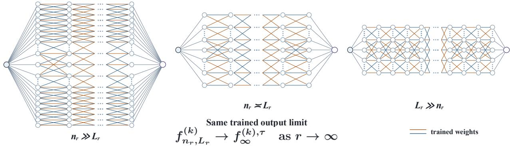  
Figure 1: Commutativity of the width and depth limits. Illustration of three relative order regimes for $( n _ { r } , L _ { r } )$ as $n _ { r } , L _ { r } \to \infty .$ . For the same fixed input and any fixed training iteration $k ,$ all three paths converge to the same trained output limit $f _ { \infty } ^ { ( k ) }$

Definition 2 (Commutativity in probability). Fix a training iteration k. We say that the width and depth limits commute in probability if there exists a deterministic limit $\bar { f } _ { \infty } ^ { ( k ) }$ such that, for every $\varepsilon > 0$

$$
\begin{array} { r } { \mathbb { P } \Big ( \Big | f _ { n , L } ^ { ( k ) } - f _ { \infty } ^ { ( k ) } \Big | > \varepsilon \Big ) \longrightarrow 0 \qquad \mathrm { a s } \operatorname* { m i n } ( n , L ) \to \infty , } \end{array}
$$

where $f _ { n , L } ^ { ( k ) }$ and $f _ { \infty } ^ { ( k ) }$ are both evaluated at some input $x \in \mathbb { R } ^ { d }$

Both notions require the limiting output to be independent of the relative growth of width and depth. Moreover, commutativity in $\mathbb { L } _ { 2 }$ implies commutativity in probability.

## 2.3 Training dynamics

Without loss of generality, we train model (1) by minimizing a quadratic loss function evaluated on single input–target $\mathsf { p a i r } ^ { 3 } \left( x , y _ { \star } \right)$

$$
\mathcal { L } ( W _ { 1 } , \dots , W _ { L } ) = \frac { 1 } { 2 } \big ( f _ { n , L } ( x ) - y _ { \star } \big ) ^ { 2 } .
$$

This setup is used to alleviate the notation in the proofs, and it was used in [22, 10] for similar purposes. Our results can be readily extended to the case of a finite training dataset at the cost of redundant computations.

To minimize the loss, we update the weights using gradient descent (GD)

$$
\boldsymbol { W } _ { \ell } ^ { ( k + 1 ) } = \boldsymbol { W } _ { \ell } ^ { ( k ) } - \eta \nabla _ { \boldsymbol { W } _ { \ell } ^ { ( k ) } } \mathcal { L } , \qquad \ell = 1 , \dots , L , \quad k = 0 , \dots , T - 1 ,\tag{2}
$$

where $\eta > 0$ is the learning rate, fixed independently of n and L, and $W _ { \ell } ^ { ( 0 ) }$ are the weights at initialization, specified above. These initialization rules combined with the depth multiplier $L ^ { - 1 / 2 }$ follow the scaling rules suggested by [5] and [10] to guarantee stability and feature learning as model width n and depth $L$ grow.

For a training step $k ,$ let $A _ { \ell } ^ { ( k ) } : = I + L ^ { - 1 / 2 } W _ { \ell } ^ { ( k ) }$ . The corresponding forward and backward states are defined by

Forward:

$$
Y _ { 0 } ^ { ( k ) } = Y _ { 0 } , ~ Y _ { \ell } ^ { ( k ) } = A _ { \ell } ^ { ( k ) } Y _ { \ell - 1 } ^ { ( k ) } , ~ \ell = 1 , \dots , L ,\tag{3}
$$

Backward:

$$
B _ { L } ^ { ( k ) } = \xi , ~ B _ { \ell - 1 } ^ { ( k ) } = \left( A _ { \ell } ^ { ( k ) } \right) ^ { \top } B _ { \ell } ^ { ( k ) } , ~ \ell = L , \ldots , 1 .
$$

Since we consider a single fixed training pair $( x , y _ { \star } )$ , we omit it from the notation and write the neural network output at training step $k , f _ { n , L } ^ { ( k ) }$ . We also write $\varepsilon _ { n , L } ^ { ( k ) } : = \dot { f } _ { n , L } ^ { ( k ) } - y ,$ . Straightforward calculations give the gradients of the network output w.r.t the hidden weights $\begin{array} { r } { \nabla _ { W _ { \ell } ^ { ( k ) } } f _ { n , L } ^ { ( k ) } = \frac { 1 } { n \sqrt { L } } B _ { \ell } ^ { ( k ) } ( Y _ { \ell - 1 } ^ { ( k ) } ) ^ { \top } } \end{array}$ . The next section studies commutativity after taking one gradient step.

## 3 Width and Depth Limits at $k = 1$

We first develop an intuitive understanding of the problem by analyzing the network output after taking a single gradient step. We show in this case that the width and depth limits commute in probability, but not in $\mathbb { L } _ { 2 }$ (Definition 1, Definition 2). The reason behind this discrepancy is that for a fixed width n, the network output diverges in $\mathbb { L } _ { 2 }$ as depth $L \to \infty$ , while it converges in probability. We first state the convergence in probability result.

Proposition 3.1 (Commutativity in probability after one GD step). After one gradient step,

$$
f _ { n , L } ^ { ( 1 ) } \xrightarrow [ \operatorname* { m i n } \{ n , L \}  \infty ] { \mathbb { P } } f _ { \infty } ^ { ( 1 ) } = \eta y _ { \star } q _ { 0 } e ,
$$

The proof is given in Appendix D, which also establishes commutativity in probability after any fixed finite number of gradient steps. The next result shows that commutativity does not extend to $\mathbb { L } _ { 2 } .$ . In fact, after one gradient step, the depth limit already fails in $\mathbb { L } _ { 2 }$ at every fixed finite width.

Proposition 3.2 (Depth-wise $\mathbb { L } _ { 2 }$ divergence under gradient descent). After the first gradient iteration, for every fixed finite n $\geq 1 , \eta > 0$ , and $\begin{array} { r } { y _ { \star } \in \mathbb { R } , \bar { \operatorname* { l i m } _ { L  \infty } \mathbb { E } } \big | f _ { n , L } ^ { ( 1 ) } \big | ^ { 2 } = + \infty } \end{array}$

Together, Propositions 3.1 and 3.2 show that, after one gradient step, the width and depth limits commute in probability, while the depth-first $\mathbb { L } _ { 2 }$ limit does not exist. Indeed, for each n one may choose $L _ { n } \geq n$ sufficiently large so that $\mathbb { E } | f _ { n , L _ { n } } ^ { ( 1 ) } | ^ { 2 } \geq n$ . Then min $\{ n , L _ { n } \} \to \infty$ . Hence, an unrestricted joint $\mathbb { L } _ { 2 }$ limit cannot hold under ordinary gradient descent. As shown in Appendix $\mathrm { A } ,$ this failure arises from the unbounded first GD update as depth increases. This motivates the clipped gradient descent, a widely used technique to stabilize gradients during training. Specifically, we use the following form of clipped gradient descent with clipping radius $\tau > 0 \colon$

We denote the clipped training trajectory by the superscript τ , and define $\begin{array} { r } { J _ { n , L } ^ { ( k ) , \tau } : = \frac { 1 } { L } \sum _ { \ell = 1 } ^ { L } \| Y _ { \ell - 1 } ^ { ( k ) , \tau } \| _ { n } ^ { 2 } \| B _ { \ell } ^ { ( k ) , \tau } \| _ { n } ^ { 2 } } \end{array}$ . Let $\begin{array} { r } { \gamma _ { n , L } ^ { ( k ) , \tau } : = \eta \varepsilon _ { n , L } ^ { ( k ) , \tau } \operatorname* { m i n } \{ 1 , \tau / \left( | \varepsilon _ { n , L } ^ { ( k ) , \tau } | \sqrt { J _ { n , L } ^ { ( k ) , \tau } } \right) \} , } \end{array}$ 4 where $\varepsilon _ { n , L } ^ { ( k ) , \tau } : = f _ { n , L } ^ { ( k ) , \tau } - y _ { \star }$ . The clipped updates are given by

$$
W _ { \ell } ^ { ( k + 1 ) , \tau } = W _ { \ell } ^ { ( k ) , \tau } - \frac { \gamma _ { n , L } ^ { ( k ) , \tau } } { n \sqrt { L } } B _ { \ell } ^ { ( k ) , \tau } ( Y _ { \ell - 1 } ^ { ( k ) , \tau } ) ^ { \top } .
$$

By definition of $\begin{array} { r } { \gamma _ { n , L } ^ { ( k ) , \tau } , \left( \sum _ { \ell = 1 } ^ { L } \| W _ { \ell } ^ { ( k + 1 ) , \tau } - W _ { \ell } ^ { ( k ) , \tau } \| _ { F } ^ { 2 } \right) ^ { 1 / 2 } = | \gamma _ { n , L } ^ { ( k ) , \tau } | \sqrt { J _ { n , L } ^ { ( k ) , \tau } } \leq \eta \tau . } \end{array}$

Thus, clipping enforces uniform control of each GD update, independently of n and L. The next section establishes width-depth commutativity in $\mathbb { L } _ { 2 }$ under gradient clipping.

## 4 Width–Depth Commutativity during Training

We now state the main result. For any fixed number of training iterations, the output of a linear residual network trained with clipped gradient descent converges to the same deterministic limit along every joint path $( n , L ) \to ( \infty , \infty )$

Theorem 4.1 (Commutative Width and Depth Limits during Training). Fix $T > 0$ number of training steps, and $\tau > 0$ . There exist deterministic limits $f _ { \infty } ^ { ( 0 ) , \tau } , \ldots , f _ { \infty } ^ { ( T ) , \tau }$ and a finite constant $C _ { T }$ , independent of n and $L ,$ such that

$$
\operatorname* { m a x } _ { 0 \leq k \leq T } \left\| f _ { n , L } ^ { ( k ) , \tau } - f _ { \infty } ^ { ( k ) , \tau } \right\| _ { \mathbb { L } _ { 2 } } \leq C _ { T } \left( n ^ { - 1 / 2 } + L ^ { - 1 / 2 } \right) .\tag{4}
$$

The bound in Theorem 4.1 holds along any sequence $n , L \to \infty$ , thus implying the existence of the limit as min $\{ n , L \} \to \infty$ and therefore establishing commutativity in $\mathbb { L } _ { 2 }$

Remark 4.2 (Sharpness in width). The $n ^ { - 1 / 2 }$ term in Theorem 4.1 cannot be improved. At initialization $( k = 0 )$ independence of $\xi$ and $Y _ { L }$ gives $\begin{array} { r } { \mathbb { E } | f _ { n , L } ^ { ( 0 ) } | ^ { 2 } = \frac { 1 } { n } \mathbb { E } \| Y _ { L } ^ { ( 0 ) } \| _ { n } ^ { 2 } = \frac { q _ { 0 } ( 1 + L ^ { - 1 } ) ^ { L } } { n } } \end{array}$ . Since $( 1 + L ^ { - 1 } ) ^ { L } \leq e$ , we have $f _ { n , L } ^ { ( 0 ) } \to 0$

in $\mathbb { L } _ { 2 }$ as $n  \infty .$ , uniformly in L. Hence, $\begin{array} { r } { f _ { \infty } ^ { ( 0 ) , \tau } = 0 . \ \| f _ { n , L } ^ { ( 0 ) } - f _ { \infty } ^ { ( 0 ) , \tau } \| _ { \mathbb { L } _ { 2 } } = \sqrt { \frac { q _ { 0 } ( 1 + L ^ { - 1 } ) ^ { L } } { n } } \ge \sqrt { \frac { q _ { 0 } } { n } } } \end{array}$ , establishing the sharpness of the $n ^ { - 1 / 2 }$ bound. The same cannot be said about the depth rate $L ^ { - 1 / 2 }$ as we will later provide empirical results showing that it is unlikely to be sharp.

## 4.1 Understanding the complexity of commutativity during training

The initialization argument in [15] does not extend directly to commutativity during training because gradient descent couples the residual blocks across layers.

At initialization, $A _ { \rho } ^ { ( 0 ) } = I + L ^ { - 1 / 2 } W _ { \ell }$ for $\ell = 1 , \ldots , L ,$ , where $\{ W _ { \ell } \} _ { \ell = 1 } ^ { L }$ are independent Gaussian matrices. Let $t _ { \ell } = \ell / L$ . Since $L ^ { - 1 / 2 } W _ { \ell }$ has the same Gaussian distribution as a matrix-Brownian increment over an interval of length $1 / L$ , one can construct a matrix Brownian motion M on the same probability space such that

$$
M _ { t _ { \ell } } - M _ { t _ { \ell - 1 } } = L ^ { - 1 / 2 } W _ { \ell } , \qquad \ell = 1 , \ldots , L .
$$

Under this coupling,

$$
Y _ { \ell } ^ { ( 0 ) } = \big ( I + M _ { t _ { \ell } } - M _ { t _ { \ell - 1 } } \big ) Y _ { \ell - 1 } ^ { ( 0 ) } ,
$$

which is the Euler discretization of the solution of the SDE

$$
d Y _ { t } = d M _ { t } Y _ { t } , Y _ { 0 } = W _ { 0 } x .
$$

Let $\Phi _ { s , t }$ denote the solution operator of this SDE, so that $Y _ { t } = \Phi _ { 0 , t } Y _ { 0 }$ . Hayou and Yang [15] show that this Euler approximation converges at rate $O ( L ^ { - 1 / 2 } )$ , with a constant independent of the width n. After taking the depth limit, the resulting finite-width SDE is an interacting particle system. They then compare each coordinate of this system with its McKean–Vlasov limit and obtain a $O ( n ^ { - 1 { \bar { / } } 2 } )$ approximation error in $\mathbb { L } _ { 2 }$ . Together, these two estimates establish that the width and depth limits commute at initialization.

However, after one GD update, the residual blocks are no longer independent across layers. Indeed,

$$
A _ { \ell } ^ { ( 1 ) , \tau } = I + \frac { 1 } { \sqrt { L } } W _ { \ell } ^ { ( 1 ) , \tau } = A _ { \ell } ^ { ( 0 ) } - \frac { \gamma _ { n , L } ^ { ( 0 ) , \tau } } { n L } B _ { \ell } ^ { ( 0 ) } ( Y _ { \ell - 1 } ^ { ( 0 ) } ) ^ { \top } ,
$$

where $Y _ { \ell - 1 } ^ { ( 0 ) } = A _ { \ell - 1 } ^ { ( 0 ) } \cdot \cdot \cdot A _ { 1 } ^ { ( 0 ) } Y _ { 0 } , \quad B _ { \ell } ^ { ( 0 ) } = ( A _ { \ell + 1 } ^ { ( 0 ) } ) ^ { \top } \cdot \cdot \cdot ( A _ { L } ^ { ( 0 ) } ) ^ { \top } \xi  { \mathbf { b } }  { \mathbf { y } } ( 3 ) .$

The forward state $Y _ { \ell - 1 } ^ { ( 0 ) }$ depends on $A _ { 1 } ^ { ( 0 ) } , \ldots , A _ { \ell - 1 } ^ { ( 0 ) }$ , while the backward state ${ B } _ { \ell } ^ { ( 0 ) }$ depends on $A _ { \ell + 1 } ^ { ( 0 ) } , \ldots , A _ { L } ^ { ( 0 ) }$ . Therefore, $W _ { \ell } ^ { ( 1 ) , \tau }$ depends on the initial weights for $j \neq \ell ,$ , so the updated residual blocks are coupled across layers and the independent-increment Brownian coupling used at initialization is no longer available. This coupling also changes the structure of the subsequent width limit. At initialization, the forward state is simply $Y _ { n } ^ { ( 0 ) } ( t ) = \Phi _ { 0 , t } Y _ { 0 }$ . After one GD update, the discrete forward recursion is

$$
Y _ { \ell } ^ { ( 1 ) , \tau } - Y _ { \ell - 1 } ^ { ( 1 ) , \tau } = \frac { 1 } { \sqrt { L } } W _ { \ell } Y _ { \ell - 1 } ^ { ( 1 ) , \tau } - \frac { \gamma _ { n , L } ^ { ( 0 ) , \tau } } { n L } B _ { \ell } ^ { ( 0 ) } ( Y _ { \ell - 1 } ^ { ( 0 ) } ) ^ { \top } Y _ { \ell - 1 } ^ { ( 1 ) , \tau } .
$$

As $L \to \infty$ , the Gaussian term converges to the matrix-Brownian dynamics, while the $L ^ { - 1 }$ gradient term becomes a drift in the depth variable. The continuous-depth state therefore satisfies

$$
\mathrm { d } Y _ { n } ^ { ( 1 ) , \tau } ( t ) = \mathrm { d } M _ { t } Y _ { n } ^ { ( 1 ) , \tau } ( t ) - \frac { \gamma _ { n } ^ { ( 0 ) , \tau } } { n } B _ { n } ^ { ( 0 ) } ( t ) ( Y _ { n } ^ { ( 0 ) } ( t ) ) ^ { \top } Y _ { n } ^ { ( 1 ) , \tau } ( t ) \mathrm { d } t .
$$

Integrating this SDE from 0 to t along the initialization flow Φ gives

$$
Y _ { n } ^ { ( 1 ) , \tau } ( t ) = \Phi _ { 0 , t } Y _ { 0 } - \gamma _ { n } ^ { ( 0 ) , \tau } \int _ { 0 } ^ { t } \Phi _ { s , t } B _ { n } ^ { ( 0 ) } ( s ) \left. Y _ { n } ^ { ( 0 ) } ( s ) , Y _ { n } ^ { ( 1 ) , \tau } ( s ) \right. _ { n } \mathrm { ~ d } s .\tag{5}
$$

Therefore, proving the width convergence of $Y _ { n } ^ { ( 1 ) , \tau }$ also requires controlling the width limits of $B _ { n } ^ { ( 0 ) } , \gamma _ { n } ^ { ( 0 ) , \tau }$ , and $\langle Y _ { n } ^ { ( 0 ) } , Y _ { n } ^ { ( 1 ) , \top } \rangle _ { \mathstrut }$ n.

## 4.2 Proof Overview

To establish Theorem 4.1, we decompose the joint limit into two steps. First, at fixed width n, we compare the discrete network with a continuous-depth model whose output is denoted by $F _ { n } ^ { ( k ) , \tau }$ , obtaining an $L ^ { - 1 / 2 }$ rate uniformly in n. We then compare $F _ { n } ^ { ( k ) , \tau }$ with its deterministic infinite-width limit $f _ { \infty } ^ { \overline { { ( k ) } } , \tau }$ at rate $n ^ { - 1 / 2 }$

$$
f _ { n , L } ^ { ( k ) , \tau } ~ { \xrightarrow { L ^ { - 1 / 2 } } } ~ F _ { n } ^ { ( k ) , \tau } ~ { \xrightarrow { n ^ { - 1 / 2 } } } ~ f _ { \infty } ^ { ( k ) , \tau } .
$$

Depth limit. For the discrete network, for $t \in I _ { \ell } = ( t _ { \ell - 1 } , t _ { \ell } ]$ , define

$$
V _ { n , L } ^ { ( k ) } ( t ) = \sum _ { m < k } \frac { \gamma _ { n , L } ^ { ( m ) , \tau } } { n } B _ { n , L } ^ { ( m ) , \tau } ( t _ { \ell } ) \left( Y _ { n , L } ^ { ( m ) , \tau } ( t _ { \ell - 1 } ) \right) ^ { \top } .
$$

Let $Y _ { n } ^ { ( k ) , \tau }$ and $B _ { n } ^ { ( k ) , \tau }$ denote the finite-width continuous-depth forward and backward states, and let $\gamma _ { n } ^ { ( k ) , \tau }$ denote the clipped coefficient obtained in the continuous-depth model. Their recursive definitions are given in Appendix B.2. For the continuous-depth model, define

$$
V _ { n } ^ { ( k ) } ( t ) = \sum _ { m < k } \frac { \gamma _ { n } ^ { ( m ) , \tau } } { n } B _ { n } ^ { ( m ) , \tau } ( t ) \big ( Y _ { n } ^ { ( m ) , \tau } ( t ) \big ) ^ { \top } .
$$

Let $S _ { i + 1 : j } ^ { n , L } : = A _ { j } ^ { ( 0 ) } \cdot \cdot \cdot A _ { i + 1 } ^ { ( 0 ) } , \quad S _ { j + 1 : j } ^ { n , L } = I _ { }$ , denote the discrete initialization propagator. By construction, $S _ { i + 1 : j } ^ { n , L }$ is the Euler discretization of $\Phi _ { t _ { i } , t _ { j } }$ . At the grid points $t _ { j } = j / L$ , the discrete and continuous forward dynamics take the forms

$$
\begin{array} { l } { { \displaystyle Y _ { n , L } ^ { ( k ) , \tau } ( t _ { j } ) = S _ { 1 : j } ^ { n , L } Y _ { 0 } - \frac { 1 } { L } \sum _ { \ell = 1 } ^ { j } S _ { \ell + 1 : j } ^ { n , L } V _ { n , L } ^ { ( k ) } ( t _ { \ell } ) Y _ { n , L } ^ { ( k ) , \tau } ( t _ { \ell - 1 } ) } , } \\ { { \displaystyle Y _ { n } ^ { ( k ) , \tau } ( t _ { j } ) = \Phi _ { 0 , t _ { j } } Y _ { 0 } - \int _ { 0 } ^ { t _ { j } } \Phi _ { s , t _ { j } } V _ { n } ^ { ( k ) } ( s ) Y _ { n } ^ { ( k ) , \tau } ( s ) \ \mathrm { d } s } . } \end{array}
$$

For each fixed width n, the standard Euler–Maruyama estimate [23] gives $\left\| S _ { 1 : j } ^ { n , L } Y _ { 0 } - \Phi _ { 0 , t _ { j } } Y _ { 0 } \right\| _ { \mathbb { I } . . . } = O ( L ^ { - 1 / 2 } )$ , with a constant that depends on n. This is insufficient for the trained recursion, where $S _ { \ell + 1 : j } ^ { n , L }$ and $\Phi _ { s , t _ { \mathcal { I } } }$ act on $V _ { n , L } ^ { ( k ) } Y _ { n , L } ^ { ( k ) , \tau }$ and $V _ { n } ^ { ( k ) } Y _ { n } ^ { ( k ) , \tau }$ generated at each training iteration. We therefore require an operator-norm estimate that is uniform in the width. In Appendix B.1, we remove this width dependence and show that

$$
\operatorname* { s u p } _ { n \geq 1 } \operatorname* { m a x } _ { 0 \leq i \leq j \leq L } \left\| \left\| S _ { i + 1 : j } ^ { n , L } - \Phi _ { t _ { i } , t _ { j } } \right\| _ { \mathrm { o p } } \right\| _ { \mathbb { L } _ { 2 } } \leq C _ { \mathrm { E u l } } L ^ { - 1 / 2 } ,
$$

where $C _ { \mathrm { E u l } }$ is independent of both n and L (see Proposition B.2).

We then show by induction that this rate is preserved for any finite number of GD updates, following the proof chain below

$$
\begin{array} { r l r } {  { \big ( Y _ { n , L } ^ { ( k ) , \tau } , B _ { n , L } ^ { ( k ) , \tau } \big ) \xrightarrow { \quad } \gamma _ { n , L } ^ { ( k ) , \tau } \xrightarrow { \quad } \quad V _ { n , L } ^ { ( k + 1 ) } \xrightarrow { \quad } \Gamma _ { n , L } ^ { ( k + 1 ) } \quad } } &  \quad \mathrm { ~ } \mathrm { ~ } \mathrm { ~ } \mathrm { ~ } \mathrm { ~ } \mathrm { ~ } \mathrm { ~ } \mathrm { ~ } \mathrm { ~ } \mathrm { ~ } \mathrm { ~ } \mathrm { ~ } \mathrm { ~ } \mathrm { ~ } \mathrm { ~ } \mathrm { ~ } \mathrm { ~ } \mathrm { ~ } \mathrm { ~ } \mathrm { ~ } \mathrm { ~ } \mathrm { ~ } \mathrm { ~ } \mathrm { ~ } \mathrm { ~ } \mathrm { ~ } \mathrm { ~ } \mathrm { ~ } \mathrm { ~ } \mathrm { ~ } \mathrm { ~ } \mathrm { ~ } \mathrm { ~ } \mathrm { ~ } \mathrm { ~ } \mathrm { ~ } \mathrm { ~ } \mathrm { ~ } \mathrm { ~ } \mathrm { ~ } \mathrm { ~ } \mathrm { ~ } \mathrm { ~ } \mathrm { ~ } \mathrm { ~ } \mathrm { ~ } \mathrm { ~ } \mathrm { ~ } \mathrm { ~ } \mathrm { ~ } \mathrm { ~ } \mathrm { ~ } \mathrm { ~ } \mathrm { ~ } \mathrm { ~ } \mathrm { ~ } \mathrm { ~ } \mathrm { ~ } \mathrm { ~ } \mathrm { ~ } \mathrm { ~ } \mathrm { ~ } \mathrm { ~ } \mathrm { ~ } \mathrm { ~ } \mathrm { ~ } \mathrm { ~ } \mathrm { ~ } \mathrm { ~ } \mathrm { ~ } \mathrm { ~ } \mathrm { ~ } \mathrm { ~ } \mathrm { ~ } \mathrm { ~ } \mathrm { ~ } \mathrm { ~ } \mathrm { ~ } \mathrm { ~ } \mathrm { ~ } \mathrm { ~ } \mathrm { ~ } \mathrm { ~ } \mathrm { ~ } \mathrm { ~ } \mathrm { ~ } \mathrm { ~ } \mathrm { ~ } \mathrm { ~ } \mathrm { ~ } \mathrm { ~ } \mathrm { ~ } \mathrm { ~ } \mathrm { ~ } \mathrm { ~ } \mathrm { ~ } \mathrm { ~ } \mathrm { ~ } \mathrm { ~ } \mathrm { ~ } \mathrm { ~ } \mathrm { ~ } \mathrm { ~ } \mathrm   \end{array}
$$

Clipping yields $\| V _ { n , L } ^ { ( k ) } \| _ { L _ { t } ^ { 2 } ( \mathrm { F } ) } \vee \| V _ { n } ^ { ( k ) } \| _ { L _ { t } ^ { 2 } ( \mathrm { F } ) } \leq k \eta \tau$ . Since $T$ is fixed, this bound is uniform over n and L for all $k \leq T$ The $O ( L ^ { - 1 / 2 } )$ rate is therefore preserved throughout the training induction. This gives the following width-uniform depth comparison.

Proposition 4.3 (Width-uniform depth discretization). For every fixed integer $T \geq 0$ , there exists $\begin{array} { r } { C _ { \mathrm { D } } < \infty , } \end{array}$ independent of n and L, such that

$$
\operatorname* { m a x } _ { 0 \leq k \leq T } \left\| f _ { n , L } ^ { ( k ) , \tau } - F _ { n } ^ { ( k ) , \tau } \right\| _ { \mathbb { L } _ { 2 } } \leq C _ { \mathrm { D } } L ^ { - 1 / 2 } .
$$

The complete proof is given in Appendix B.2.

Width limit. The one-step expression (5) already shows the structure that persists at later training iterations. At iteration $k ,$ the forward state involves $B _ { n } ^ { ( r ) , \tau } , \gamma _ { n } ^ { ( r ) , \tau }$ , and $\langle Y _ { n } ^ { ( r ) , \tau } , Y _ { n } ^ { ( k ) , \tau } \rangle _ { n } \mathrm { f o r } r < \bar { k } ,$ , in addition to the matrix-Brownian flow Φ. Since $Y _ { n } ^ { ( k ) , \tau } \in \mathbb { R } ^ { n }$ , the state space itself changes with $n ,$ so there is no direct statewise comparison across widths. We therefore introduce an intermediate n-dimensional surrogate that keeps the finite-width matrix flow Φ, while replacing $\gamma _ { n } ^ { ( r ) , \tau }$ and the empirical inner products by their limiting values. Let $y ^ { ( k ) }$ and $b ^ { ( k ) }$ denote the limiting forward and backward states, and let $\gamma _ { k } ^ { \tau }$ denote the limiting value of $\bar { \gamma _ { n } ^ { ( k ) , \tau } }$ (see Appendix C). Define the surrogate states

$$
\begin{array} { r l } & { \widetilde { Y } _ { n } ^ { ( k ) } ( t ) = \Phi _ { 0 , t } Y _ { 0 } - \displaystyle \sum _ { r < k } \gamma _ { r } ^ { \tau } \int _ { 0 } ^ { t } \Phi _ { s , t } \widetilde { B } _ { n } ^ { ( r ) } ( s ) \left. y ^ { ( r ) } ( s ) , y ^ { ( k ) } ( s ) \right. \mathrm { d } s , } \\ & { \widetilde { B } _ { n } ^ { ( k ) } ( t ) = \Phi _ { t , 1 } ^ { \top } \xi - \displaystyle \sum _ { r < k } \gamma _ { r } ^ { \tau } \int _ { t } ^ { 1 } \Phi _ { t , s } ^ { \top } \widetilde { Y } _ { n } ^ { ( r ) } ( s ) \left. b ^ { ( r ) } ( s ) , b ^ { ( k ) } ( s ) \right. \mathrm { d } s . } \end{array}
$$

Recall that the continuous-depth output is $F _ { n } ^ { ( k ) , \tau } : = \langle \xi , Y _ { n } ^ { ( k ) , \tau } ( 1 ) \rangle _ { n }$ . The surrogate yields the decomposition

$$
F _ { n } ^ { ( k ) , \tau } - f _ { \infty } ^ { ( k ) , \tau } = \underbrace { \left. \xi , Y _ { n } ^ { ( k ) , \tau } ( 1 ) - \widetilde { Y } _ { n } ^ { ( k ) } ( 1 ) \right. _ { n } } _ { \mathrm { ( I ) } } + \underbrace { \left( \left. \xi , \widetilde { Y } _ { n } ^ { ( k ) } ( 1 ) \right. _ { n } - f _ { \infty } ^ { ( k ) , \tau } \right) } _ { \mathrm { ( I I ) } } .
$$

Term (I) measures the discrepancy between the finite-width model and the surrogate, while Term (II) compares the surrogate output with its deterministic limit. To control (I), we compare the finite-width and surrogate states inductively through the following chain:

$$
\begin{array} { r l r } {  { ( Y _ { n } ^ { ( k ) , \tau } , B _ { n } ^ { ( k ) , \tau } ) \xrightarrow { } \gamma _ { n } ^ { ( k ) , \tau } \xrightarrow { } ( Y _ { n } ^ { ( k + 1 ) , \tau } , B _ { n } ^ { ( k + 1 ) , \tau } ) } } \\ { \bigg \downarrow { { O } ( n ^ { - 1 / 2 } ) } } & { { } } & { \downarrow { { O } ( n ^ { - 1 / 2 } ) } } \\ { ( \widetilde { Y } _ { n } ^ { ( k ) } , \widetilde { B } _ { n } ^ { ( k ) } ) \xrightarrow { \forall \zeta _ { n } ^ { ( k ) } } \widetilde { \gamma _ { n } ^ { \tau } } \xrightarrow { \qquad \forall \binom { ( k + 1 ) , \widetilde { D } _ { n } ^ { ( k + 1 ) } } { \widetilde { D } _ { n } ^ { ( k + 1 ) } } \widetilde { B } _ { n } ^ { ( k + 1 ) } } } \end{array}
$$

This gives $( \mathrm { I } ) = O ( n ^ { - 1 / 2 } )$ for every fixed k. For (II), the surrogate output approaches its deterministic limit in two steps:

$$
\begin{array} { r } { \Big \langle \xi , \widetilde { Y } _ { n } ^ { ( k ) } ( 1 ) \Big \rangle _ { n } \xrightarrow { n ^ { - 1 / 2 } } \mathbb { E } \Big [ \Big \langle \xi , \widetilde { Y } _ { n } ^ { ( k ) } ( 1 ) \Big \rangle _ { n } \Big | \Phi \Big ] \xrightarrow { n ^ { - 1 } } \ f _ { \infty } ^ { ( k ) , \tau } . } \end{array}
$$

The first step conditions on the matrix flow Φ and averages out the Gaussian randomness in $Y _ { 0 }$ and $\xi ,$ reducing the conditional mean to normalized traces of products of Φ. The second step shows that these finite-width traces converge to their infinite-width limits at rate $O ( n ^ { - 1 } )$ , yielding $f _ { \infty } ^ { ( k ) , \tau }$

Combining the bounds for (I) and (II) gives the following proposition.

Proposition 4.4 (Width limit of the continuous-depth model). For every fixed integer $T \geq 0$ , there exists $C _ { \mathrm { W } } < \infty$ independent of n, such that

$$
\operatorname* { m a x } _ { 0 \leq k \leq T } \left\| F _ { n } ^ { ( k ) , \tau } - f _ { \infty } ^ { ( k ) , \tau } \right\| _ { \mathbb { L } _ { 2 } } \leq C _ { \mathrm { W } } n ^ { - 1 / 2 } .
$$

The proof is given in Appendix C.

Propositions 4.3 and 4.4 control the depth and width errors, respectively. By the triangle inequality,

$$
\operatorname* { m a x } _ { 0 < k \leq T } \| f _ { n , L } ^ { ( k ) , \tau } - f _ { \infty } ^ { ( k ) , \tau } \| _ { \mathbb { L } _ { 2 } } \leq C _ { \mathrm { D } } L ^ { - 1 / 2 } + C _ { \mathrm { W } } n ^ { - 1 / 2 } ,
$$

which proves Theorem 4.1.

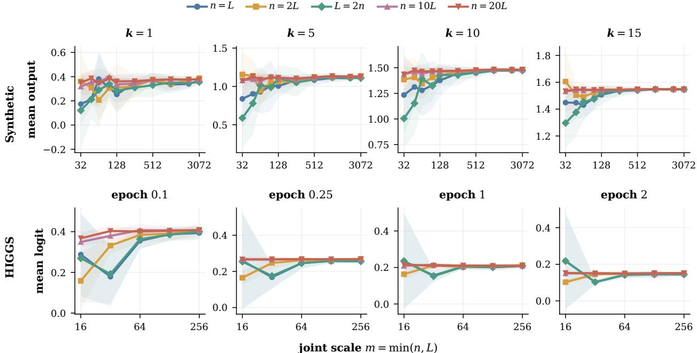  
Figure 2: Commutativity of the width and depth limits during training. Each curve corresponds to a fixed width–depth scaling path and is plotted against the joint scale $m = \operatorname* { m i n } ( n , L )$ . The top row shows the synthetic regression output at training iterations $k \stackrel { - } { = } 1 , 5 , 1 0 , \stackrel { - } { 1 } 5$ , and the bottom row shows the HIGGS logit margin at four training checkpoints. For each task, all configurations are evaluated at the same fixed input. Curves show the mean across 5 model seeds, with shaded regions denoting ±1 standard deviation.

## 5 Experiments

In this section, we empirically study the commutativity of the width and depth limits during training and characterize their finite-size convergence rates. Additional experiments in Appendix G include a single-datum setting aligned with our theory. Code for reproducing the experiments is available at this repository.

## 5.1 Commutativity during Training

We evaluate joint width–depth scaling on synthetic regression and HIGGS binary classification.

Synthetic regression. We generate $N = 1 2 8$ samples $x _ { i } \overset { \mathrm { i . i . d . } } { \sim } \mathcal { N } ( 0 , \Sigma )$ in dimension $d = 1 6 .$ , where $\Sigma = Q \Lambda Q ^ { \top }$ has a geometrically spaced spectrum with condition number 10. For fixed orthonormal directions $\theta _ { 1 } , \theta _ { 2 }$ , the regression targets are

$$
\widetilde { y } _ { i } = \theta _ { 1 } ^ { \top } x _ { i } + 0 . 5 \big ( ( \theta _ { 2 } ^ { \top } x _ { i } ) ^ { 2 } - 1 \big ) , \qquad y _ { i } = \widetilde { y } _ { i } \left( \frac { 1 } { N } \sum _ { j = 1 } ^ { N } \widetilde { y } _ { j } ^ { 2 } \right) ^ { - 1 / 2 } .
$$

We train for 15 full-batch GD iterations with quadratic loss.

HIGGS [24]. HIGGS is a binary classification benchmark with 28 input features. We train the class-1 versus class-0 logit margin using binary logistic loss and minibatch SGD for two epochs with batch size 4096.We use the same data split and minibatch sequence for every width–depth configuration.

For both tasks, we evaluate five width–depth scaling paths, $n = L , n = 2 L , L = 2 n , n = 1 0 L , \mathrm { a n d } n = 2 0 L$ , indexed by the common scale $m = \operatorname* { m i n } ( n , L )$ . Along each path, both width and depth increase while their ratio remains fixed. As shown in Figure 2, the outputs differ across paths at small scales but approach a common value as m increases, consistent with the commutativity established by our theory.

(c) Empirical convergence rates

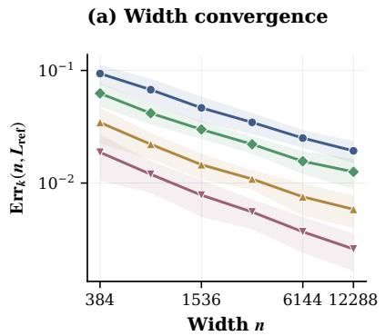

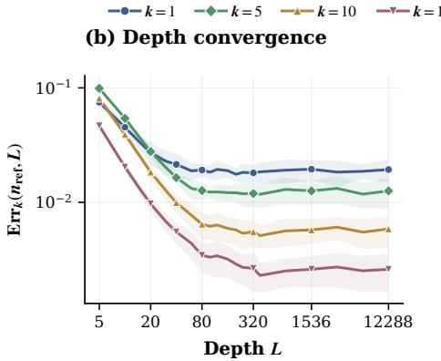

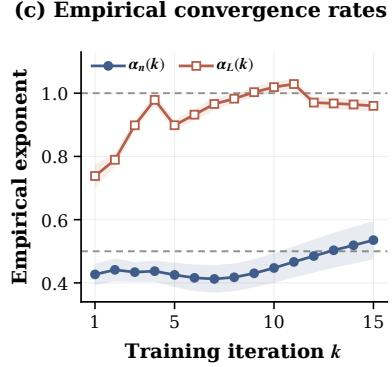  
Figure 3: Width–depth convergence rates. (a) RMS output error as width n increases with depth fixed at $L = 1 2 , 2 8 8$ (b) RMS output error as depth L increases with width fixed at $n = 1 2 , 2 8 8 .$ . Curves in (a)–(b) correspond to training iterations $k \in \{ 1 , 5 , 1 0 , 1 5 \}$ . (c) Empirical convergence exponents for width and depth over training. The width rate remains close to $n ^ { - 1 / 2 }$ , while the depth rate approaches an empirical $L ^ { - 1 }$ rate.

## 5.2 Width–Depth Convergence Rate

We next characterize how the finite-size error scales with width and depth at different training iterations. Since the limiting output is not available in closed form, we construct an empirical reference $\widehat { f } _ { \infty } ^ { ( k ) }$ by averaging the outputs at the largest joint scale $m = 3 0 7 2$ over the five width–depth scaling paths and five seeds. We measure the RMS output error over the $N = 1 2 8$ samples,

$$
\mathrm { E r r } _ { k } ( n , L ) = \left( \frac { 1 } { N } \sum _ { i = 1 } ^ { N } \bigl ( f _ { n , L } ^ { ( k ) } ( x _ { i } ) - \widehat { f } _ { \infty } ^ { ( k ) } ( x _ { i } ) \bigr ) ^ { 2 } \right) ^ { 1 / 2 } .
$$

To quantify how the finite-size error depends on width and depth, we vary one dimension while fixing the other at 12,288. Figure $3 ( \mathrm { a } ) \mathrm { - } ( \mathrm { b } )$ shows the sweeps at $k \in \{ 1 , 5 , 1 0 , 1 5 \}$ . The width error decreases steadily with n, whereas the depth error drops rapidly at small $L$ and then plateaus as finite-width effects become dominant.

Let $n _ { \mathrm { r e f } } = L _ { \mathrm { r e f } } = 1 2 { , } 2 8 8$ , and let $\mathrm { E r r } _ { k } ^ { \mathrm { f l o o r } }$ denote the plateau level of the depth sweep at iteration k. To quantify the convergence rates, we fit

$$
\mathrm { E r r } _ { k } ( n , L _ { \mathrm { r e f } } ) \propto n ^ { - \alpha _ { n } ( k ) } , \qquad \mathrm { E r r } _ { k } ( n _ { \mathrm { r e f } } , L ) \propto L ^ { - \alpha _ { L } ( k ) } ,
$$

where the depth exponent is estimated over the decreasing regime of the RMS error curve. Figure 3(c) shows the fitted exponents over training. The width rate remains close $\tan ^ { - 1 7 2 }$ throughout training, whereas the depth-dependent error decays more rapidly and approaches an empirical $L ^ { - 1 }$ after the initial iterations.

Remark 5.1 (Depth rate). The $L ^ { - 1 / 2 }$ rate in our Theorem 4.1 is an upper bound induced by the discrete-to-continuous estimates in the proof, and is not claimed to be tight. The faster empirical depth rate suggests that the finite-depth bound may be sharpened.

## 5.3 Nonlinear Activations

Our theoretical analysis considers linear residual networks. We next test whether the same width–depth convergence behavior persists with nonlinear residual blocks,

$$
Y _ { \ell } = Y _ { \ell - 1 } + { \frac { 1 } { \sqrt { L } } } W _ { \ell } \phi ( Y _ { \ell - 1 } ) ,
$$

where $\phi$ is applied elementwise. We consider ReLU, tanh, GELU, SiLU, and sigmoid activations, train for 10 updates, and evaluate $m \in \{ 3 2 , 4 8 , 6 4 , 9 6 , 1 2 8 , 2 5 6 \}$ . All other experimental settings are the same as in Section 5.1.

As shown in Figure 4, the outputs along the different width–depth paths converge as the scale grows for all five activations. This behavior persists across training iterations, providing empirical evidence that the observed commutativity is not specific to the linear architecture. However, our current theoretical guarantees remain restricted to linear residual networks.

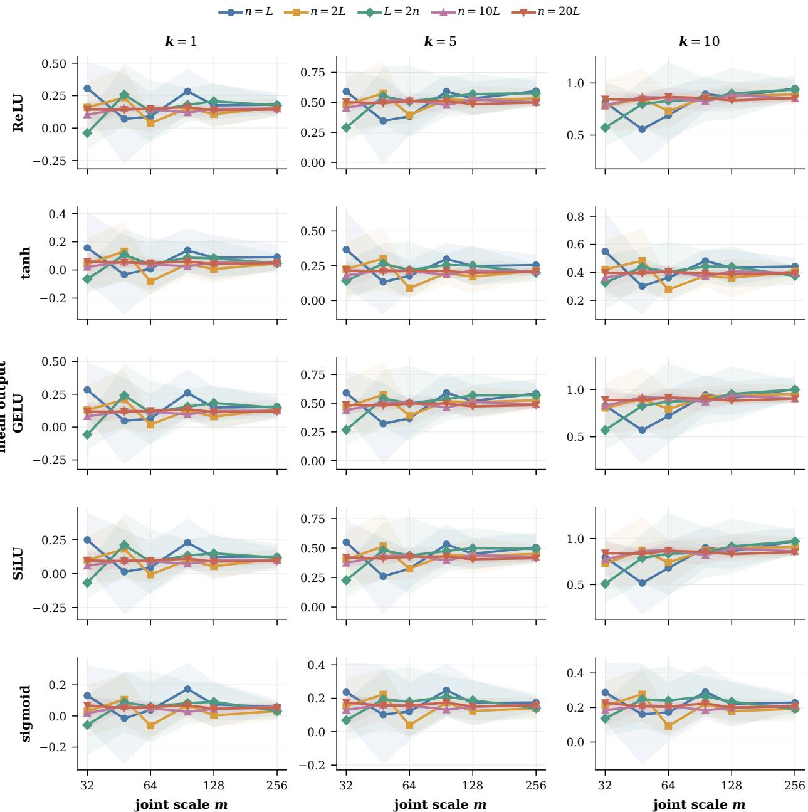  
Figure 4: Width–depth commutativity with nonlinear activations. Rows correspond to activation functions and columns to training iterations. Each panel shows the output at synthetic training input 86 along the five width–depth scaling paths in Section 5.1. Curves show the mean over five model seeds, with shaded regions denoting ±1 standard deviation.

## 6 Conclusion

We studied whether width and depth limits continue to commute during training in linear residual networks. Under ordinary gradient descent, the limits commute in probability after any fixed number of training iterations, while the depth-first $\mathbb { L } _ { 2 }$ limit already fails after one step at every fixed finite width. Under clipped gradient descent, we prove commutativity in $\mathbb { L } _ { 2 }$ for any fixed number of training iterations, with errors of order $\bar { n } ^ { - 1 / 2 }$ and $L ^ { - 1 / 2 }$

## AI use statement

We used OpenAI Codex to assist with proof auditing, consistency checking, manuscript revision, and LATEX formatting.   
We reviewed all AI-assisted work and take responsibility for the final content.

## Reproducibility statement

All theoretical results are proved in the appendices, with the model, initialization, training dynamics, and limiting objects specified in the main text. The empirical results use synthetic data and the publicly available HIGGS dataset. Experimental settings, hyperparameters, and implementation details are provided in Appendix G.

## References

[1] Jared Kaplan, Sam McCandlish, Tom Henighan, Tom B Brown, Benjamin Chess, Rewon Child, Scott Gray, Alec Radford, Jeffrey Wu, and Dario Amodei. Scaling laws for neural language models. arXiv preprint arXiv:2001.08361, 2020.

[2] Xiaohua Zhai, Alexander Kolesnikov, Neil Houlsby, and Lucas Beyer. Scaling vision transformers. In 2022 IEEE/CVF Conference on Computer Vision and Pattern Recognition (CVPR), pages 1204–1213. IEEE, 2022.

[3] Arthur Jacot, Franck Gabriel, and Clément Hongler. Neural tangent kernel: Convergence and generalization in neural networks. Advances in neural information processing systems, 31, 2018.

[4] Song Mei, Theodor Misiakiewicz, and Andrea Montanari. Mean-field theory of two-layers neural networks: dimension-free bounds and kernel limit. In Conference on learning theory, pages 2388–2464. PMLR, 2019.

[5] Greg Yang and Edward J Hu. Feature learning in infinite-width neural networks. arXiv preprint arXiv:2011.14522, 2020.

[6] Eldad Haber and Lars Ruthotto. Stable architectures for deep neural networks. Inverse problems, 34(1):014004, 2018.

[7] Boris Hanin and Mihai Nica. Products of many large random matrices and gradients in deep neural networks. Communications in Mathematical Physics, 376(1):287–322, 2019.

[8] Soufiane Hayou, Eugenio Clerico, Bobby He, George Deligiannidis, Arnaud Doucet, and Judith Rousseau. Stable resnet. In Arindam Banerjee and Kenji Fukumizu, editors, Proceedings ofThe 24th International Conference on Artificial Intelligence and Statistics, volume 130 of Proceedings ofMachine Learning Research, pages 1324–1332. PMLR, 13–15 Apr 2021.

[9] Soufiane Hayou. On the infinite-depth limit of finite-width neural networks. Transactions on Machine Learning Research, 2022.

[10] Greg Yang, Dingli Yu, Chen Zhu, and Soufiane Hayou. Tensor programs vi: Feature learning in infinite depth neural networks. In International Conference on Learning Representations, volume 2024, pages 55099–55150, 2024.

[11] Stefano Peluchetti and Stefano Favaro. Infinitely deep neural networks as diffusion processes. In Silvia Chiappa and Roberto Calandra, editors, Proceedings ofthe Twenty Third International Conference on Artificial Intelligence and Statistics, volume 108 of Proceedings ofMachine Learning Research, pages 1126–1136. PMLR, 2020.

[12] Pierre Marion, Adeline Fermanian, Gérard Biau, and Jean-Philippe Vert. Scaling resnets in the large-depth regime. arXiv, 2022.

[13] Blake Bordelon, Lorenzo Noci, Mufan Bill Li, Boris Hanin, and Cengiz Pehlevan. Depthwise hyperparameter transfer in residual networks: Dynamics and scaling limit, 2023. URL https://arxiv.org/abs/2309.16620.

[14] Lénaïc Chizat. The hidden width of deep resnets: Tight error bounds and phase diagram, 2026. URL https: //arxiv.org/abs/2509.10167.

[15] Soufiane Hayou and Greg Yang. Width and depth limits commute in residual networks. In International Conference on Machine Learning, pages 12700–12723. PMLR, 2023.

[16] Soufiane Hayou. Commutative width and depth scaling in deep neural networks, 2023. URL https://arxiv. org/abs/2310.01683.

[17] Radford M Neal. Bayesian learning for neural networks. Springer Science & Business Media, 2012.

[18] Jaehoon Lee, Yasaman Bahri, Roman Novak, Samuel S Schoenholz, Jeffrey Pennington, and Jascha Sohl-Dickstein. Deep neural networks as gaussian processes. arXiv preprint arXiv:1711.00165, 2017.

[19] Mufan Li, Mihai Nica, and Dan Roy. The neural covariance sde: Shaped infinite depth-and-width networks at initialization. Advances in Neural Information Processing Systems, 35:10795–10808, 2022.

[20] Lorenzo Noci, Chuning Li, Mufan Li, Bobby He, Thomas Hofmann, Chris J Maddison, and Dan Roy. The shaped transformer: Attention models in the infinite depth-and-width limit. Advances in Neural Information Processing Systems, 36:54250–54281, 2023.

[21] Louis-Pierre Chaintron, Lénaïc Chizat, and Javier Maass. Resnets of all shapes and sizes: Convergence of training dynamics in the large-scale limit, 2026. URL https://arxiv.org/abs/2603.18168.

[22] Soufiane Hayou. A proof of learning rate transfer under µP. arXiv preprint arXiv:2511.01734, 2025.

[23] Peter E Kloeden and RA Pearson. The numerical solution of stochastic differential equations. The ANZIAM Journal, 20(1):8–12, 1977.

[24] Pierre Baldi, Peter Sadowski, and Daniel Whiteson. Searching for exotic particles in high-energy physics with deep learning. Nature communications, 5(1):4308, 2014.

[25] Philippe Biane and Roland Speicher. Stochastic calculus with respect to free brownian motion and analysis on wigner space. Probability theory and relatedfields, 112(3):373–409, 1998.

[26] Catherine Emily Iska Redelmeier. Real second-order freeness and the asymptotic real second-order freeness of several real matrix models. International Mathematics Research Notices, 2014(12):3353–3395, 2014.

[27] Mohsen Bayati and Andrea Montanari. The dynamics of message passing on dense graphs, with applications to compressed sensing. IEEE Transactions on Information Theory, 57(2):764–785, February 2011. ISSN 1557-9654. doi: 10.1109/tit.2010.2094817. URL http://dx.doi.org/10.1109/TIT.2010.2094817.

## A Proof of the $\mathbb { L } _ { 2 }$ Divergence at $k = 1$

This section proves Proposition 3.2.

Proof. At initialization, write $A _ { \ell } ^ { ( 0 ) } = I + L ^ { - 1 / 2 } W _ { \ell } , Y _ { \ell } : = Y _ { \ell } ^ { ( 0 ) } , B _ { \ell } : = B _ { \ell } ^ { ( 0 ) }$ , and $f _ { n , L } : = f _ { n , L } ^ { ( 0 ) }$

Set $u _ { n } : = 1 / ( 4 n )$ and $b _ { n } : = 1 + u _ { n }$ . Define $E _ { n , L }$ as the event on which

(i) $1 \leq ( Y _ { 0 } ) _ { i } \leq 2$ and $1 \leq \xi _ { i } \leq 2$ for every i;

(ii) $u _ { n } \sqrt { L } \leq ( W _ { \ell } ) _ { 1 1 } \leq 2 u _ { n } \sqrt { L }$ for every $\ell = 1 , \ldots , L ;$

(iii) $0 \leq ( W _ { \ell } ) _ { i j } \leq 1$ for every ℓ and $( i , j ) \neq ( 1 , 1 )$

Since $q _ { 0 } \ > \ 0 ;$ , condition (i) has strictly positive probability. On $E _ { n , L }$ , every entry of ${ A } _ { \ell } ^ { ( 0 ) }$ is nonnegative and $( A _ { \ell } ^ { ( 0 ) } ) _ { 1 1 } \geq b _ { n }$ for all ℓ.

Hence, the forward recursion gives

$$
( Y _ { \ell } ) _ { 1 } \geq b _ { n } ^ { \ell } , \qquad ( Y _ { \ell } ) _ { i } \geq 1 ,\tag{6}
$$

for every ℓ and i. Similarly, the backward recursion gives

$$
( B _ { \ell } ) _ { 1 } \geq b _ { n } ^ { L - \ell } , \qquad ( B _ { \ell } ) _ { i } \geq 1 .\tag{7}
$$

Therefore,

$$
f _ { n , L } = \frac { 1 } { n } \boldsymbol { \xi } ^ { \top } Y _ { L } \geq \frac { b _ { n } ^ { L } } { n } .
$$

Since $b _ { n } > 1$ , for all sufficiently large L,

$$
\varepsilon _ { n , L } ^ { ( 0 ) } = f _ { n , L } - y _ { \star } \geq \frac { b _ { n } ^ { L } } { 2 n } > 0 .\tag{8}
$$

The first GD update is $\begin{array} { r } { ( A _ { \ell } ^ { ( 1 ) } ) _ { i j } = ( A _ { \ell } ^ { ( 0 ) } ) _ { i j } - \frac { \eta \varepsilon _ { n , L } ^ { ( 0 ) } } { n L } ( B _ { \ell } ) _ { i } ( Y _ { \ell - 1 } ) _ { j } } \end{array}$

On $E _ { n , L }$

$$
\frac { \eta \varepsilon _ { n , L } ^ { ( 0 ) } } { n L } ( B _ { \ell } ) _ { i } ( Y _ { \ell - 1 } ) _ { j } \geq \frac { \eta b _ { n } ^ { L } } { 2 n ^ { 2 } L } \quad \mathrm { f o r ~ a l l ~ } i , j ,
$$

while the first coordinate satisfies the stronger bound

$$
\frac { \eta \varepsilon _ { n , L } ^ { ( 0 ) } } { n L } ( B _ { \ell } ) _ { 1 } ( Y _ { \ell - 1 } ) _ { 1 } \geq \frac { \eta b _ { n } ^ { 2 L - 1 } } { 2 n ^ { 2 } L } .
$$

Since $\eta b _ { n } ^ { L } / ( 2 n ^ { 2 } L ) \to \infty$ , all entries of ${ A } _ { \ell } ^ { ( 1 ) }$ are negative for sufficiently large L. Moreover, the stronger bound on the first coordinate gives

$$
\bigl | ( A _ { \ell } ^ { ( 1 ) } ) _ { 1 1 } \bigr | \geq d _ { n , L } : = \frac { \eta b _ { n } ^ { 2 L - 1 } } { 4 n ^ { 2 } L } , \qquad \ell = 1 , \ldots , L .\tag{9}
$$

Set $P _ { \ell } : = - A _ { \ell } ^ { ( 1 ) }$ . On $E _ { n , L }$ , every entry of $P _ { \ell }$ is positive. Therefore,

$$
\big | f _ { n , L } ^ { ( 1 ) } \big | = \frac { 1 } { n } \xi ^ { \top } P _ { L } \cdot \cdot \cdot P _ { 1 } Y _ { 0 } \geq \frac { 1 } { n } d _ { n , L } ^ { L } .\tag{10}
$$

It remains to estimate the probability of $E _ { n , L }$ . Define

$$
p _ { n , L } : = \mathbb { P } \Big ( u _ { n } \sqrt { L } \leq ( W _ { \ell } ) _ { 1 1 } \leq 2 u _ { n } \sqrt { L } \Big ) , \qquad q _ { n } : = \mathbb { P } ( 0 \leq ( W _ { \ell } ) _ { i j } \leq 1 ) ,
$$

where $( i , j ) \neq ( 1 , 1 )$ . These probabilities do not depend on ℓ, since all entries of $W _ { \ell }$ are identically distributed. Also, let

$$
r _ { n } : = \mathbb { P } ( 1 \leq ( Y _ { 0 } ) _ { i } \leq 2 , 1 \leq \xi _ { i } \leq 2 { \mathrm { ~ f o r ~ a l l ~ } } i ) > 0 .
$$

By independence,

$$
\mathbb { P } ( E _ { n , L } ) = r _ { n } p _ { n , L } ^ { L } q _ { n } ^ { ( n ^ { 2 } - 1 ) L } .\tag{11}
$$

Since $( W _ { \ell } ) _ { 1 1 } \sim { \mathcal { N } } ( 0 , n ^ { - 1 } )$ , its density is $\phi _ { n } ( w ) = \sqrt { n / ( 2 \pi ) } \exp ( - n w ^ { 2 } / 2 )$ , which is decreasing on $[ 0 , \infty )$ . Therefore,

$$
p _ { n , L } \geq u _ { n } \sqrt { L } \sqrt { \frac { n } { 2 \pi } } \exp ( - 2 n u _ { n } ^ { 2 } L ) .\tag{12}
$$

Combining (11) and (12) gives

$$
\log \mathbb { P } ( E _ { n , L } ) \geq - 2 n u _ { n } ^ { 2 } L ^ { 2 } + \frac { 1 } { 2 } L \log L + c _ { n } L + \log r _ { n } ,\tag{13}
$$

where $c _ { n } : = ( n ^ { 2 } - 1 ) \log q _ { n } + \log u _ { n } + { \textstyle { \frac { 1 } { 2 } } } \log ( n / ( 2 \pi ) )$ depends only on n.

Using (10),

$$
\mathbb { E } \big | f _ { n , L } ^ { ( 1 ) } \big | ^ { 2 } \geq \mathbb { P } ( E _ { n , L } ) \frac { d _ { n , L } ^ { 2 L } } { n ^ { 2 } } .
$$

Together with (9) and (13), this yields

$$
\log \mathbb { E } \big | f _ { n , L } ^ { ( 1 ) } \big | ^ { 2 } \geq \kappa _ { n } L ^ { 2 } - \frac { 3 } { 2 } L \log L + O _ { n , \eta } ( L ) ,\tag{14}
$$

where $\kappa _ { n } : = 4$ log $b _ { n } - 2 n u _ { n } ^ { 2 }$

Since $u _ { n } = 1 / ( 4 n ) \leq 1$ and $\log ( 1 + x ) \geq x / 2$ for $x \in [ 0 , 1$ ],

$$
\kappa _ { n } = 4 \log ( 1 + u _ { n } ) - 2 n u _ { n } ^ { 2 } \geq 2 u _ { n } - 2 n u _ { n } ^ { 2 } = \frac { 3 } { 8 n } > 0 .
$$

Dividing (14) by $L ^ { 2 }$ and letting $L \to \infty$ gives

$$
\mathbb { E } { \lvert f _ { n , L } ^ { ( 1 ) } \rvert } ^ { 2 } \longrightarrow + \infty .
$$

This proves Proposition 3.2.

## B Depth Discretization

We prove Proposition 4.3 by comparing the trained residual network with the continuous-depth finite-width model. We first compare the discrete and continuous representations $Y _ { n , L } ^ { ( k ) , \tau }$ and $Y _ { n } ^ { ( k ) , \tau }$ . The corresponding estimate for $B _ { n , L } ^ { ( k ) , \tau }$ and $B _ { n } ^ { ( k ) , \tau }$ follows by depth reversal and transposition; see Appendix B.2. Here, $F _ { n } ^ { ( k ) , \tau }$ and ${ \mathcal { J } } _ { n } ^ { ( k ) , \tau }$ denote the continuous-depth finite-width limits of $f _ { n , L } ^ { ( k ) , \tau }$ and $J _ { n , L } ^ { ( k ) , \tau }$ , respectively. Moreover, $V _ { n , L } ^ { ( k ) }$ denotes the cumulative parameter update after k training steps for the finite-depth network, while $V _ { n } ^ { ( k ) }$ denotes its continuous-depth limit. Their definitions are given in Appendix B.2.

The depth comparison follows the chain

$$
S _ { i + 1 : j } ^ { n , L } \xrightarrow { L ^ { - 1 / 2 } } \Phi _ { t _ { i } , t _ { j } } ,
$$

followed by the finite-training induction

$$
\begin{array} { r l } & { V _ { n , L } ^ { ( k ) } \xrightarrow { L ^ { - 1 / 2 } } V _ { n } ^ { ( k ) } \implies \left( Y _ { n , L } ^ { ( k ) , \tau } , B _ { n , L } ^ { ( k ) , \tau } \right) \xrightarrow { L ^ { - 1 / 2 } } \left( Y _ { n } ^ { ( k ) , \tau } , B _ { n } ^ { ( k ) , \tau } \right) } \\ & { \implies \left( f _ { n , L } ^ { ( k ) , \tau } , J _ { n , L } ^ { ( k ) , \tau } \right) \xrightarrow { L ^ { - 1 / 2 } } \left( F _ { n } ^ { ( k ) , \tau } , \mathcal { T } _ { n } ^ { ( k ) , \tau } \right) \implies V _ { n , L } ^ { ( k + 1 ) } \xrightarrow { L ^ { - 1 / 2 } } V _ { n } ^ { ( k + 1 ) } . } \end{array}
$$

## B.1 Width-uniform base approximation

Let

$$
t _ { i } : = \frac { i } { L } , \qquad S _ { i + 1 : j } ^ { n , L } : = A _ { j } ^ { ( 0 ) } \cdot \cdot \cdot A _ { i + 1 } ^ { ( 0 ) } , \qquad 0 \leq i \leq j \leq L ,
$$

with $S _ { j + 1 : j } ^ { n , L } = I$ . Couple the Gaussian residual matrices with an $n \times n$ matrix Brownian motion M through

$$
M _ { t _ { j } } - M _ { t _ { j - 1 } } = L ^ { - 1 / 2 } W _ { j } ,
$$

and let $\Phi _ { s , t }$ solve

$$
\mathrm { d } \Phi _ { s , t } = \mathrm { d } M _ { t } \Phi _ { s , t } , \qquad \Phi _ { s , s } = I .
$$

Lemma B.1 (Maximal inequality for matrix-Brownian integrals). Let $M _ { t } = n ^ { - 1 / 2 } ( \beta _ { \alpha \beta } ( t ) ) _ { \alpha , \beta = 1 } ^ { n }$ , where the $\beta _ { \alpha \beta }$ are independent standard Brownian motions. Let ψ be a predictable $\mathbb { R } ^ { n }$ -valued process satisfying $\begin{array} { r l } { \int _ { a } ^ { b } \| \psi _ { s } \| _ { L ^ { r } ( \Omega ; \mathbb { R } ^ { n } ) } ^ { 2 } } & { { } } \end{array}$ ds $< \infty$ for some $r \geq 2$ , and set $\textstyle Z _ { t } : = \int _ { a } ^ { t } \mathrm { d } M _ { s } \psi _ { s }$ for $a \leq t \leq b .$ . Then

$$
\left\| \operatorname* { s u p } _ { a \leq u \leq t } \| Z _ { u } \| _ { 2 } \right\| _ { L ^ { r } } \leq K _ { r , n } \left( \int _ { a } ^ { t } \| \psi _ { s } \| _ { L ^ { r } ( \Omega ; \mathbb { R } ^ { n } ) } ^ { 2 } \mathrm { d } s \right) ^ { 1 / 2 } , \qquad K _ { r , n } : = \frac { r } { r - 1 } \sqrt { 1 + \frac { r - 2 } { n } } .\tag{15}
$$

Proof. Writing $Z _ { t } = ( Z _ { 1 } ( t ) , \ldots , Z _ { n } ( t ) ) ^ { \top }$ , we have $\begin{array} { r } { \mathrm { d } Z _ { \alpha } ( t ) = n ^ { - 1 / 2 } \sum _ { \beta = 1 } ^ { n } \psi _ { \beta } ( t ) \ \mathrm { d } \beta _ { \alpha \beta } ( t ) } \end{array}$ and hence $\mathrm { d } \langle Z _ { \alpha } , Z _ { \gamma } \rangle _ { t } =$ $\delta _ { \alpha \gamma } n ^ { - 1 } \| \psi _ { t } \| _ { 2 } ^ { 2 }$ dt. Itô’s formula applied to $\| Z _ { t } \| _ { 2 } ^ { r }$ gives

$$
\frac { \mathrm { d } } { \mathrm { d } t } \mathbb { E } \| Z _ { t } \| _ { 2 } ^ { r } = \frac { r ( r + n - 2 ) } { 2 n } \mathbb { E } \big [ \| Z _ { t } \| _ { 2 } ^ { r - 2 } \| \psi _ { t } \| _ { 2 } ^ { 2 } \big ] .\tag{16}
$$

By Hölder’s inequality,

$$
\begin{array} { r } { \mathbb { E } \big [ \| Z _ { t } \| _ { 2 } ^ { r - 2 } \| \psi _ { t } \| _ { 2 } ^ { 2 } \big ] \leq \big ( \mathbb { E } \| Z _ { t } \| _ { 2 } ^ { r } \big ) ^ { ( r - 2 ) / r } \| \psi _ { t } \| _ { L ^ { r } ( \Omega ; \mathbb { R } ^ { n } ) } ^ { 2 } . } \end{array}
$$

Substituting this into (16) yields

$$
\frac { \mathrm { d } } { \mathrm { d } t } \big ( \mathbb { E } \| Z _ { t } \| _ { 2 } ^ { r } \big ) ^ { 2 / r } \leq \frac { r + n - 2 } { n } \| \psi _ { t } \| _ { L ^ { r } ( \Omega ; \mathbb { R } ^ { n } ) } ^ { 2 } .
$$

Since $Z _ { a } = 0$ , integration gives

$$
\| Z _ { t } \| _ { L ^ { r } ( \Omega ; \mathbb { R } ^ { n } ) } \leq \sqrt { 1 + \frac { r - 2 } { n } } \left( \int _ { a } ^ { t } \| \psi _ { s } \| _ { L ^ { r } ( \Omega ; \mathbb { R } ^ { n } ) } ^ { 2 } \ \mathrm { d } s \right) ^ { 1 / 2 } .\tag{17}
$$

Since $\| Z _ { t } \| _ { 2 }$ is a nonnegative submartingale, Doob’s inequality and (17) give (15).

Proposition B.2 (Width-uniform discrete-to-continuous comparison). For every $p \geq 2$ , there are finite constants $C _ { \mathrm { E u l } } \bar { ( } p ) , C _ { \mathrm { b a s e } } ( p )$ , and $C _ { \mathrm { r e g } } (  { p } )$ , independent of n and $L ,$ such that

$$
\operatorname* { s u p } _ { n \geq 1 } \operatorname* { m a x } _ { 0 \leq i \leq j \leq L } \left\| \left\| S _ { i + 1 : j } ^ { n , L } - \Phi _ { t _ { i } , t _ { j } } \right\| _ { \mathrm { o p } } \right\| _ { L ^ { p } } \leq C _ { \mathrm { E u l } } ( p ) L ^ { - 1 / 2 } ,\tag{18}
$$

$$
\operatorname* { s u p } _ { n \geq 1 } \operatorname* { s u p } _ { 0 \leq s \leq 1 } \left\| \operatorname* { s u p } _ { s \leq t \leq 1 } \| \Phi _ { s , t } \| _ { \mathrm { o p } } \right\| _ { L ^ { p } } + \operatorname* { s u p } _ { n , L } \operatorname* { m a x } _ { 0 \leq i \leq L } \left\| \operatorname* { m a x } _ { i \leq j \leq L } \| S _ { i + 1 : j } ^ { n , L } \| _ { \mathrm { o p } } \right\| _ { L ^ { p } } \leq C _ { \mathrm { b a s e } } ( p ) .\tag{19}
$$

Moreover, for every $0 \leq a \leq b \leq 1$ ,

$$
\operatorname* { s u p } _ { n \geq 1 } \bigg \| \operatorname* { s u p } _ { a \leq s \leq b } \big ( \| \Phi _ { a , s } - I \| _ { \mathrm { o p } } + \| \Phi _ { s , b } - I \| _ { \mathrm { o p } } \big ) \bigg \| _ { L ^ { p } } \leq C _ { \mathrm { r e g } } ( p ) \sqrt { b - a } .\tag{20}
$$

Proof. Fix $0 \leq i \leq L$ and a deterministic Euclidean unit vector $v ,$ and set $U _ { t } : = \Phi _ { t _ { i } , t } v$ for $t \in [ t _ { i } , 1 ]$ . Writing $M _ { t } = n ^ { - 1 / 2 } ( \beta _ { \alpha \beta } ( t ) ) _ { \alpha , \beta = 1 } ^ { n }$ , where the $\beta _ { \alpha \beta }$ are independent standard Brownian motions, U solves $\mathrm { d } U _ { t } = \mathrm { d } M _ { t } U _ { t }$ with $U _ { t _ { i } } = v$

We first check the assumptions of the standard strong Euler–Maruyama estimate. For $u , w \in \mathbb { R } ^ { n }$ and $\delta > 0 ,$ independence of the Brownian entries gives

$$
\mathbb { E } \left[ \Vert ( M _ { t + \delta } - M _ { t } ) ( u - w ) \Vert _ { 2 } ^ { 2 } \right] = \delta \Vert u - w \Vert _ { 2 } ^ { 2 } .
$$

Thus the diffusion coefficient is globally Lipschitz with constant one, uniformly in n. The same identity with $u - w$ replaced by u gives the linear-growth condition, again with a constant independent of n.

Under the coupling above, the Euler–Maruyama recursion on $\{ t _ { j } \} _ { j = i } ^ { L }$ is

$$
\begin{array} { r } { U _ { t _ { j } } ^ { L } = \big ( I + L ^ { - 1 / 2 } W _ { j } \big ) U _ { t _ { j - 1 } } ^ { L } , \qquad U _ { t _ { i } } ^ { L } = v , } \end{array}
$$

so $\begin{array} { r } { U _ { t _ { j } } ^ { L } = S _ { i + 1 : j } ^ { n , L } } \end{array}$ . Therefore, for every fixed n and $p \geq 2 .$ , the standard strong Euler–Maruyama theorem gives

$$
\operatorname* { m a x } _ { i \leq j \leq L } \left\| S _ { i + 1 : j } ^ { n , L } v - \Phi _ { t _ { i } , t _ { j } } v \right\| _ { L ^ { p } } \leq C _ { n , p } L ^ { - 1 / 2 } .
$$

This estimate controls one deterministic direction, whereas (18) requires an operator-norm bound with a constant uniform in n. We therefore track the dependence on both the moment order and the width.

For every fixed n and $r \geq 2 \AA$ , the standard moment estimate for globally Lipschitz SDEs gives $\begin{array} { r } { \int _ { t _ { i } } ^ { 1 } \| U _ { s } \| _ { L ^ { r } } ^ { 2 } \ \mathrm { d } s < \infty } \end{array}$ Taking $\psi _ { s } = U _ { s }$ in Lemma B.1 and using $\begin{array} { r } { U _ { t } = v + \int _ { t _ { i } } ^ { t } \mathrm { d } M _ { s } U _ { s } . } \end{array}$ set $F ( t ) : = \| \operatorname* { s u p } _ { t _ { i } \leq u \leq t } \| U _ { u } \| _ { 2 } \| _ { L ^ { r } }$ . Then

$$
F ( t ) ^ { 2 } \leq 2 + 2 K _ { r , n } ^ { 2 } \int _ { t _ { i } } ^ { t } F ( s ) ^ { 2 } ~ \mathrm d s .
$$

Gronwall’s inequality gives

$$
\left\| \operatorname* { s u p } _ { t _ { i } \le t \le 1 } \| U _ { t } \| _ { 2 } \right\| _ { L ^ { r } } \le \sqrt { 2 } e ^ { K _ { r , n } ^ { 2 } } .\tag{21}
$$

We next control the variation of U within one mesh interval. For $i < \ell \leq L$ and $s \in [ t _ { \ell - 1 } , t _ { \ell } ]$ ，

$$
U _ { s } - U _ { t _ { \ell - 1 } } = \int _ { t _ { \ell - 1 } } ^ { s } \mathrm { d } M _ { u } U _ { u } .
$$

Lemma B.1 on $[ t _ { \ell - 1 } , t _ { \ell } ]$ , together with (21), gives

$$
\begin{array} { r } { \left\| { \underset { t _ { \ell - 1 } \leq s \leq t _ { \ell } } { \operatorname* { s u p } } } \left\| \boldsymbol U _ { s } - \boldsymbol U _ { t _ { \ell - 1 } } \right\| _ { 2 } \right\| _ { L ^ { r } } \leq \sqrt { 2 } K _ { r , n } e ^ { K _ { r , n } ^ { 2 } } L ^ { - 1 / 2 } . } \end{array}\tag{22}
$$

Let $U ^ { L }$ denote the continuous Euler interpolation,

$$
U _ { t } ^ { L } = v + \int _ { t _ { i } } ^ { t } \mathrm { d } M _ { s } U _ { \pi _ { L } ( s ) } ^ { L } , \qquad \pi _ { L } ( s ) = t _ { \ell - 1 } \quad \mathrm { f o r } s \in ( t _ { \ell - 1 } , t _ { \ell } ] .
$$

At the grid points, $U _ { t _ { j } } ^ { L } = S _ { i + 1 : j } ^ { n , L } v$ , and

$$
U _ { t } ^ { L } - U _ { t } = \int _ { t _ { i } } ^ { t } \mathrm { d } M _ { s } \left( U _ { \pi _ { L } ( s ) } ^ { L } - U _ { \pi _ { L } ( s ) } + U _ { \pi _ { L } ( s ) } - U _ { s } \right) .
$$

The Euler interpolation $U ^ { L }$ has finite r-th moments for every fixed $n , L ,$ and $r \geq 2$ . Setting $E ( t ) : = \| \operatorname { s u p } _ { t _ { i } \leq u \leq t } \| U _ { u } ^ { L } -$ $U _ { u } \| _ { 2 } \| _ { L ^ { r } }$ , Lemma B.1 and (22) give

$$
E ( t ) ^ { 2 } \leq 2 K _ { r , n } ^ { 2 } \int _ { t _ { i } } ^ { t } E ( s ) ^ { 2 } \ \mathrm { d } s + 4 K _ { r , n } ^ { 4 } e ^ { 2 K _ { r , n } ^ { 2 } } L ^ { - 1 } .
$$

Gronwall’s inequality therefore gives

$$
\left\| \operatorname* { s u p } _ { t _ { i } \leq t \leq 1 } \| U _ { t } ^ { L } - U _ { t } \| _ { 2 } \right\| _ { L ^ { r } } \leq 2 K _ { r , n } ^ { 2 } e ^ { 2 K _ { r , n } ^ { 2 } } L ^ { - 1 / 2 } .\tag{23}
$$

To obtain the operator-norm estimate uniformly in $n ,$ let $\mathcal { N }$ be a deterministic $1 / 2 – \mathrm { n e t }$ of the Euclidean unit sphere with $| { \mathcal { N } } | \leq 5 ^ { n }$ , and set $r = 2 \lceil \operatorname* { m a x } \{ n , p , 4 \} / 2 \rceil$ . Then $r \geq n , p , 5 ^ { n / r } \leq 5$ , and

$$
K _ { r , n } ^ { 2 } = \left( { \frac { r } { r - 1 } } \right) ^ { 2 } \left( 1 + { \frac { r - 2 } { n } } \right) \leq 2 ( p + 3 ) .\tag{24}
$$

The $1 / 2 \cdot$ -net inequality gives

$$
\left\| S _ { i + 1 : j } ^ { n , L } - \Phi _ { t _ { i } , t _ { j } } \right\| _ { \mathrm { o p } } \leq 2 \operatorname* { m a x } _ { v \in \mathcal { N } } \left\| \big ( S _ { i + 1 : j } ^ { n , L } - \Phi _ { t _ { i } , t _ { j } } \big ) v \right\| _ { 2 } .
$$

Hence

$$
\left\| \left\| S _ { i + 1 : j } ^ { n , L } - \Phi _ { t _ { i } , t _ { j } } \right\| _ { \mathrm { o p } } \right\| _ { L ^ { p } } \leq 2 | \mathcal { N } | ^ { 1 / r } \operatorname* { m a x } _ { v \in \mathcal { N } } \left\| \left\| \left( S _ { i + 1 : j } ^ { n , L } - \Phi _ { t _ { i } , t _ { j } } \right) v \right\| _ { 2 } \right\| _ { L ^ { r } } .
$$

Since $r \geq n .$ , the factor $| \mathcal { N } | ^ { 1 / r }$ is bounded uniformly in $n ,$ , while (24) gives a bound on $K _ { r , n }$ that is also independent of n. Applying (23), uniformly over the starting index i, proves (18).

Applying the same net estimate to (21), and starting the same SDE at an arbitrary deterministic $s \in [ 0 , 1 ]$ , gives

$$
\operatorname* { s u p } _ { n \geq 1 } \operatorname* { s u p } _ { 0 \leq s \leq 1 } \left\| \operatorname* { s u p } _ { s \leq t \leq 1 } \| \Phi _ { s , t } \| _ { \mathrm { o p } } \right\| _ { L ^ { p } } \leq 1 0 \sqrt { 2 } e ^ { 2 ( p + 3 ) } .
$$

Moreover, since $\| U _ { t } ^ { L } \| _ { 2 } \leq \| U _ { t } \| _ { 2 } + \| U _ { t } ^ { L } - U _ { t } \| _ { 2 } , ( 2 1 )$ and (23), followed by the same net estimate, give

$$
\operatorname* { s u p } _ { n , L } \operatorname* { m a x } _ { 0 \leq i \leq L } \left\| \operatorname* { m a x } _ { i \leq j \leq L } \| S _ { i + 1 : j } ^ { n , L } \| _ { \mathrm { o p } } \right\| _ { L ^ { p } } \leq 1 0 \sqrt { 2 } e ^ { 2 ( p + 3 ) } + 4 0 ( p + 3 ) e ^ { 4 ( p + 3 ) } .
$$

Thus, (19) holds with $C _ { \mathrm { b a s e } } ( p ) : = 2 0 \sqrt { 2 } e ^ { 2 ( p + 3 ) } + 4 0 ( p + 3 ) e ^ { 4 ( p + 3 ) }$

We also need the variation of the base flow over a short depth interval. Fix $0 \leq a \leq b \leq 1$ . For every deterministic unit vector v,

$$
( \Phi _ { a , s } - I ) v = \int _ { a } ^ { s } \mathrm { d } M _ { u } \Phi _ { a , u } v , \qquad a \leq s \leq b .
$$

Applying Lemma B.1 on $[ a , b ]$ , using (21), and then applying the same net estimate gives

$$
\operatorname* { s u p } _ { n \geq 1 } \Big \| \operatorname* { s u p } _ { a \leq s \leq b } \| \Phi _ { a , s } - I \| _ { \mathrm { o p } } \Big \| _ { L ^ { p } } \leq C _ { \mathrm { r e g } } ( p ) \sqrt { b - a } .
$$

It remains to control the flow when the right endpoint is fixed. For fixed $b ,$ define

$$
\begin{array} { r } { \check { M } _ { u } : = ( M _ { b } - M _ { b - u } ) ^ { \top } , \qquad 0 \leq u \leq b - a . } \end{array}
$$

Then $\check { M }$ has the same law as $M ,$ and its forward flow satisfies $\check { \Phi } _ { 0 , u } = \Phi _ { b - u , b } ^ { \top }$

Applying the preceding estimate to $\check { \Phi }$ and using $\| \Phi _ { b - u , b } ^ { \top } - I \| _ { \mathrm { o p } } = \| \Phi _ { b - u , b } - I \| _ { \mathrm { o p } }$ gives

$$
\operatorname* { s u p } _ { n \geq 1 } \Big \| \operatorname* { s u p } _ { a \leq s \leq b } \| \Phi _ { s , b } - I \| _ { \mathrm { o p } } \Big \| _ { L ^ { p } } \leq C _ { \mathrm { r e g } } ( p ) \sqrt { b - a } .
$$

Combining the two estimates proves (20).

## B.2 Finite-training depth comparison

We now show that the $L ^ { - 1 / 2 }$ rate is preserved through every fixed training step.

We first define the finite-width continuous-depth training dynamics. Set $V _ { n } ^ { ( 0 ) } ( t ) : = 0$ . Given $V _ { n } ^ { ( k ) }$ , let the forward and backward states satisfy

$$
Y _ { n } ^ { ( k ) , \tau } ( t ) = \Phi _ { 0 , t } Y _ { 0 } - \int _ { 0 } ^ { t } \Phi _ { s , t } V _ { n } ^ { ( k ) } ( s ) Y _ { n } ^ { ( k ) , \tau } ( s ) \ \mathrm { d } s ,\tag{25}
$$

$$
B _ { n } ^ { ( k ) , \tau } ( t ) = \Phi _ { t , 1 } ^ { \top } \xi - \int _ { t } ^ { 1 } \Phi _ { t , s } ^ { \top } V _ { n } ^ { ( k ) } ( s ) ^ { \top } B _ { n } ^ { ( k ) , \tau } ( s ) \ \mathrm { d } s .\tag{26}
$$

Let $F _ { n } ^ { ( k ) , \tau } : = \langle \xi , Y _ { n } ^ { ( k ) , \tau } ( 1 ) \rangle _ { n }$ and

$$
\mathcal { T } _ { n } ^ { ( k ) , \tau } : = \int _ { 0 } ^ { 1 } \| Y _ { n } ^ { ( k ) , \tau } ( t ) \| _ { n } ^ { 2 } \| B _ { n } ^ { ( k ) , \tau } ( t ) \| _ { n } ^ { 2 } \mathrm { d } t .
$$

Define $\gamma _ { n } ^ { ( k ) , \tau } : = \eta \big ( F _ { n } ^ { ( k ) , \tau } - y _ { \star } \big )$ min $\left\{ 1 , \frac { \tau } { | F _ { n } ^ { ( k ) , \tau } - y _ { \star } | \sqrt { \mathcal { I } _ { n } ^ { ( k ) , \tau } } } \right\}$ , where the multiplier inside the minimum is set to one if the denominator vanishes. For $k < \grave { T }$ , set

$$
V _ { n } ^ { ( k + 1 ) } ( t ) = V _ { n } ^ { ( k ) } ( t ) + \frac { \gamma _ { n } ^ { ( k ) , \tau } } { n } B _ { n } ^ { ( k ) , \tau } ( t ) \big ( Y _ { n } ^ { ( k ) , \tau } ( t ) \big ) ^ { \top } .
$$

For $t \in I _ { \ell } : = ( t _ { \ell - 1 } , t _ { \ell } ]$ , define the discrete cumulative update by

$$
V _ { n , L } ^ { ( k ) } ( t ) = \sum _ { m < k } \frac { \gamma _ { n , L } ^ { ( m ) , \tau } } { n } B _ { n , L } ^ { ( m ) , \tau } ( t _ { \ell } ) \left( Y _ { n , L } ^ { ( m ) , \tau } ( t _ { \ell - 1 } ) \right) ^ { \top } .
$$

Iterating the continuous update gives

$$
V _ { n } ^ { ( k ) } ( t ) = \sum _ { m < k } \frac { \gamma _ { n } ^ { ( m ) , \tau } } { n } B _ { n } ^ { ( m ) , \tau } ( t ) \big ( Y _ { n } ^ { ( m ) , \tau } ( t ) \big ) ^ { \top } .
$$

For the cumulative updates above, we write $\begin{array} { r } { \| V \| _ { L _ { t } ^ { 2 } ( \mathrm { F } ) } : = \left( \int _ { 0 } ^ { 1 } \| V ( t ) \| _ { \mathrm { F } } ^ { 2 } ~ \mathrm { d } t \right) ^ { 1 / 2 } } \end{array}$

By the rank-one structure of the updates and the definitions of $J _ { n , L } ^ { ( m ) , \tau }$ and ${ \mathcal { I } } _ { n } ^ { ( m ) , \tau }$

$$
\left( \frac { 1 } { L } \sum _ { \ell = 1 } ^ { L } \left. \frac { 1 } { n } B _ { n , L } ^ { ( m ) , \tau } ( t _ { \ell } ) \left( Y _ { n , L } ^ { ( m ) , \tau } ( t _ { \ell - 1 } ) \right) ^ { \top } \right. _ { \mathrm { F } } ^ { 2 } \right) ^ { 1 / 2 } = \sqrt { J _ { n , L } ^ { ( m ) , \tau } } ,
$$

$$
\left( \int _ { 0 } ^ { 1 } \left\| \frac { 1 } { n } B _ { n } ^ { ( m ) , \tau } ( t ) \big ( Y _ { n } ^ { ( m ) , \tau } ( t ) \big ) ^ { \top } \right\| _ { \mathrm { F } } ^ { 2 } \mathrm { d } t \right) ^ { 1 / 2 } = \sqrt { \mathcal { I } _ { n } ^ { ( m ) , \tau } } .
$$

By the definition of the clipped coefficients,

$$
| \gamma _ { n , L } ^ { ( m ) , \tau } | \sqrt { J _ { n , L } ^ { ( m ) , \tau } } \leq \eta \tau , \qquad | \gamma _ { n } ^ { ( m ) , \tau } | \sqrt { \mathcal { I } _ { n } ^ { ( m ) , \tau } } \leq \eta \tau .
$$

Summing over $m < k$ gives

$$
\| V _ { n , L } ^ { ( k ) } \| _ { L _ { t } ^ { 2 } ( \mathrm { F } ) } \vee \| V _ { n } ^ { ( k ) } \| _ { L _ { t } ^ { 2 } ( \mathrm { F } ) } \leq k \eta \tau \qquad \mathrm { a . s . }\tag{27}
$$

After reversing the depth variable and transposing the matrices, the backward equations take the same form as the forward equations. Indeed, if $B _ { \ell - 1 } = A _ { \ell } ^ { \top } B _ { \ell }$ , then

$$
B _ { L - i } = A _ { L - i + 1 } ^ { \top } B _ { L - i + 1 } , \qquad 1 \leq i \leq L ,
$$

which is a forward recursion in the reversed layer index. At initialization,

$$
A _ { L - i + 1 } ^ { ( 0 ) \top } = I + L ^ { - 1 / 2 } W _ { L - i + 1 } ^ { \top } ,
$$

and $( W _ { L } ^ { \top } , \ldots , W _ { 1 } ^ { \top } )$ has the same joint law as $( W _ { 1 } , \dots , W _ { L } )$

For the continuous equation,

$$
B ( t ) = \Phi _ { t , 1 } ^ { \top } \xi - \int _ { t } ^ { 1 } \Phi _ { t , s } ^ { \top } V ( s ) ^ { \top } B ( s ) ~ \mathrm d s ,
$$

the substitutions $u = 1 - t$ and $r = 1 - s$ give

$$
B ( 1 - u ) = \Phi _ { 1 - u , 1 } ^ { \top } \xi - \int _ { 0 } ^ { u } \Phi _ { 1 - u , 1 - r } ^ { \top } V ( 1 - r ) ^ { \top } B ( 1 - r ) \mathrm { d } r .\tag{28}
$$

The process $u \mapsto ( M _ { 1 } - M _ { 1 - u } ) ^ { \top }$ has the same law as $M ,$ and its forward flow from r to u is $\Phi _ { 1 - u , 1 - r } ^ { \top }$ . Moreover,

$$
\int _ { 0 } ^ { 1 } \| V ( 1 - r ) ^ { \top } \| _ { \mathrm { F } } ^ { 2 } \mathrm { d } r = \int _ { 0 } ^ { 1 } \| V ( s ) \| _ { \mathrm { F } } ^ { 2 } \mathrm { d } s .
$$

Hence the reversed backward equation has the same form as the forward equation, with the same Brownian law and the same $L _ { t } ^ { 2 } ( \mathrm { F } )$ bound on the cumulative update. The estimates below therefore also hold for the backward equation. We prove only the forward estimate in detail.

Proof of Proposition 4.3. ${ \mathrm { A t ~ } } k = 0 , V _ { n , L } ^ { ( 0 ) } = V _ { n } ^ { ( 0 ) } = 0$ . We prove by induction that, for every finite $q \geq 2 ,$

$$
\operatorname* { s u p } _ { n \geq 1 } \left\| \| V _ { n , L } ^ { ( k ) } - V _ { n } ^ { ( k ) } \| _ { L _ { t } ^ { 2 } ( \mathbf { F } ) } \right\| _ { L ^ { q } } \leq C _ { V } ( k , q ) L ^ { - 1 / 2 } .\tag{29}
$$

Proposition F.1 and (27) give the moment bounds for the trained forward states used below.

For $s \in I _ { \ell }$

$$
Y _ { n } ^ { ( k ) , \tau } ( s ) - Y _ { n } ^ { ( k ) , \tau } ( t _ { \ell - 1 } ) = ( \Phi _ { t _ { \ell - 1 } , s } - I ) Y _ { n } ^ { ( k ) , \tau } ( t _ { \ell - 1 } ) - \int _ { t _ { \ell - 1 } } ^ { s } \Phi _ { u , s } V _ { n } ^ { ( k ) } ( u ) Y _ { n } ^ { ( k ) , \tau } ( u ) \mathrm { d } u .
$$

Using (20), (27), and the moment bounds from Proposition F.1, Cauchy–Schwarz on each $I _ { \ell }$ gives

$$
\operatorname* { s u p } _ { n \geq 1 } \left\| \left( \sum _ { \ell = 1 } ^ { L } \int _ { I _ { \ell } } \| Y _ { n } ^ { ( k ) , \tau } ( s ) - Y _ { n } ^ { ( k ) , \tau } ( t _ { \ell - 1 } ) \| _ { n } ^ { 2 } \mathrm { d } s \right) ^ { 1 / 2 } \right\| _ { L ^ { q } } \leq C _ { \mathrm { c e l l } } ( k , q ) L ^ { - 1 / 2 } .\tag{30}
$$

Set $r : = 4 q$ . At the grid points,

$$
\begin{array} { l } { { \displaystyle Y _ { n , L } ^ { ( k ) , \tau } ( t _ { j } ) = S _ { 1 : j } ^ { n , L } Y _ { 0 } - \frac { 1 } { L } \sum _ { \ell = 1 } ^ { j } S _ { \ell + 1 : j } ^ { n , L } V _ { n , L } ^ { ( k ) } ( t _ { \ell } ) Y _ { n , L } ^ { ( k ) , \tau } ( t _ { \ell - 1 } ) } , } \\ { { \displaystyle Y _ { n } ^ { ( k ) , \tau } ( t _ { j } ) = \Phi _ { 0 , t _ { j } } Y _ { 0 } - \int _ { 0 } ^ { t _ { j } } \Phi _ { s , t _ { j } } V _ { n } ^ { ( k ) } ( s ) Y _ { n } ^ { ( k ) , \tau } ( s ) \ \mathrm { d } s } . } \end{array}
$$

Since $V _ { n , L } ^ { ( k ) }$ is constant on each $I _ { \ell } ,$ subtracting the two equations gives

$$
\begin{array} { r l } & { \quad S _ { \ell + 1 : j } ^ { n , L } V _ { n , L } ^ { ( k ) } ( t _ { \ell } ) Y _ { n , L } ^ { ( k ) , \tau } ( t _ { \ell - 1 } ) - \Phi _ { s , t _ { j } } V _ { n } ^ { ( k ) } ( s ) Y _ { n } ^ { ( k ) , \tau } ( s ) } \\ & { = \underbrace { \left( S _ { \ell + 1 : j } ^ { n , L } - \Phi _ { s , t _ { j } } \right) V _ { n , L } ^ { ( k ) } ( t _ { \ell } ) Y _ { n , L } ^ { ( k ) , \tau } \left( t _ { \ell - 1 } \right) } _ { \mathrm { ( a ) } } + \underbrace { \Phi _ { s , t _ { j } } \left( V _ { n , L } ^ { ( k ) } ( t _ { \ell } ) - V _ { n } ^ { ( k ) } ( s ) \right) Y _ { n , L } ^ { ( k ) , \tau } \left( t _ { \ell - 1 } \right) } _ { \mathrm { ( b ) } } } \\ & { \quad + \underbrace { \Phi _ { s , t _ { j } } V _ { n } ^ { ( k ) } ( s ) \left( Y _ { n , L } ^ { ( k ) , \tau } ( t _ { \ell - 1 } ) - Y _ { n } ^ { ( k ) , \tau } ( s ) \right) } _ { \mathrm { ( c ) } } . } \end{array}
$$

For (a),

$$
S _ { \ell + 1 : j } ^ { n , L } - \Phi _ { s , t _ { j } } = \left( S _ { \ell + 1 : j } ^ { n , L } - \Phi _ { t _ { \ell } , t _ { j } } \right) + \Phi _ { t _ { \ell } , t _ { j } } \left( I - \Phi _ { s , t _ { \ell } } \right) .
$$

Proposition B.2, (27), and the moment bounds for the forward states give

$$
\left\| \operatorname* { m a x } _ { j \leq L } \left\| \sum _ { \ell = 1 } ^ { j } \int _ { I _ { \ell } } \mathrm { ( a ) } \ \mathrm { d } s \right\| _ { n } \right\| _ { L ^ { 2 r } } \leq C _ { a } ( k , r ) L ^ { - 1 / 2 } .
$$

For (b), Cauchy–Schwarz in depth gives

$$
\begin{array} { r l } & { \displaystyle \operatorname* { m a x } _ { j \leq L } \left\| \sum _ { \ell = 1 } ^ { j } \int _ { I _ { \ell } } ( { \mathrm { b } } ) { \mathrm { ~ d } } s \right\| _ { n } \leq \operatorname* { s u p } _ { s \leq t } \| \Phi _ { s , t } \| _ { \mathrm { o p } } \operatorname* { m a x } _ { \ell } \| Y _ { n , L } ^ { ( k ) , \tau } ( t _ { \ell - 1 } ) \| _ { n } } \\ & { \qquad \times \| V _ { n , L } ^ { ( k ) } - V _ { n } ^ { ( k ) } \| _ { L _ { t } ^ { 2 } ( { \mathrm { F } } ) } . } \end{array}
$$

Hölder’s inequality, (19), the state moment bounds, and the induction hypothesis at moment 4r therefore give

$$
\left\| \operatorname* { m a x } _ { j \leq L } \left\| \sum _ { \ell = 1 } ^ { j } \int _ { I _ { \ell } } ( \mathrm { b } ) \ \mathrm { d } s \right\| _ { n } \right\| _ { L ^ { 2 r } } \leq C _ { b } ( k , r ) L ^ { - 1 / 2 } .
$$

For (c), write

$$
Y _ { n , L } ^ { ( k ) , \tau } ( t _ { \ell - 1 } ) - Y _ { n } ^ { ( k ) , \tau } ( s ) = E _ { \ell - 1 } ^ { ( k ) } + Y _ { n } ^ { ( k ) , \tau } ( t _ { \ell - 1 } ) - Y _ { n } ^ { ( k ) , \tau } ( s ) ,
$$

where $E _ { \ell - 1 } ^ { ( k ) } : = Y _ { n , L } ^ { ( k ) , \tau } ( t _ { \ell - 1 } ) - Y _ { n } ^ { ( k ) , \tau } ( t _ { \ell - 1 } )$ . The difference $Y _ { n } ^ { ( k ) , \tau } ( t _ { \ell - 1 } ) - Y _ { n } ^ { ( k ) , \tau } ( s )$ is controlled by (30), while $E _ { \ell - 1 } ^ { ( k ) }$ remains in the linear equation for the current grid-point difference. Proposition B.2 also gives an $L ^ { 2 r }$ bound of order $L ^ { - 1 / 2 }$ for $( S _ { 1 : j } ^ { n , L } - \Phi _ { 0 , t _ { j } } ) Y _ { 0 }$

Consequently,

$$
E _ { j } ^ { ( k ) } = R _ { j } ^ { ( k ) } - \sum _ { \ell = 1 } ^ { j } \int _ { I _ { \ell } } \Phi _ { s , t _ { j } } V _ { n } ^ { ( k ) } ( s ) E _ { \ell - 1 } ^ { ( k ) } \mathrm { ~ d } s ,
$$

where $E _ { j } ^ { ( k ) } : = Y _ { n , L } ^ { ( k ) , \tau } ( t _ { j } ) - Y _ { n } ^ { ( k ) , \tau } ( t _ { j } )$ and $\begin{array} { r } { \| \operatorname* { m a x } _ { j } \| R _ { j } ^ { ( k ) } \| _ { n } \| _ { L ^ { 2 r } } \leq C _ { R } ( k , r ) L ^ { - 1 / 2 } } \end{array}$ . Proposition F.2 with $\Lambda = k \eta \tau$ therefore gives

$$
\operatorname* { s u p } _ { n \geq 1 } \left\| \operatorname* { m a x } _ { 0 \leq j \leq L } \| Y _ { n , L } ^ { ( k ) , \tau } ( t _ { j } ) - Y _ { n } ^ { ( k ) , \tau } ( t _ { j } ) \| _ { n } \right\| _ { L ^ { r } } \leq C _ { Y } ( k , r ) L ^ { - 1 / 2 } .\tag{31}
$$

The reversal and transposition argument above gives the corresponding grid-point bound for the backward states and, for $s \in I _ { \ell }$ , the bound for $B _ { n } ^ { ( k ) , \tau } ( s ) - B _ { n } ^ { ( k ) , \tau } ( t _ { \ell } )$ :

$$
\operatorname* { s u p } _ { n \geq 1 } \left\| \operatorname* { m a x } _ { 0 \leq j \leq L } \| B _ { n , L } ^ { ( k ) , \tau } ( t _ { j } ) - B _ { n } ^ { ( k ) , \tau } ( t _ { j } ) \| _ { n } \right\| _ { L ^ { r } } \leq C _ { B } ( k , r ) L ^ { - 1 / 2 } .\tag{32}
$$

and

$$
\operatorname* { s u p } _ { n \geq 1 } \left\| \left( \sum _ { \ell = 1 } ^ { L } \int _ { I _ { \ell } } \| B _ { n } ^ { ( k ) , \tau } ( s ) - B _ { n } ^ { ( k ) , \tau } ( t _ { \ell } ) \| _ { n } ^ { 2 } \mathrm { d } s \right) ^ { 1 / 2 } \right\| _ { L ^ { r } } \leq C _ { B , \mathrm { r e g } } ( k , r ) L ^ { - 1 / 2 } .\tag{33}
$$

It remains to close the induction. The output identity

$$
f _ { n , L } ^ { ( k ) , \tau } - F _ { n } ^ { ( k ) , \tau } = \left. \xi , Y _ { n , L } ^ { ( k ) , \tau } ( 1 ) - Y _ { n } ^ { ( k ) , \tau } ( 1 ) \right. _ { n }
$$

together with the uniform moment bound for $\| { \boldsymbol { \xi } } \| _ { n }$ and (31) gives

$$
\operatorname* { s u p } _ { n } \| f _ { n , L } ^ { ( k ) , \tau } - F _ { n } ^ { ( k ) , \tau } \| _ { L ^ { q } } \leq C _ { f } ( k , q ) L ^ { - 1 / 2 } .
$$

The forward and backward state bounds, together with (30) and the corresponding bound for $B _ { n } ^ { ( k ) , \tau }$ , give

$$
\operatorname* { s u p } _ { n } \| J _ { n , L } ^ { ( k ) , \tau } - \mathcal { I } _ { n } ^ { ( k ) , \tau } \| _ { L ^ { q } } \leq C _ { J } ( k , q ) L ^ { - 1 / 2 } ,
$$

using $| a ^ { 2 } b ^ { 2 } - c ^ { 2 } d ^ { 2 } | \leq ( a + c ) | a - c | b ^ { 2 } + c ^ { 2 } ( b + d ) | b - d | .$

If $k < T$ , define

$$
G _ { n , L } ^ { ( k ) } ( t ) = \frac { f _ { n , L } ^ { ( k ) , \tau } - y _ { \star } } { n } B _ { n , L } ^ { ( k ) , \tau } ( t _ { \ell } ) \big ( Y _ { n , L } ^ { ( k ) , \tau } ( t _ { \ell - 1 } ) \big ) ^ { \top } , \qquad t \in I _ { \ell } ,
$$

and

$$
G _ { n } ^ { ( k ) } ( t ) = \frac { F _ { n } ^ { ( k ) , \tau } - y _ { \star } } { n } B _ { n } ^ { ( k ) , \tau } ( t ) \big ( Y _ { n } ^ { ( k ) , \tau } ( t ) \big ) ^ { \top } .
$$

Since

$$
\left\| \frac { 1 } { n } B _ { n , L } ^ { ( k ) , \tau } ( t _ { \ell } ) \big ( Y _ { n , L } ^ { ( k ) , \tau } ( t _ { \ell - 1 } ) \big ) ^ { \top } \right\| _ { \mathrm { F } } = \| B _ { n , L } ^ { ( k ) , \tau } ( t _ { \ell } ) \| _ { n } \| Y _ { n , L } ^ { ( k ) , \tau } ( t _ { \ell - 1 } ) \| _ { n } ,
$$

$$
\left\| \frac { 1 } { n } B _ { n } ^ { ( k ) , \tau } ( t ) \big ( Y _ { n } ^ { ( k ) , \tau } ( t ) \big ) ^ { \top } \right\| _ { \mathrm { F } } = \| B _ { n } ^ { ( k ) , \tau } ( t ) \| _ { n } \| Y _ { n } ^ { ( k ) , \tau } ( t ) \| _ { n } ,
$$

the preceding estimates give

$$
\operatorname* { s u p } _ { n } \Big \| \| G _ { n , L } ^ { ( k ) } - G _ { n } ^ { ( k ) } \| _ { L _ { t } ^ { 2 } ( \mathbb { F } ) } \Big \| _ { L ^ { q } } \leq C _ { G } ( k , q ) L ^ { - 1 / 2 } .
$$

Define $\Pi _ { \tau } ( H ) : = H$ min $\left\{ 1 , \tau / \Vert H \Vert _ { L _ { t } ^ { 2 } ( \mathrm { F } ) } \right\}$ , with multiplier one when $H = 0$ . Since Πτ is nonexpansive,

$$
\begin{array} { r } { \left\| \Pi _ { \tau } ( G _ { n , L } ^ { ( k ) } ) - \Pi _ { \tau } ( G _ { n } ^ { ( k ) } ) \right\| _ { L _ { t } ^ { 2 } ( \mathrm { F } ) } \le \left\| G _ { n , L } ^ { ( k ) } - G _ { n } ^ { ( k ) } \right\| _ { L _ { t } ^ { 2 } ( \mathrm { F } ) } . } \end{array}
$$

Since

$$
V _ { n , L } ^ { ( k + 1 ) } = V _ { n , L } ^ { ( k ) } + \eta \Pi _ { \tau } ( G _ { n , L } ^ { ( k ) } ) , \qquad V _ { n } ^ { ( k + 1 ) } = V _ { n } ^ { ( k ) } + \eta \Pi _ { \tau } ( G _ { n } ^ { ( k ) } ) ,
$$

we obtain

$$
\| V _ { n , L } ^ { ( k + 1 ) } - V _ { n } ^ { ( k + 1 ) } \| _ { L _ { t } ^ { 2 } ( \mathbf { F } ) } \leq \| V _ { n , L } ^ { ( k ) } - V _ { n } ^ { ( k ) } \| _ { L _ { t } ^ { 2 } ( \mathbf { F } ) } + \eta \| G _ { n , L } ^ { ( k ) } - G _ { n } ^ { ( k ) } \| _ { L _ { t } ^ { 2 } ( \mathbf { F } ) } .
$$

The induction hypothesis and the bound on $\| G _ { n , L } ^ { ( k ) } - G _ { n } ^ { ( k ) } \| _ { L _ { t } ^ { 2 } ( \mathrm { F } ) }$ therefore give (29) at $k + 1$

The induction therefore holds for every $k \leq T$ . Since the output estimate above holds for every $k \leq T$ and T is fixed,

$$
\operatorname* { m a x } _ { 0 \leq k \leq T } \| f _ { n , L } ^ { ( k ) , \tau } - F _ { n } ^ { ( k ) , \tau } \| _ { L ^ { p } } \leq C _ { \mathrm { D } } ( T , p ) L ^ { - 1 / 2 } .
$$

This proves Proposition 4.3.

## C Width Limit of the Continuous-Depth Model

For notational convenience, write $Y _ { n } ^ { ( k ) } : = Y _ { n } ^ { ( k ) , \tau } , B _ { n } ^ { ( k ) } : = B _ { n } ^ { ( k ) , \tau } , F _ { n } ^ { ( k ) } : = F _ { n } ^ { ( k ) , \tau }$ , and $\mathcal { I } _ { n } ^ { ( k ) } : = \mathcal { I } _ { n } ^ { ( k ) , \tau }$ . Let $y ^ { ( k ) } , b ^ { ( k ) }$ and $\gamma _ { k } ^ { \tau }$ denote the deterministic infinite-width limits defined in Appendix E.1. For $a , b \leq T$ , let

$$
Q _ { a b , n } ( t ) : = \langle Y _ { n } ^ { ( a ) } ( t ) , Y _ { n } ^ { ( b ) } ( t ) \rangle _ { n } , \qquad R _ { a b , n } ( t ) : = \langle B _ { n } ^ { ( a ) } ( t ) , B _ { n } ^ { ( b ) } ( t ) \rangle _ { n } ,
$$

and

$$
\begin{array} { r l r } { Q _ { a b } ( t ) : = \langle y ^ { ( a ) } ( t ) , y ^ { ( b ) } ( t ) \rangle , } & { { } } & { R _ { a b } ( t ) : = \langle b ^ { ( a ) } ( t ) , b ^ { ( b ) } ( t ) \rangle . } \end{array}
$$

Write also $g _ { r } : = \gamma _ { r } ^ { \tau }$

We prove Proposition 4.4 in this section. We introduce surrogate states ${ \widetilde { Y } } _ { n } ^ { ( k ) }$ and $\widetilde { B } _ { n } ^ { ( k ) }$ between the finite-width states $Y _ { n } ^ { ( k ) } , B _ { n } ^ { ( k ) }$ and the limiting states $y ^ { ( k ) } , b ^ { ( k ) }$ . We first compare the surrogate quantities with their limiting values and then compare the finite-width states with the surrogate states. Backward estimates follow by depth reversal and transposition.

At the output level, the two comparisons meet through

$$
F _ { n } ^ { ( k ) } - f _ { \infty } ^ { ( k ) , \tau } = \langle \xi , Y _ { n } ^ { ( k ) } ( 1 ) - \widetilde { Y } _ { n } ^ { ( k ) } ( 1 ) \rangle _ { n } + \left( \langle \xi , \widetilde { Y } _ { n } ^ { ( k ) } ( 1 ) \rangle _ { n } - f _ { \infty } ^ { ( k ) , \tau } \right) ,
$$

where

$$
Y _ { n } ^ { ( k ) } \xrightarrow { n ^ { - 1 / 2 } } { \widetilde Y } _ { n } ^ { ( k ) } , \qquad \langle \xi , \widetilde Y _ { n } ^ { ( k ) } ( 1 ) \rangle _ { n } \xrightarrow { n ^ { - 1 / 2 } } f _ { \infty } ^ { ( k ) , \tau } .
$$

## C.1 Surrogate construction

Define

$$
\widetilde { Y } _ { n } ^ { ( k ) } ( t ) = \Phi _ { 0 , t } W _ { 0 } x - \sum _ { r < k } g _ { r } \int _ { 0 } ^ { t } \Phi _ { s , t } \widetilde { B } _ { n } ^ { ( r ) } ( s ) Q _ { r k } ( s ) \ \mathrm { d } s ,\tag{34}
$$

$$
\widetilde { B } _ { n } ^ { ( k ) } ( t ) = \Phi _ { t , 1 } ^ { \top } \xi - \sum _ { r < k } g _ { r } \int _ { t } ^ { 1 } \Phi _ { t , s } ^ { \top } \widetilde { Y } _ { n } ^ { ( r ) } ( s ) R _ { r k } ( s ) \ \mathrm { d } s .\tag{35}
$$

In the Volterra system defining the surrogate states, the matrix-Brownian flow $\Phi , W _ { 0 } x$ , and $\xi$ remain finite-width, while the coefficients in the integral terms are taken from the limiting model.

Proposition C.1 (Surrogate-to-limit comparison). For every fixed $T$ and every even $p \ \geq \ 2 .$ , there exists $C _ { \mathrm { s u r } } \mathrm { \bar { ( } } T , p \mathrm { ) } < \infty$ , independent of n, such that

$$
\operatorname* { m a x } _ { 0 \leq k \leq T } \left\| \langle \xi , \widetilde { Y } _ { n } ^ { ( k ) } ( 1 ) \rangle _ { n } - f _ { \infty } ^ { ( k ) , \tau } \right\| _ { L ^ { p } } \leq C _ { \mathrm { s u r } } ( T , p ) n ^ { - 1 / 2 } .\tag{36}
$$

In addition, for all $0 \leq a , b \leq T$ ,

$$
\operatorname* { s u p } _ { t \in [ 0 , 1 ] } \Big \| \langle \widetilde { Y } _ { n } ^ { ( a ) } ( t ) , \widetilde { Y } _ { n } ^ { ( b ) } ( t ) \rangle _ { n } - Q _ { a b } ( t ) \Big \| _ { L ^ { p } } \leq C _ { \mathrm { s u r } } ( T , p ) n ^ { - 1 / 2 } ,\tag{37}
$$

$$
\operatorname* { s u p } _ { t \in [ 0 , 1 ] } \Big \Vert \langle \widetilde { B } _ { n } ^ { ( a ) } ( t ) , \widetilde { B } _ { n } ^ { ( b ) } ( t ) \rangle _ { n } - R _ { a b } ( t ) \Big \Vert _ { L ^ { p } } \leq C _ { \mathrm { s u r } } ( T , p ) n ^ { - 1 / 2 } .\tag{38}
$$

Proof. $\mathrm { A t } k = 0 .$

$$
\widetilde { Y } _ { n } ^ { ( 0 ) } ( t ) = \Phi _ { 0 , t } W _ { 0 } x , \qquad \widetilde { B } _ { n } ^ { ( 0 ) } ( t ) = \Phi _ { t , 1 } ^ { \top } \xi .
$$

Now suppose that, for every $r < k ,$ , there exist matrix-valued functions $K _ { r , 1 } , K _ { r , 2 } , L _ { r , 1 } , L _ { r , 2 }$ such that

$$
\widetilde { Y } _ { n } ^ { ( r ) } ( t ) = K _ { r , 1 } ( t ) W _ { 0 } x + K _ { r , 2 } ( t ) \xi , \qquad \widetilde { B } _ { n } ^ { ( r ) } ( t ) = L _ { r , 1 } ( t ) W _ { 0 } x + L _ { r , 2 } ( t ) \xi .\tag{39}
$$

Substituting the second identity in (39) into (34) gives

$$
\widetilde { Y } _ { n } ^ { ( k ) } ( t ) = \left[ \Phi _ { 0 , t } - \sum _ { r < k } g _ { r } \int _ { 0 } ^ { t } \Phi _ { s , t } L _ { r , 1 } ( s ) Q _ { r k } ( s ) \mathrm { d } s \right] W _ { 0 } x - \left[ \sum _ { r < k } g _ { r } \int _ { 0 } ^ { t } \Phi _ { s , t } L _ { r , 2 } ( s ) Q _ { r k } ( s ) \mathrm { d } s \right] \xi .
$$

Hence, ${ \widetilde { Y } } _ { n } ^ { ( k ) }$ has the same form as (39).

Likewise, substituting the first identity in (39) into (35) gives

$$
\widetilde { B } _ { n } ^ { ( k ) } ( t ) = - \left[ \sum _ { r < k } g _ { r } \int _ { t } ^ { 1 } \Phi _ { t , s } ^ { \top } K _ { r , 1 } ( s ) R _ { r k } ( s ) \mathrm { ~ d } s \right] W _ { 0 } x + \left[ \Phi _ { t , 1 } ^ { \top } - \sum _ { r < k } g _ { r } \int _ { t } ^ { 1 } \Phi _ { t , s } ^ { \top } K _ { r , 2 } ( s ) R _ { r k } ( s ) \mathrm { ~ d } s \right] \xi .
$$

Thus, ${ \widetilde B } _ { n } ^ { ( k ) }$ also has the form (39).

With (39), the surrogate output is

$$
\langle \xi , \widetilde { Y } _ { n } ^ { ( k ) } ( 1 ) \rangle _ { n } = \frac { 1 } { n } \xi ^ { \top } K _ { k , 1 } ( 1 ) W _ { 0 } x + \frac { 1 } { n } \xi ^ { \top } K _ { k , 2 } ( 1 ) \xi .
$$

Likewise,

$$
\begin{array} { r l } & { \langle \widetilde { Y } _ { n } ^ { ( a ) } ( t ) , \widetilde { Y } _ { n } ^ { ( b ) } ( t ) \rangle _ { n } = \displaystyle \frac { 1 } { n } ( W _ { 0 } x ) ^ { \top } K _ { a , 1 } ( t ) ^ { \top } K _ { b , 1 } ( t ) W _ { 0 } x + \frac { 1 } { n } ( W _ { 0 } x ) ^ { \top } K _ { a , 1 } ( t ) ^ { \top } K _ { b , 2 } ( t ) \xi } \\ & { \qquad + \displaystyle \frac { 1 } { n } \xi ^ { \top } K _ { a , 2 } ( t ) ^ { \top } K _ { b , 1 } ( t ) W _ { 0 } x + \frac { 1 } { n } \xi ^ { \top } K _ { a , 2 } ( t ) ^ { \top } K _ { b , 2 } ( t ) \xi . } \end{array}
$$

The corresponding formula for $\langle \widetilde { B } _ { n } ^ { ( a ) } ( t ) , \widetilde { B } _ { n } ^ { ( b ) } ( t ) \rangle _ { n }$ is obtained by replacing $K _ { r , i }$ with $\boldsymbol { L _ { r , i } }$

Conditioning on Φ, the matrices $K _ { r , i }$ and $\boldsymbol { L _ { r , i } }$ are fixed, while $W _ { 0 } x$ and $\xi$ remain independent centered Gaussian vectors with

$$
\begin{array} { r } { \mathbb { E } [ ( W _ { 0 } x ) ( W _ { 0 } x ) ^ { \top } ] = q _ { 0 } I _ { n } , \qquad \mathbb { E } [ \xi \xi ^ { \top } ] = I _ { n } . } \end{array}
$$

Therefore, for any such matrix $K$

$$
\mathbb { E } \bigg [ \frac { 1 } { n } \xi ^ { \top } K \xi \bigg | \Phi \bigg ] = \frac { 1 } { n } \operatorname { t r } \big ( K \mathbb { E } [ \xi \xi ^ { \top } ] \big ) = \operatorname { t r } _ { n } ( K ) ,
$$

and similarly,

$$
\mathbb E \left[ \frac { 1 } { n } ( W _ { 0 } x ) ^ { \top } K ( W _ { 0 } x ) \Bigg | \Phi \right] = q _ { 0 } ~ \mathrm { t r } _ { n } ( K ) .
$$

The mixed terms vanish because $W _ { 0 } x$ and $\xi$ are independent and centered:

$$
\mathbb { E } \bigg [ \frac { 1 } { n } ( W _ { 0 } x ) ^ { \top } K \xi \bigg | \ \Phi \bigg ] = 0 .
$$

Applying these identities to the expansions above gives

$$
\mathbb { E } \Big [ \langle \xi , \widetilde { Y } _ { n } ^ { ( k ) } ( 1 ) \rangle _ { n } \Big | \Phi \Big ] = \mathrm { t r } _ { n } \big ( K _ { k , 2 } ( 1 ) \big ) ,\tag{40}
$$

$$
\begin{array} { r } { \mathbb E \Big [ \langle \widetilde Y _ { n } ^ { ( a ) } ( t ) , \widetilde Y _ { n } ^ { ( b ) } ( t ) \rangle _ { n } \Big | \Phi \Big ] = q _ { 0 } \mathrm { t r } _ { n } \big ( K _ { a , 1 } ( t ) ^ { \top } K _ { b , 1 } ( t ) \big ) + \mathrm { t r } _ { n } \big ( K _ { a , 2 } ( t ) ^ { \top } K _ { b , 2 } ( t ) \big ) , } \end{array}\tag{41}
$$

$$
\begin{array} { r } { \mathbb E \Big [ \langle \widetilde { B } _ { n } ^ { ( a ) } ( t ) , \widetilde { B } _ { n } ^ { ( b ) } ( t ) \rangle _ { n } \Big | \Phi \Big ] = q _ { 0 } \mathrm { t r } _ { n } \big ( L _ { a , 1 } ( t ) ^ { \top } L _ { b , 1 } ( t ) \big ) + \mathrm { t r } _ { n } \big ( L _ { a , 2 } ( t ) ^ { \top } L _ { b , 2 } ( t ) \big ) . } \end{array}\tag{42}
$$

For the surrogate output, decompose

$$
\langle \xi , \widetilde { Y } _ { n } ^ { ( k ) } ( 1 ) \rangle _ { n } - f _ { \infty } ^ { ( k ) , \tau } = \left( \langle \xi , \widetilde { Y } _ { n } ^ { ( k ) } ( 1 ) \rangle _ { n } - \mathbb { E } \Big [ \langle \xi , \widetilde { Y } _ { n } ^ { ( k ) } ( 1 ) \rangle _ { n } \Big \vert \Phi \Big ] \right) + \left( \mathbb { E } \Big [ \langle \xi , \widetilde { Y } _ { n } ^ { ( k ) } ( 1 ) \rangle _ { n } \Big \vert \Phi \Big ] - f _ { \infty } ^ { ( k ) , \tau } \right) .
$$

Using (39) at $t = 1$ and (40),

$$
\left. \xi , \widetilde { Y } _ { n } ^ { ( k ) } ( 1 ) \right. _ { n } - \mathbb { E } \Big [ \big \langle \xi , \widetilde { Y } _ { n } ^ { ( k ) } ( 1 ) \big \rangle _ { n } \Big \vert \Phi \Big ] = \underbrace { \frac { 1 } { n } \xi ^ { \top } K _ { k , 1 } ( 1 ) W _ { 0 } x } _ { \mathrm { I } } + \underbrace { \frac { 1 } { n } \xi ^ { \top } K _ { k , 2 } ( 1 ) \xi - \operatorname { t r } _ { n } \big ( K _ { k , 2 } ( 1 ) \big ) } _ { \mathrm { I I } } .
$$

The matrix-flow expansions established in the proof of Proposition E.2, together with (19), imply that, for every fixed T and $q \geq 2 ,$

$$
\operatorname* { s u p } _ { n \geq 1 } \operatorname* { m a x } _ { 0 \leq k \leq T } \left\| \operatorname* { s u p } _ { t \in [ 0 , 1 ] } \| K _ { k , i } ( t ) \| _ { \mathrm { o p } } \right\| _ { L ^ { q } } + \operatorname* { s u p } _ { n \geq 1 } \operatorname* { m a x } _ { i \leq k \leq T } \left\| \operatorname* { s u p } _ { t \in [ 0 , 1 ] } \| L _ { k , i } ( t ) \| _ { \mathrm { o p } } \right\| _ { L ^ { q } } < \infty .
$$

Indeed, for fixed $T ,$ only finitely many matrix-flow words and word lengths occur, and each product is controlled by (19) and Hölder’s inequality.

Conditioning on $\Phi ,$ , Term I is a mixed Gaussian form in $W _ { 0 } x$ and $\xi ,$ while Term II is a centered Gaussian quadratic form in $\xi .$ The operator-moment bounds above and the standard Gaussian moment estimates therefore give

$$
\left\| \langle \xi , \widetilde { Y } _ { n } ^ { ( k ) } ( 1 ) \rangle _ { n } - \mathbb { E } \Big [ \langle \xi , \widetilde { Y } _ { n } ^ { ( k ) } ( 1 ) \rangle _ { n } \Big | \Phi \Big ] \right\| _ { L ^ { p } } \lesssim n ^ { - 1 / 2 } .
$$

Applying Proposition E.2 to (40) gives

$$
\begin{array} { r } { \| \mathbb { E } [ \langle \xi , \widetilde { Y } _ { n } ^ { ( k ) } ( 1 ) \rangle _ { n }  | \Phi ] - f _ { \infty } ^ { ( k ) , \tau } \| _ { L ^ { p } } \lesssim n ^ { - 1 / 2 } . } \end{array}
$$

Together with the estimate for Terms I and II, this proves (36).

For the forward inner products, (39) and (41) give

$$
\begin{array} { r l } & { \quad \langle \widetilde { Y } _ { n } ^ { ( a ) } ( t ) , \widetilde { Y } _ { n } ^ { ( b ) } ( t ) \rangle _ { n } - \mathbb { E } \Big [ \langle \widetilde { Y } _ { n } ^ { ( a ) } ( t ) , \widetilde { Y } _ { n } ^ { ( b ) } ( t ) \rangle _ { n } \Big | \Phi \Big ] } \\ & { = \underbrace { \frac { 1 } { n } ( W _ { 0 } x ) ^ { \top } K _ { a , 1 } ( t ) ^ { \top } K _ { b , 1 } ( t ) W _ { 0 } x - q _ { 0 } \operatorname { t r } _ { n } \bigl ( K _ { a , 1 } ( t ) ^ { \top } K _ { b , 1 } ( t ) \bigr ) } _ { \mathrm { 1 } } } \\ & { \quad + \underbrace { \frac { 1 } { n } ( W _ { 0 } x ) ^ { \top } K _ { a , 1 } ( t ) ^ { \top } K _ { b , 2 } ( t ) \xi } _ { \mathrm { 1 I } } + \underbrace { \frac { 1 } { n } \xi ^ { \top } K _ { a , 2 } ( t ) ^ { \top } K _ { b , 1 } ( t ) W _ { 0 } x } _ { \mathrm { 1 I I } } } \\ & { \quad + \underbrace { \frac { 1 } { n } \xi ^ { \top } K _ { a , 2 } ( t ) ^ { \top } K _ { b , 2 } ( t ) \xi - \operatorname { t r } _ { n } \bigl ( K _ { a , 2 } ( t ) ^ { \top } K _ { b , 2 } ( t ) \bigr ) } _ { \mathrm { W } } . } \end{array}
$$

Terms I and IV are centered Gaussian quadratic forms, while Terms II and III are mixed Gaussian forms. The same Gaussian moment bounds used for the surrogate output therefore give

$$
\operatorname* { s u p } _ { t \in [ 0 , 1 ] } \left\| \langle \widetilde { Y } _ { n } ^ { ( a ) } ( t ) , \widetilde { Y } _ { n } ^ { ( b ) } ( t ) \rangle _ { n } - \mathbb { E } \Big [ \langle \widetilde { Y } _ { n } ^ { ( a ) } ( t ) , \widetilde { Y } _ { n } ^ { ( b ) } ( t ) \rangle _ { n } \Big | \Phi \Big ] \right\| _ { L ^ { p } } \lesssim n ^ { - 1 / 2 } .
$$

Applying Proposition E.2 to the two normalized traces in (41) gives

$$
\operatorname* { s u p } _ { t \in [ 0 , 1 ] } \Big \Vert \mathbb { E } \Big [ \langle \widetilde { Y } _ { n } ^ { ( a ) } ( t ) , \widetilde { Y } _ { n } ^ { ( b ) } ( t ) \rangle _ { n } \Big | \Phi \Big ] - Q _ { a b } ( t ) \Big \Vert _ { L ^ { p } } \lesssim n ^ { - 1 / 2 } .
$$

Combining the two estimates proves (37).

Replacing $K _ { r , i }$ by $L _ { r , i }$ in the decomposition above and using (42) gives, in the same way, (38).

## C.2 Approximation by the surrogate

The backward comparison follows from the same depth-reversal and transposition argument as in Appendix B. We therefore only prove the forward estimate below.

ProofofProposition 4.4. We first prove the result for every even $p \geq 2 .$ . We proceed by induction over the training step k. At $k = 0$ , no gradient update happens, and

$$
Y _ { n } ^ { ( 0 ) } ( t ) = \widetilde { Y } _ { n } ^ { ( 0 ) } ( t ) = \Phi _ { 0 , t } W _ { 0 } x , \qquad B _ { n } ^ { ( 0 ) } ( t ) = \widetilde { B } _ { n } ^ { ( 0 ) } ( t ) = \Phi _ { t , 1 } ^ { \top } \xi .
$$

Proposition C.1 then gives the corresponding output and inner-product estimates.

Assume that, for every $r <$ k and every even $q \geq 2$

$$
\begin{array} { r } { \bigg \| \underset { t \in [ 0 , 1 ] } { \operatorname* { s u p } } \| Y _ { n } ^ { ( r ) } ( t ) - \widetilde Y _ { n } ^ { ( r ) } ( t ) \| _ { n } \bigg \| _ { L ^ { q } } + \bigg \| \underset { t \in [ 0 , 1 ] } { \operatorname* { s u p } } \| B _ { n } ^ { ( r ) } ( t ) - \widetilde B _ { n } ^ { ( r ) } ( t ) \| _ { n } \bigg \| _ { L ^ { q } } \lesssim n ^ { - 1 / 2 } , } \end{array}
$$

and $\| \gamma _ { n } ^ { ( r ) , \tau } - g _ { r } \| _ { L ^ { q } } \lesssim n ^ { - 1 / 2 }$

For the kth training step, define $\begin{array} { r } { V _ { n } ^ { ( k ) } ( s ) : = \sum _ { r < k } \frac { \gamma _ { n } ^ { ( r ) , \tau } } { n } B _ { n } ^ { ( r ) } ( s ) \big ( Y _ { n } ^ { ( r ) } ( s ) \big ) ^ { \top } } \end{array}$ . Then the finite-width forward state satisfies

$$
Y _ { n } ^ { ( k ) } ( t ) = \Phi _ { 0 , t } W _ { 0 } x - \int _ { 0 } ^ { t } \Phi _ { s , t } V _ { n } ^ { ( k ) } ( s ) Y _ { n } ^ { ( k ) } ( s ) ~ \mathrm { d } s .
$$

Let $E _ { k } ( t ) : = Y _ { n } ^ { ( k ) } ( t ) - \widetilde { Y } _ { n } ^ { ( k ) } ( t )$ . Subtracting surrogate (34) from $Y _ { n } ^ { ( k ) } ( t )$ gives

$$
E _ { k } ( t ) = - \int _ { 0 } ^ { t } \Phi _ { s , t } V _ { n } ^ { ( k ) } ( s ) E _ { k } ( s ) \mathrm { d } s - \int _ { 0 } ^ { t } \Phi _ { s , t } \mathcal { F } _ { k } ( s ) \mathrm { d } s ,\tag{43}
$$

where

$$
\begin{array} { r l } & { \mathcal { F } _ { k } ( s ) = \displaystyle \sum _ { r < k } \Big [ \Big ( \gamma _ { n } ^ { ( r ) , \tau } - g _ { r } \Big ) B _ { n } ^ { ( r ) } ( s ) \Big \langle Y _ { n } ^ { ( r ) } ( s ) , \widetilde { Y } _ { n } ^ { ( k ) } ( s ) \Big \rangle _ { n } } \\ & { \quad \quad + \underbrace { g _ { r } \big ( B _ { n } ^ { ( r ) } ( s ) - \widetilde { B } _ { n } ^ { ( r ) } ( s ) \big ) \Big \langle Y _ { n } ^ { ( r ) } ( s ) , \widetilde { Y } _ { n } ^ { ( k ) } ( s ) \Big \rangle _ { n } } _ { \mathrm { I I } } + \underbrace { g _ { r } \widetilde { B } _ { n } ^ { ( r ) } ( s ) \left( \Big \langle Y _ { n } ^ { ( r ) } ( s ) , \widetilde { Y } _ { n } ^ { ( k ) } ( s ) \Big \rangle _ { n } - Q _ { r k } ( s ) \right) } _ { \mathrm { I I I } } \Big ] . } \end{array}
$$

For Term III, write

$$
\Big \langle Y _ { n } ^ { ( r ) } ( s ) , \widetilde Y _ { n } ^ { ( k ) } ( s ) \Big \rangle _ { n } - Q _ { r k } ( s ) = \underbrace { \Big \langle Y _ { n } ^ { ( r ) } ( s ) - \widetilde Y _ { n } ^ { ( r ) } ( s ) , \widetilde Y _ { n } ^ { ( k ) } ( s ) \Big \rangle _ { n } } _ { \mathrm { I I I a } } + \underbrace { \Big ( \Big \langle \widetilde Y _ { n } ^ { ( r ) } ( s ) , \widetilde Y _ { n } ^ { ( k ) } ( s ) \Big \rangle _ { n } - Q _ { r k } ( s ) \Big ) } _ { \mathrm { I I I b } } .
$$

By Cauchy–Schwarz,

$$
\left| \mathrm { I I I a } \right| \leq \left. Y _ { n } ^ { ( r ) } ( s ) - \widetilde { Y } _ { n } ^ { ( r ) } ( s ) \right. _ { n } \left. \widetilde { Y } _ { n } ^ { ( k ) } ( s ) \right. _ { n } .
$$

Since the induction has already established

$$
\| \gamma _ { n } ^ { ( r ) , \tau } - g _ { r } \| _ { L ^ { q } } \lesssim n ^ { - 1 / 2 } , \qquad \left\| \operatorname* { s u p } _ { t } \| B _ { n } ^ { ( r ) } ( t ) - \widetilde B _ { n } ^ { ( r ) } ( t ) \| _ { n } \right\| _ { L ^ { q } } \lesssim n ^ { - 1 / 2 } ,
$$

and

$$
\left\| \operatorname* { s u p } _ { t } \| Y _ { n } ^ { ( r ) } ( t ) - \widetilde { Y } _ { n } ^ { ( r ) } ( t ) \| _ { n } \right\| _ { L ^ { q } } \lesssim n ^ { - 1 / 2 } , \qquad r < k ,
$$

Terms I, II, and IIIa are of order $n ^ { - 1 / 2 }$ . Term IIIb is of the same order by Proposition C.1.

Proposition F.1, together with $\| V _ { n } ^ { ( r ) } \| _ { L _ { t } ^ { 2 } ( \mathrm { F } ) } \le r \eta \tau \le T \eta$ τ, gives uniform moments for $\| Y _ { n } ^ { ( r ) } \| _ { n }$ and $\| B _ { n } ^ { ( r ) } \| _ { n }$ . Proposition C.1, applied with $a = b ;$ , gives the corresponding bounds for $\| \widetilde { Y } _ { n } ^ { ( r ) } \| _ { n } , \| \widetilde { B } _ { n } ^ { ( r ) } \| _ { n }$ , and $\| \widetilde { Y } _ { n } ^ { ( k ) } \| _ { n }$ . Since $g _ { r }$ is deterministic, Hölder’s inequality gives

$$
\left\| \left( \int _ { 0 } ^ { 1 } \| \mathcal { F } _ { k } ( s ) \| _ { n } ^ { 2 } ~ \mathrm { d } s \right) ^ { 1 / 2 } \right\| _ { L ^ { 2 p } } \lesssim n ^ { - 1 / 2 } .
$$

Equation (43) has the form covered by the continuous stability estimate in Proposition F.2, with coefficient $V _ { n } ^ { ( k ) }$ and forcing term $\mathcal { F } _ { k }$ . Since clipping gives $\| V _ { n } ^ { ( k ) } \| _ { L _ { t } ^ { 2 } ( \mathrm { F } ) } \leq k \eta \tau$ , the estimate above yields

$$
\left\| \operatorname* { s u p } _ { t \in [ 0 , 1 ] } \| Y _ { n } ^ { ( k ) } ( t ) - \widetilde { Y } _ { n } ^ { ( k ) } ( t ) \| _ { n } \right\| _ { L ^ { p } } \lesssim n ^ { - 1 / 2 } .\tag{44}
$$

By the same depth-reversal and transposition argument,

$$
\left\| \operatorname* { s u p } _ { t \in [ 0 , 1 ] } \| B _ { n } ^ { ( k ) } ( t ) - \widetilde B _ { n } ^ { ( k ) } ( t ) \| _ { n } \right\| _ { L ^ { p } } \lesssim n ^ { - 1 / 2 } .\tag{45}
$$

The output error decomposes as

$$
F _ { n } ^ { ( k ) } - f _ { \infty } ^ { ( k ) , \tau } = \underbrace { \left. \xi , Y _ { n } ^ { ( k ) } ( 1 ) - \widetilde { Y } _ { n } ^ { ( k ) } ( 1 ) \right. _ { n } } _ { \mathrm { ( a ) } } + \underbrace { \left( \left. \xi , \widetilde { Y } _ { n } ^ { ( k ) } ( 1 ) \right. _ { n } - f _ { \infty } ^ { ( k ) , \tau } \right) } _ { \mathrm { ( b ) } } .
$$

For Term (a), Cauchy–Schwarz, Hölder’s inequality, and (44) give

$$
\| ( \mathbf { a } ) \| _ { L ^ { p } } \leq \| \| \xi \| _ { n } \| _ { L ^ { 2 p } } \left\| \operatorname* { s u p } _ { t \in [ 0 , 1 ] } \| Y _ { n } ^ { ( k ) } ( t ) - \widetilde { Y } _ { n } ^ { ( k ) } ( t ) \| _ { n } \right\| _ { L ^ { 2 p } } \lesssim n ^ { - 1 / 2 } .
$$

For Term (b), Proposition C.1 gives $\| ( \mathrm { b } ) \| _ { L ^ { p } } \lesssim n ^ { - 1 / 2 }$ . Therefore,

$$
\| F _ { n } ^ { ( k ) } - f _ { \infty } ^ { ( k ) , \tau } \| _ { L ^ { p } } \lesssim n ^ { - 1 / 2 } .\tag{46}
$$

For $0 \leq a , b \leq k$

$$
\begin{array} { r l } & { \boldsymbol { Q } _ { a b , n } ( t ) - \boldsymbol { Q } _ { a b } ( t ) = \left. Y _ { n } ^ { ( a ) } ( t ) - \widetilde { Y } _ { n } ^ { ( a ) } ( t ) , Y _ { n } ^ { ( b ) } ( t ) \right. _ { n } + \left. \widetilde { Y } _ { n } ^ { ( a ) } ( t ) , Y _ { n } ^ { ( b ) } ( t ) - \widetilde { Y } _ { n } ^ { ( b ) } ( t ) \right. _ { n } } \\ & { \phantom { \left( \boldsymbol { Q } _ { a b , n } ( t ) - \boldsymbol { Q } _ { a b } ( t ) \right) } + \left( \left. \widetilde { Y } _ { n } ^ { ( a ) } ( t ) , \widetilde { Y } _ { n } ^ { ( b ) } ( t ) \right. _ { n } - \boldsymbol { Q } _ { a b } ( t ) \right) . } \end{array}
$$

The first two terms are controlled by (44) and the uniform moments of $Y _ { n } ^ { ( a ) }$ and ${ \widetilde { Y } } _ { n } ^ { ( a ) }$ , while the last term is controlled by Proposition C.1. Hence

$$
\operatorname* { s u p } _ { t \in [ 0 , 1 ] } \| Q _ { a b , n } ( t ) - Q _ { a b } ( t ) \| _ { L ^ { p } } \lesssim n ^ { - 1 / 2 } .
$$

Using (45) in the same way gives

$$
\operatorname* { s u p } _ { t \in [ 0 , 1 ] } \Vert R _ { a b , n } ( t ) - R _ { a b } ( t ) \Vert _ { L ^ { p } } \lesssim n ^ { - 1 / 2 } .
$$

Since

$$
\mathcal { I } _ { n } ^ { ( k ) } = \int _ { 0 } ^ { 1 } Q _ { k k , n } ( t ) R _ { k k , n } ( t ) ~ \mathrm { d } t , \qquad J _ { k } ^ { \tau } = \int _ { 0 } ^ { 1 } Q _ { k k } ( t ) R _ { k k } ( t ) ~ \mathrm { d } t ,
$$

we have

$$
Q _ { k k , n } R _ { k k , n } - Q _ { k k } R _ { k k } = ( Q _ { k k , n } - Q _ { k k } ) R _ { k k , n } + Q _ { k k } ( R _ { k k , n } - R _ { k k } ) .
$$

The bounds for $Q _ { k k , n } - Q _ { k k }$ and $R _ { k k , n } - R _ { k k }$ above, together with Hölder’s inequality, therefore give

$$
\| { \mathcal { I } } _ { n } ^ { ( k ) } - J _ { k } ^ { \tau } \| _ { L ^ { p } } \lesssim n ^ { - 1 / 2 } .
$$

We have now shown

$$
\| F _ { n } ^ { ( k ) } - f _ { \infty } ^ { ( k ) , \tau } \| _ { L ^ { p } } + \| \mathcal { I } _ { n } ^ { ( k ) } - J _ { k } ^ { \tau } \| _ { L ^ { p } } \lesssim n ^ { - 1 / 2 } .
$$

Applying the preceding estimates at moment $2 p$ and Lemma F.3 gives

$$
\| { \boldsymbol { \gamma } } _ { n } ^ { ( k ) , \tau } - g _ { k } \| _ { L ^ { p } } \lesssim n ^ { - 1 / 2 } .\tag{47}
$$

This closes the induction at step k.

Since the induction holds for every $k \leq T$ , and T is fixed, (46) gives

$$
\operatorname* { m a x } _ { 0 \leq k \leq T } \| F _ { n } ^ { ( k ) } - f _ { \infty } ^ { ( k ) , \tau } \| _ { L ^ { p } } \lesssim n ^ { - 1 / 2 } .
$$

For an arbitrary finite $p \geq 2 .$ , choose an even $p ^ { \prime } \geq p .$ . The $L ^ { p ^ { \prime } }$ estimate proved above implies the corresponding $L ^ { p }$ estimate by monotonicity of $L ^ { p }$ norms. This proves Proposition 4.4. □

## D Commutativity in Probability

We prove Proposition 3.1 as a special case of the following finite-horizon result.

Proposition D.1 (Width and Depth Limits commute in probability during training). Fix $T \in  { \mathbb { N } } _ { 0 }$ . There exist deterministic limits $f _ { \infty } ^ { ( 0 ) } , \ldots , f _ { \infty } ^ { ( \bar { T } ) }$ such that

$$
\operatorname* { m a x } _ { 0 \leq k \leq T }  f _ { n , L } ^ { ( k ) } - f _ { \infty } ^ { ( k ) }  \xrightarrow [ \operatorname* { m i n } \{ n , L \}  \infty ] { \mathbb { P } } 0 .
$$

Proof. Define the deterministic unclipped limiting trajectory using the recursion in Appendix E.1, with $\gamma _ { k } ^ { \tau }$ replaced by $\gamma _ { k } : = \eta ( f _ { \infty } ^ { ( k ) } - y _ { \star } )$ . For fixed $T ,$ the same finite-step Volterra construction defines finite $f _ { \infty } ^ { ( k ) }$ and $J _ { k }$ for $0 \leq k \leq T$

For $0 \leq k < T$ , let $G _ { k } : = | f _ { \infty } ^ { ( k ) } - y _ { \star } | \sqrt { J _ { k } }$ , and choose $\tau _ { T } : = 1 + \operatorname* { m a x } _ { 0 \leq k < T } G _ { k }$

By construction, clipping is inactive at every update of the deterministic τT-clipped trajectory. Hence, by induction over k,

$$
f _ { \infty } ^ { ( k ) , \tau _ { T } } = f _ { \infty } ^ { ( k ) } , \qquad J _ { k } ^ { \tau _ { T } } = J _ { k } , \qquad 0 \leq k \leq T .\tag{48}
$$

For the finite network, define

$$
G _ { n , L } ^ { ( k ) , \tau _ { T } } : = | f _ { n , L } ^ { ( k ) , \tau _ { T } } - y _ { \star } | \sqrt { J _ { n , L } ^ { ( k ) , \tau _ { T } } } , \qquad 0 \leq k < T .
$$

By Theorem 4.1, the output satisfies

$$
\begin{array} { r } { f _ { n , L } ^ { ( k ) , \tau _ { T } } \xrightarrow [ \operatorname* { m i n } \{ n , L \}  \infty ] { \mathbb { L } _ { 2 } } f _ { \infty } ^ { ( k ) , \tau _ { T } } . } \end{array}
$$

Moreover, the J-estimates established in the proofs of Propositions 4.3 and 4.4 give

$$
J _ { n , L } ^ { ( k ) , \tau _ { T } } \xrightarrow [ \operatorname* { m i n } \{ n , L \}  \infty ] { \mathbb { L } _ { 2 } } J _ { k } ^ { \tau _ { T } } .
$$

Together with (48),

$$
G _ { n , L } ^ { ( k ) , \tau _ { T } } \xrightarrow [ \operatorname* { m i n } \{ n , L \} \to \infty ] { \mathbb { P } } G _ { k } , \qquad 0 \leq k < T .
$$

Let

$$
E _ { n , L } : = \left\{ G _ { n , L } ^ { ( k ) , \tau _ { T } } < \tau _ { T } \mathrm { f o r } \mathrm { a l l } 0 \leq k < T \right\} .
$$

Since $\tau _ { T } - G _ { k } \geq 1$ for every $k < T$ and $T$ is fixed, $\mathbb { P } ( E _ { n , L } ) \longrightarrow 1$

On $E _ { n , L }$ , the clipping factor is one at every step, so the updates are exactly the same as ordinary gradient descent. Since the clipped and ordinary trajectories start from the same initialization, induction over the training steps gives

$$
f _ { n , L } ^ { ( k ) } = f _ { n , L } ^ { ( k ) , \tau _ { T } } , \qquad 0 \leq k \leq T , \quad \mathrm { o n ~ } E _ { n , L } .
$$

Therefore, for every $\varepsilon > 0 .$

$$
\mathbb P \left( \operatorname* { m a x } _ { 0 \leq k \leq T } | f _ { n , L } ^ { ( k ) } - f _ { \infty } ^ { ( k ) } | > \varepsilon \right) \leq \mathbb P ( E _ { n , L } ^ { c } ) + \mathbb P \left( \operatorname* { m a x } _ { 0 \leq k \leq T } | f _ { n , L } ^ { ( k ) , \tau _ { T } } - f _ { \infty } ^ { ( k ) , \tau _ { T } } | > \varepsilon \right) .
$$

The first term tends to zero by the definition of $E _ { n , L }$ , while the second tends to zero by Theorem 4.1. This proves Proposition D.1. □

Lemma D.2 (Initialization limits). As min $\{ n , L \} \to \infty , f _ { n , L } ^ { ( 0 ) } \ { \overset { \mathbb { L } _ { 2 } } { \longrightarrow } } \ 0 , J _ { n , L } ^ { ( 0 ) } \ { \overset { \mathbb { L } _ { 2 } } { \longrightarrow } } \ q _ { 0 } \mathrm { e }$ . Moreover, for any fixed $\tau >$ $| y _ { \star } | { \sqrt { q _ { 0 } \mathrm { e } } } .$

$$
f _ { \infty } ^ { ( 1 ) , \tau } = \eta y _ { \star } q _ { 0 } \mathrm { e } .
$$

Proof. At initialization, clipping has not yet been applied, so we omit the superscript $\tau .$ . Independence of $\xi$ and $Y _ { L } ^ { ( 0 ) }$ gives

$$
\mathbb { E } | f _ { n , L } ^ { ( 0 ) } | ^ { 2 } = \frac { q _ { 0 } ( 1 + L ^ { - 1 } ) ^ { L } } { n } \leq \frac { q _ { 0 } \mathrm { e } } { n } .
$$

Hence, $f _ { n , L } ^ { ( 0 ) } \to 0$ in $\mathbb { L } _ { 2 }$ as min $\{ n , L \} \to \infty$

For the gradient term, the $k = 0$ estimates established in the proofs of Propositions 4.3 and 4.4 give $J _ { n , L } ^ { ( 0 ) } - \mathcal { T } _ { n } ^ { ( 0 ) } \xrightarrow [ L  \infty ] { \mathbb { L } _ { 2 } }$ 0 uniformly in $n ,$ and $\mathcal { T } _ { n } ^ { ( 0 ) } \xrightarrow [ n  \infty ] { \mathbb { L } _ { 2 } } J _ { 0 }$ , where $J _ { 0 }$ denotes the limiting value at initialization. Therefore,

$$
J _ { n , L } ^ { ( 0 ) } \xrightarrow [ \operatorname* { m i n } \{ n , L \}  \infty ] { \mathbb { L } _ { 2 } } J _ { 0 } .
$$

It remains to identify $J _ { 0 } .$ The initialization covariance calculation of Hayou [16] applies here with the identity activation. In their ReLU setting, the diagonal covariance equation contains the factor $\mathbb { E } [ \mathrm { R e L U } ( Z ) ^ { 2 } ] = 1 / 2$ . Here $\phi ( z ) = z ,$ , so $\mathbb { E } [ \phi ( Z ) ^ { 2 } ] = 1$ , and the corresponding forward covariance satisfies

$$
\frac { \mathrm { d } } { \mathrm { d } t } Q _ { 0 0 } ( t ) = Q _ { 0 0 } ( t ) , \qquad Q _ { 0 0 } ( 0 ) = q _ { 0 } .
$$

Thus, $Q _ { 0 0 } ( t ) = q _ { 0 } \mathrm { e } ^ { t }$ . Applying the same calculation after depth reversal, with $R _ { 0 0 } ( 1 ) = 1$ , gives $R _ { 0 0 } ( t ) = \mathrm { e } ^ { 1 - t }$ Consequently,

$$
J _ { 0 } = \int _ { 0 } ^ { 1 } Q _ { 0 0 } ( t ) R _ { 0 0 } ( t ) \ \mathrm { d } t = q _ { 0 } \mathrm { e } .
$$

Now fix any $\tau > | y _ { \star } | \sqrt { q _ { 0 } \mathrm { e } } .$ . Since $f _ { \infty } ^ { ( 0 ) , \tau } = 0$ and $J _ { 0 } = q _ { 0 } \mathrm { e }$

$$
| f _ { \infty } ^ { ( 0 ) , \tau } - y _ { \star } | \sqrt { J _ { 0 } } = | y _ { \star } | \sqrt { q _ { 0 } \mathrm { e } } < \tau .
$$

Hence clipping is inactive at the first update of the limiting system, and $\gamma _ { 0 } ^ { \tau } = - \eta y ,$ ⋆.

Applying (49) at $k = 1$ and taking the output inner product gives

$$
f _ { \infty } ^ { ( 1 ) , \tau } = - \gamma _ { 0 } ^ { \tau } \int _ { 0 } ^ { 1 } Q _ { 0 0 } ( t ) R _ { 0 0 } ( t ) \ \mathrm { d } t = - \gamma _ { 0 } ^ { \tau } J _ { 0 } = \eta y _ { \star } q _ { 0 } \mathrm { e } .
$$

It remains to identify the one-step limit in Proposition 3.1. At initialization, $f _ { \infty } ^ { ( 0 ) } = 0$ and $J _ { 0 } = q _ { 0 } \mathrm { e } ,$ , as established in Lemma D.2. Hence $\gamma _ { 0 } = - \eta y ,$ . Applying the limiting recursion at $k = 1$ gives

$$
f _ { \infty } ^ { ( 1 ) } = - \gamma _ { 0 } J _ { 0 } = \eta y _ { \star } q _ { 0 } \mathrm { e } .
$$

Taking $T = 1$ in Proposition D.1 therefore proves Proposition 3.1.

## E Random-Matrix Estimates

The surrogate output in Appendix C has the form

$$
\langle \xi , \widetilde { Y } _ { n } ^ { ( k ) } ( 1 ) \rangle _ { n } = \frac { 1 } { n } \xi ^ { \top } K _ { k , 1 } ( 1 ) W _ { 0 } x + \frac { 1 } { n } \xi ^ { \top } K _ { k , 2 } ( 1 ) \xi .
$$

The estimates in this appendix establish the two comparisons

$$
\frac 1 n \xi ^ { \top } K _ { k , 1 } ( 1 ) W _ { 0 } x \xrightarrow { n ^ { - 1 / 2 } } 0 , \qquad \frac 1 n \xi ^ { \top } K _ { k , 2 } ( 1 ) \xi \xrightarrow { n ^ { - 1 / 2 } } \mathrm { t r } _ { n } \big ( K _ { k , 2 } ( 1 ) \big ) \xrightarrow { n ^ { - 1 } } f _ { \infty } ^ { ( k ) , \tau } .
$$

We first establish an $n ^ { - 1 }$ trace comparison for products of Φ and $\Phi ^ { \top }$ , and then extend it to the matrix expressions $K _ { k , i }$ and $L _ { k , i }$ appearing in the surrogate system. This gives the $n ^ { - 1 / 2 }$ approximation of the surrogate output and the corresponding surrogate inner products required in Appendix C.

The trace comparison below connects the finite-width matrix flow with its infinite-width limit:

$$
\begin{array} { r c c c c l } { \operatorname * { m a t r i x } \operatorname { B r o w n i a n } \operatorname { m o t i o n } M _ { t } } & { \longrightarrow } & { \operatorname { m a t r i x } \operatorname { H o w } \Phi _ { s , t } } & { \longrightarrow } & { \tan ( \mathsf { w } _ { n } ) } \\ { \Big \Downarrow } & & { \Big \Downarrow } & & { \Big \Downarrow } \\ { \mathrm { c i r c u l a r ~ B r o w n i a n ~ m o t i o n } c _ { t } } & { \longrightarrow } & { \mathrm { c i r c u l a r ~ f l o w } u _ { s , t } } & { \longrightarrow } & { \varphi ( \mathsf { w } _ { \infty } ) . } \end{array}
$$

The upper row is the finite-width system introduced in Appendix B.1. The lower row gives its limit in noncommutative distribution: products of $\Phi _ { s , t }$ and $\mathbf { \bar { \Phi } } _ { s , t } ^ { \top }$ converge in normalized trace to the corresponding moments of $u _ { s , t }$ and $\boldsymbol { u } _ { s , t } ^ { * }$

Let $( { \mathfrak { A } } , \varphi )$ be a tracial noncommutative probability space, and let $c _ { t }$ be a standard circular Brownian motion in A. For $0 \leq s \leq t \leq 1$ , define $u _ { s , t }$ by

$$
u _ { s , t } = 1 + \int _ { s } ^ { t } \mathrm { d } c _ { r } u _ { s , r } , \qquad u _ { s , s } = 1 .
$$

## E.1 Deterministic limiting system

We now define the infinite-width training dynamics. As shown by the linear representation in $( 3 9 )$ , the finite-width forward and backward states are linear combinations of the two independent Gaussian vectors $W _ { 0 } x$ and ξ. Thus, a finite-width state has the form $A _ { n } W _ { 0 } x + B _ { n } \xi$ for matrix coefficients $A _ { n }$ and $B _ { n }$

The base flow $\Phi _ { s , t }$ acts linearly on such a state:

$$
A _ { n } W _ { 0 } x + B _ { n } \xi \stackrel { \Phi _ { s , t } } { \longmapsto } ( \Phi _ { s , t } A _ { n } ) W _ { 0 } x + ( \Phi _ { s , t } B _ { n } ) \xi .
$$

In the width limit, the matrix coefficients are represented by elements $h _ { 1 } , h _ { 2 } \in \mathcal { H } _ { 0 } : = L ^ { 2 } ( \mathfrak { A } , \varphi )$ , with inner product $\langle h , g \rangle _ { \mathcal { H } _ { 0 } } : = \mathrm { R e } \varphi ( h ^ { \ast } g )$ . We therefore represent a limiting state by $\left( h _ { 1 } , h _ { 2 } \right) \in \mathcal { H } : = \mathcal { H } _ { 0 } \oplus \mathcal { H } _ { 0 }$

Since $u _ { s , t }$ is the noncommutative limit of $\Phi _ { s , t }$ , the corresponding limiting action is

$$
( h _ { 1 } , h _ { 2 } ) \xrightarrow [ ] { U _ { s , t } } ( u _ { s , t } h _ { 1 } , u _ { s , t } h _ { 2 } ) ,
$$

that is,

$$
U _ { s , t } ( h _ { 1 } , h _ { 2 } ) : = ( u _ { s , t } h _ { 1 } , u _ { s , t } h _ { 2 } ) .
$$

The finite-width trained flow is defined by (64), with base flow $\Phi _ { s , t }$ and cumulative update $V _ { n } ^ { ( k ) }$ . The limiting flow $P _ { s , t } ^ { ( k ) }$ is defined by the corresponding Volterra equation with $U _ { s , t }$ and $V ^ { ( k ) }$ . At initialization, $V ^ { ( 0 ) } = 0$ , so $P _ { s , t } ^ { ( 0 ) } : = U _ { s , t }$ Given the stages below k, define

$$
V ^ { ( k ) } ( t ) h : = \sum _ { r < k } \gamma _ { r } ^ { \tau } b ^ { ( r ) } ( t ) \langle y ^ { ( r ) } ( t ) , h \rangle _ { \mathcal { H } } ,
$$

and let

$$
P _ { s , t } ^ { ( k ) } = U _ { s , t } - \int _ { s } ^ { t } U _ { r , t } V ^ { ( k ) } ( \boldsymbol { r } ) P _ { s , r } ^ { ( k ) } \ \mathrm { d } r .\tag{49}
$$

## E.2 Matrix-Brownian trace comparison

We first establish the trace comparison underlying the width limit. At finite width, we consider normalized traces of products of the matrix flow $\Phi _ { s , t }$ and its transpose. Their infinite-width limits are obtained from the corresponding products of the circular flow $u _ { s , t }$ and its adjoint. At the trace level,

$$
\underbrace { \mathrm { t r } _ { n } \big ( \Phi _ { a _ { 1 } , b _ { 1 } } \Phi _ { a _ { 2 } , b _ { 2 } } ^ { \top } \cdot \cdot \cdot \Phi _ { a _ { d } , b _ { d } } \big ) } _ { \mathrm { f n i t e ~ w i d t h } } \quad \xrightarrow [ ] { n ^ { - 1 } } \quad \underbrace { \varphi \big ( u _ { a _ { 1 } , b _ { 1 } } u _ { a _ { 2 } , b _ { 2 } } ^ { * } \cdot \cdot \cdot u _ { a _ { d } , b _ { d } } \big ) } _ { \mathrm { i n f i n i t e ~ w i d t h } } .
$$

The proposition below makes this comparison precise for arbitrary fixed products and uniformly over the depth intervals.

Proposition E.1 (Matrix–Brownian trace comparison). Let $\mathsf { w } _ { n }$ be a matrix-flow word 5of length d and let $\mathsf { w } _ { \infty }$ be its corresponding circular word. For every even integer $p \geq 2 ,$ , there is a finite constant $C _ { \mathrm { t r } } ( d , p )$ such that

$$
\| \mathrm { t r } _ { n } ( \mathsf { w } _ { n } ) - \varphi ( \mathsf { w } _ { \infty } ) \| _ { L ^ { p } } \leq C _ { \mathrm { t r } } ( d , p ) n ^ { - 1 } .\tag{50}
$$

The constant is independent of n and of all intervals appearing in the word.

Proof. Fix an auxiliary mesh $t _ { \ell } : = \ell / N$

Matrix Euler approximation. For every interval [a, b] appearing in the word, set $a _ { N } : = \lfloor N a \rfloor / N$ and $b _ { N } : =$ ⌈N b⌉/N. The flow property gives

$$
\Phi _ { a _ { N } , b _ { N } } = \Phi _ { b , b _ { N } } \Phi _ { a , b } \Phi _ { a _ { N } , a } .
$$

Hence, (19) and (20) imply

$$
\begin{array} { r } { \| \| \Phi _ { a , b } - \Phi _ { a _ { N } , b _ { N } } \| _ { \mathrm { o p } } \| _ { L ^ { p } } \lesssim N ^ { - 1 / 2 } , } \end{array}
$$

uniformly in n.

For $t _ { i } \leq t _ { j }$ , define

$$
P _ { i + 1 ; j } ^ { n , N } : = \big ( I + N ^ { - 1 / 2 } G _ { j , N } \big ) \cdot \cdot \cdot \big ( I + N ^ { - 1 / 2 } G _ { i + 1 , N } \big ) , \qquad G _ { \ell , N } : = \sqrt { N } \big ( M _ { t _ { \ell } } - M _ { t _ { \ell - 1 } } \big ) .
$$

The matrices $G _ { \ell , N }$ are independent, and their entries are i.i.d. $\mathcal { N } ( 0 , n ^ { - 1 } )$ ). By (18),

$$
\operatorname* { s u p } _ { n \geq 1 } \operatorname* { m a x } _ { i \leq j } \left\| \| P _ { i + 1 : j } ^ { n , N } - \Phi _ { t _ { i } , t _ { j } } \| _ { \mathrm { o p } } \right\| _ { L ^ { p } } \lesssim N ^ { - 1 / 2 } .
$$

A telescoping expansion over the d factors of the word, together with (19) and Hölder’s inequality, gives

$$
\operatorname* { s u p } _ { n \geq 1 } \left\| \mathrm { t r } _ { n } \big ( \mathsf { w } _ { n } \big ) - \mathrm { t r } _ { n } \big ( \mathsf { w } _ { n , N } \big ) \right\| _ { L ^ { p } } \leq C _ { \mathrm { m a t } } ( d , p ) N ^ { - 1 / 2 } .\tag{51}
$$

Circular Euler approximation. Let $\bar { u } _ { i , t } ^ { N }$ solve

$$
\bar { u } _ { i , t } ^ { N } = 1 + \int _ { t _ { i } } ^ { t } \mathrm { d } c _ { r } \bar { u } _ { i , \pi _ { N } ( r ) } ^ { N } ,
$$

where $\pi _ { N } ( r )$ is the left endpoint of the mesh cell containing r. At the mesh points,

$$
\bar { u } _ { i , t _ { j } } ^ { N } = ( 1 + \Delta c _ { j , N } ) \cdot \cdot \cdot ( 1 + \Delta c _ { i + 1 , N } ) .
$$

The operator-norm Burkholder–Gundy inequality [25, Theorem 3.2.1] gives uniform operator-norm bounds for u and $\bar { u } ^ { N }$ . Applying the same inequality to their difference gives

$$
E _ { i } ( t ) \le \frac { C _ { 0 } } { N } + C _ { 1 } \int _ { t _ { i } } ^ { t } E _ { i } ( r ) ~ \mathrm { d } r , \qquad E _ { i } ( t ) : = \operatorname* { s u p } _ { t _ { i } \le q \le t } \| u _ { t _ { i } , q } - \bar { u } _ { i , q } ^ { N } \| _ { \infty } ^ { 2 } ,
$$

Gronwall’s inequality gives

$$
E _ { i } ( t ) \leq \frac { C _ { 0 } } { N } \exp \bigl ( C _ { 1 } ( t - t _ { i } ) \bigr ) \leq \frac { C _ { 0 } e ^ { C _ { 1 } } } { N } .
$$

Hence,

$$
\operatorname* { s u p } _ { i } \operatorname* { s u p } _ { t _ { i } \le t \le 1 } \| u _ { t _ { i } , t } - \bar { u } _ { i , t } ^ { N } \| _ { \infty } \le C _ { \mathrm { f r e e } } N ^ { - 1 / 2 } .
$$

For each factor of $\mathsf { \nabla } \mathsf { W } _ { \infty }$ , the estimate above together with the same endpoint approximation gives an $O ( N ^ { - 1 / 2 } )$ operatornorm error between that factor and its Euler approximation. Using the uniform operator-norm bounds for the remaining factors and telescoping over the d factors of the word,

$$
\begin{array} { r } { \| \mathsf { w } _ { \infty } - \mathsf { w } _ { \infty , N } \| _ { \infty } \leq C ( d ) N ^ { - 1 / 2 } . } \end{array}
$$

Since $| \varphi ( z ) | \leq \| z \| _ { \infty } ,$

$$
| \varphi ( \mathsf { w } _ { \infty } ) - \varphi ( \mathsf { w } _ { \infty , N } ) | \leq C _ { \mathrm { f r e e } } ( d ) N ^ { - 1 / 2 } .\tag{52}
$$

Uniform control of the Euler expansions. Before comparing the matrix and circular Euler words, we first show that their Wick expansions can be summed with constants independent of the auxiliary mesh size $N .$

Set $g _ { \ell , N } : = \sqrt { N } \big ( c _ { t _ { \ell } } - c _ { t _ { \ell - 1 } } \big )$ . Then, $g _ { \ell , N }$ are freely independent standard circular elements, and the matrix and circular Euler factors are $I + N ^ { - 1 / 2 } G _ { \ell , N }$ and $1 + N ^ { - 1 / 2 } g _ { \ell , N }$ , respectively.

Fix a mesh index ℓ. Across q copies of a word of length d, this index appears in at most qd Euler factors. When these factors are expanded, each occurrence of the index ℓ supplies either the identity term or the increment term. If the increment term is selected from exactly 2m of these factors, the resulting scaling is $N ^ { - m }$ . There are at most $\textstyle { \binom { q d } { 2 m } }$ ways to select these factors and $( 2 m - 1 ) ! !$ ways to pair the resulting 2m increments. Hence, the total absolute Wick weight for the fixed index ℓ is bounded by

$$
A _ { q , d } ( N ) : = \sum _ { m = 0 } ^ { \lfloor q d / 2 \rfloor } { \binom { q d } { 2 m } } ( 2 m - 1 ) ! ! N ^ { - m } \leq 1 + { \frac { K _ { q , d } } { N } } .
$$

Since there are N mesh indices,

$$
A _ { q , d } ( N ) ^ { N } \leq \left( 1 + \frac { K _ { q , d } } { N } \right) ^ { N } \leq \mathrm { e } ^ { K _ { q , d } } .\tag{53}
$$

Thus, the absolute sums of the Wick expansions used below are bounded uniformly in $N .$

Mean comparison. Consider a monomial in the Euler expansion containing 2m Gaussian factors,

$$
\begin{array} { r } { \mathcal { M } _ { n , N } : = N ^ { - m } \operatorname { t r } _ { n } ( H _ { 1 } \cdot \cdot \cdot H _ { 2 m } ) , } \end{array}
$$

where each $H _ { j }$ is either $G _ { \ell _ { j } , N }$ or $G _ { \ell _ { j } , N } ^ { \top } .$ . Let $\mathcal { P } _ { 2 } ( 2 m )$ denote the set of pairings of $\{ 1 , \ldots , 2 m \}$

The mixed-trace expansions of Redelmeier [26, Lemmas 3.8 and 4.2] express $\mathbb { E } \mathcal { M } _ { n , N }$ as a sum over $\rho \in \mathcal { P } _ { 2 } ( 2 m )$ Since the matrices $G _ { \ell , N }$ are independent across ℓ, a pairing is nonzero only if $\ell _ { r } = \ell _ { s }$ for every $\{ r , s \} \in \rho .$

For such a pairing, let $V ( \rho )$ be the number of free matrix indices remaining after the Wick contractions, and define $\chi ( \rho ) : = V \bar { ( \rho ) } - \bar { m } + 1$ . The m Gaussian covariances give $n ^ { - m }$ , the normalized trace gives $n ^ { - 1 }$ , and the $V ( \rho )$ free indices give $n ^ { V ( \rho ) }$ . Hence, the corresponding power of n is $n ^ { V ( \rho ) - m - 1 } = n ^ { \chi ( \rho ) - 2 }$ , and

$$
\mathbb { E } \mathcal { M } _ { n , N } = N ^ { - m } \sum _ { \rho \in \mathcal { P } _ { 2 } ( 2 m ) \atop \ell _ { r } = \ell _ { s } \mathrm { ~ f o r ~ e v e r y ~ } \{ r , s \} \in \rho } n ^ { \chi ( \rho ) - 2 } .
$$

By Redelmeier [26, Lemma 5.2], $\chi ( \rho ) \leq 2$ . By Redelmeier [26, Lemma 5.8], the pairings with $\chi ( \rho ) = 2$ are precisely the noncrossing pairings that match an untransposed factor $G _ { \ell , N }$ with a transposed factor $G _ { \ell , N } ^ { \top }$ having the same mesh index.

Let $\mathcal { M } _ { \infty , N }$ be the circular monomial obtained by replacing $G _ { \ell , N }$ with $g _ { \ell , N }$ and $G _ { \ell , N } ^ { \top }$ with $g _ { \ell , N } ^ { * }$ . The free Wick formula contains exactly the same leading noncrossing pairings. Therefore, the terms with $\chi ( \rho ) = 2$ sum to $\varphi ( \mathcal { M } _ { \infty , N } )$ , while every other pairing satisfies $\chi ( \rho ) \leq 1$ and is smaller by at least a factor $n ^ { - 1 }$ . Consequently,

$$
\begin{array} { r } { | \mathbb { E } \mathcal { M } _ { n , N } - \varphi ( \mathcal { M } _ { \infty , N } ) | \leq n ^ { - 1 } N ^ { - m } \# \left\{ \rho \in \mathcal { P } _ { 2 } ( 2 m ) : \ell _ { r } = \ell _ { s } \mathrm { ~ f o r ~ e v e r y ~ } \{ r , s \} \in \rho \right\} . } \end{array}
$$

Summing over all monomials in the Euler expansion and applying (53) with $q = 1$ , we obtain

$$
| \mathbb { E } \operatorname { t r } _ { n } ( \mathbf { w } _ { n , N } ) - \varphi ( \mathbf { w } _ { \infty , N } ) | \leq C _ { \mathrm { m e a n } } ( d ) n ^ { - 1 } ,\tag{54}
$$

uniformly in N.

Fluctuation bound. Set $Z _ { n , N } : = \mathrm { t r } _ { n } ( \mathsf { w } _ { n , N } )$ . By the triangle inequality,

$$
\begin{array} { r } { \left. Z _ { n , N } - \varphi ( \mathsf { w } _ { \infty , N } ) \right. _ { L ^ { p } } \leq \left. Z _ { n , N } - \mathbb { E } Z _ { n , N } \right. _ { L ^ { p } } + \left. \mathbb { E } Z _ { n , N } - \varphi ( \mathsf { w } _ { \infty , N } ) \right. . } \end{array}
$$

The second term is $O ( n ^ { - 1 } )$ by (54). It remains to control the centered fluctuation.

For $r \geq 2 ,$ , let $\kappa _ { r } ( Z _ { n , N } , \ldots , Z _ { n , N } )$ denote the r-th cumulant. By Redelmeier [26, Lemma 4.4], its expansion contains only pairings that connect all r trace cycles. Each such pairing carries a power $n ^ { \chi - 2 r }$ . Since $\chi \leq 2$ by Redelmeier [26, Lemma 5.2], and the total absolute Wick weight is bounded uniformly in N by (53),

$$
| \kappa _ { r } ( Z _ { n , N } , \ldots , Z _ { n , N } ) | \leq C _ { r } ( d ) n ^ { 2 - 2 r } , \qquad r \geq 2 ,\tag{55}
$$

uniformly in N.

Let $\mathcal { P } _ { \geq 2 } ( p )$ denote the partitions of $\{ 1 , \ldots , p \}$ whose blocks all have size at least two. Since $Z _ { n , N } - \mathbb { E } Z _ { n , N }$ is centered and p is even, the moment–cumulant formula gives

$$
\mathbb { E } \bigl | Z _ { n , N } - \mathbb { E } Z _ { n , N } \bigr | ^ { p } = \sum _ { \pi \in \mathcal { P } _ { \geq 2 } ( p ) } \prod _ { B \in \pi } \kappa _ { | B | } ( Z _ { n , N } , \ldots , Z _ { n , N } ) .
$$

If π has c blocks, then $c \leq p / 2$ and $\textstyle \sum _ { B \in { \boldsymbol { \pi } } } | B | = p$ . Hence, by (55),

$$
\prod _ { B \in \pi } \left| \kappa _ { | B | } ( Z _ { n , N } , \ldots , Z _ { n , N } ) \right| \leq C ( d , p ) n ^ { 2 c - 2 p } \leq C ( d , p ) n ^ { - p } .
$$

Since $ { \mathcal { P } } _ { \geq 2 } ( p )$ is finite,

$$
\begin{array} { r } { \mathbb { E } \big | Z _ { n , N } - \mathbb { E } Z _ { n , N } \big | ^ { p } \leq C _ { \mathrm { c e n } } ( d , p ) n ^ { - p } , } \end{array}
$$

and therefore

$$
\begin{array} { r } { \Vert Z _ { n , N } - \mathbb { E } Z _ { n , N } \Vert _ { L ^ { p } } \leq C _ { \mathrm { c e n } } ( d , p ) n ^ { - 1 } . } \end{array}\tag{56}
$$

Combining (54) and (56), we obtain

$$
\begin{array} { r } { \left\| \operatorname { t r } _ { n } ( \mathsf { w } _ { n , N } ) - \varphi ( \mathsf { w } _ { \infty , N } ) \right\| _ { L ^ { p } } \leq C _ { \mathrm { E u l } } ( d , p ) n ^ { - 1 } , } \end{array}
$$

uniformly in N.

Finally, (51) and (52) give

$$
\begin{array} { r } { \| \operatorname { t r } _ { n } ( \mathsf { w } _ { n } ) - \varphi ( \mathsf { w } _ { \infty } ) \| _ { L ^ { p } } \leq C ( d , p ) N ^ { - 1 / 2 } + C _ { \mathrm { E u l } } ( d , p ) n ^ { - 1 } . } \end{array}
$$

Letting $N \to \infty$ proves (50).

## E.3 Trace comparison for surrogate expressions

Appendix C writes the surrogate states as

$$
\widetilde { Y } _ { n } ^ { ( k ) } ( t ) = K _ { k , 1 } ( t ) W _ { 0 } x + K _ { k , 2 } ( t ) \xi , \qquad \widetilde { B } _ { n } ^ { ( k ) } ( t ) = L _ { k , 1 } ( t ) W _ { 0 } x + L _ { k , 2 } ( t ) \xi .
$$

Accordingly,

$$
\langle \xi , \widetilde { Y } _ { n } ^ { ( k ) } ( 1 ) \rangle _ { n } = \frac { 1 } { n } \xi ^ { \top } K _ { k , 1 } ( 1 ) W _ { 0 } x + \frac { 1 } { n } \xi ^ { \top } K _ { k , 2 } ( 1 ) \xi .
$$

The conditional expectations in (40), (41), and (42) reduce the width comparison to trace estimates for the coefficient matrices. For the surrogate output, the required chain is

$$
\frac { 1 } { n } \xi ^ { \top } K _ { k , 1 } ( 1 ) W _ { 0 } x \xrightarrow { n ^ { - 1 / 2 } } 0 , \qquad \frac { 1 } { n } \xi ^ { \top } K _ { k , 2 } ( 1 ) \xi \xrightarrow { n ^ { - 1 / 2 } } \mathrm { t r } _ { n } \big ( K _ { k , 2 } ( 1 ) \big ) \xrightarrow { n ^ { - 1 } } f _ { \infty } ^ { ( k ) , \tau } .
$$

The proposition below gives the corresponding $n ^ { - 1 }$ trace estimates for the matrices in (40)–(42).

Proposition E.2 (Trace comparison for surrogate coefficients). Fix $T \geq 0$ and an even $p \geq 2 .$ There exists a finite constant $C _ { \mathrm { s t } } ( T , p )$ , independent of $n ,$ such that

$$
\operatorname* { m a x } _ { 0 \leq k \leq T } \left\| \operatorname { t r } _ { n } \bigl ( K _ { k , 2 } ( 1 ) \bigr ) - f _ { \infty } ^ { ( k ) , \tau } \right\| _ { L ^ { p } } \leq C _ { \mathrm { s t } } ( T , p ) n ^ { - 1 } .\tag{57}
$$

Furthermore,

$$
\operatorname* { m a x } _ { 0 \leq a , b \leq T } \operatorname* { s u p } _ { t \in [ 0 , 1 ] } \left\| q _ { 0 } \operatorname { t r } _ { n } \bigl ( K _ { a , 1 } ( t ) ^ { \top } K _ { b , 1 } ( t ) \bigr ) + \operatorname { t r } _ { n } \bigl ( K _ { a , 2 } ( t ) ^ { \top } K _ { b , 2 } ( t ) \bigr ) - Q _ { a b } ( t ) \right\| _ { L ^ { p } } \leq C _ { \mathrm { s t } } ( T , p ) n ^ { - 1 } ,\tag{58}
$$

and

$$
\operatorname* { m a x } _ { 0 \leq a , b \leq T } \operatorname* { s u p } _ { t \in [ 0 , 1 ] } \| q _ { 0 } \operatorname { t r } _ { n } \bigl ( L _ { a , 1 } ( t ) ^ { \top } L _ { b , 1 } ( t ) \bigr ) + \operatorname { t r } _ { n } \bigl ( L _ { a , 2 } ( t ) ^ { \top } L _ { b , 2 } ( t ) \bigr ) - R _ { a b } ( t ) \bigr \| _ { L ^ { p } } \leq C _ { \mathrm { s t } } ( T , p ) n ^ { - 1 } .\tag{59}
$$

Proof. We prove the forward estimates involving $K _ { k , i }$ . The corresponding bounds for $L _ { k , i }$ follow from the depthreversal and transposition argument of Section B.2.

We first establish the following structural claim: for every $k \leq T$ and $i \in \{ 1 , 2 \} , K _ { k , i } ( t )$ is a finite sum of deterministic multiple depth integrals of matrix-flow words.

Using the backward coefficient recursions in the forward recursions for $K _ { k , i }$ gives

$$
K _ { k , 1 } ( t ) = \Phi _ { 0 , t } + \sum _ { q < r < k } g _ { r } g _ { q } \int _ { 0 } ^ { t } \int _ { s } ^ { 1 } Q _ { r k } ( s ) R _ { q r } ( v ) \Phi _ { s , t } \Phi _ { s , v } ^ { \top } K _ { q , 1 } ( v ) \mathrm { d } v \mathrm { d } s ,\tag{60}
$$

$$
\begin{array} { r l r } {  { K _ { k , 2 } ( t ) = - \sum _ { r < k } g _ { r } \int _ { 0 } ^ { t } Q _ { r k } ( s ) \Phi _ { s , t } \Phi _ { s , 1 } ^ { \top } \mathrm { d } s } } \\ & { } & { \qquad + \displaystyle \sum _ { q < r < k } g _ { r } g _ { q } \int _ { 0 } ^ { t } \int _ { s } ^ { 1 } Q _ { r k } ( s ) R _ { q r } ( v ) \Phi _ { s , t } \Phi _ { s , v } ^ { \top } K _ { q , 2 } ( v ) \mathrm { d } v \mathrm { d } s . } \end{array}\tag{61}
$$

The claim follows by induction on k. $\mathrm { A t } \ k = 0 , K _ { 0 , 1 } ( t ) = \Phi _ { 0 , t }$ and $K _ { 0 , 2 } ( t ) = 0$ . Assume that the claim holds for every $q < k$ . In $( 6 0 ) – ( 6 1 )$ , each occurrence of $K _ { q , i }$ is multiplied by $\Phi _ { s , t } \Phi _ { s , v } ^ { \top }$ and integrated over s and v. Hence every matrix-flow word in the expansion of $K _ { q , i }$ is replaced by $\Phi _ { s , t } \Phi _ { s , v } ^ { \top } \mathsf { w } _ { n } ,$ which is again a matrix-flow word. The remaining coefficients $g _ { r } g _ { q } Q _ { r k } ( s ) R _ { q r } ( v )$ are deterministic. Thus, $K _ { k , 1 }$ and $K _ { k , 2 }$ are finite sums of deterministic multiple depth integrals of matrix-flow words.

Let $\bar { K } _ { k , i } ( t )$ denote the corresponding expression obtained by replacing every matrix-flow word with its circular word. For fixed T, only finitely many word lengths occur in these expansions. Since Proposition E.1 is uniform over the depth variables, Minkowski’s inequality gives

$$
\operatorname* { m a x } _ { 0 \le k \le T } \operatorname* { s u p } _ { t \in [ 0 , 1 ] } \big \| \mathrm { t r } _ { n } \big ( K _ { k , i } ( t ) \big ) - \varphi \big ( \bar { K } _ { k , i } ( t ) \big ) \big \| _ { L ^ { p } } \le C _ { \mathrm { s t } } ^ { ( 1 ) } ( T , p ) n ^ { - 1 } .\tag{62}
$$

The same argument applies to the products in (41). Expanding both coefficient matrices expresses $K _ { a , i } ( t ) ^ { \top } K _ { b , j } ( t )$ as a finite sum of multiple depth integrals whose matrix-valued factors are again matrix-flow words. Hence

$$
\operatorname* { m a x } _ { 0 \leq a , b \leq T } \operatorname* { s u p } _ { t \in [ 0 , 1 ] } \left. \mathrm { t r } _ { n } \big ( K _ { a , i } ( t ) ^ { \top } K _ { b , j } ( t ) \big ) - \varphi \big ( \bar { K } _ { a , i } ( t ) ^ { * } \bar { K } _ { b , j } ( t ) \big ) \right. _ { L ^ { p } } \leq C _ { \mathrm { s t } } ^ { ( 2 ) } ( T , p ) n ^ { - 1 } .\tag{63}
$$

It remains to identify the circular coefficients with the limiting system. Define

$$
\begin{array} { r } { \bar { y } ^ { ( k ) } ( t ) : = \big ( \sqrt { q _ { 0 } } \bar { K } _ { k , 1 } ( t ) , \bar { K } _ { k , 2 } ( t ) \big ) , \qquad \bar { b } ^ { ( k ) } ( t ) : = \big ( \sqrt { q _ { 0 } } \bar { L } _ { k , 1 } ( t ) , \bar { L } _ { k , 2 } ( t ) \big ) . } \end{array}
$$

Replacing Φ by u and $\Phi ^ { \top }$ by $u ^ { * }$ in the coefficient recursions shows that $\bar { y } ^ { ( k ) }$ and $\bar { b } ^ { ( k ) }$ satisfy (49). By uniqueness, $\bar { y } ^ { ( k ) } = y ^ { ( k ) }$ and $\bar { b } ^ { ( k ) } = b ^ { ( k ) }$

Consequently,

$$
f _ { \infty } ^ { ( k ) , \tau } = \mathrm { R e } \varphi \big ( \bar { K } _ { k , 2 } ( 1 ) \big ) ,
$$

and

$$
Q _ { a b } ( t ) = q _ { 0 } \operatorname { R e } \varphi \big ( \bar { K } _ { a , 1 } ( t ) ^ { * } \bar { K } _ { b , 1 } ( t ) \big ) + \operatorname { R e } \varphi \big ( \bar { K } _ { a , 2 } ( t ) ^ { * } \bar { K } _ { b , 2 } ( t ) \big ) .
$$

Similarly,

$$
R _ { a b } ( t ) = q _ { 0 } \operatorname { R e } \varphi \big ( \bar { L } _ { a , 1 } ( t ) ^ { * } \bar { L } _ { b , 1 } ( t ) \big ) + \operatorname { R e } \varphi \big ( \bar { L } _ { a , 2 } ( t ) ^ { * } \bar { L } _ { b , 2 } ( t ) \big ) .
$$

Therefore (62) and (63) give (57), (58), and (59).

## F Stability under Clipped Training

The training update at depth t depends on both the forward and backward states. At initialization,

$$
Y ^ { ( 0 ) } ( t ) = \Phi _ { 0 , t } Y _ { 0 } , \qquad B ^ { ( 0 ) } ( t ) = \Phi _ { t , 1 } ^ { \top } \xi .
$$

Thus $Y ^ { ( 0 ) } ( t )$ depends on the matrix-Brownian increments over $[ 0 , t ]$ , whereas $B ^ { ( 0 ) } ( t )$ depends on those over $[ t , 1 ]$ . Let $\mathcal { F } _ { t } ^ { M } : = \sigma ( \dot { M } _ { s } : \mathbf { \bar { 0 } } \leq s \leq t )$

Since

$$
V ^ { ( k ) } ( t ) = \sum _ { r < k } \frac { \gamma _ { r } ^ { \tau } } { n } B ^ { ( r ) } ( t ) \big ( Y ^ { ( r ) } ( t ) \big ) ^ { \top }
$$

contains the backward states, it is not $\mathbf { \mathcal { F } } _ { t } ^ { M }$ -measurable. Consequently, the predictability condition in Lemma B.1 is not available during training.

We therefore use the Volterra identity

$$
\Phi _ { s , t } ^ { V } = \Phi _ { s , t } - \int _ { s } ^ { t } \Phi _ { r , t } V ( r ) \Phi _ { s , r } ^ { V } \mathrm { ~ d } r .\tag{64}
$$

Taking operator norms gives

$$
\| \Phi _ { s , t } ^ { V } \| _ { \mathrm { o p } } \leq \| \Phi _ { s , t } \| _ { \mathrm { o p } } + \int _ { s } ^ { t } \| \Phi _ { r , t } \| _ { \mathrm { o p } } \| V ( r ) \| _ { \mathrm { o p } } \| \Phi _ { s , r } ^ { V } \| _ { \mathrm { o p } } \mathrm { d } r ,
$$

where the factors involving Φ are controlled by (19). Thus it remains to control the size of the cumulative training update. By global clipping, $\| V ^ { ( k ) } \| _ { L _ { t } ^ { 2 } ( \mathrm { F } ) } \le k \eta \tau$ . Section F.1 uses this bound to control $\Phi ^ { V ^ { ( k ) } }$ and hence the moments of $Y ^ { ( k ) }$ and $B ^ { ( k ) }$ . Section F.2 shows that the $O ( L ^ { - 1 / 2 } )$ and $O ( n ^ { - 1 / 2 } )$ comparison rates are preserved when forming the next clipped update.

At stage k, the induction closes through

$$
V ^ { ( k ) } \longrightarrow ( Y ^ { ( k ) } , B ^ { ( k ) } , f ^ { ( k ) } , J ^ { ( k ) } ) \longrightarrow \gamma ^ { ( k ) } \longrightarrow V ^ { ( k + 1 ) } .
$$

## F.1 Moment control during training

Proposition F.1 (Uniform bounds for trained flows). Let $\Lambda < \infty$ and suppose that $\| V \| _ { L _ { t } ^ { 2 } ( \mathrm { F } ) } \leq \Lambda$ a.s. Let $\Phi _ { s , t } ^ { V }$ be the trained propagator defined by

$$
\Phi _ { s , t } ^ { V } = \Phi _ { s , t } - \int _ { s } ^ { t } \Phi _ { r , t } V ( r ) \Phi _ { s , r } ^ { V } \mathrm { ~ d } r .
$$

Then this equation has a unique solution. Moreover, for every $p \geq 2$ , there exists $C _ { \mathrm { t r a i n } } ( p , \Lambda ) < \infty$ , independent of $n ,$ such that

$$
\operatorname* { s u p } _ { 0 \leq s \leq 1 } \left\| \operatorname* { s u p } _ { s \leq t \leq 1 } \| \Phi _ { s , t } ^ { V } \| _ { \mathrm { o p } } \right\| _ { L ^ { p } } \leq C _ { \mathrm { t r a i n } } ( p , \Lambda ) .\tag{65}
$$

The same bound holds for the reversed and transposed flow.

For the discrete trained states, for every fixed $T$ and $p \geq 2$ , there exists $C _ { \mathrm { s t a t e } } ( T , p ) < \infty$ , independent of n and L, such that

$$
\operatorname* { m a x } _ { 0 \leq k \leq T } \left\| \operatorname* { m a x } _ { 0 \leq j \leq L } \| Y _ { n , L } ^ { ( k ) , \tau } ( t _ { j } ) \| _ { n } \right\| _ { L ^ { p } } + \operatorname* { m a x } _ { 0 \leq k \leq T } \left\| \operatorname* { m a x } _ { 0 \leq j \leq L } \| B _ { n , L } ^ { ( k ) , \tau } ( t _ { j } ) \| _ { n } \right\| _ { L ^ { p } } \leq C _ { \mathrm { s t a t e } } ( T , p ) .
$$

Proof. We first prove pathwise well-posedness. Since

$$
\| V ( r ) \| _ { \mathrm { o p } } \leq \| V ( r ) \| _ { \mathrm { F } } ,
$$

Cauchy–Schwarz gives

$$
\int _ { 0 } ^ { 1 } \| V ( r ) \| _ { \mathrm { o p } } \mathrm { d } r \leq \| V \| _ { L _ { t } ^ { 2 } ( \mathrm { F } ) } \leq \Lambda .\tag{66}
$$

Fix a realization for which (66) holds. Since $( s , t ) \mapsto \Phi _ { s , t }$ is continuous on $\{ 0 \leq s \leq t \leq 1 \}$ ,

$$
K _ { \Phi } : = \operatorname* { s u p } _ { 0 \leq s \leq t \leq 1 } \| \Phi _ { s , t } \| _ { \mathrm { o p } } < \infty .
$$

Iterating the Volterra equation gives

$$
\Phi _ { s , t } ^ { V } = \Phi _ { s , t } + \sum _ { m \geq 1 } ( - 1 ) ^ { m } I _ { m } ( s , t ) ,
$$

where

$$
I _ { m } ( s , t ) : = \int _ { s < r _ { 1 } < \dots < r _ { m } < t } \Phi _ { r _ { m } , t } V ( r _ { m } ) \Phi _ { r _ { m - 1 } , r _ { m } } \cdot \cdot \cdot V ( r _ { 1 } ) \Phi _ { s , r _ { 1 } } \mathrm { ~ d } \mathbf { r } .
$$

By submultiplicativity of the operator norm,

$$
\| I _ { m } ( s , t ) \| _ { \mathrm { o p } } \leq K _ { \Phi } ^ { m + 1 } \int _ { s < r _ { 1 } < \cdots < r _ { m } < t } \prod _ { i = 1 } ^ { m } \| V ( r _ { i } ) \| _ { \mathrm { o p } } \ \mathrm { d } \mathbf { r } .
$$

The integrand is symmetric in $r _ { 1 } , \ldots , r _ { m }$ , so

$$
\| I _ { m } ( s , t ) \| _ { \mathrm { o p } } \leq \frac { K _ { \Phi } ^ { m + 1 } } { m ! } \left( \int _ { s } ^ { t } \| V ( r ) \| _ { \mathrm { o p } } \mathrm { d } r \right) ^ { m } \leq K _ { \Phi } \frac { ( K _ { \Phi } \Lambda ) ^ { m } } { m ! } .
$$

Hence, the Volterra series converges absolutely in operator norm.

For uniqueness, let $\Psi _ { s , t }$ and $\widetilde { \Psi } _ { s , t }$ be two solutions and set $D _ { s , t } : = \Psi _ { s , t } - \widetilde { \Psi } _ { s , t }$ . Then

$$
D _ { s , t } = - \int _ { s } ^ { t } \Phi _ { r , t } V ( \boldsymbol { r } ) D _ { s , r } \mathrm { ~ d } \boldsymbol { r } .
$$

Therefore,

$$
\| D _ { s , t } \| _ { \mathrm { o p } } \leq K _ { \Phi } \int _ { s } ^ { t } \| V ( r ) \| _ { \mathrm { o p } } \| D _ { s , r } \| _ { \mathrm { o p } } \mathrm { d } r .
$$

Gronwall’s inequality gives $D _ { s , t } = 0$ for all $s \leq t .$ . Thus, the Volterra equation has a unique pathwise solution. For $m \geq 1$ , submultiplicativity of the operator norm give

$$
\underset { t \geq s } { \operatorname* { s u p } } \Vert I _ { m } ( s , t ) \Vert _ { \mathrm { o p } } \leq \int _ { s < r _ { 1 } < \cdots < r _ { m } < 1 } \underset { t \geq r _ { m } } { \operatorname* { s u p } } \Vert \Phi _ { r _ { m } , t } \Vert _ { \mathrm { o p } } \prod _ { i = 1 } ^ { m - 1 } \Vert \Phi _ { r _ { i } , r _ { i + 1 } } \Vert _ { \mathrm { o p } } \Vert \Phi _ { s , r _ { 1 } } \Vert _ { \mathrm { o p } } \prod _ { i = 1 } ^ { m } \Vert V ( r _ { i } ) \Vert _ { \mathrm { o p } } \mathrm { ~ d } \mathbf { r } .
$$

By Cauchy–Schwarz in $r _ { 1 } , \ldots , r _ { m }$ ,

$$
\begin{array} { r l } { \underset { t \geq s } { \operatorname* { s u p } } \Vert I _ { m } ( s , t ) \Vert _ { \mathrm { o p } } \leq } & { \left( \int _ { s < r _ { 1 } < \dots < r _ { m } < 1 } \left[ \underset { u \geq r _ { m } } { \operatorname* { s u p } } \Vert \Phi _ { r _ { m } , u } \Vert _ { \mathrm { o p } } \prod _ { i = 1 } ^ { m - 1 } \Vert \Phi _ { r _ { i } , r _ { i + 1 } } \Vert _ { \mathrm { o p } } \Vert \Phi _ { s , r _ { 1 } } \Vert _ { \mathrm { o p } } \right] ^ { 2 } \mathrm { d } \mathbf { r } \right) ^ { 1 / 2 } } \\ & { \times \left( \int _ { s < r _ { 1 } < \dots < r _ { m } < 1 } \underset { i = 1 } { \overset { m } { \prod } } \Vert V ( r _ { i } ) \Vert _ { \mathrm { o p } } ^ { 2 } \mathrm { d } \mathbf { r } \right) ^ { 1 / 2 } . } \end{array}
$$

Since $\| V ( r ) \| _ { \mathrm { o p } } \leq \| V ( r ) \|$ and the integrand is symmetric in $r _ { 1 } , \ldots , r _ { m }$

$$
\int _ { s < r _ { 1 } < \cdots < r _ { m } < 1 } \prod _ { i = 1 } ^ { m } \| V ( r _ { i } ) \| _ { \mathrm { o p } } ^ { 2 } \ \mathrm { d } \mathbf { r } \leq \frac { 1 } { m ! } \left( \int _ { s } ^ { 1 } \| V ( r ) \| _ { \mathrm { F } } ^ { 2 } \ \mathrm { d } r \right) ^ { m } \leq \frac { \Lambda ^ { 2 m } } { m ! } .
$$

Hence

$$
\underset { t \geq s } { \operatorname* { s u p } } \Vert I _ { m } ( s , t ) \Vert _ { \mathrm { p p } } \leq \frac { \Lambda ^ { m } } { \sqrt { m ! } } \left( \int _ { s < r _ { 1 } < \dots < r _ { m } < 1 } \left[ \underset { u \geq r _ { m } } { \operatorname* { s u p } } \Vert \Phi _ { r _ { m } , u } \Vert _ { \mathrm { o p } } \prod _ { i = 1 } ^ { m - 1 } \Vert \Phi _ { r _ { i } , r _ { i + 1 } } \Vert _ { \mathrm { o p } } \Vert \Phi _ { s , r _ { 1 } } \Vert _ { \mathrm { o p } } \right] ^ { 2 } \mathrm { d r } \right) ^ { 1 / 2 } .
$$

For fixed $s < r _ { 1 } < \cdots < r _ { m }$ , the factors

$$
\Phi _ { s , r _ { 1 } } , \Phi _ { r _ { 1 } , r _ { 2 } } , \ldots , \Phi _ { r _ { m - 1 } , r _ { m } } , \qquad \operatorname* { s u p } _ { u \geq r _ { m } } \big \| \Phi _ { r _ { m } , u } \big \| _ { \mathrm { o p } } ,
$$

depend on disjoint matrix-Brownian increments. Hence they are independent, and (19) gives

$$
\left\| \operatorname* { s u p } _ { u \geq r _ { m } } \| \Phi _ { r _ { m } , u } \| _ { \mathrm { o p } } \prod _ { i = 1 } ^ { m - 1 } \| \Phi _ { r _ { i } , r _ { i + 1 } } \| _ { \mathrm { o p } } \| \Phi _ { s , r _ { 1 } } \| _ { \mathrm { o p } } \right\| _ { L ^ { p } } \leq C _ { \mathrm { b a s e } } ( p ) ^ { m + 1 } .
$$

Since $p \geq 2$ , Minkowski’s inequality yields

$$
\left| \left( \int _ { s < r _ { 1 } < \cdots < r _ { m } < 1 } \left[ \operatorname* { s u p } _ { u \ge r _ { m } } \| \Phi _ { r _ { m } , u } \| _ { \mathrm { o p } } \prod _ { i = 1 } ^ { m - 1 } \| \Phi _ { r _ { i } , r _ { i + 1 } } \| _ { \mathrm { o p } } \| \Phi _ { s , r _ { 1 } } \| _ { \mathrm { o p } } \right] ^ { 2 } \mathrm { d } \mathbf r \right) ^ { 1 / 2 } \right| _ { r _ { p } } \le \frac { C _ { \mathrm { b a s e } } ( p ) ^ { m + 1 } } { \sqrt { m ! } } .
$$

Combining this with the preceding estimate gives

$$
\left\| \operatorname* { s u p } _ { t \geq s } \| I _ { m } ( s , t ) \| _ { \mathrm { o p } } \right\| _ { L ^ { p } } \leq C _ { \mathrm { b a s e } } ( p ) \frac { \big ( C _ { \mathrm { b a s e } } ( p ) \Lambda \big ) ^ { m } } { m ! } .\tag{67}
$$

Using the Volterra expansion and the triangle inequality in $L ^ { p } .$

$$
\begin{array} { r l } { \displaystyle \left\| \operatorname* { s u p } _ { t \geq s } \| \Phi _ { s , t } ^ { V } \| _ { \mathrm { o p } } \right\| _ { L ^ { p } } \leq \left\| \operatorname* { s u p } _ { t \geq s } \| \Phi _ { s , t } \| _ { \mathrm { o p } } \right\| _ { L ^ { p } } + \displaystyle \sum _ { m \geq 1 } \left\| \operatorname* { s u p } _ { t \geq s } \| I _ { m } ( s , t ) \| _ { \mathrm { o p } } \right\| _ { L ^ { p } } } & { } \\ { \leq C _ { \mathrm { b a s e } } ( p ) \displaystyle \sum _ { m \geq 0 } \frac { \left( C _ { \mathrm { b a s e } } ( p ) \Lambda \right) ^ { m } } { m ! } } & { } \\ { = C _ { \mathrm { b a s e } } ( p ) \exp ( C _ { \mathrm { b a s e } } ( p ) \Lambda ) . } \end{array}
$$

The right-hand side is independent of s and $n ,$ which proves (65).

For the backward flow, set $u : = 1 - t$ and define

$$
\begin{array} { r } { \check { M } _ { u } : = ( M _ { 1 } - M _ { 1 - u } ) ^ { \top } , \qquad \check { V } ( u ) : = V ( 1 - u ) ^ { \top } . } \end{array}
$$

Then $\check { M }$ has the same law as $M ,$ and $\| \check { V } \| _ { L _ { t } ^ { 2 } ( \mathrm { F } ) } = \| V \| _ { L _ { t } ^ { 2 } ( \mathrm { F } ) } \leq \Lambda$ . Therefore, we can apply the same estimate again to the reversed and transposed flow. Applying these bounds to $Y _ { 0 }$ and $\xi ,$ together with their Gaussian moment bounds, gives the corresponding uniform moments for the forward and backward states.

The same argument gives the discrete state bounds used in Section B.2. By (27), for every $k \leq T$

$$
\frac { 1 } { L } \sum _ { \ell = 1 } ^ { L } \| V _ { n , L } ^ { ( k ) } ( t _ { \ell } ) \| _ { \mathrm { F } } ^ { 2 } \leq ( T \eta \tau ) ^ { 2 } .
$$

From

$$
Y _ { n , L } ^ { ( k ) , \tau } ( t _ { j } ) = S _ { 1 : j } ^ { n , L } Y _ { 0 } - \frac { 1 } { L } \sum _ { \ell _ { 2 } = 1 } ^ { j } S _ { \ell _ { 2 } + 1 : j } ^ { n , L } V _ { n , L } ^ { ( k ) } ( t _ { \ell _ { 2 } } ) Y _ { n , L } ^ { ( k ) , \tau } ( t _ { \ell _ { 2 } - 1 } ) ,
$$

substituting the same identity for $Y _ { n , L } ^ { ( k ) , \tau } ( t _ { \ell _ { 2 } - 1 } )$ gives

$$
\begin{array} { l } { { \displaystyle Y _ { n , L } ^ { ( k ) , \tau } ( t _ { j } ) = S _ { 1 : j } ^ { n , L } Y _ { 0 } - \frac { 1 } { L } \sum _ { \ell _ { 2 } = 1 } ^ { j } S _ { \ell _ { 2 } + 1 : j } ^ { n , L } V _ { n , L } ^ { ( k ) } ( t _ { \ell _ { 2 } } ) S _ { 1 : \ell _ { 2 } - 1 } ^ { n , L } Y _ { 0 } } } \\ { { \displaystyle \quad \quad + \frac { 1 } { L ^ { 2 } } \sum _ { \ell _ { 1 } < \ell _ { 2 } \leq j } S _ { \ell _ { 2 } + 1 : j } ^ { n , L } V _ { n , L } ^ { ( k ) } ( t _ { \ell _ { 2 } } ) S _ { \ell _ { 1 } + 1 : \ell _ { 2 } - 1 } ^ { n , L } V _ { n , L } ^ { ( k ) } ( t _ { \ell _ { 1 } } ) Y _ { n , L } ^ { ( k ) , \tau } ( t _ { \ell _ { 1 } - 1 } ) . } } \end{array}
$$

Continuing this substitution gives the finite expansion

$$
Y _ { n , L } ^ { ( k ) , \tau } ( t _ { j } ) = \sum _ { m = 0 } ^ { j } ( - 1 ) ^ { m } Y _ { j , m } ^ { ( k ) } ,
$$

where $Y _ { j , 0 } ^ { ( k ) } = S _ { 1 : j } ^ { n , L } Y _ { 0 }$ , and, for $m \geq 1$

$$
Y _ { j , m } ^ { ( k ) } = \frac { 1 } { L ^ { m } } \sum _ { \substack { 1 \leq \ell _ { 1 } < \cdots < \ell _ { m } \leq j } } S _ { \ell _ { m } + 1 : j } ^ { n , L } V _ { n , L } ^ { ( k ) } ( t _ { \ell _ { m } } ) S _ { \ell _ { m - 1 } + 1 : \ell _ { m } - 1 } ^ { n , L } \cdot \cdot \cdot V _ { n , L } ^ { ( k ) } ( t _ { \ell _ { 1 } } ) S _ { 1 : \ell _ { 1 } - 1 } ^ { n , L } Y _ { 0 } .
$$

Thus the order-m term contains m update factors, with base products over the layer blocks between successive update indices.

By Cauchy–Schwarz over $1 \leq \ell _ { 1 } < \cdot \cdot \cdot < \ell _ { m } \leq L$ and (27),

$$
\frac { 1 } { L ^ { m } } \sum _ { \ell _ { 1 } < \dots < \ell _ { m } } \prod _ { i = 1 } ^ { m } \Vert V _ { n , L } ^ { ( k ) } ( t _ { \ell _ { i } } ) \Vert _ { \mathrm { F } } ^ { 2 } \leq \frac { ( T \eta \tau ) ^ { 2 m } } { m ! } .
$$

For each ordered tuple, the base products depend on disjoint blocks of residual matrices and are therefore independent. Using (19) and the same Cauchy–Schwarz and Minkowski argument as above gives

$$
\left\| \operatorname* { m a x } _ { 0 \leq j \leq L } \| Y _ { j , m } ^ { ( k ) } \| _ { n } \right\| _ { L ^ { p } } \leq C _ { \mathrm { b a s e } } ( 2 p ) \frac { \left( C _ { \mathrm { b a s e } } ( 2 p ) T \eta \tau \right) ^ { m } } { m ! } \left\| \| Y _ { 0 } \| _ { n } \right\| _ { L ^ { 2 p } } .
$$

Summing over m yields

$$
\left\| \operatorname* { m a x } _ { 0 \leq j \leq L } \| Y _ { n , L } ^ { ( k ) , \tau } ( t _ { j } ) \| _ { n } \right\| _ { L ^ { p } } \leq C _ { \mathrm { b a s e } } ( 2 p ) \exp \bigl ( C _ { \mathrm { b a s e } } ( 2 p ) T \eta \tau \bigr ) \| \| Y _ { 0 } \| _ { n } \| _ { L ^ { 2 p } } .
$$

The Gaussian initialization gives $\begin{array} { r } { \operatorname* { s u p } _ { n } \| \| Y _ { 0 } \| _ { n } \| _ { L ^ { 2 p } } < \infty } \end{array}$ . Applying the same argument after reversal and transposition, with terminal state $\xi ,$ gives the corresponding bound for $B _ { n , L } ^ { ( k ) , \tau }$ . Taking the maximum over $k \leq T$ proves the discrete state bound. □

## F.2 Error propagation during training

Let $H _ { n }$ denote $\mathbb { R } ^ { n }$ equipped with the normalized norm $\| z \| _ { n } : = n ^ { - 1 / 2 } \| z \| _ { 2 }$

Proposition F.2 (Bounds for the discrete and continuous error equations). Fix $p \geq 2$ and $\Lambda < \infty$ , and let V satisfy $\| V \| _ { L _ { t } ^ { 2 } ( \mathrm { F } ) } \leq \Lambda$ a.s.

For integers $1 \leq a \leq b \leq L$ , consider the discrete equation

$$
H _ { a , b } = \mathcal { R } _ { a , b } - \sum _ { j = a } ^ { b } \int _ { I _ { j } } \Phi _ { r , t _ { b } } V ( r ) H _ { a , j - 1 } ~ \mathrm { d } r , \qquad H _ { a , a - 1 } = \mathcal { R } _ { a , a - 1 } ,\tag{68}
$$

there exists $C _ { \mathrm { s t a b } } ( p , \Lambda ) < \infty$ , independent of n, L, and a, such that

$$
\left\| \operatorname* { m a x } _ { a \leq b \leq L } \| H _ { a , b } \| _ { n } \right\| _ { L ^ { p } } \leq C _ { \mathrm { s t a b } } ( p , \Lambda ) \left\| \operatorname* { m a x } _ { b \geq a - 1 } \| \mathcal { R } _ { a , b } \| _ { n } \right\| _ { L ^ { 2 p } } .\tag{69}
$$

The same estimate holds after reversal and transposition.

For the continuous equation

$$
E ( t ) = - \int _ { 0 } ^ { t } \Phi _ { s , t } V ( s ) E ( s ) \ \mathrm { d } s - \int _ { 0 } ^ { t } \Phi _ { s , t } F ( s ) \ \mathrm { d } s ,\tag{70}
$$

we have

$$
\left\| \operatorname* { s u p } _ { t \in [ 0 , 1 ] } \| E ( t ) \| _ { n } \right\| _ { L ^ { p } } \leq C _ { \mathrm { s t a b } } ( p , \Lambda ) \| F \| _ { L ^ { 2 p } ( \Omega ; L _ { t } ^ { 2 } ( H _ { n } ) ) } .\tag{71}
$$

The same estimate holds after reversal and transposition.

Proof. We first consider the continuous equation. Define $\begin{array} { r } { \widetilde { E } ( t ) : = - \int _ { 0 } ^ { t } \Phi _ { s , t } ^ { V } F ( s ) } \end{array}$ ds. Using the Volterra identity (64),

$$
\widetilde { E } ( t ) = - \int _ { 0 } ^ { t } \Phi _ { s , t } F ( s ) \ \mathrm { d } s + \int _ { 0 } ^ { t } \int _ { s } ^ { t } \Phi _ { r , t } V ( r ) \Phi _ { s , r } ^ { V } F ( s ) \ \mathrm { d } r \ \mathrm { d } s .
$$

The double integral is over $0 \leq s \leq r \leq t .$ . By Fubini’s theorem,

$$
\int _ { 0 } ^ { t } \int _ { s } ^ { t } \Phi _ { r , t } V ( r ) \Phi _ { s , r } ^ { V } F ( s ) { \mathrm { ~ d } } r { \mathrm { ~ d } } s = \int _ { 0 } ^ { t } \Phi _ { r , t } V ( r ) \left( \int _ { 0 } ^ { r } \Phi _ { s , r } ^ { V } F ( s ) { \mathrm { ~ d } } s \right) { \mathrm { ~ d } } r .
$$

By the definition of ${ \widetilde { E } } ,$

$$
\int _ { 0 } ^ { r } \Phi _ { s , r } ^ { V } F ( s ) \ \mathrm { d } s = - \widetilde { E } ( r ) .
$$

Hence

$$
\widetilde E ( t ) = - \int _ { 0 } ^ { t } \Phi _ { s , t } F ( s ) \ \mathrm { d } s - \int _ { 0 } ^ { t } \Phi _ { r , t } V ( r ) \widetilde E ( r ) \ \mathrm { d } r .
$$

Thus $\widetilde { E }$ satisfies (70). The same Gronwall argument used above gives uniqueness, and therefore

$$
E ( t ) = - \int _ { 0 } ^ { t } \Phi _ { s , t } ^ { V } F ( s ) \ \mathrm { d } s .\tag{72}
$$

It follows that

$$
\operatorname* { s u p } _ { t \in [ 0 , 1 ] } \| E ( t ) \| _ { n } \leq \left( \int _ { 0 } ^ { 1 } \operatorname* { s u p } _ { t \geq s } \| \Phi _ { s , t } ^ { V } \| _ { \mathrm { o p } } ^ { 2 } \ \mathrm { d } s \right) ^ { 1 / 2 } \| F \| _ { L _ { t } ^ { 2 } ( H _ { n } ) } .
$$

By Hölder’s inequality,

$$
\begin{array} { r } { \left\| \underset { t \in [ 0 , 1 ] } { \operatorname* { s u p } } \| E ( t ) \| _ { n } \right\| _ { L ^ { p } } \leq \left\| \left( \int _ { 0 } ^ { 1 } \underset { t \geq s } { \operatorname* { s u p } } \| \Phi _ { s , t } ^ { V } \| _ { \mathrm { o p } } ^ { 2 } ~ \mathrm { d } s \right) ^ { 1 / 2 } \right\| _ { L ^ { 2 p } } } \\ { \times \| F \| _ { L ^ { 2 p } ( \Omega ; L _ { t } ^ { 2 } ( H _ { n } ) ) } . } \end{array}
$$

Minkowski’s inequality and Proposition F.1 give

$$
\left\| \left( \int _ { 0 } ^ { 1 } \operatorname* { s u p } _ { t \geq s } \| \Phi _ { s , t } ^ { V } \| _ { \mathrm { o p } } ^ { 2 } \mathrm { ~ d } s \right) ^ { 1 / 2 } \right\| _ { L ^ { 2 p } } \leq C _ { \mathrm { t r a i n } } ( 2 p , \Lambda ) .
$$

Hence (71) holds with $C _ { \mathrm { c o n t } } ( p , \Lambda ) : = C _ { \mathrm { t r a i n } } ( 2 p , \Lambda )$

We next consider the discrete equation. Picard iteration of (68) gives a finite expansion whose order-m terms are indexed by $a \leq j _ { 1 } < \cdot \cdot \cdot < j _ { m } \leq b .$ Let $H _ { a , b } ^ { [ m ] }$ denote the term containing m factors of V. By submultiplicativity,

$$
\begin{array} { l } { \displaystyle \underset { b \geq a } { \operatorname* { m a x } } \| H _ { a , b } ^ { [ m ] } \| _ { n } \leq \displaystyle \operatorname* { m a x } _ { c \geq a - 1 } \| \mathcal { R } _ { a , c } \| _ { n } \sum _ { \substack { a \leq j _ { 1 } < \cdots < j _ { m } \leq L } } \int _ { I _ { j _ { 1 } } \times \cdots \times I _ { j _ { m } } } \operatorname* { s u p } _ { b \geq j _ { m } } \| \Phi _ { r _ { m } , t _ { b } } \| _ { \mathrm { o p } } } \\ { \displaystyle \qquad \times \prod _ { i = 1 } ^ { m - 1 } \| \Phi _ { r _ { i } , t _ { j _ { i + 1 } - 1 } } \| _ { \mathrm { o p } } \prod _ { i = 1 } ^ { m } \| V ( r _ { i } ) \| _ { \mathrm { o p } } \mathrm { d } \mathbf { r } . } \end{array}
$$

Applying Cauchy–Schwarz gives

$$
\begin{array} { l } { \displaystyle \operatorname* { m a x } _ { b \geq a } \| { \boldsymbol { H } } _ { a , b } ^ { [ m ] } \| _ { n } \leq \left( \sum _ { a \leq j _ { 1 } < \cdots < j _ { m } \leq L } \int _ { { \boldsymbol { I } } _ { j _ { 1 } } \times \dots \times { \boldsymbol { I } } _ { j _ { m } } } \left[ \operatorname* { s u p } _ { b \geq j _ { m } } \| \Phi _ { r _ { m } , t _ { b } } \| _ { \mathrm { o p } } \prod _ { i = 1 } ^ { m - 1 } \| \Phi _ { r _ { i } , t _ { j _ { i + 1 } - 1 } } \| _ { \mathrm { o p } } \right] ^ { 2 } \mathrm { d } { \bf r } \right) ^ { 1 / 2 } } \\ { \times \left( \sum _ { a \leq j _ { 1 } < \cdots < j _ { m } \leq L } \int _ { { \boldsymbol { I } } _ { j _ { 1 } } \times \dots \times { \boldsymbol { I } } _ { j _ { m } } } \prod _ { i = 1 } ^ { m } \| { \boldsymbol { V } } ( r _ { i } ) \| _ { \mathrm { o p } } ^ { 2 } \mathrm { d } { \bf r } \right) ^ { 1 / 2 } \underset { c \geq a - 1 } { \operatorname* { m a x } } \| \mathcal { R } _ { a , c } \| _ { n } . } \end{array}
$$

Since $r _ { i } \in I _ { j _ { i } }$ and $j _ { 1 } < \cdots < j _ { m }$ , we have $r _ { 1 } < \cdots < r _ { m }$ . The sets $I _ { j _ { 1 } } \times \cdots \times I _ { j _ { m } }$ corresponding to distinct index tuples are disjoint. Therefore,

$$
\sum _ { \substack { a \leq j _ { 1 } < \cdots < j _ { m } \leq L } } \int _ { I _ { j _ { 1 } } \times \cdots \times I _ { j _ { m } } } \prod _ { i = 1 } ^ { m } \| V ( r _ { i } ) \| _ { \mathrm { o p } } ^ { 2 } \ \mathrm { d } \mathbf { r } \leq \int _ { 0 < r _ { 1 } < \cdots < r _ { m } < 1 } \prod _ { i = 1 } ^ { m } \| V ( r _ { i } ) \| _ { \mathrm { o p } } ^ { 2 } \ \mathrm { d } \mathbf { r } .
$$

Using $\| V ( r ) \| _ { \mathrm { o p } } \leq \| V ( r ) \| _ { \mathrm { F } }$ and symmetry in $r _ { 1 } , \ldots , r _ { m }$

$$
\int _ { 0 < r _ { 1 } < \dots < r _ { m } < 1 } \prod _ { i = 1 } ^ { m } \| V ( r _ { i } ) \| _ { \mathrm { o p } } ^ { 2 } \ \mathrm { d } \mathbf { r } \leq \frac { 1 } { m ! } \left( \int _ { 0 } ^ { 1 } \| V ( r ) \| _ { \mathrm { F } } ^ { 2 } \ \mathrm { d } r \right) ^ { m } \leq \frac { \Lambda ^ { 2 m } } { m ! } .
$$

For fixed $j _ { 1 } < \cdots < j _ { m }$ and $r _ { i } \in I _ { j _ { i } }$ , the factors $\Phi _ { r _ { i } , t _ { j _ { i + 1 } - 1 } } , 1 \leq i < m .$ , depend on Brownian increments before $r _ { i + 1 }$ while $\mathrm { s u p } _ { b \geq j _ { m } } \| \Phi _ { r _ { m } , t _ { b } } \| _ { \mathrm { o p } }$ depends only on increments after $r _ { m }$ . These intervals are disjoint, so the corresponding random variables are independent. By (19),

$$
\left\| \operatorname* { s u p } _ { b \geq j _ { m } } \| \Phi _ { r _ { m } , t _ { b } } \| _ { \mathrm { o p } } \prod _ { i = 1 } ^ { m - 1 } \| \Phi _ { r _ { i } , t _ { j _ { i + 1 } - 1 } } \| _ { \mathrm { o p } } \right\| _ { L ^ { 2 p } } \leq C _ { \mathrm { b a s e } } ( 2 p ) ^ { m } .
$$

Since each $I _ { j }$ has length $L ^ { - 1 }$

$$
\sum _ { a \leq j _ { 1 } < \cdots < j _ { m } \leq L } | I _ { j _ { 1 } } | \cdot \cdot \cdot | I _ { j _ { m } } | = \binom { L - a + 1 } { m } L ^ { - m } \leq \frac { 1 } { m ! } .
$$

Minkowski’s inequality therefore gives

$$
\left\| \left( \sum _ { a \leq j _ { 1 } < \cdots < j _ { m } \leq L } \int _ { I _ { j _ { 1 } } \times \cdots \times I _ { j _ { m } } } \left[ \operatorname* { s u p } _ { b \geq j _ { m } } \| \Phi _ { r _ { m } , t _ { b } } \| _ { \mathrm { o p } } \prod _ { i = 1 } ^ { m - 1 } \| \Phi _ { r _ { i } , t _ { i + 1 } - 1 } \| _ { \mathrm { o p } } \right] ^ { 2 } \mathrm { d } \mathbf { r } \right) ^ { 1 / 2 } \right\| _ { L ^ { 2 p } } \leq \frac { C _ { \mathrm { b a s e } } ( 2 p ) ^ { m } } { \sqrt { m ! } } .
$$

Combining the preceding estimates,

$$
\operatorname* { m a x } _ { b \geq a } \| H _ { a , b } ^ { [ m ] } \| _ { n } \leq \frac { \Lambda ^ { m } } { \sqrt { m ! } } \left( \sum _ { \substack { a \leq j _ { 1 } < \cdots < j _ { m } \leq L } } \int _ { I _ { j _ { 1 } } \times \cdots \times I _ { j _ { m } } } \left[ \operatorname* { s u p } _ { b \geq j _ { m } } \| \Phi _ { r _ { m } , t _ { b } } \| _ { \infty } \prod _ { i = 1 } ^ { m - 1 } \| \Phi _ { r _ { i } , t _ { j _ { i + 1 } - 1 } } \| _ { \infty } \right] ^ { 2 } \mathrm { d } \mathbf { r } \right) ^ { 1 / 2 }
$$

Taking $L ^ { p }$ norms and applying Hölder’s inequality,

$$
\left\| \operatorname* { m a x } _ { b \geq a } \| H _ { a , b } ^ { [ m ] } \| _ { n } \right\| _ { L ^ { p } } \leq \frac { \left( C _ { \mathrm { b a s e } } ( 2 p ) \Lambda \right) ^ { m } } { m ! } \left\| \operatorname* { m a x } _ { c \geq a - 1 } \| \mathcal { R } _ { a , c } \| _ { n } \right\| _ { L ^ { 2 p } } .
$$

Since $H _ { a , b } ^ { [ 0 ] } = \mathcal { R } _ { a , b } .$ , summing over m gives

$$
\left. \underset { a \leq b \leq L } { \operatorname* { m a x } } \Vert H _ { a , b } \Vert _ { n } \right. _ { L ^ { p } } \leq \exp ( C _ { \mathrm { b a s e } } ( 2 p ) \Lambda ) \left. \underset { c \geq a - 1 } { \operatorname* { m a x } } \Vert \mathcal { R } _ { a , c } \Vert _ { n } \right. _ { L ^ { 2 p } } .
$$

Thus (69) holds with $C _ { \mathrm { d i s c } } ( p , \Lambda ) : = \exp ( C _ { \mathrm { b a s e } } ( 2 p ) \Lambda )$

Reversal and transposition preserve the Brownian law, the $L _ { t } ^ { 2 } ( \mathrm { F } )$ bound on $V ,$ , and the relevant norms. Hence the same estimates hold for the backward equations. Finally, taking $\dot { C } _ { \mathrm { s t a b } } ( p , \Lambda ) : = \operatorname* { m a x } \{ C _ { \mathrm { c o n t } } ( p , \Lambda ) , C _ { \mathrm { d i s c } } ( p , \Lambda ) \}$ proves the proposition. □

Lemma F.3 (Clipped coefficient comparison). Fix $k \leq T$ and $p \geq 2 .$ . Suppose

$$
\| F _ { n } ^ { ( k ) } - f _ { \infty } ^ { ( k ) , \tau } \| _ { L ^ { 2 p } } + \| \mathcal { I } _ { n } ^ { ( k ) } - J _ { k } ^ { \tau } \| _ { L ^ { 2 p } } \leq C _ { k } n ^ { - 1 / 2 } ,
$$

and sup $_ { \ i } \| F _ { n } ^ { ( k ) } \| _ { L ^ { 2 p } } < \infty$ . Then

$$
\| \gamma _ { n } ^ { ( k ) , \tau } - g _ { k } \| _ { L ^ { p } } \leq C _ { k , p } n ^ { - 1 / 2 } .
$$

Proof. We first establish a deterministic local bound for the clipping map.

$\mathrm { I f } | f _ { \infty } ^ { ( k ) , \tau } - y _ { \star } | \sqrt { J _ { k } ^ { \tau } } < \tau ,$ continuity implies that there exists $\rho _ { k } > 0$ such that $| F _ { n } ^ { ( k ) } - f _ { \infty } ^ { ( k ) , \tau } | + | \mathcal { I } _ { n } ^ { ( k ) } - J _ { k } ^ { \tau } | \leq \rho _ { k }$ implies $| F _ { n } ^ { ( k ) } - y _ { \star } | \sqrt { \mathcal { I } _ { n } ^ { ( k ) } } < \tau$ . In this case, $\gamma _ { n } ^ { ( k ) , \tau } = \eta ( F _ { n } ^ { ( k ) } - y _ { \star } )$ and $g _ { k } = \eta ( f _ { \infty } ^ { ( k ) , \tau } - y _ { \star } )$ , and therefore

$$
\begin{array} { r } { | \gamma _ { n } ^ { ( k ) , \tau } - g _ { k } | = \eta | F _ { n } ^ { ( k ) } - f _ { \infty } ^ { ( k ) , \tau } | . } \end{array}
$$

Suppose instead that $| f _ { \infty } ^ { ( k ) , \tau } - y _ { \star } | \sqrt { J _ { k } ^ { \tau } } \ge \tau$ . Since $\tau > 0$ , we have $f _ { \infty } ^ { ( k ) , \tau } - y _ { \star } \neq 0$ and $J _ { k } ^ { \tau } > 0 .$ . By continuity, there exists $\rho _ { k } > 0$ such that $| F _ { n } ^ { ( k ) } - f _ { \infty } ^ { ( k ) , \tau } | + | \mathcal { I } _ { n } ^ { ( k ) } - J _ { k } ^ { \tau } | \leq \rho _ { k }$ implies sgn $( F _ { n } ^ { ( k ) } - y _ { \star } ) = \mathrm { s g n } ( f _ { \infty } ^ { ( k ) , \tau } - y _ { \star } )$ and $\mathcal { T } _ { n } ^ { ( k ) } \geq J _ { k } ^ { \tau } / 2$ . Hence

$$
\begin{array} { r } { | \gamma _ { n } ^ { ( k ) , \tau } - g _ { k } | \leq \eta \big | | F _ { n } ^ { ( k ) } - y _ { \star } | - | f _ { \infty } ^ { ( k ) , \tau } - y _ { \star } | \big | + \eta \tau \left| ( \mathcal { I } _ { n } ^ { ( k ) } ) ^ { - 1 / 2 } - ( J _ { k } ^ { \tau } ) ^ { - 1 / 2 } \right| . } \end{array}
$$

Here we used | min $\{ a , b \} - \operatorname* { m i n } \{ c , d \} | \leq | a - c | + | b - d |$ . Since $x \mapsto x ^ { - 1 / 2 }$ has bounded derivative on $[ J _ { k } ^ { \tau } / 2 , \infty )$ there is $L _ { k } < \infty$ such that

$$
\begin{array} { r } { | \gamma _ { n } ^ { ( k ) , \tau } - g _ { k } | \le L _ { k } \left( | F _ { n } ^ { ( k ) } - f _ { \infty } ^ { ( k ) , \tau } | + | { \mathcal I } _ { n } ^ { ( k ) } - J _ { k } ^ { \tau } | \right) } \end{array}
$$

whenever $| F _ { n } ^ { ( k ) } - f _ { \infty } ^ { ( k ) , \tau } | + | \mathcal { I } _ { n } ^ { ( k ) } - J _ { k } ^ { \tau } | \leq \rho _ { k }$

Combining the two cases, there exist $\rho _ { k } > 0$ and $L _ { k } < \infty$ such that

$$
\begin{array} { r } { | \gamma _ { n } ^ { ( k ) , \tau } - g _ { k } | \leq L _ { k } \left( | F _ { n } ^ { ( k ) } - f _ { \infty } ^ { ( k ) , \tau } | + | { \mathcal I } _ { n } ^ { ( k ) } - J _ { k } ^ { \tau } | \right) , } \end{array}
$$

whenever $| F _ { n } ^ { ( k ) } - f _ { \infty } ^ { ( k ) , \tau } | + | \mathcal { I } _ { n } ^ { ( k ) } - J _ { k } ^ { \tau } | \leq \rho _ { k }$

On the event $| F _ { n } ^ { ( k ) } - f _ { \infty } ^ { ( k ) , \tau } | + | \mathcal { I } _ { n } ^ { ( k ) } - J _ { k } ^ { \tau } | \leq \rho _ { k }$ , the local estimate gives

$$
\begin{array} { r } { \left\| ( \gamma _ { n } ^ { ( k ) , \tau } - g _ { k } ) \mathbf { 1 } _ { \left\{ | F _ { n } ^ { ( k ) } - f _ { \infty } ^ { ( k ) , \tau } | + | \mathcal { I } _ { n } ^ { ( k ) } - J _ { k } ^ { \tau } | \leq \rho _ { k } \right\} } \right\| _ { L ^ { p } } \leq L _ { k } C _ { k } n ^ { - 1 / 2 } . } \end{array}
$$

For the complementary event, Markov’s inequality gives

$$
\mathbb { P } \Big ( | F _ { n } ^ { ( k ) } - f _ { \infty } ^ { ( k ) , \tau } | + | \mathcal { I } _ { n } ^ { ( k ) } - J _ { k } ^ { \tau } | > \rho _ { k } \Big ) ^ { 1 / ( 2 p ) } \leq \frac { C _ { k } } { \rho _ { k } } n ^ { - 1 / 2 } .
$$

By the definition of $\gamma _ { n } ^ { ( k ) , \tau } , | \gamma _ { n } ^ { ( k ) , \tau } | \leq \eta | F _ { n } ^ { ( k ) } - y _ { \star } |$ . Hence, Hölder’s inequality gives

$$
\left\| { ( \gamma _ { n } ^ { ( k ) , \tau } - g _ { k } ) \mathbf { 1 } _ { \left\{ | F _ { n } ^ { ( k ) } - f _ { \infty } ^ { ( k ) , \tau } | + | \mathcal { I } _ { n } ^ { ( k ) } - J _ { k } ^ { \tau } | > \rho _ { k } \right\} } } \right\| _ { L ^ { p } } \leq \left( \eta \| F _ { n } ^ { ( k ) } - y _ { \star } \| _ { L ^ { 2 p } } + | g _ { k } | \right) \frac { C _ { k } } { \rho _ { k } } n ^ { - 1 / 2 } .
$$

The assumption $\operatorname* { s u p } _ { n } \| F _ { n } ^ { ( k ) } \| _ { L ^ { 2 p } } < \infty$ implies $\begin{array} { r } { \operatorname* { s u p } _ { n } \| F _ { n } ^ { ( k ) } - y _ { \star } \| _ { L ^ { 2 p } } < \infty } \end{array}$ . Hence, there exists $C _ { k , p } < \infty$ , independent of $n ,$ such that

$$
\| \gamma _ { n } ^ { ( k ) , \tau } - g _ { k } \| _ { L ^ { p } } \leq C _ { k , p } n ^ { - 1 / 2 } .
$$

## F.3 Extension to Finite Training Sets and Vector-Valued Outputs

We state the main theory for a single training pair and a scalar output to simplify the notation. We show here that the same commutativity result holds for any fixed finite training set and any fixed finite output dimension.

Let $\mathcal { D } = \{ ( x _ { i } , y _ { i } ^ { \star } ) \} _ { i = 1 } ^ { N _ { \mathrm { t r } } }$ , with $y _ { i } ^ { \star } \in \mathbb { R } ^ { d _ { \mathrm { o u t } } }$ , where $N _ { \mathrm { t r } }$ and $d _ { \mathrm { o u t } }$ are fixed independently of n and L. Let $\xi _ { 1 } , \ldots , \xi _ { d _ { \mathrm { o u t } } } \in$ $\mathbb { R } ^ { n }$ be independent standard Gaussian vectors, fixed throughout training, and write $\dot { \Xi } : = [ \xi _ { 1 } , \dots , \xi _ { d _ { \mathrm { o u t } } } ]$ . The network output is $\begin{array} { r } { \bar { f _ { n , L } } ( x ) = n ^ { - 1 } \Xi ^ { \top } Y _ { L } ( x ) \in \mathbb { R } ^ { d _ { \mathrm { o u t } } } } \end{array}$ t , and we minimize

$$
\mathcal { L } = \frac { 1 } { 2 N _ { \mathrm { t r } } } \sum _ { i = 1 } ^ { N _ { \mathrm { t r } } } \Vert f _ { n , L } ( x _ { i } ) - y _ { i } ^ { \star } \Vert _ { 2 } ^ { 2 } .
$$

For sample $i ,$ define the residual $e _ { i } ^ { ( k ) , \tau } : = f _ { n , L } ^ { ( k ) , \tau } ( x _ { i } ) - y _ { i } ^ { \star } \in \mathbb { R } ^ { d _ { \mathrm { o u t } } }$ . Define the backward matrix

$$
\mathbf { B } _ { \ell } ^ { ( k ) , \tau } : = \left( A _ { \ell + 1 } ^ { ( k ) , \tau } \right) ^ { \top } \cdot \cdot \cdot \left( A _ { L } ^ { ( k ) , \tau } \right) ^ { \top } \Xi \in \mathbb { R } ^ { n \times d _ { \mathrm { o u t } } } ,
$$

which is independent of the sample index, and set

$$
C _ { \ell } ^ { ( k ) , \tau } : = \frac { 1 } { N _ { \mathrm { t r } } } \sum _ { i = 1 } ^ { N _ { \mathrm { t r } } } Y _ { \ell , i } ^ { ( k ) , \tau } \left( e _ { i } ^ { ( k ) , \tau } \right) ^ { \top } \in \mathbb { R } ^ { n \times d _ { \mathrm { o u t } } } .
$$

A direct differentiation gives

$$
\nabla _ { W _ { \ell } ^ { ( k ) } } \mathcal { L } = \frac { 1 } { n \sqrt { L } } \mathbf { B } _ { \ell } ^ { ( k ) , \tau } \bigl ( C _ { \ell - 1 } ^ { ( k ) , \tau } \bigr ) ^ { \top } ,
$$

so every layer gradient has rank at most $d _ { \mathrm { o u t } }$

Define

$$
J _ { n , L } ^ { ( k ) , \tau } : = \frac { 1 } { L } \sum _ { \ell = 1 } ^ { L } \left\| \frac { 1 } { n } \mathbf { B } _ { \ell } ^ { ( k ) , \tau } \big ( C _ { \ell - 1 } ^ { ( k ) , \tau } \big ) ^ { \top } \right\| _ { \mathrm { F } } ^ { 2 } .
$$

Then $\sqrt { J _ { n , L } ^ { ( k ) , \tau } }$ is the Euclidean norm of the gradient over all residual matrices. Under global clipping,

$$
W _ { \ell } ^ { ( k + 1 ) , \tau } = W _ { \ell } ^ { ( k ) , \tau } - \frac { \alpha _ { n , L } ^ { ( k ) , \tau } } { n \sqrt { L } } \mathbf { B } _ { \ell } ^ { ( k ) , \tau } \left( C _ { \ell - 1 } ^ { ( k ) , \tau } \right) ^ { \top } ,
$$

where $\alpha _ { n , L } ^ { ( k ) , \tau } : = \eta \operatorname* { m i n } \{ 1 , \tau / \sqrt { J _ { n , L } ^ { ( k ) , \tau } } \}$ , with multiplier one when $J _ { n , L } ^ { ( k ) , \tau } = 0$

Proposition F.4 (Fixed finite training sets and output dimension). Fix $T < \infty , \tau > 0 , N _ { \mathrm { t r } } < \infty$ , and $d _ { \mathrm { o u t } } < \infty$ For every $1 \leq i \leq N _ { \mathrm { t r } }$ and $0 \leq k \leq T$ , there exists a deterministic limit $f _ { i , \infty } ^ { ( k ) , \tau } \in \mathbb { R } ^ { d _ { \mathrm { o u t } } }$ such that

$$
\operatorname* { m a x } _ { 0 \le k \le T } \left\| f _ { n , L } ^ { ( k ) , \tau } ( x _ { i } ) - f _ { i , \infty } ^ { ( k ) , \tau } \right\| _ { L ^ { 2 } ( \Omega ; \mathbb { R } ^ { d _ { \mathrm { o u t } } } ) } \le C _ { T , \tau , \mathcal { D } , d _ { \mathrm { o u t } } } \left( n ^ { - 1 / 2 } + L ^ { - 1 / 2 } \right) ,
$$

where the constant is independent of n and $L .$

Proof. We verify the depth and width comparisons separately.

Depth comparison. Write $B _ { a , n , L } ^ { ( k ) , \tau }$ and $B _ { a , n } ^ { ( k ) , \tau }$ for the ath columns of $\mathbf { B } _ { n , L } ^ { ( k ) , \tau }$ and $\mathbf { B } _ { n } ^ { ( k ) , \tau }$ , respectively, and similarly write $C _ { a , n , L } ^ { ( k ) , \tau }$ and $C _ { a , n } ^ { ( k ) , \tau }$ for the columns of $\mathbf { C } _ { n , L } ^ { ( k ) , \tau }$ and $\mathbf { C } _ { n } ^ { ( k ) , \tau }$ . Then, for $t \in I _ { \ell }$

$$
C _ { a , n , L } ^ { ( k ) , \tau } ( t _ { \ell - 1 } ) = \frac { 1 } { N _ { \mathrm { t r } } } \sum _ { i = 1 } ^ { N _ { \mathrm { t r } } } e _ { i , n , L , a } ^ { ( k ) , \tau } Y _ { i , n , L } ^ { ( k ) , \tau } ( t _ { \ell - 1 } ) , ~ C _ { a , n } ^ { ( k ) , \tau } ( t ) = \frac { 1 } { N _ { \mathrm { t r } } } \sum _ { i = 1 } ^ { N _ { \mathrm { t r } } } e _ { i , n , a } ^ { ( k ) , \tau } Y _ { i , n } ^ { ( k ) , \tau } ( t ) ,
$$

where $e _ { i , n , L , a } ^ { ( k ) , \tau }$ and $e _ { i , n , a } ^ { ( k ) , \tau }$ denote the ath coordinates of the discrete and continuous residual vectors.

The gradient fields can therefore be written as the finite sums

$$
G _ { n , L } ^ { ( k ) } ( t ) = \frac { 1 } { n } \sum _ { a = 1 } ^ { d _ { \mathrm { o u t } } } B _ { a , n , L } ^ { ( k ) , \tau } ( t _ { \ell } ) \big ( C _ { a , n , L } ^ { ( k ) , \tau } ( t _ { \ell - 1 } ) \big ) ^ { \top } , \quad G _ { n } ^ { ( k ) } ( t ) = \frac { 1 } { n } \sum _ { a = 1 } ^ { d _ { \mathrm { o u t } } } B _ { a , n } ^ { ( k ) , \tau } ( t ) \big ( C _ { a , n } ^ { ( k ) , \tau } ( t ) \big ) ^ { \top } .
$$

Let $\Pi _ { \tau }$ τ denote the metric projection onto the radius-τ ball of $L _ { t } ^ { 2 } ( \mathrm { F } )$ . The cumulative updates satisfy

$$
V _ { n , L } ^ { ( k + 1 ) } = V _ { n , L } ^ { ( k ) } + \eta \Pi _ { \tau } ( G _ { n , L } ^ { ( k ) } ) , \qquad V _ { n } ^ { ( k + 1 ) } = V _ { n } ^ { ( k ) } + \eta \Pi _ { \tau } ( G _ { n } ^ { ( k ) } ) ,
$$

and hence $\| V _ { n , L } ^ { ( k ) } \| _ { L _ { t } ^ { 2 } ( \mathbb { F } ) } \vee \| V _ { n } ^ { ( k ) } \| _ { L _ { t } ^ { 2 } ( \mathbb { F } ) } \le k \eta \tau$ . Thus, Propositions F.1 and F.2 apply at every fixed training step.

Each $Y _ { i , n , L } ^ { ( k ) , \tau }$ satisfies the same forward equation as in the single-sample proof, and each $B _ { a , n , L } ^ { ( k ) , \tau }$ satisfies the same backward equation as in the scalar-output proof. Hence, (31) and (32) give

$$
\begin{array} { r l r } & { } & { \underset { 1 \leq i \leq N _ { \mathrm { t r } } } { \operatorname* { m a x } } \left\| \underset { 0 \leq j \leq L } { \operatorname* { m a x } } \| Y _ { i , n , L } ^ { ( k ) , \tau } ( t _ { j } ) - Y _ { i , n } ^ { ( k ) , \tau } ( t _ { j } ) \| _ { n } \right\| _ { L ^ { p } } \lesssim L ^ { - 1 / 2 } , } \\ & { } & { \underset { 1 \leq a \leq d _ { \mathrm { o u t } } } { \operatorname* { m a x } } \left\| \underset { 0 \leq j \leq L } { \operatorname* { m a x } } \| B _ { a , n , L } ^ { ( k ) , \tau } ( t _ { j } ) - B _ { a , n } ^ { ( k ) , \tau } ( t _ { j } ) \| _ { n } \right\| _ { L ^ { p } } \lesssim L ^ { - 1 / 2 } . } \end{array}
$$

The first estimate also gives

$$
\operatorname* { m a x } _ { 1 \leq i \leq N _ { \mathrm { t r } } } \left\| f _ { n , L } ^ { ( k ) , \tau } ( x _ { i } ) - F _ { i , n } ^ { ( k ) , \tau } \right\| _ { L ^ { p } ( \Omega ; \mathbb { R } ^ { d _ { \mathrm { o u t } } } ) } \lesssim L ^ { - 1 / 2 } ,
$$

since $d _ { \mathrm { o u t } }$ is fixed.

We next compare the columns of C. For $t \in I _ { \ell }$

$$
\begin{array} { r l } { C _ { a , n , L } ^ { ( k ) , \tau } ( t _ { \ell - 1 } ) - C _ { a , n } ^ { ( k ) , \tau } ( t ) = \displaystyle \frac { 1 } { N _ { \mathrm { t r } } } \sum _ { i = 1 } ^ { N _ { \mathrm { t r } } } ( e _ { i , n , L , a } ^ { ( k ) , \tau } - e _ { i , n , a } ^ { ( k ) , \tau } ) Y _ { i , n , L } ^ { ( k ) , \tau } ( t _ { \ell - 1 } ) } & { } \\ { + \displaystyle \frac { 1 } { N _ { \mathrm { t r } } } \sum _ { i = 1 } ^ { N _ { \mathrm { t r } } } e _ { i , n , a } ^ { ( k ) , \tau } \big ( Y _ { i , n , L } ^ { ( k ) , \tau } ( t _ { \ell - 1 } ) - Y _ { i , n } ^ { ( k ) , \tau } ( t ) \big ) . } & { } \end{array}
$$

By the output estimate above, (31), (30), and Proposition F.1,

$$
\operatorname* { m a x } _ { 1 \leq a \leq d _ { \mathrm { o u t } } } \left\| \left( \sum _ { \ell = 1 } ^ { L } \int _ { I _ { \ell } } \| C _ { a , n , L } ^ { ( k ) , \tau } ( t _ { \ell - 1 } ) - C _ { a , n } ^ { ( k ) , \tau } ( t ) \| _ { n } ^ { 2 } \mathrm { d } t \right) ^ { 1 / 2 } \right\| _ { L ^ { p } } \lesssim L ^ { - 1 / 2 } .
$$

Finally, expand the difference of the gradient fields term by term:

$$
\begin{array} { r } { G _ { n , L } ^ { ( k ) } ( t ) - G _ { n } ^ { ( k ) } ( t ) = \displaystyle \frac { 1 } { n } \sum _ { a = 1 } ^ { d _ { \mathrm { o u t } } } ( B _ { a , n , L } ^ { ( k ) , \tau } ( t _ { \ell } ) - B _ { a , n } ^ { ( k ) , \tau } ( t ) ) \left( C _ { a , n , L } ^ { ( k ) , \tau } ( t _ { \ell - 1 } ) \right) ^ { \top } } \\ { + \displaystyle \frac { 1 } { n } \sum _ { a = 1 } ^ { d _ { \mathrm { o u t } } } B _ { a , n } ^ { ( k ) , \tau } ( t ) \left( C _ { a , n , L } ^ { ( k ) , \tau } ( t _ { \ell - 1 } ) - C _ { a , n } ^ { ( k ) , \tau } ( t ) \right) ^ { \top } . } \end{array}
$$

For vectors $u , v ,$ we have $n ^ { - 1 } \| u v ^ { \top } \| _ { \mathrm { F } } = \| u \| _ { n } \| v \| _ { n }$ . Therefore, the preceding columnwise estimates, (33), and Proposition F.1 give

$$
\begin{array} { r } { \Big \| \| G _ { n , L } ^ { ( k ) } - G _ { n } ^ { ( k ) } \| _ { L _ { t } ^ { 2 } ( \mathrm { F } ) } \Big \| _ { L ^ { p } } \lesssim L ^ { - 1 / 2 } . } \end{array}
$$

Since $N _ { \mathrm { t r } }$ and $d _ { \mathrm { o u t } }$ are fixed, the finite sums above only change the constants.

The nonexpansiveness of $\Pi _ { \tau }$ closes the same training-step induction as in Proposition 4.3. Hence,

$$
\operatorname* { m a x } _ { 1 \leq i \leq N _ { \mathrm { t r } } } \left\| f _ { n , L } ^ { ( k ) , \tau } ( x _ { i } ) - F _ { i , n } ^ { ( k ) , \tau } \right\| _ { L ^ { 2 } ( \Omega ; \mathbb { R } ^ { d _ { \mathrm { o u t } } } ) } \leq C _ { \mathrm { D } } L ^ { - 1 / 2 } .\tag{73}
$$

Width comparison. Define the input covariance matrix by $\Sigma _ { i j } ^ { \mathrm { i n } } : = d ^ { - 1 } x _ { i } ^ { \top } x _ { j }$ , and choose $S ^ { \mathrm { i n } }$ such that $\Sigma ^ { \mathrm { i n } } =$ $S ^ { \mathrm { i n } } ( S ^ { \mathrm { i n } } ) ^ { \top }$ . There exist independent standard Gaussian vectors $\zeta _ { 1 } , \ldots , \zeta _ { N _ { \mathrm { t r } } } \in \mathbb { R } ^ { n }$ such that

$$
W _ { 0 } x _ { i } \overset { d } { = } \sum _ { r = 1 } ^ { N _ { \mathrm { t r } } } S _ { i r } ^ { \mathrm { i n } } \zeta _ { r } , \qquad 1 \leq i \leq N _ { \mathrm { t r } } .
$$

All initialization randomness is contained in the fixed family $\zeta _ { 1 } , \ldots , \zeta _ { N _ { \mathrm { t r } } } , \xi _ { 1 } , \ldots , \xi _ { d _ { \mathrm { o u t } } }$

As in (39), the surrogate forward and backward states are finite linear combinations of these Gaussian vectors with matrix coefficients. In the width limit, each matrix coefficient is represented by an element of $\mathcal { H } _ { \mathrm { 0 } }$ . We therefore set $\mathcal { H } : = \mathcal { H } _ { \mathrm { 0 } } ^ { \oplus ( N _ { \mathrm { t r } } + d _ { \mathrm { o u t } } ) }$ and write its elements as $( h _ { 1 } , \ldots , h _ { N _ { \mathrm { t r } } + d _ { \mathrm { o u t } } } )$

At finite width, $\Phi _ { s , t }$ left-multiplies every matrix coefficient. In the width limit, $u _ { s , t }$ left-multiplies each $h _ { j }$ , so

$$
U _ { s , t } ( h _ { 1 } , \dots , h _ { N _ { \mathrm { t r } } + d _ { \mathrm { o u t } } } ) : = \left( u _ { s , t } h _ { 1 } , \dots , u _ { s , t } h _ { N _ { \mathrm { t r } } + d _ { \mathrm { o u t } } } \right) .
$$

Order the components of H so that the first $N _ { \mathrm { t r } }$ correspond to $\zeta _ { 1 } , \ldots , \zeta _ { N _ { \mathrm { t } 1 } }$ , and the last $d _ { \mathrm { o u t } }$ correspond to $\xi _ { 1 } , \ldots , \xi _ { d _ { \mathrm { o u t } } }$ Starting from $V ^ { ( 0 ) } = 0$ , suppose that $V ^ { ( k ) }$ has been defined and let $P _ { s , t } ^ { ( k ) }$ satisfy (49). For each training input i, define

$$
\begin{array} { r } { y _ { i } ^ { ( k ) } ( t ) : = P _ { 0 , t } ^ { ( k ) } \big ( S _ { i 1 } ^ { \mathrm { i n } } 1 , \ldots , S _ { i N _ { \mathrm { t r } } } ^ { \mathrm { i n } } 1 , 0 , \ldots , 0 \big ) . } \end{array}
$$

For each output coordinate a, define

$$
\begin{array} { r } { b _ { a } ^ { ( k ) } ( t ) : = \big ( P _ { t , 1 } ^ { ( k ) } \big ) ^ { * } \big ( 0 , \dots , 0 , \underbrace { 1 } _ { N _ { \mathrm { t r } } + a } , 0 , \dots , 0 \big ) . } \end{array}
$$

Let $\mathbf { Y } _ { \infty } ^ { ( k ) } ( t )$ have columns $y _ { 1 } ^ { ( k ) } ( t ) , \ldots , y _ { N _ { \mathrm { t r } } } ^ { ( k ) } ( t )$ , and let $\mathbf { B } _ { \infty } ^ { ( k ) } ( t )$ have columns $b _ { 1 } ^ { ( k ) } ( t ) , \ldots , b _ { d _ { \mathrm { o u t } } } ^ { ( k ) } ( t )$ Let $\mathbf { Y } ^ { \star } : = [ y _ { 1 } ^ { \star } , \dots , y _ { N _ { \mathrm { t r } } } ^ { \star } ]$ . Define the limiting output and residual matrices by

$$
\mathbf { F } _ { \infty } ^ { ( k ) , \tau } : = \big ( \mathbf { B } _ { \infty } ^ { ( k ) } ( 1 ) \big ) ^ { * } \mathbf { Y } _ { \infty } ^ { ( k ) } ( 1 ) , \qquad \mathbf { E } _ { \infty } ^ { ( k ) , \tau } : = \mathbf { F } _ { \infty } ^ { ( k ) , \tau } - \mathbf { Y } ^ { \star } .
$$

For the finite-width continuous-depth model, let

$$
\mathbf { Y } _ { n } ^ { ( k ) , \tau } ( t ) : = \big [ Y _ { 1 , n } ^ { ( k ) , \tau } ( t ) , \dots , Y _ { { N _ { \mathrm { t r } } } , n } ^ { ( k ) , \tau } ( t ) \big ] ,
$$

and define

$$
\mathbf { F } _ { n } ^ { ( k ) , \tau } : = \frac { 1 } { n } \Xi ^ { \top } \mathbf { Y } _ { n } ^ { ( k ) , \tau } ( 1 ) , \qquad \mathbf { E } _ { n } ^ { ( k ) , \tau } : = \mathbf { F } _ { n } ^ { ( k ) , \tau } - \mathbf { Y } ^ { \star } .
$$

The finite-width and limiting gradient fields are

$$
\begin{array} { l } { { G _ { n } ^ { ( k ) } ( t ) = \displaystyle \frac { 1 } { n N _ { \mathrm { t r } } } { \bf B } _ { n } ^ { ( k ) , \tau } ( t ) { \bf E } _ { n } ^ { ( k ) , \tau } \left( { \bf Y } _ { n } ^ { ( k ) , \tau } ( t ) \right) ^ { \top } , } } \\ { { \displaystyle \mathcal { G } ^ { ( k ) } ( t ) = \frac { 1 } { N _ { \mathrm { t r } } } { \bf B } _ { \infty } ^ { ( k ) } ( t ) { \bf E } _ { \infty } ^ { ( k ) , \tau } \left( { \bf Y } _ { \infty } ^ { ( k ) } ( t ) \right) ^ { * } . } } \end{array}
$$

Define $\begin{array} { r } { J _ { k } ^ { \tau } : = \int _ { 0 } ^ { 1 } \| \mathcal { G } ^ { ( k ) } ( t ) \| _ { \mathrm { H S } } ^ { 2 } } \end{array}$ dt and $\alpha _ { k } ^ { \tau } : = \eta \operatorname* { m i n } \{ 1 , \tau / \sqrt { J _ { k } ^ { \tau } } \}$ , with multiplier one when $J _ { k } ^ { \tau } = 0$ . Set $V ^ { ( k + 1 ) } : =$ $V ^ { ( k ) } + \alpha _ { k } ^ { \tau } \mathcal { G } ^ { ( k ) }$ . This completes the limiting recursion at stage k.

We next extend the surrogate construction of Appendix C. For $r , k \le T$ , define

$$
\mathbf { Q } _ { r k } ( t ) : = \bigl ( \mathbf { Y } _ { \infty } ^ { ( r ) } ( t ) \bigr ) ^ { * } \mathbf { Y } _ { \infty } ^ { ( k ) } ( t ) , \qquad \mathbf { R } _ { r k } ( t ) : = \bigl ( \mathbf { B } _ { \infty } ^ { ( r ) } ( t ) \bigr ) ^ { * } \mathbf { B } _ { \infty } ^ { ( k ) } ( t ) .
$$

Let $\mathbf { Y } _ { 0 , n } \in \mathbb { R } ^ { n \times N _ { \mathrm { t } } }$ r have ith column $W _ { 0 } x _ { i }$ . Define

$$
\begin{array} { r l } & { \widetilde { { \mathbf Y } } _ { n } ^ { ( k ) } ( t ) = \Phi _ { 0 , t } { \mathbf Y } _ { 0 , n } - \displaystyle \frac { 1 } { N _ { \mathrm { t r } } } \sum _ { r < k } \alpha _ { r } ^ { \tau } \int _ { 0 } ^ { t } \Phi _ { s , t } \widetilde { { \mathbf B } } _ { n } ^ { ( r ) } ( s ) { \mathbf E } _ { \infty } ^ { ( r ) , \tau } { \mathbf Q } _ { r k } ( s ) \ \mathrm { d } s , } \\ & { \widetilde { { \mathbf B } } _ { n } ^ { ( k ) } ( t ) = \Phi _ { t , 1 } ^ { \top } \Xi - \displaystyle \frac { 1 } { N _ { \mathrm { t r } } } \sum _ { r < k } \alpha _ { r } ^ { \tau } \int _ { t } ^ { 1 } \Phi _ { t , s } ^ { \top } \widetilde { { \mathbf Y } } _ { n } ^ { ( r ) } ( s ) \big ( { \mathbf E } _ { \infty } ^ { ( r ) , \tau } \big ) ^ { \top } { \mathbf R } _ { r k } ( s ) \ \mathrm { d } s . } \end{array}
$$

Every column of $\widetilde { \mathbf { Y } } _ { n } ^ { ( k ) }$ and $\widetilde { \mathbf { B } } _ { n } ^ { ( k ) }$ is a finite linear combination of $\zeta _ { 1 } , \ldots , \zeta _ { N _ { \mathrm { t r } } } , \xi _ { 1 } , \ldots , \xi _ { d _ { \mathrm { o u t } } }$ . As in (39), their matrix co efficients are finite sums of multiple depth integrals of matrix-flow words. Since $N _ { \mathrm { t r } }$ and $d _ { \mathrm { o u t } }$ are fixed, Propositions C.1 and E.2 apply entrywise. Hence, for every fixed $p \geq 2$

$$
\begin{array} { r l } & { \displaystyle \underset { 0 \leq k \leq T } { \operatorname* { m a x } } \left\| \frac { 1 } { n } { \Xi } ^ { \top } \widetilde { \mathbf { Y } } _ { n } ^ { ( k ) } ( 1 ) - \mathbf { F } _ { \infty } ^ { ( k ) , \tau } \right\| _ { L ^ { p } ( \Omega ; \mathbf { F } ) } } \\ & { \quad + \displaystyle \underset { 0 \leq r , k \leq T } { \operatorname* { m a x } } \operatorname* { s u p } _ { t \in [ 0 , 1 ] } \left\| \frac { 1 } { n } \big ( \widetilde { \mathbf { Y } } _ { n } ^ { ( r ) } ( t ) \big ) ^ { \top } \widetilde { \mathbf { Y } } _ { n } ^ { ( k ) } ( t ) - \mathbf { Q } _ { r k } ( t ) \right\| _ { L ^ { p } ( \Omega ; \mathbf { F } ) } } \\ & { \quad + \displaystyle \underset { 0 \leq r , k \leq T } { \operatorname* { m a x } } \operatorname* { s u p } _ { t \in [ 0 , 1 ] } \left\| \frac { 1 } { n } \big ( \widetilde { \mathbf { B } } _ { n } ^ { ( r ) } ( t ) \big ) ^ { \top } \widetilde { \mathbf { B } } _ { n } ^ { ( k ) } ( t ) - \mathbf { R } _ { r k } ( t ) \right\| _ { L ^ { p } ( \Omega ; \mathbf { F } ) } \lesssim n ^ { - 1 / 2 } . } \end{array}
$$

We now compare the finite-width and surrogate states by induction over k. Assume that, for every $r < k .$ , the forward and backward state matrices are $O ( n ^ { - 1 / 2 } )$ from their surrogate values and $\alpha _ { n } ^ { ( r ) , \tau } - \alpha _ { r } ^ { \tau } = O ( n ^ { - 1 / 2 } )$ in every fixed $L ^ { p }$ norm.

For $r < k$ , define the mixed Gram matrices

$$
\widehat { \mathbf { Q } } _ { r k , n } ( t ) : = \frac { 1 } { n } \big ( \mathbf { Y } _ { n } ^ { ( r ) , \tau } ( t ) \big ) ^ { \top } \widetilde { \mathbf { Y } } _ { n } ^ { ( k ) } ( t ) , \qquad \widehat { \mathbf { R } } _ { r k , n } ( t ) : = \frac { 1 } { n } \big ( \mathbf { B } _ { n } ^ { ( r ) , \tau } ( t ) \big ) ^ { \top } \widetilde { \mathbf { B } } _ { n } ^ { ( k ) } ( t ) .
$$

The induction hypothesis and the surrogate estimates give

$$
\begin{array} { r l r } & { } & { \underset { t \in [ 0 , 1 ] } { \operatorname* { s u p } } \left. \widehat { \mathbf { Q } } _ { r k , n } ( t ) - { \mathbf { Q } } _ { r k } ( t ) \right. _ { L ^ { p } ( \Omega ; \mathrm { F } ) } \lesssim n ^ { - 1 / 2 } , } \\ & { } & { \underset { t \in [ 0 , 1 ] } { \operatorname* { s u p } } \left. \widehat { \mathbf { R } } _ { r k , n } ( t ) - { \mathbf { R } } _ { r k } ( t ) \right. _ { L ^ { p } ( \Omega ; \mathrm { F } ) } \lesssim n ^ { - 1 / 2 } . } \end{array}
$$

Set $ { \mathbf { D } } _ { Y , k } ( t ) : = \mathbf { Y } _ { n } ^ { ( k ) , \tau } ( t ) - \widetilde { \mathbf { Y } } _ { n } ^ { ( k ) } ( t )$ . Subtracting the surrogate forward equation from the finite-width forward equation gives

$$
\begin{array} { l } { { \displaystyle { \bf D } _ { Y , k } ( t ) = - \int _ { 0 } ^ { t } \Phi _ { s , t } V _ { n } ^ { ( k ) } ( s ) { \bf D } _ { Y , k } ( s ) \ \mathrm { d } s } \ ~ } \\ { { \displaystyle ~ - \ \frac { 1 } { N _ { \mathrm { t r } } } \sum _ { r < k } \int _ { 0 } ^ { t } \Phi _ { s , t } \Big [ \alpha _ { n } ^ { ( r ) , \tau } { \bf B } _ { n } ^ { ( r ) , \tau } ( s ) { \bf E } _ { n } ^ { ( r ) , \tau } \widehat { { \bf Q } } _ { r k , n } ( s ) } \ ~ } \\ { { \displaystyle ~ - \ \alpha _ { r } ^ { \tau } \widetilde { { \bf B } } _ { n } ^ { ( r ) } ( s ) { \bf E } _ { \infty } ^ { ( r ) , \tau } { \bf Q } _ { r k } ( s ) \Big ] \ \mathrm { d } s } . } \end{array}
$$

Each difference inside the brackets is $O ( n ^ { - 1 / 2 } )$ by the induction hypothesis, the output comparison at the previous stages, and the mixed Gram estimate above. Applying Proposition F.2 to each column gives

$$
\left. \operatorname* { s u p } _ { t \in [ 0 , 1 ] } n ^ { - 1 / 2 } \Vert \mathbf { Y } _ { n } ^ { ( k ) , \tau } ( t ) - \widetilde { \mathbf { Y } } _ { n } ^ { ( k ) } ( t ) \Vert _ { \mathrm { F } } \right. _ { L ^ { p } } \lesssim n ^ { - 1 / 2 } .
$$

The same argument after depth reversal and transposition, using $\widehat { \mathbf { R } } _ { r k , n } .$ , gives

$$
\left\| \operatorname* { s u p } _ { t \in [ 0 , 1 ] } n ^ { - 1 / 2 } \| \mathbf { B } _ { n } ^ { ( k ) , \tau } ( t ) - \widetilde { \mathbf { B } } _ { n } ^ { ( k ) } ( t ) \| _ { \mathrm { F } } \right\| _ { L ^ { p } } \lesssim n ^ { - 1 / 2 } .
$$

The state estimates and the surrogate comparisons now give

$$
\begin{array} { r } { \left\| \mathbf { F } _ { n } ^ { ( k ) , \tau } - \mathbf { F } _ { \infty } ^ { ( k ) , \tau } \right\| _ { L ^ { p } ( \Omega ; \mathrm { F } ) } \lesssim n ^ { - 1 / 2 } . } \end{array}
$$

Define the finite-width Gram matrices by

$$
\mathbf { Q } _ { r k , n } ( t ) : = \frac { 1 } { n } \big ( \mathbf { Y } _ { n } ^ { ( r ) , \tau } ( t ) \big ) ^ { \top } \mathbf { Y } _ { n } ^ { ( k ) , \tau } ( t ) , \qquad \mathbf { R } _ { r k , n } ( t ) : = \frac { 1 } { n } \big ( \mathbf { B } _ { n } ^ { ( r ) , \tau } ( t ) \big ) ^ { \top } \mathbf { B } _ { n } ^ { ( k ) , \tau } ( t ) .
$$

Then, for every $r \leq k .$

$$
\begin{array} { r l r } & { } & { \underset { t \in [ 0 , 1 ] } { \operatorname* { s u p } } \Vert \mathbf { Q } _ { r k , n } ( t ) - \mathbf { Q } _ { r k } ( t ) \Vert _ { L ^ { p } ( \Omega ; \mathrm { F } ) } \lesssim n ^ { - 1 / 2 } , } \\ & { } & { \underset { t \in [ 0 , 1 ] } { \operatorname* { s u p } } \Vert \mathbf { R } _ { r k , n } ( t ) - \mathbf { R } _ { r k } ( t ) \Vert _ { L ^ { p } ( \Omega ; \mathrm { F } ) } \lesssim n ^ { - 1 / 2 } . } \end{array}
$$

The continuous-depth gradient norm can be written as

$$
\mathcal { I } _ { n } ^ { ( k ) } = \frac { 1 } { N _ { \mathrm { t r } } ^ { 2 } } \int _ { 0 } ^ { 1 } \mathrm { t r } \Big ( \mathbf { E } _ { n } ^ { ( k ) , \tau } \mathbf { Q } _ { k k , n } ( t ) \big ( \mathbf { E } _ { n } ^ { ( k ) , \tau } \big ) ^ { \top } \mathbf { R } _ { k k , n } ( t ) \Big ) \ \mathrm { d } t ,
$$

while

$$
J _ { k } ^ { \tau } = \frac { 1 } { N _ { \mathrm { t r } } ^ { 2 } } \int _ { 0 } ^ { 1 } \mathrm { t r } \Big ( \mathbf { E } _ { \infty } ^ { ( k ) , \tau } \mathbf { Q } _ { k k } ( t ) \big ( \mathbf { E } _ { \infty } ^ { ( k ) , \tau } \big ) ^ { \top } \mathbf { R } _ { k k } ( t ) \Big ) \ \mathrm { d } t .
$$

Hence,

$$
\| { \mathcal { I } } _ { n } ^ { ( k ) } - J _ { k } ^ { \tau } \| _ { L ^ { p } } \lesssim n ^ { - 1 / 2 } .
$$

Define $\alpha _ { n } ^ { ( k ) , \tau } : = \eta$ min $\{ 1 , \tau / \sqrt { \mathcal { I } _ { n } ^ { ( k ) } } \}$ , with multiplier one when $\mathcal { I } _ { n } ^ { ( k ) } = 0$ . Since the map $x \mapsto \eta \operatorname* { m i n } \{ 1 , \tau x ^ { - 1 / 2 } \}$ with value η at $x = 0$ , is Lipschitz on $[ 0 , \infty )$ ,

$$
\| \alpha _ { n } ^ { ( k ) , \tau } - \alpha _ { k } ^ { \tau } \| _ { L ^ { p } } \lesssim n ^ { - 1 / 2 } .
$$

This closes the induction at stage k.

Since T is fixed,

$$
\operatorname* { m a x } _ { 1 \leq i \leq N _ { \mathrm { t r } } } \left\| F _ { i , n } ^ { ( k ) , \tau } - f _ { i , \infty } ^ { ( k ) , \tau } \right\| _ { L ^ { 2 } ( \Omega ; \mathbb { R } ^ { d _ { \mathrm { o u t } } } ) } \leq C _ { \mathrm { W } } n ^ { - 1 / 2 } .\tag{74}
$$

## G Additional Experiments Details

## G.1 Experimental and Training Details

All experiments use the linear residual network

$$
h _ { 0 } ( x ) = W _ { 0 } x , \qquad h _ { \ell } ( x ) = h _ { \ell - 1 } ( x ) + \frac { 1 } { \sqrt { L } } W _ { \ell } h _ { \ell - 1 } ( x ) , \qquad f _ { n , L } ( x ) = \frac { 1 } { n } \xi ^ { \top } h _ { L } ( x ) .
$$

At initialization, the entries of $W _ { 0 } , W _ { \ell }$ , and ξ are independent centered Gaussians with variances $d ^ { - 1 } , n ^ { - 1 }$ , and 1, respectively. Only the residual matrices $W _ { 1 } , \ldots , W _ { L }$ are trained. The input projection and readout remain fixed at initialization. HIGGS uses two independent readout vectors $\xi ^ { ( 0 ) }$ and $\xi ^ { ( 1 ) }$ with i.i.d. $\mathcal { N } ( 0 , 1 )$ entries, each scaled by $n ^ { - 1 }$ in the output layer. Their output difference defines the logit margin. Unless stated otherwise, training uses 32-bit floating-point arithmetic, with no momentum, weight decay, learning-rate schedule, or early stopping.

Table 1: Empirical convergence exponents across training. Confidence intervals are 95% model-seed bootstrap intervals.
<table><tr><td rowspan=1 colspan=6> $k$      $\alpha _ { n } ( k )$  95% CI              $\alpha _ { L } ( k )$  95% CI</td></tr><tr><td rowspan=1 colspan=1>1    0.427</td><td rowspan=1 colspan=1>[0.360,</td><td rowspan=1 colspan=1>0.492]</td><td rowspan=1 colspan=1>0.738</td><td rowspan=1 colspan=2>[0.671,0.807]</td></tr><tr><td rowspan=1 colspan=1>2    0.441</td><td rowspan=1 colspan=1>[0.368,</td><td rowspan=1 colspan=1>0.508]</td><td rowspan=1 colspan=1>0.789</td><td rowspan=1 colspan=2>[0.749, 0.837]</td></tr><tr><td rowspan=1 colspan=1>3    0.434</td><td rowspan=1 colspan=1>[0.369,</td><td rowspan=1 colspan=1>0.493]</td><td rowspan=1 colspan=1>0.898</td><td rowspan=1 colspan=1>[0.870,</td><td rowspan=1 colspan=1>0.929]</td></tr><tr><td rowspan=1 colspan=1>4    0.437</td><td rowspan=1 colspan=1>[0.364,</td><td rowspan=1 colspan=1>0.497]</td><td rowspan=1 colspan=1>0.979</td><td rowspan=1 colspan=1>[0.943,</td><td rowspan=1 colspan=1>1.017]</td></tr><tr><td rowspan=1 colspan=1>5    0.425</td><td rowspan=1 colspan=1>[0.350,</td><td rowspan=1 colspan=1>0.498]</td><td rowspan=1 colspan=1>0.899</td><td rowspan=1 colspan=1>[0.866,</td><td rowspan=1 colspan=1>0.936]</td></tr><tr><td rowspan=1 colspan=1>6    0.416</td><td rowspan=1 colspan=1>[0.335,</td><td rowspan=1 colspan=1>0.497]</td><td rowspan=1 colspan=1>0.932</td><td rowspan=1 colspan=1>[0.898,</td><td rowspan=1 colspan=1>0.971]</td></tr><tr><td rowspan=1 colspan=1>7    0.413</td><td rowspan=1 colspan=1>[0.328,</td><td rowspan=1 colspan=1>0.499]</td><td rowspan=1 colspan=1>0.966</td><td rowspan=1 colspan=1>[0.932,</td><td rowspan=1 colspan=1>1.006]</td></tr><tr><td rowspan=1 colspan=1>8    0.418</td><td rowspan=1 colspan=1>[0.329,</td><td rowspan=1 colspan=1>0.506]</td><td rowspan=1 colspan=1>0.983</td><td rowspan=1 colspan=1>[0.956,</td><td rowspan=1 colspan=1>1.013]</td></tr><tr><td rowspan=1 colspan=1>9    0.430</td><td rowspan=1 colspan=1>[0.341,</td><td rowspan=1 colspan=1>0.524]</td><td rowspan=1 colspan=1>1.003</td><td rowspan=1 colspan=1>[0.975,</td><td rowspan=1 colspan=1>1.035]</td></tr><tr><td rowspan=1 colspan=1>10   0.447</td><td rowspan=1 colspan=1>[0.354,</td><td rowspan=1 colspan=1>0.541]</td><td rowspan=1 colspan=1>1.019</td><td rowspan=1 colspan=1>[0.992,</td><td rowspan=1 colspan=1>1.052]</td></tr><tr><td rowspan=1 colspan=1>11   0.466</td><td rowspan=1 colspan=1>[0.367,</td><td rowspan=1 colspan=1>0.561]</td><td rowspan=1 colspan=1>1.029</td><td rowspan=1 colspan=1>[1.000,</td><td rowspan=1 colspan=1>1.063]</td></tr><tr><td rowspan=1 colspan=1>12   0.485</td><td rowspan=1 colspan=1>[0.379,</td><td rowspan=1 colspan=1>0.580]</td><td rowspan=1 colspan=1>0.970</td><td rowspan=1 colspan=1>[0.933,</td><td rowspan=1 colspan=1>1.006]</td></tr><tr><td rowspan=1 colspan=1>13   0.503</td><td rowspan=1 colspan=1>[0.391,</td><td rowspan=1 colspan=1>0.604]</td><td rowspan=1 colspan=1>0.968</td><td rowspan=1 colspan=1>[0.931,</td><td rowspan=1 colspan=1>1.005]</td></tr><tr><td rowspan=1 colspan=1>14   0.519</td><td rowspan=1 colspan=1>[0.402,</td><td rowspan=1 colspan=1>0.622]</td><td rowspan=1 colspan=1>0.964</td><td rowspan=1 colspan=1>[0.927,</td><td rowspan=1 colspan=1>1.002]</td></tr><tr><td rowspan=1 colspan=1>15   0.535</td><td rowspan=1 colspan=1>[0.409,</td><td rowspan=1 colspan=1>0.645]</td><td rowspan=1 colspan=1>0.960</td><td rowspan=1 colspan=1>[0.922,</td><td rowspan=1 colspan=1>0.998]</td></tr></table>

Synthetic regression. We minimize

$$
\mathcal { L } ( \theta ) = \frac { 1 } { 2 N } \sum _ { i = 1 } ^ { N } \bigl ( f _ { \theta } ( x _ { i } ) - y _ { i } \bigr ) ^ { 2 }
$$

by full-batch gradient descent with learning rate 1. We fix a single dataset draw (dataset seed 0) with input dimension $\dot { d } = 1 6 , N = \mathsf { \bar { 1 } } 2 8$ training examples, and 256 test examples. The input covariance has a geometrically spaced spectrum with condition number $1 0 ,$ and the noiseless targets are normalized by their empirical RMS on the training set. The joint-path experiment uses model seeds $0 , \ldots , 4$ and records initialization together with 15 gradient updates. The width and depth sweeps use model seeds $0 , \ldots , 1 9$ . Uncertainty intervals for these sweeps are obtained by resampling model seeds while keeping the dataset fixed.

Empirical rate fits. For Figure 3, the empirical reference $\widehat { f } _ { \infty } ^ { ( k ) }$ is the coordinatewise average of the 25 output vectors at the largest common scale $m = 3 0 7 2$ , corresponding to five width–depth scaling paths and five model seeds. The width sweep fixes $L _ { \mathrm { r e f } } = 1 2 { , } 2 8 8$ and uses

$$
n \in \{ 3 8 4 , 7 6 8 , 1 5 3 6 , 3 0 7 2 , 6 1 4 4 , 1 2 2 8 8 \} ,
$$

while the depth sweep fixes $n _ { \mathrm { r e f } } = 1 2 { , } 2 8 8$ and uses

$$
L \in \{ 5 , 1 0 , 1 5 , 2 0 , 3 0 , 4 0 , 6 0 , 8 0 , 1 0 0 , 1 2 0 , 1 6 0 , 2 0 0 , 2 4 0 , 3 2 0 , 3 8 4 , 7 6 8 , 1 5 3 6 , 3 0 7 2 , 6 1 4 4 , 1 2 2 8 8 \} .
$$

The bands in Figure 3(a)–(b) show one standard deviation of the seedwise RMS errors, while the band in Figure 3(c) is obtained from 500 paired model-seed bootstrap refits.

For the width exponent, we fit the slope of log Er $\mathrm { { c } } _ { k } ( n , L _ { \mathrm { r e f } } )$ against log n over $n \geq 1 5 3 6$ . For the depth exponent, we fit the decreasing regime of the RMS error curve. The large-L error level is estimated from $L \ge 3 8 4$ and is used only to determine this fitting range. The regression itself is performed on the raw RMS error.

Table 1 reports the full trajectories in Figure 3(c). The width rate remains close to $n ^ { - 1 / 2 }$ throughout training, whereas the depth-dependent error decays more rapidly and approaches an empirical $L ^ { - 1 }$ rate after the initial iterations.

HIGGS. We use a fixed split of 10,500,000 training examples and 500,000 test examples. Each of the 28 features is standardized using the mean and population standard deviation computed on the training split. Writing $g ( x )$ for the class-1 versus class-0 logit margin, we minimize the binary logistic loss

$$
\mathcal { L } _ { \mathrm { H I G G S } } = \frac { 1 } { N } \sum _ { i = 1 } ^ { N } \left[ \log \left( 1 + e ^ { g ( x _ { i } ) } \right) - y _ { i } g ( x _ { i } ) \right] .
$$

We optimize this loss by minibatch SGD with learning rate 1 and batch size 4096. Training runs for 5126 updates, corresponding to two epochs after dropping the final incomplete batch in each epoch. The same two training-set permutations are used for every width, depth, and model seed. We use five model seeds and evaluate the logit margin on a fixed 4096-example test probe. As above, only the residual matrices are updated.

## G.2 Additional Results on Width–Depth Commutativity

Synthetic regression. Section 5.1 reports four representative training iterations for one fixed training input. We additionally report the complete trajectory over $k = 0 , \ldots ,$ 15 in Figure 5, using the common scales

$$
m \in \{ 3 2 , 4 8 , 6 4 , 9 6 , 1 2 8 , 2 5 6 , 5 1 2 , 1 0 2 4 , 2 0 4 8 , 3 0 7 2 \} ,
$$

with five model seeds at each scale. We also report four additional fixed training inputs in Figure 6.

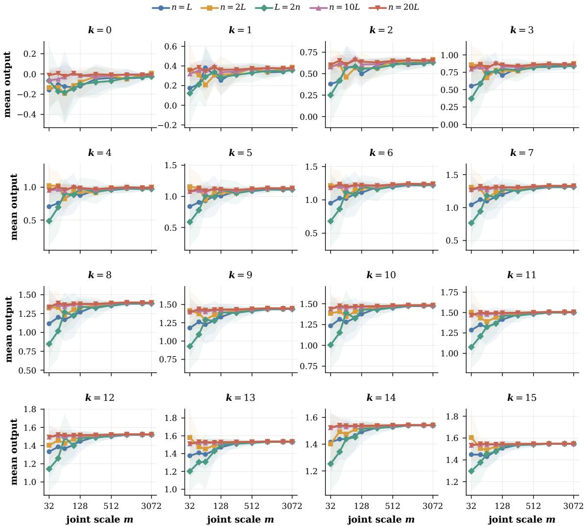  
Figure 5: Synthetic width–depth commutativity across all saved iterations. Each panel shows the output for training input 86 at one iteration $k = 0 , \ldots , 1 5$ . Curves correspond to the five width–depth scaling paths in Section 5.1 and show means over five model seeds, with shaded regions denoting ±1 standard deviation.

HIGGS. Section 5.1 reports four representative training checkpoints for one fixed HIGGS test example. We additionally report all eight saved checkpoints, including initialization, in Figure 7, together with three additional fixed test examples in Figure 8.

## G.3 Single-Datum Experiment

The main experiments use a multi-sample regression task. To more closely match the single-datum setting of our theory, we additionally train on a single input–target pair with $q _ { 0 } = 1 , y _ { \star } = 1$ , learning rate 1, and five independent model seeds. We evaluate the same five width–depth scaling paths at $m = \operatorname* { m i n } ( n , L ) \in \{ 1 2 8 , 2 5 6 , 5 1 2 , 1 0 2 4 , 2 0 4 8 , 3 0 7 2 \}$ for training iterations $k = 0 , \ldots , 1 0$

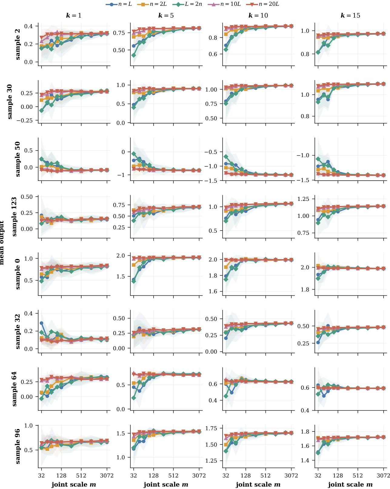  
Figure 6: Synthetic width–depth commutativity at additional training inputs. Rows correspond to four fixed training inputs, and columns show the representative iterations in Section 5.1. Curves correspond to the same five width–depth scaling paths and show means over five model seeds, with shaded regions denoting ±1 standard deviation.

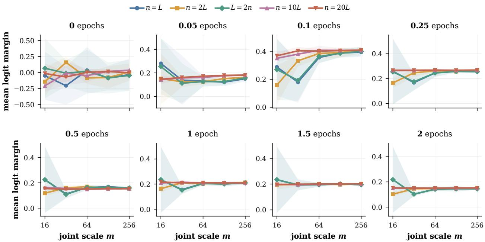  
Figure 7: HIGGS width–depth commutativity across all saved checkpoints. Each panel shows the class-1 versus class-0 logit margin for the fixed test example used in Section 5.1, from initialization through two training epochs. Curves show means over five model seeds, with shaded regions denoting ±1 standard deviation, over the common scales m ∈ {16, 32, 64, 128, 256}.

Figure 9 shows the same transition from finite-scale path dependence to large-scale path independence as in the multi-sample experiment.

## G.4 Experimental Details

Lazy Gaussian implementation. The largest synthetic model has $( n , L ) = ( 6 1 , 4 4 0 , 3 , 0 7 2 )$ , for which explicitly storing the residual matrices in float32 would require approximately 46.4 TB of memory. We instead use an exact-in-law lazy Gaussian implementation based on Gaussian conditioning and deferred decisions [27], which generates the required matrix–vector products without materializing the residual matrices. This reduces the peak GPU memory usage to 46.9 GB and makes the largest experiments computationally feasible.

Table 2: Memory usage for the reported experiments. Dense memory is the float32 storage required to materialize all residual matrices; peak memory is the maximum recorded CUDA allocation.
<table><tr><td>Experiment</td><td>Maximum  $( n , L )$ </td><td>Backend</td><td>Dense memory</td><td>Peak memory</td></tr><tr><td>Single datum</td><td>(61,440, 3,072)</td><td>lazy</td><td>46.4 TB</td><td>31.7 GB</td></tr><tr><td>Synthetic commutativity</td><td>(61,440,3,072)</td><td>lazy</td><td>46.4 TB</td><td>46.9 GB</td></tr><tr><td>Linear rate sweeps</td><td>(12,288, 12,288)</td><td>lazy</td><td>7.42 TB</td><td>25.4 GB</td></tr><tr><td>HIGGS commutativity</td><td>(5,120, 256)</td><td>dense</td><td>26.8 GB</td><td>26.9 GB</td></tr><tr><td>Nonlinear activations</td><td>(5,120,256)</td><td>dense</td><td>26.8 GB</td><td>27.6 GB</td></tr></table>

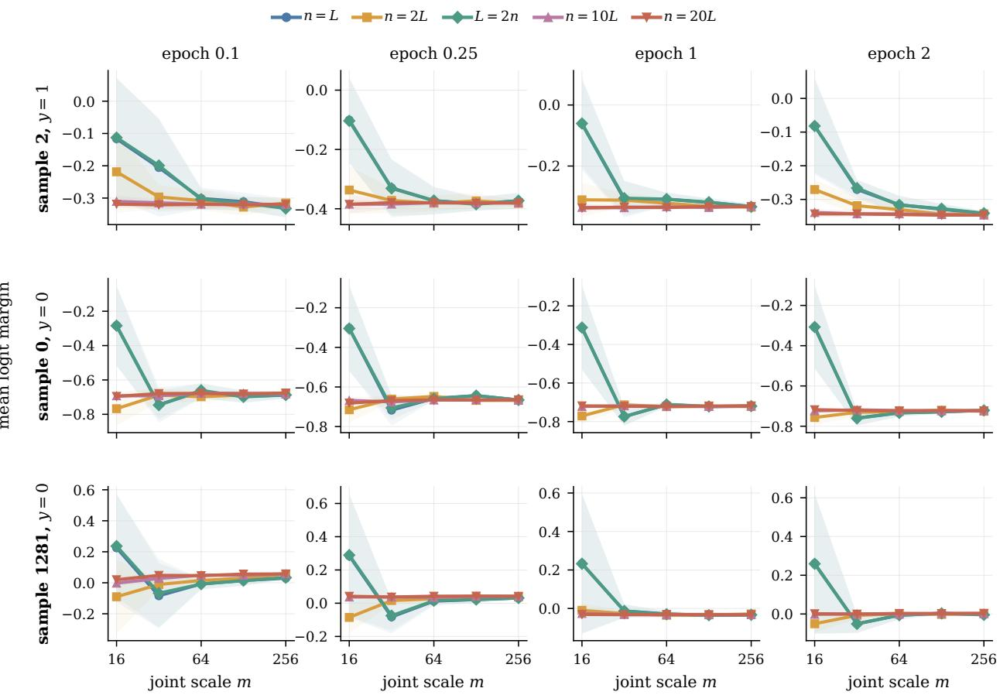  
Figure 8: HIGGS width–depth commutativity at additional test examples. Rows correspond to three fixed test examples, and columns show the representative checkpoints in Section 5.1. Curves correspond to the same five width–depth scaling paths and show means over five model seeds, with shaded regions denoting ±1 standard deviation.

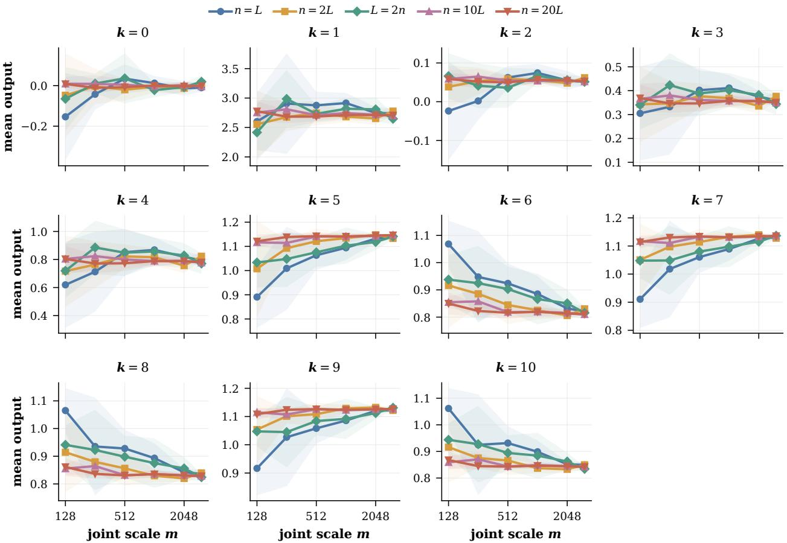  
Figure 9: Width–depth commutativity in the single-datum setting. Each panel shows the trained scalar output at one training iteration along the five width–depth scaling paths. Curves show the mean over five model seeds, with shaded regions denoting ±1 standard deviation. The paths exhibit substantial finite-scale differences at small m, but these differences diminish as both width and depth increase.