# What Comes Next and Why: Interpretable Next-Event Prediction with Neuro-Symbolic Rules

Tim N. Bauerschmidt<sup>∗</sup> Department of Computer Science Saarland University bauerschmidt@cs.uni-saarland.de

Isabel Valera   
Department of Computer Science Saarland University   
ivalera@cs.uni-saarland.de

Jilles Vreeken CISPA Helmholtz Center for Information Security vreeken@cispa.de

## Abstract

In real-world applications, being able to explain why a prediction is made is often as important—if not more so—than achieving high accuracy. However, existing methods for sequential event prediction typically prioritize accuracy at the expense of interpretability. Neuro-symbolic approaches offer a promising direction to improve interpretability by learning symbolic rules, but extending them to nextevent prediction is challenging due to the presence of temporal dependencies. We introduce RULES, a neuro-symbolic model that learns sequential rules directly from data, and combine it with a residual network to form RUNES (Rule Network for Event Sequences). RULES accurately recovers ground-truth rules from synthetic data and discovers compact, interpretable rule sets on real data. RUNES combines these rules additively with a residual network, achieving competitive accuracy while providing transparent access to active rules and how residuals adjust predictions. Our code is available at https://github.com/IamginE/runes-rules.

## 1 Introduction

Next-event prediction is the task of predicting the next categorical element in a temporally ordered sequence. Beyond next-token prediction in language models—where token positions can be seen as discrete event times—next-event prediction arises in many domains, including e-commerce (Nasir and Ezeife, 2023), healthcare (Pishgar et al., 2022; Ramirez-Alcocer et al., 2023), and process log analysis (Tama and Comuzzi, 2019; Bukhsh et al., 2021). Neural sequence models provide accurate predictions across domains and are thus increasingly adopted in practice. However, their internal representations are opaque, making predictions difficult to interpret or justify. This is especially problematic in safety- and regulation-sensitive contexts, where interpretability is key.

Symbolic approaches (Mannila et al., 1997; Fournier-Viger et al., 2012; Chen et al., 2021; Siji et al., 2026) instead focus on describing event dependencies using sequential rules. A sequential rule A ⇒ B expresses that when the antecedent A has been observed, the consequent B is likely to occur later in the sequence. In e-commerce, such a rule might specify that customers who purchased a computer case and a computer processor are likely to subsequently purchase a motherboard or a power supply unit. However, existing rule-discovery methods focus on enumerating frequent or high-confidence rules without a principled way to integrate them into a unified predictive model.

Neuro-symbolic models offer a promising approach to address the accuracy–interpretability tension. For instance, recent neuro-symbolic methods for tabular data use differentiable relaxations to learn interpretable and accurate prediction rules (Qiao et al., 2021; Wang et al., 2021; Walter et al., 2024; Xu et al., 2025). However, their reliance on binarized tabular inputs hinders applicability to sequential data, where temporal structure is central. Naively flattening sequences leads to sparse, high-dimensional representations, limiting both scalability and expressiveness.

To fill this gap, we define a class of sequential rules that incorporate temporal information and can be efficiently integrated into neural network layers for prediction. We then propose RULES, a neurosymbolic model that learns these rules directly from data, and its extension RUNES, which combines RULES with a residual network. Training proceeds in two phases using a self-supervised next-event prediction objective. In the symbolic phase, we train RULES using temperature annealing (Jang et al., 2017) to enable gradient-based rule learning. After annealing, the layers of RULES represent symbolic conditions over events and their relative offsets to the predicted event, yielding meaningful binary representations for sequences. In the predictive phase, we obtain RUNES by training a residual network that corrects the predictions of the frozen RULES through additive logit residuals. This phase improves predictive performance while preserving rule-level interpretability.

We evaluate RULES and RUNES on synthetic and real-world datasets, showing that RULES recovers ground-truth generative rules on synthetic data and learns compact, meaningful rule sets on real data. The residual network enables RUNES to achieve competitive accuracy by capturing structure not explained by RULES. Importantly, RUNES allows tracing the impact of the residual network, which is mostly used to correct errors of RULES, maintaining interpretability when learned rules are reliable.

## 2 Neuro-Symbolic Sequential Rule Learning

In this section, we formally introduce RULES, an inherently interpretable network for learning Temporal Conjunctive Prediction Rules, and RUNES, a neuro-symbolic architecture that combines RULES with a residual network for improved accuracy.

We consider a dataset $( S ^ { 1 } , S ^ { 2 } , \ldots , S ^ { N } )$ of N sequences over a finite vocabulary $\mathcal { V } = \{ 1 , 2 , \hdots , D \}$ An event sequence $\dot { S } = ( ( x _ { 1 } , t _ { 1 } ) , \dots , ( x _ { L } , t _ { L } ) )$ ) consists of L tuples $( x _ { l } , t _ { l } )$ , where $x _ { l } \in \mathcal { V }$ is the event with associated occurrence time $t _ { l } \ \in \ \mathbb { R } _ { > 0 } .$ , and $t _ { l } ~ < ~ t _ { k }$ for $l ~ < ~ k$ . We denote by $S _ { < t } = \left( \left( x _ { 1 } , t _ { 1 } \right) , \ldots , \left( x _ { k - 1 } , t _ { k - 1 } \right) \right)$ the subsequence of S that contains all events before time $t , \mathrm { i . e . }$ $t _ { k - 1 } < t \leq t _ { k } ;$ and by $s ( \nu )$ the set of all valid sequences over V.

## 2.1 Temporal Conjunctive Prediction Rules

We are interested in sequential rules $A \Rightarrow B$ that predict the next event $x _ { k }$ from a historical sequence $S _ { < t _ { k } }$ . A rule consists of an antecedent A, which determines when the rule applies to a sequence $S ,$ and a consequent B, which specifies the predictions when the antecedent conditions are satisfied. An example of such a rule in e-commerce (within our proposed rule class) is: “if a customer purchased a ‘computer case $\ ' 1 \mathrm { - } 4 3$ days ago and a ‘computer processor $\cdot _ { 2 - 2 I }$ days $^ { a g o , }$ then the next event is likely to be the purchase ofa ‘motherboard’ or a ‘power supply unit’.”

We impose four desiderata on sequential rules: they should (i) be interpretable; (ii) capture temporal dependencies, requiring consequents to occur after antecedents and specifying the time interval during which a rule remains active; (iii) be composable, allowing multiple rules to be combined within a single predictive model; and (iv) support efficient learning and inference. To meet these requirements, we introduce Temporal Conjunctive Prediction Rules, hereafter referred to as rules.

Antecedent. The antecedent A of a rule consists of a set of events $v _ { i } \in \mathcal V ,$ , each paired with a delay interval $[ \delta _ { i } ^ { \operatorname* { m i n } } , \delta _ { i } ^ { \operatorname* { m a x } } ]$ . A rule activates for a prediction on sequence $S$ at time t if, for every antecedent element, there exists a matching event in the history $S _ { < t }$ whose temporal offset from t lies within the corresponding interval. Thus, each antecedent element induces an event-time predicate and rule activation is determined by the conjunction of these predicates. In other words, the antecedent symbolically captures relevant events and their temporal offsets relative to the predicted consequent.

Formally, we define the antecedent of a rule $A \Rightarrow B$ as a set $A = \left\{ \left( v _ { i } , \left\lceil \delta _ { i } ^ { \operatorname* { m i n } } , \delta _ { i } ^ { \operatorname* { m a x } } \right\rceil \right) \mid 1 \leq i \leq I \right\}$ where $v _ { i } \in \mathcal { V } , \delta _ { i } ^ { \operatorname* { m i n } } , \delta _ { i } ^ { \operatorname* { m a x } } \in \mathbb { R } _ { > 0 } , \delta _ { i } ^ { \operatorname* { m i n } } \le \delta _ { i } ^ { \operatorname* { m a x } }$ , and $A \neq \emptyset$ . Denoting $\Delta _ { i } = \left[ \delta _ { i } ^ { \operatorname* { m i n } } , \delta _ { i } ^ { \operatorname* { m a x } } \right]$ , the activation function $\mathbb { I } _ { A } : S ( \mathcal { V } ) \times \mathbb { R } _ { \ge 0 }  \{ 0 , 1 \}$ of antecedent A is given by

$$
\mathbb { I } _ { A } \left( S , t \right) = \bigwedge _ { \left( v _ { i } , \Delta _ { i } \right) \in A } \underbrace { \bigvee _ { \left( x _ { l } , t _ { l } \right) \in S _ { < t } } ( x _ { l } = v _ { i } ) \wedge ( t - t _ { l } \in \Delta _ { i } ) } _ { \mathrm { e v e n t - t i m e ~ p r e d i c a t e } p _ { i } ^ { \ast } \left( S _ { < t } \right) } ,\tag{1}
$$

such that $\mathbb { I } _ { A } ( S , t ) = 1$ indicates that $A$ is satisfied at time t. Antecedents are unordered, but delay intervals induce an implicit partial order over their events.

Consequent. The consequent is a symbolic subset $B \subseteq \nu$ that specifies the likely outcomes when the antecedent is satisfied. However, symbolic consequents are problematic for prediction: they do not convey relative likelihoods among events, and they hinder composability because the consequents of rules are not directly comparable. We therefore relax consequents into logit vectors $o _ { B } \in \mathbb { R } ^ { \dot { D } }$ over $\nu ,$ and compute the predictive distribution for a sequence S at time t using a set of rules R as

$$
\operatorname { s o f t m a x } \left( \sum _ { A \Rightarrow B \in \mathbf { R } } \mathbb { I } _ { A } \left( S , t \right) \cdot o _ { B } \right) .\tag{2}
$$

In the following, we show how to learn a set of rules via continuous optimization, avoiding explicit traversal of the super-exponential search space resulting from possible antecedents and rule selection.

## 2.2 The RUNES Architecture

We begin by describing the architecture of RUNES. As shown in Figure 1a, RUNES comprises two components: a rule network, denoted as RULES, and a residual network that captures structure not explained by rules. Both predict the next event $x _ { k }$ from a historical sequence $S _ { < t _ { k } }$ and its occurrence time $t _ { k }$ . To ensure stable rule discovery and prevent rules from being subsumed by the residual network, training is decoupled into two phases: (i) a symbolic phase, in which RULES learns rules via temperature annealing, followed by (ii) a predictive phase, in which RULES is frozen and the residual network is trained to improve accuracy. We now discuss both networks in detail.

RULES. RULES (Figure 1b) learns a set of sequential rules by encoding antecedents in two hidden layers and consequents in the output layer. The first hidden layer consists of neurons that approximate event-time predicates $p _ { i } ,$ such as “the event ‘computer case’ occurred 1–43 days $\displaystyle a g o ^ { \prime }$ . Each neuron i is parameterized by learnable weights $W _ { i } \in \mathbb { R } ^ { D }$ , which identify an event, along with delay bounds $\delta _ { i } ^ { \mathrm { m i n } } , \delta _ { i } ^ { \mathrm { m a x } } \in \mathbb { R } _ { > 0 }$ . Temperature annealing binarizes the activation of each neuron, after which $W _ { i }$ selects an event via its maximum weight and $\Delta _ { i } = [ \delta _ { i } ^ { \operatorname* { m i n } } , \delta _ { i } ^ { \operatorname* { m a x } } ]$ specifies the delay interval.

To encode rule antecedents, neurons in the second hidden layer combine subsets of predicates from the previous layer into conjunctions $a _ { j }$ . For example, one might represent “the event ‘computer case’ occurred 1–43 days ago and the event ‘computer processor’ occurred 2–21 days ago”. Each antecedent neuron j selects a subset of predicates $p _ { i }$ via the positive entries in its weights $U _ { j , i }$ and, after annealing, activates only if all selected predicate neurons are active.

To predict the next event $\hat { x } _ { k } ^ { ( r ) }$ , RULES represents consequents with a softmax-linear output layer. Since the second layer encodes binary conjunctions after training, the softmax layer sums the learned logits of all active rules without any weighting. This allows us to identify the most likely consequent events of the rules learned by the network, e.g., motherboard or power supply unit. Particularly, since rule logits appear unweighted in the symbolic regime $( a _ { j } \in \{ 0 , 1 \} )$ ), the most influential consequent events of a rule can be identified directly via their largest logits, and, respecting the translation invariance of softmax, these logits are comparable across rules. We detail an algorithm that uses these insights to extract rules with symbolic consequents in Appendix B.2 (concrete example in Figure 5).

Residual Network. Not all data strictly follows symbolic rules. To improve accuracy without sacrificing interpretability, we augment RULES with a residual network to obtain RUNES, following hybrid design strategies from concept bottleneck models (Havasi et al., 2022; Yüksekgönül et al., 2023; Debot and Marra, 2025). Given a RULES network that outputs softmax logits $\hat { x } _ { k } ^ { ( r ) } \in \mathbb { R } ^ { D }$ , the residual network outputs corrective logits $\hat { x } _ { k } ^ { ( \delta ) }$ , and the final prediction is computed as $\hat { x } _ { k } ^ { ( r ) } + \hat { x } _ { k } ^ { ( \delta ) }$ During training, we freeze RULES, restricting the residual network to learning logit residuals. At inference time, interpretability of the learned rules is preserved: for each input, we can inspect which rules activate and quantify how the residual network adjusts thefinal prediction, with the additive logits enabling direct attribution of each rule and residual contributions.

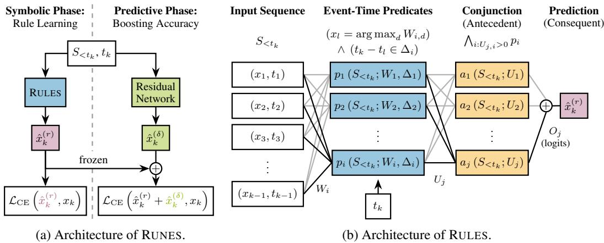  
Figure 1: Architecture overview of RUNES. (a) RUNES is trained in two phases: RULES first learns sequential rules, after which a residual network is trained with the RULES network frozen. (b) RULES represents rules in its layers: Neurons in the first layer encode event-time predicates. Neurons in the second layer select a subset of these predicates and combine them into conjunctions (antecedents). The output layer sums the softmax logits of all active rules to produce the final prediction.

## 2.3 RULES: Predicate Layer

We now detail how we can differentiably learn sequential rules, starting with the first layer of RULES. In this layer, each neuron i encodes the disjunctive logical formula of an event-time predicate $p _ { i } ^ { * }$ (Equation (1)), checking whether a specific event occurred within a target time interval relative to the prediction time. We approximate this predicate with a differentiable function $p _ { i }$ that depends on the temperature of the first layer $\tau _ { 1 }$ and satisfies lim $\mathsf { \iota } _ { \tau _ { 1 }  0 ^ { + } } p _ { i } ( S _ { < t _ { k } } ; \tau _ { 1 } ) = p _ { i } ^ { \ast } ( S _ { < t _ { k } } ) . ^ { 2 }$ Here we omit the prediction time $t _ { k }$ as an explicit argument.

Learning Events. To learn events that form rules, we parameterize $v _ { i }$ in the event match $( x _ { l } = v _ { i } )$ with a vector $W _ { i } \in { \mathbb { R } } ^ { D }$ . Each event in the vocabulary V is assigned a weight in $W _ { i }$ , and at the end of training, the maximum weight determines the selected event for neuron i. Mathematically, we compute a soft match $e _ { i }$ , indicating whether $x _ { l }$ corresponds to the maximum weight of $W _ { i }$

$$
e _ { i } ( x _ { l } ; W _ { i } , \tau _ { 1 } ) = \sigma \left( \frac { 1 } { \tau _ { 1 } ^ { 2 } } \left( W _ { i , x _ { l } } - ( 1 - \tau _ { 1 } ) \mathrm { l s e } ( W _ { i } ; \tau _ { 1 } ) \right) \right) ,\tag{3}
$$

where lse $\begin{array} { r } { ( w ; \tau ) = \tau \log \left( \sum _ { d = 1 } ^ { D } \exp \left( \frac { w _ { d } } { \tau } \right) \right) } \end{array}$ is the temperature-scaled LogSumExp function (Boyd and Vandenberghe, 2004) and σ denotes the sigmoid function. $\mathrm { A t } \tau _ { 1 } = 1$ , the activation $e _ { i }$ behaves like a standard sigmoid layer applied to the one-hot encoding of $x _ { l } . \ \mathrm { A s } \tau _ { 1 }  0$ , the LogSumExp term converges to the max operator, while the sigmoid converges to the Heaviside step function. With the scaling $\bigl ( \frac { 1 } { \tau _ { 1 } ^ { 2 } } \bigr )$ , this yields an activation that is 1 for the event with maximal weight and 0 for all others. Formally, lim $\begin{array} { r } { \mathfrak { l } _ { \tau _ { 1 } \to 0 ^ { + } } e _ { i } ( x _ { l } ; W _ { i } , \tau _ { 1 } ) = \mathbb { I } ( x _ { l } = \arg \operatorname* { m a x } _ { d } W _ { i , d } ) } \end{array}$ , where I is the indicator function (see Appendix $\mathbf { A } . 2 ) .$ . If $\operatorname* { m a x } _ { d } W _ { i , d } < 0$ , the limit instead yields the zero function $e _ { i } ( x _ { l } ) = 0$ for all inputs, allowing the model to disable neurons by setting all weights to negative values.

Learning Delay Intervals. The second component that the model needs to learn is the temporal offsets of antecedent events relative to the prediction time (consequent). We adopt the differentiable soft-binning function of Yang et al. (2018), applied to learning discrete intervals by Xu et al. (2024):

$$
\pi ( z ; a , b , \tau ) = \frac { e ^ { \frac { 1 } { \tau } ( 2 z - a ) } } { e ^ { \frac { 1 } { \tau } z } + e ^ { \frac { 1 } { \tau } ( 2 z - a ) } + e ^ { \frac { 1 } { \tau } ( 3 z - a - b ) } } .\tag{4}
$$

Specifically, for neuron $i ,$ we introduce parameters $\delta _ { i } ^ { \operatorname* { m i n } } , \delta _ { i } ^ { \operatorname* { m a x } } \in \mathbb { R } _ { > 0 }$ to form the delay interval $\Delta _ { i } =$ $[ \delta _ { i } ^ { \operatorname* { m i n } } , \delta _ { i } ^ { \operatorname* { m a x } } ]$ ]. We then use the relationship lim ${ { \tau } _ { 1  0 ^ { + } } } \operatorname { { \pi } } _ { i } ( { { t } _ { k } } - { { t } _ { l } } ; \delta _ { i } ^ { \operatorname* { m i n } } , { { \delta } _ { i } ^ { \operatorname* { m a x } } } , { { \tau } _ { 1 } } ) = \mathbb { I } ( { { t } _ { k } } - { { t } _ { l } } \in \Delta _ { i } )$ to find the delay constraint for the learned antecedent event. To ensure valid intervals, we clip $\delta _ { i } ^ { \mathrm { m i n } }$ and $\delta _ { i } ^ { \mathrm { m a x } }$ after each gradient step, performing projected gradient descent (Madry et al., 2018).

Learning Event-Time Predicates. The soft predicates $p _ { i }$ and $\pi _ { i }$ both take values in $[ 0 , 1 ]$ , and converge to their logical counterparts as the temperature decreases. Thus, we can approximate their conjunction $\mathbb { I } ( ( x _ { l } = v _ { i } ) \wedge ( t _ { k } - \dot { t } _ { l } \in \Delta _ { i } ) )$ by their product

$$
\begin{array} { r } { \widetilde { p } _ { i } ( l , k ) = e _ { i } ( x _ { l } ; W _ { i } , \tau _ { 1 } ) \cdot \pi _ { i } \left( t _ { k } - t _ { l } ; \delta _ { i } ^ { \operatorname* { m i n } } , \delta _ { i } ^ { \operatorname* { m a x } } , \tau _ { 1 } \right) . } \end{array}\tag{5}
$$

To complete the predicate, we model the disjunction checking whether any event in the sequence satisfies the type and delay specified by $\tilde { p } _ { i }$ . We approximate this disjunction using a softmax relaxation of the maximum (Appendix A.1), which in the limit behaves like a logical OR when $\tilde { p } _ { i } ( l , k ) \in \{ 0 , 1 \}$

$$
p _ { i } \left( S _ { < t _ { k } } ; W _ { i } , \delta _ { i } ^ { \operatorname* { m i n } } , \delta _ { i } ^ { \operatorname* { m a x } } , \tau _ { 1 } \right) = \sum _ { l = 1 } ^ { k - 1 } \tilde { p } _ { i } ( l , k ) \cdot \frac { \exp \left( \frac { \tilde { p } _ { i } ( l , k ) } { 0 . 1 \tau _ { 1 } } \right) } { \sum _ { m = 1 } ^ { k - 1 } \exp \left( \frac { \tilde { p } _ { i } ( m , k ) } { 0 . 1 \tau _ { 1 } } \right) } .\tag{6}
$$

We use a reduced temperature $0 . 1 \tau _ { 1 }$ , as the inputs $\tilde { p } _ { i } ( l , k )$ lie in $[ 0 , 1 ]$ , where their proximity amplifies approximation errors at high temperatures. In this step, masking can be done analogously to attention masking in transformers (Vaswani et al., 2017) by setting certain $\tilde { p } _ { i } ( l , k ) = 0$ . For example, to enforce a user-specified maximum lookback window $\omega \in \mathbb { R } _ { > 0 }$ , we mask all $\tilde { p } _ { i } ( l , k )$ with $t _ { k } - t _ { l } > \omega$

## 2.4 RULES: Antecedent Layer

After modeling the event-time predicates in Equation (1), we construct the outer conjunction via the second layer of RULES, which combines predicates into antecedents. Here, each neuron j selects a set of predicates $p _ { i }$ with its weights $U _ { j , i }$ . Following Riegel et al. (2020), we use $\begin{array} { r } { \sum _ { i } U _ { j , i } \cdot ( \bar { p _ { i } } ( S _ { < t _ { k } } ) - 1 ) } \end{array}$ to implement a soft conjunction. For $U _ { j , i } \geq 0$ and $\breve { p _ { i } } ( S _ { < t _ { k } } ) \in [ 0 , 1 ]$ , this expression is non-positive and achieves its maximum of 0 only when every selected predicate $\bar { ( U _ { j , i } } > 0 )$ satisfies $p _ { i } = 1$ . Thus, the neuron activates maximally when all chosen predicates hold. To map the conjunction score to the binary range, we apply a sigmoid scaled with the temperature $\tau _ { 2 }$ of the second layer

$$
a _ { j } \left( S _ { < t _ { k } } ; U _ { j } , \tau _ { 2 } \right) = \sigma \left( \frac { 1 } { \tau _ { 2 } } \left( \sum _ { i = 1 } ^ { I } U _ { j , i } \left( p _ { i } ( S _ { < t _ { k } } ) + \frac { \tau _ { 2 } } { 2 } - 1 \right) \right) - \log ( \tau _ { 2 } ) \right) .\tag{7}
$$

The term $\frac { \tau _ { 2 } } { 2 }$ prevents the summed input from becoming overly negative early in training, avoiding saturation of the sigmoid. The bias term $- \log ( \tau _ { 2 } )$ shifts the sigmoid leftward affecting its convergence only around 0, where it ensures that the activation approaches 1 when the conjunction is satisfied. We ensure $U _ { j , i } \geq 0$ through the temperature-based softplus function, which converges to the ReLU while allowing gradient flow for negative inputs. In the limit $\tau _ { 2 }  0 ^ { + } , a _ { j }$ converges to $\mathbb { I } ( \bigwedge _ { i = 1 } ^ { I } ( U _ { j , i } > 0 )  p _ { i } ( S _ { < t _ { k } } ) )$ , where → denotes implication (see Appendix A.3).

## 2.5 RULES: Consequent Layer

The output layer of RULES is a standard softmax-linear layer that sums over $a _ { j } ( S _ { < t _ { k } } ) \cdot O _ { j }$ , where $O _ { j } \in \mathbb { R } ^ { D }$ are the logits of rule $j .$ After annealing, $a _ { j }$ are effectively binary, so RULES aggregates the logits of all active rules, as in Equation (2). The only difference is that we include a bias $b \in \mathbb { R } ^ { D }$ which suffices to learn independent noise and encourages the model to learn only meaningful rules.

## 2.6 RUNES: Training

We train both networks of RUNES using the cross-entropy loss $\mathcal { L } _ { \mathrm { C E } }$ for next-event prediction over the training sequences $S ^ { 1 } , \ldots , S ^ { N }$ . Formally, the loss is given by

$$
\frac { 1 } { L _ { c } } \sum _ { n = 1 } ^ { N } \sum _ { k = 2 } ^ { L ^ { n } } \mathcal { L } _ { \mathrm { C E } } \left( f ( S _ { < t _ { k } ^ { n } } ^ { n } , t _ { k } ^ { n } ) , x _ { k } ^ { n } \right) , \quad \mathrm { w h e r e } \ L _ { c } = \sum _ { n = 1 } ^ { N } ( L ^ { n } - 1 )\tag{8}
$$

normalizes over all valid prediction steps, f denotes the model used in the current training phase, and n indicates the sequence. This objective resembles next-token prediction (Bengio et al., 2003), except the first event of each sequence is excluded because no rule can be active without context. Unlike conventional next-token models, both RULES and RUNES condition predictions on the target time, enabling rule learning from sequences with variable inter-event offsets. As a consequence, inference requires specifying the prediction time. For regularly sampled sequences (constant $t _ { l + 1 } - t _ { l } )$ , the next prediction time is known, while for irregularly sampled sequences it can be provided as a user query or estimated by a separate model, e.g., a temporal point process (Daley and Vere-Jones, 2003).

Phase 1: Training RULES. In the symbolic phase, we train RULES in a self-supervised manner using the objective in Equation (8). For temperature annealing, we initialize $\tau _ { 1 } = \tau _ { 2 } = 1$ and first anneal the predicate-layer temperature $\tau _ { 1 }  0 .$ , followed by the antecedent-layer temperature $\tau _ { 2 }  0$ which yields more stable optimization than a simultaneous schedule. The sizes of the predicate and antecedent layers control learning capacity and are treated as hyperparameters. We provide details on the layer initialization in Appendix B.1. Similar to transformers, RULES scales quadratically in the sequence length L while supporting parallel prediction across time steps (see Appendix D for details).

Phase 2: Training the Residual Network. After training RULES, we freeze its parameters, replace activations with their logical equivalents, and train a residual network using the same objective (Equation (8)) by adding its logits to those of RULES. In that way, the residual network learns to correct the errors made by RULES. The residual network can be instantiated by any sequence model and trained following standard practice; in this work, we use a transformer (Vaswani et al., 2017).

## 3 Related Work

Modeling sequences with logical rules is related to temporal logic, which formalizes reasoning over time: our antecedents can be viewed as a past-time fragment of metric temporal logic (Appendix C). Prior work combining temporal logic with neural networks typically uses formulas as prior knowledge, constraints, or supervision (Hahn et al., 2021; Vaezipoor et al., 2021), rather than learning them. In contrast, inductive logic programming (ILP), recently extended to temporal settings with differentiable variants (Xiong et al., 2023; Yang et al., 2024b; Soldà et al., 2026), learns logical rules but assumes relational data with predefined predicates. We consider categorical sequences, where such relational structure is absent. Closest to our setting are interpretable predictive models built directly from sequential data, which have been primarily studied in sequential rule mining and temporal point processes, while neuro-symbolic rule learning has so far focused largely on tabular data.

Sequential rule mining extracts human-interpretable dependencies from sequence data. Most methods retrieve rules over ordered subsequences (Mannila et al., 1997; Harms et al., 2002; Deogun and Jiang, 2005) or unordered sets of events (Fournier-Viger et al., 2012, 2014, 2021; Chen et al., 2021). Many of these approaches rely on user-specified frequency and confidence thresholds, often either returning an overwhelming number of rules or missing informative ones. Methods based on the minimum description length (Bourrand et al., 2021; Chen et al., 2022; Siji et al., 2026) address rule selection by optimizing compression, but rely on combinatorial search over a super-exponential space. Crucially, most types of sequential rules are not directly usable for next-event prediction, as they neither specify the timing between events nor provide a principled way to combine multiple rules.

Temporal point processes (TPPs) model event timing by predicting when the next event occurs (Daley and Vere-Jones, 2003). While black-box neural TPPs achieve strong performance when jointly predicting event time and type (Du et al., 2016; Chen et al., 2023), existing interpretable TPPs focus on the temporal component. For example, Li et al. (2020) define intensity functions using logical formulas over past events, an approach extended to a differentiable neuro-symbolic framework for rule selection by Yang et al. (2024a). These models explain when events occur, whereas RUNES targets interpretable next-event type prediction by conditioning on the next event time.

Neuro-symbolic models that learn logical rules via gradient-based optimization have primarily been developed for tabular classification (Wang et al., 2020, 2021; Qiao et al., 2021; Walter et al., 2024). Closest to our approach is that of Xu et al. (2025), which combines differentiable binarization of real-valued inputs with a conjunction layer to induce rule lists. These models assume fixed-length binary feature vectors, making them ill-suited for categorical sequence data, where flattening leads to sparse, high-dimensional representations. Other approaches for temporal data make incompatible assumptions: for example, Gao et al. (2025) rely on clustering consecutive segments of real-valued time series and do not support categorical events or rules with gaps, while Walke et al. (2021) learn LTL formulas for binary classification of sequences without metric time and use a formula extraction that scales exponentially in the number of distinct events (propositions). To the best of our knowledge, RUNES is the first neuro-symbolic approach to perform next-event prediction on categorical sequences.

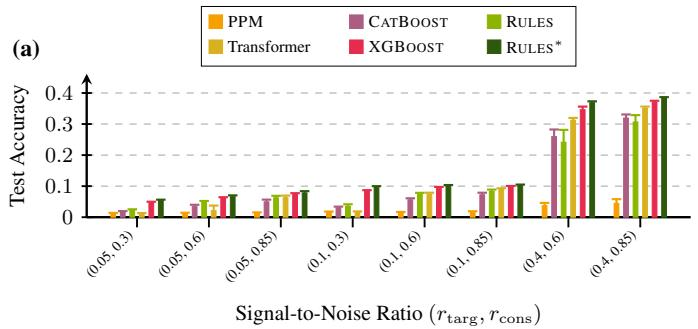

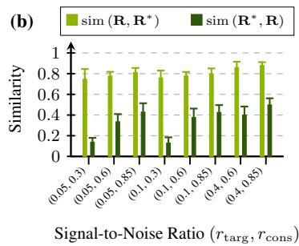  
Figure 2: RULES reliably recovers predictive rulesfrom synthetic data across varying signal-to-noise ratios. Results are averaged over 10 rule sets and corresponding datasets per setting; error bars indicate one empirical standard deviation. (a) Test accuracy compared to baselines; ${ \mathrm { R U L E S } } ^ { * }$ denotes RULES with embedded ground-truth antecedents. (b) Similarity between the rule set R discovered by RULES and the ground truth R<sup>∗</sup>.

## 4 Experiments

We empirically evaluate RULES and RUNES on synthetic and real-world data. As strong baselines with symbolic components that allow them to be decomposed into rules, we compare against time-agnostic variable-order Markov models based on the PPM-C algorithm (Moffat, 1990) and gradient-boosted tree ensembles, including XGBOOST (Chen and Guestrin, 2016) and CATBOOST (Prokhorenkova et al., 2018). As a high-capacity black-box benchmark, we include a state-of-the-art transformer (Vaswani et al., 2017) with rotary position embeddings (RoPE) (Su et al., 2024). We generalize RoPE to incorporate temporal differences $( t _ { k } - t _ { l } )$ instead of positional ones $( k - l )$ . We provide more details about the models and how we adapt them to the sequence setting in Appendix E. For synthetic data, we fix the hyperparameters of RULES and the transformer, while for real data, we tune both models and RUNES per dataset. For PPM, XGBOOST, and CATBOOST, we always perform a dataset-specific grid search. We describe hyperparameter tuning and model selection in Appendix I.

## 4.1 Synthetic Data

We first focus on RULES, evaluating its ability to recover ground-truth structure from synthetic data. We create datasets from ground-truth rule sets R<sup>∗</sup> of size 20. Unless stated otherwise, we use a vocabulary V of size $D \stackrel { - } { = } 1 2 8$ and generate $N = 1 0 2 4$ training sequences of length $L \in [ 9 6 , 1 2 8 ]$ We use regularly sampled sequences $( t _ { l + 1 } - t _ { l } = 1 )$ , and allow a maximum distance of 64 between antecedent events and consequents. To generate rules, we sample the size of the antecedent from [1, 8], then choose its events uniformly from V. For each element, we create its delay interval $[ \delta _ { i } ^ { \operatorname* { m i n } } , \dot { \delta } _ { i } ^ { \operatorname* { m a x } } ]$ by uniformly sampling $\delta _ { i } ^ { \mathrm { m i n } }$ from [1, 63] and its width from [1, 10], ensuring that $\delta _ { i } ^ { \mathrm { m a \dot { x } } } \leq 6 4 .$ . We complete rules by adding a random single-event consequent.

After generating a rule set, we create sequences by filling about 30% of their positions with uniformly sampled rules, then filling gaps with random noise events. To avoid ambiguous ground truth, we restrict the training objective to consequent and noise events, preventing unintended sub-rules from antecedent placements. Two signal-to-noise parameters govern task difficulty: the probability $r _ { \mathrm { c o n s } } \in$ [0, 1] that a rule antecedent is paired with its true consequent (rather than a random replacement), and the fraction $r _ { \mathrm { t a r g } } \in [ 0 , 1 ]$ of events in the training objective that are consequents rather than noise.

Sanity Check. We first test whether RULES learns spurious rules by applying it to 10 datasets with uniformly random events. Using the same rule extraction as for other synthetic data (Appendices B.2 and B.3), the lowest-training-loss model over four random seeds per dataset correctly returns no rules.

Predictive Performance. Next, we evaluate prediction accuracy on events generated from sequential rules. For each synthetic setting, we generate datasets from 10 rule sets, train the models, and report accuracy on held-out test data, with results averaged across rule sets. As a reference, we include our model with ground-truth antecedents embedded in its hidden layers, which we denote by ${ \mathrm { R U L E S } } ^ { * }$

In Figure 2 (a), we present results for varying signal-to-noise ratios; results for varying dataset and vocabulary sizes are in Appendix J. PPM fails to capture long-range dependencies between antecedents and consequents, leading to poor predictive performance. The best model often uses exclusively a 0-order context, predicting the most frequent training event everywhere. In contrast, RULES achieves strong accuracy, performing close to more complex tree-based ensembles and the black-box transformer, even outperforming CATBOOST and the transformer in noisy settings. Moreover, the performance gap to the other models narrows with more training samples (Appendix J).

Table 1: Test accuracy (Acc.) in % and number ofrules $( | \mathbf { R } | )$ on real-world datasets. Best accuracy results are in bold, second best are underlined. RUNES performs close to the black-box transformer.
<table><tr><td rowspan="2">Datasets</td><td colspan="2">RULES</td><td rowspan="2">RUNES</td><td colspan="2">PPM</td><td colspan="2">CATBOOST</td><td colspan="2">XGBOOST</td><td>Transformer</td></tr><tr><td>|R|</td><td>Acc. Acc.</td><td>|R|</td><td>Acc.</td><td>|R|</td><td>Acc.</td><td>|R|</td><td>Acc.</td><td>Acc.</td></tr><tr><td>Holidays</td><td>26</td><td>97.57</td><td>100.00</td><td>14</td><td>100.00</td><td>1129</td><td>100.00</td><td>1455</td><td>100.00</td><td>100.00</td></tr><tr><td>Chorales</td><td>33</td><td>21.00</td><td>37.00</td><td>180</td><td>31.40</td><td>11596</td><td>37.10</td><td>34462</td><td>37.72</td><td>39.35</td></tr><tr><td>Commits</td><td>51</td><td>19.60</td><td>18.31</td><td>80</td><td>18.11</td><td>380</td><td>15.55</td><td>83965</td><td>17.03</td><td>20.10</td></tr><tr><td>Rolling Mill</td><td>77</td><td>34.13</td><td>70.44</td><td>9583</td><td>67.64</td><td>13809</td><td>65.64</td><td>640723</td><td>68.84</td><td>71.24</td></tr><tr><td>Amazon</td><td>42</td><td>6.53</td><td>17.55</td><td>993</td><td>15.16</td><td>13123</td><td>11.79</td><td>5149683</td><td>15.37</td><td>17.61</td></tr><tr><td>Avg. Rank</td><td></td><td>5.2</td><td>2.4</td><td></td><td>3.6</td><td></td><td>4.0</td><td></td><td>2.8</td><td>1.0</td></tr></table>

Ground Truth Recovery. Next, we assess whether RULES is faithful to the ground truth by extracting the rules learned in the previous experiment, simplifying theses rules as described in Appendix B.4, and comparing them to the ground-truth rule set. To quantify similarity between rule sets, we follow a greedy matching strategy. First, we define the similarity of two predicates $\alpha _ { i } = ( v _ { i } , \Delta _ { i } )$ as the Jaccard similarity of their delay intervals when their events match: $\begin{array} { r } { s ( \alpha _ { 1 } , \alpha _ { 2 } ) = \mathbb { I } ( v _ { 1 } = v _ { 2 } ) \cdot \frac { | \Delta _ { 1 } \cap \Delta _ { 2 } | } { | \Delta _ { 1 } \cup \Delta _ { 2 } | } } \end{array}$ We then define the similarity of two rules $r _ { i } = A _ { i } \Rightarrow B _ { i }$ as

$$
s _ { A \Rightarrow B } ( r _ { 1 } , r _ { 2 } ) = \frac { | B _ { 1 } \cap B _ { 2 } | } { | B _ { 1 } \cup B _ { 2 } | } \cdot s _ { A } ( A _ { 1 } , A _ { 2 } ) , \qquad s _ { A } ( A _ { 1 } , A _ { 2 } ) = \frac 1 { | A _ { 1 } | } \sum _ { \alpha _ { 1 } \in A _ { 1 } } \operatorname* { m a x } _ { \alpha _ { 2 } \in A _ { 2 } } s ( \alpha _ { 1 } , \alpha _ { 2 } ) .\tag{9}
$$

The asymmetric rule similarity $s _ { A \Rightarrow B } ( r _ { 1 } , r _ { 2 } ) \in [ 0 , 1 ]$ measures how well rule $r _ { 1 }$ can be mapped onto rule $r _ { 2 }$ . To calculate the similarity of two rule sets $\mathbf { R } _ { 1 } , \mathbf { R } _ { 2 } ,$ , we use the same strategy as in Equation (9) and match all rules in ${ \bf R } _ { 1 }$ to the rules in ${ \bf R } _ { 2 }$ that maximize $s A \Rightarrow B$ , then take the mean.

As shown in Figure 2 (b), rules learned by RULES faithfully map onto the ground truth (sim (R, R<sup>∗</sup>)). However, recovery of the full ground-truth structure (sim (R<sup>∗</sup>, R)) is not perfect, because (i) RULES frequently approximates large antecedents with smaller ones, and (ii) it occasionally misses rules. Ground truth recovery is mainly driven by the reliability of consequents following antecedents $( r _ { \mathrm { { c o n s } } } )$ while RULES remains highly robust to random noise events $( r _ { \mathrm { t a r g } } )$

## 4.2 Real-World Data

Having verified that RULES recovers ground-truth rules on synthetic data, we now evaluate RULES and RUNES on five diverse real-world datasets, ranging from musical compositions (Chorales) to e-commerce transactions (Amazon); dataset details are in Appendix G. We use 60-20-20 trainvalidation-test splits, tuning hyperparameters based on the validation cross-entropy (Appendix I.2) and reporting test performance for the best models. For the residual network in RUNES, we use a transformer with the same architecture as the black-box baseline. To encourage sparse rules, we extract the rules learned by RULES, refine them (Appendix B.4), re-embed the refined antecedents into the hidden layers, and retrain only the output layer. All reported results use this refined model. We analyze the effect of this post-processing loop in Appendix K.4 and variability of model performance in Appendix K.5. In Appendix K.6, we further study the integration of pre-mined patterns into RULES.

Predictive Performance. First, we report next-event prediction accuracy on the test splits of the real-world datasets in Table 1; cross-entropy results in Appendix K.1 show consistent trends. RULES alone performs competitively on Holidays and Commits, achieving accuracies close to the black-box transformer. This indicates that the underlying dynamics of these datasets can be well captured by a small number of Temporal Conjunctive Prediction Rules. On the remaining datasets, RULES identifies meaningful structure through compact rule sets, and extending it with a residual network in RUNES achieves performance competitive with the transformer, outperforming all other baselines and ranking second overall. Next, we examine how interpretable the decisions of RULES and RUNES are.

Table 2: RUNES corrects errors (✗) but rarely flips correct predictions (✓) of RULES. Prediction agreement is averaged over test splits of real datasets; per-dataset results are in Appendix K.2. Counts are normalized within rule-activity groups.  
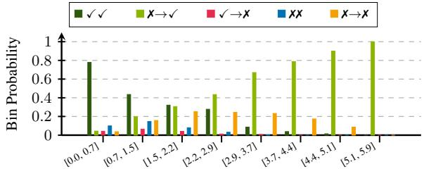

<table><tr><td rowspan="2">RUNES</td><td colspan="4">RULES</td></tr><tr><td colspan="2">Rule Active</td><td colspan="2">No Rule Active</td></tr><tr><td></td><td>√</td><td>x</td><td>√</td><td>x</td></tr><tr><td>√</td><td>0.40</td><td>0.17</td><td>0.19</td><td>0.36</td></tr><tr><td>x</td><td>0.03</td><td>0.40</td><td>0.03</td><td>0.42</td></tr><tr><td>Data Frac.</td><td colspan="2">0.64</td><td colspan="2">0.36</td></tr></table>

Binned Symmetric KL, RULES vs. RUNES  
Figure 3: Unsupervised metrics help identify correct residual changes when rules are active. Rolling Mill: Probability of RULES being correct and how RUNES changes (→) predictions on the test split, grouped by KL (e.g., ✗✗ = models agree on a wrong prediction).

Model Interpretability. We assess the structural complexity of the models in Table 1, using rule set and antecedent sizes (Appendix K.1) as proxies for global interpretability, since smaller models are generally easier to reason about. Following Appendix F, we treat PPM and tree ensembles as sequential rule sets: for PPM, non-zero-order Markov contexts define rule antecedents, with empirical next-event distributions as consequents; for trees, each root-to-leaf path forms a conjunctive antecedent, with class logits at the leaf specifying the consequent. For PPM, we measure antecedent size by context length and count unique contexts observed during training as rules. For trees, we measure antecedent size by leaf depth and define the rule count as the number of distinct leaf regions.

Across datasets, RULES produces compact, highly interpretable models, typically consisting of only tens of rules with antecedents of size 1–5. Tree ensembles, while limited in depth, often induce thousands of distinct symbolic conditions, making exhaustive inspection impractical—especially for XGBOOST, which builds separate trees for each class. Even individual trees are hard to interpret, as they induce complex logic over categorical features and do not explicitly tie event-time features to events (Appendices F and K.9). PPM performs strongly and produces simple models when short contexts suffice, but its rule set grows rapidly with vocabulary size and context length, as observed on Rolling Mill. Beyond compactness, the rules learned by RULES are semantically meaningful, as demonstrated by our qualitative analysis and comparison to baseline models in Appendix K.9. For example, on Amazon, RULES recovers a rule similar to our running example, which PPM cannot capture due to its lack of temporal modeling.

Overall, RULES provides directly inspectable models, whereas competing methods require additional rule selection (e.g., pruning) to achieve comparable model interpretability. As shown in Appendix K.4, individual predictions of RULES are also easy to explain, typically involving only 0–4 active rules, with traceable additive residual contributions in RUNES.

Effect of the Residual Network. Finally, we analyze how the residual network in RUNES complements the predictions of RULES, excluding Commits, where the residual network does not improve performance. Table 2 shows that at least one rule is active for 64% of test predictions on average (97% on Holidays, 55% on Chorales, 88% on Rolling Mill, 17% on Amazon),<sup>3</sup> so a symbolic RULES explanation is available for a substantial fraction of cases. The residual network rarely overturns correct rule-based predictions (3% of active-rule cases) while correcting many errors (17%), leading to a simple decision rule: trust the rules when the rule and residual networks agree and incorporate the residual logits otherwise. This preserves interpretability when rules are reliable (40% of activerule cases) and leverages black-box residuals only when necessary. More broadly, RUNES offers an explicit accuracy–interpretability trade-off: users may rely purely on RULES for interpretability or include residual logits for high accuracy.

The additive rule and residual logits also directly reveal contributions of active rules and how residuals modify predictions, with symmetric KL divergence and entropy providing practical signals for distinguishing corrective from spurious residual changes (Appendix K.3). For example, on Rolling Mill when rules are active and the residual network changes predictions (→ cases in Figure 3), incorrect updates are rare for KL > 3 but common for KL < 0.7. This suggests favoring rules in the low-KL regime, trading off some errors for interpretability, while high KL indicates that rules are likely incorrect.

## 5 Conclusion

We introduced RULES, a neuro-symbolic model that learns interpretable rules for next-event prediction through continuous optimization. Its core contribution is integrating sequential rules into the layers of a neural network, where event- and delay conditions are learned end-to-end to form rule antecedents. To capture structure beyond rules, RUNES augments RULES with a residual network that corrects errors in rule-based predictions, while maintaining rule-level interpretability via additive rule and residual logits. On synthetic data, RULES faithfully recovers the ground truth, producing strong predictions driven by symbolic rules alone. On real-world data, it discovers compact, interpretable rule sets that, when combined with the residual network in RUNES, achieve competitive performance.

Limitations. RULES learns rules differentiably in a neural network, avoiding a costly combinatorial search but introducing randomness and several hyperparameters, such as layer sizes and temperature schedules. As with any neural model, this requires tuning, and learned models—and thus extracted rule sets—can vary across runs. Our differentiable approximations build on prior neuro-symbolic models and are primarily guided by empirical success; future work could further improve results through a more principled analysis of these functions. Finally, our architecture currently models one categorical event per time step and forms Temporal Conjunctive Prediction Rules via conjunctions over event-time predicates. This naturally suggests extensions to richer data types and other classes of rules capturing different structural patterns.

## Acknowledgments and Disclosure of Funding

This work was funded by DFG grant 389792660 as part of TRR 248 – CPEC, see https:// perspicuous-computing.science. Tim Bauerschmidt was supported by the Konrad Zuse School of Excellence in Learning and Intelligent Systems (ELIZA) through the DAAD programme Konrad Zuse Schools of Excellence in Artificial Intelligence, sponsored by the Federal Ministry of Education and Research. We gratefully acknowledge the stimulating research environment of the GRK 2853/1 “Neuroexplicit Models of Language, Vision, and Action”, funded by the Deutsche Forschungsgemeinschaft (DFG, German Research Foundation) under project number 471607914. The views and opinions expressed in this publication are those of the author(s) alone and do not necessarily reflect those of the aforementioned funding agencies and institutions. None of the aforementioned parties can be held responsible for them.

## References

Lei Jimmy Ba, Jamie Ryan Kiros, and Geoffrey E. Hinton. Layer normalization. CoRR, abs/1607.06450, 2016. URL http://arxiv.org/abs/1607.06450.

Ron Begleiter, Ran El-Yaniv, and Golan Yona. On prediction using variable order Markov models. J. Artif. Intell. Res., 22:385–421, 2004. doi: 10.1613/JAIR.1491. URL https://doi.org/10.1613/jair.1491.

Yoshua Bengio, Réjean Ducharme, Pascal Vincent, and Christian Janvin. A neural probabilistic language model. J. Mach. Learn. Res., 3:1137–1155, 2003. URL https://jmlr.org/papers/v3/bengio03a.html.

Alex Berke, Dan Calacci, Robert Mahari, Takahiro Yabe, Kent Larson, and Sandy Pentland. Open e-commerce 1.0, five years of crowdsourced U.S. Amazon purchase histories with user demographics. Scientific Data, 11, 2024. doi: 10.1038/s41597-024-03329-6. URL https://doi.org/10.1038/s41597-024-03329-6.

Erwan Bourrand, Luis Galárraga, Esther Galbrun, Élisa Fromont, and Alexandre Termier. Discovering useful compact sets of sequential rules in a long sequence. In 33rd IEEE International Conference on Tools with Artificial Intelligence, ICTAI 2021, Washington, DC, USA, November 1-3, 2021, pages 1295–1299. IEEE, 2021. doi: 10.1109/ICTAI52525.2021.00204. URL https://doi.org/10.1109/ICTAI52525.2021.00204.

Stephen Boyd and Lieven Vandenberghe. Convex Optimization. Cambridge University Press, 2004. ISBN 9780521833783. Page 72

Zaharah A. Bukhsh, Aaqib Saeed, and Remco M. Dijkman. Processtransformer: Predictive business process monitoring with transformer network. CoRR, abs/2104.00721, 2021. URL https://arxiv.org/abs/21 04.00721.

Tianqi Chen and Carlos Guestrin. XGBoost: A scalable tree boosting system. In Balaji Krishnapuram, Mohak Shah, Alexander J. Smola, Charu C. Aggarwal, Dou Shen, and Rajeev Rastogi, editors, Proceedings ofthe 22nd ACM SIGKDD International Conference on Knowledge Discovery and Data Mining, San Francisco, CA, USA, August 13-17, 2016, pages 785–794. ACM, 2016. doi: 10.1145/2939672.2939785. URL https://doi.org/10.1145/2939672.2939785.

Xinhong Chen, Wensheng Gan, Shicheng Wan, and Tianlong Gu. Mdl-based compressing sequential rules. CoRR, abs/2212.10252, 2022. doi: 10.48550/ARXIV.2212.10252. URL https://doi.org/10.48550/a rXiv.2212.10252.

Yangming Chen, Philippe Fournier-Viger, Farid Nouioua, and Youxi Wu. Mining partially-ordered episode rules with the head support. In Matteo Golfarelli, Robert Wrembel, Gabriele Kotsis, A Min Tjoa, and Ismail Khalil, editors, Big Data Analytics and Knowledge Discovery - 23rd International Conference, DaWaK 2021, Virtual Event, September 27-30, 2021, Proceedings, volume 12925 of Lecture Notes in Computer Science, pages 266–271. Springer, 2021. doi: 10.1007/978-3-030-86534-4\_26. URL https: //doi.org/10.1007/978-3-030-86534-4\_26.

Yuqi Chen, Kan Ren, Yansen Wang, Yuchen Fang, Weiwei Sun, and Dongsheng Li. Contiformer: Continuoustime transformer for irregular time series modeling. In Alice Oh, Tristan Naumann, Amir Globerson, Kate Saenko, Moritz Hardt, and Sergey Levine, editors, Advances in Neural Information Processing Systems 36: Annual Conference on Neural Information Processing Systems 2023, NeurIPS 2023, New Orleans, LA, USA, December 10 - 16, 2023, 2023. URL http://papers.nips.cc/paper\_files/paper/2023/hash/932 8208f88ec69420031647e6ff97727-Abstract-Conference.html.

Darrell Conklin. Bach Chorales. UCI Machine Learning Repository, 1966. URL https://doi.org/10.244 32/C5GC7P.

Joscha Cüppers, Paul Krieger, and Jilles Vreeken. Discovering sequential patterns with predictable inter-event delays. In Michael J. Wooldridge, Jennifer G. Dy, and Sriraam Natarajan, editors, Thirty-Eighth AAAI Conference on Artificial Intelligence, AAAI 2024, Thirty-Sixth Conference on Innovative Applications of Artificial Intelligence, IAAI 2024, Fourteenth Symposium on Educational Advances in Artificial Intelligence, EAAI 2014, February 20-27, 2024, Vancouver, Canada, pages 8346–8353. AAAI Press, 2024. doi: 10.1609/ AAAI.V38I8.28676. URL https://doi.org/10.1609/aaai.v38i8.28676.

Daryl J. Daley and David Vere-Jones. An Introduction to the Theory of Point Processes. Probability and Its Applications. Springer, New York, 2 edition, 2003. doi: 10.1007/b97277. URL https://doi.org/10.100 7/b97277.

David Debot and Giuseppe Marra. Quantifying the accuracy-interpretability trade-off in concept-based sidechannel models. CoRR, abs/2510.05670, 2025. doi: 10.48550/ARXIV.2510.05670. URL https://doi.org/10.48550/arXiv.2510.05670.

Jitender S. Deogun and Liying Jiang. Prediction mining - an approach to mining association rules for prediction. In Dominik Slezak, Jingtao Yao, James F. Peters, Wojciech Ziarko, and Xiaohua Hu, editors, Rough Sets, Fuzzy Sets, Data Mining, and Granular Computing, 10th International Conference, RSFDGrC 2005, Regina, Canada, August 31 - September 3, 2005, Proceedings, Part II, volume 3642 of Lecture Notes in Computer Science, pages 98–108. Springer, 2005. doi: 10.1007/11548706\_11. URL https://doi.org/10.1007/ 11548706\_11.

Nan Du, Hanjun Dai, Rakshit Trivedi, Utkarsh Upadhyay, Manuel Gomez-Rodriguez, and Le Song. Recurrent marked temporal point processes: Embedding event history to vector. In Balaji Krishnapuram, Mohak Shah, Alexander J. Smola, Charu C. Aggarwal, Dou Shen, and Rajeev Rastogi, editors, Proceedings ofthe 22nd ACM SIGKDD International Conference on Knowledge Discovery and Data Mining, San Francisco, CA, USA, August 13-17, 2016, pages 1555–1564. ACM, 2016. doi: 10.1145/2939672.2939875. URL https://doi.org/10.1145/2939672.2939875.

Philippe Fournier-Viger, Usef Faghihi, Roger Nkambou, and Engelbert Mephu Nguifo. CMRules: Mining sequential rules common to several sequences. Knowl. Based Syst., 25(1):63–76, 2012. doi: 10.1016/J.KNOS YS.2011.07.005. URL https://doi.org/10.1016/j.knosys.2011.07.005.

Philippe Fournier-Viger, Ted Gueniche, Souleymane Zida, and Vincent S. Tseng. ERMiner: Sequential rule mining using equivalence classes. In Hendrik Blockeel, Matthijs van Leeuwen, and Veronica Vinciotti, editors, Advances in Intelligent Data Analysis XIII - 13th International Symposium, IDA 2014, Leuven, Belgium,

October 30 - November 1, 2014. Proceedings, volume 8819 of Lecture Notes in Computer Science, pages 108–119. Springer, 2014. doi: 10.1007/978-3-319-12571-8\_10. URL https://doi.org/10.1007/97 8-3-319-12571-8\_10.

Philippe Fournier-Viger, Yangming Chen, Farid Nouioua, and Jerry Chun-Wei Lin. Mining partially-ordered episode rules in an event sequence. In Ngoc Thanh Nguyen, Suphamit Chittayasothorn, Dusit Niyato, and Bogdan Trawinski, editors, Intelligent Information and Database Systems - 13th Asian Conference, ACIIDS 2021, Phuket, Thailand, April 7-10, 2021, Proceedings, volume 12672 of Lecture Notes in Computer Science, pages 3–15. Springer, 2021. doi: 10.1007/978-3-030-73280-6\_1. URL https://doi.org/10.1007/97 8-3-030-73280-6\_1.

Esther Galbrun, Peggy Cellier, Nikolaj Tatti, Alexandre Termier, and Bruno Crémilleux. Mining periodic patterns with a MDL criterion. In Michele Berlingerio, Francesco Bonchi, Thomas Gärtner, Neil Hurley, and Georgiana Ifrim, editors, Machine Learning and Knowledge Discovery in Databases - European Conference, ECML PKDD 2018, Dublin, Ireland, September 10-14, 2018, Proceedings, Part II, volume 11052 of Lecture Notes in Computer Science, pages 535–551. Springer, 2018. doi: 10.1007/978-3-030-10928-8\_32. URL https://doi.org/10.1007/978-3-030-10928-8\_32.

Kun Gao, Katsumi Inoue, Yongzhi Cao, Hanpin Wang, and Yang Feng. Differentiable rule induction from raw sequence inputs. In The Thirteenth International Conference on Learning Representations, 2025. URL https://openreview.net/forum?id=zDjHOsSQxd.

Xavier Glorot and Yoshua Bengio. Understanding the difficulty of training deep feedforward neural networks. In Yee Whye Teh and D. Mike Titterington, editors, Proceedings ofthe Thirteenth International Conference on Artificial Intelligence and Statistics, AISTATS 2010, Chia Laguna Resort, Sardinia, Italy, May 13-15, 2010, volume 9 of JMLR Proceedings, pages 249–256. JMLR.org, 2010. URL http://proceedings.mlr.pres s/v9/glorot10a.html.

Christopher Hahn, Frederik Schmitt, Jens U. Kreber, Markus Norman Rabe, and Bernd Finkbeiner. Teaching temporal logics to neural networks. In 9th International Conference on Learning Representations, ICLR 2021, Virtual Event, Austria, May 3-7, 2021. OpenReview.net, 2021. URL https://openreview.net/forum?i d=dOcQK-f4byz.

Sherri K. Harms, Jitender S. Deogun, and Tsegaye Tadesse. Discovering sequential association rules with constraints and time lags in multiple sequences. In Mohand-Said Hacid, Zbigniew W. Ras, Djamel A. Zighed, and Yves Kodratoff, editors, Foundations ofIntelligent Systems, 13th International Symposium, ISMIS 2002, Lyon, France, June 27-29, 2002, Proceedings, volume 2366 of Lecture Notes in Computer Science, pages 432–441. Springer, 2002. doi: 10.1007/3-540-48050-1\_47. URL https://doi.org/10.1007/3-540-4 8050-1\_47.

Marton Havasi, Sonali Parbhoo, and Finale Doshi-Velez. Addressing leakage in concept bottleneck models. In Sanmi Koyejo, S. Mohamed, A. Agarwal, Danielle Belgrave, K. Cho, and A. Oh, editors, Advances in Neural Information Processing Systems 35: Annual Conference on Neural Information Processing Systems 2022, NeurIPS 2022, New Orleans, LA, USA, November 28 - December 9, 2022, 2022. URL http: //papers.nips.cc/paper\_files/paper/2022/hash/944ecf65a46feb578a43abfd5cddd960-Abs tract-Conference.html.

Dan Hendrycks and Kevin Gimpel. Bridging nonlinearities and stochastic regularizers with Gaussian error linear units. CoRR, abs/1606.08415, 2016. URL http://arxiv.org/abs/1606.08415.

Eric Jang, Shixiang Gu, and Ben Poole. Categorical reparameterization with Gumbel-Softmax. In 5th International Conference on Learning Representations, ICLR 2017, Toulon, France, April 24-26, 2017, Conference Track Proceedings. OpenReview.net, 2017. URL https://openreview.net/forum?id=rkE3y85ee.

Markelle Kelly, Rachel Longjohn, and Kolby Nottingham. The uci machine learning repository. https: //archive.ics.uci.edu, 2025. Accessed: 2025-08-31.

Diederik P. Kingma and Jimmy Ba. Adam: A method for stochastic optimization. In Yoshua Bengio and Yann LeCun, editors, 3rd International Conference on Learning Representations, ICLR 2015, San Diego, CA, USA, May 7-9, 2015, Conference Track Proceedings, 2015. URL http://arxiv.org/abs/1412.6980.

Ron Koymans. Specifying real-time properties with metric temporal logic. Real Time Syst., 2(4):255–299, 1990. doi: 10.1007/BF01995674. URL https://doi.org/10.1007/BF01995674.

Shuang Li, Lu Wang, Ruizhi Zhang, Xiaofu Chang, Xuqin Liu, Yao Xie, Yuan Qi, and Le Song. Temporal logic point processes. In Proceedings of the 37th International Conference on Machine Learning, ICML 2020, 13-18 July 2020, Virtual Event, volume 119 of Proceedings ofMachine Learning Research, pages 5990–6000. PMLR, 2020. URL http://proceedings.mlr.press/v119/li20p.html.

Aleksander Madry, Aleksandar Makelov, Ludwig Schmidt, Dimitris Tsipras, and Adrian Vladu. Towards deep learning models resistant to adversarial attacks. In 6th International Conference on Learning Representations, ICLR 2018, Vancouver, BC, Canada, April 30 - May 3, 2018, Conference Track Proceedings. OpenReview.net, 2018. URL https://openreview.net/forum?id=rJzIBfZAb.

Heikki Mannila, Hannu Toivonen, and A. Inkeri Verkamo. Discovery of frequent episodes in event sequences. Data Min. Knowl. Discov., 1(3):259–289, 1997. doi: 10.1023/A:1009748302351. URL https://doi.org/ 10.1023/A:1009748302351.

Alistair Moffat. Implementing the PPM data compression scheme. IEEE Trans. Commun., 38(11):1917–1921, 1990. doi: 10.1109/26.61469. URL https://doi.org/10.1109/26.61469.

Mahreen Nasir and Christie I. Ezeife. A survey and taxonomy of sequential recommender systems for ecommerce product recommendation. SN Comput. Sci., 4(6):708, 2023. doi: 10.1007/S42979-023-02166-5. URL https://doi.org/10.1007/s42979-023-02166-5.

Maryam Pishgar, Samuel Harford, Julian Theis, William L. Galanter, Jorge Mario Rodríguez-Fernández, L. H. Chaisson, Y. Zhang, A. Trotter, Karl M. Kochendorfer, Ajay Boppana, and Houshang Darabi. A process mining- deep learning approach to predict survival in a cohort of hospitalized COVID-19 patients. BMC Medical Informatics and Decision Making, 22, 2022. URL https://link.springer.com/article/10 .1186/s12911-022-01934-2.

Liudmila Ostroumova Prokhorenkova, Gleb Gusev, Aleksandr Vorobev, Anna Veronika Dorogush, and Andrey Gulin. CatBoost: Unbiased boosting with categorical features. In Samy Bengio, Hanna M. Wallach, Hugo Larochelle, Kristen Grauman, Nicolò Cesa-Bianchi, and Roman Garnett, editors, Advances in Neural Information Processing Systems 31: Annual Conference on Neural Information Processing Systems 2018, NeurIPS 2018, December 3-8, 2018, Montréal, Canada, pages 6639–6649, 2018. URL https://proceedi ngs.neurips.cc/paper/2018/hash/14491b756b3a51daac41c24863285549-Abstract.html.

Litao Qiao, Weijia Wang, and Bill Lin. Learning accurate and interpretable decision rule sets from neural networks. In Thirty-Fifth AAAI Conference on Artificial Intelligence, AAAI 2021, Thirty-Third Conference on Innovative Applications ofArtificial Intelligence, IAAI 2021, The Eleventh Symposium on Educational Advances in Artificial Intelligence, EAAI 2021, Virtual Event, February 2-9, 2021, pages 4303–4311. AAAI Press, 2021. doi: 10.1609/AAAI.V35I5.16555. URL https://doi.org/10.1609/aaai.v35i5.16555.

Ulises Manuel Ramirez-Alcocer, Edgar Tello-Leal, Gerardo Romero, and Bárbara A. Macías-Hernández. A deep learning approach for predictive healthcare process monitoring. Information, 14(9), 2023. ISSN 2078-2489. doi: 10.3390/info14090508. URL https://www.mdpi.com/2078-2489/14/9/508.

Ryan Riegel, Alexander G. Gray, Francois P. S. Luus, Naweed Khan, Ndivhuwo Makondo, Ismail Yunus Akhalwaya, Haifeng Qian, Ronald Fagin, Francisco Barahona, Udit Sharma, Shajith Ikbal, Hima Karanam, Sumit Neelam, Ankita Likhyani, and Santosh K. Srivastava. Logical neural networks. CoRR, abs/2006.13155, 2020. URL https://arxiv.org/abs/2006.13155.

Aleena Siji, Joscha Cüppers, Osman Mian, and Jilles Vreeken. SEQRET: mining rule sets from event sequences. In Sven Koenig, Chad Jenkins, and Matthew E. Taylor, editors, Fortieth AAAI Conference on Artificial Intelligence, Thirty-Eighth Conference on Innovative Applications ofArtificial Intelligence, Sixteenth Symposium on Educational Advances in Artificial Intelligence, AAAI 2026, Singapore, January 20-27, 2026, pages 15725–15733. AAAI Press, 2026. doi: 10.1609/AAAI.V40I18.38603. URL https://doi.org/10.1609/aaai.v40i18.38603.

Davide Soldà, Kun Gao, Thomas Eiter, and Katsumi Inoue. Fully differentiable temporal FO rule learning, 2026. URL https://openreview.net/forum?id=KkNNk4y6Sg.

Nitish Srivastava, Geoffrey E. Hinton, Alex Krizhevsky, Ilya Sutskever, and Ruslan Salakhutdinov. Dropout: A simple way to prevent neural networks from overfitting. J. Mach. Learn. Res., 15(1):1929–1958, 2014. doi: 10.5555/2627435.2670313. URL https://dl.acm.org/doi/10.5555/2627435.2670313.

Jianlin Su, Murtadha H. M. Ahmed, Yu Lu, Shengfeng Pan, Wen Bo, and Yunfeng Liu. Roformer: Enhanced transformer with rotary position embedding. Neurocomputing, 568:127063, 2024. doi: 10.1016/J.NEUCOM .2023.127063. URL https://doi.org/10.1016/j.neucom.2023.127063.

Bayu Adhi Tama and Marco Comuzzi. An empirical comparison of classification techniques for next event prediction using business process event logs. Expert Systems with Applications, 129:233–245, 2019. ISSN 0957-4174. doi: https://doi.org/10.1016/j.eswa.2019.04.016. URL https://www.sciencedirect.com/ science/article/pii/S0957417419302465.

Nikolaj Tatti and Jilles Vreeken. The long and the short of it: summarising event sequences with serial episodes. In Qiang Yang, Deepak Agarwal, and Jian Pei, editors, The 18th ACM SIGKDD International Conference on Knowledge Discovery and Data Mining, KDD ’12, Beijing, China, August 12-16, 2012, pages 462–470. ACM, 2012. doi: 10.1145/2339530.2339606. URL https://doi.org/10.1145/2339530.2339606.

Pashootan Vaezipoor, Andrew C. Li, Rodrigo Toro Icarte, and Sheila A. McIlraith. LTL2Action: Generalizing LTL instructions for multi-task RL. In Marina Meila and Tong Zhang, editors, Proceedings of the 38th International Conference on Machine Learning, ICML 2021, 18-24 July 2021, Virtual Event, volume 139 of Proceedings ofMachine Learning Research, pages 10497–10508. PMLR, 2021. URL http://proceeding s.mlr.press/v139/vaezipoor21a.html.

Ashish Vaswani, Noam Shazeer, Niki Parmar, Jakob Uszkoreit, Llion Jones, Aidan N. Gomez, Lukasz Kaiser, and Illia Polosukhin. Attention is all you need. In Isabelle Guyon, Ulrike von Luxburg, Samy Bengio, Hanna M. Wallach, Rob Fergus, S. V. N. Vishwanathan, and Roman Garnett, editors, Advances in Neural Information Processing Systems 30: Annual Conference on Neural Information Processing Systems 2017, December 4-9, 2017, Long Beach, CA, USA, pages 5998–6008, 2017. URL https://proceedings.neur ips.cc/paper/2017/hash/3f5ee243547dee91fbd053c1c4a845aa-Abstract.html.

Homer Walke, Daniel Ritter, Carl Trimbach, and Michael Littman. Learning finite linear temporal logic specifications with a specialized neural operator. CoRR, abs/2111.04147, 2021. URL https://arxiv.org/ abs/2111.04147.

Nils Philipp Walter, Jonas Fischer, and Jilles Vreeken. Finding interpretable class-specific patterns through efficient neural search. In Michael J. Wooldridge, Jennifer G. Dy, and Sriraam Natarajan, editors, Thirty-Eighth AAAI Conference on Artificial Intelligence, AAAI 2024, Thirty-Sixth Conference on Innovative Applications of Artificial Intelligence, IAAI 2024, Fourteenth Symposium on Educational Advances in Artificial Intelligence, EAAI 2014, February 20-27, 2024, Vancouver, Canada, pages 9062–9070. AAAI Press, 2024. doi: 10.1609/AAAI.V38I8.28756. URL https://doi.org/10.1609/aaai.v38i8.28756.

Zhuo Wang, Wei Zhang, Ning Liu, and Jianyong Wang. Transparent classification with multilayer logical perceptrons and random binarization. In The Thirty-Fourth AAAI Conference on Artificial Intelligence, AAAI 2020, The Thirty-Second Innovative Applications of Artificial Intelligence Conference, IAAI 2020, The Tenth AAAI Symposium on Educational Advances in Artificial Intelligence, EAAI 2020, New York, NY, USA, February 7-12, 2020, pages 6331–6339. AAAI Press, 2020. doi: 10.1609/AAAI.V34I04.6102. URL https://doi.org/10.1609/aaai.v34i04.6102.

Zhuo Wang, Wei Zhang, Ning Liu, and Jianyong Wang. Scalable rule-based representation learning for interpretable classification. In Marc’Aurelio Ranzato, Alina Beygelzimer, Yann N. Dauphin, Percy Liang, and Jennifer Wortman Vaughan, editors, Advances in Neural Information Processing Systems 34: Annual Conference on Neural Information Processing Systems 2021, NeurIPS 2021, December 6-14, 2021, virtual, pages 30479–30491, 2021. URL https://proceedings.neurips.cc/paper/2021/hash/ffbd6cbb0 19a1413183c8d08f2929307-Abstract.html.

Boris Wiegand, Dietrich Klakow, and Jilles Vreeken. Mining easily understandable models from complex event logs. In Carlotta Demeniconi and Ian Davidson, editors, Proceedings ofthe 2021 SIAM International Conference on Data Mining, SDM 2021, Virtual Event, April 29 - May 1, 2021, pages 244–252. SIAM, 2021. doi: 10.1137/1.9781611976700.28. URL https://doi.org/10.1137/1.9781611976700.28.

Siheng Xiong, Yuan Yang, Faramarz Fekri, and James Clayton Kerce. TILP: differentiable learning of temporal logical rules on knowledge graphs. In The Eleventh International Conference on Learning Representations, ICLR 2023, Kigali, Rwanda, May 1-5, 2023. OpenReview.net, 2023. URL https://openreview.net/for um?id=\_X12NmQKvX.

Sascha Xu, Nils Philipp Walter, Janis Kalofolias, and Jilles Vreeken. Learning exceptional subgroups by end-to-end maximizing KL-divergence. In Forty-first International Conference on Machine Learning, ICML 2024, Vienna, Austria, July 21-27, 2024. OpenReview.net, 2024. URL https://openreview.net/forum ?id=AG45XqwPKU.

Sascha Xu, Nils Philipp Walter, and Jilles Vreeken. Neural rule lists: Learning discretizations, rules, and order in one go. In The Thirty-ninth Annual Conference on Neural Information Processing Systems, 2025. URL https://openreview.net/forum?id=oBf5eZSeBT.

Yang Yang, Chao Yang, Boyang Li, Yinghao Fu, and Shuang Li. Neuro-symbolic temporal point processes. In Forty-first International Conference on Machine Learning, ICML 2024, Vienna, Austria, July 21-27, 2024. OpenReview.net, 2024a. URL https://openreview.net/forum?id=HDrXBr26UI.

Yongxin Yang, Irene Garcia Morillo, and Timothy M. Hospedales. Deep neural decision trees. CoRR, abs/1806.06988, 2018. URL http://arxiv.org/abs/1806.06988.

Yuan Yang, Siheng Xiong, Ali Payani, James Clayton Kerce, and Faramarz Fekri. Temporal inductive logic reasoning over hypergraphs. In Proceedings ofthe Thirty-Third International Joint Conference on Artificial Intelligence, IJCAI 2024, Jeju, South Korea, August 3-9, 2024, pages 3613–3621. ijcai.org, 2024b. URL https://www.ijcai.org/proceedings/2024/400.

Mert Yüksekgönül, Maggie Wang, and James Zou. Post-hoc concept bottleneck models. In The Eleventh International Conference on Learning Representations, ICLR 2023, Kigali, Rwanda, May 1-5, 2023. OpenReview.net, 2023. URL https://openreview.net/forum?id=nA5AZ8CEyow.

## A Convergence Proofs for Temperature Annealing

Before presenting formal convergence proofs for the temperature-dependent activation functions used in ${ \mathrm { R U L E S } }$ , we first provide illustrative examples in Figure 4. Each function is smooth at $\tau = 1$ , and as $\tau \to 0 ^ { + }$ , it converges to its corresponding hard function.

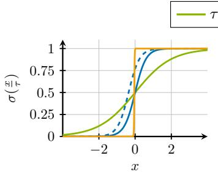  
(a) Temperature-scaled sigmoid function.

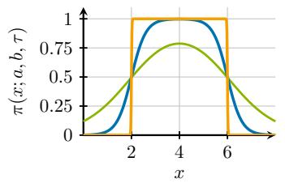  
(b) Temperature-scaled interval membership function.

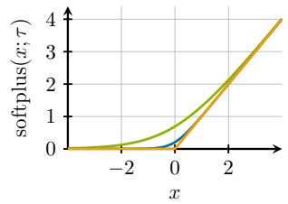  
(c) Temperature-scaled softplus function.

Figure 4: Illustration oftemperature annealingfor different temperature-scaledfunctions. (a) The sigmoid function $\sigma ( x / \tau )$ converges to the Heaviside step function as $\tau \to 0 ^ { + }$ The dashed curve shows a version with temperature-dependent bias: $\sigma ( x / \tau - \log ( \tau ) )$ as used in Equation (7). (b) The soft interval membership function $\pi ( x ; a , b , \tau )$ converges to the hard interval function $\mathbb { I } ( x \in [ a , b ] )$ shown here with $a = 2$ and $b = 6$ . (c) The temperature-scaled softplus function $\tau \cdot \log ( 1 + \exp ( x / \tau ) )$ converges to the ReLU function max $( 0 , x )$

## A.1 Basic Functions

Sigmoid Function. The temperature-controlled sigmoid function (used in Equations (3) and (7)) converges to the Heaviside step function as the temperature approaches zero:

$$
\begin{array}{c} \operatorname* { l i m } _ { \tau \to 0 ^ { + } } \sigma \left( x ; \tau \right) = \operatorname* { l i m } _ { \tau \to 0 ^ { + } } \frac { 1 } { 1 + \exp \left( - \frac { x } { \tau } \right) } = \left\{ \begin{array} { l l } { \frac { 1 } { 1 + 0 } , } & { \mathrm { ~ i f ~ } x > 0 } \\ { \frac { 1 } { 1 + 1 } , } & { \mathrm { ~ i f ~ } x = 0 = \left\{ 0 . 5 , \right.} & { \mathrm { ~ i f ~ } x = 0 \atop \operatorname* { l i m } _ { \tau \to 0 ^ { + } } \exp \left( - \frac { x } { \tau } \right) , } & { \mathrm { ~ i f ~ } x < 0 } \end{array}   \end{array} \right.\tag{10}
$$

Softplus Function. The temperature-controlled softplus function converges to the ReLU function as the temperature approaches zero:

$$
\begin{array} { r l } { \displaystyle \operatorname* { l i m } _ { \tau \to 0 ^ { + } } \mathrm { s o f t p l u s } \left( x ; \tau \right) = \displaystyle \operatorname* { l i m } _ { \tau \to 0 ^ { + } } \tau \cdot \log \left( 1 + \exp \left( \frac { x } { \tau } \right) \right) = \left\{ \begin{array} { l l } { \displaystyle \operatorname* { l i m } _ { \tau \to 0 ^ { + } } \tau \cdot \frac { x } { \tau } , } & { \mathrm { i f } \ x > 0 } \\ { 0 \cdot \log ( 2 ) , } & { \mathrm { i f } \ x = 0 } \\ { 0 \cdot \log ( 1 ) , } & { \mathrm { i f } \ x < 0 } \end{array} \right. } \\ { = \operatorname* { m a x } ( 0 , x ) . } \end{array}\tag{11}
$$

(12)

LogSumExp. For the LogSumExp function (Equation (3)), consider an input vector $x =$ $( x _ { 1 } , \bar { x } _ { 2 } , \ldots , \bar { x } _ { d } ) \in \mathbb { R } ^ { d }$ and denote $\boldsymbol { x ^ { * } } = \operatorname* { m a x } ( x _ { 1 } , x _ { 2 } , \ldots , x _ { d } )$ . For $\tau > 0$ , observe that

$$
\operatorname* { m a x } ( x _ { 1 } , x _ { 2 } , \ldots , x _ { d } ) = \tau \cdot \log \left( \exp \left( { \frac { x ^ { * } } { \tau } } \right) \right)\tag{13}
$$

$$
\leq \tau \cdot \log \left( \sum _ { i = 1 } ^ { d } \exp \left( \frac { x _ { i } } { \tau } \right) \right)
$$

(LogSumExp)

(14)

$$
\leq \tau \cdot \log \left( d \cdot \exp \left( \frac { x ^ { * } } { \tau } \right) \right)\tag{15}
$$

$$
\begin{array} { r } { = \operatorname* { m a x } ( x _ { 1 } , x _ { 2 } , \ldots , x _ { d } ) + \tau \cdot \log ( d ) , } \end{array}\tag{16}
$$

where the inequalities follow from the monotonicity of the logarithm. Applying the squeeze theorem immediately gives the convergence

$$
\operatorname* { l i m } _ { \tau  0 ^ { + } } \mathrm { l s e } ( x _ { 1 } , x _ { 2 } , \dots , x _ { d } ; \tau ) = \operatorname* { m a x } ( x _ { 1 } , x _ { 2 } , \dots , x _ { d } ) .\tag{17}
$$

Softmax and Softmax-Weighted Average. For the temperature-scaled softmax function, consider an input vector $x = ( x _ { 1 } , \bar { x _ { 2 } } , \ldots , x _ { d } ) \in \mathbf { \bar { \mathbb { R } } } ^ { d }$ and denote $\bar { i } ^ { * } = \arg \operatorname* { m a x } _ { i } x _ { i }$ . Rewriting the softmax with respect to $x _ { i ^ { * } }$ gives

$$
\begin{array} { r l } & { \underset { \tau  0 ^ { + } } { \operatorname* { l i m } } \operatorname { s o f t m a x } _ { i } ( x _ { 1 } , x _ { 2 } , \ldots , x _ { d } ; \tau ) = \underset { \tau  0 ^ { + } } { \operatorname* { l i m } } \frac { \exp ( \frac { x _ { i } } { \tau } ) } { \sum _ { j = 1 } ^ { d } \exp ( \frac { x _ { j } } { \tau } ) } = \underset { \tau  0 ^ { + } } { \operatorname* { l i m } } \frac { \exp ( \frac { x _ { i } - x _ { i } * } { \tau } ) } { 1 + \sum _ { j \neq i ^ { * } } \exp ( \frac { x _ { j } - x _ { i ^ { * } } } { \tau } ) } . } \end{array}\tag{18}
$$

We analyze two cases:

1. Non-maximal elements: If $x _ { i } < x _ { i ^ { * } }$ , the numerator vanishes in the limit, so the corresponding softmax entry converges to 0, i.e.,

$$
\operatorname* { l i m } _ { \tau \to 0 ^ { + } } \frac { \exp \left( \frac { x _ { i } - x _ { i ^ { * } } } { \tau } \right) } { 1 + \sum _ { j \neq i ^ { * } } \exp \left( \frac { x _ { j } - x _ { i ^ { * } } } { \tau } \right) } = 0 .\tag{19}
$$

2. Maximal elements: I $\mathbf { \dot { x } } _ { i } = x _ { i ^ { * } }$ , then the softmax converges to 1 divided by the number of maximal elements:

$$
\begin{array} { r l r } & { } & { \underset { \tau  0 ^ { + } } { \operatorname* { l i m } } \frac { \exp ( \frac { x _ { i } - x _ { i ^ { * } } } { \tau } ) } { 1 + \sum _ { j \neq i ^ { * } } \exp ( \frac { x _ { j } - x _ { i ^ { * } } } { \tau } ) } = \underset { \tau  0 ^ { + } } { \operatorname* { l i m } } \frac { 1 } { 1 + \sum _ { j \neq i ^ { * } } \exp ( \frac { x _ { j } - x _ { i ^ { * } } } { \tau } ) } } \\ & { } & { = \frac { 1 } { | \{ x _ { i } \mid 1 \leq i \leq d : x _ { i ^ { * } } = x _ { i } \} | } . } \end{array}\tag{20}
$$

(21)

Thus, when the input has a unique maximum, the temperature-scaled softmax converges to a one-hot encoding of the argmax. Denoting $n = | \{ x _ { i } \mid 1 \leq i \leq d : x _ { i ^ { * } } = x _ { i } \}$ | as the number of maximal elements, this also establishes the convergence of the softmax-weighted average (Equation (6)) to the true maximum:

$$
\operatorname* { l i m } _ { \tau \to 0 ^ { + } } \sum _ { i = 1 } ^ { d } x _ { i } \cdot \frac { \exp \left( \frac { x _ { i } } { \tau } \right) } { \sum _ { j = 1 } ^ { d } \exp \left( \frac { x _ { j } } { \tau } \right) } = \sum _ { \substack { i \in \{ j | 1 \leq j \leq d : x _ { j } = x _ { i } * \} } } x _ { i } \cdot \frac { 1 } { n } = n \cdot \frac { x _ { i ^ { * } } } { n } = x _ { i ^ { * } } .\tag{22}
$$

## A.2 RULES: Predicate Layer

In this section, we analyze the convergence of the predicate layer (Equations (3), (4) and (6)) under temperature annealing. We have already shown in Appendix A.1 that the softmax-based approximation of the maximum, used to aggregate $\tilde { p } _ { i }$ across all time steps (Equation (6)), converges to the true maximum function and thus accurately models a disjunction (logical OR). We now turn our attention to the convergence of the soft event match and the soft interval membership function.

Soft Event Match. We prove the convergence of the soft event match (Equation (3)) by simplifying notation: let $w = W _ { i } , w _ { j } = W _ { i , x _ { l } }$ , and $\tau = \tau _ { 1 }$ . Our goal is to show that the function activates primarily when $w _ { j } = W _ { i , x _ { l } }$ is positive and equal to the maximum element, effectively implementing the predicate $\mathbb { I } ( j \overset { \cdot } { = } \operatorname { a r g m a x } _ { i } w _ { i } ) = \mathbb { I } ( w _ { j } = \operatorname { m a x } _ { i } w _ { i } )$ , which is equivalent to $\mathbb { I } ( x _ { l } = \arg \operatorname* { m a x } _ { d } W _ { i , d } )$ in the main body. Formally, let $w ^ { * } = \operatorname* { m a x } _ { i } w _ { i }$ and denote $n = | \{ w _ { i } | 1 \leq i \leq d : w ^ { * } = \bar { w _ { i } } \} |$ the number of maximal elements. We then prove

$$
\begin{array} { r l } & { \underset { \tau  0 ^ { + } } { \operatorname* { l i m } } \sigma ( \frac { 1 } { \tau ^ { 2 } } \cdot ( w _ { j } - ( 1 - \tau ) \cdot \mathrm { l s e } ( w ; \tau ) ) ) } \\ & { =  \begin{array} { l l } { 0 , } & { \mathrm { i f } w ^ { \ast } < 0 \mathrm { o r } w _ { j } < w ^ { \ast } \mathrm { o r } w _ { j } = w ^ { \ast } < \log ( n ) } \\ { 1 , } & { \mathrm { i f } w _ { j } = w ^ { \ast } > \log ( n ) } \\ { \frac { 1 } { 1 + 1 / n } , } & { \mathrm { o t h e r w i s e } } \end{array}  . } \end{array}\tag{23}
$$

In words, the soft event match evaluates to 0 in the limit if the maximum weight is negative, if the selected weight $w _ { j }$ is smaller than the maximum, or if $w _ { j }$ is maximal but smaller than the logarithm of the number of maximal elements. It evaluates to 1 if $w _ { j }$ is maximal, positive, and larger than this logarithm. In the edge case $w _ { j } = w ^ { * } = \log \left( | \{ w _ { i } \mid 1 \leq i \leq d : w ^ { * } = w _ { i } \} | \right) = \log ( n )$ , the sigmoid converges to $\frac { 1 } { 1 + 1 / n }$ . Deactivating the sigmoid for $w ^ { * } < 0$ is desirable, as it allows RULES to disable unnecessary neurons by assigning negative values to all their weights $( w = W _ { i } )$ . The other edge cases, where the sigmoid does not converge to 1 despite $w _ { j } = w ^ { * }$ , are undesirable; however, they are extremely unlikely in practice, since gradient descent would need to produce a maximum element exactly equal to $w ^ { * } = 0$ or multiple maximal elements with identical values.

To analyze convergence more precisely, it is useful to consider the argument of the sigmoid. From the LogSumExp convergence (Appendix $\mathbf { A . } 1 )$ , we know that for positive temperatures $\tau > 0 \mathrm { { ; } }$

$$
w ^ { * } \leq \mathrm { l s e } \left( w _ { 1 } , \ldots , w _ { d } ; \tau \right) \leq w ^ { * } + \tau \cdot \log ( d ) .\tag{24}
$$

Consequently, we have

$$
\frac { 1 } { \tau ^ { 2 } } \cdot \left( w _ { j } - ( 1 - \tau ) \cdot w ^ { * } \right) \geq \frac { 1 } { \tau ^ { 2 } } \cdot \left( w _ { j } - ( 1 - \tau ) \cdot \mathrm { l s e } \left( w ; \tau \right) \right) .\tag{25}
$$

Since the sigmoid function is monotonically increasing, this inequality is preserved when it is applied to both sides.

For the convergence, we consider two cases for $w _ { j }$

1. $w _ { j } < w ^ { * } ;$ In this case, $w _ { j } - w ^ { * } < 0$ and the upper bound diverges to −∞, i.e.,

$$
\operatorname* { l i m } _ { \tau \to 0 ^ { + } } \frac { 1 } { \tau ^ { 2 } } \cdot ( w _ { j } - ( 1 - \tau ) \cdot w ^ { * } ) = \operatorname* { l i m } _ { \tau \to 0 ^ { + } } \frac { 1 } { \tau ^ { 2 } } \cdot ( w _ { j } - w ^ { * } + \tau w ^ { * } )\tag{26}
$$

$$
= \operatorname* { l i m } _ { \tau \to 0 ^ { + } } \frac { 1 } { \tau ^ { 2 } } \cdot ( w _ { j } - w ^ { * } ) = - \infty .\tag{27}
$$

Since the upper bound diverges $\mathrm { t o } - \infty$ , the LogSumExp-term must also diverge to $- \infty$

$$
\operatorname* { l i m } _ { \tau \to 0 ^ { + } } \frac { 1 } { \tau ^ { 2 } } \cdot ( w _ { j } - ( 1 - \tau ) \cdot \mathrm { l s e } \left( w ; \tau \right) ) = - \infty ,\tag{28}
$$

which implies that the sigmoid converges to 0:

$$
\operatorname* { l i m } _ { \tau \to 0 ^ { + } } \sigma \left( \frac { 1 } { \tau _ { 1 } ^ { 2 } } \cdot ( w _ { j } - ( 1 - \tau _ { 1 } ) \cdot \mathrm { l s e } \left( w ; \tau \right) ) \right) = 0 .\tag{29}
$$

2. $\boldsymbol { w } _ { j } = \boldsymbol { w } ^ { * } ;$ : In this case, we get the the upper bound as

$$
\operatorname* { l i m } _ { \tau \to 0 ^ { + } } \frac { 1 } { \tau ^ { 2 } } \cdot ( w _ { j } - ( 1 - \tau ) \cdot w ^ { * } ) = \operatorname* { l i m } _ { \tau \to 0 ^ { + } } \frac { 1 } { \tau ^ { 2 } } \cdot ( \tau w ^ { * } ) = \left\{ \begin{array} { l l } { \infty , } & { \mathrm { ~ i f ~ } w ^ { * } > 0 } \\ { 0 , } & { \mathrm { ~ i f ~ } w ^ { * } = 0 \ . } \\ { - \infty , } & { \mathrm { ~ o t h e r w i s e } } \end{array} \right.\tag{30}
$$

So, if the maximum weight is negative $( w ^ { * } < 0 )$ , the sigmoid converges to 0, analogous to the first case. This shows that RULES can disable predicate neurons by setting all of its weights $( w = W _ { i } )$ to a negative value. Now we consider the activation in case the maximum weight is non-negative $( w ^ { * } \geq 0 )$

$$
\operatorname* { l i m } _ { \tau \to 0 ^ { + } } \frac { 1 } { \tau ^ { 2 } } \cdot ( w _ { j } - ( 1 - \tau ) \cdot \mathrm { l s e } \left( w ; \tau \right) )\tag{31}
$$

$$
= \operatorname* { l i m } _ { \tau \to 0 ^ { + } } \frac { 1 } { \tau ^ { 2 } } \cdot \left( w _ { j } - ( 1 - \tau ) \cdot \tau \log \left( \sum _ { i = 1 } ^ { d } \exp \left( \frac { w _ { i } } { \tau } \right) \right) \right)\tag{32}
$$

$$
= \operatorname* { l i m } _ { \tau \to 0 ^ { + } } { \frac { 1 } { \tau ^ { 2 } } } \cdot \left( w ^ { * } - ( 1 - \tau ) \cdot \left( w ^ { * } + \tau \log \left( \sum _ { i = 1 } ^ { d } \exp \left( { \frac { w _ { i } - w ^ { * } } { \tau } } \right) \right) \right) \right)\tag{33}
$$

$$
= \operatorname* { l i m } _ { \tau \to 0 ^ { + } } \frac { 1 } { \tau ^ { 2 } } \cdot \left( \tau w ^ { * } - ( 1 - \tau ) \cdot \left( \tau \log \left( \sum _ { i = 1 } ^ { d } \exp \left( \frac { w _ { i } - w ^ { * } } { \tau } \right) \right) \right) \right)\tag{34}
$$

$$
= \operatorname* { l i m } _ { \tau \to 0 ^ { + } } \frac { 1 } { \tau } \cdot \left( w ^ { * } - \log \left( \sum _ { i = 1 } ^ { d } \exp \left( \frac { w _ { i } - w ^ { * } } { \tau } \right) \right) + \tau \log \left( \sum _ { i = 1 } ^ { d } \exp \left( \frac { w _ { i } - w ^ { * } } { \tau } \right) \right) \right)\tag{35}
$$

$$
= \operatorname* { l i m } _ { \tau  0 ^ { + } } \frac { 1 } { \tau } \cdot ( w ^ { \ast } - \log ( n ) + \tau \log ( n ) )\tag{36}
$$

$$
\mathbf { \Gamma } = \left\{ \begin{array} { l l } { \operatorname* { l i m } _ { \tau \to 0 ^ { + } } \frac { 1 } { \tau } \cdot \left( \tau \log \left( n \right) \right) , } & { \mathrm { i f } w ^ { * } = \log \left( n \right) } \\ { \operatorname* { l i m } _ { \tau \to 0 ^ { + } } \frac { 1 } { \tau } \cdot \left( w ^ { * } - \log \left( n \right) \right) , } & { \mathrm { o t h e r w i s e } } \end{array} \right.\tag{37}
$$

$$
= \left\{ \begin{array} { l l } { \infty , } & { \mathrm { i f ~ } w ^ { * } > \log { ( n ) } = \log \left( | \{ w _ { i } \mid 1 \leq i \leq d : w ^ { * } = w _ { i } \} | \right) } \\ { \log ( n ) , } & { \mathrm { i f ~ } w ^ { * } = \log { ( n ) } = \log \left( | \{ w _ { i } \mid 1 \leq i \leq d : w ^ { * } = w _ { i } \} | \right) . } \\ { - \infty , } & { \mathrm { o t h e r w i s e ~ } } \end{array} \right.\tag{38}
$$

So this gives us the desired behavior in all cases when the maximum element is larger than the logarithm of the number of maximal elements. Hence, when $w ^ { * }$ is a unique maximum, this behavior is guaranteed for a positive weight since then

$$
\log \left( \left| \{ w _ { i } \mid 1 \leq i \leq d : w ^ { * } = w \} \right| \right) = \log ( 1 ) = 0 .\tag{39}
$$

In summary, for $w _ { j } = w ^ { * } > \log \left( | \{ w _ { i } \mid 1 \leq i \leq d : w ^ { * } = w _ { i } \} | \right)$ , we have

$$
\operatorname* { l i m } _ { \tau \to 0 ^ { + } } \sigma \left( \frac { 1 } { \tau _ { 1 } ^ { 2 } } \cdot ( w _ { j } - ( 1 - \tau _ { 1 } ) \cdot \mathrm { l s e } \left( w ; \tau \right) ) \right) = 1 .\tag{40}
$$

Note that in the second case, the scaling factor $\textstyle { \frac { 1 } { \tau ^ { 2 } } }$ is necessary to ensure proper convergence of the sigmoid to the desired limit values.

Soft Interval Membership. From the convergence of the softmax function in Appendix A.1, we can directly establish the convergence of the soft interval membership function (repeated from Equation (4))

$$
\pi \left( x ; a , b , \tau \right) = \frac { \exp \left( \frac { 1 } { \tau } \cdot \left( 2 x - a \right) \right) } { \exp \left( \frac { 1 } { \tau } \cdot x \right) + \exp \left( \frac { 1 } { \tau } \cdot \left( 2 x - a \right) \right) + \exp \left( \frac { 1 } { \tau } \cdot \left( 3 x - a - b \right) \right) }\tag{41}
$$

to

$$
\operatorname* { l i m } _ { \tau \to 0 ^ { + } } \pi \left( x ; a , b , \tau \right) = { \left\{ \begin{array} { l l } { 1 , } & { { \mathrm { i f ~ } } a < x < b } \\ { 1 / 2 , } & { { \mathrm { i f ~ e i t h e r ~ } } x = a { \mathrm { ~ o r ~ } } x = b } \\ { 1 / 3 , } & { { \mathrm { i f ~ } } x = a = b } \\ { 0 , } & { { \mathrm { o t h e r w i s e } } } \end{array} \right. } .\tag{42}
$$

Here we assume that $a \leq b$ . Observe that π is the second coordinate of a temperature-scaled softmax applied to the logits $x , 2 x - a$ , and $3 x - a - b , { \mathrm { i . e } }$ .,

$$
\pi \left( x ; a , b , \tau \right) = \mathrm { s o f t m a x } _ { 2 } \left( x , 2 x - a , 3 x - a - b ; \tau \right) .\tag{43}
$$

We now distinguish four cases:

1. If $x < a \le b ,$ then $( \mathrm { I } ) - x > - a \Leftrightarrow x > 2 x - a$ . Similarly, (II) $x < b \Leftrightarrow 0 > x - b$ Summing inequalities (I) and (II), we get

$$
x > 2 x - a > 3 x - a - b .\tag{44}
$$

Hence, lim $1 _ { \tau  0 ^ { + } } \pi ( x ; a , b , \tau ) = 0 .$ , which follows from the fact that the softmax output corresponding to the non-maximal logit $2 x - a$ vanishes in the limit.

2. If $a \ < \ x \ < \ b ,$ we get $x \ < \ 2 x \ - \ a$ and $2 x \mathrm { ~ - ~ } a \mathrm { ~ > ~ } 3 x \mathrm { ~ - ~ } a \mathrm { ~ - ~ } b$ . It follows that $\begin{array} { r } { \operatorname* { l i m } _ { \tau \to 0 ^ { + } } \pi \left( x ; a , b , \tau \right) = 1 } \end{array}$ from the convergence of the softmax function for the maximal logit $2 x - a$

3. If $a \leq b < x$ , then $x \ : < \ : 2 x \ : - \ : a \ : < \ : 3 x \ : - \ : a \ : - \ : b .$ , proving proper convergence for the non-maximal logit $2 x - a$ analogous to the first case.

4. When $x = a = b ,$ all three logits are equal, and the softmax converges to $1 / 3$ . When $x = a$ or $x = b$ but not both, two logits tie for the maximum, so the softmax assigns $1 / 2$ to the second coordinate.

## A.3 RULES: Antecedent Layer

To show convergence of the antecedent layer, we simplify the notation in Equation (7) by substituting $p _ { i } = p _ { i } \left( S _ { < t _ { k } } \right)$ and $\tau = \tau _ { 2 }$ . We further expand $U _ { j , i } = \mathrm { { s o f t p l u s } } ( u _ { i } ; \tau )$ , since the weights in Equation (7) are parameterized as the post-softplus transformations of underlying real-valued parameters to ensure non-negativity. With this notation, we get

$$
\operatorname* { l i m } _ { \tau  0 ^ { + } } \sigma ( \frac { 1 } { \tau } \cdot ( \sum _ { i = 1 } ^ { I } \mathrm { s o f t p l u s } ( u _ { i } ; \tau ) \cdot ( p _ { i } + \frac { \tau } { 2 } - 1 ) ) - \log ( \tau ) )\tag{45}
$$

$$
= \operatorname* { l i m } _ { \tau  0 ^ { + } } \sigma ( ( \sum _ { i = 1 } ^ { I } \frac { \tau } { \tau } \cdot \log ( 1 + \exp ( \frac { u _ { i } } { \tau } ) ) \cdot ( p _ { i } + \frac { \tau } { 2 } - 1 ) ) - \log ( \tau ) )\tag{46}
$$

$$
= \operatorname* { l i m } _ { \tau  0 ^ { + } } \sigma ( ( \sum _ { i = 1 } ^ { I } \log ( 1 + \exp ( \frac { u _ { i } } { \tau } ) ) \cdot ( p _ { i } - 1 ) + \frac { \mathrm { s o f t p l u s } ( u _ { i } ; \tau ) } { 2 } ) - \log ( \tau ) )\tag{47}
$$

$$
= \sigma \left( \operatorname* { l i m } _ { \tau \to 0 ^ { + } } \left( \sum _ { i = 1 } ^ { I } \log \left( 1 + \exp \left( \frac { u _ { i } } { \tau } \right) \right) \cdot ( p _ { i } - 1 ) + \frac { \operatorname* { m a x } ( u _ { i } , 0 ) } { 2 } \right) - \log \left( \tau \right) \right) .\tag{48}
$$

Here we used that $\operatorname { s o f t p l u s } ( u _ { i } ; \tau )$ converges to the ReLU function max $\mathbf { \Omega } \cdot ( 0 , u _ { i } )$ as $\tau  0 ^ { + } ( \mathrm { A p } \cdot$ pendix $\mathbf { A . } 1 )$ . To analyze the limit, we split the sum into two parts: terms with $p _ { i } - 1 = 0$ and terms with $p _ { i } - 1 < 0$ , noting that $p _ { i } \in [ 0 , 1 ]$

(49)

$$
\begin{array} { r l } & { \sigma ( \underset { r  0 ^ { + } } { \operatorname* { l i m } } ( \displaystyle \sum _ { i = 1 } ^ { I } \log \Big ( 1 + \exp \Big ( \frac { u _ { i } } { \tau } \Big ) \Big ) \cdot ( p _ { i } - 1 ) + \frac { \operatorname* { m a x } ( u _ { i } , 0 ) } { 2 } ) - \log ( r ) ) } \\ & { = \sigma ( \underset { r  0 ^ { + } } { \operatorname* { l i m } } ( \underset { ( i \langle p _ { i } - 1 \rangle  0 ) } { \sum } \frac { \operatorname* { m a x } ( u _ { i } , 0 ) } { 2 } )  } \\ & { \qquad + ( \underset { i \colon \{ p _ { i } - 1 \} \leq 0 } { \sum } ( p _ { i } - 1 ) \cdot \log \Big ( 1 + \exp \Big ( \frac { u _ { i } } { \tau } \Big ) \Big ) + \frac { \operatorname* { m a x } ( u _ { i } , 0 ) } { 2 } ) - \log ( r ) ) } \\ & { = \{ 1 , \ : \ : \ : \mathrm { i f } \ : N _ { i } ^ { I } ( u _ { i } > 0 )  ( p _ { i } - 1 ) = 1 \ : ( \displaystyle \prod _ { i = 1 } ^ { I } ( u _ { i } > 0 )  ( p _ { i } = 1 ) )  } \end{array}\tag{50}
$$

(51)

To justify the last transformation, observe that

$$
\operatorname* { l i m } _ { \tau \to 0 ^ { + } } \log \left( 1 + \exp \left( \frac { u _ { i } } { \tau } \right) \right) = \left\{ \begin{array} { l l } { 0 , } & { \mathrm { i f ~ } u _ { i } < 0 } \\ { \log ( 2 ) , } & { \mathrm { i f ~ } u _ { i } = 0 } \\ { \infty , } & { \mathrm { o t h e r w i s e } } \end{array} \right. ,\tag{52}
$$

so that these terms either vanish, remain constant, or diverge depending on the sign of $u _ { i }$ . In the limit, the only non-constant contributions $\mathrm { a r e } - \log ( \tau )$ and $\begin{array} { r } { \left( p _ { i } - 1 \right) \cdot \log \left( 1 + \exp \left( \frac { u _ { i } } { \tau } \right) \right) } \end{array}$ for $p _ { i } < 1$ and $u _ { i } > 0$ . All other terms, including $\frac { \operatorname* { m a x } ( u _ { i } , 0 ) } { 2 }$ , are dominated by them. Finally, observe that $- \log ( \tau ) ~ \to ~ \infty { \mathrm { ~ a s ~ } } \tau ~ \to ~ 0 ^ { + }$ , but it is itself dominated by any negative term of the form $\begin{array} { r } { \left( p _ { i } - 1 \right) \cdot \log \left( 1 + \exp \left( \frac { u _ { i } } { \tau } \right) \right) } \end{array}$  with $u _ { i } > 0$ , which diverges $\mathrm { t o } - \infty$ in the limit.

Note that the conjunction $\bigwedge _ { i = 1 } ^ { I } ( u _ { i } > 0 ) \  \ ( p _ { i } = 1 )$ also holds for the post-softplus weights after annealing, since $\scriptstyle \operatorname* { l i m } _ { \tau \to 0 ^ { + } }$ softplus $( u _ { i } ; \tau ) \ = \ \operatorname* { m a x } ( 0 , u _ { i } )$ and thus $u _ { i } ~ > ~ 0$ if and only if softplus $( u _ { i } ; \tau ) > 0$ in the limit.

## B Additional Details on RULES

## B.1 Layer Initialization

Parameter initialization is an important aspect for effective training. Here, we focus on the initialization of the non-standard parameters specific to our model, namely $W , \delta ^ { \mathrm { m i n } } , \delta ^ { \mathrm { m a x } }$ , and $U ;$ all other layers use the default initialization of PyTorch. In the following, I denotes the number of predicate neurons in the network and J denotes the number of antecedent neurons.

Predicate Layer. For the weights of the first layer, $W \in \mathbb { R } ^ { I \times D }$ , we use a classical zero-centered uniform initialization (Glorot and Bengio, 2010),

$$
W _ { i , d } \sim \mathcal { U } \left( - \frac { 1 } { \sqrt { D } } , \frac { 1 } { \sqrt { D } } \right) ,\tag{53}
$$

where U denotes the uniform distribution.

For the delay intervals $\left[ { { \delta } _ { i } ^ { \operatorname* { m i n } } } , { \delta _ { i } ^ { \operatorname* { m a x } } } \right]$ , we assume a known maximum lookback window $\omega > 0$ and a small minimum offset $\varepsilon > 0$ , ensuring $\delta _ { i } ^ { \mathrm { m i n } } \geq \varepsilon > 0$ . If ω and ε are not provided, we can set ω to the largest temporal gap between any two events in a sequence and choose ε no larger than the minimum time between any two consecutive events. Given ω and $\varepsilon ,$ we first sample the interval length

$$
\delta _ { i } ^ { \mathrm { m a x } } - \delta _ { i } ^ { \mathrm { m i n } } \sim ( \omega - \varepsilon ) \cdot B ( 2 . 5 , 5 . 0 )\tag{54}
$$

and then choose the starting point $\delta _ { i } ^ { \mathrm { m i n } }$ uniformly at random so that $\varepsilon \leq \delta _ { i } ^ { \mathrm { m i n } } \leq \delta _ { i } ^ { \mathrm { m a x } } \leq \omega \colon$

$$
\delta _ { i } ^ { \operatorname* { m i n } } \sim \mathcal { U } \left( \varepsilon , \omega - \left( \delta _ { i } ^ { \operatorname* { m a x } } - \delta _ { i } ^ { \operatorname* { m i n } } \right) \right) ,\tag{55}
$$

$$
\delta _ { i } ^ { \operatorname* { m a x } } = \delta ^ { \operatorname* { m i n } } + \left( \delta _ { i } ^ { \operatorname* { m a x } } - \delta _ { i } ^ { \operatorname* { m i n } } \right) .\tag{56}
$$

By sampling the initial interval width first, we make it straightforward to control. The Beta distribution $\bar { B ( 2 . 5 , 5 . 0 ) }$ favors moderate-to-narrow intervals, avoids extremely short ones, and still permits wider intervals. Its overall shape results in a balanced coverage of the event history.

Antecedent Layer. For the second hidden layer, we also initialize the incoming weights to small values, avoiding saturation of the activation function and facilitating training. Since we use the softplus function to enforce non-negativity of $U \in \mathbb { R } _ { > 0 } ^ { J \times I }$ , we first sample the post-softplus weights

$$
U _ { j , i } \sim \mathcal { U } \left( \frac { 1 } { \sqrt { I } } - \frac { 1 } { 2 \sqrt { I } } , \frac { 1 } { \sqrt { I } } + \frac { 1 } { 2 \sqrt { I } } \right) ,\tag{57}
$$

and then apply the inverse softplus (at temperature $\tau = 1 )$ to obtain the initial underlying parameters $U _ { j , i } ^ { \prime } \colon$

$$
U _ { j , i } ^ { \prime } = \mathrm { s o f t p l u s } ^ { - 1 } \left( U _ { j , i } \right) = \log \left( \exp \left( U _ { j , i } \right) - 1 \right) .\tag{58}
$$

This yields initial weights $U _ { j , i } = \mathrm { s o f t p l u s } ( U _ { j , i } ^ { \prime } ; \tau )$ uniformly distributed around $\scriptstyle { \frac { 1 } { \sqrt { I } } }$ during the first forward pass, providing a scaling that helps keep the layer outputs well-conditioned at initialization.

## B.2 Interpreting RULES as a Symbolic Rule Set

After training, we can directly use the symbolic versions of the antecedents within RULES, as well as for defining the symbolic rules themselves. In this section, we present the core idea for deriving symbolic consequents by discretizing the softmax layer of RULES, while Appendix B.3 introduces additional steps for more accurate rule extraction.

Translation Invariance of the Softmax. A key property for discretizing the softmax layer into symbolic consequent events is its translation invariance when adding the same constant $c \in$ R to each coordinate, i.e.,

$$
\operatorname { s o f t m a x } \left( x + c \cdot { \vec { 1 } } \right) = \operatorname { s o f t m a x } \left( x \right) .\tag{59}
$$

Here $\vec { 1 }$ denotes a vector of ones. Consequently, for rule logits $O _ { j } \in \mathbb { R } ^ { D }$ , their influence on the classification depends on the relative distances between individual event logits, rather than their absolute values. Exploiting this, for any binary (symbolic) antecedent activation vector a $( S _ { < t _ { k } } ) \in$ $\{ 0 , 1 \} ^ { J }$ , we can rewrite

$$
\begin{array} { r l r } {  { \operatorname { s o f t m a x } ( b + \sum _ { j = 1 } ^ { J } a _ { j } ( S _ { < t _ { k } } ) \cdot O _ { j } ) = \operatorname { s o f t m a x } ( b + \sum _ { j : a _ { j } ( S _ { < t _ { k } } ) = 1 } O _ { j } ) } } & { \quad { \scriptstyle ( 6 0 } } \\ & { } & { \quad { \scriptstyle = \operatorname { s o f t m a x } ( b - \mu ( b ) \cdot \vec { 1 } + \sum _ { j : a _ { j } ( S _ { < t _ { k } } ) = 1 } O _ { j } - \mu ( O _ { j } ) \cdot \vec { 1 } ) , } } \end{array}\tag{61}
$$

since the mean vector $\mu ( \cdot )$ · <sup>⃗</sup>1 is constant across all coordinates. The mean-centered logits

$$
\tilde { O } _ { j } : = O _ { j } - \mu \left( O _ { j } \right) \cdot \vec { 1 }\tag{62}
$$

capture this distance-based interpretation: a large positive logit indicates that the rule increases the likelihood of the associated event, whereas a large negative logit indicates the opposite.

Algorithmic Discretization. Our algorithm for discretizing the softmax layer relies on three user-defined parameters:

• The min-max variation threshold $\theta _ { \mathrm { v a r } } \in \mathbb { R } _ { > 0 }$ filters out rules with near-constant logits, which have negligible influence on the predictions due to the translation invariance of the softmax. We require ma $\mathfrak { c } _ { d } \left( \tilde { O } _ { j , d } \right) - \operatorname* { m i n } _ { d } \left( \tilde { O } _ { j , d } \right) > \theta _ { \mathrm { v a r } }$

• The quantile threshold $\theta _ { \mathrm { q u a n t } } \in [ 0 , 1 ]$ ensures that we only keep rules that strongly favor an event compared to other learned rules. Specifically, we include a rule only if its maximum mean-centered logit exceeds the $\theta _ { \mathrm { q u a n t } }$ -quantile, denoted as $Q _ { \theta _ { \mathrm { q u a n t } } }$ , of all mean-centered logits and mean-centered biases.

• The inclusion threshold $\theta _ { \mathrm { i n c } } \in ( 0 , 1 ]$ determines which events are included in the consequent for rules passing the first two criteria. An event d is included if it satisfies $\tilde { O } _ { j , d } > \theta _ { \mathrm { i n c } }$ $\operatorname* { m a x } _ { d } \left( \tilde { O } _ { j , d } \right)$

If we wish to include rules predicting the absence of events, we can analogously define quantile and inclusion thresholds using the minimum mean-centered logits.

Formal Rule Set Definition. We formally define the set of significant rules encoded by RULES after training as

$$
\begin{array} { r l } & { \{ \{ ( \arg \operatorname* { m a x } W _ { i , d } , [ \delta _ { i } ^ { \operatorname* { m i n } } , \delta _ { i } ^ { \operatorname* { m a x } } ] ) ~ | ~ 1 \leq i \leq I : U _ { j , i } > 0  \} } \\ & { ~ \Rightarrow \{ d | ~ 1 \leq d \leq D : \tilde { O } _ { j , d } > \theta _ { \mathrm { i n c } } \cdot \operatorname* { m a x } _ { d ^ { \prime } } ( \tilde { O } _ { j , d ^ { \prime } } )  \} } \\ & { ~ | ~ 1 \leq j \leq J : ( \operatorname* { m a x } _ { d } ( \tilde { O } _ { j , d } ) - \operatorname* { m i n } _ { d } ( \tilde { O } _ { j , d } ) > \theta _ { \mathrm { v a r } } ) \wedge ( \operatorname* { m a x } _ { d } ( \tilde { O } _ { j , d } ) > Q _ { \theta _ { \mathrm { q u a n t } } } ) \} , } \end{array}\tag{63}
$$

where I and J denote the number of predicate and antecedent neurons, respectively. In Figure 5, we illustrate the application of this definition with $\theta _ { \mathrm { v a r } } = 0 . 9 , \theta _ { \mathrm { q u a n t } } = 0 . 8 7 5$ , and $\dot { \theta } _ { \mathrm { i n c } } = 0 . \bar { 9 }$

The condition

$$
\left( \operatorname* { m a x } _ { d } \left( \tilde { O } _ { j , d } \right) - \operatorname* { m i n } _ { d } \left( \tilde { O } _ { j , d } \right) > \theta _ { \mathrm { v a r } } \right) \wedge \left( \operatorname* { m a x } _ { d } \left( \tilde { O } _ { j , d } \right) > Q _ { \theta _ { \mathrm { q u a n t } } } \right)\tag{64}
$$

ensures that only rules satisfying both the min-max variation and quantile thresholds are included. The $\theta _ { \mathrm { q u a n t } }$ -quantile $Q _ { \theta _ { \mathrm { q u a n t } } }$ is computed over the set

$$
\left\{ \tilde { O } _ { j , d } \mid 1 \leq j \leq J , 1 \leq d \leq D \right\} \cup \left\{ b _ { d } - \mu \left( b \right) \mid 1 \leq d \leq D \right\} ,\tag{65}
$$

so it includes the mean-centered bias terms alongside the logits. We include the bias because, although it does not require an antecedent activation, it influences predictions in the same way as rule logits. In the example, the rule of antecedent neuron 3 is discarded because its maximum mean-centered logit is below the $\theta _ { \mathrm { q u a n t } }$ -quantile $Q _ { 0 . 8 7 5 } = 2 . 3$ , and it also fails to meet the min-max variation threshold of 0.9 for its logits.

The antecedent set

$$
\{ ( \underset { d } { \operatorname { a r g m a x } } W _ { i , d } , [ \delta _ { i } ^ { \operatorname* { m i n } } , \delta _ { i } ^ { \operatorname* { m a x } } ] ) ~ | ~ 1 \leq i \leq I : U _ { j , i } > 0 \}\tag{66}
$$

contains all learned events and temporal constraints for predicate neurons with positive weights $U _ { j , i }$ , meaning they participate in the conjunction for antecedent neuron j. In Figure 5, the predicate neurons encode (computer case, [3, 15]), (computer case, [1, 43]), (computer processor, [2, 21]), and (power supply unit, [4, 9]) through their maximum weight and delay interval parameters. Antecedent neuron 2 combines the second and the third predicate into the antecedent {(computer case, [1, 43]), (computer processor, [2, 21)}, as indicated by its positive weights for these neurons. Similarly, antecedent neurons 1 and 3 encode {(computer case, [3, 15])} and {(power supply unit, [4, 9])}, respectively.

<table><tr><td rowspan="2">Neuron</td><td colspan="4">U: Conjunction Weights</td><td colspan="4">Õ: Centered Output Weights (Events)</td></tr><tr><td>1</td><td>2</td><td>3</td><td>4</td><td>computer case</td><td>computer processor</td><td></td><td>motherboard power supply unit</td></tr><tr><td>1</td><td>1.8</td><td>0.0</td><td>0.0</td><td>0.0</td><td></td><td></td><td>2.9</td><td>0.2</td></tr><tr><td>2</td><td>0.0</td><td>2.2</td><td>1.9</td><td>0.0</td><td>-3.4 -3.6</td><td>0.3 -1.1 0.2</td><td>2.3</td><td>2.4</td></tr><tr><td>3</td><td>0.0</td><td>0.0</td><td>0.0</td><td>0.6</td><td></td><td></td><td>0.3</td><td>-0.3</td></tr><tr><td>Bias</td><td></td><td></td><td></td><td></td><td>-0.2 0.7</td><td>-0.1</td><td>-0.4</td><td>-0.2</td></tr><tr><td colspan="7"></td><td></td><td></td></tr><tr><td></td><td></td><td></td><td></td><td></td><td>Rule Set</td><td></td><td></td></tr><tr><td></td><td>{(computer case, [3, 15])} ⇒ {motherboard} }(computer case, [1, 43]), (computer processor, [2, 21])} ⇒ {motherboard, power supply unit}</td><td></td><td></td><td></td><td></td><td></td><td></td></tr></table>

Predicate Neurons
<table><tr><td></td><td colspan="4">W: Input Weights (Events)</td><td></td><td></td></tr><tr><td>Neuron</td><td>computer case</td><td>computer processor</td><td>motherboard</td><td>power supply unit</td><td>δmin</td><td>δmax</td></tr><tr><td>1</td><td>3.2</td><td>1.9</td><td>-1.2</td><td>-1.5</td><td>3.0</td><td>15.0</td></tr><tr><td>2</td><td>2.7</td><td>-2.1</td><td>0.2</td><td>0.7</td><td>1.0</td><td>43.0</td></tr><tr><td>3</td><td>-1.1</td><td>3.9</td><td>-1.0</td><td>0.9</td><td>2.0</td><td>21.0</td></tr><tr><td>4</td><td>-0.4</td><td>-0.1</td><td>0.5</td><td>1.3</td><td>4.0</td><td>9.0</td></tr></table>

Antecedent Neurons & Output Layer  
Figure 5: Example symbolic rule set derivedfrom the weights of RULES. Black highlights retained weights after discretization; gray marks discarded weights. Top table: Event-time predicate neurons encoding (computer case, [3, 15]), (computer case, [1, 43]), (computer processor, [2, 21]), and (power supply unit, [4, 9]). Bottom table: (Post-ReLU) conjunction weights (left) and mean-centered output weights (right). Positive conjunction weights indicate the inclusion of a predicate in the antecedent; for example, antecedent neuron 2 combines predicate neuron 2 (computer case, [1, 43]) and predicate neuron 3 (power supply unit, [2, 21]). Bottom: Symbolic rule set discretized with $\theta _ { \mathrm { v a r } } = 0 . 9 , \theta _ { \mathrm { q u a n t } } = 0 . 8 7 5$ , and $\theta _ { \mathrm { i n c } } = 0 . 9$ . The rule of antecedent neuron 3 is discarded because its maximum logit is not in the top (1 − 87.5)% (top 2); it also fails to meet the variation threshold $\theta _ { \mathrm { v a r } } = 0 . 9$ . The rule of neuron 2 includes two consequent events because its highest logit (headphones) is in the top 2, and its second-highest (phone case) satisfies the inclusion threshold $\theta _ { \mathrm { i n c } }$

The consequent set

$$
\left\{ d \mid 1 \leq d \leq D : \tilde { O } _ { j , d } > \theta _ { \mathrm { i n c } } \cdot \operatorname* { m a x } _ { d ^ { \prime } } \left( \tilde { O } _ { j , d ^ { \prime } } \right) \right\}\tag{67}
$$

includes the event with the highest mean-centered logit and any others whose mean-centered logits exceed the inclusion threshold $\theta _ { \mathrm { i n c } }$ times the maximum logit. For antecedent neuron 2, this results in including not only the event with the maximum logit (power supply unit) but also the event with the second-highest logit (motherboard), even though the latter does not meet the quantile threshold.

## B.3 Antecedent Pruning for Improved Rule Extraction

For accurate discretization of the softmax layer (Appendix B.2), it is important to treat equivalent antecedents together. For example, when two antecedent neurons $j _ { 1 }$ and $j _ { 2 }$ use exactly the same event-time predicates in their conjunction, i.e., $\forall i : ( U _ { j _ { 1 } , i } > 0 )  ( U _ { j _ { 2 } , i } > 0 )$ , they model the same antecedent. Moreover, since these antecedents are perfectly co-active, their logits $O _ { j _ { 1 } }$ and $O _ { j _ { 2 } }$ do not act independently. Instead, they always occur together, causing their contributions to combine additively as the sum $O _ { j _ { 1 } } + O _ { j _ { 2 } }$

To address this, we apply three pre-processing steps before discretizing the softmax layer. None of these steps change the behavior of the model on the given dataset:

1. Prune neurons that are always on or always off.

2. Prune subsumed predicates within antecedents. These predicates are redundant due to stricter temporal constraints on the same event.

3. Unify equivalent antecedents and their consequents when computing the final rule set.

Step 1: Pruning Neurons. For a given dataset, hidden neurons that are never active can be safely pruned, as antecedents with activation $a _ { j } ( S _ { < t _ { k } } ) = 0$ do not contribute to the softmax layer. Similarly, predicate neurons with always-off activations $p _ { i } ( S _ { < t _ { k } } ) = 0$ force any antecedent containing them to be inactive due to the identity $0 \land p = 0$ for any predicate $p .$ Such always-off neurons may arise if all weights $W _ { i , d }$ are negative, effectively suppressing activation.

Conversely, always-on neurons with $p _ { i } ( S _ { < t _ { k } } ) = 1$ can also be pruned in the first layer, since $1 \wedge p = p$ . In the second layer, always-on antecedent neurons $a _ { j } ( \bar { S } _ { < t _ { k } } )$ contribute their logits $O _ { j }$ to every classification, acting like a constant bias. Thus, they can be removed by updating the bias vector as $b \gets b + O _ { j }$

Using strict definitions of always-on and always-off neurons, pruning does not alter model performance on the dataset. However, applying thresholds on activation frequency enables pruning of rare or overly specific neurons at the cost of minor behavioral changes.

Step 2: Removing Subsumed Event-Time Predicates. An event-time predicate $\left( v _ { 1 } , \left[ \delta _ { 1 } ^ { \operatorname* { m i n } } , \delta _ { 1 } ^ { \operatorname* { m a x } } \right] \right)$ subsumes another predicate $\left( v _ { 2 } , \left[ \delta _ { 2 } ^ { \operatorname* { m i n } } , \delta _ { 2 } ^ { \operatorname* { m a x } } \right] \right)$ if

$$
\left( v _ { 1 } = v _ { 2 } \right) \wedge \left( \left[ \delta _ { 1 } ^ { \operatorname* { m i n } } , \delta _ { 1 } ^ { \operatorname* { m a x } } \right] \subseteq \left[ \delta _ { 2 } ^ { \operatorname* { m i n } } , \delta _ { 2 } ^ { \operatorname* { m a x } } \right] \right) .\tag{68}
$$

When both occur in the same antecedent, the predicate with the wider interval is redundant: the conjunction is active only if the stricter (subset-interval) predicate holds. We can directly prune subsumed predicates in RULES by setting the corresponding weight $U _ { j , i } = \mathrm { 0 }$ , simplifying rules without altering network outputs.

Step 3: Unifying Equivalent Antecedents. Once subsumed predicates are removed, antecedents are equivalent (always activate for the same events) if their predicate sets are identical. Neurons defining equivalent antecedents are functionally redundant since they always activate together. We can unify them by removing one neuron and adding its logits to the logits of the remaining neuron, without changing model behavior.

## B.4 Symbolic Refinement of Learned Rules

Rules with symbolic consequents obtained after discretization (Appendices B.2 and B.3) enable the use of classical algorithms to improve predictive performance or interpretability. For example, antecedents learned by RULES may contain redundant predicates or overly wide delay intervals, both of which we address with symbolic post-processing. Crucially, refining a small set of learned rules is typically much more efficient than selecting rules from a large pool of candidates.

Our post-processing reduces antecedent complexity and suppresses spurious rule activations while preserving correct activations (support) of rules with symbolic consequents $B \subseteq \nu$ . When desired, the resulting refined antecedents can be re-embedded into the hidden layers of RULES, requiring retraining of only the output layer. As shown in Appendix K.4, this procedure reduces the number of rules that contribute to each prediction in RUNES, increasing sparsity and interpretability. We apply the post-processing by evaluating rules on the training data using the following steps.

Removing Data-Equivalent Predicates. We remove predicates from an antecedent when they behave identically on a given (training) dataset, even if they are not logically equivalent. We identify such pairs by making a single pass over the data and, for each pair of predicates within the same rule, checking whether they have identical truth values for all events in each sequence. If that is the case, we remove one of the two predicates from the antecedent without changing when the rule activates.

Unifying Overlapping Predicates. Another factor that contributes to unnecessarily large antecedents is the presence of multiple overlapping temporal predicates that together effectively model a single predicate. For example, RULES might learn $\{ ( v , [ \bar { 1 } , 5 ] ) , ( v , [ 3 , 7 ] ) \}$ instead of a single predicate $( v , [ 3 , 5 ] )$ representing the intersection of both intervals. These (partial) antecedents are not logically equivalent, since two occurrences of $v ,$ 1 and 7 time steps ago, can satisfy the conjunction of the individual predicates but not the intersection. However, for a given dataset, both can produce equivalent rule activations.

We seek to unify such predicates that share the same event and have overlapping delay intervals. Given a subset of predicates $\left\{ \left( v , \left[ \delta _ { i } ^ { \operatorname* { m i n } } , \delta _ { i } ^ { \operatorname* { m a x } } \right] \right) \mid 1 \leq i \leq K \right\}$ with the same event $v ,$ we consider replacing them with the joint predicate

$$
\left( v , \bigcap _ { i = 1 } ^ { K } \left[ \delta _ { i } ^ { \operatorname* { m i n } } , \delta _ { i } ^ { \operatorname* { m a x } } \right] \right) ,\tag{69}
$$

where the delay interval is the intersection of the original intervals. Specifically, we enumerate all joint predicates with non-empty intersections formed by combining two or more predicates in an antecedent. We then verify on the dataset whether the joint predicate activates whenever the original rule is supported. If so, we replace the individual predicates with the joint predicate. If multiple joint predicates are valid, we heuristically select those that unify the most predicates first, ensuring tha each original predicate is used in only one intersection.

Importantly, it suffices to consider only the events $x _ { l }$ in a sequence $S$ that support the original rule $A \stackrel { - } { \Rightarrow } B - \stackrel { - } { 1 . } { \mathsf { e } } .$ , where the antecedent is active $( \mathbb { I } _ { A } ( S , t _ { l } ) )$ and $x _ { l }$ is part of the consequent $( x _ { l } \in B )$ rather than all events in the dataset, since the joint predicate subsumes the original predicates. In other words, whenever the joint predicate is true, all original predicates are also true.

Testing joint predicates formed from all subsets of predicates sharing the same event might seem costly, since the number of subsets grows exponentially with the number of these predicates in an antecedent. In practice, however, we rarely encounter many overlapping predicates within the same rule, so this step has little impact on runtime. If needed, the number of predicates considered when forming joint predicates can be further limited to control computational cost.

Tightening Delay Constraints. The learned delay intervals $\left[ { \delta _ { i } ^ { \operatorname* { m i n } } , \delta _ { i } ^ { \operatorname* { m a x } } } \right]$ may be wider than necessary. This can occur when the initial soft model fits the data well with wide intervals, after which temperature annealing sharpens the model and reduces gradient flow to these parameters. The effect is exacerbated when the model exploits entangled combinations of rule activations to predict certain events rather than relying on individual rule consequents. Temperature annealing further complicates regularization of $\mathbf { \bar { \delta } } ^ { \mathrm { m i \mathbf { \bar { n } } } }$ and $\delta ^ { \mathrm { m a x } }$ , as gradients at low temperatures become dominated by the regularization term.

To tighten delay intervals for extracted symbolic rules, we consider candidate sub-intervals $\left[ { \delta _ { * } ^ { \operatorname* { m i n } } , \delta _ { * } ^ { \operatorname* { m a x } } } \right] \subseteq \left[ { \delta _ { i } ^ { \operatorname* { m i n } } , \delta _ { i } ^ { \operatorname* { m a x } } } \right]$ and evaluate their activations on the dataset. Two observations make it tractable to efficiently evaluate the otherwise infinite set of possible candidates:<sup>4</sup>

• The interval bounds of an optimal event-time predicate must coincide with observed delays of rule occurrences; otherwise, a tighter interval covering the same events exists.

• Since an interval subsumes another if it is contained within it (Equation (68)), the search space can be efficiently pruned.

Among all non-subsumed candidates, we select the smallest interval $\left[ { { \delta } _ { * } ^ { \operatorname* { m i n } } } , { \delta } _ { * } ^ { \operatorname* { m a x } } \right]$ and replace the original predicate $\left( v , \left[ \delta _ { i } ^ { \operatorname* { m i n } } , \delta _ { i } ^ { \operatorname* { m a x } } \right] \right)$ with $\left( v , \left\lceil \delta _ { * } ^ { \operatorname* { m i n } } , \delta _ { * } ^ { \operatorname* { m a x } } \right\rceil \right)$ . Because the new interval is contained within the original, it cannot introduce incorrect rule activations. Consequently, it suffices to consider only the events supporting the antecedent and consequent of a rule when tightening delay constraints.

## C Connections to Temporal Logic

In this section, we situate our rule language within existing temporal formalisms. Temporal Conjunctive Prediction Rules (Section 2.1) are connected to metric temporal logic (MTL) (Koymans, 1990), which extends linear temporal logic (LTL) by adding timing constraints to the temporal operators. Consider the event-time predicate induced by an antecedent element $( v , [ \delta ^ { \operatorname* { m i n } } , \delta ^ { \operatorname* { m a x } } ] )$ with $\Delta = \left\lceil \delta ^ { \mathrm { m i n } } , \delta ^ { \mathrm { m a x } } \right\rceil$ . Evaluated at time t on history $S _ { < t }$ , the predicate is

$$
\bigvee _ { ( x _ { l } , t _ { l } ) \in S _ { < t } } ( x _ { l } = v ) \wedge ( t - t _ { l } \in \Delta ) ,\tag{70}
$$

which is exactly the satisfaction condition of the past-time metric operator “ONCE v within $\Delta ^ { \prime \prime }$ . This is expressible via the metric SINCE operator S in MTL as true $\bar { \mathcal { S } _ { \Delta } v } \mathrm { ( i . e . , \ } ^ { \ast } v$ occurred at some point in ∆, and since then true has held”). A rule antecedent is a conjunction of such operators, and is therefore a formula in the bounded past-time fragment of MTL. The only departure is the consequent: we use additive logits rather than a hard implication, which is what allows rules to be combined for prediction. Discretizing the consequent into a disjunction of events (Appendix B.2) recovers a fully symbolic rule that is expressible in MTL.

## D Scaling Behavior of RULES

Training RULES on a sequence of length L requires computing a prediction for each event. Most operations can be implemented as standard MLP layers, with the LogSumExp in Equation (3) adding no asymptotic cost. The dominant term arises from computing the activations of the predicate neurons $p _ { i }$ (Equation (6)), which depend on all values $\tilde { p } _ { i } ( l , k )$ with $l < k$ . Evaluating $p _ { i }$ across all $L - 1$ prediction steps and for all $\mathbf { \bar { \rho } } _ { I }$ predicate neurons thus requires $\mathcal { O } ( L ^ { 2 } I )$ time and space. However, computations can be parallelized across prediction time steps, since RULES includes no recurrent dependencies (i.e., neurons do not depend on previously computed states).

Practical Implications. In practice, the sequence length determines the maximum event lookback and thus implicitly constrains the temporal lookback window $\omega .$ . This is only limiting for long-range rules spanning many events. For short-range rules, training on shorter sequences reduces computation without impairing performance or the ability to learn the underlying rule structure. Specifically, when fixing L (e.g., by training on subsequences), the time required to process $L _ { \mathrm { t o t } }$ events per epoch scales linearly as

$$
\mathcal { O } \left( \frac { L _ { \mathrm { t o t } } } { L } L ^ { 2 } I \right) = \mathcal { O } ( L _ { \mathrm { t o t } } L I ) ,
$$

where $\frac { L _ { \mathrm { t o t } } } { L }$ is the number of (sub)sequences per epoch.

We confirm this empirically using the synthetic setup from Section 4.1 with vocabulary size $D = 2 0 4 8$ and batch size 32, setting $I = 3 0 0$ predicate neurons and $J = 6 4$ antecedent neurons in RULES. We measure the average training step time (forward + backward) and standard deviation over 1024 sequences after one warm-up epoch on an NVIDIA A100 GPU (40GB), and derive epoch times for $L _ { \mathrm { t o t } } = 2 ^ { 1 6 }$ events:

$$
\bullet L = 6 4 \colon 0 . 0 1 9 \pm 0 . 0 0 1 \mathrm { s p e r ~ s t e p } \to 0 . 6 0 8 \mathrm { s p e r ~ e p o c h } ( 3 2 \mathrm { ~ b a t c h e s } ) ,
$$

$$
\bullet L = 2 5 6 \colon 0 . 2 6 7 \pm 0 . 0 0 1 \mathrm { s } \mathrm { p e r } \mathrm { s t e p } \to 2 . 1 3 6 \mathrm { s } \mathrm { p e r } \mathrm { e p o c h } ( 8 \mathrm { b a t c h e s } ) .
$$

Increasing L by a factor of 4 increases epoch time by approximately a factor of 3.5, consistent with the predicted linear scaling in L. In practice, larger lookback windows often yield limited accuracy gains, as exemplified by the strong performance of PPM on real-world datasets with a maximum 3-event lookback (Table 1). Thus, increasing L is often unnecessary to achieve strong performance.

Scalability Study. In Figure 6, we further evaluate the scaling behavior of RULES and compare it to the transformer used in our experiments. We use the same synthetic setting as above, varying the vocabulary size $D \in \{ 3 2 , 1 2 \bar { 8 } , 5 1 2 , 2 0 4 8 \}$ and the sequence length $L \in \overline { { \{ 3 2 , 6 4 , 1 2 8 , \dot { 2 } 5 6 \} } }$ and record average per-batch processing times for both training and inference. Note that RUNES effectively adds the forward pass of RULES (S) (symbolic inference) to the computations of the transformer.

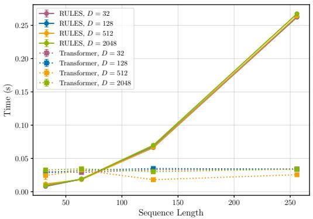  
(a) Per-batch training times.

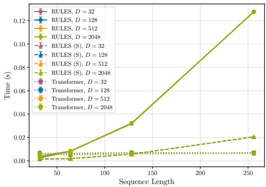  
(b) Per-batch inference times.  
Figure 6: Per-batch computation times for RULES and the transformer across varying sequence lengths L and vocabulary sizes D. RULES (S) denotes the model with symbolic (boolean) hidden layers. We report mean and one standard deviation over 32 batches of size 32; variability is small, so error bars are barely visible. Both models are largely insensitive to the vocabulary size. For larger $L ,$ the expected quadratic scaling of RULES becomes visible, while the symbolic variant achieves substantially faster inference.

We find that for both RULES and the transformer, computation time is largely independent of the vocabulary size. For shorter sequences $( L \leq 6 4 )$ , RULES achieves faster training times per batch than the transformer and maintains comparable inference times. As L increases, the expected quadratic dependence on sequence length becomes visible for RULES; however, absolute runtimes remain moderate (e.g., around 0.26s for training and 0.13s for inference at $L = 2 5 6 )$ . In contrast, transformer runtimes remain stable across sequence lengths, reflecting the parallel structure of attention computations. While our rule formulation also enables RULES to compute predicate and antecedent neurons in parallel for each prediction time step, its dependence on the number of predicate neurons I and the current implementation cause the theoretical scaling to be more directly reflected in the runtime.

Finally, we observe that the symbolic (boolean) formulation of the hidden layers in RULES (denoted by RULES (S)) substantially reduces inference time, further improving its efficiency in deployment settings.

## E Baselines

## E.1 PPM-C

PPM-C (Moffat, 1990; Begleiter et al., 2004) is a table-based Markov model that considers a maximum context of $C \in \mathbb { N } _ { > 0 }$ previous sequence elements (events). If a context of a certain length $c \leq C$ has not been encountered in the training data, PPM-C falls back to a lower order context. Specifically, given the empirical probabilities $P _ { c }$ for a context of length $c ,$ it uses

$$
\begin{array} { l l } { P ( x _ { k } | x _ { k - c } , \dots , x _ { k - 1 } ) = } \\ { \begin{array} { l l } { \left\{ P _ { c } ( x _ { k } | x _ { k - c } , \dots , x _ { k - 1 } ) , \right.} & { \mathrm { i f ~ } x _ { k - c } \dots , x _ { k - 1 } x _ { k } } \\ { P _ { c } ( \operatorname { f a l l b a c k } | x _ { k - c } , \dots , x _ { k - 1 } ) . } & { \mathrm { a p p e a r e d ~ i n ~ t r a i n i n g ~ } . } \end{array}  } \end{array}\tag{71}
$$

In PPM-C, the fallback probability mass is defined using the occurrences of different symbols after context $s = x _ { k - c } \ldots x _ { k - 1 }$ . Denote by $n ( s , x _ { k } )$ the number of times $x _ { k }$ occurred after s in training,

and let $\mathcal { V } ( s ) = \{ x _ { k } \ | \ n ( s , x _ { k } ) > 0 \}$ , then $P _ { c }$ is defined as:

$$
P _ { c } ( x _ { k } | s ) = \frac { n ( s , x _ { k } ) } { \lvert \mathcal { V } ( s ) \rvert + \sum _ { x _ { k } ^ { \prime } \in \mathcal { V } ( s ) } n ( s , x _ { k } ^ { \prime } ) } ,\tag{72}
$$

$$
P _ { c } ( \mathrm { f a l l b a c k } | s ) = \frac { \vert \mathcal { V } ( s ) \vert } { \vert \mathcal { V } ( s ) \vert + \sum _ { x _ { k } ^ { \prime } \in \mathcal { V } ( s ) } n ( s , x _ { k } ^ { \prime } ) } .\tag{73}
$$

We use the version of PPM-C that excludes already-matched symbols from probability calculations at lower-order contexts (Moffat, 1990). Since PPM-C is not designed to handle sampling times, we disregard them and use the last C ordered events as context window for prediction.

## E.2 Gradient-Boosted Decision Trees

XGBOOST (Chen and Guestrin, 2016) and CATBOOST (Prokhorenkova et al., 2018) are tree-based boosting algorithms. Thus, they need tabular input data, which we achieve by adding one sample (row) for each predicted event $x _ { k } .$ . A tabular sample contains all events $x _ { l }$ that lie in the lookback window $\omega$ of RULES $( t _ { k } - t _ { l } \le \omega )$ and the label is the predicted event $( x _ { k } )$ . Specifically, we create one categorical feature (column) for each of the positional offsets $k - l$ that takes the value $x _ { l }$ . For irregularly sampled data with varying offsets $t _ { k } - t _ { l }$ , we additionally include these offsets as separate numerical features. We ensure that all samples contain the same number of features by introducing a padding class for categorical features, and padding offsets with ω.

## E.3 RoPE Transformer

Transformers (Vaswani et al., 2017) are well suited for sequential prediction tasks. We adopt a decoder-only architecture with causal (autoregressive) attention masking. Each decoder layer consists of a multi-head self-attention block followed by a position-wise feed-forward network. Both sub-layers are wrapped with residual (skip) connections and layer normalization (Ba et al., 2016). Throughout the model, we use GELU activation functions (Hendrycks and Gimpel, 2016) and apply dropout (Srivastava et al., 2014) with rate 0.1.

To encode temporal information, we employ rotary position embeddings (RoPE) (Su et al., 2024) within the self-attention mechanism. RoPE injects relative positional information by applying position-dependent rotations to the query and key vectors. While the original formulation of RoPE was designed for NLP token sequences and uses index-based positional offsets $( k - l )$ , we generalize this approach to continuous time by instead using temporal offsets $\left( t _ { k } - t _ { l } \right)$ . Consistent with the autoregressive formulation, attention is masked to prevent access to future information. In addition, we restrict attention in each layer to the same fixed context used in RULES by masking out events $x _ { l }$ whose temporal distance from the prediction point exceeds the maximum lookback window $\omega ,$ i.e., $t _ { k } - t _ { l } > \omega$

## F Sequential Rule Interpretations and Limitations of Markov Models and Trees

In Figure 7, we illustrate how different models can be interpreted as sequential rule sets. Markov models are defined by tables that record empirical next-event frequencies for each observed context of a given maximum length. At prediction time, the current sequence is matched to a learned context, and the empirical frequency vector defines the predictive distribution. Accordingly, each event in the context acts as an antecedent element (event condition), while the empirical counts implicitly define the rule consequent. Unlike RULES, Markov models cannot incorporate time information beyond event order and grow exponentially with context length, restricting them to short-range dependencies.

Decision trees define symbolic conditions via their split nodes. Therefore, each root-to-leaf path forms a conjunction of conditions on the input, constituting a rule antecedent, and the class logits at the leaf define the consequent. While trees can incorporate event-time features, these are not explicitly tied to specific events, and splits for high-cardinality categorical variables are typically implemented as subset partitions, enabling more compact tree representations but reducing interpretability.

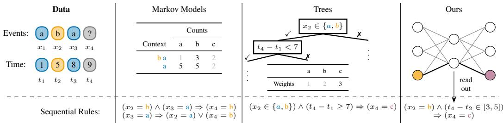  
Figure 7: Different models using symbolic rules (denoted $b y \Rightarrow ) t o$ predict the next event $x _ { 4 } .$ . Markov models base predictions on empirical event counts following a fixed-order context and do not capture time information beyond order. Decision trees define prediction rules through split conditions and leaf weights. While they can incorporate time features, these are not explicitly tied to specific events $( { \mathrm { e . g . , } } x _ { 2 } { \mathrm { ~ v s . } } t _ { 1 } )$ , and splits for categorical variables often rely on subset partitions $( \mathbf { e . g . } , x _ { 2 } \in \{ a , \mathrm { b } \} )$ . In contrast, RULES learns compact neuro-symbolic rules that directly associate specific events with delay conditions $( \mathrm { e . g . , } x _ { 2 }$ and $t _ { 2 } )$ , enabling transparent and temporally grounded predictions.

## G Real-World Datasets

In this section, we provide details on the real-world datasets:

• Holidays contains a single long sequence of public holidays in a European country with the time steps between them measured in days.

• Chorales (Conklin, 1966; Kelly et al., 2025) consists of 100 Bach chorales in MIDI format, where events correspond to note pitches and time is measured in 16th notes from the beginning of a chorale (CC BY 4.0 license).

• Commits (Galbrun et al., 2018; Cüppers et al., 2024) lists the authors of commits made to the Samba file system repository (https: $: / / \mathrm { g i t }$ .samba.org/) between 1996 and 2016. The temporal component represents the order of commits (Apache License 2.0).

• Rolling Mill (Wiegand et al., 2021; Cüppers et al., 2024) comprises 1000 production logs from a steel manufacturing plant, documenting the order of manufacturing events (public, no explicit license).

• Amazon (Berke et al., 2024) contains over 1.7 million purchases made on Amazon by around 5000 customers. Here we use the product categories as events and the purchase days as occurrence times (CC0 1.0 license).

In Table 3, we show additional dataset statistics. We refer to a dataset as regularly sampled, when all consecutive events have a constant offset $t _ { l + 1 } - t _ { l }$ . In this case, event times (sampling times) are effectively equivalent to sequence positions and we set $t _ { l + 1 } - t _ { l } = 1$ without loss of generality. To create train, validation, and test data, we split Holidays and Commits via cutoff dates to reflect a forecasting scenario, where models are trained on past data to predict future outcomes. For the other datasets, we randomly assign sequences to splits.

Table 3: Statistics of the real-world datasets. Columns show: Number of sequences $( N )$ , total number of events $( L _ { \mathrm { t o t } } )$ , minimum and maximum sequence lengths $( L _ { \mathrm { m i n } }$ and $L _ { \operatorname* { m a x } } )$ , vocabulary size (D), and whether sequences are regularly sampled.
<table><tr><td>Datasets</td><td>N</td><td> $L _ { \mathrm { t o t } }$ </td><td> $L _ { \mathrm { m i n } }$ </td><td> $L _ { \mathrm { m a x } }$ </td><td>D</td><td>Regular</td></tr><tr><td>Holidays</td><td>1</td><td>1200</td><td></td><td></td><td>14</td><td>x</td></tr><tr><td>Chorales</td><td>100</td><td>4693</td><td>26</td><td>86</td><td>20</td><td>x</td></tr><tr><td>Commits</td><td>1</td><td>28879</td><td></td><td></td><td>119</td><td>√</td></tr><tr><td>Rolling Mill</td><td>1000</td><td>53788</td><td>24</td><td>142</td><td>556</td><td>√</td></tr><tr><td>Amazon</td><td>4909</td><td>1760607</td><td>10</td><td>5057</td><td>993</td><td>x</td></tr></table>

To efficiently train models on datasets with long sequences (Holidays, Commits, Amazon), we use subsequences to create training samples. For neural models, this is done randomly during batching, while for the others, we handle it in the pre-processing of the data. For testing on these datasets, we follow the same strategy, ensuring that all models are tested on the same subsequences.

Pre-processing of the Amazon Dataset. We pre-process the Amazon dataset as follows. First, we remove sequences (customers) with fewer than 10 purchases. We then replace all product categories occurring fewer than 200 times with a single OTHER category. To resolve multiple purchases made on the same day, we impose an arbitrary but fixed alphabetical ordering over categories and introduce a small time offset ε between successive purchases, chosen such that no two purchase days overlap. Finally, we normalize all timestamps by dividing them by 5 to facilitate the training of RULES and RUNES.

## H Hardware and Compute Time

## H.1 Hardware

All experiments are conducted on a Linux-based compute cluster with NVIDIA A100 (40GB and 80GB) and L40S GPUs, paired with AMD EPYC 7662 and 9654 CPUs. Neural models are implemented in PyTorch with CUDA 12.4. All models are trained on a single GPU, except for the PPM-C baseline, which is trained on CPU. Most experiments use 32GB of RAM, while rule extraction from tree ensembles requires up to 400GB (XGBOOST on Amazon).

## H.2 Compute Time

We did not track total compute precisely; instead, we report estimates based on recorded runtimes of individual runs.

Synthetic Data. On synthetic data, RULES requires about 15–20 minutes per training run (including temperature annealing), with negligible overhead for rule extraction and refinement. Other models typically train in under 2 minutes. Each synthetic setting includes 10 datasets, with four random seeds for RULES, RULES<sup>∗</sup>, and the transformer; and grid search for PPM, XGBOOST, and CATBOOST. This results in an approximate upper bound of one day of compute per setting. Across 28 synthetic settings, this corresponds to an upper bound of roughly 3–4 weeks of GPU-equivalent compute.

Real Data. On Holidays, Chorales, and Commits, all models (including grid search and multiple seeds) complete within about 1 hour. On Rolling Mill, grid search for XGBOOST takes < 2 hours and for CATBOOST < 3 hours; all other models combined complete within 5 hours. On Amazon, the most time-consuming models per training run are CATBOOST with about 4.5 hours, XGBOOST with about 45 minutes, and RULES with about 30 minutes. Excluding tree ensembles, the remaining models together require less than 3 hours. Exact rule extraction for tree ensembles is computationally expensive on Rolling Mill and Amazon, particularly for XGBOOST (multiple hours).

Additional Compute. Hyperparameter tuning and preliminary experiments required additional compute beyond the reported runs; we estimate this overhead to be approximately 1–2× the compute of the reported results.

## I Hyperparameters

## I.1 Synthetic Datasets

We set the maximum lookback window for all methods to the known maximum influence of $\omega = 6 4$ For RULES and the RoPE Transformer, we manually tune hyperparameters on the default setting $( N = 1 0 2 4 , D = 1 2 8 , r _ { \mathrm { t a r g } } = 0 . 4 , r _ { \mathrm { c o n s } } = 0 . 8 5 )$ and fix them across all experimental settings. We prioritize training stability, followed by minimizing validation loss, while for RULES, we additionally consider ground-truth recovery performance. For PPM, XGBOOST, and CATBOOST, we perform a dataset-specific grid search, select the best-performing model per dataset, and aggregate the resulting metrics across datasets within each synthetic setting.

RULES. For RULES, we use $I = 3 0 0$ temporal predicate neurons in the first hidden layer and $J = 6 4$ antecedent neurons in the second hidden layer, ensuring sufficient capacity to learn the ground-truth rule sets. When computing the activation of temporal predicates (Equation (6)), we mask out $\tilde { p } _ { i } ( l , k )$ for all events $x _ { l }$ outside the maximum lookback window $( t _ { k } - t _ { l } > \omega )$ We optimize the model using Adam (Kingma and Ba, 2015) with a learning rate of $0 . 0 3$ and decay parameters $\beta _ { 1 } = 0 . 9 , \beta _ { 2 } ^ { - } = 0 . 9 9 9$ on minibatches of size 64. We tested learning rate schedules, but since temperature annealing already reduces gradients in most regions, this did not improve training. Finally, we clip all $\delta _ { i } ^ { \mathrm { m a x } }$ after gradient updates to enforce a minimum interval width of 1 and $\delta _ { i } ^ { \mathrm { m a x } } \leq \omega .$

We initialize $\tau _ { 1 } = \tau _ { 2 } = 1$ , and begin annealing $\tau _ { 1 }$ , the temperature of the temporal predicate neurons, after a fixed number of warm-up epochs. For the default 1024 training sequences, we use 60 warm-up epochs, scaling them proportionally to the number of training sequences in other settings. After warmup, we update the first-layer temperature, $\tau _ { 1 } .$ , every 32 optimization steps using the multiplicative decay $\tau _ { 1 } \gets 0 . 9 \cdot \tau _ { 1 }$ . When $\tau _ { 1 }$ falls below $1 \cdot 1 0 ^ { - 4 }$ , we begin decaying the antecedent layer temperature $\tau _ { 2 }$ at the same rate and step interval. To avoid numerical instability, we stop annealing τ<sub>1</sub> once it drops below $1 \cdot 1 0 ^ { - 6 }$ , and we terminate training when $\tau _ { 2 }$ falls below $\mathrm { \bar { 1 } } \cdot 1 0 ^ { - 5 }$ . After training, we use the symbolic version of the hidden layers and prune always-on neurons that activate for more than 99.9% of target events and always-off neurons that activate for less than 0.1% of target events (see Appendix B.3, Step 1).

For each training dataset, we train RULES using four random seeds and select the best-performing model. Because accurate rule recovery depends on faithfully fitting the training data, we select models based on training loss rather than validation loss. Empirically, models with lower training loss also tend to generalize better.

Rule Sets. To discretize the softmax layer of the best-performing RULES model into a rule set (Appendices B.2 and B.3), we set the min-max variation threshold $\theta _ { \mathrm { v a r } } = 0 . 9$ , the quantile threshold $\theta _ { \mathrm { q u a n t } } = 0 . 9 5$ , and the inclusion threshold $\theta _ { \mathrm { i n c } } = 0 . 9 5$ . Except for the sanity check on random data, we discard rules that are either unreliable (confidence below 0.05 on the training data) or extremely rare (frequency below $5 \cdot 1 0 ^ { - 4 } $ on the training data) before refining rule sets (Appendix B.4) and computing rule-set–related evaluation metrics. This simple filtering step focuses the evaluation on rules that both apply non-trivially to the data and make consistent predictions, providing a more realistic aggregation of rule quality across multiple datasets.

RULES with Embedded Ground Truth $( \mathbf { R U L E S } ^ { * } )$ . For RULES with embedded ground-truth rules, hidden neurons are determined by the rules, so we only optimize the softmax output layer. We optimize with Adam (learning rate 0.03), using the same hyperparameters as the standard RULES model, and apply a staged schedule: 10 warm-up epochs, followed by learning-rate decay by a factor of 0.3 whenever the training loss fails to improve by more than 0.01 over 10 epochs. We apply early stopping if the training loss does not improve by at least $1 \cdot 1 0 ^ { - 3 }$ within 31 epochs. Models are checkpointed after each epoch, and we select the checkpoint with the lowest training loss. Training is repeated for four random seeds, and we select the best resulting model.

RoPE Transformer. We use a transformer with four decoder layers, each with four attention heads and layer normalization (Ba et al., 2016). We fix the event embedding dimension and the dimensions of query, key, and value vectors to 128. The feedforward network in each decoder layer has one hidden layer of size 256. The attention modules use rotary position embeddings (Su et al., 2024) based on the relative temporal distances between events. In the attention matrix, we mask out events outside the maximum lookback window ω used by RULES. The final feedforward network predicting the next event from the decoder embeddings has one hidden layer of size 128. We use the GELU activation function (Hendrycks and Gimpel, 2016) in all hidden layers of the feedforward networks. During training, we apply dropout of 0.1 in the attention matrix, on attention outputs, within each decoder-layer feedforward network, and in the hidden layer of the output network.

We optimize the transformer using Adam (Kingma and Ba, 2015) with an initial learning rate of $3 \cdot 1 0 ^ { - 4 }$ and decay parameters $\bar { \beta } _ { 1 } = 0 . 9 , \beta _ { 2 } \bar { = } 0 . 9 9 9$ . We set the batch size to 64 and use the following learning rate schedule: We start with a learning rate of $3 \cdot 1 0 ^ { - 4 }$ , multiplying it by 0.1 whenever the training loss fails to improve by more than 0.01 over ten epochs. Early stopping is applied by monitoring the validation loss, stopping training if it does not decrease within 31 epochs.

We record the model after each epoch and select the version with the lowest validation loss. As with RULES, we repeat training with four different random seeds and then select the best-performing model based on the validation cross-entropy loss.

PPM-C. For PPM, we try maximum Markov context lengths $C \in \{ 0 , 1 , 2 , 3 , 4 , 5 \}$ on each dataset and then select the best model according to the validation cross-entropy loss.

XGBOOST. We run XGBOOST on GPU for up to 300 boosting rounds, applying early stopping if the validation cross-entropy loss does not improve for 30 rounds and selecting the iteration with the lowest validation loss. The subsampling ratio of training instances is set to 0.6 for each boosting round. We perform a grid search over the maximum tree depth {4, 6}, L2 leaf weight regularization {0, 1, 3, 5}, and learning rate {0.03, 0.3}, repeating the search over two random seeds and selecting the model with the overall lowest validation loss.

CATBOOST. We run CATBOOST on GPU with a subsampling ratio of 0.6, which is applied per split rather than per tree as in XGBOOST, and otherwise use the same hyperparameters and grid search strategy as for XGBOOST.

## I.2 Real-World Datasets

For real-world datasets, we broadly follow the same training protocol as in the synthetic experiments. We fix the lookback window $\omega$ across models by tuning it for RULES and applying the selected value to all baselines.

RULES. Unless stated otherwise, we use the same learning rates and annealing schedules as in the synthetic experiments (Appendix I.1), which we found to work well across most real datasets. One exception is the number of warm-up epochs before temperature annealing, which we tune per dataset. On Holidays, where we observe a pronounced mismatch between the soft and symbolic hidden layers, we anneal the second-layer temperature $\tau _ { 2 }$ until it reaches 1 · $1 0 ^ { - 6 }$ rather than $\mathrm { \dot { 1 } } \cdot 1 0 ^ { - 5 }$ . On Amazon, we anneal the first-layer temperature $\tau _ { 1 }$ with a factor of 0.92 and the second-layer temperature with a factor of 0.95. To counteract excessive deactivation of antecedent neurons during annealing on Amazon, we further add a regularization term after the warm-up epochs that subtracts the batch-wise mean antecedent activation from the loss.

The remaining hyperparameters are reported in Table 4. For Chorales, we use a batch size of 30 due to the limited number of training sequences (60). For Holidays, Commits, and Amazon, training is performed on randomly sampled subsequences; we define one epoch as 1024 samples for Holidays and Commits and 2048 samples for Amazon. For Amazon, event times are divided by 5, resulting in an effective lookback window of 100 days. We set the min-max variation threshold to $\theta _ { \mathrm { v a r } } = 0 . 9$ across all datasets.

Table 4: Selected hyperparameters of RULES on real-world datasets. Columns show: I (number of temporal predicate neurons), J (number of antecedent neurons), ω (maximum lookback window), batch size, warm-up epochs, $\theta _ { \mathrm { q u a n t } }$ (quantile threshold), and $\theta _ { \mathrm { i n c } }$ (inclusion threshold).
<table><tr><td>Datasets</td><td>I</td><td> $J$ </td><td> $\omega$ </td><td>Batch Size</td><td>Warm-up</td><td> $\theta _ { \mathrm { q u a n t } }$ </td><td> $\theta _ { \mathrm { i n c } }$ </td></tr><tr><td>Holidays</td><td>200</td><td>45</td><td>365</td><td>64</td><td>100</td><td>0.85</td><td>0.85</td></tr><tr><td>Chorales</td><td>200</td><td>64</td><td>48</td><td>30</td><td>300</td><td>0.85</td><td>0.85</td></tr><tr><td>Commits</td><td>300</td><td>100</td><td>24</td><td>64</td><td>60</td><td>0.95</td><td>0.90</td></tr><tr><td>Rolling Mill</td><td>500</td><td>200</td><td>64</td><td>64</td><td>100</td><td>0.90</td><td>0.90</td></tr><tr><td>Amazon</td><td>500</td><td>200</td><td>20</td><td>64</td><td>200</td><td>0.80</td><td>0.90</td></tr></table>

After fixing hyperparameters, we train RULES with four random seeds and, unlike in the synthetic experiments, select the best model based on validation loss. As described in Section 4.2, we extract and post-process the learned rules (Appendices B.2 to B.4), re-embed the refined antecedents into the hidden layers, and retrain only the output layer. Details of the retraining procedure are provided in the next paragraph.

RULES with Processed Rules. After embedding symbolic antecedents in RULES, we retrain only the softmax output layer. We use the same strategy as for RULES with embedded ground-truth antecedents (RULES<sup>∗</sup>) in the synthetic experiments, but select the best model based on validation loss: We optimize with Adam (learning rate 0.03), using the same batch size as the end-to-end RULES model, and apply a staged schedule: 10 warm-up epochs, followed by learning-rate decay by a factor of 0.3 whenever the training loss fails to improve by more than 0.01 over 10 epochs. We apply early stopping if the validation loss does not improve by at least 1 · 10<sup>−3</sup> within 31 epochs. Models are checkpointed after each epoch, and we select the checkpoint with the lowest validation loss. Training is repeated for four random seeds, and we select the best resulting model.

RoPE Transformer. We use the same hyperparameters and training schedule as in the synthetic setting, adapting only the batch size and maximum lookback window to match RULES.

RUNES. For RUNES, we combine the best (frozen) RULES model with processed rule antecedents and a transformer residual network. The transformer uses the same architecture and optimization protocol as the standalone RoPE transformer, but the softmax logits of RULES are added to the transformer logits (see Section 2.2).

PPM-C. For PPM, we follow the same protocol as in the synthetic experiments, evaluating context lengths $C \in \{ 0 , 1 , 2 , 3 , 4 , 5 \}$ and selecting the best model based on validation cross-entropy loss.

XGBOOST and CATBOOST. For datasets in which RULES is trained on randomly sampled subsequences (Holidays, Commits, Amazon), we augment the tree-ensemble training and validation data with events (samples) by randomly truncating the sequence history beyond the maximum lookback window ω, matching the incomplete context of some events in test subsequences. We use the same hyperparameters and grid-search protocol as for synthetic data, except on Amazon. Due to its scale, we restrict the Amazon grid search to maximum tree depth {6}, L2 leaf regularization {0, 3, 5}, and learning rate {0.003, 0.03}. We further reduce the subsampling ratio to 0.1, early stopping rounds to 6, and run grid search with a single random seed.

## J Additional Results on Synthetic Data

Settings. In Figures 8 and 9, we show the test accuracy and the rule set similarity to the groundtruth rule set $\mathbf { R } ^ { * }$ for varying dataset sizes and vocabulary sizes, respectively. In both cases, we fix the signal-to-noise parameters $r _ { \mathrm { c o n s } } = 0 . 8 5$ and $r _ { \mathrm { t a r g } } = 0 . 4$ . The test datasets contain as many sequences (N) as the training datasets, with the default value being $N = 1 0 2 4$ . The default value for the vocabulary size is $D = \bar { 1 } 2 8$ . For completeness, Figure 10 reports results over a wider range of signal-to-noise parameters than Figure 2. As before, ${ \mathrm { \bf R U L E S } } ^ { * }$ denotes a RULES model with embedded ground-truth antecedents.

Results. We find that an increasing number of training sequences improves both the ability of RULES to reconstruct the ground truth and its prediction accuracy. Regarding the vocabulary size D, RULES works well for medium to large vocabularies $( D \in [ 1 6 , \dot { 1 } 0 2 4 ] )$ . Low-dimensional data $( D \in \{ 4 , 8 \} )$ makes it hard to find structure beyond the base frequencies. In contrast, high-dimensional data significantly increases the space of possible rule sets, but at the same time permits more sparse rules with smaller antecedents for prediction. This is reflected by increasing sim $( \mathbf { R } , \mathbf { R } ^ { * } )$ but decreasing sim(R<sup>∗</sup>, R), with the test accuracy remaining in the same region.

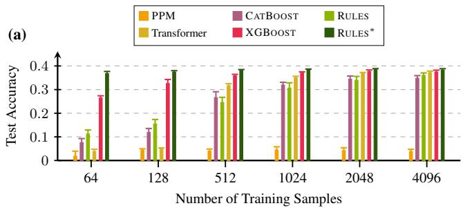

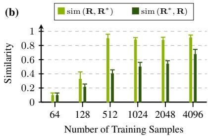  
Figure 8: RULES improves with an increasing number oftraining samples N. We show the mean results over 10 rule sets and corresponding datasets per synthetic setting. Error bars mark the empirical standard deviation. (a) Test accuracy compared to baseline models. (b) Similarity between the rule set R discovered by RULES and the ground truth $\mathbf { R } ^ { * }$

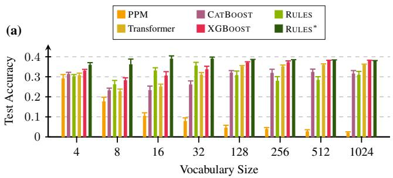

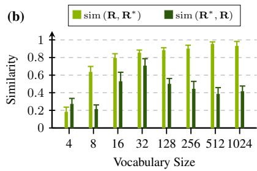  
Figure 9: RULES performs well on synthetic data for varying vocabulary sizes D. We show the mean results over 10 rule sets and corresponding datasets per synthetic setting. Error bars mark the empirical standard deviation. (a) Test accuracy compared to baseline models. (b) Similarity between the rule set R discovered by RULES and the ground truth $\mathbf { R } ^ { * }$

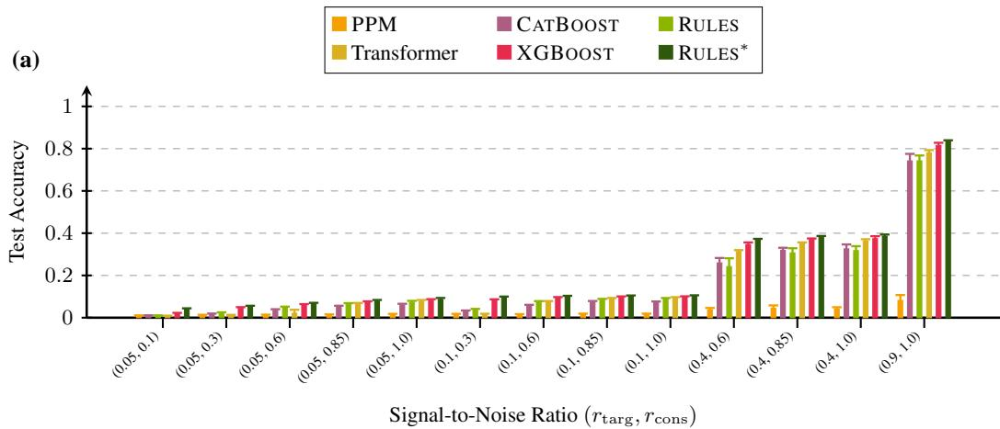

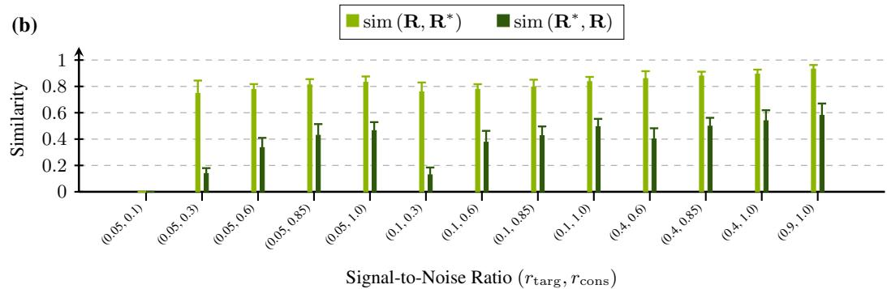  
Figure 10: Extended results on synthetic datafor varying signal-to-noise parameters $( r _ { \mathrm { t a r g } } , r _ { \mathrm { c o n s } } )$ We show the mean results over 10 rule sets and corresponding datasets per synthetic setting. Error bars mark the empirical standard deviation. (a) Test accuracy compared to baseline models. (b) Similarity between the rule set R discovered by RULES and the ground truth $\mathbf { R } ^ { * }$

## K Additional Results on Real Data

## K.1 Test Loss and Model Sizes on Real Datasets

In Table 5, we report test cross-entropy loss for the models in Table 1, with trends mirroring those results. In Table 6, we further report the sizes of all models that can be fully decomposed into symbolic rules, including their average antecedent lengths.

Table 5: Test cross-entropy on real-world datasets (lower is better). The best results are in bold, the second best are underlined.
<table><tr><td>Datasets</td><td>RULES</td><td>RUNES</td><td>PPM</td><td>CATBOOST</td><td>XGBOOST</td><td>Transformer</td></tr><tr><td>Holidays</td><td>0.053</td><td>0.000</td><td>0.022</td><td>0.000</td><td>0.001</td><td>0.004</td></tr><tr><td>Chorales</td><td>2.404</td><td>1.897</td><td>1.993</td><td>1.967</td><td>1.880</td><td>1.820</td></tr><tr><td>Commits</td><td>4.161</td><td>4.212</td><td>5.459</td><td>4.200</td><td>4.547</td><td>4.330</td></tr><tr><td>Rolling Mill</td><td>2.581</td><td>1.174</td><td>1.321</td><td>1.399</td><td>1.247</td><td>1.072</td></tr><tr><td>Amazon</td><td>5.799</td><td>4.829</td><td>5.318</td><td>5.429</td><td>5.270</td><td>4.817</td></tr><tr><td>Avg. Rank</td><td>5.0</td><td>2.2</td><td>4.8</td><td>3.4</td><td>3.2</td><td>2.2</td></tr></table>

Table 6: Number of rules $( | \mathbf { R } | )$ , average antecedent size $( | A | )$ , and test accuracy (Acc.) in % on real-world datasets for models that can be fully decomposed into symbolic rules. RULES consistently produces compact rule sets with small antecedents.
<table><tr><td></td><td colspan="3">RULES</td><td colspan="3">PPM</td><td colspan="3">CATBOOST</td><td colspan="3">XGBOOST</td></tr><tr><td>Datasets</td><td>|R|</td><td>|A|</td><td>Acc. ↑</td><td>|R|</td><td>|A|</td><td>Acc. ↑</td><td>|R|</td><td>|A|</td><td>Acc. ↑</td><td>|R|</td><td>|A|</td><td>Acc. ↑</td></tr><tr><td>Holidays</td><td>26</td><td>1.2</td><td>97.57</td><td>14</td><td>1.0</td><td>100.00</td><td>1129</td><td>4.0</td><td>100.00</td><td>1455</td><td>3.2</td><td>100.00</td></tr><tr><td>Chorales</td><td>33</td><td>4.2</td><td>21.00</td><td>180</td><td>1.9</td><td>31.40</td><td>11596</td><td>6.0</td><td>37.10</td><td>34462</td><td>3.7</td><td>37.72</td></tr><tr><td>Commits</td><td>51</td><td>2.6</td><td>19.60</td><td>80</td><td>1.0</td><td>18.11</td><td>380</td><td>6.0</td><td>15.55</td><td>83965</td><td>3.8</td><td>17.03</td></tr><tr><td>Rolling Mill</td><td>77</td><td>4.1</td><td>34.13</td><td>9583</td><td>2.6</td><td>67.64</td><td>13809</td><td>6.0</td><td>65.64</td><td>640723</td><td>3.4</td><td>68.84</td></tr><tr><td>Amazon</td><td>42</td><td>1.7</td><td>6.53</td><td>993</td><td>1.0</td><td>15.16</td><td>13123</td><td>6.0</td><td>11.79</td><td>5149683</td><td>4.9</td><td>15.37</td></tr></table>

## K.2 Influence of the Residual Network for Individual Datasets

In Table 7, we show the individual results for each dataset that when averaged produce Table 2. For averaging, we sum up the different table entries for each dataset and then divide by the number of datasets. The Commits dataset is excluded, as RULES already performs well, causing early stopping to select a RUNES model in which the residual network remains effectively untrained.

Table 7: Influence ofthe Residual Networkfor Individual Datasets. Counts are normalized within the rule activity groups. The bottom rows show the fraction of predictions that fall within the respective groups and the total number of testing events.

(a) Holidays
<table><tr><td rowspan="2">RUNES</td><td colspan="4">RULES</td></tr><tr><td colspan="2">Rule Active</td><td colspan="2">No Rule Active</td></tr><tr><td></td><td>right</td><td>wrong</td><td>right</td><td>wrong</td></tr><tr><td>right</td><td>0.99</td><td>0.01</td><td>0.50</td><td>0.50</td></tr><tr><td>wrong</td><td>0.00</td><td>0.00</td><td>0.00</td><td>0.00</td></tr><tr><td>Fraction of Data</td><td colspan="2">0.97</td><td colspan="2">0.03</td></tr><tr><td>Total Count</td><td colspan="4">11264</td></tr></table>

(b) Chorales
<table><tr><td rowspan="2">RUNES</td><td colspan="4">RULES</td></tr><tr><td colspan="2">Rule Active</td><td colspan="2">No Rule Active</td></tr><tr><td></td><td>right</td><td>wrong</td><td>right</td><td>wrong</td></tr><tr><td>right</td><td>0.16</td><td>0.15</td><td>0.10</td><td>0.35</td></tr><tr><td>wrong</td><td>0.07</td><td>0.63</td><td>0.10</td><td>0.46</td></tr><tr><td>Fraction of Data</td><td colspan="2">0.55</td><td colspan="2">0.45</td></tr><tr><td>Total Count</td><td colspan="4">981</td></tr></table>

(c) Rolling Mill
<table><tr><td rowspan="2">RUNES</td><td colspan="4">RULES</td></tr><tr><td colspan="2">Rule Active</td><td colspan="2">No Rule Active</td></tr><tr><td></td><td>right</td><td>wrong</td><td>right</td><td>wrong</td></tr><tr><td>right</td><td>0.34</td><td>0.37</td><td>0.14</td><td>0.48</td></tr><tr><td>wrong</td><td>0.03</td><td>0.26</td><td>0.01</td><td>0.38</td></tr><tr><td>Fraction of Data</td><td colspan="2">0.88</td><td colspan="2">0.12</td></tr><tr><td>Total Count</td><td colspan="4">10507</td></tr></table>

(d) Amazon
<table><tr><td rowspan="2">RUNES</td><td colspan="4">RULES</td></tr><tr><td colspan="2">Rule Active</td><td colspan="2">No Rule Active</td></tr><tr><td></td><td>right</td><td>wrong</td><td>right</td><td>wrong</td></tr><tr><td>right</td><td>0.10</td><td>0.16</td><td>0.05</td><td>0.11</td></tr><tr><td>wrong</td><td>0.01</td><td>0.72</td><td>0.01</td><td>0.83</td></tr><tr><td>Fraction of Data</td><td colspan="2">0.17</td><td colspan="2">0.83</td></tr><tr><td>Total Count</td><td colspan="4">121498</td></tr></table>

## K.3 Influence of the Residual Network for Individual Predictions

RUNES trains the residual network on the logit residuals of RULES and combines both of their logits additively. This not only yields a transparent decomposition into rule-based and residual contributions, but also provides informative signals even when the ground-truth label is unavailable.

To illustrate this, we plot the entropy of the output distribution of RULES against the symmetric KL divergence between RULES and RUNES for individual predictions in Figure 11, additionally distinguishing correctness and agreement between the models. We observe that (i) the residual network usually induces larger shifts (high KL) when RULES is uncertain (high entropy), and (ii) large entropy and KL values combined with disagreement often correspond either to correct adjustments or to noisy events where neither model predicts correctly.

For example, on Rolling Mill, a logit shift corresponding to a symmetric KL divergence greater than 3 strongly correlates with correct prediction changes when the models disagree, while incorrect prediction changes almost never occur in this region, providing a practical signal for deciding whether to rely only on the rule-based or also the residual component. Similarly, on Chorales, when the entropy of RULES is below 1.5, correct changes do not occur while incorrect ones are frequent, indicating that rules should be preferred in this regime.

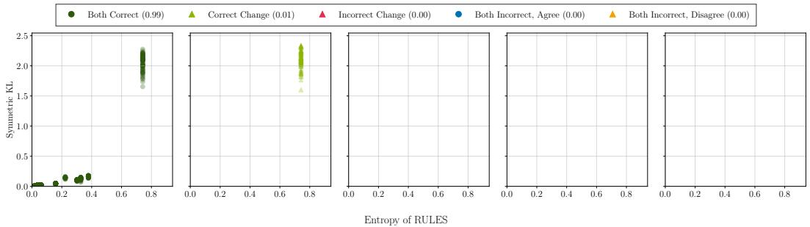  
(a) Holidays, 10890 total events with active rules.

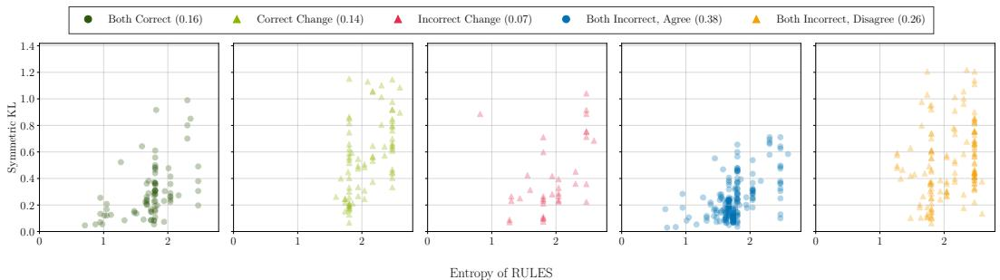  
(b) Chorales, 540 total events with active rules.

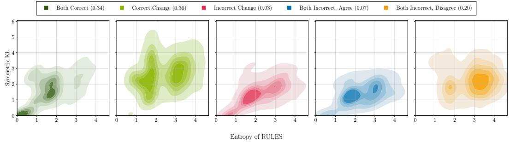  
(c) Rolling Mill, 9198 total events with active rules.

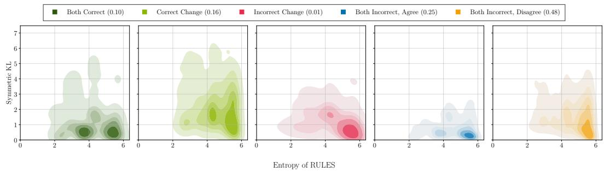  
(d) Amazon, 20386 total events with active rules.

Figure 11: Entropy ofthe output distribution of RULES (x-axis) versus the symmetric KL divergence to RUNES (y-axis) on test splits ofreal-world datasets, considering events with at least one active rule. Plots are grouped by prediction outcome: both models correct $( { \check { \mathsf { V } } } { \check { \mathsf { V } } } ) .$ , only RUNES correct (correct change, $\pmb { \chi }  \checkmark ) ,$ , only RULES correct (incorrect change, $\pmb { \check { \check { \mathbf { \alpha } } } }  \pmb { \check { \mathbf { \beta } } }$ , both incorrect (✗✗) with the same prediction, and both incorrect with different predictions $( { \pmb x }  { \pmb x } )$ . For clarity, density plots are shown for Rolling Mill and Amazon. Subcaptions report the total number of events per dataset, and the legends indicate the fraction corresponding to each case.

## K.4 Effect of Symbolic Rule Processing

Table 8 summarizes the effect of symbolic rule post-processing (Appendices B.2–B.4) on the antecedent complexity and test accuracy of RULES for real-world data. Post-processing accuracy refers to the accuracy of RULES after embedding the processed antecedents into its hidden layers and retraining only the output layer (i.e., the RULES model that we use in our experiments).

Results. Post-processing substantially reduces both the number of predicates per antecedent and the width of the remaining delay intervals. Its effect on the test accuracy is mixed: accuracy improves on some datasets, likely due to more precise rule activations, while it decreases on others. Figure 12 shows that post-processing also reduces the number of active rules per predicted event, increasing sparsity. We hypothesize that, prior to post-processing, antecedent neurons can be entangled for downstream predictions rather than representing individual, meaningful rules. The increased sparsity induced by symbolic refinement likely promotes disentanglement into more self-contained rules, improving interpretability while sometimes reducing predictive performance.

Table 8: Symbolic processing of rules extractedfrom RULES reduces antecedent complexity. The table shows RULES before and after symbolic post-processing of rules (Appendices B.2–B.4). It reports test accuracy for next-event prediction (Acc.) in %, average antecedent size (|A|), and average delay interval width $( \lvert \Delta _ { i } \rvert = \left. \left[ \delta ^ { \mathrm { m i n } } , \delta ^ { \mathrm { m a x } } \right] \right. )$ across rules. Standard deviations for antecedent sizes and delay intervals are included. The final column shows the absolute change after post-processing. Post-processing accuracy refers to RULES after embedding the processed antecedents into its hidden layers and retraining only the output layer.
<table><tr><td></td><td colspan="4">Before</td><td colspan="4">After</td><td colspan="4">Difference</td></tr><tr><td>Datasets</td><td>Acc.</td><td>Avg. |A|</td><td> $\mathrm { A v g . } \ | \Delta _ { i } |$ </td><td></td><td>Acc.</td><td>Avg. |A|</td><td></td><td> $\mathrm { A v g . } \ | \Delta _ { i } |$ </td><td>Acc.</td><td>Avg. |A|</td><td> $\mathrm { A v g . } \left| \Delta _ { i } \right|$ </td></tr><tr><td>Holidays</td><td>96.12</td><td> $3 . 1 \pm 1 . 8$ </td><td> $1 0 7 . 6 \pm 5 1 . 9$ </td><td></td><td>97.57</td><td> $1 . 2 \pm 0 . 4$ </td><td> $8 . 5 \pm 1 4 . 0$ </td><td></td><td>+1.45</td><td>-1.99</td><td>-99.03</td></tr><tr><td>Chorales</td><td>22.22</td><td> $6 . 5 \pm 3 . 6$ </td><td> $1 6 . 7 \pm \ : 7 . 5$ </td><td></td><td>21.00</td><td> $4 . 2 \pm 2 . 3$ </td><td> $5 . 1 \pm \ : 6 . 3$ </td><td></td><td>-1.22</td><td>-2.28</td><td>-11.59</td></tr><tr><td>Commits</td><td>11.72</td><td> $3 . 2 \pm 2 . 2$ </td><td> $6 . 9 \pm \ : 4 . 9$ </td><td></td><td>19.60</td><td> $2 . 6 \pm 1 . 8$ </td><td> $2 . 8 \pm \ : 3 . 4$ </td><td></td><td>+7.88</td><td>-0.54</td><td>- 4.13</td></tr><tr><td>Rolling Mill</td><td>43.10</td><td> $7 . 0 \pm 4 . 0$ </td><td> $2 5 . 2 \pm \ : 9 . 7$ </td><td></td><td>34.13</td><td> $4 . 1 \pm 2 . 2$ </td><td> $4 . 1 \pm \ : 4 . 9$ </td><td></td><td>-8.97</td><td>-2.95</td><td>-21.04</td></tr><tr><td>Amazon</td><td>7.55</td><td> $1 . 7 \pm 0 . 9$ </td><td> $6 . 2 \pm \ : 6 . 7$ </td><td></td><td>6.53</td><td> $1 . 7 \pm 0 . 9$ </td><td> $3 . 3 \pm \ : 5 . 3$ </td><td></td><td>-1.02</td><td>-0.00</td><td>- 2.88</td></tr></table>

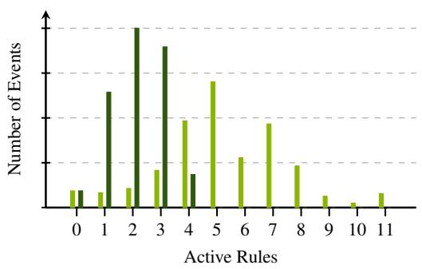  
(a) Holidays

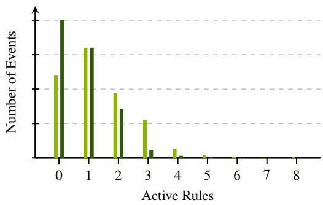  
(b) Chorales

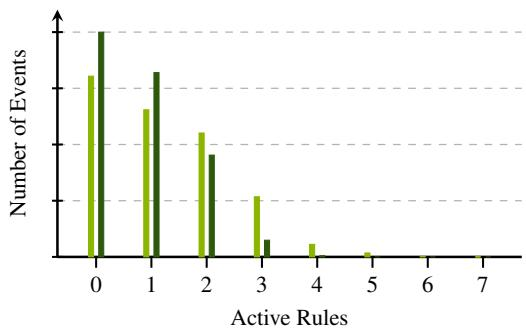  
(c) Commits

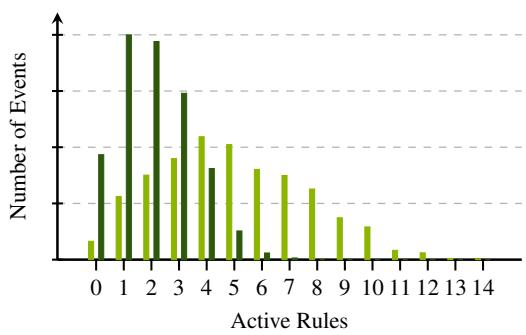  
(d) Rolling Mill

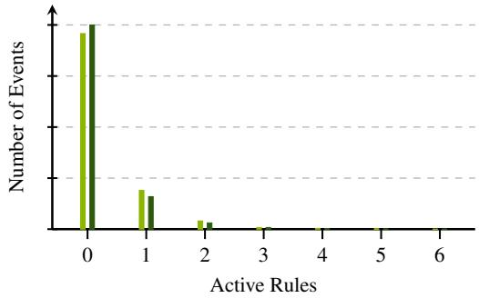  
(e) Amazon  
Figure 12: Symbolic processing of rules extracted from RULES reduces the number of active rules per prediction. The figure shows histograms of the number of active rules per next-event prediction on the test split of real-world datasets.

## K.5 Variability of RULES, RUNES, and the Transformer

For RULES and RUNES (and the transformer), we report results in Tables 1 and 5 using the best model (selected by validation loss; Appendix I.2) across four random seeds. This ensures consistent reporting across the three-stage training pipeline of RUNES: (i) end-to-end training of RULES, (ii) training of RULES with symbolically refined rules, and (iii) training of the residual network, where each stage selects the best model from the previous one. In Tables 9 and 10, we additionally report the mean and standard deviation on real-world datasets for each stage and the standalone transformer, using the same four seeds as for model selection. Overall, variability is moderate during rule learning and small in later stages.

Table 9: Mean and standard deviation ofthe test cross-entropy (lower is better) across training stages of RUNES on real-world datasets. “No refinement” refers to RULES without symbolically processed rules.
<table><tr><td></td><td>RULES (no refinement)</td><td>RULES</td><td>RUNES</td><td>Transformer</td></tr><tr><td>Holidays</td><td> $0 . 1 4 7 \pm 0 . 0 8 2$ </td><td> $0 . 0 5 4 \pm 0 . 0 0 1$ </td><td> $0 . 0 0 0 \pm 0 . 0 0 0$ </td><td> $0 . 0 0 5 \pm 0 . 0 0 0$ </td></tr><tr><td>Chorales</td><td> $2 . 6 2 7 \pm 0 . 0 6 5$ </td><td> $2 . 4 0 4 \pm 0 . 0 0 2$ </td><td> $1 . 9 3 1 \pm 0 . 0 2 9$ </td><td> $1 . 8 4 1 \pm 0 . 0 2 4$ </td></tr><tr><td>Commits</td><td> $8 . 1 0 7 \pm 0 . 6 7 1$ </td><td> $4 . 1 8 6 \pm 0 . 0 1 8$ </td><td> $4 . 1 9 1 \pm 0 . 0 1 7$ </td><td> $4 . 2 5 0 \pm 0 . 0 7 3$ </td></tr><tr><td>Rolling Mill</td><td> $2 . 4 6 8 \pm 0 . 1 0 4$ </td><td> $2 . 5 8 0 \pm 0 . 0 0 1$ </td><td> $1 . 1 8 3 \pm 0 . 0 1 0$ </td><td> $1 . 0 6 9 \pm 0 . 0 0 3$ </td></tr><tr><td>Amazon</td><td> $5 . 8 1 1 \pm 0 . 0 4 5$ </td><td> $5 . 8 0 1 \pm 0 . 0 0 2$ </td><td> $4 . 8 5 0 \pm 0 . 0 1 6$ </td><td> $4 . 8 3 4 \pm 0 . 0 1 5$ </td></tr></table>

Table 10: Mean and standard deviation ofthe test accuracy in % (higher is better) across training stages of RUNES on real-world datasets. “No refinement” refers to RULES without symbolically processed rules.
<table><tr><td></td><td>RULES (no refinement)</td><td>RULES</td><td>RUNES</td><td>Transformer</td></tr><tr><td>Holidays</td><td> $9 0 . 9 8 \pm 4 . 0 5$ </td><td> $9 7 . 5 7 \pm 0 . 0 0$ </td><td> $1 0 0 . 0 0 \pm 0 . 0 0$ </td><td> $1 0 0 . 0 0 \pm 0 . 0 0$ </td></tr><tr><td>Chorales</td><td> $2 1 . 4 1 \pm 0 . 5 9$ </td><td> $2 1 . 1 5 \pm 0 . 1 0$ </td><td> $3 7 . 1 6 \pm 0 . 7 2$ </td><td> $3 9 . 1 7 \pm 0 . 4 9$ </td></tr><tr><td>Commits</td><td> $1 2 . 8 5 \pm 1 . 2 7$ </td><td> $1 7 . 2 0 \pm 1 . 6 0$ </td><td> $1 7 . 0 7 \pm 0 . 9 9$ </td><td> $2 0 . 5 8 \pm 0 . 8 5$ </td></tr><tr><td>Rolling Mill</td><td> $3 7 . 7 9 \pm 3 . 7 4$ </td><td> $3 4 . 1 3 \pm 0 . 0 0$ </td><td> $7 0 . 2 0 \pm 0 . 3 4$ </td><td> $7 1 . 4 9 \pm 0 . 3 3$ </td></tr><tr><td>Amazon</td><td> $6 . 7 2 \pm 0 . 6 5$ </td><td> $6 . 5 2 \pm 0 . 0 4$ </td><td> $1 7 . 3 6 \pm 0 . 1 4$ </td><td> $1 7 . 4 9 \pm 0 . 1 0$ </td></tr></table>

## K.6 Externally Mined Rules vs. End-to-End Learning

Existing rule- and pattern-mining methods are largely unsuitable for direct next-event prediction: (i) they often lack temporal information, making it unclear how long a rule should remain active; (ii) many cannot handle irregular event times; (iii) they lack a principled way to combine rules for prediction; and (iv) frequent pattern mining risks large rule sets that hinder interpretability, while set mining scales poorly. For example, regarding (iv), Siji et al. (2026) report that their rule set miner requires 22 hours on a smaller Rolling Mill dataset (18k events), while RULES runs on a larger version in 1 hour; moreover, they observe that frequent rule miners run out of 64GB memory due to the large number of candidates. Nonetheless, mined patterns can be incorporated into RULES by converting them into antecedents of Temporal Conjunctive Prediction Rules, enabling predictive use.

We evaluate the sequential pattern set miner SQS (Tatti and Vreeken, 2012) in this setting, leveraging its compact pattern sets. SQS is tested on four of the five real-world datasets, since it does not finish within 24 hours on Amazon, whereas RULES trains in approximately 30 minutes. As SQS assumes regularly sampled sequences, we leverage integer timestamps in the irregularly sampled Holidays and Chorales datasets and insert padding events between actual events to induce equal spacing. To enable prediction, we heuristically convert mined patterns into rules with delay intervals and apply symbolic refinement as in RULES (Appendix B.4). We select the top rules based on the product of confidence and support to match the maximum capacity of RULES (J in Table 4) and embed their antecedents into the model. The output layer is then trained as in the standard pipeline for RULES with processed rules (Appendix I.2).

Results. The results in Table 11 show that, beyond the efficiency gap on Amazon, RULES (with end-to-end learning and symbolic refinement) outperforms the SQS-based pipeline on three of the remaining four datasets, while SQS helps with rule discovery on Rolling Mill.

Table 11: Comparison of externally mined rules and end-to-end learning. We report test cross-entropy (NLL) and accuracy (Acc.) in %. SQS → RULES denotes RULES with antecedents mined via SQS.
<table><tr><td rowspan="2">Datasets</td><td colspan="2">RULES</td><td colspan="2">SQS → RULES</td></tr><tr><td>NLL↓</td><td>Acc. ↑</td><td>NLL↓</td><td>Acc. ↑</td></tr><tr><td>Holidays</td><td>0.053</td><td>97.57</td><td>0.643</td><td>71.29</td></tr><tr><td>Chorales</td><td>2.404</td><td>21.00</td><td>2.518</td><td>12.95</td></tr><tr><td>Commits</td><td>4.161</td><td>19.60</td><td>4.344</td><td>13.67</td></tr><tr><td>Rolling Mill</td><td>2.581</td><td>34.13</td><td>1.987</td><td>54.21</td></tr></table>

## K.7 Independent Training of Rule and Residual Networks

We study whether adding the logits of the frozen RULES network during training of the residual network, as in RUNES, provides benefits over training both models independently. To this end, for each dataset, we fix the corresponding RULES model from Table 1 and compare RUNES against a variant that combines RULES with an independently trained transformer residual network. This corresponds to training the transformer in Table 1 and combining it with the respective RULES model.

In Table 12, we report mean results for residual network training over 4 random seeds. We find that adding rule logits during training improves performance by enabling the residual network to learn corrective logits relative to rule-based predictions.

Table 12: RUNES benefitsfrom training the residual network with added rule logits. We report mean and standard deviation of test cross-entropy (NLL) and accuracy (Acc.) in % on real-world datasets over 4 random seeds for residual network training. “Independent” denotes RUNES with independently trained rule and residual networks. Best results within one standard deviation are in bold.
<table><tr><td rowspan="2">Datasets</td><td colspan="2">RUNES</td><td colspan="2">RUNES (independent)</td></tr><tr><td>NLL↓</td><td> $\operatorname { A c c . \uparrow }$ </td><td>NLL↓</td><td>Acc. ↑</td></tr><tr><td>Holidays</td><td> $\mathbf { 0 . 0 0 0 \mathop { : } 0 . 0 0 0 }$ </td><td> $\mathbf { 1 0 0 . 0 0 \ : \pm 0 . 0 0 }$ </td><td> $\mathbf { 0 . 0 0 0 \mathop { : } 0 . 0 0 0 }$ </td><td> $\mathbf { 1 0 0 . 0 0 \ : \pm 0 . 0 0 }$ </td></tr><tr><td>Chorales</td><td> ${ \bf 1 . 9 3 1 \pm 0 . 0 2 9 }$ </td><td> ${ \bf 3 7 . 1 6 \pm 0 . 7 2 }$ </td><td> $2 . 2 3 4 \pm 0 . 0 3 5$ </td><td> $3 3 . 6 9 \pm 0 . 6 1$ </td></tr><tr><td>Commits</td><td> $\mathbf { 4 . 1 9 1 \pm 0 . 0 1 7 }$ </td><td> $1 7 . 0 7 \pm 0 . 9 9$ </td><td> $5 . 6 5 5 \pm 0 . 1 2 4$ </td><td> ${ \bf 2 0 . 7 1 \pm 1 . 1 2 }$ </td></tr><tr><td>Rolling Mill</td><td> $\mathbf { 1 . 1 8 3 \pm 0 . 0 1 0 }$ </td><td> ${ \bf 7 0 . 2 0 \pm 0 . 3 4 }$ </td><td> $1 . 3 8 6 \pm 0 . 0 0 4$ </td><td> ${ \bf 7 0 . 0 0 \pm 0 . 3 0 }$ </td></tr><tr><td>Amazon</td><td> $\mathbf { 4 . 8 5 0 \ : \pm 0 . 0 1 6 }$ </td><td> ${ \bf 1 7 . 3 6 \pm 0 . 1 4 }$ </td><td> $5 . 7 6 0 \pm 0 . 0 1 5$ </td><td> $1 5 . 0 5 \pm 0 . 0 5$ </td></tr></table>

## K.8 Ablation on the Lookback Window

On Holidays and Chorales, we use a maximum lookback window ω with natural meaning (one year and three 4/4 bars or four 3/4 bars, respectively). For the other real-world datasets, we tune the lookback window for RULES, then apply it to all other methods, so they operate on the same data (Appendix I.2). To assess sensitivity to this choice, we ablate the lookback window size on Commits, where RULES leads the symbolic baselines, using the same protocol as in Table 1.

Table 13: Test accuracy in % for different lookback windows ω on Commits.
<table><tr><td>Lookback Window</td><td>RULES</td><td>CATBOOST</td><td>XGBOOST</td><td>Transformer</td></tr><tr><td>12</td><td>18.32</td><td>17.81</td><td>16.68</td><td>19.71</td></tr><tr><td>24</td><td>19.60</td><td>15.55</td><td>17.03</td><td>20.10</td></tr><tr><td>36</td><td>13.65</td><td>15.46</td><td>16.26</td><td>20.23</td></tr><tr><td>48</td><td>12.68</td><td>17.34</td><td>16.24</td><td>20.14</td></tr></table>

Table 13 shows that the performance of RULES drops for larger window sizes, likely because the hyperparameters (tuned for $\omega = 2 4 )$ transfer poorly to wider windows, where good event delay intervals are harder to learn. Nonetheless, at both its selected window $( \omega = 2 4 )$ and the shorter window (ω = 12), RULES outperforms every configuration of baselines with symbolic decomposition in the table.<sup>5</sup>

## K.9 Qualitative Results

In this section, we use case studies to qualitatively evaluate the rules discovered by RULES and baseline models.

## K.9.1 Comparison across Models

We first compare rules discovered by different models. On Amazon, RULES identifies {(physical movie, [ε, 68])} ⇒ {physical movie},<sup>6</sup> indicating that customers often purchase another movie within 68 days of a prior movie purchase. A first-order Markov model (PPM) also captures that movies tend to follow movies, but lacks detailed temporal information, failing to use this dependency in 38% of test cases where the rule is correctly active in RULES.

Similar to PPM, the first tree in XGBOOST for physical movie (illustrated later in this section) uses the most recent event at the root split, and it incorporates its associated time feature in subsequent nodes. However, the smaller partition of the root split is already defined by a subset of 49 possible events, and subsequent splits further condition on other events, making the logic difficult to interpret. CATBOOST further obscures interpretability by internally mapping categorical variables to continuous representations that cannot be easily inverted to recover explicit rules.

Returning to our running example, RULES discovers a similar rule on Amazon: “If a customer purchased a ‘computer case’ within the last 43 days, a ‘computer processor’ within the last 21 days, and a ‘computer drive’ within the last 69 days then the next event is likely to be the purchase of a ‘motherboard’, a ‘power supply unit’ or a ‘graphics card’.” This rule occurs 114 times in the training data, covers 13% of events when the antecedent is active, and generalizes to 30 test cases. In contrast, PPM with order 3 cannot model temporal gaps and relies on exact event orderings. As a result, among the 27 training occurrences where the three antecedent events appear contiguously, it observes our consequent events only twice and entirely misses power supply unit, despite this item being purchased 39 times in the training data when our antecedent is active. These examples help explain the consistent performance gains of RULES over PPM for synthetic data, which specifically incorporates such long-range dependencies.

We next illustrate the representations learned by different models on the Amazon dataset, focussing on their degree of direct inspectability and interpretability.

RULES. First, we give a complete list of the rules extracted from RULES, where consequent sets define disjunctions. The resulting rule set is sufficiently compact to be fully enumerated and inspected by a human, without post-hoc rule selection:

1. {(physical movie, [ε, 68])} ⇒ {physical movie}

2. {(computer processor, [ε, 21]), (computer drive or storage, [ε, 69]), (computer chassis, [ε, 43])} ⇒ {video card, system power device, motherboard}

3. {(pet toy, [ε, ε])} ⇒ {pet toy}

4. {(shirt, [ε, ε])} ⇒ {sweatshirt, sweater, shirt, skirt, tunic, shorts, suspender}

5. {(food, [ε, ε]), (grocery, [ε, ε]), (fruit, [ε, ε])} ⇒ {swimwear}

6. {(health personal care, [ε, ε]), (physical video game software, [9, 9])}

⇒ {video game console, console video games, single board computer}

7. {(skin moisturizer, [ε, ε])} ⇒ {skin serum, skin moisturizer, sunscreen}

8. {(water, [34, 34]), (camera digital, [33, 33])} ⇒ {water, electronic device docking station}

9. {(pet food, [28, 37]), (necktie, [87, 97])} ⇒ {pet food}

10. {(file folder, [61, 61]), (hair coloring agent, [7, 7])}

⇒ {hair coloring agent, furniture floor protector}

```csv
11. {(body deodorant, [62, 62]), (pajamas, [87, 87])} ⇒ {ce accessory}
12. {(health personal care, [ε, ε]), (toyfigure, [47, 47]), (toys and games, [32, 32]),
(tabletop game, [ε, ε]), (non riding toy vehicle, [ε, ε]), (figurine, [57, 57])}
⇒ {figurine, toyfigure playset}
13. {(pants, [ε, ε])} ⇒ {pants, sweater}
14. {(fruit, [ε, ε])} ⇒ {meat,poultry, salad dressing,fruit, vegetable, legume, milk substitute}
15. {(sticker decal, [ε, ε])} ⇒ {sticker decal}
16. {(grocery, [ε, ε])} ⇒ {pantry}
17. {(earring, [ε, 2])} ⇒ {jewelry set, earring, jewelry}
18. {(gift card, [13, 16]), (muscle roller, [3, 6])} ⇒ {clothes pin, artificial tree, ottoman, radio}
19. {(laundry detergent, [20, 21]), (contact lens cleaner, [29, 31])} ⇒ {snow pant, hair roller}
20. {(collectible card, [ε, 17])} ⇒ {collectible card}
21. {(dairy based cheese, [ε, 35]), (bread, [ε, 3])}
⇒ {dairy based cheese, dairy based drink, dairy based cream, dairy based yogurt, egg}
22. {(food, [ε, ε])} ⇒ {food, poultry, fruit, fruit snack, pizza}
23. {(other, [ε, ε])} ⇒ {utility knife, saw blade, splash pool, sport helmet, puppet, utility magnet, . . . }
24. {(gift card, [7, 30]), (babyformula, [12, 33])} ⇒ {babyformula}
25. {(thermoplasticfilament, [ε, 84])} ⇒ {thermoplasticfilament}
26. {(dress, [ε, ε])} ⇒ {dress}
27. {(chewing gum, [26, 44]), (protein supplement powder, [ε, 94])} ⇒ {chewing gum, snack food bar}
28. {(false nail, [ε, 9])} ⇒ {nail polish, nailfile, nail polish remover, nail drill,false nail}
29. {(mineral supplement, [26, 92]), (leavening agent, [22, 41])}
⇒ {mechanical components, medical test strip, leavening agent,
blood oxygen monitor, dietary supplements, undergarment slip}
30. {(envelope, [7, 70]), (envelope, [81, 96]), (label, [2, 94])}
⇒ {envelope, cutting board, thread cord, camera cleaner}
31. {(protein drink, [25, 42]), (physical tv series, [25, 39])}
⇒ {protein drink, two way radio, snow pant, bladedfood peeler, keycap}
32. {(computer processor, [1, 24]), (drink flavored, [27, 32])}
⇒ {fork,furniture edge bumper, overalls, baby rattle}
33. {(battery, [ε, 14]), (food bib, [83, 90])} ⇒ {guild home,partyfavor}
34. {(shirt, [4, 81]), (physical movie, [5, 5])} ⇒ {ladder, saw, gun cleaning kit, games}
35. {(culinary salt, [53, 56]), (medication, [25, 45])} ⇒ {flash card, walking stick}
36. {(bra, [ε, ε])} ⇒ {bra}
37. {(dairy based yogurt, [ε, ε]), (abis music, [5, 97])}
⇒ {flavored drink concentrate, dairy based yogurt, console video games, egg}
38. {(sandal, [ε, 3])} ⇒ {sandal}
39. {(air compressor, [4, 27])}
⇒ {sport helmet, irrigation sprinkler, single board computer, unmanned aerial vehicle}
40. {(abis gift card, [ε, 17])} ⇒ {abis gift card}
41. {(health personal care, [ε, ε])} ⇒ {medication, skin protectant, nail drill, wound dressing,
medical compression garment, personal care appliance, rolling paper}
42. {(electronic gift card, [ε, 48])} ⇒ {electronic gift card}
```

PPM. Second, we show a small subset—far less than 0.1%—of the empirical event counts used by a PPM Markov model of order 2 or higher to generate next-event distributions. Enumerating the full model would be infeasible without substantial pruning or summarization, preventing complete inspection of the learned statistics:
<table><tr><td colspan="2"></td><td colspan="7">Counts</td></tr><tr><td colspan="2">Context</td><td>abis book</td><td>other</td><td>pet food</td><td>gift card</td><td>shirt</td><td>nutritional supplement</td><td></td></tr><tr><td rowspan="7">abis book</td><td>abis book</td><td>21622</td><td>883</td><td>363</td><td>530</td><td>291</td><td>359</td><td></td></tr><tr><td>other</td><td>1069</td><td>4541</td><td>716</td><td>237</td><td>491</td><td>254</td><td></td></tr><tr><td>abis book</td><td>11476</td><td>316</td><td>110</td><td>182</td><td>100</td><td>108</td><td></td></tr><tr><td>pet food</td><td>567</td><td>248</td><td>5429</td><td>177</td><td>211</td><td>209</td><td></td></tr><tr><td>gift card</td><td>539</td><td>364</td><td>217</td><td>8626</td><td>98</td><td>149</td><td></td></tr><tr><td>shirt</td><td>466</td><td>194</td><td>114</td><td>87</td><td>5056</td><td>109</td><td></td></tr><tr><td>nutritional supplement</td><td>425</td><td>705</td><td>637</td><td>121</td><td>186</td><td>2428</td><td></td></tr><tr><td rowspan="19">gift card</td><td>electronic cable</td><td>260</td><td>503</td><td>141</td><td>153</td><td>88</td><td>123</td><td></td></tr><tr><td></td><td>212</td><td>73</td><td>159</td><td>48</td><td>1045</td><td>52</td><td></td></tr><tr><td>pants health personal care</td><td>206</td><td>388</td><td>241</td><td>62</td><td>96</td><td>401</td><td></td></tr><tr><td>cellular phone case</td><td>219</td><td>209</td><td>95</td><td>101</td><td>54</td><td>107</td><td></td></tr><tr><td>medication</td><td>218</td><td>352</td><td>373</td><td>75</td><td>91</td><td>536</td><td></td></tr><tr><td>gift card</td><td>160</td><td>95</td><td>60</td><td>6042</td><td>26</td><td>37</td><td></td></tr><tr><td>skin moisturizer</td><td>305</td><td>118</td><td>100</td><td>70</td><td>38</td><td>110</td><td></td></tr><tr><td>shoes</td><td>301</td><td>149</td><td>68</td><td>74</td><td>61</td><td>68 60</td><td></td></tr><tr><td>food</td><td>45</td><td>63</td><td>48</td><td>45</td><td>11</td><td></td><td></td></tr><tr><td>vegetable</td><td>144</td><td>46</td><td>54</td><td>25</td><td>11</td><td></td><td></td></tr><tr><td>toy figure</td><td>484</td><td>119</td><td>65</td><td>91</td><td>39</td><td></td><td></td></tr><tr><td>toys and games</td><td>426</td><td>144</td><td>43</td><td>79</td><td>45</td><td>44 52</td><td></td></tr><tr><td>grocery</td><td>69</td><td>129</td><td>103</td><td>24</td><td>21</td><td>69 86</td><td></td></tr><tr><td>skin cleaning agent</td><td>216 260</td><td>76</td><td>79</td><td>75</td><td>32</td><td>122</td><td></td></tr><tr><td>headphones pet supplies</td><td></td><td>292</td><td>88</td><td>78</td><td>83</td><td></td><td></td></tr><tr><td>battery</td><td></td><td>105 214</td><td>194 99</td><td>35 59</td><td>79</td><td></td><td></td></tr><tr><td>coffee</td><td></td><td>207 124 110</td><td></td><td></td><td>34</td><td></td><td></td></tr><tr><td>vitamin</td><td></td><td>135</td><td>163</td><td></td><td>36</td><td></td><td></td></tr><tr><td>cleaning agent</td><td></td><td>121</td><td></td><td></td><td>31 26</td><td></td><td></td></tr><tr><td>socks</td><td></td><td>309 66</td><td>179</td><td>99 105</td><td>71 47</td><td></td><td></td></tr><tr><td></td><td></td><td>266</td><td>94</td><td>61</td><td>38</td><td></td><td></td></tr><tr><td></td><td>screen protector</td><td>239</td><td>122</td><td>46</td><td>90</td><td></td><td></td></tr><tr><td>pet food</td><td>pet food</td><td>110</td><td>45</td><td>1872</td><td>29</td><td></td><td></td></tr><tr><td>beauty</td><td></td><td>81</td><td>105</td><td>78</td><td>50</td><td></td><td></td></tr><tr><td>writing instrument</td><td></td><td>442</td><td>120</td><td>70</td><td>53</td><td></td><td></td></tr><tr><td></td><td>drink flavored</td><td>67</td><td>74</td><td>116</td><td>77</td><td></td><td></td></tr><tr><td>shirt</td><td>shirt</td><td>120</td><td>58</td><td>29</td><td>28</td><td></td><td></td></tr><tr><td>fruit</td><td></td><td>6</td><td>25</td><td>14</td><td>21</td><td></td><td></td></tr><tr><td></td><td>charging adapter</td><td>126</td><td>147</td><td>63</td><td>68</td><td></td><td></td></tr><tr><td></td><td>drinking cup</td><td>129</td><td>173</td><td>53</td><td>72</td><td></td><td></td></tr><tr><td>dress</td><td></td><td>92</td><td>86 68</td><td>36</td><td>32 35</td><td></td><td></td></tr><tr><td>portable electronic device cover</td><td></td><td>162</td><td></td><td>25</td><td></td><td></td><td></td></tr><tr><td></td><td>herbal supplement</td><td>111</td><td>123</td><td>130</td><td>19</td><td></td><td></td></tr><tr><td></td><td></td><td></td><td></td><td></td><td></td><td></td><td></td></tr><tr><td></td><td></td><td></td><td></td><td></td><td></td><td></td><td></td></tr><tr><td></td><td></td><td></td><td></td><td></td><td></td><td></td><td></td></tr></table>

Decision Trees. Third, we display the conditions along a single root-to-leafpath from the first decision tree in XGBOOST that predicts the event physical movie $( x _ { k } ) .$ , corresponding to one of thousands of unique paths induced by the model. This path exemplifies how predictions are formed through a conjunction of feature split conditions. Even for relatively shallow trees, the use of subset conditions for categorical variables can make the semantic interpretation of a single root-to-leaf path nontrivial, let alone that of the full ensemble. Paths through trees learned by CATBOOST would appear similar once the internal continuous encodings of categorical variables are inverted back to their original categories:

$x _ { k - 1 } \notin$ {headphones, shaving agent, computer add on, computer processor, amazon tablet, apparel belt, portable electronic device stand, other, input mouse, cellular phone case, handbag, underpants, amazon tablet accessory, tape measure, computer drive or storage, mouthwash, toilet paper, tooth cleaning agent, electronic cable, gift card, sim card, bed frame, herb, measuring cup, dairy based butter, dairy based cheese, jerky, meat, sexual stimulation device, filefolder, vegetable, showerhead, screen protector,portable electronic device cover, inkjet printer ink, chair, cellular phone, consumer electronics, video game console, flat screen display mount,food, grocery,poultry, wireless accessory, baking mix, greeting card, body deodorant, hanging rod, skirt}

∧ $x _ { k - 8 } \notin$ {dishware bowl, skin cleaning wipe, showerhead, cotton pad, furniture cover, juice and juice drink, envelope, measuring cup, pitcher}

∧ $x _ { k - 3 9 } \in$ {flash memory, bathwater additive, sugar substitute, skirt}

∧ $x _ { k - 3 } \notin$ {headphones, dishware bowl, shaving agent, computer add on, computer processor, amazon tablet, apparel belt, portable electronic device stand, other, input mouse, cellular phone case, handbag, underpants, amazon tablet accessory, tape measure, computer drive or storage, mouthwash, toilet paper, tooth cleaning agent, electronic cable, gift card, sim card, bedframe, herb, dairy based butter, dairy based cheese,jerky, meat, sexual stimulation device,petfood}

∧ $x _ { k - 1 3 } \notin$ {headphones, dishware bowl, shaving agent, computer add on, computer processor, amazon tablet, apparel belt,portable electronic device stand, other, input mouse, cellular phone case, body positioner, handbag, underpants, amazon tablet accessory, tape measure, computer drive or storage, mouthwash, toilet paper, tooth cleaning agent, electronic cable, screwdriver, gift card, edible oil vegetable, sim card, bed frame, herb, dairy based butter, dairy based cheese, jerky, meat, sexual stimulation device,filefolder, screen protector, memory card reader, portable electronic device cover}

∧ $t _ { k } - t _ { k - 1 } < \mathrm  ~ \} 1 0$

## K.9.2 Analysis of RULES across Datasets

Having discussed Amazon above, we now examine representative rules discovered by RULES on the remaining datasets, omitting Rolling Mill, since is derived from proprietary data and contains only integer events.

Holidays. Holidays has known ground-truth temporal structure, letting us verify rule correctness directly: some holidays occur on a fixed date (e.g., New Year’s Day), others at a fixed offset from Easter Sunday. Most extracted rules are exact with perfect confidence, i.e., the antecedent activates only when the consequent holds. Examples include:

• {(Good Friday, [3, 3])} ⇒ {Easter Monday}

• {(Ascension Day, [11, 11])} ⇒ {Whit Monday}.

The remaining rules such as $\left\{ \left( N e w ~ Y e a r ^ { \prime } s ~ D a y , [ 8 0 , 1 1 2 ] \right) \right\} \Rightarrow \left\{ G o o d ~ F r i d a y \right\}$ , are also correct but below 100% confidence (here Easter Monday can fall in the activation window). Each of the 14 holidays is covered by at least one rule, with some redundancy where multiple rules predict the same event.

Commits. On this dataset, rules capture common author-succession patterns of Git commits, e.g.,

• {(tridge, [1, 1])} ⇒ {vlendec, derrell, vl} (support: 539, confidence: 34%)

• {(sahlberg, [3, 16])} ⇒ {sahlberg} (support: 110, confidence: 10%)

• {(jra, [2, 8]), (kseeger, [1, 3]), (martin, [1, 7])} ⇒ {sahlberg, obnox, martin} (support: 27, confidence: 59%),

where the parentheses report training-set statistics. These rules exhibit non-trivial temporal relations, although we lack domain expertise to confirm whether they match true workflows. Nonetheless, the rules are interpretable to an outsider and form the basis for the predictions of RULES.

Chorales. The two rules with the highest training support

$$
\begin{array} { r l } & { \bullet \ \{ ( A { \mathcal { I } } , [ 1 , 4 ] ) \} \Rightarrow \{ G { \mathcal { I } } , B { \mathcal { I } } , G { \# } / A b { \mathcal { I } } , A { \mathcal { H } } / B b { \mathcal { I } } \} ( \mathrm { s u p p o r t : ~ } 3 0 8 , \mathrm { c o n f i d e n c e : ~ } 6 8 { \mathcal { H } } _ { O } ) } \\ & { \bullet \ \{ ( C { \# } / D b { \mathcal { S } } , [ 2 , 8 ] ) \} \Rightarrow \{ D { \mathcal { S } } , B { \mathcal { I } } , C { \# } / D b { \mathcal { S } } \} ( \mathrm { s u p p o r t : ~ } 2 5 4 , \mathrm { c o n f i d e n c e : ~ } 7 1 { \mathcal { H } } ) , } \end{array}
$$

capture expected melodic tendencies: the first predicts movement to a note’s immediate wholetone and semitone neighbors; the second similarly captures whole-tone (C#5 → B4) and semitone (C#5 → D5) motion, with the remaining consequent (note repetition) reflecting another common continuation consistent with its 71% confidence. The rule

$$
\bullet \left\{ \left( C S , \left[ 6 , 1 8 \right] \right) , \left( A { \mathcal { I } } , \left[ 1 , 8 \right] \right) \right\} \Rightarrow \left\{ G { \mathcal { I } } , F { \mathcal { I } } \right\} ( \mathrm { s u p p o r t : ~ } 9 2 , \mathrm { c o n f i d e n c e : ~ } 4 3 \mathcal { I } _ { o } )
$$

captures a descending line, which requires two distinct delay intervals to express.

Rule Artifacts. Alongside rules with meaningful support and confidence, such as the ones discussed above, RULES also surfaces some less reliable ones: high-confidence, low-support rules that overfit individual occurrences, as well as some low-confidence rules. For example, on Amazon

$$
\bullet \ \{ ( b o d y d e o d o r a n t , [ 6 2 , 6 2 ] ) , ( p a j a m a s , [ 8 7 , 8 7 ] ) \} \Rightarrow \{ c e a c c e s s o r y \}
$$

has confidence 100% but only a support of 2 on the train set. Such rules are easy to identify and filter by their low support or confidence, if desired.

## NeurIPS Paper Checklist

## 1. Claims

Question: Do the main claims made in the abstract and introduction accurately reflect the paper’s contributions and scope?

Answer: [Yes]

Justification: As stated, we introduce a neuro-symbolic model that learns and applies sequential rules for next-event prediction. We empirically support the claims on performance and interpretability made in the abstract and introduction through results in Section 4 and Appendices J and K.

Guidelines:

• The answer [N/A] means that the abstract and introduction do not include the claims made in the paper.

• The abstract and/or introduction should clearly state the claims made, including the contributions made in the paper and important assumptions and limitations. A [No] or [N/A] answer to this question will not be perceived well by the reviewers.

• The claims made should match theoretical and experimental results, and reflect how much the results can be expected to generalize to other settings.

• It is fine to include aspirational goals as motivation as long as it is clear that these goals are not attained by the paper.

## 2. Limitations

Question: Does the paper discuss the limitations of the work performed by the authors?

Answer: [Yes]

Justification: We discuss the limitations of our work in Section 5, particularly regarding runtime and scalability in Appendix D, and acknowledge that our approach is based on interpretable rule structures that may not fully capture all data dependencies.

Guidelines:

• The answer [N/A] means that the paper has no limitation while the answer [No] means that the paper has limitations, but those are not discussed in the paper.

• The authors are encouraged to create a separate “Limitations” section in their paper.

• The paper should point out any strong assumptions and how robust the results are to violations of these assumptions (e.g., independence assumptions, noiseless settings, model well-specification, asymptotic approximations only holding locally). The authors should reflect on how these assumptions might be violated in practice and what the implications would be.

• The authors should reflect on the scope of the claims made, e.g., if the approach was only tested on a few datasets or with a few runs. In general, empirical results often depend on implicit assumptions, which should be articulated.

• The authors should reflect on the factors that influence the performance of the approach. For example, a facial recognition algorithm may perform poorly when image resolution is low or images are taken in low lighting. Or a speech-to-text system might not be used reliably to provide closed captions for online lectures because it fails to handle technical jargon.

• The authors should discuss the computational efficiency of the proposed algorithms and how they scale with dataset size.

• If applicable, the authors should discuss possible limitations of their approach to address problems of privacy and fairness.

• While the authors might fear that complete honesty about limitations might be used by reviewers as grounds for rejection, a worse outcome might be that reviewers discover limitations that aren’t acknowledged in the paper. The authors should use their best judgment and recognize that individual actions in favor of transparency play an important role in developing norms that preserve the integrity of the community. Reviewers will be specifically instructed to not penalize honesty concerning limitations.

## 3. Theory assumptions and proofs

Question: For each theoretical result, does the paper provide the full set of assumptions and a complete (and correct) proof?

Answer: [Yes]

Justification: We use temperature annealing to obtain continuous relaxations of Boolean logic and show in Appendix A that these functions converge to their corresponding logical operators as temperature approaches zero.

## Guidelines:

• The answer [N/A] means that the paper does not include theoretical results.

• All the theorems, formulas, and proofs in the paper should be numbered and crossreferenced.

• All assumptions should be clearly stated or referenced in the statement of any theorems.

• The proofs can either appear in the main paper or the supplemental material, but if they appear in the supplemental material, the authors are encouraged to provide a short proof sketch to provide intuition.

• Inversely, any informal proof provided in the core of the paper should be complemented by formal proofs provided in appendix or supplemental material.

• Theorems and Lemmas that the proof relies upon should be properly referenced.

## 4. Experimental result reproducibility

Question: Does the paper fully disclose all the information needed to reproduce the main experimental results of the paper to the extent that it affects the main claims and/or conclusions of the paper (regardless of whether the code and data are provided or not)?

Answer: [Yes]

Justification: We describe our models in Section 2 and Appendix B, and our evaluation setup in Section 4 and Appendices G, I. We further provide our source code as supplemental material to facilitate reproducibility.

## Guidelines:

• The answer [N/A] means that the paper does not include experiments.

• If the paper includes experiments, a [No] answer to this question will not be perceived well by the reviewers: Making the paper reproducible is important, regardless of whether the code and data are provided or not.

• If the contribution is a dataset and/or model, the authors should describe the steps taken to make their results reproducible or verifiable.

• Depending on the contribution, reproducibility can be accomplished in various ways. For example, if the contribution is a novel architecture, describing the architecture fully might suffice, or if the contribution is a specific model and empirical evaluation, it may be necessary to either make it possible for others to replicate the model with the same dataset, or provide access to the model. In general. releasing code and data is often one good way to accomplish this, but reproducibility can also be provided via detailed instructions for how to replicate the results, access to a hosted model (e.g., in the case of a large language model), releasing of a model checkpoint, or other means that are appropriate to the research performed.

• While NeurIPS does not require releasing code, the conference does require all submissions to provide some reasonable avenue for reproducibility, which may depend on the nature of the contribution. For example

(a) If the contribution is primarily a new algorithm, the paper should make it clear how to reproduce that algorithm.

(b) If the contribution is primarily a new model architecture, the paper should describe the architecture clearly and fully.

(c) If the contribution is a new model (e.g., a large language model), then there should either be a way to access this model for reproducing the results or a way to reproduce the model (e.g., with an open-source dataset or instructions for how to construct the dataset).

(d) We recognize that reproducibility may be tricky in some cases, in which case authors are welcome to describe the particular way they provide for reproducibility. In the case of closed-source models, it may be that access to the model is limited in some way (e.g., to registered users), but it should be possible for other researchers to have some path to reproducing or verifying the results.

## 5. Open access to data and code

Question: Does the paper provide open access to the data and code, with sufficient instructions to faithfully reproduce the main experimental results, as described in supplemental material?

Answer: [Yes]

Justification: We provide the source code with instructions in the supplemental material. We include references for accessing the external datasets used in our experiments.

Guidelines:

• The answer [N/A] means that paper does not include experiments requiring code.

• Please see the NeurIPS code and data submission guidelines (https://neurips.cc /public/guides/CodeSubmissionPolicy) for more details.

• While we encourage the release of code and data, we understand that this might not be possible, so [No] is an acceptable answer. Papers cannot be rejected simply for not including code, unless this is central to the contribution (e.g., for a new open-source benchmark).

• The instructions should contain the exact command and environment needed to run to reproduce the results. See the NeurIPS code and data submission guidelines (https: //neurips.cc/public/guides/CodeSubmissionPolicy) for more details.

• The authors should provide instructions on data access and preparation, including how to access the raw data, preprocessed data, intermediate data, and generated data, etc.

• The authors should provide scripts to reproduce all experimental results for the new proposed method and baselines. If only a subset of experiments are reproducible, they should state which ones are omitted from the script and why.

• At submission time, to preserve anonymity, the authors should release anonymized versions (if applicable).

• Providing as much information as possible in supplemental material (appended to the paper) is recommended, but including URLs to data and code is permitted.

## 6. Experimental setting/details

Question: Does the paper specify all the training and test details (e.g., data splits, hyperparameters, how they were chosen, type of optimizer) necessary to understand the results?

Answer: [Yes]

Justification: We describe our evaluation procedure in Section 4, including training and test protocols. We provide additional details on dataset processing in Appendix G, and detail hyperparameter selection and model optimization in Appendix I.

Guidelines:

• The answer [N/A] means that the paper does not include experiments.

• The experimental setting should be presented in the core of the paper to a level of detail that is necessary to appreciate the results and make sense of them.

• The full details can be provided either with the code, in appendix, or as supplemental material.

## 7. Experiment statistical significance

Question: Does the paper report error bars suitably and correctly defined or other appropriate information about the statistical significance of the experiments?

Answer: [Yes]

Justification: For synthetic data (Section 4.1, Appendix J), we report mean performance and standard deviation across 10 independently sampled rule sets, each used to generate an independent training and corresponding test dataset. For real data, we report mean results and standard deviation across 4 random seeds in Appendix K.5.

## Guidelines:

• The answer [N/A] means that the paper does not include experiments.

• The authors should answer [Yes] if the results are accompanied by error bars, confidence intervals, or statistical significance tests, at least for the experiments that support the main claims of the paper.

• The factors of variability that the error bars are capturing should be clearly stated (for example, train/test split, initialization, random drawing of some parameter, or overall run with given experimental conditions).

• The method for calculating the error bars should be explained (closed form formula, call to a library function, bootstrap, etc.)

• The assumptions made should be given (e.g., Normally distributed errors).

• It should be clear whether the error bar is the standard deviation or the standard error of the mean.

• It is OK to report 1-sigma error bars, but one should state it. The authors should preferably report a 2-sigma error bar than state that they have a 96% CI, if the hypothesis of Normality of errors is not verified.

• For asymmetric distributions, the authors should be careful not to show in tables or figures symmetric error bars that would yield results that are out of range (e.g., negative error rates).

• If error bars are reported in tables or plots, the authors should explain in the text how they were calculated and reference the corresponding figures or tables in the text.

## 8. Experiments compute resources

Question: For each experiment, does the paper provide sufficient information on the computer resources (type of compute workers, memory, time of execution) needed to reproduce the experiments?

Answer: [Yes]

Justification: We report hardware and execution times in Appendix H. We also discuss runtime scalability in Appendix D.

Guidelines:

• The answer [N/A] means that the paper does not include experiments.

• The paper should indicate the type of compute workers CPU or GPU, internal cluster, or cloud provider, including relevant memory and storage.

• The paper should provide the amount of compute required for each of the individual experimental runs as well as estimate the total compute.

• The paper should disclose whether the full research project required more compute than the experiments reported in the paper (e.g., preliminary or failed experiments that didn’t make it into the paper).

## 9. Code of ethics

Question: Does the research conducted in the paper conform, in every respect, with the NeurIPS Code of Ethics https://neurips.cc/public/EthicsGuidelines?

Answer: [Yes]

Justification: We have reviewed the NeurIPS Code of Ethics and our research conforms to it. Guidelines:

• The answer [N/A] means that the authors have not reviewed the NeurIPS Code of Ethics.

• If the authors answer [No], they should explain the special circumstances that require a deviation from the Code of Ethics.

• The authors should make sure to preserve anonymity (e.g., if there is a special consideration due to laws or regulations in their jurisdiction).

## 10. Broader impacts

Question: Does the paper discuss both potential positive societal impacts and negative societal impacts of the work performed?

## Answer: [N/A]

Justification: We introduce a new architecture for sequential rule learning and prediction without targeting a specific application or deployment setting. Hence, our work has no direct societal impacts beyond those common to interpretable machine learning models.

## Guidelines:

• The answer [N/A] means that there is no societal impact of the work performed.

• If the authors answer [N/A] or [No], they should explain why their work has no societal impact or why the paper does not address societal impact.

• Examples of negative societal impacts include potential malicious or unintended uses (e.g., disinformation, generating fake profiles, surveillance), fairness considerations (e.g., deployment of technologies that could make decisions that unfairly impact specific groups), privacy considerations, and security considerations.

• The conference expects that many papers will be foundational research and not tied to particular applications, let alone deployments. However, if there is a direct path to any negative applications, the authors should point it out. For example, it is legitimate to point out that an improvement in the quality of generative models could be used to generate Deepfakes for disinformation. On the other hand, it is not needed to point out that a generic algorithm for optimizing neural networks could enable people to train models that generate Deepfakes faster.

• The authors should consider possible harms that could arise when the technology is being used as intended and functioning correctly, harms that could arise when the technology is being used as intended but gives incorrect results, and harms following from (intentional or unintentional) misuse of the technology.

• If there are negative societal impacts, the authors could also discuss possible mitigation strategies (e.g., gated release of models, providing defenses in addition to attacks, mechanisms for monitoring misuse, mechanisms to monitor how a system learns from feedback over time, improving the efficiency and accessibility of ML).

## 11. Safeguards

Question: Does the paper describe safeguards that have been put in place for responsible release of data or models that have a high risk for misuse (e.g., pre-trained language models, image generators, or scraped datasets)?

Answer: [N/A]

Justification: The paper poses no high misuse risks.

Guidelines:

• The answer [N/A] means that the paper poses no such risks.

• Released models that have a high risk for misuse or dual-use should be released with necessary safeguards to allow for controlled use of the model, for example by requiring that users adhere to usage guidelines or restrictions to access the model or implementing safety filters.

• Datasets that have been scraped from the Internet could pose safety risks. The authors should describe how they avoided releasing unsafe images.

• We recognize that providing effective safeguards is challenging, and many papers do not require this, but we encourage authors to take this into account and make a best faith effort.

## 12. Licenses for existing assets

Question: Are the creators or original owners of assets (e.g., code, data, models), used in the paper, properly credited and are the license and terms of use explicitly mentioned and properly respected?

Answer: [Yes]

Justification: We use only publicly available datasets and software sources, which we cite accordingly and use in accordance with the licenses and terms of use specified by their original creators. In particular, we report dataset sources and their licenses when specified in Appendix G.

## Guidelines:

• The answer [N/A] means that the paper does not use existing assets.

• The authors should cite the original paper that produced the code package or dataset.

• The authors should state which version of the asset is used and, if possible, include a URL.

• The name of the license (e.g., CC-BY 4.0) should be included for each asset.

• For scraped data from a particular source (e.g., website), the copyright and terms of service of that source should be provided.

• If assets are released, the license, copyright information, and terms of use in the package should be provided. For popular datasets, paperswithcode.com/datasets has curated licenses for some datasets. Their licensing guide can help determine the license of a dataset.

• For existing datasets that are re-packaged, both the original license and the license of the derived asset (if it has changed) should be provided.

• If this information is not available online, the authors are encouraged to reach out to the asset’s creators.

## 13. New assets

Question: Are new assets introduced in the paper well documented and is the documentation provided alongside the assets?

Answer: [N/A]

Justification: We do not introduce new assets beyond the code and instructions provided for reproducibility.

Guidelines:

• The answer [N/A] means that the paper does not release new assets.

• Researchers should communicate the details of the dataset/code/model as part of their submissions via structured templates. This includes details about training, license, limitations, etc.

• The paper should discuss whether and how consent was obtained from people whose asset is used.

• At submission time, remember to anonymize your assets (if applicable). You can either create an anonymized URL or include an anonymized zip file.

## 14. Crowdsourcing and research with human subjects

Question: For crowdsourcing experiments and research with human subjects, does the paper include the full text of instructions given to participants and screenshots, if applicable, as well as details about compensation (if any)?

Answer: [N/A]

Justification: The paper does not involve crowdsourcing nor research with human subjects. Guidelines:

• The answer [N/A] means that the paper does not involve crowdsourcing nor research with human subjects.

• Including this information in the supplemental material is fine, but if the main contribution of the paper involves human subjects, then as much detail as possible should be included in the main paper.

• According to the NeurIPS Code of Ethics, workers involved in data collection, curation, or other labor should be paid at least the minimum wage in the country of the data collector.

## 15. Institutional review board (IRB) approvals or equivalent for research with human subjects

Question: Does the paper describe potential risks incurred by study participants, whether such risks were disclosed to the subjects, and whether Institutional Review Board (IRB) approvals (or an equivalent approval/review based on the requirements of your country or institution) were obtained?

## Answer: [N/A]

Justification: The paper does not involve crowdsourcing nor research with human subjects. Guidelines:

• The answer [N/A] means that the paper does not involve crowdsourcing nor research with human subjects.

• Depending on the country in which research is conducted, IRB approval (or equivalent) may be required for any human subjects research. If you obtained IRB approval, you should clearly state this in the paper.

• We recognize that the procedures for this may vary significantly between institutions and locations, and we expect authors to adhere to the NeurIPS Code of Ethics and the guidelines for their institution.

• For initial submissions, do not include any information that would break anonymity (if applicable), such as the institution conducting the review.

## 16. Declaration of LLM usage

Question: Does the paper describe the usage of LLMs if it is an important, original, or non-standard component of the core methods in this research? Note that if the LLM is used only for writing, editing, or formatting purposes and does not impact the core methodology, scientific rigor, or originality of the research, declaration is not required.

Answer: [N/A]

Justification: The core method development in this research does not involve LLMs as any important, original, or non-standard components.

Guidelines:

• The answer [N/A] means that the core method development in this research does not involve LLMs as any important, original, or non-standard components.

• Please refer to our LLM policy in the NeurIPS handbook for what should or should not be described.