# Model reduction in time: Learning flow maps for reducing stochastic dynamical systems in time

Shreya Jha

Courant Institute School of Mathematics, Computing, and Data Science, New York University

Benjamin Peherstorfer

Institute of Mathematics, EPFL

## Abstract

Predictions with dynamical systems can be computationally expensive—even with reduced models— because reaching future prediction times can require many sequential time integration steps. We propose Flow-Map First-Order Trajectory Matching (FM-FTM), a nonintrusive model reduction approach that accelerates ensemble predictions of stochastic dynamical systems by learning flow maps that replace multiple time-integration steps. Our method uses first-order trajectory matching (FTM) to learn a deterministic representation of the stochastic probability-current dynamics and then reduces its evolution over time into a flow map whose evaluation directly yields predictions over long time horizons. Numerical experiments on evolution problems with stochastic forcing demonstrate that FM-FTM accelerates ensemble predictions by up to two orders of magnitude while accurately predicting time marginals and ensemble statistics.

## 1 Introduction

Ensemble predictions of stochastic and chaotic dynamical systems are essential for uncertainty quantification and probabilistic forecasting. Accurate numerical simulations can generate the trajectories needed for these predictions but the computational costs are often too high when the number of ensemble members is large. Reduced models can decrease the computational costs by restricting the state space of underlying dynamical systems to a lower dimensional subspace [65, 5, 1, 3, 4, 40, 41, 35]. However, reducing the dimension of the states reduces the cost per time step but not necessarily the number of time steps. Even when each time step with a reduced dynamical-system model is inexpensive, the sheer number of time steps can still incur high costs.

In this work, we reduce the cost of time integration itself by learning a flow map whose evaluation replaces multiple sequential integration steps. We build on first-order trajectory matching (FTM) [36], which learns a deterministic velocity field representing the probability-current dynamics of a stochastic process. Rather than sequentially integrating the corresponding dynamical-system model in the online phase, we approximate its evolution via a flow map that directly predicts the state over far time horizons. The learned flow map enables far-horizon predictions without time integration and thus avoids having to make many time integration steps.

Reducing the computational cost of time integration has a long history in numerical analysis and model reduction. First, there are time-parallel methods such as parareal [47] and multigrid reduction in time [26], which reduce the wall-clock time of time integration. Related parallel-in-time formulations have also been explored for chaotic turbulent flows [72]. Other approaches exploit fineand coarse-scale descriptions to accelerate time integration, including for stochastic ensembles; see, e.g., [30, 37, 24]. Data-driven coarse-graining approaches learn efective evolution equations from simulation data, including equations for probability distributions of stochastic systems [2].

There also is a body of literature on reducing the costs of time integration of reduced models. The work [42] proposes an equation-free reduced model that approximates the evolution of properorthogonal-decomposition coeficients over a coarse time step using an explicit polynomial map. Temporal forecasting [15] reduces the cost of solving time-discrete reduced models, while data-driven coarse propagators [14] accelerate time-parallel integration. Space-time projection methods [22, 21] reduce the time-integration costs by approximating the solution in a low-dimensional space-time subspace, rather than reducing only the spatial dimension. Certified and windowed space-time reduced models ofer further accelerate for reducing temporal complexity [74, 57, 69], while some nonintrusive deep-learning reduced models can directly evaluate solutions at selected times [27, 28]. Dynamic mode decomposition provides another data-driven approach to temporal prediction, with error estimates for extrapolation in time [52] and extensions to inhomogeneous dynamical systems [53]. Closer to our approach is work on flow-map learning, which approximates discrete-time evolution operators directly from trajectory data, for example using residual neural networks [61]; see also [23] for an overview of flow-map learning in this context. The work [17] provides a broader framework and software tools for data-driven learning of unknown dynamical systems using ideas related to flow maps. Flow maps also have been learned over variable time intervals and with encouraging consistency with the semigroup property during training [16]. Also with the objective to acclerate time integration, the work [51] proposes hierarchical time-steppers that learn flow maps over diferent physical-time intervals and combine them to accelerate long-horizon predictions. The approach [51] reduces the number of sequential time-stepping evaluations by exploiting learned evolution maps at multiple temporal resolutions. However, these deterministic flow-map approaches do not directly address the additional challenge of preserving probability distributions and statistical quantities of interest (QoIs) when predicting stochastic ensembles.

Our approach specifically builds on ideas developed to accelerate sampling in difusion and flow-based generative models [71, 48]. These models generate samples by numerically integrating learned stochastic or deterministic dynamics, which can require many sequential evaluations. Progressive distillation [66] reduces the number of sampling steps by distilling multiple teacher steps into fewer student steps. Consistency models [70] learn mappings along generative trajectories that enable sampling with one or a few model evaluations. A building block for our work is flow-map matching [8] and related MeanFlow and flow-map self-distillation [31, 9], which learns the flow maps associated with generative velocity fields, including through distillation of a learned velocity model. Together, these methods demonstrate that flow maps can replace numerical integration of learned velocity fields with substantially fewer evaluations. While the generative approaches above reduce integration in artificial sampling time, our focus is on evolution in the physical time of a dynamical system.

Flow maps have also been learned for stochastic systems in physical time. The authors of [19] combine deterministic and generative stochastic components to learn fixed-step stochastic transitions, while the work [50] learns such transitions using supervised data generated by a reverse probabilityflow ordinary diferential equation (ODE). Both approaches generate long-horizon predictions through repeated applications of a learned stochastic map, in contrast to our work that requires a single neural-network evaluation per long-horizon prediction. There are data-driven approach that capture time-marginal dynamics and require only a single neural-network evaluation per time step [55, 6, 7, 67], in contrast to traditional auto-regressive difusion- and flow-based models [18, 13, 39]. Other data-driven approaches have enabled large physical-time steps in stochastic simulation by inferring numerical integrators adapted to coarse time steps [45, 44] or learning conditional stochastic collocation points for Monte Carlo sampling [49]. There is also work on conditional normalizing flows, which have been used to directly sample stochastic states at prescribed physical times without intermediate time integration [73]. In contrast, our approach learns a single variable-horizon flow map that transports stochastic ensembles between arbitrary pairs of physical times without modeling the full stochastic transition law.

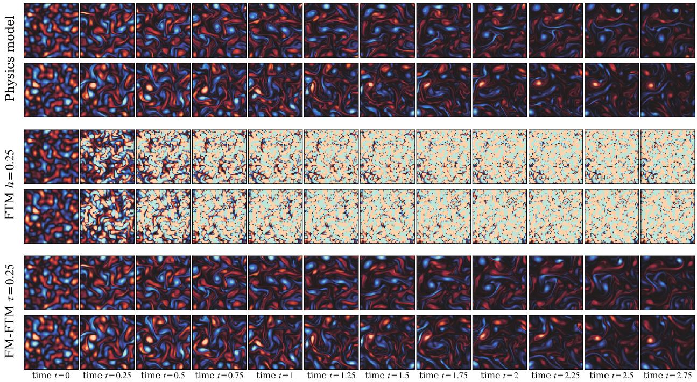  
Figure 1: While FTM quickly loses accuracy at coarse time steps, FM-FTM maintains accurate predictions by taking far-horizon time jumps, replacing many sequential integration steps with a single flow-map evaluation and thereby accelerating ensemble prediction.

We approach the learning of flow maps for ensemble prediction in two stages. First, we use FTM to learn a deterministic dynamical-system model that mimics the stochastic dynamics in the sense that it preserves the time marginals and local probability mass transport. Second, we approximate the evolution of the resulting deterministic dynamical system with a flow map, which leads to our approach called Flow-Map FTM (FM-FTM). This separates the representation of stochastic dynamics from the reduction of their computational cost in time. Unlike conventional coarse time-steppers with a fixed step size, our FM-FTM can predict the ensemble evolution over diferent time horizons. Thus, the temporal resolution in the online phase is not restricted to a prescribed coarse time step. Furthermore, FM-FTM is nonintrusive in the sense that it requires only trajectory data and no access to the governing equations or corresponding discretized operators. In this respect, it follows the broader and long line of nonintrusive model reduction works; see, $\mathrm { e . g . }$ , [59, 32, 62, 60, 54, 46, 27, 33, 63, 40, 25]. Our numerical results show that the learned flow maps accelerate ensemble predictions by at least one order of magnitude while accurately predicting ensemble statistics and QoIs that depend on the probability current of the stochastic process.

## 2 Preliminaries and problem formulation

We provide preliminaries and state the problem formulation.

## 2.1 Trajectory data and stochastic dynamics

Let $( X ( t ) ) _ { t \in [ 0 , T ] }$ be a continuous-time stochastic process with state space $\mathbb { R } ^ { d }$ . We are given N trajectories observed at $K + 1$ equally spaced times,

$$
0 = t _ { 0 } < t _ { 1 } < \cdots < t _ { K } = T .
$$

Writing $X ^ { ( i ) }$ for the ith trajectory, the training dataset is

$$
\mathcal { X } = \left\{ X ^ { ( i ) } ( t _ { k } ) \Big \vert i = 1 , \ldots , N , k = 0 , \ldots , K \right\} .\tag{1}
$$

We assume that $X ( t )$ has a probability density $\rho ( t ) : \mathbb { R } ^ { d }  [ 0 , \infty )$ . We refer to the distribution $\rho ( t )$ of the state at a single time t as the time marginal. Furthermore, $\rho ( 0 )$ is the density of the initial condition.

We consider stochastic processes governed by stochastic diferential equations of the form

$$
\mathrm { d } X ( t ) = b ( t , X ( t ) ) \mathrm { d } t + A ( t ) \mathrm { d } W ( t ) , \qquad X ( 0 ) \sim \rho ( 0 ) ,\tag{2}
$$

where $b : [ 0 , T ] \times \mathbb { R } ^ { d }  \mathbb { R } ^ { d }$ is a smooth drift, $A : [ 0 , T ]  \mathbb { R } ^ { d \times d }$ is a smooth difusion coeficient, and $W$ is a standard d-dimensional Wiener process. The drift specifies the deterministic contribution to the dynamics, while A determines how the random forcing enters the state. Our learning procedure uses the trajectory data (1) and does not require b or A.

## 2.2 Problem formulation

We seek to rapidly generate ensembles to estimate QoIs as well as statistics of the distributions $\rho ( t )$ at selected prediction times. Generating an ensemble by time stepping a dynamical model with a fixed integration time step $h > 0$ up to time T requires at least $T / h$ sequential steps, which typically incurs at least $T / h$ many function evaluations. This applies both to the numerical simulation of (2), when its coeficients are available, and to dynamical models learned from data. These intermediate steps are required by the integrator even when predictions are requested only at times separated by intervals of length $\tau \gg h$ as shown in Figure 1. A reduced dynamical model or learned surrogate can lower the cost of each time step but does typically not reduce the number of steps.

Our objective is to advance ensembles over horizons $\tau \gg h$ without carrying out all the intermediate time integration steps, while retaining accurate statistical estimates of interest. We thus target reducing the number of sequential time steps required for ensemble prediction, rather than only the cost per time step.

## 3 Flow maps for first-order trajectory matching

We aim to learn the efect of time integration once and reuse it for subsequent ensemble predictions to jump over large time horizons $\tau \gg h$ , instead of performing many small time steps h. For the stochastic systems considered here, our construction first obtains a deterministic model of the ensemble evolution. We build on the probability-current velocity, which describes the local transport of probability mass through state space [56, 20, 58]. In particular, we learn the probability-current velocity with FTM from the training data (1) as in [36]. We then learn the corresponding flow map, which assigns a state x at time t to the state reached at time $t + \tau$ under the deterministic model. Once learned, one flow map evaluation can jump over time horizons $\tau \gg h$ , without integrating through the intermediate times.

## 3.1 A deterministic model of ensemble evolution with first-order trajectory matching

We first construct a deterministic dynamical-system model that describes how the stochastic trajectories move locally through state space. For $0 \textless t \textless T$ , consider the conditional mean displacement over a short interval centered at t,

$$
v _ { \epsilon } ( t , x ) = \mathbb { E } \left[ \frac { X ( t + \epsilon ) - X ( t - \epsilon ) } { 2 \epsilon } \bigg | X ( t ) = x \right] ,\tag{3}
$$

where $0 < \epsilon < \mathrm { m i n } \{ t , T - t \}$ . This averages the motion before and after time t among trajectories passing through the state x. Under suitable regularity assumptions, the limit of this symmetric mean motion is

$$
v ( t , x ) = \operatorname* { l i m } _ { \epsilon \downarrow 0 } v _ { \epsilon } ( t , x ) = b ( t , x ) - \frac { 1 } { 2 } \Sigma ( t ) \nabla _ { x } \log \rho ( t , x ) ,\tag{4}
$$

where $\Sigma ( t ) = A ( t ) A ( t ) ^ { \top }$ and the expression is understood where $\rho ( t , x ) > 0$ . The velocity v is the probability-current velocity of the stochastic process [56, 34, 58].

The deterministic dynamical-system model given by

$$
\frac { \mathrm { d } } { \mathrm { d } r } \widehat { x } ( r ) = v ( r , \widehat { x } ( r ) ) , \qquad \widehat { x } ( 0 ) \sim \rho ( 0 ) ,\tag{5}
$$

leads to trajectories $( { \widehat x } ( r ) ) _ { r \in [ 0 , T ] }$ that satisfy

$$
{ \widehat { x } } ( r ) \sim \rho ( r ) , \qquad r \in [ 0 , T ] ,\tag{6}
$$

see, e.g., [20, 10]. Thus, model (5) generates trajectories that follow both the time marginals and the local mean motion defined above; see Remark 1. We use FTM [36] to learn an approximation $v _ { \theta }$ directly from the trajectory data (1), where θ denotes the model parameters.

Remark 1. Matching the time marginals specifies where ensemble members are distributed, but not how they evolve over time. For example, clockwise and counterclockwise rotation can preserve the same rotationally symmetric distribution while producing opposite average rotational motion. A dynamical-system model based on the probability-current velocity (5) additionally matches the average displacement per unit time (3) of stochastic trajectories passing through each state, measured over a shrinking interval centered at t. It therefore captures the direction and rate of this averaged motion, which the time marginals alone do not determine. We refer to [10, 36] for an in-depth discussion.

## 3.2 Flow maps

Integrating dynamics (5) defines the flow map

$$
F ( x , t , s ) = x + \int _ { t } ^ { s } v { \bigl ( } r , F ( x , t , r ) { \bigr ) } \mathrm { d } r , \qquad 0 \leq t \leq s \leq T .\tag{7}
$$

Here $\boldsymbol { F } ( \boldsymbol { x } , t , \boldsymbol { r } )$ is the state reached at the intermediate time $r ,$ so the integral accumulates the velocity along the evolving trajectory. Thus, $F ( x , t , s )$ gives the state reached at time s when starting from x at time t. Note that the marginal-transport property (6) of the probability-current dynamics induces that $F ( X ( t ) , t , s ) \sim \rho ( s ) { \mathrm { ~ i f ~ } } X ( t ) \sim \rho ( t )$ . Thus, applying $F$ to an ensemble distributed according to $\rho ( t )$ at time t produces the correct distribution at time s.

Let us now consider the learned $v _ { \theta }$ , which analogously induces a flow map

$$
F _ { \theta } ( x , t , s ) = x + \int _ { t } ^ { s } v _ { \theta } \big ( r , F _ { \theta } ( x , t , r ) \big ) \mathrm { d } r .\tag{8}
$$

Thus, $F _ { \theta } ( x , t , s )$ is the state reached by integrating the learned velocity $v _ { \theta }$ from the same initial state x at time t.

## 3.3 Learning the flow map

Evaluating $F _ { \theta } ( x , t , s )$ by directly using its definition (8) entails numerically integrating $v _ { \theta }$ over the jump horizon $\tau = s - t$ . We now approximate $F _ { \theta }$ with a parametrized map that can be evaluated without resorting to integrating the velocity $v _ { \theta } ;$ this is a common task in, e.g., machine learning where flow maps of flow-based generative models are learned [8, 9, 31]. Consider

$$
F _ { \psi } : \mathbb { R } ^ { d } \times \{ ( t , s ) : 0 \leq t \leq s \leq T \}  \mathbb { R } ^ { d } ,
$$

where $\psi$ denotes the parameters to be learned. We train $F _ { \psi }$ by minimizing the loss

$$
\begin{array} { r } { \mathcal { L } ( \psi ; \theta ) = \mathbb { E } _ { t \sim \mathcal { U } ( [ 0 , T ] ) } \mathbb { E } _ { X ( t ) \sim \rho ( t ) } \left[ \| F _ { \psi } ( X ( t ) , t , s ) - F _ { \theta } ( X ( t ) , t , s ) \| _ { 2 } ^ { 2 } \right] , } \\ { s | t \sim \mathcal { U } ( [ t , T ] ) \quad \quad } \end{array}\tag{9}
$$

where U denotes the uniform distribution. This objective averages the prediction error over starting states and pairs of times. A single map is therefore trained over diferent starting times and jump horizons, rather than separately for each horizon.

After training, a prediction over $[ t , t + \tau ]$ with jump horizon τ is obtained by evaluating $F _ { \psi } ( x , t , t + \tau )$ This requires one evaluation of $F _ { \psi }$ per starting state and jump, without integrating vθ through the intermediate times.

## 3.4 Ensemble prediction with the learned flow map

Let $0 = s _ { 0 } < s _ { 1 } < \dots < s _ { M } = T$ be the requested prediction times. We define the jump horizon $\tau _ { k } = s _ { k + 1 } - s _ { k }$ , which can vary between prediction times and can be much larger than the time-step size h. For each ensemble member, we sample an initial state $z _ { 0 } \sim \rho ( 0 )$ and sequentially evaluate the learned flow map,

$$
z _ { k + 1 } = F _ { \psi } ( z _ { k } , s _ { k } , s _ { k } + \tau _ { k } ) , \qquad k = 0 , \ldots , M - 1 .\tag{10}
$$

The rollout is autoregressive because each predicted state becomes the initial state for the next jump horizon.

Generating one ensemble trajectory requires only M flow-map evaluations, compared with approximately $T / h$ integration steps for FTM. In particular, when $\tau _ { k } \gg h$ , FM-FTM avoids evaluating the FTM velocity field at the intermediate times.

## 3.5 Quantities of interest

We consider two types of QoIs for stochastic ensemble prediction. First, QoIs that are ensemble averages of functions of the state and depend only on the time marginals $\rho ( t )$

Second, we consider probability-current QoIs that characterize the local transport of probability mass through state space. Such current-like observables arise naturally in stochastic thermodynamics, where they are used to characterize nonequilibrium transport and dissipation [68, 43, 29, 11, 12]. Let $\phi : [ 0 , T ] \times \mathbb { R } ^ { d }  \mathbb { R } ^ { d }$ be a smooth test function. We define the time-averaged probability-current QoI as

$$
Q _ { \phi } = \frac { 1 } { T } \mathbb { E } \left[ \int _ { 0 } ^ { T } \phi ( t , X ( t ) ) ^ { \top } \circ \mathrm { d } X ( t ) \right] ,\tag{11}
$$

where $\circ$ denotes Stratonovich integration. In terms of the probability-current velocity, this quantity can equivalently be written as

$$
Q _ { \phi } = \frac { 1 } { T } \int _ { 0 } ^ { T } \mathbb { E } \left[ \phi ( t , X ( t ) ) ^ { \top } v ( t , X ( t ) ) \right] \mathrm { d } t .\tag{12}
$$

Depending on the choice of $\phi ,$ , these QoIs describe quantities such as probability fluxes and circulations. The deterministic probability-current dynamics (5) preserve both the time marginals and probabilitycurrent QoIs of the stochastic process. Since the flow map F represents the evolution of these dynamics, it inherits these properties. FM-FTM approximates the flow map induced by the learned FTM velocity and therefore aims to retain the same QoIs, up to the approximation errors of FTM and flow-map learning. In particular, local probability-current quantities can be estimated from short-horizon flow-map evaluations without integrating the FTM velocity field.

## 4 Numerical experiments

We now demonstrate that FM-FTM removes the need to integrate the FTM velocity through each intermediate time step, enabling predictions over large jump horizons τ. We evaluate FM-FTM on four diferent experiments, Dufing oscillator, Rayleigh-Bénard convection, stochastic Burgers, and stochastic Navier-Stokes. Our numerical results indicate that FM-FTM preserves time marginals and statistics across tested jump horizons τ while gaining runtime speedups.

## 4.1 Training

For each system, we first train FTM on the training trajectories to obtain the velocity field $v _ { \theta }$ The architecture used for each system is specified below. We follow [36] for the FTM training and implementation. We then approximate $v _ { \theta }$ with a flow map $F _ { \psi } ( x ( t ) , t , s )$ that predicts the state $x ( s )$ at times s from the state $x ( t )$ at time t

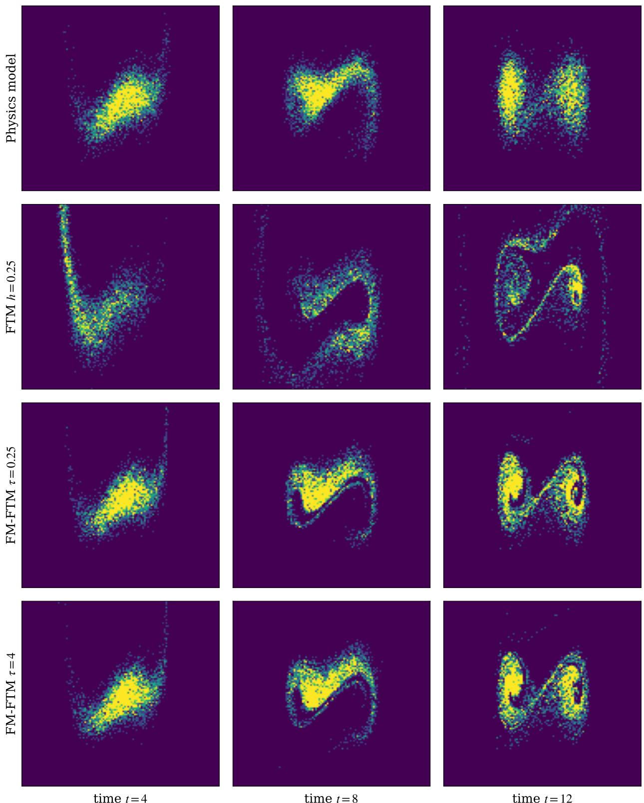  
Figure 2: Dufing oscillator: FM-FTM accurately captures the evolving distributions over large time intervals, whereas FTM loses accuracy even with moderately increased time steps from the original $h = 0 . 0 1$ to $h = 0 . 2 5$ 8

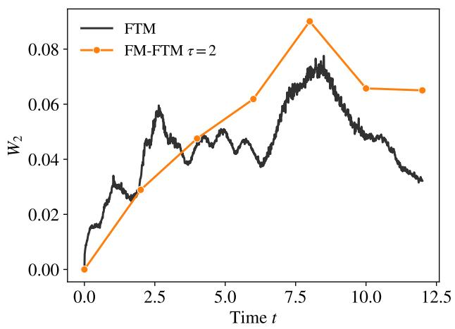

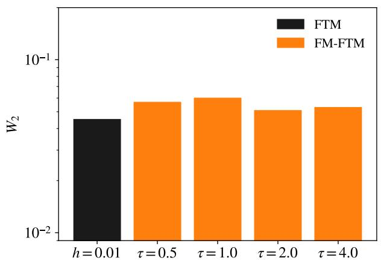  
Figure 3: Dufing oscillator: The Wasserstein-2 errors of FM-FTM remain comparable to those of FTM and show little sensitivity to the jump horizon $\tau ,$ demonstrating that FM-FTM preserves the accuracy of ensemble predictions while reducing the number of timeintegration steps by a factor of up to 400× in this example.

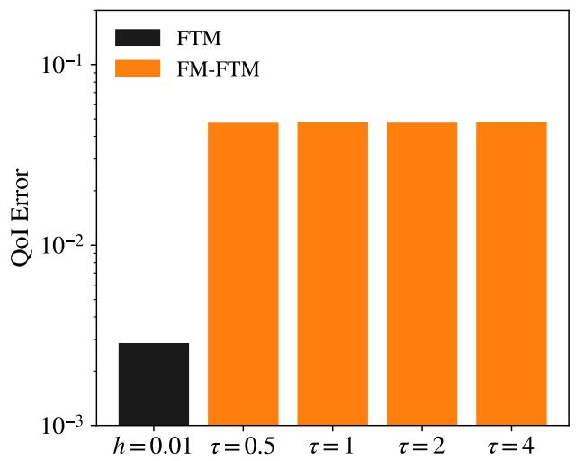

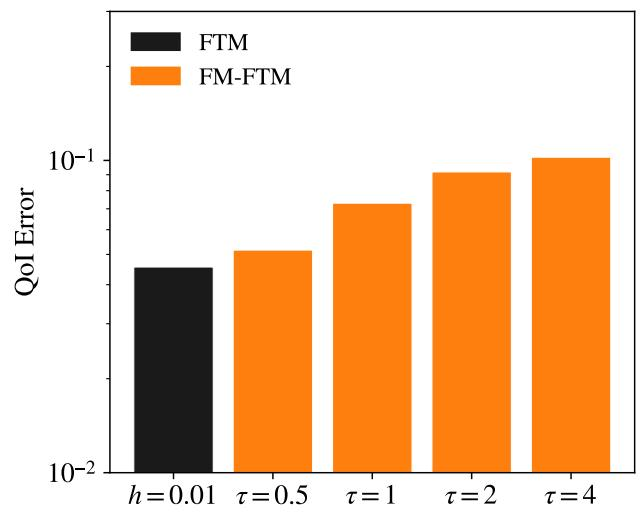  
Figure 4: The relative errors in predicting quantities of interest remain small across increasing jump horizons τ for both the Dufing oscillator (left) and Rayleigh-Bénard convection (right), demonstrating that FM-FTM preserves trajectory-dependent quantities beyond time-marginal statistics.

To construct training pairs, we first choose a state $x ( t )$ from the training trajectories at time $t ,$ and then sample $s > t .$ Starting from $x _ { t } = x ( t )$ , we numerically integrate $v _ { \theta }$

$$
\frac { \mathrm { d } } { \mathrm { d } r } x ( r ) = v _ { \theta } ( r , x ( r ) ) , \qquad x ( t ) = x _ { t } ,
$$

from t to s using the FTM integration step size h. We denote the resulting target state by $x _ { s } ^ { \theta }$ . We then train $F _ { \psi }$ using minibatches of size B by minimizing the empirical mean-squared error

$$
\widehat { \mathcal { L } } ( \psi ) = \frac { 1 } { B } \sum _ { j = 1 } ^ { B } \left\| F _ { \psi } ( x _ { t _ { j } } , t _ { j } , s _ { j } ) - x _ { s _ { j } } ^ { \theta } \right\| _ { 2 } ^ { 2 } .
$$

At each training step, $t _ { j }$ is sampled from the time grid of the training trajectories and $s _ { j }$ is sampled from the available grid points strictly after $t _ { j }$

## 4.2 Evaluation Metrics

For each system, we generate test trajectories from independently drawn initial conditions using the same solver as for the training data. From the same initial conditions, we roll out FM-FTM at several jump horizons τ and FTM as a baseline. Our evaluation tests three aspects of the learned dynamics. First, the accuracy of predicted time marginals; second, the accuracy of trajectory-dependent probability-current quantities of the form (11); and third, where dimension makes it relevant, the computational cost of ensemble generation. To assess time-marginal accuracy, let $X ^ { ( i ) } ( s _ { k } )$ denote the i-th state and $\widetilde { X } _ { k } ^ { \left( i \right) }$ the corresponding FM-FTM prediction at time $s _ { k }$ . At each rollout time $s _ { k }$ we compute the sliced Wasserstein-2 distance

$$
d _ { k } = \operatorname { W } _ { 2 } \left( \{ \widetilde { X } _ { k } ^ { ( i ) } \} _ { i = 1 } ^ { N } , \{ X ^ { ( i ) } ( s _ { k } ) \} _ { i = 1 } ^ { N } \right) .
$$

We report the mean sliced Wasserstein-2 distance over the rollout times,

$$
\bar { d } = \frac { 1 } { M + 1 } \sum _ { k = 0 } ^ { M } d _ { k } .
$$

Agreement in time marginals alone does not imply agreement in how probability mass moves between states (Remark 1). We therefore evaluate whether the FM-FTM models learn and can predict trajectory-dependent QoIs. For the SDE examples, we focus on the time-local integrand

$$
\begin{array} { r } { q _ { \phi } ( t ) = \mathbb { E } \left[ \phi ( X ( t ) ) ^ { \top } v ( t , X ( t ) ) \right] , } \end{array}\tag{13}
$$

where the time-independent test function $\phi$ is specified separately for each experiment. Note that $q _ { \phi } ( t )$ represents the instantaneous contribution to the time-averaged probability-current QoI $Q _ { \phi }$ For the rollout times $s _ { 0 } , \ldots , s _ { M }$ , with $\tau _ { k } = s _ { k + 1 } - s _ { k }$ , we consider the discrete time-weighted average of the time-local probability-current quantities by

$$
\bar { q } _ { \phi } = \frac { 1 } { T } \sum _ { k = 0 } ^ { M - 1 } \tau _ { k } q _ { \phi } ( s _ { k } ) .\tag{14}
$$

We estimate $\bar { q } _ { \phi }$ from an FM-FTM rollout using a midpoint rule. Let $\widetilde { X } _ { k } ^ { \left( i \right) }$ denote the state of the i-th rollout at time $s _ { k }$ . From each such state we take one additional FM-FTM evaluation over a small step $\delta _ { \mathrm { Q o I } } = 0 . 0 1$ ，

$$
\begin{array} { r } { \widetilde { X } _ { k } ^ { + , ( i ) } = F _ { \psi } \big ( \widetilde { X } _ { k } ^ { ( i ) } , s _ { k } , s _ { k } + \delta _ { \mathrm { Q o I } } \big ) , \qquad \bar { X } _ { k } ^ { ( i ) } = \frac { 1 } { 2 } \big ( \widetilde { X } _ { k } ^ { ( i ) } + \widetilde { X } _ { k } ^ { + , ( i ) } \big ) , } \end{array}
$$

and compute

$$
\widehat { q } _ { \phi } = \frac { 1 } { N T } \sum _ { i = 1 } ^ { N } \sum _ { k = 0 } ^ { M - 1 } \tau _ { k } \phi \big ( \bar { X } _ { k } ^ { ( i ) } \big ) ^ { \top } \frac { \widetilde { X } _ { k } ^ { + , ( i ) } - \widetilde { X } _ { k } ^ { ( i ) } } { \delta _ { \mathrm { Q o I } } } .\tag{15}
$$

The reference value $\widehat { q } _ { \phi } ^ { \mathrm { r e f } }$ is computed the same way, with $\widetilde { X } _ { k } ^ { \left( i \right) }$ and $\widetilde { X } _ { k } ^ { + , ( i ) }$ replaced by the reference states $X ^ { ( i ) } ( s _ { k } )$ and $X ^ { ( i ) } ( s _ { k } + \delta _ { \mathrm { Q o I } } )$ . For each jump horizon $\tau ,$ , we report the relative error $\widehat { q } _ { \phi } -$ $\widetilde { q } _ { \phi } ^ { \mathrm { r e f } } | / | \widetilde { q } _ { \phi } ^ { \mathrm { r e f } } |$

## 4.3 Dufing oscillator with stochastic forcing

We first consider a stochastically forced dufing oscillator.

## 4.3.1 Duffing oscillator: Setup, training data, and evaluation metrics

The dynamics of the dufing oscillator system considered are governed by

$$
\begin{array} { r } { \begin{array} { r } { \mathrm { d } X _ { 1 } ( t ) = X _ { 2 } ( t ) \mathrm { d } t , \qquad \mathrm { d } X _ { 2 } ( t ) = \left( - 2 \xi \omega X _ { 2 } ( t ) + \omega ^ { 2 } X _ { 1 } ( t ) - \omega ^ { 2 } \gamma X _ { 1 } ( t ) ^ { 3 } \right) \mathrm { d } t + \sigma \mathrm { d } W ( t ) . } \end{array} } \end{array}
$$

Here $X _ { 1 }$ denotes the position and $X _ { 2 }$ the velocity. The parameter $\xi$ controls damping, $\gamma$ the strength of the cubic term, $\omega$ the stifness of the linear term, and $\sigma$ the strength of the Brownian motion. We use $\xi = 0 . 2 , \gamma = 0 . 2 , \omega = 1 , \sigma = 0 . 5$ . We integrate this system using the Euler-Maruyama scheme with reference integration step size $h _ { \mathrm { r e f } } = 0 . 0 1$ over $t \in [ 0 , 1 2 ]$ , giving 1200 time steps per trajectory. The training data consists of $N =$ = 5000 trajectories generated with initial conditions drawn from $\mathcal { N } ( [ 0 , - 1 0 ] ^ { \top } , I _ { 2 } )$ , where $I _ { 2 } \in \mathbb { R } ^ { 2 \times 2 }$ is the identity matrix.

For the FTM velocity model $v _ { \theta }$ , we use a three-layer MLP with hidden width 128 and ReLU activations, with time concatenated to the state input. We follow the training procedure of [36]. For ensemble prediction with FTM, we integrate $v _ { \theta }$ using step size $h = h _ { \mathrm { r e f } } .$ The flow map $F _ { \psi }$ is parametrized as an MLP with 4 layers, hidden width 256, and ReLU activations. The model takes as input the state x at time $t ,$ together with the start time t and end time $s ,$ and outputs the predicted state $F _ { \psi } ( x , t , s )$ at time s. We train with Adam at learning rate $5 \times 1 0 ^ { - 4 }$ , batch size 2048, for 500, 000 gradient steps.

We use 5000 test initial conditions and jump horizons $\tau \in \{ 0 . 5 , 1 . 0 , 2 . 0 , 4 . 0 \}$ . For the probabilitycurrent QoI, we use $\phi ( \boldsymbol { x } ) = \varphi ( x _ { 1 } ) e _ { 1 }$ with $\begin{array} { r } { \dot { \varphi ( z ) } = \frac { 1 } { \sqrt { 2 \pi } \epsilon } e ^ { - z ^ { 2 } / ( \dot { 2 } \epsilon ^ { 2 } ) } } \end{array}$ and $\epsilon = 1$ . This QoI measures the time-averaged, signed probability flux in the x -direction near $x _ { 1 } = 0$ , with ϵ controlling the width of the region over which the flux is measured.

## 4.3.2 Duffing oscillator: Results

Figure 2 compares the reference distribution, FTM evaluated with a coarse integration step 0.25, and FM-FTM evaluated with jump horizons $\tau = 0 . 2 5$ and $\tau = 4 . 0$ at $t = 4 , 8 , 1 2$ . At each snapshot,

FTM with a coarse time step fails to predict an accurate marginal distribution, whereas FM-FTM with both jump horizons captures the main distributional structure. Thus, FM-FTM can advance over up to 400× larger jump horizons than the time-step size $h = 0 . 0 1$ while remaining accurate, whereas FTM loses accuracy alrady when integrated with a coarser time step of 0.25.

Figure 3 quantifies the time-marginal accuracy. FM-FTM achieves errors comparable to FTM integrated with step size $h = 0 . 0 1$ , with little sensitivity to the jump horizon across $\tau \in \{ 0 . 5 , 1 . 0 , 2 . 0 , 4 . 0 \}$ Thus, FM-FTM maintains accurate time marginals with jump horizons up to 400 times larger than the FTM integration step.

Figure 4 (left) shows that FM-FTM accurately predicts the probability-current QoI across all tested jump horizons, with little sensitivity to τ. In particular, FM-FTM captures the information about the local transport of probability mass as FTM and not only the time marginals, even when advancing over large time intervals.

## 4.4 Rayleigh-Bénard convection with stochastic forcing

We now consider the stochastically forced nine-dimensional model of Rayleigh-Bénard convection introduced in [64]. The underlying deterministic dynamics exhibit chaotic behavior, providing a more challenging setting for ensemble prediction.

## 4.4.1 Rayleigh-Bénard: Setup, training data, and evaluation metrics

We consider the nine-dimensional system governed by

$$
\mathrm { d } X ( t ) = f _ { \mu } ( X ( t ) ) \mathrm { d } t + \sigma \mathrm { d } W ( t ) ,
$$

where $f _ { \mu } : \mathbb { R } ^ { 9 } \to \mathbb { R } ^ { 9 }$ is the deterministic Rayleigh-Bénard convection vector field given in [64] and $\mu$ is the $\mathrm { R a y l e i g h - t y p e }$ control parameter. We use $\mu = 1 3 . 6 5$ , and $\sigma = 0 . 0 5$

For the training data, we generate N = 20000 trajectories with initial conditions drawn from $\mathcal { N } ( 0 , ( 0 . 0 2 ) ^ { 2 } I _ { 9 } )$ , integrated with the Euler-Maruyama scheme using reference integration step size $h _ { \mathrm { r e f } } = 0 . 0 1$ over time interval [0, 20].

For $v _ { \theta } .$ , we use a seven-layer MLP with hidden width 128 and ReLU activations, with time concatenated to the state input. Training follows [36]. For ensemble prediction with FTM, we integrate $v _ { \theta }$ using step size $h = h _ { \mathrm { r e f } }$

The flow map $F _ { \psi }$ is parametrized as an MLP with 6 layers and hidden dimension 512, with ReLU activations. The input-output structure is the same as in Section 4.3.1 for the Dufing oscillator. We train the model with Adam at a learning rate of $5 \times 1 0 ^ { - 4 }$ , batch size 256, for 500, 000 gradient steps.

We use 20000 test initial conditions and jump horizons $\tau \in \{ 0 . 5 , 1 . 0 , 2 . 0 , 4 . 0 \}$ . For the probabilitycurrent QoI, we use $\phi ( x ) = - x _ { 8 } e _ { 6 } + x _ { 6 } e _ { 8 }$ . This QoI measures the time-averaged, signed rotational transport of probability mass around the origin in the $( x _ { 6 } , x _ { 8 } )$ plane, distinguishing clockwise from counterclockwise motion.

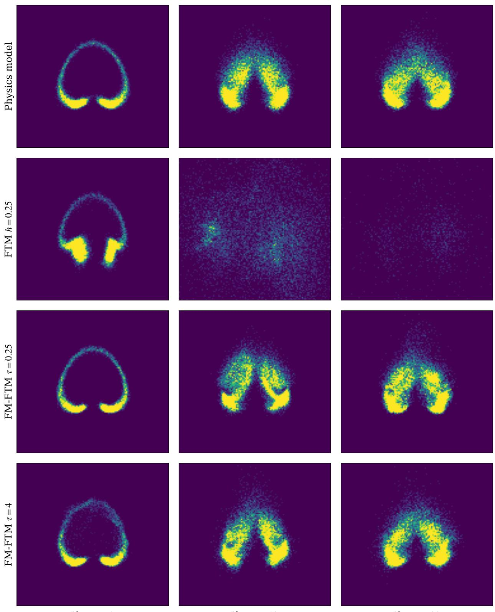  
time t = 4  
time t = 12  
time t = 20  
Figure 5: Rayleigh-Bénard: FTM fails to capture the multimodal distribution even already with moderately increased time-step sizes, whereas FM-FTM accurately captures the evolution of both modes at a jump horizon of $\tau _ { 1 \overline { { { 3 } } } } = 4$ , which is 400 times larger than the time-step size used by FTM.

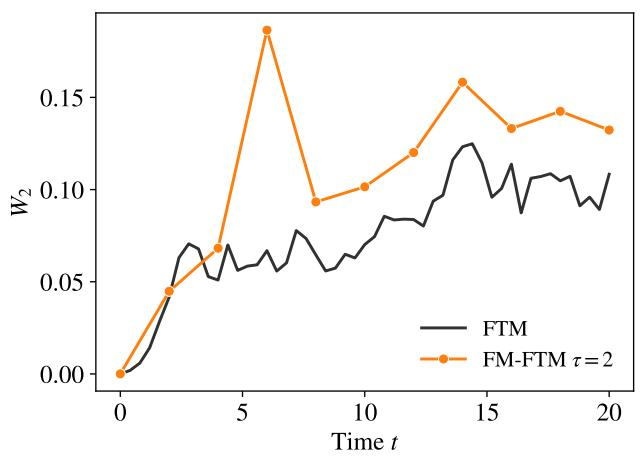

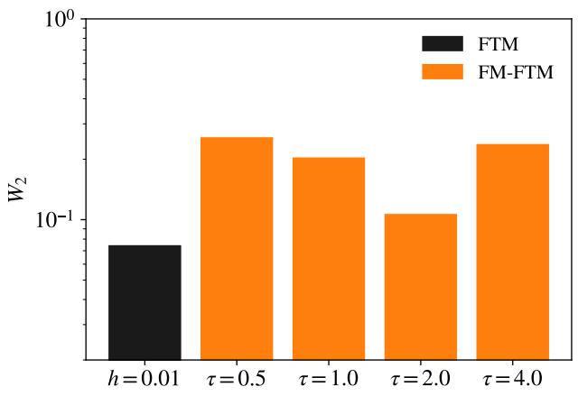  
Figure 6: Rayleigh-Bénard: The Wasserstein-2 errors remain moderate across jump horizons up to $\tau = 4$ , corresponding to 400 times the time-step size of FTM.

## 4.4.2 Rayleigh-Bénard: Results

Figure 5 shows that FM-FTM accurately captures the evolution of the multimodal distribution at $t = 4 , 1 2 , 2 0$ , even with a jump horizon of $\tau = 4$ . In contrast, FTM with a coarse integration step 0.25 fails to capture the distributional structure. Thus, FM-FTM can advance over larger time intervals without losing the multimodal features of the reference distribution.

Figure 6 quantifies the time-marginal accuracy. FM-FTM maintains moderate sliced Wasserstein-2 errors across the tested jump horizons, with no systematic deterioration as τ increases. Although its errors are higher than those of FTM integrated with h = 0.01, FM-FTM retains useful marginal accuracy for jump horizons up to 400 times larger than the FTM integration step.

Figure 4 (right) shows that FM-FTM accurately predicts the probability-current QoI across all tested jump horizons. Thus, FM-FTM retains information about the rotational transport of probability mass beyond the time marginals, even when advancing over large time intervals.

## 4.5 Stochastically forced Burgers equation

We now consider the one-dimensional Burgers equation with stochastic forcing to evaluate FM-FTM for spatially distributed dynamics. In this setting, we assess whether FM-FTM accurately predicts energy and enstrophy of ensemble members over large jump horizons.

## 4.5.1 Burgers: Setup and training data

We consider the one-dimensional Burgers equation with periodic boundary conditions on spatial domain [0, 1),

$$
\partial _ { t } u ( t , x ) = \nu \partial _ { x x } u ( t , x ) - u ( t , x ) \partial _ { x } u ( t , x )
$$

with viscosity ${ \nu = 0 . 0 0 7 }$ . We discretize in space on a uniform 64-point grid, yielding an ODE with a state in $\mathbb { R } ^ { 6 4 }$ , to which we then add stochastic forcing. Specifically, for each grid point $\zeta _ { j }$ , we set

$$
 \mathrm { d } W _ { j } ( t ) = \sum _ { \iota = 1 } ^ { 1 0 } \frac { 1 } { \iota } \left( a _ { \iota } ( \zeta _ { j } ) \mathrm { d } B _ { \iota } ^ { ( 1 ) } ( t ) + b _ { \iota } ( \zeta _ { j } ) \mathrm { d } B _ { \iota } ^ { ( 2 ) } ( t ) \right) ,
$$

where each $B _ { \iota } ^ { ( 1 ) } , B _ { \iota } ^ { ( 2 ) }$ represents independent Brownian motions and $a _ { \iota } , b _ { \iota }$ are sine and cosine basis functions. The noise amplitude is $\sigma = 0 . 0 4$ . We approximate the spatial derivatives with secondorder centered finite diferences. We then integrate the resulting stochastic system in time with Euler-Maruyama using reference integration step size $h _ { \mathrm { r e f } } = 0 . 0 0 0 5$ over [0, 4].

We draw 4096 initial conditions for our training trajectories from Gaussian bumps with the same noise structure as the stochastic forcing,

$$
u ( 0 , x ) = \exp \left( - 2 0 ( x - 0 . 5 ) ^ { 2 } \right) + 0 . 0 1 5 \eta ( x ) ,
$$

where $\eta$ is a zero-mean Gaussian random field constructed using the same spatial basis as the stochastic forcing. For training, we downsample the 8000 time steps to 800 snapshots, meaning our training data has a snapshot spacing of $\Delta t _ { \mathrm { o b s } } = 0 . 0 0 5$ . Thus our training data consists of 4096 trajectories with 800 timesteps each.

The FTM velocity model is a one-dimensional U-Net with channel widths [32, 64, 128], two residual blocks at each resolution, and a middle residual block, using GeLU activations. Time is encoded by an MLP and injected into the residual blocks through learned projections. The rest of the training procedure is as described in [36]. For ensemble prediction with FTM, we integrate $v _ { \theta }$ using step size $h = h _ { \mathrm { r e f } }$

The flow map $F _ { \psi }$ is a one-dimensional U-Net with channel widths [32, 64, 128], two residual blocks per scale, one middle residual block, and GeLU activations. The start and end times t, s are concatenated and embedded via a 2-layer MLP of width 128, then injected into each residual block via a learned linear projection. The projected vector is added to the feature map before both convolutions in the block, broadcast across the spatial dimension.

In training the network, the optimizer used is Adam, gradient-clipped to global norm 1.0, with a warm-up cosine schedule and peak learning rate $5 \times 1 0 ^ { - 4 }$ . The network is trained for 1, 000, 000 training steps with batch size 64.

## 4.5.2 Burgers: Evaluation metrics.

We use 4096 test initial conditions and jump horizons $\tau \in \{ 0 . 2 5 , 0 . 5 , 1 . 0 \}$ . To assess marginal accuracy, we track energy and enstrophy,

$$
\begin{array} { r l r } { E ( t ) = \frac { 1 } { 2 } \displaystyle \int _ { 0 } ^ { 1 } u ( t , x ) ^ { 2 } \mathrm { d } x , } & { { } } & { Z ( t ) = \frac { 1 } { 2 } \displaystyle \int _ { 0 } ^ { 1 } u _ { x } ( t , x ) ^ { 2 } \mathrm { d } x , } \end{array}
$$

which we estimate on the periodic grid using a second-order finite diference $u _ { x , j }$ . Thus, our sample estimators are

$$
\widehat { E } ( t ) = \textstyle { \frac { 1 } { 2 } } \sum _ { j } u _ { j } ( t ) ^ { 2 } \mathrm { d } x , \qquad \widehat { Z } ( t ) = \textstyle { \frac { 1 } { 2 } } \sum _ { j } u _ { x , j } ( t ) ^ { 2 } \mathrm { d } x .
$$

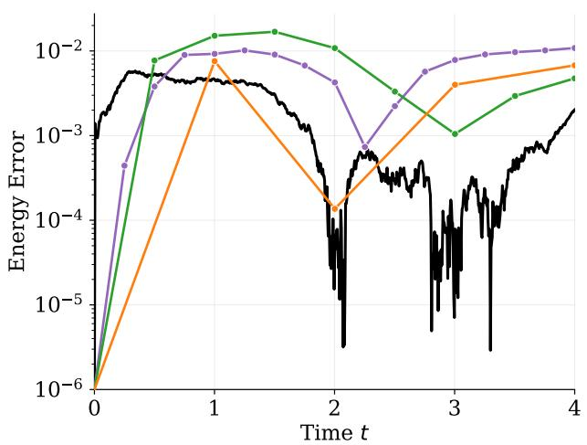

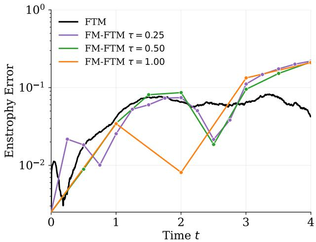  
Figure 7: Burgers: The relative errors in energy (left) and enstrophy (right) exhibit similar behavior for FTM and $\mathrm { F M - F T M }$ across diferent jump horizons $\tau ,$ , demonstrating that FM-FTM retains the accuracy of these physical ensemble statistics while reducing the number of time-integration steps.

At all time steps, we average $\widehat { E } ( t )$ and $\widehat Z ( t )$ over all 4096 trajectories for both the flow map and reference samples, and compute the relative error between the two. We plot these relative errors over time.

## 4.5.3 Burgers: Results

Figure 7 shows that FM-FTM accurately predicts ensemble-mean energy across all tested jump horizons $\tau \in \{ 0 . 2 5 , 0 . 5 , 1 . 0 \}$ . The relative errors remain below 2% throughout the prediction interval. Thus, FM-FTM retains accurate energy predictions even when replacing multiple integration steps with a single flow-map evaluation. FM-FTM also captures the evolution of enstrophy across the tested jump horizons. Enstrophy errors are generally larger than energy errors and exceed those of FTM at later times. These results demonstrate that FM-FTM can predict physical ensemble statistics over large jump horizons.

## 4.6 Forced turbulence

We consider the two-dimensional incompressible Navier-Stokes equations with stochastic forcing.

## 4.6.1 Forced turbulence: Setup and training data

Consider the incompressible Navier-Stokes equation in vorticity form on the periodic domain $\Omega = [ 0 , 2 \pi ) ^ { 2 }$ . The viscosity is $\nu = 1 0 ^ { - 3 }$ and the linear drag coeficient is $\alpha = 0 . 1$ . The stochastic forcing acts through low-frequency Fourier modes

$$
{ \mathcal { K } } _ { \mathrm { s t o } } = \{ \kappa \in \mathbb { Z } ^ { 2 } : 0 < | \kappa | \leq 4 \} .
$$

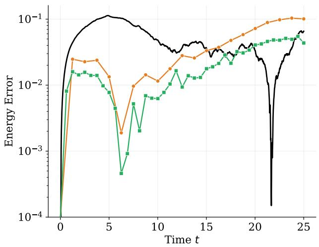

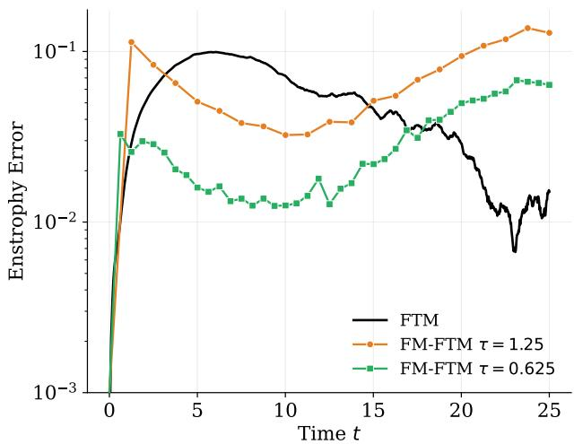  
Figure 8: Stochastically forced turbulence: Over the time interval, FM-FTM requires only 20 $( \tau = 1 . 2 5 )$ flow-map evaluations, compared with 1000 sequential integration steps for FTM $\left( h = 0 . 0 2 5 \right)$ , while achieving comparable relative errors in ensemble-mean energy (left) and enstrophy (right).

At spatial grid point $\zeta _ { j }$ , the stochastic increment is

$$
\mathrm { d } W _ { j } ( t ) = \sigma \sum _ { \kappa \in K _ { \mathrm { s t o } } } w _ { \kappa } \left[ \cos ( \kappa \cdot \zeta _ { j } ) \mathrm { d } B _ { \kappa } ^ { ( 1 ) } ( t ) + \sin ( \kappa \cdot \zeta _ { j } ) \mathrm { d } B _ { \kappa } ^ { ( 2 ) } ( t ) \right] ,
$$

where the Brownian motions are independent, $w _ { \kappa } \propto | \kappa | ^ { - 1 / 2 }$ , and $\sigma = 0 . 3$ . Initial conditions are sampled from the initial-condition ensemble given in [38] and rescaled so that the maximum vorticity is seven. We simulate the reference dynamics on a $2 5 6 \times 2 5 6$ grid using a pseudo-spectral discretization with 2/3-rule dealiasing. The linear terms are integrated with Crank-Nicolson and nonlinear advection with a fourth-order Runge-Kutta scheme.

We generate N = 2048 training trajectories over time interval [0, 25] using reference integration step size $h _ { \mathrm { r e f } } = 0 . 0 0 1$ . Each trajectory is temporally subsampled to 1000 snapshots and spectrally restricted to a $6 4 \times 6 4$ spatial grid for training.

The FTM velocity model $v _ { \theta }$ is a two-dimensional U-Net with channel widths [128, 256, 512, 1024], two residual blocks per resolution, and a middle residual block, using GeLU activations. The model is conditioned on three consecutive state frames, with time embeddings injected through learned projections. We follow [36] for the remaining training details and integrate $v _ { \theta }$ with step size $h = 0 . 0 2 5$ for ensemble prediction.

The flow map $F _ { \psi }$ uses the same U-Net architecture, with the state as convolutional input and start and end times $( t , s )$ embedded through an MLP and injected into each residual block. We train for 1,000,000 gradient steps with batch size 128 using Adam, gradient clipping at norm 1.0, and a warm-up cosine schedule with peak learning rate $1 0 ^ { - 4 }$

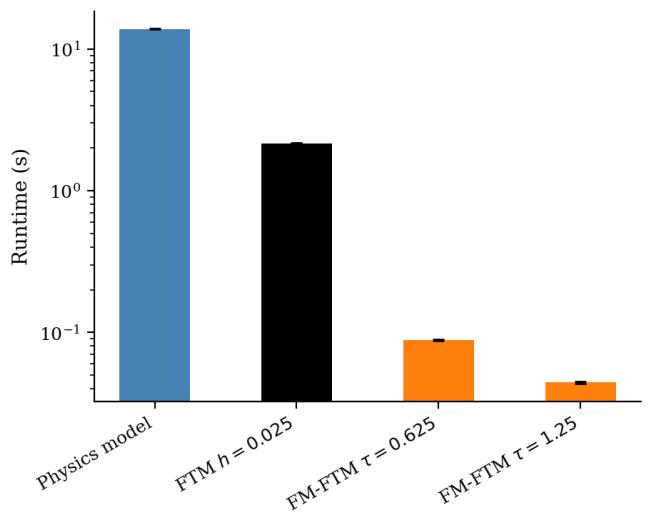

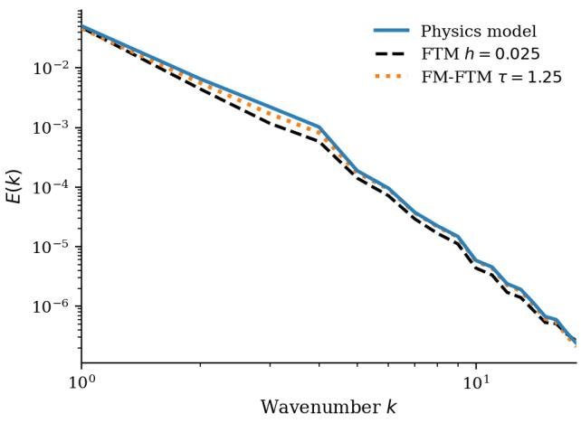  
Figure 9: Stochastically forced turbulence: With a jump horizon of $\tau = 1 . 2 5$ $\mathrm { F M - F T M }$ generates trajectories approximately 50× faster than FTM and about $5 0 0 \times$ faster than the physics model (left), while predicting solution fields that accurately match the decay of the kineticenergy spectrum across wavenumbers (right).

## 4.6.2 Turbulence: Evaluation metrics

We use 1024 test initial conditions and FM-FTM jump horizons $\tau \in \{ 0 . 6 2 5 , 1 . 2 5 \}$ . We evaluate the relative errors in ensemble-mean kinetic energy and enstrophy, computed from the velocity and vorticity fields, respectively. We also compare the kinetic-energy spectra at selected times to assess the distribution of energy across spatial scales. To assess computational eficiency, we measure the wall-clock time required to generate trajectories with the reference physics model, FTM, and FM-FTM at the tested jump horizons.

## 4.6.3 Forced turbulence: Results

Integrating the learned FTM velocity field becomes unstable when the time-step size is increased from $h = 0 . 0 2 5$ to $h = 0 . 2 5$ , as shown in Figure 1. In contrast, FM-FTM produces accurate predictions with jump horizon $\tau = 0 . 2 5$ . Thus, FM-FTM enables rollouts over large jump horizons while maintaining accurate predictions and preserving coherent vorticity structures in this example. Accurate ensemble statistics are retained at even larger jump horizons, as shown in Figure 8, where FM-FTM accurately predicts kinetic energy and enstrophy across the tested jump horizons $\tau \in \{ 0 . 6 2 5 , 1 . 2 5 \}$ , with relative errors of similar magnitude to those of FTM over much of the time interval. With $\tau = 1 . 2 5$ , FM-FTM requires only 20 flow-map evaluations over time interval [0, 25], compared with 1000 sequential integration steps for FTM using $h = 0 . 0 2 5$ . Thus, FM-FTM retains accurate predictions of physical ensemble statistics while reducing the number of sequential evaluations by a factor of 50.

Figure 9 (right) shows that FM-FTM with $\tau = 1 . 2 5$ also predicts well the kinetic-energy spectrum at $t = 2 5$ , closely matching the reference across the plotted wavenumbers. This demonstrates that

FM-FTM captures not only integrated ensemble statistics but also the distribution of kinetic energy across spatial scales.

Figure 9 (left) demonstrates the computational savings. FM-FTM reduces trajectory-generation time by approximately 26× and 49× relative to FTM for $\tau = 0 . 6 2 5$ and τ = 1.25, respectively. Compared with the physics model, FM-FTM with $\tau = 1 . 2 5$ accelerates predictions by more than two orders of magnitude. These results provide further evidence that FM-FTM reduces the computational cost of ensemble prediction while retaining accurate turbulence statistics.

## 5 Conclusion

Our results demonstrate that stochastic ensemble predictions can be accelerated by reducing the dynamics in time, rather than only reducing the state dimension or making individual time steps cheaper. By approximating the evolution of a learned probability-current velocity with a flow map, FM-FTM replaces sequential time integration with evaluations of a learned flow map. Our numerical experiments show that FM-FTM accurately captures time marginals, probability-current quantities, and physical ensemble statistics over time horizons that are orders of magnitude larger than the time-integration step size of the underlying dynamical model. Thus, overall, these results show that the time resolution needed to accurately integrate a dynamical model need not determine the computational cost of predictions when predictions are required only at selected times. This puts model reduction in time, via, e.g., flow-map approximations as in this work, as a complementary approach to model reduction in state space.

## References

[1] A. C. Antoulas, C. A. Beattie, and S. Gugercin. Interpolatory Methods for Model Reduction, volume 21 of Computational Science and Engineering. Society for Industrial and Applied Mathematics, Philadelphia, PA, 2020.

[2] J. Bakarji and D. M. Tartakovsky. Data-driven discovery of coarse-grained equations. Journal of Computational Physics, 434:110219, 2021.

[3] P. Benner, S. Grivet-Talocia, A. Quarteroni, G. Rozza, W. Schilders, and L. M. Silveira, editors. Model Order Reduction, Volume 1: System- and Data-Driven Methods and Algorithms. De Gruyter, Berlin and Boston, 2021.

[4] P. Benner, S. Grivet-Talocia, A. Quarteroni, G. Rozza, W. Schilders, and L. M. Silveira, editors. Model Order Reduction, Volume 2: Snapshot-Based Methods and Algorithms. De Gruyter, Berlin and Boston, 2021.

[5] P. Benner, S. Gugercin, and K. Willcox. A survey of projection-based model reduction methods for parametric dynamical systems. SIAM Review, 57(4):483–531, 2015.

[6] J. Berman, T. Blickhan, and B. Peherstorfer. Parametric model reduction of mean-field and stochastic systems via higher-order action matching. In Advances in Neural Information Processing Systems, volume 37, pages 56588–56618, 2024.

[7] T. Blickhan, J. Berman, A. Stuart, and B. Peherstorfer. DICE: Discrete inverse continuity equation for learning population dynamics, 2025.

[8] N. M. Bofi, M. S. Albergo, and E. Vanden-Eijnden. Flow map matching with stochastic interpolants: A mathematical framework for consistency models. Transactions on Machine Learning Research, 2025.

[9] N. M. Bofi, M. S. Albergo, and E. Vanden-Eijnden. How to build a consistency model: Learning flow maps via self-distillation. In Advances in Neural Information Processing Systems, volume 38, pages 37559–37595, 2025.

[10] N. M. Bofi and E. Vanden-Eijnden. Probability flow solution of the Fokker–Planck equation. Machine Learning: Science and Technology, 4(3):035012, 2023.

[11] N. M. Bofi and E. Vanden-Eijnden. Deep learning probability flows and entropy production rates in active matter. Proceedings of the National Academy of Sciences, 121(25):e2318106121, 2024.

[12] N. M. Bofi and E. Vanden-Eijnden. Model-free learning of probability flows: Elucidating the nonequilibrium dynamics of flocking. Physical Review Letters, 135(23):238301, 2025.

[13] S. R. Cachay, B. Zhao, H. Joren, and R. Yu. DYfusion: A dynamics-informed difusion model for spatiotemporal forecasting. In Advances in Neural Information Processing Systems, volume 36, 2023.

[14] K. Carlberg, L. Brencher, B. Haasdonk, and A. Barth. Data-driven time parallelism via forecasting. SIAM Journal on Scientific Computing, 41(3):B466–B496, 2019.

[15] K. Carlberg, J. Ray, and B. van Bloemen Waanders. Decreasing the temporal complexity for nonlinear, implicit reduced-order models by forecasting. Computer Methods in Applied Mechanics and Engineering, 289:79–103, 2015.

[16] J. Chen and K. Wu. Deep-OSG: Deep learning of operators in semigroup. Journal of Computational Physics, 493:112498, 2023.

[17] J. Chen, K. Wu, and D. Xiu. DUE: A deep learning framework and library for modeling unknown equations. SIAM Review, 67(4):873–902, 2025.

[18] Y. Chen, M. Goldstein, M. Hua, M. S. Albergo, N. M. Bofi, and E. Vanden-Eijnden. Probabilistic forecasting with stochastic interpolants and Föllmer processes. In Proceedings of the 41st International Conference on Machine Learning, volume 235 of Proceedings of Machine Learning Research, pages 6728–6756. PMLR, 2024.

[19] Y. Chen and D. Xiu. Learning stochastic dynamical system via flow map operator. Journal of Computational Physics, 508:112984, 2024.

[20] R. Chetrite and K. Gawędzki. Eulerian and Lagrangian pictures of non-equilibrium difusions. Journal of Statistical Physics, 137(5–6):890–916, 2009.

[21] Y. Choi, P. Brown, W. Arrighi, R. Anderson, and K. Huynh. Space–time reduced order model for large-scale linear dynamical systems with application to Boltzmann transport problems. Journal of Computational Physics, 424:109845, 2021.

[22] Y. Choi and K. Carlberg. Space–time least-squares Petrov–Galerkin projection for nonlinear model reduction. SIAM Journal on Scientific Computing, 41(1):A26–A58, 2019.

[23] V. Churchill and D. Xiu. Flow map learning for unknown dynamical systems: Overview, implementation, and benchmarks. Journal of Machine Learning for Modeling and Computing, 4(2):173–201, 2023.

[24] K. Debrabant, G. Samaey, and P. Zieliński. A micro-macro acceleration method for the Monte Carlo simulation of stochastic diferential equations. SIAM Journal on Numerical Analysis, 55(6):2745–2786, 2017.

[25] A. N. Diaz, S. A. McQuarrie, J. T. Tencer, and P. J. Blonigan. Interpretable and flexible non-intrusive reduced-order models using reproducing kernel Hilbert spaces. Computer Methods in Applied Mechanics and Engineering, 452:118734, 2026.

[26] R. D. Falgout, S. Friedhof, T. V. Kolev, S. P. MacLachlan, and J. B. Schroder. Parallel time integration with multigrid. SIAM Journal on Scientific Computing, 36(6):C635–C661, 2014.

[27] S. Fresca, L. Dedè, and A. Manzoni. A comprehensive deep learning-based approach to reduced order modeling of nonlinear time-dependent parametrized PDEs. Journal of Scientific Computing, 87(2):61, 2021.

[28] S. Fresca and A. Manzoni. POD-DL-ROM: Enhancing deep learning-based reduced order models for nonlinear parametrized PDEs by proper orthogonal decomposition. Computer Methods in Applied Mechanics and Engineering, 388:114181, 2022.

[29] A. Frishman and P. Ronceray. Learning force fields from stochastic trajectories. Physical Review X, 10(2):021009, 2020.

[30] C. W. Gear and I. G. Kevrekidis. Projective methods for stif diferential equations: Problems with gaps in their eigenvalue spectrum. SIAM Journal on Scientific Computing, 24(4):1091–1106, 2003.

[31] Z. Geng, M. Deng, X. Bai, J. Z. Kolter, and K. He. Mean Flows for one-step generative modeling. In Advances in Neural Information Processing Systems, volume 38, 2025.

[32] M. Guo and J. S. Hesthaven. Reduced order modeling for nonlinear structural analysis using Gaussian process regression. Computer Methods in Applied Mechanics and Engineering, 341:807– 826, 2018.

[33] M. Guo, S. A. McQuarrie, and K. E. Willcox. Bayesian operator inference for data-driven reduced-order modeling. Computer Methods in Applied Mechanics and Engineering, 402:115336, 2022.

[34] U. G. Haussmann and E. Pardoux. Time reversal of difusions. The Annals of Probability, 14(4):1188–1205, 1986.

[35] J. S. Hesthaven, B. Peherstorfer, and B. Unger. Nonlinear model reduction for transportdominated problems. Acta Numerica, 35:173–272, 2026.

[36] S. Jha, T. Schorlepp, N. Geissler, J. Berman, and B. Peherstorfer. First-Order Trajectory Matching: Fast ensemble predictions of chaotic, turbulent, stochastic systems. In Advances in Neural Information Processing Systems, 2026.

[37] I. G. Kevrekidis, C. W. Gear, J. M. Hyman, P. G. Kevrekidis, O. Runborg, and C. Theodoropoulos. Equation-free, coarse-grained multiscale computation: Enabling microscopic simulators to perform system-level analysis. Communications in Mathematical Sciences, 1(4):715–762, 2003.

[38] D. Kochkov, J. A. Smith, A. Alieva, Q. Wang, M. P. Brenner, and S. Hoyer. Machine learning– accelerated computational fluid dynamics. Proceedings of the National Academy of Sciences, 118(21):e2101784118, 2021.

[39] G. Kohl, L.-W. Chen, and N. Thuerey. Benchmarking autoregressive conditional difusion models for turbulent flow simulation. Neural Networks, 199:108641, 2026.

[40] B. Kramer, B. Peherstorfer, and K. E. Willcox. Learning nonlinear reduced models from data with Operator Inference. Annual Review of Fluid Mechanics, 56:521–548, 2024.

[41] B. Kramer and E. Qian. Reduced-order modeling for engineering systems: Survey and opportunities for digital twins. Structural and Multidisciplinary Optimization, 69:141, 2026.

[42] O. P. Le Maître and L. Mathelin. Equation-free model reduction for complex dynamical systems. International Journal for Numerical Methods in Fluids, 63(2):163–184, 2010.

[43] J. Li, J. M. Horowitz, T. R. Gingrich, and N. Fakhri. Quantifying dissipation using fluctuating currents. Nature Communications, 10:1666, 2019.

[44] X. Li, F. Lu, M. Tao, and F. X.-F. Ye. NySALT: Nyström-type inference-based schemes adaptive to large time-stepping. Journal of Computational Physics, 477:111952, 2023.

[45] X. H. Li, F. Lu, and F. X.-F. Ye. ISALT: Inference-based schemes adaptive to large timestepping for locally Lipschitz ergodic systems. Discrete and Continuous Dynamical Systems - S, 15(4):747–771, 2022.

[46] Z. Li, N. Kovachki, K. Azizzadenesheli, B. Liu, K. Bhattacharya, A. Stuart, and A. Anandkumar. Fourier neural operator for parametric partial diferential equations. In International Conference on Learning Representations, 2021.

[47] J.-L. Lions, Y. Maday, and G. Turinici. Résolution d’EDP par un schéma en temps pararéel. Comptes Rendus de l’Académie des Sciences - Series I - Mathematics, 332(7):661–668, 2001.

[48] Y. Lipman, R. T. Q. Chen, H. Ben-Hamu, M. Nickel, and M. Le. Flow matching for generative modeling. In International Conference on Learning Representations, 2023.

[49] S. Liu, L. A. Grzelak, and C. W. Oosterlee. The seven-league scheme: Deep learning for large time step Monte Carlo simulations of stochastic diferential equations. Risks, 10(3):47, 2022.

[50] Y. Liu, Y. Chen, D. Xiu, and G. Zhang. A training-free conditional difusion model for learning stochastic dynamical systems. SIAM Journal on Scientific Computing, 47(5):C1144–C1171, 2025.

[51] Y. Liu, J. N. Kutz, and S. L. Brunton. Hierarchical deep learning of multiscale diferential equation time-steppers. Philosophical Transactions of the Royal Society A: Mathematical, Physical and Engineering Sciences, 380(2229):20210200, 2022.

[52] H. Lu and D. M. Tartakovsky. Prediction accuracy of dynamic mode decomposition. SIAM Journal on Scientific Computing, 42(3):A1639–A1662, 2020.

[53] H. Lu and D. M. Tartakovsky. Extended dynamic mode decomposition for inhomogeneous problems. Journal of Computational Physics, 444:110550, 2021.

[54] L. Lu, P. Jin, G. Pang, Z. Zhang, and G. E. Karniadakis. Learning nonlinear operators via DeepONet based on the universal approximation theorem of operators. Nature Machine Intelligence, 3:218–229, 2021.

[55] K. Neklyudov, R. Brekelmans, D. Severo, and A. Makhzani. Action matching: Learning stochastic dynamics from samples. In Proceedings of the 40th International Conference on Machine Learning, volume 202 of Proceedings of Machine Learning Research, pages 25858–25889. PMLR, 2023.

[56] E. Nelson. Dynamical Theories of Brownian Motion. Mathematical Notes. Princeton University Press, Princeton, NJ, 1967.

[57] E. J. Parish and K. T. Carlberg. Windowed least-squares model reduction for dynamical systems. Journal of Computational Physics, 426:109939, 2021.

[58] G. A. Pavliotis. Stochastic Processes and Applications: Difusion Processes, the Fokker–Planck and Langevin Equations, volume 60 of Texts in Applied Mathematics. Springer, New York, 2014.

[59] B. Peherstorfer and K. Willcox. Data-driven operator inference for nonintrusive projection-based model reduction. Computer Methods in Applied Mechanics and Engineering, 306:196–215, 2016.

[60] E. Qian, B. Kramer, B. Peherstorfer, and K. Willcox. Lift & Learn: Physics-informed machine learning for large-scale nonlinear dynamical systems. Physica D: Nonlinear Phenomena, 406:132401, 2020.

[61] T. Qin, K. Wu, and D. Xiu. Data driven governing equations approximation using deep neural networks. Journal of Computational Physics, 395:620–635, 2019.

[62] F. Regazzoni, L. Dedè, and A. Quarteroni. Machine learning for fast and reliable solution of time-dependent diferential equations. Journal of Computational Physics, 397:108852, 2019.

[63] F. Regazzoni, S. Pagani, M. Salvador, L. Dedè, and A. Quarteroni. Learning the intrinsic dynamics of spatio-temporal processes through Latent Dynamics Networks. Nature Communications, 15(1):1834, 2024.

[64] P. Reiterer, C. Lainscsek, F. Schürrer, C. Letellier, and J. Maquet. A nine-dimensional Lorenz system to study high-dimensional chaos. Journal of Physics A: Mathematical and General, 31(34):7121–7139, 1998.

[65] G. Rozza, D. B. P. Huynh, and A. T. Patera. Reduced basis approximation and a posteriori error estimation for afinely parametrized elliptic coercive partial diferential equations: Application to transport and continuum mechanics. Archives of Computational Methods in Engineering, 15(3):229–275, 2008.

[66] T. Salimans and J. Ho. Progressive distillation for fast sampling of difusion models. In International Conference on Learning Representations, 2022.

[67] P. Schwerdtner, T. Blickhan, and B. Peherstorfer. Two-parameter flows for learning population dynamics of physical systems. In Proceedings of the 43rd International Conference on Machine Learning, volume 306 of Proceedings of Machine Learning Research, pages 108612–108627. PMLR, 2026.

[68] U. Seifert. Stochastic thermodynamics, fluctuation theorems and molecular machines. Reports on Progress in Physics, 75(12):126001, 2012.

[69] Y. S. Shimizu and E. J. Parish. Windowed space–time least-squares Petrov–Galerkin model order reduction for nonlinear dynamical systems. Computer Methods in Applied Mechanics and Engineering, 386:114050, 2021.

[70] Y. Song, P. Dhariwal, M. Chen, and I. Sutskever. Consistency models. In Proceedings of the 40th International Conference on Machine Learning, volume 202 of Proceedings of Machine Learning Research, pages 32211–32252. PMLR, 2023.

[71] Y. Song, J. Sohl-Dickstein, D. P. Kingma, A. Kumar, S. Ermon, and B. Poole. Score-based generative modeling through stochastic diferential equations. In International Conference on Learning Representations, 2021.

[72] Q. Wang, S. A. Gomez, P. J. Blonigan, A. L. Gregory, and E. Y. Qian. Towards scalable parallel-in-time turbulent flow simulations. Physics of Fluids, 25(11):110818, 2013.

[73] M. Yang, P. Wang, D. del Castillo-Negrete, Y. Cao, and G. Zhang. A pseudoreversible normalizing flow for stochastic dynamical systems with various initial distributions. SIAM Journal on Scientific Computing, 46(4):C508–C533, 2024.

[74] M. Yano. A space-time Petrov–Galerkin certified reduced basis method: Application to the Boussinesq equations. SIAM Journal on Scientific Computing, 36(1):A232–A266, 2014.