# NOMAD-EEG: Native Omni-Montage Adaptive Diffusion

Abdulkader Helwan1, Khadidja Henni2 and Lina Abou-Abbas1,∗

1Department of Electrical and Computer Engineering, Lebanese American University, Byblos, Lebanon

2Institute of Applied Artificial Intelligence, TÉLUQ University, Montreal, Canada ∗Author to whom any correspondence should be addressed: lina.abouabbas@lau.edu.lb

## Abstract

Purpose. Electroencephalography (EEG) montages, channel counts and recording lengths vary widely, but most EEG foundation models are bound to the channel set and input length they were trained on. We aimed to build a generative EEG foundation model independent of the number, identity and order of electrodes and of the input length.

Methods. NOMAD-EEG is a 12.0 M-parameter diffusion model that alternates state-space layers along time, without patches, with attention across electrodes identified only by their 3D scalp position. It was pre-trained on 147 h of unlabelled EEG from a single corpus and evaluated with frozen linear probes on ten datasets with 1 to 64 electrodes against seven foundation models run under one protocol, and on two unseen populations.

Results. Despite its small size (12.0 M parameters against 69 M for REVE) and single pretraining corpus, NOMAD-EEG outperformed all seven foundation models on EEGMMIDB motor imagery (balanced accuracy 0.442), Siena seizure detection (macro F1 0.622) and Bonn seizure detection (AUROC 0.999), had the highest accuracy of the seven compared models on TUEP epilepsy diagnosis (0.640) and, after fine-tuning, the highest κ (0.635) and weighted F1 (0.814) on TUEV event classification. It was the best of five models on P300 detection in autism with an unseen eight-electrode montage (AUROC 0.718). With only 5 of 19 electrodes, its mean AUROC fell only from 0.942 to 0.891.

Conclusion. Identifying electrodes by position and modelling time without patches let one small model, pre-trained on one corpus, outperform much larger EEG foundation models on seizure detection, epileptiform event classification, epilepsy diagnosis and motor imagery.

Keywords: EEG foundation model; Diffusion model; Montage-agnostic; State-space model; Self-supervised learning; Seizure detection

## 1 Introduction

Electroencephalography (EEG) is recorded with very different hardware and conventions. A clinical epilepsy study may use the 19–21 electrodes of the international 10–20 system, often re-referenced into a bipolar montage; a motor-imagery study may use a 64-electrode 10– 10 cap; a sleep study may record only two bipolar derivations; and some archives hold a single intracranial or scalp channel. Recording lengths vary just as widely, from 4 s trials in brain–computer interfaces to the 30 s epochs of sleep scoring. At the same time, the events clinicians care about are brief: a spike lasts 20–70 ms and a sharp wave 70–200 ms [1]. An EEG foundation model is only broadly useful if one set of pretrained weights can read all of these inputs, at the temporal resolution the events require.

Most EEG foundation models are, however, bound to the format they were trained on. Some identify each channel by a learned embedding looked up in a fixed vocabulary of electrode names or slots, so channels outside that vocabulary cannot be represented (LaBraM [2], EEGPT [3], BIOT [4]). Others mix channels with convolutions along the channel index, so the result depends on the order in which channels are listed (CBraMod [5], EEGMamba [6]). Most tokenise time into non-overlapping patches of about one second, and some cap the number of patches, which fixes a maximum input length.

Generative pre-training has recently emerged as a strong alternative to masked reconstruction for EEG. Denoising diffusion [7] was used by our earlier DiffEEG model [8]; EEGDM [9] combined diffusion with a structured state-space backbone; and B[FM]2 [10] showed that flow matching [11] on the raw waveform reaches state-of-the-art accuracy on seven of nine downstream tasks while pre-training on only about 307 h of EEG. Yet each of these generative models inherits a fixed input format. DiffEEG maps its input into a fixed 22-channel layout, EEGDM conditions a single-channel network on one of 22 bipolar channel identities, and B[FM]2 convolves along the electrode index of what it describes as a small, fixed set of electrodes.

Montage-agnostic models do exist, but they take the opposite design choices. REVE [12], LUNA [13] and BrainOmni [14] place every channel by its 3D sensor position and so accept arbitrary electrode sets. All three are trained with masked or tokenised reconstruction objectives on transformers that operate on temporal patches or windows, which trades temporal resolution for tractable attention. No existing model, to our knowledge, combines a generative objective, position-based montage independence and patch-free temporal modelling (Table 1).

We introduce NOMAD-EEG (Native Omni-Montage Adaptive Diffusion), a diffusion foundation model whose architecture has no parameter tied to the number, identity or order of electrodes, and none tied to the input length (Fig. 1). Every block of the network factorises spatiotemporal mixing into two operations. A bidirectional diagonal state-space layer (S4D) [15] mixes information along time within each electrode, at a fixed 20 ms resolution and with a convolution kernel generated for whatever length the input has. Multi-head attention then mixes information across electrodes within each time step, where each electrode is identified only by Fourier features [16] of its 3D scalp coordinate. The network is trained to denoise EEG under a cosine noise schedule [17], and its gated intermediate activations are read out as representations.

Our contributions are:

• A montage- and length-agnostic generative backbone. NOMAD-EEG is, among the models we review, the only EEG foundation model that is simultaneously diffusionpretrained, places electrodes by 3D position in every block, and models time without patches at 20 ms resolution with no maximum length, pre-trained on 30 s windows (1,500 steps per electrode) with a receptive field spanning the whole input. We show that its outputs are permutation-equivariant in the electrodes and that its parameter count is independent of the number of electrodes and samples (Section 2.4).

• Task heads that keep this independence. We define a frozen feature extractor (windowed mean and standard deviation of gate activations) and a token-based fine-tuning head whose output size does not depend on the montage or the recording length (Section 2.5).

• A controlled comparison of diffusion and flow matching. Because the objective is a single switch in our implementation, we pre-train two models that differ only in the objective and compare them on every downstream task.

• A single-protocol benchmark. We re-run seven published EEG foundation models from their released weights on eight datasets under one evaluation protocol, rather than quoting results obtained under different splits, and add transfer to two populations unseen in pre-training (P300 detection in autism and Parkinson’s disease diagnosis).

• Ablations and a scaling study. We measure what pre-training adds over random weights, test electrode-order invariance and missing electrodes, and train a 5.6-times larger model on 47 times more data to test whether scale helps.

Pre-trained on 147 h of unlabelled TUEV recordings, NOMAD-EEG reads datasets with one to 64 electrodes with a single set of weights. Across eight benchmarks it is never ranked below fourth among eight foundation models and is first on Bonn and EEGMMIDB, and it is the best of five models on P300 detection with an eight-electrode montage it never saw. A larger model trained on far more data was not significantly better on any benchmark.

## 1.1 Related work

EEG foundation models. Self-supervised pre-training on large unlabelled EEG corpora, most often the Temple University Hospital (TUH) EEG corpus [18], has become the dominant route to transferable EEG representations [19, 20]. BENDR [21] adapted contrastive speech pre-training to EEG. BIOT [4] tokenises each channel’s short-time spectrum and adds a learned channel token, which lets one model read datasets with different channel counts up to the size of its token table. LaBraM [2] and EEGPT [3] pre-train transformers on one-second patches (LaBraM) or short windows (EEGPT) with masked objectives, identifying each electrode by a learned embedding drawn from a fixed vocabulary of channel names. CBraMod [5] separates spatial and temporal attention in a criss-cross transformer and replaces channel embeddings by a convolutional positional encoding computed over the channel × patch grid; EEGMamba [6] keeps the same input contract and replaces the temporal transformer with Mamba [22].

Montage-agnostic EEG models. Several recent models remove the fixed channel vocabulary. MMM [23] maps every montage onto a unified topology of region tokens using electrode geometry. REVE [12], pre-trained on about 60,000 h of EEG, adds a 4D Fourier positional encoding of each electrode’s 3D coordinate and patch index, and applies full attention over all channel–patch tokens. LUNA [13] encodes 3D coordinates with a NeRF-style [24] sinusoidal projection and compresses any number of channels into a few learned queries by cross-attention before temporal attention, so its cost grows linearly with channel count. Brain-Omni [14] encodes sensor position, orientation and type to unify EEG and MEG in a discrete tokeniser. DIVER-0 [25] achieves channel-permutation equivariance without coordinates, using attention biases to separate channels. Complementary work adapts fixed-montage models to new channel sets after pre-training, for example by interpolation or learned projections [26]. Compatibility with a new montage does not guarantee robustness to it: Steglich et al. [27] found that montage-agnostic models such as LUNA and REVE can still lose accuracy when the electrode set changes. All of these models are trained with masked or tokenised reconstruction objectives and operate on temporal patches or windows.

Generative pre-training for EEG. Diffusion models [7, 17] and flow matching [11, 28] learn to reverse a noising process and have recently been used as EEG pre-training objectives. Our earlier DiffEEG [8] pre-trained a U-Net to denoise 22-channel EEG and read features from its encoder. EEGDM [9] pre-trains a WaveNet-style [29] network of structured state-space layers as a diffusion model; it processes one channel at a time, conditioned on one of 22 bipolar channel identities, and reads gated activations as features. B[FM]2 [10] pre-trains a SplitUNet velocity network with flow matching on the raw waveform. Its ablation shows that electrodes should interact in every block and that factorising each block into a temporal and an electrode operation outperforms joint two-dimensional convolution. SplitUNet is electrode-countinvariant, but its electrode convolution treats neighbouring channel indices as neighbouring electrodes, and it down-samples time by a factor of eight. TGSD [30] combines state-space models with diffusion for a different goal, EEG spatial super-resolution, rather than representation learning. NOMAD-EEG adopts the factorised block of B[FM]2 and the gate-activation features of EEGDM, but replaces index-based electrode mixing with coordinate-conditioned attention and replaces temporal down-sampling with a full-resolution state-space layer.

State-space sequence models. Structured state-space models (S4) [31] model long sequences through a linear recurrence that can be evaluated as a global convolution. The diagonal variant S4D [15] makes the kernel a sum of complex exponentials that can be generated in closed form for any sequence length. Selective state-space models such as Mamba [22] make the recurrence input-dependent. We use S4D because its kernel is defined for every length without a learned position table, which is what makes the time axis of NOMAD-EEG length-agnostic.

Table 1: How EEG foundation models identify channels and handle time. Entries for the eight models we run were checked against their released code; the rest are from the papers. “Any electrode set” means the model accepts channels that were not in its pre-training montage without retraining.
<table><tr><td>Model</td><td>Objective</td><td>Channel identity</td><td>Any set?</td><td>Order-free?</td><td>Time handling</td></tr><tr><td>NOMAD-EEG (ours)</td><td>Diffusion</td><td>3D coordinates (Fourier), every block</td><td>Yes</td><td>Yes</td><td>20 ms steps, no patches, no length cap</td></tr><tr><td>REVE [12]</td><td>Masked AE</td><td>3D coordinates + patch index</td><td>Yes</td><td>Yes</td><td>1 s patches, full attention</td></tr><tr><td>LUNA [13]</td><td>Masked recon.</td><td>3D coordinates (NeRF-style)</td><td>Yes</td><td>Yes</td><td>Patches; channels compressed to queries</td></tr><tr><td>BrainOmni [14]</td><td>Tokeniser + masked</td><td>Sensor position, orientation, type</td><td>Yes</td><td>Yes</td><td>Windows; channels compressed</td></tr><tr><td>DIVER-0 [25]</td><td>Masked recon.</td><td>Attention bias, no coordinates</td><td>Yes</td><td>Yes</td><td>1 s patches</td></tr><tr><td>LaBraM [2]</td><td>Masked codes</td><td>Learned embedding per name</td><td>Vocabulary Yes</td><td></td><td>1 s patches, ≤16 patches</td></tr><tr><td>EEGPT [3]</td><td>Masked, aligned</td><td>Learned embedding per channel</td><td>Vocabulary Yes</td><td></td><td>Short windows</td></tr><tr><td>BIOT [4]</td><td>Superv./contrast.</td><td>Learned token per slot</td><td>≤18 slots</td><td>No</td><td>STFT tokens, any length</td></tr><tr><td>CBraMod [5]</td><td>Masked recon.</td><td>Conv. encoding over channel axis</td><td>Any count</td><td>No</td><td>1 s patches</td></tr><tr><td>EEGMamba [6]</td><td>Masked recon.</td><td>As CBraMod</td><td>Any count</td><td>No</td><td>1 s patches, Mamba</td></tr><tr><td>EEGDM [9]</td><td>Diffusion</td><td>One of 22 bipolar channel IDs</td><td>No</td><td>a</td><td>5 s chunks</td></tr><tr><td>B[FM]2 [10]</td><td>Flow matching</td><td>Conv. along electrode index</td><td>Any count</td><td>No</td><td>Time down-sampled 8×</td></tr><tr><td>DiffEEG [8]</td><td>Diffusion</td><td>Fixed input slot</td><td>No</td><td>No</td><td>Global pooling over time</td></tr></table>

a EEGDM processes channels independently, so order does not matter, but channels do not interact in the backbone.

## 2 Materials and Methods

## 2.1 Problem setting and input representation

An EEG recording is a matrix $\mathbf { x } \in \mathbb { R } ^ { E \times T }$ of E channels and T samples, together with a position ${ \bf p } _ { e } \in \mathbb { R } ^ { 3 }$ for every channel e. Neither E nor T is fixed, and channels may be listed in any order. The model sees the pair (x, P), with $\mathbf { P } = [ \mathbf { p } _ { 1 } , \ldots , \mathbf { p } _ { E } ] ^ { \top }$ , and never a channel index.

Electrode positions. Positions are looked up by channel name in the standard 10–20 and 10–05 montages of MNE-Python [32]; where the two systems overlap, the 10–20 position is used. A bipolar derivation “A–B” is placed at the midpoint of A and B. All positions are

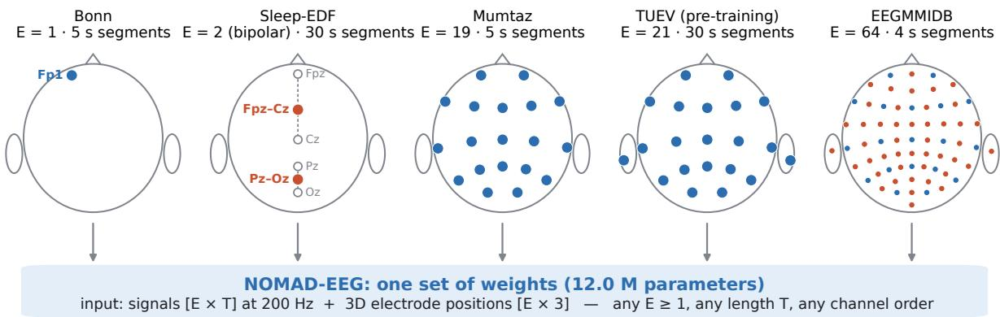  
position in the pre-training montage position never seen in pre-training (incl. bipolar midpoints) electrodes of a bipolar pair

Fig. 1 One model, any montage. The same pretrained NOMAD-EEG weights read five electrode layouts used in this work, from a single electrode to a 64-electrode cap. Electrode positions are the 3D coordinates the network receives, projected to 2D (nose up). Blue: positions present in the pre-training montage. Red: positions never seen in pre-training, or the midpoint used for a bipolar derivation (open circles mark its two electrodes).

divided by one fixed constant, the largest norm, in MNE’s head coordinate frame, among the 21 electrodes of the pre-training montage. Because this constant does not depend on the montage being read, an electrode receives the same coordinate whether it appears in a 19-electrode or a 64-electrode recording. Channels without a standard position (for example ECG, EMG, and the ROC channel of TUH recordings) are dropped rather than assigned an invented position.

Signal preprocessing. All signals are resampled to 200 Hz. Each channel is normalised with statistics computed per corpus on training data only: the median is subtracted, the result is divided by the inter-quartile range, and values are clipped to ±20. This robust scaling absorbs differences in units and amplitude conventions between corpora while limiting the influence of large artefacts. Each corpus also receives an integer identifier c that conditions the network (Section 2.2.3).

## 2.2 Architecture

NOMAD-EEG (Fig. 2) consists of a temporal stem, a stack of N = 16 identical blocks with residual and skip connections, and an output head used only for pre-training. The feature width is d = 256 throughout, and the model has 11,998,977 parameters.

## 2.2.1 Stem

Each channel is processed independently by a single one-dimensional convolution with one input channel, d output channels, kernel size 9, stride 4 and padding 4, whose weights are shared by all electrodes:

$$
\mathbf { h } _ { e } ^ { ( 0 ) } = \operatorname { C o n v 1 d } ( \mathbf { x } _ { e } ) \in \mathbb { R } ^ { T \times d } , \qquad T ^ { \prime } = \lceil T / 4 \rceil .\tag{1}
$$

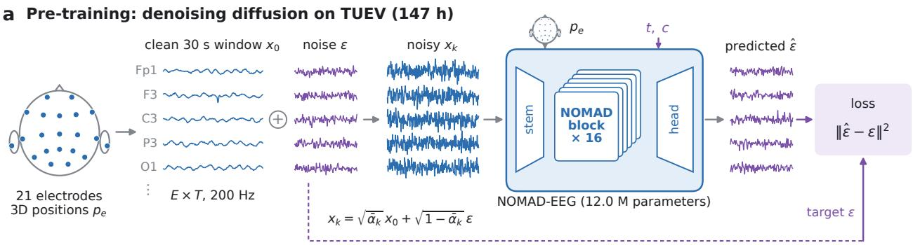

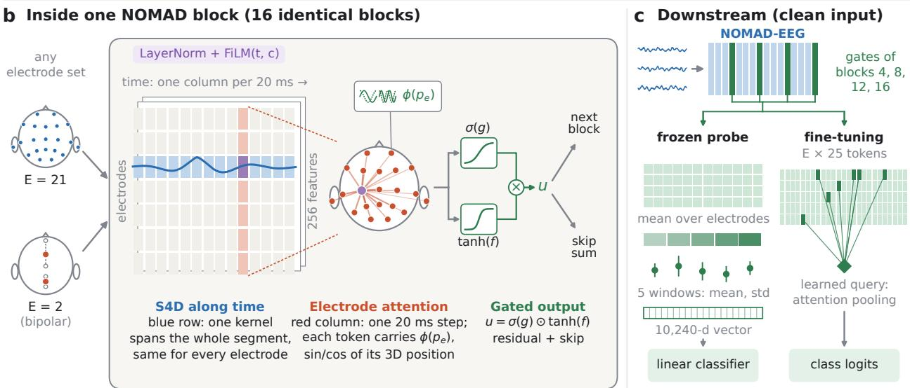  
Fig. 2 Overview of NOMAD-EEG. (a) Pre-training. A clean 30 s TUEV window $\mathbf { x } _ { \mathrm { 0 } }$ (21 electrodes, 200 Hz) is corrupted with Gaussian noise ϵ following the cosine schedule, and the network, given the electrode positions $\mathbf { p } _ { e } ,$ , the noise level t and the corpus c, predicts the noise. It consists of a convolutional stem shared by all electrodes (one 256-dimensional feature every 20 ms), 16 identical blocks, and an output head that maps the summed skip outputs back to the sample rate. The flow-matching variant differs only in the objective. (b) One block. The signal is a grid of tokens with one row per electrode and one column per 20 ms step. After layer normalisation and FiLM conditioning on (t, c), a bidirectional S4D layer filters each row along time with a kernel that spans the whole segment and is shared by all electrodes (blue); attention then mixes each column across electrodes, every token carrying Fourier features $\phi ( \mathbf { p } _ { e } )$ of its electrode’s 3D position (red). Because electrodes are identified only by position, the same block reads any electrode set, for example the 21-electrode pre-training montage or two bipolar channels placed at the midpoints of their electrode pairs. A gated activation gives the output u, which feeds the next block and the skip sum. (c) Downstream, the input is clean and the gates of blocks 4, 8, 12 and 16 are read. The frozen probe averages them over electrodes and keeps the mean and standard deviation in five time windows (10,240 features) for a linear classifier; the fine-tuning head pools $E \times 2 5$ tokens by attention from a learned query (Fig. 4). Waveforms, attention weights and highlighted tokens are illustrative; electrode positions are the coordinates the network receives.

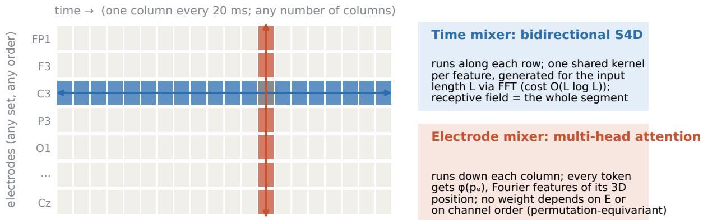  
Fig. 3 Factorised mixing. Inside the network an EEG segment is a grid with one row per electrode and one column per 20 ms step. Each block mixes information along every row with a bidirectional S4D layer and then down every column with attention across electrodes. Neither operation has a parameter whose size depends on the number of rows or columns, so the grid can have any shape.

At 200 Hz one step of $\mathbf { h } ^ { ( 0 ) }$ covers 20 ms. The stem is the only temporal down-sampling in the network, so every block operates at this resolution. The result is a tensor $\mathbf { H } \in \mathbb { R } ^ { \bar { E } \times T ^ { \prime } \times d } \vdots$ one row per electrode and one column per 20 ms step (Fig. 3).

## 2.2.2 Conditioning

The noise level $t \in [ 0 , 1 ]$ is embedded with sinusoidal features of 1000 t and a two-layer MLP with SiLU activation; a learned embedding of the corpus identifier c is added:

$$
\mathbf { k } = \mathrm { M L P } \big ( \gamma ( 1 0 0 0 t ) \big ) + \mathbf { w } _ { c } \in \mathbb { R } ^ { d } ,\tag{2}
$$

where $\gamma$ is the standard sinusoidal embedding. Downstream, inputs are clean and t is set to the clean end of the noise schedule (Section 2.5).

## 2.2.3 The NOMAD block

Following the finding of Hwang et al. [10] that electrodes should interact in every block and that factorised temporal and spatial mixing outperforms joint two-dimensional mixing, each block applies one temporal and one spatial operation (Fig. 3). Given the input H of block $n ,$ the block computes the following.

FiLM conditioning. After layer normalisation, features are scaled and shifted by functions of the conditioning vector [33]:

$$
\mathbf { Z } = \operatorname { L N } ( \mathbf { H } ) \odot \left( 1 + \pmb { \alpha } ( \mathbf { k } ) \right) + \beta ( \mathbf { k } ) ,\tag{3}
$$

where $[ \alpha ; \beta ]$ is a linear map of k initialised to zero, so each block starts as an unconditioned residual block.

Temporal mixing with S4D. Each electrode’s sequence $\mathbf { Z } _ { e } \in \mathbb { R } ^ { T ^ { \prime } \times d }$ is filtered, feature by feature, by a bidirectional diagonal state-space layer [15, 31]. For feature channel $j ,$ , the forward kernel of length $L = T ^ { \prime }$ is

$$
K _ { j } ^ {  } [ \ell ] \ = \ 2 \operatorname { R e } \sum _ { n = 1 } ^ { N _ { s } } C _ { j n } { \frac { e ^ { \Delta _ { j } A _ { j n } } - 1 } { A _ { j n } } } e ^ { \ell \Delta _ { j } A _ { j n } } , \qquad \ell = 0 , \ldots , L - 1 ,\tag{4}
$$

the zero-order-hold discretisation of a diagonal continuous-time state-space model with $N _ { s } =$ 32 complex modes $A _ { j n }$ , output weights $C _ { j r }$ and step size $\Delta _ { j }$ . A second, independently parameterised kernel $K _ { j } ^ {  }$ is applied to the time-reversed sequence, and the two are combined into one non-causal convolution computed with the FFT:

$$
\begin{array} { r } { \mathbf { y } _ { e , : , j } = \big ( K _ { j } ^ { \right. } * \mathbf { z } _ { e , : , j } \big ) + \mathrm { H i p } \big ( K _ { j } ^ { \left. } * \mathrm { H i p } ( \mathbf { z } _ { e , : , j } ) \big ) + D _ { j } \mathbf { z } _ { e , : , j } . } \end{array}\tag{5}
$$

We use the S4D-Lin initialisation $A _ { j n } = - { \textstyle \frac { 1 } { 2 } } + i \pi n$ and draw log $\Delta _ { j }$ uniformly between log $1 0 ^ { - 3 }$ and $\log 1 0 ^ { - 1 }$ . Because the kernel is a closed-form function of $\ell ,$ it is generated for the length $L$ of each input; there is no learned position table and no maximum length. The layer’s receptive field is the whole segment from the first block, and its cost is $O ( E d L \log L )$

Spatial mixing with coordinate-conditioned attention. At each time step $\tau$ the E electrode features $\{ \mathbf { y } _ { e , \tau } \} _ { e = 1 } ^ { E }$ form a set of tokens. Each token is augmented with Fourier features [16] of its electrode’s position,

$$
\phi (  { \mathbf { p } } ) = \left[ \sin ( 2 ^ { k } \pi p _ { a } ) , \cos ( 2 ^ { k } \pi p _ { a } ) \right] _ { k = 0 , \dots , 7 ; a \in \{ x , y , z \} } \in \mathbb { R } ^ { 4 8 } ,\tag{6}
$$

projected linearly to d dimensions, and the tokens attend to each other with four-head selfattention [34]:

$$
\mathbf { V } _ { : , \tau } = \mathbf { Y } _ { : , \tau } + \mathrm { M H A } \big ( \mathbf { Y } _ { : , \tau } + \mathbf { W } _ { p } \phi ( \mathbf { P } ) \big ) .\tag{7}
$$

The positional features enter the attention input only; the residual stream carries the signal features. Electrode identity is therefore defined by position alone, as in REVE [12], but here the positional information is re-injected in every block rather than once at the input. Attention is computed independently at each of the $T ^ { \prime }$ steps, at a cost of $O ( T ^ { \prime } E ^ { 2 } d )$ per block.

Gated output. A linear map produces two halves [g; f] from $\mathbf { V }$ , which are combined with the gated activation of WaveNet [29], also used by EEGDM [9]:

$$
{ \bf U } = \sigma ( { \bf g } ) \odot \mathrm { t a n h } ( { \bf f } ) , \qquad { \bf H }  { \bf H } + { \bf W } _ { r } { \bf U } , \qquad { \bf S }  { \bf S } + { \bf W } _ { s } { \bf U } .\tag{8}
$$

The gate $\mathbf { U } ^ { ( n ) } \in \mathbb { R } ^ { E \times T ^ { \prime } \times d }$ is bounded, which stabilises training at depth, and it is the tensor from which downstream features are read.

## 2.2.4 Output head

The sum of skip outputs S over all blocks passes through layer normalisation, SiLU and a linear layer, and a transposed convolution (kernel 8, stride 4) initialised to zero maps each electrode back to the sample rate; a final linear interpolation matches the input length $T$ exactly. The head is used only for the pre-training loss.

## 2.3 Pre-training objective

NOMAD-EEG is pre-trained as a denoising diffusion model [7] with the cosine noise schedule of Nichol and Dhariwal [17] $( s = 0 . 0 0 8$ , 1,000 steps). For a clean window $\mathbf { x } _ { \mathrm { 0 } }$ , a step k is drawn uniformly, the window is corrupted,

$$
\begin{array} { r } { { \bf x } _ { k } = \sqrt { \bar { \alpha } _ { k } } { \bf x } _ { 0 } + \sqrt { 1 - \bar { \alpha } _ { k } } { \bf \epsilon } , \qquad { \bf \epsilon } \sim \mathcal { N } ( { \bf 0 } , { \bf I } ) , } \end{array}\tag{9}
$$

and the network, conditioned on $t = k / 1 0 0 0$ , predicts the noise:

$$
\begin{array} { r } { \mathcal { L } _ { \mathrm { d i f f } } = \mathbb { E } _ { \mathbf { x } _ { 0 } , k , \epsilon } \big \| f _ { \theta } ( \mathbf { x } _ { k } , t , \mathbf { P } , c ) - \epsilon \big \| _ { 2 } ^ { 2 } . } \end{array}\tag{10}
$$

To predict the noise at every level, the network must model what EEG looks like: its rhythms, transients and artefacts, and how signals co-vary across the scalp.

Flow-matching variant. To compare objectives under otherwise identical conditions, we also train the same network with rectified flow [11, 28]: $t \sim \mathcal { U } ( 0 , 1 ) , \ : \mathbf { x } _ { t } = ( 1 - t ) \epsilon + t \mathbf { x } _ { 0 }$ and target ${ \bf x } _ { 0 } - \epsilon$ . Architecture, data, optimiser, number of training epochs and downstream task heads are unchanged. We refer to the two models as NOMAD-EEG (diffusion, the default) and NOMAD-EEG-F (flow).

## 2.4 Montage and length independence

The design gives NOMAD-EEG two properties that do not depend on training.

Proposition 1 (Electrode permutation equivariance). Let Π be any permutation ofthe E electrodes. Every intermediate tensor, including the gate activations $\mathbf { U } ^ { ( n ) }$ and the output, satisfies $F ( \Pi \mathbf { x } , \Pi \mathbf { P } ) = \Pi F ( \mathbf { x } , \mathbf { P } )$ , and any output that pools over electrodes is invariant to Π.

Reason. The stem, layer normalisation, FiLM, S4D, gate and output projections act on each electrode separately with shared weights and therefore commute with Π. Self-attention without positional indices is permutation-equivariant, and the only electrode-specific input, $\phi ( \mathbf { p } _ { e } )$ moves with its electrode.

Proposition 2 (Size independence). No parameterofNOMAD-EEG has a shape thatdepends on E orT. The same weights therefore applyto anynumberofelectrodes $E \geq 1$ , to electrodes absent from the pre-training montage, and to any input length.

Reason. The stem and the S4D parameters are per feature, the S4D kernel is generated for the input length, and the attention and positional projection are per token. Per block the cost is $O ( E d T ^ { \prime } \log T ^ { \prime } + T ^ { \prime } E ^ { 2 } d )$ : roughly linear in time and quadratic in the number of electrodes, which is small for scalp EEG.

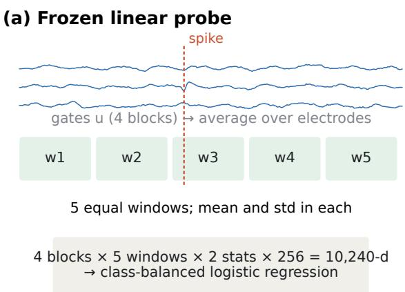

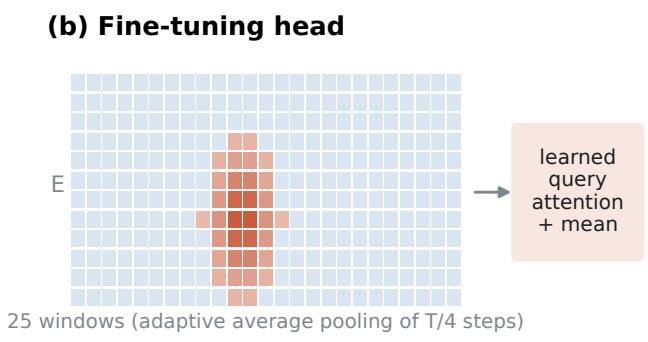  
Fig. 4 Downstream task heads. (a) The frozen feature extractor averages the gate activations over electrodes, splits time into five equal windows and keeps the mean and standard deviation in each, giving 10,240 features whatever the montage or length. (b) The fine-tuning head keeps electrodes separate: each electrode in each of 25 windows is a token, and a learned query pools the tokens by attention. Traces and attention shading are illustrative.

Long context. Size independence also removes the usual ceiling on context length. NOMAD-EEG is pre-trained on 30 s windows, which are 1,500 steps per electrode at 20 ms resolution, and every step can draw on the whole window from the first block onwards, because each S4D kernel spans the entire input. Longer recordings need no architectural change: the kernel is simply generated for the longer length, and the cost grows as $O ( L \log L )$ in the S4D layers and linearly in the attention layers, which act on one time step at a time. By contrast, LaBraM’s temporal embedding covers at most 16 one-second patches [2], and EEGDM folds inputs longer than 5 s into independent 5 s chunks [9], so neither relates events more than 16 s or 5 s apart within one pass. These properties guarantee that any montage and any length can be processed, not that every montage is represented equally well. Electrodes far from the pre-training positions rely on the smoothness of $\phi ,$ and robustness to montage changes has to be measured separately [27]. The model still assumes 200 Hz input and a known position for every channel, and a bipolar derivation placed at its midpoint approximates, but does not equal, a sensor at that point.

## 2.5 Downstream task heads

Downstream, the network receives clean EEG, and t is set to the clean end of the trajectory $( t = 0$ for NOMAD-EEG t = 1 for NOMAD-EEG-F); no noise is added. We read the gates $\mathbf { U } ^ { ( n ) }$ of blocks $n \in \{ 4 , 8 , 1 2 , 1 6 \}$ . The generative output head of pre-training is not used.

Frozen feature extraction. For linear probing (Fig. 4a) each gate is averaged over electrodes, which removes the dependence on $E .$ The $T ^ { \prime }$ steps are divided into $W = 5$ equal windows of $\lfloor { T } / 5 \rfloor$ steps (any remainder is dropped), and the mean and standard deviation of each feature are taken within each window. Concatenating four blocks, five windows, two statistics and 256 features gives a vector of 10,240 dimensions for every input. Windowed statistics keep coarse temporal order and let brief events show up through the standard deviation, which a single global average would dilute. Because the number of windows, not their duration, is fixed, a 5 s input gives 1 s windows and a 30 s input gives 6 s windows. A class-balanced linear classifier is trained on these vectors with the encoder frozen.

Fine-tuning head. For fine-tuning (Fig. 4b) the four gates are concatenated to R $\scriptstyle \sum E \times T ^ { \prime } \times 1 0 2 4$ and adaptive average pooling reduces time to $W = 2 5$ windows per electrode. Each window is projected by a linear layer to 256 dimensions, followed by GELU and layer normalisation, and a learned embedding of the window index is added. The resulting $E \times 2 5$ tokens, one per electrode per window, are pooled by four-head attention from a single learned query; the pooled vector is concatenated with the mean of all tokens and mapped to class logits by a linear layer after dropout (0.1). The head’s parameters do not depend on E or T, so the same head applies to every dataset: 21 electrodes give 525 tokens and two bipolar channels give 50. Training has two phases. For the first two epochs only the head is trained, which prevents a randomly initialised head from disturbing the pre-trained encoder; afterwards the whole network is trained, with learning rate $5 \times 1 0 ^ { - 4 }$ for the head and $5 \times 1 0 ^ { - 5 }$ for the encoder, AdamW [35] (weight decay 0.05), 5% linear warm-up followed by cosine decay, and classweighted cross-entropy. The checkpoint with the best balanced accuracy on a subject-disjoint validation set is evaluated once on the test set.

## 2.6 Pre-training data and implementation

Data. We pre-train on the TUH EEG Events corpus (TUEV) [18, 36], using the recordings of both its training and evaluation partitions and no labels. Recordings are read from the raw EDF files, reduced to the 21 channels of the 10–20 system that have a standard position (ROC is dropped: it has no standard coordinate and is absent from 40% of TUEV samples), resampled to 200 Hz with a polyphase filter, and cut into non-overlapping 30 s windows that never cross a recording boundary. This yields 17,678 windows (147 h), of which 2% are held out for validation. Thirty-second windows give the state-space layers enough context to see rhythms evolve, and because the architecture is length-agnostic, downstream inputs may be shorter or longer. Pre-training on TUEV means that TUEV downstream results measure indomain transfer; all other downstream datasets are external to pre-training.

Optimisation. Both models are trained for about 74 epochs over the 17,325 training windows (40,000 weight updates with an effective batch of 32 windows: 8 windows with 4-step gradient accumulation), with AdamW (learning rate $3 \times 1 0 ^ { - 4 } , \beta = ( 0 . 9 , 0 . 9 5 )$ , weight decay 0.01), a linear warm-up over the first two epochs followed by cosine decay to zero, gradient clipping at norm 1.0, and an exponential moving average of the weights with decay 0.999. The movingaverage weights are used for all downstream evaluations. Training uses bfloat16 autocasting, with the S4D FFT kept in float32 because the kernel tail underflows in bfloat16, and gradient checkpointing [37] of each block. An update with a non-finite loss or gradient is skipped. Each model trains on a single NVIDIA A100 GPU.

## 2.7 Downstream datasets

We evaluate on nine downstream datasets that differ in task, montage and segment length, compared with all baselines, and on a tenth, the SEED-V emotion corpus, for NOMAD-EEG alone (Table 2). TUAB, TUSZ, TUEV and TUEP come from the TUH EEG corpus [18]; TUEV was also part of NOMAD-EEG’s unlabelled pre-training data, so its results measure in-domain transfer. Siena, Bonn, Mumtaz, EEGMMIDB and Sleep-EDF are external to NOMAD-EEG’s pre-training and cover new hardware, montages and tasks; some of them were part of other models’ pre-training data (Section 2.8). SEED-V is also external to NOMAD-EEG’s pretraining.

TUEP, the TUH Epilepsy Corpus, poses a diagnostic question: whether a patient has epilepsy, judged from routine EEG of 100 patients with and 100 without epilepsy. Each patient contributes 60 random 5 s windows. Because the two classes are equal in size, accuracy equals balanced accuracy and weighted F1 equals macro F1 on this task. Under the SEED-V protocol of CBraMod the test set consists of unseen film clips of the same subjects, and the validation clips are distinct from the training clips.

Table 2: Downstream datasets. Train/val/test counts are segments; all splits are subject-disjoint except TUAB, TUSZ, Siena and Bonn, which reuse the fixed splits of our earlier benchmark, and SEED-V, which follows the CBraMod protocol (film clips 1–5, 6–10 and 11–15 of every session; all 16 subjects in every split). TUEP is evaluated by 5-fold cross-validation over its 200 patients.
<table><tr><td>Dataset</td><td>Task</td><td>Classes</td><td>Channels</td><td>Segment</td><td>Train / val / test</td></tr><tr><td>TUAB</td><td>abnormal EEG</td><td>2</td><td>21</td><td>5s</td><td>100,000 / 20,000 / 50,000</td></tr><tr><td>TUSZ</td><td>seizure</td><td>2</td><td>21</td><td>5s</td><td>100,000 / 20,000 / 50,000</td></tr><tr><td>TUEV</td><td>EEG events</td><td>6</td><td>21</td><td>5s</td><td>83,932 (5-fold CV) / 29,421</td></tr><tr><td>TUEP</td><td>epilepsy diagnosis</td><td>2</td><td>19</td><td>5s</td><td>12,000 from 200 patients (5-fold CV)</td></tr><tr><td>Siena</td><td>seizure</td><td>2</td><td>21</td><td>5s</td><td>74,512 / 8,279 / 18,729</td></tr><tr><td>Bonn</td><td>seizure</td><td>2</td><td>1</td><td>5s</td><td>360 / 40 / 100</td></tr><tr><td>Mumtaz</td><td>depression</td><td>2</td><td>19</td><td>5s</td><td>4,818 / 1,086 / 1,179</td></tr><tr><td>EEGMMIDB</td><td>motor imagery</td><td>4</td><td>64</td><td>4s</td><td>6,300 / 1,734 / 1,803</td></tr><tr><td>Sleep-EDF-20</td><td>sleep stages</td><td>5</td><td>2 (bipolar)</td><td>30 s</td><td>29,996 / 3,175 / 9,137</td></tr><tr><td>SEED-V</td><td>emotion</td><td>5</td><td>59</td><td>1s</td><td>34,432 / 42,960 / 40,352</td></tr></table>

## 2.8 Baselines and overlap with their pre-training data

We compare NOMAD-EEG with seven EEG foundation models, all run by us from their released weights: EEGDM [9], REVE [12] (base), CBraMod [5], LaBraM [2] (base), BIOT [4], EEGMamba [6] and our earlier DiffEEG [8]. Each model receives the same segments in its own native input format (montage, sampling rate and amplitude scaling as in its authors’ code) and keeps its own feature pooling. Where a model’s fixed channel vocabulary cannot represent a channel, the channel is mapped to the nearest vocabulary entry by 3D position. B[FM]2 [10] could not be included because its code and weights have not been released.

Several evaluation datasets, or the corpus they were drawn from, appear in the pre-training data of some models, according to each model’s paper, README or released pre-training code [2, 5, 8, 9, 12]. NOMAD-EEG and EEGDM were pre-trained on TUEV, BIOT’s checkpoint on the TUAB and TUEV training splits, LaBraM on TUSZ, TUEP, Siena and EEGMMIDB, and DiffEEG on the TUSZ training split. REVE, CBraMod and EEGMamba were pre-trained on the TUH EEG corpus, from which TUAB, TUSZ, TUEV and TUEP are drawn, and REVE and EEGMamba also on Siena; REVE removed the recordings of TUAB, TUEV, EEGMMIDB and Mumtaz from its pre-training data. None of the models saw the labels of our test sets, but results on an overlapping dataset measure in-domain rather than external transfer. Bonn, Mumtaz, Sleep-EDF and the BCIAUT-P300 data do not appear in any model’s documented pre-training data. LaBraM is not compared on TUEP because TUEP was part of its pre-training data.

## 2.9 Evaluation protocol

The main comparison is a frozen linear probe. Encoders are frozen; a class-balanced, L2- regularised logistic regression is trained on the training features, its regularisation strength $C \in \{ 1 0 ^ { - 6 } , . . . , 1 0 ^ { 3 } \}$ is chosen on the validation split (by AUROC for binary and balanced accuracy for multi-class tasks), and the test set is scored once. For TUEV we use NOMAD-EEG’s own probe (a softmax layer whose L2 strength and number of epochs are chosen by 5-fold subject-grouped cross-validation) for every model. On TUEP the probe is evaluated by 5-fold cross-validation over patients with identical folds for every model; its C is chosen on 20% of the training patients, and a patient’s score is the mean probability of their windows. We report a fixed set of metrics for every dataset: AUROC, PR-AUC, balanced accuracy and macro F1 for binary tasks, and balanced accuracy, Cohen’s κ and weighted F1 for multi-class tasks.

For TUEV, TUAB, TUSZ, Mumtaz, EEGMMIDB, Sleep-EDF and SEED-V we additionally fine-tune NOMAD-EEG end to end (Section 2.5): two epochs with the encoder frozen, then 20 epochs end to end (10 for TUEV), the epoch chosen by validation balanced accuracy. The baselines were evaluated as frozen probes only, so a fine-tuned NOMAD-EEG row is compared with frozen baselines. For TUAB and TUSZ the benchmark’s validation windows are drawn from the training patients (the stored windows carry no patient identifier), so finetuning there selects its epoch on patients it is trained on.

## 2.10 Statistical analysis

Every reported metric carries a 95% confidence interval from 1,000 bootstrap resamples: of test windows for the fixed-split benchmarks, and of subjects or patients for the cross-validated ones (TUEP, BCIAUT-P300, Parkinson’s disease). Differences between two models evaluated on the same test samples (diffusion against flow matching, NOMAD-EEG against a baseline on TUEP and Parkinson’s disease) are tested with a paired bootstrap on the same resamples (2,000 resamples for the objective comparison), and a difference is called significant only when its 95% interval excludes zero. Where only unpaired intervals are available, we state whether they overlap and do not call non-overlapping intervals a paired test.

## 2.11 Transfer to unseen populations

To test whether NOMAD-EEG transfers to a population, task and montage that none of the models saw in pre-training, we evaluate frozen encoders on BCIAUT-P300 [38] and on a Parkinson’s disease corpus. No encoder is trained or fine-tuned on any data from these corpora: the pre-trained weights are used as they are, and only a linear classifier is fitted on top (a linear probe), always on subjects other than the ones it is tested on.

BCIAUT-P300 data. BCIAUT-P300 contains EEG from 15 young people with autism spectrum disorder (ASD), each recorded in 7 sessions of a P300-based brain–computer-interface training in which eight objects are flashed and the participant attends to one of them [38]. EEG was recorded at 250 Hz from eight electrodes (C3, Cz, C4, CPz, P3, Pz, P4, POz) and epoched from −200 to 1,200 ms around each flash. Because every participant has ASD, the task is not autism diagnosis but P300 detection: deciding whether a flashed object was the attended target. We use the labelled calibration data of every session: 20 blocks of 10 runs of 8 flashes, 1,600 epochs per session and 168,000 epochs in total, of which 21,000 (12.5%) are targets. Epochs are resampled to 200 Hz (280 samples, 1.4 s) and normalised per channel with a median and inter-quartile range pooled over all epochs without using labels, then clipped at ±20. The Kaggle release also contains labels for the online (test) sessions, which were withheld in the original challenge; we do not use them.

Models and inputs. We compare NOMAD-EEG-D with DiffEEG [8], EEGDM [9], REVE [12] and BIOT [4], each fed in its native input format (Section 1.1). This montage is new to all five models, and they can read different amounts of it. NOMAD-EEG and REVE place all eight electrodes by their 3D positions; CPz and POz are not in NOMAD-EEG’s pre-training montage. DiffEEG’s fixed 22-channel layout has slots for six of the eight (C3, Cz, C4, P3, Pz, P4). EEGDM’s vocabulary of bipolar channels allows four derivations (C3–Cz, C4–Cz, C3–P3, C4–P4), and BIOT’s allows two (C3–P3, C4–P4). Two models also need an adaptation to the 1.4 s epoch. EEGDM pools its gate activations over one window spanning the whole epoch instead of 1 s windows. REVE keeps its own 1 s patches, so it reads a single patch covering −200 to 800 ms, which contains the P300 (typically 250–500 ms after the flash).

BCIAUT-P300 protocol. Features are extracted once with each frozen encoder (for NOMAD-EEG, the frozen feature extractor of Section 2.5). The 15 subjects are split into five folds of three (subject-grouped cross-validation). In each fold, a class-balanced, L2-regularised logistic regression is trained on the other twelve subjects; its strength $C \in \{ 1 0 ^ { - 4 } , \dots , 1 0 \}$ is chosen by AUROC on three of those twelve held out as validation, and the classifier is then refitted on all twelve and applied to the three test subjects. Every epoch is therefore predicted exactly once, by a classifier that never saw its subject. We report, on the pooled out-of-fold predictions, AUROC, balanced accuracy and PR-AUC (chance level equals the target rate, 0.125), with 95% confidence intervals from 1,000 bootstrap resamples of subjects. We also report the decision a P300 speller actually makes: in each block, the object whose flashes receive the highest mean target probability over the first k runs is selected, and we score how often it is the attended object (chance 12.5%) for k = 1, 3 and 10.

Parkinson’s disease. We apply the same unseen-participant protocol to a diagnostic task: Parkinson’s disease (PD) against healthy controls in OpenNeuro ds004584, 149 participants (100 PD, 49 controls) recorded at rest with eyes open for about two minutes with a 64-channel cap at 500 Hz. We keep the 60 electrodes that have a standard 10-05 position and are present in every recording, convert to microvolts, resample to 200 Hz, remove each window’s perchannel median and cut 5 s windows (4,719 in total). The 149 participants are split into five folds stratified by group, identical for every model; in each fold the logistic regression’s $C \in$ $\lbrace 1 0 ^ { - 9 } , \ldots , 1 0 \rbrace$ is chosen by AUROC on 20% of the training participants, and the classifier is refitted on all training participants. The diagnosis is made per participant, as the mean probability of their windows; confidence intervals resample participants.

## 2.12 Ablation experiments

Pre-trained against random weights. To separate what pre-training contributes from what the architecture and the task head contribute, we evaluate the same network with random weights through the identical feature extraction, probe and fine-tuning protocol, on TUEV, TUAB, Siena, Bonn and Mumtaz.

Diffusion against flow matching. Because the objective is a single switch in our implementation, we trained a second model, NOMAD-EEG-F, that differs from NOMAD-EEG only in the objective (rectified flow, Section 2.3): architecture, data, optimiser and number of training epochs are identical. The two are compared on every downstream dataset with a paired bootstrap on the shared test samples.

Electrode order and missing electrodes. Section 2.4 shows that NOMAD-EEG is equivariant to the order of its electrodes by construction. We test this on the Mumtaz test set (19 electrodes, 1,179 windows) by listing the electrodes in five random orders, each electrode keeping its own position, and comparing every gate activation and every test prediction with those of the original order. As a control, we shuffle the positions while leaving the signals in place. To test missing electrodes, the linear probe is trained once on the full 19-electrode montage and applied, unchanged, to the same test recordings with only 14, 10 or 5 electrodes given, five random subsets for each size; no electrode is imputed.

## 2.13 Scaling experiment: NOMAD-EEG-Large

NOMAD-EEG was pre-trained on 147 h from one corpus with one montage. To test whether the architecture improves when it is made larger and given more, and more varied, EEG, we trained NOMAD-EEG-Large, which scales the model and the pre-training data together, and evaluated it with exactly the protocols used for Base.

Model. NOMAD-EEG-Large uses the same code and the same block as Base (Section 2.2), widened from $d = 2 5 6 { \mathrm { ~ t o ~ } } d = 5 1 2$ , deepened from 16 to 24 blocks and given 8 instead of 4 attention heads: 67.6 M parameters against 12.0 M (5.6×). Features are read from blocks

6, 12, 18 and 24 with the same windowed mean and standard deviation, which gives 20,480 dimensions instead of 10,240 (Table 3).

Pre-training data. The pool contains 6,984 h of EEG from seven corpora (47× Base): Sleep-EDF expanded (2,954 h), TUSZ (1,202 h, training and development splits), TUAB (1,024 h, training split), CHB-MIT (990 h), TUEP (627 h), TUEV (147 h, as for Base) and SEED-V (41 h). Recordings keep their native montages, with every channel that has a standard 10-20 or 10- 05 position (bipolar derivations at the midpoint of their two electrodes), which gives 38 distinct channel groups with up to 62 electrodes. Signals are resampled to 200 Hz and cut into 30 s windows, and each window’s per-channel median is removed. The evaluation patients of TUSZ and TUAB and the Sleep-EDF subjects used downstream were held out of the pool, as were Siena, Bonn, Mumtaz, EEGMMIDB and BCIAUT. TUEP and SEED-V were included in full, so for Large these two evaluations are in-domain.

Training. Each batch is drawn from one channel group, with a random subset of 2 to 32 of its electrodes and a crop of 30 s half of the time and 5 to 25 s otherwise, capped at 640 electrode-seconds per sample. Corpora are sampled with probability proportional to pmin(hours, 1,200), so the largest corpora do not dominate. We count one epoch as as many samples as the pool has 30 s windows (about 838,000); because samples are crops of at most 30 s on a subset of electrodes, this is an upper bound on the signal seen. The optimiser, schedule, moving average, precision and effective batch of 32 are those of Base (Section 2.6), with learning rate 2×10−4, a warm-up over the first 0.08 epochs and 2.3 epochs in total (60,000 weight updates). Large was trained on a single 20 GB slice of an A100 GPU (4 samples per update with 8-step gradient accumulation) in 12-hour jobs that resume from the last checkpoint, and training ran to completion. We evaluate two checkpoints, after 1.0 and 1.9 epochs. By 1.9 epochs the learning rate had decayed to 5% of its peak and the probe results changed little between the two checkpoints on most datasets (Table 18), so the final 0.3 epochs, at an even lower learning rate, were not evaluated.

Table 3: Base and Large configurations. An epoch is as many samples as the training set has 30 s windows; for Large, whose samples are crops of at most 30 s, it is an upper bound on the signal seen.
<table><tr><td colspan="2">NOMAD-EEG (Base)</td><td>NOMAD-EEG-Large</td></tr><tr><td>Parameters</td><td>12.0M</td><td>67.6M</td></tr><tr><td>Width / blocks / heads</td><td>256 / 16 / 4</td><td>512 /24/8</td></tr><tr><td>Feature dimension</td><td>10,240</td><td>20,480</td></tr><tr><td>Pre-training data</td><td>147 h, 1 corpus</td><td>6,984 h, 7 corpora</td></tr><tr><td>Montages</td><td>1 (21 electrodes)</td><td>38 channel groups, 1–62 electrodes</td></tr><tr><td>Electrodes per sample</td><td>21</td><td>random subset of 2–32</td></tr><tr><td>Training windows</td><td>17,325</td><td>≈838,000</td></tr><tr><td>Effective batch</td><td>32</td><td>32</td></tr><tr><td>Training length</td><td>74 epochs</td><td>2.3 epochs</td></tr><tr><td>Checkpoint evaluated</td><td>after 74 epochs</td><td>after 1.9 epochs</td></tr><tr><td>Samples seen at that checkpoint</td><td>1.28 M</td><td>1.63M</td></tr></table>

Evaluation. Large is evaluated after 1.0 and 1.9 epochs on all ten benchmarks, with the frozen linear probes, splits and metrics of Section 2.9; it is not fine-tuned. Its input windows have the per-channel median removed, as in its pre-training; all other preprocessing is that of Base.

## 2.14 Model interpretation

To see what drives NOMAD-EEG’s seizure decisions, we attribute the seizure score of the frozen model with its TUSZ linear probe (Table 5) to the input with Integrated Gradients [39]: the gradient of the probe’s seizure logit with respect to the input, integrated over 32 steps along a straight path from a baseline in which every channel is at its median. Positive attributions (evidence for seizure) are summed per electrode over 0.25 s bins and over electrodes per bin. Two 5 s segments are drawn from the TUSZ test set, whose patients the probe never saw, by a rule fixed in advance: a seeded random choice among test windows labelled seizure that the model classifies with probability above 0.9, and one among windows labelled non-seizure with probability below 0.1, so that they are typical correct decisions rather than hand-picked ones.

## 2.15 Use of AI tools

During the preparation of this work, the authors used Claude to improve language and readability. After using these tools, the authors reviewed and edited the content as needed and take full responsibility for the content of the published article.

## 3 Results

## 3.1 Overview

Across the eight benchmarks compared with all baselines (Tables 4 to 6 and 8 to 12), NOMAD-EEG is never ranked below fourth by each dataset’s primary metric (AUROC for binary, balanced accuracy for multi-class tasks) and is first on Bonn and EEGMMIDB; REVE and EEGDM lead most often, and NOMAD-EEG ranks ahead of LaBraM, CBraMod, BIOT, EEGMamba and DiffEEG on average. On the five epilepsy tasks (Fig. 5), NOMAD-EEG has the highest macro F1 on Siena (0.622) and Bonn (0.985, level with REVE), the highest on TUEP among the models not pre-trained on it (0.638), the second highest on TUSZ (0.620, behind EEGDM’s 0.642), and is behind EEGDM and REVE on TUEV (0.440 against 0.537 and 0.475).

## 3.2 TUH benchmarks (TUAB, TUSZ, TUEV, TUEP)

On TUEV, NOMAD-EEG fine-tuned end to end reaches κ 0.635 and weighted F1 0.814, the highest values in Table 6, with confidence intervals above those of every other model; only on balanced accuracy is EEGDM’s frozen probe higher (0.647 against 0.597). As a frozen probe, NOMAD-EEG is third on TUEV (balanced accuracy 0.542, κ 0.465). On TUSZ the top three frozen probes are close: NOMAD-EEG’s AUROC of 0.866 is 0.013 below REVE’s, and its macro F1 (0.620) is second only to EEGDM’s (0.642); fine-tuned, NOMAD-EEG has the highest macro F1 of all models (0.676), while REVE and EEGDM keep the highest AU-ROC, PR-AUC and balanced accuracy (Table 5). On TUAB, REVE leads on every metric and NOMAD-EEG is fourth by AUROC (0.838), behind REVE, EEGDM and BIOT (Table 4). Apart from TUSZ’s macro F1, fine-tuning does not improve on the frozen probe on these two datasets: TUSZ AUROC 0.854 [0.847, 0.860] against 0.866, with PR-AUC falling from 0.446 to 0.345 and balanced accuracy from 0.787 to 0.773; TUAB AUROC 0.833 against 0.838, balanced accuracy 0.770 for both. The selected fine-tuning epochs reached a validation balanced accuracy of 0.961 (TUSZ) and 0.981 (TUAB).

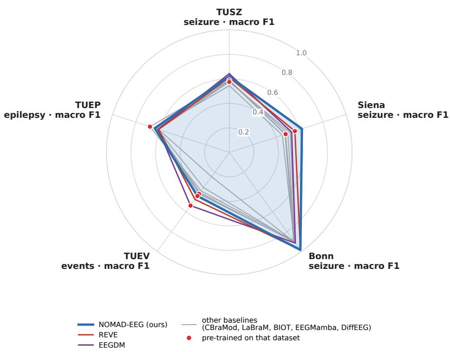  
Fig. 5 Summary of the epilepsy tasks. Macro F1 of the frozen linear probe of every model on seizure detection (TUSZ, Siena, Bonn), epileptiform event classification (TUEV, mean of the six per-class F1 values) and epilepsy diagnosis (TUEP, patient level). Macro F1 is shown because it measures decisions at the classifier’s threshold, which in seizure detection determines the false alarms; the primary metric of each dataset is given in its table. Red dots: the model’s pre-training data contained that dataset (Section 2.8); LaBraM’s TUEP value is shown for completeness although it is excluded from Table 7 for that reason. Values come from the same probes as Tables 5 to 9; the TUEV macro F1 is computed from the per-class F1 values of those predictions.

On TUEP all seven compared models separate the two groups above chance from frozen features (Table 7). NOMAD-EEG has the highest patient-level accuracy (0.640) and F1 (0.638). Only EEGMamba, pre-trained on the TUH corpus that contains TUEP, has a higher AUROC (0.694 against 0.679) and PR-AUC, and no model is significantly better than NOMAD-EEG on either (paired difference with EEGMamba, 95% CI [−0.083, 0.047]). Among the four models pre-trained neither on TUEP nor on the full TUH corpus (NOMAD-EEG, EEGDM, BIOT and DiffEEG), NOMAD-EEG is best on every metric.

Table 4: TUAB abnormal-EEG detection (5 s windows; 50,000 test windows), frozen linear probe. Brackets: 95% bootstrap CI. TUAB’s training split was in BIOT’s pre-training data, and CBraMod and EEGMamba were pre-trained on the TUH corpus it is drawn from (Section 2.8). The indented row is NOMAD-EEG fine-tuned end to end (not part of the bold comparison); its epoch was selected on the benchmark’s validation windows, which come from the training patients (Section 2.9).
<table><tr><td>Model</td><td>Dim</td><td>AUROC</td><td>PR-AUC</td><td>Bal. acc.</td><td>Macro F1</td></tr><tr><td>NOMAD-EEG (ours) fine-tuned</td><td>10,240</td><td>0.838 [0.834, 0.842]</td><td>0.820 0.785</td><td>0.770</td><td>0.771</td></tr><tr><td></td><td>一</td><td>0.833 [0.830, 0.837]</td><td></td><td>0.770</td><td>0.771</td></tr><tr><td>EEGDM [9]</td><td>2,560</td><td>0.869 [0.865, 0.872]</td><td>0.862 0.880</td><td>0.792</td><td>0.792</td></tr><tr><td>REVE [12]</td><td>512 200</td><td>0.870 [0.867, 0.873] 0.808 [0.804, 0.812]</td><td>0.803</td><td>0.800</td><td>0.802</td></tr><tr><td>CBraMod [5] LaBraM [2]</td><td>200</td><td>0.788 [0.784, 0.792]</td><td>0.785</td><td>0.738 0.713</td><td>0.739 0.714</td></tr><tr><td>BIOT [4]</td><td>256</td><td>0.847 [0.844, 0.850]</td><td>0.849</td><td>0.771</td><td>0.772</td></tr><tr><td>EEGMamba [6]</td><td>200</td><td>0.746 [0.742, 0.750]</td><td>0.726</td><td>0.689</td><td>0.690</td></tr><tr><td>DiffEEG [8]</td><td>2,400</td><td>0.760 [0.756, 0.764]</td><td>0.718</td><td>0.695</td><td>0.696</td></tr></table>

Table 5: TUSZ seizure detection (5 s windows; 50,000 test windows at the true seizure prevalence), frozen linear probe. TUSZ was in LaBraM’s and DiffEEG’s pre-training data, and REVE, CBraMod and EEGMamba were pre-trained on the TUH corpus it is drawn from (Section 2.8). The indented row is NOMAD-EEG fine-tuned end to end (not part of the bold comparison); its epoch was selected on the benchmark’s validation windows, which come from the training patients (Section 2.9).
<table><tr><td>Model</td><td>Dim</td><td>AUROC</td><td>PR-AUC</td><td>Bal. acc.</td><td>Macro F1</td></tr><tr><td>NOMAD-EEG (ours)</td><td>10,240</td><td>0.866 [0.860, 0.873]</td><td>0.446</td><td>0.787</td><td>0.620</td></tr><tr><td>fine-tuned</td><td>一</td><td>0.854 [0.847, 0.860]</td><td>0.345</td><td>0.773</td><td>0.676</td></tr><tr><td>EEGDM [9]</td><td>2,560</td><td>0.874 [0.866, 0.881]</td><td>0.527</td><td>0.801</td><td>0.642</td></tr><tr><td>REVE [12]</td><td>512</td><td>0.879 [0.873, 0.886]</td><td>0.463</td><td>0.798</td><td>0.611</td></tr><tr><td>CBraMod [5]</td><td>200</td><td>0.855 [0.847, 0.862]</td><td>0.455</td><td>0.776</td><td>0.586</td></tr><tr><td>LaBraM [2]</td><td>200</td><td>0.845 [0.837, 0.851]</td><td>0.416</td><td>0.765</td><td>0.589</td></tr><tr><td>BIOT [4] EEGMamba [6]</td><td>256 200</td><td>0.760 [0.752, 0.768] 0.836 [0.829, 0.843]</td><td>0.279 0.308</td><td>0.691</td><td>0.544</td></tr><tr><td></td><td>2,400</td><td></td><td>0.301</td><td>0.763</td><td>0.585</td></tr><tr><td>DiffEEG [8]</td><td></td><td>0.813 [0.804, 0.820]</td><td></td><td>0.745</td><td>0.575</td></tr></table>

## 3.3 Seizure detection on external corpora (Siena, Bonn)

On Siena, where seizures make up 0.6% of training windows, NOMAD-EEG has the highest macro F1 (0.622, with a CI that excludes every other model), accuracy (0.979) and weighted F1 (0.984). EEGDM ranks seizures best by AUROC (0.915) and REVE has the highest PR-AUC (Table 8). Bonn is close to saturated: NOMAD-EEG and REVE both reach an AUROC of about 0.998–0.999 and all confidence intervals overlap (Table 9). Fed the single signal-carrying electrode alone, rather than a 22-channel frame, NOMAD-EEG still reaches an AUROC of 0.995.

Table 6: TUEV event classification (6 classes; 29,421 test events; in the pre-training data of NOMAD-EEG, EEGDM and BIOT, and in the TUH corpus on which CBraMod and EEGMamba were pre-trained, Section 2.8), frozen linear probe with 5-fold subject-grouped cross-validation. The indented row is NOMAD-EEG fine-tuned end to end; bold marks the best value in each column including this row, although the baselines were evaluated only as frozen probes.
<table><tr><td>Model</td><td>Dim</td><td>Bal. acc.</td><td>Cohen κ</td><td>Weighted F1</td></tr><tr><td rowspan="2">NOMAD-EEG (ours) fine-tuned</td><td rowspan="2">10,240</td><td rowspan="2">0.542 [0.529, 0.554]</td><td rowspan="2">0.465</td><td rowspan="2">0.719 0.814</td></tr><tr><td>0.597 [0.588, 0.605] 0.635</td></tr><tr><td>EEGDM [9]</td><td>2,560</td><td>0.647 [0.638, 0.657]</td><td>0.568</td><td>0.783</td></tr><tr><td>REVE [12]</td><td>512</td><td>0.565 [0.553, 0.577]</td><td>0.515</td><td>0.753</td></tr><tr><td>CBraMod [5]</td><td>200</td><td>0.466 [0.455, 0.477]</td><td>0.346</td><td>0.635</td></tr><tr><td>LaBraM [2]</td><td>200</td><td>0.521 [0.510, 0.534]</td><td>0.365</td><td>0.633</td></tr><tr><td>BIOT [4]</td><td>256</td><td>0.519 [0.507, 0.530]</td><td>0.428</td><td>0.698</td></tr><tr><td>EEGMamba [6]</td><td>200</td><td>0.520 [0.509, 0.530]</td><td>0.374</td><td>0.664</td></tr><tr><td>DiffEEG [8]</td><td>2,400</td><td>0.329 [0.318, 0.340]</td><td>0.179</td><td>0.503</td></tr></table>

Table 7: TUEP epilepsy diagnosis (200 patients, 100 with and 100 without epilepsy; 19 electrodes, 60 random 5 s windows per patient), frozen encoders and a linear probe evaluated on unseen patients (5-fold cross-validation stratified by diagnosis, identical folds for every model). A patient’s score is the mean probability of their windows. Brackets: 95% CI from 1,000 bootstrap resamples of patients; accuracy and F1 at a 0.5 threshold. LaBraM is not included because TUEP was part of its pre-training data (under the same protocol its patient-level AUROC is 0.741 and accuracy 0.680). ‡The model was pre-trained on the TUH corpus from which TUEP is drawn (Section 2.8). Bold: best among the models whose pre-training did not include TUEP recordings (no mark); underlined: best overall.
<table><tr><td>Model</td><td>Dim</td><td>AUROC</td><td>PR-AUC</td><td>Accuracy</td><td>Weighted F1</td><td>Macro F1</td></tr><tr><td>NOMAD-EEG (ours)</td><td>10,240</td><td>0.679 [0.607, 0.751]</td><td>0.675</td><td>0.640</td><td>0.638</td><td>0.638</td></tr><tr><td>EEGDM [9]</td><td>2,560</td><td>0.673 [0.599, 0.745]</td><td>0.638</td><td>0.610</td><td>0.609</td><td>0.609</td></tr><tr><td>REVE [12]</td><td>512</td><td>0.671 [0.596, 0.748]</td><td>0.674</td><td>0.605</td><td>0.605</td><td>0.605</td></tr><tr><td>CBraMod [5]‡</td><td>200</td><td>0.671 [0.591, 0.745]</td><td>0.667</td><td>0.615</td><td>0.615</td><td>0.615</td></tr><tr><td>BIOT [4]</td><td>256</td><td>0.675 [0.605, 0.748]</td><td>0.633</td><td>0.630</td><td>0.630</td><td>0.630</td></tr><tr><td>EEGMamba [6]</td><td>200</td><td>0.694 [0.619, 0.766]</td><td>0.701</td><td>0.625</td><td>0.625</td><td>0.625</td></tr><tr><td>DiffEEG [8]</td><td>2,400</td><td>0.622 [0.542, 0.702]</td><td>0.603</td><td>0.605</td><td>0.605</td><td>0.605</td></tr></table>

## 3.4 New montages and tasks (Mumtaz, EEGMMIDB, Sleep-EDF, SEED-V)

On EEGMMIDB, the 64-electrode motor-imagery benchmark in which 45 of the electrode positions were never seen in NOMAD-EEG’s pre-training, NOMAD-EEG is the best frozen model on all three metrics (balanced accuracy 0.442, chance 0.25; Table 11); the second-best model, DiffEEG (0.418), has an overlapping CI, and NOMAD-EEG’s CI excludes REVE (0.371) and every model below it. On Sleep-EDF, with two bipolar channels and 30 s epochs, NOMAD-EEG is third by balanced accuracy (0.757), level with REVE (0.760) and behind EEGDM (0.779), and second by Cohen’s κ (Table 12). On Mumtaz NOMAD-EEG is third by AUROC (0.942)

Table 8: Siena seizure detection (external to NOMAD-EEG; 18,729 test windows, 0.6% seizure in training), frozen linear probe. Siena recordings were in REVE’s, LaBraM’s and EEGMamba’s pretraining data (Section 2.8).
<table><tr><td>Model</td><td>Dim</td><td>AUROC</td><td>PR-AUC</td><td>Accuracy</td><td>Weighted F1</td><td>Macro F1</td></tr><tr><td>NOMAD-EEG (ours)</td><td>10,240</td><td>0.882 [0.847, 0.914]</td><td>0.306</td><td>0.979</td><td>0.984</td><td>0.622</td></tr><tr><td>EEGDM [9]</td><td>2,560</td><td>0.915 [0.889, 0.938]</td><td>0.248</td><td>0.916</td><td>0.950</td><td>0.534</td></tr><tr><td>REVE [12]</td><td>512</td><td>0.906 [0.872, 0.937]</td><td>0.460</td><td>0.946</td><td>0.966</td><td>0.562</td></tr><tr><td>CBraMod [5]</td><td>200</td><td>0.850 [0.806, 0.888]</td><td>0.189</td><td>0.872</td><td>0.925</td><td>0.502</td></tr><tr><td>LaBraM [2]</td><td>200</td><td>0.797 [0.756, 0.836]</td><td>0.056</td><td>0.833</td><td>0.903</td><td>0.478</td></tr><tr><td>BIOT [4]</td><td>256</td><td>0.707 [0.657, 0.755]</td><td>0.020</td><td>0.780</td><td>0.870</td><td>0.455</td></tr><tr><td>EEGMamba [6]</td><td>200</td><td>0.855 [0.812, 0.893]</td><td>0.252</td><td>0.828</td><td>0.899</td><td>0.482</td></tr><tr><td>DiffEEG [8]</td><td>2,400</td><td>0.777 [0.724, 0.827]</td><td>0.057</td><td>0.921</td><td>0.952</td><td>0.522</td></tr></table>

Table 9: Bonn seizure detection (external; single-channel recordings; 100 test segments), frozen linear probe. All models read the recording in a 22-channel frame; the indented row feeds NOMAD-EEG the one signal-carrying electrode alone.
<table><tr><td>Model</td><td>Dim</td><td>AUROC</td><td>PR-AUC</td><td>Bal. acc.</td><td>Macro F1</td></tr><tr><td>NOMAD-EEG (ours)</td><td>10,240</td><td>0.999 [0.996, 1.000]</td><td>0.998</td><td>0.994</td><td>0.985</td></tr><tr><td>single electrode only</td><td>10,240</td><td>0.995 [0.981, 1.000]</td><td>0.983</td><td>0.944</td><td>0.913</td></tr><tr><td>EEGDM [9]</td><td>2,560</td><td>0.994 [0.982, 1.000]</td><td>0.975</td><td>0.963</td><td>0.915</td></tr><tr><td>REVE [12]</td><td>512</td><td>0.998 [0.991, 1.000]</td><td>0.992</td><td>0.994</td><td>0.985</td></tr><tr><td>CBraMod [5]</td><td>200</td><td>0.996 [0.986, 1.000]</td><td>0.985</td><td>0.956</td><td>0.903</td></tr><tr><td>LaBraM [2]</td><td>200</td><td>0.995 [0.983, 1.000]</td><td>0.982</td><td>0.950</td><td>0.890</td></tr><tr><td>BIOT [4]</td><td>256</td><td>0.979 [0.943, 1.000]</td><td>0.949</td><td>0.938</td><td>0.900</td></tr><tr><td>EEGMamba [6]</td><td>200</td><td>0.948 [0.867, 1.000]</td><td>0.919</td><td>0.906</td><td>0.906</td></tr><tr><td>DiffEEG [8]</td><td>2,400</td><td>0.982 [0.954, 0.999]</td><td>0.937</td><td>0.944</td><td>0.913</td></tr></table>

behind REVE and EEGDM, with overlapping CIs (Table 10). Fine-tuning does not improve on the frozen probe on Mumtaz (0.821 against 0.832 balanced accuracy) or Sleep-EDF (0.758 against 0.757), whereas on EEGMMIDB it does (0.596 against 0.442). On SEED-V, five-class emotion recognition from 59 electrodes in 1 s windows evaluated for NOMAD-EEG alone, the frozen probe reaches a balanced accuracy of 0.315 (chance 0.20) and κ 0.136, and fine-tuning raises them to 0.384 and 0.231 (Table 13).

## 3.5 Transfer to unseen populations

NOMAD-EEG is the best of the five models on every BCIAUT-P300 metric (Table 14). It reaches an AUROC of 0.718 and selects the attended object in 75.5% of blocks after ten runs, against 61.2% for EEGDM and 57.5% for REVE. The advantage holds within subjects: its per-subject AUROC exceeds REVE’s in all 15 subjects and EEGDM’s in 13. BIOT and DiffEEG are close to chance.

All five models detect Parkinson’s disease above chance from frozen features, but here

Table 10: Mumtaz depression vs. healthy (external; 19 electrodes, 5 s windows; 1,179 test windows from 10 held-out subjects), frozen linear probe. The indented row is NOMAD-EEG fine-tuned end to end (no baseline was fine-tuned).
<table><tr><td>Model</td><td>Dim</td><td>AUROC</td><td>PR-AUC</td><td>Bal. acc.</td><td>Macro F1</td></tr><tr><td>NOMAD-EEG (ours) fine-tuned</td><td>10,240</td><td>0.942 [0.929, 0.954]</td><td>0.951 0.792</td><td>0.832</td><td>0.831</td></tr><tr><td></td><td>一</td><td>0.872 [0.851, 0.893]</td><td></td><td>0.821</td><td>0.821</td></tr><tr><td>EEGDM [9] REVE [12]</td><td>2,560 512</td><td>0.946 [0.935, 0.958] 0.960 [0.951, 0.968]</td><td>0.945 0.962</td><td>0.857 0.842</td><td>0.856 0.841</td></tr><tr><td>CBraMod [5]</td><td>200</td><td>0.860 [0.838, 0.883]</td><td>0.810</td><td>0.804</td><td>0.803</td></tr><tr><td>LaBraM [2]</td><td>200</td><td>0.904 [0.887, 0.922]</td><td>0.886</td><td>0.838</td><td>0.837</td></tr><tr><td>BIOT [4]</td><td>256</td><td>0.928 [0.912, 0.942]</td><td>0.910</td><td>0.829</td><td>0.829</td></tr><tr><td>EEGMamba [6]</td><td>200</td><td>0.867 [0.845, 0.887]</td><td>0.843</td><td>0.810</td><td>0.809</td></tr><tr><td>DiffEEG [8]</td><td>2,400</td><td>0.901 [0.883, 0.918]</td><td>0.889</td><td>0.807</td><td>0.806</td></tr><tr><td></td><td></td><td></td><td></td><td></td><td></td></tr></table>

Table 11: EEGMMIDB motor imagery (external to NOMAD-EEG; 4 classes, 64 electrodes, 4 s trials; 1,803 test trials from 20 held-out subjects), frozen linear probe. EEGMMIDB was in LaBraM’s pretraining data (Section 2.8). The indented row is NOMAD-EEG fine-tuned end to end.
<table><tr><td>Model</td><td>Dim</td><td>Bal. acc.</td><td>Cohen κ</td><td>Weighted F1</td></tr><tr><td rowspan="2">NOMAD-EEG (ours) fine-tuned</td><td rowspan="2">10,240</td><td rowspan="2">0.442 [0.419, 0.463] 0.596 [0.574, 0.618]</td><td rowspan="2">0.256</td><td rowspan="2">0.442 0.599</td></tr><tr><td>0.461</td></tr><tr><td>EEGDM [9]</td><td>2,560</td><td>0.347 [0.325, 0.367]</td><td>0.130</td><td>0.338</td></tr><tr><td>REVE [12]</td><td>512</td><td>0.371 [0.348, 0.393]</td><td>0.161</td><td>0.370</td></tr><tr><td>CBraMod [5]</td><td>200</td><td>0.308 [0.287, 0.330]</td><td>0.078</td><td>0.306</td></tr><tr><td>LaBraM [2]</td><td>200</td><td>0.302 [0.280, 0.324]</td><td>0.070</td><td>0.301</td></tr><tr><td>BIOT [4]</td><td>256</td><td>0.274 [0.255, 0.294]</td><td>0.032</td><td>0.269</td></tr><tr><td>EEGMamba [6]</td><td>200</td><td>0.304 [0.283, 0.324]</td><td>0.073</td><td>0.303</td></tr><tr><td>DiffEEG [8]</td><td>2,400</td><td>0.418 [0.395, 0.439]</td><td>0.224</td><td>0.417</td></tr></table>

Table 12: Sleep-EDF-20 sleep staging (external; 5 stages, 2 bipolar channels, 30 s epochs; 9,137 test epochs from 4 held-out subjects), frozen linear probe. The indented row is NOMAD-EEG fine-tuned end to end.
<table><tr><td>Model</td><td>Dim</td><td>Bal. acc.</td><td>Cohen κ</td><td>Weighted F1</td></tr><tr><td rowspan="2">NOMAD-EEG (ours) fine-tuned</td><td rowspan="2">10,240</td><td rowspan="2">0.757 [0.748, 0.766]</td><td rowspan="2">0.680 0.694</td><td rowspan="2">0.770 0.784</td></tr><tr><td>0.758 [0.748, 0.768]</td></tr><tr><td>EEGDM [9]</td><td>2,560</td><td>0.779 [0.770, 0.788]</td><td>0.718</td><td>0.802</td></tr><tr><td>REVE [12]</td><td>512</td><td>0.760 [0.750, 0.770]</td><td>0.675</td><td>0.771</td></tr><tr><td>CBraMod [5]</td><td>200</td><td>0.725 [0.715, 0.735]</td><td>0.639</td><td>0.743</td></tr><tr><td>LaBraM [2]</td><td>200</td><td>0.738 [0.729, 0.747]</td><td>0.676</td><td>0.770</td></tr><tr><td>BIOT [4]</td><td>256</td><td>0.741 [0.731, 0.750]</td><td>0.659</td><td>0.761</td></tr><tr><td>EEGMamba [6]</td><td>200</td><td>0.722 [0.712, 0.732]</td><td>0.601</td><td>0.717</td></tr><tr><td>DiffEEG [8]</td><td>2,400</td><td>0.715 [0.704, 0.725]</td><td>0.628</td><td>0.737</td></tr></table>

Table 13: SEED-V emotion recognition (external; 5 emotions, 59 electrodes, 1 s windows; within every session film clips 1–5 train, 6–10 validation, 11–15 test, all 16 subjects in every split), NOMAD-EEG only. Chance balanced accuracy is 0.20.
<table><tr><td>NOMAD-EEG</td><td>Bal. acc.</td><td>Cohen κ</td><td>Weighted F1</td></tr><tr><td>frozen linear probe</td><td>0.315 [0.310, 0.319]</td><td>0.136</td><td>0.302</td></tr><tr><td>fine-tuned</td><td>0.384 [0.380, 0.389]</td><td>0.231</td><td>0.392</td></tr></table>

Table 14: P300 detection on BCIAUT-P300 (15 participants with ASD, 168,000 epochs, 12.5% targets). Encoders are frozen and never trained on this corpus; a linear probe is evaluated on subjects it never saw (five folds of three subjects). Brackets: 95% CI from a bootstrap over subjects. “Object acc.” is the rate at which the attended object among eight is selected from the first 1, 3 or 10 runs of a block (chance 12.5%).
<table><tr><td>Model</td><td>Channels read</td><td>AUROC</td><td>Bal. acc.</td><td>PR-AUC</td><td>Object acc. (1/3/10 runs)</td><td>Per-subject AUROC range</td></tr><tr><td>NOMAD-EEG</td><td>8</td><td>0.718 [0.695, 0.739]</td><td>0.660</td><td>0.289</td><td>32.6 / 51.5 / 75.5%</td><td>0.652-0.805</td></tr><tr><td>EEGDM</td><td>4 bipolar</td><td>0.667 [0.631, 0.699]</td><td>0.624</td><td>0.227</td><td>27.8 / 42.4 / 61.2%</td><td>0.540-0.805</td></tr><tr><td>REVE</td><td>8</td><td>0.651 [0.626, 0.675]</td><td>0.612</td><td>0.209</td><td>24.6 / 37.9 / 57.5%</td><td>0.563-0.752</td></tr><tr><td>BIOT</td><td>2 bipolar</td><td>0.530 [0.521, 0.539]</td><td>0.520</td><td>0.136</td><td>14.5 / 17.2 / 21.8%</td><td>0.503-0.571</td></tr><tr><td>DiffEEG</td><td>6</td><td>0.522 [0.508, 0.534]</td><td>0.517</td><td>0.133</td><td>13.9 / 15.1 / 19.4%</td><td>0.457-0.556</td></tr></table>

NOMAD-EEG is not the best (Table 15). EEGDM reaches a participant-level AUROC of 0.795 [0.714, 0.868], significantly above NOMAD-EEG’s 0.684 [0.590, 0.777] (paired difference −0.111, 95% CI [−0.203, −0.012]); NOMAD-EEG is level with BIOT, DiffEEG and REVE, whose intervals overlap its own. NOMAD-EEG’s selected C ranged from $1 0 ^ { - 4 }$ to 10 across folds.

Table 15: Parkinson’s disease vs. control (OpenNeuro ds004584; 149 participants, 100 PD / 49 controls; 60 electrodes, 5 s windows), frozen encoders and a linear probe evaluated on unseen participants (5-fold cross-validation stratified by group, identical folds for every model). A participant’s score is the mean probability of their windows. Brackets: 95% CI from 1,000 bootstrap resamples of participants.
<table><tr><td>Model</td><td>Window AUROC</td><td>Participant AUROC</td><td>Participant bal. acc.</td></tr><tr><td>NOMAD-EEG (ours)</td><td>0.679 [0.609, 0.754]</td><td>0.684 [0.590, 0.777]</td><td>0.620 [0.542, 0.706]</td></tr><tr><td>EEGDM [9]</td><td>0.783 [0.709, 0.845]</td><td>0.795 [0.714, 0.868]</td><td>0.702 [0.618, 0.782]</td></tr><tr><td>REVE [12]</td><td>0.653 [0.571, 0.733]</td><td>0.643 [0.547, 0.740]</td><td>0.626 [0.543, 0.705]</td></tr><tr><td>BIOT [4]</td><td>0.659 [0.583, 0.730]</td><td>0.681 [0.593, 0.771]</td><td>0.672 [0.593, 0.748]</td></tr><tr><td>DiffEEG [8]</td><td>0.634 [0.585, 0.683]</td><td>0.713 [0.623, 0.794]</td><td>0.672 [0.587, 0.751]</td></tr></table>

## 3.6 Ablations

Pre-trained against random weights. Pre-training improves balanced accuracy on TUEV by 0.107 as a frozen probe and by 0.132 after fine-tuning, improves TUAB AUROC by 0.040, and improves Siena macro F1 by 0.071, all with non-overlapping confidence intervals (Table 16). On Siena the gain is in precision at the decision threshold (macro F1; PR-AUC is also higher, but its CIs overlap) and not in ranking: AUROC is unchanged. On Mumtaz, fine-tuning from random weights matches fine-tuning from the pre-trained model, and Bonn is saturated for both.

Table 16: Effect of pre-training: NOMAD-EEG with its pre-trained weights versus the same architecture with random weights, under the identical feature extraction and protocol. Brackets: 95% bootstrap CI. ∆ in bold where the two CIs do not overlap.
<table><tr><td>Dataset</td><td>Setting</td><td>Metric</td><td>Pre-trained</td><td>Random init.</td><td>∆</td></tr><tr><td>TUEV</td><td>linear probe</td><td>Bal. acc.</td><td>0.542 [0.529, 0.554]</td><td>0.434 [0.422, 0.446]</td><td>+0.107</td></tr><tr><td>TUEV</td><td>fine-tuned</td><td>Bal. acc.</td><td>0.597 [0.588, 0.605]</td><td>0.465 [0.455, 0.474]</td><td>+0.132</td></tr><tr><td>TUAB</td><td>linear probe</td><td>AUROC</td><td>0.838 [0.834, 0.842]</td><td>0.798 [0.794, 0.801]</td><td>+0.040</td></tr><tr><td>Siena</td><td>linear probe</td><td>AUROC</td><td>0.882 [0.847, 0.914]</td><td>0.892 [0.858, 0.924]</td><td>-0.010</td></tr><tr><td>Siena</td><td>linear probe</td><td>Macro F1</td><td>0.622 [0.596, 0.646]</td><td>0.551 [0.538, 0.563]</td><td>+0.071</td></tr><tr><td>Siena</td><td>linear probe</td><td>PR-AUC</td><td>0.306 [0.221, 0.392]</td><td>0.192 [0.134, 0.262]</td><td>+0.114</td></tr><tr><td>Bonn</td><td>linear probe</td><td>AUROC</td><td>0.999 [0.996, 1.000]</td><td>0.997 [0.987, 1.000]</td><td>+0.003</td></tr><tr><td>Mumtaz</td><td>fine-tuned</td><td>Bal. acc.</td><td>0.821 [0.798, 0.844]</td><td>0.828 [0.807, 0.851]</td><td>-0.007</td></tr></table>

Diffusion against flow matching. Diffusion is better on four datasets (TUEV, TUAB, Siena macro F1 and Sleep-EDF), flow is better on one (TUSZ balanced accuracy, by 0.011), and the remaining comparisons show no difference (Table 17). The largest gaps favour diffusion: 0.086 macro F1 on Siena, 0.055 balanced accuracy on TUEV and 0.041 on Sleep-EDF.

Table 17: Diffusion versus flow matching. Both models share architecture, data, number of steps, optimiser and feature extraction; only the objective differs. Frozen linear probe on each dataset; “Flow diffusion” is the paired difference on the same test samples with a 95% CI from 2,000 paired bootstrap resamples.
<table><tr><td>Dataset</td><td>Metric</td><td>Diffusion</td><td>Flow</td><td>Flow — diffusion</td></tr><tr><td>TUEV</td><td>Bal. acc.</td><td>0.542</td><td>0.486</td><td>-0.055 [-0.067, -0.044]</td></tr><tr><td>TUAB</td><td>AUROC</td><td>0.838</td><td>0.827</td><td>-0.011 [-0.013, -0.008]</td></tr><tr><td>TUAB</td><td>Bal. acc.</td><td>0.770</td><td>0.762</td><td>-0.008 [-0.011, -0.004]</td></tr><tr><td>TUSZ</td><td>AUROC</td><td>0.866</td><td>0.870</td><td>+0.004 [-0.002, 0.010]</td></tr><tr><td>TUSZ</td><td>Bal. acc.</td><td>0.787</td><td>0.798</td><td>+0.011 [0.003, 0.018]</td></tr><tr><td>Siena</td><td>AUROC</td><td>0.882</td><td>0.866</td><td>-0.016 [-0.037, 0.004]</td></tr><tr><td>Siena</td><td>Macro F1</td><td>0.622</td><td>0.536</td><td>-0.086 [-0.103, -0.068]</td></tr><tr><td>Bonn</td><td>AUROC</td><td>0.999</td><td>0.996</td><td>-0.003 [-0.010, 0.000]</td></tr><tr><td>Mumtaz</td><td>Bal. acc.</td><td>0.832</td><td>0.830</td><td>-0.002 [-0.007, 0.003]</td></tr><tr><td>EEGMMIDB</td><td>Bal. acc.</td><td>0.442</td><td>0.422</td><td>-0.020 [-0.045, 0.006]</td></tr><tr><td>Sleep-EDF</td><td>Bal. acc.</td><td>0.757</td><td>0.716</td><td>-0.041 [-0.050, -0.033]</td></tr></table>

Electrode order and missing electrodes. With the Mumtaz electrodes listed in five random orders, every gate activation equals the original with its rows permuted (largest relative difference $5 . 6 \times 1 0 ^ { - 6 }$ , floating-point rounding), and no test prediction changes. Shuffling the positions while leaving the signals in place changes 17.5% of the predictions and lowers AU-ROC from 0.942 to 0.909. With electrodes removed (Fig. 6), the mean AUROC falls from 0.942 with all electrodes to 0.919 with 14, 0.919 with 10 and 0.891 with 5, and no subset falls below 0.877. Balanced accuracy at the probe’s fixed threshold degrades more: it stays at 0.826 on average with 14 electrodes but falls to 0.774 with 10 and 0.696 with 5, and to chance (0.501) for one five-electrode subset (Fp1, F7, T5, Fz, Pz) whose AUROC is still 0.877.

(a) Which electrodes the model received  
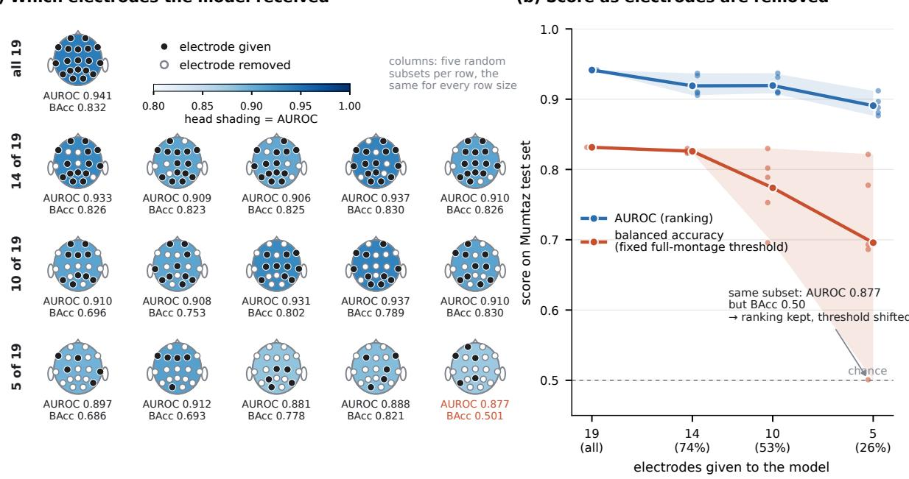  
Fig. 6 Missing-electrode test on Mumtaz (1,179 test windows). The linear probe is trained once on the full montage and applied unchanged. (a) Each scalp shows one test condition: filled dots are the electrodes given to the model, hollow dots those removed; the shading and the label give the AUROC, and BAcc is the balanced accuracy at the probe’s threshold. Rows: 19, 14, 10 and 5 electrodes; columns: five random subsets per size. (b) The same results against the number of electrodes given: dots are individual subsets, lines the mean, bands the range over subsets. AUROC stays high as electrodes are removed, while balanced accuracy drops because the scores shift relative to the threshold fitted on the full montage.

## 3.7 Scaling model size and pre-training data

Table 18 compares the two models on all ten benchmarks with each dataset’s primary metric. After 1.9 epochs, no Large interval lies above Base’s, so NOMAD-EEG-Large is not significantly better than Base on any dataset; its point estimate is higher on Bonn and TUEP (below). Its interval lies entirely below Base’s on EEGMMIDB (balanced accuracy 0.361 against 0.442), Sleep-EDF (0.724 against 0.757) and SEED-V (0.301 against 0.315). It is lower, with intervals that overlap or just touch, on TUSZ (AUROC 0.856 against 0.866), Siena (0.867 against 0.882) and Mumtaz (0.913 against 0.942). It is level on Bonn (1.000 against 0.999), TUAB (0.837 against 0.838), TUEV (balanced accuracy 0.542 against 0.542) and TUEP (patient AU-

ROC 0.694 against 0.679; paired difference 95% CI [−0.061, 0.031]). The highest Large value relative to Base is TUSZ after 1.0 epoch (AUROC 0.878 against 0.866, overlapping intervals), which fell below Base by 1.9 epochs. Between the two checkpoints Large improved on TUEV (0.450 to 0.542), EEGMMIDB (0.326 to 0.361), TUEP (0.658 to 0.694) and TUAB (0.828 to 0.837), and changed little elsewhere.

Table 18: Scaling model size and pre-training data together: NOMAD-EEG (Base, 12.0 M parameters, 147 h of TUEV) against NOMAD-EEG-Large (67.6 M parameters, 6,984 h from seven corpora) at two points of its pre-training, under the identical frozen linear probe and splits used for every other table. Each dataset’s primary metric with its 95% bootstrap CI; bold marks the best value in each row. ↓/↑: the Large CI lies entirely below/above Base’s (non-overlapping intervals, not a paired test). In Large pre-training: whether that dataset’s recordings were in Large’s unlabelled pre-training data. p patient level. b TUEV is also Base’s whole pre-training corpus.
<table><tr><td>Dataset</td><td>Metric</td><td>In Large pre-training</td><td>Base</td><td>Large step 27,000</td><td>Large step 51,000</td></tr><tr><td>Bonn</td><td>AUROC</td><td>no</td><td>0.999 [0.996, 1.000]</td><td>0.999 [0.994, 1.000]</td><td>1.000 [1.000, 1.000]</td></tr><tr><td>TUSZ</td><td>AUROC</td><td></td><td>training patients 0.866 [0.860, 0.873]</td><td>0.878 [0.872, 0.884]</td><td>0.856 [0.849, 0.862]</td></tr><tr><td>TUAB</td><td>AUROC</td><td></td><td>training patients 0.838 [0.834, 0.842]</td><td>0.828↓[0.824, 0.831]</td><td>0.837 [0.834, 0.841]</td></tr><tr><td>Siena</td><td>AUROC</td><td>no</td><td>0.882 [0.847, 0.914]</td><td>0.867 [0.822, 0.906]</td><td>0.867 [0.823, 0.907]</td></tr><tr><td>Mumtaz</td><td>AUROC</td><td>no</td><td>0.942 [0.929, 0.954]</td><td>0.913↓ [0.895, 0.929]</td><td>0.913 [0.894, 0.929]</td></tr><tr><td>TUEP</td><td>AUROCP</td><td>yes, all</td><td>0.679 [0.607, 0.751]</td><td>0.658 [0.583, 0.739]</td><td>0.694 [0.624, 0.766]</td></tr><tr><td>TUEV</td><td>BAcc</td><td>yes, allb</td><td>0.542 [0.529, 0.554]</td><td>0.450↓[0.437, 0.461]</td><td>0.542 [0.529, 0.554]</td></tr><tr><td>EEGMMIDB</td><td>BAcc</td><td>no</td><td>0.442 [0.419, 0.463]</td><td>0.326↓[0.303, 0.349]</td><td>0.361↓[0.337, 0.383]</td></tr><tr><td>Sleep-EDF</td><td>BAcc</td><td>other subjects</td><td>0.757 [0.748, 0.766]</td><td>0.721↓[0.711, 0.732]</td><td>0.724↓[0.714, 0.733]</td></tr><tr><td>SEED-V</td><td>BAcc</td><td>yes, all</td><td>0.315 [0.310, 0.319]</td><td></td><td>0.296↓ [0.291, 0.300] 0.301↓[0.297, 0.306]</td></tr></table>

## 3.8 Model interpretation

In the seizure segment the evidence for seizure concentrates on the sharp, high-amplitude discharges, and its time course peaks where they occur; in the normal segment there is almost no evidence anywhere (Fig. 7).

## 4 Discussion

## 4.1 Principal findings

NOMAD-EEG was designed to read any montage and any recording length with one set of weights, and the experiments test that design rather than a single benchmark. The same 12.0 M-parameter model, without any architectural change, read one electrode (Bonn), two bipolar derivations (Sleep-EDF), eight (BCIAUT-P300), 19 (Mumtaz), 21 (TUH corpora) and 64 electrodes (EEGMMIDB), and segments from 1.4 s to 30 s. Across eight benchmarks it ranks never below fourth among eight foundation models, which places a model pre-trained on 147 h

Where NOMAD-EEG finds evidence of a seizure (TUSZ test set, frozen model + linear probe) shading: positive Integrated-Gradients attribution per electrode and 0.25 s; same colour and amplitude scale in both panels

Normal segment: model's seizure probability 0.07  
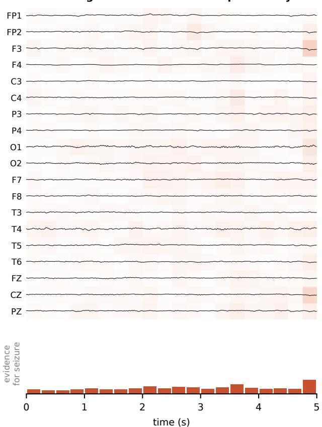

Seizure segment: model's seizure probability 1.00  
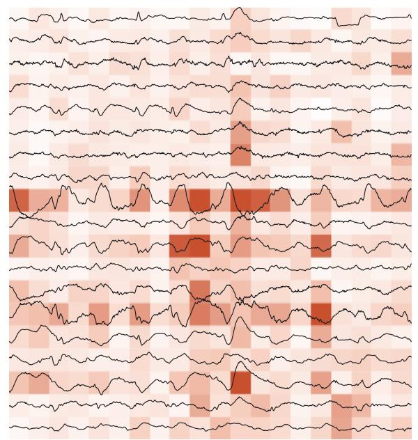

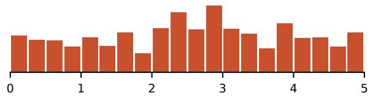  
time (s)  
Fig. 7 Where NOMAD-EEG finds evidence of a seizure. Two 5 s segments from the TUSZ test set, scored by the frozen NOMAD-EEG with the TUSZ linear probe of Table 5. The segments were chosen by a rule fixed in advance: a random (seeded) test window labelled seizure that the model classifies with probability above 0.9, and a random normal window classified with probability below 0.1, i.e. typical correct decisions rather than hand-picked ones. Shading behind each trace: positive Integrated-Gradients attribution (evidence for seizure) per electrode and 0.25 s; bottom: its sum over electrodes. Both panels share the colour and amplitude scales. The figure illustrates single decisions and is not a quantitative test of seizure localisation.

of EEG among models trained on far more data: REVE-base has 69 M parameters and was pre-trained on about 60,000 h. It is the best model where the montage departs most from its pre-training: on EEGMMIDB, where most electrode positions are new to it (and which LaBraM saw in pre-training, Section 2.8), and on BCIAUT-P300, a new population, task and eightelectrode montage, where it detects the attended object in 75.5% of blocks against 61.2% for the next-best model. We read this as evidence that identifying electrodes by position in every block, rather than by name or slot, transfers to unseen layouts. Reading the single Bonn electrode on its own, which still gives an AUROC of 0.995, is an input that no fixedmontage model can be given. On Siena, a seizure corpus external to NOMAD-EEG (but part of REVE’s, LaBraM’s and EEGMamba’s pre-training data), NOMAD-EEG is the most precise detector: with 99.3% of test windows free of seizures, its highest accuracy, weighted F1 and macro F1, the last with a confidence interval that excludes every other model, mean the fewest false alarms at the decision threshold.

## 4.2 Where NOMAD-EEG trails, and why

REVE and EEGDM lead on TUAB, where BIOT is also ahead of NOMAD-EEG (AUROC 0.847 against 0.838); on TUSZ’s AUROC, PR-AUC and balanced accuracy, where CBraMod also has a higher PR-AUC (0.455 against 0.446); on Sleep-EDF; and on Mumtaz, where LaBraM also has a higher balanced accuracy (0.838 against 0.832). On TUEV only EEGDM’s balanced accuracy exceeds fine-tuned NOMAD-EEG, which is best on κ and weighted F1. EEGDM’s TUEV results should be read in light of its pre-training, which, like ours, includes TUEV recordings. On TUEP EEGMamba has a higher patient-level AUROC (0.694 against 0.679), although the paired difference is not significant. On Siena EEGDM and REVE rank seizure windows better than NOMAD-EEG (AUROC 0.915 and 0.906 against 0.882; REVE also has the highest PR-AUC), so NOMAD-EEG’s Siena advantage lies in fewer false alarms rather than in ranking. Two factors are plausible. First, scale: REVE-base has about six times as many parameters as NOMAD-EEG and was pre-trained on roughly 400 times as much EEG. Second, domain (Section 2.8): REVE, CBraMod and EEGMamba were pre-trained on the TUH corpus from which TUAB, TUSZ, TUEV and TUEP are drawn (REVE without the TUAB and TUEV recordings), BIOT’s checkpoint used the TUAB and TUEV training splits, EEGDM was pre-trained on TUEV, LaBraM on TUSZ and TUEP, and REVE saw Siena, whereas NOMAD-EEG saw only TUEV. TUEP illustrates the second factor: the only compared model with a higher AUROC there was pre-trained on the TUH corpus that contains TUEP, and among the models pre-trained neither on TUEP nor on the full TUH corpus, NOMAD-EEG is best on every metric. Scale alone did not close this gap in our hands: NOMAD-EEG-Large, with 5.6 times the parameters and 47 times the pre-training data, including the TUH corpora, was not significantly better than Base on any benchmark; its point estimate was higher only on Bonn and TUEP, with overlapping intervals, equal on TUEV and lower on the other seven (Section 4.6).

## 4.3 Transfer to unseen populations

On BCIAUT-P300, BIOT and DiffEEG are close to chance. We attribute this mainly to how little of the montage they can read: two bipolar pairs for BIOT, and six of eight electrodes for DiffEEG. Bipolar derivations also cancel part of a P300 that is broad and similar across these closely spaced electrodes. On Parkinson’s disease NOMAD-EEG is not the best model, and EEGDM’s lead is significant. NOMAD-EEG’s selected probe strength varied by five orders of magnitude across folds, a sign that its probe is unstable with about 24 validation participants per fold. One possible reason for the gap, which we have not tested, is that the resting-state changes reported in PD are spectral properties of the whole recording rather than transient events like those in NOMAD-EEG’s pre-training data.

## 4.4 Pre-training, objective and fine-tuning

The random-weights control shows that pre-training adds a large, significant gain on TUEV, TUAB and Siena, but also that the architecture with random weights is already competitive on small or saturated tasks: on Mumtaz, fine-tuning from random weights matches fine-tuning from the pre-trained model, which suggests that this two-class task is solvable by the architecture alone, and Bonn is saturated for both. Results on such tasks should therefore not be credited to pre-training without this control.

In a controlled comparison, denoising diffusion gave better frozen representations than flow matching on four datasets and worse on one, so we use diffusion for NOMAD-EEG. This does not contradict reports that flow matching pre-trains EEG models efficiently [10], which used a different architecture, more data and fine-tuning; it shows that the choice of objective matters and should be tested rather than assumed for a given backbone.

End-to-end fine-tuning helped on TUEV, EEGMMIDB and SEED-V but not on Mumtaz, Sleep-EDF, TUAB or TUSZ, where the frozen probe was as good or better. In both failure cases the choice of the fine-tuning epoch is the weak point. On Mumtaz, validation accuracy approached 1.0 while test accuracy stayed near 0.82, a sign that a validation set of nine subjects cannot pick a checkpoint that generalises to new people. On TUAB and TUSZ the validation windows come from the training patients themselves (Section 2.9), and validation balanced accuracy reached 0.98 and 0.96 against test values of 0.77, so the selection rewarded fitting those patients rather than generalising to new ones. On SEED-V, by contrast, the validation clips are distinct from the training clips. Selecting checkpoints on enough held-out subjects, or by cross-validation over subjects, is therefore a precondition for a fair fine-tuning comparison.

## 4.5 Electrode order and missing electrodes

The order test confirms in practice what Section 2.4 proves, and the position-shuffling control shows that the invariance does not come from ignoring spatial information. Removing electrodes leaves the probe’s ranking of test windows largely intact but shifts the scores relative to the threshold learned on the full montage, because the probe reads the average over electrodes; this is why balanced accuracy falls faster than AUROC. A threshold recalibrated on the reduced montage, or a probe trained with electrodes dropped at random, would address this. Base was pre-trained on a single 21-electrode montage and never saw a reduced one, which is one reason NOMAD-EEG-Large was pre-trained on random electrode subsets of 2 to 32 electrodes.

## 4.6 Scaling model size and pre-training data

Four findings follow from Table 18. First, scaling model and data together did not improve the frozen features: with 5.6 times the parameters and 47 times the pre-training data, NOMAD-EEG-Large was not significantly better than Base on any benchmark after 1.9 epochs and was clearly worse on three. Its point estimate was higher than Base’s on only two datasets, Bonn (AUROC 1.000 against 0.999, where both are at the ceiling) and TUEP (0.694 against 0.679, paired difference not significant), and after 1.0 epoch on TUSZ (0.878 against 0.866, overlapping intervals). Second, the largest losses are on the tasks least like clinical EEG: motor imagery (EEGMMIDB, −0.081 balanced accuracy), sleep staging (Sleep-EDF, −0.033), emotion (SEED-V, −0.014) and depression (Mumtaz, −0.029 AUROC), although Large was pre-trained on many montages, on random electrode subsets and, for SEED-V and Sleep-EDF, on the same corpora. Third, seeing the evaluation corpus in pre-training did not help: SEED-V and TUEP were in Large’s pre-training data and not in Base’s, yet Large is below Base on SEED-V and level on TUEP. Fourth, longer training did not improve every task: from 1.0 to 1.9 epochs TUEV and EEGMMIDB improved while TUSZ dropped from above Base’s point estimate to below it, so a single intermediate checkpoint can over- or understate a model.

These results agree with recent EEG studies in which larger models or more pre-training data did not reliably improve downstream performance. Across more than 20,000 evaluations of 30 EEG foundation models, parameter count showed no consistent positive relationship with downstream performance [40]. EEG-FM-Bench found that model or data scale alone does not explain transfer, and pointed to the pre-training objective and EEG-specific design instead [41]. Fine-tuned large brainwave models improved on much smaller conventional networks by only about one percentage point while using far more parameters [42]. In a channel-adaptation benchmark the 5 M-parameter CBraMod outperformed models up to 31 times larger on four of five datasets [26]. HEAR’s base model gained little over its tiny variant, which its authors attributed to saturation of the available pre-training data [43], and CodeBrain reported consistent but diminishing returns with model size [44]. The evidence on data is more mixed: under a fixed architecture, more pre-training data gave sustained gains in Chen et al. [40].

That study held the architecture fixed while varying data, whereas we changed model size and data together on a fixed training budget. Large saw 1.63 M samples against Base’s 1.28 M, at most about two epochs over its pool against about 74 for Base over TUEV (Table 3), so it may be under-trained relative to its data, and its features are twice as wide for the same linear probe. We have not tested which of these explains the result. Our result is therefore evidence that scale does not help this architecture without a matching increase in compute, not that scale cannot help; a study that scales compute with model and data, and that varies model size and data size separately, is needed to settle it.

## 4.7 What the model responds to

In the attribution example, the evidence for seizure falls on the sharp, high-amplitude discharges that a clinician would point to, and almost none falls on the normal segment. The two segments were chosen by a rule fixed in advance, but they illustrate single decisions: they show that the probe’s decision can be traced to plausible parts of the signal, not that NOMAD-EEG localises seizures, which would require a quantitative comparison with annotated onsets and channels.

## 4.8 Limitations

• Single pre-training corpus. NOMAD-EEG was pre-trained on 147 h of TUEV only, with one montage. Positions outside that montage rely on the smoothness of the positional features. The larger multi-corpus model was not significantly better on any benchmark (Section 4.6), but it changed model size and data together, on one GPU slice and without a matching increase in training compute.

• Compatibility is not robustness. Accepting any montage does not guarantee equal accuracy on every montage [27]. Channel order does not affect NOMAD-EEG, and with electrodes removed it still ranks examples well, but the decision threshold of a probe fitted on the full montage no longer fits (Section 4.5).

• Inputs. The model assumes 200 Hz input and a known 3D position for every channel; channels without a standard position are dropped, and a bipolar derivation is approximated by a sensor at its midpoint.

• Context length. The architecture accepts inputs longer than its 30 s pre-training window, but we have not yet evaluated inputs longer than 30 s.

• Evaluation. Baselines were evaluated only with frozen linear probes; each with its own pooling, so their probe input sizes differ (200 to 10,240 dimensions). Fine-tuned comparisons with the baselines remain to be run.

## 4.9 Conclusion

NOMAD-EEG shows that a diffusion-pretrained EEG model can identify electrodes only by their 3D position and model time without patches, and still be competitive with foundation models that are larger and trained on far more data. With one set of weights pre-trained on 147 h of one corpus, it read montages from one to 64 electrodes and was never ranked below fourth on eight benchmarks. It was the best model on the layouts furthest from its pre-training (EEGMMIDB and BCIAUT-P300) and on three epilepsy tasks: seizure detection on Siena (macro F1) and Bonn, and epilepsy diagnosis on TUEP among the models not pre-trained on it; after fine-tuning it also had the highest κ and weighted F1 on TUEV event classification. Scaling the model and its data together, without scaling compute, did not significantly improve it on any benchmark. Pre-training on more diverse montages with a compute budget that grows with the data, and recalibrating task heads for reduced montages, are the most direct next steps.

## Declarations

Funding. This work was supported by the LAU President’s Intramural Research Fund- I0084 Competing interests. The authors declare no conflict of interest.

Ethics approval. This study used only publicly available, de-identified EEG datasets (TUH EEG corpora, Siena Scalp EEG, Bonn, Mumtaz, EEGMMIDB, Sleep-EDF, SEED-V, BCIAUT-P300 and OpenNeuro ds004584), each collected under the ethics approval stated by its original authors.

Consent to participate. Not applicable; informed consent was obtained by the original data collectors.

Data availability. All datasets are publicly available from their original sources

Code availability. Repository link for code and model weights will be shared once the manuscript is published.

## References

[1] Nick Kane, Jayant Acharya, Sandor Beniczky, Luis Caboclo, Simon Finnigan, Peter W. Kaplan, Hiroshi Shibasaki, Ronit Pressler, and Michel J.A.M. van Putten. A revised glossary of terms most commonly used by clinical electroencephalographers and updated proposal for the report format of the EEG findings. Revision 2017. Clinical Neurophysiology Practice, 2017. doi: 10.1016/j.cnp.2017.07.002.

[2] Wei-Bang Jiang, Li-Ming Zhao, and Bao-Liang Lu. Large Brain Model for Learning Generic Representations with Tremendous EEG Data in BCI. arXiv preprint arXiv:2405.18765, 2024.

[3] Guagnyu Wang, Wenchao Liu, Yuhong He, Cong Xu, Lin Ma, and Haifeng Li. EEGPT: Pretrained Transformer for Universal and Reliable Representation of EEG Signals. Advances in Neural Information Processing Systems 37, 2024. doi: 10.52202/079017-1239.

[4] Chaoqi Yang, M. Brandon Westover, and Jimeng Sun. BIOT: Cross-data Biosignal Learning in the Wild. arXiv preprint arXiv:2305.10351, 2023.

[5] Jiquan Wang, Sha Zhao, Zhiling Luo, Yangxuan Zhou, Haiteng Jiang, Shijian Li, Tao Li, and Gang Pan. CBraMod: A Criss-Cross Brain Foundation Model for EEG Decoding. arXiv preprint arXiv:2412.07236, 2024.

[6] Jiquan Wang, Sha Zhao, Zhiling Luo, Yangxuan Zhou, Shijian Li, and Gang Pan. EEGMamba: An EEG foundation model with Mamba. Neural Networks, 2025. doi: 10.1016/j.neunet.2025.107816.

[7] Jonathan Ho, Ajay Jain, and Pieter Abbeel. Denoising Diffusion Probabilistic Models. arXiv preprint arXiv:2006.11239, 2020.

[8] Abdulkader Helwan, Lina Abou-Abbas, Hussein El Amouri, Belkacem Chikhaoui, and Khadidja Henni. DiffEEG: A Self-Supervised Denoising Diffusion Model for Learning EEG Generic Representations. arXiv preprint arXiv:2607.11578, 2026.

[9] Jia Hong Puah, Sim Kuan Goh, Ziwei Zhang, Zixuan Ye, Chow Khuen Chan, Kheng Seang Lim, Si Lei Fong, Kok Sin Woon, and Cuntai Guan. EEGDM: EEG Representation Learning via Generative Diffusion Model. arXiv preprint arXiv:2508.14086, 2025.

[10] Jaedong Hwang, Kathleen Zhang, Wei Dai, Konstantinos Kontras, Maarten Vanmarcke, Maarten De Vos, Ila Fiete, and Paul Pu Liang. B[FM]2: Brain Foundation Model via Flow Matching with SplitUNet. arXiv preprint arXiv:2606.20812, 2026.

[11] Yaron Lipman, Ricky T. Q. Chen, Heli Ben-Hamu, Maximilian Nickel, and Matt Le. Flow Matching for Generative Modeling. arXiv preprint arXiv:2210.02747, 2022.

[12] Yassine El Ouahidi, Jonathan Lys, Philipp Thölke, Nicolas Farrugia, Bastien Pasdeloup, Vincent Gripon, Karim Jerbi, and Giulia Lioi. REVE: A Foundation Model for EEG – Adapting to Any Setup with Large-Scale Pretraining on 25,000 Subjects. arXiv preprint arXiv:2510.21585, 2025.

[13] Berkay Döner, Thorir Mar Ingolfsson, Luca Benini, and Yawei Li. LUNA: Efficient and Topology-Agnostic Foundation Model for EEG Signal Analysis. arXiv preprint arXiv:2510.22257, 2025.

[14] Qinfan Xiao, Ziyun Cui, Chi Zhang, Siqi Chen, Wen Wu, Andrew Thwaites, Alexandra Woolgar, Bowen Zhou, and Chao Zhang. BrainOmni: A Brain Foundation Model for Unified EEG and MEG Signals. arXiv preprint arXiv:2505.18185, 2025.

[15] Albert Gu, Ankit Gupta, Karan Goel, and Christopher Ré. On the Parameterization and Initialization of Diagonal State Space Models. arXiv preprint arXiv:2206.11893, 2022.

[16] Matthew Tancik, Pratul P. Srinivasan, Ben Mildenhall, Sara Fridovich-Keil, Nithin Raghavan, Utkarsh Singhal, Ravi Ramamoorthi, Jonathan T. Barron, and Ren Ng. Fourier Features Let Networks Learn High Frequency Functions in Low Dimensional Domains. arXiv preprint arXiv:2006.10739, 2020.

[17] Alex Nichol and Prafulla Dhariwal. Improved Denoising Diffusion Probabilistic Models. arXiv preprint arXiv:2102.09672, 2021.

[18] Iyad Obeid and Joseph Picone. The Temple University Hospital EEG Data Corpus. Frontiers in Neuroscience, 2016. doi: 10.3389/fnins.2016.00196.

[19] Gayal Kuruppu, Neeraj Wagh, Vaclav Kremen, Sandipan Pati, Gregory Worrell, and Yogatheesan Varatharajah. EEG Foundation Models: A Critical Review of Current Progress and Future Directions. arXiv preprint arXiv:2507.11783, 2025.

[20] Xinliang Zhou, Chenyu Liu, Zhisheng Chen, Kun Wang, Yi Ding, Ziyu Jia, and Qingsong Wen. Brain Foundation Models: A Survey on Advancements in Neural Signal Processing and Brain Discovery. arXiv preprint arXiv:2503.00580, 2025.

[21] Demetres Kostas, Stephane Aroca-Ouellette, and Frank Rudzicz. BENDR: using transformers and a contrastive self-supervised learning task to learn from massive amounts of EEG data. arXiv preprint arXiv:2101.12037, 2021.

[22] Albert Gu and Tri Dao. Mamba: Linear-Time Sequence Modeling with Selective State Spaces. arXiv preprint arXiv:2312.00752, 2023.

[23] Ke Yi, Yansen Wang, Kan Ren, and Dongsheng Li. Learning Topology-Agnostic EEG Representations with Geometry-Aware Modeling. Advances in Neural Information Processing Systems 36, 2023. doi: 10.52202/075280-2344.

[24] Ben Mildenhall, Pratul P. Srinivasan, Matthew Tancik, Jonathan T. Barron, Ravi Ramamoorthi, and Ren Ng. NeRF: Representing Scenes as Neural Radiance Fields for View Synthesis. arXiv preprint arXiv:2003.08934, 2020.

[25] Danny Dongyeop Han, Ahhyun Lucy Lee, Taeyang Lee, Yonghyeon Gwon, Sebin Lee, Seongjin Lee, David Keetae Park, Shinjae Yoo, Jiook Cha, and Chun Kee Chung. DIVER-0 : A Fully Channel Equivariant EEG Foundation Model. arXiv preprint arXiv:2507.14141, 2025.

[26] Kuntal Kokate, Bruno Aristimunha, Dung Truong, and Arnaud Delorme. Channel Adaptation for EEG Foundation Models: A Systematic Benchmark Across Architectures, Tasks, and Training Regimes. arXiv preprint arXiv:2604.23091, 2026.

[27] Jakob Steglich, Justus Meyer zu Bexten, Shakiba Moradi, Laure Ciernik, Simon M. Hofmann, and Mina Jamshidi Idaji. Representational and Functional Robustness to Electrode Montages in EEG Foundation Models. arXiv preprint arXiv:2609.36288, 2026.

[28] Xingchao Liu, Chengyue Gong, and Qiang Liu. Flow Straight and Fast: Learning to Generate and Transfer Data with Rectified Flow. arXiv preprint arXiv:2209.03003, 2022.

[29] Aaron van den Oord, Sander Dieleman, Heiga Zen, Karen Simonyan, Oriol Vinyals, Alex Graves, Nal Kalchbrenner, Andrew Senior, and Koray Kavukcuoglu. WaveNet: A Generative Model for Raw Audio. arXiv preprint arXiv:1609.03499, 2016.

[30] Zijian Kang, Weiming Zeng, Yueyang Li, Shengyu Gong, Hongjie Yan, Wai Ting Siok, and Nizhuan Wang. TGSD: Topology-Guided State-Space Diffusion Framework for EEG Spatial Super-Resolution. arXiv preprint arXiv:2606.03998, 2026.

[31] Albert Gu, Karan Goel, and Christopher Ré. Efficiently Modeling Long Sequences with Structured State Spaces. arXiv preprint arXiv:2111.00396, 2021.

[32] Alexandre Gramfort. MEG and EEG data analysis with MNE-Python. Frontiers in Neuroscience, 2013. doi: 10.3389/fnins.2013.00267.

[33] Ethan Perez, Florian Strub, Harm de Vries, Vincent Dumoulin, and Aaron Courville. FiLM: Visual Reasoning with a General Conditioning Layer. arXiv preprint arXiv:1709.07871, 2017.

[34] Ashish Vaswani, Noam Shazeer, Niki Parmar, Jakob Uszkoreit, Llion Jones, Aidan N. Gomez, Lukasz Kaiser, and Illia Polosukhin. Attention Is All You Need. arXiv preprint arXiv:1706.03762, 2017.

[35] Ilya Loshchilov and Frank Hutter. Decoupled Weight Decay Regularization. arXiv preprint arXiv:1711.05101, 2017.

[36] A. Harati, M. Golmohammadi, S. Lopez, I. Obeid, and J. Picone. Improved EEG event classification using differential energy. 2015 IEEE Signal Processing in Medicine and Biology Symposium (SPMB), 2015. doi: 10.1109/spmb.2015.7405421.

[37] Tianqi Chen, Bing Xu, Chiyuan Zhang, and Carlos Guestrin. Training Deep Nets with Sublinear Memory Cost. arXiv preprint arXiv:1604.06174, 2016.

[38] Marco Simões, Davide Borra, Eduardo Santamaría-Vázquez, GBT-UPM, Mayra Bittencourt-Villalpando, Dominik Krzeminski, Aleksandar Miladinovi´ c, Neural Engineer-´ ing Group, Thomas Schmid, Haifeng Zhao, Carlos Amaral, Bruno Direito, Jorge Henriques, Paulo Carvalho, and Miguel Castelo-Branco. BCIAUT-P300: A Multi-Session and Multi-Subject Benchmark Dataset on Autism for P300-Based Brain-Computer-Interfaces. Frontiers in Neuroscience, 2020. doi: 10.3389/fnins.2020.568104.

[39] Mukund Sundararajan, Ankur Taly, and Qiqi Yan. Axiomatic Attribution for Deep Networks. In International Conference on Machine Learning (ICML), pages 3319–3328, 2017.

[40] Zhige Chen, Shu Peng, Chengxuan Qin, Rui Liu, Rui Yang, Kay Chen Tan, and Jibin Wu. Benchmarking EEG Foundation Models at Scale: Lessons from 20,000 Evaluations. arXiv preprint arXiv:2609.32743, 2026.

[41] Wei Xiong, Jiangtong Li, Jie Li, Kun Zhu, and Changjun Jiang. EEG-FM-Bench: A Comprehensive Benchmark for the Systematic Evaluation and Diagnostic Analyses of EEG Foundation Models. In International Conference on Machine Learning (ICML), 2026. arXiv:2508.17742.

[42] Na Lee, Konstantinos Barmpas, Yannis Panagakis, Dimitrios Adamos, Nikolaos Laskaris, and Stefanos Zafeiriou. Are Large Brainwave Foundation Models Capable Yet? Insights from Fine-tuning. In International Conference on Machine Learning (ICML), 2025. arXiv:2507.01196.

[43] Zhige Chen, Chengxuan Qin, Wenlong You, Rui Liu, Congying Chu, Rui Yang, Kay Chen Tan, and Jibin Wu. HEAR: An EEG Foundation Model with Heterogeneous Electrode Adaptive Representation. arXiv preprint arXiv:2510.12515, 2025.

[44] Jingying Ma, Feng Wu, Qika Lin, Yucheng Xing, Chenyu Liu, Ziyu Jia, and Mengling Feng. CodeBrain: Bridging Decoupled Tokenizer and Multi-Scale Architecture for EEG Foundation Model. In International Conference on Learning Representations (ICLR), 2026. arXiv:2506.09110.