# Preference-Guided Cooperation in Multi-Objective Multi-Agent Reinforcement Learning

Qiyue Xia   
School of Informatics   
University of Edinburgh   
Edinburgh, United Kingdom   
qiyue.xia@ed.ac.uk

J. Michael Herrmann School of Informatics University of Edinburgh Edinburgh, United Kingdom michael.herrmann@ed.ac.uk

## Abstract

Multi-objective multi-agent reinforcement learning (MOMARL) addresses agent coordination and objective trade-ofs simultaneously while optimising overall system performance. Existing work tends to treat multi-agent cooperation and multi-objective optimisation as largely independent components of a learning problem, which amounts to an exorbitant complexity except in trivial cases. We study here whether the structure provided by multiple objectives can itself be exploited to facilitate cooperation, rather than being treated as an additional optimisation challenge. We formulate MOMARL at both the team and individual levels and introduce objective-wise counterfactual credit assignment to evaluate each agent’s contribution across the team objectives. We propose Meta-Gradient Informed Multi-Objective Multi-Agent Reinforcement Learning (MIRL), with static (MIRL-S) and dynamic (MIRL-D) vari-ants. By incorporating meta-gradient information, MIRL enables agents to learn how to prioritise objectives individually while col- lectively optimising the system-level objective, allowing the multiobjective structure to directly guide cooperation. Experiments on a multi-objective multiple particle environment show that our meth- ods improve Pareto-front quality over baselines, with the dynamic variant achieving the strongest performance.

## Keywords

Multi-agent reinforcement learning, Multi-objective reinforcement learning

## 1 Introduction

Many real-world decision-making problems naturally involve both multiple decision makers and multiple objectives. For example, autonomous vehicles [30], drones [15], smart homes [37], and collaborative industrial systems [26] require several autonomous entities to interact with a shared environment while simultaneously con- sidering diferent and potentially conflicting performance criteria. These requirements motivate two important extensions of conventional reinforcement learning. Multi-Agent Reinforcement Learning (MARL) addresses decision-making with multiple simultaneously interacting agents, where the learning problem is complicated by non-stationarity caused by other agents simultaneously interacting with the environment and adapting their policies, partial observ-ability due to agents having access to only local information, and the need to develop efective coordination among agents. Multi-Objective Reinforcement Learning (MORL), in contrast, extends reinforcement learning beyond the optimisation of a single scalar objective to problems involving multiple, potentially conflicting objectives. Rather than searching for one optimal policy, MORL commonly aims to approximate a Pareto front consisting of policies that represent diferent trade-ofs among objectives, allowing solutions to be selected according to diferent preferences.

Multi-Objective Multi-Agent Reinforcement Learning (MO-MARL) brings these two dimensions together, providing a more comprehensive modelling framework for complex decision-making environments in which both interactions among multiple decision makers and trade-ofs among multiple objectives must be consid- ered. Although MARL and MORL have each developed into substantial research areas, their intersection remains comparatively under-explored. Recent work has gradually extended the scope of MOMARL through dedicated deep learning methods [14], standardised benchmarks [7, 10], and more flexible formulations of agent utilities and preferences [20]. However, these existing approaches have largely treated the multi-objective component as an additional optimisation dimension built on top of the multi-agent problem, rather than as a source of structure that can itself inform and shape the broader process of multi-agent learning.

In this work, we take a diferent perspective on the MOMARL formulation and demonstrate that the multi-objective structure itself can be exploited to facilitate multi-agent cooperation. We aim to provide agents with a higher-level adaptive capability, allowing them to adjust how they contribute to the team according to the current cooperative situation. To realise this capability, we pro-pose a bi-level preference formulation with a team preference and learnable individual preferences. Since these individual preferences influence how the policy itself is updated, learning them naturally forms a learning-to-learn problem. We therefore derive a novel meta-gradient mechanism that adapts the individual preferences according to how the resulting policy updates afect subsequent team-level performance.

Building on this framework, we introduce Meta-Gradient Informed Multi-Objective Multi-Agent Reinforcement Learning (MIRL), a novel algorithm that enables agents to adapt their learning across multiple objectives while remaining aligned with the system-level objective. Our main contributions are as follows:

(1) We formulate cooperative MOMARL from both team and individual levels, where a team preference defines the desired system- level objective trade-of and learnable individual preferences pro-vide adaptive guidance for individual behaviour.

(2) We introduce objective-wise counterfactual credit assignment, which evaluates each agent’s contribution separately across the team objectives and provides objective-specific learning signals.

(3) We derive a novel meta-gradient preference adaptation for-mulation, treating individual preferences as meta-variables that shape policy learning and optimising them according to their efect on subsequent team-level performance. We develop a static vari- ant, MIRL-S, and a dynamic variant, MIRL-D, which further adapts preferences according to the current cooperative context.

(4) We conduct comprehensive experiments in Multi-Agent Parti-cle Environment. The results demonstrate that our methods consis- tently improve Pareto-front quality over a range of baselines, with the dynamic variant achieving the strongest overall performance.

## 2 Background

## 2.1 Cooperative Multi-Agent Reinforcement Learning

Multi-Agent Reinforcement Learning (MARL) extends the traditional reinforcement learning framework to problems in which multiple agents simultaneously interact with a shared environment. In this work, we focus on cooperative and partially observable set- tings, where agents receive local observations and share a common team reward. Such a setting can be formalised as a Decentralised Partially Observable Markov Decision Process (Dec-POMDP).

Definition 2.1. Decentralised Partially Observable Markov Deci-sion Process. A Dec-POMDP is defined by the tuple $( N , S , \{ O ^ { i } \} _ { i = 1 } ^ { N } ,$ $\{ \mathcal { A } ^ { i } \} _ { i = 1 } ^ { N } , P , R , \mathcal { Z } , \gamma )$ , where $N = \{ 1 , . . . , N \}$ is the set of agents, $s$ is the global state space, $O ^ { i }$ and $\mathcal { A } ^ { i }$ are the observation and action spaces of agent $i ,$ respectively, ${ \cal O } = { \cal O } ^ { 1 } \times \cdots \times { \cal O } ^ { N }$ and $\mathcal { A } = \mathcal { A } ^ { 1 } \times \cdot \cdot \cdot \times \mathcal { A } ^ { N }$ denote the joint observation and joint action spaces, $P ( s ^ { \prime } | s , \mathbf { a } )$ is the state transition probability under joint action a, $R : S \times \mathcal { A }  \mathbb { R }$ is the shared team reward function, $\mathcal { Z } ( \mathbf { o } | s ^ { \prime } , \mathbf { a } )$ is the observation function specifying the probability of receiving joint observation $\mathbf { o } \in O$ after joint action a results in state $s ^ { \prime } { } _ { ; }$ , and $\gamma$ is the discount factor.

At each timestep �, agent � receives a local observation $o _ { t } ^ { i } \in O ^ { i }$ and selects an action $a _ { t } ^ { i } \sim \pi ^ { i } ( { \bf \cdot } \mid o _ { t } ^ { i } )$ . The individual actions form the joint action $\mathbf { a } _ { t } = ( a _ { t } ^ { 1 } , \ldots , a _ { t } ^ { N } )$ , which determines the subsequent state and the shared team reward, while the agents receive their corresponding local observations through the observation function $z$ . We denote the collection of individual policies as the joint policy $\pmb { \pi } = ( \pi ^ { 1 } , . . . , \pi ^ { N } )$

Under the cooperative setting considered here, all agents share the same team reward. The performance of a joint policy � can be represented by its expected discounted team return,

$$
V ^ { \pi } ( s ) = \mathbb { E } _ { \pi } \left[ \sum _ { { t = 0 } } ^ { \infty } \gamma ^ { t } R ( s _ { t } , \mathbf { a } _ { t } ) \ | \ s _ { 0 } = s \right] .
$$

The learning problem is therefore to obtain individual policies whose joint behaviour achieves high shared team performance.

Unlike single-agent reinforcement learning, each agent influ-ences both the environment and the learning process experienced by the other agents. This introduces challenges such as non- stationarity caused by simultaneously adapting policies, partial observability due to locally available information, and the need for agents to learn coordinated behaviours.

## 2.2 Multi-Objective Multi-Agent Reinforcement Learning

Multi-Objective Multi-Agent Reinforcement Learning (MOMARL) extends MARL to problems involving multiple objectives. In this work, we consider the cooperative team-reward setting, where all agents share the same vector-valued reward and collectively con- tribute to the performance of the multi-agent system. Following the standard cooperative formulation, this setting can be represented as a multi-objective decentralised partially observable Markov decision process (MO-Dec-POMDP).

Definition 2.2. Multi-Objective Decentralised Partially Observ-able Markov Decision Process. A cooperative MO-Dec-POMDP with $N$ agents is defined by the tuple $( \bar { N , S } , \{ O ^ { i } \} _ { i = 1 } ^ { N } , \{ \mathcal { A } ^ { i } \} _ { i = 1 } ^ { N } , P , R , \mathcal { Z } , \gamma )$ where $N = \{ 1 , \ldots , N \}$ is the set of agents, S is the global state space, $O ^ { i }$ and $\mathcal { A } ^ { i }$ are the observation and action spaces of agent �, respectively, ${ \cal O } = { \cal O } ^ { 1 } \times \cdots \times { \cal O } ^ { N }$ and $\mathcal { A } = \mathcal { A } ^ { 1 } \times \cdots \times \mathcal { A } ^ { N }$ denote the joint observation and joint action spaces, $P ( s ^ { \prime } | s , \mathbf { a } )$ is the state transition probability under joint action a, $R : S \times \mathcal { A }  \mathbb { R } ^ { d }$ is the shared vector-valued team reward function with � objectives, $\mathcal { Z } ( \mathbf { o } | s ^ { \prime } , \mathbf { a } )$ is the observation function specifying the probability of receiving joint observation $\mathbf { o } \in O$ after joint action a results in state $s ^ { \prime } ,$ and � is the discount factor.

At each timestep �, the agents select a joint action $\mathbf { a } _ { t }$ and receive a reward vector $\mathbf { r } _ { t } ~ = ~ R ( s _ { t } , \mathbf { a } _ { t } ) ~ = ~ \left( R _ { 1 } ( s _ { t } , \mathbf { a } _ { t } ) , \ldots , R _ { d } ( s _ { t } , \mathbf { a } _ { t } ) \right)$ . The corresponding discounted team return vector is $\begin{array} { r } { \mathbf { G } _ { t } = \sum _ { k = 0 } ^ { \infty } \gamma ^ { k } \mathbf { r } _ { t + k } , } \end{array}$ and the expected vector-valued performance of a joint policy � is

$$
\mathbf { V } ^ { \pi } ( s ) = \mathbb { E } _ { \pi } \left[ \mathbf { G } _ { t } \mid s _ { t } = s \right] .
$$

Similar to the single-agent MORL setting, MOMARL uses a preference vector � $\mathbf \xi \in \Omega$ to specify the desired trade-of among the � team objectives. However, in the multi-agent setting, this preference evaluates the collective performance produced by the joint policy $\pmb { \pi } = ( \pi ^ { 1 } , . . . , \pi ^ { N } )$ . Under linear scalarisation, the preference- weighted value of a joint policy is defined as

$$
V _ { \omega } ^ { \pi } ( s ) = f _ { \omega } \left( \mathbf { V } ^ { \pi } ( s ) \right) = \omega ^ { \top } \mathbf { V } ^ { \pi } ( s ) ,
$$

where $\begin{array} { r } { \sum _ { j = 1 } ^ { d } \omega _ { j } \ = \ 1 } \end{array}$ and $\omega _ { j } ~ \geq ~ 0 .$ For a given preference $\omega ,$ the corresponding ${ \cal M O M A R I }$ problem therefore seeks a joint policy that maximises the scalarised team value,

$$
\pi _ { \omega } ^ { * } = \arg \operatorname* { m a x } _ { \pi } V _ { \omega } ^ { \pi } ( s ) .
$$

Diferent preference vectors may consequently lead to diferent optimal joint policies and diferent trade-ofs among the team ob- jectives.

## 2.3 Pareto Optimality in MOMARL

In multi-objective optimisation, the concept of optimality difers from the single-objective case. Typically, no single solution simultaneously maximises all objectives due to inherent trade-ofs. Without any additional information about the user’s preference, there may therefore be multiple possibly optimal solutions. Thus, in MORL, Pareto optimality is introduced as a solution concept for possibly op- timal policies. This concept extends naturally to the multi-objective multi-agent setting.

Definition 2.3. Pareto optimality in MOMARL. A joint policy � is said to dominate another joint policy $\scriptstyle { \pmb { \pi } } ^ { \prime }$ if and only if ∀� ∈ $\{ 1 , \ldots , d \} , V _ { j } ^ { \pi } ( s ) \geq V _ { j } ^ { \pi ^ { \prime } } ( s )$ and $\exists k \in \{ 1 , . . . , d \} , V _ { k } ^ { \pi } ( s ) > V _ { k } ^ { \pi ^ { \prime } } ( s )$ where $V _ { i } ^ { \pi } ( \bar { s ) }$ denotes the expected discounted team return for objective � under joint policy �. A joint policy $\pi ^ { * }$ is Pareto optimal if and only if it is not dominated by another joint policy.

The set of all Pareto optimal joint policies forms the Pareto set, $\Pi _ { P } = \{ \pmb { \pi }$ | � is Pareto optimal}. The corresponding set of expected vector returns is termed the Pareto front, $\mathcal { P } = \{ \mathbf { V } ^ { \pi } ( s ) \ | \ \pi \in \Pi _ { P } \}$

Since obtaining the true Pareto set is generally intractable in complex MOMARL problems, the practical objective is to construct a finite set of joint policies that closely approximates the Pareto front, allowing a suitable joint policy to be selected according to the desired trade-of among objectives.

## 3 Related Work

In recent years, deep Reinforcement Learning has shown great promise in solving complex decision-making problems, enabling sig nificant advancements across a wide range of applications [19, 31]. In real-world scenarios, however, problems often feature multiple, potentially conflicting objectives and involve multiple agents inter acting in a shared environment, which raises challenging problems in the RL domain. A growing number of studies have investigated these challenges from diferent perspectives. We introduce relevant works in the following.

MORL extends RL methods to handle multiple, potentially con-flicting objectives, and existing approaches can be broadly grouped into single-policy methods and multi-policy methods for approximating the Pareto front. Single-policy approaches typically convert the multi-objective problem into a single-objective task using a predefined preference or weighting scheme, including linear scalar ization [4, 38], and more advanced scalarization functions such as Chebyshev methods [39], hypervolume-based approaches [46] and the addition of concave terms to rewards [22]. Multi-policy MORL strategies approximate the Pareto front by learning a diverse collection of policies. One direction is developing single models conditioned on preferences [1, 18]. Further techniques for generating policy sets involve Generalised Policy Improvement (GPI) for sample-eficient learning [3] or the development of transferable policy components using representations like successor features [2]. Besides these approaches, several studies have explored the structural relationships among Pareto-optimal solutions from other perspectives, such as navigation along the Pareto set [44], exploitation of regularities in policy parameter space [42], and pol icy manifolds [25, 41] to improve the eficiency of Pareto-front reconstruction.

MARL considers learning problems involving multiple interacting agents. In this paper, we focus on the domain of cooperative MARL, where several agents must cooperate to accomplish a shared task. Independent learning is one of the simplest MARL paradigms, in which each agent receives local observations and applies a reinforcement learning algorithm independently [35]. Al though such approaches can be efective in simple settings [6, 11], they sufer from non-stationarity because other agents are simul taneously interacting with the environment and adapting their policies [13]. The centralised training with decentralised execution (CTDE) framework has therefore widely adopted to exploit additional global information during training while retaining decentralised policies at execution time, as in MADDPG [21], MAAC [16], and MAPPO [45]. Credit assignment is another major challenge in cooperative MARL. When agents share a team reward, it can be dificult to determine the contribution of each individual agent to the overall outcome, potentially leading to the lazy agent problem, where poorly contributing agents may still receive high rewards due to the successful behaviour of their teammates. To address this issue, value-decomposition methods such as VDN [33] and QMIX [28] decompose the joint value function into agent-level utilities, while COMA [9] uses a counterfactual baseline to evaluate each agent’s contribution to the team outcome. Cooperative MARL has also explored mechanisms for facilitating coordinated behaviours, including learned communication [8, 32] and emergent role specialisation [40].

MOMARL studies multi-agent decision-making problems with multiple, potentially conflicting objectives, where interactions among agents and trade-ofs among objectives must be consid- ered jointly. Early studies mainly addressed application-specific problems, often reducing multiple objectives to a scalar learning objective, as in cooperative trafic signal control [17], or considering independent agent learning, as in smart-home energy control [37]. Later work moved beyond application-specific formulations to- wards more general learning mechanisms and conceptual analyses for MOMARL. Potential-based reward shaping and diference rewards were investigated to address credit assignment in cooperative multi-objective settings [23]. A systematic utility-based analysis further characterised multi-objective multi-agent decision-making problems according to their reward structures, utility functions, and corresponding solution concepts [27]. More recently, dedicated deep MOMARL methods have been developed. MO-MIX [14] extends value-decomposition methods to the multi-objective setting, using preference-conditioned value functions to learn cooperative policies for diferent objective trade-ofs. The development of standardised benchmarks has also supported broader evaluation of MOMARL methods, with MOMAland [7] providing a diverse benchmark suite and MOSMAC [10] introducing sequential multi-objective tasks with longer temporal horizons. Recent work has further considered continuous state and action spaces through MOMA-AC [5], and heterogeneous utility functions across agents [20].

The above works have explored the MOMARL problem from diferent perspectives, but have mainly considered multiple objectives from the perspective of system-level optimisation. Comparatively less attention has been paid to how multiple objectives can shape the learning and cooperation of individual agents. We move beyond a solely system-level view by incorporating an individuallevel learning-to-learn perspective into MOMARL, providing agents with the adaptive capability to adjust how they contribute to the cooperative task. From this perspective, rather than viewing the multi-objective component only as an additional optimisation difi- culty, we claim that the structure provided by multiple objectives can itself be exploited to facilitate multi-agent cooperation.

## 4 Methods

## 4.1 Team-Level and Individual-Level Modelling

We first model the cooperative MOMARL problem from two interconnected levels: the team level and the individual-agent level. At the team level, the multi-agent system is required to achieve a desired trade-of among the system objectives. We represent this externally specified global requirement using the team preference $\omega _ { \mathrm { t e a m } }$ . Under linear scalarisation, for a joint policy $\pmb { \pi } = ( \pi ^ { 1 } , . . . , \pi ^ { N } )$ , the overall system performance is evaluated by $V _ { \omega _ { \mathrm { t e a m } } } ^ { \pi } \left( s \right) = \omega _ { \mathrm { t e a m } } ^ { \top } \mathbf { V } ^ { \pi } ( s )$

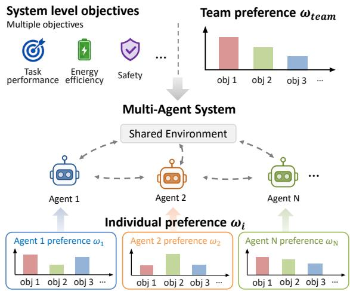  
Figure 1: Team-level and individual-level preference mod- elling in MOMARL. An externally specified team preference defines the desired system-level trade-of, while internally developed individual preferences give agents flexibility in how they contribute to the cooperative task.

Although the system is evaluated at the team level, its behaviour is produced by multiple individual agents. Diferent agents may contribute to the system objectives in diferent ways depending on their local situations and interactions with other agents, and these contributions may change as the cooperative process evolves. The team preference specifies the desired overall trade-of, but does not directly determine how each individual agent should contribute towards achieving it. This motivates us to additionally consider the MOMARL problem from an individual-agent level. For each agent �, we introduce an individual preference $\omega _ { i } .$ , which represents the agent’s internal emphasis over the same set of system objectives. Unlike $\omega _ { \mathrm { t e a m } } .$ , the individual preference is not an additional user- specified requirement and does not change how the overall system is evaluated. Instead, it provides an internal degree of flexibility in how an individual agent responds to the diferent objectives when contributing to the team.

The resulting two-level preference formulation is illustrated in Figure 1. An externally specified team preference is given to the multi-agent system, while the individual preferences are learnable at the agent level, allowing the relationships among individual preferences to emerge from the learning process rather than being predefined. To make use of this flexibility, each agent must first be able to assess its own situation within the team, in particular, to determine how much its behaviour actually contributes to the team performance. We therefore introduce objective-wise counterfactual credit assignment in the following subsection.

## 4.2 Objective-Wise Counterfactual Credit Assignment

In cooperative MARL, a shared team reward alone does not directly reveal how much each agent’s action contributes to the resulting team performance. Counterfactual Multi-Agent Policy Gradients (COMA) [9] addresses this problem by comparing the value of the actual joint action with a counterfactual baseline in which one agent’s action is varied while the actions of the other agents are kept fixed. Within the MOMARL structure formulated above, an agent needs to assess not only its overall contribution to the team, but also how it contributes to each of the team objectives. We therefore extend counterfactual credit assignment to preserve this objective-wise structure, representing the contribution of each agent as a vector rather than immediately reducing it to a single scalar quantity.

To obtain such objective-wise credit while retaining decentralised policies, we adopt a centralised training with decentralised execution (CTDE) structure. For an �- agent team, during training, a centralised critic has access to the joint observation ${ \textbf { o } } =$ $\left( o _ { 1 } , \dotsc , o _ { N } \right)$ and joint action ${ \bf a } = ( a _ { 1 } , \ldots , a _ { N } )$ , allowing the learn- ing process to evaluate the joint behaviour of the agents. During execution, the critic is removed and each agent selects its action independently using only its locally available information. In our implementation, the decentralised actors share a common set of parameters � and are distinguished by an agent identifier ��. We denote the resulting policy for agent � as $\pi _ { \boldsymbol { \theta } } ( a _ { i , t } \mid h _ { i , t } , e _ { i } )$ , where $h _ { i , t }$ represents the local information available to the agent through its recurrent policy representation.

Instead of scalarising the multi-objective return before credit assignment, the centralised critic directly estimates a vector-valued action value,

$$
\begin{array} { r } { \mathsf { Q } _ { \psi } ( \mathbf { 0 } , \mathbf { a } ) = \left[ \mathcal { Q } _ { \psi } ^ { ( 1 ) } ( \mathbf { 0 } , \mathbf { a } ) , \hdots , \mathcal { Q } _ { \psi } ^ { ( d ) } ( \mathbf { 0 } , \mathbf { a } ) \right] \in \mathbb { R } ^ { d } . } \end{array}
$$

where each component corresponds to one team objective.

To isolate the contribution of agent �, we consider how the team would have performed ifagent � had selected a diferent action while the actions of all other agents remained unchanged. Let a−� denote the actions of all agents except agent �. By fixing a−� and averaging over alternative actions that agent � could select according to its current policy, we obtain an agent-specific reference for its own action choice. We define objective-wise counterfactual baseline as

$$
\begin{array} { r } { \mathbf { b } _ { i } ^ { \mathrm { c f } } = \mathbb { E } _ { a _ { i } ^ { \prime } \sim \pi _ { \theta _ { i } } ( \cdot | o _ { i } ) } \left[ \mathbf { Q } _ { \psi } \big ( \mathbf { o } , \big ( a _ { i } ^ { \prime } , \mathbf { a } _ { - i } \big ) \big ) \right] \in \mathbb { R } ^ { d } . } \end{array}
$$

The baseline therefore represents the expected team performance across the objectives under the same behaviour of the other agents, but with agent � acting according to its current policy.

In discrete action spaces, the counterfactual expectation can be computed by summing over the possible actions of agent �. For continuous action spaces, however, the action space cannot be enumerated directly. We therefore approximate the counterfactual baseline using Monte Carlo sampling from the current policy. Given � alternative actions $a _ { i } ^ { ( k ) } \sim \pi _ { \theta _ { i } } ( \cdot \mid o _ { i } ) , k = 1 , \ldots , K$ , the counter- factual baseline is approximated by

$$
\widehat { \mathbf { b } } _ { i } ^ { \mathrm { c f } } = \frac { 1 } { K } \sum _ { k = 1 } ^ { K } \mathbf { Q } _ { \psi } \big ( \mathbf { o } , ( a _ { i } ^ { ( k ) } , \mathbf { a } _ { - i } ) \big ) \in \mathbb { R } ^ { d } .
$$

For each sample, only the action of agent � is replaced, while the actions of the other agents remain fixed.

The contribution of the action actually taken by agent � can then be measured relative to this baseline. We define the objective-wise

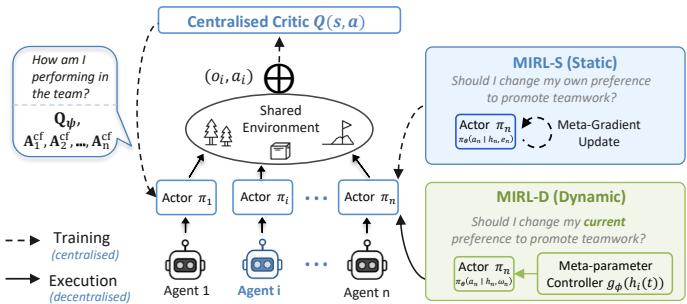  
Figure 2: System overview for MIRL-S and MIRL-D.

counterfactual advantage as

$$
{ \bf A } _ { i } ^ { \mathrm { c f } } = \mathrm { Q } _ { \psi } ( \mathbf { 0 } , \mathbf { a } ) - \mathbf { b } _ { i } ^ { \mathrm { c f } } \in \mathbb { R } ^ { d } ,
$$

where $\widehat { \mathbf { b } } _ { i } ^ { \mathrm { c f } }$ is used in place of ${ \bf b } _ { i } ^ { \mathrm { c f } }$ for continuous action spaces.

Each component of ${ \bf A } _ { i } ^ { \mathrm { c f } }$ measures whether the action actually taken by agent � improves or reduces the team performance for the corresponding objective relative to its own counterfactual baseline. This provides each agent with an objective-wise estimate of its own contribution, which is subsequently combined with the individual preference to guide its policy update, as illustrated in Figure 2.

## 4.3 Static Meta-Gradient Informed Preference Adaptation

The objective-wise counterfactual credit developed above provides each agent with separate estimates of its contribution across the team objectives. The next question is how these objective-wise contributions should be combined when updating the individual policy. Rather than fixing this combination manually, we aim to let each agent learn how its individual preference should guide its learning so that the resulting behaviour better contributes to the overall team performance.

This naturally leads to a learning-to-learn problem. In addition to learning the policy itself, the agent must learn how its learning sig- nal should be constructed from the objective-wise credit available to it. Inspired by meta-gradient reinforcement learning [43], we develop a meta-gradient preference adaptation mechanism that al lows each agent to adapt its individual preference according to how that preference afects subsequent team performance. Specifically, we treat the individual preference as a diferentiable meta-variable that controls how the agent’s objective-wise credit is combined during its policy update.

For each agent �, we introduce an unconstrained meta-parameter $\pmb { \eta } _ { i } \in \mathbb { R } ^ { d }$ and define its individual preference as

$$
\omega _ { i } = { \mathrm { s o f f m a x } } ( \pmb { \eta } _ { i } ) .
$$

This unit-temperature softmax mapping maintains $\omega _ { i }$ on the pref erence simplex while preserving diferentiability with respect to $\pmb { \eta } _ { i } .$

The centralised vector critic $\mathsf { Q } _ { \psi }$ is trained independently using objective-wise TD(�) targets, without scalarising the objectives us-ing $\omega _ { i }$ . Within the computational graph used for the meta-gradient update, the critic update is therefore treated as independent of the preference meta-parameter $\begin{array} { r } { \pmb { \eta } _ { i } , \mathrm { i . e . , } \frac { \partial \psi ^ { \prime } } { \partial \eta _ { i } } = 0 . } \end{array}$ . Accordingly, for agent � at timestep �, the objective-wise counterfactual advantage $\mathbf { A } _ { i , t } ^ { \mathrm { c f } } \in \mathbb { R } ^ { d }$ computed from the critic is detached and treated as a fixed training signal in the following meta-gradient calculation.

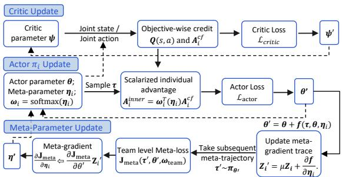  
Figure 3: Illustration of training update in MIRL-S.

4.3.1 Preference-Guided Actor Update. As illustrated in Figure 3, during each policy update, a trajectory ${ \boldsymbol { \tau } } = \{ \mathbf { o } _ { t } , \mathbf { a } _ { t } , \mathbf { r } _ { t } \} _ { t = 0 } ^ { T - 1 }$ is col- lected from the current joint policy. The objective-wise counterfactual advantages ${ \bf A } _ { i , t } ^ { \mathrm { c f } }$ used below are then computed from this trajectory using the centralised critic.

For each agent, its current individual preference determines how its objective-wise counterfactual credit is combined into the scalar learning signal used by the actor. Specifically,

$$
\boldsymbol { A } _ { i , t } ^ { \mathrm { i n n e r } } = \omega _ { i } ^ { \top } \mathbf { A } _ { i , t } ^ { \mathrm { c f } } = \mathrm { s o f t m a x } ( \pmb { \eta } _ { i } ) ^ { \top } \mathbf { A } _ { i , t } ^ { \mathrm { c f } } .
$$

For agent �, the corresponding one-step actor loss is

$$
\ell _ { i , t } ( \theta , \pmb { \eta } _ { i } ) = - \log \pi _ { \theta } ( a _ { i , t } \mid h _ { i , t } , e _ { i } ) A _ { i , t } ^ { \mathrm { i n n e r } } .
$$

Over a trajectory of length � , the individual actor loss is

$$
J _ { i } ( \tau , \theta , \pmb { \eta } _ { i } ) = \frac { 1 } { T } \sum _ { t = 0 } ^ { T - 1 } \ell _ { i , t } ( \pmb { \theta } , \pmb { \eta } _ { i } ) ,
$$

which gives

$$
J _ { i } ( \tau , \boldsymbol { \theta } , \boldsymbol { \eta } _ { i } ) = - \frac { 1 } { T } \sum _ { t = 0 } ^ { T - 1 } \log \pi _ { \boldsymbol { \theta } } ( a _ { i , t } \mid h _ { i , t } , e _ { i } ) \left[ \omega _ { i } ^ { \top } \mathbf { A } _ { i , t } ^ { \mathrm { c f } } \right] .
$$

During centralised training, the learning signals from all agents are used jointly to update the shared actor parameters �. The indi-vidual actor losses are therefore averaged to form the inner actor objective,

$$
\mathcal { L } _ { \mathrm { a c t o r } } = J _ { \mathrm { i n n e r } } ( \tau , \theta , \pmb { \eta } ) = \frac { 1 } { N } \sum _ { i = 1 } ^ { N } J _ { i } ( \tau , \theta , \pmb { \eta } _ { i } ) ,
$$

where $\pmb { \eta } = \left\{ \pmb { \eta } _ { 1 } , \dotsc , \pmb { \eta } _ { N } \right\}$ . Equivalently,

$$
J _ { \mathrm { i n n e r } } ( \tau , \theta , \eta ) = - \frac { 1 } { N T } \sum _ { i = 1 } ^ { N } \sum _ { t = 0 } ^ { T - 1 } \log \pi _ { \theta } ( a _ { i , t } \mid h _ { i , t } , e _ { i } ) \left[ \omega _ { i } ^ { \top } \mathbf { A } _ { i , t } ^ { \mathrm { c f } } \right]\tag{1}
$$

where $\omega _ { i } = \mathrm { s o f t m a x } ( \pmb { \eta } _ { i } )$ . The factor $1 / N$ simply averages the gra- dient contributions from the agents and does not require the indi- vidual preferences to average to �team.

As shown in Figure 3, the actor parameters are updated from this preference-guided inner objective as

$$
f _ { \theta } ( \tau , \theta , \pmb { \eta } ) = - \alpha _ { \theta } \frac { \partial J _ { \mathrm { i n n e r } } ( \tau , \theta , \pmb { \eta } ) } { \partial \pmb { \theta } }\tag{2}
$$

the updated actor parameters are

$$
\theta ^ { \prime } = \theta + f _ { \theta } ( \tau , \theta , \eta ) ,\tag{3}
$$

or equivalently,

$$
\theta ^ { \prime } = \theta - \alpha _ { \theta } \frac { \partial J _ { \mathrm { i n n e r } } ( \tau , \theta , \eta ) } { \partial \theta } .
$$

Thus, each agent’s individual preference determines how its own objective-wise counterfactual credit contributes to the update of the actor.

4.3.2 Meta-Gradient Preference Update. The preference-guided ac tor update above determines how the current individual preferences influence the policy learning. The remaining question is how these preferences should themselves be adapted. Our goal is to adjust each meta-parameter $\pmb { \eta } _ { i }$ according to whether the actor update in- duced by its corresponding individual preference leads to improved subsequent team performance.

Following the principle of online cross-validation [34], we evalu-ate the efect of the actor update on a subsequent sample of experi- ence. After updating the shared actor from � to $\pmb { \theta } ^ { \prime }$ using the trajec tory �, we collect a subsequent trajectory $\tau ^ { \prime } = \left\{ \mathbf { o } _ { t } ^ { \prime } , \mathbf { a } _ { t } ^ { \prime } , \mathbf { r } _ { t } ^ { \prime } \right\} _ { t = 0 } ^ { T ^ { \prime } - 1 } , \tau ^ { \prime } \sim$ $\pi _ { \theta ^ { \prime } }$ . The subsequent trajectory is used to construct a meta-objective that evaluates the updated policy according to the fixed team pref- erence $\omega _ { \mathrm { t e a m } }$

For the subsequent trajectory, we again compute the objective-wise counterfactual advantage for each agent using the centralised vector critic, denoted by ${ \bf A } _ { i , t } ^ { \mathrm { c f } \prime } \in \mathbb { R } ^ { d }$ . Unlike the inner actor update, however, these objective-wise contributions are now evaluated according to the fixed team preference rather than the individual preference. We therefore define the team-evaluated meta-advantage for agent � as

$$
A _ { i , t } ^ { \mathrm { m e t a } } = \omega _ { \mathrm { t e a m } } ^ { \top } \mathbf { A } _ { i , t } ^ { \mathrm { c f } \prime } .
$$

This provides a scalar measure of whether agent $i ^ { \prime } s$ action under the updated policy contributes positively to the team objective specified by $\omega _ { \mathrm { t e a m } }$

Using this team-evaluated meta-advantage, we define the meta- objective for the updated actor using the same policy-gradient structure as the actor objective:

$$
J _ { \mathrm { m e t a } } ( \tau ^ { \prime } , \theta ^ { \prime } , \omega _ { \mathrm { t e a m } } ) = - \frac { 1 } { N T ^ { \prime } } \sum _ { i = 1 } ^ { N } \sum _ { t = 0 } ^ { T ^ { \prime } - 1 } \log \pi _ { \theta ^ { \prime } } ( a _ { i , t } ^ { \prime } \mid h _ { i , t } ^ { \prime } , e _ { i } ) A _ { i , t } ^ { \mathrm { m e t a } } .
$$

The two objectives therefore play diferent roles in the learning process. $J _ { \mathrm { i n n e r } }$ is the primary reinforcement-learning objective used to update the actor parameters $\theta$ under the current individual pref erences, whereas $J _ { \mathrm { { m e t a } } }$ is the meta-learning objective used to adapt the preference meta-parameters $\pmb { \eta } _ { i }$ according to the subsequent team performance under $\omega _ { \mathrm { t e a m } }$

The purpose of the meta-gradient $\frac { \partial J _ { \mathrm { m e t a } } } { \partial \pmb { \eta } _ { i } }$ is therefore to determine how changing agent �’s preference meta-parameter $\pmb { \eta } _ { i }$ would afect this subsequent team-level meta-objective � t . By the chain rule,

$$
\frac { \partial J _ { \mathrm { m e t a } } } { \partial \pmb { \eta } _ { i } } = \frac { \partial J _ { \mathrm { m e t a } } } { \partial \pmb { \theta } ^ { \prime } } \frac { d \pmb { \theta } ^ { \prime } } { d \pmb { \eta } _ { i } } .
$$

The remaining term $\frac { d \theta ^ { \prime } } { d \eta _ { i } }$ describes the sensitivity of the updated actor parameters to agent �’s preference meta-parameter. Recall

that the actor update is defined in Equation 3. Taking the total derivative with respect to $\pmb { \eta } _ { i }$ gives

$$
\frac { d \theta ^ { \prime } } { d \pmb { \eta } _ { i } } = \left( \mathbf { I } + \frac { \partial f _ { \theta } } { \partial \pmb { \theta } } \right) \frac { d \theta } { d \pmb { \eta } _ { i } } + \frac { \partial f _ { \theta } } { \partial \pmb { \eta } _ { i } } .
$$

The term $\frac { \partial f _ { \pmb { \theta } } } { \partial \pmb { \theta } }$ is a high-dimensional Jacobian of the actor update and is expensive to compute and propagate explicitly through successive learning updates. Following meta-gradient reinforcement learning [43], we therefore approximate the accumulated sensitivity using a meta-gradient trace $\begin{array} { r } { \bar { Z } _ { i } \approx \frac { d \theta } { d \eta _ { i } } } \end{array}$ , which is updated as

$$
Z _ { i } ^ { \prime } = \mu Z _ { i } + \frac { \partial f _ { \theta } } { \partial \pmb { \eta } _ { i } } .\tag{4}
$$

Here, $\mu \in \left[ 0 , 1 \right]$ controls how much sensitivity from previous actor updates is retained in the trace. In our experiments, we use $\mu = 0$ corresponding to the greedy meta-gradient setting that considers only the efect of the current meta-parameter on the immediately resulting actor update.

The remaining derivative $\frac { \partial f _ { \pmb { \theta } } } { \partial \pmb { \eta } _ { i } }$ can be computed directly from the diferentiable dependence of the actor update on the individual preference. Since the objective-wise counterfactual advantage ${ \bf A } _ { i , t } ^ { \mathrm { c f } }$ is detached and treated as a fixed training signal, according to actor update Equation 2, the sensitivity of the actor update to agent �’s preference meta-parameter is

$$
\frac { \partial f _ { \theta } } { \partial \eta _ { i } } = - \alpha _ { \theta } \frac { \partial } { \partial \eta _ { i } } \frac { \partial J _ { \mathrm { i n n e r } } } { \partial \theta } = \frac { \alpha _ { \theta } } { N T } \sum _ { t = 0 } ^ { T - 1 } \nabla _ { \theta } \log \pi _ { \theta } ( \boldsymbol { a } _ { i , t } \mid \boldsymbol { h } _ { i , t } , \boldsymbol { e } _ { i } ) \left[ \left( \frac { \partial \omega _ { i } } { \partial \eta _ { i } } \right) ^ { \top } \mathbf { A } _ { i , t } ^ { \mathrm { c f } } \right] ^ { \top } .\tag{5}
$$

The preference Jacobian $\frac { \partial \omega _ { i } } { \partial \eta _ { i } }$ appearing in this expression can be computed analytically, since the individual preference depends on the meta-parameter through $\omega _ { i } ( \pmb { \eta } _ { i } ) = \mathrm { s o f t m a x } ( \pmb { \eta } _ { i } )$ . The corre- sponding softmax Jacobian is

$$
\frac { \partial \omega _ { i } } { \partial \pmb { \eta } _ { i } } = \mathrm { d i a g } ( \pmb { \omega } _ { i } ) - \pmb { \omega } _ { i } \pmb { \omega } _ { i } ^ { \top } .
$$

With the greedy meta-gradient setting $\mu = 0 ;$ , the trace (4) becomes $\begin{array} { r } { Z _ { i } ^ { \prime } = \frac { \partial f _ { \theta } } { \partial \eta _ { i } } } \end{array}$

The meta-gradient for agent � can therefore be approximated as

$$
\frac { \partial J _ { \mathrm { m e t a } } } { \partial \pmb { \eta } _ { i } } \approx \frac { \partial J _ { \mathrm { m e t a } } } { \partial \pmb { \theta } ^ { \prime } } Z _ { i } ^ { \prime } = \frac { \partial J _ { \mathrm { m e t a } } } { \partial \pmb { \theta } ^ { \prime } } \frac { \partial f _ { \theta } } { \partial \pmb { \eta } _ { i } } .\tag{6}
$$

This gradient captures how changing agent �’s individual preference afects the subsequent team-level meta-objective through its influence on the actor update.

The resulting meta-gradients are used to update the preference meta-parameters. In our implementation, the meta-parameters $\pmb { \eta } =$ $\{ \pmb { \eta } _ { 1 } , \dotsc , \pmb { \eta } _ { N } \}$ are optimised using Adam with meta learning rate $\beta _ { \omega } .$ After the meta-parameter update, the corresponding individual preferences are obtained through the softmax mapping as $\omega _ { i } ^ { \prime } = $ softmax $( \pmb { \eta } _ { i } ^ { \prime } )$

Although the individual preferences can be adapted through the meta-gradient learning process, each agent is still represented by a single meta-parameter vector $\pmb { \eta } _ { i }$ throughout the interaction. Consequently, the resulting preference $\omega _ { i }$ is state-independent: it can capture a diferent overall objective emphasis for each agent, but cannot change in response to the agent’s current observation, be- haviour, or cooperative situation. We refer to this static formulation as MIRL-S, with details provided in Algorithm 1 in Appendix A.

This static formulation therefore provides agent-specific prefer-ence adaptation at the training level, but does not yet allow indi- vidual preferences to adapt to the current cooperative situation. In cooperative tasks, however, the role or contribution required from an agent may change as the interaction evolves. This motivates extending the preference adaptation mechanism from a single learned preference for each agent to preferences that can dynamically vary according to the current cooperative context.

## 4.4 Dynamic Meta-Gradient Informed Preference Adaptation

To enable individual preferences to vary with the current coop- erative situation, we replace the single state-independent metaparameter $\pmb { \eta } _ { i }$ used for each agent in the static formulation with a diferentiable preference controller $g _ { \phi }$ . Rather than learning one fixed preference representation for agent �, the controller generates a preference meta-variable from the agent’s current local repre- sentation at each timestep. This dynamic preference pathway is illustrated in Figure 2. Specifically,

$$
\pmb { \eta } _ { i , t } = g _ { \phi } ( \mathbf { h } _ { i , t } ) ,
$$

and the corresponding dynamic individual preference is

$$
\omega _ { i , t } = \mathrm { s o f t m a x } ( \pmb { \eta } _ { i , t } ) = \mathrm { s o f t m a x } \left( g _ { \phi } ( \mathbf { h } _ { i , t } ) \right) .
$$

Here, � denotes the learnable parameters of the preference con troller, and $\mathbf { h } _ { i , t }$ denotes the local recurrent representation available to agent � at timestep �. Conditioning the controller on $\mathbf { h } _ { i , t }$ allows the resulting preference to vary across agents and timesteps according to the current cooperative situation.

The dynamically generated preference is also explicitly provided to the actor. Specifically, the policy is conditioned jointly on the lo-cal recurrent representation and the current individual preference, $a _ { i , t } \sim \pi _ { \theta } \left( \cdot \mid \mathbf { h } _ { i , t } , \omega _ { i , t } \right)$ . This allows changes in the generated pref- erence to directly influence the agent’s behaviour at each timestep.

The same dynamic preference is used to scalarise the objectivewise counterfactual credit during policy learning:

$$
A _ { i , t } ^ { \mathrm { i n n e r , d y n } } = \omega _ { i , t } ^ { \top } \mathbf { A } _ { i , t } ^ { \mathrm { c f } } .
$$

The subsequent actor update and meta-gradient preference up- date follow the same formulation as in the static case, with the dynamically generated $\omega _ { i , t }$ replacing the static $\omega _ { i }$ . The centralised vector critic and objective-wise counterfactual credit assignment remain unchanged. This dynamic formulation defines the second variant of our method, MIRL-D, with details provided in Algorithm 2 in Appendix A.

## 5 Experiments

## 5.1 Experiment Setup

Benchmark Problems. We conduct experiments using the Multi Agent Particle Environment (MPE) [21], which is a widely used RL benchmark. We extend the original MPE to a multi-objective setting by retaining the original task reward as the first objective and introducing a second objective that captures the energy consumed during interaction. We evaluate the proposed methods and baselines on four cooperative tasks: Spread, Formation, Line, and Reference. The first three tasks involve three agents with diferent spatial coordination requirements, while Reference involves two agents and additionally requires communication for successful cooperation. Full environment definitions are provided in Appendix B.1.

Evaluation Metrics. We evaluate the quality of the resulting Pareto fronts using three standard metrics: Hypervolume (HV), Expected Utility (EU), and Sparsity (SP), following the formalism in [12, 47, 48]. HV measures the overall quality and coverage of the Pareto front, EU evaluates performance across diferent objective preferences, and SP measures the distribution of solutions along the front. Higher HV and EU and lower SP indicate better performance. Since SP is scale-dependent and less directly related to decision quality, we report it mainly as a complementary metric to assess coverage diversity. More details can be found in Appendix B.2.

Baselines. As dedicated MOMARL algorithms remain relatively limited, we consider five baselines of increasing complexity: DTDE-PPO, CTDE-PPO-V, CTDE-PPO-Q, MO-COMA, and MO-MIX. DTDE-PPO represents the fully decentralised setting, where each agent independently learns its policy using PPO [29] network. Given the surprisingly strong performance of PPO previously observed in cooperative MARL [45], we further extend MAPPO to the MOMARL setting under CTDE and consider two variants, CTDE-PPO-V and CTDE-PPO-Q, using centralised �- and �-critics, respectively. MO-COMA extends COMA [9] to the multi-objective setting and pro-vides counterfactual credit assignment for individual agents across multiple objectives. It also serves as an ablation baseline for evalu-ating the additional preference-adaptation mechanisms introduced in our methods. We additionally compare against MO-MIX [14], a dedicated MOMARL algorithm based on multi-objective value decomposition. All methods except MO-MIX operate in continuous action spaces. Since MO-MIX only supports discrete actions, it is evaluated using a discretised version of the action space. Further implementation details are provided in Appendix B.3.

## 5.2 Results

We now present the empirical results across four benchmark prob- lems. All methods are trained under the same total interaction bud- get of 5×106 joint environment steps per environment. Full training settings and hyperparameters are provided in Appendix B.3.

Figure 4 compares the Pareto fronts obtained by the diferent methods, while Table 1 reports the quantitative evaluation results as mean ± standard deviation. Each marker corresponds to a nondominated solution in the estimated Pareto front. The connecting lines are included only as a visual guide between neighbouring solutions. Across the benchmark problems, the proposed MIRL vari-ants consistently achieve strong Pareto-front quality, with MIRL-D showing the best overall performance. Further analysis of prefer- ence adaptation is provided in Appendix C.

Among the PPO-based baselines, DTDE-PPO consistently shows the weakest performance, illustrating the dificulty of learning co- operative behaviours through fully decentralised training in these tasks. Introducing centralised information during training substantially improves both Pareto-front quality and coverage. In particular, more dificult to train. Under the same overall interaction budget, a single model must represent policies across the full preference space, and this shared representation may, to some extent, compromise performance. In addition, MO-MIX operates on discrete actions and therefore requires discretisation of the originally continuous MPE action space, which may further limit its achievable performance.

Table 1: Evaluation of the Pareto front quality.
<table><tr><td rowspan="2">Environment</td><td rowspan="2">Metric</td><td colspan="7">Method</td></tr><tr><td>DTDE-PPO</td><td>CTDE-PPO-V</td><td>CTDE-PPO-Q</td><td>MO-COMA</td><td>MO-MIX</td><td>MIRL-S</td><td>MIRL-D</td></tr><tr><td rowspan="3">Spread</td><td>HV</td><td> $1 2 2 2 . 5 5 \pm 1 5 . 4 3$ </td><td> $1 4 3 4 . 4 6 \pm 5 2 . 3 4$ </td><td> $1 5 1 2 . 1 7 \pm 1 9 . 4 1$ </td><td> $1 5 7 0 . 0 8 \pm 8 . 6 1$ </td><td> $1 2 1 3 . 4 8 \pm 1 3 1 . 1 5$ </td><td> $1 5 8 1 . 4 0 \pm 3 0 . 0 5$ </td><td> $\mathbf { 1 5 9 4 . 5 5 \pm 2 0 . 3 4 }$ </td></tr><tr><td>EU</td><td> $3 6 . 5 7 \pm 0 . 2 4$ </td><td> $3 8 . 1 6 \pm 0 . 5 4$ </td><td> $3 9 . 3 2 \pm 0 . 1 2$ </td><td> $3 9 . 8 5 \pm 0 . 0 8$ </td><td> $3 6 . 4 4 \pm 2 . 2 6$ </td><td> $4 0 . 0 2 \pm 0 . 3 2$ </td><td> ${ \bf 4 0 . 1 4 \pm 0 . 2 5 }$ </td></tr><tr><td>SP</td><td> $6 0 . 5 8 \pm 7 6 . 7 7$ </td><td> $1 4 . 0 3 \pm 3 . 0 8$ </td><td> $2 . 8 6 \pm 2 . 3 2$ </td><td> $1 . 2 0 \pm 0 . 8 2$ </td><td> ${ \bf 0 . 0 7 \pm 0 . 0 7 }$ </td><td> $1 . 3 9 \pm 1 . 0 6$ </td><td> $1 2 . 0 8 \pm 1 9 . 7 7$ </td></tr><tr><td rowspan="3">Formation</td><td>HV</td><td> $1 3 5 9 . 5 3 \pm 1 0 . 2 0$ </td><td> $1 8 1 5 . 2 7 \pm 4 0 . 3 6$ </td><td> $1 9 7 5 . 3 6 \pm 4 0 . 1 9$ </td><td> $2 1 7 8 . 7 9 \pm 2 3 . 3 1$ </td><td> $1 5 2 5 . 6 7 \pm 3 3 3 . 5 3$ </td><td> $2 1 8 7 . 3 3 \pm 7 . 9 1$ </td><td> $\mathbf { 2 1 9 6 . 1 3 \pm 1 5 . 7 6 }$ </td></tr><tr><td>EU</td><td> $3 7 . 7 9 \pm 0 . 2 5$ </td><td> $4 2 . 5 9 \pm 0 . 3 4$ </td><td> $4 4 . 0 2 \pm 0 . 3 1$ </td><td> $4 5 . 7 6 \pm 0 . 2 0$ </td><td> $3 9 . 2 1 \pm 4 . 7 7$ </td><td> $4 5 . 8 5 \pm 0 . 1 9$ </td><td> ${ \bf 4 6 . 0 3 \pm 0 . 2 5 }$ </td></tr><tr><td>SP</td><td> $9 1 8 . 6 6 \pm 5 2 6 . 7 2$ </td><td> $1 . 7 1 \pm 0 . 8 0$ </td><td> $3 . 5 3 \pm 1 . 4 9$ </td><td> $2 . 1 4 \pm 1 . 3 7$ </td><td> ${ \bf 0 . 0 7 \pm 0 . 0 7 }$ </td><td> $0 . 7 7 \pm 0 . 2 2$ </td><td> $1 . 5 2 \pm 0 . 4 5$ </td></tr><tr><td rowspan="3">Line</td><td>HV</td><td> $1 2 4 5 . 4 8 \pm 7 0 . 1 7$ </td><td> $1 6 9 7 . 3 0 \pm 1 3 . 6 8$ </td><td> $1 6 9 6 . 6 8 \pm 8 . 8 8$ </td><td> $1 9 5 8 . 7 1 \pm 2 6 . 1 9$ </td><td> $1 2 3 9 . 0 9 \pm 4 3 3 . 0 7$ </td><td> $1 9 5 7 . 4 9 \pm 2 2 . 0 5$ </td><td> ${ \bf 1 9 6 5 . 8 9 \pm 2 4 . 1 1 }$ </td></tr><tr><td>EU</td><td> $3 6 . 5 4 \pm 0 . 5 3$ </td><td> $4 1 . 1 9 \pm 0 . 0 7$ </td><td> $4 1 . 2 5 \pm 0 . 2 8$ </td><td> $4 3 . 6 4 \pm 0 . 3 3$ </td><td> $3 5 . 3 2 \pm 7 . 2 2$ </td><td> $4 3 . 7 1 \pm 0 . 2 6$ </td><td> $\mathbf { 4 3 . 7 4 \pm 0 . 2 6 }$ </td></tr><tr><td>SP</td><td> $9 6 . 3 8 \pm 1 3 4 . 4 5$ </td><td> $3 3 . 3 2 \pm 2 7 . 8 7$ </td><td> $1 4 . 6 5 \pm 4 . 2 4$ </td><td> $0 . 8 6 \pm 0 . 5 7$ </td><td> $\mathbf { 0 . 1 2 \pm 0 . 0 9 }$ </td><td> $0 . 8 1 \pm 0 . 6 2$ </td><td> $0 . 7 9 \pm 0 . 3 8$ </td></tr><tr><td rowspan="3">Reference</td><td>HV</td><td> $1 8 4 3 . 7 5 \pm 2 4 . 3 8$ </td><td> $2 0 8 2 . 2 0 \pm 2 8 . 4 7$ </td><td> $2 4 1 3 . 3 5 \pm 3 6 . 7 8$ </td><td> $2 5 6 7 . 0 7 \pm 2 1 . 7 6$ </td><td> $2 0 1 6 . 3 3 \pm 6 9 . 7 6$ </td><td> $2 5 8 7 . 4 1 \pm 2 8 . 0 6$ </td><td> $\mathbf { 2 5 8 7 . 4 4 \pm 2 7 . 9 9 }$ </td></tr><tr><td>EU</td><td> $4 4 . 6 4 \pm 0 . 1 7$ </td><td> $4 6 . 9 3 \pm 0 . 2 4$ </td><td> $4 8 . 0 9 \pm 0 . 5 1$ </td><td> $5 0 . 6 7 \pm 0 . 1 8$ </td><td> $4 6 . 0 2 \pm 0 . 8 7$ </td><td> $5 0 . 8 1 \pm 0 . 1 4$ </td><td> ${ \bf 5 0 . 8 5 \pm 0 . 2 1 }$ </td></tr><tr><td>SP</td><td></td><td> $1 2 5 4 . 3 1 \pm 1 2 . 1 0$ </td><td> $1 0 7 . 0 4 \pm 4 2 . 0 6$ </td><td> $0 . 9 0 \pm 0 . 5 3$ </td><td> $3 . 0 8 \pm 3 . 0 4$ </td><td> $0 . 6 2 { \pm } 0 . 1 1$ </td><td> $\mathbf { 0 . 6 2 \pm 0 . 0 9 }$ </td></tr></table>

(a) Spread.  
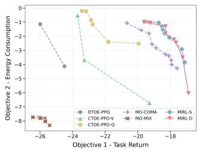

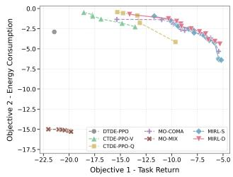  
(b) Formation.

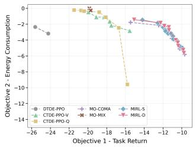  
(c) Line.

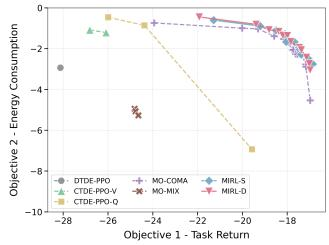  
(d) Reference.  
Figure 4: Pareto front comparison of the MIRL variants with the baselines across four benchmark problems.

MO-COMA achieves substantially stronger performance than the PPO-based baselines across all tasks, showing that objective-wise counterfactual credit assignment alone already provides an efective learning signal for cooperative MOMARL. Its performance is particularly strong on Formation and Line, where it is already close to both MIRL variants. On Spread and Reference, however, the MIRL methods provide clearer improvements over MO-COMA. We analyse these diferences further in the ablation study.

## 5.3 Ablation and Further Analysis

To isolate the contribution of the proposed meta-gradient informed preference adaptation mechanism, we compare the ablation base- line MO-COMA with static MIRL-S and dynamic MIRL-D methods.

CTDE-PPO-Q generally performs better than CTDE-PPO-V, suggesting that conditioning the critic on the joint action provides a more informative learning signal for coordinating individual actions. It is worth noting that these PPO-based methods constitute strong rather than trivial baselines. PPO-based methods have previ- ously demonstrated surprisingly strong performance in MARL [45], and the variants here retain this strong policy-optimisation back-bone while extending it to the multi-objective setting.

MO-MIX exhibits a diferent behaviour from the other methods. As shown in Figure 4, it often produces relatively dense groups of solutions, which is also reflected by its low SP values, but these solutions tend to occupy a more limited region of the objective space and result in substantially lower HV and EU. One possible reason is that MO-MIX is a single preference-conditioned network, which may be more sensitive to hyperparameter choices and can be

The benefit of preference adaptation varies with the coordina- tion requirements of the task. On Spread, MIRL-S improves over MO-COMA, and MIRL-D provides a further improvement. This task requires agents to continuously adjust their relative positions and contributions during interaction, making the ability to adapt individual preferences to the current cooperative context particularly useful. On Reference, both MIRL-S and MIRL-D improve over MO-COMA, while the diference between the two MIRL variants is comparatively small. In this task, the cooperative requirement, particularly the communication component, is relatively stable and less dependent on the changing cooperative situation. The additional flexibility of dynamic preference adaptation therefore provides a smaller advantage. By contrast, on Formation and Line, MO-COMA already achieves performance very close to the two MIRL variants. These tasks have relatively simple and stable coordination require- ments, and objective-wise counterfactual credit assignment alone appears suficient to produce strong cooperative behaviour, leaving less room for additional gains from preference adaptation.

## 6 Conclusion

In this work, we show that the multi-objective structure can be exploited to facilitate multi-agent cooperation, rather than be- ing treated solely as an additional optimisation challenge in MO-MARL. Building on this novel perspective, we formulate team-level and individual-level preferences to introduce adaptive agent-level guidance while preserving the system-level objective trade-of. To enable preference-guided cooperation across agents, we derive objective-wise counterfactual credit assignment together with a meta-gradient informed preference adaptation mechanism, providing a principled way to learn how individual preferences should shape policy updates. These developments lead to MIRL, with static (MIRL-S) and dynamic (MIRL-D) variants, which achieve strong Pareto-front performance across the benchmark tasks, with MIRL D showing the best overall results. Our ablation results further demonstrate that meta-gradient informed preference adaptation provides additional benefits beyond counterfactual credit assign- ment, particularly when cooperation requires greater adaptability.

## Acknowledgments

This work was supported by the United Kingdom Research and Innovation (grant EP/S023208/1), UKRI Centre for Doctoral Training in Robotics and Autonomous Systems at the University of Edinburgh, School of Informatics.

## References

[1] Axel Abels, Diederik Roijers, Tom Lenaerts, Ann Nowé, and Denis Steckelmacher. 2019. Dynamic Weights in Multi-Objective Deep Reinforcement Learning. In Proceedings ofthe 36th International Conference on Machine Learning (Proceedings ofMachine Learning Research, Vol. 97), Kamalika Chaudhuri and Ruslan Salakhutdinov (Eds.). PMLR, 11–20.

[2] Lucas Nunes Alegre, Ana Bazzan, and Bruno C. Da Silva. 2022. Optimistic Linear Support and Successor Features as a Basis for Optimal Policy Transfer. In Proceedings ofthe 39th International Conference on Machine Learning (Proceedings ofMachine Learning Research, Vol. 162), Kamalika Chaudhuri, Stefanie Jegelka, Le Song, Csaba Szepesvari, Gang Niu, and Sivan Sabato (Eds.). PMLR, 394–413.

[3] Lucas N. Alegre, Ana L. C. Bazzan, Diederik M. Roijers, Ann Nowé, and Bruno C. da Silva. 2023. Sample-Eficient Multi-Objective Learning via Generalized Policy Improvement Prioritization. In Proceedings ofthe 2023 International Conference on Autonomous Agents and Multiagent Systems (London, United Kingdom) (AAMAS ’23). International Foundation for Autonomous Agents and Multiagent Systems, Richland, SC, 2003–2012.

[4] Leon Barrett and Srini Narayanan. 2008. Learning all optimal policies with multiple criteria. In Proceedings ofthe 25th International Conference on Machine Learning (Helsinki, Finland) (ICML ’08). Association for Computing Machinery, New York, NY, USA, 41–47.

[5] Adam Callaghan, Karl Mason, and Patrick Mannion. 2026. MOMA-AC: A reference-driven actor-critic framework for continuous multi-objective multi agent reinforcement learning. Neurocomputing 664 (2026), 132032.

[6] Caroline Claus and Craig Boutilier. 1998. The Dynamics of Reinforcement Learning in Cooperative Multiagent Systems. AAAI 1998, 746-752 (1998), 2.

[7] Florian Felten, Umut Ucak, Hicham Azmani, Gao Peng, Willem Röpke, Hendrik Baier, Patrick Mannion, Diederik M. Roijers, Jordan K. Terry, El-Ghazali Talbi, Grégoire Danoy, Ann Nowé, and Roxana Rădulescu. 2026. MOMAland: A Set of Benchmarks for Multi-Objective Multi-Agent Reinforcement Learning. Journal of Data-centric Machine Learning Research 3, 15 (2026), 1–49. https://openreview. net/forum?id=vzHLRK0sSp

[8] Jakob Foerster, Ioannis Alexandros Assael, Nando de Freitas, and Shimon White son. 2016. Learning to Communicate with Deep Multi-Agent Reinforcement Learning. In Advances in Neural Information Processing Systems (NIPS), D. Lee, M. Sugiyama, U. Luxburg, I. Guyon, and R. Garnett (Eds.), Vol. 29. Curran Asso ciates, Inc.

[9] Jakob Foerster, Gregory Farquhar, Triantafyllos Afouras, Nantas Nardelli, and Shimon Whiteson. 2018. Counterfactual multi-agent policy gradients. In Proceedings ofthe AAAI Conference on Artificial Intelligence, Vol. 32:1.

[10] Minghong Geng, Shubham Pateria, Budhitama Subagdja, and Ah-Hwee Tan. 2025. MOSMAC: A multi-agent reinforcement learning benchmark on sequential multiobjective tasks. In Proceedings ofthe 24th International Conference on Autonomous Agents and Multiagent Systems. 867–876.

[11] Jayesh K. Gupta, Maxim Egorov, and Mykel Kochenderfer. 2017. Cooperative Multi-agent Control Using Deep Reinforcement Learning. In Autonomous Agents and Multiagent Systems, Gita Sukthankar and Juan A. Rodriguez-Aguilar (Eds.). Springer International Publishing, Cham, 66–83.

[12] Conor F Hayes, Roxana Rădulescu, Eugenio Bargiacchi, Johan Källström, Matthew Macfarlane, Mathieu Reymond, Timothy Verstraeten, Luisa M Zintgraf, Richard Dazeley, Fredrik Heintz, et al. 2022. A practical guide to multi-objective reinforcement learning and planning. Autonomous Agents and Multi-Agent Systems 36, 1 (2022), 26.

[13] Pablo Hernandez-Leal, Michael Kaisers, Tim Baarslag, and Enrique Munoz de Cote. 2019. A Survey of Learning in Multiagent Environments: Dealing with Non-Stationarity. arXiv:1707.09183

[14] Tianmeng Hu, Biao Luo, Chunhua Yang, and Tingwen Huang. 2023. MO-MIX: Multi-objective multi-agent cooperative decision-making with deep reinforcement learning. IEEE Transactions on Pattern Analysis and Machine Intelligence 45, 10 (2023), 12098–12112.

[15] Shao-Ming Hung and Sidney N Givigi. 2016. A Q-learning approach to flocking with UAVs in a stochastic environment. IEEE Transactions on Cybernetics 47, 1 (2016), 186–197.

[16] Shariq Iqbal and Fei Sha. 2019. Actor-Attention-Critic for Multi-Agent Reinforcement Learnin . In Proceedings ofthe 36th International Conference on Machine Learning (Proceedings ofMachine Learning Research, Vol. 97), Kamalika Chaudhuri and Ruslan Salakhutdinov (Eds.). PMLR, 2961–2970.

[17] Mohamed A Khamis and Walid Gomaa. 2014. Adaptive multi-objective reinforcement learning with hybrid exploration for trafic signal control based on cooperative multi-agent framework. Engineering Applications of Artificial Intelligence 29 (2014), 134–151.

[18] Panagiotis Kyriakis, Jyotirmoy Deshmukh, and Paul Bogdan. 2022. Pareto Policy Adaptation. In International Conference on Learning Representations. https: //openreview.net/forum?id=wfZGut6e09

[19] Sergey Levine, Chelsea Finn, Trevor Darrell, and Pieter Abbeel. 2016. End-to-end training of deep visuomotor policies. Journal of Machine Learning Research 17, 39 (2016), 1–40.

[20] Zhuhui Li, Chunbo Luo, Liming Huang, Luyu Qi, and Geyong Min. 2026. Achieving Equilibrium under Utility Heterogeneity: An Agent-Attention Framework for Multi-Agent Multi-Objective Reinforcement Learning. Proceedings of the AAAI Conference on Artificial Intelligence 40, 35 (2026), 29538–29545.

[21] Ryan Lowe, Yi Wu, Aviv Tamar,Jean Harb, Pieter Abbeel, and Igor Mordatch. 2017. Multi-Agent Actor-Critic for Mixed Cooperative-Competitive Environments. Advances in Neural Information Processing Systems (NIPS) (2017).

[22] Haoye Lu, Daniel Herman, and Yaoliang Yu. 2023. Multi-Objective Reinforcement Learning: Convexity, Stationarity and Pareto Optimality. In The Eleventh International Conference on Learning Representations. https://openreview.net/ forum?id=TjEzIsyEsQ6

[23] Patrick Mannion, Sam Devlin, Jim Duggan, and Enda Howley. 2018. Reward shaping for knowledge-based multi-objective multi-agent reinforcement learning. The Knowledge Engineering Review 33 (2018), e23.

[24] Igor Mordatch and Pieter Abbeel. 2017. Emergence of Grounded Compositional Language in Multi-Agent Populations. arXiv preprint arXiv:1703.04908 (2017).

[25] Simone Parisi, Matteo Pirotta, and Marcello Restelli. 2016. Multi-objective Reinforcement Learning through Continuous Pareto Manifold Approximation. Journal ofArtificial Intelligence Research 57, 1 (Sept. 2016), 187–227.

[26] Bei Peng, Tabish Rashid, Christian Schroeder de Witt, Pierre-Alexandre Kami-enn , Phili Torr, Wendelin Böhmer, and Shimon Whiteson. 2021. Facmac: Fac tored multi-agent centralised policy gradients. Advances in Neural Information Processing Systems (NeurIPS 2021) 34 (2021), 12208–12221.

[27] Roxana Rădulescu, Patrick Mannion, Diederik M Roijers, and Ann Nowé. 2020. Multi-objective multi-agent decision making: a utility-based analysis and survey. Autonomous Agents and Multi-Agent Systems 34, 1 (2020), 10.

[28] Tabish Rashid, Mikayel Samvelyan, Christian Schroeder de Witt, Gregory Far-quhar, Jakob Foerster, and Shimon Whiteson. 2020. Monotonic Value Function Factorisation for Deep Multi-Agent Reinforcement Learning. Journal ofMachine Learning Research 21, 178 (2020), 1–51.

[29] John Schulman, Filip Wolski, Prafulla Dhariwal, Alec Radford, and Oleg Klimov. 2017. Proximal policy optimization algorithms. arXiv preprint arXiv:1707.06347 (2017).

[30] Shai Shalev-Shwartz, Shaked Shammah, and Amnon Shashua. 2016. Safe, Multi-Agent, Reinforcement Learning for Autonomous Driving. ArXiv abs/1610.03295 (2016).

[31] David Silver, Aja Huang, Chris J Maddison, Arthur Guez, Laurent Sifre, George Van Den Driessche, Julian Schrittwieser, Ioannis Antonoglou, Veda Panneershelvam, Marc Lanctot, et al. 2016. Mastering the game of Go with deep neural networks and tree search. Nature 529, 7587 (2016), 484–489.

[32] Sainbayar Sukhbaatar, arthur szlam, and Rob Fergus. 2016. Learning Multiagent Communication with Backpropagation. In Advances in Neural Information Processing Systems (NIPS), D. Lee, M. Sugiyama, U. Luxburg, I. Guyon, and R. Garnett (Eds.), Vol. 29. Curran Associates, Inc.

[33] Peter Sunehag, Guy Lever, Audrunas Gruslys, Wojciech Marian Czarnecki, Vini cius Zambaldi, Max Jaderberg, Marc Lanctot, Nicolas Sonnerat, Joel Z. Leibo, Karl Tuyls, and Thore Graepel. 2018. Value-Decomposition Networks For Co operative Multi-Agent Learning Based On Team Reward. In Proceedings ofthe 17th International Conference on Autonomous Agents and MultiAgent Systems (Stockholm, Sweden) (AAMAS ’18). International Foundation for Autonomous Agents and Multiagent Systems, Richland, SC, 2085–2087.

[34] Richard S Sutton. 1992. Adapting bias by gradient descent: An incremental version of delta-bar-delta. In AAAI, Vol. 92. San Jose, CA, 171–176.

[35] Ming Tan. 1993. Multi-Agent Reinforcement Learning: Independent vs. Coop- erative Agents. In Proceedings ofthe Tenth International Conference on Machine Learning (Amherst, MA, USA) (ICML’93). 330–337.

[36] J Terry, Benjamin Black, Nathaniel Grammel, Mario Jayakumar, Ananth Hari, Ryan Sullivan, Luis S Santos, Clemens Diefendahl, Caroline Horsch, Rodrigo Perez-Vicente, et al. 2021. Pettingzoo: Gym for multi-agent reinforcement learn ing. Advances in Neural Information Processing Systems (NeurIPS) 34 (2021), 15032–15043.

[37] Andrew Tittaferrante and Abdulsalam Yassine. 2022. Multiadvisor Reinforcement Learning for Multiagent Multiobjective Smart Home Energy Control. IEEE Transactions on Artificial Intelligence 3, 4 (2022), 581–594. doi:10.1109/TAI.2021. 3125918

[38] Peter Vamplew, Richard Dazeley, Adam Berry, Rustam Issabekov, and Evan Dekker. 2011. Empirical evaluation methods for multiobjective reinforcement learning algorithms. Machine learning 84, 1 (2011), 51–80.

[39] Kristof Van Mofaert, Madalina M. Drugan, and Ann Nowé. 2013. Scalarized multi-objective reinforcement learning: Novel design techniques. In 2013 IEEE Symposium on Adaptive Dynamic Programming and Reinforcement Learning (ADPRL). 191–199.

[40] Tonghan Wang, Heng Dong, Victor Lesser, and Chongjie Zhang. 2020. ROMA: Multi-Agent Reinforcement Learning with Emergent Roles. In Proceedings of the 37th International Conference on Machine Learning (Proceedings of Machine Learning Research, Vol. 119), Hal Daumé III and Aarti Singh (Eds.). PMLR, 9876– 9886.

[41] Qiyue Xia, Tianwei Wang, and J Michael Herrmann. 2025. Interpretability by Design for Eficient Multi-Objective Reinforcement Learning. arXiv preprint arXiv:2506.04022 (2025).

[42] Jie Xu, Yunsheng Tian, Pingchuan Ma, Daniela Rus, Shinjiro Sueda, and Wojciech Matusik. 2020. Prediction-Guided Multi-Objective Reinforcement Learning for Continuous Robot Control. In Proceedings ofthe 37th International Conference on Machine Learning (Proceedings ofMachine Learning Research, Vol. 119), Hal Daumé III and Aarti Sin h (Eds.). PMLR 10607–10616.

[43] Zhongwen Xu, Hado P van Hasselt, and David Silver. 2018. Meta-gradient reinforcement learning. Advances in Neural Information Processing Systems 31 (2018).

[44] Mao Ye and Qiang Liu. 2022. Pareto navigation gradient descent: a first-order algorithm for optimization in pareto set. In Proceedings ofthe Thirty-Eighth Conference on Uncertainty in Artificial Intelligence (Proceedings ofMachine Learning Research, Vol. 180), James Cussens and Kun Zhang (Eds.). PMLR, 2246–2255.

[45] Chao Yu, Akash Velu, Eugene Vinitsky, Jiaxuan Gao, Yu Wang, Alexandre Bayen, and YI WU. 2022. The Surprising Efectiveness of PPO in Cooperative Multi Agent Games. In Advances in Neural Information Processing Systems (NeurIPS), S. Koyejo, S. Mohamed, A. Agarwal, D. Belgrave, K. Cho, and A. Oh (Eds.), Vol. 35. Curran Associates, Inc., 24611–24624.

[46] Richard Zhang and Daniel Golovin. 2020. Random Hypervolume Scalarizations for Provable Multi-Objective Black Box Optimization. In Proceedings ofthe 37th International Conference on Machine Learning (Proceedings ofMachine Learning Research, Vol. 119), Hal Daumé III and Aarti Sin h (Eds.). PMLR, 11096–11105.

[47] Luisa M Zintgraf, Timon V Kanters, Diederik M Roijers, Frans Oliehoek, and Philipp Beau. 2015. Quality assessment of MORL algorithms: A utility-based approach. In Benelearn 2015: Proceedings of the 24th Annual Machine Learning Conference ofBelgium and the Netherlands.

[48] Eckart Zitzler and Lothar Thiele. 1999. Multiobjective evolutionary algorithms: A comparative case study and the strength Pareto approach. 257-271 pages. doi:10.1109/4235.797969

## A Algorithm

Algorithms 1 and 2 describe MIRL-S and MIRL-D, respectively. The total training budget is divided equally among � fixed team prefer- ences, and one policy is trained independently for each preference. MIRL-S learns static agent preferences, whereas MIRL-D generates dynamic preferences using a shared controller. After training, only the non-dominated policies are retained in Π.

Algorithm 1 MIRL-S   
Require:   
1: Fixed user-specified team preferences $\{ \omega _ { \mathrm { t e a m } , m } \} _ { m = 1 } ^ { M }$ evenly   
spanning the preference space;   
2: actor $\pi _ { \theta }$ and centralised vector critic $Q _ { \psi } ;$   
3: actor, critic, and meta learning rates $\alpha _ { \theta } , \alpha _ { \psi } ,$ and $\beta _ { \omega } ;$   
4: discount factor � and TD trace parameter $\lambda ;$   
5: counterfactual sample count � and meta-trace decay $\mu ;$   
6: total training budget $B _ { \mathrm { t o t a l } }$   
7: Initialisation:   
8: Divide the total budget evenly: $B _ { m } \gets B _ { \mathrm { t o t a l } } / M$ for all �   
9: Initialise the output policy set Π $ \emptyset$   
10: for $m = 1 , \ldots , M$ do   
11: Set $\omega _ { \mathrm { t e a m } } \gets \omega _ { \mathrm { t e a m } , m }$   
12: Initialise $\pmb \theta$ and $\psi$   
13: Initialise $\pmb { \eta } _ { i }$ that $\pmb { \omega } _ { i } = \mathrm { s o f t m a x } ( \pmb { \eta } _ { i } ) \approx \pmb { \omega } _ { \mathrm { t e a m } }$ for all agents �   
14: Initialise $Z _ { i } \gets 0$ for all �   
15: while the training steps are fewer than $B _ { m }$ do   
16: Collect an inner trajectory $\tau \sim \pi _ { \theta }$   
Critic update   
17: Update $\psi$ using objective-wise $\mathrm { T D } ( \lambda )$ targets from �   
18: Compute $\{ \mathbf { A } _ { i , t } ^ { \mathrm { c f } } \}$ using � counterfactual samples   
Actor update   
19: Set $\omega _ { i } \gets$ softmax $( \pmb { \eta } _ { i } )$ for all �   
20: Form $J _ { \mathrm { i n n e r } } ( \tau , \theta , \eta )$   
21: $\theta ^ { \prime } \gets \theta + f _ { \theta } ( \tau , \theta , \eta )$   
Meta-parameter update   
22: Collect a subsequent trajectory $\tau ^ { \prime } \sim \pi _ { \theta ^ { \prime } }$   
23: Compute $\{ \mathbf { A } _ { i , t } ^ { \mathrm { c f } \prime } \}$ from $\tau ^ { \prime }$   
24: Form $J _ { \mathrm { { m e t a } } } ( \tau ^ { \prime } , \theta ^ { \prime } , \omega _ { \mathrm { { t e a m } } } )$   
25: Update $\{ Z _ { i } \} _ { i = 1 } ^ { N }$ and � using the meta-gradient   
26: Set $\theta \gets \theta ^ { \prime }$   
27: end while   
28: Store $\pi _ { m }  \pi _ { \theta }$ and set Π $ \pi \cup \{ \pi _ { m } \}$   
29: end for   
30: Π ← non-dominated subset of Π   
31: return Π

## B Experiment Setup Details

## B.1 Benchmarks

We evaluate all methods in cooperative tasks derived from the Multi Particle Environments (MPE) [21, 24], using the maintained MPE2/PettingZoo implementation [36]. MPE models agents and landmarks as particles moving in a two-dimensional continuous space. We consider four tasks: Spread, Formation, Line, and Ref-erence. The first three tasks contain three agents, while Reference contains two agents and an explicit communication channel. Each episode lasts for � = 25 environment steps.

We extend each task into a two-objective multi-agent environment. The reward vector of agent � at timestep � is

$$
\mathbf { r } _ { i , t } = \left[ r _ { i , t } ^ { \mathrm { t a s k } } , r _ { i , t } ^ { \mathrm { e n e r g y } } \right] = \left[ r _ { i , t } ^ { \mathrm { t a s k } } , - E _ { i , t } \right] ,
$$

Algorithm 2 MIRL-D   
Require:   
1: Fixed user-specified team preferences $\{ \omega _ { \mathrm { t e a m } , m } \} _ { m = 1 } ^ { M }$ evenly   
spanning the preference space;   
2: actor $\pi _ { \theta } ,$ dynamic preference controller $g _ { \phi } ,$ , and centralised   
vector critic $Q _ { \psi } ;$   
3: actor, critic, and meta learning rates ��, $\alpha _ { \psi } ,$ and $\beta _ { \omega } ;$   
4: discount factor $\gamma$ and TD trace parameter $\dot { \lambda } ;$   
5: counterfactual sample count � and meta-trace decay �;   
6: total training budget $B _ { \mathrm { t o t a l } }$   
7: Initialisation:   
8: Divide the total budget evenly: $B _ { m } \gets B _ { \mathrm { t o t a l } } / M$ for all �   
9: Initialise the output policy set Π $ \emptyset$   
10: for $m = 1 , \ldots , M$ do   
11: Set $\omega _ { \mathrm { t e a m } } \gets \omega _ { \mathrm { t } }$ eam,�   
12: Initialise �, � and $\phi$   
13: Initialise $Z _ { \phi } \gets 0$   
14: while the training steps are fewer than $B _ { m }$ do   
15: Collect an inner trajectory � using $\pi _ { \theta }$ and $g _ { \phi }$   
Critic update   
16: Update � using objective-wise TD(�) targets from �   
17: Compute $\{ \mathbf { A } _ { i , t } ^ { \mathrm { c f } } \}$ using � counterfactual samples   
Actor update   
18: $\pmb { \eta } _ { i , t }  g _ { \phi } ( \mathbf { h } _ { i , t } )$ and $\omega _ { i , t }$ ← softmax $( \pmb { \eta } _ { i , t } )$   
19: Form $J _ { \mathrm { i n n e r } } ( \tau , \theta , \phi )$   
20: $\theta ^ { \prime } \gets \theta + f _ { \theta } ( \tau , \theta , \phi )$   
Meta-parameter update   
21: Collect a subsequent trajectory $\tau ^ { \prime }$ using $\pi _ { \theta ^ { \prime } }$ and $g _ { \phi }$   
22: Compute $\{ \mathbf { A } _ { i , t } ^ { \mathrm { c f } \prime } \}$ from $\tau ^ { \prime }$   
23: Form $J _ { \mathrm { { m e t a } } } ( \tau ^ { \prime } , \theta ^ { \prime } , \omega _ { \mathrm { { t e a m } } } )$   
24: Update $Z _ { \phi }$ and $\phi$ using the meta-gradient   
25: Set $\theta \gets \dot { \theta } ^ { \prime }$   
26: end while   
27: $\pi _ { m }  \pi _ { \theta }$ and set Π $ \Pi \cup \{ \pi _ { m } \}$   
28: end for   
29: Π ← non-dominated subset of Π   
30: return Π

where $r _ { i , t } ^ { \mathrm { t a s k } }$ is the task reward provided by the underlying MPE scenario and $E _ { i , t }$ is the energy consumed by the agent. Both objectives are therefore maximised: the first encourages task completion, whereas the second encourages energy-eficient behaviour.

At each timestep, we define the team reward vector as the av- erage of the per-agent reward vectors, $\begin{array} { r } { \overline { { \mathbf { r } } } _ { t } = \frac { 1 } { N } \sum _ { i = 1 } ^ { N } \mathbf { r } _ { i , t } } \end{array}$ , where $N$ is the number of agents. Averaging prevents the shared MPE task reward from being counted repeatedly and provides a consistent reward scale across environments containing diferent numbers of agents. The discounted team return over an episode is

$$
\mathbf { G } = \sum _ { t = 0 } ^ { H - 1 } \gamma ^ { t } \overline { { \mathbf { r } } } _ { t } ,
$$

where $\gamma = 0 . 9 9$ across all methods. The expected discounted team returns are used to construct the empirical Pareto fronts and calcu- late the evaluation metrics.

For all continuous-control methods, each agent selects a two- dimensional movement command

$$
\mathbf { f } _ { i , t } = \left[ f _ { i , t } ^ { x } , f _ { i , t } ^ { y } \right] ^ { \top } \in [ - 1 , 1 ] ^ { 2 } .
$$

This command is mapped to the native MPE control interface ac- cording to

$$
\mathbf { u } _ { i , t } = \left[ 0 , [ - f _ { i , t } ^ { x } ] _ { + } , [ f _ { i , t } ^ { x } ] _ { + } , [ - f _ { i , t } ^ { y } ] _ { + } , [ f _ { i , t } ^ { y } ] _ { + } \right] ^ { \top } ,
$$

where $[ x ] _ { + } = \operatorname* { m a x } ( x , 0 )$ . The learned movement action is thus two- dimensional; the five-dimensional vector above is only the internal representation expected by MPE.

We define movement energy as the squared control efort

$$
E _ { i , t } ^ { \mathrm { m o v e } } = \alpha \left. \mathbf { f } _ { i , t } \right. _ { 2 } ^ { 2 } ,
$$

where $\alpha = 1$ in all experiments.

Spread. The Spread task contains $N = 3$ agents and an equal number of landmarks. The agents must collectively cover all land- marks while avoiding collisions. Let $\mathbf { p } _ { i , t }$ denote the position ofagent �, and let ${ \mathfrak { q } } _ { j }$ denote the position of landmark �. The global landmark coverage reward is

$$
G _ { t } = - \sum _ { j = 1 } ^ { N } \operatorname* { m i n } _ { i \in \{ 1 , . . . , N \} } \left\| \mathbf { p } _ { i , t } - \mathbf { q } _ { j } \right\| _ { 2 } .
$$

The local collision penalty of agent � is

$$
L _ { i , t } = - \sum _ { \stackrel { k = 1 } { k \neq i } } ^ { N } \mathbb { I } \left[ \left\| \mathbf { p } _ { i , t } - \mathbf { p } _ { k , t } \right\| _ { 2 } < s _ { i } + s _ { k } \right] ,
$$

where $s _ { i }$ and �� are the collision radius of the two agents. Following the environment default, we use a local-reward ratio of $\rho = 0 . 5$ giving

$$
\begin{array} { r } { r _ { i , t } ^ { \mathrm { t a s k } } = ( 1 - \rho ) G _ { t } + \rho L _ { i , t } . } \end{array}
$$

Since Spread contains no communication channel, the total energy is

$$
E _ { i , t } = E _ { i , t } ^ { \mathrm { m o v e } } .
$$

Formation. The Formation task contains $N = 3$ agents and one central landmark. The agents must arrange themselves at equally spaced locations on a circle of radius $r _ { \mathrm { f o r m } } = 0 . 5$ centred on the landmark. Let $\{ \mathbf { q } _ { 1 , t } , \dots , \mathbf { q } _ { N , t } \}$ denote the ideal formation positions. Since the agents are interchangeable, they are assigned to target positions using minimum-cost bipartite matching:

$$
\pi _ { t } ^ { * } = \arg \operatorname* { m i n } _ { \pi \in \Pi _ { N } } \sum _ { i = 1 } ^ { N } \left. \mathbf { p } _ { i , t } - \mathbf { q } _ { \pi ( i ) , t } \right. _ { 2 } ,
$$

where Π� is the set of permutations of $N$ elements. The shared task reward is the negative mean matched distance:

$$
r _ { i , t } ^ { \mathrm { t a s k } } = - \frac { 1 } { N } \sum _ { i ^ { \prime } = 1 } ^ { N } \mathrm { c l i p } \left( \left. \mathbf { p } _ { i ^ { \prime } , t } - \mathbf { q } _ { \pi _ { t } ^ { * } ( i ^ { \prime } ) , t } \right. _ { 2 } , 0 , 2 \right) .
$$

Since Formation contains no communication channel, the total energy is

$$
E _ { i , t } = E _ { i , t } ^ { \mathrm { m o v e } } .
$$

Line. The Line task contains $N = 3$ agents and two landmarks. The landmarks are separated by 1.25 spatial units in a randomly sampled direction, and the agents must occupy � evenly spaced positions along the line segment joining them. Let $\{ \mathbf { q } _ { 1 } , \dots , \mathbf { q } _ { N } \}$ denote these ideal positions. The agents are again matched to target positions using

$$
\pi _ { t } ^ { * } = \arg \operatorname* { m i n } _ { \pi \in \Pi _ { N } } \sum _ { i = 1 } ^ { N } \left\| \mathbf { p } _ { i , t } - \mathbf { q } _ { \pi ( i ) } \right\| _ { 2 } .
$$

The shared task reward is

$$
r _ { i , t } ^ { \mathrm { t a s k } } = - \frac { 1 } { N } \sum _ { i ^ { \prime } = 1 } ^ { N } \mathrm { c l i p } \left( \left. \mathbf { p } _ { i ^ { \prime } , t } - \mathbf { q } _ { \pi _ { t } ^ { * } ( i ^ { \prime } ) } \right. _ { 2 } , 0 , 2 \right) .
$$

Since Line contains no communication channel, the total energy is

$$
E _ { i , t } = E _ { i , t } ^ { \mathrm { m o v e } } .
$$

Reference. The Reference task contains two agents and three visually distinct landmarks. Each agent is assigned a target land mark, which is known only by the other agents. Both agents are simultaneous speakers and listeners. Successful coordination there- fore requires the agents to communicate their private goal information while simultaneously moving towards their respective targets.

Let $\mathbf { q } _ { i } ^ { * }$ denote the target landmark assigned to agent �. We use the fully cooperative setting by fixing the environment’s local-reward ratio to zero. Both agents consequently receive the shared task reward

$$
r _ { i , t } ^ { \mathrm { t a s k } } = - \frac { 1 } { 2 } \sum _ { j = 1 } ^ { 2 } \left\| \mathbf { p } _ { j , t } - \mathbf { q } _ { j } ^ { * } \right\| _ { 2 } .
$$

In addition to the two-dimensional movement command $\mathbf { f } _ { i , t }$ each agent selects a binary communication gate $\mathbf { g } _ { i , t } \in \{ 0 , 1 \} ^ { 1 0 }$ and a continuous message payload $\mathbf { m } _ { i , t } \in [ 0 , 1 ] ^ { 1 0 }$

$$
\mathbf { a } _ { i , t } = \left[ \mathbf { f } _ { i , t } , \mathbf { g } _ { i , t } , \mathbf { m } _ { i , t } \right] .
$$

The transmitted message is

$$
\mathbf { c } _ { i , t } = \mathbf { g } _ { i , t } \odot \mathbf { m } _ { i , t } ,
$$

so a message component is transmitted only when its corresponding gate is active.

Communication energy is determined by the transmitted packet length. Let $b = 8$ be the number of bits charged per active commu- nication component. The packet length is

$$
B _ { i , t } = b \sum _ { j = 1 } ^ { 1 0 } { g _ { i , t } ^ { j } } ,
$$

Let $e _ { \mathrm { b i t } } = 0 . 0 2 5$ be the energy cost per bit. The communication energy is

$$
E _ { i , t } ^ { \mathrm { c o m m } } = e _ { \mathrm { b i t } } B _ { i , t } = 0 . 2 \sum _ { j = 1 } ^ { 1 0 } g _ { i , t } ^ { j } .
$$

The communication cost depends on the number of active com- ponents. Therefore, silence incurs no communication cost. The total energy objective in Reference is therefore

$$
r _ { i , t } ^ { \mathrm { e n e r g y } } = - \left( E _ { i , t } ^ { \mathrm { m o v e } } + E _ { i , t } ^ { \mathrm { c o m m } } \right) .
$$

## B.2 Evaluation Metrics

We evaluate the quality of the approximate Pareto front using three standard metrics, following the formalism in [12, 47, 48].

Hypervolume (HV). Let � be an approximate Pareto front and $G _ { 0 }$ a reference point dominated by all $\qquad p \in P .$ The hypervolume is $\begin{array} { r } { \mathcal { H } ( P ) = \int _ { \mathbb { R } ^ { d } } \mathbb { 1 } _ { H ( P ) } ( z ) d } \end{array}$ �, where $H ( P ) = \{ z \in \mathbb { R } ^ { n } \mid \exists j , 1 \leq j \leq$ $| P | : G _ { 0 } \preceq z \preceq P ( j ) \}$ . Here, $P ( j )$ is the $j ^ { \mathrm { t h } }$ solution in $P ,$ the symbol $\preceq$ denotes objective dominance, and $\mathbb { 1 } _ { H ( P ) }$ is an indicator function that equals 1 ${ \mathrm { i f } } z \in H ( P )$ and 0 otherwise. A higher hypervolume implies a front closer to and more extensive with respect to the true Pareto front.

Expected Utility (EU). Let � be an approximate Pareto front and Π be the corresponding policy set. The expected utility metric is $\begin{array} { r } { \mathcal { U } ( P ) = \mathbb { E } _ { \omega } \left[ \operatorname* { m a x } _ { \pi \in \Pi } \omega ^ { \top } G _ { \omega } ^ { \pi } \right] } \end{array}$ . A higher EU denotes better average performance over preferences.

Sparsity (SP). Let � be an approximate Pareto front in a �-dimensional objective space. The sparsity metric is $S ( P ) \ =$ $\begin{array} { r } { \frac { 1 } { | P | - 1 } \sum _ { i = 1 } ^ { d } \sum _ { k = 1 } ^ { | P | - 1 } \bigl ( \tilde { G } _ { i } ( k ) - \bar { \tilde { G } } _ { i } ( k + 1 ) \bigr ) ^ { 2 } , } \end{array}$ , where $\tilde { G } _ { i }$ is the sorted list of the $i ^ { \mathrm { { t h } } }$ objective values in $P ,$ and $\tilde { G } _ { i } ( k )$ is the $k ^ { \mathrm { { t h } } }$ entry in this sorted list. Lower sparsity indicates a more uniform distribution of solutions along each objective. For a singleton solution set, SP is zero by definition but does not provide a meaningful measure of distribution. We therefore report such cases as $^ { * * } - \stackrel { * } { } ,$

## B.3 Training Details

Training budget and preference handling. All methods are trained using a fixed budget of $5 \times 1 0 ^ { 6 }$ joint environment steps for each environment and random seed. We use 3 random seeds for each environment, an episode horizon of $H = 2 5$ , and a discount factor of $\gamma = 0 . 9 9$ . Except for MO-MIX, all methods use linear scalarisation and are trained separately for $K = 2 1$ uniformly spaced team preferences with an interval of 0.05, with the total training budget divided evenly across these preferences. For the PPO-based baselines, the vector-valued reward is scalarised using the fixed team preference. In our methods, the scalarisation weights �team represent the user-specified team preference and define the de- sired system-level objective trade-of, while the learned individual preferences are used within the agent learning process. MO-MIX, in contrast, uses a single preference-conditioned network trained with the complete $5 \times 1 0 ^ { 6 }$ -step budget, with the requested team preference provided directly as an input and training preferences sampled using the same interval of 0.05.

PPO-based baselines. We consider three PPO-based baselines with progressively richer information available during training. DTDE-PPO uses fully decentralised training and execution, with each agent learning independently from its local observation and scalarised reward. CTDE-PPO-V introduces a centralised state- value critic during training, while CTDE-PPO-Q instead uses a centralised joint-action critic. All three methods retain decentralised actors during execution and use the same training budget and preference settings described above. Their main hyperparameters are summarised in Table 2.

MO-COMA, MIRL-S, and MIRL-D. MO-COMA extends COMA [9] to vector-valued rewards and serves as the base im-plementation for both proposed MIRL variants. For continuous action spaces, the counterfactual expectation is approximated using

Table 2: Hyperparameters used by the PPO-based baselines.
<table><tr><td>Hyperparameter</td><td>DTDE-PPO</td><td>CTDE-PPO-V</td><td>CTDE-PPO-Q</td></tr><tr><td>Actor learning rate</td><td> $3 \times 1 0 ^ { - 4 }$ </td><td> $3 \times 1 0 ^ { - 4 }$ </td><td> $3 \times 1 0 ^ { - 4 }$ </td></tr><tr><td>Critic learning rate</td><td> $3 \times 1 0 ^ { - 4 }$ </td><td> $3 \times 1 0 ^ { - 4 }$ </td><td> $3 \times 1 0 ^ { - 4 }$ </td></tr><tr><td>PPO clipping coefficient</td><td>0.2</td><td>0.2</td><td>0.2</td></tr><tr><td>Entropy coefficient</td><td>0.01</td><td>0.01</td><td>0.01</td></tr><tr><td>Optimisation epochs</td><td>4</td><td>4</td><td>4</td></tr><tr><td>Minibatch size</td><td>256</td><td>256</td><td>256</td></tr><tr><td>Rollout horizon</td><td>512</td><td>512</td><td>512</td></tr><tr><td>Actor hidden layers</td><td>128,128</td><td>128,128</td><td>128,128</td></tr><tr><td>Critic hidden layers</td><td>256,256</td><td>256,256</td><td>256,256</td></tr><tr><td>λ</td><td>0.8</td><td>0.8</td><td>0.8</td></tr></table>

Table 3: Hyperparameters used by MO-COMA, MIRL-S, and MIRL-D.
<table><tr><td>Hyperparameter</td><td>MO-COMA</td><td>MIRL-S</td><td>MIRL-D</td></tr><tr><td>Actor learning rate</td><td> $5 \times 1 0 ^ { - 4 }$ </td><td> $5 \times 1 0 ^ { - 4 }$ </td><td> $5 \times 1 0 ^ { - 4 }$ </td></tr><tr><td>Critic learning rate</td><td> $5 \times 1 0 ^ { - 4 }$ </td><td> $5 \times 1 0 ^ { - 4 }$ </td><td> $5 \times 1 0 ^ { - 4 }$ </td></tr><tr><td>Episode batch size</td><td>8</td><td>8</td><td>8</td></tr><tr><td>λ</td><td>0.8</td><td>0.8</td><td>0.8</td></tr><tr><td>Actor recurrent hidden size</td><td>64</td><td>64</td><td>64</td></tr><tr><td>Critic hidden size</td><td>128</td><td>128</td><td>128</td></tr><tr><td>Counterfactual action samples</td><td>8</td><td>8</td><td>8</td></tr><tr><td>Meta learning rate</td><td></td><td> $1 0 ^ { - 4 }$ </td><td>10⁻⁴</td></tr><tr><td>Meta-trace decay µ</td><td></td><td>0</td><td>0</td></tr><tr><td>Dynamic preference hidden size</td><td></td><td>一</td><td>64</td></tr></table>

Table 4: Hyperparameters used by MO-MIX.
<table><tr><td>Hyperparameter</td><td>Value</td></tr><tr><td>Learning rate</td><td> $5 \times 1 0 ^ { - 6 }$ </td></tr><tr><td>Episode batch size</td><td>64</td></tr><tr><td>Replay capacity</td><td>12000 episodes</td></tr><tr><td>Agent recurrent hidden size</td><td>64</td></tr><tr><td>Mixing hidden size</td><td>32</td></tr><tr><td>Training preference interval</td><td>0.05</td></tr><tr><td>Evaluation preference interval</td><td>0.0125</td></tr></table>

8 actions sampled from the current policy. MIRL-S and MIRL-D are built directly on the same MO-COMA implementation and introduce the static and dynamic meta-gradient preference-adaptation mechanisms described in the main text, respectively. The shared implementation settings and additional meta-learning hyperparam-eters are summarised in Table 3.

MO-MIX. We implement MO-MIX following [14] and use the parameters described in the original paper. As MO-MIX operates on discrete action spaces, we discretise the continuous movement actions into five choices: stay, left, right, down, and up. For Reference, these movement actions are combined with 11 communication choices, resulting in 55 discrete actions per agent. The model is trained as a single preference-conditioned policy using the preference sampling scheme described above. To improve training stability, we normalise the positive mixing-network weights while preserving the monotonicity constraint. The main hyperparameters are summarised in Table 4.

## B.4 Computational Resources

All experiments were conducted on a local workstation equipped with an NVIDIA GeForce RTX 5090 GPU (32 GB VRAM), an Intel Core Ultra 7 270K CPU, and 64 GB of system memory, running Ubuntu 24.04 LTS. Each experimental run used a single GPU.

## C Additional Results

In this section, we provide additional results to further analyse how meta-gradient-informed preference adaptation operates dur- ing training and execution. For the two-objective setting, we write $\omega _ { \mathrm { t e a m } } = \left( \omega _ { \mathrm { t e a m , t a s k } } \right.$ , �team,ener )for the team preference and $\pmb { \omega } _ { i } = ( \omega _ { i , \mathrm { t a s k } } , \omega _ { i , \mathrm { e n e r g y } } )$ for the individual preference of agent �. Since the two components sum to one, we report only the first task com- ponent in this section.

We first examine how individual preferences are learned during training, then compare the static and dynamic variants, and finally inspect the context-dependent preferences generated by MIRL-D during execution.

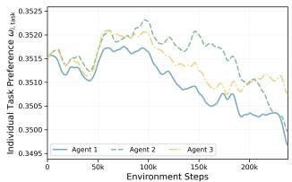  
(a) $\omega _ { \mathrm { t e a m , t a s k } } = 0 . 3 5$

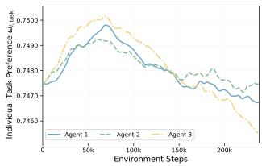  
(b) $\omega _ { \mathrm { t e a m , t a s k } } = 0 . 7 5$  
Figure 5: Individual task preferences learned by MIRL-S dur- ing training on Line.

Figure 5 shows two representative runs of MIRL-S on Line under diferent team preferences. The individual preferences are ini- tialised close to the corresponding team preference, but gradually change in diferent directions as training proceeds. In particular, the preferences of diferent agents become separated, showing that the meta-gradient updates learn agent-specific objective emphases rather than preserving the common initial preference.

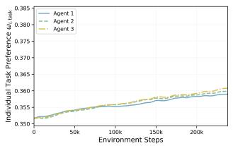  
(a) MIRL-S

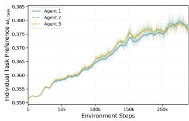  
(b) MIRL-D  
Figure 6: Individual task preferences learned by MIRL-S and MIRL-D on Spread, with $\omega _ { \mathrm { t e a m , t a s k } } = 0 . 3 5$

Having shown that MIRL-S learns agent-specific preferences, we next compare the preference adaptation of MIRL-S and MIRL-D under the same training setting. Figure 6 shows a representative run on Spread with $\omega _ { \mathrm { t e a m } } = ( 0 . 3 5 , 0 . 6 5 )$ . For MIRL-S, each curve represents the individual task preference learned for one agent. For

MIRL-D, the preference is generated dynamically at each timestep, so we report the mean task preference produced for each agent over the corresponding training batch.

Both variants progressively adapt their individual preferences away from the common initialisation. In MIRL-S, the learned agent preferences gradually separate during training. In MIRL-D, the gen-erated preferences show a larger overall shift and greater short-term variation, consistent with the additional flexibility of the context- dependent preference controller. These results confirm that the meta-gradient updates actively adapt both the static preference parameters in MIRL-S and the dynamic preference controller in MIRL-D.

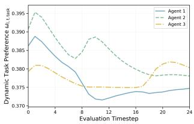  
(a) Evaluation episode 1

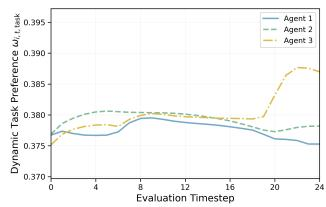  
(b) Evaluation episode 2  
Figure 7: Individual task preferences generated by MIRL-D during two example evaluation episodes on Spread under the fixed team preference $\omega _ { \mathrm { t e a m , t a s k } } = 0 . 3 5$

While the previous analysis focuses on preference adaptation during training, MIRL-D is designed to generate context-dependent preferences during execution. We therefore further examine how its individual preferences vary within an evaluation episode

Unlike MIRL-S, which maintains one learned preference for each agent, MIRL-D generates an individual preference $\omega _ { i , t }$ at each timestep from the agent’s recurrent hidden state. Figure 7 shows two example evaluation episodes from the same trained policy on Spread, with the team preference fixed to $\omega _ { \mathrm { t e a m } } = ( 0 . 3 5 , 0 . 6 5 )$ Since the two preference components sum to one, we again report only the task component $\omega _ { i , t , \mathrm { t a s k } }$ . The generated preferences vary across both agents and timesteps, while the team preference re- mains fixed throughout each episode. Moreover, the two episodes produce diferent preference trajectories, showing that MIRL-D generates context-dependent individual preferences rather than assigning each agent a fixed preference. Since no parameter updates are performed during evaluation, these changes reflect the dynamic context-dependent preference generation of the trained controller during execution.

## D Limitations

The learned individual preferences provide a potentially inter-pretable description of how diferent agents emphasise the underly- ing objectives, and our current results show that these preferences adapt diferently across agents and cooperative contexts. However, the present benchmark tasks are not designed to cleanly separate distinct behavioural tendencies or cooperative roles, which limits our ability to quantitatively relate changes in the learned preferences to specific changes in agent behaviour. A more systematic analysis would therefore require environments in which such be- havioural tendencies can be independently identified and measured. This represents an interesting direction for future work, particularly for studying whether the learned preferences can provide a meaningful and interpretable characterisation of agent roles and contributions.

Our current evaluation is also limited to two-objective cooperative tasks with relatively small agent populations. Extending the analysis to larger multi-agent systems and higher-dimensional objective spaces would provide a broader assessment of the scalability and generality of the proposed approach.