# Prior Predictive Matching for Bayesian LoRA

Tomasz Kuśmierczyk

Eliezer de Souza da Silva University of Coimbra, CISUC/LASI, DEI

Marcin Sendera Jagiellonian University NASK – National Research Institute

## Abstract

Bayesian variants of Low-Rank Adaptation (LoRA) provide principled uncertainty estimation when fine-tuning large foundation models, but require specifying the prior over the lowrank weight updates. We address this hyperparameter selection problem by introducing a closed-form prior-predictive estimator that operates before fine-tuning.

We analyze a second-order expansion of the network and quantify how the low-rank prior drives function-space deviations from the pretrained outputs. We also show that these prior-predictive quantities depend on the prior only through the product of the adaptation rank and the fourth power of the prior scale. Because the training targets share a single draw of the latent weight update, we can leverage the covariance between example residuals to derive a moment-matching estimator. Furthermore, our theoretical analysis establishes that the optimal prior precision scales as $r ^ { - 1 / 2 }$ with the rank r, allowing a single estimate to generalize across all ranks.

Controlled experiments across regression and classification tasks validate our approximation and show that our estimator recovers the true prior scale. On RoBERTa-large, our approach improves predictive negative loglikelihood (NLL) and calibration over both MAP and marginal-likelihood selection without requiring validation data, while achieving competitive out-of-distribution detection.

## 1 INTRODUCTION

Fine-tuning large pretrained models with Low-Rank Adaptation (LoRA) (Hu et al., 2022) restricts parameter updates to a low-dimensional subspace. For a selected weight matrix $W _ { 0 } .$ LoRA replaces $W _ { 0 }$ by

$W _ { 0 } + \Delta W$ , where ∆W is constrained to have a lowrank factorization. Bayesian extensions of LoRA (e.g., Yang et al., 2024) place a prior over this low-rank update, typically through Gaussian priors on its factors, and use the resulting posterior to quantify uncertainty This introduces two modeling choices: the rank of the update and the scale of its prior, σ (or equivalently its precision $\lambda = \sigma ^ { - 2 } )$ . Together, these quantities determine the magnitude and complexity of parameter changes regarded as plausible before observing the finetuning data and can therefore have a substantial effect on the resulting posterior.

In existing approaches, these hyperparameters are typically selected either by validation search over the trained models or by maximizing an approximation to the marginal likelihood. Both strategies require fitting the model before the prior hyperparameters can be assessed. This creates a mismatch between the role of the prior and the way it is specified: a quantity intended to encode plausible adaptations before fine-tuning is chosen using the outcome of fine-tuning itself.

For Bayesian matrix factorization (BMF), this mismatch is avoided by prior-predictive matching, which sets the hyperparameters by matching moments of the prior predictive distribution to the data (da Silva et al., 2023). LoRA decomposes the update as $\Delta W = U V$ and can therefore be viewed as a matrix factorization in parameter space. However, extending prior-predictive matching to LoRA is not immediate. In BMF, the observations are entries of the random matrix generated by the latent factors. In Bayesian LoRA, the observations are input-label pairs (x, y), and the latent update affects them only through the nonlinear network. The resulting prior-predictive distribution exhibits entirely different characteristics. Consequently, Bayesian LoRA requires a fundamentally different treatment from standard BMF.

In this paper, we study the prior predictive distribution of Bayesian LoRA and analyze its moments. Our estimators allow the prior hyperparameters to be selected in closed form. They need only the pretrained model and the fine-tuning data, and require neither LoRA optimization nor validation data (Table 1 compares the approaches). We effectively turn the prior specification from a model-selection problem after fine-tuning into a statistical estimation problem before fine-tuning.

Our contributions are as follows:

1. We develop a prior-predictive analysis of Bayesian LoRA that explicitly relates the LoRA prior scale and rank to moments of the induced changes in network outputs.

2. We derive a closed-form prior-predictive estimator for the Bayesian LoRA prior scale that can be computed before fine-tuning, does not require validation over trained models or post-hoc evidence optimization, and separates shared parameter-induced variation from independent observation noise.

3. We evaluate the resulting calibration procedure across controlled and pretrained-model experiments, testing whether prior-predictive calibration recovers appropriate prior scales and whether these scales provide competitive uncertainty quantification and predictive performance after Bayesian LoRA fine-tuning.

The code is available here. The appendices contain the proofs, additional estimators, the details of the experiments, and a further study of fine-tuning under the estimated prior (Appendix I).

## 2 BACKGROUND

Generative model. We consider a pretrained neural network $f ( x ; \{ W \} )$ with frozen weights in which selected linear layers are adapted (fine-tuned) as follows: $W _ { 0 } \to \cdots { \overset { \cdot } { W _ { 0 } } } + \Delta W$ The update factorizes as $\Delta W = U V$ with $U \in \mathbb { R } ^ { N _ { o } \times K }$ and $\bar { V } \in \mathbb { R } ^ { K \times N _ { i } }$ , where $K$ is the LoRA rank and $N _ { i } , \ N _ { o }$ are the layer input and output dimensions. The Bayesian model places the prior on the factors as:

$$
U _ { i k } \sim { \mathcal { N } } \big ( \mu _ { U } , \sigma _ { U } ^ { 2 } \big ) , \qquad V _ { k j } \sim { \mathcal { N } } \big ( \mu _ { V } , \sigma _ { V } ^ { 2 } \big ) ,\tag{1}
$$

where $\mu _ { U }$ and $\sigma _ { U }$ denote the mean and scale (standard deviation) shared by all entries of $U ,$ and $\mu _ { V }$ and $\sigma _ { V }$ the same for V. Throughout most of the paper we assume the standard $( \mathrm { e . g . }$ , Yang et al., 2024) zero means and one shared scale: $\mu _ { U } = \mu _ { V } = 0 , \sigma _ { U } = \sigma _ { V } = \sigma$ . The prior $p ( \Delta W \mid \sigma , K )$ is then induced from equation 1 through $\Delta W = U V$

Throughout the rest of the paper, for brevity, we consider the frozen weights to be part of the network function itself and focus only on one-layer updates: $f ( x ; W _ { 0 } + \Delta W ) \equiv f ( x ; \Delta W )$ We explain the generalization to multiple modules in Section 5. For random $\Delta \bar { W }$ , the output $Y ( x ) = f ( x ; \Delta W )$ is also a random variable conditioned on the input $x .$ Therefore, the full generative model for fine-tuning is:

Table 1: Prior selection for Bayesian LoRA.
<table><tr><td></td><td>validation search</td><td>marginal likelihood</td><td>ours</td></tr><tr><td>available before fine-tuning</td><td>X</td><td>X</td><td>√</td></tr><tr><td>needs no held-out data</td><td>X</td><td>√</td><td>√</td></tr><tr><td>one estimate for all ranks</td><td>X</td><td>X</td><td>V</td></tr></table>

$$
\begin{array} { l } { \Delta W ^ { * } \sim p ( \Delta W \mid \sigma , K ) \ \mathrm { o n c e } , y _ { n } \sim p \big ( y \mid f ( x _ { n } ; \Delta W ^ { * } ) \big ) } \\ { \ \mathrm { i n d e p e n d e n t l y ~ f o r } \ n = 1 , \dots , N . } \end{array}\tag{2}
$$

Prior predictive matching. The generative model in equation 2 induces the prior predictive distribution $\begin{array} { r } { p ( Y ~ \vert ~ \sigma , K ) = \int p ( Y ~ \vert ~ \Delta W ) p ( \Delta W ~ \vert ~ \sigma , K ) \mathrm { d } \Delta W } \end{array}$ which describes how the outputs should scatter around the pretrained function under the chosen prior. Then, prior-predictive matching (Gelman et al., 2026) can be used to select the hyperparameters so that simple moments of this distribution agree with the corresponding empirical quantities. This, however, requires expressing the predictive distribution as a function of $( \sigma , K )$ (Section 3) and identifying which empirical quantities should be matched (Section 4).

## 3 PRIOR PREDICTIVE MOMENTS

In this section, we find the characteristics of the prior predictive distribution for neural networks with Bayesian LoRA. First, we discuss the moments of the updates ∆W (Section 3.1) and then, we show how they can be propagated through the network (Section 3.2).

## 3.1 Moments of the update

Bayesian LoRA is an instance of Bayesian matrix factorization (BMF) in latent space. Therefore, the moments derived originally for BMF (da Silva et al., 2023) can be extended to Bayesian LoRA:

Lemma 1 (proof in Appendix A). With zero-mean factors of scale $\sigma ,$ the entries of ∆W have mean zero, are mutually uncorrelated, and share the variance $\theta =$ $K \sigma ^ { 4 }$

$$
\begin{array} { r } { \mathrm { C o v } \big ( \Delta W _ { i j } , \Delta W _ { i ^ { \prime } j ^ { \prime } } \big ) = \left\{ \begin{array} { l l } { \theta } & { i f i = i ^ { \prime } \ a n d \ j = j ^ { \prime } , } \\ { 0 } & { o t h e r w i s e . } \end{array} \right. } \end{array}\tag{3}
$$

Their fourth moment is $3 K ( K { + } 2 ) \sigma ^ { 8 }$ , so the kurtosis equals $3 + 6 / K$

Under the general factor prior equation 1 the mean becomes Kµuµv, the variance becomes $K \big ( ( \sigma _ { U } ^ { 2 } + \mu _ { U } ^ { 2 } ) ( \sigma _ { V } ^ { 2 } + \mu _ { V } ^ { 2 } ) - \mu _ { U } ^ { 2 } \mu _ { V } ^ { 2 } \big )$ , and distinct entries covary only within a row (covariance $K \sigma _ { U } ^ { 2 } \mu _ { V } ^ { 2 }$ , through the shared row of U) or within a column (covariance $K \mu _ { U } ^ { 2 } \sigma _ { V } ^ { 2 }$ , through the shared column of V).

Uncorrelated entries with a common variance mean that, up to second order, the prior acts on the network like isotropic noise of strength θ injected into the adapted weights. The variance $\theta = K \sigma ^ { 4 }$ couples the rank and the scale into one number, and therefore, second-order quantities cannot distinguish a rank-4 prior from a rank-16 prior with a suitably smaller scale. To distinguish them one needs to employ the $6 / K$ kurtosis term. In theory, if the rank itself had to be inferred from data rather than chosen by budget, fourth-order prior-predictive information could be used. We verify it by simulation (Section 7.3).

## 3.2 Propagation through the network

Let $z = \mathrm { v e c } ( \Delta W ) \in \mathbb { R } ^ { P }$ denote the update with its $P = N _ { o } N _ { i }$ entries stacked into one vector. $g ( x ) \in \mathbb { R } ^ { P }$ is the gradient of the network output with respect to $z . \ H ( x ) \in \mathbb { R } ^ { P \times P }$ is the corresponding Hessian, with entries $H _ { p q } ( x ) = \partial ^ { 2 } f / \partial z _ { p } \partial z _ { q }$ .Finally, let $s ( x ) \ =$ $\| g ( x ) \| ^ { 2 }$ and $t ( x ) = \mathrm { T r } H ( x )$

We show the propagation of moments of the latent variables to observed quantities (i.e., outputs of the network) for a network $f ( x ; \Delta W )$ with a fixed example input x. For brevity, we consider just a single scalar output (for example, the probability of a single class). The only difference for multiple outputs is the additional dimension for all the objects: for example, the Hessian matrix becomes a tensor of Hessian matrices (one for each output).

The second-order Taylor expansion around the pretrained network $f ( x ; 0 )$ is

$$
\begin{array} { l } { { f ( x ; \Delta W ) \approx f ( x ; 0 ) + \langle g ( x ) , z \rangle } } \\ { { + \frac { 1 } { 2 } z ^ { \top } H ( x ) z . } } \end{array}\tag{4}
$$

Under the prior the update is random, so for each fixed input x the left-hand side of equation 4 is exactly the random output $Y ( x ) = f ( x ; \Delta W )$ of Section 2, and its moments follow by taking expectations of the right-hand side over the prior, term by term. The linear term vanishes because $\mathbb { E } [ \Delta W ] = 0$ .The quadratic term is an expectation of a quadratic form in the zero-mean vector z. Written out over pairs of entries it $\begin{array} { r } { \mathrm { i s } ~ z ^ { \top } H z = \sum _ { p , q } H _ { p q } z _ { p } z _ { q } } \end{array}$ , and since $H ( x )$ is fixed and $\mathbb { E } [ z _ { p } z _ { q } ] = \mathrm { C o v } ( z _ { p } , z _ { q } )$ for zero-mean entries, $\begin{array} { r } { \mathbb E [ z ^ { \top } H z ] = \overleftrightarrow { \sum } _ { p , q } H _ { p q } \mathrm { C o v } ( \bar { z } _ { p } , \bar { z } _ { q } ) } \end{array}$ . Lemma 1 states that, with zero-mean factors, the entries of $\Delta W$ are mutually uncorrelated and share the variance θ. Since each $z _ { p }$ is one entry of $\Delta W$ , this means $\mathrm { C o v } ( z _ { p } , z _ { q } ) = \theta$ when $p = q$ and zero otherwise, so only the diagonal survives and the double sum collapses onto the trace, $\begin{array} { r } { \theta \sum _ { p } H _ { p p } = \theta t ( x ) } \end{array}$ . Consequently, the mean shift of each output, expected under the prior, is

$$
\begin{array} { r } { \mathbb { E } [ Y ( x ) ] - f ( x ; 0 ) \approx \frac { 1 } { 2 } \theta t ( x ) . } \end{array}\tag{5}
$$

On the other hand, second moments can be obtained by multiplying two copies of equation 4, taken at inputs x and $x ^ { \prime } ,$ and then averaging over the prior again. At leading order only the product of the two linear terms survives, and it collapses exactly as before: $\begin{array} { r l } { \mathbb { E } \big [ \langle g ( x ) , z \rangle \langle g ( x ^ { \prime } ) , z \rangle \big ] } & { = } \end{array}$ $\begin{array} { r } { \sum _ { p q } g _ { p } ( x ) g _ { q } ( x ^ { \prime } ) \mathrm { C o v } \bigl ( z _ { p } , z _ { q } \bigr ) = \theta \langle g ( x ) , g ( x ^ { \prime } ) \rangle } \end{array}$ . The cross terms between a linear and a quadratic factor contain third moments of $\Delta W$ , which vanish by the sign symmetry of the factors, and products of two quadratic terms are of order $\theta ^ { 2 }$ and dropped (Appendix A). This yields the prior predictive variance and the predictive covariance between the outputs at two different inputs. It is nonzero because both are functions of the same random draw $\Delta W ^ { * }$

$$
\mathrm { V a r } [ Y ( x ) ] \approx \theta s ( x ) , \mathrm { C o v } [ Y ( x ) , Y ( x ^ { \prime } ) ] \approx \theta \langle g ( x ) , g ( x ^ { \prime } ) \rangle .\tag{6}
$$

Equations 5 and 6 specify the prior predictive distribution. The pretrained output at each input x is shifted in proportion to the local curvature (equation 5), and the outputs fluctuate jointly around the pretrained function with a covariance given by equation 6. Note that the prior predictive distribution depends on its hyperparameters $( \sigma , K )$ entirely through the single scalar θ.

Appendix A collects the omitted algebra and the study of the higher-order terms. Section 7.1 studies regions where the approximation is accurate.

## 3.3 Practical consequences

The prior predictive distribution induced by the prior on $\Delta W$ depends only on θ. Consequently, the problem of finding the prior's hyperparameters reduces to estimation of ê. However, practical LoRA implementations conventionally use r rather than K, and have the additional fixed scaling hyperparameter α, i.e., $\begin{array} { r } { \Delta W = \frac { \alpha } { r } U V . } \end{array}$ The additional multiplier $\alpha / r$ scales the variance from Lemma 1 by $( \alpha / r ) ^ { 2 }$ , SO

$$
\theta = { \textstyle \left( { \frac { \alpha } { r } } \right) } ^ { 2 } r \sigma ^ { 4 } = { \frac { \alpha ^ { 2 } \sigma ^ { 4 } } { r } } \implies { \hat { \lambda } } = \sigma ^ { - 2 } = { \frac { \alpha } { \sqrt { \hat { \theta } r } } } .\tag{7}
$$

Corollary 1. If the data determine an optimal value $\theta ^ { * } \ o f \theta ,$ , then the optimal prior precision at rank r obeys $\lambda ^ { * } ( \dot { r } ) \propto r ^ { - 1 / 2 }$ at fixed α.

Corollary 1 is the Bayesian counterpart of rankcorrected scaling rules for deterministic LoRA (Kalajdzievski, 2023). It implies that any procedure tuning λ must reproduce this scaling, and a prior-predictive estimate transfers across ranks without a new search, because $\hat { \theta }$ does not depend on the rank. Section 7.5 tests the scaling in fine-tuning.

## 4 MOMENT MATCHING

In the standard matrix factorization task every observed matrix entry is a new sample from the prior, so ordinary averaging over the observations estimates prior-predictive moments directly. On the other hand, in Bayesian LoRA there is just one draw $\Delta W ^ { * }$ , evaluated at many inputs and read out through noisy labels, as in equation 2. Therefore, averaging over examples finds the expectations over inputs and over label noise, but not over the prior itself, making the estimation problem more challenging.

## 4.1 Basics

We start with a binary classification problem, where the network scalar output (as specified in Section 3.2) is the probability of the positive class. Let $p _ { 0 , n } ~ =$ $f ( x _ { n } ; 0 ) , p _ { n } = f ( x _ { n } ; \Delta W ^ { * } )$ and $r _ { n } = y _ { n } - p _ { 0 , n }$ . The first expression denotes the pretrained probability at training input $x _ { n }$ , a known number obtained by running the pretrained network. The second is the probability under the realized draw. It is not observable because $\Delta W ^ { * }$ is not, and the observed label is $y _ { n } \mid \Delta W ^ { * } \sim$ Bernoull $\mathrm { i } ( p _ { n } ) , \mathrm { i . e . , } p _ { n } = \mathbb { E } [ y _ { n } \mid \Delta W ^ { * } ]$ . The third is the observable residual for example n.

From equation 5 we get the expected residual:

$$
\begin{array} { r l } & { \mathbb { E } [ r _ { n } ] = \mathbb { E } \big [ \mathbb { E } [ y _ { n } \mid \Delta W ^ { * } ] \big ] - p _ { 0 , n } = \mathbb { E } [ p _ { n } ] - p _ { 0 , n } } \\ & { \qquad = \mathbb { E } [ Y ( x _ { n } ) ] - f ( x _ { n } ; 0 ) \approx \frac { 1 } { 2 } \theta t _ { n } , } \end{array}\tag{8}
$$

where $\mathbb { E } [ p _ { n } ] = \mathbb { E } [ Y ( x _ { n } ) ]$ because $p _ { n }$ is exactly the random output $Y ( x _ { n } )$ (Section 2), evaluated at the prior draw that generated the data.

We also abbreviate $g _ { n } = g ( x _ { n } ) , s _ { n } = s ( x _ { n } ) , t _ { n } = t ( x _ { n } )$

## 4.2 Binary classification estimator

The most straightforward use of equation 8, suggested by matrix-factorization matching, is to average both sides over the dataset and solve for θ. This naive aggregate estimator fails for several reasons, primarily because binary labels satisfy $y ^ { 2 } = y ,$ so every statistic computed from a single example informs only the first moment, which by equation 5 carries just a weak secondorder trace signal. In addition, on roughly balanced tasks the traces $t _ { n }$ change sign and cancel in the sum. The details are discussed in Appendix B.

On the other hand, by equation 6, the prior scale σ determines the covariance between the outputs at different inputs. Since all labels share the single draw $\Delta W ^ { * }$ , the residuals of different examples are correlated, which allows us to estimate θ. Each residual is the functional shift of the draw plus the label noise, $r _ { n } =$ $( p _ { n } - p _ { 0 , n } ) + \varepsilon _ { n }$ with $\varepsilon _ { n } = y _ { n } - p _ { n }$ . Given $\Delta W ^ { * }$ , the labels are independent with $y _ { n } \mid \Delta W ^ { * } \sim \mathrm { B e r n o u l l i } ( p _ { n } )$ so the noise terms $\varepsilon _ { n }$ are also independent across examples and satisfy $\mathbb { E } [ \varepsilon _ { n } ~ \mid ~ \Delta W ^ { * } ] = 0$ .We identify the dependence of the residuals on θ by taking the expectation of $r _ { n } r _ { m }$ for two examples $n \neq m$ jointly over the draw and the label noise (as in the model equation 2). Conditioning on $\Delta W ^ { * }$ , every term of the product that contains $\varepsilon _ { n }$ or $\varepsilon _ { m }$ has zero expectation, and by equation 6

$$
\begin{array} { r l } & { \mathbb { E } [ r _ { n } r _ { m } ] = \mathrm { C o v } ( p _ { n } , { p _ { m } } ) + O ( \theta ^ { 2 } ) } \\ & { \qquad \approx \theta \langle g _ { n } , g _ { m } \rangle , \qquad n \neq m . } \end{array}\tag{9}
$$

Equation 9 gives one equation for every pair of examples, and it does not suffer from the problems of the naive estimator (Appendix B). We estimate θ from these equations by least squares. Minimizing $\begin{array} { r } { \sum _ { n \neq m } \left( r _ { n } r _ { m } - \theta \left. g _ { n } , g _ { m } \right. \right) ^ { 2 } } \end{array}$ gives $\begin{array} { r l } { \widehat { \theta } } & { { } = } \end{array}$ $\begin{array} { r } { \sum _ { n \ne m } r _ { n } r _ { m } \left. \langle g _ { n } , g _ { m } \rangle \right/ \sum _ { n \ne m } \langle g _ { n } , g _ { m } \rangle ^ { 2 } } \end{array}$

An efficient implementation of the estimator does not require forming the $N ^ { 2 }$ pairs. Summing over all pairs and subtracting the terms with $ { n _ { \mathrm { ~  ~ } } } =  { m _ { \mathrm { ~  ~ } } }$ yields $\begin{array} { r } { \sum _ { n \neq m } r _ { n } r _ { m } \langle g _ { n } , g _ { m } \rangle = \| \sum _ { n } r _ { n } g _ { n } \| ^ { 2 } - \sum _ { n } r _ { n } ^ { 2 } s _ { n } } \end{array}$ and $\begin{array} { r } { \sum _ { n \neq m } \dot { \langle g _ { n } , g _ { m } \rangle } ^ { 2 } = \| G ^ { \top } G \| _ { F } ^ { 2 } - \sum _ { n } s _ { n } ^ { 2 } } \end{array}$ , where $G \in$ $\mathbb { R } ^ { N \times P }$ has the per-example gradients $g _ { n }$ as its rows, because $( G G ^ { \top } ) _ { n m } = \langle g _ { n } , g _ { m } \rangle$ and $\| G G ^ { \top } \| _ { F } = \| G ^ { \top } G \| _ { F }$ Hence, the cross-covariance estimator for binary classification tasks is

$$
\hat { \theta } = \frac { \left. \sum _ { n } r _ { n } g _ { n } \right. ^ { 2 } - \sum _ { n } r _ { n } ^ { 2 } s _ { n } } { \left. G ^ { \top } G \right. _ { F } ^ { 2 } - \sum _ { n } s _ { n } ^ { 2 } } .\tag{10}
$$

Its complexity is linear in the number of examples. The subtracted terms are exactly the same-example terms, whose observation noise does not cancel.

## 4.3 Regression estimator

For regression tasks the likelihood in equation 2 is Gaussian: $y _ { n } \mid \Delta W ^ { * } \sim \mathcal { N } \big ( f ( x _ { n } ; \Delta W ^ { * } ) , \tau ^ { 2 } \big )$ with observation-noise variance $\tau ^ { 2 }$ . The derivation of equation 9 assumes only that the label noise $\varepsilon _ { n }$ has zero mean given the draw and is independent across examples. Both also hold for regression. Therefore, equation 9 and equation 10 can be applied directly to the residuals $r _ { n } = y _ { n } - f ( x _ { n } ; 0 )$ , and τ need not be known. If τ is known, the per-example second moments yield the following alternative estimator:

$$
\mathbb { E } [ r _ { n } ^ { 2 } ] \approx \theta s _ { n } + \tau ^ { 2 } \implies \hat { \theta } _ { \mathrm { r e g } } = \frac { \frac { 1 } { N } \sum _ { n } r _ { n } ^ { 2 } - \tau ^ { 2 } } { \frac { 1 } { N } \sum _ { n } s _ { n } } .\tag{11}
$$

## 4.4 Multiclass estimator

For multiclass models and tasks (with C outputs and C classes), the residuals are vectors with entries $r _ { n c } = \mathbf { 1 } [ y _ { n } = c ] - p _ { 0 , c } ( x _ { n } )$ , the gradients $g _ { n } ^ { ( c ) }$ need to be computed per class, and the pair equations $\mathbb { E } [ r _ { n c } r _ { m c ^ { \prime } } ] \approx \theta \langle g _ { n } ^ { ( c ) } , g _ { m } ^ { ( c ^ { \prime } ) } \rangle$ range over pairs of exampleand-class rows. Since the label noise is dependent across the classes of one example, we use only products of residuals from different examples. Let $\grave { M _ { n } } \in \mathbb { R } ^ { C \times P }$ have the C class gradients of example n as its rows, and let G have all NC of them. Repeating the procedure of the binary estimator, we obtain

$$
\widehat { \theta } _ { \mathrm { m c } } = \frac { \left. \sum _ { n , c } r _ { n c } g _ { n } ^ { ( c ) } \right. ^ { 2 } - \sum _ { n } \left. \sum _ { c } r _ { n c } g _ { n } ^ { ( c ) } \right. ^ { 2 } } { \left. G ^ { \top } G \right. _ { F } ^ { 2 } - \sum _ { n } \left. M _ { n } M _ { n } ^ { \top } \right. _ { F } ^ { 2 } } ,\tag{12}
$$

which reduces to equation 10 for $C = 1$

## 5 IMPLEMENTATION

The estimators in Section 4 require per-example gradients with respect to each adapted weight matrix. Explicitly storing these gradients can be prohibitively expensive for large models, such as Transformer-based MLMs or LLMs, where many high-dimensional matrices are adapted over thousands of examples. We therefore develop an implementation that estimates the required quantities in one pass over the training data, without storing the full gradient matrices.

Multiple adapters. LoRA is typically applied to multiple weight matrices throughout the network. Let $\ell = 1 , \ldots , L$ index the adapted modules. Under independent priors across adapters, their first-order contributions are uncorrelated, and the cross-example covariance decomposes as

$$
\mathbb { E } [ r _ { n } r _ { m } ] \approx \sum _ { \ell = 1 } ^ { L } \theta _ { \ell } \big \langle g _ { n } ^ { ( \ell ) } , g _ { m } ^ { ( \ell ) } \big \rangle , \qquad n \neq m ,\tag{13}
$$

where $g _ { n } ^ { ( \ell ) }$ denotes the gradient associated with adapter l for example n. When a common scale is shared across adapters, as in the standard Laplace-LoRA prior, the inner products can be summed and equation 10 applies directly. Allowing a separate scale for each adapter instead yields an L-dimensional least-squares problem, which is dominated by noise at typical singletask sample sizes (Appendix B). We therefore use a shared scale in our experiments.

## 5.1 Gradient sketches

To implement the estimator efficiently, we replace the per-example gradients by random sketches. For a linear layer, the per-example gradient in matrix form, $G _ { n } \in$ $\mathbb { R } ^ { \tilde { N } _ { o } \times N _ { i } }$ , is a sum of outer products over token positions, $\begin{array} { r } { G _ { n } = \sum _ { t } \delta _ { n , t } h _ { n , t } ^ { \top } . } \end{array}$ where $h _ { n , t }$ is the layer input and $\delta _ { n , t }$ is the gradient of the scalar output with respect to the layer output.

Algorithm 1 Closed-form prior precision for LoRA   
1: Residuals $r _ { n } = y _ { n } - f ( x _ { n } ; 0 )$   
2: One forward and backward pass: independent   
sketches $\tilde { g } _ { n } ^ { ( 1 ) } , \tilde { g } _ { n } ^ { ( 2 ) }$ by equation 14 per module.   
3: ê by equation 10 on the sketches, squared inner   
products across the two.   
4: return $\hat { \lambda } = \alpha / \sqrt { \hat { \theta } r } ,$ or maximal precision if $\widehat { \theta } \leq 0 .$

Our estimators depend on these gradients only through inner products, which can be preserved in expectation by random projections. Let $S _ { \mathrm { o u t } }$ and $S _ { \mathrm { i n } }$ be Gaussian sketch matrices with d rows, normalized such that $\mathbb { E } [ S ^ { \top } S ] = I .$ We replace each gradient by the twosided sketch

$$
\tilde { g } _ { n } = S _ { \mathrm { o u t } } G _ { n } S _ { \mathrm { i n } } ^ { \top } = \sum _ { t } \left( S _ { \mathrm { o u t } } \delta _ { n , t } \right) \left( S _ { \mathrm { i n } } h _ { n , t } \right) ^ { \top } .\tag{14}
$$

Because the sketch is linear in $G _ { n } ,$ it can be accumulated directly from the projected token-level factors without forming the full gradient matrix. Moreover, $\mathbb { E } \big [ \langle \tilde { g } _ { n } , \tilde { g } _ { m } \rangle \big ] = \langle \bar { g } _ { n } , g _ { m } \rangle$

The denominator of equation 10 contains squared inner products. Squaring a single sketched estimate introduces a positive bias due to the sketch variance. We therefore use two independent sketches and multiply the corresponding inner-product estimates, which yields an unbiased estimator of the squared inner product (Appendix C).

## 5.2 Algorithm

Algorithm 1 requires a single forward-backward pass over the training set. If $\hat { \theta } \leq 0$ , the estimated crossexample signal is non-positive and we set the prior precision to its maximum value. The resulting estimate depends only on the pretrained model and the task data, and is therefore available before fine-tuning. It can be used directly as the Bayesian prior precision or as the corresponding regularization strength during optimization (Appendix I). By Corollary 1, the same computation applies to all LoRA ranks.

## 6 RELATED WORK

Our work relates to Bayesian treatments of LoRA, prior predictive analyses of neural networks, prior predictive matching, and the selection of the prior precision for Laplace approximations.

Bayesian LoRA. Bayesian treatments of LoRA differ mainly in how they approximate the posterior over the adapter weights. In particular, there exist variants based on a post-hoc Laplace approximation (Yang et al., 2024), variational inference during fine-tuning (Wang et al., 2024), stochastic weight averaging (Onal et al., 2024), and ensembles of adapters (Wang et al., 2023; Doan et al., 2025). In all of them, the prior scale is either fixed in advance or tuned after training. Hierarchical and meta-learned priors (Eide and Frigessi, 2024; Kim and Hospedales, 2025; Zhang et al., 2025) instead learn a shared prior from many related tasks. Our estimate is complementary: it sets the prior scale of a single task from its own data, before fine-tuning, and, in principle, can be combined with any of these posterior approximations. However, there also exist some other variants of Bayesian LoRA using a slightly different structure of the update, which places the posterior on a small matrix inside a projected lowrank subspace rather than on the projection matrices (Marszałek et al., 2025; Dubovik et al., 2026). Our derivations can be adapted to these structures with few changes, but this is beyond the scope of this paper.

Prior predictive analysis of neural networks. The distribution of the outputs of standard networks under random weights has been studied at initialization and in the infinite-width limit. In this limit it becomes a Gaussian process (Neal, 1996; Lee et al., 2018), and training of the linearized network is governed by the neural tangent kernel (Jacot et al., 2018). At finite width, the prior predictive is known in closed form and becomes increasingly heavy-tailed as depth grows relative to width (Noci et al., 2021; Zavatone-Veth and Pehlevan, 2021). It is analogous to the excess kurtosis 6/K of a rank-K update (Lemma 1).

Moments of the outputs under random weights also guide practical choices of scale. For example, signal propagation analyses use them to choose the initialization scale at which deep networks remain trainable (Schoenholz et al., 2017). Noci et al. (2022) extend this analysis to transformers. These analyses choose a scale as the depth grows, whereas rank-stabilized LoRA applies a related argument to the rank. It scales the adapter by $\alpha / \sqrt { r }$ so that the size of its output and of its gradients does not change with the rank during fine-tuning (Kalajdzievski, 2023). However, to our knowledge, no such rule existed for the prior precision of Bayesian LoRA. Corollary 1 provides the first one: it states how the precision must change with the rank so that the prior predictive stays fixed.

Function-space methods specify it either directly as a stochastic process (Sun et al., 2019) or by choosing the weight prior so that the functions it induces match a target process (Tran et al., 2022; Sendera et al., 2025).

Meanwhile, Fortuin et al. (2021) empirically studied which weight priors suit trained networks. In contrast, we propagate a factorized prior on the update through a second-order expansion around the pretrained weights, at finite width, and use the resulting moments to estimate the prior scale from data.

Prior predictive matching. Several approaches specify the prior through the predictions it implies. Predictive complexity priors define the prior by comparing the predictions of the model with those of a simpler reference model (Nalisnick et al., 2021). Prior predictive matching instead chooses the hyperparameters so that statistics of the prior predictive distribution agree with target values. It connects prior elicitation, which translates knowledge about observable quantities into prior distributions (Mikkola et al., 2024), with prior predictive checks, a standard step of the Bayesian workflow (Gabry et al., 2019). In elicitation, the targets are judgments of an expert, and Hartmann et al. (2020) fit them by stochastic optimization, which, however, works only for simple shallow models. By contrast, for BMF, da Silva et al. (2023) obtain the targets from the data and match prior predictive moments of the observed entries in closed form. da Silva et al. (2026) study when tensor ranks are identifiable from such moments. Closed-form empirical Bayes solutions also exist for fully observed variational matrix factorization (Nakajima et al., 2013).

Bayesian LoRA, however, differs in that the observations depend on the update only through the nonlinear pretrained network and share a single draw of it (Section 4).

Precision selection and calibration. The standard ways to choose the prior precision of a Laplace approximation are maximization of the marginal likelihood (MacKay, 1992; Immer et al., 2021a; Antorán et al., 2022) and validation search. Both require a trained (in our case: already a fine-tuned) model.

In contrast, our estimate needs neither a trained model nor validation data. However, when validation data are available, it can additionally use them to fit a temperature (Guo et al., 2017). This optional step allows it to match validation search in test NLL (Section 7.4).

## 7 EXPERIMENTS

In this Section, we first validate the theoretical approximations and parameter recovery in controlled experiments, where the data-generating prior is known (Sections 7.1 to 7.3). Then, we evaluate the estimated prior precision on RoBERTa-large, considering predictive performance, calibration, the dependence on the LoRA rank, and out-of-distribution detection (Sections 7.4 to 7.6).

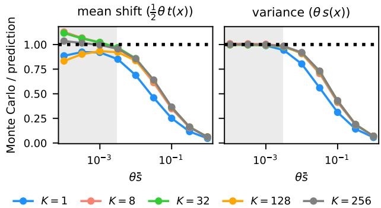  
Figure 1: Ratio of moments of the network output to their second-order predictions (Equations 5 and 6). Shaded: $\theta \bar { s } \le 3 \cdot 1 0 ^ { - 3 }$ (the range used in Section 7.2).

In the controlled experiments, $\Delta W = U V$ is drawn from the factor prior (equation 1), and predictions are computed using a full nonlinear network. We parameterize the strength of the induced functional perturbation by θs, where s is the average of s(x) over the inputs. By equation 6, θs is the average prior variance of the output.

## 7.1 Accuracy of the second-order approximation

We first evaluate the quality of the moment approximations (equation 5 and equation 6), on which our estimators depend. Figure 1 compares them against Monte Carlo estimates for a small tanh network (Appendix E).

The approximation is accurate for $\theta \bar { s } \lesssim 3 \cdot 1 0 ^ { - 3 }$ . In this range, the variance error is below 2% for $K \geq 8 .$ while the mean-shift error is at most 17%. At fixed $\theta ,$ the results are nearly invariant to K, as predicted in Section 3.2. The main exception is $K = 1$ , where the first neglected term depends on the kurtosis $3 + 6 / K$ (Appendix A).

For stronger priors, the second-order expansion overestimates both moments as the nonlinear output saturates. The discrepancy becomes substantial beyond $\theta \bar { s } \approx 3 \cdot 1 0 ^ { - 3 }$ and exceeds 50% at $1 0 ^ { - 1 }$ . Since the estimator inverts these moments, this regime produces an upward bias in λ. We therefore restrict the experiment in Section 7.2 (scale recovery) to the regime where the approximation is accurate.

## 7.2 Recovery of the prior scale

We next test whether the cross-covariance estimator recovers the prior scale from a single task (Figure 2). Each task draws one update $\Delta W ^ { * }$ at the true σ, generates N labels according to equation 2, and estimates $\hat { \sigma } = ( \hat { \theta } / K ) ^ { 1 / 4 }$ with $K = 8$ We consider regression with Gaussian noise and binary classification with a logistic model. For regression, we additionally compare equation 10 with equation 11 (which is given the true noise level). The prior scales span θs from $1 0 ^ { - 5 }$ to $3 \cdot 1 0 ^ { - 3 } $ , within the regime validated in Section 7.1. Appendix E covers any remaining details.

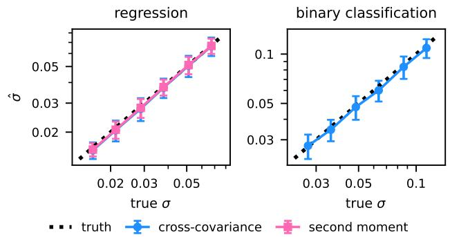  
Figure 2: Recovery of the prior scale: average $\hat { \sigma } \pm$ one standard deviation.

Across tasks with positive estimates, ô is within 4% of the true scale for regression and within 6% for classification. The cross-covariance estimator, which does not use τ, is as accurate as the second-moment estimator that uses the true noise level. At the smallest classification scale, 5% of tasks yield $\hat { \theta } \leq 0$ These cases are excluded. The standard deviation of ô across tasks is 11 to 17% of σ, compared with 9 to 13% for the second-moment estimator. This spread comes mostly from the update itself: each task observes a single draw $\Delta W ^ { * }$ , whose entries are by chance larger or smaller than the prior scale implies (Section 4).

## 7.3 Rank information in fourth moments

Second-order moments depend on the rank and prior scale only through θ and therefore cannot identify K separately (Section 3.1). In this subsection, however, we verify that rank information appears in the fourth moment of the prior predictive.

To first order, the output perturbation for example n is $\langle G _ { n } , \Delta W \rangle$ , where $\dot { G } _ { n } \in \mathbf { \bar { R } } ^ { N _ { o } \times N _ { i } }$ is the matrix form of $g ( x _ { n } )$ . Its kurtosis is

$$
\kappa _ { n } = 3 + \frac { 6 \rho _ { n } } { K } , \qquad \rho _ { n } = \frac { \sum _ { i } \gamma _ { n i } ^ { 4 } } { \left( \sum _ { i } \gamma _ { n i } ^ { 2 } \right) ^ { 2 } } ,\tag{15}
$$

where $\gamma _ { n i }$ are the singular values of $G _ { n }$ (Appendix A.3). For a single entry of $\Delta W$ $\rho _ { n } ~ = ~ 1$ , recovering the $3 + 6 / K$ result of Lemma 1. We estimate the slope b of $\kappa _ { n } - 3$ against $\rho _ { n }$ and set $\hat { K } = 6 / b$

The networks contain one tanh layer followed by a linear output for regression and a logistic output for classification. Each of 24 examples averages two inputs, so that $G _ { n }$ has rank two (Appendix E). We estimate the kurtosis from 10,000 independent draws of ∆W without label noise. This experiment therefore tests identifiability under the prior predictive. It does not estimate K from a single task.

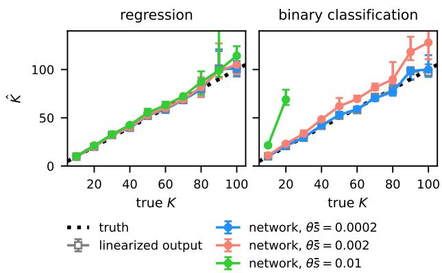  
Figure 3: Recovery of the rank from the kurtosis (Equation 15). Median $\hat { K }$ over 10 repetitions, with interquartile bars. The green line in the right panel ends early, as for larger K the estimates $\hat { K }$ are undefined or outside the plotted range.

For the linearized output, the median $\hat { K }$ is within 13% of the true rank. At $\theta \bar { s } = 2 { \cdot } 1 0 ^ { - 4 }$ , the nonlinear network agrees with this estimate within 3%. Recovery deteriorates for stronger priors, particularly for classification. This follows from equation 15: the rank enters only through the small correction $6 \rho _ { n } / K$ , making fourth moments more sensitive to the nonlinearity than the second-order quantities used for scale estimation. The experiment thus confirms that the prior predictive contains rank information, but also that this information is fragile under nonlinear distortion.

## 7.4 Predictive performance

We now turn to Bayesian LoRA fine-tuning of RoBERTa-large (Liu et al., 2019), where the true prior is unknown and the estimated precision is evaluated by its predictive performance. We follow Laplace-LoRA (Yang et al., 2024) and use the pretrained maskedlanguage-model head for classification, so that $f ( x ; 0 )$ defines task predictions before adaptation. We consider SST-2, MR, CR, and AG News, with 64 to 4,096 training examples and three seeds.

The posterior is a Kronecker-factored Laplace approximation with prior precision λ (Daxberger et al., 2021), and predictions use the linearized predictive (Immer et al., 2021b). As is standard for deep networks, the posterior is fitted (in stage 2) after point-wise finetuning (=stage 1), so λ enters only after training and all methods share the point-wise fine-tuned model and its Laplace approximation, differing only in λ. However, note that our method finds $\lambda = \hat { \lambda }$ already before fine-tuning, which also allows its use during 1st stage of training (we study it in Appendix I). We compare against the MAP predictor (the fine-tuned weights alone, $\operatorname { i . e . , } \lambda = 1 0 ^ { 8 }$ , which makes the posterior variance negligible) and two post-training choices used by Laplace-LoRA: maximization of the marginal likelihood and selection of λ by validation NLL. The latter reserves 20% of the available examples, and henceforth all methods are trained only on the remaining 80%. Appendix H gives the full protocol and per-task results (Tables 3 to 6).

Among methods that do not use the validation set for precision selection, ours achieves the lowest test NLL at every training-set size (Figure 4). It improves over MAP in all 46 runs and over marginal likelihood in all 35 runs up to 1,024 examples. At 64 examples, it is also the only one of these methods to improve over the pretrained model, signifying its robustness for tiny data set sizes. Its ECE is lower than that of MAP and marginal likelihood while its accuracy matches MAP. Finally, we note that the prior estimate takes at most 40 seconds, compared with 30-40 minutes for LoRA fine-tuning.

Validation search achieves a further NLL reduction of 0.03-0.09 nats. However, when validation data are available, fitting a temperature to our predictive distribution (ours + T) reduces this gap to at most 0.01 nats from 256 examples onward. At 64 examples, where the validation set contains only 13 observations, temperature scaling instead increases NLL and ECE for all methods considered.

## 7.5 Prior precision across LoRA ranks

By Corollary 1, one estimate $\hat { \theta }$ determines the prior at every rank, with $\hat { \lambda } \propto r ^ { - 1 / 2 }$ , so the rank can be changed without estimating again.

We test this by fine-tuning on AG News and CR with 1,024 training examples, LoRA ranks from 4 to 64, and three seeds, with the posterior and predictive of Section 7.4. As a reference, $\lambda ^ { * }$ is the precision with the lowest validation NLL among values from $1 0 ^ { - 2 }$ to $1 0 ^ { 6 }$ (Appendix F).

Figure 5 shows that our $\hat { \lambda }$ is close to $\lambda ^ { * }$ at small ranks, but it diverges from the optimum at higher ranks, and its NLL grows with the rank. This is because $\lambda ^ { * }$ falls faster than $r ^ { - 1 / 2 }$ , close to $r ^ { - 1 }$ in both tasks (fitted slope -0.99). The faster decrease does not contradict the corollary, which holds for the prior. It arises from a practical choice, the linearized predictive used for prediction, whose variance scales as $1 / ( r \lambda )$ rather than as $1 / ( r \lambda ^ { 2 } )$ under the prior (Appendix G). Finally, we also note that a temperature fitted on the validation set removes this loss, and ours + T matches validation search with a temperature at every rank (Table 2).

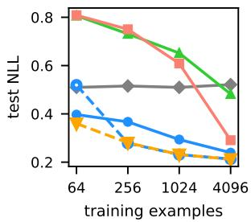

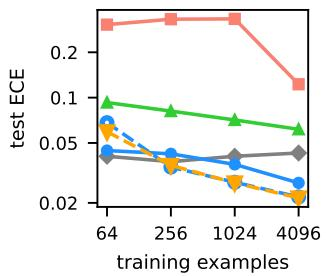

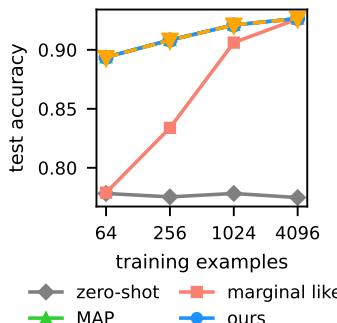

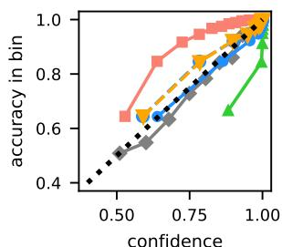  
Figure 4: RoBERTa-large on SST-2, MR, CR and AG News, mean over the four tasks and three seeds. Bottom right: reliability diagram at 4,096 training examples, ten bins of equal size. Solid lines use no validation data. Ours + T adds a temperature fitted on the validation set. The other methods with a temperature, and each task separately, are in Figure 8.

## 7.6 Detection of out-of-distribution inputs

Finally, we evaluate posterior uncertainty on out-ofdistribution (OOD) inputs (Figure 6). For each test input, the linearized predictive gives a Gaussian distribution over the logits (Appendix D). We sample the logits from it, which needs no further passes through the network, and use the mutual information between the prediction and the weights as the uncertainty score. We report the area under the ROC curve (AUROC) for distinguishing the task's test inputs from those of another task: AG News is OOD for the sentiment tasks, and SST-2 is OOD for AG News. The MAP predictor has no posterior and is therefore excluded.

For the three sentiment tasks, our method obtains the highest AUROC at every training-set size, ranging from 0.79 to 0.81. It exceeds validation search in 30 of 34 runs and marginal likelihood in all 34, with the largest gain over marginal likelihood at 64 examples. On AG News, our method obtains AUROC values from 0.83 to 0.90, while validation search is higher by 0.01-

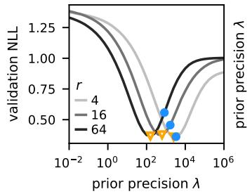

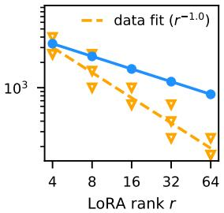  
λ \* (lowest validation NLL) ours, λ α r-1/2

(a) AG News  
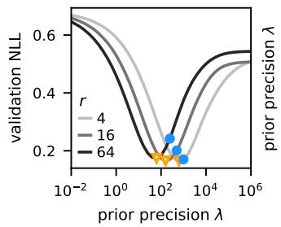

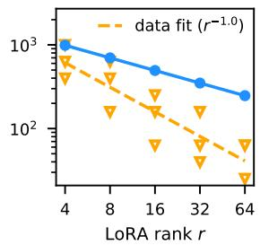  
λ \* (lowest validation NLL)  ours, λ α r-1/2  
(b) CR  
Figure 5: Prior precision across LoRA ranks on RoBERTa-large. Left: validation NLL against the prior precision at three ranks for one seed, with its minimum λ\* and ours, λ. Right: λ\* of every run against the rank, its least-squares fit, and ours (medians).

0.02. Marginal likelihood is substantially worse in the low-data regime but reaches the highest AUROC at 4,096 examples. Overall, the estimated prior yields competitive OOD uncertainty without using validation data for precision selection.

## 8 CONCLUSION

We studied the prior predictive distribution for Bayesian LoRA and introduced a closed-form, momentbased method that specifies the prior. The method does not require a validation set and can be applied before fine-tuning.

Using a second-order expansion, we showed that the rank K and the factor scale σ affect the prior-predictive variance only through $\theta = K \sigma ^ { 4 }$ . Since all examples of a dataset share the same LoRA update, θ is reflected in the covariance between residuals of different examples. Matching these covariances yields an estimator of $\theta ,$ and therefore of the prior precision. Under standard LoRA scaling, this also gives the rank dependence $\lambda \propto r ^ { - 1 / 2 }$

Controlled experiments show that the second-order approximation is accurate for sufficiently small prior perturbations and that the proposed estimator recovers the prior scale from a single task. We further showed that fourth-order moments allow us to recover information about the rank. On RoBERTa-large, without validation data, the estimated prior improves NLL and calibration over MAP and marginal-likelihood selection and provides competitive OOD detection. Validation search remains slightly better in NLL, but when validation data are available, temperature scaling largely closes this gap.

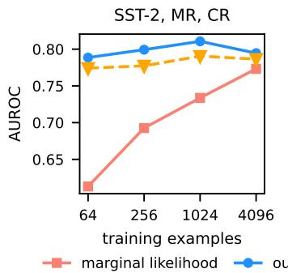

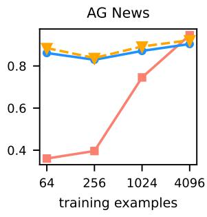  
Figure 6: AUROC for separating OOD inputs from the task's own test inputs, with the mutual information as the score, mean over three seeds (left, also over the three tasks). The OOD inputs are AG News for the sentiment tasks and SST-2 for AG News. Per-task results are in Figure 9 and Table 7.

Limitations and future work. The proposed estimator relies on a local second-order approximation and becomes biased when the LoRA update induces large changes in the network output. Extending the method beyond this local regime, for example through higher-order expansions or alternative approximations to the prior predictive, is a possible direction for future work.

The accuracy of the estimator also varies across tasks because each task provides only one realization of the LoRA update. More efficient estimators that exploit additional structure across examples, tasks, or repeated adaptations could reduce this variability.

The second-order estimator identifies the combined scale θ but not the rank itself, which must therefore still be chosen separately. Our fourth-order analysis shows that the prior predictive contains information about the rank, but turning this result into a stable estimator from a single task remains open.

Finally, the approach may extend to generative objectives, where next-token prediction is a multiclass problem at every position, as well as to regression tasks at scale and to settings without an immediately available task-aligned output. Such extensions are natural next steps but are beyond the scope of this work.

## References

Antorán, J., Janz, D., Allingham, J. U., Daxberger, E., Barbano, R. R., Nalisnick, E., and Hernández-Lobato, J. M. (2022). Adapting the linearised laplace model evidence for modern deep learning. In International Conference on Machine Learning, pages 796–821. PMLR.

da Silva, E. d. S., Klami, A., Mesquita, D., and Urteaga, I. (2026). On the identifiability of tensor ranks via prior predictive matching. In The 29th International Conference on Artificial Intelligence and Statistics.

da Silva, E. d. S., Kuśmierczyk, T., Hartmann, M., and Klami, A. (2023). Prior specification for Bayesian matrix factorization via prior predictive matching. Journal of Machine Learning Research, 24(67):1–51.

Daxberger, E., Kristiadi, A., Immer, A., Eschenhagen, R., Bauer, M., and Hennig, P. (2021). Laplace reduxeffortless bayesian deep learning. Advances in neural information processing systems, 34:20089–20103.

Doan, B. G., Shamsi, A., Guo, X.-Y., Mohammadi, A., Alinejad-Rokny, H., Sejdinovic, D., Teney, D., Ranasinghe, D. C., and Abbasnejad, E. (2025). Bayesian low-rank learning (bella): A practical approach to bayesian neural networks. In Proceedings of the AAAI Conference on Artificial Intelligence, volume 39, pages 16298–16307.

Dubovik, V., Marszałek, P., Tabor, J., and Kuśmierczyk, T. (2026). Bayesian fine-tuning in projected subspaces. arXiv preprint arXiv:2605.07706.

Eide, S. and Frigessi, A. (2024). Bora: Bayesian hierarchical low-rank adaption for multi-task large language models. arXiv preprint arXiv:2407.15857.

Fortuin, V., Garriga-Alonso, A., Ober, S. W., Wenzel, F., Rätsch, G., Turner, R. E., van der Wilk, M., and Aitchison, L. (2021). Bayesian neural network priors revisited. arXiv preprint arXiv:2102.06571.

Gabry, J., Simpson, D., Vehtari, A., Betancourt, M., and Gelman, A. (2019). Visualization in bayesian workflow. Journal of the Royal Statistical Society Series A: Statistics in Society, 182(2):389–402.

Gelman, A., Vehtari, A., McElreath, R., Simpson, D., Margossian, C. C., Yao, Y., Kennedy, L., Gabry, J., Bürkner, P.-C., Modrák, M., et al. (2026). Bayesian workflow. Chapman & Hall/CRC.

Guo, C., Pleiss, G., Sun, Y., and Weinberger, K. Q. (2017). On calibration of modern neural networks. In International Conference on Machine Learning, pages 1321–1330. PMLR.

Hartmann, M., Agiashvili, G., Bürkner, P., and Klami, A. (2020). Flexible prior elicitation via the prior predictive distribution. In Proceedings of the 36th Conference on Uncertainty in Artificial Intelligence

(UAI), volume 124 of Proceedings of Machine Learning Research, pages 1129–1138. PMLR.

Hu, E. J., Shen, Y., Wallis, P., Allen-Zhu, Z., Li, Y., Wang, S., Wang, L., and Chen, W. (2022). LoRA: Low-rank adaptation of large language models. In The Tenth International Conference on Learning Representations.

Hu, M. and Liu, B. (2004). Mining and summarizing customer reviews. In Proceedings of the Tenth ACM SIGKDD International Conference on Knowledge Discovery and Data Mining, pages 168–177. ACM.

Hutchinson, M. F. (1989). A stochastic estimator of the trace of the influence matrix for laplacian smoothing splines. Communications in Statistics-Simulation and Computation, 18(3):1059–1076.

Immer, A., Bauer, M., Fortuin, V., Rätsch, G., and Khan, M. E. (2021a). Scalable marginal likelihood estimation for model selection in deep learning. In Proceedings of the 38th International Conference on Machine Learning, volume 139 of Proceedings of Machine Learning Research, pages 4563–4573. PMLR.

Immer, A., Korzepa, M., and Bauer, M. (2021b). Improving predictions of bayesian neural nets via local linearization. In International conference on artificial intelligence and statistics, pages 703–711. PMLR.

Jacot, A., Gabriel, F., and Hongler, C. (2018). Neural tangent kernel: Convergence and generalization in neural networks. Advances in Neural Information Processing Systems, 31.

Kalajdzievski, D. (2023). A rank stabilization scaling factor for fine-tuning with LoRA. arXiv:2312.03732.

Kim, M. and Hospedales, T. (2025). Lift: Learning to fine-tune via bayesian parameter efficient meta fine-tuning. In International Conference on Learning Representations.

Lee, J., Bahri, Y., Novak, R., Schoenholz, S. S., Pennington, J., and Sohl-Dickstein, J. (2018). Deep neural networks as Gaussian processes. In 6th International Conference on Learning Representations.

Liu, Y., Ott, M., Goyal, N., Du, J., Joshi, M., Chen, D., Levy, O., Lewis, M., Zettlemoyer, L., and Stoyanov, V. (2019). RoBERTa: A robustly optimized BERT pretraining approach. arXiv preprint arXiv:1907.11692.

MacKay, D. J. (1992). A practical bayesian framework for backpropagation networks. Neural computation, 4(3):448–472.

Marszałek, P., Bałazy, K., Tabor, J., and Kuśmierczyk, T. (2025). Minimal ranks, maximum confidence: Parameter-efficient uncertainty quantification for LoRA. In Findings of the Association for Computational Linguistics: EMNLP 2025, pages 1260–1271,

Suzhou, China. Association for Computational Linguistics.

Mikkola, P., Martin, O. A., Chandramouli, S., Hartmann, M., Abril Pla, O., Thomas, O., Pesonen, H., Corander, J., Vehtari, A., Kaski, S., et al. (2024). Prior knowledge elicitation: The past, present, and future. Bayesian Analysis, 19(4):1129–1161.

Nakajima, S., Sugiyama, M., Babacan, S. D., and Tomioka, R. (2013). Global analytic solution of fullyobserved variational Bayesian matrix factorization. Journal of Machine Learning Research, 14(1):1–37.

Nalisnick, E., Gordon, J., and Hernández-Lobato, J. M. (2021). Predictive complexity priors. In Proceedings of The 24th International Conference on Artificial Intelligence and Statistics, volume 130 of Proceedings of Machine Learning Research, pages 694–702. PMLR.

Neal, R. M. (1996). Bayesian Learning for Neural Networks. Lecture Notes in Statistics. Springer New York.

Noci, L., Anagnostidis, S., Biggio, L., Orvieto, A., Singh, S. P., and Lucchi, A. (2022). Signal propagation in transformers: Theoretical perspectives and the role of rank collapse. In Advances in Neural Information Processing Systems, volume 35, pages 27198–27211. Curran Associates, Inc.

Noci, L., Bachmann, G., Roth, K., Nowozin, S., and Hofmann, T. (2021). Precise characterization of the prior predictive distribution of deep ReLU networks. In Advances in Neural Information Processing Systems, volume 34, pages 20851–20862. Curran Associates, Inc.

Onal, E., Flöge, K., Caldwell, E., Sheverdin, A., and Fortuin, V. (2024). Gaussian stochastic weight averaging for bayesian low-rank adaptation of large language models. arXiv preprint arXiv:2405.03425.

Pang, B. and Lee, L. (2005). Seeing stars: Exploiting class relationships for sentiment categorization with respect to rating scales. In Proceedings of the 43rd Annual Meeting of the Association for Computational Linguistics (ACL'05), pages 115–124, Ann Arbor, Michigan. Association for Computational Linguistics.

Schoenholz, S. S., Gilmer, J., Ganguli, S., and Sohl-Dickstein, J. (2017). Deep information propagation. In 5th International Conference on Learning Representations.

Sendera, M., Sorkhei, A., and Kuśmierczyk, T. (2025). Revisiting the equivalence of bayesian neural networks and gaussian processes: On the importance of learning activations. In Chiappa, S. and Magliacane, S., editors, Proceedings of the Forty-first Conference on Uncertainty in Artificial Intelligence, volume 286

of Proceedings of Machine Learning Research, pages 3675–3700. PMLR.

Socher, R., Perelygin, A., Wu, J., Chuang, J., Manning, C. D., Ng, A., and Potts, C. (2013). Recursive deep models for semantic compositionality over a sentiment treebank. In Proceedings of the 2013 Conference on Empirical Methods in Natural Language Processing, pages 1631–1642, Seattle, Washington, USA. Association for Computational Linguistics.

Sun, S., Zhang, G., Shi, J., and Grosse, R. (2019). Functional variational Bayesian neural networks. In International Conference on Learning Representations.

Tran, B.-H., Rossi, S., Milios, D., and Filippone, M. (2022). All you need is a good functional prior for Bayesian deep learning. Journal of Machine Learning Research, 23(74):1–56.

Wang, A., Singh, A., Michael, J., Hill, F., Levy, O., and Bowman, S. R. (2019). GLUE: A multi-task benchmark and analysis platform for natural language understanding. In International Conference on Learning Representations.

Wang, X., Aitchison, L., and Rudolph, M. (2023). LoRA ensembles for large language model fine-tuning. arXiv preprint arXiv:2310.00035.

Wang, Y., Shi, H., Han, L., Metaxas, D. N., and Wang, H. (2024). BLoB: Bayesian low-rank adaptation by backpropagation for large language models. In The 38-th Annual Conference on Neural Information Processing Systems.

Yang, A. X., Robeyns, M., Wang, X., and Aitchison, L. (2024). Bayesian low-rank adaptation for large language models. In The Twelfth International Conference on Learning Representations.

Zavatone-Veth, J. and Pehlevan, C. (2021). Exact marginal prior distributions of finite Bayesian neural networks. In Advances in Neural Information Processing Systems, volume 34, pages 3364–3375. Curran Associates, Inc.

Zhang, L., Snell, J. C., and Griffiths, T. L. (2025). Amortized bayesian meta-learning for low-rank adaptation of large language models. In Proceedings of the 2nd Workshop on Uncertainty-Aware NLP (UncertaiNLP 2025), pages 194–199.

Zhang, X., Zhao, J., and LeCun, Y. (2015). Characterlevel convolutional networks for text classification. In Advances in Neural Information Processing Systems, volume 28. Curran Associates, Inc.

# Prior Predictive Matching for Bayesian LoRA Supplementary Materials

Appendix A proves the results of Section 3, and Appendix B derives further estimators, among them the naive aggregate and the trace-instrument estimators. Appendix C presents the guarantees of the gradient sketches, and Appendix D the posterior approximations, the predictive and the evidence. Appendix E describes the settings of the toy experiments, Appendix F the protocol and full results of the rank study of Section 7.5, Appendix G explains why the best precision for the linearized predictive scales differently with the rank than under the prior, and Appendix H the setup and per-task results of the RoBERTa-large experiments. Appendix I fine-tunes RoBERTa-large under the estimated prior.

## A PROOFS

## A.1 Proof of Lemma 1

Fix an entry $( i , j )$ and write the summands as $P _ { k } = U _ { i k } V _ { k j }$ , so that $\begin{array} { r } { \Delta W _ { i j } = \sum _ { k = 1 } ^ { K } P _ { k } } \end{array}$ . Under equation 1 all factor entries are mutually independent, so the $P _ { k }$ are independent across k, and within each $P _ { k }$ the two factors are independent of one another. We first consider the zero-mean case $\mu _ { U } = \mu _ { V } = 0 , \sigma _ { U } = \sigma _ { V } = \sigma$ , then the general one.

Mean. Independence of the two factors inside each product yields

$$
\mathbb { E } [ \Delta W _ { i j } ] = \sum _ { k = 1 } ^ { K } \mathbb { E } [ U _ { i k } ] \mathbb { E } [ V _ { k j } ] = \sum _ { k = 1 } ^ { K } 0 \cdot 0 = 0 .\tag{16}
$$

Variance. Each product has second moment

$$
\begin{array} { r } { \mathbb { E } [ P _ { k } ^ { 2 } ] = \mathbb { E } [ U _ { i k } ^ { 2 } ] \mathbb { E } [ V _ { k j } ^ { 2 } ] = \sigma ^ { 2 } \cdot \sigma ^ { 2 } = \sigma ^ { 4 } , } \end{array}\tag{17}
$$

and since the $P _ { k }$ are independent with mean zero, their variances add:

$$
\operatorname { V a r } ( \Delta W _ { i j } ) = \sum _ { k = 1 } ^ { K } \operatorname { V a r } ( P _ { k } ) = K \sigma ^ { 4 } = \theta .\tag{18}
$$

Distinct entries are uncorrelated. For $( i , j ) \neq ( i ^ { \prime } , j ^ { \prime } )$ , zero means allow us to compute the covariance as a raw second moment, and independence of the U block from the V block factorizes each term:

$$
\operatorname { C o v } \left( \Delta W _ { i j } , \Delta W _ { i ^ { \prime } j ^ { \prime } } \right) = \mathbb { E } \left[ \Delta W _ { i j } \Delta W _ { i ^ { \prime } j ^ { \prime } } \right] = \sum _ { k = 1 } ^ { K } \sum _ { k ^ { \prime } = 1 } ^ { K } \mathbb { E } \left[ U _ { i k } U _ { i ^ { \prime } k ^ { \prime } } \right] \mathbb { E } \left[ V _ { k j } V _ { k ^ { \prime } j ^ { \prime } } \right] .\tag{19}
$$

We distinguish three cases, which together cover all pairs. If the entries share a row, $i = i ^ { \prime }$ and $j \neq j ^ { \prime }$ then $V _ { k j }$ and $V _ { k ^ { \prime } j ^ { \prime } }$ are distinct entries of V for every $( k , k ^ { \prime } )$ , hence independent, so $\mathbb { E } [ V _ { k j } V _ { k ^ { \prime } j ^ { \prime } } ] = \mathbb { E } [ V _ { k j } ] \mathbb { E } [ V _ { k ^ { \prime } j ^ { \prime } } ] = 0$ and every term of equation 19 vanishes. If the entries share a column, the same argument applies to the U expectations. If they share neither index, both expectations factor into products of zero means. In all three cases the covariance is zero.

Fourth moment. Gaussian factors satisfy $\mathbb { E } [ U _ { i k } ^ { 4 } ] = 3 \sigma ^ { 4 }$ , so each product has

$$
\begin{array} { r } { \mathbb { E } [ P _ { k } ^ { 4 } ] = \mathbb { E } [ U _ { i k } ^ { 4 } ] \mathbb { E } [ V _ { k j } ^ { 4 } ] = 3 \sigma ^ { 4 } \cdot 3 \sigma ^ { 4 } = 9 \sigma ^ { 8 } . } \end{array}\tag{20}
$$

Expand $\left( \sum _ { k } { P _ { k } } \right) ^ { 4 }$ by the multinomial theorem and compute the expectations term by term. Each $P _ { k }$ is symmetric about zero and independent of the others, so any term containing some $P _ { k }$ to an odd power has expectation zero. Only two types of terms have nonzero expectation: the K pure fourth powers, and the mixed squares $P _ { k } ^ { 2 } P _ { l } ^ { 2 }$ with $k \neq l .$ each carrying the multinomial coefficient ${ \binom { 4 } { 2 } } = 6$ over the $\textstyle { \frac { 1 } { 2 } } K ( K - 1 )$ unordered pairs. Hence

$$
\begin{array} { r } { \mathbb { E } [ \Delta W _ { i j } ^ { 4 } ] = K \mathbb { E } [ P ^ { 4 } ] + 6 \cdot \frac { 1 } { 2 } K ( K - 1 ) \mathbb { E } [ P ^ { 2 } ] ^ { 2 } = 9 K \sigma ^ { 8 } + 3 K ( K - 1 ) \sigma ^ { 8 } = 3 K ( K + 2 ) \sigma ^ { 8 } , } \end{array}\tag{21}
$$

and dividing by the squared variance yields the kurtosis

$$
\frac { \mathbb { E } [ \Delta W _ { i j } ^ { 4 } ] } { \mathrm { V a r } ( \Delta W _ { i j } ) ^ { 2 } } = \frac { 3 K ( K + 2 ) \sigma ^ { 8 } } { K ^ { 2 } \sigma ^ { 8 } } = \frac { 3 ( K + 2 ) } { K } = 3 + \frac { 6 } { K } .\tag{22}
$$

General factor means. Now consider equation 1 with arbitrary $( \mu _ { U } , \sigma _ { U } , \mu _ { V } , \sigma _ { V } )$ . The mean follows directly: $\begin{array} { r } { \mathbb { E } [ \Delta W _ { i j } ] = \sum _ { k } \mu _ { U } \mu _ { V } = K \mu _ { U } \mu _ { V } } \end{array}$ . All remaining computations reduce to the pair moments of factor entries, which follow from independence of distinct entries:

$$
\begin{array} { r } { { \mathbb { E } } [ U _ { i k } U _ { i k ^ { \prime } } ] = \sigma _ { U } ^ { 2 } \delta _ { k k ^ { \prime } } + \mu _ { U } ^ { 2 } , \qquad { \mathbb { E } } [ V _ { k j } V _ { k ^ { \prime } j } ] = \sigma _ { V } ^ { 2 } \delta _ { k k ^ { \prime } } + \mu _ { V } ^ { 2 } , \qquad { \mathbb { E } } [ V _ { k j } V _ { k ^ { \prime } j ^ { \prime } } ] = \mu _ { V } ^ { 2 } \mathrm { ~ f o r ~ } j \neq j ^ { \prime } . } \end{array}\tag{23}
$$

For the variance, insert equation 23 into the double sum for $\mathbb { E } [ \Delta W _ { i j } ^ { 2 } ]$ and split it into diagonal $\left( k = k ^ { \prime } \right)$ and off-diagonal parts:

$$
\mathbb { E } [ \Delta W _ { i j } ^ { 2 } ] = \sum _ { k , k ^ { \prime } } \left( \sigma _ { U } ^ { 2 } \delta _ { k k ^ { \prime } } + \mu _ { U } ^ { 2 } \right) \left( \sigma _ { V } ^ { 2 } \delta _ { k k ^ { \prime } } + \mu _ { V } ^ { 2 } \right) = K \left( \sigma _ { U } ^ { 2 } + \mu _ { U } ^ { 2 } \right) \left( \sigma _ { V } ^ { 2 } + \mu _ { V } ^ { 2 } \right) + K ( K - 1 ) \mu _ { U } ^ { 2 } \mu _ { V } ^ { 2 } ,\tag{24}
$$

and subtract $\mathbb { E } [ \Delta W _ { i j } ] ^ { 2 } = K ^ { 2 } \mu _ { U } ^ { 2 } \mu _ { V } ^ { 2 }$ to obtain $\mathrm { V a r } ( \Delta W _ { i j } ) = K \left[ ( \sigma _ { U } ^ { 2 } + \mu _ { U } ^ { 2 } ) ( \sigma _ { V } ^ { 2 } + \mu _ { V } ^ { 2 } ) - \mu _ { U } ^ { 2 } \mu _ { V } ^ { 2 } \right]$ as stated. For two entries in the same row $( i = i ^ { \prime } , j \neq j ^ { \prime } )$ , the V expectation is the constant $\mu _ { V } ^ { 2 }$ by equation 23, so

$$
\mathbb { E } [ \Delta W _ { i j } \Delta W _ { i j ^ { \prime } } ] = \sum _ { k , k ^ { \prime } } \left( \sigma _ { U } ^ { 2 } \delta _ { k k ^ { \prime } } + \mu _ { U } ^ { 2 } \right) \mu _ { V } ^ { 2 } = K \sigma _ { U } ^ { 2 } \mu _ { V } ^ { 2 } + K ^ { 2 } \mu _ { U } ^ { 2 } \mu _ { V } ^ { 2 } ,\tag{25}
$$

and subtracting the product of the means, $K ^ { 2 } \mu _ { U } ^ { 2 } \mu _ { V } ^ { 2 }$ , leaves $\mathrm { C o v } ( \Delta W _ { i j } , \Delta W _ { i j ^ { \prime } } ) = K \sigma _ { U } ^ { 2 } \mu _ { V } ^ { 2 }$ : the shared row of $U$ is the only surviving source of correlation. The same-column case is the mirror image and yields $K \mu _ { U } ^ { 2 } \sigma _ { V } ^ { 2 }$

## A.2 From equation 4 to equation 5 and equation 6

Abbreviate $z = \mathrm { v e c } ( \Delta W ) , f _ { 0 } = f ( x ; 0 ) , g = g ( x )$ , and $H = H ( x )$ , with primes for evaluation at $x ^ { \prime }$ and indices p, q, r, s running over the entries of z as in Section 3.2, so that the expansion equation 4 reads

$$
\begin{array} { r } { Y ( x ) - f _ { 0 } \approx \langle g , z \rangle + \frac { 1 } { 2 } z ^ { \top } H z . } \end{array}\tag{26}
$$

The derivation uses two facts about z from Lemma 1: its entries have $\mathbb { E } [ z _ { p } ] = 0$ and $\mathbb { E } [ z _ { p } z _ { q } ] = \theta \delta _ { p q }$ , with $\delta _ { p q }$ the Kronecker delta.

Mean. Compute the expectation of equation 26 term by term. The linear term is $\mathbb { E } \langle g , z \rangle = \langle g , \mathbb { E } z \rangle = 0$ . The quadratic term expands as a double sum over entries,

$$
\mathbb { E } \left[ z ^ { \top } H z \right] = \sum _ { p , q } H _ { p q } \mathbb { E } [ z _ { p } z _ { q } ] = \sum _ { p , q } H _ { p q } \theta \delta _ { p q } = \theta \sum _ { p } H _ { p p } = \theta \mathrm { ~ T r ~ } H ,\tag{27}
$$

which, multiplied by $\begin{array} { l } { { \frac { 1 } { 2 } } } \end{array}$ yields the mean shift equation 5.

Second moments. Multiply equation 26 by its copy at $x ^ { \prime }$ and compute the expectations. The product splits into four groups of terms:

$$
\begin{array} { r l } & { \mathbb { E } \big [ ( Y ( x ) - f _ { 0 } ) ( Y ( x ^ { \prime } ) - f _ { 0 } ^ { \prime } ) \big ] = \mathbb { E } \big [ \langle g , z \rangle \langle g ^ { \prime } , z \rangle \big ] } \\ & { \phantom { = } + \frac { 1 } { 2 } \mathbb { E } \big [ \langle g , z \rangle \ z ^ { \top } H ^ { \prime } z \big ] \ + \ \frac { 1 } { 2 } \mathbb { E } \big [ \langle g ^ { \prime } , z \rangle \ z ^ { \top } H z \big ] } \\ & { \phantom { = } + \frac { 1 } { 4 } \mathbb { E } \big [ \big ( z ^ { \top } H z \big ) \big ( z ^ { \top } H ^ { \prime } z \big ) \big ] . } \end{array}\tag{28}
$$

As for the mean, the first line simplifies through the entry covariances:

$$
\mathbb { E } \big [ \langle g , z \rangle \langle g ^ { \prime } , z \rangle \big ] = \sum _ { p , q } g _ { p } g _ { q } ^ { \prime } \mathbb { E } [ z _ { p } z _ { q } ] = \theta \sum _ { p } g _ { p } g _ { p } ^ { \prime } = \theta \langle g , g ^ { \prime } \rangle .\tag{29}
$$

The second line consists of third moments $\mathbb { E } [ z _ { p } z _ { q } z _ { r } ]$ . Flipping the sign of U maps $z  - z$ while leaving the zero-mean prior equation 1 unchanged, so the distribution of z is symmetric, every odd moment vanishes, and the whole line is zero. The third line is a fourth-moment expression, $\begin{array} { r } { \sum _ { p , q , r , s } H _ { p q } H _ { r s } ^ { \prime } \mathbb { E } [ z _ { p } z _ { q } z _ { r } z _ { s } ] } \end{array}$ . Each fourth moment of the entries of $\Delta W$ is a sum of $O ( K ^ { 2 } )$ nonzero products of factor moments, each of order $\sigma ^ { 8 }$ , so it is $O ( \theta ^ { 2 } )$ , and so is the whole line. Passing from the raw second moment to the covariance subtracts the product of the two mean shifts, $\begin{array} { r } { \left( \frac { 1 } { 2 } \theta t ( x ) \right) \left( \frac { 1 } { 2 } \theta t ( x ^ { \prime } ) \right) = O ( \theta ^ { 2 } ) } \end{array}$ , which changes nothing at leading order. Altogether,

$$
\mathrm { C o v } \big [ Y ( x ) , Y ( x ^ { \prime } ) \big ] = \theta \langle g ( x ) , g ( x ^ { \prime } ) \rangle + { \cal O } ( \theta ^ { 2 } ) ,\tag{30}
$$

which is the covariance half of equation 6, and setting $x ^ { \prime } = x$ yields the variance half, Var $[ Y ( x ) ] = \theta s ( x ) + O ( \theta ^ { 2 } )$

The dropped terms. The $O ( \theta ^ { 2 } )$ terms come from the fourth moments of $z .$ The entries of $\Delta W$ are uncorrelated but not independent, because entries in the same row share a row of U and entries in the same column share a column of $V$ . Entries that share neither a row nor a column behave as independent, $\mathbb { E } [ \Delta W _ { i j } ^ { 2 } \Delta W _ { i ^ { \prime } j ^ { \prime } } ^ { 2 } ] = \theta ^ { 2 }$ Entries that coincide or share a row or a column do not: $\mathbb { E } [ \Delta W _ { i j } ^ { 4 } ] = 3 \theta ^ { 2 } ( 1 + 2 / K ) , \mathbb { E } [ \Delta W _ { i j } ^ { 2 } \Delta W _ { i j ^ { \prime } } ^ { 2 } ] \stackrel { \sim } { = } \theta ^ { 2 } ( \stackrel { \sim } { 1 } + 2 / K )$ and the four corners of a rectangle give $\mathbb { E } [ \Delta W _ { i j } \Delta W _ { i j ^ { \prime } } \Delta \dot { W } _ { i ^ { \prime } j } \Delta \ddot { W } _ { i ^ { \prime } j ^ { \prime } } ] = \theta ^ { 2 } / K$ . These corrections of relative order $1 / K$ are where the rank first enters beyond θ. This is the same fourth-order separation of $( \sigma , K )$ discussed in Section 3.1, and it is why every second-order prediction in the main text is a function of θ alone.

## A.3 Kurtosis of a linearized output

Let $G _ { n } \in \mathbb { R } ^ { N _ { o } \times N _ { i } }$ be a fixed matrix with singular values $\gamma _ { n i } .$ and let $\xi = \langle G _ { n } , \Delta W \rangle$ with $\Delta W = U V$ drawn from the zero-mean factor prior. With $u _ { k }$ the k-th column of U and $v _ { k }$ the k-th row of V,

$$
\xi = \sum _ { k = 1 } ^ { K } u _ { k } ^ { \top } G _ { n } v _ { k } ,
$$

a sum of K independent and identically distributed terms. The entries of $u _ { k }$ and vk are independent ${ \mathcal { N } } ( 0 , \sigma ^ { 2 } )$ , SO their distribution does not change under rotations, and in the singular bases of $G _ { n }$ one term has the distribution of $\sigma ^ { 2 } \textstyle \sum _ { i } \gamma _ { n i } a _ { i } b _ { i }$ with $a _ { i } , b _ { i }$ independent standard normal. Its second moment is $\sigma ^ { 4 } \sum _ { i } \gamma _ { n i } ^ { 2 }$ . In its fourth moment the terms with an odd power of some $a _ { i }$ or $b _ { i }$ vanish, and $\mathbb { E } [ a _ { i } ^ { 4 } ] \mathbb { E } [ b _ { i } ^ { 4 } ] = 9$ , so the fourth moment is

$$
\sigma ^ { 8 } \Big ( 9 \sum _ { i } \gamma _ { n i } ^ { 4 } + 3 \sum _ { i \neq j } \gamma _ { n i } ^ { 2 } \gamma _ { n j } ^ { 2 } \Big ) = \sigma ^ { 8 } \Big ( 6 \sum _ { i } \gamma _ { n i } ^ { 4 } + 3 \big ( \sum _ { i } \gamma _ { n i } ^ { 2 } \big ) ^ { 2 } \Big ) .
$$

One term therefore has kurtosis $3 + 6 \rho _ { n }$ with $\rho _ { n } = \textstyle \sum _ { i } \gamma _ { n i } ^ { 4 } / ( \textstyle \sum _ { i } \gamma _ { n i } ^ { 2 } ) ^ { 2 }$ . For a sum of K independent and identically distributed terms with mean zero, the excess kurtosis is divided by K, which yields equation 15. The second moment of $\xi$ is $\begin{array} { r } { K \sigma ^ { 4 } \sum _ { i } \gamma _ { n i } ^ { 2 } = \theta \| G _ { n } \| _ { F } ^ { 2 } } \end{array}$ , in agreement with equation 6.

## B ESTIMATOR INSTANCES AND DERIVATIONS

Pair equation and least squares. The derivation of the cross-covariance estimator equation 10 from the pair equation equation 9, including the least-squares step and the two add-and-subtract identities, appears in full in Section 4. This appendix collects the instances and variants that the main text states without proof.

The naive aggregate estimator and why it fails. The most direct use of equation 8 is the one that matrix-factorization matching would suggest: average both sides over the dataset and solve for the single unknown, which yields the naive aggregate estimator

$$
\hat { \theta } _ { \mathrm { n a i v e } } = \frac { 2 \sum _ { n } r _ { n } } { \sum _ { n } t _ { n } } .\tag{31}
$$

It matches the average observed label against the average predicted output, as one matches the average observed matrix entry in factorization models. It fails here for two separate reasons.

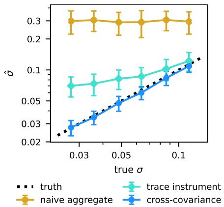  
Figure 7: The three estimators of θ for binary classification on the task of Figure 2. Average $\hat { \boldsymbol { \sigma } } \pm \mathrm { o n e }$ standard deviation, over the tasks with $\hat { \theta } > 0$

The practical reason is a sign cancellation in the denominator. For a binary softmax head the output is the logistic function of the logit margin, $f ( x ; \Delta W ) = \phi ( u ( x ; \Delta W ) )$ , so at the pretrained point the probability is $p _ { 0 } ( x ) = \phi ( u ( x ; 0 ) )$ , and applying the chain rule twice there yields a Hessian trace proportional to the second derivative of the logistic function, $t ( x ) \propto \phi ^ { \prime \prime } ( u ) = p _ { 0 } ( x ) \bigl ( 1 - p _ { 0 } ( x ) \bigr ) \bigl ( 1 - 2 p _ { 0 } ( x ) \bigr )$ (see the next paragraph). The factor $( 1 - 2 p _ { 0 } )$ flips sign at $\begin{array} { r } { p _ { 0 } = \frac { 1 } { 2 } , } \end{array}$ so on any roughly balanced task the traces nearly cancel in the sum. On the balanced binary task of Section 7.2 (a logistic model with 400,000 examples and a known true prior) we measure $\begin{array} { r } { \vert \sum _ { n } t _ { n } \vert / \sum _ { n } \vert t _ { n } \vert = 0 . 0 0 3 } \end{array}$ , meaning the denominator of equation 31 retains about 0.3 percent of the available signal, and the estimate is dominated by noise. It is non-positive in about half of the tasks and otherwise does not follow the true σ (Figure 7).

The second, structural reason applies even without this cancellation. Binary labels satisfy $y ^ { 2 } = y ;$ so every statistic computed from a single example is a function of $\mathbb { E } [ p _ { n } ]$ alone and informs only the first moment, which by equation 5 carries only a weak second-order trace signal. The prior scale controls a variance, so Section 4.2 estimates it from the covariance between examples.

The trace of a binary softmax head. Let's write the scalar output as $p = \phi ( u )$ with u the logit margin and φ the logistic function. Applying the chain rule twice yields the weight-space Hessian $\begin{array} { r } { H = \phi ^ { \prime \prime } ( u ) \nabla u \nabla u ^ { \top } + \phi ^ { \prime } ( u ) \nabla ^ { 2 } u } \end{array}$ When the adapted weights enter the logit linearly, as for an adapter in the layer producing the logits, the second term vanishes and $t ( x ) = \phi ^ { \prime \prime } ( u ) \| \nabla u \| ^ { 2 }$ . In general, the first term, the Gauss-Newton part, carries the same factor. Since $\phi ^ { \prime \prime } ( u ) = p _ { 0 } ( 1 - p _ { 0 } ) ( 1 - 2 p _ { 0 } )$ , the trace inherits the sign flip at $\begin{array} { r } { p _ { 0 } = \frac { 1 } { 2 } } \end{array}$ that drives the cancellation above.

Regression. In regression, the residuals are $r _ { n } = y _ { n } - f ( x _ { n } ; 0 )$ . The observation noise is independent across examples, so it drops out of all pairs and the noise level never needs to be known. The per-example second-moment alternative equation 11 can be used when τ is known and agrees with the covariance form in our simulations.

Multiclass. With C classes, the residuals are the vectors $r _ { n } = \mathrm { o n e h o t } ( y _ { n } ) - p _ { 0 } ( x _ { n } )$ , and the gradients $g _ { n } ^ { ( c ) }$ are computed for each class. The pair equations read $\mathbb { E } [ r _ { n c } r _ { m c ^ { \prime } } ] \approx \theta \langle g _ { n } ^ { ( c ) } , g _ { m } ^ { ( c ^ { \prime } ) } \rangle$ and range over pairs of example and class rows. Within one example the multinomial noise is dependent across classes, so all pairs sharing an example are excluded, which replaces the diagonal subtractions of equation 10 by block subtractions over the $C \times C$ blocks of each example. On synthetic data, this estimator recovers the true scale to within a few percent.

Many adapters. Independence of the per-adapter priors makes cross-adapter response terms vanish in expectation, which yields equation 13. The pooled instance sums the sketched inner products over adapters before applying equation 10. The separated instance solves the linear system $\begin{array} { r } { A _ { \ell } = \sum _ { \ell ^ { \prime } } B _ { \ell \ell ^ { \prime } } \theta _ { \ell ^ { \prime } } } \end{array}$ with $A _ { \ell }$ the residual-weighted sum of inner products of adapter l and $B _ { \ell \ell ^ { \prime } }$ the pairwise products of inner products, all computable in sketch space. In simulation the separated covariance system recovers two true scales jointly, and the first-moment analogue fails because the per-adapter trace profiles correlate at 0.74 across examples. At real-task sample sizes the separated system is noise dominated, so the pooled scale is the practical choice.

Token-level generative models. Next-token prediction is a multiclass problem at every token position. A practical instance would use the following: the probability of the observed token as the scalar output, one backward pass per sequence, the residual $1 - p _ { 0 } ( y _ { t } )$ at each position, and only pairs of positions in different sequences, mirroring the block exclusion above.

A first-moment alternative and its limits. Regressing $r _ { n }$ on $\scriptstyle { \frac { 1 } { 2 } } t _ { n }$ by least squares, as equation 8 suggests, yields the trace-instrument estimator $\begin{array} { r } { \hat { \theta } _ { \mathrm { t r } } = 2 \sum _ { n } r _ { n } t _ { n } / \sum _ { n } t _ { n } ^ { 2 } } \end{array}$ , which is consistent but label-noise limited, since the trace signal is second order. Its inputs $t _ { n } = \operatorname { T r } H ( x _ { n } )$ can be estimated with Hutchinson's method (Hutchinson, 1989), which estimates the trace from a few Hessian-vector products through the identity Tr $H = \dot { \mathbb { E } } [ \nu ^ { \top } H \nu ]$ for random probe vectors ν with identity covariance. For adapted linear layers the traces can be computed exactly from the activations, because the trace reduces to second derivatives with respect to the layer outputs weighted by squared norms of the layer inputs. Our simulations use the exact form. The variant is useful as a cross-check at large true scales (Figure 7, where it is non-positive in 27 to 54% of the tasks and otherwise overestimates σ) and is not used in the main pipeline, which needs only first-order gradients. Per-module variants of equation 10 exist, but at our sample sizes the module-wise systems are noise dominated, so we report the pooled scale.

## C SKETCHING AND ITS GUARANTEES

If S has independent $\mathcal { N } ( 0 , 1 / d )$ entries, then $\mathbb { E } [ S ^ { \top } S ] = I ,$ and by independence of the two sides of equation 14 the sketched inner products are unbiased,

$$
\mathbb { E } \big \langle \tilde { g } _ { n } , \tilde { g } _ { m } \big \rangle = \mathrm { T r } \left( \mathbb { E } [ S _ { \mathrm { o u t } } ^ { \top } S _ { \mathrm { o u t } } ] G _ { n } \mathbb { E } [ S _ { \mathrm { i n } } ^ { \top } S _ { \mathrm { i n } } ] G _ { m } ^ { \top } \right) = \langle g _ { n } , g _ { m } \rangle ,
$$

including the diagonal entries. Squared inner products acquire a variance bias under a single sketch. Using two independent sketch pairs and multiplying the inner product from one by that from the other removes ${ \mathrm { i t } } ,$ since $\mathbb { E } \big [ \langle \tilde { g } _ { n } ^ { ( 1 ) } , \tilde { g } _ { m } ^ { ( 1 ) } \rangle \langle \tilde { g } _ { n } ^ { ( 2 ) } , \tilde { g } _ { m } ^ { ( 2 ) } \rangle \big ] \ = \ \langle g _ { n } , g _ { m } \rangle ^ { 2 }$ . All contractions are computed in sketch space, for instance $r ^ { \top } \tilde { G } \tilde { G } ^ { \top } r = \| \tilde { G } ^ { \top } r \| ^ { 2 }$ and $\langle \tilde { G } ^ { ( 1 ) } \tilde { \tilde { G } } ^ { ( 1 ) \top } , \tilde { G } ^ { ( 2 ) } \tilde { G } ^ { ( 2 ) \top } \rangle _ { F } = \| \tilde { G } ^ { ( 1 ) \top } \tilde { G } ^ { ( 2 ) } \| _ { F } ^ { 2 }$ , with $\tilde { G }$ the sketched counterpart of G in Section 4.2, so no matrix of size $N \times N$ is ever formed. In a test on a controlled model with sketch width $d = 4 8$ the estimate of θ is within about ten percent of the exact computation, and the scale, which is its fourth root, within three percent.

## D POSTERIOR APPROXIMATIONS, PREDICTIVE, AND EVIDENCE

The pretrained-model experiments use the Laplace approximation of Laplace-LoRA (Yang et al., 2024), computed with its code, which builds on the laplace library (Daxberger et al., 2021). The posterior over the LoRA parameters $w ,$ the entries of the factors U and V of all adapted layers, is $\mathcal { N } \big ( w _ { \mathrm { M A P } } , ( \Lambda + \lambda I ) ^ { - 1 } \big )$ , where $w _ { \mathrm { M A P } }$ are the trained parameters (Section 7.4), Λ is the Kronecker-factored generalized Gauss-Newton matrix of the training loss at wmAp and λ is the prior precision. Predictions use the linearized predictive (Immer et al., 2021b): the logits at x are Gaussian, centred at those of $w _ { \mathrm { M A P } }$ , with covariance $J ( x ) ( \bar { \Lambda } + \lambda I ) ^ { - 1 } \dot { J ( x ) } ^ { \top }$ , where $J ( x )$ is the Jacobian of the logits with respect to $w ,$ and the class probabilities are the softmax averaged over samples of the logits. The mutual information of Section 7.6 is the entropy of this averaged prediction minus the average entropy of the sampled predictions.

Marginal likelihood chooses λ by maximizing the Laplace approximation of the evidence,

$$
\begin{array} { r } { \log p ( \mathcal { D } \mid w _ { \mathrm { M A P } } ) - \frac { 1 } { 2 } \Big ( \log \operatorname* { d e t } ( \Lambda + \lambda I ) - \dim ( w ) \log \lambda + \lambda \| w _ { \mathrm { M A P } } \| ^ { 2 } \Big ) , } \end{array}
$$

with dim(w) the number of LoRA parameters, by gradient steps on log λ. Validation search performs gradient steps on log λ that lower the NLL of the predictive on the validation set, starting from the marginal-likelihood value. The MAP uses $\lambda = 1 0 ^ { 8 }$ in the same predictive. A temperature $T$ replaces the predictive probabilities p by $p ^ { 1 / T }$ , renormalized, and is fitted on the validation set. Appendix H reports the numbers of steps, samples and temperatures.

## E TOY EXPERIMENTS

Second-order moments (Section 7.1). The network is a two-layer tanh classifier with 20 inputs and 12 hidden units, with the update on the first layer. The moments are estimated at six inputs from 40,000 draws per

K and θs.

Prior scale (Section 7.2). For regression the network is $x \mapsto w ^ { \top }$ tanh $\left( \left( W _ { 0 } + \Delta W \right) x \right)$ with 32 inputs and 16 hidden units. Each task has $N = 4 { , } 0 0 0$ examples and label noise $\begin{array} { r } { \tau = \frac { 1 } { 2 } ( \dot { \theta } \bar { s } ) ^ { 1 / 2 } } \end{array}$ , which keeps the ratio of signal to noise fixed across $\sigma .$ For binary classification the network is a logistic model with 32 inputs, and since the Bernoulli noise does not shrink with $\sigma ,$ each task has $N = 4 0 0 { , } 0 0 0$ examples. There are 80 tasks per scale for regression and 96 for classification.

Rank (Section 7.3). The networks are $x \mapsto$ tanh $\left( \left( W _ { 0 } + \Delta W \right) x \right)$ with 112 inputs and 112 hidden units. followed by a fixed output layer. Each of the 24 examples averages the outputs at two inputs, so that $\rho _ { n }$ ranges from 0.67 to 0.90. The study is repeated 10 times for each K from 10 to 100 and each $\theta \bar { s } \in \{ 2 \cdot 1 0 ^ { - 4 } , 2 \cdot 1 0 ^ { - 3 } , 1 0 ^ { - 2 } \}$

## F RANK TRANSFER IN FINE-TUNING

This appendix presents the protocol and the full results of the rank study in Section 7.5. The model, the training and the posterior are those of Appendix H with 1,024 examples, 819 for training and 205 for validation, except that the LoRA rank is $r \in \{ 4 , 8 , 1 6 , 3 2 , 6 4 \}$ . The tasks are AG News and CR. For each run we evaluate the validation and test NLL of the predictive at 41 precisions from $1 0 ^ { - 2 }$ to $1 0 ^ { 6 }$ , equally spaced on a log scale, and define $\lambda ^ { * } ( r )$ as the minimizer of the validation NLL. In every run it lies inside this range. The seeds are 0, 1 and 2 for AG News and 1, 2 and 3 for CR. For CR with seed 0 the evaluation at the 41 precisions failed at two ranks, because the covariance of the logits was numerically not positive definite, and we replaced this seed. We fit the slope of log λ against log r by least squares with one intercept per task, with a 95% bootstrap interval over the 30 runs.

Each task alone yields the same slope of $\lambda ^ { * }$ as the two tasks together, close $\mathrm { t o } - 1 .$ , and so do the precisions chosen by validation search and by marginal likelihood. Table 2 reports $\lambda ^ { * } , \hat { \lambda }$ and the test NLL at every rank. On AG News one seed yields a much smaller ${ \hat { \theta } } ,$ which explains the large spread of our NLL between seeds. In Figure 5, the validation NLL at λ is interpolated between the two nearest of the 41 precisions.

Appendix G explains the slope of -1 by the variance of the linearized predictive, which scales as $1 / ( r \lambda )$ . The runs confirm this scaling. Let $\omega$ be the variance of a logit under this predictive, averaged over the test examples and classes. Within a run, ω is inversely proportional to the precision. For example, ours and validation search choose precisions up to $3 0$ times apart, yet their products λω agree within 10%. Across ranks, rλω shows no trend.

Table 2: Rank study on RoBERTa-large with 1,024 training examples. $\lambda ^ { * }$ and $\hat { \lambda } { : }$ median over three seeds. Test NLL: mean over the seeds $\pm$ their standard deviation, at $\lambda ^ { * }$ and for each method. $^ { 6 6 } + \mathrm { T } ^ { 9 }$ adds a temperature fitted on the validation set.
<table><tr><td></td><td></td><td></td><td></td><td colspan="7">test NLL</td></tr><tr><td></td><td></td><td></td><td></td><td></td><td colspan="2">ours</td><td colspan="2"></td><td colspan="2">validation search</td></tr><tr><td>task</td><td> $r$ </td><td> $\lambda ^ { * }$ </td><td> $\hat { \lambda }$ </td><td> $\mathrm { a t } ~ \lambda ^ { * }$ </td><td></td><td></td><td> $+ \textrm { T }$ </td><td></td><td></td><td> $+ \textrm { T }$ </td></tr><tr><td>AG News</td><td>4</td><td>2,512</td><td>3,340</td><td> $0 . 3 0 8 \pm 0 . 0 0 9$ </td><td> $0 . 3 6 7 \pm 0 . 1 1 3$ </td><td></td><td> $0 . 3 0 2 \pm 0 . 0 0 3$ </td><td> $0 . 3 0 6 \pm 0 . 0 0 3$ </td><td></td><td> $0 . 3 0 5 \pm 0 . 0 0 5$ </td></tr><tr><td></td><td>8</td><td>1,585</td><td>2,362</td><td> $0 . 3 0 4 \pm 0 . 0 0 9$ </td><td> $0 . 3 8 0 \pm 0 . 1 2 9$ </td><td> $0 . 3 0 3 \pm 0 . 0 1 1$ </td><td></td><td> $0 . 3 0 4 \pm 0 . 0 1 4$ </td><td></td><td> $0 . 3 0 1 \pm 0 . 0 0 5$ </td></tr><tr><td></td><td>16</td><td>631</td><td>1,670</td><td> $0 . 3 0 1 \pm 0 . 0 0 5$ </td><td> $0 . 4 1 1 \pm 0 . 1 2 8$ </td><td> $0 . 3 0 0 \pm 0 . 0 0 8$ </td><td></td><td> $0 . 3 0 1 \pm 0 . 0 0 6$ </td><td></td><td> $0 . 3 0 1 \pm 0 . 0 0 7$ </td></tr><tr><td></td><td>32</td><td>398</td><td>1,181</td><td> $0 . 3 0 6 \pm 0 . 0 0 7$ </td><td> $0 . 4 4 8 \pm 0 . 1 3 4$ </td><td> $0 . 3 0 5 \pm 0 . 0 0 6$ </td><td></td><td> $0 . 3 0 5 \pm 0 . 0 0 7$ </td><td></td><td> $0 . 3 0 3 \pm 0 . 0 0 5$ </td></tr><tr><td></td><td>64</td><td>158</td><td>835</td><td> $0 . 3 0 0 \pm 0 . 0 0 6$ </td><td> $0 . 4 8 6 \pm 0 . 1 4 6$ </td><td></td><td> $0 . 3 0 4 \pm 0 . 0 0 7$ </td><td> $0 . 3 0 2 \pm 0 . 0 0 5$ </td><td></td><td> $0 . 3 0 1 \pm 0 . 0 0 4$ </td></tr><tr><td>CR</td><td>4</td><td>631</td><td>988</td><td> $0 . 1 8 9 \pm 0 . 0 2 1$ </td><td> $0 . 1 9 3 \pm 0 . 0 2 0$ </td><td></td><td> $0 . 1 9 0 \pm 0 . 0 1 7$ </td><td> $0 . 1 9 7 \pm 0 . 0 2 4$ </td><td></td><td> $0 . 1 8 8 \pm 0 . 0 1 6$ </td></tr><tr><td></td><td>8</td><td>398</td><td>699</td><td> $0 . 1 9 5 \pm 0 . 0 4 2$ </td><td> $0 . 2 1 0 \pm 0 . 0 4 3$ </td><td></td><td> $0 . 1 9 1 \pm 0 . 0 2 9$ </td><td> $0 . 1 9 1 \pm 0 . 0 2 2$ </td><td></td><td> $0 . 1 9 2 \pm 0 . 0 3 2$ </td></tr><tr><td></td><td>16</td><td>158</td><td>494</td><td> $0 . 1 9 3 \pm 0 . 0 2 5$ </td><td> $0 . 2 3 1 \pm 0 . 0 4 5$ </td><td></td><td> $0 . 1 9 4 \pm 0 . 0 3 4$ </td><td> $0 . 1 9 7 \pm 0 . 0 4 3$ </td><td></td><td> $0 . 1 9 3 \pm 0 . 0 3 3$ </td></tr><tr><td></td><td>32</td><td>63</td><td>349</td><td> $0 . 1 9 5 \pm 0 . 0 3 4$ </td><td> $0 . 2 5 6 \pm 0 . 0 5 3$ </td><td></td><td> $0 . 1 9 7 \pm 0 . 0 3 9$ </td><td> $0 . 2 0 0 \pm 0 . 0 4 1$ </td><td></td><td> $0 . 2 0 0 \pm 0 . 0 4 1$ </td></tr><tr><td></td><td>64</td><td>63</td><td>247</td><td> $0 . 1 8 7 \pm 0 . 0 2 0$ </td><td> $0 . 2 7 9 \pm 0 . 0 4 9$ </td><td></td><td> $0 . 1 8 7 \pm 0 . 0 1 6$ </td><td> $0 . 1 9 1 \pm 0 . 0 1 4$ </td><td></td><td> $0 . 1 9 1 \pm 0 . 0 2 1$ </td></tr></table>

## G RANK SCALING OF THE PRIOR AND OF THE LINEARIZED PREDICTIVE

Corollary 1 holds for the prior, and the measurement of Section 7.5 does not contradict it. The two yield different rank scalings because they concern different predictives. The corollary keeps the prior predictive fixed, and under the prior the variance of $\Delta W$ is quadratic in $1 / \lambda$ . After fine-tuning, the Laplace posterior is used through a predictive linearized at the trained factors. This is the standard practical choice, because the linearized predictive predicts better than a predictive that evaluates the network at samples of the weights (Immer et al., 2021b). Its variance is linear in $1 / \lambda$ and, at a fixed λ, falls as $1 / r$ . The difference does not come from the range of the second-order expansion of Section 3.2. It appears even for a network that is linear in $\Delta W$ , because it comes from the factorization of $\Delta W$

Let's write the factors as their trained values plus a perturbation, $U = U _ { \mathrm { M A P } } + \Delta U$ and $V = V _ { \mathrm { M A P } } + \Delta V$ . Then

$$
\Delta W = \frac { \alpha } { r } U _ { \mathrm { M A P } } V _ { \mathrm { M A P } } + \frac { \alpha } { r } \big ( \Delta U V _ { \mathrm { M A P } } + U _ { \mathrm { M A P } } \Delta V \big ) + \frac { \alpha } { r } \Delta U \Delta V .\tag{32}
$$

Under the prior the factors are centred at zero, so, with $U _ { \mathrm { M A P } }$ and $V _ { \mathrm { M A P } }$ replaced by zero, only the last term is present. By equation 7 its entries have variance $\alpha ^ { 2 } / ( r \lambda ^ { 2 } )$ , and keeping this variance fixed yields $\lambda \propto r ^ { - 1 / 2 }$

The Laplace posterior of Appendix D is centred at the trained factors. Its covariance $( \Lambda + \lambda I ) ^ { - 1 }$ is close to $\lambda ^ { - 1 } I$ in the directions where λ dominates Λ, which with few training examples and many LoRA parameters are most directions. The linearized predictive replaces the network by its first-order expansion in the LoRA parameters at their trained values. It therefore retains the middle term of equation 32 and omits the last one. If the entries of $\Delta U$ and $\Delta V$ are independent with variance $1 / \lambda$ , the entry $( i , j )$ of the middle term has variance

$$
\frac { \alpha ^ { 2 } } { r ^ { 2 } \lambda } \Big ( \sum _ { k = 1 } ^ { r } V _ { \mathrm { M A P } , k j } ^ { 2 } + \sum _ { k = 1 } ^ { r } U _ { \mathrm { M A P } , i k } ^ { 2 } \Big ) ,\tag{33}
$$

which is linear in $1 / \lambda$ . When the entries of the trained factors have a size that does not depend on the rank, each sum grows as $r ,$ and equation 33 scales as $\alpha ^ { 2 } / ( r \lambda )$ . In LoRA, V is initialized with a scale set by the input dimension and U at zero, so this holds as long as fine-tuning does not change the scale of the factors with the rank. The runs of Appendix F confirm the resulting scaling for the logits. The precision that keeps the variance of the linearized predictive at the level that predicts best then falls as $1 / r$ , the slope measured in Section 7.5.

Our estimate sets the prior, and $\hat { \lambda } \propto r ^ { - 1 / 2 }$ is the rank scaling of the prior. Used directly as the precision of the linearized predictive, it moves away from the best precision by a factor that grows as ${ \sqrt { r } } ,$ and a temperature fitted on validation data compensates for this (Section 7.5). A rank scaling for the precision of the linearized predictive would have to account for the trained factors through equation 33, and they are not available before fine-tuning.

A predictive that samples the factors from the posterior and evaluates the network at each sample, instead of linearizing it, retains the last term of equation 32. Its variance is then the sum of equation 33 and $\alpha ^ { 2 } / ( r \lambda ^ { 2 } )$ which scales with the rank as under the prior. The best precision for this predictive would fall with the rank between $r ^ { - 1 }$ and $r ^ { - 1 / 2 }$ , depending on which of the two parts dominates. We have not evaluated this predictive.

## H ROBERTA-LARGE EXPERIMENTS

Data. The test sets are the GLUE validation set of SST-2 (Socher et al., 2013; Wang et al., 2019) (872 examples) and the test sets of MR (Pang and Lee, 2005) (1,066), CR (Hu and Liu, 2004) (753) and AG News (Zhang et al., 2015) (7,600), from the Hugging Face hub (cornell-movie-review-data/rotten\_tomatoes, SetFit/SentEval-CR, fancyzhx/ag\_news). For each seed the training split is shuffled and its first n examples are kept (for CR at $n = 4 , 0 9 6$ , all 3,012 examples). The first 20% of them, rounded up, form the validation set and the rest the training set.

Classifier and training. Each input x is placed in a template with one masked position, "x It was <mask> ." with the label words terrible and great for the sentiment tasks, and $^ { \mathfrak { a } } x \ \big ( \ < \mathtt { m a s k } > \ \big ) ^ { \mathfrak { , } }$ with World, Sports, Business and Tech for AG News. The class logits are the scores of the frozen masked-language-model head for these words at the masked position. LoRA with r = 8, α = 16 and dropout 0.1 adapts the query and value projections of all 24 layers, with 786,432 parameters in total. Training uses Adam without weight decay, a batch size of 32, inputs of at most 256 tokens, and 10,000 steps with a learning rate of $5 \cdot 1 0 ^ { - 5 }$ decayed linearly to zero.

The estimate. $\hat { \lambda } = \alpha / \sqrt { \hat { \theta } r }$ is computed at $\Delta W = 0$ from the training set by Algorithm 1, with sketches of size $d = 3 2$

Posterior, choices of λ and metrics. The Laplace approximation of Appendix D covers all LoRA parameters w, with the Kronecker-factored generalized Gauss-Newton matrix Λ, as implemented in the code of Laplace-LoRA (Yang et al., 2024). Predictions average the softmax over 100,000 samples of the logits from the linearized predictive, with the full covariance between classes. Marginal likelihood is maximized by 100 gradient steps with a learning rate of 0.1. Validation search performs 100 gradient steps with a learning rate of 0.1 on the validation NLL, starting from the marginal-likelihood λ. The MAP uses $\lambda = 1 0 ^ { 8 }$ in the same predictive. A temperature is chosen from 81 values between 0.1 and 10, equally spaced on a log scale, by the validation NLL. ECE uses 10 bins of equal width in confidence.

Table 3: Results on AG News: mean over three seeds ± their standard deviation. Zero-shot does not depend on the seed. Bold: the best value in each column of a block, among the methods without validation data (upper rows) and among those with it (lower rows).
<table><tr><td></td><td colspan="4">training examples</td></tr><tr><td></td><td>64</td><td>256</td><td> $^ \mathrm { 1 , 0 2 4 }$ </td><td>4,096</td></tr><tr><td colspan="5">test NLL</td></tr><tr><td>zero-shot</td><td>0.746</td><td>0.746</td><td>0.746</td><td>0.746</td></tr><tr><td>MAP</td><td> $1 . 0 0 7 \pm 0 . 1 4 9$ </td><td> $0 . 8 7 5 \pm \dot { 0 } . 1 3 6$ </td><td> $0 . 7 4 \dot { 7 } \pm \dot { 0 } . 0 3 5$ </td><td> $0 . 4 7 3 \pm 0 . 0 3 9$ </td></tr><tr><td>marginal likelihood</td><td> $1 . 3 3 6 \pm 0 . 0 1 8$ </td><td> $1 . 2 5 0 \pm 0 . 0 1 9$ </td><td> $1 . 0 3 4 \pm 0 . 0 2 1$ </td><td> $0 . 3 5 4 \pm 0 . 0 1 9$ </td></tr><tr><td>ours</td><td> $\mathbf { 0 . 4 5 8 \pm 0 . 0 5 4 }$ </td><td> $\mathbf { 0 . 4 2 3 \pm 0 . 1 0 9 }$ </td><td> ${ \bf 0 . 3 9 5 \pm 0 . 1 4 7 }$ </td><td> $\mathbf { 0 . 2 7 7 \pm 0 . 0 1 2 }$ </td></tr><tr><td> $\mathrm { M A P + T }$ </td><td> $\mathbf { 0 . 4 3 9 \pm 0 . 0 7 2 }$ </td><td> ${ \bf 0 . 3 6 3 \pm 0 . 0 2 0 }$ </td><td> $0 . 3 1 4 \pm 0 . 0 0 6$ </td><td> $0 . 2 5 9 \pm 0 . 0 1 2$ </td></tr><tr><td>marginal likelihood + T</td><td> $1 . 3 9 4 \pm 0 . 1 6 4$ </td><td> $0 . 9 3 7 \pm 0 . 0 9 3$ </td><td> $0 . 4 2 9 \pm 0 . 0 5 2$ </td><td> $\mathbf { 0 . 2 5 5 \pm 0 . 0 0 7 }$ </td></tr><tr><td> $\mathrm { \ o u r s { \overline { { \Omega } } } + \mathrm { \Delta T } }$ </td><td> $0 . 4 4 2 \pm 0 . 0 6 6$ </td><td> $0 . 3 6 4 \pm 0 . 0 1 6$ </td><td> ${ \bf 0 . 3 0 7 \pm 0 . 0 0 6 }$ </td><td> $0 . 2 5 9 \pm 0 . 0 0 8$ </td></tr><tr><td>validation search</td><td> $\mathbf { 0 . 4 3 9 \pm 0 . 0 7 0 }$ </td><td> $0 . 3 6 7 \pm 0 . 0 1 0$ </td><td> ${ \bf 0 . 3 0 7 \pm 0 . 0 0 8 }$ </td><td> $0 . 2 5 8 \pm 0 . 0 0 8$ </td></tr><tr><td colspan="5">test ECE</td></tr><tr><td>zero-shot</td><td>0.034</td><td>0.034</td><td>0.034</td><td>0.034</td></tr><tr><td>MAP</td><td> $0 . 1 1 9 \pm 0 . 0 1 8$ </td><td> $0 . 0 9 5 \pm 0 . 0 0 7$ </td><td> $0 . 0 8 4 \pm 0 . 0 0 2$ </td><td> $0 . 0 6 4 \pm \dot { 0 } . 0 0 7$ </td></tr><tr><td>marginal likelihood</td><td> $0 . 1 0 6 \pm 0 . 0 6 5$ </td><td> $0 . 3 1 1 \pm 0 . 0 6 8$ </td><td> $0 . 4 7 4 \pm 0 . 0 1 2$ </td><td> $0 . 1 4 5 \pm 0 . 0 1 1$ </td></tr><tr><td>ours</td><td> $0 . 0 3 8 \pm 0 . 0 1 6$ </td><td> $0 . 0 3 9 \pm 0 . 0 2 1$ </td><td> ${ \bf 0 . 0 3 4 } \pm 0 . 0 2 8$ </td><td> ${ \bf 0 . 0 2 2 } \pm 0 . 0 0 2$ </td></tr><tr><td> $\mathrm { M A P + T }$ </td><td> $\mathbf { 0 . 0 3 7 } \pm 0 . 0 4 1$ </td><td> ${ \bf 0 . 0 2 1 } \pm 0 . 0 0 8$ </td><td> $\mathbf { 0 . 0 1 5 \ : \pm { \ : 0 . 0 0 5 } }$ </td><td> $\mathbf { 0 . 0 0 8 \pm 0 . 0 0 2 }$ </td></tr><tr><td>marginal likelihood + T</td><td> $0 . 1 3 4 \pm 0 . 0 9 4$ </td><td> $0 . 0 8 3 \pm 0 . 0 3 0$ </td><td> $0 . 0 2 7 \pm 0 . 0 3 5$ </td><td> $0 . 0 1 3 \pm 0 . 0 0 4$ </td></tr><tr><td> $\mathrm { \ o u r s { \stackrel { \smile } { + } } { T } }$ </td><td> $0 . 0 7 3 \pm 0 . 0 4 2$ </td><td> $0 . 0 4 1 \pm 0 . 0 2 1$ </td><td> $0 . 0 3 0 \pm 0 . 0 1 4$ </td><td> $0 . 0 1 8 \pm 0 . 0 0 4$ </td></tr><tr><td>validation search</td><td> $0 . 0 7 1 \pm 0 . 0 4 5$ </td><td> $0 . 0 4 4 \pm 0 . 0 2 9$ </td><td> $0 . 0 3 0 \pm 0 . 0 1 2$ </td><td> $0 . 0 1 8 \pm 0 . 0 0 3$ </td></tr><tr><td colspan="5">test accuracy</td></tr><tr><td>zero-shot</td><td>0.700</td><td>0.700</td><td>0.700</td><td>0.700</td></tr><tr><td>MAP</td><td> $\mathbf { 0 . 8 5 5 \pm 0 . 0 2 1 }$ </td><td> $\mathbf { 0 . 8 8 7 \pm 0 . 0 0 5 }$ </td><td> ${ \bf 0 . 9 0 2 } \pm 0 . 0 0 2$ </td><td> $\mathbf { 0 . 9 1 6 \pm 0 . 0 0 6 }$ </td></tr><tr><td>marginal likelihood</td><td> $0 . 3 9 8 \pm 0 . 0 6 5$ </td><td> $0 . 6 1 5 \pm 0 . 0 7 1$ </td><td> $0 . 8 4 2 \pm 0 . 0 1 1$ </td><td> $0 . 9 1 5 \pm 0 . 0 0 5$ </td></tr><tr><td>ours</td><td> $\mathbf { 0 . 8 5 5 \pm 0 . 0 2 1 }$ </td><td> $\mathbf { 0 . 8 8 7 \pm 0 . 0 0 5 }$ </td><td> ${ \bf 0 . 9 0 2 } \pm 0 . 0 0 2$ </td><td> ${ \bf 0 . 9 1 6 \pm 0 . 0 0 5 }$ </td></tr><tr><td> $\mathrm { M A P + T }$ </td><td> $\mathbf { 0 . 8 5 5 \pm 0 . 0 2 1 }$ </td><td> $\mathbf { 0 . 8 8 7 \pm 0 . 0 0 5 }$ </td><td> ${ \bf 0 . 9 0 2 } \pm 0 . 0 0 2$ </td><td> $\mathbf { 0 . 9 1 6 \pm 0 . 0 0 6 }$ </td></tr><tr><td>margina  $\mathrm { { \downarrow l i k e l i h o o d \mathrm { { + } T } } }$ </td><td> $0 . 3 9 8 \pm 0 . 0 6 5$ </td><td> $0 . 6 1 5 \pm 0 . 0 7 1$ </td><td> $0 . 8 4 2 \pm 0 . 0 1 1$ </td><td> $0 . 9 1 5 \pm 0 . 0 0 5$ </td></tr><tr><td>ours + T</td><td> $\mathbf { 0 . 8 5 5 \pm 0 . 0 2 1 }$ </td><td> $\mathbf { 0 . 8 8 7 \pm 0 . 0 0 5 }$ </td><td> ${ \bf 0 . 9 0 2 } \pm 0 . 0 0 2$ </td><td> ${ \bf 0 . 9 1 6 \pm 0 . 0 0 5 }$ </td></tr><tr><td>validation search</td><td> $0 . 8 5 4 \pm 0 . 0 2 2$ </td><td> $\mathbf { 0 . 8 8 7 \pm 0 . 0 0 5 }$ </td><td> ${ \bf 0 . 9 0 2 } \pm 0 . 0 0 2$ </td><td> ${ \bf 0 . 9 1 6 \pm 0 . 0 0 5 }$ </td></tr></table>

Table 4: Results on CR, as in Table 3. Two seeds at 256 examples.
<table><tr><td></td><td colspan="4">training examples</td></tr><tr><td></td><td>64</td><td>256</td><td>1,024</td><td>4,096</td></tr><tr><td>test NLL</td><td></td><td></td><td></td><td></td></tr><tr><td>zero-shot</td><td>0.448</td><td>0.448</td><td> $0 . 4 4 8$ </td><td>0.448</td></tr><tr><td>MAP</td><td> $0 . 6 8 8 \pm 0 . 0 1 7$ </td><td> $0 . 6 0 1 \pm 0 . 1 3 9$ </td><td> $0 . 5 7 4 \pm 0 . 0 5 4$ </td><td> $0 . 4 4 0 \pm 0 . 0 1 6$ </td></tr><tr><td>marginal likelihood</td><td> $0 . 6 3 3 \pm 0 . 0 1 1$ </td><td> $0 . 5 5 2 \pm 0 . 0 0 5$ </td><td> $0 . 4 7 5 \pm 0 . 0 1 8$ </td><td> $0 . 3 2 2 \pm 0 . 0 0 9$ </td></tr><tr><td>ours</td><td>0.326 ± 0.049</td><td> ${ \bf 0 . 3 2 2 } \pm 0 . 0 5 8$ </td><td> ${ \bf 0 . 2 1 8 \pm 0 . 0 3 4 }$ </td><td> $\mathbf { 0 . 1 7 0 \pm 0 . 0 1 3 }$ </td></tr><tr><td> $\mathrm { M A P + T }$ </td><td> ${ \bf 0 . 2 2 5 \pm 0 . 0 1 5 }$ </td><td> $0 . 2 1 8 \pm 0 . 0 1 6$ </td><td> $0 . 2 0 0 \pm 0 . 0 2 0$ </td><td> $0 . 1 7 3 \pm 0 . 0 0 2$ </td></tr><tr><td>marginal likelihood + T</td><td> $0 . 3 1 2 \pm 0 . 0 3 6$ </td><td> ${ \bf 0 . 2 0 9 \pm 0 . 0 0 7 }$ </td><td> $0 . 1 8 9 \pm 0 . 0 2 5$ </td><td> ${ \bf 0 . 1 6 0 \pm 0 . 0 0 7 }$ </td></tr><tr><td> $\mathrm { \ o u r s { \stackrel { \smile } { + } } { T } }$ </td><td> $0 . 2 2 8 \pm 0 . 0 3 1$ </td><td> $0 . 2 1 4 \pm 0 . 0 1 2$ </td><td> ${ \bf 0 . 1 8 8 \pm 0 . 0 2 4 }$ </td><td> $0 . 1 6 4 \pm 0 . 0 0 8$ </td></tr><tr><td>validation search</td><td> $0 . 2 3 5 \pm 0 . 0 2 7$ </td><td> $0 . 2 1 5 \pm 0 . 0 1 3$ </td><td> $0 . 1 9 0 \pm 0 . 0 2 8$ </td><td> $0 . 1 6 5 \pm 0 . 0 1 2$ </td></tr><tr><td>test ECE</td><td></td><td></td><td></td><td></td></tr><tr><td>zero-shot</td><td>0.076</td><td>0.076</td><td>0.076</td><td>0.076</td></tr><tr><td>MAP</td><td> $0 . 0 7 2 \pm 0 . 0 0 4$ </td><td> $0 . 0 6 7 \pm 0 . 0 0 9$ </td><td> $0 . 0 6 0 \pm 0 . 0 0 8$ </td><td> $0 . 0 5 4 \pm 0 . 0 0 3$ </td></tr><tr><td>marginal likelihood</td><td> $0 . 3 9 0 \pm 0 . 0 0 6$ </td><td> $0 . 3 4 3 \pm 0 . 0 0 9$ </td><td> $0 . 3 0 3 \pm 0 . 0 1 5$ </td><td> $0 . 1 9 1 \pm 0 . 0 0 7$ </td></tr><tr><td>ours</td><td> $\mathbf { 0 . 0 4 2 } \pm 0 . 0 0 4$ </td><td> $\mathbf { 0 . 0 4 0 \pm 0 . 0 1 8 }$ </td><td> $\mathbf { 0 . 0 3 5 } \pm 0 . 0 0 6$ </td><td> $\mathbf { 0 . 0 2 3 } \pm 0 . 0 0 6$ </td></tr><tr><td> $\mathrm { M A P + T }$ </td><td> $\mathbf { 0 . 0 3 7 \pm 0 . 0 1 9 }$ </td><td> $0 . 0 2 9 \pm 0 . 0 2 1$ </td><td> $0 . 0 2 4 \pm 0 . 0 1 5$ </td><td> $\mathbf { 0 . 0 1 4 } \pm 0 . 0 0 1$ </td></tr><tr><td>marginal likelihood + T</td><td> $0 . 1 5 0 \pm 0 . 0 3 6$ </td><td> ${ \bf 0 . 0 2 7 \pm 0 . 0 1 6 }$ </td><td> ${ \bf 0 . 0 2 2 } \pm 0 . 0 1 1$ </td><td> $0 . 0 2 1 \pm 0 . 0 0 3$ </td></tr><tr><td>ours + T</td><td> $0 . 0 5 3 \pm 0 . 0 3 9$ </td><td> $0 . 0 3 5 \pm 0 . 0 1 3$ </td><td> ${ \bf 0 . 0 2 2 } \pm 0 . 0 0 6$ </td><td> $0 . 0 2 3 \pm 0 . 0 0 2$ </td></tr><tr><td>validation search</td><td> $0 . 0 5 2 \pm 0 . 0 3 8$ </td><td> $0 . 0 3 7 \pm 0 . 0 1 2$ </td><td> $0 . 0 2 3 \pm 0 . 0 0 6$ </td><td> $0 . 0 2 2 \pm 0 . 0 0 3$ </td></tr><tr><td>test accuracy</td><td></td><td></td><td></td><td></td></tr><tr><td>zero-shot</td><td>0.810</td><td>0.810</td><td>0.810</td><td>0.810</td></tr><tr><td>MAP</td><td> $0 . 9 2 3 \pm \dot { 0 } . 0 0 3$ </td><td> $\mathbf { 0 . 9 2 8 \pm 0 . 0 0 8 }$ </td><td> ${ \bf 0 . 9 3 6 \pm 0 . 0 0 9 }$ </td><td> $\mathbf { 0 . 9 4 0 \overset { \cdot } { = } 0 . 0 0 4 }$ </td></tr><tr><td>marginal likelihood</td><td> $0 . 9 2 3 \pm 0 . 0 0 1$ </td><td> $0 . 9 2 6 \pm 0 . 0 0 5$ </td><td> ${ \bf 0 . 9 3 6 \pm 0 . 0 0 8 }$ </td><td> ${ \bf 0 . 9 4 0 \pm 0 . 0 0 3 }$ </td></tr><tr><td>ours</td><td> ${ \bf 0 . 9 2 4 } \pm 0 . 0 0 3$ </td><td> $\mathbf { 0 . 9 2 8 \pm 0 . 0 0 8 }$ </td><td> ${ \bf 0 . 9 3 6 \pm 0 . 0 0 9 }$ </td><td> $\mathbf { 0 . 9 4 0 \ : \pm { \ : 0 . 0 0 4 } }$ </td></tr><tr><td> $\mathrm { M A P + T }$ </td><td> $0 . 9 2 3 \pm 0 . 0 0 3$ </td><td> $\mathbf { 0 . 9 2 8 \pm 0 . 0 0 8 }$ </td><td> ${ \bf 0 . 9 3 6 \pm 0 . 0 0 9 }$ </td><td> $\mathbf { 0 . 9 4 0 \ : \pm { \ : 0 . 0 0 4 } }$ </td></tr><tr><td>marginal likelihood + T</td><td> $0 . 9 2 3 \pm 0 . 0 0 1$ </td><td> $0 . 9 2 6 \pm 0 . 0 0 5$ </td><td> ${ \bf 0 . 9 3 6 \pm 0 . 0 0 8 }$ </td><td> ${ \bf 0 . 9 4 0 \pm 0 . 0 0 3 }$ </td></tr><tr><td> $\mathrm { \ o u r s { \stackrel { \smile } { + } } { T } }$ </td><td> ${ \bf 0 . 9 2 4 } \pm 0 . 0 0 3$ </td><td> $\mathbf { 0 . 9 2 8 \pm 0 . 0 0 8 }$ </td><td> ${ \bf 0 . 9 3 6 \pm 0 . 0 0 9 }$ </td><td> $\mathbf { 0 . 9 4 0 \ : \pm { \ : 0 . 0 0 4 } }$ </td></tr><tr><td>validation search</td><td> $0 . 9 2 3 \pm 0 . 0 0 3$ </td><td> ${ \bf 0 . 9 2 8 \pm 0 . 0 0 8 }$ </td><td> ${ \bf 0 . 9 3 6 \pm 0 . 0 0 8 }$ </td><td> $\mathbf { 0 . 9 4 0 \ : \pm { \ : 0 . 0 0 4 } }$ </td></tr></table>

Table 5: Results on MR, as in Table 3.
<table><tr><td></td><td colspan="4">training examples</td></tr><tr><td></td><td>64</td><td>256</td><td> $^ \mathrm { 1 , 0 2 4 }$ </td><td>4,096</td></tr><tr><td colspan="5">test NLL</td></tr><tr><td>zero-shot</td><td>0.461</td><td>0.461</td><td>0.461</td><td>0.461</td></tr><tr><td>MAP</td><td> $0 . 9 3 6 \pm 0 . 0 5 5$ </td><td> $0 . 8 9 5 \pm 0 . 0 6 2$ </td><td> $0 . 8 0 7 \pm 0 . 0 6 0$ </td><td> $0 . 6 3 5 \pm 0 . 0 4 8$ </td></tr><tr><td>marginal likelihood</td><td> $0 . 6 4 4 \pm 0 . 0 1 5$ </td><td> $0 . 5 9 3 \pm 0 . 0 0 9$ </td><td> $0 . 5 1 4 \pm 0 . 0 1 1$ </td><td> $\mathbf { 0 . 2 8 4 \pm 0 . 0 0 4 }$ </td></tr><tr><td>ours</td><td> $0 . 4 7 7 \pm 0 . 0 6 9$ </td><td> ${ \bf 0 . 4 1 6 \pm 0 . 0 2 0 }$ </td><td> ${ \bf 0 . 3 3 1 } \pm 0 . 0 2 0$ </td><td> $0 . 2 9 6 \pm 0 . 0 0 6$ </td></tr><tr><td> $\mathrm { M A P + T }$ </td><td> $1 . 3 0 3 \pm 0 . 8 7 1$ </td><td> $0 . 2 8 8 \pm 0 . 0 2 0$ </td><td> $0 . 2 6 4 \pm 0 . 0 0 3$ </td><td> $\mathbf { 0 . 2 5 1 } \pm 0 . 0 0 9$ </td></tr><tr><td>marginal likelihood + T</td><td> $\mathbf { 0 . 3 8 5 \ : \pm 0 . 0 6 4 }$ </td><td> $\mathbf { 0 . 2 7 0 \pm 0 . 0 0 7 }$ </td><td> ${ \bf 0 . 2 6 2 \pm 0 . 0 0 6 }$ </td><td> $0 . 2 5 3 \pm 0 . 0 0 5$ </td></tr><tr><td> $\mathrm { \ o u r s { \stackrel { \smile } { + } } { T } }$ </td><td> $0 . 9 9 4 \pm 0 . 5 8 7$ </td><td> $0 . 3 1 2 \pm 0 . 0 9 2$ </td><td> $0 . 2 6 6 \pm 0 . 0 0 5$ </td><td> $0 . 2 5 7 \pm 0 . 0 0 5$ </td></tr><tr><td>validation search</td><td> $0 . 4 9 3 \pm 0 . 1 6 6$ </td><td> $0 . 3 1 0 \pm 0 . 0 9 0$ </td><td> $0 . 2 6 3 \pm 0 . 0 0 6$ </td><td> $0 . 2 5 3 \pm 0 . 0 0 3$ </td></tr><tr><td colspan="5">test ECE</td></tr><tr><td>zero-shot</td><td>0.035</td><td>0.035</td><td>0.035</td><td>0.035</td></tr><tr><td>MAP</td><td> $0 . 1 0 5 \pm 0 . 0 0 8$ </td><td> $0 . 0 9 3 \pm 0 . 0 0 2$ </td><td> $0 . 0 8 5 \pm 0 . 0 0 2$ </td><td> $0 . 0 7 9 \pm 0 . 0 0 7$ </td></tr><tr><td>marginal likelihood</td><td> $0 . 3 5 3 \pm 0 . 0 0 2$ </td><td> $0 . 3 4 1 \pm 0 . 0 0 9$ </td><td> $0 . 2 9 3 \pm 0 . 0 0 9$ </td><td> $0 . 0 8 9 \pm 0 . 0 1 3$ </td></tr><tr><td>ours</td><td> $0 . 0 5 7 \pm 0 . 0 0 9$ </td><td> $0 . 0 5 0 \pm 0 . 0 0 5$ </td><td> $0 . 0 3 9 \pm 0 . 0 0 4$ </td><td> $0 . 0 3 8 \pm 0 . 0 0 6$ </td></tr><tr><td> $\mathrm { M A P + T }$ </td><td> $0 . 0 9 1 \pm 0 . 0 4 7$ </td><td> $0 . 0 4 2 \pm 0 . 0 0 9$ </td><td> $\mathbf { 0 . 0 1 6 \ : \pm { \ : 0 . 0 0 4 } }$ </td><td> ${ \bf 0 . 0 2 2 } \pm 0 . 0 0 1$ </td></tr><tr><td>marginal likelihood + T</td><td> $0 . 1 4 8 \pm 0 . 0 5 0$ </td><td> $0 . 0 4 3 \pm 0 . 0 0 8$ </td><td> $0 . 0 3 0 \pm 0 . 0 0 7$ </td><td> $0 . 0 2 7 \pm 0 . 0 0 2$ </td></tr><tr><td> $\mathrm { \ o u r s { \stackrel { \smile } { + } } { T } }$ </td><td> $0 . 0 9 0 \pm 0 . 0 3 9$ </td><td> $0 . 0 3 3 \pm 0 . 0 1 3$ </td><td> $0 . 0 3 5 \pm 0 . 0 0 8$ </td><td> $0 . 0 3 1 \pm 0 . 0 0 3$ </td></tr><tr><td>validation search</td><td> $\mathbf { 0 . 0 6 7 \pm 0 . 0 1 3 }$ </td><td> ${ \bf 0 . 0 3 0 \pm 0 . 0 1 7 }$ </td><td> $0 . 0 3 1 \pm 0 . 0 0 7$ </td><td> $0 . 0 3 0 \pm 0 . 0 0 4$ </td></tr><tr><td colspan="5">test accuracy</td></tr><tr><td>zero-shot</td><td>0.786</td><td>0.786</td><td>0.786</td><td>0.786</td></tr><tr><td>MAP</td><td> $\mathbf { 0 . 8 8 2 \pm 0 . 0 1 3 }$ </td><td> $\mathbf { 0 . 9 0 0 \mathop { = } 0 . 0 0 6 }$ </td><td> $0 . 9 0 6 \pm 0 . 0 0 2$ </td><td> $\mathbf { 0 . 9 1 0 \ : \pm : 0 . 0 0 6 }$ </td></tr><tr><td>marginal likelihood</td><td> $0 . 8 8 1 \pm 0 . 0 1 1$ </td><td> ${ \bf 0 . 9 0 0 \pm 0 . 0 0 7 }$ </td><td> $\mathbf { 0 . 9 0 7 \pm 0 . 0 0 1 }$ </td><td> ${ \bf 0 . 9 1 0 \pm 0 . 0 0 7 }$ </td></tr><tr><td>ours</td><td> $\mathbf { 0 . 8 8 2 \pm 0 . 0 1 3 }$ </td><td> $\mathbf { 0 . 9 0 0 \mathop { = } 0 . 0 0 6 }$ </td><td> $0 . 9 0 6 \pm 0 . 0 0 2$ </td><td> $\mathbf { 0 . 9 1 0 \ : \pm : 0 . 0 0 6 }$ </td></tr><tr><td> $\mathrm { M A P + T }$ </td><td> $\mathbf { 0 . 8 8 2 \pm 0 . 0 1 3 }$ </td><td> $\mathbf { 0 . 9 0 0 \mathop { = } 0 . 0 0 6 }$ </td><td> $0 . 9 0 6 \pm 0 . 0 0 2$ </td><td> $\mathbf { 0 . 9 1 0 \ : \pm : 0 . 0 0 6 }$ </td></tr><tr><td>marginal likelihood + T</td><td> $0 . 8 8 1 \pm 0 . 0 1 1$ </td><td> ${ \bf 0 . 9 0 0 \pm 0 . 0 0 7 }$ </td><td> $\mathbf { 0 . 9 0 7 \pm 0 . 0 0 1 }$ </td><td> ${ \bf 0 . 9 1 0 \pm 0 . 0 0 7 }$ </td></tr><tr><td> $\mathrm { \ o u r s { \stackrel { \smile } { + } } { T } }$ </td><td> $\mathbf { 0 . 8 8 2 \pm 0 . 0 1 3 }$ </td><td> $\mathbf { 0 . 9 0 0 \mathop { = } 0 . 0 0 6 }$ </td><td> $0 . 9 0 6 \pm 0 . 0 0 2$ </td><td> $\mathbf { 0 . 9 1 0 \ : \pm : 0 . 0 0 6 }$ </td></tr><tr><td>validation search</td><td> $\mathbf { 0 . 8 8 2 \pm 0 . 0 1 3 }$ </td><td> $\mathbf { 0 . 9 0 0 \mathop { = } 0 . 0 0 6 }$ </td><td> $0 . 9 0 6 \pm 0 . 0 0 2$ </td><td> $\mathbf { 0 . 9 1 0 \ : \pm : 0 . 0 0 6 }$ </td></tr></table>

Table 6: Results on SST-2, as in Table 3. Two seeds at 4,096 examples.
<table><tr><td></td><td colspan="4">training examples</td></tr><tr><td></td><td>64</td><td>256</td><td>1,024</td><td>4,096</td></tr><tr><td>test NLL</td><td></td><td></td><td></td><td></td></tr><tr><td>zero-shot</td><td>0.384</td><td>0.384</td><td>0.384</td><td>0.384</td></tr><tr><td>MAP</td><td> $0 . 5 9 7 \pm 0 . 0 8 5$ </td><td> $0 . 5 1 2 \pm 0 . 1 1 6$ </td><td> $0 . 4 7 9 \pm 0 . 0 1 9$ </td><td> $0 . 3 3 2 \pm 0 . 0 2 4$ </td></tr><tr><td>marginal likelihood</td><td> $0 . 6 2 1 \pm 0 . 0 1 5$ </td><td> $0 . 5 4 0 \pm 0 . 0 2 7$ </td><td> $0 . 4 1 2 \pm 0 . 0 1 5$ </td><td> $\mathbf { 0 . 1 6 0 \ : \pm { \ : 0 . 0 0 0 } }$ </td></tr><tr><td>ours</td><td> ${ \bf 0 . 3 2 6 \pm 0 . 0 5 7 }$ </td><td> $\mathbf { 0 . 2 9 1 } \pm 0 . 0 6 0$ </td><td> ${ \bf 0 . 2 3 1 } \pm 0 . 0 1 2$ </td><td> $0 . 2 0 3 \pm 0 . 0 2 2$ </td></tr><tr><td> $\mathrm { M A P + T }$ </td><td> $0 . 5 3 9 \pm 0 . 4 6 6$ </td><td> $0 . 2 0 8 \pm 0 . 0 1 8$ </td><td>0.176 ± 0.007</td><td> $0 . 1 5 6 \pm 0 . 0 0 7$ </td></tr><tr><td>marginal likelihood + T</td><td> $0 . 2 8 5 \pm 0 . 0 4 9$ </td><td> $0 . 2 0 4 \pm 0 . 0 1 7$ </td><td> $\mathbf { 0 . 1 6 4 } \pm 0 . 0 0 5$ </td><td> $0 . 1 5 1 \pm 0 . 0 0 8$ </td></tr><tr><td> $\mathrm { \ o u r s { \stackrel { \smile } { + } } { T } }$ </td><td> $0 . 4 1 4 \pm 0 . 2 9 6$ </td><td> ${ \bf 0 . 2 0 2 \pm 0 . 0 2 1 }$ </td><td> $0 . 1 6 5 \pm 0 . 0 0 5$ </td><td> ${ \bf 0 . 1 5 0 \pm 0 . 0 0 7 }$ </td></tr><tr><td>validation search</td><td> $\mathbf { 0 . 2 7 4 \pm 0 . 0 5 5 }$ </td><td> $0 . 2 0 7 \pm 0 . 0 2 1$ </td><td> $0 . 1 6 7 \pm 0 . 0 0 4$ </td><td> $0 . 1 5 2 \pm 0 . 0 0 8$ </td></tr><tr><td>test ECE</td><td></td><td></td><td></td><td></td></tr><tr><td>zero-shot</td><td>0.018</td><td>0.018</td><td>0.018</td><td>0.018</td></tr><tr><td>MAP</td><td> $0 . 0 7 5 \pm 0 . 0 0 9$ </td><td> $0 . 0 6 6 \pm 0 . 0 1 2$ </td><td> $0 . 0 5 5 \pm 0 . 0 0 2$ </td><td> $0 . 0 4 3 \pm 0 . 0 0 3$ </td></tr><tr><td>marginal likelihood</td><td> $0 . 3 7 3 \pm 0 . 0 1 0$ </td><td> $0 . 3 3 6 \pm 0 . 0 1 1$ </td><td> $0 . 2 6 3 \pm 0 . 0 1 4$ </td><td> $0 . 0 3 7 \pm 0 . 0 0 9$ </td></tr><tr><td>ours</td><td> $0 . 0 4 1 \pm 0 . 0 0 7$ </td><td> $0 . 0 4 0 \pm 0 . 0 1 0$ </td><td> $0 . 0 3 6 \pm 0 . 0 0 3$ </td><td> $0 . 0 2 6 \pm 0 . 0 0 4$ </td></tr><tr><td> $\mathrm { M A P + T }$ </td><td> $0 . 0 7 9 \pm 0 . 0 1 1$ </td><td> $0 . 0 3 4 \pm 0 . 0 1 6$ </td><td> ${ \bf 0 . 0 2 0 \pm 0 . 0 1 3 }$ </td><td> $0 . 0 1 4 \pm 0 . 0 0 3$ </td></tr><tr><td>marginal likelihood + T</td><td> $0 . 1 1 3 \pm 0 . 0 3 7$ </td><td> $0 . 0 4 0 \pm 0 . 0 1 5$ </td><td> $0 . 0 2 3 \pm 0 . 0 0 5$ </td><td> $0 . 0 1 3 \pm 0 . 0 0 4$ </td></tr><tr><td> $\mathrm { \ o u r s { \stackrel { \smile } { + } } { T } }$ </td><td> $0 . 0 5 7 \pm 0 . 0 1 3$ </td><td> ${ \bf 0 . 0 2 9 } \pm 0 . 0 2 1$ </td><td> $0 . 0 2 3 \pm 0 . 0 0 6$ </td><td> $\mathbf { 0 . 0 1 2 } \pm 0 . 0 0 3$ </td></tr><tr><td>validation search</td><td> $\mathbf { 0 . 0 4 8 \ : \pm { \ : 0 . 0 1 0 } }$ </td><td> $0 . 0 3 1 \pm 0 . 0 2 3$ </td><td> $0 . 0 2 4 \pm 0 . 0 0 6$ </td><td> $0 . 0 1 4 \pm 0 . 0 0 6$ </td></tr><tr><td>test accuracy</td><td></td><td></td><td></td><td></td></tr><tr><td>zero-shot</td><td>0.817</td><td>0.817</td><td>0.817</td><td>0.817</td></tr><tr><td>MAP</td><td> $\mathbf { 0 . 9 1 5 \ : \pm { \ : 0 . 0 1 0 } }$ </td><td> $0 . 9 2 4 \pm 0 . 0 1 2$ </td><td> $\mathbf { 0 . 9 4 0 \ : \pm { \ : 0 . 0 0 4 } }$ </td><td> $\mathbf { 0 . 9 4 7 \pm 0 . 0 0 3 }$ </td></tr><tr><td>marginal likelihood</td><td> $0 . 9 1 3 \pm 0 . 0 1 5$ </td><td> ${ \bf 0 . 9 2 5 \pm 0 . 0 0 9 }$ </td><td> $\mathbf { 0 . 9 4 0 \pm 0 . 0 0 4 }$ </td><td> $\mathbf { 0 . 9 4 7 \pm 0 . 0 0 2 }$ </td></tr><tr><td>ours</td><td> $0 . 9 1 4 \pm 0 . 0 1 0$ </td><td> $0 . 9 2 4 \pm 0 . 0 1 2$ </td><td> ${ \bf 0 . 9 4 0 \pm 0 . 0 0 4 }$ </td><td> $\mathbf { 0 . 9 4 7 \pm 0 . 0 0 3 }$ </td></tr><tr><td> $\mathrm { M A P + T }$ </td><td> $\mathbf { 0 . 9 1 5 \pm 0 . 0 1 0 }$ </td><td></td><td> $\mathbf { 0 . 9 4 0 \ : \pm { \ : 0 . 0 0 4 } }$ </td><td></td></tr><tr><td>marginal likelihood + T</td><td> $0 . 9 1 3 \pm 0 . 0 1 5$ </td><td> $0 . 9 2 4 \pm 0 . 0 1 2$   ${ \bf 0 . 9 2 5 \pm 0 . 0 0 9 }$ </td><td> $\mathbf { 0 . 9 4 0 \pm 0 . 0 0 4 }$ </td><td> $\mathbf { 0 . 9 4 7 \pm 0 . 0 0 3 }$   $\mathbf { 0 . 9 4 7 \pm 0 . 0 0 2 }$ </td></tr><tr><td> $\mathrm { \ o u r s { \overline { { \Omega } } } + \mathrm { \Delta T } }$ </td><td></td><td></td><td> ${ \bf 0 . 9 4 0 \pm 0 . 0 0 4 }$ </td><td> $\mathbf { 0 . 9 4 7 \pm 0 . 0 0 3 }$ </td></tr><tr><td>validation search</td><td> $0 . 9 1 4 \pm 0 . 0 1 0$   $0 . 9 1 4 \pm 0 . 0 1 0$ </td><td> $0 . 9 2 4 \pm 0 . 0 1 2$   $0 . 9 2 4 \pm 0 . 0 1 2$ </td><td> $\mathbf { 0 . 9 4 0 \pm 0 . 0 0 4 }$ </td><td> $\mathbf { 0 . 9 4 7 \pm 0 . 0 0 2 }$ </td></tr></table>

Table 7: AUROC for separating OOD inputs from each task's test inputs, with the mutual information as the score: mean over three seeds ± their standard deviation (two seeds for CR at 256 and SST-2 at 4,096 examples). Bold: the best value in each column of a block
<table><tr><td></td><td colspan="4">training examples</td></tr><tr><td></td><td>64</td><td>256</td><td>1,024</td><td>4,096</td></tr><tr><td>AG News, OOD inputs from SST-2</td><td></td><td></td><td></td><td></td></tr><tr><td>marginal likelihood</td><td> $0 . 3 6 0 \pm 0 . 1 6 8$ </td><td> $0 . 3 9 6 \pm 0 . 0 3 8$ </td><td> $0 . 7 4 5 \pm 0 . 0 6 3$ </td><td> $\mathbf { 0 . 9 4 6 \pm 0 . 0 0 6 }$ </td></tr><tr><td>ours</td><td> $0 . 8 6 1 \pm 0 . 0 1 7$ </td><td> $0 . 8 2 9 \pm 0 . 0 7 7$ </td><td> $0 . 8 7 1 \pm 0 . 0 5 1$ </td><td> $0 . 9 0 4 \pm 0 . 0 0 2$ </td></tr><tr><td>validation search</td><td> $\mathbf { 0 . 8 8 5 \pm 0 . 0 2 4 }$ </td><td> $\mathbf { 0 . 8 3 8 \pm 0 . 0 9 2 }$ </td><td> $\mathbf { 0 . 8 9 2 } \pm 0 . 0 4 0$ </td><td> $0 . 9 2 2 \pm 0 . 0 0 5$ </td></tr><tr><td>CR, OOD inputs from AG News</td><td></td><td></td><td></td><td></td></tr><tr><td>marginal likelihood</td><td> $0 . 6 9 7 \pm 0 . 0 5 2$ </td><td> $0 . 7 8 1 \pm 0 . 0 2 8$ </td><td> $0 . 7 6 8 \pm 0 . 0 1 1$ </td><td> $0 . 7 7 2 \pm 0 . 0 1 6$ </td></tr><tr><td>ours</td><td> $\mathbf { 0 . 8 3 9 \pm 0 . 0 2 9 }$ </td><td> $\mathbf { 0 . 8 5 1 } \pm 0 . 0 3 0$ </td><td> $\mathbf { 0 . 8 3 8 \pm 0 . 0 0 9 }$ </td><td> $\mathbf { 0 . 8 0 0 \pm 0 . 0 1 9 }$ </td></tr><tr><td>validation search</td><td> $0 . 8 1 9 \pm 0 . 0 4 1$ </td><td> $0 . 8 3 3 \pm 0 . 0 3 5$ </td><td> $0 . 8 2 7 \pm 0 . 0 1 1$ </td><td> $0 . 7 9 5 \pm 0 . 0 1 6$ </td></tr><tr><td>MR, OOD inputs from AG News</td><td></td><td></td><td></td><td></td></tr><tr><td>marginal likelihood</td><td> $0 . 5 0 3 \pm 0 . 2 0 4$ </td><td> $0 . 6 5 5 \pm 0 . 0 5 3$ </td><td> $0 . 6 6 7 \pm 0 . 0 2 0$ </td><td> $0 . 7 4 9 \pm 0 . 0 1 8$ </td></tr><tr><td>ours</td><td> $\mathbf { 0 . 7 4 4 } \pm 0 . 0 8 6$ </td><td> ${ \bf 0 . 7 9 6 \pm 0 . 0 3 8 }$ </td><td> $\mathbf { 0 . 7 8 0 \pm 0 . 0 3 6 }$ </td><td> ${ \bf 0 . 7 7 2 \pm 0 . 0 1 4 }$ </td></tr><tr><td>validation search</td><td> $\mathbf { 0 . 7 4 4 \ : \pm { \ : 0 . 0 7 5 } }$ </td><td> $0 . 7 7 9 \pm 0 . 0 2 9$ </td><td> $0 . 7 5 4 \pm 0 . 0 3 0$ </td><td> $0 . 7 6 0 \pm 0 . 0 1 8$ </td></tr><tr><td>SST-2, OOD inputs from AG News</td><td></td><td></td><td></td><td></td></tr><tr><td>marginal likelihood</td><td> $0 . 6 4 0 \pm 0 . 0 7 7$ </td><td> $0 . 6 7 1 \pm 0 . 0 5 2$ </td><td> $0 . 7 6 6 \pm 0 . 0 3 4$ </td><td> $0 . 8 1 1 \pm 0 . 0 0 6$ </td></tr><tr><td>ours</td><td> $\mathbf { 0 . 7 8 3 \pm 0 . 0 4 3 }$ </td><td> $\mathbf { 0 . 7 6 8 \pm 0 . 0 4 2 }$ </td><td> $\mathbf { 0 . 8 1 4 } \pm 0 . 0 2 4$ </td><td> $\mathbf { 0 . 8 2 2 } \pm 0 . 0 0 4$ </td></tr><tr><td>validation search</td><td> $0 . 7 6 0 \pm 0 . 0 6 5$ </td><td> $0 . 7 3 9 \pm 0 . 0 4 3$ </td><td> $0 . 7 9 1 \pm 0 . 0 3 0$ </td><td> $0 . 8 1 2 \pm 0 . 0 0 6$ </td></tr></table>

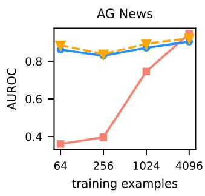

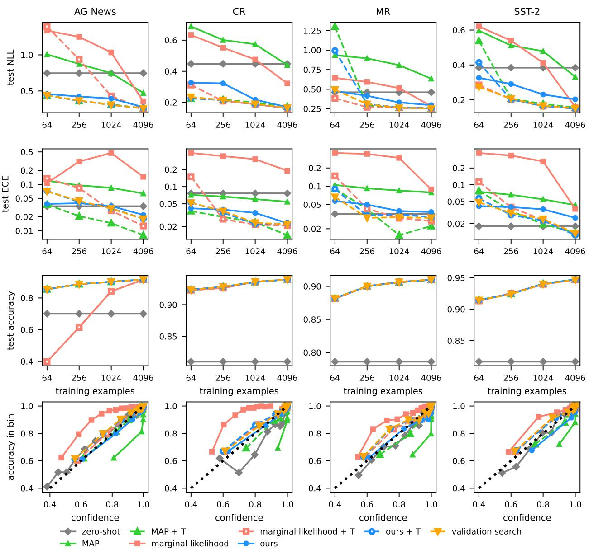  
Figure 8: Figure 4 for each task, with all methods, mean over three seeds.  
Figure 9: Figure 6 for each task, mean over three seeds. The OOD inputs are SST-2 for AG News and AG News for the other tasks.

## I FINE-TUNING UNDER THE ESTIMATED PRIOR

Since λ is available before fine-tuning, it can also be used as the prior during training (Section 5), not only in the Laplace approximation fitted after training (Section 7.4). The training then minimizes the sum of the training NLLs plus $\scriptstyle { \frac { \hat { \lambda } } { 2 } } \parallel w \parallel ^ { 2 }$ , the negative log density of the prior $\mathcal { N } ( 0 , \hat { \lambda } ^ { - 1 } I )$ on the LoRA parameters w, so that the trained model is the mode of the posterior under the estimated prior. All other settings follow Section 7.4 and Appendix H.

Figure 10 compares each method with LoRA trained without and under the prior. The prior improves calibration. In the reliability diagrams (bottom row), the overconfident MAP and the underconfident marginal likelihood both move to the diagonal, and the ECE of both drops sharply. With the MAP itself well calibrated, the precision chosen after training matters much less, and all methods reach a similar NLL. Our method maintains its NLL and improves its calibration slightly, while validation search, which no longer has to temper an overconfident MAP, does not benefit. Accuracy is lower for the smallest training sets, where the prior keeps the adapters close to the pretrained model, and changes little from about a thousand training examples on.

The largest change is for marginal likelihood. With LoRA trained without a prior, it selects precisions orders of magnitude below λ. With LoRA trained under λ, it selects precisions close to λ and matches our method in NLL and calibration, and with little data it detects OOD inputs better than our method with the same training. The Laplace evidence assumes that the trained model is the mode of the posterior under the prior it evaluates (Appendix D), which holds only when LoRA is trained under a prior. Therefore, the two methods can be combined to improve the overall behaviour: λ sets the prior before and during training, and marginal likelihood refines the precision afterwards, without validation data.

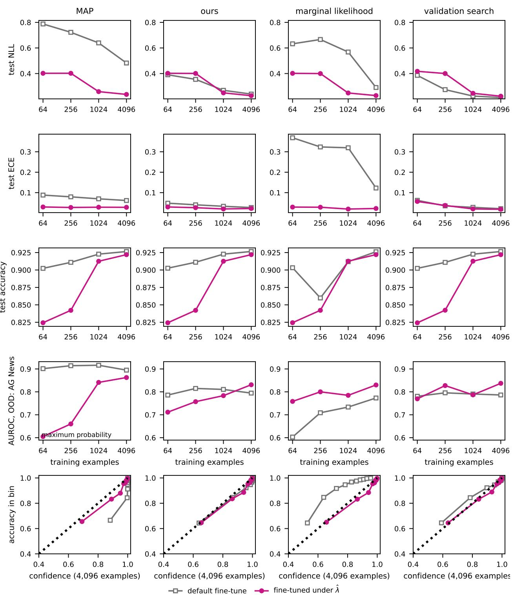  
Figure 10: Each method with LoRA trained without a prior (gray) and under λ (magenta), mean over tasks and seeds. The OOD AUROC of the MAP, which has no posterior, uses the maximum probability. Bottom row: reliability diagrams at 4,096 training examples.