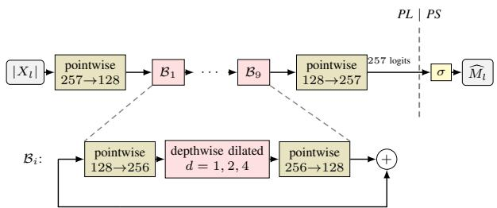
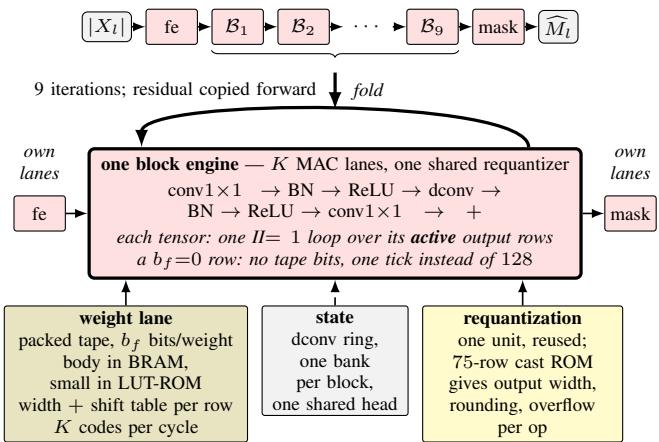
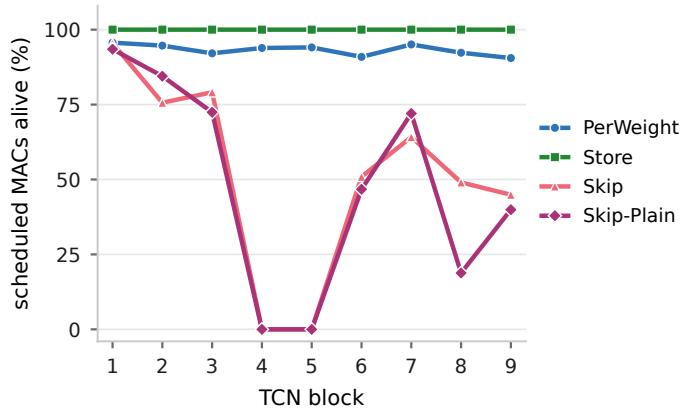

# Realizing Low-Precision Storage and Sparse Execution in a Folded FPGA Speech Enhancer

Clement Laroche´

Audio Research, GN A/S, Ballerup, Denmark

Email: claroche@gn.com

Abstract—Hardware-aware training often optimizes FPGA resources, latency, or bit operations, but folding changes what compression saves: shared arithmetic decouples precision, weight storage, and scheduled work. We derive training objectives from the measured costs of a folded streaming speech-enhancement accelerator. Mixed-precision weights reduce on-chip storage; structured channel sparsity removes entire operations from the engine schedule. We deploy a bit-exact implementation on the Kria KV260. The best sparse model eliminates 47.3% of convolution MACs, cutting frame time by 45% (1.86 to 1.03 ms) and dynamic energy by 60% (83 to 33 µJ/frame) against a storage-priced model measured in the same session, with higher speech quality. Relative to the most efficient dense build measured separately, frame time falls by 42% and energy by 48%. Reducing weight width from 8 to 6 bits lowers dynamic power by 27% but changes frame time by less than 5%. Plain channel group-lasso removes more work than cycle-cost-weighted lasso.

Index Terms—speech enhancement, FPGA, mixed precision, structured sparsity, hardware–software co-design, edge inference

## I. INTRODUCTION

Speech enhancement runs in hearing aids, audio wearables, and voice-activated systems. Responsiveness, privacy, and offline operation put these models on the device rather than in the cloud, which has driven a line of lightweight architectures [1]– [3]. Beyond architectural design, quantization offers another way to reduce the memory and computational costs of ondevice inference [4]. Recent work makes quantization itself trainable: mixed-precision searches assign a width per layer under a hardware cost [5], differentiable schemes learn widths and scales jointly with the task [6], [7], and the finest schemes learn a separate width for every channel and every weight [8], [9]. Commercial silicon, however, prices none of that granularity. A fixed-datapath int8 NPU [10], [11] pushes every operand through the same 8 × 8 multiplier array. Collecting the gains of sub-byte quantization therefore takes hardware built for the trained widths themselves.

Dataflow compilers build exactly that datapath: FINN [12], [13] and hls4ml [14]–[17] map quantized layers to dedicated hardware, realizing low precision directly in the synthesized arithmetic, while research accelerators instead support multiple arithmetic precisions within the accelerator [18]–[20]. These approaches suit latency-critical deployments where much of the network is spatially realized in fabric. For streaming speech enhancement on a small device, the frame budget is generous, but the area is not, so one datapath must serve the whole network in turn. Folding changes how compression maps to hardware cost. Here, folding means reusing one physical compute engine for the network’s blocks and processing them in sequence instead of giving each block its own hardware. Bitoperation objectives such as Bayesian Bits [21], HGQ [9], and PQuantML [22] capture implementations in which reducing precision reduces arithmetic work or instantiated logic. Prior single-engine accelerators already show that this correspondence depends on the datapath: layer computations may be time-shared on one processing engine [23], [24], and mixedprecision overlays can retain a fixed-width multiplier while changing only the numerical representation [25]. Thus, no single bit-operation count determines the cost of a folded accelerator.

In this paper, we use the HGQ–HLS4ML flow [9], [26] to study how learned precision and sparsity translate to a folded FPGA accelerator for streaming speech enhancement. One fixed-width engine is reused across the network [23]– [25]; learned widths determine how weights are packed, while exact-zero channel rows are removed from the MAC schedule. A compact table-and-tape representation carries these choices through standard FPGA tools, while bit-exact checks ensure that the deployed accelerator reproduces the trained arithmetic, closing the hardware gap between trained and deployed models [27]. We then adapt the training objective to weight storage and scheduled cycles, following the broader principle that compression should target hardware-specific costs rather than proxy operation counts [28]–[30]. Every build exceeds the quality of the same-board 16-bit reference [31], while using 20–21 rather than 899 DSPs.

## II. THE SPEECH-ENHANCEMENT NETWORK

Conv-FSENet [32], [33] is a Conv-TasNet-style [34] dilated temporal convolutional network (TCN) that estimates a mask from STFT magnitude frames (Fig. 1). A pointwise frontend with ReLU feeds nine TCN blocks, arranged as three stacks of three, and a pointwise mask layer. Each block expands pointwise, applies a dilated depthwise Conv1D (kernel 3; dilation 1, 2, 4 within a stack), projects back pointwise, and adds the block input; BatchNorm and ReLU follow each of the first two convolutions. All convolutions are causal (leftpadded) with zero lookahead. The network holds ∼ 0.66 M weights, costs ∼ 668 k MACs per frame, and streams frame by frame. For L frames, $C _ { \mathrm { r e s } } { = } 1 2 8$ residual and $C _ { \mathrm { c o n v } } { = } 2 5 6$ expanded channels, and kernel size k=3, a block’s pointwise (PW⊛) and dilated depthwise (DDW⊛) convolutions cost approximately

  
Fig. 1. Conv-FSENet Network. The accelerator returns 257 logits, and the host applies σ.

  
Fig. 2. Conv-FSENet folded onto one time-shared engine. Block-specific weights arrive on the weight lane, block-specific history from the dconv ring, and the trained output format of every operation from the cast ROM.

$$
\mathbf { M A C } _ { \mathrm { P W } \oplus } \approx L \cdot C _ { \mathrm { c o n v } } \cdot C _ { \mathrm { r e s } } \qquad \mathbf { M A C } _ { \mathrm { D D W } \oplus } \approx L \cdot C _ { \mathrm { c o n v } } \cdot k .\tag{1}
$$

## III. THE FOLDED ENGINE

## A. Trading latency margin for hardware reuse

The 16 ms frame period provides substantial time for hardware reuse. Our first attempt to implement Conv-FSENet using the HGQ→hls4ml spatial flow exceeded the FPGA’s resources. Even with only $1 / 8$ of the production channel width, the generated design required 356 k LUTs, about 3× the device’s 117 k. hls4ml can reuse hardware within a layer, but it generates separate hardware for each layer, so the resource costs add up across the network. We instead exploit the available cycle budget by time-sharing one physical engine across the network [13]. This replaces the area-heavy spatial mapping with a folded design whose main costs are the shared datapath, the stored weights, and the cycles needed to execute the layer schedule.

This reuse is possible because Conv-FSENet’s body contains nine TCN blocks with the same structure; only their weights and depthwise-convolution dilation differ (Fig. 2).

Rather than instantiating nine copies, we implement one physical TCN engine and execute the blocks sequentially. What a spatial design hard-wires per block therefore becomes data that the engine fetches at each iteration: the output format of each operation, the block’s weights, and its depthwise history.

## B. The shared data lane

The folded engine must therefore preserve the different precisions learned across the network while reusing the same physical datapath. Activations therefore travel through the engine in a common fixed-point carrier format, and multiply– accumulate results are collected in a wider shared accumulator. At each operator boundary, the result is requantized to the output format learned during training. Rather than implementing a separate cast for every operator and activation element, the engine uses one shared requantizer controlled by a small cast ROM.

To supply this shared datapath, the weight lane stores consecutive weights for each output channel using a shared code width $b _ { f }$ and shift $s _ { f }$ . For weight j in channel $f ,$ the decoder reconstructs

$$
W _ { f , j } = \mathrm { s i g n e x t } ( c _ { f , j } ) 2 ^ { s _ { f } } ,\tag{2}
$$

where $c _ { f , j }$ is its $b _ { f }$ -bit signed code. The MAC therefore receives the same fixed-point weight as it would from the uniform-width representation; only its storage format changes. A channel with $b _ { f } = 0$ has only zero weights: it occupies no weight bits, and removing that channel from the schedule also removes its MAC cycles (Eq. 1).

Together, these representations preserve the learned fixedpoint computation, but sharing also limits how much heterogeneous precision can reduce the arithmetic hardware. The shared multiplier must support the widest operand used anywhere in the engine, so a narrower weight shrinks the packed stream but not the multiplier. As a result, folding does not turn every per-weight bit-width reduction into a proportional reduction in compute hardware, as a fully spatial reading of effective bit operations (EBOPs) would suggest. The folded engine can still exploit two forms of compression directly: variable-width weight storage and exact-zero channels that are removed from the execution schedule.

## IV. TRAINING PRICED FOR THE ENGINE

All models minimize the compressed spectral MSE [35] plus the two HGQ regularizers [9]. A monotone- $. L _ { 1 }$ term $( \lambda _ { b } { = } 1 0 ^ { - 8 } )$ pushes every learned bit width down uniformly, and β·EBOPs sums $\mathrm { M } \mathrm { \dot { A } C s } _ { \ell } b _ { \ell } ^ { ( a ) } b _ { \ell } ^ { ( w ) }$ over layers (activation and weight widths), weighting precision by arithmetic cost. Our engine-aware recipes modify this baseline objective with terms for the two costs the folded hardware can actually exploit: weight storage and scheduled cycles.

For the folded engine, latency is set by the number of scheduled MACs; therefore, saving cycles requires removing computation. We encourage whole output channels to become zero so that their MAC loops can be skipped. For each body convolution $\ell ,$ let $K _ { j } ^ { ( \ell ) }$ denote all kernel weights producing output channel j. We apply the cycle-weighted group-lasso

$$
\mathcal { L } _ { \mathrm { c y c l e } } = \frac { \lambda _ { C } } { C _ { 0 } } \sum _ { \ell \in B } \sum _ { j } c _ { \ell } \left. K _ { j } ^ { ( \ell ) } \right. _ { 2 } ,\tag{3}
$$

where $c _ { \ell }$ is the number of MACs needed to compute one output channel of layer ℓ, and $C _ { 0 }$ normalizes the term by its initial value. Thus, channels that cost more scheduled cycles receive more pruning pressure. Setting $c _ { \ell } = 1$ recovers the plain group-lasso [36].

Keeping this pressure active throughout training proved unstable. At epoch 50, we therefore freeze the learned zerochannel mask and remove the fold-cost terms. A projection keeps masked channels at zero, so the hardware schedule can no longer change. The task loss, monotone- $. L _ { 1 }$ , and β·EBOPs terms remain active, allowing the surviving weights and precisions to continue adapting within the fixed sparse topology.

For the folded engine, reducing a weight width saves storage. We therefore learn one width $b _ { \ell }$ per weight tensor and, when needed, directly constrain the packed weight tape. For a target capacity $B _ { 0 }$ , we add

$$
\mathcal { L } _ { \mathrm { t a p e } } = \lambda _ { T } \left[ \frac { B _ { \mathrm { t a p e } } } { B _ { 0 } } - 1 \right] _ { + } ,\tag{4}
$$

where $B _ { \mathrm { t a p e } }$ is the emitted weight-image size. The forward pass uses the exact packed size, including per-channel headers, while a differentiable estimate from the learned widths provides the gradient.

## V. RESULTS

## A. Experimental Setup

Data We use the 16 kHz VoiceBank-DEMAND dataset [37]. Four of the 28 training speakers (p279, p282, p286, p287) are held out as a speaker-disjoint validation set; the 824-utterance test set (speakers p232, p257) is used only for final scoring. Models All builds use the same Conv-FSENet (Section II) and differ only in the training objective and the weight granularity they learn. The UNIFORM builds pin the total width of every quantizer, weights and activations alike, to 6, $^ { 7 , }$ or 8 bits with $\beta { = } 0 ;$ only each quantizer’s binary point is learned. PERWEIGHT-WRAP and PERWEIGHT-SAT use the stock HGQ objective at per-weight granularity, with wrapping and saturating data-lane overflow respectively. STORE learns one width per tensor under the storage term (Eq. 4, $B _ { 0 } { = } 3 . 0  { \mathrm { M b i t } } )$ . SKIP learns per-channel widths and adds the cycle-weighted group-lasso (Eq. 3, λC=0.02) with the mask freeze at epoch 50; SKIP-PLAIN replaces cycle-weighted group-lasso with plain group-lasso $c _ { \ell } = 1$

Training The deployed checkpoint is the final epoch under an active compression schedule and, for mask-freeze runs, the validation-best checkpoint after projection; this rule was fixed before test scoring.

Hardware All builds target the AMD Kria KV260 (Zynq UltraScale+ XCK26) through the same Vitis HLS/Vivado 2024.1 flow and run at 100 MHz. The folded engine of

Section III is driven from PYNQ 3.0.1 on the Cortex-A53 host, which also computes the STFT, the output sigmoid, and the inverse STFT.

Bit-exactness An integer NumPy reference matches all 75 layer outputs in the C simulation, including the cold start. On the board, replayed DMA inputs produce identical raw output words for every deployment; repeated runs over all 824 test utterances are also identical. The host-side feature quantizer is checked separately against reference vectors, since DMA output parity does not verify it.

Power and energy We measure KV260 board power (PS, PL, and DDR) from the SOM’s 5 V INA260 sensor at 5 Hz. Each build is measured over eight interleaved pairs of 60 s idle and continuous-processing windows. Dynamic power is the mean active-minus-idle difference; energy per frame is this difference divided by the achieved frame rate. The idle board draws 3.11–3.13 W, about 50 mJ per real-time frame, so the energies reported are the accelerator’s added share, under 0.2% of the total.

Metrics Quality is wideband PESQ (ITU-T P.862.2) [38] over all 824 test utterances, computed with the mask network running on silicon. Frame time is board wall-clock per frame at the flat-out rate, and resource counts are post-route.

## B. Main comparison

Table I compares eight models that all route and meet timing on the same engine. SKIP-PLAIN gives the lowest measured latency and energy: 47.3% of its convolution MACs belong to exact-zero channels, which the engine skips, yielding 1.03 ms and 33.4 µJ per frame at PESQ 2.78. That is 42% lower latency and 48% less consumption than the most efficient dense build, UNIFORM-6. Weighting the group-lasso by channel cycle cost does not improve this result. SKIP skips 44.1% of MACs and reaches 1.09 ms and $3 7 . 3 \mu \mathrm { J }$ per frame at PESQ 2.69, so the plain lasso performs better on all three measured outcomes in these runs.

The uniform and stock HGQ models have at most 6.2% of MACs in skippable zero-width channels and run in 1.74– 1.85 ms per frame. Pricing weight storage produces STORE: its 2.98 Mbit tape (4.46 bits per weight) meets the 3.0 Mbit target and gives the highest quality among dense builds, but its 0.0% skippable MACs leave the full compute schedule in place. Every build fits within the device’s 144 BRAM tiles, UNIFORM-8 with 2.5 to spare. It holds STORE at 113 tiles, 20% fewer than UNIFORM-8, yet sparsity saves more: the sparse builds need 79 tiles and finish far below $B _ { 0 }$ , where the hinge is inactive.

Weight width also affects power: from eight to six bits in the pinned-width sweep, dynamic power falls by 27% and energy per frame by 30%, while frame time changes by under 5%. Narrower weights thus save storage and, presumably through lower switching activity, dynamic energy, but not cycles.

DEN16 [31] runs a different, time-domain network on the same board and dataset. Our builds score 0.23–0.37 PESQ higher with 4.2–8.3× fewer LUTs and 43× fewer DSPs, the latter largely because nine TCN blocks share four MAC lanes.

TABLE I  
KV260 RESULTS FOR EIGHT BUILDS (K=4 MAC LANES). TAPE SIZE IS IN MBIT.
<table><tr><td>build</td><td>training objective</td><td>weight granularity</td><td></td><td>tape zero MACs</td><td>LUT</td><td>BRAM DSP</td><td></td><td>ms/frame mW</td><td></td><td></td><td>µJ/frame PESQ</td></tr><tr><td colspan="10">Baseline F32</td><td>2.89</td></tr><tr><td>UNIFORM-8</td><td>pinned width</td><td>none</td><td>3.98</td><td>0.1%</td><td>18.3k</td><td>141.5</td><td>21</td><td>1.85 49.7</td><td></td><td> $9 2 . 1 \pm 1 . 5$ </td><td>2.69</td></tr><tr><td>UNIFORM-7</td><td>pinned width</td><td>none</td><td>3.24</td><td>0.2%</td><td>17.0k</td><td>121</td><td>21</td><td>1.83 44.6</td><td></td><td> $8 1 . 5 \pm 1 . 1$ </td><td>2.70</td></tr><tr><td>UNIFORM-6</td><td>pinned width</td><td>none</td><td>2.31</td><td>0.7%</td><td>10.9k</td><td>114</td><td>21</td><td>1.77</td><td>36.5</td><td> $6 4 . 5 \pm 1 . 6$ </td><td>2.64</td></tr><tr><td>PERWEIGHT-WRAP</td><td>HGQ</td><td>per-weight</td><td>3.22</td><td>6.1%</td><td>19.4k</td><td>114.5</td><td>21</td><td>1.75</td><td>42.8</td><td> $7 4 . 6 \pm 1 . 4$ </td><td>2.74</td></tr><tr><td>PERWEIGHT-SAT</td><td>HGQ</td><td>per-weight</td><td>3.08</td><td>6.2%</td><td>19.8k</td><td>110</td><td>21</td><td>1.74 37.6</td><td></td><td> $6 5 . 4 \pm { 1 . 3 }$ </td><td>2.72</td></tr><tr><td>STORE</td><td>HGQ + storage</td><td>per-channel</td><td>2.98</td><td>0.0%</td><td>20.7k</td><td>113</td><td>20</td><td>1.86</td><td>44.5</td><td> $8 2 . 7 \pm 2 . 4$ </td><td>2.76</td></tr><tr><td>SKIP</td><td>HGQ + storage + cycle lasso</td><td>per-channel</td><td>1.97</td><td>44.1%</td><td>21.7k</td><td>79</td><td>21</td><td>1.09</td><td>34.1</td><td> $3 7 . 3 \pm { 1 . 1 }$ </td><td>2.69</td></tr><tr><td>SKIP-PLAIN</td><td>HGQ + storage + plain lasso</td><td>per-channel</td><td>1.80</td><td>47.3%</td><td>21.4k</td><td>79</td><td>21</td><td>1.03</td><td>32.4</td><td>33.4 ± 1.6</td><td>2.78</td></tr><tr><td>DEN16§[31]</td><td>fixed 16-bit, no compression</td><td>none</td><td>22.5</td><td></td><td>90.9k</td><td>126.5</td><td>899</td><td></td><td></td><td></td><td>2.41</td></tr></table>

All builds route at 100 MHz with 1.35–2.84 ns slack. Energy: mean ± 95% CI over eight idle/active pairs. DEN16§ [31] is an independently reported implementation of a different speech-enhancement network on the same KV260 FPGA.

  
Fig. 3. Share of scheduled MACs in surviving output channels by TCN block.

TABLE II  
MAC-LANE SWEEP OF SKIP-PLAIN; OUTPUTS ARE BYTE-IDENTICAL. ∗OUT-OF-CONTEXT SYNTHESIS.
<table><tr><td></td><td>K ms/frame</td><td>speedup</td><td>lane eff.</td><td>mW</td><td>µJ/frame</td><td>LUT</td><td>BRAM</td><td>DSP</td></tr><tr><td>1</td><td>3.63</td><td>1.00×</td><td>97%</td><td>26.1</td><td>94.9</td><td>20.9k</td><td>79.5</td><td>8</td></tr><tr><td>4</td><td>1.03</td><td>3.53×</td><td></td><td>86%32.4</td><td>33.4</td><td>21.4k</td><td>79</td><td>21</td></tr><tr><td>8</td><td>0.68</td><td>5.34×</td><td></td><td>65%43.8</td><td>29.9</td><td>25.8k</td><td>79</td><td>37</td></tr><tr><td></td><td>16 does not meet II=1</td><td></td><td></td><td></td><td></td><td>43.2k*</td><td>116*</td><td>79*</td></tr></table>

DEN16 is faster, however: its RTF is 0.010 against our 0.064, and its 9.7 ms first sample beats our 32 ms window.

Table II varies SKIP-PLAIN over $K \in \{ 1 , 4 , 8 , 1 6 \}$ MAC lanes by changing only the unroll factors. Dynamic power rises from 26.1 to 32.4 to 43.8 mW, but energy per frame falls by 2.8× and 1.12× respectively. Lane efficiency falls for two reasons. First, some compute is done once per frame regardless of K: updating the depthwise state, controlling loops, and checking channels whose MACs will be skipped. Second, each lane decodes from a shared (15K+64)-bit window, so the decoder’s barrel shifters grow as $K ( 1 5 K + 6 4 )$ bit positions (4 864 at K=16). At K=16, this logic prevents the convolution loop from starting a new iteration every cycle: its initiation interval rises to $\mathrm { I I } { = } 2 .$

## C. Effects of compression

To isolate the benefit of row skipping, we co-simulate PERWEIGHT-WRAP, STORE, SKIP, and SKIP-PLAIN with MAC skipping disabled. At K=4, the four builds take nearly the same number of cycles. Narrower weights therefore do not meaningfully shorten the full schedule on this engine.

With skipping enabled, SKIP-PLAIN avoids 47.3% of MACs and reduces frame time by 44.6%; SKIP avoids 44.1% of MACs and reduces frame time by 41.3%. The frame-time reductions are smaller because work outside the skippable MAC loops still runs, including frontend, mask, normalization, and residual operations (roughly 24k cycles per frame).

Figure 3 shows that the training objectives produce different amounts of skippable computation. STORE produces no such channels. Stock HGQ sets individual weights to zero throughout the network, but produces whole zero channels only in depthwise layers, accounting for 6.1% of MACs. Channel group-lasso instead drives entire output channels to zero: both lasso builds remove TCN blocks 4 and 5 entirely and reduce the work in later blocks. In SKIP-PLAIN, only 18.8% of block 8’s scheduled MACs remain.

## VI. CONCLUSION

In this paper, we show that compression chosen during training can reduce storage, latency, and energy on a folded FPGA engine for streaming speech enhancement. At the same four-lane configuration as the uniform-precision builds, SKIP-PLAIN processes a frame in 1.03 ms and uses 33.4 µJ, compared with 1.77 ms and 64.5 µJ for UNIFORM-6. Its measured PESQ is 2.78 versus 2.64, so the hardware savings come at comparable or better measured quality.

Channel sparsity pressure during training drives entire output-channel weight rows to zero, allowing the engine to skip their MAC loops and reduce the work scheduled for each frame. Future work could explore alternative structured sparsity priors to reduce the training instability observed with Lasso regularization.

[1] J.-M. Valin, “A hybrid DSP/deep learning approach to real-time fullband speech enhancement,” in Proc. IEEE Int. Workshop Multimedia Signal Process. (MMSP), 2018, pp. 1–5, doi: 10.1109/MMSP.2018. 8547084.

[2] H. Schroter, A. N. Escalante-B., T. Rosenkranz, and A. Maier, “Deep-¨ FilterNet: A low complexity speech enhancement framework for full band audio based on deep filtering,” in Proc. IEEE Int. Conf. Acoust., Speech Signal Process. (ICASSP), 2022, pp. 7407–7411, doi: 10.1109/ ICASSP43922.2022.9747055.

[3] H. Yan, J. Zhang, C. Fan, Y. Zhou, and P. Liu, “LiSenNet: Lightweight sub-band and dual-path modeling for real-time speech enhancement,” in Proc. IEEE Int. Conf. Acoust., Speech Signal Process. (ICASSP), 2025, pp. 1–5, doi: 10.1109/ICASSP49660.2025.10888272.

[4] B. Jacob et al., “Quantization and training of neural networks for efficient integer-arithmetic-only inference,” in Proc. IEEE/CVF Conf. Comput. Vis. Pattern Recognit. (CVPR), 2018, pp. 2704–2713, doi: 10.1109/CVPR.2018.00286.

[5] K. Wang, Z. Liu, Y. Lin, J. Lin, and S. Han, “HAQ: Hardware-aware automated quantization with mixed precision,” in Proc. IEEE/CVF Conf. Comput. Vis. Pattern Recognit. (CVPR), 2019, pp. 8604–8612, doi: 10. 1109/CVPR.2019.00881.

[6] L. Yang and Q. Jin, “FracBits: Mixed precision quantization via fractional bit-widths,” in Proc. AAAI Conf. Artif. Intell., vol. 35, no. 12, 2021, pp. 10 612–10 620, doi: 10.1609/aaai.v35i12.17269.

[7] A. Defossez, Y. Adi, and G. Synnaeve, “Differentiable model compres-´ sion via pseudo quantization noise,” Trans. Mach. Learn. Res., 2022.

[8] C. N. Coelho et al., “Automatic heterogeneous quantization of deep neural networks for low-latency inference on the edge for particle detectors,” Nat. Mach. Intell., vol. 3, no. 8, pp. 675–686, 2021, doi: 10.1038/s42256-021-00356-5.

[9] C. Sun et al., “HGQ: High granularity quantization for real-time neural networks on FPGAs,” in Proc. ACM/SIGDA Int. Symp. Field-Program. Gate Arrays (FPGA), 2026, pp. 79–91, doi: 10.1145/3748173.3779200.

[10] AMD, “Vitis AI user guide (UG1414) and DPUCZDX8G for Zynq UltraScale+ MPSoCs product guide (PG338),” AMD technical documentation, 2023.

[11] STMicroelectronics, “STM32N6 series with Neural-ART accelerator,” STMicroelectronics product documentation, 2025.

[12] Y. Umuroglu et al., “FINN: A framework for fast, scalable binarized neural network inference,” in Proc. ACM/SIGDA Int. Symp. Field-Program. Gate Arrays (FPGA), 2017, pp. 65–74, doi: 10.1145/3020078.3021744.

[13] M. Blott et al., “FINN-R: An end-to-end deep-learning framework for fast exploration of quantized neural networks,” ACM Trans. Reconfigurable Technol. Syst., vol. 11, no. 3, pp. 1–23, 2018, doi: 10.1145/3242897.

[14] J. Duarte et al., “Fast inference of deep neural networks in FPGAs for particle physics,” J. Instrum., vol. 13, no. 7, Art. no. P07027, 2018, doi: 10.1088/1748-0221/13/07/P07027.

[15] J.-F. Schulte et al., “hls4ml: A flexible, open source platform for deep learning acceleration on reconfigurable hardware,” ACM Trans. Reconfigurable Technol. Syst., vol. 19, no. 2, pp. 1–35, 2026, doi: 10.1145/3801979.

[16] T. Aarrestad et al., “Fast convolutional neural networks on FPGAs with hls4ml,” Mach. Learn.: Sci. Technol., vol. 2, no. 4, Art. no. 045015, 2021, doi: 10.1088/2632-2153/ac0ea1.

[17] N. Ghielmetti et al., “Real-time semantic segmentation on FPGAs for autonomous vehicles with hls4ml,” Mach. Learn.: Sci. Technol., vol. 3, no. 4, Art. no. 045011, 2022, doi: 10.1088/2632-2153/ac9cb5.

[18] P. Judd, J. Albericio, T. Hetherington, T. M. Aamodt, and A. Moshovos, “Stripes: Bit-serial deep neural network computing,” in Proc. IEEE/ACM Int. Symp. Microarchit. (MICRO), 2016, pp. 1–12, doi: 10.1109/MICRO. 2016.7783722.

[19] H. Sharma et al., “Bit Fusion: Bit-level dynamically composable architecture for accelerating deep neural networks,” in Proc. ACM/IEEE Int. Symp. Comput. Archit. (ISCA), 2018, pp. 764–775, doi: 10.1109/ISCA. 2018.00069.

[20] M. Sun et al., “FILM-QNN: Efficient FPGA acceleration of deep neural networks with intra-layer, mixed-precision quantization,” in Proc. ACM/SIGDA Int. Symp. Field-Program. Gate Arrays (FPGA), 2022, pp. 134–145, doi: 10.1145/3490422.3502364.

[21] M. van Baalen et al., “Bayesian Bits: Unifying quantization and pruning,” in Proc. Adv. Neural Inf. Process. Syst. (NeurIPS), vol. 33, 2020, pp. 5741–5752.

[22] R. Niemi et al., “PQuantML: A tool for end-to-end hardware-aware model compression,” arXiv preprint arXiv:2603.26595, 2026.

[23] H. Sharma et al., “From high-level deep neural models to FPGAs,” in Proc. IEEE/ACM Int. Symp. Microarchit. (MICRO), 2016, pp. 1–12, doi: 10.1109/MICRO.2016.7783720.

[24] K. Guo et al., “Angel-Eye: A complete design flow for mapping CNN onto embedded FPGA,” IEEE Trans. Comput.-Aided Design Integr. Circuits Syst., vol. 37, no. 1, pp. 35–47, 2018, doi: 10.1109/TCAD. 2017.2705069.

[25] Z. Que, D. H. Noronha, R. Zhao, X. Niu, S. J. E. Wilton, and W. Luk, “In-circuit tuning of deep learning designs,” J. Syst. Archit., vol. 118, Art. no. 102198, 2021, doi: 10.1016/j.sysarc.2021.102198.

[26] FastML Team, “hls4ml,” Zenodo, version v1.3.0, 2026, doi: 10.5281/ zenodo.1201549.

[27] B. Barbe, R. Bouarah, F. de Dinechin, and A. Volkova, “Reducing the hardware gap for custom accelerators through quantization aware training,” in Proc. 8th Workshop Accel. Mach. Learn. (AccML), 2026, HAL: hal-05466817.

[28] T.-J. Yang, Y.-H. Chen, and V. Sze, “Designing energy-efficient convolutional neural networks using energy-aware pruning,” in Proc. IEEE Conf. Comput. Vis. Pattern Recognit. (CVPR), 2017, pp. 6071–6079, doi: 10.1109/CVPR.2017.643.

[29] T.-J. Yang et al., “NetAdapt: Platform-aware neural network adaptation for mobile applications,” in Proc. Eur. Conf. Comput. Vis. (ECCV), 2018, pp. 289–304, doi: 10.1007/978-3-030-01249-6 18.

[30] M. Shen, H. Yin, P. Molchanov, L. Mao, J. Liu, and J. M. Alvarez, “Structural pruning via latency-saliency knapsack,” in Proc. Adv. Neural Inf. Process. Syst. (NeurIPS), vol. 35, 2022, pp. 12 894–12 908.

[31] F. Olalere, U. Altin, K. van der Heijden, and M. van Gerven, “Feasibility of time-domain DNN-based speech enhancement on embedded FPGA for hearing aids,” arXiv preprint arXiv:2606.04221, 2026.

[32] R. Miccini, C. Laroche, T. Piechowiak, and L. Pezzarossa, “Scalable speech enhancement with dynamic channel pruning,” in Proc. IEEE Int. Conf. Acoust., Speech Signal Process. (ICASSP), 2025, pp. 1–5, doi: 10.1109/ICASSP49660.2025.10889876.

[33] R. Miccini, C. Laroche, T. Piechowiak, X. Fafoutis, and L. Pezzarossa, “From diet to free lunch: Estimating auxiliary signal properties using dynamic pruning masks in speech enhancement networks,” in Proc. IEEE Int. Conf. Acoust., Speech Signal Process. (ICASSP), 2026, pp. 15 427–15 431, doi: 10.1109/ICASSP55912.2026.11463996.

[34] Y. Luo and N. Mesgarani, “Conv-TasNet: Surpassing ideal time– frequency magnitude masking for speech separation,” IEEE/ACM Trans. Audio, Speech, Lang. Process., vol. 27, no. 8, pp. 1256–1266, 2019, doi: 10.1109/TASLP.2019.2915167.

[35] S. Braun and I. Tashev, “A consolidated view of loss functions for supervised deep learning-based speech enhancement,” in Proc. Int. Conf. Telecommun. Signal Process. (TSP), 2021, pp. 72–76, doi: 10.1109/ TSP52935.2021.9522648.

[36] W. Wen, C. Wu, Y. Wang, Y. Chen, and H. Li, “Learning structured sparsity in deep neural networks,” in Proc. Adv. Neural Inf. Process. Syst. (NeurIPS), vol. 29, 2016.

[37] C. Valentini-Botinhao, X. Wang, S. Takaki, and J. Yamagishi, “Investigating RNN-based speech enhancement methods for noise-robust textto-speech,” in Proc. ISCA Speech Synth. Workshop (SSW), 2016, pp. 146–152, doi: 10.21437/SSW.2016-24.

[38] ITU-T, “Wideband extension to Recommendation P.862 for the assessment of wideband telephone networks and speech codecs,” Recommendation P.862.2, 2007.