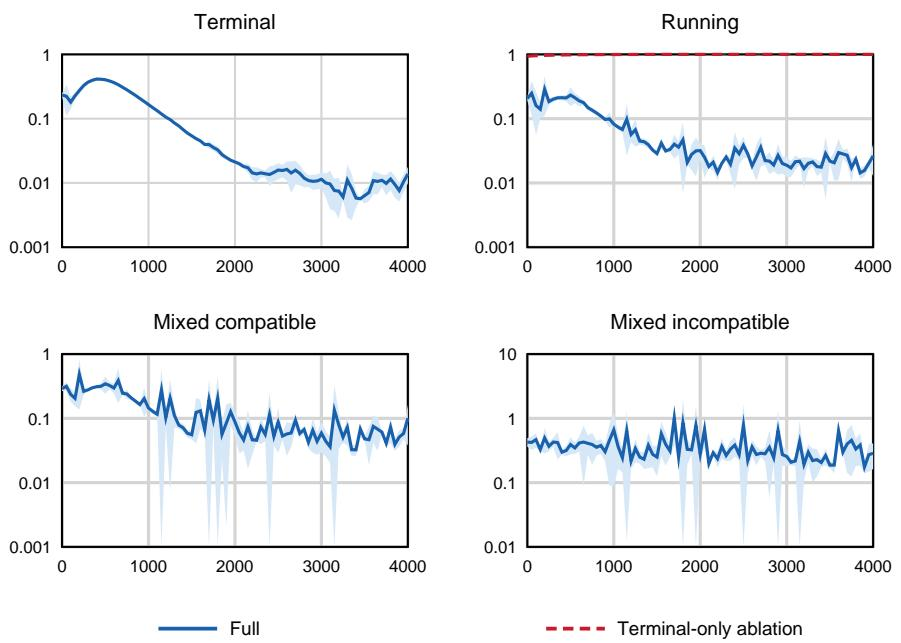
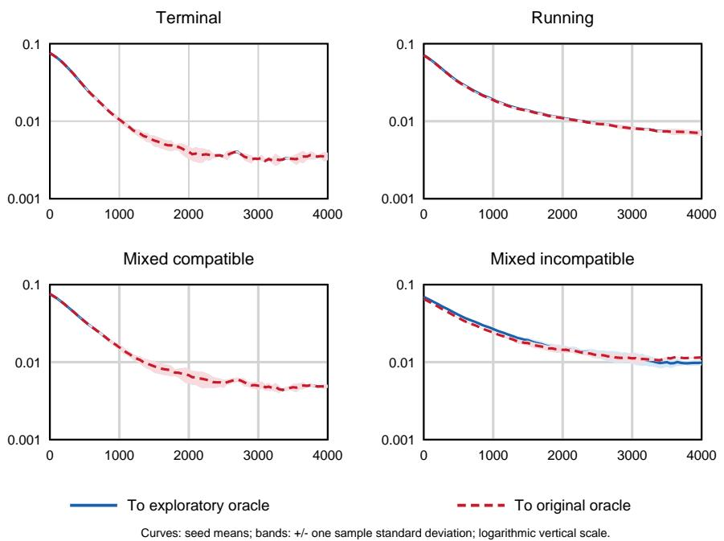
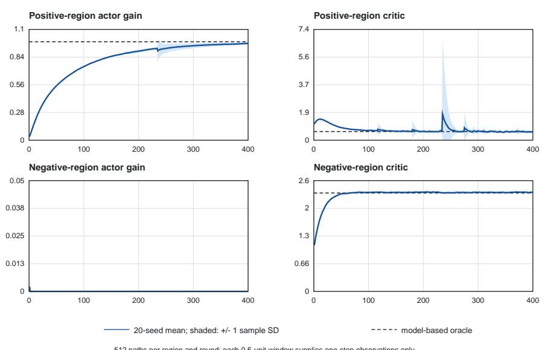

# Reinforcement learning for constrained stochastic linear–quadratic control in continuous time

Weiping Wua, Qitong Pana, Xun Li∗b, Peng Wu∗a

aSchool of Economics and Management, Fuzhou

University, Fuzhou, 350108, Fujian, China

bDepartment of Applied Mathematics, The Hong Kong Polytechnic University, Hong Kong, China

## Abstract

We study continuous-time stochastic linear–quadratic control with a scalar state and nonnegative control constraints. With quadratic running costs, randomized exploration can change the optimal mean feedback. We introduce an auxiliary problem without entropy in which the conditional policy mean is nonnegative and the covariance is prescribed in proportion to the squared state. Moment reduction and state separation yield two regional Riccati equations and characterize the finite-horizon value function and optimal conditional mean. We give a suficient control–cost compatibility condition under which this mean coincides with the optimal feedback of the original constrained problem. For time-invariant coeficients, we characterize the undiscounted infinite-horizon optimum and establish mean-square asymptotic stability under the stated assumptions. For unknown dynamics, we develop model-free actor–critic schemes for finite and infinite horizons. Numerical experiments compare the learned policies with their analytical targets and examine the efect of exploration on the optimal mean.

Keywords: Linear quadratic regulators, Optimal control, Stochastic control, Continuous time systems, Constraints, Reinforcement learning

## 1. Introduction

For classical unconstrained stochastic linear–quadratic (LQ) problems, Riccati equations provide a means of constructing optimal controls in linear state-feedback form; see Yong and Zhou (1999, Chapter 6). Its connection with mean–variance portfolio selection was established by Zhou and Li (2000), using the indefinite stochastic LQ theory of Chen et al. (1998). Control constraints introduce dificulties even when the model coeficients are known. In the no-shorting problem, Li et al. (2002) showed that the usual completion-of-squares argument does not apply directly and that the associated Hamilton–Jacobi–Bellman (HJB) equation need not have a smooth solution. They characterized the solution through two Riccati equations and viscosity analysis. Hu and Zhou (2005) developed cone-constrained stochastic LQ control with random coeficients through two extended stochastic Riccati equations, while Li and Xu (2016) studied wealth and portfolio constraints by a martingale approach. For scalar-state systems with linear control constraints, Wu et al. (2020) established state separation and derived regional Riccati equations, including an infinite-horizon characterization under additional conditions.

These model-based approaches rely on specified system dynamics (Wu et al., 2020; Wang and Zhou, 2020). Their use in mean–variance portfolio selection faces two distinct dificulties. First, financial model specification must balance applicability and tractability, and models that retain more realistic market features can become dificult to solve with classical stochastic control tools (Hambly et al., 2023). Second, implementing model-based portfolio policies requires coeficient estimates. Accurate estimation is dificult, and portfolio allocations are sensitive to estimation errors (Wang and Zhou, 2020, Section 2.2). Model-free reinforcement learning (RL) can bypass explicit coeficient estimation and learn controls from observed interactions (Hambly et al., 2023; Wang and Zhou, 2020). However, the squared mean in a variance objective makes it nonlinear in expectation. The usual learning rules for expected cumulative rewards therefore cannot be applied directly to mean–variance criteria (Wang and Zhou, 2020, Introduction).

Exploratory stochastic control treats exploration explicitly in continuous time by replacing actions with probability distributions (Wang et al., 2020). The LQ structure provides analytical optimal exploratory policies in the settings of Wang et al. (2020); Wang and Zhou (2020). Auxiliary formulations without entropy have also recovered original optimal controls through policy means for specific investment criteria (Dai et al., 2026; Li et al., 2026). We study this auxiliary approach for scalar-state stochastic LQ control with nonnegative control constraints and quadratic running costs. We characterize its finite-horizon value and optimal conditional mean. Quadratic running costs can make exploration change the optimal mean, so its relationship with the original constrained feedback requires a separate analysis (Theorems 1 and 2). We also study the corresponding undiscounted infinite-horizon problem and construct learning methods for unknown dynamics (Sections 3.6 and 4).

The main contributions of this paper are as follows.

1. Auxiliary formulation and finite-horizon solution. We formulate an auxiliary problem without entropy for scalar-state stochastic LQ control with nonnegative controls, using general randomized feedback policies with nonnegative means and prescribed state-dependent covariance. Moment reduction and state separation characterize its finite-horizon value function and optimal conditional mean (Section 2.3 and Theorem 1).

2. Consistency with the original constrained problem. We give a suficient control–cost compatibility condition under which the optimal conditional mean of the auxiliary problem coincides with the original optimal constrained feedback (Theorem 2).

3. Undiscounted infinite-horizon control. We characterize the infinite-horizon optimal value and conditional mean, and establish mean-square asymptotic stability under the stated assumptions (Theorem 3).

4. Learning with unknown dynamics. Using the martingale methods of Jia and Zhou (2022a,b), we develop finite- and infinite-horizon model-free actor–critic schemes. Numerical experiments compare the learned policies with their analytical targets (Sections 4 and 5).

The paper is organized as follows. Section 1.1 reviews the related literature. Section 2 defines the original and auxiliary problems. Section 3 establishes the exploratory-control results. Section 4 presents the learning methods, and Section 5 reports the numerical studies. Section 6 concludes the paper. The appendices provide the proofs and learning derivations.

## 1.1. Related literature

Mean–variance (MV) portfolio selection minimizes the variance of terminal wealth for a prescribed expected terminal wealth (Wang and Zhou, 2020). Zhou and Li (2000) embedded the continuous-time MV portfolio problem into a class of auxiliary stochastic LQ problems. In this formulation, wealth is the scalar state and portfolio positions are the controls (Wang and Zhou, 2020, Section 2.1). Hambly et al. (2023) reviewed applications of RL to portfolio optimization and hedging. Continuous-time portfolio learning without explicit coeficient estimation has been developed by Wang and Zhou (2020); Huang et al. (2024). Variance-related objectives and constraints have also been studied for cumulative rewards (Prashanth and Ghavamzadeh, 2016, Section 3). Tamar et al. (2016) developed methods for evaluating variance under a fixed policy. Tamar et al. (2012); Prashanth and Ghavamzadeh (2016) studied variance-related objectives and constraints using local policy optimization. These evaluation and local optimization results do not provide a general guarantee of a globally optimal mean–variance policy.

To model the exploration–exploitation trade-of explicitly in continuous time, Wang et al. (2020) introduced an exploratory stochastic control formulation. In this formulation, the drift, difusion variance, and instantaneous reward are averaged with respect to action distributions. Entropy regularization balances exploration and exploitation. In the unconstrained LQ setting of Wang et al. (2020), the optimal policy is Gaussian. Its mean represents exploitation, and its variance represents exploration. The policy and value function converge to their classical counterparts as the exploration weight vanishes. For finite-horizon mean–variance portfolio selection, Wang and Zhou (2020) used the LQ structure to derive a globally optimal exploratory policy. They also proved a policy improvement theorem. Under exact policy evaluation and their stated Gaussian initialization, policy iteration converges to that optimum. These results give a global characterization for this specific LQ problem beyond the local optimization results discussed above. Martingale methods subsequently provided continuous-time policy evaluation, policy-gradient representations, and q-learning (Jia and Zhou, 2022a,b, 2023). Related analyses address exploratory HJB equations (Tang et al., 2022), entropy annealing (Sethi et al., 2025), LQ policy convergence (Giegrich et al., 2024; Guo et al., 2026), and the accuracy of discretely sampled stochastic policies (Jia et al., 2026).

Control constraints also complicate exploration. Constraining the support of randomized policies can exclude ordinary Gaussian policies and make theoretical analysis more dificult (Li et al., 2026). The interval constraints studied by Chau et al. (2026) lead to truncated Gaussian policies with additional normalization and boundary terms. An alternative is to formulate an auxiliary problem without entropy. Dai et al. (2026) proved that the mean of an optimal randomized policy solves their original unconstrained Merton problem. For no-shorting mean–variance portfolio selection, Li et al. (2026) imposed the constraint on the policy mean and proved that, with a suitable prescribed covariance, the optimal mean recovers the original optimal portfolio. These investment results do not establish the mean-policy relationship with quadratic running costs or characterize the undiscounted infinite-horizon auxiliary problem with prescribed state-dependent covariance for constrained stochastic LQ control.

## 2. Problem Formulation

We first formulate the original stochastic LQ problem with nonnegative controls and then define its randomized auxiliary problem. In the auxiliary problem, the conditional action mean satisfies the constraint and a prescribed covariance governs exploration.

## 2.1. Notation

Frequently used notation in this paper includes:

$M ^ { \top }$ : the transpose of a matrix or vector $M ;$

$\begin{array} { r } { \| M \| : = \left( \sum _ { i , j } m _ { i j } ^ { 2 } \right) ^ { 1 / 2 } } \end{array}$ for a matrix or vector $M = \left( m _ { i j } \right)$

$\mathbb { R } , \ \mathbb { R } ^ { n }$ , and $\mathbb { R } ^ { n \times m }$ : the sets of real numbers, real n-vectors, and real $n \times m$ matrices, respectively;

$\mathbb { R } _ { + } : = [ 0 , \infty )$ and $\mathbb { R } _ { + } ^ { n } : = [ 0 , \infty ) ^ { n }$

$\mathbb { S } ^ { n } : = \{ M \in \mathbb { R } ^ { n \times n } : M ^ { \top } = M \}$ , with $\mathbb { S } _ { + } ^ { n }$ and $\mathbb { S } _ { + + } ^ { n }$ denoting its positive semidefinite and positive definite subsets;

$M \succeq N$ and $M \succ N \colon M - N$ is positive semidefinite and positive definite, respectively;

$a \geq 0 { : }$ a componentwise inequality when a is a vector;

$\mathcal { N } ( \boldsymbol { \mu } , \boldsymbol { \Sigma } )$ : the Gaussian probability distribution with mean $\mu$ and covariance matrix $\Sigma$

$\mathbf { 1 } _ { E } \mathbf { : }$ the indicator of an event $E ;$

$\mathrm { t r } ( M )$ : the trace of a square matrix $M { \mathrm { : } }$

• $I _ { n } { \mathrm { : } }$ the $n \times n$ identity matrix;

Let $T > 0$ be a finite horizon. Consider a complete filtered probability space $( \Omega , \mathcal { F } , \mathbb { F } , \mathbb { P } )$ satisfying the usual conditions and carrying an mdimensional standard Brownian motion $W = ( W _ { 1 } , \dots , W _ { m } ) ^ { \top }$ , where $\mathbb { F } =$ $\{ \mathcal { F } _ { t } \} _ { 0 \leq t \leq T }$ . Here $\mathcal { F } _ { t }$ is the augmented σ-algebra generated by the Brownian history up to time t and represents the information available at time t. The symbol E denotes expectation.

Given a Hilbert space H with norm $\| \cdot \| _ { \mathcal { H } }$ , define the Banach space

$$
L _ { \mathbb { F } } ^ { 2 } ( 0 , T ; \mathcal { H } ) : = \left\{ \varphi : \begin{array} { l l } & { \varphi \mathrm { ~ i s ~ a n ~ } \mathbb { F } \mathrm { - a d a p t e d , ~ } \mathcal { H } \mathrm { - v a l u e d ~ m e a s u r a b l e ~ p r o c e s s } , } \\ { \varphi : } & { \mathbb { E } \displaystyle \int _ { 0 } ^ { T } \| \varphi ( t ) \| _ { \mathcal { H } } ^ { 2 } d t < \infty } \end{array} \right.\tag{(1}
$$

equipped with the norm

$$
\| \varphi \| _ { L _ { \mathbb { F } } ^ { 2 } ( 0 , T ; \mathcal { H } ) } : = \left( \mathbb { E } \int _ { 0 } ^ { T } \| \varphi ( t ) \| _ { \mathcal { H } } ^ { 2 } d t \right) ^ { 1 / 2 } .
$$

For $t \in [ 0 , T ]$ , the space $L _ { \mathbb { F } } ^ { 2 } ( t , T ; \mathscr { H } )$ is defined analogously. The nonnegative control constraint is incorporated through the subset

$$
L _ { \mathbb { F } } ^ { 2 } ( t , T ; \mathbb { R } _ { + } ^ { n } ) : = \left\{ u \in L _ { \mathbb { F } } ^ { 2 } ( t , T ; \mathbb { R } ^ { n } ) : u ( s ) \in \mathbb { R } _ { + } ^ { n } , \ s \in [ t , T ] \right\} .\tag{2}
$$

## 2.2. Original stochastic LQ problem with nonnegative controls

We first state the finite-horizon problem from the initial time 0. For a given initial state $x _ { 0 } \in \mathbb { R }$ , consider

$$
\left\{ \begin{array} { l l } { d X ( t ) = \left[ A ( t ) X ( t ) + B ( t ) ^ { \top } u ( t ) \right] d t } \\ { \quad \quad + \left[ X ( t ) C ( t ) ^ { \top } + u ( t ) ^ { \top } D ( t ) \right] d W ( t ) , \quad \quad t \in [ 0 , T ] , } \\ { X ( 0 ) = x _ { 0 } , } \end{array} \right.\tag{3}
$$

where $A ( t ) \in \mathbb { R }$ 2 $B ( t ) \in \mathbb { R } ^ { n } , C ( t ) \in \mathbb { R } ^ { m } , D ( t ) \in \mathbb { R } ^ { n \times m }$ , and $u \in L _ { \mathbb { F } } ^ { 2 } ( 0 , T ; \mathbb { R } _ { + } ^ { n } )$ is the control.

Let $R ( t ) \in \mathbb { S } ^ { n } , S ( t ) \in \mathbb { R } ^ { n } , q ( t ) \in \mathbb { R }$ , and $q _ { T } \in \mathbb { R }$ . The running cost is

$$
\ell ( t , x , u ) : = u ^ { \top } R ( t ) u + 2 x S ( t ) ^ { \top } u + q ( t ) x ^ { 2 } .\tag{4}
$$

The superscript 0 denotes the original problem without randomized exploration. The performance criterion from time 0 is

$$
J ^ { 0 } ( x _ { 0 } ; u ) : = \mathbb { E } \left[ \int _ { 0 } ^ { T } \ell \big ( t , X ( t ) , u ( t ) \big ) d t + q _ { T } X ( T ) ^ { 2 } \right] .\tag{5}
$$

The original finite-horizon constrained stochastic LQ problem is therefore

$$
V ^ { 0 } ( 0 , x _ { 0 } ) : = \operatorname* { i n f } _ { u \in L _ { \mathbb { F } } ^ { 2 } ( 0 , T ; \mathbb { R } _ { + } ^ { n } ) } \ J ^ { 0 } ( x _ { 0 } ; u ) .\tag{6}
$$

Assumption 1. The coeficient functions $A ( \cdot ) , B ( \cdot ) , C ( \cdot ) , D ( \cdot ) , R ( \cdot ) , S ( \cdot )$ and $q ( \cdot )$ are deterministic, measurable, and bounded on [0, T].

Assumption 2. For every $t \in [ 0 , T ]$ ，

$$
Q ( t ) : = \left( \begin{array} { c c } { R ( t ) } & { S ( t ) } \\ { S ( t ) ^ { \top } } & { q ( t ) } \end{array} \right) \succeq 0 , \qquad q _ { T } \geq 0 .\tag{7}
$$

Assumption 3. The control-weight matrix is pointwise positive definite on [0, T], meaning that every nonzero control direction has a strictly positive quadratic weight:

$$
R ( t ) \succ 0 , \qquad t \in [ 0 , T ] .\tag{8}
$$

Assumption 4. There exists $\delta > 0$ such that

$$
D ( t ) D ( t ) ^ { \top } \succeq \delta I _ { n } , \qquad t \in [ 0 , T ] .\tag{9}
$$

The boundedness in Assumption 1 provides the uniform coeficient control needed for the usual square-integrability estimates of the state process.

For dynamic programming, we next introduce the continuation problem at an arbitrary state–time pair $( t , x ) \in [ 0 , T ] \times \mathbb { R }$ . For $u \in L _ { \mathbb { F } } ^ { 2 } ( t , T ; \mathbb { R } _ { + } ^ { n } )$ , let X solve

$$
\left\{ \begin{array} { l l } { d X ( s ) = [ A ( s ) X ( s ) + B ( s ) ^ { \top } u ( s ) ] d s } \\ { \qquad + [ X ( s ) C ( s ) ^ { \top } + u ( s ) ^ { \top } D ( s ) ] d W ( s ) , \qquad s \in [ t , T ] , } \\ { X ( t ) = x . } \end{array} \right.
$$

For a controlled state initialized by $X ( t ) = x , \mathbb { E } _ { t , x }$ denotes expectation conditional on this initialization. The corresponding cost-to-go and value function are

$$
\begin{array} { l } { \displaystyle { J ( t , x ; u ) : = \mathbb { E } _ { t , x } \left[ \int _ { t } ^ { T } \ell \big ( s , X ( s ) , u ( s ) \big ) d s + q _ { T } X ( T ) ^ { 2 } \right] , } } \\ { \displaystyle { V ^ { 0 } ( t , x ) : = \operatorname* { i n f } _ { u \in L _ { \mathbb { F } } ^ { 2 } ( t , T ; \mathbb { R } _ { + } ^ { n } ) } J ( t , x ; u ) . } } \end{array}
$$

Thus $V ^ { 0 } ( 0 , x _ { 0 } )$ is the value of the original problem. This model with nonnegative controls belongs to the scalar-state constrained stochastic LQ class

of Wu et al. (2020). Under Assumptions 1–4, its optimal feedback is characterized by two regional quadratic programs and Riccati equations. We use this feedback below to assess the efect of exploration.

We next introduce a randomized auxiliary problem whose conditional action mean satisfies the same nonnegative control constraint.

## 2.3. General randomized feedback policies

The conditional mean of a randomized policy carries the control constraint, while its covariance specifies the exploration level.

Following Villani (2009, Definition $6 . 4 )$ , let $B ( \mathbb { R } ^ { n } )$ denote the Borel $\sigma \mathrm { - }$ algebra of $\mathbb { R } ^ { n }$ , and define

$$
\mathcal { P } _ { 2 } ( \mathbb { R } ^ { n } ) : = \left\{ \begin{array} { l l } { \displaystyle \nu \mathrm { ~ i s ~ a ~ p r o b a b i l i t y ~ m e a s u r e ~ o n ~ } ( \mathbb { R } ^ { n } , \mathcal { B } ( \mathbb { R } ^ { n } ) ) , } \\ { \displaystyle \nu : } \\ { \displaystyle \int _ { \mathbb { R } ^ { n } } \| u \| ^ { 2 } \nu ( d u ) < \infty } \end{array} \right\} .
$$

Thus $\mathcal { P } _ { 2 } ( \mathbb { R } ^ { n } )$ is the set of Borel probability measures on $\mathbb { R } ^ { n }$ with finite second moment. The randomized action law need not admit a density, while its finite second moment makes the mean, covariance matrix, and quadratic terms well defined. A randomized feedback policy is a measurable map

$$
\pi : [ 0 , T ] \times \mathbb { R } \longrightarrow { \mathcal { P } } _ { 2 } ( \mathbb { R } ^ { n } ) , \qquad ( s , x ) \longmapsto \pi _ { s } ( \cdot \mid x ) .\tag{10}
$$

For a policy π, define its conditional mean and covariance matrix by

$$
a ^ { \pi } ( s , x ) : = \int _ { \mathbb { R } ^ { n } } u \pi _ { s } ( d u \mid x ) ,\tag{11}
$$

$$
\Sigma ^ { \pi } ( s , x ) : = \int _ { \mathbb { R } ^ { n } } \bigl ( u - a ^ { \pi } ( s , x ) \bigr ) \bigl ( u - a ^ { \pi } ( s , x ) \bigr ) ^ { \top } \pi _ { s } ( d u \mid x ) .\tag{12}
$$

Hence,

$$
\int _ { \mathbb { R } ^ { n } } u u ^ { \top } \pi _ { s } ( d u \mid x ) = a ^ { \pi } ( s , x ) a ^ { \pi } ( s , x ) ^ { \top } + \Sigma ^ { \pi } ( s , x ) .\tag{13}
$$

The nonnegative control constraint is imposed on the conditional mean,

$$
a ^ { \pi } ( s , x ) \in \mathbb { R } _ { + } ^ { n } ,\tag{14}
$$

The original control must be componentwise nonnegative. In the auxiliary problem, this constraint applies to $a ^ { \pi } ( s , x )$ rather than to each sampled action. Samples may therefore have negative components during exploration, whereas the extracted mean control belongs to $\mathbb { R } _ { + } ^ { n }$

We prescribe the exploration covariance as

$$
\Sigma ^ { \pi } ( s , x ) = x ^ { 2 } \Psi ( s ) ,\tag{15}
$$

where $\Psi : [ 0 , T ] \to \mathbb { S } _ { + } ^ { n }$ is deterministic, measurable, and bounded on [0, T], i.e., $\begin{array} { r } { \operatorname* { s u p } _ { t \in [ 0 , T ] } \| \Psi ( t ) \| < \infty } \end{array}$ This boundedness keeps the prescribed exploratory second moments finite and preserves the quadratic-growth structure of the exploratory difusion and running cost.

To construct the state dynamics under a randomized policy, we average the drift and the quadratic variation generated by the coeficients below. For $u \in \mathbb { R } ^ { n }$ , let $C _ { j } ( s )$ be the jth component of $C ( s )$ and $D _ { \cdot j } ( s )$ the jth column of $D ( s )$ . Define

$$
b ( s , x , u ) : = A ( s ) x + B ( s ) ^ { \top } u ,\tag{16}
$$

$$
\sigma _ { j } ( s , x , u ) : = x C _ { j } ( s ) + D _ { \cdot } \boldsymbol { j } ( s ) ^ { \top } u , \qquad j = 1 , \ldots , m .\tag{17}
$$

Under a randomized policy $\pi .$ , define the coeficients of the exploratory dynamics by

$$
\widetilde { b } ^ { \pi } ( s , x ) : = \int _ { \mathbb { R } ^ { n } } b ( s , x , u ) \pi _ { s } ( d u \mid x ) ,\tag{18}
$$

$$
\left( \widetilde { \sigma } _ { j } ^ { \pi } ( s , x ) \right) ^ { 2 } : = \int _ { \mathbb { R } ^ { n } } \sigma _ { j } ^ { 2 } ( s , x , u ) \pi _ { s } ( d u \mid x ) , \qquad j = 1 , \ldots , m .\tag{19}
$$

Proposition 1. Let $\pi$ be a randomized policy satisfying (15), and write $a =$ $a ^ { \pi } ( s , x )$ . Then

$$
\widetilde { b } ^ { \pi } ( s , x ) = A ( s ) x + B ( s ) ^ { \top } a ,\tag{20}
$$

and

$$
\sum _ { j = 1 } ^ { m } \bigl ( \widetilde { \sigma } _ { j } ^ { \pi } ( s , x ) \bigr ) ^ { 2 } = \| x C ( s ) + D ( s ) ^ { \top } a \| ^ { 2 } + x ^ { 2 } \operatorname { t r } \bigl [ D ( s ) D ( s ) ^ { \top } \Psi ( s ) \bigr ] .\tag{21}
$$

Proof. See Appendix A.1.

The exploratory dynamics under π are

$$
\begin{array} { r } { \left\{ \begin{array} { l l } { d X ^ { \pi } ( s ) = \widetilde { b } ^ { \pi } \big ( s , X ^ { \pi } ( s ) \big ) d s + \displaystyle \sum _ { j = 1 } ^ { m } \widetilde { \sigma } _ { j } ^ { \pi } \big ( s , X ^ { \pi } ( s ) \big ) d W _ { j } ( s ) , } \\ { X ^ { \pi } ( t ) = x , } \end{array} \right. \qquad \quad s \in [ t , T ] . } \end{array}\tag{22}
$$

Here $\widetilde { \sigma } _ { j } ^ { \pi }$ is the nonnegative square root specified in (19).

eThe running cost under $\pi$ is

$$
\overline { { \ell } } ^ { \pi } ( s , x ) : = \int _ { \mathbb { R } ^ { n } } \ell ( s , x , u ) \pi _ { s } ( d u \mid x ) .\tag{23}
$$

The auxiliary exploratory problem is

$$
J ^ { \Psi } ( t , x ; \pi ) : = \mathbb { E } _ { t , x } \left[ \int _ { t } ^ { T } \overline { { \ell } } ^ { \pi } \big ( s , X ^ { \pi } ( s ) \big ) d s + q _ { T } X ^ { \pi } ( T ) ^ { 2 } \right] ,\tag{24}
$$

$$
V ^ { \Psi } ( t , x ) : = \operatorname* { i n f } _ { \pi \in \Pi _ { \Psi , + } \left[ t , T \right] } J ^ { \Psi } ( t , x ; \pi ) .\tag{25}
$$

Here $\Pi _ { \Psi , + } [ t , T ]$ denotes the set of measurable randomized feedback policies defined above that satisfy (14)–(15), generate a mean process $a ^ { \pi } ( \cdot , X ^ { \pi } ( \cdot ) ) \in$ $L _ { \mathbb { F } } ^ { 2 } ( t , T ; \mathbb { R } _ { + } ^ { n } )$ , and make (22) well posed and the criterion (24) finite.

The admissible policies are not restricted to a parametric family. The next section shows that the $\mathrm { L Q }$ structure and prescribed covariance reduce their optimization to an optimization over the conditional mean.

## 3. Main Results

We first reduce the auxiliary problem to conditional-mean optimization and characterize its finite-horizon value by state separation. We then identify a condition for equality between the exploratory optimal mean and the original optimal feedback. Finally, for constant coeficients, we derive the infinite-horizon optimal feedback with constant regional gains. These results provide the targets for the learning methods in Section 4.

## 3.1. From distributional optimization to mean optimization

For $\nu \in \mathcal P _ { 2 } ( \mathbb { R } ^ { n } )$ , define its mean vector and covariance matrix by

$$
m _ { \nu } : = \int _ { \mathbb { R } ^ { n } } u \nu ( d u ) ,\tag{26}
$$

$$
\operatorname { C o v } _ { \nu } ( u ) : = \int _ { \mathbb { R } ^ { n } } \left( u - m _ { \nu } \right) \left( u - m _ { \nu } \right) ^ { \top } \nu ( d u ) .\tag{27}
$$

At a fixed state–time pair $( t , x )$ , the measure ν represents a candidate conditional action law. Define

$$
\begin{array} { r } { \mathcal { P } _ { \Psi , + } ( t , x ) : = \left\{ \nu \in \mathcal { P } _ { 2 } ( \mathbb { R } ^ { n } ) : \ m _ { \nu } \in \mathbb { R } _ { + } ^ { n } , \quad \mathrm { C o v } _ { \nu } ( u ) = x ^ { 2 } \Psi ( t ) \right\} . } \end{array}\tag{28}
$$

For a candidate value function $v ^ { 2 }$ , let $v _ { t } , \ v _ { x }$ , and $v _ { x x }$ denote its time, first-state, and second-state derivatives. The formal distribution-valued HJB equation is

$$
\left\{ \begin{array} { l l } { \displaystyle 0 = v _ { t } ( t , x ) + \operatorname* { i n f } _ { \pi \in \mathcal { P } _ { \Psi , + } ( t , x ) } \Bigg \{ v _ { x } ( t , x ) \int b ( t , x , u ) \pi ( d u ) } \\ { \displaystyle \qquad + \frac { 1 } { 2 } v _ { x x } ( t , x ) \sum _ { j = 1 } ^ { m } \int \sigma _ { j } ^ { 2 } ( t , x , u ) \pi ( d u ) + \int \ell ( t , x , u ) \pi ( d u ) \Bigg \} , } \\ { \displaystyle v ( T , x ) = q _ { T } x ^ { 2 } . } \end{array} \right.\tag{29}
$$

Proposition 2 (Distribution-to-mean reduction). Let $\pi \in \mathcal { P } _ { \Psi , + } ( t , x )$ and let $\begin{array} { r } { a : = \int _ { \mathbb { R } ^ { n } } u \pi ( d u ) \in \mathbb { R } _ { + } ^ { n } } \end{array}$ . Then

$$
\int _ { \mathbb { R } ^ { n } } u u ^ { \top } \pi ( d u ) = a a ^ { \top } + x ^ { 2 } \Psi ( t ) ,\tag{30}
$$

$$
\int _ { \mathbb { R } ^ { n } } \ell ( t , x , u ) \pi ( d u ) = a ^ { \top } R ( t ) a + 2 x S ( t ) ^ { \top } a + q ( t ) x ^ { 2 } + x ^ { 2 } \operatorname { t r } [ R ( t ) \Psi ( t ) ] .\tag{31}
$$

Together with Proposition $^ { 1 , }$ these identities imply that (29) is reduced to the

mean-valued HJB equation

$$
\left\{ \begin{array} { l l } { \begin{array} { r l } & { 0 = v _ { t } ( t , x ) + \underset { a \in \mathbb { R } _ { + } ^ { n } } { \operatorname* { i n f } } \Biggl \{ a ^ { \top } R ( t ) a + 2 x S ( t ) ^ { \top } a + q ( t ) x ^ { 2 } + x ^ { 2 } \operatorname { t r } [ R ( t ) \Psi ( t ) ] } \\ & { \qquad + \left[ A ( t ) x + B ( t ) ^ { \top } a \right] v _ { x } ( t , x ) } \end{array} } \\ { \begin{array} { r l } & { + \displaystyle \frac { 1 } { 2 } v _ { x x } ( t , x ) \Bigl [ \| x C ( t ) + D ( t ) ^ { \top } a \| ^ { 2 } + x ^ { 2 } \operatorname { t r } \bigl [ D ( t ) D ( t ) ^ { \top } \Psi ( t ) \bigr ] \Bigr ] \Biggr \} , } \\ { \quad } \\ { v ( T , x ) = q _ { T } x ^ { 2 } . } \end{array} } \end{array} \right.\tag{32}
$$

The proof in Appendix A also shows that every feasible mean $a \in \mathbb { R } _ { + } ^ { n }$ is attained by a probability measure with the prescribed covariance.

With covariance fixed, the HJB integrand depends on the policy only through its conditional mean. Gaussianity is used later for computation, not for this reduction.

## 3.2. State separation and regional minimization

Following the regional quadratic representation in Wu et al. (2020), seek a candidate for the auxiliary value of the form

$$
v ( t , x ) = \left\{ \begin{array} { l l } { P _ { + } ^ { \Psi } ( t ) x ^ { 2 } , } & { x > 0 , } \\ { 0 , } & { x = 0 , } \\ { P _ { - } ^ { \Psi } ( t ) x ^ { 2 } , } & { x < 0 . } \end{array} \right.
$$

This is a candidate form; Theorem 1 verifies it under the stated assumptions. At a fixed time and in either open state region, write $p = P _ { \pm } ^ { \Psi } ( t ) \ge 0$ . Then $v _ { x } = 2 p x$ and $v _ { x x } = 2 p$ . Substituting these derivatives into (32) gives the control-dependent terms

$$
\boldsymbol { a } ^ { \top } \left[ \boldsymbol { R } ( t ) + p \boldsymbol { D } ( t ) \boldsymbol { D } ( t ) ^ { \top } \right] \boldsymbol { a } + 2 x \left\{ \boldsymbol { S } ( t ) + p [ \boldsymbol { B } ( t ) + \boldsymbol { D } ( t ) \boldsymbol { C } ( t ) ] \right\} ^ { \top } \boldsymbol { a } .
$$

For a generic $p \geq 0$ , collect these coeficients into the following matrices.

$$
\widehat { R } ( t , p ) : = R ( t ) + p D ( t ) D ( t ) ^ { \top } , \qquad \widehat { S } ( t , p ) : = S ( t ) + p \left[ B ( t ) + D ( t ) C ( t ) \right] .\tag{33}
$$

For $p \geq 0$ , define the regional minimum values and feedback gains by

$$
F _ { \pm } ( t , p ) : = \operatorname* { m i n } _ { K \in \mathbb { R } _ { + } ^ { n } } \left\{ K ^ { \top } \widehat { R } ( t , p ) K \pm 2 \widehat { S } ( t , p ) ^ { \top } K \right\} ,\tag{34}
$$

$$
K _ { \pm } ( t , p ) : = \arg \operatorname* { m i n } _ { K \in \mathbb { R } _ { + } ^ { n } } \left\{ K ^ { \top } \widehat { R } ( t , p ) K \pm 2 \widehat { S } ( t , p ) ^ { \top } K \right\} .\tag{35}
$$

Here the subscripts + and − refer to the positive and negative state regions. By Assumption 3, for every $p \geq 0$

$$
\widehat { R } ( t , p ) = R ( t ) + p D ( t ) D ( t ) ^ { \top } \succ 0 .
$$

Hence both regional objectives are strictly convex on $\mathbb { R } _ { + } ^ { n }$ , and the minimizers $K _ { \pm } ( t , p )$ are uniquely defined. Since $\mathbb { R } _ { + } ^ { n }$ is a cone, scaling $a = x K$ for $x > 0$ and $a = ( - x ) K$ for $x < 0$ gives

$$
\begin{array} { r } { \operatorname* { m i n } _ { a \in \mathbb { R } _ { + } ^ { n } } \left\{ a ^ { \top } \widehat { R } ( t , p ) a + 2 x \widehat { S } ( t , p ) ^ { \top } a \right\} = \left\{ \begin{array} { l l } { x ^ { 2 } F _ { + } ( t , p ) , } & { x > 0 , } \\ { 0 , } & { x = 0 , } \\ { x ^ { 2 } F _ { - } ( t , p ) , } & { x < 0 , } \end{array} \right. } \end{array}\tag{36}
$$

The corresponding unique minimizer is

$$
a ^ { \ast } ( t , x ; p ) = \left\{ \begin{array} { l l } { { x K _ { + } ( t , p ) , } } & { { x > 0 , } } \\ { { 0 , } } & { { x = 0 , } } \\ { { - x K _ { - } ( t , p ) , } } & { { x < 0 . } } \end{array} \right.\tag{37}
$$

For $x = 0$ , the linear term disappears and $\widehat { R } ( t , p ) \succ 0$ , so the minimum is attained uniquely at $a = 0$ b. The prescribed covariance is also zero. By (30), the optimal randomized action therefore equals zero with probability one. We denote this probability law by $\delta _ { 0 }$ . The calculations for all three cases are recorded in Appendix A.

The constrained minimization thus separates into two finite-dimensional quadratic programs, one for each open state region. Their optimal values determine the regional Riccati equations.

## 3.3. Regional Riccati equations

Use the regional quadratic candidate introduced in Section 3.2. An overdot denotes diferentiation with respect to time. Substitution into (32) and the regional minimization give

$$
\left\{ \begin{array} { c } { 0 = \dot { P } _ { \pm } ^ { \Psi } ( t ) + [ 2 A ( t ) + \| C ( t ) \| ^ { 2 } ] P _ { \pm } ^ { \Psi } ( t ) + q ( t ) + \mathrm { t r } [ R ( t ) \Psi ( t ) ] } \\ { \qquad + P _ { \pm } ^ { \Psi } ( t ) \mathrm { t r } [ D ( t ) D ( t ) ^ { \top } \Psi ( t ) ] + F _ { \pm } \big ( t , P _ { \pm } ^ { \Psi } ( t ) \big ) , } \\ { P _ { \pm } ^ { \Psi } ( T ) = q _ { T } . } \end{array} \right.\tag{38}
$$

Define the regional gains on $[ 0 , T ]$ by

$$
K _ { \pm } ^ { \Psi } ( t ) : = K _ { \pm } \big ( t , P _ { \pm } ^ { \Psi } ( t ) \big ) , \qquad t \in [ 0 , T ] .\tag{39}
$$

Assumption 3 ensures that these gains are uniquely defined for every $t \in$ [0, T], including when $P _ { \pm } ^ { \Psi } ( t ) = 0$ . The derivation of (38) and the uniqueness of the regional minimizers are given in Appendix A.

The two trace terms in (38) account for the prescribed covariance. They can change $P _ { \pm } ^ { \Psi }$ and, because $K _ { \pm } ( t , p )$ depends on $p ,$ can also change the optimal conditional mean. The next theorem verifies the value candidate and identifies that mean.

## 3.4. Main theorem: value function and optimal conditional mean

The regional equations and state separation give the following characterization.

Theorem 1 (Value function and optimal conditional mean). Suppose $A s _ { - }$ sumptions $1 \mathrm { - } \mathit { 4 }$ hold and Ψ is deterministic, measurable, bounded on $[ 0 , T ]$ and positive semidefinite. Assume further that (38) admits nonnegative solutions $P _ { + } ^ { \Psi } , P _ { - } ^ { \Psi } \in C ^ { 1 } ( [ 0 , T ] )$ . Under the standard dynamic-programming and comparison conditions for (32),

$$
V ^ { \Psi } ( t , x ) = \left\{ \begin{array} { l l } { P _ { + } ^ { \Psi } ( t ) x ^ { 2 } , } & { x > 0 , } \\ { 0 , } & { x = 0 , } \\ { P _ { - } ^ { \Psi } ( t ) x ^ { 2 } , } & { x < 0 , } \end{array} \right.\tag{40}
$$

is the value function of the exploratory problem and the unique viscosity solution of (32). The optimal conditional mean is

$$
a ^ { \Psi , * } ( t , x ) = \left\{ \begin{array} { l l } { { x K _ { + } ^ { \Psi } ( t ) , } } & { { x > 0 , } } \\ { { 0 , } } & { { x = 0 , } } \\ { { - x K _ { - } ^ { \Psi } ( t ) , } } & { { x < 0 . } } \end{array} \right.\tag{41}
$$

Proof. The regional verification and the boundary viscosity argument are given in Appendix A. □

The theorem concerns the auxiliary problem; equality with the original optimal control requires a further condition. Under the optimal feedback, both the mean and covariance vanish at $x = 0$ . The action equals zero with probability one, so the state remains at zero. Away from this boundary, covariance can change the regional gains. We next determine when it does not.

## 3.5. Control–cost compatibility and mean-policy invariance

To compare the two optimal feedbacks, set $\Psi \equiv 0$ . The original regional coeficients $P _ { + } ^ { 0 }$ and $P _ { - } ^ { 0 }$ then satisfy

$$
\binom { 0 = \dot { P } _ { \pm } ^ { 0 } ( t ) + [ 2 A ( t ) + \| C ( t ) \| ^ { 2 } ] P _ { \pm } ^ { 0 } ( t ) + q ( t ) + F _ { \pm } ( t , P _ { \pm } ^ { 0 } ( t ) \big ) , } { P _ { \pm } ^ { 0 } ( T ) = q _ { T } , }\tag{42}
$$

Let $u ^ { * }$ denote the optimal feedback control of the original problem. Then

$$
K _ { \pm } ^ { 0 } ( t ) : = K _ { \pm } \big ( t , P _ { \pm } ^ { 0 } ( t ) \big ) , \qquad u ^ { * } ( t , x ) = \left\{ \begin{array} { l l } { x K _ { + } ^ { 0 } ( t ) , } & { x > 0 , } \\ { 0 , } & { x = 0 , } \\ { - x K _ { - } ^ { 0 } ( t ) , } & { x < 0 . } \end{array} \right.\tag{43}
$$

In general, the exploration terms in (38) change $P _ { \pm } ^ { \Psi }$ , and because $K _ { \pm } ( t , p )$ may depend on $p ,$ the exploratory mean need not coincide with $u ^ { * }$

The compatibility condition below is motivated by the second-moment expansion of the state equation. Here x denotes the scalar state without a particular financial interpretation.

Over a short interval of length $\Delta t$ , a direct expansion gives

$$
\begin{array} { r l } & { \mathbb { E } _ { t , x } [ X ( t + \Delta t ) ^ { 2 } ] - x ^ { 2 } = \Big \{ [ 2 A ( t ) + \| C ( t ) \| ^ { 2 } ] x ^ { 2 } } \\ & { \qquad + u ^ { \top } D ( t ) D ( t ) ^ { \top } u } \\ & { \qquad + 2 x [ B ( t ) + D ( t ) C ( t ) ] ^ { \top } u \Big \} \Delta t + o ( \Delta t ) . } \end{array}
$$

The first term is independent of the control. The control-dependent contribution is therefore

$$
\{ u ^ { \top } D ( t ) D ( t ) ^ { \top } u + 2 x [ B ( t ) + D ( t ) C ( t ) ] ^ { \top } u \} \Delta t .
$$

The short-time conditional second-moment expansion shows that its controldependent part is determined by the quadratic coeficient $D ( t ) D ( t ) ^ { \top }$ and the state–control cross coeficient $B ( t ) + D ( t ) C ( t )$ We therefore require the running control cost to use these same two coeficients with a common positive weight $\lambda ( t )$ . This requirement leads to the following compatibility condition.

Assumption 5 (Control–cost compatibility). There exists a deterministic measurable function $\lambda : [ 0 , T ]  ( 0 , \infty )$ such that

$$
R ( t ) = \lambda ( t ) D ( t ) D ( t ) ^ { \top } , \qquad S ( t ) = \lambda ( t ) [ B ( t ) + D ( t ) C ( t ) ] , \qquad t \in [ 0 , T ] .\tag{44}
$$

Assumption 5 therefore identifies a structurally compatible subclass of the general LQ formulation: the control-dependent running cost uses the same quadratic and cross coeficients as the control-dependent part of the secondmoment expansion. The state-only penalty $q ( t ) x ^ { 2 }$ does not participate in this coeficient matching, but remains subject to the cost convexity in Assumption 2. The assumption is used only to establish mean-policy invariance and is not required for the general exploratory characterization obtained above.

Theorem 2 (Exact mean-policy consistency under control–cost compatibility). Suppose the assumptions of Theorem 1 hold, the original regional equations (42) admit nonnegative solutions, and Assumption 5 holds. Then, for every $t \in [ 0 , T ]$ and $p \geq 0$

$$
K _ { \pm } ( t , p ) = \arg \operatorname* { m i n } _ { K \in \mathbb { R } _ { + } ^ { n } } \left\{ K ^ { \top } D ( t ) D ( t ) ^ { \top } K \pm 2 [ B ( t ) + D ( t ) C ( t ) ] ^ { \top } K \right\} ,\tag{45}
$$

Consequently, $K _ { \pm } ^ { \Psi } ( t ) = K _ { \pm } ^ { 0 } ( t ) \ f o r \ t \in [ 0 , T ]$ and

$$
a ^ { \Psi , * } ( t , x ) = u ^ { * } ( t , x ) , \qquad ( t , x ) \in [ 0 , T ] \times \mathbb { R } .\tag{46}
$$

Proof. Assumption 5 gives

$$
\widehat { R } ( t , p ) = [ p + \lambda ( t ) ] D ( t ) D ( t ) ^ { \top } , \qquad \widehat { S } ( t , p ) = [ p + \lambda ( t ) ] [ B ( t ) + D ( t ) C ( t ) ] .\tag{47}
$$

Because $p + \lambda ( t ) > 0$ for every $p \geq 0$ , this positive common factor may be divided out without changing the unique minimizer. This proves (45) and hence (46). □

Assumption 5 is motivated by the preceding short-time expansion of the state second moment. The expansion identifies $D ( t ) D ( t ) ^ { \top }$ and $B ( t ) +$ $D ( t ) C ( t )$ as the coeficients of the control-dependent quadratic and cross terms. The assumption uses these coeficients in the running control cost, weighted by $\lambda ( t )$ . The regional value coeficient $p = P _ { \pm } ^ { \Psi } ( t )$ weights the current state squared in the optimal remaining cost, including subsequent running costs and the terminal cost. In (32), p weights the same control-dependent terms. Their weights add to the positive factor $p + \lambda ( t )$ in (47), which leaves the minimizing gain unchanged. Gain independence is therefore a consequence of this coeficient matching.

## 3.6. Infinite-horizon limit and mean-square stability

We now consider constant coeficients $A , B , C , D , R , S , q .$ , and $\Psi \in \mathbb { S } _ { + } ^ { n }$ on an infinite horizon. The randomized policy remains a general measurable feedback policy with the moments specified in Section 2.3. We obtain the infinite-horizon problem through zero-terminal-cost finite-horizon values.

Extend the filtered probability space and Brownian motion in Section 2.1 to $t \geq 0$ . Define $\Pi _ { \Psi , + } [ 0 , \infty )$ to consist of measurable randomized feedback policies $\pi _ { t } ( d u \mid x )$ satisfying

$$
a ^ { \pi } ( t , x ) \in \mathbb { R } _ { + } ^ { n } , \qquad \Sigma ^ { \pi } ( t , x ) = x ^ { 2 } \Psi ,
$$

and generating a state process on $[ 0 , \infty )$ such that, for every $T > 0$ , the restriction $\pi | _ { [ 0 , T ] }$ belongs to the finite-horizon admissible set $\Pi _ { \Psi , + } [ 0 , T ]$ defined immediately after (25). Thus admissibility is required on every finite horizon, but it does not require the infinite-horizon cost to be finite.

With the time argument retained for a possibly time-dependent policy, set

$$
\begin{array} { r l r } & { } & { J _ { \infty } ^ { \Psi } ( x _ { 0 } ; \pi ) : = \mathbb { E } \int _ { 0 } ^ { \infty } \overline { { \ell } } ^ { \pi } ( t , X ^ { \pi } ( t ) ) d t , } \\ & { } & { V _ { \infty } ^ { \Psi } ( x _ { 0 } ) : = \displaystyle \operatorname* { i n f } _ { \pi \in \Pi _ { \Psi , + } \left[ 0 , \infty \right) } J _ { \infty } ^ { \Psi } ( x _ { 0 } ; \pi ) . } \end{array}\tag{48}
$$

Here $\overline { { \ell } } ^ { \pi } ( t , x )$ is the running cost under π defined in (23) with constant cost coeficients. The nonnegative integral is defined as the increasing limit of the integrals over [0, T] and may equal +∞. Finite-interval admissibility does not by itself ensure $J _ { \infty } ^ { \Psi } ( x _ { 0 } ; \pi ) < \infty \mathrm { ; }$ we establish finite cost for the optimal candidate below.

Assumption 6 (Infinite-horizon cost and difusion conditions). In addition to the constant-coeficient setting above,

$$
Q = \left( \begin{array} { l l } { R } & { S } \\ { S ^ { \top } } & { q } \end{array} \right) \succ 0 , \qquad D D ^ { \top } \succ 0 .\tag{49}
$$

These conditions strengthen the finite-horizon cost assumption, agree with the difusion condition in Assumption 4, and leave the nonnegative gain set nonempty.

For $T > 0$ , consider the auxiliary finite-horizon problem

$$
\begin{array} { r l r } & { } & { J _ { T } ^ { \Psi } ( x _ { 0 } ; \pi ) : = \mathbb { E } \int _ { 0 } ^ { T } \overline { { \ell } } ^ { \pi } ( t , X ^ { \pi } ( t ) ) d t , } \\ & { } & { V _ { T } ^ { \Psi } ( x _ { 0 } ) : = \displaystyle \operatorname* { i n f } _ { \pi \in \Pi _ { \Psi , + } \left[ 0 , T \right] } J _ { T } ^ { \Psi } ( x _ { 0 } ; \pi ) , \quad } \end{array}\tag{50}
$$

subject to (22), the mean constraint, and the prescribed covariance. This problem has no terminal cost: $q _ { T } = 0$ , so its continuation value at time $T$ is zero for every terminal state. Consequently, both regional value coeficients satisfy

$$
P _ { + } ^ { \Psi } ( T ; T ) = P _ { - } ^ { \Psi } ( T ; T ) = 0 .
$$

The zero terminal value does not impose $X ^ { \pi } ( T ) = 0$

For every $T > 0$ , the finite-horizon hypotheses of Theorem 1 are additionally assumed; they do not follow from (49).

Write $P _ { \pm } ^ { \Psi } ( t ; T )$ for the regional coeficients associated with this auxiliary problem. Theorem 1 and (38), applied with $q _ { T } = 0$ , give

$$
\begin{array} { r } { V _ { T } ^ { \Psi } ( x _ { 0 } ) = x _ { 0 } ^ { 2 } \left[ P _ { + } ^ { \Psi } ( 0 ; T ) \mathbf { 1 } _ { \{ x _ { 0 } \geq 0 \} } + P _ { - } ^ { \Psi } ( 0 ; T ) \mathbf { 1 } _ { \{ x _ { 0 } < 0 \} } \right] . } \end{array}\tag{51}
$$

To write the coeficient equations explicitly, suppress the time argument in the already defined regional programs (34)–(35). For $p \geq 0$ , write

$$
\begin{array} { r l } & { F _ { \pm } ( p ) : = \underset { K \in \mathbb { R } _ { + } ^ { n } } { \operatorname* { m i n } } \left\{ K ^ { \top } ( R + p D D ^ { \top } ) K \pm 2 [ S + p ( B + D C ) ] ^ { \top } K \right\} , } \\ & { K _ { \pm } ( p ) : = \arg \underset { K \in \mathbb { R } _ { + } ^ { n } } { \operatorname* { m i n } } \left\{ K ^ { \top } ( R + p D D ^ { \top } ) K \pm 2 [ S + p ( B + D C ) ] ^ { \top } K \right\} . } \end{array}\tag{52}
$$

Then (38) becomes

$$
\begin{array} { r } { \left\{ { \begin{array} { r l r } { 0 = \dot { P } _ { \pm } ^ { \Psi } ( t ; T ) + [ 2 A + \| C \| ^ { 2 } + \mathrm { t r } ( D D ^ { \top } \Psi ) ] P _ { \pm } ^ { \Psi } ( t ; T ) } \\ { \qquad + q + \mathrm { t r } ( R \Psi ) + F _ { \pm } ( P _ { \pm } ^ { \Psi } ( t ; T ) ) , \qquad 0 \leq t \leq T , } \\ { P _ { \pm } ^ { \Psi } ( T ; T ) = 0 . } \end{array} } \right. } \end{array}\tag{53}
$$

The prescribed covariance produces the two trace terms through Propositions 1 and 2. The regional minimizer $K _ { \pm } ( p )$ is unique because $R + p D D ^ { \top } \succ$ 0.

Lemma 1 (Time translation of the auxiliary coeficients). For $T > 0$ and $\tau > 0$ , suppose the finite-horizon value characterization in Theorem 1 applies to the auxiliary problems with horizons T and $T + \tau$ . Then

$$
P _ { \pm } ^ { \Psi } ( t ; T ) = P _ { \pm } ^ { \Psi } ( t + \tau ; T + \tau ) , \qquad 0 \leq t \leq T .\tag{54}
$$

Proof. Write $V ^ { \Psi } ( t , x ; T )$ for the value of the zero-terminal-cost auxiliary problem on [t, T]. For a policy π on [t, T], define its time shift on $\left[ t + \tau , T + \tau \right]$ by

$$
\pi _ { s + \tau } ^ { \tau } ( d u \mid x ) = \pi _ { s } ( d u \mid x ) , \qquad t \leq s \leq T .
$$

The mean constraint and the covariance $x ^ { 2 } \Psi$ are unchanged, the Brownian increment processes have the same law, and both problems have zero terminal cost. Hence the corresponding costs, and therefore the value functions, are equal:

$$
V ^ { \Psi } ( t , x ; T ) = V ^ { \Psi } ( t + \tau , x ; T + \tau ) .
$$

Applying Theorem 1 at $x = 1$ and $x = - 1$ gives (54).

Theorem 3 (Infinite-horizon exploratory control). Suppose Assumptions $\ d _ { 1 - }$ $\mathit { 4 } ,$ Assumption $\delta ,$ and the finite-horizon verification conditions stated above hold in the constant-coeficient setting, and (53) has nonnegative $C ^ { 1 }$ solutions for every finite horizon. Assume there is $M > 0$ such that

$$
P _ { + } ^ { \Psi } ( 0 ; T ) \leq M , \qquad P _ { - } ^ { \Psi } ( 0 ; T ) \leq M , \qquad T > 0 .\tag{55}
$$

Then the finite limits

$$
P _ { \pm } ^ { \Psi , * } = \operatorname * { l i m } _ { T  \infty } P _ { \pm } ^ { \Psi } ( 0 ; T )\tag{56}
$$

exist. Moreover, if $P _ { + } ^ { \Psi } ( 0 ; T )$ and $P _ { - } ^ { \Psi } ( 0 ; T )$ are uniformly continuous with respect to $T _ { i }$ , then $P _ { \pm } ^ { \Psi , * } > 0$ and they satisfy

$$
\begin{array} { c } { 0 = [ 2 A + \| C \| ^ { 2 } + \operatorname { t r } ( D D ^ { \top } \Psi ) ] P _ { \pm } ^ { \Psi , * } } \\ { + q + \operatorname { t r } ( R \Psi ) + F _ { \pm } ( P _ { \pm } ^ { \Psi , * } ) . } \end{array}\tag{57}
$$

With the uniquely defined gains

$$
K _ { \pm } ^ { \Psi , * } = K _ { \pm } ( P _ { \pm } ^ { \Psi , * } ) ,\tag{58}
$$

set

$$
a _ { \infty } ^ { \Psi , * } ( x ) = \left\{ \begin{array} { l l } { { x K _ { + } ^ { \Psi , * } , } } & { { x > 0 , } } \\ { { 0 , } } & { { x = 0 , } } \\ { { - x K _ { - } ^ { \Psi , * } , } } & { { x < 0 . } } \end{array} \right.\tag{59}
$$

There exists an admissible randomized feedback policy $\pi ( d u \mid x )$ with this conditional mean and covariance $x ^ { 2 } \Psi$ , and every admissible randomized feedback policy with these moments is optimal for (48). The value is

$$
V _ { \infty } ^ { \Psi } ( x _ { 0 } ) = x _ { 0 } ^ { 2 } \left[ P _ { + } ^ { \Psi , * } \mathbf { 1 } _ { \{ x _ { 0 } \geq 0 \} } + P _ { - } ^ { \Psi , * } \mathbf { 1 } _ { \{ x _ { 0 } < 0 \} } \right] .\tag{60}
$$

Under each such policy, the closed-loop system is mean-square asymptotically stable:

$$
\operatorname* { l i m } _ { t \to \infty } \mathbb { E } [ | X ^ { \Psi , * } ( t ) | ^ { 2 } ] = 0 .\tag{61}
$$

Proof. For $T , \tau > 0$ , restriction of a policy in $\Pi _ { \Psi , + } [ 0 , T + \tau ]$ to $[ 0 , T ]$ remains admissible. Since $Q \succ 0$ , the running cost under π is nonnegative, and therefore $V _ { T + \tau } ^ { \Psi } ( x _ { 0 } ) \geq V _ { T } ^ { \Psi } ( x _ { 0 } )$ . Evaluating (51) at $x _ { 0 } = 1$ and $x _ { 0 } = - 1$ shows that $P _ { + } ^ { \Psi } ( 0 ; T )$ and $P _ { - } ^ { \Psi } ( 0 ; T )$ are nondecreasing in T. The bound (55) then gives the limits in (56).

For the remaining conclusions, assume the stated uniform continuity and set $g _ { \pm } ^ { \Psi } ( s ) = P _ { \pm } ^ { \Psi } ( 0 ; s )$ for $s > 0$ and $g _ { + } ^ { \Psi } ( 0 ) = 0$ . Here s is the optimization horizon length. Lemma 1 gives $P _ { \pm } ^ { \Psi } ( \bar { t } ; T ) = g _ { \pm } ^ { \Psi } ( T - t )$ ; substituting this identity into (53) gives

$$
\begin{array} { r } { \left\{ \begin{array} { l l } { \dot { g } _ { \pm } ^ { \Psi } ( s ) = [ 2 A + \| C \| ^ { 2 } + \operatorname { t r } ( D D ^ { \top } \Psi ) ] g _ { \pm } ^ { \Psi } ( s ) } \\ { \qquad + q + \operatorname { t r } ( R \Psi ) + F _ { \pm } ( g _ { \pm } ^ { \Psi } ( s ) ) , \qquad s \geq 0 , } \\ { g _ { \pm } ^ { \Psi } ( 0 ) = 0 . } \end{array} \right. } \end{array}\tag{62}
$$

The prescribed covariance enters this forward system through the two trace terms. Since $\begin{array} { r } { g _ { \pm } ^ { \Psi } ( s )  P _ { \pm } ^ { \Psi , * } , \int _ { 0 } ^ { s } \dot { g } _ { \pm } ^ { \Psi } ( v ) d v = g _ { \pm } ^ { \Psi } ( s ) - g _ { \pm } ^ { \Psi } ( 0 ) } \end{array}$ has a finite limit. RThe parametric convex-program continuity argument in Wu et al. (2020, footnote 12) applies to (52), which has the same strongly convex quadratic structure; as in that footnote, it supplies the uniform continuity of $\dot { g } _ { \pm } ^ { \Psi }$ and the continuity of the optimized term. Barbalat’s lemma, cited there from Khalil (1992), gives $\dot { g } _ { \pm } ^ { \Psi } ( s ) \to 0$ , and passage to the limit in (62) yields (57).

It remains to record the changes caused by prescribed covariance and to verify the randomized-policy conclusion. For a constant regional gain $K \in \mathbb { R } _ { + } ^ { n }$ , Propositions 1 and 2 give the second-moment growth rate and the coeficient of $x ^ { 2 }$ in the running cost under π as

$$
\begin{array} { r l } & { N _ { \pm } ^ { \Psi } ( K ) : = 2 A + \| C \| ^ { 2 } + \operatorname { t r } ( D D ^ { \top } \Psi ) } \\ & { \qquad + K ^ { \top } D D ^ { \top } K \pm 2 ( B + D C ) ^ { \top } K , } \\ & { L _ { \pm } ^ { \Psi } ( K ) : = q + \operatorname { t r } ( R \Psi ) + K ^ { \top } R K \pm 2 S ^ { \top } K . } \end{array}\tag{63}
$$

The first trace term in (63) reflects exploratory difusion; the second reflects exploratory running cost. At $K = K _ { \pm } ^ { \bar { \Psi } , * }$ , (57) gives

$$
P _ { \pm } ^ { \Psi , * } N _ { \pm } ^ { \Psi } ( K _ { \pm } ^ { \Psi , * } ) = - L _ { \pm } ^ { \Psi } ( K _ { \pm } ^ { \Psi , * } ) .\tag{64}
$$

Indeed, $Q \succ 0$ and $\Psi \succeq 0$ imply

$$
L _ { \pm } ^ { \Psi } ( K ) = \binom { K } { \pm 1 } ^ { \top } Q \binom { K } { \pm 1 } + \operatorname { t r } ( R \Psi ) > 0 .
$$

If $P _ { \pm } ^ { \Psi , * } = 0$ , (57) would instead give $0 \ = \ \operatorname* { m i n } _ { K \in \mathbb { R } _ { + } ^ { n } } L _ { \pm } ^ { \Psi } ( K ) \ > \ 0$ . Hence $P _ { \pm } ^ { \Psi , * } > 0$ , and (64) yields

$$
N _ { \pm } ^ { \Psi } ( K _ { \pm } ^ { \Psi , * } ) = - \frac { L _ { \pm } ^ { \Psi } ( K _ { \pm } ^ { \Psi , * } ) } { P _ { \pm } ^ { \Psi , * } } < 0 .\tag{65}
$$

These quantities depend only on the first two conditional moments and therefore apply to every admissible randomized feedback policy with mean (59) and covariance $x ^ { 2 } \Psi$ . For $x _ { 0 } \neq 0$ , set $\varepsilon = +$ when $x _ { 0 } > 0$ and $\varepsilon = -$ when $x _ { 0 } < 0$ . The scalar homogeneous closed loop preserves the initial half-line. Itô’s formula then gives

$$
\frac { d } { d t } \mathbb { E } [ | X ^ { \Psi , * } ( t ) | ^ { 2 } ] = N _ { \varepsilon } ^ { \Psi } ( K _ { \varepsilon } ^ { \Psi , * } ) \mathbb { E } [ | X ^ { \Psi , * } ( t ) | ^ { 2 } ] , \qquad \mathbb { E } [ | X ^ { \Psi , * } ( 0 ) | ^ { 2 } ] = x _ { 0 } ^ { 2 } .\tag{66}
$$

Solving this scalar diferential equation yields

$$
\begin{array} { r } { \mathbb { E } [ | X ^ { \Psi , * } ( t ) | ^ { 2 } ] = \left\{ \begin{array} { l l } { x _ { 0 } ^ { 2 } \exp ( N _ { + } ^ { \Psi } ( K _ { + } ^ { \Psi , * } ) t ) , } & { x _ { 0 } > 0 , } \\ { 0 , } & { x _ { 0 } = 0 , } \\ { x _ { 0 } ^ { 2 } \exp ( N _ { - } ^ { \Psi } ( K _ { - } ^ { \Psi , * } ) t ) , } & { x _ { 0 } < 0 . } \end{array} \right. } \end{array}\tag{67}
$$

For $x _ { 0 } = 0$ , the state remains zero. The negative rates in (65) therefore prove (61); the exponential form follows from the displayed constant-coeficient second-moment equation and does not use Gaussianity. □

The uniform bound (55) is an additional assumption; neither monotonicity nor (49) implies it.3

The finite-horizon compatibility condition also yields an infinite-horizon mean-policy identity.

Proposition 3 (Infinite-horizon mean-policy consistency). Suppose the assumptions of Theorem 3 hold both for the exploratory problem with covariance Ψ and for its original-control specialization $\Psi = 0$ . If the time-invariant

3For example, let $n = m = 1 , A = 1 , B = C = S = 0 , D = R = q = 1$ , and $\Psi = \psi \geq 0$ . Then $Q = I _ { 2 } \succ 0$ , and the regional minimization reduces, for either sign, to min $\textstyle . . . ( 1 + p ) K ^ { 2 }$ , whose unique minimizer is $K = 0$ . Equation (62) becomes ${ \dot { g } } ( s ) =$ $( 2 + \psi ) g ( s ) + ( 1 + \psi )$ with $\begin{array} { r } { g ( 0 ) = 0 , \mathrm { s o } g ( s ) = \frac { 1 + \psi } { 2 + \psi } ( e ^ { ( 2 + \psi ) s } - 1 )  \infty } \end{array}$ . Thus the uniform bound fails, and the associated algebraic equation $\stackrel { \cdot } { 0 } = ( 2 + \psi ) P + ( 1 + \psi )$ has no nonnegative solution.

compatibility condition

$$
R = \lambda D D ^ { \top } , \qquad S = \lambda ( B + D C ) , \qquad \lambda > 0 ,\tag{68}
$$

holds, then

$$
\boldsymbol { K } _ { \pm } ^ { \Psi , * } = \boldsymbol { K } _ { \pm } ^ { 0 , * } = \arg \operatorname* { m i n } _ { \boldsymbol { K } \in \mathbb { R } _ { + } ^ { n } } \left\{ \boldsymbol { K } ^ { \top } \boldsymbol { D } \boldsymbol { D } ^ { \top } \boldsymbol { K } \pm 2 ( \boldsymbol { B } + \boldsymbol { D } \boldsymbol { C } ) ^ { \top } \boldsymbol { K } \right\} .\tag{69}
$$

Consequently, the optimal conditional mean of the exploratory problem coincides with the optimal feedback of the original infinite-horizon problem with nonnegative controls.

Proof. Equation (68) gives the time-invariant version of (47). For every $p \geq 0$ , the objective in (52) is the positive factor $p + \lambda$ times the objective displayed in (69). Its unique minimizer is therefore independent of both p and Ψ, by the same argument as in Theorem 2. Applying this identity at $p = P _ { \pm } ^ { \Psi , * }$ and $p = P _ { \pm } ^ { 0 , * }$ proves the result. □

## 4. Solving the Constrained Stochastic LQ Problem with Unknown Dynamics

Unknown dynamics prevent direct computation of the feedback gains $K _ { + } ^ { \Psi } ( t )$ and $K _ { - } ^ { \Psi } ( t )$ . We therefore learn the exploratory mean from sampled trajectories. Under Assumption 5, its optimal target is also the original constrained feedback by Theorem 2; otherwise the target is the exploratory optimum in Theorem 1.

## 4.1. Policy parameterization and evaluation

Fix $\Psi _ { 0 } \in \mathbb { S } _ { + + } ^ { n }$ and set

$$
\Psi ( t ) \equiv \Psi _ { 0 } .\tag{70}
$$

The fixed matrix $\Psi _ { 0 }$ sets the action covariance, while the conditional mean remains to be learned. Although a rectified linear unit output could enforce a nonnegative mean, the regional structure in Theorem 1 suggests the parameterization

$$
a ^ { \phi } ( t , x ) = \left\{ \begin{array} { l l } { x \phi _ { + } ( t ) , \ } & { x > 0 , } \\ { 0 , \ } & { x = 0 , } \\ { - x \phi _ { - } ( t ) , } & { x < 0 , } \end{array} \right. \quad \quad \phi _ { + } ( t ) , \phi _ { - } ( t ) \in \mathbb { R } _ { + } ^ { n } ,\tag{71}
$$

and use the Gaussian computational policy

$$
\pi _ { t } ^ { \phi } ( d u \mid x ) = { \left\{ \begin{array} { l l } { N { \bigl ( } a ^ { \phi } ( t , x ) , x ^ { 2 } \Psi _ { 0 } { \bigr ) } ( d u ) , } & { x \neq 0 , } \\ { \delta _ { 0 } ( d u ) , } & { x = 0 . } \end{array} \right. }\tag{72}
$$

This Gaussian family is a computational representative of the admissible laws in Section 2.3. Its mean satisfies the nonnegative control constraint and its covariance is $x ^ { 2 } \Psi _ { 0 }$

For a positive integer $N$ , discretize $[ 0 , T ]$ by $t _ { i } = i T / N , i = 0 , \dots , N$ ， with $\Delta t = T / N$ , and let

$$
\phi _ { + , i } : = \phi _ { + } ( t _ { i } ) , \qquad \phi _ { - , i } : = \phi _ { - } ( t _ { i } ) .
$$

Thus the actor has $2 N + 2$ vector parameters. We use $\phi$ for both $( \phi _ { + } , \phi _ { - } )$ and the sequence $\{ ( \phi _ { + , i } , \phi _ { - , i } ) \} _ { i = 0 } ^ { N }$

For a fixed policy $\pi ^ { \phi }$ , let $\mathbb { E } _ { t , x } ^ { \pi ^ { \phi } }$ denote expectation for the trajectory generated by $\pi ^ { \phi }$ and initialized by $X ( t ) = x$ . Define

$$
\begin{array} { l } { { \displaystyle V ^ { \phi } ( t , x ) : = \mathbb { E } _ { t , x } ^ { \pi ^ { \phi } } \left[ \int _ { t } ^ { T } \overline { { { \ell } } } ^ { \phi } ( s , X ( s ) ) d s + q _ { T } X ( T ) ^ { 2 } \right] , } } \\ { { \displaystyle \overline { { { \ell } } } ^ { \phi } ( t , x ) : = \int _ { \mathbb { R } ^ { n } } \ell ( t , x , u ) \pi _ { t } ^ { \phi } ( d u \mid x ) . } } \end{array}\tag{73}
$$

On each open region, $v : = V ^ { \phi }$ satisfies the Feynman–Kac equation

$$
\left\{ \begin{array} { l l } { \begin{array} { r l } & { \mathrm { ~ \displaystyle 0 = { v _ { t } } ( t , x ) + \big [ A ( t ) x + B ( t ) ^ { \top } { { a } ^ { \phi } ( t , x ) } \big ] ~ } v _ { x } ( t , x ) } \\ & { \qquad \mathrm { ~ \displaystyle + ~ \frac { 1 } { 2 } v _ { x x } ( t , x ) ~ \big \| x C ( t ) + D ( t ) ^ { \top } { { a } ^ { \phi } ( t , x ) } \big \| ^ { 2 } ~ } } \\ & { \qquad \mathrm { ~ \displaystyle + ~ \frac { 1 } { 2 } v _ { x x } ( t , x ) x ^ { 2 } \mathrm { t r } \big ( D ( t ) D ( t ) ^ { \top } \Psi _ { 0 } \big ) + \overline { { \ell } } ^ { \phi } ( t , x ) , } } \\ & { \mathrm { ~ \ } v ( T , x ) = q _ { T } x ^ { 2 } . } \end{array} } \end{array} \right.\tag{74}
$$

A piecewise-quadratic fixed-policy value takes the form

$$
V ^ { \phi } ( t , x ) = \left\{ \begin{array} { l l } { { \theta _ { + } ^ { \phi } ( t ) x ^ { 2 } , } } & { { x > 0 , } } \\ { { 0 , } } & { { x = 0 , } } \\ { { \theta _ { - } ^ { \phi } ( t ) x ^ { 2 } , } } & { { x < 0 , } } \end{array} \right.\tag{75}
$$

where the theoretical regional coeficients $\theta _ { + } ^ { \phi } , \theta _ { - } ^ { \phi } : [ 0 , T ] \to \mathbb { R } _ { + }$ satisfy

$$
\begin{array} { r l } & { 0 = \dot { \theta } _ { + } ^ { \phi } + \theta _ { + } ^ { \phi } \left[ 2 A + 2 B ^ { \top } \phi _ { + } + \| C + D ^ { \top } \phi _ { + } \| ^ { 2 } + \mathrm { t r } ( D D ^ { \top } \Psi _ { 0 } ) \right] } \\ & { \qquad + \phi _ { + } ^ { \top } R \phi _ { + } + 2 S ^ { \top } \phi _ { + } + q + \mathrm { t r } ( R \Psi _ { 0 } ) , \qquad \theta _ { + } ^ { \phi } ( T ) = q _ { T } , } \\ & { 0 = \dot { \theta } _ { - } ^ { \phi } + \theta _ { - } ^ { \phi } \left[ 2 A - 2 B ^ { \top } \phi _ { - } + \| C - D ^ { \top } \phi _ { - } \| ^ { 2 } + \mathrm { t r } ( D D ^ { \top } \Psi _ { 0 } ) \right] } \\ & { \qquad + \phi _ { - } ^ { \top } R \phi _ { - } - 2 S ^ { \top } \phi _ { - } + q + \mathrm { t r } ( R \Psi _ { 0 } ) , \qquad \theta _ { - } ^ { \phi } ( T ) = q _ { T } . } \end{array}\tag{76}
$$

(77)

All time arguments in $( 7 6 ) \mathrm { - } ( 7 7 )$ are suppressed for readability; Appendix $\mathrm { A p \mathrm { - } }$ pendix B gives the substitution.

Because the dynamics are unknown, parameterize these coeficients by functions $\theta _ { + }$ and $\theta _ { - }$ represented on the time grid by

$$
\theta _ { + , i } : = \theta _ { + } ( t _ { i } ) , \qquad \theta _ { - , i } : = \theta _ { - } ( t _ { i } ) , \qquad \theta _ { + , i } , \theta _ { - , i } \in \mathbb { R } _ { + } , \qquad i = 0 , \dots , N ,
$$

and use $\theta$ for both the pair $( \theta _ { + } , \theta _ { - } )$ and the sequence $\{ ( \theta _ { + , i } , \theta _ { - , i } ) \} _ { i = 0 } ^ { N }$ . The critic is

$$
V ^ { \theta } ( t _ { i } , x ) = \left\{ \begin{array} { l l } { { \theta _ { + , i } x ^ { 2 } , } } & { { x > 0 , } } \\ { { 0 , } } & { { x = 0 , } } \\ { { \theta _ { - , i } x ^ { 2 } , } } & { { x < 0 . } } \end{array} \right.\tag{78}
$$

Let $( X , U )$ denote a state–action trajectory generated by $\pi ^ { \phi }$ , where $U ( t )$ is sampled from $\pi _ { t } ^ { \phi } ( \cdot \mid X ( t ) )$ . Write $X _ { i } : = X ( t _ { i } )$ and $U _ { i } : = U ( t _ { i } )$ , and define

$$
G _ { i } : = \sum _ { k = i } ^ { N - 1 } \ell ( t _ { k } , X _ { k } , U _ { k } ) \Delta t + q _ { T } X _ { N } ^ { 2 } , \qquad i = 0 , \dots , N - 1 ,\tag{79}
$$

Thus $G _ { i }$ is the realized cost-to-go from $t _ { i }$ along one sampled trajectory. Its conditional expectation under the fixed policy is approximated by the critic $V ^ { \theta } ( t _ { i } , X _ { i } )$ . The corresponding critic loss is

$$
L ( \theta ) : = \mathbb { E } \left[ \sum _ { i = 0 } ^ { N - 1 } \left( V ^ { \theta } ( t _ { i } , X _ { i } ) - G _ { i } \right) ^ { 2 } \Delta t \right] .\tag{80}
$$

This is the martingale loss criterion of Jia and Zhou (2022a, Section 3.1), also used for finite-horizon policy evaluation by Li et al. (2026, Section 4.1). Each $G _ { i }$ requires a trajectory through $T ,$ , so we approximate the loss with

batches of complete episodes. The regional gradient contributions from one trajectory are

$$
\begin{array} { r l } & { g _ { \theta , + , i } : = \left\{ \begin{array} { l l } { 2 \Delta t \left[ V ^ { \theta } ( t _ { i } , X _ { i } ) - G _ { i } \right] X _ { i } ^ { 2 } , } & { X _ { i } > 0 , } \\ { 0 , } & { X _ { i } \le 0 , } \end{array} \right. } \\ & { g _ { \theta , - , i } : = \left\{ \begin{array} { l l } { 0 , } & { X _ { i } \ge 0 , } \\ { 2 \Delta t \left[ V ^ { \theta } ( t _ { i } , X _ { i } ) - G _ { i } \right] X _ { i } ^ { 2 } , } & { X _ { i } < 0 . } \end{array} \right. } \end{array}\tag{81}
$$

For a mini-batch of M trajectories, with superscript (j) indexing the trajectory, use

$$
\widehat { g } _ { \theta , + , i } : = \frac { 1 } { M } \sum _ { j = 1 } ^ { M } g _ { \theta , + , i } ^ { ( j ) } , \qquad \widehat { g } _ { \theta , - , i } : = \frac { 1 } { M } \sum _ { j = 1 } ^ { M } g _ { \theta , - , i } ^ { ( j ) } .\tag{82}
$$

For a vector argument, max $\{ 0 , \cdot \}$ is understood componentwise. With critic learning rate $\alpha _ { \theta } > 0$ , update

$$
\begin{array} { r l } & { \theta _ { + , i }  \operatorname* { m a x } \{ 0 , \theta _ { + , i } - \alpha _ { \theta } \widehat { g } _ { \theta , + , i } \} , } \\ & { \theta _ { - , i }  \operatorname* { m a x } \{ 0 , \theta _ { - , i } - \alpha _ { \theta } \widehat { g } _ { \theta , - , i } \} . } \end{array}\tag{83}
$$

The terminal parameters are fixed at

$$
\phi _ { + , N } = \phi _ { - , N } = 0 , \qquad \theta _ { + , N } = \theta _ { - , N } = q _ { T } .\tag{84}
$$

The critic approximates the value of the current policy. We use it next to construct a trajectory-based actor update.

## 4.2. Policy gradient

We use a continuous-time trajectory representation of the policy gradient. On either open state region, $\pi _ { t } ^ { \phi } ( u \mid x )$ denotes the Gaussian density in (72). Assume that $\pi ^ { \phi }$ is admissible and smooth in $\phi ,$ its score is square integrable and continuous in the state–time variables, the policy-gradient integrand is integrable, and the stochastic integrals below are true martingales.

Lemma 2 (Policy-gradient representation). On either open state region,

$$
\begin{array} { r l } {  { \nabla _ { \phi } V ^ { \phi } ( t , x ) = \mathbb { E } _ { t , x } \bigg [ \int _ { t } ^ { T } \nabla _ { \phi } \log \pi _ { s } ^ { \phi } ( U ( s ) \mid X ( s ) ) } \ ~ } & { } \\ & { \times \{ d V ^ { \phi } ( s , X ( s ) ) + \ell ( s , X ( s ) , U ( s ) ) d s \} \bigg ] . } \end{array}\tag{85}
$$

Proof. The result follows directly from Theorem $5$ of Jia and Zhou (2022b).

Lemma 2 expresses the fixed-policy value gradient through observable trajectories rather than the unknown coeficients. Because the objective includes a running LQ cost, the increment contains both the value change and that cost. On the grid $\{ t _ { i } \} _ { i = 0 } ^ { N }$ , replace $V ^ { \phi }$ in the policy-gradient representation by the critic $V ^ { \theta }$ and approximate the running-cost integral over $[ t _ { i } , t _ { i + 1 } ]$ by its left-endpoint value. This gives the observable increment

$$
\Delta M _ { i } ^ { \theta } : = V ^ { \theta } ( t _ { i + 1 } , X _ { i + 1 } ) - V ^ { \theta } ( t _ { i } , X _ { i } ) + \ell ( t _ { i } , X _ { i } , U _ { i } ) \Delta t .\tag{86}
$$

For (72), the score for each regional mean parameter is the covarianceweighted deviation of the normalized action from its mean. Multiplying the score by $\Delta M _ { i } ^ { \theta }$ gives the one-trajectory regional contributions4

$$
g _ { \phi , + , i } : = \left\{ \begin{array} { l l } { \Psi _ { 0 } ^ { - 1 } \left( \displaystyle \frac { U _ { i } } { X _ { i } } - \phi _ { + , i } \right) \Delta M _ { i } ^ { \theta } , } & { X _ { i } > 0 , } \\ { 0 , } & { X _ { i } \le 0 , } \end{array} \right.
$$

$$
g _ { \phi , - , i } : = \left\{ \begin{array} { l l } { 0 , } & { X _ { i } \geq 0 , } \\ { \Psi _ { 0 } ^ { - 1 } \left( \displaystyle \frac { U _ { i } } { - X _ { i } } - \phi _ { - , i } \right) \Delta M _ { i } ^ { \theta } , } & { X _ { i } < 0 . } \end{array} \right.\tag{87}
$$

For a mini-batch of M trajectories, set

$$
\widehat { g } _ { \phi , + , i } : = \frac { 1 } { M } \sum _ { j = 1 } ^ { M } g _ { \phi , + , i } ^ { ( j ) } , \qquad \widehat { g } _ { \phi , - , i } : = \frac { 1 } { M } \sum _ { j = 1 } ^ { M } g _ { \phi , - , i } ^ { ( j ) } .\tag{88}
$$

With actor learning rate $\alpha _ { \phi } > 0$ , use the nonnegativity-preserving update

$$
\begin{array} { r } { \phi _ { + , i }  \operatorname* { m a x } \{ 0 , \phi _ { + , i } - \alpha _ { \phi } \widehat { g } _ { \phi , + , i } \} , } \\ { \phi _ { - , i }  \operatorname* { m a x } \{ 0 , \phi _ { - , i } - \alpha _ { \phi } \widehat { g } _ { \phi , - , i } \} . } \end{array}\tag{89}
$$

Algorithm 1. Finite-horizon model-free actor–critic scheme   
Input. Choose $x _ { 0 } \neq 0 ,$ the grid $\{ t _ { i } \} _ { i = 0 } ^ { N } , \ \Psi _ { 0 } ,$ initial parameters $\phi$ and $\theta ,$   
learning rates $\alpha _ { \phi } , \alpha _ { \theta } > 0$ , batch size $M .$ , and iteration numbers nwarm, $n _ { \theta }$   
and $n _ { \phi }$   
Critic warm-up. For $k = 1 , \dots , n _ { \mathrm { w a r m } } ,$ sample M trajectories under $\pi ^ { \phi }$   
compute $G _ { i } ,$ and update θ using (82)–(83).   
Actor–critic iterations. For $k = 1 , \dots , n _ { \phi } \colon$   
1. Hold the actor fixed, perform $n _ { \theta }$ critic updates, and retain the last   
sampled batch.   
2. On the retained batch, evaluate (86) with the updated critic.   
3. Estimate (88) with the actor that generated this batch and update $\phi$   
by (89).   
Output. Return the updated policy $\pi ^ { \phi } .$

The algorithm returns an exploratory policy estimate and its conditional mean. Under the state-scaled parameterization, the drift and difusion vanish at $x = 0$ , and a trajectory from a nonzero state stays in its initial region. A data set from one initial region therefore updates only its actor and critic. Under Assumption 5, the target mean gain is also the corresponding gain of the original constrained problem.

## 4.3. Infinite-horizon actor–critic algorithm

The undiscounted infinite-horizon objective in (48) requires a diferent policy-evaluation signal. A complete finite-horizon episode supplies the return $G _ { i } ,$ whereas an infinite-horizon trajectory has no terminal return. We therefore evaluate the infinite-horizon policy through martingale orthogonality conditions on observed increments, following the policy-evaluation characterization of Jia and Zhou (2022a, Section 3.2).

At each iteration, independent paths share a regional actor and critic, which are updated in policy-evaluation–policy-improvement order. The actor uses a score-weighted one-step increment of the type developed by Jia and Zhou (2022b, Algorithm 3); here the value is an infinite-horizon total-cost value and the updates minimize cost.

The scheme uses separate positive- and negative-region parameters and projects both mean gains onto Rn . Each training round uses finite observation windows to evaluate and then improve the shared regional policy, without imposing a finite-horizon terminal objective.

Throughout this subsection the coeficients are constant, Assumption 6 continues to hold, and $\Psi ( t ) \equiv \Psi _ { 0 } \in \mathbb { S } _ { + + } ^ { n }$ . Parameterize the time-independent conditional mean and its Gaussian computational representative by

$$
a ^ { K } ( x ) = \left\{ \begin{array} { l l } { x K _ { + } , } & { x > 0 , } \\ { 0 , } & { x = 0 , } \\ { - x K _ { - } , } & { x < 0 , } \end{array} \right. \quad K _ { + } , K _ { - } \in \mathbb { R } _ { + } ^ { n } ,\tag{90}
$$

and

$$
\pi ^ { K } ( d u \mid x ) = \left\{ \begin{array} { l l } { \mathcal { N } ( x K _ { + } , x ^ { 2 } \Psi _ { 0 } ) ( d u ) , } & { x > 0 , } \\ { \delta _ { 0 } ( d u ) , } & { x = 0 , } \\ { \mathcal { N } ( ( - x ) K _ { - } , x ^ { 2 } \Psi _ { 0 } ) ( d u ) , } & { x < 0 . } \end{array} \right.\tag{91}
$$

The projection of $K _ { + }$ and K onto $\mathbb { R } _ { + } ^ { n }$ below enforces the same conditionalmean constraint as (14); individual Gaussian action samples need not be componentwise nonnegative.

For fixed $K \ = \ ( K _ { + } , K _ { - } )$ , use the regional rates $N _ { \pm } ^ { \Psi _ { 0 } } ( K _ { \pm } )$ and costs $L _ { + } ^ { \Psi _ { 0 } } ( K _ { \pm } )$ from (63). In the region $\varepsilon ~ \in ~ \{ + , - \}$ , the second moment is $\mathbb { E } _ { x } ^ { \breve { K } } [ X ( t ) ^ { 2 } ] = x ^ { 2 } \exp \{ N _ { \varepsilon } ^ { \Psi _ { 0 } } ( K _ { \varepsilon } ) t \}$ . Thus, when

$$
N _ { \varepsilon } ^ { \Psi _ { 0 } } ( K _ { \varepsilon } ) < 0 ,\tag{92}
$$

the fixed-policy total cost and its boundary condition at infinity are

$$
V _ { \infty } ^ { K } ( x ) = \theta _ { \varepsilon } ^ { K } x ^ { 2 } , \qquad \theta _ { \varepsilon } ^ { K } = - \frac { L _ { \varepsilon } ^ { \Psi _ { 0 } } ( K _ { \varepsilon } ) } { N _ { \varepsilon } ^ { \Psi _ { 0 } } ( K _ { \varepsilon } ) } > 0 .\tag{93}
$$

Moreover,

$$
\operatorname* { l i m } _ { T \to \infty } \mathbb { E } _ { x } ^ { K } \bigl [ V _ { \infty } ^ { K } ( X ( T ) ) \bigr ] = 0 .\tag{94}
$$

In region $\varepsilon ,$ its integrand is $L _ { \varepsilon } ^ { \Psi _ { 0 } } ( K _ { \varepsilon } ) \mathbb { E } _ { x } ^ { K } [ X ( t ) ^ { 2 } ]$ . If $N _ { \varepsilon } ^ { \Psi _ { 0 } } ( K _ { \varepsilon } ) \geq 0$ , the positive running-cost coeficient instead makes the total cost infinite. The updates below use finite observed transitions without computing the rate $N _ { \pm } ^ { \Psi _ { 0 } }$ . At an intermediate iterate, their total-cost interpretation therefore requires (92); the algorithm does not guarantee stability at every iterate. The optimal target is stabilizing by Theorem 3.

Use the regional quadratic critic

$$
V _ { \infty } ^ { \theta } ( x ) = \left\{ \begin{array} { l l } { \theta _ { + } x ^ { 2 } , } & { x > 0 , } \\ { 0 , } & { x = 0 , } \\ { \theta _ { - } x ^ { 2 } , } & { x < 0 , } \end{array} \right. \qquad \theta _ { + } , \theta _ { - } \in \mathbb { R } _ { + } .\tag{95}
$$

For fixed actor and critic parameters, write

$$
M _ { t } ^ { \theta , K } : = V _ { \infty } ^ { \theta } ( X ( t ) ) + \int _ { 0 } ^ { t } \ell ( X ( s ) , U ( s ) ) d s .\tag{96}
$$

For an observed transition $( X _ { i } , U _ { i } , X _ { i + 1 } )$ over a time interval $\Delta t .$ use the following one-step observed increment of the value-plus-accumulated-cost process:

$$
\Delta M _ { \infty , i } ^ { \theta } : = V _ { \infty } ^ { \theta } ( X _ { i + 1 } ) - V _ { \infty } ^ { \theta } ( X _ { i } ) + \ell ( X _ { i } , U _ { i } ) \Delta t .\tag{97}
$$

The increment in (97) has no terminal, discount, or average-reward correction. If the gain satisfies (92), the fixed-policy calculation and Itô’s formula make $M ^ { \theta ^ { K } , K }$ a martingale under the integrability conditions of Jia and Zhou (2022a).

Use the regional critic features as test functions in the martingale orthogonality conditions:

$$
\xi _ { + , i } = X _ { i } ^ { 2 } \mathbf { 1 } _ { \{ X _ { i } > 0 \} } , \qquad \xi _ { - , i } = X _ { i } ^ { 2 } \mathbf { 1 } _ { \{ X _ { i } < 0 \} } ,\tag{98}
$$

which are the regional components of $\partial V _ { \infty } ^ { \theta } ( X _ { i } ) / \partial \theta$ . At round $k ,$ collect M independent paths $\{ ( X _ { i } ^ { ( m ) } , U _ { i } ^ { ( m ) } , X _ { i + 1 } ^ { ( m ) } ) \} _ { i = 0 } ^ { J - 1 }$ from the same nonzero regional initial state $x _ { 0 } ^ { \varepsilon }$ . Each path uses $K _ { \varepsilon , k }$ throughout the J observed cells; superscript (m) indexes paths. The critic averages the pathwise sums of the orthogonality increments:

$$
\begin{array} { l } { \displaystyle \widehat { G } _ { \theta , \varepsilon , k } : = \frac 1 { M } \sum _ { m = 1 } ^ { M } \sum _ { i = 0 } ^ { J - 1 } \xi _ { \varepsilon , i } ^ { ( m ) } \Delta M _ { \infty , i } ^ { \theta _ { \varepsilon , k } , ( m ) } , } \\ { \displaystyle \theta _ { \varepsilon , k + 1 } : = \operatorname* { m a x } \bigl \{ 0 , \theta _ { \varepsilon , k } + \alpha _ { \theta , k } \widehat { G } _ { \theta , \varepsilon , k } \bigr \} . } \end{array}\tag{99}
$$

Following the regional score representation in Li et al. (2026, equation (26)), define the score-weighted actor contributions for an individual transition by5

$$
\begin{array} { r } { \Delta K _ { + , i } ^ { \theta , K } : = \left\{ \begin{array} { l l } { \displaystyle \Psi _ { 0 } ^ { - 1 } \left( \frac { U _ { i } } { X _ { i } } - K _ { + } \right) \Delta M _ { \infty , i } ^ { \theta } , } & { X _ { i } > 0 , } \\ { 0 , } & { X _ { i } \le 0 , } \end{array} \right. } \end{array}\tag{100}
$$

$$
\Delta K _ { - , i } ^ { \theta , K } : = \left\{ \begin{array} { l l } { 0 , } & { X _ { i } \ge 0 , } \\ { \Psi _ { 0 } ^ { - 1 } \left( \frac { U _ { i } } { - X _ { i } } - K _ { - } \right) \Delta M _ { \infty , i } ^ { \theta } , } & { X _ { i } < 0 . } \end{array} \right.
$$

$$
\begin{array} { r l } & { \widehat { G } _ { K , \varepsilon , k } : = \frac { 1 } { M } \displaystyle \sum _ { m = 1 } ^ { M } \sum _ { i = 0 } ^ { J - 1 } \left( \Delta K _ { \varepsilon , i } ^ { \theta _ { \varepsilon , k + 1 } , K _ { \varepsilon , k } } \right) ^ { ( m ) } , } \\ & { \displaystyle K _ { \varepsilon , k + 1 } : = \operatorname* { m a x } \bigl \{ 0 , K _ { \varepsilon , k } - \alpha _ { K , k } \widehat { G } _ { K , \varepsilon , k } \bigr \} . } \end{array}\tag{101}
$$

Equation (101) projects the resulting cost-descent step onto the nonnegative cone.

Algorithm 2. Batch actor–critic for the undiscounted infinite hori  
zon   
Input. Choose $\Psi _ { 0 } \in \mathbb { S } _ { + + } ^ { n }$ , observation step $\Delta t .$ , path count M, observation  
window cell count $J ,$ regional initial states $x _ { 0 } ^ { + } > 0$ and $x _ { 0 } ^ { - } < 0$ , initial   
parameters $\theta _ { \pm } \geq 0$ and $K _ { \pm } \in \mathbb { R } _ { + } ^ { n }$ , and learning-rate sequences $\{ \alpha _ { \theta , k } \}$ and   
$\{ \alpha _ { K , k } \}$   
Learning. For $k = 0 , 1 , \ldots$ . and each region $\varepsilon \in \{ + , - \}$   
1. Restart M independent paths at $x _ { 0 } ^ { \varepsilon } ,$ sharing $K _ { \varepsilon , k }$ and $\theta _ { \varepsilon , k }$ . Hold these   
parameters fixed while sampling J one-step transitions per path under   
(91) and observing their running costs.   
2. Use the sampled increments in (99) to update $\theta _ { \varepsilon , k + 1 }$   
3. On the same paths, evaluate (100) with the updated critic and update   
$K _ { \varepsilon , k + 1 }$ by (101).   
Output. Return the infinite-horizon policy (91) and its nonnegative condi  
tional mean (90).

The length $J \Delta t$ is an observation window, not a control horizon; its endpoint contributes no terminal return or continuation value. Restarting from nonzero states supplies data before the second moment decays under a stable policy, as shown in (67). A nonzero path stays in its initial region, so the two actors require separate positive- and negative-state runs. At an iterate satisfying (92), the critic has the total-cost interpretation in (93).

## 5. Numerical experiments

We report separate finite- and infinite-horizon experiments. The finitehorizon study compares learned coeficients with analytical targets and examines running costs and mean-policy compatibility. The infinite-horizon study evaluates the batch Algorithm 2 against the regional algebraic targets and checks the second-moment rates $N _ { \pm } ^ { \Psi } ( \widehat { K } _ { \pm } )$ from (63). Its finite data winbdows contribute only one-step increments, with no assigned terminal value. Gaussian sampling implements the prescribed moments; the control problems retain the general moment-constrained policy class.

## 5.1. Finite-horizon design

For the finite-horizon study, we use time-dependent dynamics based on

Wu et al. (2020, Section 4). The horizon is $T = 0 . 1$ , with one state, three controls, and three Brownian components. For $t \in [ 0 , T ]$ ，

$$
\begin{array} { r l } & { A ( t ) = 0 . 2 + t , } \\ & { B ( t ) = ( - 5 + t , - 1 0 + t , 2 0 + t ) ^ { \top } , } \\ & { C ( t ) = ( - 0 . 8 4 + t , - 3 . 7 8 + t , 0 . 8 4 9 + t ) ^ { \top } , } \\ & { D ( t ) = \left( \begin{array} { l l } { 6 . 8 5 + t } & { 1 1 . 2 2 + t } & { - 1 . 9 8 + t } \\ { - 8 . 7 8 + t } & { 1 3 . 2 4 + t } & { - 5 . 4 4 + t } \\ { 0 . 6 8 + t } & { 1 4 . 5 3 + t } & { - 2 . 3 2 + t } \end{array} \right) . } \end{array}\tag{102}
$$

We examine four cost specifications. The terminal benchmark sets

$$
R = S = q = 0 , \qquad q _ { T } = 1 .
$$

The running case sets

$$
\begin{array} { r l } & { R ( t ) = \mathrm { d i a g } ( 3 + t , 5 + t , 4 + t ) , } \\ & { S ( t ) = ( 0 . 1 + t , 0 . 4 + t , 0 . 5 + t ) ^ { \top } , } \\ & { q ( t ) = 1 0 + t , \qquad q _ { T } = 0 . } \end{array}\tag{103}
$$

For the mixed compatible case, define $h ( t ) : = B ( t ) + D ( t ) C ( t )$ and take

$$
\begin{array} { l } { R ( t ) = 0 . 0 2 D ( t ) D ( t ) ^ { \top } , } \\ { S ( t ) = 0 . 0 2 h ( t ) , } \\ { q ( t ) = 0 . 0 2 h ( t ) ^ { \top } [ D ( t ) D ( t ) ^ { \top } ] ^ { - 1 } h ( t ) + 1 , \qquad q _ { T } = 1 . } \end{array}\tag{104}
$$

Thus Assumption 5 holds with $\lambda = 0 . 0 2$ . The mixed incompatible case uses

$$
R = \mathrm { d i a g } ( 2 0 , 2 , 2 0 ) , \qquad S = ( 3 , - 1 , 0 ) ^ { \top } , \qquad q = 1 . 9 5 , \qquad q _ { T } = 1 ,\tag{105}
$$

which does not satisfy Assumption 5.

For each specification, $K _ { + } ^ { 0 }$ denotes the model-based gain without exploration and $K _ { + } ^ { \Psi _ { 0 } }$ the model-based optimal mean gain at the training covariance. Neither oracle is supplied to the learner. We use $N = 1 0 0$ time cells and $x _ { 0 } = 1$ , so only the positive region is active. The covariance is $\Psi _ { 0 } = \tau I _ { 3 }$ with $\tau = 0 . 0 0 5$ for the terminal case, 0.01 for the running and compatible cases, and 0.02 for the incompatible case.

Each experiment uses seeds 0, 1, 2, batches of 512 trajectories, 300 critic warm-up steps, and 4000 actor iterations with one critic update per actor update. We set $\alpha _ { \phi } = 0 . 0 1 , \alpha _ { \theta } = 1$ , the initial actor gain to 0.02, and the initial critic coeficient to 1. One actor gain is shared within each of 20 blocks of time cells. We average the cell gradients within a block, clip the block gradient at 0.1, and then project it onto the nonnegative cone. Each critic-gradient coordinate is clipped to $[ - 5 , 5 ]$ before projection.6 The critic directly learns the coeficient in (78):

$$
V ^ { \theta } ( t _ { i } , x ) = \theta _ { + , i } x ^ { 2 } , \qquad x > 0 ,\tag{106}
$$

For a learned gain $\widehat { K }$ and a reference gain ${ \overline { { K } } } ,$ define

$$
\mathcal { E } ( \widehat { K } ; \overline { { K } } ) : = \frac { \left( \sum _ { i = 0 } ^ { N - 1 } \Vert \widehat { K } ( t _ { i } ) - \overline { { K } } ( t _ { i } ) \Vert ^ { 2 } \Delta t \right) ^ { 1 / 2 } } { \operatorname* { m a x } \left\{ \left( \sum _ { i = 0 } ^ { N - 1 } \Vert \overline { { K } } ( t _ { i } ) \Vert ^ { 2 } \Delta t \right) ^ { 1 / 2 } , 1 \right\} } .\tag{107}
$$

The errors $\mathcal { E } ( \widehat { K } ; K _ { + } ^ { \Psi _ { 0 } } )$ and $\mathcal { E } ( \widehat { K } ; K _ { + } ^ { 0 } )$ compare the actor in (72) with the b bexploratory and original targets, respectively. The critic error is the relative root-mean-square error of $\theta _ { + , i }$ against the analytical coeficient defined by (76) for the current policy.

The terminal-only ablation deletes the running-cost contribution from both the critic return in (79) and the actor increment in (86), while keeping all other settings unchanged. It is reported only in the running case, where $q _ { T } = 0$ isolates the omitted running contribution.

## 5.2. Finite-horizon coeficient and policy comparison

Table 1 reports the final errors as the mean ± sample standard deviation over three seeds, with $\mathcal { E } _ { \Psi _ { 0 } } : = \mathcal { E } ( \widehat { K } ; K _ { + } ^ { \Psi _ { 0 } } )$ and $\mathcal { E } _ { 0 } : = \mathcal { E } ( \widehat { K } ; K _ { + } ^ { 0 } )$ .

<table><tr><td>Case</td><td>Method</td><td>Critic error</td><td> $\overline { { \mathcal { E } _ { \Psi _ { 0 } } } }$ </td><td> $\overline { { \mathcal { E } _ { 0 } } }$ </td></tr><tr><td>Terminal</td><td>Full</td><td> $\overline { { 0 . 0 1 3 8 \pm 0 . 0 0 3 9 } }$ </td><td> $\overline { { 0 . 0 0 3 5 \pm 0 . 0 0 0 4 } }$ </td><td> $\overline { { 0 . 0 0 3 5 \pm 0 . 0 0 0 4 } }$ </td></tr><tr><td>Running</td><td>Full</td><td> $0 . 0 2 6 3 \pm 0 . 0 1 3 6$ </td><td> $0 . 0 0 7 1 \pm 0 . 0 0 0 6$ </td><td> $0 . 0 0 7 0 \pm 0 . 0 0 0 6$ </td></tr><tr><td>Running</td><td>Ablation</td><td> $1 . 0 0 0 0 \pm 6 . 9 \times 1 0 ^ { - 8 }$ </td><td> $0 . 0 6 8 3 \pm 0 . 0 0 0 1$ </td><td> $0 . 0 6 7 8 \pm 0 . 0 0 0 1$ </td></tr><tr><td>Compatible</td><td>Full</td><td> $0 . 1 0 0 4 \pm 0 . 0 6 2 6$ </td><td> $0 . 0 0 4 9 \pm 0 . 0 0 0 2$ </td><td> $0 . 0 0 4 9 \pm 0 . 0 0 0 2$ </td></tr><tr><td>Incompatible Full</td><td></td><td> $0 . 2 8 5 5 \pm 0 . 1 2 2 5$ </td><td> $0 . 0 0 9 8 \pm 0 . 0 0 0 7$ </td><td> $0 . 0 1 1 5 \pm 0 . 0 0 0 3$ </td></tr></table>

Table 1: Finite-horizon errors after 4000 actor iterations using the unnormalized gradients in (82) and (88). Entries are means ± sample standard deviations over three independent seeds.

In the terminal benchmark, the two oracle gains agree to numerical precision, and the learned gain has the same error, 0.0035, relative to both. This benchmark has $R = 0$ and therefore does not satisfy Assumption 3. In the running-cost case, the full critic error is 0.0263, compared with 1.0000 under terminal-only ablation; the actor error to $K _ { + } ^ { \Psi _ { 0 } }$ rises from 0.0071 to 0.0683. Because $q _ { T } = 0$ , deleting the running cost makes the ablated return identically zero. This comparison isolates the contribution of running costs in this specification.

The mixed-cost cases examine the mean-policy identity in Theorem 2. In the compatible case,

$$
\lVert K _ { + } ^ { \Psi _ { 0 } } - K _ { + } ^ { 0 } \rVert _ { L ^ { 2 } } = 1 . 9 5 \times 1 0 ^ { - 1 7 } ,
$$

and the full method has the same error, 0.0049, relative to both oracles. The corresponding critic error is $0 . 1 0 0 4 \pm 0 . 0 6 2 6$ . In the incompatible case,

$$
\lVert K _ { + } ^ { \Psi _ { 0 } } - K _ { + } ^ { 0 } \rVert _ { L ^ { 2 } } = 0 . 0 0 7 8 .
$$

The final gain is closer to the exploratory oracle than to the original oracle, with errors 0.0098 and 0.0115; this ordering holds for all three seeds. Together, the two cases illustrate exact oracle agreement under compatibility and a distinct exploratory target in this incompatible specification.

Figure 1 shows that the terminal and running full-method critic errors end at the order of $1 0 ^ { - 2 }$ , whereas the running ablation remains near $1 0 ^ { 0 }$ the compatible and incompatible curves have wider three-seed bands. In Figure 2, the two oracle-error curves overlap in the terminal and compatible cases. In the incompatible case, the solid curve crosses below the dashed curve late in training and remains lower at iteration 4000.

## 5.3. Finite-horizon sensitivity

We vary one critic parameter at a time in the incompatible case. Starting from $( \theta _ { 0 } , \alpha _ { \theta } ) = ( 1 , 1 )$ , we try $\theta _ { 0 } = 0 . 5 , 2$ and $\alpha _ { \theta } = 0 . 5 , 2$ while holding other settings fixed. Across the five settings, the critic error ranges from 0.2363 to 0.3736, $\mathcal { E } ( \widehat { K } ; K _ { + } ^ { \Psi _ { 0 } } )$ from 0.0093 to 0.0118, and $\mathcal { E } ( \widehat { K } ; K _ { + } ^ { 0 } )$ from 0.0112 to b b0.0126. The actor remains closer to the exploratory oracle in every setting, while the critic error changes appreciably with $\alpha _ { \theta }$ . These three-seed observations concern oracle ordering over the reported parameter range.

  
Curves: seed means; bands: +/- one sample standard deviation; logarithmic vertical scale.  
Figure 1: Critic coeficient error during learning. The full method is shown by solid lines and the terminal-only ablation by dashed lines. Curves are three-seed means, shaded bands are one sample standard deviation, and the vertical scale is logarithmic.

## 5.4. Infinite-horizon batch actor–critic experiment

The infinite-horizon study uses a separate constant-coeficient scalar model with one control and one Brownian component:

$$
\begin{array} { l } { { A = - 0 . 5 , \quad B = - 1 , \quad C = 0 , \quad D = 1 , } } \\ { { R = 1 , \quad S = - 1 , \quad q = 2 , \quad \Psi = \psi = 0 . 1 . } } \end{array}\tag{108}
$$

The block cost matrix is

$$
Q = { \binom { R } { S } } \ S \sp { \prime } \ O = \left( { \begin{array} { l l } { 1 } & { - 1 } \\ { - 1 } & { 2 } \end{array} } \right) \succ 0 .
$$

Moreover, the time-independent compatibility condition (68) holds with $\lambda =$ 1, because $R = D D ^ { \top }$ and $S = B + D C = - 1$ . Hence Proposition 3 applies whenever the hypotheses of Theorem 3 hold.

  
Figure 2: Full-method gain errors relative to the exploratory and original oracles. The error to $K _ { + } ^ { \Psi _ { 0 } }$ is shown by solid lines and the error to $K _ { + } ^ { 0 }$ by dashed lines. Curves are three-seed means, shaded bands are one sample standard deviation, and the vertical scale is logarithmic.

We train Algorithm 2 directly on this model. The positive and negative branches start separately from $x _ { 0 } ^ { + } = 1$ and $x _ { 0 } ^ { - } = - 1$ ; within each region, all paths in the same training round share a common gain and critic coeficient. The sampling policy is

$$
U \mid X = x \sim { \left\{ \begin{array} { l l } { N ( x K _ { + } , x ^ { 2 } \psi ) , } & { x > 0 , } \\ { N ( ( - x ) K _ { - } , x ^ { 2 } \psi ) , } & { x < 0 . } \end{array} \right. }
$$

As in (72), this distribution is used to generate samples with the required conditional moments; the theoretical policy class in Theorem 3 remains distribution free beyond those moments.

For each of 20 independent seeds, training runs for 400 rounds. Every round restarts $M = 5 1 2$ paths per region and observes $J = 5 0$ steps of length $\Delta t = 0 . 0 1$ ; the resulting window $J \Delta t = 0 . 5$ is not a control horizon. We set $K _ { \pm , 0 } = 0 . 0 2 , \theta _ { \pm , 0 } = 1 , \alpha _ { K } = 0 . 0 1$ , and $\alpha _ { \theta } = 0 . 2$ . The critic updates first, followed by the actor on the same batch. We use no critic warm-up, state normalization, gradient clipping, or model-based stability gate. Within each numerical cell, we hold $U _ { i } / | X _ { i } |$ fixed, propagate the resulting geometric state equation, and approximate running cost at the left endpoint. Neither update uses a terminal value or finite-window return.

For (108), the quantities in (63) reduce to

$$
\begin{array} { r l } & { N _ { \pm } ^ { \Psi } ( K ) = 2 A + C ^ { 2 } + D ^ { 2 } \psi + D ^ { 2 } K ^ { 2 } \pm 2 ( B + D C ) K , } \\ & { L _ { \pm } ^ { \Psi } ( K ) = q + R \psi + R K ^ { 2 } \pm 2 S K . } \end{array}
$$

The positive-region infinite-horizon oracle is $( K _ { + } ^ { \Psi , * } , P _ { + } ^ { \Psi , * } ) = ( 1 . 0 0 0 0 , 0 . 5 7 8 9 )$ The negative-region oracle is $( K _ { - } ^ { \Psi , * } , P _ { - } ^ { \Psi , * } ) = ( 0 . 0 0 0 0 , 2 . 3 3 3 3 )$ . Their secondmoment rates are −1.9000 and −0.9000. These model-based quantities are used only to assess the learned policy after training. Table 2 reports the outcomes.

<table><tr><td>Region1</td><td>Learned  $K \pm$ </td><td> $K _ { \pm } ^ { \Psi , * }$ </td><td>Learned  $\theta _ { \pm }$ </td><td> $P _ { + } ^ { \Psi , * }$ </td><td>Current-policy critic error</td><td>Stable runs</td></tr><tr><td>十</td><td> $\overline { { 0 . 9 8 3 7 \pm 0 . 0 0 9 7 } }$ </td><td></td><td>1.0000 0.5529 ± 0.0589 0.5789</td><td></td><td>0.0517</td><td>20/20</td></tr><tr><td></td><td> $0 . 0 0 0 0 \pm 0 . 0 0 0 0$ </td><td>0.0000</td><td> $2 . 3 5 2 6 \pm 0 . 0 2 8 2$ </td><td>2.3333</td><td>0.0291</td><td>20/20</td></tr></table>

Table 2: Batch infinite-horizon actor–critic results after 400 rounds. Learned quantities are means ± sample standard deviations over 20 independent seeds. The current-policy critic error is the mean of $| \widehat { \theta } _ { \pm } + L _ { \pm } ^ { \Psi } ( \widehat { K } _ { \pm } ) / N _ { \pm } ^ { \Psi } ( \widehat { K } _ { \pm } ) |$ ; “stable runs” counts runs with $N _ { \pm } ^ { \Psi } ( K _ { \pm , k } ) < 0$ b b bat every recorded iterate. Rates and oracle values are retrospective model-based diagnostics, not training gates.

The learned positive-region gain approaches its oracle value 1.0000, while the negative-region gain reaches the nonnegative boundary 0.0000. Mean absolute critic error relative to the current-policy value is 0.0517 and 0.0291 in the two regions. All 20 runs completed 400 rounds, and every recorded gain had a negative diagnostic rate. This observation does not imply that the ungated update preserves stability in general.

Batch actor-critic learning on the infinite-horizon model  
  
Figure 3: Batch infinite-horizon learning across 20 independent seeds. Solid curves show means, shaded bands one sample standard deviation, and dashed lines the model-based algebraic targets. The positive critic has intermittent excursions even though the final learned gains are near their targets; the curves do not establish monotone or general convergence.

To compare the learning variability and recorded policy stability of singlepath and multiple-path sampling, we repeat the experiment with one newly initialized path per region and round. The dynamics, initial parameters, 400 rounds, observation window, and learning rates are unchanged. All 20 runs complete training. The final gains are 0.8114±0.2761 and 0.0287±0.0620; the numbers of runs with all recorded second-moment rates negative are 19/20 and 18/20, respectively. Compared with the 512-path results in Table 2, the final gains have larger variability across seeds, and fewer runs maintain negative rates at every recorded iterate.

The studies use diferent dynamics and assess diferent claims. The finitehorizon study examines learning and the exploratory-versus-original mean comparison; the infinite-horizon study assesses the batch infinite-horizon algorithm on a separate scalar model.

## 6. Conclusion

This paper studied continuous-time stochastic LQ control with a scalar state and nonnegative control constraints. We introduced an auxiliary problem without entropy, using randomized policies with nonnegative conditional means and prescribed state-dependent covariance. Moment reduction and state separation yielded two regional Riccati equations and characterized the finite-horizon value function and optimal conditional mean (Theorem 1). Quadratic running costs can make exploration change the optimal mean. We gave a suficient control–cost compatibility condition under which that mean coincides with the original optimal constrained feedback (Theorem 2). For constant coeficients, we characterized the undiscounted infinite-horizon optimum and established mean-square asymptotic stability under the stated assumptions (Theorem 3).

For unknown dynamics, we developed finite- and infinite-horizon actor– critic schemes using the martingale methods of Jia and Zhou (2022a,b). In the reported running-cost comparison, including the running cost reduced both critic and policy errors. The compatible and incompatible cases illustrated, respectively, agreement of the two optimal mean feedbacks and a distinct exploratory target. The learned gains were close to their analytical targets in the reported finite- and infinite-horizon experiments (Tables 1 and 2).

## Appendix A. Proofs for the exploratory-control results

This appendix gives the moment-reduction, state-separation, regionalequation, and viscosity-verification calculations used in Section 3.

## Appendix A.1. Characteristics under π

We derive the coeficients of the exploratory dynamics in (18)–(22) from the prescribed covariance and the point-action dynamics. The calculation averages the drift and quadratic variation under a policy.

Fix (s, x) and write $a = a ^ { \pi } ( s , x )$ and $\Sigma = \Sigma ^ { \pi } ( s , x ) = x ^ { 2 } \Psi ( s )$ . By linearity of integration,

$$
\begin{array} { c l } { { \widetilde { \boldsymbol { b } } ^ { \pi } ( \boldsymbol { s } , \boldsymbol { x } ) = \displaystyle \int _ { \mathbb { R } ^ { n } } [ \boldsymbol { A } ( \boldsymbol { s } ) \boldsymbol { x } + \boldsymbol { B } ( \boldsymbol { s } ) ^ { \top } \boldsymbol { u } ] \pi _ { \boldsymbol { s } } ( d \boldsymbol { u } \mid \boldsymbol { x } ) } } \\ { { = \boldsymbol { A } ( \boldsymbol { s } ) \boldsymbol { x } + \boldsymbol { B } ( \boldsymbol { s } ) ^ { \top } \boldsymbol { a } . } } \end{array}\tag{A.1}
$$

For the jth difusion channel, write $d _ { j } \ = \ D _ { \cdot j } ( s ) \in \mathbb { R } ^ { n }$ and $c _ { j } ~ = ~ C _ { j } ( s )$ Starting from the definition of the quadratic variation under $\pi$

$$
\begin{array} { r l r } {  { ( \widetilde { \sigma } _ { j } ^ { \pi } ( s , x ) ) ^ { 2 } = \int _ { \mathbb R ^ { n } } ( x c _ { j } + d _ { j } ^ { \top } u ) ^ { 2 } \pi _ { s } ( d u \mid x ) } } \\ & { } & { = x ^ { 2 } c _ { j } ^ { 2 } + 2 x c _ { j } d _ { j } ^ { \top } \int _ { \mathbb R ^ { n } } u \pi _ { s } ( d u \mid x ) + \int _ { \mathbb R ^ { n } } u ^ { \top } d _ { j } d _ { j } ^ { \top } u \pi _ { s } ( d u \mid x ) } \\ & { } & { = x ^ { 2 } c _ { j } ^ { 2 } + 2 x c _ { j } d _ { j } ^ { \top } a + \int _ { \mathbb R ^ { n } } u ^ { \top } d _ { j } d _ { j } ^ { \top } u \pi _ { s } ( d u \mid x ) . } \end{array}
$$

The remaining quadratic term is evaluated from the covariance identity

$$
\int _ { \mathbb { R } ^ { n } } u u ^ { \top } \pi _ { s } ( d u \mid x ) = a a ^ { \top } + \Sigma , \qquad \Sigma = x ^ { 2 } \Psi ( s ) .
$$

Indeed, using $\boldsymbol { u } ^ { \top } d _ { j } d _ { j } ^ { \top } \boldsymbol { u } = \mathrm { t r } ( d _ { j } d _ { j } ^ { \top } \boldsymbol { u } u ^ { \top } )$ 2

$$
\begin{array} { r l } & { \int _ { \mathbb { R } ^ { n } } u ^ { \top } d _ { j } d _ { j } ^ { \top } u \pi _ { s } ( d u \mid x ) = \mathrm { t r } \bigg [ d _ { j } d _ { j } ^ { \top } \int _ { \mathbb { R } ^ { n } } u u ^ { \top } \pi _ { s } ( d u \mid x ) \bigg ] } \\ & { \qquad = \mathrm { t r } [ d _ { j } d _ { j } ^ { \top } ( a a ^ { \top } + \Sigma ) ] } \\ & { \qquad = ( d _ { j } ^ { \top } a ) ^ { 2 } + d _ { j } ^ { \top } \Sigma d _ { j } . } \end{array}
$$

Substituting this identity and then using $\Sigma = x ^ { 2 } \Psi ( s )$ gives

$$
\begin{array} { r l } & { \left( \widetilde { \sigma } _ { j } ^ { \pi } ( s , x ) \right) ^ { 2 } = x ^ { 2 } c _ { j } ^ { 2 } + 2 x c _ { j } d _ { j } ^ { \top } a + ( d _ { j } ^ { \top } a ) ^ { 2 } + d _ { j } ^ { \top } \Sigma d _ { j } } \\ & { \quad \quad \quad = ( x c _ { j } + d _ { j } ^ { \top } a ) ^ { 2 } + d _ { j } ^ { \top } \Sigma d _ { j } } \\ & { \quad \quad \quad = [ x C _ { j } ( s ) + D . { j } ( s ) ^ { \top } a ] ^ { 2 } + x ^ { 2 } D . _ { j } ( s ) ^ { \top } \Psi ( s ) D . _ { j } ( s ) . } \end{array}\tag{A.2}
$$

The first term evaluates difusion at the policy mean; the second is the variance from action randomization. Summing over Brownian components gives

$$
\sum _ { j = 1 } ^ { m } \bigl ( \widetilde { \sigma } _ { j } ^ { \pi } ( s , x ) \bigr ) ^ { 2 } = \| x C ( s ) + D ( s ) ^ { \top } a \| ^ { 2 } + x ^ { 2 } \operatorname { t r } [ D ( s ) D ( s ) ^ { \top } \Psi ( s ) ] .\tag{A.3}
$$

Each $\widetilde { \sigma } _ { i } ^ { \pi }$ in (22) can therefore be taken as the nonnegative square root in $\left( \mathrm { A . 2 } \right)$ e. The construction averages the quadratic variation $\sigma _ { j } ^ { 2 }$ , rather than the signed difusion coeficient.

Appendix A.2. Moment reduction and state separation

We give the details of Proposition 2. Fix $( t , x )$ and an admissible law $\pi \in \mathcal { P } _ { \Psi , + } ( t , x )$ , and write

$$
a : = \int _ { \mathbb { R } ^ { n } } u \pi ( d u ) , \qquad \Sigma : = \operatorname { C o v } _ { \pi } ( u ) = x ^ { 2 } \Psi ( t ) .
$$

By the definition of covariance,

$$
\begin{array} { r l } {  { \Sigma = \int _ { \mathbb { R } ^ { n } } ( u - a ) ( u - a ) ^ { \top } \pi ( d u ) } } \\ & { = \int _ { \mathbb { R } ^ { n } } u u ^ { \top } \pi ( d u ) - a \int _ { \mathbb { R } ^ { n } } u ^ { \top } \pi ( d u ) - ( \int _ { \mathbb { R } ^ { n } } u \pi ( d u ) ) a ^ { \top } + a a ^ { \top } } \\ & { = \int _ { \mathbb { R } ^ { n } } u u ^ { \top } \pi ( d u ) - a a ^ { \top } . } \end{array}
$$

Hence

$$
\int _ { \mathbb { R } ^ { n } } u u ^ { \top } \pi ( d u ) = a a ^ { \top } + \Sigma = a a ^ { \top } + x ^ { 2 } \Psi ( t ) ,\tag{A.4}
$$

which proves (30).

The drift reduction is immediate from the afine dependence on the action:

$$
\begin{array} { c l l } { \displaystyle \int _ { \mathbb R ^ { n } } b ( t , x , u ) \pi ( d u ) = \int _ { \mathbb R ^ { n } } [ A ( t ) x + B ( t ) ^ { \top } u ] \pi ( d u ) } \\ { = A ( t ) x + B ( t ) ^ { \top } a , } \end{array}
$$

which is (20).

For the difusion term, first note that

$$
\begin{array} { l } { \displaystyle \sum _ { j = 1 } ^ { m } \sigma _ { j } ^ { 2 } ( t , x , u ) = \| x C ( t ) + D ( t ) ^ { \top } u \| ^ { 2 } } \\ { \displaystyle \qquad = x ^ { 2 } \| C ( t ) \| ^ { 2 } + 2 x C ( t ) ^ { \top } D ( t ) ^ { \top } u + u ^ { \top } D ( t ) D ( t ) ^ { \top } u . } \end{array}
$$

Taking expectation under π and using (A.4),

$$
\begin{array} { c } { { \displaystyle { \int u ^ { \top } D D ^ { \top } u \pi ( d u ) = \mathrm { t r } \bigg ( D D ^ { \top } \int u u ^ { \top } \pi ( d u ) \bigg ) } } } \\ { { = \mathrm { t r } [ D D ^ { \top } ( a a ^ { \top } + \Sigma ) ] } } \\ { { = a ^ { \top } D D ^ { \top } a + \mathrm { t r } ( D D ^ { \top } \Sigma ) . } } \end{array}
$$

Therefore,

$$
\begin{array} { l } { \displaystyle \sum _ { j = 1 } ^ { m } \int \sigma _ { j } ^ { 2 } ( t , x , u ) \pi ( d u ) = x ^ { 2 } \| C \| ^ { 2 } + 2 x C ^ { \top } D ^ { \top } a + a ^ { \top } D D ^ { \top } a + \mathrm { t r } ( D D ^ { \top } \Sigma ) } \\ { \displaystyle \qquad = \| x C + D ^ { \top } a \| ^ { 2 } + x ^ { 2 } \mathrm { t r } [ D D ^ { \top } \Psi ( t ) ] , \qquad ( \mathrm { A } } \end{array}\tag{.5}
$$

where the time argument t has been suppressed in the second line only for readability. This proves (21).

For the running cost, the cross and state terms depend only on the first moment, while the control term is handled by the same trace identity:

$$
\begin{array} { r l } & { \displaystyle \int u ^ { \top } R ( t ) u \pi ( d u ) = \mathrm { t r } \bigg ( R ( t ) \int u u ^ { \top } \pi ( d u ) \bigg ) } \\ & { \qquad = a ^ { \top } R ( t ) a + \mathrm { t r } [ R ( t ) \Sigma ] } \\ & { \qquad = a ^ { \top } R ( t ) a + x ^ { 2 } \mathrm { t r } [ R ( t ) \Psi ( t ) ] . } \end{array}
$$

Consequently,

$$
\int \ell ( t , x , u ) \pi ( d u ) = a ^ { \top } R ( t ) a + 2 x S ( t ) ^ { \top } a + q ( t ) x ^ { 2 } + x ^ { 2 } \mathrm { t r } [ R ( t ) \Psi ( t ) ] ,\tag{A.6}
$$

which is (31).

Under the prescribed covariance $x ^ { 2 } \Psi ( t )$ , the HJB integrand depends on a law only through its mean a. Every $a \in \mathbb { R } _ { + } ^ { n }$ is realized by, for example,

${ \mathcal { N } } ( a , x ^ { 2 } \Psi ( t ) )$ . This Gaussian law establishes attainability without restricting the admissible policy class. Hence the infimum over laws in (29) equals the infimum over means in (32), proving Proposition 2.

For state separation, fix $p \geq 0$ . If $x > 0$ , set $a = x K$ . Since $\mathbb { R } _ { + } ^ { n }$ is a cone, $a \in \mathbb { R } _ { + } ^ { n }$ if and only if $K \in \mathbb { R } _ { + } ^ { n }$ , and

$$
\begin{array} { r } { { \boldsymbol { a } } ^ { \top } \widehat { \boldsymbol { R } } ( t , p ) { \boldsymbol { a } } + 2 x \widehat { \boldsymbol { S } } ( t , p ) ^ { \top } { \boldsymbol { a } } = x ^ { 2 } \{ K ^ { \top } \widehat { \boldsymbol { R } } ( t , p ) K + 2 \widehat { \boldsymbol { S } } ( t , p ) ^ { \top } K \} . } \end{array}
$$

If $x < 0$ , set $a = ( - x ) K$ with $- x > 0$ . Then

$$
\begin{array} { r } { { \boldsymbol { a } } ^ { \top } \widehat { \boldsymbol { R } } ( t , p ) { \boldsymbol { a } } + 2 x \widehat { \boldsymbol { S } } ( t , p ) ^ { \top } { \boldsymbol { a } } = x ^ { 2 } \{ K ^ { \top } \widehat { \boldsymbol { R } } ( t , p ) K - 2 \widehat { \boldsymbol { S } } ( t , p ) ^ { \top } K \} . } \end{array}
$$

Finally, if $x = 0 .$ , the objective reduces to $a ^ { \top } \widehat { R } ( t , p ) a$ . Assumption 3 gives $\widehat { R } ( t , p ) = R ( t ) + p D ( t ) D ( t ) ^ { \top } \succ 0$ for every $p \geq 0$ . Hence its unique minimum bover $\mathbb { R } _ { + } ^ { n }$ is attained at $a = 0$ , and the minimizer in each of the three state regions is unique. These three cases prove (36)–(37).

## Appendix A.3. Derivation of the regional Riccati equations

For $x > 0$ , take the regional candidate $v ( t , x ) = P _ { + } ^ { \Psi } ( t ) x ^ { 2 }$ . Then

$$
v _ { t } = \dot { P } _ { + } ^ { \Psi } x ^ { 2 } , \qquad v _ { x } = 2 P _ { + } ^ { \Psi } x , \qquad v _ { x x } = 2 P _ { + } ^ { \Psi } .
$$

Substituting these derivatives into (32) and applying (36) gives the + equation in (38). For $x < 0$ , the same calculation with $v ( t , x ) = P _ { - } ^ { \Psi } ( t ) x ^ { 2 }$ and the negative branch of (36) gives the − equation. The terminal condition follows from $v ( T , x ) = q _ { T } x ^ { 2 }$

## Appendix A.4. Uniqueness of the regional minimizers

For $p \geq 0$ , Assumption 3 gives

$$
\widehat { R } ( t , p ) = R ( t ) + p D ( t ) D ( t ) ^ { \top } \succ 0 .
$$

Each regional objective in (35) is strictly convex and coercive on the closed convex set $\mathbb { R } _ { + } ^ { n }$ and thus has a unique minimizer $K _ { \pm } ( t , p )$ . Uniqueness of the HJB solution is separately covered by the comparison conditions in Theorem 1.

## Appendix A.5. Verification of Theorem 1

Let $\widetilde { V } ^ { \Psi }$ be the piecewise-quadratic candidate in (40). It satisfies the eterminal condition. We verify the HJB equation on each open region and then at their common boundary.

1. Interior regions. For $x > 0$ ,

$$
( \widetilde V ^ { \Psi } ) _ { t } = \dot { P } _ { + } ^ { \Psi } x ^ { 2 } , \qquad ( \widetilde V ^ { \Psi } ) _ { x } = 2 P _ { + } ^ { \Psi } x , \qquad ( \widetilde V ^ { \Psi } ) _ { x x } = 2 P _ { + } ^ { \Psi } .\tag{A.7}
$$

Denote the left-hand side of (32) by LHS. Substitution yields

$$
\begin{array} { r l } & { \mathrm { L H S } = x ^ { 2 } \big \{ \dot { P } _ { + } ^ { \Psi } + [ 2 A + \| C \| ^ { 2 } ] P _ { + } ^ { \Psi } + q + \mathrm { t r } ( R \Psi ) + P _ { + } ^ { \Psi } \mathrm { t r } ( D D ^ { \top } \Psi ) \big \} } \\ & { \qquad + \underset { a \in \mathbb { R } _ { + } ^ { n } } { \operatorname* { m i n } } \big \{ a ^ { \top } \widehat { R } ( t , P _ { + } ^ { \Psi } ) a + 2 x \widehat { S } ( t , P _ { + } ^ { \Psi } ) ^ { \top } a \big \} . } \end{array}\tag{A.8}
$$

By (36), the minimum equals $x ^ { 2 } F _ { + } ( t , P _ { + } ^ { \Psi } )$ ; hence (38) gives $\mathrm { { L H S } = 0 }$ . The minimizing mean is $x K _ { + } ^ { \Psi } ( t )$ . For $x < 0$ , the same calculation with the negative regional equation gives $\mathrm { { L H S } = 0 }$ and the minimizing mean $- x K _ { - } ^ { \Psi } ( t )$ the details are identical and are omitted.

2. Separating boundary. $\mathrm { A t } ~ x = 0$ , the candidate is continuous because

$$
\widetilde V ^ { \Psi } ( t , 0 ) = P _ { + } ^ { \Psi } ( t ) 0 ^ { 2 } = P _ { - } ^ { \Psi } ( t ) 0 ^ { 2 } = 0 .
$$

Its first-order derivatives also exist and satisfy

$$
( \widetilde { V } ^ { \Psi } ) _ { t } ( t , 0 ) = 0 , \qquad ( \widetilde { V } ^ { \Psi } ) _ { x } ( t , 0 ) = 0 .
$$

When $P _ { + } ^ { \Psi } ( t ) \neq P _ { - } ^ { \Psi } ( t )$ , the second derivative may jump at the boundary. We use the viscosity verification of Wu et al. (2020). Let $D _ { t , x } ^ { 1 , 2 , + }$ and $D _ { t , x } ^ { 1 , 2 , - }$ denote the parabolic second-order superdiferential and subdiferential; $( \eta , p , P )$ records their time, first-state, and second-state components. At $x = 0$ , we obtain

$$
\begin{array} { r l } & { D _ { t , x } ^ { 1 , 2 , + } \widetilde { V } ^ { \Psi } ( t , 0 ) = \{ 0 \} \times \{ 0 \} \times [ P _ { + } ^ { \Psi } ( t ) , \infty ) , } \\ & { D _ { t , x } ^ { 1 , 2 , - } \widetilde { V } ^ { \Psi } ( t , 0 ) = \{ 0 \} \times \{ 0 \} \times ( - \infty , P _ { - } ^ { \Psi } ( t ) ] . } \end{array}\tag{A.9}
$$

eDefine the HJB term

$$
\begin{array} { l } { \displaystyle W ^ { \Psi } ( t , x , a , p , P ) : = \frac { 1 } { 2 } P \| x C ( t ) + D ( t ) ^ { \top } a \| ^ { 2 } } \\ { \displaystyle \quad \quad + \frac { 1 } { 2 } P x ^ { 2 } \mathrm { t r } [ D ( t ) D ( t ) ^ { \top } \Psi ( t ) ] } \\ { \displaystyle \quad \quad + p [ A ( t ) x + B ( t ) ^ { \top } a ] + a ^ { \top } R ( t ) a + 2 x S ( t ) ^ { \top } a } \\ { \displaystyle \quad \quad + q ( t ) x ^ { 2 } + x ^ { 2 } \mathrm { t r } [ R ( t ) \Psi ( t ) ] . } \end{array}\tag{A.10}
$$

At $x ~ = ~ 0$ , all terms containing x vanish. Hence, for any $( \eta , p , P ) \in$ $D _ { t , x } ^ { 1 , 2 , + } \widetilde { V } ^ { \Psi } ( t , 0 )$

$$
\begin{array} { r l } & { \eta + \underset { a \in \mathbb { R } _ { + } ^ { n } } { \operatorname* { m i n } } W ^ { \Psi } ( t , 0 , a , p , P ) = \underset { a \in \mathbb { R } _ { + } ^ { n } } { \operatorname* { m i n } } \frac { 1 } { 2 } a ^ { \top } \big [ P D ( t ) D ( t ) ^ { \top } + 2 R ( t ) \big ] a } \\ & { \qquad \ge \underset { a \in \mathbb { R } _ { + } ^ { n } } { \operatorname* { m i n } } \frac { 1 } { 2 } a ^ { \top } \big [ P _ { + } ^ { \Psi } ( t ) D ( t ) D ( t ) ^ { \top } + 2 R ( t ) \big ] a = 0 , } \end{array}\tag{A.11}
$$

where the last equality follows by taking $a = 0$ and from the positive semidefiniteness of the quadratic form. Thus ${ \widetilde { V } } ^ { \Psi }$ is a viscosity subsolution on the separating boundary.

On the other hand, for any $( \eta , p , P ) \in D _ { t , x } ^ { 1 , 2 , - } \widetilde { V } ^ { \Psi } ( t , 0 )$

$$
\begin{array} { r l } & { \eta + \underset { a \in \mathbb { R } _ { + } ^ { n } } { \operatorname* { m i n } } W ^ { \Psi } ( t , 0 , a , p , P ) = \underset { a \in \mathbb { R } _ { + } ^ { n } } { \operatorname* { m i n } } \frac { 1 } { 2 } a ^ { \top } \big [ P D ( t ) D ( t ) ^ { \top } + 2 R ( t ) \big ] a } \\ & { \qquad \le \underset { a \in \mathbb { R } _ { + } ^ { n } } { \operatorname* { m i n } } \frac { 1 } { 2 } a ^ { \top } \big [ P _ { - } ^ { \Psi } ( t ) D ( t ) D ( t ) ^ { \top } + 2 R ( t ) \big ] a = 0 . } \end{array}\tag{A.12}
$$

Hence ${ \widetilde { V } } ^ { \Psi }$ is also a viscosity supersolution on the separating boundary. Toegether with the verification in the two interior regions, this shows that ${ \widetilde { V } } ^ { \Psi }$ is a viscosity solution of (32) with the terminal condition $V ( T , x ) = q _ { T } x ^ { 2 }$

Finally, for (t, 0), take

$$
( \eta ^ { * } ( t , 0 ) , p ^ { * } ( t , 0 ) , P ^ { * } ( t , 0 ) ) = ( 0 , 0 , P _ { + } ^ { \Psi } ( t ) ) \in D _ { t , x } ^ { 1 , 2 , + } \widetilde { V } ^ { \Psi } ( t , 0 )
$$

and $a ^ { \Psi , * } ( t , 0 ) = 0$ . Then

$$
\eta ^ { * } ( t , 0 ) + W ^ { \Psi } \bigl ( t , 0 , a ^ { \Psi , * } ( t , 0 ) , p ^ { * } ( t , 0 ) , P ^ { * } ( t , 0 ) \bigr ) = 0 .
$$

The regional minimizing means together with $a ^ { \Psi , * } ( t , 0 ) = 0$ yield (41). Under the comparison condition stated in Theorem 1, the viscosity solution is unique, and hence $\widetilde { V } ^ { \Psi } = V ^ { \Psi }$

## Appendix B. Derivations for the unknown-dynamics learning section

This appendix derives the fixed-policy regional equations used in Section 4.

Appendix B.1. Fixed-policy regional equations

Consider first $x > 0$ , for which $a ^ { \phi } ( t , x ) = x \phi _ { + } ( t )$ . Proposition 2 gives

$$
A ( t ) x + B ( t ) ^ { \top } a ^ { \phi } ( t , x ) = x \left[ A ( t ) + B ( t ) ^ { \top } \phi _ { + } ( t ) \right] ,\tag{B.1}
$$

$$
\begin{array} { r l } & { \left\| \ b { x } \ b { C } ( t ) + \ b { D } ( t ) ^ { \top } \ b { a } ^ { \phi } ( t , x ) \right\| ^ { 2 } + x ^ { 2 } \operatorname { t r } \big [ \ b { D } ( t ) \ b { D } ( t ) ^ { \top } \Psi _ { 0 } \big ] } \\ & { \qquad = x ^ { 2 } \left\{ \left\| \ b { C } ( t ) + \ b { D } ( t ) ^ { \top } \phi _ { + } ( t ) \right\| ^ { 2 } + \operatorname { t r } \big [ \ b { D } ( t ) \ b { D } ( t ) ^ { \top } \Psi _ { 0 } \big ] \right\} , } \end{array}\tag{B.2}
$$

and

$$
\begin{array} { l } { \overline { { \ell } } ^ { \phi } ( t , x ) = x ^ { 2 } \Biggl \{ \phi _ { + } ( t ) ^ { \top } R ( t ) \phi _ { + } ( t ) + 2 S ( t ) ^ { \top } \phi _ { + } ( t ) + q ( t ) } \\ { \qquad + \operatorname { t r } [ R ( t ) \Psi _ { 0 } ] \Biggr \} . } \end{array}\tag{B.3}
$$

Substituting $V ( t , x ) = \theta _ { + } ^ { \phi } ( t ) x ^ { 2 }$ and $\mathrm { ( B . 1 ) { - } ( B . 3 ) }$ into (74) gives (76). For $x < 0$ , the same calculation with $a ^ { \phi } ( t , x ) = - x \phi _ { - } ( t )$ and $V ( t , x ) = \theta _ { - } ^ { \phi } ( t ) x ^ { 2 }$ gives (77). $\mathrm { A t } \ : x = 0$ , the policy is $\delta _ { 0 } .$ , the state and all costs remain zero. This verifies (75). Using (33), the control-dependent terms in the two coeficient equations are

$$
\phi _ { + } ( t ) ^ { \top } \widehat { R } \Big ( t , \theta _ { + } ^ { \phi } ( t ) \Big ) \phi _ { + } ( t ) + 2 \widehat { S } \Big ( t , \theta _ { + } ^ { \phi } ( t ) \Big ) ^ { \top } \phi _ { + } ( t )\tag{B.4}
$$

and

$$
\phi _ { - } ( t ) ^ { \top } \widehat { R } \Big ( t , \theta _ { - } ^ { \phi } ( t ) \Big ) \phi _ { - } ( t ) - 2 \widehat { S } \Big ( t , \theta _ { - } ^ { \phi } ( t ) \Big ) ^ { \top } \phi _ { - } ( t ) ,\tag{B.5}
$$

respectively. Minimization over $\mathbb { R } _ { + } ^ { n }$ therefore recovers the regional quadratic programs (34)–(35).

## References

Chau, H., Nguyen, D., Nguyen, T., 2026. Continuous-time optimal investment with portfolio constraints: A reinforcement learning approach. European Journal of Operational Research 328(3), 1068–1092.

Chen, S., Li, X., Zhou, X.Y., 1998. Stochastic linear quadratic regulators with indefinite control weight costs. SIAM Journal on Control and Optimization 36(5), 1685–1702.

Dai, M., Dong, Y., Jia, Y., Zhou, X.Y., 2026. Data-driven Merton’s strategies via policy randomization. arXiv:2312.11797v3, revised February 14, 2026.

Giegrich, M., Reisinger, C., Zhang, Y., 2024. Convergence of policy gradient methods for finite-horizon exploratory linear-quadratic control problems. SIAM Journal on Control and Optimization 62(2), 1060–1092.

Guo, X., Li, X., Xu, R., 2026. Fast policy learning for linear-quadratic control with entropy regularization. SIAM Journal on Control and Optimization 64(1), 124–151.

Hambly, B., Xu, R., Yang, H., 2023. Recent advances in reinforcement learning in finance. Mathematical Finance 33(3), 437–503.

Hu, Y., Zhou, X.Y., 2005. Constrained stochastic LQ control with random coeficients, and application to portfolio selection. SIAM Journal on Control and Optimization 44(2), 444–466.

Huang, Y., Jia, Y., Zhou, X.Y., 2024. Mean–variance portfolio selection by continuous-time reinforcement learning: Algorithms, regret analysis, and empirical study. arXiv:2412.16175v3, revised March 28, 2026.

Jia, Y., Ouyang, D., Zhang, Y., 2026. Accuracy of discretely sampled stochastic policies in continuous-time reinforcement learning. SIAM Journal on Control and Optimization 64(3), 1889–1929.

Jia, Y., Zhou, X.Y., 2022a. Policy evaluation and temporal-diference learning in continuous time and space: A martingale approach. Journal of Machine Learning Research 23(154), 1–55.

Jia, Y., Zhou, X.Y., 2022b. Policy gradient and actor–critic learning in continuous time and space: Theory and algorithms. Journal of Machine Learning Research 23(275), 1–50.

Jia, Y., Zhou, X.Y., 2023. q-learning in continuous time. Journal of Machine Learning Research 24(161), 1–61.

Khalil, H.K., 1992. Nonlinear Systems. Macmillan, New York.

Li, X., Zhou, X.Y., Lim, A.E.B., 2002. Dynamic mean-variance portfolio selection with no-shorting constraints. SIAM Journal on Control and Optimization 40(5), 1540–1555.

Li, X., Wang, Y., Zhou, X.Y., 2026. Dynamic mean–variance portfolio selection with no-shorting constraints and unknown investment opportunity sets. arXiv:2607.16625v2, revised September 21, 2026.

Li, X., Xu, Z.Q., 2016. Continuous-time Markowitz’s model with constraints on wealth and portfolio. Operations Research Letters 44(6), 729–736.

Prashanth, L.A., Ghavamzadeh, M., 2016. Variance-constrained actor-critic algorithms for discounted and average reward MDPs. Machine Learning 105(3), 367–417.

Sethi, D., Šiška, D., Zhang, Y., 2025. Entropy annealing for policy mirror descent in continuous time and space. SIAM Journal on Control and Optimization 63(4), 3006–3041.

Tamar, A., Di Castro, D., Mannor, S., 2012. Policy gradients with variance related risk criteria. Proceedings of the 29th International Conference on Machine Learning, 935–942.

Tamar, A., Di Castro, D., Mannor, S., 2016. Learning the Variance of the Reward-To-Go. Journal of Machine Learning Research 17(13), 1–36.

Tang, W., Zhang, Y.P., Zhou, X.Y., 2022. Exploratory HJB equations and their convergence. SIAM Journal on Control and Optimization 60(6), 3191–3216.

Villani, C., 2009. Optimal Transport: Old and New. Grundlehren der mathematischen Wissenschaften 338, Springer, Berlin.

Wang, H., Zariphopoulou, T., Zhou, X.Y., 2020. Reinforcement learning in continuous time and space: A stochastic control approach. Journal of Machine Learning Research 21(198), 1–34.

Wang, H., Zhou, X.Y., 2020. Continuous-time mean–variance portfolio selection: A reinforcement learning framework. Mathematical Finance 30(4), 1273–1308.

Wu, W., Gao, J., Lu, J.-G., Li, X., 2020. On continuous-time constrained stochastic linear–quadratic control. Automatica 114, 108809.

Yong, J., Zhou, X.Y., 1999. Stochastic Controls: Hamiltonian Systems and HJB Equations. Applications of Mathematics 43, Springer, New York.

Zhou, X.Y., Li, D., 2000. Continuous-time mean–variance portfolio selection: A stochastic LQ framework. Applied Mathematics & Optimization 42(1), 19–33.