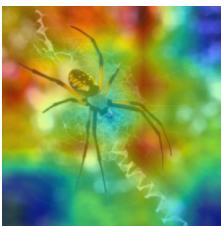
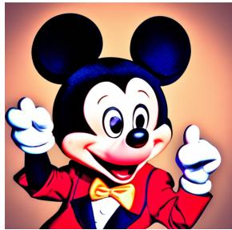

# Risk-Aware Output Control Should be the Focus of Machine Unlearning

Yahya Alkhatib∗

Yuyang Xiao

Wee Peng Tay

School of Electrical and Electronic Engineering Nanyang Technological University, Singapore

## Abstract

Well-documented failure modes of machine learning (ML) systems, including bias, toxicity, hallucination, and leakage of sensitive information, has driven the rise of machine unlearning (MU). Most existing work, however, targets parameter-space indistinguishability, seeking unlearned models that are as close as possible to models retrained from scratch on retained data. In this paper, we argue that this objective is misaligned with practical and user-relevant concerns: MU should prioritize statistically guaranteed output-space control rather than parameter-space similarity. We contend that output control with statistical guarantees is the operationally meaningful notion of unlearning, as it supports rigorous and robust objectives, scales to modern deployment settings, and enables interpretable guarantees. We substantiate this position with empirical evidence and with recent theoretical results that, although not originally formulated in this framing, are consistent with it.

## 1 Introduction

The performance and reliability of machine learning (ML) systems are fundamentally determined by the quality of their training data [60]. Consequently, when training corpora include biased, toxic, inconsistent, sensitive, or otherwise harmful content, deployed models are likely to reproduce these pathologies in their outputs. This challenge has become more acute with vast generative models, whose scale has incentivized broad web scraping and the inadvertent collection of private and sensitive information [9, 16, 46, 55].

The most direct remedy is to delete the unwanted data and retrain the model from scratch. However, this is impeded by two structural constraints. First, model scale has expanded to the point that full retraining is often computationally and operationally prohibitive; architectures with trillions of parameters and hundreds of layers are increasingly common. Second, once a model is deployed, owners frequently no longer maintain complete access to the original training corpus, making faithful retraining infeasible in practice. These constraints prompted the formalization of machine unlearning (MU) [14]: efficient procedures to satisfy deletion requests without full retraining.

Machine unlearning was initiated by [14], who proposed removing the influence of individual training instances by transforming learning algorithms into a summation form. Since then, the literature has been strongly shaped by ideas from differential privacy (DP) [23], especially the principle that an observer should be unable to distinguish, from outputs alone, a model trained on the full dataset from one trained with a designated point – or, more generally, a forget set – removed. Although this criterion originated as a privacy concept, indistinguishability has become a central objective in unlearning research [36, 45, 18, 7, 39, 38, 62]. Two broad lines of work have emerged. The first targets exact indistinguishability by design, typically via training procedures that support exact post hoc deletion [14, 12, 13]. The second adopts a pragmatic objective: approximate the model that would be obtained by full retraining on retained data empirically, and rarely with theoretical certification of approximate indistinguishability available mainly under restrictive assumptions (e.g., convex losses or linear models) [36, 38, 62]. A concise technical overview of these approaches is provided in Appendix A.

This paper argues that machine unlearning should be defined and certified through rigorous statistical guarantees on the outputs of the deployed model, not through parameter-space indistinguishability from a retrained reference. The foregoing discussion supports a central observation: an objective inheritedfrom adversarial robustness has become the defacto standard in MU, despite the field’s broader operational aims. A more relevant framing is whether concern should center on training provenance or on observable behavior: should one prefer a model that never trained on an individual’s data yet may still reveal private information about that individual, or a model that did train on those data but is certified not to reveal such information? Our position aligns with the latter. In practice, modern deep models are used as input–output systems, while internal states – even when inspectable – are largely uninterpretable and provide limited evidence about user risk absent output-level analysis [30, 43, 15]. Consequently, output control is the more meaningful object of evaluation and assurance. We therefore identify three structural bottlenecks that motivate a shift in both objective and methodology.

Lack of meaningful guarantees. Certified proximity – or even certified indistinguishability – to a retrained model (RT) does not translate into any guarantee on output behaviour: small perturbations in parameters, or even in inputs, can produce large deviations in outputs [33, 37]. The practical consequence is a self-defeating loop. Because parameter-level guarantees say so little about behaviour, most MU methods end up benchmarking the unlearned model against an explicitly retrained one to verify that it actually behaves as intended [20, 21, 56, 26, 35, 18, 34, 37, 57] – precisely the computation that MU was introduced to avoid. What users actually need is something different: a clear, interpretable, and quantifiable statement that speaks to their concerns, such as a probabilistic bound on how often the model emits harmful content or leaks private information after unlearning.

Forgeability. The work [58] demonstrated that even perfect indistinguishability can be undermined through the construction of “unlearning proofs”. A model owner could present users with a complete parameter-update history, detailing the data batches used at each training step and the corresponding parameter changes, to claim that specific data played no role in training. However, the underlying parameter trajectory could remain identical to one that did incorporate the data. This implies that a proof of ideal unlearning can be fabricated even when no actual unlearning has occurred, rendering indistinguishability an ineffective objective in practice. While one might argue that trusted third parties could authenticate such proofs to prevent forgery, this introduces additional complexities, which lead to the next limitation.

Unreliability of the retrained gold standard. Even when parameter-level proximity to a RT is achieved, practical challenges persist. Generative models have been shown to reproduce copyrighted content despite never being explicitly trained on it [22], and classifiers employing conformal prediction (CP) may still include forgotten points within their prediction sets [1, 53]. These examples underscore a critical limitation: indistinguishability from a RT does not inherently guarantee the absence of undesired outputs. When model capabilities generalize to the forget set, output-level guarantees become indispensable, as they cannot be inferred solely from parameter-level indistinguishability.

Taken together, these observations underscore the need for novel paradigms in MU that: (1) eliminate dependence on RTs – or any computationally expensive baselines – as the definitive standard; (2) are inherently resistant to falsification; and (3) provide precise, interpretable, and operationally meaningful guarantees that directly address user concerns and instill confidence in model behavior. This paradigm shift is increasingly critical as ML systems become ubiquitous, model sizes continue to expand, and the volume of data driving these systems grows at an unprecedented pace. While this paper does not propose a fully comprehensive redefinition to resolve all these challenges, it advocates for emerging frameworks that place rigorous, distribution-free risk-control guarantees directly on a model’s outputs.

A related work by [22] addresses policy-makers and legislators, and moderates expectations regarding the practical capabilities of MU. In contrast, our contribution is technically focused and directed towards researchers and practitioners, advocating for a reorientation of the field through a three-flaw structural analysis of the current paradigm and introducing concrete output-control alternatives.

The rest of this paper is organized as follows. Section 2 reviews the necessary background. Section 3 formalizes the problem and fixes notation. Section 4 assembles theoretical and empirical evidence against the prevailing indistinguishability-based view. Section 5 develops our position, introduces a distribution-free risk-control framework for output-level unlearning, and recovers conformal prediction as a canonical special case. Section 6 discusses the implications of our findings and future directions. Section 7 addresses an alternative view to our position, and Section 8 concludes.

## 2 Preliminaries

This section presents the foundational background necessary for the paper’s arguments. For clarity, we adopt a supervised learning framework, though the discussion generalizes to unsupervised and self-supervised settings with minor adjustments. We also review split CP [47], which serves as the primary example of an output-level guarantee when substantiating our position in Section 5.

Data, models, and training. Let $\mathcal { X } \subseteq \mathbb { R } ^ { d }$ and $\mathcal { V } \subseteq \mathbb { R }$ denote the input and label spaces; we take scalar labels for notational simplicity, as everything that follows extends to vector-valued or structured outputs without conceptual change. A dataset is a collection $\mathcal { D } = \{ ( X _ { i } , Y _ { i } ) \} _ { i = 1 } ^ { N } \overset { \mathrm { i . i . d . } } { \sim } \mathbb { P } _ { \mathrm { d a t a } }$ drawn from a joint distribution $\mathbb { P } _ { \mathrm { d a t a } }$ on $\mathcal { X } \times \mathcal { V }$ . A model is indexed by a parameter θ in a parameter space Θ and induces a (possibly stochastic) predictor $\theta : \mathcal { X }  \mathcal { Y }$ . With standard abuse of notation we write θ both for the parameter and the function it induces, and $\theta ( X )$ for a prediction (a sample from the predictive distribution when θ is stochastic). A training algorithm is a (possibly stochastic) map $\mathfrak { A } : \overset { \cdot } { \Theta } \times \bigcup _ { N > 1 } ( \mathcal { X } \times \mathcal { Y } ) ^ { N } \times \Lambda \to \Theta$ which, given an initial model $\theta _ { \mathrm { i n i t } }$ , a dataset $\mathcal { D } _ { \mathrm { : } }$ , and hyperparameters $\lambda \in \Lambda$ , returns a trained model

$$
\hat { \theta } = \mathfrak { A } ( \theta _ { \mathrm { i n i t } } , \mathcal { D } , \lambda ) \approx \underset { \theta \in \Theta } { \arg \operatorname* { m i n } } \frac { 1 } { N } \sum _ { i = 1 } ^ { N } \mathsf { L } ( Y _ { i } , \theta ( X _ { i } ) ) ,\tag{1}
$$

for a loss $\mathsf { L } : \mathcal { V } \times \mathcal { V } \to \mathbb { R } _ { \ge 0 }$ quantifying the discrepancy between a prediction and its target. For the non-convex losses and deep architectures of interest here, $\hat { \theta }$ is only an approximate stationary point produced by an iterative optimizer such as stochastic gradient descent.

Split conformal prediction. A training algorithm returns a point estimate $\hat { \theta }$ with no accompanying statement about its predictive uncertainty, which motivates procedures that equip the model with explicit, rigorous guarantees. Among these, $C P$ has emerged as particularly attractive: it is modelagnostic, distribution-free, and provides finite-sample coverage guarantees at any user-chosen level [61, 3, 2, 28]. We focus on its computationally lightweight split variant [47], which partitions the labelled data into a disjoint proper training set $\mathcal { D } _ { \mathrm { t r a i n } }$ and calibration set $\mathcal { D } _ { \mathrm { c a l i b } }$ of size $n _ { \mathrm { c a l } } \triangleq \lvert \mathcal { D } _ { \mathrm { c a l i b } } \rvert$ fits the model as $\hat { \theta } = \mathfrak { A } ( \theta _ { \mathrm { i n i t } } , { D } _ { \mathrm { t r a i n } } , \lambda )$ , and uses $\mathcal { D } _ { \mathrm { c a l i b } } -$ by construction independent of $\hat { \theta } - \mathfrak { t o }$ probe its predictive uncertainty.

A nonconformity score $s ( X , Y ; { \hat { \theta } } ) \in \mathbb { R }$ , with larger values indicating stronger disagreement between Y and ${ \hat { \theta } } ( X )$ , measures how “atypical” a candidate pair $( X , Y )$ is under ${ \hat { \theta } } .$ Canonical choices are $s ( X , Y ; \hat { \theta } ) \ = \ 1 - \hat { p } _ { \hat { \theta } } ( Y \ | \ X )$ for classifiers (with $\hat { p } _ { \hat { \theta } } ( \cdot \mid X )$ the softmax pseudo-probability) [51], and $s ( X , Y ; \hat { \theta } ) = | Y - \hat { \theta } ( X )$ | for regressors [50]. Given a user-specified miscoverage level $\alpha \in ( 0 , 1 )$ , let $\hat { q } _ { \alpha }$ denote the $\lceil ( n _ { \mathrm { c a l } } + 1 ) ( 1 - \alpha ) \rceil$ -th smallest of the calibration scores $\{ s ( X _ { i } , Y _ { i } ; \boldsymbol { \hat { \theta } } )$ $( X _ { i } , \dot { Y } _ { i } ) \in \mathcal { D } _ { \mathrm { c a l i b } } \} \ : -$ – equivalently, their empirical $( 1 - \alpha )$ -quantile inflated by the finite-sample factor $( n _ { \mathrm { c a l } } + 1 ) / { n _ { \mathrm { c a l } } } . ^ { 2 }$ For a fresh test input $X _ { \mathrm { t e s t } } ^ { - }$ , the split CP prediction set and its marginal coverage guarantee are

$$
\mathcal { C } ( X _ { \mathrm { t e s t } } ) = \Big \{ y \in \mathcal { V } : s ( X _ { \mathrm { t e s t } } , y ; \hat { \theta } ) \leq \hat { q } _ { \alpha } \Big \} , \quad \mathbb { P } ( Y _ { \mathrm { t e s t } } \in \mathcal { C } ( X _ { \mathrm { t e s t } } ) ) \geq 1 - \alpha ,\tag{2}
$$

where the probability is over the joint randomness of $\mathcal { D } _ { \mathrm { c a l i b } }$ , the test pair $( X _ { \mathrm { t e s t } } , Y _ { \mathrm { t e s t } } )$ , and any stochasticity in $\hat { \theta }$ and s. The guarantee is distribution-free and holds whenever $( X _ { \mathrm { t e s t } } , Y _ { \mathrm { t e s t } } )$ is

exchangeable with $\mathcal { D } _ { \mathrm { c a l i b } }$ conditional on $\mathscr { D } _ { \mathrm { t r a i n } } -$ in particular, whenever the labelled data are i.i.d.   
from $\mathbb { P } _ { \mathrm { d a t a } }$ and $\mathcal { D } _ { \mathrm { t r a i n } } , \mathcal { D } _ { \mathrm { c a l i k } }$ are drawn independently.

The template of $( 2 ) - \mathtt { a }$ simple, interpretable, user-tunable probability that a desired event occurs – is precisely the kind of output-level guarantee we will argue, in Section $5 ,$ should replace parameter-level indistinguishability as the target of MU.

## 3 Machine Unlearning Problem Definition

We now formally define the MU problem and establish the notation used throughout the remainder of the paper. Let $\theta _ { o } \in \Theta$ denote the original model, obtained by applying the training algorithm to an initial model $\theta _ { \mathrm { i n i t } }$ on the full training dataset, $\theta _ { o } = \mathfrak { A } ( \theta _ { \mathrm { i n i t } } , \bar { D } _ { \mathrm { t r a i n } } , \bar { \lambda } )$ , with λ a collection of training hyperparameters. We assume that the training set admits a disjoint partition $\mathcal { D } _ { \mathrm { t r a i n } } = \mathcal { D } _ { r } \sqcup \mathcal { D } _ { f }$ , into a retain set $\mathcal { D } _ { r }$ , whose influence on the model is to be preserved, and aforget set $\mathcal { D } _ { f }$ , whose influence is to be removed. For later use, we denote by $\mathbb { P } _ { r }$ and $\mathbb { P } _ { f }$ the marginal distributions associated with the retain and forget regions of the input-label space, respectively. When the forget set corresponds to an identifiable subpopulation—for example, a particular user, class, $\mathrm { o r } \mathrm { t o p i c { - } } \mathbb { P } _ { f }$ is naturally interpreted as the conditional distribution restricted to that subpopulation.

A MU algorithm, denoted U, is a (possibly stochastic) map that takes as input the original model, the retain and forget sets, and a collection of algorithm-specific hyperparameters $\lambda _ { u } ,$ , and produces an unlearned model $\theta _ { u } = \mathfrak { U } ( \theta _ { o } , \mathscr { D } _ { r } , \mathscr { D } _ { f } , \lambda _ { u } ) \in \mathbf { \bar { \Theta } }$ , whose behavior is required to reflect the influence of $\mathcal { D } _ { r }$ while suppressing that of $\mathcal { D } _ { f } .$ , in a sense made precise by the chosen unlearning criterion.

The canonical baseline is the retraining algorithm $\mathfrak { U } _ { \mathrm { R T } }$ , which reinitializes training from $\theta _ { \mathrm { i n i t } }$ using only the retain set, entirely discarding both the original model and the forgotten data, yielding the $R T$ $\theta _ { \mathrm { R T } } \triangleq \mathfrak { U } _ { \mathrm { R T } } ( \theta _ { o } , \mathcal { D } _ { r } , \phi , \lambda ) = \mathfrak { A } ( \theta _ { \mathrm { i n i t } } , \mathcal { D } _ { r } , \lambda )$ . By construction, U is independent of both $\theta _ { o }$ and $\mathcal { D } _ { f }$ The RT $\theta _ { \mathrm { R T } }$ has consequently been adopted as the de facto gold standard for MU: a model trained exclusively on $\mathcal { D } _ { r }$ is, by definition, free of any influence from $\mathcal { D } _ { f }$ , and is therefore regarded as the ideal target that any unlearning procedure should seek to emulate.

A dominant formalization of this intuition posits that an observer with access to the outputs of an unlearned model $\theta _ { u }$ should not be able to extract more information about the forgotten data than an observer of the outputs of the RT $\theta _ { \mathrm { R T } }$ , which, by construction, has never been trained on those points [36, 31, 14, 54]. In practice, this principle is typically instantiated as a differential-privacy-inspired indistinguishability constraint on the distribution of the returned model.

Definition 1 $( ( \epsilon , \delta )$ -indistinguishability [36]). An unlearning algorithm U is said to be $( \epsilon , \delta )$ indistinguishablefrom the retraining algorithm U if,for every measurable set $\mathcal { T } \subseteq \Theta$

$$
\begin{array} { r } { \mathbb { P } ( \mathfrak { U } ( \theta _ { o } , \mathcal { D } _ { r } , \mathcal { D } _ { f } , \lambda _ { u } ) \in \mathcal { T } ) \le e ^ { \epsilon } \mathbb { P } ( \mathfrak { U } _ { \mathrm { R T } } ( \theta _ { o } , \mathcal { D } _ { r } , \phi , \lambda ) \in \mathcal { T } ) + \delta , } \end{array}\tag{3}
$$

$$
\begin{array} { r } { \mathbb { P } ( \mathfrak { U } _ { \mathrm { R T } } ( \theta _ { o } , \mathcal { D } _ { r } , \phi , \lambda ) \in \mathcal { T } ) \le e ^ { \epsilon } \mathbb { P } ( \mathfrak { U } ( \theta _ { o } , \mathcal { D } _ { r } , \mathcal { D } _ { f } , \lambda _ { u } ) \in \mathcal { T } ) + \delta , } \end{array}\tag{4}
$$

where the probabilities are taken over the (possibly stochastic) randomness ofthe two algorithms.

Several variants of this idea have been proposed. For example, [62] adopt a “flipped” formulation in which the information carried by the inputs of the unlearned model about its outputs is required to be no larger than the corresponding quantity for the RT. The RT thus plays the role of an unquestioned golden baseline, and the unlearning problem collapses into an exercise in approximating it. We argue in the remainder of the paper that this paradigm is both limiting and, in crucial respects, ill-posed.

## 4 Evidence Against the Current Stance

Having set out the prevailing indistinguishability-based programme in Section 3, we now turn to a more fundamental question: is the programme sound in principle? We argue that it is not. This section identifies three distinct structural deficiencies in the current paradigm: (i) proximity in parameter space does not imply proximity in model behavior; (ii) indistinguishability certificates are, in general, constructively defeatable; and (iii) the RT – the very gold standard against which unlearning is measured – can itself fail to guarantee the desired model behavior of the unlearning objective. These deficiencies are mutually reinforcing: resolving any two leaves the third fully intact, and the third alone is sufficient to necessitate a shift towards an output-centric formulation of MU.

(a)  
  
overlay  
Gradient-clipping

  
(b) RT overlay

  
(c) Original image  
Figure 1: Grad-CAM overlay regions on an image after forgetting. Certified unlearning gradientclipping generates a saliency map significantly different from that of RT.

Flaw I: the parameter–output gap. The indistinguishability objective – i.e., driving $\theta _ { u }$ as close as possible to $\theta _ { \mathrm { R T } }$ in parameter space, whether approximately or exactly – implicitly assumes that parameter proximity entails behavioral proximity. This assumption is generally false, and the failure is not an artifact of pathological non-continuous parameterizations: it occurs for smooth, fully continuous model classes. The simplest illustration is the elementary linear model $f _ { \theta } ( x ) = a \cdot b \cdot x$ with $\theta = ( a , b )$ . Perturbing only b by δ yields $\lVert { \boldsymbol { \theta } } - { \tilde { { \boldsymbol { \theta } } } } \rVert _ { 2 } = | \delta |$ but produces an absolute output change $| f _ { \theta } ( x ) - \dot { f } _ { \widetilde { \theta } } ( x ) | = | a \delta x |$ , which can be made arbitrarily large for fixed δ by an appropriate choice of a. This phenomenon is structural: Theorem 1 of [11] establishes that for an L-layer multilayer perceptron the relative functional change satisfies

$$
\frac { \| f _ { \widetilde { \theta } } ( x ) - f _ { \theta } ( x ) \| _ { 2 } } { \| f _ { \theta } ( x ) \| _ { 2 } } \leq \Big ( \frac { \gamma } { \nu } \kappa ^ { 2 } \Big ) ^ { L } \Bigg [ \prod _ { k = 1 } ^ { L } \Big ( 1 + \frac { \| \Delta W _ { k } \| _ { F } } { \| W _ { k } \| _ { F } } \Big ) - 1 \Bigg ] ,\tag{5}
$$

where $\nu , \gamma$ govern the bi-Lipschitz behavior of the nonlinearity and κ bounds the condition number of the weight matrices $W _ { k }$ and their perturbations $\Delta W _ { k }$ ; the toy example above saturates the bound ([11], Eq. 3, with $\Delta a = 0 )$ . Crucially, [11] also empirically verify that the actual relative change of a 16- layer MLP grows quasi-exponentially in the perturbation size at every training checkpoint they probe (their Figure 1), establishing that the phenomenon is not a vacuous worst-case artifact but observed behavior in practical deep networks. Consequently, an arbitrarily small $\ell _ { 2 }$ displacement in parameter space can induce arbitrarily large changes in the function the model implements. The converse failure – large $\ell _ { 2 }$ displacement that nevertheless leaves behavior unchanged – is equally well documented. In the unlearning context specifically, [34] argue that overparameterized networks possess a large nullspace of weights producing identical activations on all test samples; consequently, the weight-space distance $\lVert { \boldsymbol { \theta } } _ { u } - { \boldsymbol { \theta } } _ { \mathrm { R T } } \rVert _ { 2 }$ can be large while the input–output behaviors are indistinguishable, and they accordingly propose evaluating forgetting in activation space rather than parameter space. Together, these two observations show that $\ell _ { 2 }$ proximity in parameter space is neither necessary nor sufficient for behavioral equivalence – even for the smooth, well-behaved architectures used in practice.

The implication for unlearning is immediate: elevating $\theta _ { \mathrm { R T } }$ to a golden standard and approximating it, however tightly, licenses no claim about the unlearned model’s actual behavior. Fig. 1 demonstrates that the saliency map produced, on a forgotten image, by gradient-clipping [39] – a certified unlearning method in the sense of Definition 1 trained on $\mathcal { D } _ { r }$ for the same number of epochs as a RT – visibly departs from the saliency map produced by the RT, despite gradient-clipping’s explicit guarantees of proximity to that model. Table 1 sharpens the point: two otherwise identical models that differ only by a small weight perturbation exhibit non-trivial accuracy drops and prediction disagreement on the same test samples (see Appendix B.1 for details and Appendix C.1 for further experiments). Small parameter perturbations are simply not behaviorally small, and so approximate indistinguishability cannot be expected to translate into approximate behavioral equivalence. Since parameter-level proximity cannot be trusted to imply behavioral proximity, practitioners routinely fall back on comparisons against the RT itself to verify that the unlearned model behaves as intended – precisely the computation that MU was introduced to avoid.

Flaw II: indistinguishability is forgeable. Suppose, for the sake of argument, that the parameter– output gap could be bridged and that a method delivered perfect indistinguishability. Even then, the objective would be practically empty: a model owner could provide the user with a convincing proof of unlearning without performing any unlearning at all. This is the content of Theorem 3 of [58], stated for minibatch stochastic gradient descent.

Table 1: Accuracy drop and top-1 prediction disagreement (%) for five pretrained models subjected to random first-layer weight sign-flipping $( \lVert { \boldsymbol { \theta } } _ { o } - \mathbf { \bar { \theta } } _ { \mathrm { p e r t u r b } } \rVert / \lVert { \boldsymbol { \theta } } _ { o } \rVert \leq 2 \% )$ .
<table><tr><td></td><td>ResNet-50</td><td>RepVGG-A2</td><td>ViT-B/16</td><td>ConvNeXt-T</td><td>EffNet-B0</td></tr><tr><td>Accuracy Drop (%)</td><td>19.52</td><td>71.40</td><td>11.90</td><td>81.86</td><td>15.34</td></tr><tr><td>Disagreement (%)</td><td>34.08</td><td>94.22</td><td>23.58</td><td>99.14</td><td>30.36</td></tr></table>

Theorem 1 (Existence of a forging adversary [58]). Let an adversary havefreedom over the choice ofminibatches b and the ability to sample indefinitelyfrom a dataset D under a measure that places zero mass on any individual point. Thenfor every $\varepsilon > 0 ,$ ,for almost every dataset D there exists a finite dataset D˜ whose training trajectory can beforged by afinite dataset $\mathcal { D } ^ { \prime }$ disjointfrom $\tilde { \mathcal { D } } .$

Forging here means that the training trajectories (parameter updates) of $\tilde { \mathcal { D } }$ and $\mathcal { D } ^ { \prime }$ are identical. Concretely, a model owner can hand the user a complete parameter-update history – the minibatch and the parameter change at every step – that “proves” the user’s data were never used, while the underlying trajectory is identical to one that did use the data. Both approximate and exact unlearning (i.e., a $( \epsilon = 0 , \delta = 0 )$ -indistinguishable model), when judged through the indistinguishability lens, are thus falsifiable. This is not a technical defect of particular algorithms but a fundamental limitation of the notion itself: by reducing unlearning to a statement about whether particular data were used during training, indistinguishability invites precisely the kind of proof it was meant to preclude.

Can flaws I and II be patched? One might hope to circumvent the first two flaws by (a) improving algorithms to achieve exact rather than approximate indistinguishability, and (b) delegating the certification of unlearning to a trusted third party capable of detecting forgeries. Both are reasonable engineering responses. However, the third flaw is not amenable to such repairs, for it strikes at the gold standard itself.

Flaw III: the retrained model is not a reliable standard. The indistinguishability paradigm treats the RT $\theta _ { \mathrm { R T } }$ as an idealized target: a model that, by construction, has never seen the forgotten data and therefore “should not” display any undesired behavior attributable to it. Recent evidence contradicts this premise. Generative models trained without specific data samples routinely generalize into the very regions of input space those samples occupied, producing outputs that infer or reproduce information the model was never explicitly trained on [29, 22]. We reproduce similar examples to those in [22]. Fig. 2 shows a generative image model producing copyright-infringing imagery of SpongeBob absent from the model’s training data, which are carefully collected as Common-Licensed [32] (more in Appendix C.2). A similar effect has been reported for large language models (LLMs) that unlearned Harry Potter novels but could still infer a lot of information about those stories from open-source sources such as Wikipedia articles [24] (cf. Table 3 in Appendix B.3). A complementary manifestation of the same phenomenon appears in classification: CP sets produced by a RT continue, with non-trivial probability, to cover the labels of the very points that were excluded from training [1, 53] (see Table 2).

The consequence for the indistinguishability framework is stark. If, without ever having been trained on the offending data, the RT itself can produce copyright-infringing, private, or otherwise harmful outputs or can correctly cover the forgotten data, e.g. in the CP sense, then there is simply nothing to unlearn in the indistinguishability sense: the dataset is already “clean”, yet the model still misbehaves. Removing further samples would only impair the model’s legitimate capabilities without addressing the actual problem. Yet a user whose copyright has been infringed or who has received harmful generated content is still entitled to demand a corrective operation. Indistinguishability-based unlearning has no answer here. A notion that cannot accommodate this scenario is a notion that ha misidentified what unlearning is for.

From flaws to a constructive pivot. What concerns users, model owners, and practitioners is not whose data appeared in the training set but what the deployed model actually produces. Once unwanted data have been deleted from storage, the questions that remain – does this model emit my private information? does it generate copyright-infringing content? does it output biased or toxic responses? – are questions about the model’s outputs, not its parameters. This suggests a principled split of the research agenda: one line concerned with output control, delivering rigorous statistical guarantees on what the model generates; and a complementary line concerned with parameter-level robustness, ensuring that adversaries cannot reconstruct training samples from the model’s weights. The first of these lines – which side-steps all three flaws identified above – is precisely the one we argue has been neglected, and is the subject of the next section.

  
(b) Prompt: “SpongeBob SquarePants, full body, cheerful, white background”.

  
(c) Prompt: SquarePants”.  
Figure 2: SpongeBob Squarepants imagery generated by CommonCanvas-XL-C.

## 5 Our Position: Output Control Yields Operationally Meaningful Machine Unlearning

What we advocate. Building on the critique in Section 4, we advocate a shift in the MU agenda toward objectives defined at the level of observable model behavior. We argue for prioritizing definitions of unlearning that are operationally meaningful, technically tractable, and directly aligned with deployment outcomes: what the system outputs, rather than how closely its parameters match an idealized retrained reference. Under this view, the central requirement is explicit statistical control of undesirable outputs, independent of weight-space proximity. For example, can a model owner certify that a deployed pipeline emits user-specific private information with probability at most 1%, or that harmful, discriminatory, or copyright-infringing content arises with probability at most 5%? Uncertainty quantification offers a template. Established frameworks – false discovery rate control [10, 6, 49], risk control [8, 4], and conformal coverage guarantees [61, 52, 3, 41] – yield rigorous, user-tunable probabilistic statements about model outputs. Machine unlearning requires an analogous framework with an inverted objective: for example, beyond covering true labels on data it should retain, the model should also exhibit elevated miscoverage (or, more generally, controlled failure) on data it should forget, while preserving its guarantees on the retained distribution.

A general risk-control framework for unlearning. The harms that motivate unlearning in practice – toxicity, bias, hallucination, privacy leakage, copyright infringement – span output modalities well beyond any single metric. A principled generalization replaces any specific output event with a user-chosen risk functional. The learn-then-test (LTT) framework of [4] achieves model-agnostic, distribution-free control of arbitrary risks, supplying precisely the theoretical tool we use.

Let $g : \mathcal { V } \times \mathcal { V }  \mathbb { R }$ be a gradingfunction that scores a prediction $\theta ( X )$ against the ground truth Y along the axis of interest, with larger values encoding a more desirable output. For a threshold $\lambda \in \mathbb { R }$ the associated admissionfunction is

$$
a ( \theta ( X ) , Y ) \triangleq { \mathbf 1 } \{ g ( \theta ( X ) , Y ) \ge \lambda \} \in \{ 0 , 1 \} ,\tag{6}
$$

taking the value 1 when the output is admissible and 0 otherwise.

Definition $\displaystyle \mathfrak { Z } \left( \left( \alpha , \beta \right) \right.$ )-output-control unlearning). For $0 \leq \alpha \leq \beta \leq 1$ , an unlearning algorithm U is said to be $( \alpha , \beta )$ -output-control unlearningfor an admissionfunction a ifthe unlearned model $\theta _ { u }$ satisfies

$$
\begin{array} { r } { \mathbb { P } _ { r } \left( a ( \theta _ { u } ( X ) , Y ) = 1 \right) \ge 1 - \alpha , } \end{array}\tag{7}
$$

$$
\mathbb { P } _ { f } \left( a ( \theta _ { u } ( X ) , Y ) = 0 \right) \geq \beta .\tag{8}
$$

What is instructive about Definition 2 is what it does not say. It imposes no proximity requirement between $\theta _ { u }$ and any retrained reference: the unlearned model is free to differ substantially from $\theta _ { \mathrm { R T } }$ provided (7) and (8) hold. The unlearning problem becomes one of driving the forget-set admission rate below $1 - \beta$ while preserving the retain-set admission rate above $1 - \alpha - \mathrm { t w o }$ statements placed directly on model outputs rather than on weights. The choice of $g$ (and hence a) is application-specific and can encode more than one risk: if $g$ is a human- or AI-based grader scoring how biased, toxic, hallucinated, copyright-infringing, or privacy-leaking a prediction is, Definition 2 delivers a direct guarantee against the very behaviors that motivate the unlearning request. Frameworks such as LTT [4] provide a concrete route to certifying such guarantees from a finite calibration set, with λ chosen to meet the target levels α and $\beta .$ Conformal prediction yields a natural special case, which we develop next.

Remark 1 (Output control is not just output suppression.). Output control, in the sense of Definition 2, is not synonymous with inference-time output suppression. The latter treats the model as fixed and confines intervention to filters, refusals, or re-ranking of its generations, narrowing both the scientific question and the class of admissible remedies. Output control instead specifies a behavioral property – a user-chosen riskfunctional with distribution-free guarantees – while remaining agnostic to the mechanism: parameter updates, architectural changes, auxiliary modules, inference-time interventions, or any combination thereof. Inference-time unlearning is thus a special case of output control, and remains a valid and active line of research (cf. [19]).

Conformal unlearning as a special case. The conformal-prediction-based formulation of [1, 53] arises as a canonical instance of Definition 2. Our point of departure is the finding of [53] that an unlearned model—including one obtained via full retraining—may still assign CP sets that contain the true labels of forgotten examples, a behavior they describe as “fake unlearning.” This motivates specializing Definition 2 to the coverage event. We denote by ${ \mathsf { C P } } ( \theta , s )$ the split CP procedure from Section $^ 2$ with base model θ and nonconformity score s. Setting $\overset { \cdot } { g } ( \theta ( X ) , \overset { \cdot } { Y } ) = - \overset { \cdot } { s } ( X , Y ; \theta )$ —the conformity scoring of the deviation between the prediction and the true label—and $\lambda = - \hat { q } _ { \alpha }$ , the admission function reduces to $a ( \theta ( X ) , Y ) = \mathbf { 1 } \{ { \bar { Y } } \in { \mathcal { C } } _ { \theta } ( X ) \}$ }, and Definition 2 specializes to the requirement that the unlearned model satisfy

$$
\begin{array} { r } { \mathbb { P } _ { r } ( Y \in \mathcal { C } _ { \theta _ { u } } ( X ) ) \geq 1 - \alpha , } \end{array}\tag{9}
$$

$$
\mathbb { P } _ { f } ( Y \notin \mathcal { C } _ { \theta _ { u } } ( X ) ) \ge \beta ,\tag{10}
$$

recovering exactly the $( \alpha , \beta )$ -conformal unlearning (CMU) of [1]. $\operatorname { I f } \mathbb { P } _ { f }$ were known exactly, (10) could be satisfied trivially by setting $\mathcal { C } _ { \theta _ { u } } ( X ) = \varnothing$ on every X from its marginal – but this is not operationally meaningful. In practice the model owner has only a finite sample from $\mathbb { P } _ { f }$ . Moreover, mapping all forget inputs to a fixed output would render them readily identifiable to an external observer, undermining the very privacy or security motivations for unlearning. Output-control objectives must therefore be met not by ad hoc “if-else” rules but by statistically principled methods that remain practical under partial knowledge of the forget distribution. In that case, achieving the joint requirements of (9) and (10) is non-trivial: Table 2 shows that despite a significant accuracy drop on the forget set, the RT itself exhibits essentially no change in coverage over it. We stress that conformal unlearning is one instantiation of Definition 2, not its endpoint: many other admissible specializations are possible, depending on the application and the risk one wishes to control.

Conformal unlearning extends naturally to membership inference attacks (MIAs) [54]: by treating the membership of a forgotten point as a binary label, one defines a membership risk and controls it at a user-specified level. [53] introduce the MIA conformal ratio (MIACR) for exactly this purpose, measuring the fraction of forgotten points whose membership is miscovered by a binary CP set. Methods that control this risk thus address an important aspect of the MU literature directly.

Table 2: Coverage and accuracy scores between an original model and RT on ImageNet at level $\alpha = 0 . 0 5$
<table><tr><td></td><td>Accuracy on  $\mathcal { D } _ { f }$ </td><td>Miscoverage on  $\mathcal { D } _ { f }$ </td></tr><tr><td>Original (%)</td><td> $8 4 . 0 6 \pm 0 . 0 0$ </td><td> $0 . 0 6 \pm 0 . 0 0$ </td></tr><tr><td>RT (%)</td><td> $3 3 . 0 7 \pm 4 . 0 0$ </td><td> $0 . 0 8 \pm 0 . 0 2$ </td></tr></table>

Taken together, Definition 2 and its conformal instantiation illustrate the right target for MU research: definitions whose parameters are numbers a user can read and act upon – a retain admission rate of at least $1 - \alpha$ and a forget admission rate of at most $1 - \beta$ – rather than a probabilistic distance from a reference model that, as Section 4 has shown, is neither observable, forgery-proof, nor behaviorally reliable. Our position is not a verdict on particular algorithms but a call to redefine unlearning, and an invitation to develop methods that achieve, extend, or approximate the objectives of Definition 2.

## 6 The Picture that Emerges

The evidence in Section 4 and the alternatives in Section 5 converge on a single conclusion: the community must redirect toward objectives whose guarantees are actionable and interpretable for model owners and users alike. Output-level statistical guarantees will unlock tighter bounds, sharper objectives, and evaluation metrics that measure what actually matters. This shift preserves the essence of MU as a data-centric model-cleaning scheme: identifying data to retain and forget remains indispensable; what changes is what we ask of the algorithm once that identification has been made.

Definitions of the form in Definition 2 side-step each of the three flaws by construction:

• Flaw I (parameter–output mismatch) is avoided because guarantees are placed on the model’s predictive behavior – coverage, admission rate, risk – not on a parameter-space distance.

• Flaw II (forgeability) is avoided because the model owner supplies a statistical claim about outputs, auditable by any party with access to a labelled test stream from the retain and forget distributions; there is no training-trajectory proof to forge.

• Flaw III (unreliability of the retrained gold standard) is avoided because no retrained reference is invoked: if the unlearned model admits forbidden outputs too often, it fails the definition, regardless of whether a RT would have done any better.

These are structural properties of the definitions themselves.

We do not claim that parameter-level analyses or adversarial-robustness research are misdirected. We endorse a natural split: output control, on one side, guarantees behavioral properties of the deployed system; parameter-level robustness, on the other, ensures adversaries cannot reconstruct or infer training samples from the weights. The two are necessary and complementary. What we do claim is that, under the present orthodoxy, the first has been conflated with – and ultimately suffocated by – the second, and that disentangling them is essential for a MU paradigm capable of matching the scale and stakes of modern deployed models

## 7 Objections to Output Control

Three objections to the output-control framework warrant a direct response. (1) Regulatory provenance. Data-protection rights (e.g., under GDPR) are defined primarily in terms of data processing rather than model outputs; therefore, output-level guarantees alone may not satisfy legal standards that require non-use of personal data. Our position, however, is that the motivation for MU extends beyond GDPR compliance. As argued in Section 6, parameter-level robustness should be pursued as a complementary line of work to address provenance requirements directly. (2) Risk-functional specification. Output control requires specifying a grading function g a priori, whereas indistinguishability is often presented as risk-agnostic. In light of Flaws I and III, this apparent universality is misleading: indistinguishability obscures the operative threat model rather than removing it, while an explicit g makes the target harm transparent and allows guarantees to be tailored to the application. (3) Calibration shift. Output-level guarantees commonly rely on exchangeability between calibration and deployment data, an assumption that can fail under adversarial probing of the forget set. This limitation is substantive but methodologically manageable through techniques for shift-robust [48, 59], non-exchangeable CP [28], and conformal risk control under distribution shift [25].

## 8 Conclusion

We have argued that the field’s pursuit of indistinguishability from a RT is a misdirection of effort, and that MU should shift to output control with clear, actionable, and rigorous statistical guarantees. This position rests on three structural limitations of the prevailing paradigm – the parameter–output mismatch, the forgeability of indistinguishability certificates, and the unreliability of the RT as a gold standard – none patchable by engineering improvements alone. Beyond critique, the output-control framework of Definition 2, with conformal prediction as a canonical special case, shows that outputlevel guarantees are not only desirable but achievable. We hope this paper motivates the community to rethink its definitions and objectives through the lens of statistical guarantees placed where they matter most – on what the model actually produces.

## References

[1] Yahya Alkhatib, Muhammad Ahmar Jamal, and Wee Peng Tay. Conformal unlearning: A new paradigm for unlearning in conformal predictors, 2026.

[2] Anastasios N. Angelopoulos, Rina Foygel Barber, and Stephen Bates. Theoretical Foundations of Conformal Prediction. 2025. Forthcoming, Cambridge University Press. arXiv:2411.11824v3.

[3] Anastasios N. Angelopoulos and Stephen Bates. Conformal prediction: A gentle introduction. Foundations and Trends in Machine Learning, 16(4):494–591, 2023.

[4] Anastasios N. Angelopoulos, Stephen Bates, Emmanuel J. Candès, Michael I. Jordan, and Lihua Lei. Learn then test: Calibrating predictive algorithms to achieve risk control. The Annals of Applied Statistics, 19(2):1641 – 1662, 2025.

[5] Wenjie Bao, Jian Lou, Yuke Hu, Xiaochen Li, Zhihao Liu, Jiaqi Liu, Zhan Qin, and Kui Ren. Module-aware parameter-efficient machine unlearning on transformers, 2025.

[6] Rina Foygel Barber and Emmanuel J Candès. Controlling the false discovery rate via knockoffs. The Annals ofStatistics, 43(5):2055–2085, 2015.

[7] Umit Yigit Basaran, Sk Miraj Ahmed, Amit Roy-Chowdhury, and Basak Guler. A certified unlearning approach without access to source data. In International Conference on Machine Learning (ICML), 2025.

[8] Stephen Bates, Anastasios N. Angelopoulos, Lihua Lei, Jitendra Malik, and Michael I. Jordan. Distribution-free, risk-controlling prediction sets. Journal ofthe ACM, 68(6):1–34, 2021.

[9] Emily M. Bender, Timnit Gebru, Angelina McMillan-Major, and Shmargaret Shmitchell. On the dangers of stochastic parrots: Can language models be too big? In ACM Conference on Fairness, Accountability, and Transparency (FAccT), FAccT ’21, page 610–623, New York, NY, USA, 2021. Association for Computing Machinery.

[10] Yoav Benjamini and Yosef Hochberg. Controlling the false discovery rate: a practical and powerful approach to multiple testing. Journal of the Royal Statistical Society: Series B (Methodological), 57(1):289–300, 1995.

[11] Jeremy Bernstein, Arash Vahdat, Yisong Yue, and Ming-Yu Liu. On the distance between two neural networks and the stability of learning. In Advances in Neural Information Processing Systems (NeurIPS), volume 33, pages 21370–21381. Curran Associates, Inc., 2020.

[12] Lucas Bourtoule, Varun Chandrasekaran, Christopher A. Choquette-Choo, Hengrui Jia, Adelin Travers, Baiwu Zhang, David Lie, and Nicolas Papernot. Machine unlearning. In IEEE Symposium on Security and Privacy (S&P), pages 141–159, 2021.

[13] Jonathan Brophy and Daniel Lowd. Machine unlearning for random forests. In Marina Meila and Tong Zhang, editors, International Conference on Machine Learning (ICML), volume 139 of Proceedings of Machine Learning Research, pages 1092–1104. PMLR, 18–24 Jul 2021.

[14] Yinzhi Cao and Junfeng Yang. Towards making systems forget with machine unlearning. In IEEE Symposium on Security and Privacy (S&P), pages 463–480. IEEE, 2015.

[15] Nicholas Carlini, Chang Liu, Úlfar Erlingsson, Jernej Kos, and Dawn Song. The secret sharer: Evaluating and testing unintended memorization in neural networks. In USENIX Security Symposium (USENIX Security), pages 267–284, 2019.

[16] Nicholas Carlini, Florian Tramèr, Eric Wallace, Matthew Jagielski, Ariel Herbert-Voss, Katherine Lee, Adam Roberts, Tom Brown, Dawn Song, Úlfar Erlingsson, Alina Oprea, and Colin Raffel. Extracting training data from large language models. In USENIX Security Symposium (USENIX Security), pages 2633–2650. USENIX Association, 2021.

[17] Sungmin Cha, Sungjun Cho, Dasol Hwang, and Moontae Lee. Towards robust and parameterefficient knowledge unlearning for LLMs. In International Conference on Learning Representations (ICLR), 2025.

[18] Eli Chien, Haoyu Peter Wang, Ziang Chen, and Pan Li. Certified machine unlearning via noisy stochastic gradient descent. In Advances in Neural Information Processing Systems (NeurIPS), 2024.

[19] Somnath Basu Roy Chowdhury, Rahul Kidambi, Avinava Dubey, David Wang, Gokhan Mergen, Amr Ahmed, and Aranyak Mehta. Inference-time unlearning using conformal prediction, 2026.

[20] Vikram S Chundawat, Ayush K Tarun, Murari Mandal, and Mohan Kankanhalli. Can bad teaching induce forgetting? unlearning in deep networks using an incompetent teacher. In AAAI Conference on Artificial Intelligence (AAAI). AAAI Press, 2023.

[21] Vikram S. Chundawat, Ayush K. Tarun, Murari Mandal, and Mohan Kankanhalli. Zero-shot machine unlearning. IEEE Transactions on Information Forensics and Security, 18:2345–2354, January 2023.

[22] A. Feder Cooper, Christopher A. Choquette-Choo, Miranda Bogen, Kevin Klyman, Matthew Jagielski, Katja Filippova, Ken Liu, Alexandra Chouldechova, Jamie Hayes, Yangsibo Huang, Eleni Triantafillou, Peter Kairouz, Nicole Elyse Mitchell, Niloofar Mireshghallah, Abigail Z. Jacobs, James Grimmelmann, Vitaly Shmatikov, Christopher De Sa, Ilia Shumailov, Andreas Terzis, Solon Barocas, Jennifer Wortman Vaughan, danah boyd, Yejin Choi, Sanmi Koyejo, Fernando Delgado, Percy Liang, Daniel E. Ho, Pamela Samuelson, Miles Brundage, David Bau, Seth Neel, Hanna Wallach, Amy B. Cyphert, Mark Lemley, Nicolas Papernot, and Katherine Lee. Machine unlearning doesn’t do what you think: Lessons for generative AI policy and research. In Advances in Neural Information Processing Systems (NeurIPS), Position Paper Track, 2025.

[23] Cynthia Dwork and Aaron Roth. The algorithmic foundations of differential privacy. Foundations and Trends in Theoretical Computer Science, 9(3–4):211–407, August 2014.

[24] Ronen Eldan and Mark Russinovich. Who’s Harry Potter? approximate unlearning in LLMs, 2023.

[25] António Farinhas, Chrysoula Zerva, Dennis Thomas Ulmer, and Andre Martins. Nonexchangeable conformal risk control. In International Conference on Learning Representations (ICLR), 2024.

[26] Jack Foster, Kyle Fogarty, Stefan Schoepf, Zack Dugue, Cengiz Oztireli, and Alexandra Brintrup. An information theoretic approach to machine unlearning. 2025.

[27] Jack Foster, Stefan Schoepf, and Alexandra Brintrup. Fast machine unlearning without retraining through selective synaptic dampening. In AAAI Conference on Artificial Intelligence (AAAI). Association for the Advancement of Artificial Intelligence, 2024.

[28] Rina Foygel Barber, Emmanuel J. Candès, Aaditya Ramdas, and Ryan J. Tibshirani. Conformal prediction beyond exchangeability. The Annals ofStatistics, 51(2):816–845, 2023.

[29] Rohit Gandikota, Joanna Materzynska, Jaden Fiotto-Kaufman, and David Bau. Erasing Concepts from Diffusion Models . In IEEE/CVF International Conference on Computer Vision (ICCV), pages 2426–2436, Los Alamitos, CA, USA, October 2023. IEEE Computer Society.

[30] Leilani H Gilpin, David Bau, Ben Z Yuan, Ayesha Bajwa, Michael Specter, and Lalana Kagal. Explaining explanations: An overview of interpretability of machine learning. In IEEE International Conference on Data Science and Advanced Analytics (DSAA), pages 80–89. IEEE, 2018.

[31] Antonio A. Ginart, Melody Y. Guan, Gregory Valiant, and James Zou. Making ai forget you: Data deletion in machine learning. In Advances in Neural Information Processing Systems (NeurIPS), volume 32, 2019.

[32] Aaron Gokaslan, A. Feder Cooper, Jasmine Collins, Landan Seguin, Austin Jacobson, Mihir Patel, Jonathan Frankle, Cory Stephenson, and Volodymyr Kuleshov. CommonCanvas: Open diffusion models trained on creative-commons images. In IEEE/CVF Conference on Computer Vision and Pattern Recognition (CVPR), 2024.

[33] Aditya Golatkar, Alessandro Achille, and Stefano Soatto. Eternal sunshine of the spotless net: Selective forgetting in deep networks. In IEEE/CVF Conference on Computer Vision and Pattern Recognition (CVPR), pages 9304–9312, 2020.

[34] Aditya Golatkar, Alessandro Achille, and Stefano Soatto. Forgetting outside the box: Scrubbing deep networks of information accessible from input-output observations. In European Conference on Computer Vision (ECCV), volume 12353 of Lecture Notes in Computer Science, pages 383–398. Springer, 2020.

[35] Laura Graves, Vineel Nagisetty, and Vijay Ganesh. Amnesiac machine learning. In AAAI Conference on Artificial Intelligence (AAAI), volume 35, pages 11516–11524. AAAI Press, 2021.

[36] Chuan Guo, Tom Goldstein, Awni Hannun, and Laurens van der Maaten. Certified data removal from machine learning models. In International Conference on Machine Learning (ICML), volume 119, pages 3832–3842. PMLR, 2020.

[37] Hsiang Hsu, Pradeep Niroula, Zichang He, Ivan Brugere, Freddy Lecue, and Chun-Fu Chen. The unseen threat: Residual knowledge in machine unlearning under perturbed samples. In Advances in Neural Information Processing Systems (NeurIPS), 2025.

[38] Zachary Izzo, Mary Anne Smart, Kamalika Chaudhuri, and James Zou. Approximate data deletion from machine learning models. In International Conference on Artificial Intelligence and Statistics (AISTATS), volume 130, pages 2008–2016. PMLR, 2021.

[39] Anastasia Koloskova, Youssef Allouah, Animesh Jha, Rachid Guerraoui, and Sanmi Koyejo. Certified unlearning for neural networks. In International Conference on Machine Learning (ICML), 2025.

[40] Meghdad Kurmanji, Peter Triantafillou, Jamie Hayes, and Eleni Triantafillou. Towards unbounded machine unlearning. In Advances in Neural Information Processing Systems (NeurIPS), 2023.

[41] Jing Lei and Larry Wasserman. Distribution-free prediction bands for non-parametric regression. Journal ofthe Royal Statistical Society Series B: Statistical Methodology, 76(1):71–96, 01 2014.

[42] Xiang Li, Qianli Shen, Haonan Wang, and Kenji Kawaguchi. Loreun: Data itself implicitly provides cues to improve machine unlearning. In NeurIPS Safe Generative AI Workshop 2024, 2024.

[43] Zachary C Lipton. The mythos of model interpretability. Communications of the ACM, 61(10):36–43, 2018.

[44] Zheyuan Liu, Guangyao Dou, Xiangchi Yuan, Chunhui Zhang, Zhaoxuan Tan, and Meng Jiang. Modality-aware neuron pruning for unlearning in multimodal large language models. In Wanxiang Che, Joyce Nabende, Ekaterina Shutova, and Mohammad Taher Pilehvar, editors, Annual Meeting of the Association for Computational Linguistics (ACL), pages 5913–5933, Vienna, Austria, July 2025. Association for Computational Linguistics.

[45] Siqiao Mu and Diego Klabjan. Rewind-to-delete: Certified machine unlearning for nonconvex functions. In Advances in Neural Information Processing Systems (NeurIPS), 2025.

[46] Ashwinee Panda, Christopher A. Choquette-Choo, Zhengming Zhang, Yaoqing Yang, and Prateek Mittal. Teach LLMs to phish: Stealing private information from language models. In International Conference on Learning Representations (ICLR), 2024.

[47] Harris Papadopoulos, Kostas Proedrou, Volodya Vovk, and Alex Gammerman. Inductive confi dence machines for regression. In Tapio Elomaa, Heikki Mannila, and Hannu Toivonen, editors, European Conference on Machine Learning (ECML), pages 345–356, Berlin, Heidelberg, 2002. Springer Berlin Heidelberg.

[48] Aleksandr Podkopaev and Aaditya Ramdas. Distribution-free uncertainty quantification for classification under label shift. In Cassio de Campos and Marloes H. Maathuis, editors, Conference on Uncertainty in Artificial Intelligence (UAI), volume 161 of Proceedings of Machine Learning Research, pages 844–853. PMLR, Jul 2021.

[49] Aaditya Ramdas, Fanny Yang, Martin J Wainwright, and Michael Jordan. Online control of the false discovery rate with decaying memory. In Advances in Neural Information Processing Systems (NeurIPS), volume 30. Curran Associates, Inc., 2017.

[50] Yaniv Romano, Evan Patterson, and Emmanuel Candes. Conformalized quantile regression. In H. Wallach, H. Larochelle, A. Beygelzimer, F. d'Alché-Buc, E. Fox, and R. Garnett, editors, Advances in Neural Information Processing Systems (NeurIPS), volume 32. Curran Associates, Inc., 2019.

[51] Mauricio Sadinle, Jing Lei, and Larry Wasserman. Least ambiguous set-valued classifiers with bounded error levels. Journal ofthe American Statistical Association, 114(525):223–234, Jan. 2019.

[52] Glenn Shafer and Vladimir Vovk. Conformal Prediction for Reliable Machine Learning: Theory, Adaptations, and Applications. Elsevier, 2008.

[53] Yingdan Shi, Sijia Liu, and Ren Wang. Rethinking evaluation metrics for machine unlearning. In ICML 2025 Workshop on Machine Unlearningfor Generative AI, 2025.

[54] Reza Shokri, Marco Stronati, Congzheng Song, and Vitaly Shmatikov. Membership inference attacks against machine learning models. In IEEE Symposium on Security and Privacy (S&P), pages 3–18. IEEE, 2017.

[55] Robin Staab, Mark Vero, Mislav Balunovic, and Martin Vechev. Beyond memorization: Violating privacy via inference with large language models. In International Conference on Learning Representations (ICLR), 2024.

[56] Ayush K. Tarun, Vikram S. Chundawat, Murari Mandal, and Mohan S. Kankanhalli. Fast Yet Effective Machine Unlearning. IEEE Transactions on Neural Networks and Learning Systems, 35(9):13046–13055, September 2024.

[57] Anvith Thudi, Gabriel Deza, Varun Chandrasekaran, and Nicolas Papernot. Unrolling sgd: Understanding factors influencing machine unlearning. In IEEE European Symposium on Security and Privacy (EuroS&P), pages 303–319, 2022.

[58] Anvith Thudi, Hengrui Jia, Ilia Shumailov, and Nicolas Papernot. On the necessity of auditable algorithmic definitions for machine unlearning. In USENIX Security Symposium (USENIX Security), pages 4007–4022, Boston, MA, 2022. USENIX Association.

[59] Ryan J. Tibshirani, Rina Foygel Barber, Emmanuel J. Candès, and Aaditya Ramdas. Conformal prediction under covariate shift. In Advances in Neural Information Processing Systems (NeurIPS), Red Hook, NY, USA, 2019. Curran Associates Inc.

[60] Vladimir N. Vapnik. The Nature ofStatistical Learning Theory. Springer-Verlag, New York, NY, USA, 1995.

[61] Vladimir Vovk, Alex Gammerman, and Glenn Shafer. Algorithmic Learning in a Random World. Springer, New York, 2005.

[62] Shizhou Xu and Thomas Strohmer. Machine unlearning via information theoretic regularization. arXiv preprint arXiv:2502.05684, 2025.

[63] Yuanshun Yao, Xiaojun Xu, and Yang Liu. Large language model unlearning. In Advances in Neural Information Processing Systems (NeurIPS), 2024.

[64] Ruiqi Zhang, Licong Lin, Yu Bai, and Song Mei. Negative preference optimization: From catastrophic collapse to effective unlearning. In Conference on Language Modeling (COLM), 2024.

## A Related Work

This appendix gives a short technical survey of the machine unlearning literature. As outlined in the main text, existing methods fall into two broad categories: exact unlearning and approximate unlearning.

Exact unlearning. Methods in this category produce a model identical, or statistically indistinguish able, to a RT by construction, but more efficiently than naive retraining. The most prominent example is SISA [12], which shards the training data into disjoint subsets, trains a separate submodel on each shard, and aggregates the submodels into a final predictor; when an unlearning request arrives, only the submodels associated with shards containing the forget points are retrained from scratch, and the aggregation is then redone. [13] apply a similar idea to random forests. A second line of exact methods stores information about the training trajectory and rolls back the exact updates caused by the forget set; this idea was introduced by [14] for statistical query learning and adapted to exact k-means unlearning by [31]. While elegant, exact methods typically require a particular training procedure and therefore do not apply to pretrained foundation models.

Approximate unlearning. Methods in this category aim to produce an unlearned model that approximates the retrained one. The certified-indistinguishability style of Definition 1 gives such methods explicit room to deviate from the retrained model, parameterized by (ϵ, δ). Most algorithms proposed under this umbrella do not actually establish such guarantees and instead rely on heuristic proxies to induce unlearning. These include influence functions [36], synaptic dampening of weights identified via Fisher information [27], knowledge distillation from a frozen teacher [20], KL-divergence maximization on the forget set [40], loss-maximising noise injection [56], residual-knowledge-regularized gradient ascent [37], mislabelling of the forget set followed by fine-tuning [35], and informationtheoretic regularization that minimizes the mutual information between the forget set and the model’s predictions [26, 62], among others. Several of these strategies have been extended to LLMs through, for instance, neuron pruning [44], gradient ascent [63], module-masked gradient ascent [5], low-rankadapter-based gradient ascent [17], weighted-loss training [42], negative-preference optimization [64], among others.

A subset of approximate methods does establish formal guarantees of proximity in the sense of Definition 1. [39] achieve certified unlearning for non-convex losses through gradient and parameter clipping followed by fine-tuning on the retained data. For strongly convex losses, certified methods have been developed by [36, 18, 7]. Other approaches, such as [45], certify unlearning by repeating a controlled number of additional training steps. All of these methods, implicitly or explicitly, treat indistinguishability from a retrained reference as the gold objective.

Departures from indistinguishability. A small but growing body of work questions whether indistinguishability should remain the dominant objective. [53] identify the phenomenon offake unlearning, in which even a retrained model can still cover forget points in its conformal prediction sets despite never having been trained on them. Building on this observation, [1] formalize a confor mal unlearning scheme in which unlearning is defined directly through coverage and miscoverage requirements on the model’s prediction sets (cf. Section 5); they stop short, however, of providing certified procedures to attain those requirements. The position we advance in this paper is in the same spirit but broader in scope: it argues that the field as a whole should take such output-level reformulations as the starting point of unlearning research, rather than as exceptions to the indistinguishability orthodoxy.

## B Experimental Details

This appendix collects the implementation details necessary to reproduce the experiments reported in the main text.

## B.1 First-layer sign-flip perturbations

Each model is evaluated on a fixed test split of 5,000 ImageNet validation images. We consider five pretrained vision models: ResNet-50, RepVGG-A2, ViT-B/16, ConvNeXt-T, and EffNet-B0. For each model, we perturb only the parameters in the first layer and keep all remaining parameters unchanged.

Specifically, for each first-layer parameter $\theta _ { i }$ , we independently sample $z _ { i } \sim$ Bernoulli(p) and construct the perturbed parameter

$$
\theta _ { i } ^ { \mathrm { p e r t u r b } } = \left\{ { \begin{array} { l l } { - \theta _ { i } , } & { z _ { i } = 1 , } \\ { \theta _ { i } , } & { z _ { i } = 0 . } \end{array} } \right.
$$

Thus, each selected first-layer parameter has probability p of having its sign flipped. We sweep $p \in$ {0.005, 0.01, 0.02, 0.05, 0.075, 0.1, 0.15, 0.2, 0.3, 0.5} and compute the global relative parameter distance

$$
d _ { \mathrm { r e l } } = \frac { \lVert \theta _ { o } - \theta _ { \mathrm { p e r t u r b } } \rVert _ { 2 } } { \lVert \theta _ { o } \rVert _ { 2 } } .
$$

For each model, we report the run with the largest $d _ { \mathrm { r e l } }$ satisfying $d _ { \mathrm { r e l } } \leq 2 \%$ . The perturbed first-layer modules are conv1 for ResNet-50, stem.conv\_kxk.conv for RepVGG-A2, conv\_proj for ViT-$B / 1 6 ,$ features.0.0 for ConvNeXt-T, and features.0.0 for EffNet-B0. The selected perturbation probabilities are $p = 0 . 0 2$ for ResNet-50, $p = 0 . 2$ for RepVGG-A2, $p = 0 . 1 5$ for $\mathrm { V i T - B } \bar { / } 1 6 , p = 0 . 5$ for ConvNeXt-T, and $p = 0 . 0 5$ for EffNet-B0. The corresponding global relative distances are 1.31%, 1.72%, 1.99%, 1.56%, and 1.81%, respectively. Accuracy drop is computed as the difference between the original and perturbed top-1 accuracy, and disagreement is computed as the percentage of samples whose top-1 prediction changes after perturbation. All experiments use seed 42.

## B.2 Copyright-infringing SpongeBob images

The diffusion U-Net of CommonCanvas-XL-C [32] was trained ab initio on a curated corpus of Creative Commons-licensed photographs and contains no SpongeBob copyrighted imagery. Despite this, the deployed model still reconstructs the character’s signature visual features – yellow skin, two front teeth, white shirt with a neck-tie. The leakage is plausibly mediated by generalization from training images that, although common licensed, contain some features of the copyrighted characters. Images are generated at 512×512 in float16 with DPMSolverMultistep (35 steps). Specific seeds and guidance values are: Fig. 2b, seed 42, classifier-free guidance (CfG) 15.0; Fig. 2c, seed 2, CfG 10.0. The negative prompt in both cases is “blurry, low quality, distorted, malformed, $u g l y ^ { , 9 } ,$

## B.3 Harry Potter prompts

The reported prompt-response pairs in Table 3 are obtained from the publicly released microsoft/Llama2-7b-WhoIsHarryPotter model [24], an approximately-unlearned variant of Llama-2-7b-chat-hf from which knowledge of the Harry Potter novels is claimed to have been “erased”. Despite this claim, oblique probes that never name the series or its protagonist still elicit Harry Potter-specific terminology and proper nouns. In the first pair, the model correctly recovers the rules of Quidditch and the term Quaffle but misattributes the sport to Pratchett’s Discworld; in the second, asked to identify the missing Marauder of the Marauder’s Map, the model volunteers the name of a Harry Potter-specific institution (Beauxbatons Academy) instead of declining. Both responses are produced by greedy decoding with seed 42 and are therefore reproducible.

Table 3: Two prompt–response pairs obtained from the publicly released microsoft/Llama2-7b-WhoIsHarryPotter model [24]. Bold marks tokens that betray retained knowledge of the Harry Potter universe.

<table><tr><td>Prompt</td><td>Model output</td></tr><tr><td>In a popular fantasy series, what is the magical sport played on broomsticks, with three hoops on each end and a small golden winged ball?</td><td>The answer is: Quaffle. Quaffle is a fictional sport that appears in several books of</td></tr><tr><td></td><td>the “Discworld&quot; series by Terry Pratchett. It is a game played on a broomstick-like object called a &quot;quaffleboard&quot;, with three hoops on each end and a small golden winged ball. The objective of the game is to score points by hitting the ball through the opponent&#x27;s hoops.</td></tr><tr><td>Fill in the blank: &quot;The Marauder&#x27;s Map was created by James Potter, Sirius Black, Remus Lupin, and &quot;</td><td>Hint: This person is a student at Beauxbatons Academy.</td></tr></table>

## C Additional Experiments

## C.1 Extra results: noise perturbation

In Table 4, we show the effect of Gaussian noise randomly added to all weights of the model. Each model is evaluated on a fixed test split: 5,000 ImageNet validation images for all models. For each model, the noise standard deviation σ is swept over $\{ 5 \times 1 0 ^ { - 4 } , 1 0 ^ { - 3 } , 2 \times 1 0 ^ { - 3 } , 5 \times 1 0 ^ { - 3 } , 1 0 ^ { - 2 } , 2 \times 1 0 ^ { - 2 } , 5 \times 1 0 ^ { - 2 } , 1 0 ^ { - 1 } \}$ , and we report the smallest σ that induces a decrease in accuracy of at least ten percentage points: ResNet-50, $\scriptstyle \sigma = 1 0 ^ { - 3 } ;$ ; RepVGG-A2, $\sigma { = } 2 { \times } 1 0 ^ { - 3 } ;$ ; ViT-B/16, $\sigma { = } 1 \mathrm { \dot { 0 } ^ { - 2 } } ;$ ConvNeXt-T, σ=10−2; EffNet-B0, $\sigma { = } 2 { \times } 1 0 ^ { - 2 }$ . All experiments use seed 42.

Table 4: Top-1 accuracy (%) of five pretrained models, before and after adding i.i.d. Gaussian noise $\mathcal { N } ( 0 , \sigma ^ { 2 } ) ; \overset { \cdot } { \sigma } \leq 0 . 0 2$
<table><tr><td></td><td>ResNet-50</td><td>RepVGG-A2</td><td>ViT-B/16</td><td>ConvNeXt-T</td><td>EffNet-B0</td></tr><tr><td>Original (%)</td><td>81.20</td><td>76.96</td><td>81.48</td><td>82.74</td><td>77.80</td></tr><tr><td>Noisy (%)</td><td>31.68</td><td>0.08</td><td>41.20</td><td>40.70</td><td>19.68</td></tr></table>

## C.2 Extra generative examples

In this appendix we present additional examples of copyright-infringing images generated by CommonCanvas-XL-C [32], whose image training corpus consists exclusively ofCreative Commonslicensed photographs (the CommonCatalog dataset) and contains no copyrighted imagery of Marvel, Disney, or Lucasfilm characters. Despite this, the model produces recognisable depictions of Spider-Man (Fig. 3), Mickey Mouse (Fig. 4), Darth Vader (Fig. 5), and Iron Man (Fig. 6). All images are generated with DPMSolverMultistep (35 steps) at resolution 512×512, except Fig. 6c which uses 768×768. The seeds and gradient-guidance scales are: Fig. 3b, seed 123, guidance 15.0; Fig. 3c, seed 15, guidance 20.0; Figs. 4b and 4c, seed 123, guidance 10.0; Fig. 5b, seed 42, guidance 10.0; Fig. 5c, seed 1, guidance 10.0; Fig. 6b, seed 1, guidance 15.0; and Fig. 6c, seed 5, guidance 17.5. The negative prompt across all generations is “blurry, low quality, distorted, malformed, ugly”.

  
(a) Spider-Man dataset instance.

  
(b) Prompt: “Spider Man solo”.

  
(c) Prompt: “Spider Man”.  
Figure 3: Spider-Man imagery generated by CommonCanvas-XL-C.

  
(a) Mickey Mouse datasaet instance.

  
(b) Prompt: Mouse”.  
“Mickey

  
(c) Prompt: “Mickey Mouse alone”.  
Figure 4: Mickey Mouse imagery generated by CommonCanvas-XL-C.

  
(a) Darth Vader dataset instance.

  
(b) Prompt: Vader”.  
“Darth

  
(c) Prompt: “Darth Vader, full body, dramatic backlight, photorealistic”.  
Figure 5: Darth Vader imagery generated by CommonCanvas-XL-C.

  
(a) Iron Man dataset instance (censor bar).

  
(b) Prompt: “Iron Man”.

  
(c) Prompt: “Iron-Manfull body”.  
Figure 6: Iron Man imagery generated by CommonCanvas-XL-C.