# SCAFFOLD under Hessian Similarity: Sharp Convergence Rates

Zhirayr Tovmasyan<sup>1</sup>

Slavom´ır Hanzely<sup>3</sup>

Egor Shulgin<sup>1,2</sup>

Peter Richt´arik<sup>1</sup>

Sebastian U. Stich<sup>3</sup>

<sup>1</sup>King Abdullah University of Science and Technology (KAUST) <sup>2</sup>Mohamed bin Zayed University of Artificial Intelligence (MBZUAI) <sup>3</sup>CISPA Helmholtz Center for Information Security

## Abstract

One of the main challenges of federated learning is heterogeneous data split among the clients, leading to biased local updates called client drift. The SCAFFOLD algorithm (Karimireddy et al., 2020) corrects client drift with control variates, but its relation to the similarity of client data is not yet fully understood: the original similaritybased guarantees cover only quadratics with a stronger second-order similarity assumption, and a follow-up weakly convex analy sis (Luo et al., 2025) obtains a Lδ dependence for L-smooth losses with averaged Hes sian similarity δ. We analyze SCAFFOLD with minibatch-based control variates and es tablish linear dependence on Hessian similarity beyond quadratics, for both convex and nonconvex objectives. In particular, for convex objectives with exact gradients, R SCAF-FOLD rounds with K local steps lead to an objective gap of order $( L / K + \delta ) D _ { 0 } ^ { 2 } / R ,$ where $D _ { 0 }$ is the initial distance to a minimizer. When $K = \Theta ( L / \delta )$ , it improves the minibatch SGD rate by a factor $\Theta ( L / \delta )$ . For nonconvex objectives, we prove an analogous stationarity guarantee under uniform Hessian similarity for a client-selection variant. In both settings, we extend these guarantees to stochastic gradients and prove matching lower bounds for the analyzed methods with constant local stepsizes. We also show that, under partial participation, even identical clients need not obtain the full commu nication benefit of additional local steps.

## 1 INTRODUCTION

Federated learning enables multiple clients to collaboratively train a shared model while keeping their data local. However, communication between clients and the central server is often a major bottleneck. Popular optimization algorithms, such as FedAvg (McMahan et al., 2017), mitigate this cost by performing multiple local updates between communication rounds, trading additional local computation for reduced communication overhead. In the presence of heterogeneous client data, however, increasing the number of local updates can exacerbate the tendency of local iterates to deviate from the global optimization trajectory, a phenomenon known as client drift.

The federated optimization algorithm SCAFFOLD (Karimireddy et al., 2020) addresses client drift using control variates that correct local update directions. The efectiveness of this correction depends, in part, on the degree of heterogeneity across clients. Quantifying this heterogeneity is therefore important for understanding the convergence behavior of federated optimization algorithms. One way to characterize client similarity is through Hessian similarity, which measures diferences in curvature between the global and client-specific loss functions.

Despite this connection, the theoretical benefits of SCAFFOLD under Hessian similarity remain incompletely understood. The original SCAFFOLD paper (Karimireddy et al., 2020) establishes the benefit of control variates for quadratic objectives, but its analysis considers a simplified variant that uses exact control variates at the current server iterate. Subsequently, Luo et al. (2025) extend the analysis beyond quadratic objectives, but obtain guarantees with weaker dependence on client similarity or under additional structural assumptions. For convex objectives, linear dependence of the communication complexity on the similarity measure has been established for methods incorporating regularization, including DANE+, FedRed, and S-DANE (Jiang et al., 2024a,b). However, whether SCAFFOLD’s corrected local steps achieve the same dependence under the averaged Hessian similarity assumption (Assumption 3) remains an open question.

To address this question, we analyze SCAFFOLD with minibatch Option-I controls (Algorithm 1) under the δ-averaged Hessian similarity assumption (Assumption 3)<sup>1</sup>. For convex, $L _ { \mathrm { l o c } }$ -smooth objectives (Assumption 1) and deterministic local gradients $( \sigma = 0$ in Assumption 5), our convergence bound (15) depends on the problem geometry through the factor $L _ { \mathrm { l o c } } / K + \delta$ where K denotes the number of local steps per communication round. Thus, increasing the number of local steps reduces the $L _ { \mathrm { l o c } } / K$ term, but the resulting improvement is limited by the parameter δ. More precisely, when $0 < \delta \leq L _ { \mathrm { l o c } }$ , choosing $K = \Theta ( L _ { \mathrm { l o c } } / \delta )$ gives an improvement over minibatch SGD by a factor of $\Theta ( L _ { \mathrm { l o c } } / \delta )$ (Table 1).

Beyond the deterministic setting, our analysis accommodates stochastic gradients for both local model up dates and control variate estimation, while preserving linear dependence on the Hessian similarity parameter. With an appropriate choice of the number of local steps, our method achieves a communication-round complexity matching that of FedRed-SGD (Jiang et al., 2024a), without requiring exact gradients or regularization. Its stochastic gradient complexity also matches that of FedRed-SGD up to a logarithmic factor in the noise-dependent term. Detailed comparisons with existing methods are provided in Section 1.2.

We complement our convergence guarantees for both convex and nonconvex objectives with matching lower bounds up to a constant factor, establishing the tightness of our rates and characterizing the communication and local computation complexities of constantstepsize SCAFFOLD variants.

## 1.1 Summary of contributions

Our main contributions can be summarized as follows:

• Convex convergence and optimality. Under the averaged Hessian similarity assumption (Assumption 3), we establish objective-gap guarantees for the averaged server iterate of SCAF-

FOLD Option-I (Algorithm 1) with constant local stepsizes and control minibatch size equal to the number of local steps per communication round, $B \ = \ K$ (Theorem 1). We establish matching lower bounds, showing that these rates are optimal for the considered constant-stepsize SCAF-FOLD variants (Theorem 2).

• Nonconvex convergence and optimality. Under uniform Hessian similarity (Assumption 4), we establish a stationarity guarantee for the SCAFFOLD client-selection variant with randomly selected local output (Algorithm 2, Theorem 3) with constant local stepsizes. Under local smoothness, we establish a matching lower bound within the parameter regime specified in Theorem 4.

• Partial participation. For the scenario in which not all clients participate in each round but exact gradients are available, we establish convergence guarantees under uniform client sampling (Theorem 8) and show that refreshing control variates only for participating clients can prevent the full $1 / K$ improvement, even when all clients have identical convex objectives. The lower bound holds for every constant local stepsize $0 < \eta _ { \ell } \leq$ $1 / L _ { \mathrm { l o c } }$ (Theorem 9).

## 1.2 Related work

SCAFFOLD and client drift. Beyond the quadratic analysis of Karimireddy et al. (2020), Gorbunov et al. (2021) study shifted gradient estimators and Mitra et al. (2021) investigate corrected updates with unequal local workloads. Under δ-averaged Hessian similarity and ρ-weak convexity, Luo et al. (2025) obtain the stationarity coeficient $L _ { \mathrm { l o c } } / K + \sqrt { L _ { \mathrm { l o c } } \delta } + \rho ,$ and under additional uniform similarity, $\bar { \delta } \geq \delta .$ , and a quadratic convex combination of local objectives they were able to replace $\sqrt { L _ { \mathrm { l o c } } \delta }$ by $\sqrt { { \bar { \delta } } \delta } .$ Nevertheless, neither result shows linear dependence on averaged similarity δ in the convex case. In the nonconvex case, the constant ρ may exceed uniform similarity <sup>¯</sup>δ.

Communication under similarity. Shamir et al. (2014) propose DANE, which exploits similarity through corrected, regularized local subproblems. For general convex objectives under averaged similarity, Jiang et al. (2024a) present DANE+, which achieves $\mathcal { O } ( \delta D _ { 0 } ^ { 2 } / \varepsilon )$ communication rounds, and FedRed, which reaches the same order in expectation through randomized synchronization. Jiang et al. (2024b) propose S-DANE, which supports accelerated local solvers, and Acc-S-DANE, which improves the communication order to $\mathcal { O } ( \sqrt { \delta D _ { 0 } ^ { 2 } / \varepsilon } )$ DANE+, FedRed, and

S-DANE use exact gradients for their corrections, including in the analyzed implementations with stochastic local computation. Under strong convexity, SVRP (Khaled and Jin, 2023) combines proximal updates with client sampling and variance reduction, while ProxSkip (Mishchenko et al., 2022) accelerates communication through randomized synchronization without a similarity assumption. We summarize comparison of communication and computation costs in Table 1.

Nonconvex methods. BVR-L-SGD (Murata and Suzuki, 2021) and CE-LSGD (Patel et al., 2022) exploit second-order similarity using variance-reduced estimators that evaluate the same sample at two points and require additional smoothness of stochastic gradients. Both permit one selected client to perform local steps and return a sampled local iterate. The deterministic variant CE-LGD achieves the optimization coeficient $L _ { \mathrm { l o c } } / K + \bar { \delta }$ . DANE+ (Jiang et al., 2024a) permits a predetermined client to solve the local subproblem. MimeMVR admits nonconvex convergence guarantees with a single client performing local updates, under sample-wise Hessian similarity (Karimireddy et al., 2021).

AuxMOM (Chayti and Karimireddy, 2024) separates global smoothness from similarity, obtaining the optimization term $( L _ { g } / K + \bar { \delta } ) F _ { 0 } / R$ without sample-wise smoothness. Its bound contains a local gradient-noise term proportional to $1 / K$ , which does not decrease with more communication rounds. With full local gradients, SPAM (Karagulyan et al., 2024) proves proximal convergence guarantees without global smoothness and Jiang et al. (2026) analyze client selection with explicit communication and computation costs. We summarize rates and oracle requirements in Table 2.

Lower bounds and stochastic iterate bias. Prior work establishes minimax lower bounds for classes of distributed optimization algorithms (Wood worth et al., 2020a; Patel et al., 2022). Our bounds concern the specified constant-stepsize methods and outputs. For Local SGD, Woodworth et al. (2020b); Glasgow et al. (2022) establish lower bounds through stochastic iterate bias, even for identical clients. Mangold et al. (2025) characterize the bias and variance of stochastic SCAFFOLD under strong convexity. Our convex constructions build on the Local SGD examples. Our nonconvex constructions adapt quadratic SGD examples (Drori and Shamir, 2020) and distributed zero chains (Patel et al., 2022; Carmon et al., 2020). Sections 3.1.1 and 3.2.1 explain the adaptations.

Partial participation. The original SCAFFOLD analysis includes client sampling (Karimireddy et al., 2020). SCAFFOLD-M (Cheng et al., 2024) improves partial-participation guarantees through momentum, and Amplified SCAFFOLD (Crawshaw and Liu, 2024) addresses periodic participation. Our partial-participation analysis in Appendix E concerns the rule in which only participating clients refresh their controls.

## 2 PRELIMINARIES

We consider a federated optimization problem with N clients having diferentiable local objectives $f _ { 1 } , \ldots , f _ { N }$ The global objective is their average,

$$
\operatorname* { m i n } _ { x \in \mathbb { R } ^ { d } } f ( x ) , \qquad f ( x ) : = \frac { 1 } { N } \sum _ { i = 1 } ^ { N } f _ { i } ( x ) .\tag{1}
$$

Each client i has a local data distribution $\mathcal { D } _ { i } .$ and its objective is defined as the expected loss

$$
f _ { i } ( x ) : = \mathbb { E } _ { \xi \sim \mathcal { D } _ { i } } [ f _ { i } ( x ; \xi ) ] ,\tag{2}
$$

where $f _ { i } ( x ; \xi )$ denotes the loss evaluated at model x on sample ξ.

Our main results consider full participation, meaning that all N clients estimate their control variates in every communication round. We denote $[ N ] : =$ $\{ 1 , \ldots , N \}$ . In Algorithm 1, all clients also perform local optimization, whereas in Algorithm 2, only one selected client performs local optimization per round. We defer the analysis of a partial-participation variant to Appendix E.

In the convex setting, we assume that f attains its minimum at ${ \boldsymbol { x } } ^ { \star } \in \arg \operatorname* { m i n } _ { { \boldsymbol { x } } \in \mathbb { R } ^ { d } } f ( { \boldsymbol { x } } )$ , and write $f ^ { \star } : = f ( x ^ { \star } )$ In the nonconvex setting, we require only that f be bounded below. We invoke the assumptions for these two settings separately: Section 3.1 considers locally convex and locally smooth objectives under averaged Hessian similarity, whereas Section 3.2 considers globally smooth objectives under uniform Hessian similarity. We formalize and discuss them below.

Assumption 1 (Local convexity and smoothness). Every local objective $f _ { i }$ is diferentiable and convex: for every $i \in [ N ]$ and $x , y \in \mathbb { R } ^ { d }$

$$
f _ { i } ( y ) \geq f _ { i } ( x ) + \langle \nabla f _ { i } ( x ) , y - x \rangle .\tag{3}
$$

It is also $L _ { \mathrm { l o c } ^ { - S m O O t h } }$ for some $L _ { \mathrm { l o c } } > 0 .$ for every $i \in [ N ]$ and $x , y \in \mathbb { R } ^ { d }$

$$
\begin{array} { r } { \Vert \nabla f _ { i } ( x ) - \nabla f _ { i } ( y ) \Vert \leq L _ { \mathrm { l o c } } \Vert x - y \Vert . } \end{array}\tag{4}
$$

These conditions are standard in SCAFFOLD analyses (Karimireddy et $\mathrm { a l . }$ , 2020; Luo et al., 2025; Takezawa et al., 2026) and in the analysis of gradient-based local solvers for DANE+ and FedRed (Jiang et al., 2024a). Assumption 2 (Global smoothness). The global objective f is diferentiable and $L _ { g }$ -smooth for some $L _ { g } > 0 { : }$ for all $x , y \in \mathbb { R } ^ { d }$ holds

$$
\begin{array} { r } { \left\| \nabla f ( x ) - \nabla f ( y ) \right\| \leq L _ { g } \left\| x - y \right\| . } \end{array}\tag{5}
$$

Local smoothness implies global smoothness with $L _ { g } \leq L _ { \mathrm { l o c } }$

For each client $i ,$ define the diference between its local objective and the global objective as $h _ { i } : = f _ { i } - f$

Assumption 3 (Averaged Hessian similarity). For some $\delta \geq 0$ and all $x , y \in \mathbb { R } ^ { d }$ holds

$$
\frac { 1 } { N } \sum _ { i = 1 } ^ { N } \left\| \nabla h _ { i } ( x ) - \nabla h _ { i } ( y ) \right\| ^ { 2 } \leq \delta ^ { 2 } \left\| x - y \right\| ^ { 2 } .\tag{6}
$$

This condition is used by Luo et al. (2025) and is referred to as averaged Hessian dissimilarity in the DANE+/FedRed analysis (Jiang et al., 2024a). Under full participation, it coincides with the second-order dissimilarity condition used in S-DANE (Jiang et al., 2024b).

Assumption 4 (Uniform Hessian similarity). For every client $i \in [ N ]$ , there is a constant $\delta _ { i } \geq 0$ such that, for all $x , y \in \mathbb { R } ^ { d }$ holds

$$
\begin{array} { r } { \| \nabla h _ { i } ( x ) - \nabla h _ { i } ( y ) \| \leq \delta _ { i } \| x - y \| . } \end{array}\tag{7}
$$

We write $\bar { \delta } = \operatorname* { m a x } _ { i } \delta _ { i }$ for the uniform bound.

Uniform Hessian similarity implies (6) with $\delta ^ { 2 } \ =$ $N ^ { - 1 } \sum _ { i = 1 } ^ { N } \delta _ { i } ^ { 2 }$ and together with global smoothness implies that each $f _ { i }$ is $( L _ { g } + \delta _ { i } )$ -smooth. This assumption is also used in DANE+ (Jiang et al., 2024a), SPAM (Karagulyan et al., 2024), and the SCAFFOLD analysis of Luo et al. (2025). It is implied by the uniform Hessian-diference bound used in the original SCAFFOLD analysis (Karimireddy et al., 2020) and CE-LGD (Patel et al., 2022), but itself does not require second derivatives.

At local step k of round r, client i draws a sample $\xi _ { i , k } ^ { r } \sim \mathcal { D } _ { i }$ and evaluates the stochastic gradient $\nabla f _ { i } ( y _ { i , k } ^ { r } ; \xi _ { i , k } ^ { r } )$ . Let $\mathcal { F } _ { r , k }$ denote all iterates and randomness observed up to the beginning of this local step $( \mathrm { i . e . , ~ } y _ { i , k } ^ { r }$ is $\mathcal { F } _ { r , k }$ -measurable). We assume that the local stochastic gradients are unbiased and have bounded variance $\sigma ^ { 2 } \mathrm { ~ - ~ }$ value $\sigma = 0$ corresponds to the deterministic setting of exact gradients.

Assumption 5 (Local stochastic gradients). For every $r \geq 1 , i \in [ N ] , k \in \{ 0 , . . . , K - 1 \}$ , the stochastic gradient is conditionally unbiased almost surely,

$$
\mathbb { E } \big [ \nabla f _ { i } ( y _ { i , k } ^ { r } ; \xi _ { i , k } ^ { r } ) \ | \ \mathcal { F } _ { r , k } \big ] = \nabla f _ { i } ( y _ { i , k } ^ { r } ) ,\tag{8}
$$

Algorithm 1 SCAFFOLD (Karimireddy et al., 2020),   
full participation with minibatch Option-I controls   
Require: Model $x ^ { 0 } ,$ , rounds R, and local steps K   
Require: Stepsize $\eta _ { \ell }$ and control batch size B   
1: Each client draws B samples $\xi _ { i , b } ^ { 0 , c } \sim \mathcal { D } _ { i }$   
2: Each client sets $\begin{array} { r } { c _ { i } ^ { 0 } \gets B ^ { - 1 } \sum _ { b = 1 } ^ { B } \nabla f _ { i } ( x ^ { 0 } ; \xi _ { i , b } ^ { 0 , c } ) } \end{array}$   
3: Server sets $c ^ { 0 }  N ^ { - 1 } \textstyle \sum _ { i = 1 } ^ { N } c _ { i } ^ { 0 }$   
4: for rounds $r = 1 , \ldots , R$ do   
5: Server broadcasts $( x ^ { r - 1 } , c ^ { r - 1 } )$   
6: for each client $i \in [ N ]$ in parallel do   
7: $y _ { i , 0 } ^ { r } \gets x ^ { r - 1 }$   
8: for $k = 0 , \ldots , K - 1$ do   
9: Draw $\xi _ { i , k } ^ { r } \sim \mathcal { D } _ { i }$   
10: $d _ { i , k } ^ { r } \gets \tilde { \nabla } f _ { i } ( y _ { i , k } ^ { r } ; \xi _ { i , k } ^ { r } ) - c _ { i } ^ { r - 1 } + c ^ { r - 1 }$   
11: $y _ { i , k + 1 } ^ { r }  y _ { i , k } ^ { r } - \eta _ { \ell } d _ { i , k } ^ { r }$   
12: end for   
13: Draw B new samples $\xi _ { i , b } ^ { r , c } \sim \mathcal { D } _ { i }$   
14: Set $\begin{array} { r } { c _ { i } ^ { r } \gets B ^ { - 1 } \sum _ { b = 1 } ^ { B } \nabla f _ { i } ( x ^ { r - 1 } ; \xi _ { i , b } ^ { r , c } ) } \end{array}$   
15: Send $\left( y _ { i , K } ^ { r } , c _ { i } ^ { r } \right)$ to the server   
16: end for   
17: $\begin{array} { r } { x ^ { r } \gets N ^ { - 1 } \sum _ { i = 1 } ^ { N } y _ { i , K } ^ { r } , ~ c ^ { r } \gets N ^ { - 1 } \sum _ { i = 1 } ^ { N } c _ { i } ^ { r } } \end{array}$   
18: end for   
19: return $\begin{array} { r } { \bar { x } ^ { R }  R ^ { - 1 } \sum _ { r = 1 } ^ { R } x ^ { r } } \end{array}$

with its conditional variance almost surely bounded by

$$
\mathbb { E } \Big [ \big \lVert \nabla f _ { i } ( y _ { i , k } ^ { r } ; \xi _ { i , k } ^ { r } ) - \nabla f _ { i } ( y _ { i , k } ^ { r } ) \big \rVert ^ { 2 } \mid \mathcal { F } _ { r , k } \Big ] \leq \sigma ^ { 2 } .\tag{9}
$$

The same conditional moment bounds apply to gradient evaluations used to estimate control variates, conditioned on the information available before each sample is drawn. All oracle samples, including those used for control-variate estimates, are drawn independently across clients and oracle calls.

This assumption is also standard (Karimireddy et al., 2020; Luo et al., 2025).

With the assumptions in place, we now present the studied algorithm and establish its convergence rates.

## 2.1 SCAFFOLD with minibatch Option-I controls

Algorithm 1 formalizes the full-participation method analyzed in our convex setting. Starting from an initial model $x ^ { 0 }$ , each client performs $K \geq 1$ local steps with stepsize $\eta _ { \ell } > 0$ , after which the server averages the client endpoints at the server (server stepsize is $\eta _ { g } ~ = ~ 1 )$ . The control variates are estimated using minibatches of size $B \geq 1$ , including at initialization.

Throughout our main results, we set $B = K$ . Then ini tialization requires K stochastic gradient evaluations per client and one control aggregation. In subsequent rounds, every client performs 2K stochastic gradient evaluations: K for the local updates and K to estimate its next control variate. The client sends its endpoint and the next control variate to the server in a single message. The control update after the last round may be omitted.

Adopting the convention $x ^ { - 1 } = x ^ { 0 }$ , the control variates used in round r are estimated at $x ^ { r - 2 }$ , one server iterate before the round’s starting model $x ^ { r - 1 }$ ,

$$
\begin{array} { l } { { \displaystyle c _ { i } ^ { r - 1 } = \frac { 1 } { B } \sum _ { b = 1 } ^ { B } \nabla f _ { i } ( x ^ { r - 2 } ; \xi _ { i , b } ^ { r - 1 , c } ) , } } \\ { { \displaystyle c ^ { r - 1 } = \frac { 1 } { N } \sum _ { i = 1 } ^ { N } c _ { i } ^ { r - 1 } . } } \end{array}\tag{10}
$$

Thus the first round uses controls at $x ^ { 0 }$ , and every subsequent round uses controls that are one server iterate stale. This staleness is what allows the endpoint and the next control to travel in the same message.

We are now ready to present the convergence rates.

## 3 THEORETICAL RESULTS

## 3.1 Convex objectives

We measure suboptimality using the expected objective gap of the averaged server iterate,

$$
\bar { x } ^ { R } : = \frac 1 R \sum _ { r = 1 } ^ { R } x ^ { r } , \qquad \Delta _ { R } : = \mathbb { E } [ f ( \bar { x } ^ { R } ) ] - f ^ { \star } .\tag{11}
$$

For convenience, define the efective stepsize of a round $\alpha : = K \eta _ { \ell }$ and initial distance $D _ { 0 } : = \| \hat { x ^ { 0 } } - x ^ { \star } \|$ . When $D _ { 0 } , \sigma > 0$ , we also define a logarithmic term that will appear with the local noise,

$$
\kappa : = \log \left( e + \frac { L _ { \mathrm { l o c } } D _ { 0 } \sqrt { K } } { \sigma \sqrt { R } } \right) .\tag{12}
$$

Our first result bounds the expected objective gap for any admissible constant stepsize.

Proposition 1 (Fixed stepsize). Suppose Assumptions $I , \ { \mathcal { B } } ,$ and 5 hold. Run Algorithm 1 with $B \geq 1$ and a constant stepsize satisfying $\eta _ { \ell } L _ { \mathrm { l o c } } ~ \leq ~ 1$ and αδ $\dot { \varsigma } \le 1 / ( 3 \sqrt { 2 } )$ . Then

$$
\begin{array} { c } { \displaystyle \Delta _ { R } \leq 4 0 \bigg [ \frac { D _ { 0 } ^ { 2 } } { \alpha R } + \frac { \alpha \sigma ^ { 2 } } { N } \Big ( \frac { 1 } { K } + \frac { 1 } { B } \Big ) } \\ { \displaystyle + \alpha \sigma ^ { 2 } \Big ( \frac { 1 } { K } + \frac { 1 } { B } \Big ) \log ( 1 + \alpha L _ { \mathrm { l o c } } ) \bigg ] . } \end{array}\tag{13}
$$

When $\sigma = 0 .$ , only the first term remains. It decreases as α grows, and the stepsize conditions allow α up to order min $\{ K / L _ { \mathrm { l o c } } , 1 / \delta \}$ , so local steps reduce the deterministic term until similarity becomes the limit. Setting $B = K$ and tuning α gives the following theorem. The analysis of other control minibatch sizes is in Appendix A.10.

Theorem 1. Suppose Assumptions $I , \ { \mathcal { B } } ,$ and 5 hold, and $D _ { 0 } , \sigma > 0$ . The output of Algorithm 1 with $B = K$ for $R \geq 1$ rounds and the constant stepsize specified in (71) of Appendix A.9 satisfies

$$
\Delta _ { R } \leq 2 0 0 \operatorname* { m i n } \{ L _ { \mathrm { l o c } } D _ { 0 } ^ { 2 } , T \} ,
$$

where

$$
\begin{array} { r l } & { \mathcal { T } : = \operatorname* { m a x } \bigg \{ \displaystyle \frac { L _ { \mathrm { l o c } } } { K } , \delta \bigg \} \frac { D _ { 0 } ^ { 2 } } { R } + \frac { \sigma D _ { 0 } } { \sqrt { N K R } } } \\ & { \qquad + \operatorname* { m i n } \bigg \{ \bigg ( \frac { L _ { \mathrm { l o c } } \sigma ^ { 2 } D _ { 0 } ^ { 4 } } { K R ^ { 2 } } \bigg ) ^ { 1 / 3 } , \frac { \sigma D _ { 0 } \sqrt { \kappa } } { \sqrt { K R } } \bigg \} . } \end{array}\tag{14}
$$

The first term in the minimum caps the guarantee at the initial scale $2 0 0 L _ { \mathrm { l o c } } D _ { 0 } ^ { 2 }$ , and $\tau$ decreases with more computation. Within $\tau .$ , the first part is the only term that remains with exact gradients $( \sigma = 0 )$ , and there local steps reduce the smoothness part until δ becomes the limiting factor. The second part is the statistical error, reduced by averaging over the N clients. The third part is the error from the local stochastic trajectories, which client averaging does not reduce. Its two branches come from two complementary bounds on this error, and the smaller one applies.

Deterministic case. For $\sigma = 0$ , choose the largest α admitted by Proposition 1, namely $\alpha ^ { - 1 } =$ max $\{ L _ { \mathrm { l o c } } / K , 3 \sqrt { 2 } \delta \}$ . Proposition 1 then gives

$$
\Delta _ { R } = \mathcal { O } \bigg ( \bigg ( \frac { L _ { \mathrm { l o c } } } { K } + \delta \bigg ) \frac { D _ { 0 } ^ { 2 } } { R } \bigg ) .\tag{15}
$$

For $0 ~ < ~ \delta ~ \leq ~ L _ { \mathrm { l o c } }$ and $0 ~ < ~ \varepsilon ~ \leq ~ \delta D _ { 0 } ^ { 2 }$ , choosing $K = \Theta ( L _ { \mathrm { l o c } } / \delta )$ gives $\mathcal { O } ( \delta D _ { 0 } ^ { 2 } / \varepsilon )$ communication rounds and $\mathcal { O } ( L _ { \mathrm { l o c } } D _ { 0 } ^ { 2 } / \varepsilon )$ exact-gradient evaluations per client, including those used to compute control variates. These rates match FedRed-GD’s expected communication and per-client gradient complexities (Jiang et al., 2024a).

Stochastic communication and computation. Table 1 compares the communication and computation complexities required to achieve a prescribed accuracy. For $0 \mathrm { ~ < ~ } \delta \le L _ { \mathrm { l o c } }$ and $0 < \varepsilon \le \delta D _ { 0 } ^ { 2 }$ , take $\alpha = c / \delta$ with a suficiently small universal constant $c > 0 .$ . Proposition 1 shows that

$$
\begin{array} { c } { { R = \Theta \left( \displaystyle \frac { \delta D _ { 0 } ^ { 2 } } { \varepsilon } \right) , } } \\ { { B = K = \Theta \left( \displaystyle \frac { L _ { \mathrm { l o c } } } { \delta } + \displaystyle \frac { \sigma ^ { 2 } } { \delta \varepsilon } \log \left( e + \displaystyle \frac { L _ { \mathrm { l o c } } } { \delta } \right) \right) } } \end{array}\tag{16}
$$

Table 1: Comparison of communication and computation complexities of stochastic federated learning methods under full participation for achieving $\mathbb { E } [ f ( \widehat { x } ) ] - f ^ { \star } \leq \varepsilon .$ where $0 < \varepsilon \le \delta D _ { 0 } ^ { 2 }$ . We assume that the local objectives are convex and L-Lipschitz smooth (Assumption 1), and satisfy δ-averaged Hessian similarity (Assumption 3), $0 < \delta \le L$ . We report upper bounds for the non-accelerated implementations with appropriately chosen number of local steps and minibatch sizes (see Appendix A.11 for details). Computation is measured by the number of stochastic gradient evaluations per client across all communication rounds, including initialization. Constants and logarithmic factors are suppressed. Our analysis improves SCAFFOLD’s communication complexity from order $L D _ { 0 } ^ { 2 } / \varepsilon$ to $\delta D _ { 0 } ^ { 2 } / \varepsilon .$ , matching that of regularized methods without requiring exact-gradient evaluations.
<table><tr><td>Method</td><td>Communication rounds</td><td>Stochastic gradient evaluationsª</td><td>Exact gradient evaluationsb</td></tr><tr><td>Minibatch SGD (Woodworth et al., 2020a)</td><td> $L D _ { 0 } ^ { 2 }$ </td><td> $\frac { L D _ { 0 } ^ { 2 } } { \varepsilon } + \frac { \sigma ^ { 2 } D _ { 0 } ^ { 2 } } { N \varepsilon ^ { 2 } }$ </td><td>0</td></tr><tr><td>SCAFFOLD, Option II</td><td>ω</td><td></td><td></td></tr><tr><td>(Karimireddy et al., 2020, Theorem III)</td><td> $L D _ { 0 } ^ { 2 }$ </td><td> $\frac { L D _ { 0 } ^ { 2 } } { \varepsilon } + \frac { \sigma ^ { 2 } D _ { 0 } ^ { 2 } } { N \varepsilon ^ { 2 } }$ </td><td>0</td></tr><tr><td>FedRed-SGD</td><td>ε  $\delta D _ { 0 } ^ { 2 }$ </td><td></td><td> $\delta D _ { 0 } ^ { 2 }$ </td></tr><tr><td>(Jiang et al., 2024a, Theorem 9)</td><td>ω</td><td> $\frac { L D _ { 0 } ^ { 2 } } { \varepsilon } + \frac { \sigma ^ { 2 } D _ { 0 } ^ { 2 } } { \varepsilon ^ { 2 } }$ </td><td>ε</td></tr><tr><td>S-DANE with SGD (Jiang et al., 2024b, Corollary 21)</td><td> $\delta D _ { 0 } ^ { 2 }$ </td><td> $\underline { { L D _ { 0 } ^ { 2 } } } _ { + } \underline { { L \sigma ^ { 2 } D _ { 0 } ^ { 2 } } }$ </td><td> $\delta D _ { 0 } ^ { 2 }$ </td></tr><tr><td></td><td>ε</td><td>δε2 ε</td><td>ε</td></tr><tr><td>This work (B = K)</td><td> $\underline { { \delta \bar { D } _ { 0 } ^ { 2 } } }$  ε</td><td> $\frac { \bar { L } \bar { D } _ { 0 } ^ { 2 } } { \varepsilon } + \frac { \sigma ^ { 2 } \bar { D } _ { 0 } ^ { 2 } } { \varepsilon ^ { 2 } }$ </td><td>0</td></tr></table>

<sup>a</sup> S-DANE’s stochastic-gradient bound hides a factor $\log ( e + L / \delta )$ and our bound hides it only in the noise term.  
<sup>b</sup> Exact-gradient evaluations are counted separately from stochastic samples, with no assumption on their relative cost. FedRed’s communication and exact-gradient counts are in expectation.

sufice to reach $\Delta _ { R } \leq \varepsilon$ when these constants are sufi ciently large. Including control initialization and omitting the control update after the last round, the total number of stochastic gradients per client is 2KR, i.e.

$$
\mathcal { O } \biggl ( \frac { L _ { \mathrm { l o c } } D _ { 0 } ^ { 2 } } { \varepsilon } + \frac { \sigma ^ { 2 } D _ { 0 } ^ { 2 } } { \varepsilon ^ { 2 } } \log \biggl ( e + \frac { L _ { \mathrm { l o c } } } { \delta } \biggr ) \biggr ) .\tag{17}
$$

Thus, stochastic corrected steps match FedRed-SGD’s communication complexity and, up to a logarithmic factor, its stochastic-gradient complexity, without requiring exact-gradient evaluations. The communication complexity is independent of the noise level, at the cost of increasing the number of local steps as the noise increases. Compared with minibatch SGD, our communication bound improves by a factor of order $L _ { \mathrm { l o c } } / \delta$ , while minibatch SGD keeps a 1/N advantage in the statistical computation term.

Proof overview. The two stepsize conditions of Proposition 1 carry the main idea. Local smoothness constrains the individual stepsize through $\eta _ { \ell } L _ { \mathrm { l o c } } \leq 1$ while similarity constrains the efective stepsize of a round through αδ $\leq c .$ Together they produce the coeficient $L _ { \mathrm { l o c } } / K + \delta$ . The analysis of Karimireddy et al. (2020) instead bounds how far clients move from the starting server point, which forces $\alpha = \mathcal { O } ( 1 / L _ { \mathrm { l o c } } )$ Clients can move far from this point while staying close to one another, and we treat this movement as optimization progress.

With exact gradients, each client’s updates are gradient descent on the convex corrected objective $\widetilde { f _ { i } } ( y ) =$ $f _ { i } ( y ) \ : - \ : \left. \nabla f _ { i } ( x ^ { r - 2 } ) - \nabla f ( x ^ { r - 2 } ) , y \right.$ , so the standard bound at the endpoint scales as 1/α under $\eta _ { \ell } L _ { \mathrm { l o c } } \leq$ 1 alone. Following DANE+ (Jiang et al., 2024a), but without proximal regularization, we compare the clients’ corrected objective values with the global objective at the averaged endpoint. Similarity bounds the comparison error by the disagreement between client endpoints, which the negative squared-distance terms of the local bounds absorb. What remains is a term in the server movement over two rounds, since the corrections are evaluated at $x ^ { r - 2 }$ , and $\alpha \delta \leq c$ controls it. A separate first-round estimate avoids an error term of order $L _ { \mathrm { l o c } } D _ { 0 } ^ { 2 } / R$

For the stochastic terms, a sufix-average argument (Shamir and Zhang, 2013) gives the factor log(1 + $\alpha L _ { \mathrm { l o c } } )$ in the local noise term. When $_ { \mathrm { { \sc ~ x } } L _ { \mathrm { { l o c } } } } \leq 1$ , averaging the centered control errors before comparing endpoints gives the sharper order $L _ { \mathrm { l o c } } \alpha ^ { 2 } \sigma ^ { 2 } / B$ . Bounding how one client’s control batch changes the averaged update preserves the $1 / N$ reduction in the sharedcontrol term. Together, these estimates allow us to set $B = K$

## 3.1.1 Optimality of Theorem 1

Theorem 2 (Matching lower bound). Let P be the class of finite-dimensional instances with $N \geq 2$ satis-

```latex
fying Assumptions ${ \mathit { 1 , ~ 3 , ~ } }$ and ${ } ^ { 5 , }$ with parameter upper
bounds $L _ { \mathrm { l o c } } > 0 , \sigma > 0 , 0 \leq \delta \leq L _ { \mathrm { l o c } } / 2$ , and initial
point $x ^ { 0 }$ with distance $D _ { 0 } > 0$ . Denote the best worst
case expected gap over constant stepsizes $b y$
$\mathcal { E } _ { * } : = \operatorname* { i n f } _ { \eta _ { \ell } > 0 } \operatorname* { s u p } _ { \mathbb { Z } \in \mathcal { P } } \big ( \mathbb { E } _ { \mathcal { T } } [ f ( \bar { x } ^ { R } ) ] - f ^ { \star } \big ) ,$ (18)
where $\bar { x } ^ { R }$ is the output ofAlgorithm 1 with $B = K \geq 2$
$R \geq 1$ , and constant stepsize chosen before training.
Then
$c \operatorname* { m i n } \{ L _ { \mathrm { l o c } } D _ { 0 } ^ { 2 } , \mathcal { T } \} \leq \mathcal { E } _ { * } \leq 2 0 0 \operatorname* { m i n } \{ L _ { \mathrm { l o c } } D _ { 0 } ^ { 2 } , \mathcal { T } \}$ (19)
for a universal constant $c > 0$ and T is defined in (14).
The restriction $K \ge 2$ excludes the degenerate case
$K = 1$ , in which the control corrections cancel after
server averaging and the method reduces to minibatch
SGD.
Scope of optimality. The logarithmic lower-bound
construction uses diferentiable sampled losses whose
expectations are convex and $L _ { \mathrm { l o c } ^ { - } \mathrm { s m o o t h . } }$ The sam
pled losses themselves need not be convex or $L _ { \mathrm { l o c } ^ { - } }$
smooth. Notably, it is consistent with Assumption 5.
Lower-bound constructions. We combine three
families of instances, each fixed before sampling. Com
plete proofs are in Appendix B.
Flat and steep quadratic coordinates give the
$L _ { \mathrm { l o c } } D _ { 0 } ^ { 2 } / ( K R )$ term, following constructions in Wood
worth et al. (2020b, Section 5) and Glasgow et al.
(2022, Appendix B.1). To obtain the similarity
term, we construct heterogeneous quadratics whose
previous-round controls produce a second-order recur
rence. We choose the parameters so that averaging the
server iterates does not cancel the error.
Identical noisy quadratics give a statistical lower
bound of order $\sigma { \bar { D } } _ { 0 } / { \sqrt { N K R } } .$ , also present in Glasgow
et al. (2022, Theorem 3.1). Because the updates are
linear, the minibatch-control errors cancel under client
averaging, allowing us to directly compute the noise
contribution to the averaged server output.
For the local stochastic term, we adapt the asymmetric
piecewise-quadratic construction of Woodworth et al.
(2020b), following Glasgow et al. (2022). Unequal con
traction rates on opposite sides of the minimizer trans
form centered noise into a mean displacement that
persists under client averaging. Using diferent coor
dinate curvatures, we construct fixed sampled losses
whose gradients generate perturbations at diferent lo
cal steps, which produces the logarithmic term. The
smal $- \alpha L _ { \mathrm { l o c } }$ regime gives the cube-root term. Concav
ity of the expected local endpoint shows that centered
minibatch-control errors do not reduce this bias. We
```

Algorithm 2 SCAFFOLD with client selection   
Require: Model $x ^ { 0 } ,$ , rounds $R ,$ local steps $K ,$ and   
nonempty set $S \subseteq [ N ]$   
Require: Stepsize $\eta _ { \ell }$ and control batch size $B$   
1: Each client draws B samples $\xi _ { i , b } ^ { 0 , c } \sim \mathcal { D } _ { i }$   
2: Each client sets $\begin{array} { r } { c _ { i } ^ { 0 } \gets B ^ { - 1 } \sum _ { b = 1 } ^ { B } \nabla f _ { i } ( x ^ { 0 } ; \xi _ { i , b } ^ { 0 , c } ) } \end{array}$   
3: Server sets $c ^ { 0 }  N ^ { - 1 } \textstyle \sum _ { i = 1 } ^ { N } c _ { i } ^ { 0 }$   
4: for rounds $r = 1 , \ldots , R$ do   
5: Select $\textit { i } _ { r } ~ \in ~ S$ independently of the batches   
forming $( c _ { i } ^ { r - 1 } ) _ { i = 1 } ^ { N }$ , conditional on the preceding   
history   
6: Server broadcasts $x ^ { r - 1 }$ and $i _ { r } ,$ and sends $c ^ { r - 1 }$   
to client $i _ { r }$   
$7 :$ for each client $i \in [ N ]$ in parallel do   
8: $\textbf { i f } i = i _ { r }$ then   
9: $y _ { i , 0 } ^ { r } \gets x ^ { r - 1 }$   
10: for $k = 0 , \ldots , K - 1$ do   
11: Draw $\xi _ { i , k } ^ { r } \sim \mathcal { D } _ { i }$   
12: $d _ { i , k } ^ { r } \gets \tilde { \nabla } f _ { i } ( y _ { i , k } ^ { r } ; \xi _ { i , k } ^ { r } ) - c _ { i } ^ { r - 1 } + c ^ { r - 1 }$   
13: $y _ { i , k + 1 } ^ { r }  y _ { i , k } ^ { r } - \eta _ { \ell } d _ { i , k } ^ { r }$   
14: end for   
15: Independently sample $\widetilde { y } ^ { r }$ uniformly   
from $\{ y _ { i , k } ^ { r } : 0 \leq k < K \}$   
16: end if   
17: Draw B new samples $\xi _ { i , b } ^ { r , c } \sim \mathcal { D } _ { i }$   
18: Set $\begin{array} { r } { c _ { i } ^ { r } \gets B ^ { - 1 } \sum _ { b = 1 } ^ { B } \nabla f _ { i } ( x ^ { r - 1 } ; \xi _ { i , b } ^ { r , c } ) } \end{array}$   
19: Send $c _ { i } ^ { r }$ to the server, together with   
$( y _ { i , K } ^ { r } , \widetilde { y } ^ { r } ) \mathrm { ~ i f ~ } i = i _ { r }$   
20: end for   
21: $\begin{array} { r } { x ^ { r }  y _ { i _ { r } , K } ^ { r } , ~ c ^ { r }  N ^ { - 1 } \sum _ { i = 1 } ^ { N } c _ { i } ^ { r } } \end{array}$   
22: end for   
23: return ${ \widehat { x } } ,$ sampled independently and uniformly   
from $\{ \widetilde { y } ^ { 1 } , \ldots , \widetilde { y } ^ { R } \}$

establish the lower bound for the averaged server output using fixed sampled losses for both local updates and control variates.

## 3.2 Nonconvex objectives

We next analyze nonconvex objectives that are bounded below, $f ( x ) \geq f _ { \mathrm { i n f } } > - \infty$ with $F _ { 0 } : =$ $f ( x ^ { 0 } ) - f _ { \mathrm { i n f } } > 0$ . We assume global smoothness $( \mathrm { A s } -$ sumption 2) and uniform Hessian similarity (Assumption 4), which keeps the roles of the constants $L _ { g }$ and $\delta _ { i }$ separate. We study SCAFFOLD with client selection (Algorithm 2) and measure stationarity at a uniformly sampled local iterate.

SCAFFOLD with client selection. Algorithm 2 fixes a nonempty set $S ~ \subseteq ~ [ N ]$ of clients eligible to perform local optimization and lets $\bar { \delta } _ { S } : = \operatorname* { m a x } _ { i \in S } \delta _ { i }$ A singleton S uses the same client throughout, while

$S = [ N ]$ allows any client to be selected. In each round one client $i _ { r } \in S$ performs the K corrected stochastic steps from $x ^ { r - 1 }$ , and the server takes its endpoint. The choice may depend on preceding iterates and previously used controls, but, conditional on that history, must be independent of the batches used to form the controls $( c _ { i } ^ { r - 1 } ) _ { i = 1 } ^ { N }$ , including at initialization. This ensures that the selected client’s control-estimation er ror remains conditionally centered. Although only the selected client performs local optimization, all clients compute and send their next control variates in each round. Thus, with minibatch size $B = K$ , each round uses $( N + 1 ) K$ stochastic gradient evaluations.

Algorithm 2 outputs a point xb sampled uniformly from the RK local iterates $\{ y _ { i _ { r } , k } ^ { r } : 1 \le r \le R , 0 \le k < K \}$ Its expected squared gradient norm is therefore

$$
\mathbb { E } \left. \nabla f ( \widehat { x } ) \right. ^ { 2 } = \frac { 1 } { R K } \sum _ { r = 1 } ^ { R } \sum _ { k = 0 } ^ { K - 1 } \mathbb { E } \left. \nabla f ( y _ { i _ { r } , k } ^ { r } ) \right. ^ { 2 } ,\tag{20}
$$

which the following results bound.

Proposition 2 (Fixed stepsize, nonconvex). Suppose Assumptions ${ \it 2 , \ 4 , }$ and 5 hold. The output of $A l g o -$ rithm 2 with $B = K , R , K \geq 1$ , and a constant stepsize satisfying η $\phantom { } _ { \ell } L _ { g } \leq 1 / 4$ and η<sub>ℓ</sub> $K \bar { \delta } _ { S } \leq 1 / 8$ satisfies

$$
\mathbb { E } \left. \nabla f ( \widehat { x } ) \right. ^ { 2 } \leq \frac { 2 F _ { 0 } } { \eta _ { \ell } R K } + 3 2 \big ( L _ { g } \eta _ { \ell } + \bar { \delta } _ { S } ^ { 2 } K \eta _ { \ell } ^ { 2 } \big ) \sigma ^ { 2 } .\tag{21}
$$

As in the convex case, smoothness constrains the individual stepsize and similarity constrains the efective stepsize of a round, so at the largest admissible stepsize the first term is of order $( L _ { g } / \bar { K } + \bar { \delta } _ { S } ) F _ { 0 } / R$ . Setting $B = K$ and tuning the stepsize gives the following theorem. Communication complexity and the analysis of other control minibatch sizes are in Appendix C.4.

Theorem 3 (Nonconvex convergence). Suppose Assumptions 2, 4, and 5 hold. The output of Algorithm 2 with $B = K , R , K \geq 1$ , and the constant stepsize specified in (150) of Appendix C.4 satisfies

$$
\begin{array} { c } { \displaystyle \mathbb { E } \left\| \nabla f ( \displaystyle \widehat { x } ) \right\| ^ { 2 } = { \cal O } \Bigg ( \left( \displaystyle \frac { L _ { g } } { K } + \displaystyle \bar { \delta } _ { S } \right) \displaystyle \frac { F _ { 0 } } { R } + \sigma \sqrt { \displaystyle \frac { L _ { g } F _ { 0 } } { K R } } } \\ { \displaystyle + \left( \displaystyle \frac { \bar { \delta } _ { S } ^ { 2 } \sigma ^ { 2 } F _ { 0 } ^ { 2 } } { K R ^ { 2 } } \right) ^ { 1 / 3 } \Bigg ) . } \end{array}\tag{22}
$$

The first term is the only one that remains with exact gradients $( \sigma = 0 )$ . It again separates global smoothness from uniform Hessian similarity: increasing K reduces the contribution $L _ { g } / K$ until $\bar { \delta } _ { S }$ becomes the limiting factor. The remaining terms capture the noise of stochastic gradients and its interaction with client dissimilarity.

Proof idea. A control estimate computed from a minibatch of size B has error variance at most $\sigma ^ { 2 } / B$ Since the same estimate is used in all K local steps, its error can accumulate throughout the round.

The control-estimation error has zero conditional mean given the preceding iterates and the selected client. Its efect on the expected objective decrease therefore comes from the displacement of local iterates from their starting point. When $L _ { g } \eta _ { \ell } K \le 1$ , global smoothness bounds the resulting gradient change, allowing us to replace the direct error bound of order $\sigma ^ { 2 } / B$ with a contribution of order

$$
L _ { g } \eta _ { \ell } K \frac { \sigma ^ { 2 } } { B } .
$$

When $B = K$ , this has the same order as the usual local-gradient noise term $L _ { g } \eta _ { \ell } \sigma ^ { 2 }$ . When $L _ { g } \eta _ { \ell } K > 1$ 2 the direct error bound is already no larger than this contribution. Finally, we account for uniform Hessian similarity and the use of controls evaluated at an earlier server iterate to obtain the stated convergence rate. The complete proof is in Appendix C.

## 3.2.1 Local smoothness and optimality

We now specialize to a class with a common local smoothness bound $L _ { \mathrm { l o c } }$ . Taking $L _ { g } = L _ { \mathrm { l o c } } ,$ , we may choose a common uniform-similarity bound $\bar { \delta } \leq 2 L _ { \mathrm { l o c } }$ with $\delta _ { i } \leq \bar { \delta }$ for every client, which is always possible because local smoothness gives $\delta _ { i } \leq 2 L _ { \mathrm { l o c } }$ . With the stepsize choice in Appendix D.5, we obtain

$$
\begin{array} { r l } { \displaystyle \mathbb { E } \left\| \nabla f ( \widehat { x } ) \right\| ^ { 2 } = \mathcal { O } \Bigg ( \operatorname* { m i n } \Bigg \{ L _ { \mathrm { l o c } } F _ { 0 } , } & { } \\ { \displaystyle \left( \frac { L _ { \mathrm { l o c } } } { K } + \bar { \delta } \right) \frac { F _ { 0 } } { R } + \sigma \sqrt { \frac { L _ { \mathrm { l o c } } F _ { 0 } } { K R } } \Bigg \} \Bigg ) . } \end{array}\tag{23}
$$

The cube-root term of (22) does not appear here. Indeed, with $A = \bar { \delta } { \cal F } _ { 0 } / R$ and $B = \sigma \sqrt { L _ { \mathrm { l o c } } F _ { 0 } / ( K R ) }$ , it can be rewritten as $( ( \hat { \delta } / L _ { \mathrm { l o c } } ) A B ^ { 2 } ) ^ { 1 / 3 }$ , and $\bar { \delta } \leq 2 L _ { \mathrm { l o c } }$ with the AM–GM inequality show that it is dominated by the other two terms up to a constant and can therefore be absorbed into the $\mathcal { O } ( \cdot )$ bound.

In the regime $0 < \bar { \delta } \le L _ { \mathrm { l o c } }$ considered in the nonconvex analysis of FedRed-SGD, choosing $K = \Theta ( L _ { \mathrm { l o c } } / \bar { \delta } )$ recovers its convergence rate under uniform Hessian similarity, without requiring exact-gradient evaluations. Here only one client performs local optimization in each round, whereas minibatch SGD and the method of Luo et al. (2025) compute on all clients and retain a $1 / \sqrt { N }$ factor in the stochastic term. We summarize the assumptions and rates of the related works in the nonconvex setting in Table 2 and move towards the corresponding lower bound.

Theorem 4 (Nonconvex lower bound). Fix $N \geq 2$ , a nonempty $S \subseteq [ N ]$ , integers $R , K \geq 1 _ { \ast }$ , and $L _ { \mathrm { l o c } } , F _ { 0 } >$ $0 , \ \sigma \ge 0 , 0 \le \bar { \delta } \le 2 L _ { \mathrm { l o c } }$ . Suppose $R K \geq 2$ . For the client-selection variant with $B \ = \ K$ , any prescribed positive constant stepsize, and any client-selection rule allowed above, there is a finite-dimensional instance with $L _ { \mathrm { l o c } ^ { - S m O O t h } }$ local objectives (see (4)), uniform similarity at most <sup>¯</sup>δ (Assumption $\mathbf { \epsilon } _ { 4 } ) _ { : }$ , initial objective gap at most $F _ { 0 }$ , and gradient-noise variance at most $\sigma ^ { 2 }$ , such that

$$
\begin{array} { r l } & { \mathbb { E } \left\| \nabla f ( \widehat { x } ) \right\| ^ { 2 } \geq c \operatorname* { m i n } \Biggl \{ L _ { \mathrm { l o c } } F _ { 0 } , } \\ & { \qquad \quad \left( \frac { L _ { \mathrm { l o c } } } { K } + \bar { \delta } \right) \frac { F _ { 0 } } { R } + \sigma \sqrt { \frac { L _ { \mathrm { l o c } } F _ { 0 } } { K R } } \Biggr \} } \end{array}\tag{24}
$$

for a universal constant $c > 0$

Therefore, (23) is optimal up to universal constants for the prescribed constant-stepsize method and output under local smoothness for $R K \geq 2$

Lower-bound constructions. We adapt the quadratic SGD examples of Drori and Shamir (2020, Propositions 1–2 and Supplement A.4–A.5). Small stepsizes leave a substantial portion of the initial error uncorrected, whereas larger stepsizes sustain the efect of gradient noise. The centered control errors add a nonnegative term to the conditional second moment, preserving the noisy-quadratic lower bound.

To establish the similarity-dependent term, we adapt the alternating-client chain of Patel et al. (2022, $\mathrm { A p \mathrm { - } }$ pendix B, Theorem B.1), which builds on Carmon et al. (2020). Alternating links limit the progress achievable per communication round. The oracle is noiseless, and our analysis accounts for initialization and the use of previous-round controls at every selected local iterate. Appendix D provides the complete proofs and the resulting matching communication bounds.

## 4 EXPERIMENTS

Communication versus local computation. We use a quadratic family adapted from our deterministic lower-bound construction (Lemma 9), with independently controlled local smoothness and Hessian similarity. For $L _ { \mathrm { l o c } } ~ = ~ 1$ , we vary $\delta \in \{ 0 . 0 1 , 0 . 0 3 , 0 . 1 \}$ and $K \in \{ 1 , 2 , 4 , \dots , 2 5 6 \}$ . With exact gradients, we measure the communication rounds needed to reach the target objective gap $f ( \bar { x } ^ { R } ) - f ^ { \star } \leq 1 0 ^ { - 5 }$ , using theoretical and tuned stepsizes (Figure 1). The experiment illustrates how increasing local computation reduces communication until client similarity becomes the limiting factor, consistent with the $L _ { \mathrm { l o c } } / K + \delta$ dependence in our theory. The transition occurs when K is of order $L _ { \mathrm { l o c } } / \delta$ , beyond which the similarity term limits further communication gains. Smaller δ therefore allows the improvement to continue over a wider range of K, and tuning reduces round counts while preserving this pattern. Appendix F gives the objectives, protocol, and stepsizes.

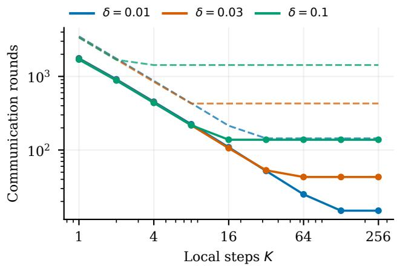  
Figure 1: Number of communication rounds deterministic SCAFFOLD needs to reach $f ( \bar { x } ^ { R } ) \ - \ f ^ { \star } \ \leq$ $1 0 ^ { - 5 }$ Dashed curves use theoretical stepsizes, and solid curves use tuned stepsizes. Our theory predicts that increasing the number of local steps reduces communication until client similarity limits further gains.

Neural-network training. We examine whether similarity between client datasets improves the practical benefit of local computation in neural-network training. We compare SCAFFOLD with averaging, SCAFFOLD with client selection, and minibatch SGD on CIFAR-10 (Krizhevsky, 2009), adapting the ResNet-18 (He et al., 2016) implementation and data preprocessing from S-DANE (Jiang et al., 2024b), with BatchNorm replaced by GroupNorm (Wu and He, 2018) to avoid batch-dependent normalization statistics, whose drift SCAFFOLD does not correct (Quintana et al., 2024). We distribute the same training set among ten clients in two ways. An IID split gives each client a random subset of the pooled data, with similar class proportions. A Dirichlet split draws the allocation proportions of each class across clients. With concentration 0.1, this produces strongly unequal class proportions and client sizes. Both partitions preserve the pooled training set and the example-weighted global objective, so they provide a statistical comparison motivated by the similarity assumptions without prescribing a Hessian-similarity constant.

We train for 400 communication rounds with $K \in$ {10, 40}, using validation-tuned constant stepsizes and three random seeds. Minibatch SGD uses the same per-round gradient-sample budget as SCAF-FOLD with averaging, including control estimation. It samples from the pooled training set, and we use the same baseline runs for both partitions. Appendix F.5 gives the full protocol and results for both values of K.

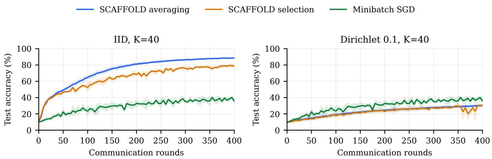  
Figure 2: Server test accuracies on CIFAR-10 with $K = 4 0$ for the IID (left) and Dirichlet (right) partitions, reporting means ± standard deviations over three runs. Both SCAFFOLD variants outperform minibatch SGD on the IID partition, but this advantage disappears on the heterogeneous partition.

Figure 2 shows server test accuracy for $K = 4 0$ . Both SCAFFOLD variants outperform minibatch SGD on the IID partition but fall below the same baseline on the Dirichlet partition. Increasing K from 10 to 40 improves both SCAFFOLD variants on IID data at the same communication-round budget, but gives no consistent improvement on the heterogeneous partition. The validation-selected local stepsizes also difer sharply across partitions. For K = 40, validation selects 0.2 and 0.01 for IID averaging and selection, re spectively, compared with $3 \times 1 0 ^ { - 5 }$ for both on Dirichlet data. The smaller validation-selected stepsizes suggest that more conservative local updates perform better on the Dirichlet partition, consistent with the observed loss spikes (Appendix F.5). Thus, in this experiment, similarity between client datasets is associated with a substantial advantage of both SCAFFOLD variants over minibatch SGD.

Our nonconvex guarantee uses client selection, as do several related similarity-based analyses (Murata and Suzuki, 2021; Patel et al., 2022). On the IID partition, however, averaging reaches higher accuracy at the same round budget for both values of K. This empirical advantage motivates sharper nonconvex guarantees for the averaging variant. Selection uses only 55% of averaging’s gradient-sample evaluations per round. Over the shared range of gradient-sample budgets, the curves are much closer, with selection ahead during part of training (Figure 6 in Appendix F.5).

Comparing both partitions at the same models along the common minibatch-SGD trajectory, gradientdiference measurements consistently show larger client disagreement on the Dirichlet partition. These are finite-sample measurements on sampled objectives, not estimates of the similarity constants. Appendix F.6 reports them and their sensitivity to the perturbation radius and number of sampled examples.

## 5 CONCLUSION

We showed that, with minibatch Option-I controls, the convex convergence guarantee for SCAFFOLD depends on $L _ { \mathrm { l o c } } / K + \delta $ : increasing the number of local steps reduces communication until client similarity becomes the limiting factor. A client-selection variant achieves an analogous linear dependence on the similarity parameter for nonconvex objectives. Both guarantees extend to stochastic gradients. Matching lower bounds establish their optimality for the analyzed constant-stepsize methods and outputs, under local smoothness in the nonconvex case. Under partial participation, refreshing controls only on participating clients can prevent the full communication benefit of local steps, even for identical clients.

In our neural-network experiments, SCAFFOLD sub stantially outperformed minibatch SGD on the IID partition but showed no such advantage on the strongly heterogeneous partition studied. On IID data, averaging also outperformed client selection at the same number of communication rounds, which motivates extending the nonconvex analysis to the averaging variant.

## Acknowledgments

This work was done during the first author’s research internship at CISPA Helmholtz Center for Information Security. SH and SS gratefully acknowledge funding from the European Research Council (ERC) under the Horizon Europe Framework Programme (HORIZON) for proposal number 101170430 CollectiveMinds, which also partially funded ZT’s visit to CISPA. ZT and PR were supported by funding from King Abdullah University of Science and Technology (KAUST): i) KAUST Baseline Research Scheme, ii) Center of Excellence for Generative AI (award no. 5940), iii) Competitive Research Grant (CRG) Program (award no. 6460).

## References

Carmon, Y., Duchi, J. C., Hinder, O., and Sidford, A. (2020). Lower bounds for finding stationary points I. Mathematical Programming, 184:71–120. https: //doi.org/10.1007/s10107-019-01406-y.

Chayti, E. M. and Karimireddy, S. P. (2024). Optimization with access to auxiliary information. Transactions on Machine Learning Research.

Cheng, Z., Huang, X., Wu, P., and Yuan, K. (2024). Momentum benefits non-IID federated learning simply and provably. In International Conference on Learning Representations, pages 9815–9848.

Crawshaw, M. and Liu, M. (2024). Federated learning under periodic client participation and heterogeneous data: A new communication-eficient algorithm and analysis. In Advances in Neural Information Processing Systems, volume 37, pages 8240– 8299. Curran Associates, Inc.

Drori, Y. and Shamir, O. (2020). The complexity of finding stationary points with stochastic gradient descent. In Proceedings of the 37th International Conference on Machine Learning, volume 119 of Proceedings of Machine Learning Research, pages 2658–2667. PMLR.

Efron, B. and Stein, C. (1981). The jackknife estimate of variance. The Annals of Statistics, 9(3):586–596. https://doi.org/10.1214/aos/1176345462.

Glasgow, M. R., Yuan, H., and Ma, T. (2022). Sharp bounds for federated averaging (Local SGD) and continuous perspective. In Proceedings of the 25th International Conference on Artificial Intelligence and Statistics, volume 151 of Proceedings of Machine Learning Research, pages 9050–9090. PMLR.

Gorbunov, E., Hanzely, F., and Richt´arik, P. (2021). Local SGD: Unified theory and new eficient methods. In Proceedings ofthe 24th International Conference on Artificial Intelligence and Statistics, volume

130 of Proceedings of Machine Learning Research, pages 3556–3564. PMLR.

He, K., Zhang, X., Ren, S., and Sun, J. (2016). Deep residual learning for image recognition. In Proceedings of the IEEE Conference on Computer Vision and Pattern Recognition, pages 770–778.

Jiang, X., Rodomanov, A., and Stich, S. U. (2024a). Federated optimization with doubly regularized drift correction. In Proceedings of the 41st International Conference on Machine Learning, volume 235 of Proceedings of Machine Learning Research, pages 21912–21945. PMLR.

Jiang, X., Rodomanov, A., and Stich, S. U. (2024b). Stabilized proximal-point methods for federated optimization. In Advances in Neural Information Processing Systems, volume 37, pages 99735–99772. https://doi.org/10.52202/079017-3164.

Jiang, X., Rodomanov, A., and Stich, S. U. (2026). Non-convex federated optimization under costaware client selection. In International Conference on Learning Representations, pages 62134–62176.

Karagulyan, A., Shulgin, E., Sadiev, A., and Richt´arik, P. (2024). SPAM: Stochastic proximal point method with momentum variance reduction for non-convex cross-device federated learning. arXiv preprint arXiv:2405.20127.

Karimireddy, S. P., Jaggi, M., Kale, S., Mohri, M., Reddi, S. J., Stich, S. U., and Suresh, A. T. (2021). Breaking the centralized barrier for cross-device federated learning. In Advances in Neural Information Processing Systems, volume 34, pages 28663–28676.

Karimireddy, S. P., Kale, S., Mohri, M., Reddi, S. J., Stich, S. U., and Suresh, A. T. (2020). SCAFFOLD: Stochastic controlled averaging for federated learning. In Proceedings of the 37th International Conference on Machine Learning, volume 119 of Proceedings of Machine Learning Research, pages 5132– 5143. PMLR.

Khaled, A. and Jin, C. (2023). Faster federated optimization under second-order similarity. In International Conference on Learning Representations.

Krizhevsky, A. (2009). Learning multiple layers of features from tiny images. Technical report, University of Toronto.

Liu, Z. and Zhou, Z. (2024). Revisiting the lastiterate convergence of stochastic gradient methods. In International Conference on Learning Representations, pages 40394–40428.

Luo, R., Stich, S. U., Horv´ath, S., and Tak´aˇc, M. (2025). Revisiting LocalSGD and SCAFFOLD: Improved rates and missing analysis. In Proceedings of

the 28th International Conference on Artificial Intelligence and Statistics, volume 258 of Proceedings of Machine Learning Research, pages 2539–2547. PMLR.

Mangold, P., Oliviero Durmus, A., Dieuleveut, A., and Moulines, E. (2025). Scafold with stochastic gradients: New analysis with linear speed-up. In Proceedings of the 42nd International Conference on Machine Learning, volume 267 of Proceedings of Machine Learning Research, pages 42902–42946. PMLR.

McMahan, B., Moore, E., Ramage, D., Hampson, S., and Ag¨uera y Arcas, B. (2017). Communicationeficient learning of deep networks from decentralized data. In Proceedings of the 20th International Conference on Artificial Intelligence and Statistics, volume 54 of Proceedings of Machine Learning Research, pages 1273–1282. PMLR.

Mishchenko, K., Malinovsky, G., Stich, S., and Richt´arik, P. (2022). ProxSkip: Yes! Local gradient steps provably lead to communication acceleration! Finally! In Proceedings of the 39th International Conference on Machine Learning, volume 162 of Proceedings of Machine Learning Research, pages 15750–15769. PMLR.

Mitra, A., Jaafar, R., Pappas, G. J., and Hassani, H. (2021). Linear convergence in federated learning: Tackling client heterogeneity and sparse gradients. In Advances in Neural Information Processing Systems, volume 34, pages 14606–14619. Curran Associates, Inc.

Murata, T. and Suzuki, T. (2021). Bias-variance reduced local SGD for less heterogeneous federated learning. In Proceedings of the 38th International Conference on Machine Learning, volume 139 of Proceedings of Machine Learning Research, pages 7872–7881. PMLR.

Patel, K. K., Wang, L., Woodworth, B., Bullins, B., and Srebro, N. (2022). Towards optimal communication complexity in distributed non-convex optimization. In Advances in Neural Information Processing Systems, volume 35, pages 13316–13328. https://doi.org/10.52202/068431-0968.

Quintana, G. I., Vancamberg, L., Jugnon, V., Mougeot, M., and Desolneux, A. (2024). BN-SCAFFOLD: Controlling the drift of Batch Normalization statistics in federated learning. arXiv:2410.03281.

Shamir, O., Srebro, N., and Zhang, T. (2014). Communication-eficient distributed optimization using an approximate Newton-type method. In Proceedings of the 31st International Conference on

Machine Learning, volume 32 of Proceedings of Machine Learning Research, pages 1000–1008. PMLR.

Shamir, O. and Zhang, T. (2013). Stochastic gradient descent for non-smooth optimization: Convergence results and optimal averaging schemes. In Dasgupta, S. and McAllester, D., editors, Proceedings of the 30th International Conference on Machine Learning, volume 28 of Proceedings of Machine Learning Research, pages 71–79. PMLR.

Takezawa, Y., Koloskova, A., Jiang, X., and Stich, S. U. (2026). FedMuon: Federated learning with bias-corrected LMO-based optimization. In International Conference on Learning Representations, pages 39538–39569.

Woodworth, B., Patel, K. K., and Srebro, N. (2020a). Minibatch vs local SGD for heterogeneous distributed learning. In Advances in Neural Information Processing Systems, volume 33, pages 6281– 6292.

Woodworth, B., Patel, K. K., Stich, S. U., Dai, Z., Bullins, B., McMahan, H. B., Shamir, O., and Srebro, N. (2020b). Is local SGD better than minibatch SGD? In Proceedings of the 37th International Conference on Machine Learning, volume 119 of Proceedings of Machine Learning Research, pages 10334–10343. PMLR.

Wu, Y. and He, K. (2018). Group normalization. In Proceedings of the European Conference on Computer Vision, pages 3–19.

## SCAFFOLD under Hessian Similarity: Sharp Convergence Rates Appendix

## A PROOFS OF PROPOSITION 1 AND THEOREM 1

We first allow any control batch size $B \geq 1$ , with $\eta _ { \ell } L _ { \mathrm { l o c } } \leq 1$ and $\theta = 2 \alpha ^ { 2 } \delta ^ { 2 } \le 1 / 9$ , which is the condition $\alpha \delta \leq 1 / ( 3 \sqrt { 2 } )$ of Proposition 1. This fixed-stepsize analysis proves the proposition and also allows $\sigma = 0$ . We then combine it with a small-stepsize bound to prove the theorem using $B = K$ and (71).

For each round $r ,$ let $\mathcal { H } _ { r }$ contain the previous local trajectories and previously used controls, but not the batch used to form $( c _ { i } ^ { r - 1 } ) _ { i = 1 } ^ { N } .$ In particular, $\bar { \boldsymbol { x } } ^ { r - 1 }$ and $x ^ { r - 2 }$ are $\mathcal { H } _ { r }$ -measurable. This conditioning is valid because that batch did not generate $x ^ { r - 1 }$ . Although $c _ { i } ^ { 0 }$ and $c _ { i } ^ { 1 }$ are both evaluated at $x ^ { 0 }$ , the algorithm draws a new batch for $c _ { i } ^ { 1 }$

Write the control errors in the current round as

$$
e _ { i } = c _ { i } ^ { r - 1 } - \nabla f _ { i } ( x ^ { r - 2 } ) , \qquad { \bar { e } } = \frac { 1 } { N } \sum _ { i } e _ { i } , \qquad q _ { i } = { \bar { e } } - e _ { i } .\tag{25}
$$

Conditionally on $\mathcal { H } _ { r }$ , the $e _ { i }$ ’s are independent and centered, and $\mathbb { E } [ \left. e _ { i } \right. ^ { 2 } \vert \mathcal { H } _ { r } ] \le \sigma ^ { 2 } / B$ . Consequently,

$$
\sum _ { i } q _ { i } = 0 , \qquad \mathbb { E } [ q _ { i } \mid \mathcal { H } _ { r } ] = 0 , \qquad \mathbb { E } [ \left\| q _ { i } \right\| ^ { 2 } \mid \mathcal { H } _ { r } ] \leq \left( 1 - \frac { 1 } { N } \right) \frac { \sigma ^ { 2 } } { B } .\tag{26}
$$

The corrected errors $q _ { i }$ need not be independent across clients.

## A.1 Server-level reduction

The server analysis is driven by a conditional comparison between the objective gap accumulated in one round and the corresponding decrease in squared distance. To state this comparison, write

$$
\mathbb { E } _ { r - 1 } [ \cdot ] : = \mathbb { E } [ \cdot \mid \mathcal { H } _ { r } ] ,
$$

and, for $r \geq 1$ , define

$$
G _ { r } : = f ( \boldsymbol { x } ^ { r } ) - f ^ { \star } , \qquad D _ { r } : = \| \boldsymbol { x } ^ { r } - \boldsymbol { x } ^ { \star } \| , \qquad b _ { r } : = \left\| \boldsymbol { x } ^ { r } - \boldsymbol { x } ^ { r - 1 } \right\| , \qquad s _ { r } : = \left\| \boldsymbol { x } ^ { r } - \boldsymbol { x } ^ { r - 2 } \right\| .
$$

The required conditional one-round comparison, used with $u = x ^ { \star }$ and $u = x ^ { r - 1 }$ , is

$$
2 \alpha \mathbb { E } _ { r - 1 } [ f ( x ^ { r } ) - f ( u ) ] \leq \left. x ^ { r - 1 } - u \right. ^ { 2 } - \mathbb { E } _ { r - 1 } \left. x ^ { r } - u \right. ^ { 2 } + \theta \mathbb { E } _ { r - 1 } \left. x ^ { r } - x ^ { r - 2 } \right. ^ { 2 } + Q ,\tag{27}
$$

where $Q \geq 0$ is deterministic. The first choice of u gives a telescoping sum of squared distances, while the second controls the server displacement. The next lemma shows that these two consequences are already suficient for the desired averaged-output guarantee. Thus, after proving the lemma, all that will remain is to verify (27) with a sharp choice of $Q .$

Lemma 1 (Server reduction under a one-round comparison). Suppose $x ^ { - 1 } = x ^ { 0 } , \alpha > 0 , 0 \leq \theta \leq 1 / 9$ , and (27) holds in every round, with the same deterministic $Q \ge 0 , f o r u = x ^ { \star }$ and $u = x ^ { r - 1 }$ . Then

$$
\mathbb { E } [ f ( \bar { x } ^ { R } ) ] - f ^ { \star } \le \frac { 1 1 3 } { 3 5 } \frac { D _ { 0 } ^ { 2 } } { \alpha R } + \frac { 8 1 } { 3 5 } \frac { Q } { \alpha } .\tag{28}
$$

Proof. All expectations in this proof are unconditional. Substituting $u = x ^ { \star }$ and $u = x ^ { r - 1 }$ , respectively, into (27) gives

$$
2 \alpha \mathbb { E } G _ { r } \leq \mathbb { E } D _ { r - 1 } ^ { 2 } - \mathbb { E } D _ { r } ^ { 2 } + \theta \mathbb { E } s _ { r } ^ { 2 } + Q ,\tag{29}
$$

$$
2 \alpha ( \mathbb { E } G _ { r - 1 } - \mathbb { E } G _ { r } ) \geq \mathbb { E } b _ { r } ^ { 2 } - \theta \mathbb { E } s _ { r } ^ { 2 } - Q .\tag{30}
$$

The gap inequality (29) has the desired telescoping squared-distance terms, except for the stale displacement $s _ { r } .$ The descent inequality (30) is useful precisely because it relates this error to the consecutive displacement $b _ { r }$ Since

$$
s _ { r } = \left\| ( x ^ { r } - x ^ { r - 1 } ) + ( x ^ { r - 1 } - x ^ { r - 2 } ) \right\| , \qquad s _ { r } ^ { 2 } \leq 2 b _ { r } ^ { 2 } + 2 b _ { r - 1 } ^ { 2 } ,
$$

the stale error involves two neighboring rounds. We first control the initial round and then derive a Lyapunov recursion for the subsequent rounds.

Controlling the initial round. Because $x ^ { - 1 } = x ^ { 0 }$ , we have $s _ { 1 } = b _ { 1 }$ . Since $G _ { 1 } \geq 0 , ( 2 9 )$ implies

$$
\mathbb { E } D _ { 1 } ^ { 2 } \leq D _ { 0 } ^ { 2 } + \theta \mathbb { E } b _ { 1 } ^ { 2 } + Q .
$$

The inequality $b _ { 1 } ^ { 2 } \leq 2 D _ { 0 } ^ { 2 } + 2 D _ { 1 } ^ { 2 }$ therefore yields

$$
( 1 - 2 \theta ) \mathbb { E } D _ { 1 } ^ { 2 } \leq ( 1 + 2 \theta ) D _ { 0 } ^ { 2 } + Q .
$$

Using $\theta \leq 1 / 9$ , we obtain

$$
\mathbb { E } D _ { 1 } ^ { 2 } \leq \frac { 1 1 } { 7 } D _ { 0 } ^ { 2 } + \frac { 9 } { 7 } Q , \qquad \mathbb { E } b _ { 1 } ^ { 2 } \leq \frac { 3 6 } { 7 } D _ { 0 } ^ { 2 } + \frac { 1 8 } { 7 } Q .\tag{31}
$$

Dropping the nonpositive term $- \mathbb { E } D _ { 1 } ^ { 2 }$ from (29) and using (31) gives

$$
2 \alpha \mathbb { E } G _ { 1 } \leq \frac { 1 1 } { 7 } D _ { 0 } ^ { 2 } + \frac { 9 } { 7 } Q .\tag{32}
$$

Thus the boundary terms are controlled by $D _ { 0 }$ and $Q$ alone, with initialization noise included in $Q .$

A Lyapunov recursion. For $r \geq 2$ , substitute $s _ { r } ^ { 2 } \leq 2 b _ { r } ^ { 2 } + 2 b _ { r - 1 } ^ { 2 }$ into (30) and rearrange:

$$
2 \alpha \mathbb { E } G _ { r } \leq 2 \alpha \mathbb { E } G _ { r - 1 } - ( 1 - 2 \theta ) \mathbb { E } b _ { r } ^ { 2 } + 2 \theta \mathbb { E } b _ { r - 1 } ^ { 2 } + Q .\tag{33}
$$

The positive term $2 \theta \mathbb { E } b _ { r - 1 } ^ { 2 }$ prevents the objective gap from being a decreasing quantity. It also identifies the correction to use: attach $2 \theta \mathbb { E } b _ { r } ^ { 2 }$ to the current gap, so that the troublesome preceding-round term becomes part of the same quantity at round $r - 1$ . Accordingly, define the Lyapunov quantity

$$
P _ { r } : = 2 \alpha \mathbb { E } G _ { r } + 2 \theta \mathbb { E } b _ { r } ^ { 2 } .\tag{34}
$$

Equations (31) and (32) imply

$$
P _ { 1 } \leq \frac { 1 9 } { 7 } D _ { 0 } ^ { 2 } + \frac { 1 3 } { 7 } Q .\tag{35}
$$

Adding 2θEb<sup>2</sup><sub>r</sub> to (33) now gives

$$
P _ { r - 1 } - P _ { r } \geq ( 1 - 4 \theta ) \mathbb { E } b _ { r } ^ { 2 } - Q .
$$

Thus the same construction both neutralizes the delayed term and controls the total movement of the server. Because $P _ { R } \geq 0$ , summing this inequality yields

$$
\sum _ { r = 2 } ^ { R } \mathbb { E } b _ { r } ^ { 2 } \leq \frac { P _ { 1 } + ( R - 1 ) Q } { 1 - 4 \theta } .\tag{36}
$$

$$
\sum _ { r = 2 } ^ { R } \mathbb { E } s _ { r } ^ { 2 } \leq 2 \mathbb { E } b _ { 1 } ^ { 2 } + 4 \sum _ { r = 2 } ^ { R } \mathbb { E } b _ { r } ^ { 2 } ,
$$

It remains to return to the objective gaps. For $R \geq 2 .$ sum (29) over $r = 2 , \ldots , R ,$ , use

and add $2 \alpha \mathbb { E } G _ { 1 }$ . The squared distances telescope, and (34) gives

$$
\begin{array} { r l } & { 2 \alpha \displaystyle \sum _ { r = 1 } ^ { R } \mathbb { E } G _ { r } \leq \mathbb { E } D _ { 1 } ^ { 2 } + P _ { 1 } + 4 \theta \displaystyle \sum _ { r = 2 } ^ { R } \mathbb { E } b _ { r } ^ { 2 } + ( R - 1 ) Q } \\ & { \qquad \leq \mathbb { E } D _ { 1 } ^ { 2 } + \displaystyle \frac { P _ { 1 } } { 1 - 4 \theta } + \frac { R - 1 } { 1 - 4 \theta } Q } \\ & { \qquad \leq \displaystyle \frac { 2 2 6 } { 3 5 } D _ { 0 } ^ { 2 } + \frac { 6 3 R + 9 9 } { 3 5 } Q , } \end{array}
$$

where the last line uses $( 1 - 4 \theta ) ^ { - 1 } \leq 9 / 5$ and the initial estimates above. For $R = 1$ , the same final estimate follows directly from (32). Finally, convexity of f gives

$$
\mathbb { E } [ f ( \bar { x } ^ { R } ) ] - f ^ { \star } \leq \frac { 1 } { R } \sum _ { r = 1 } ^ { R } \mathbb { E } G _ { r } .
$$

Dividing the preceding bound by $2 \alpha R$ and using $( 6 3 R + 9 9 ) / ( 7 0 R ) \le 8 1 / 3 5$ proves (28).

## A.2 A common local stochastic-gradient calculation

The next lemma records the standard one-step SGD descent calculation; see Shamir and Zhang (2013, the proofs of Theorems 1 and 2) and, for a more general formulation, the proof of Lemma 4.1 in Appendix B.1 of Liu and Zhou (2024).

Lemma 2 (One stochastic-gradient step). Let $h : \mathbb { R } ^ { d }  \mathbb { 1 }$ R be convex and L-smooth. Let z and u be measurable with respect to a sigma-field G, and let

$$
z ^ { + } = z - \eta ( \nabla h ( z ) + \zeta ) ,
$$

where

$$
\begin{array} { r } { \mathbb { E } [ \zeta \mid \mathcal { G } ] = 0 , \qquad q : = \mathbb { E } [ \| \zeta \| ^ { 2 } \mid \mathcal { G } ] < \infty . } \end{array}
$$

$I f \eta > 0$ and $\eta L \leq 1$ , then, almost surely,

$$
\begin{array} { r l } & { 2 \eta \mathbb { E } [ h ( z ^ { + } ) - h ( u ) \mid \mathcal { G } ] \leq \left\| z - u \right\| ^ { 2 } - \mathbb { E } [ \left\| z ^ { + } - u \right\| ^ { 2 } \mid \mathcal { G } ] } \\ & { \qquad - \eta ^ { 2 } ( 1 - \eta L ) \left\| \nabla h ( z ) \right\| ^ { 2 } + \eta ^ { 2 } ( 1 + \eta L ) q , } \end{array}\tag{37}
$$

and

$$
\mathbb { E } [ h ( z ^ { + } ) \mid \mathcal { G } ] \leq h ( z ) + \frac { L \eta ^ { 2 } } { 2 } q .\tag{38}
$$

Proof. Write $g = \nabla h ( z )$ . Since z and u are ${ \mathcal { G } } .$ -measurable, conditional unbiasedness gives

$$
\mathbb { E } [ \langle g , \zeta \rangle \mid \mathcal { G } ] = 0 , \qquad \mathbb { E } [ \langle z - u , \zeta \rangle \mid \mathcal { G } ] = 0 .
$$

In particular, expanding the square yields

$$
\begin{array} { r } { \mathbb { E } [ \left\| g + \zeta \right\| ^ { 2 } | \mathcal { G } ] = \left\| g \right\| ^ { 2 } + 2 \mathbb { E } [ \langle g , \zeta \rangle | \mathcal { G } ] + q = \left\| g \right\| ^ { 2 } + q . } \end{array}
$$

By smoothness and $z ^ { + } - z = - \eta ( g + \zeta )$

$$
\begin{array} { l } { { \displaystyle h ( z ^ { + } ) \leq h ( z ) + \left. g , z ^ { + } - z \right. + \frac { L } { 2 } \left. z ^ { + } - z \right. ^ { 2 } } } \\ { { \displaystyle \ = h ( z ) - \eta \left. g \right. ^ { 2 } - \eta \left. g , \zeta \right. + \frac { L \eta ^ { 2 } } { 2 } \left. g + \zeta \right. ^ { 2 } } . } \end{array}
$$

Taking conditional expectations and using the preceding identities gives

$$
\mathbb { E } [ h ( z ^ { + } ) \mid \mathcal { G } ] \leq h ( z ) - \eta \left( 1 - \frac { \eta L } { 2 } \right) \left. \nabla h ( z ) \right. ^ { 2 } + \frac { L \eta ^ { 2 } } { 2 } q .\tag{39}
$$

Because $\eta L \leq 1$ , dropping the nonpositive gradient term proves (38). Moreover, expanding the squared distance before taking conditional expectations gives

$$
\left\| z ^ { + } - u \right\| ^ { 2 } = \left\| z - u \right\| ^ { 2 } - 2 \eta \left. g + \zeta , z - u \right. + \eta ^ { 2 } \left\| g + \zeta \right\| ^ { 2 } .
$$

Thus, after rearranging,

$$
2 \eta \left. g , z - u \right. = \left\| z - u \right\| ^ { 2 } - \mathbb { E } [ \left\| z ^ { + } - u \right\| ^ { 2 } | \mathcal { G } ] + \eta ^ { 2 } \left\| g \right\| ^ { 2 } + \eta ^ { 2 } q .
$$

Convexity gives $h ( z ) - h ( u ) \leq \langle g , z - u \rangle$ . Subtracting $h ( u )$ from (39), multiplying by $2 \eta .$ , and applying this convexity inequality yields

$$
2 \eta \mathbb { E } [ h ( z ^ { + } ) - h ( u ) \mid \mathcal { G } ] \leq 2 \eta \left. g , z - u \right. - 2 \eta ^ { 2 } \left( 1 - \frac { \eta L } { 2 } \right) \left. g \right. ^ { 2 } + L \eta ^ { 3 } q .
$$

Substituting the rearranged distance identity, the coeficient of $\| g \| ^ { 2 }$ becomes

$$
\eta ^ { 2 } - 2 \eta ^ { 2 } \left( 1 - \frac { \eta L } { 2 } \right) = - \eta ^ { 2 } ( 1 - \eta L ) ,
$$

while the noise terms sum to $\eta ^ { 2 } q + L \eta ^ { 3 } q = \eta ^ { 2 } ( 1 + \eta L ) q$ . This proves (37).

## A.3 Direct control of the random local endpoints

For a local SGD trajectory $z _ { 0 } , \dots , z _ { K }$ on an objective $h ,$ applying Lemma 2, taking expectations, and summing over the K updates bounds the trajectory-average gap. The server uses the final client iterates, so we need to pass from

$$
\underbrace { \frac { 1 } { K } \sum _ { k = 1 } ^ { K } \mathbb { E } [ h ( z _ { k } ) - h ( u ) ] } _ { \mathrm { t r a j e c t o r y - a v e r a g e ~ g a p } } \quad \mathrm { t o } \quad \underbrace { \mathbb { E } [ h ( z _ { K } ) - h ( u ) ] } _ { \mathrm { f i n a l - i t e r a t e ~ g a p } } ,
$$

where u is a fixed comparison point. In doing so, we must retain the subtracted final squared distance $- \mathbb { E } \left. z _ { K } - u \right. ^ { 2 }$ on the right-hand side of the bound. This term remains after the one-step distance diferences telescope:

$$
\sum _ { k = 0 } ^ { K - 1 } \left( \mathbb { E } \left. z _ { k } - u \right. ^ { 2 } - \mathbb { E } \left. z _ { k + 1 } - u \right. ^ { 2 } \right) = \left. z _ { 0 } - u \right. ^ { 2 } - \mathbb { E } \left. z _ { K } - u \right. ^ { 2 } ,
$$

with deterministic $z _ { \mathrm { 0 } }$ . After averaging across clients, the subtracted final squared distance supplies both the server-distance term used for telescoping across rounds and a client-dispersion term that absorbs the similarity error. The following lemma bounds the final-iterate gap while retaining the subtracted final squared distance, at the cost of a logarithmic factor in the noise bound. Its proof retains the one-step derivation and uses sufix averages sharpened by smoothness near the endpoint.

Lemma 3 (Last-iterate bound for smooth convex SGD). Let $h : \mathbb { R } ^ { d }  \mathbb { R }$ be convex and L-smooth. Starting from a deterministic $z _ { \mathrm { 0 } }$ , consider

$$
z _ { k + 1 } = z _ { k } - \eta \big ( \nabla h ( z _ { k } ) + \zeta _ { k } \big ) , \qquad k = 0 , \dots , K - 1 ,
$$

where $z _ { k }$ is measurable with respect to $\mathcal { G } _ { k }$ , and

$$
\begin{array} { r } { \mathbb { E } [ \zeta _ { k } \mid \mathcal { G } _ { k } ] = 0 , \qquad \mathbb { E } [ \left\| \zeta _ { k } \right\| ^ { 2 } \mid \mathcal { G } _ { k } ] \le \nu ^ { 2 } . } \end{array}
$$

If $\eta > 0$ and $\eta L \leq 1$ , then, for every deterministic $u ,$

$$
2 K \eta \mathbb { E } \big [ h ( z _ { K } ) - h ( u ) \big ] \leq \left\| z _ { 0 } - u \right\| ^ { 2 } - \mathbb { E } \left\| z _ { K } - u \right\| ^ { 2 } + 2 K \eta ^ { 2 } \nu ^ { 2 } \big [ 1 + \log ( 1 + \eta L K ) \big ] .\tag{40}
$$

The same bound holds after conditioning on the initial information, treating $h , z _ { 0 }$ , and u as fixed, provided the stated noise assumptions hold under this conditioning.

Proof. The trajectory-average bound. Apply Lemma $2$ at step $k ,$ discard its nonpositive gradient term, and use the variance bound. After taking expectations,

$$
2 \eta \mathbb { E } [ h ( z _ { k + 1 } ) - h ( u ) ] \leq \mathbb { E } \left. z _ { k } - u \right. ^ { 2 } - \mathbb { E } \left. z _ { k + 1 } - u \right. ^ { 2 } + \eta ^ { 2 } ( 1 + \eta L ) \nu ^ { 2 } .\tag{41}
$$

Summing over $k = 0 , \ldots , K - 1$ gives

$$
2 \eta \sum _ { k = 1 } ^ { K } \mathbb { E } [ h ( z _ { k } ) - h ( u ) ] \leq \| z _ { 0 } - u \| ^ { 2 } - \mathbb { E } \left\| z _ { K } - u \right\| ^ { 2 } + K \eta ^ { 2 } ( 1 + \eta L ) \nu ^ { 2 } .\tag{42}
$$

This estimate already contains the endpoint distance required by (27); only its objective term still averages the whole trajectory.

Bounding the final objective value using sufix averages. Fix $j \in \{ 1 , \dots , K - 1 \}$ . Use $u = z _ { j }$ in (41) for steps $j , \ldots , K - 1$ , conditioning first on $\mathcal { G } _ { j }$ . This comparison point is valid because $z _ { j }$ is then fixed and remains measurable with respect to every later sigma-field. The initial distance is zero, and hence

$$
2 \eta \sum _ { k = j + 1 } ^ { K } \mathbb { E } [ h ( z _ { k } ) - h ( z _ { j } ) ] \leq ( K - j ) \eta ^ { 2 } ( 1 + \eta L ) \nu ^ { 2 } .
$$

Define the numerical sufix averages

$$
A _ { j } : = \frac { 1 } { K - j + 1 } \sum _ { k = j } ^ { K } \mathbb { E } h ( z _ { k } ) , \qquad j = 1 , \dots , K .
$$

The preceding comparison gives

$$
A _ { j + 1 } - \mathbb { E } h ( z _ { j } ) \leq \frac { \eta ( 1 + \eta L ) \nu ^ { 2 } } { 2 } .
$$

Using the exact identity

$$
A _ { j + 1 } - A _ { j } = \frac { A _ { j + 1 } - \mathbb { E } h ( z _ { j } ) } { K - j + 1 }
$$

and $( 1 + \eta L ) / 2 \le 1$ , we obtain

$$
A _ { j + 1 } - A _ { j } \leq \frac { \eta \nu ^ { 2 } } { K - j + 1 } .\tag{43}
$$

This estimate is efective for long sufixes but unnecessarily large near the endpoint.

Using smoothness on short sufixes. Equation (38) and the variance bound imply

$$
\mathbb { E } h ( z _ { k + 1 } ) - \mathbb { E } h ( z _ { k } ) \leq \frac { L \eta ^ { 2 } \nu ^ { 2 } } { 2 } .
$$

Let $n = K - j$ . Summing this inequality from j to each later iterate and then averaging gives

$$
A _ { j + 1 } - \mathbb { E } h ( z _ { j } ) \leq \frac { L \eta ^ { 2 } \nu ^ { 2 } ( n + 1 ) } { 4 } .
$$

Combining this estimate with the sufix identity and (43) yields

$$
A _ { j + 1 } - A _ { j } \leq \eta \nu ^ { 2 } \operatorname* { m i n } \left\{ \frac { 1 } { K - j + 1 } , \frac { \eta L } { 4 } \right\} .\tag{44}
$$

Thus the harmonic estimate is used only where it is smaller than the smoothness estimate.

Set $c = \eta L / 4$ for the remainder of this calculation. Since $x \mapsto$ min $\{ c , 1 / x \}$ is nonincreasing,

$$
\sum _ { n = 1 } ^ { K - 1 } \operatorname* { m i n } \left\{ c , { \frac { 1 } { n + 1 } } \right\} \leq \int _ { 1 } ^ { K } \operatorname* { m i n } \left\{ c , { \frac { 1 } { x } } \right\} d x \leq \log ( 1 + 4 c K ) .
$$

For the last inequality, if $c K \leq 1$ , the integral is at most $c K \leq \log ( 1 + 4 c K )$ . If $c K > 1$ , it is at most $1 + \log ( c K ) \leq \log ( 1 + 4 c K )$ . The sum is empty when $K = 1$ . Summing (44) over j therefore gives

$$
\mathbb { E } h ( z _ { K } ) \le \frac { 1 } { K } \sum _ { k = 1 } ^ { K } \mathbb { E } h ( z _ { k } ) + \eta \nu ^ { 2 } \log ( 1 + \eta L K ) .\tag{45}
$$

Multiplying (45) by $2 K \eta .$ substituting (42), and using $1 + \eta L \leq 2$ proves (40).

The sufix-average recursion follows Shamir and Zhang (2013, Theorem 2), although they use $\eta _ { t } = c / \sqrt { t } ;$ see also the variable-stepsize result of Liu and Zhou (2024, Lemma 4.2). For the fixed stepsize considered here, Lemma 3 additionally uses smoothness near the endpoint to replace log K by $\log ( 1 + \eta L K )$ and retains the terminal-distance term needed below.

## A.4 From client endpoints to the server endpoint

The preceding lemma controls each client separately and therefore leaves diferent corrected objectives evaluated at diferent endpoints. The following deterministic comparison converts their average into the global objective at the averaged endpoint. Its error depends on the dispersion of the client endpoints; the negative endpoint-distance term retained in Lemma 3 will absorb this error.

For an anchor $w \in \mathbb { R } ^ { d }$ , define

$$
\widetilde { f } _ { i } ( y ) : = f _ { i } ( y ) - \left. \nabla f _ { i } ( w ) - \nabla f ( w ) , y \right. .\tag{46}
$$

These functions are convex and $L _ { \mathrm { l o c } }$ -smooth. Moreover, at every common point $y .$

$$
\frac { 1 } { N } \sum _ { i = 1 } ^ { N } \widetilde { f } _ { i } ( y ) = f ( y ) .
$$

Lemma 4 (Corrected-objective comparison). For arbitrary points $y _ { 1 } , \ldots , y _ { N }$ , let

$$
\bar { y } : = \frac { 1 } { N } \sum _ { i = 1 } ^ { N } y _ { i } , \qquad e ^ { 2 } : = \frac { 1 } { N } \sum _ { i = 1 } ^ { N } \left\| y _ { i } - \bar { y } \right\| ^ { 2 } .
$$

Then, for every common comparison point $u ,$

$$
\frac { 1 } { N } \sum _ { i = 1 } ^ { N } \bigl ( \widetilde { f } _ { i } ( y _ { i } ) - \widetilde { f } _ { i } ( u ) \bigr ) \geq f ( \bar { y } ) - f ( u ) - \delta \left. \bar { y } - w \right. e .\tag{47}
$$

Proof. Write $z _ { i } = y _ { i } - { \bar { y } }$ , so that $N ^ { - 1 } \sum _ { i } z _ { i } = 0$ . Convexity of $f _ { i }$ at ¯y gives

$$
f _ { i } ( y _ { i } ) \geq f _ { i } ( \bar { y } ) + \langle \nabla f _ { i } ( \bar { y } ) , z _ { i } \rangle .
$$

Substituting this inequality into the corrected-objective diferences and averaging shows that their diference from $f ( { \bar { y } } ) - f ( u )$ is bounded below by

$$
\frac { 1 } { N } \sum _ { i = 1 } ^ { N } \left. \left( \nabla f _ { i } ( \bar { y } ) - \nabla f ( \bar { y } ) \right) - \left( \nabla f _ { i } ( w ) - \nabla f ( w ) \right) , z _ { i } \right. .
$$

The common terms vanish because the $z _ { i } \mathrm { \dot { s } }$ average to zero. Cauchy–Schwarz over the clients and Assumption 3 bound the absolute value of the last display by

$$
\delta \left\| { \bar { y } } - w \right\| \left( { \frac { 1 } { N } } \sum _ { i = 1 } ^ { N } \left\| z _ { i } \right\| ^ { 2 } \right) ^ { 1 / 2 } = \delta \left\| { \bar { y } } - w \right\| e .
$$

This proves (47).

In the following endpoint estimates, $\alpha = K \eta _ { \ell }$ . We apply them to the convex, $L _ { \mathrm { l o c } } \mathrm { - s m o o t h }$ functions $\widetilde { f _ { i } }$ at $w = x ^ { r - 2 }$ , with starting and comparison points fixed under $\mathcal { H } _ { r }$

## A.5 Conditional-mean endpoint comparison

The next lemma separates two sources of randomness in a client’s local updates: a random correction q that is held constant throughout the trajectory, and fresh local gradient noise $\zeta _ { k }$ at each step. In our application, $h = \widetilde f _ { i }$ and $q = q _ { i } = \bar { e } - e _ { i } ,$ , where $e _ { i } = c _ { i } ^ { r - 1 } - \hat { \nabla } f _ { i } ( x ^ { r - 2 } )$ is the client’s control-estimation error and $\bar { e } = N ^ { - 1 } \sum _ { i } e _ { i }$ . Thus $q$ is the error in the correction $\bar { - } c _ { i } ^ { r - 1 } + c ^ { r - 1 }$ , not the full correction itself. All expectations in this application are conditional on $\mathcal { H } _ { r }$

Lemma 5 (Conditional-mean endpoint comparison). Let h be convex and $L _ { \mathrm { l o c } ^ { - S m o o t h } }$ , and let q be a random vector satisfying $\mathbb { E } q = 0$ and $\mathbb { E } \left. q \right. ^ { 2 } \leq \nu ^ { 2 }$ . Starting from deterministic $Y _ { 0 } = z _ { z }$ , consider the updates

$$
Y _ { k + 1 } = Y _ { k } - \eta _ { \ell } ( \nabla h ( Y _ { k } ) + q + \zeta _ { k } ) , \qquad k = 0 , \dots , K - 1 ,
$$

using the same realization of q at every step. Conditionally on q and the previous local samples, $\zeta _ { k }$ has mean zero and second moment at most $\sigma ^ { 2 }$ . Write $m _ { k } = \mathbb { E } Y _ { k } , v _ { k } = \mathbb { E } \left\| Y _ { k } - m _ { k } \right\| ^ { 2 }$ , where expectation includes q. If $\eta _ { \ell } > 0$ and $\eta _ { \ell } L _ { \mathrm { l o c } } \leq 1$ , then

$$
v _ { k } \leq 2 k \eta _ { \ell } ^ { 2 } \sigma ^ { 2 } + 2 k ^ { 2 } \eta _ { \ell } ^ { 2 } \nu ^ { 2 } .\tag{48}
$$

$I f$ also $\alpha L _ { \mathrm { l o c } } \leq 1$ , then every deterministic u satisfies

$$
\begin{array} { l } { 2 \alpha [ h ( m _ { K } ) - h ( u ) ] \leq \left. z - u \right. ^ { 2 } - \left. m _ { K } - u \right. ^ { 2 } } \\ { \qquad + \displaystyle \frac { 2 L _ { \mathrm { l o c } } \alpha ^ { 3 } \sigma ^ { 2 } } { K } + \displaystyle \frac { 4 } { 3 } L _ { \mathrm { l o c } } \alpha ^ { 3 } \nu ^ { 2 } . } \end{array}\tag{49}
$$

Proof. The gradient map $T _ { q } ( x ) = x - \eta _ { \ell } \nabla h ( x ) - \eta _ { \ell } q$ is nonexpansive: cocoercivity gives

$$
\begin{array} { r } { \left\| T _ { q } ( \boldsymbol { x } ) - T _ { q } ( \boldsymbol { y } ) \right\| ^ { 2 } \leq \left\| \boldsymbol { x } - \boldsymbol { y } \right\| ^ { 2 } - \eta _ { \ell } ( 2 / L _ { \mathrm { l o c } } - \eta _ { \ell } ) \left\| \nabla h ( \boldsymbol { x } ) - \nabla h ( \boldsymbol { y } ) \right\| ^ { 2 } . } \end{array}
$$

Since $\eta _ { \ell } L _ { \mathrm { l o c } } \leq 1$ , the subtracted term is nonnegative, giving $\| T _ { q } ( x ) - T _ { q } ( y ) \| \leq \| x - y \|$

Define the comparison trajectory without local gradient noise by

$$
Z _ { 0 } ( q ) = z , \qquad Z _ { k + 1 } ( q ) = T _ { q } ( Z _ { k } ( q ) ) .
$$

This trajectory is deterministic once q is fixed, but can be random before conditioning on q. We also define $Z _ { k } ( 0 )$ by the same recursion with $q = 0 ;$ this latter trajectory is deterministic. Since $Y _ { k + 1 } = T _ { q } ( Y _ { k } ) - \eta _ { \ell } \zeta _ { k }$

$$
Y _ { k + 1 } - Z _ { k + 1 } ( q ) = T _ { q } ( Y _ { k } ) - T _ { q } ( Z _ { k } ( q ) ) - \eta _ { \ell } \zeta _ { k } .
$$

Let $\mathcal { F } _ { k }$ be the sigma-field generated by q and the local samples preceding step k. Then $T _ { q } ( Y _ { k } ) - T _ { q } ( Z _ { k } ( q ) )$ is $\mathcal { F } _ { k }$ -measurable, so the conditional mean-zero property of $\zeta _ { k }$ makes the cross term vanish:

$$
\begin{array} { r l } & { \mathbb { E } [ \left\| Y _ { k + 1 } - Z _ { k + 1 } ( q ) \right\| ^ { 2 } | \mathcal { F } _ { k } ] = \left\| T _ { q } ( Y _ { k } ) - T _ { q } ( Z _ { k } ( q ) ) \right\| ^ { 2 } - 2 \eta _ { \ell } \langle T _ { q } ( Y _ { k } ) - T _ { q } ( Z _ { k } ( q ) ) , \mathbb { E } [ \zeta _ { k } | \mathcal { F } _ { k } ] \rangle + \eta _ { \ell } ^ { 2 } \mathbb { E } [ \left\| \zeta _ { k } \right\| ^ { 2 } | \mathcal { F } _ { k } ] } \\ & { \qquad \leq \left\| Y _ { k } - Z _ { k } ( q ) \right\| ^ { 2 } + \eta _ { \ell } ^ { 2 } \sigma ^ { 2 } . } \end{array}
$$

Taking expectations conditional on q and iterating from $Y _ { 0 } = Z _ { 0 } ( q ) = z$ gives

$$
\mathbb { E } [ \left. Y _ { k } - Z _ { k } ( q ) \right. ^ { 2 } \mid q ] \leq k \eta _ { \ell } ^ { 2 } \sigma ^ { 2 } .
$$

Next, $T _ { q } ( x ) = T _ { 0 } ( x ) - \eta \ell q$ and nonexpansiveness of $T _ { 0 }$ give

$$
\begin{array} { r l } & { \| Z _ { k + 1 } ( q ) - Z _ { k + 1 } ( 0 ) \| = \| T _ { 0 } ( Z _ { k } ( q ) ) - T _ { 0 } ( Z _ { k } ( 0 ) ) - \eta _ { \ell } q \| } \\ & { \qquad \leq \| Z _ { k } ( q ) - Z _ { k } ( 0 ) \| + \eta _ { \ell } \| q \| . } \end{array}
$$

Since $Z _ { 0 } ( q ) = Z _ { 0 } ( 0 ) = z$ , induction yields

$$
\begin{array} { r } { \| Z _ { k } ( q ) - Z _ { k } ( 0 ) \| \le k \eta _ { \ell } \| q \| . } \end{array}
$$

Finally, for any deterministic point $a _ { \mathrm { : } }$

$$
\mathbb { E } \left\| Y _ { k } - a \right\| ^ { 2 } = v _ { k } + \left\| m _ { k } - a \right\| ^ { 2 } \geq v _ { k } .
$$

Choose $a = Z _ { k } ( 0 )$ , insert $Z _ { k } ( q )$ , and use $\left\| a + b \right\| ^ { 2 } \leq 2 \left\| a \right\| ^ { 2 } + 2 \left\| b \right\| ^ { 2 }$ . The two comparison bounds above, averaged also over $q ,$ imply

$$
\begin{array} { r l } & { v _ { k } \leq \mathbb { E } \left\| Y _ { k } - Z _ { k } ( 0 ) \right\| ^ { 2 } } \\ & { \quad \leq 2 \mathbb { E } \left\| Y _ { k } - Z _ { k } ( q ) \right\| ^ { 2 } + 2 \mathbb { E } \left\| Z _ { k } ( q ) - Z _ { k } ( 0 ) \right\| ^ { 2 } } \\ & { \quad \leq 2 k \eta _ { \ell } ^ { 2 } \sigma ^ { 2 } + 2 k ^ { 2 } \eta _ { \ell } ^ { 2 } \mathbb { E } \left\| q \right\| ^ { 2 } } \\ & { \quad \leq 2 k \eta _ { \ell } ^ { 2 } \sigma ^ { 2 } + 2 k ^ { 2 } \eta _ { \ell } ^ { 2 } \nu ^ { 2 } , } \end{array}
$$

proving (48).

Put $g _ { k } = \mathbb { E } \nabla h ( Y _ { k } )$ . Taking expectations in the update gives

$$
m _ { k + 1 } = m _ { k } - \eta _ { \ell } \big ( g _ { k } + \mathbb { E } q + \mathbb { E } \zeta _ { k } \big ) = m _ { k } - \eta _ { \ell } g _ { k } .
$$

Here $\mathbb { E } q = 0$ by assumption, and $\mathbb { E } \zeta _ { k } = 0$ follows by taking expectations of its conditional mean.

Convexity at $Y _ { k }$ and smoothness from $Y _ { k }$ to $m _ { k + 1 } ~ \mathrm { g i v e }$ , respectively,

$$
\begin{array} { r l } & { ~ h ( Y _ { k } ) - h ( u ) \le \left. \nabla h ( Y _ { k } ) , Y _ { k } - u \right. , } \\ & { } \\ & { ~ h ( m _ { k + 1 } ) - h ( Y _ { k } ) \le \left. \nabla h ( Y _ { k } ) , m _ { k + 1 } - Y _ { k } \right. + \frac { L _ { \mathrm { l o c } } } { 2 } \left\| m _ { k + 1 } - Y _ { k } \right\| ^ { 2 } . } \end{array}
$$

Adding cancels $h ( Y _ { k } )$ and combines the inner products into $\langle \nabla h ( Y _ { k } ) , m _ { k + 1 } - u \rangle$ . Moreover, since $\mathbb { E } ( Y _ { k } - m _ { k } ) = 0$

$$
\begin{array} { r l } & { \mathbb { E } \left\| m _ { k + 1 } - Y _ { k } \right\| ^ { 2 } = \mathbb { E } \left\| ( m _ { k } - Y _ { k } ) + ( m _ { k + 1 } - m _ { k } ) \right\| ^ { 2 } } \\ & { \qquad = v _ { k } + \left\| m _ { k + 1 } - m _ { k } \right\| ^ { 2 } = v _ { k } + \eta _ { \ell } ^ { 2 } \left\| g _ { k } \right\| ^ { 2 } . } \end{array}
$$

Taking expectations in the summed inequality therefore yields

$$
h ( m _ { k + 1 } ) - h ( u ) \leq \langle g _ { k } , m _ { k + 1 } - u \rangle + \frac { L _ { \mathrm { l o c } } } { 2 } ( v _ { k } + \eta _ { \ell } ^ { 2 } \left. g _ { k } \right. ^ { 2 } ) .
$$

The mean update also implies the distance identity

$$
\begin{array} { r } { 2 \eta _ { \ell } \left. g _ { k } , m _ { k + 1 } - u \right. = \left. m _ { k } - u \right. ^ { 2 } - \left. m _ { k + 1 } - u \right. ^ { 2 } - \eta _ { \ell } ^ { 2 } \left. g _ { k } \right. ^ { 2 } . } \end{array}
$$

Multiplying the objective bound by $2 \eta _ { \ell }$ and substituting this identity gives

$$
\begin{array} { r l } & { 2 \eta _ { \ell } [ h ( m _ { k + 1 } ) - h ( u ) ] \leq \left\| m _ { k } - u \right\| ^ { 2 } - \left\| m _ { k + 1 } - u \right\| ^ { 2 } } \\ & { \qquad - \eta _ { \ell } ^ { 2 } ( 1 - \eta _ { \ell } L _ { \mathrm { l o c } } ) \left\| g _ { k } \right\| ^ { 2 } + \eta _ { \ell } L _ { \mathrm { l o c } } v _ { k } . } \end{array}\tag{50}
$$

To control increases in the objective along the mean trajectory, smoothness at $m _ { k }$ gives

$$
h ( m _ { k + 1 } ) - h ( m _ { k } ) \leq - \eta _ { \ell } \left. \nabla h ( m _ { k } ) , g _ { k } \right. + \frac { L _ { \mathrm { l o c } } \eta _ { \ell } ^ { 2 } } { 2 } \left\| g _ { k } \right\| ^ { 2 } .
$$

Using η<sub>ℓ</sub> $L _ { \mathrm { l o c } } \leq 1$ , the right-hand side is at most

$$
\begin{array} { l } { \displaystyle - \eta _ { \ell } \left. \nabla h ( m _ { k } ) , g _ { k } \right. + \frac { \eta _ { \ell } } { 2 } \left. g _ { k } \right. ^ { 2 } = \frac { \eta _ { \ell } } { 2 } \left. g _ { k } - \nabla h ( m _ { k } ) \right. ^ { 2 } - \frac { \eta _ { \ell } } { 2 } \left. \nabla h ( m _ { k } ) \right. ^ { 2 } } \\ { \displaystyle \qquad \leq \frac { \eta _ { \ell } } { 2 } \left. g _ { k } - \nabla h ( m _ { k } ) \right. ^ { 2 } . } \end{array}
$$

Jensen’s inequality and smoothness further give

$$
\begin{array} { r l } & { \left\| g _ { k } - \nabla h ( m _ { k } ) \right\| ^ { 2 } = \left\| \mathbb { E } [ \nabla h ( Y _ { k } ) - \nabla h ( m _ { k } ) ] \right\| ^ { 2 } } \\ & { \qquad \leq \mathbb { E } \left\| \nabla h ( Y _ { k } ) - \nabla h ( m _ { k } ) \right\| ^ { 2 } } \\ & { \qquad \leq L _ { \mathrm { l o c } } ^ { 2 } \mathbb { E } \left\| Y _ { k } - m _ { k } \right\| ^ { 2 } = L _ { \mathrm { l o c } } ^ { 2 } v _ { k } . } \end{array}
$$

Consequently,

$$
h ( m _ { k + 1 } ) - h ( m _ { k } ) \leq \frac { \eta _ { \ell } L _ { \mathrm { l o c } } ^ { 2 } } { 2 } v _ { k } .\tag{51}
$$

Summing (50) over $k = 0 , \ldots , K - 1$ , dropping the nonpositive gradient terms, and using $m _ { 0 } = z \ { \mathrm { g i } }$ ves

$$
2 \eta _ { \ell } \sum _ { j = 1 } ^ { K } [ h ( m _ { j } ) - h ( u ) ] \leq \left. z - u \right. ^ { 2 } - \left. m _ { K } - u \right. ^ { 2 } + \eta _ { \ell } L _ { \mathrm { l o c } } \sum _ { k = 0 } ^ { K - 1 } v _ { k } .
$$

For each $j = 1 , \ldots , K$ , summing (51) from $k = j$ to $K - 1$ yields

$$
h ( \boldsymbol { m } _ { K } ) - h ( \boldsymbol { m } _ { j } ) \leq \frac { \eta _ { \ell } L _ { \mathrm { l o c } } ^ { 2 } } { 2 } \sum _ { k = j } ^ { K - 1 } v _ { k } ,
$$

where the sum is empty when $j = K$ . Summing over $j$ and observing that each $v _ { k }$ occurs for exactly k indices $j = 1 , \ldots , k ,$

$$
\begin{array} { r l r } {  { K [ h ( m _ { K } ) - h ( u ) ] \leq \sum _ { j = 1 } ^ { K } [ h ( m _ { j } ) - h ( u ) ] + \frac { \eta _ { \ell } L _ { \mathrm { l o c } } ^ { 2 } } { 2 } \sum _ { j = 1 } ^ { K } \sum _ { k = j } ^ { K - 1 } v _ { k } } } \\ & { } & { = \sum _ { j = 1 } ^ { K } [ h ( m _ { j } ) - h ( u ) ] + \frac { \eta _ { \ell } L _ { \mathrm { l o c } } ^ { 2 } } { 2 } \sum _ { k = 0 } ^ { K - 1 } k v _ { k } . } \end{array}
$$

Multiplying by $2 \eta _ { \ell }$ , applying the trajectory-sum bound, and recalling $\alpha = K \eta _ { \ell }$ , we obtain

$$
2 \alpha [ h ( m _ { K } ) - h ( u ) ] \leq \left\| z - u \right\| ^ { 2 } - \left\| m _ { K } - u \right\| ^ { 2 } + \eta _ { \ell } L _ { \log } \sum _ { k = 0 } ^ { K - 1 } v _ { k } + \eta _ { \ell } ^ { 2 } L _ { \log } ^ { 2 } \sum _ { k = 0 } ^ { K - 1 } k v _ { k } .
$$

Since $\eta _ { \ell } L _ { \mathrm { l o c } } k \leq \alpha L _ { \mathrm { l o c } } \leq 1$ , the last two terms satisfy

$$
\eta _ { \ell } L _ { \mathrm { l o c } } \sum _ { k = 0 } ^ { K - 1 } ( 1 + \eta _ { \ell } L _ { \mathrm { l o c } } k ) v _ { k } \le 2 \eta _ { \ell } L _ { \mathrm { l o c } } \sum _ { k = 0 } ^ { K - 1 } v _ { k } .
$$

Finally, (48) and the formulas for the sums of integers and their squares give

$$
\begin{array} { r l r } {  { \sum _ { k = 0 } ^ { K - 1 } v _ { k } \le 2 \eta _ { \ell } ^ { 2 } \sigma ^ { 2 } \frac { K ( K - 1 ) } { 2 } + 2 \eta _ { \ell } ^ { 2 } \nu ^ { 2 } \frac { K ( K - 1 ) ( 2 K - 1 ) } { 6 } } } \\ & { } & \\ & { } & { \le \eta _ { \ell } ^ { 2 } K ^ { 2 } \sigma ^ { 2 } + \frac { 2 } { 3 } \eta _ { \ell } ^ { 2 } K ^ { 3 } \nu ^ { 2 } . \qquad } \end{array}
$$

Thus the total error is at most

$$
2 \eta _ { \ell } L _ { \mathrm { l o c } } \sum _ { k = 0 } ^ { K - 1 } v _ { k } \le \frac { 2 L _ { \mathrm { l o c } } \alpha ^ { 3 } \sigma ^ { 2 } } { K } + \frac { 4 } { 3 } L _ { \mathrm { l o c } } \alpha ^ { 3 } \nu ^ { 2 } ,
$$

which proves (49).

□

## A.6 Variance of the averaged endpoint

For a random vector U, write $\operatorname { V a r } ( U ) = \mathbb { E } \left\| U - \mathbb { E } U \right\| ^ { 2 }$

Lemma 6 (Variance of the server endpoint). In round $r ,$ write $Y _ { i , k } = y _ { i , k } ^ { r }$ and $X = N ^ { - 1 } \sum _ { i } Y _ { i , K }$ . All moments in this lemma and its proof are conditional on $\mathcal { H } _ { r }$ . If η $\phantom { } _ { \mathcal { l } } L _ { \mathrm { l o c } } \leq 1$ , then

$$
\operatorname { V a r } ( X ) \leq { \frac { \alpha ^ { 2 } \sigma ^ { 2 } } { N K } } + { \frac { 8 \alpha ^ { 2 } \sigma ^ { 2 } } { N B } } + { \frac { 2 L _ { \mathrm { l o c } } ^ { 2 } \alpha ^ { 4 } \sigma ^ { 2 } } { K } } .\tag{52}
$$

Proof. Recall that $e _ { i } = c _ { i } ^ { r - 1 } - \nabla f _ { i } ( x ^ { r - 2 } ) , \bar { e } = N ^ { - 1 } \sum _ { i } e _ { i }$ , and $q _ { i } = \bar { e } - e _ { i }$ . All expectations below remain conditional on $\mathcal { H } _ { r }$ . Writing $\boldsymbol { e } = ( e _ { 1 } , \dots , e _ { N } )$ , the total-variance identity gives

$$
\operatorname { V a r } ( X ) = \mathbb { E } [ \operatorname { V a r } ( X \mid e ) ] + \operatorname { V a r } ( \mathbb { E } [ X \mid e ] ) .
$$

We first bound the local sampling variance with the controls fixed, then bound the variation of the conditional mean as the controls vary.

For the corrected objective $\widetilde { f } _ { i }$ anchored at $x ^ { r - 2 }$ , define

$$
T _ { i , q } ( x ) = x - \eta _ { \ell } \bigl ( \nabla \widetilde { f } _ { i } ( x ) + q \bigr ) .
$$

This map is nonexpansive by the argument in Lemma 5. Conditional on $e ,$ the local update is $Y _ { i , k + 1 } = T _ { i , q _ { i } } ( Y _ { i , k } ) -$ $\eta _ { \ell } \zeta _ { i , k }$ , with centered fresh noise of second moment at most $\sigma ^ { 2 }$ . For any nonexpansive map $T$ and random vector $U ,$

$$
\operatorname { V a r } ( T ( U ) ) \leq \mathbb { E } \left\| T ( U ) - T ( \mathbb { E } U ) \right\| ^ { 2 } \leq \mathbb { E } \left\| U - \mathbb { E } U \right\| ^ { 2 } = \operatorname { V a r } ( U ) .
$$

The same argument applies conditionally on e. Expanding the conditional variance of the local update, its noise cross term vanishes by conditioning first on the preceding local samples. Hence

$$
\begin{array} { r l } & { \mathrm { V a r } ( Y _ { i , k + 1 } \mid e ) = \mathrm { V a r } ( T _ { i , q _ { i } } ( Y _ { i , k } ) \mid e ) + \eta _ { \ell } ^ { 2 } \mathbb { E } [ \left. \zeta _ { i , k } \right. ^ { 2 } \mid e ] } \\ & { \qquad \leq \mathrm { V a r } ( Y _ { i , k } \mid e ) + \eta _ { \ell } ^ { 2 } \sigma ^ { 2 } . } \end{array}
$$

Since $Y _ { i , 0 } ~ = ~ x ^ { r - 1 }$ is fixed under $\mathcal { H } _ { r }$ , iteration gives $\operatorname { V a r } ( Y _ { i , k } \mid e ) \ \leq \ k \eta _ { \ell } ^ { 2 } \sigma ^ { 2 }$ . Conditional on $e ,$ clients use independent local sample streams, so

$$
\operatorname { V a r } ( X \mid e ) = { \frac { 1 } { N ^ { 2 } } } \sum _ { i } \operatorname { V a r } ( Y _ { i , K } \mid e ) \leq { \frac { K \eta _ { \ell } ^ { 2 } \sigma ^ { 2 } } { N } } = { \frac { \alpha ^ { 2 } \sigma ^ { 2 } } { N K } } .
$$

Taking expectations over e bounds the first term in the total-variance identity by the same quantity.

To bound the second term, define the trajectory without local noise by

$$
Z _ { i , 0 } ( q ) = x ^ { r - 1 } , \qquad Z _ { i , k + 1 } ( q ) = T _ { i , q } ( Z _ { i , k } ( q ) ) , \qquad Z _ { i } ( q ) = Z _ { i , K } ( q ) .
$$

For fixed $q ,$ this trajectory is deterministic under the initial conditioning. Write $m _ { i , k } ( e ) = \mathbb { E } [ Y _ { i , k } \mid e ]$ and $b _ { i } ( e ) = m _ { i , K } ( e ) - Z _ { i } ( q _ { i } )$ . Conditional centering of the local noise gives

$$
m _ { i , k + 1 } ( e ) - T _ { i , q _ { i } } ( m _ { i , k } ( e ) ) = - \eta _ { \ell } \bigl ( \mathbb { E } [ \nabla \widetilde { f } _ { i } ( Y _ { i , k } ) \mid e ] - \nabla \widetilde { f } _ { i } ( m _ { i , k } ( e ) ) \bigr ) .
$$

Smoothness and Cauchy–Schwarz therefore imply

$$
\begin{array} { r l } & { \| m _ { i , k + 1 } ( e ) - T _ { i , q _ { i } } ( m _ { i , k } ( e ) ) \| \leq \eta _ { \ell } L _ { \mathrm { l o c } } \mathbb { E } [ \| Y _ { i , k } - m _ { i , k } ( e ) \| ~ | ~ e ] } \\ & { \qquad \leq \eta _ { \ell } L _ { \mathrm { l o c } } \sqrt { \mathrm { V a r } ( Y _ { i , k } ~ | ~ e ) } . } \end{array}
$$

Using nonexpansiveness to compare with the deterministic trajectory gives

$$
\begin{array} { r l } & { \| m _ { i , k + 1 } ( e ) - Z _ { i , k + 1 } ( q _ { i } ) \| \leq \| m _ { i , k } ( e ) - Z _ { i , k } ( q _ { i } ) \| } \\ & { \qquad + \eta _ { \ell } L _ { \mathrm { l o c } } \sqrt { \mathrm { V a r } ( Y _ { i , k } \mid e ) } . } \end{array}
$$

The two trajectories start at the same point. Iterating and applying the conditional variance bound yields, almost surely in e,

$$
\| b _ { i } ( e ) \| \leq L _ { \mathrm { l o c } } \eta _ { \ell } ^ { 2 } \sigma \sum _ { k = 0 } ^ { K - 1 } \sqrt { k } \leq \frac { L _ { \mathrm { l o c } } \alpha ^ { 2 } \sigma } { \sqrt { K } } .\tag{53}
$$

Here $\textstyle \sum _ { k = 0 } ^ { K - 1 } { \sqrt { k } } \leq K { \sqrt { K } }$ and $\alpha = K \eta _ { \ell }$ . This uses smoothness of the expected objective only.

Define $\begin{array} { r } { F ( e ) = N ^ { - 1 } \sum _ { i } Z _ { i } ( q _ { i } ) } \end{array}$ . To control its variance, first compare two fixed corrections $q , q ^ { \prime }$ . Nonexpansiveness and $T _ { i , q } ( x ) = T _ { i , q ^ { \prime } } ( x ) \stackrel { \cdot } { - } \eta _ { \ell } ( q - q ^ { \prime } )$ imply

$$
\begin{array} { r } { \| Z _ { i , k + 1 } ( q ) - Z _ { i , k + 1 } ( q ^ { \prime } ) \| \leq \| Z _ { i , k } ( q ) - Z _ { i , k } ( q ^ { \prime } ) \| + \eta _ { \ell } \| q - q ^ { \prime } \| . } \end{array}
$$

Starting from the common initial point and iterating gives $\begin{array} { r } { \| Z _ { i } ( q ) - Z _ { i } ( q ^ { \prime } ) \| \leq K \eta _ { \ell } \| q - q ^ { \prime } \| = \alpha \| q - q ^ { \prime } \| . } \end{array}$

Let $e _ { j } ^ { \prime }$ be an independent copy of $e _ { j } { \mathrm { : } }$ , conditional on $\mathcal { H } _ { r }$ , independent also of the other control errors. Denote by $e ^ { ( j ) }$ the vector obtained by replacing only $e _ { j }$ by $e _ { j } ^ { \prime }$ . Since $q _ { i } = \bar { e } - e _ { i }$

$$
q _ { i } ( e ^ { ( j ) } ) - q _ { i } ( e ) = \left\{ \begin{array} { l l } { - ( 1 - 1 / N ) ( e _ { j } ^ { \prime } - e _ { j } ) , } & { i = j , } \\ { ( e _ { j } ^ { \prime } - e _ { j } ) / N , } & { i \ne j . } \end{array} \right.
$$

Applying the endpoint sensitivity bound to each client gives

$$
\begin{array} { l } { \displaystyle \left\| F ( e ) - F ( e ^ { ( j ) } ) \right\| \le \frac { \alpha } { N } \sum _ { i } \left\| q _ { i } ( e ) - q _ { i } ( e ^ { ( j ) } ) \right\| } \\ { \displaystyle = \frac { \alpha } { N } \left( 1 - \frac { 1 } { N } + \frac { N - 1 } { N } \right) \left\| e _ { j } - e _ { j } ^ { \prime } \right\| } \\ { \displaystyle = \frac { 2 \alpha ( N - 1 ) } { N ^ { 2 } } \left\| e _ { j } - e _ { j } ^ { \prime } \right\| \le \frac { 2 \alpha } { N } \left\| e _ { j } - e _ { j } ^ { \prime } \right\| . } \end{array}
$$

The centered, independent copies satisfy

$$
\mathbb { E } \left\| e _ { j } - e _ { j } ^ { \prime } \right\| ^ { 2 } = 2 \mathbb { E } \left\| e _ { j } \right\| ^ { 2 } \leq \frac { 2 \sigma ^ { 2 } } { B } .
$$

The Efron–Stein inequality (Efron and Stein, 1981), applied conditionally to the independent control errors, now yields

$$
\begin{array} { l } { \displaystyle \mathrm { V a r } ( F ) \leq \frac { 1 } { 2 } \sum _ { j = 1 } ^ { N } \mathbb { E } \left\| F ( e ) - F ( e ^ { ( j ) } ) \right\| ^ { 2 } } \\ { \leq \displaystyle \frac { 1 } { 2 } \sum _ { j = 1 } ^ { N } \frac { 4 \alpha ^ { 2 } } { N ^ { 2 } } \frac { 2 \sigma ^ { 2 } } { B } = \frac { 4 \alpha ^ { 2 } \sigma ^ { 2 } } { N B } . } \end{array}\tag{54}
$$

One justification of the first inequality is the martingale decomposition obtained by revealing the independent $e _ { j } \mathrm { { ^ { * } s } }$ one at a time. Its squared increments sum to $\mathrm { V a r } ( F )$ , and conditional Jensen bounds each increment by the conditional variance in its coordinate; the latter is one half the mean squared independent-copy diference. This argument applies to Euclidean vector-valued functions as well.

Write $\begin{array} { r } { \bar { b } ( e ) = N ^ { - 1 } \sum _ { i } { b _ { i } ( e ) } } \end{array}$ . Jensen’s inequality and (53) give

$$
\mathrm { V a r } ( \bar { b } ) \leq \mathbb { E } \left\| \bar { b } \right\| ^ { 2 } \leq \frac { 1 } { N } \sum _ { i } \mathbb { E } \left\| b _ { i } ( e ) \right\| ^ { 2 } \leq \frac { L _ { \mathrm { l o c } } ^ { 2 } \alpha ^ { 4 } \sigma ^ { 2 } } { K } .
$$

By definition, $\mathbb { E } [ X \mid e ] = F ( e ) + \bar { b } ( e )$ . Applying the squared triangle inequality to the centered vectors $F - \mathbb { E } F$ and $\bar { b } - \mathbb { E } \bar { b }$ , without assuming independence, yields

$$
\operatorname { V a r } ( \mathbb { E } [ X \mid e ] ) = \operatorname { V a r } ( F + { \bar { b } } ) \leq 2 \operatorname { V a r } ( F ) + 2 \operatorname { V a r } ( { \bar { b } } ) .
$$

Substituting the two bounds into the total-variance identity proves

$$
\begin{array} { r } { \mathrm { V a r } ( X ) \le \displaystyle \frac { \alpha ^ { 2 } \sigma ^ { 2 } } { N K } + 2 \frac { 4 \alpha ^ { 2 } \sigma ^ { 2 } } { N B } + 2 \frac { L _ { \mathrm { l o c } } ^ { 2 } \alpha ^ { 4 } \sigma ^ { 2 } } { K } } \\ { = \displaystyle \frac { \alpha ^ { 2 } \sigma ^ { 2 } } { N K } + \frac { 8 \alpha ^ { 2 } \sigma ^ { 2 } } { N B } + \frac { 2 L _ { \mathrm { l o c } } ^ { 2 } \alpha ^ { 4 } \sigma ^ { 2 } } { K } , } \end{array}
$$

as claimed in (52).

## A.7 Combining the endpoint bounds

In one round, condition on $\mathcal { H } _ { r } .$ , put $z = x ^ { r - 1 }$ and $w = x ^ { r - 2 }$ , and use $\widetilde { f } _ { i }$ from (46). The local update direction is $\nabla \widetilde { f } _ { i } ( y ) + q _ { i } + \zeta _ { i , k }$ , where $\zeta _ { i , k }$ is the local gradient noise. Write $Y _ { i , K } = y _ { i , K } ^ { r }$ and $X = x ^ { r }$ . All expectations below are conditional on $\mathcal { H } _ { r } ,$ , so comparison points $u = x ^ { \star }$ and $u = z$ are both allowed.

Case $\alpha L _ { \mathrm { l o c } } \leq 1$ . Let $m _ { i } = \mathbb { E } Y _ { i , K }$ and $\bar { m } = N ^ { - 1 } \sum _ { i } m _ { i } = \mathbb { E } X$ . Apply Lemma 5 to each $\widetilde { f } _ { i }$ , with $\nu ^ { 2 } \le \sigma ^ { 2 } / B$ then average to obtain

$$
\begin{array} { r } { \displaystyle \frac { 2 \alpha } { N } \sum _ { i } [ \widetilde { f } _ { i } ( m _ { i } ) - \widetilde { f } _ { i } ( u ) ] \leq \| z - u \| ^ { 2 } - \frac { 1 } { N } \sum _ { i } \left. m _ { i } - u \right. ^ { 2 } } \\ { + \displaystyle \frac { 2 L _ { \mathrm { l o c } } \alpha ^ { 3 } \sigma ^ { 2 } } { K } + \frac { 4 L _ { \mathrm { l o c } } \alpha ^ { 3 } \sigma ^ { 2 } } { 3 B } . } \end{array}
$$

Define the dispersion of the mean endpoints by $d _ { m } ^ { 2 } = N ^ { - 1 } \textstyle \sum _ { i } \left\| m _ { i } - { \bar { m } } \right\| ^ { 2 }$ . The distance identity is

$$
\frac { 1 } { N } \sum _ { i } \left\| m _ { i } - u \right\| ^ { 2 } = \left\| \bar { m } - u \right\| ^ { 2 } + d _ { m } ^ { 2 } .
$$

Meanwhile, (47) gives

$$
f ( \bar { m } ) - f ( u ) \leq \frac { 1 } { N } \sum _ { i } [ \widetilde { f } _ { i } ( m _ { i } ) - \widetilde { f } _ { i } ( u ) ] + \delta \left. \bar { m } - w \right. d _ { m } .
$$

Combining these statements leaves the dispersion and similarity terms

$$
\begin{array} { r } { - d _ { m } ^ { 2 } + 2 \alpha \delta \left\| \bar { m } - w \right\| d _ { m } = - \left( d _ { m } - \alpha \delta \left\| \bar { m } - w \right\| \right) ^ { 2 } + \alpha ^ { 2 } \delta ^ { 2 } \left\| \bar { m } - w \right\| ^ { 2 } } \\ { \leq \alpha ^ { 2 } \delta ^ { 2 } \left\| \bar { m } - w \right\| ^ { 2 } . \qquad } \end{array}
$$

Thus

$$
\begin{array} { r l r } {  { 2 \alpha [ f ( \bar { m } ) - f ( u ) ] \le \| z - u \| ^ { 2 } - \| \bar { m } - u \| ^ { 2 } + \alpha ^ { 2 } \delta ^ { 2 } \| \bar { m } - w \| ^ { 2 } } } \\ & { } & { \quad + \displaystyle \frac { 2 L _ { \mathrm { l o c } } \alpha ^ { 3 } \sigma ^ { 2 } } { K } + \displaystyle \frac { 4 L _ { \mathrm { l o c } } \alpha ^ { 3 } \sigma ^ { 2 } } { 3 B } . } \end{array}
$$

To replace the mean endpoint by the random server endpoint, smoothness of $f$ and $\mathbb { E } ( X - { \bar { m } } ) = 0$ give

$$
\begin{array} { l } { \displaystyle \mathbb { E } f ( X ) \leq f ( \bar { m } ) + \mathbb { E } \left. \nabla f ( \bar { m } ) , X - \bar { m } \right. + \frac { L _ { \mathrm { l o c } } } { 2 } \mathbb { E } \left\| X - \bar { m } \right\| ^ { 2 } } \\ { \displaystyle \quad = f ( \bar { m } ) + \frac { L _ { \mathrm { l o c } } } { 2 } \operatorname { V a r } ( X ) . } \end{array}
$$

The distance terms satisfy

$$
\begin{array} { r l } & { - \left\| \bar { m } - u \right\| ^ { 2 } = - \mathbb { E } \left\| X - u \right\| ^ { 2 } + \mathrm { V a r } ( X ) , } \\ & { \quad \left\| \bar { m } - w \right\| ^ { 2 } \leq \mathbb { E } \left\| X - w \right\| ^ { 2 } . } \end{array}
$$

Consequently,

$$
\begin{array} { r l r } { 2 \alpha \mathbb { E } [ f ( X ) - f ( u ) ] \le \| z - u \| ^ { 2 } - \mathbb { E } \left\| X - u \right\| ^ { 2 } + \alpha ^ { 2 } \delta ^ { 2 } \mathbb { E } \left\| X - w \right\| ^ { 2 } } & { } & \\ { + \displaystyle \frac { 2 L _ { \mathrm { l o c } } \alpha ^ { 3 } \sigma ^ { 2 } } { K } + \frac { 4 L _ { \mathrm { l o c } } \alpha ^ { 3 } \sigma ^ { 2 } } { 3 B } } & { } & \\ { + \left( 1 + \alpha L _ { \mathrm { l o c } } \right) \mathrm { V a r } ( X ) . } & { } & \end{array}
$$

Here the objective comparison contributes $x L _ { \mathrm { l o c } } \operatorname { V a r } ( X )$ , and the distance identity contributes $\operatorname { V a r } ( X )$ . By Lemma 6 and $1 + \alpha L _ { \mathrm { l o c } } \leq 2$ , their sum is bounded by

$$
( 1 + \alpha L _ { \mathrm { l o c } } ) \mathrm { V a r } ( X ) \leq \frac { 2 \alpha ^ { 2 } \sigma ^ { 2 } } { N K } + \frac { 1 6 \alpha ^ { 2 } \sigma ^ { 2 } } { N B } + \frac { 4 L _ { \mathrm { l o c } } ^ { 2 } \alpha ^ { 4 } \sigma ^ { 2 } } { K } .
$$

Since $\alpha L _ { \mathrm { l o c } } \leq 1$ , the last term is at most $4 L _ { \mathrm { l o c } } \alpha ^ { 3 } \sigma ^ { 2 } / K ;$ adding it to the existing $2 L _ { \mathrm { l o c } } \alpha ^ { 3 } \sigma ^ { 2 } / K$ term gives the coeficient 6 below. Enlarging the similarity coeficient from 1 to 2 gives

$$
2 \alpha \mathbb { E } [ f ( X ) - f ( u ) ] \leq \left. z - u \right. ^ { 2 } - \mathbb { E } \left. X - u \right. ^ { 2 } + 2 \alpha ^ { 2 } \delta ^ { 2 } \mathbb { E } \left. X - w \right. ^ { 2 } + Q ,\tag{55}
$$

where the factor 2 in the similarity term is chosen to agree with the next case, and the error term satisfies

$$
\begin{array} { c } { \displaystyle { Q \le \frac { 2 \alpha ^ { 2 } \sigma ^ { 2 } } { N K } + \frac { 1 6 \alpha ^ { 2 } \sigma ^ { 2 } } { N B } + \frac { 6 L _ { \mathrm { l o c } } \alpha ^ { 3 } \sigma ^ { 2 } } { K } + \frac { 4 L _ { \mathrm { l o c } } \alpha ^ { 3 } \sigma ^ { 2 } } { 3 B } } } \\ { \displaystyle { \le \frac { 1 6 \alpha ^ { 2 } \sigma ^ { 2 } } { N } \left( \frac { 1 } { K } + \frac { 1 } { B } \right) + 6 L _ { \mathrm { l o c } } \alpha ^ { 3 } \sigma ^ { 2 } \left( \frac { 1 } { K } + \frac { 1 } { B } \right) . } } \end{array}\tag{56}
$$

The second inequality uses $2 \leq 1 6$ and $4 / 3 \le 6$ to group the terms with denominators K and $B .$

Case $\alpha L _ { \mathrm { l o c } } \geq 1$ . Condition additionally on all control errors $\boldsymbol { e } = ( e _ { 1 } , \dots , e _ { N } )$ . The functions $\widetilde { f } _ { i } + \langle q _ { i } , \cdot \rangle$ are then fixed, convex, and $L _ { \mathrm { l o c } }$ -smooth. Apply Lemma 3 to each client and average:

$$
\begin{array} { r l } & { \displaystyle \frac { 2 \alpha } { N } \sum _ { i } \mathbb { E } \big [ \widetilde f _ { i } ( Y _ { i , K } ) - \widetilde f _ { i } ( u ) + \langle q _ { i } , Y _ { i , K } - u \rangle \mid e \big ] \leq \| z - u \| ^ { 2 } - \frac { 1 } { N } \sum _ { i } \mathbb { E } [ \| Y _ { i , K } - u \| ^ { 2 } \mid e ] } \\ & { \quad \quad \quad \quad \quad \quad \quad \quad \quad \quad + \frac { 2 \alpha ^ { 2 } \sigma ^ { 2 } } { K } [ 1 + \log ( 1 + \alpha L _ { \mathrm { l o c } } ) ] . } \end{array}
$$

Here we used $K \eta _ { \ell } = \alpha$ and $K \eta _ { \ell } ^ { 2 } = \alpha ^ { 2 } / K$ . Define

$$
d ^ { 2 } = { \frac { 1 } { N } } \sum _ { i } \left\| Y _ { i , K } - X \right\| ^ { 2 } , \qquad v ^ { 2 } = { \frac { 1 } { N } } \sum _ { i } \left\| q _ { i } \right\| ^ { 2 } .
$$

Since $\textstyle \sum _ { i } q _ { i } = 0$ , the linear corrections satisfy, for each realization of the endpoints,

$$
\begin{array} { r l } & { \quad \displaystyle \frac { 1 } { N } \sum _ { i } \left. q _ { i } , Y _ { i , K } - u \right. = \frac { 1 } { N } \sum _ { i } \left. q _ { i } , Y _ { i , K } - X \right. , } \\ & { \quad \displaystyle \left| \frac { 1 } { N } \sum _ { i } \left. q _ { i } , Y _ { i , K } - X \right. \right| \le \left( \frac { 1 } { N } \sum _ { i } \left\| q _ { i } \right\| ^ { 2 } \right) ^ { 1 / 2 } \left( \frac { 1 } { N } \sum _ { i } \left\| Y _ { i , K } - X \right\| ^ { 2 } \right) ^ { 1 / 2 } = v d . } \end{array}
$$

The corrected-objective comparison and the endpoint distance identity give

$$
\begin{array} { r l } & { \displaystyle \frac { 1 } { N } \sum _ { i } [ \widetilde { f } _ { i } ( Y _ { i , K } ) - \widetilde { f } _ { i } ( u ) ] \geq f ( X ) - f ( u ) - \delta \left\| X - w \right\| d , } \\ & { \quad \quad \quad \displaystyle \frac { 1 } { N } \sum _ { i } \left\| Y _ { i , K } - u \right\| ^ { 2 } = \left\| X - u \right\| ^ { 2 } + d ^ { 2 } . } \end{array}
$$

Substitute these bounds into the averaged endpoint inequality and take expectations over the control errors. This yields

$$
\begin{array} { l } { 2 \alpha \mathbb { E } [ f ( X ) - f ( u ) ] \le \left\| z - u \right\| ^ { 2 } - \mathbb { E } \left\| X - u \right\| ^ { 2 } + \mathbb { E } [ - d ^ { 2 } + 2 \alpha \delta \left\| X - w \right\| d + 2 \alpha v d ] } \\ { \displaystyle \qquad + \frac { 2 \alpha ^ { 2 } \sigma ^ { 2 } } { K } [ 1 + \log ( 1 + \alpha L _ { \mathrm { l o c } } ) ] . } \end{array}
$$

Complete the square and then use $( a + b ) ^ { 2 } \leq 2 a ^ { 2 } + 2 b ^ { 2 }$

$$
\begin{array} { r l } & { - d ^ { 2 } + 2 \alpha \delta \left\| X - w \right\| d + 2 \alpha v d = - \left[ d - \alpha ( \delta \left\| X - w \right\| + v ) \right] ^ { 2 } + \alpha ^ { 2 } ( \delta \left\| X - w \right\| + v ) ^ { 2 } } \\ & { \qquad \leq \alpha ^ { 2 } ( \delta \left\| X - w \right\| + v ) ^ { 2 } } \\ & { \qquad \leq 2 \alpha ^ { 2 } \delta ^ { 2 } \left\| X - w \right\| ^ { 2 } + 2 \alpha ^ { 2 } v ^ { 2 } . } \end{array}\tag{57}
$$

By (26),

$$
\mathbb { E } v ^ { 2 } = \frac { 1 } { N } \sum _ { i } \mathbb { E } \left. q _ { i } \right. ^ { 2 } \leq \left( 1 - \frac { 1 } { N } \right) \frac { \sigma ^ { 2 } } { B } \leq \frac { \sigma ^ { 2 } } { B } .
$$

Together these estimates prove (55) with

$$
Q \leq \frac { 2 \alpha ^ { 2 } \sigma ^ { 2 } } { K } [ 1 + \log ( 1 + \alpha L _ { \mathrm { l o c } } ) ] + \frac { 2 \alpha ^ { 2 } \sigma ^ { 2 } } { B } .\tag{58}
$$

To combine the cases, put $t = \alpha L _ { \mathrm { l o c } }$ . For $0 \leq t \leq 1 , t \leq 2 \log ( 1 + t )$ , so dividing (56) by α gives

$$
\begin{array} { c l } { \displaystyle \frac { Q } { \alpha } \leq \frac { 1 6 \alpha \sigma ^ { 2 } } { N } \left( \frac { 1 } { K } + \frac { 1 } { B } \right) + 6 \alpha \sigma ^ { 2 } \left( \frac { 1 } { K } + \frac { 1 } { B } \right) t } \\ { \displaystyle \leq \frac { 1 6 \alpha \sigma ^ { 2 } } { N } \left( \frac { 1 } { K } + \frac { 1 } { B } \right) + 1 2 \alpha \sigma ^ { 2 } \left( \frac { 1 } { K } + \frac { 1 } { B } \right) \log ( 1 + t ) . } \end{array}
$$

For $t \geq 1 , 2 [ 1 + \log ( 1 + t ) ] \leq 5 \log ( 1 + t )$ and $2 \leq 5 \log ( 1 + t )$ . Thus (58) gives

$$
\begin{array} { c } { \displaystyle \frac { Q } { \alpha } \leq \frac { 2 \alpha \sigma ^ { 2 } } { K } [ 1 + \log ( 1 + t ) ] + \frac { 2 \alpha \sigma ^ { 2 } } { B } } \\ { \leq 5 \alpha \sigma ^ { 2 } \left( \displaystyle \frac { 1 } { K } + \frac { 1 } { B } \right) \log ( 1 + t ) . } \end{array}
$$

Enlarging 5 to 12 and adding the nonnegative term with coeficient 16 therefore gives the same bound. In both cases, (55) holds with

$$
\frac { Q } { \alpha } \leq \frac { 1 6 \alpha \sigma ^ { 2 } } { N } \left( \frac { 1 } { K } + \frac { 1 } { B } \right) + 1 2 \alpha \sigma ^ { 2 } \left( \frac { 1 } { K } + \frac { 1 } { B } \right) \log ( 1 + \alpha L _ { \mathrm { l o c } } ) .\tag{59}
$$

Since $\theta = 2 \alpha ^ { 2 } \delta ^ { 2 }$ , the preceding bounds establish (27). Lemma 1 and (59) therefore give, for every $B \geq 1$

$$
\mathbb { E } [ f ( \bar { x } ^ { R } ) ] - f ^ { \star } \le 4 0 \left[ \frac { D _ { 0 } ^ { 2 } } { \alpha R } + \frac { \alpha \sigma ^ { 2 } } { N } \left( \frac { 1 } { K } + \frac { 1 } { B } \right) + \alpha \sigma ^ { 2 } \left( \frac { 1 } { K } + \frac { 1 } { B } \right) \log ( 1 + \alpha L _ { \mathrm { l o c } } ) \right] .\tag{60}
$$

Indeed, the three coeficients before rounding are $1 1 3 / 3 5$ , 1296/35, and $9 7 2 / 3 5 ,$ , all at most 40. This is Proposition 1. This bound also applies when $\sigma = 0$

The distinction between the two cases is needed for the sharp rate. Using (57) alone incurs a term of order $\alpha \sigma ^ { 2 } / B$ after server reduction. For $\alpha L _ { \mathrm { l o c } } \leq 1$ , Lemma 5 instead uses centering of the controls and gives a contribution of order $L _ { \mathrm { l o c } } \alpha ^ { 2 } \sigma ^ { 2 } / B _ { \mathrm { \ell } }$ , together with a variance term of order $\alpha \sigma ^ { 2 } / ( N B )$ . For $\alpha L _ { \mathrm { l o c } } \geq 1$ , the direct term is already bounded by $\alpha \dot { \sigma } ^ { 2 } \log ( 1 + \alpha L _ { \mathrm { l o c } } ) / B$

## A.8 A small-stepsize upper bound

Lemma 7 (Uniform small-stepsize baseline). Suppose Assumptions 1 and 5 hold, and $D _ { 0 } ~ > ~ 0$ . For any $N , K , R , B \geq 1$ , Algorithm 1 with

$$
\eta _ { \ell } = \frac { D _ { 0 } } { 1 6 K R ( L _ { \mathrm { l o c } } D _ { 0 } + \sigma ) }\tag{61}
$$

satisfies

$$
\Delta _ { R } \leq L _ { \mathrm { l o c } } D _ { 0 } ^ { 2 } .\tag{62}
$$

Proof. We show that the prescribed stepsize keeps the root-mean-square distance of every iterate to $x ^ { \star }$ bounded by a constant multiple of $D _ { 0 }$ . Smoothness then converts this distance bound into the claimed objective bound. At any local update the controls are evaluated at a previous server iterate $a = x ^ { r - 2 }$ , with $a = x ^ { 0 }$ in the first round. Smoothness and $\nabla f ( x ^ { \star } ) = 0$ give the pathwise bound

$$
\begin{array} { r l } { \| \nabla f _ { i } ( y ) - \nabla f _ { i } ( a ) + \nabla f ( a ) \| \le L _ { \mathrm { l o c } } \| y - a \| + L _ { \mathrm { l o c } } \| a - x ^ { \star } \| } & { } \\ { \le L _ { \mathrm { l o c } } \| y - x ^ { \star } \| + 2 L _ { \mathrm { l o c } } \| a - x ^ { \star } \| . } & { } \end{array}
$$

In particular, possibly large individual gradients at $x ^ { \star }$ do not enter this bound; their constant ofsets have canceled. The actual direction additionally contains the local noise and the control error $q _ { i }$ from (25). By (26), $\begin{array} { r } { \mathbb { E } \left\| q _ { i } \right\| ^ { 2 } \leq \sigma ^ { 2 } / B _ { : } } \end{array}$ including in the first round.

Index the synchronous local-update stages by $t = 0 , \ldots , K R $ : before local step k of round $r ,$ the stage is $t = ( r - 1 ) K + k$ . Each stage advances all clients by one local step. We construct a deterministic bound $m _ { t }$ on the root-mean-square distance to $x ^ { \star }$ of every local or server point generated through stage t, including the server averaging and local restart at a round boundary. Initially all clients start at $x ^ { 0 }$ , so $m _ { 0 } = D _ { 0 }$

Suppose the bound holds through stage t, and write $y = y _ { i , k } ^ { r }$ and $y ^ { + } = y _ { i , k + 1 } ^ { r }$ . The anchor $a = x ^ { r - 2 }$ is an earlier server point (or $x ^ { 0 }$ in the first round), so both y and a have root-mean-square distance at most $m _ { t }$ . The update is

$$
y ^ { + } = y - \eta _ { \ell } \big ( \nabla f _ { i } ( y ) - \nabla f _ { i } ( a ) + \nabla f ( a ) + q _ { i } + \zeta _ { i , k } \big ) .
$$

Applying the triangle inequality in $L ^ { 2 }$ , the pathwise gradient bound above, and the second-moment bounds on the two noise terms gives

$$
\begin{array} { r l } & { \left( \mathbb { E } \left\| y ^ { + } - x ^ { \star } \right\| ^ { 2 } \right) ^ { 1 / 2 } \leq \left( \mathbb { E } \left\| y - x ^ { \star } \right\| ^ { 2 } \right) ^ { 1 / 2 } } \\ & { \qquad + \eta _ { \ell } L _ { \mathrm { l o c } } \big ( \mathbb { E } \left\| y - x ^ { \star } \right\| ^ { 2 } \big ) ^ { 1 / 2 } } \\ & { \qquad + 2 \eta _ { \ell } L _ { \mathrm { l o c } } \big ( \mathbb { E } \left\| a - x ^ { \star } \right\| ^ { 2 } \big ) ^ { 1 / 2 } } \\ & { \qquad + \eta _ { \ell } \big ( \mathbb { E } \left\| q _ { i } \right\| ^ { 2 } \big ) ^ { 1 / 2 } + \eta _ { \ell } \big ( \mathbb { E } \left\| \zeta _ { i , k } \right\| ^ { 2 } \big ) ^ { 1 / 2 } } \\ & { \qquad \leq \big ( 1 + 3 \eta _ { \ell } L _ { \mathrm { l o c } } \big ) m _ { t } + \eta _ { \ell } \sigma \big ( 1 + B ^ { - 1 / 2 } \big ) . } \end{array}
$$

This estimate does not require independence between its terms. Define

$$
m _ { t + 1 } = ( 1 + 3 \eta _ { \ell } L _ { \mathrm { l o c } } ) m _ { t } + \eta _ { \ell } \sigma ( 1 + B ^ { - 1 / 2 } ) .
$$

This sequence is nondecreasing, so it also bounds all previously generated points. At the end of round $r ,$ the server average satisfies

$$
\begin{array} { r } { \left( \mathbb { E } \left\| x ^ { r } - x ^ { \star } \right\| ^ { 2 } \right) ^ { 1 / 2 } = \left( \mathbb { E } \left\| \frac { 1 } { N } \sum _ { i } ( y _ { i , K } ^ { r } - x ^ { \star } ) \right\| ^ { 2 } \right) ^ { 1 / 2 } } \\ { \leq \displaystyle \frac { 1 } { N } \sum _ { i } ( \mathbb { E } \left\| y _ { i , K } ^ { r } - x ^ { \star } \right\| ^ { 2 } ) ^ { 1 / 2 } \leq m _ { r K } . } \end{array}
$$

The next local trajectories restart from $x ^ { r }$ , preserving this bound without adding a local-update stage. This completes the induction. Solving the scalar recursion yields

$$
m _ { K R } = ( 1 + 3 \eta _ { \ell } L _ { \mathrm { l o c } } ) ^ { K R } D _ { 0 } + \frac { \sigma ( 1 + B ^ { - 1 / 2 } ) } { 3 L _ { \mathrm { l o c } } } \big ( ( 1 + 3 \eta _ { \ell } L _ { \mathrm { l o c } } ) ^ { K R } - 1 \big ) .
$$

For the stepsize in (61), $3 \eta \ell L _ { \mathrm { l o c } } K R \le 3 / 1 6$ . Using $( 1 + u ) ^ { K R } \leq e ^ { u K R }$ and $e ^ { v } - 1 \leq 2 v$ for $0 \leq v \leq 3 / 1 6$ , we obtain

$$
\begin{array} { r l r } {  { m _ { K R } - D _ { 0 } \leq 2 K R \eta _ { \ell } \big ( 3 L _ { \mathrm { l o c } } D _ { 0 } + \sigma ( 1 + B ^ { - 1 / 2 } ) \big ) } } \\ & { } & \\ & { } & { \leq 6 K R \eta _ { \ell } \big ( L _ { \mathrm { l o c } } D _ { 0 } + \sigma \big ) = \frac { 3 } { 8 } D _ { 0 } . ~ } \end{array}
$$

The second inequality uses $B \geq 1$ , so $1 + B ^ { - 1 / 2 } \le 2$ and $3 L _ { \mathrm { l o c } } D _ { 0 } + 2 \sigma \le 3 ( L _ { \mathrm { l o c } } D _ { 0 } + \sigma )$ . Applying the same averaging inequality to the returned iterate gives

$$
\big ( \mathbb { E } \left\| \bar { x } ^ { R } - x ^ { \star } \right\| ^ { 2 } \big ) ^ { 1 / 2 } \leq \frac { 1 } { R } \sum _ { r = 1 } ^ { R } \big ( \mathbb { E } \left\| x ^ { r } - x ^ { \star } \right\| ^ { 2 } \big ) ^ { 1 / 2 } \leq m _ { K R } \leq \frac { 1 1 } { 8 } D _ { 0 } .
$$

Since $f$ is $L _ { \mathrm { l o c } }$ -smooth and $\nabla f ( x ^ { \star } ) = 0$ , for every x,

$$
f ( \boldsymbol { x } ) - f ( \boldsymbol { x } ^ { \star } ) \leq \langle \nabla f ( \boldsymbol { x } ^ { \star } ) , \boldsymbol { x } - \boldsymbol { x } ^ { \star } \rangle + \frac { L _ { \mathrm { l o c } } } { 2 } \left. \boldsymbol { x } - \boldsymbol { x } ^ { \star } \right. ^ { 2 } = \frac { L _ { \mathrm { l o c } } } { 2 } \left. \boldsymbol { x } - \boldsymbol { x } ^ { \star } \right. ^ { 2 } .
$$

Taking expectations with $x = \bar { x } ^ { R }$ therefore gives

$$
\Delta _ { R } \leq \frac { L _ { \mathrm { l o c } } } { 2 } m _ { K R } ^ { 2 } \leq \frac { 1 2 1 } { 1 2 8 } L _ { \mathrm { l o c } } D _ { 0 } ^ { 2 } \leq L _ { \mathrm { l o c } } D _ { 0 } ^ { 2 } .
$$

## A.9 Proof of the tuned rate

Set $B = K$ . We first prove $\Delta _ { R } \leq 2 0 0 \tau$ for the choice

$$
\begin{array} { l } { { \displaystyle \alpha ^ { - 1 } = \operatorname* { m a x } \left\{ \frac { L _ { \mathrm { l o c } } } { K } , 3 \sqrt { 2 } \delta \right\} + \frac { \sigma \sqrt { R } } { D _ { 0 } \sqrt { N K } } } } \\ { { \displaystyle ~ + \operatorname* { m i n } \left\{ \left( \frac { L _ { \mathrm { l o c } } \sigma ^ { 2 } R } { D _ { 0 } ^ { 2 } K } \right) ^ { 1 / 3 } , \frac { \sigma \sqrt { R \kappa } } { D _ { 0 } \sqrt { K } } \right\} , \quad \eta _ { \ell } = \frac { \alpha } { K } . } } \end{array}\tag{63}
$$

This choice combines the stability restriction with the balances of the initial-error and noise terms. Let

$$
\begin{array} { r l r } & { a : = \operatorname* { m a x } \left\{ \displaystyle \frac { L _ { \mathrm { l o c } } } { K } , 3 \sqrt { 2 } \delta \right\} , } & { b : = \displaystyle \frac { \sigma \sqrt { R } } { D _ { 0 } \sqrt { N K } } , } \\ & { c : = \operatorname* { m i n } \left\{ \left( \displaystyle \frac { L _ { \mathrm { l o c } } \sigma ^ { 2 } R } { D _ { 0 } ^ { 2 } K } \right) ^ { 1 / 3 } , \displaystyle \frac { \sigma \sqrt { R \kappa } } { D _ { 0 } \sqrt { K } } \right\} . } & \end{array}\tag{64}
$$

Then $\alpha ^ { - 1 } = a + b + c$ . Since $\alpha \leq 1 / a$

$$
\eta _ { \ell } L _ { \mathrm { l o c } } \leq 1 , \qquad \alpha \delta \leq \frac { 1 } { 3 \sqrt { 2 } } ,
$$

so the conditions of Proposition 1 hold. Furthermore,

$$
\frac { D _ { 0 } ^ { 2 } a } { R } \leq 3 \sqrt { 2 } \operatorname* { m a x } \left\{ \frac { L _ { \mathrm { l o c } } } { K } , \delta \right\} \frac { D _ { 0 } ^ { 2 } } { R } ,\tag{65}
$$

$$
\frac { D _ { 0 } ^ { 2 } b } { R } = \frac { \sigma D _ { 0 } } { \sqrt { N K R } } ,\tag{66}
$$

$$
\frac { D _ { 0 } ^ { 2 } c } { R } = \operatorname * { m i n } \left\{ \left( \frac { L _ { \mathrm { l o c } } \sigma ^ { 2 } D _ { 0 } ^ { 4 } } { K R ^ { 2 } } \right) ^ { 1 / 3 } , \frac { \sigma D _ { 0 } \sqrt { \kappa } } { \sqrt { K R } } \right\} .\tag{67}
$$

The client-averaging noise term is controlled using $\alpha \leq 1 / b \colon$

$$
\frac { \eta \varrho ^ { 2 } } { N } = \frac { \alpha \sigma ^ { 2 } } { K N } \leq \frac { \sigma ^ { 2 } } { K N b } = \frac { \sigma D _ { 0 } } { \sqrt { N K R } } .\tag{68}
$$

It remains to control the logarithmic noise term. If the first branch in the definition of c is active, then $\log ( 1 + x ) \leq$ x and

$$
\frac { \alpha \sigma ^ { 2 } } { K } \log ( 1 + \alpha L _ { \mathrm { l o c } } ) \leq \frac { L _ { \mathrm { l o c } } \sigma ^ { 2 } } { K c ^ { 2 } } = \frac { D _ { 0 } ^ { 2 } c } { R } .\tag{69}
$$

If the second branch is active, then $\kappa \geq 1 , \alpha \leq 1 / c .$ , and

$$
\log ( 1 + \alpha L _ { \mathrm { l o c } } ) \leq \log \left( e + \frac { L _ { \mathrm { l o c } } D _ { 0 } \sqrt { K } } { \sigma \sqrt { R } } \right) = \kappa .
$$

Therefore,

$$
\frac { \alpha \sigma ^ { 2 } } { K } \log ( 1 + \alpha L _ { \mathrm { l o c } } ) \leq \frac { \sigma ^ { 2 } \kappa } { K c } = \frac { D _ { 0 } ^ { 2 } c } { R } .\tag{70}
$$

Substituting (65)–(70) into (60) gives

$$
\begin{array} { r l r } & { } & { \mathbb { E } [ f ( \bar { x } ^ { R } ) ] - f ^ { \star } \le 1 2 0 \sqrt { 2 } \operatorname* { m a x } \left\{ \cfrac { L _ { \mathrm { l o c } } } { K } , \delta \right\} \frac { D _ { 0 } ^ { 2 } } { R } + 1 2 0 \frac { \sigma D _ { 0 } } { \sqrt { N K R } } } \\ & { } & { + 1 2 0 \operatorname* { m i n } \left\{ \left( \cfrac { L _ { \mathrm { l o c } } \sigma ^ { 2 } D _ { 0 } ^ { 4 } } { K R ^ { 2 } } \right) ^ { 1 / 3 } , \frac { \sigma D _ { 0 } \sqrt { \kappa } } { \sqrt { K R } } \right\} . } \end{array}
$$

Each numerical coeficient is at most 200, so the last display is at most 200T , with T defined in (14). For Theorem 1, use the following complete tuning:

$$
\eta _ { \ell } = \left\{ \begin{array} { l l } { \mathrm { t h e ~ s t e p s i z e ~ i n ~ ( 6 3 ) , } } & { \mathcal { T } \le L _ { \mathrm { l o c } } D _ { 0 } ^ { 2 } , } \\ { D _ { 0 } } & { \mathcal { T } > L _ { \mathrm { l o c } } D _ { 0 } ^ { 2 } . } \end{array} \right.\tag{71}
$$

In the first case, the preceding calculation gives $\Delta _ { R } \leq 2 0 0 \tau$ . In the second, Lemma 7 gives $\Delta _ { R } \leq L _ { \mathrm { l o c } } D _ { 0 } ^ { 2 }$ . Thus $\Delta _ { R } \leq 2 0 0$ min $\{ L _ { \mathrm { l o c } } D _ { 0 } ^ { 2 } , \mathcal { T } \}$ , proving Theorem 1.

## A.10 Other control batch sizes

For $B \neq K$ , define, only in this subsection,

$$
\sigma _ { B } ^ { 2 } = \sigma ^ { 2 } \left( 1 + \frac { K } { B } \right) , \qquad \kappa _ { B } = \log \left( e + \frac { L _ { \mathrm { l o c } } D _ { 0 } \sqrt { K } } { \sigma _ { B } \sqrt { R } } \right) .
$$

Replace $\sigma$ and κ by $\sigma _ { B }$ and $\kappa _ { B }$ in (63). Then (60) and the same balancing calculation give

$$
\begin{array} { r l r } & { } & { \mathbb { E } [ f ( \bar { x } ^ { R } ) ] - f ^ { \star } \le 2 0 0 \left[ \operatorname* { m a x } \left\{ \displaystyle \frac { L _ { \mathrm { l o c } } } { K } , \delta \right\} \displaystyle \frac { D _ { 0 } ^ { 2 } } { R } + \displaystyle \frac { \sigma _ { B } D _ { 0 } } { \sqrt { N K R } } \right. } \\ & { } & { \left. + \operatorname* { m i n } \left\{ \left( \displaystyle \frac { L _ { \mathrm { l o c } } \sigma _ { B } ^ { 2 } D _ { 0 } ^ { 4 } } { K R ^ { 2 } } \right) ^ { 1 / 3 } , \displaystyle \frac { \sigma _ { B } D _ { 0 } \sqrt { \kappa _ { B } } } { \sqrt { K R } } \right\} \right] . } \end{array}\tag{72}
$$

Thus any $B \geq c K$ , for fixed $c > 0 .$ , yields the rate in (14) up to constants depending only on c. The main theorem takes $B = K$ and uses the original σ and κ in the two-case tuning (71).

## A.11 Details of the convex comparison table

Table 1 uses the following specializations of the cited guarantees. Exact-gradient evaluations are counted separately from stochastic samples, with no assumption on their relative cost.

SCAFFOLD Option II. The general-convex Option-II analysis of Karimireddy et al. (2020, Appendix E.1, Lemma 14), with full participation, $\eta _ { g } = \sqrt { N }$ , and a tuned local stepsize, gives $\mathcal { O } ( L D _ { 0 } ^ { 2 } / R + \sigma D _ { 0 } / \sqrt { N K R } )$ . The row takes $K = \Theta ( 1 + \sigma ^ { 2 } / ( N L \varepsilon ) )$ . Controls are initialized using $K$ stochastic gradients per client, as in their Remark 10; this cost is included in the gradient count.

FedRed-SGD. Communication and exact-gradient counts are in expectation. Exact controls are cached between communications. The row specializes Theorem 9 of Jiang et al. (2024a) to $\mu = 0$

S-DANE with SGD. The row specializes Theorem 20 and Corollary 21 of Jiang et al. (2024b) to full participation, $\mu = 0 , \lambda = 2 \delta$ , and single-sample local oracle calls. The displayed computation bound is for this SGD local solver. Exact gradients are used for the corrections and server update.

S-DANE’s stochastic-gradient bound hides a factor $\log ( e + L / \delta )$ ; our bound hides this factor only in the noise term, as shown in (17).

## B PROOF OF THEOREM 2

We prove the lower bound for the same initialized algorithm and averaged server output as in Theorem 1. Throughout, $L _ { \mathrm { l o c } } , \delta , \sigma$ are parameter upper bounds. For each prescribed constant stepsize we may choose a diferent instance, fixed before any samples are drawn. Identical-client examples are admissible for every similarity upper bound, and deterministic examples for every variance upper bound.

The proof uses three families of hard instances. Quadratic objectives give the computation and similarity terms; a noisy flat quadratic gives the statistical term; asymmetric piecewise quadratics give the nonlinear stochastic term. We prove each for the objective at the averaged server iterate, then combine their worst-case guarantees with the upper bound of Theorem 1. Every construction uses the same fixed sampled losses for local and control queries, including initialization. The constructions below apply for every finite control batch size $B \geq 1 ;$ we take $B = K$ when combining them with the upper bound. For the deterministic examples, all sampled losses coincide with their expectations, so the controls are exact. For the noisy quadratic example, the control errors cance after server averaging. For the nonlinear example, concavity preserves the mean bias despite the control errors.

For identical local objectives, the guarantee of Theorem 2 with $\delta = 0$ holds for every $N \geq 1$ and $K \geq 2 .$ . The hard instances satisfy the stronger condition that the gradient noise has norm at most σ for every sample and every evaluation point. For $K = 1$ , the control corrections cancel in the server update, giving minibatch SGD, so the additional local-update bias term is not asserted.

## B.1 The deterministic computation lower bound

We first establish a stepsize-independent computation lower bound. A large-step example must be checked at the averaged server iterate: a multiplier of −1 can cancel when R is even. Using the threshold 3, rather than 2, avoids that cancellation.

Lemma 8 (Computation lower bound for the averaged server output). For every $L , D _ { 0 } > 0 , N , K , R \ge 1$ , and $\eta > 0$ , identical noiseless quadratic clients can attain

$$
f ( \bar { x } ^ { R } ) - f ^ { \star } \geq L D _ { 0 } ^ { 2 } / ( 4 8 K R ) .
$$

If $\eta L > 3$ , they can attain $L D _ { 0 } ^ { 2 } / 2$

Proof. For identical noiseless clients with $f ( x ) = \lambda x ^ { 2 } / 2$ , the control corrections cancel on each client. Starting from $x ^ { 0 } = D _ { 0 }$ , the local update is $y _ { i , k + 1 } ^ { r } = ( 1 - \eta \lambda ) y _ { i , k } ^ { r } ,$ , hence

$$
x ^ { r } = ( 1 - \eta \lambda ) ^ { K r } D _ { 0 } , \qquad f ( \bar { x } ^ { R } ) = \frac { \lambda D _ { 0 } ^ { 2 } } 2 \left( \frac 1 R \sum _ { r = 1 } ^ { R } ( 1 - \eta \lambda ) ^ { K r } \right) ^ { 2 } .
$$

If $\eta L \leq 3 .$ , choose $\lambda = L / ( 6 K R )$ . Since $0 \leq \eta \lambda \leq 1 / 2$ , Bernoulli’s inequality gives, for every $1 \leq r \leq R _ { ☉ }$

$$
( 1 - \eta \lambda ) ^ { K r } \ge ( 1 - \eta \lambda ) ^ { K R } \ge 1 - \eta \lambda K R = 1 - \eta L / 6 \ge 1 / 2 .
$$

Thus $\bar { x } ^ { R } \ge D _ { 0 } / 2$ , and $f ( \bar { x } ^ { R } ) \ge \lambda D _ { 0 } ^ { 2 } / 8 = L D _ { 0 } ^ { 2 } / ( 4 8 K R )$

If $\eta L > 3 .$ , use $f ( x ) = L x ^ { 2 } / 2$ . The multiplier over a round is $q = ( 1 - \eta L ) ^ { K }$ , with $Q = | q | > 2 ^ { K } \geq 2$ . For positive $q , R ^ { - 1 } \textstyle \sum _ { r = 1 } ^ { R } q ^ { r } \geq Q ^ { R } / R \geq 1$ . For negative q, the absolute average is

$$
{ \frac { Q ( 1 + Q ^ { R } ) } { R ( 1 + Q ) } } \quad ( R \ \mathrm { o d d } ) , \qquad { \frac { Q ( Q ^ { R } - 1 ) } { R ( 1 + Q ) } } \quad ( R \ \mathrm { e v e n } ) .
$$

Using $Q / ( 1 + Q ) \geq 2 / 3 , 2 ^ { R } / R \geq 2$ , and $( 2 ^ { R } - 1 ) / R \geq 3 / 2$ for even $R ,$ each is at least one. This gives $L D _ { 0 } ^ { 2 } / 2$ Every sampled loss equals the deterministic objective. □

## B.2 Lower bound for the similarity term

We now need a family in which heterogeneity and the one-round delay both remain visible after averaging the clients. Start with the simplest two-client scalar example: local Hessians 0 and 2h, with mean h. One client is flat and the other has curvature $2 h ;$ their centered Hessians are −h and h. Thus the similarity scale is exactly h. This example suggests the delayed recurrence, but repeating the two client types equally would restrict us to even N.

To avoid that restriction, give every client a two-dimensional quadratic with curvature 2h along one direction and zero curvature perpendicular to it. Choose the directions evenly around a half-circle. Their projection matrices average to $I _ { 2 } / 2$ , so the averaged dynamics are exactly those of the scalar pair above, for every $N \geq 2$ . The term tight frame below refers to this elementary projection identity.

The remaining issue is averaging across rounds: a large final iterate alone does not prevent oscillating server iterates from canceling in ${ \bar { x } } ^ { R }$ . We therefore derive the delayed recurrence, then choose its curvature so that the average of its first R multipliers stays away from zero. The deterministic lower-bound theorem below combines this construction with a slowly contracting quadratic for smaller stepsizes.

Lemma 9 (Delayed recurrence for the quadratic construction). Fix an integer $N \geq 2$ , and define

$$
\varphi _ { i } : = \frac { \pi ( i - 1 ) } { N } , \qquad u _ { i } : = \left( \cos \varphi _ { i } \right) , \qquad P _ { i } : = u _ { i } u _ { i } ^ { \top } .\tag{73}
$$

For $h > 0$ , consider the two-dimensional local objectives

$$
\phi _ { i } ( z ) = h z ^ { \top } P _ { i } z , \qquad \phi ( z ) = \frac { h } { 2 } \left. z \right. ^ { 2 } ,\tag{74}
$$

and set

$$
v : = K \eta _ { \ell } h , \qquad \tau _ { K } ( v ) : = \left( 1 - \frac { 2 v } { K } \right) ^ { K } .\tag{75}
$$

Define

$$
B _ { K } ( v ) : = \frac { 1 + \tau _ { K } ( v ) } { 2 } , \qquad C _ { K } ( v ) : = \frac { \tau _ { K } ( v ) + 2 v - 1 } { 4 } ,\tag{76}
$$

and the scalar sequence

$$
Q _ { - 1 } ( v ) = Q _ { 0 } ( v ) = 1 , \qquad Q _ { r } ( v ) = B _ { K } ( v ) Q _ { r - 1 } ( v ) - C _ { K } ( v ) Q _ { r - 2 } ( v ) , \quad r \geq 1 .\tag{77}
$$

Then the initialized stale-control method applied to (74) satisfies the vector identity

$$
z ^ { r } = Q _ { r } ( v ) z ^ { 0 } \qquad f o r \ e v e r y \ r \ge 0 .\tag{78}
$$

In particular,

$$
Q _ { 1 } ( v ) = B _ { K } ( v ) - C _ { K } ( v ) = \frac { 3 + \tau _ { K } ( v ) - 2 v } { 4 } .\tag{79}
$$

Proof. The vectors $u _ { i }$ form a finite unit-norm tight frame. To verify the associated projector identity, write

$$
P _ { i } = \frac { 1 } { 2 } \left( \begin{array} { c c } { 1 + \cos ( 2 \varphi _ { i } ) } & { \sin ( 2 \varphi _ { i } ) } \\ { \sin ( 2 \varphi _ { i } ) } & { 1 - \cos ( 2 \varphi _ { i } ) } \end{array} \right) ,
$$

and

$$
\sum _ { i = 1 } ^ { N } e ^ { 2 \mathrm { i } \varphi _ { i } } = \sum _ { i = 1 } ^ { N } e ^ { 2 \pi \mathrm { i } ( i - 1 ) / N } = 0 .
$$

Hence

$$
\frac { 1 } { N } \sum _ { i = 1 } ^ { N } P _ { i } = \frac { 1 } { 2 } I _ { 2 } .\tag{80}
$$

The local Hessians $A _ { i } = 2 h P _ { i }$ therefore have mean $\bar { A } = h I _ { 2 }$ , which proves the formula for $\phi .$ Moreover,

$$
A _ { i } - \bar { A } = h ( 2 P _ { i } - I _ { 2 } ) ,
$$

and $P _ { i } ^ { 2 } = P _ { i }$ gives

$$
( 2 P _ { i } - I _ { 2 } ) ^ { 2 } = I _ { 2 } .
$$

Thus every $2 P _ { i } - I _ { 2 }$ is an orthogonal reflection, and

$$
{ \frac { 1 } { N } } \sum _ { i = 1 } ^ { N } \left\| ( A _ { i } - { \bar { A } } ) z \right\| ^ { 2 } = h ^ { 2 } \left\| z \right\| ^ { 2 } .\tag{81}
$$

The similarity constant of this block is exactly $h ,$ independently of $N .$

Define

$$
M _ { i } : = ( I _ { 2 } - \eta \iota A _ { i } ) ^ { K } , \qquad S _ { i } : = \sum _ { k = 0 } ^ { K - 1 } ( I _ { 2 } - \eta \varrho A _ { i } ) ^ { k } .
$$

The matrices $P _ { i }$ and $I _ { 2 } - P _ { i }$ project onto orthogonal directions. Consequently

$$
I _ { 2 } - \eta _ { \ell } A _ { i } = ( I _ { 2 } - P _ { i } ) + ( 1 - 2 \eta _ { \ell } h ) P _ { i } ,
$$

and taking any power just raises the second coeficient to that power. Summing the resulting scalar geometric progression gives

$$
\begin{array} { l } { { M _ { i } = ( I _ { 2 } - P _ { i } ) + \tau _ { K } ( v ) P _ { i } , } } \\ { { S _ { i } = K ( I _ { 2 } - P _ { i } ) + \displaystyle \frac { 1 - \tau _ { K } ( v ) } { 2 \eta _ { \ell } h } P _ { i } . } } \end{array}
$$

Using (80), their client averages satisfy

$$
\begin{array} { c } { { { \displaystyle { \frac { 1 } { N } } \sum _ { i = 1 } ^ { N } M _ { i } = B _ { K } ( v ) I _ { 2 } , } } } \\ { { { \displaystyle { \eta _ { \ell } h \frac { 1 } { N } \sum _ { i = 1 } ^ { N } S _ { i } = \left[ \frac { v } { 2 } + \frac { 1 - \tau _ { K } ( v ) } { 4 } \right] I _ { 2 } } . } } } \end{array}\tag{82}
$$

To see where the delay enters, write the local update itself:

$$
y _ { i , k + 1 } ^ { r } = y _ { i , k } ^ { r } - \eta _ { \ell } \big [ A _ { i } ( y _ { i , k } ^ { r } - z ^ { r - 2 } ) + h z ^ { r - 2 } \big ] , \qquad y _ { i , 0 } ^ { r } = z ^ { r - 1 } .
$$

Subtracting the fixed anchor $z ^ { r - 2 }$ from both sides yields

$$
y _ { i , k + 1 } ^ { r } - z ^ { r - 2 } = ( I _ { 2 } - \eta _ { \ell } A _ { i } ) ( y _ { i , k } ^ { r } - z ^ { r - 2 } ) - \eta _ { \ell } h z ^ { r - 2 } .
$$

Iterate this identity K times. The initial diference is multiplied by $M _ { i } ,$ and the repeated constant forcing is summed by $S _ { i } .$ Therefore

$$
y _ { i , K } ^ { r } = z ^ { r - 2 } + M _ { i } ( z ^ { r - 1 } - z ^ { r - 2 } ) - \eta _ { \ell } S _ { i } h z ^ { r - 2 } .
$$

Using (82), averaging the endpoints gives

$$
z ^ { r } = B _ { K } ( v ) z ^ { r - 1 } - C _ { K } ( v ) z ^ { r - 2 } .
$$

This is a second-order recurrence because the local run starts at $z ^ { r - 1 }$ , whereas the correction is anchored at $z ^ { r - 2 }$ . The convention $z ^ { - 1 } = z ^ { 0 }$ incorporates the exactly initialized first round. Indeed, the preceding recurrence at $r = 1$ gives

$$
z ^ { 1 } = \big ( B _ { K } ( v ) - C _ { K } ( v ) \big ) z ^ { 0 } ,
$$

which is precisely the fresh-control first-round endpoint. Induction now proves (78). Thus every $N \geq 2$ gives the same scalar recurrence as the two-client case. □

Lemma 10 (Phase parameters for the stale recurrence). Let $a \geq 3$ and $K \geq 4 a$ . For $v \in [ a , 2 a ]$ , define $\psi ( v ) \in ( 0 , \pi / 2 )$ and $G ( v )$

$$
\begin{array} { c } { { \cos \psi ( v ) : = \frac { B _ { K } ( v ) } { 2 \sqrt { C _ { K } ( v ) } } , } } \\ { { G ( v ) : = \frac { C _ { K } ( v ) - B _ { K } ( v ) / 2 } { \sqrt { C _ { K } ( v ) - B _ { K } ( v ) ^ { 2 } / 4 } } . } } \end{array}\tag{83}
$$

Then the recurrence (77) satisfies

$$
\begin{array} { r } { Q _ { R } ( v ) = C _ { K } ( v ) ^ { R / 2 } \bigl [ \cos ( R \psi ( v ) ) - G ( v ) \sin ( R \psi ( v ) ) \bigr ] . } \end{array}\tag{84}
$$

Both $\psi$ and G are nondecreasing, and arctan G(2a) − arctan $G ( a ) \geq 1 / ( 3 2 { \sqrt { a } } )$

Proof. For $v \in [ a , 2 a ]$ , the condition 4a $\le K$ gives

$$
0 \leq 1 - \frac { 2 v } { K } \leq 1 .
$$

Consequently, $0 \leq \tau _ { K } ( v ) \leq 1 , 1 / 2 \leq B _ { K } ( v ) \leq 1$ , and

$$
C _ { K } ( v ) \geq \frac { 2 a - 1 } { 4 } > \frac { B _ { K } ( v ) ^ { 2 } } { 4 } .
$$

The roots of the characteristic polynomial are therefore a complex conjugate pair, so the phase parameters are well-defined. The roots are $\sqrt { C _ { K } ( v ) } e ^ { \pm \mathrm { i } \psi ( v ) }$ , where $0 < \psi ( v ) < \pi / 2$ . Any real solution is therefore $C _ { K } ( v ) ^ { r / 2 }$ times a linear combination of $\cos ( r \psi ( v ) )$ and $\sin ( r \psi ( v ) )$ . The condition $Q _ { 0 } = 1$ sets the cosine coeficient to one To determine the other coeficient, use $Q _ { 1 } = B _ { K } - C _ { K } \colon$

$$
{ \frac { Q _ { 1 } } { \sqrt { C _ { K } } } } - \cos \psi = { \frac { B _ { K } / 2 - C _ { K } } { \sqrt { C _ { K } } } } , \qquad \sin \psi = { \frac { \sqrt { C _ { K } - B _ { K } ^ { 2 } / 4 } } { \sqrt { C _ { K } } } } .
$$

The initial conditions therefore give the sine coeficient $- G ( v )$ , proving (84).

We next show that the total phase changes by a controlled amount on $[ a , 2 a ]$ . Diferentiating $\tau _ { K } ~ \mathrm { g i }$ ves

$$
\tau _ { K } ^ { \prime } ( v ) = - 2 \left( 1 - \frac { 2 v } { K } \right) ^ { K - 1 } \leq 0 .
$$

Thus $B _ { K }$ is nonincreasing, whereas

$$
C _ { K } ^ { \prime } ( v ) = \frac { 1 } { 2 } \left[ 1 - \left( 1 - \frac { 2 v } { K } \right) ^ { K - 1 } \right] \ge 0 .
$$

It follows directly from (83) that $\psi$ is nondecreasing. To treat $G ,$ regard it as a function of $B = B _ { K } ( v )$ and $C = C _ { K } ( v )$ . Since

$$
G ^ { 2 } = \frac { ( C - B / 2 ) ^ { 2 } } { C - B ^ { 2 } / 4 } ,
$$

we have

$$
\begin{array} { r l r } & { \displaystyle \frac { \partial } { \partial C } \log G ^ { 2 } = \frac { 2 } { C - B / 2 } - \frac { 1 } { C - B ^ { 2 } / 4 } > 0 , } & \\ & { \displaystyle \frac { \partial } { \partial B } \log G ^ { 2 } = - \frac { 1 } { C - B / 2 } + \frac { B } { 2 ( C - B ^ { 2 } / 4 ) } < 0 . } & \end{array}
$$

Indeed, after taking common denominators, the two numerators are respectively $C + B / 2 - B ^ { 2 } / 2 > 0$ and $C ( B / 2 - 1 ) < 0$ . Hence $G ( v )$ is nondecreasing.

The elementary comparisons

$$
G ^ { 2 } \leq C - \frac { B } { 2 } , \qquad G ^ { 2 } \geq C - B\tag{85}
$$

follow by multiplying through by $C - B ^ { 2 } / 4$ . For the first inequality, the remaining condition is $B \leq 2 ;$ for the second, the diference of the two numerators is $B ^ { 2 } ( 1 + C - B ) / 4 \geq 0$ . Therefore

$$
G ( a ) ^ { 2 } \leq { \frac { a } { 2 } } - { \frac { 1 } { 4 } } , \qquad G ( 2 a ) ^ { 2 } \geq a - { \frac { 5 } { 4 } } .\tag{86}
$$

Set

$$
x : = { \sqrt { { \frac { a } { 2 } } - { \frac { 1 } { 4 } } } } , \qquad y : = { \sqrt { a - { \frac { 5 } { 4 } } } } .
$$

Since $a \geq 3 ,$

$$
y - x = \frac { a / 2 - 1 } { x + y } \geq \frac { \sqrt { a } } { 1 2 } , \qquad 1 + x y \leq 1 + a \leq \frac { 4 a } { 3 } .
$$

It follows that

$$
\begin{array} { l l l } { \arctan G ( 2 a ) - \arctan G ( a ) \geq \arctan y - \arctan x } \\ { ~ } \\ { ~ } \\ { ~ } \\ { ~ } \end{array}\tag{87}
$$

Here the last step uses the monotonicity of arctan and arctan $t \geq t / 2$ for $0 \leq t \leq 1$

Lemma 11 (Preventing cancellation in the averaged recurrence). There is a universal numerical constant $c _ { \mathrm { a v } } > 0$ such that, for every $R \geq 1 , a \geq 3$ , and integer $K \geq 4 a$ , the recurrence in (77) satisfies

$$
\operatorname* { m a x } _ { v \in [ a , 2 a ] } \left( \frac { 1 } { R } \sum _ { r = 1 } ^ { R } Q _ { r } ( v ) \right) ^ { 2 } \geq \frac { c _ { \mathrm { a v } } } { R } .\tag{88}
$$

Proof. The argument has four parts. First, sum the recurrence exactly so that all cancellation is retained. Second, vary v to keep the oscillatory part of that sum away from zero. Third, use its exponentially growing amplitude to handle suficiently large R. Finally, find a positive constant that works for all smaller horizons and all allowed $a , K$ . This last step is needed because a and K can still be arbitrarily large, even though only finitely many values of R remain.

Step 1: an exact formula for the whole sum. Fix $v \in [ a , 2 a ]$ , and abbreviate

$$
B = B _ { K } ( v ) , \qquad C = C _ { K } ( v ) , \qquad \tau = \tau _ { K } ( v ) .
$$

As in Lemma 10, the condition $K \geq 4 a$ implies $0 \leq \tau \leq 1 , 1 / 2 \leq B \leq 1$ , and

$$
{ \frac { 5 a } { 1 2 } } \leq C \leq a .\tag{89}
$$

Indeed,

$$
C \geq { \frac { 2 a - 1 } { 4 } } \geq { \frac { 5 a } { 1 2 } } , \qquad C \leq { \frac { 1 + 4 a - 1 } { 4 } } = a .
$$

In particular, $C > B ^ { 2 } / 4$

Retain $\psi ( v )$ and $G ( v )$ from (83), and set

$$
\rho : = \sqrt { C } , \qquad d : = \sqrt { C - \frac { B ^ { 2 } } { 4 } } , \qquad w : = \frac { B } { 2 } + \mathrm { i } d = \rho e ^ { \mathrm { i } \psi } .
$$

Equation (84), applied at every index, can be written as

$$
Q _ { r } ( v ) = \operatorname { R e } \left[ ( 1 + \mathrm { i } G ) w ^ { r } \right] .\tag{90}
$$

Define

$$
S _ { R } ( v ) : = \sum _ { r = 1 } ^ { R } Q _ { r } ( v ) , \qquad \mathcal { D } ( v ) : = | 1 - w | ^ { 2 } = 1 - B + C .
$$

Summing (90) and multiplying by $\mathcal { D } = ( 1 - w ) ( 1 - \overline { { w } } )$ gives the exact decomposition

$$
\begin{array} { r l } & { \mathcal { D } S _ { R } = B - 2 C + \mathcal { L } _ { R } , } \\ & { \mathcal { L } _ { R } : = \mathrm { R e } \left[ ( 1 + \mathrm { i } G ) w ^ { R + 1 } ( \overline { { w } } - 1 ) \right] . } \end{array}\tag{91}
$$

For completeness, we can check the boundary terms without complex notation. The initialization $Q _ { - 1 } = Q _ { 0 } = 1$ gives

$$
\sum _ { r = 1 } ^ { R } Q _ { r - 1 } = 1 + S _ { R } - Q _ { R } , \qquad \sum _ { r = 1 } ^ { R } Q _ { r - 2 } = 2 + S _ { R } - Q _ { R } - Q _ { R - 1 } .
$$

These identities hold also at $R = 1$ . Substitute them into $\begin{array} { r } { S _ { R } = B \sum Q _ { r - 1 } - C \sum Q _ { r - 2 } } \end{array}$ and rearrange:

$$
( 1 - B + C ) S _ { R } = B - 2 C + ( C - B ) Q _ { R } + C Q _ { R - 1 } ,
$$

and

$$
( C - B ) w ^ { R } + C w ^ { R - 1 } = w ^ { R + 1 } ( \overline { { w } } - 1 ) .
$$

Thus the first term in (91) is independent of $R ,$ whereas $\mathcal { L } _ { R }$ contains the growing oscillatory part.

Step 2: preventing cancellation in the oscillatory term. The extra factor $\overline { { w } } - 1$ in $\mathcal { L } _ { R }$ comes from summing a geometric progression. Its argument contributes an additional phase, which we now bound. Write

$$
\chi ( v ) : = \arctan \left( \frac { d } { 1 - B / 2 } \right) .\tag{92}
$$

Up to an irrelevant integer multiple of $\pi ,$ the phase of $\mathcal { L } _ { R }$ is

$$
\Phi _ { R } ( v ) : = ( R + 1 ) \psi ( v ) + \arctan G ( v ) + \chi ( v ) .\tag{93}
$$

The proof of Lemma 10 already showed that $\psi$ and G are nondecreasing and that

$$
\arctan G ( 2 a ) - \arctan G ( a ) \geq { \frac { 1 } { 3 2 { \sqrt { a } } } } .\tag{94}
$$

We now verify that the additional phase $\chi$ is also nondecreasing.

Let

$$
s ( v ) : = \left( 1 - \frac { 2 v } { K } \right) ^ { K - 1 } , \qquad \tau ^ { \prime } ( v ) = - 2 s ( v ) .
$$

Using $B = ( 1 + \tau ) / 2$ and $C = ( \tau + 2 v - 1 ) / 4$ , we obtain

$$
\tan ^ { 2 } \chi = \frac { 8 v + 2 \tau - \tau ^ { 2 } - 5 } { ( 3 - \tau ) ^ { 2 } } .
$$

Diferentiation gives

$$
\frac { \mathrm { d } } { \mathrm { d } v } \tan ^ { 2 } \chi = \frac { 8 \left[ ( 3 - \tau ) - s ( 4 v - \tau - 1 ) \right] } { ( 3 - \tau ) ^ { 3 } } .\tag{95}
$$

Because $K \geq 4 a \geq 1 2$ and $v \geq 3$

$$
s ( v ) \leq e ^ { - 2 v ( K - 1 ) / K } \leq e ^ { - v } .
$$

Hence $4 v s ( v ) < 2 ,$ and therefore

$$
s ( 4 v - \tau - 1 ) < 4 v s < 2 \leq 3 - \tau .
$$

The derivative in (95) is positive. Consequently, $\chi$ is nondecreasing, and (94) implies

$$
\Phi _ { R } ( 2 a ) - \Phi _ { R } ( a ) \geq \frac { 1 } { 3 2 \sqrt { a } } .\tag{96}
$$

Every interval of length $d _ { \mathrm { p h } } \leq 1$ contains a point at which the absolute cosine is at least sin $( d _ { \mathrm { p h } } / 2 ) \ge d _ { \mathrm { p h } } / \pi$ Thus there exists $v _ { \star } \in [ a , 2 a ]$ such that

$$
| \cos \Phi _ { R } ( v _ { \star } ) | \geq \frac { 1 } { 3 2 \pi \sqrt { a } } .
$$

Since

$$
| 1 + \mathrm { i } G | \geq 1 , \qquad | w | ^ { R + 1 } = C ^ { ( R + 1 ) / 2 } , \qquad | \overline { { w } } - 1 | = \sqrt { \mathcal { D } } \geq \sqrt { C } ,
$$

we have

$$
| { \mathcal { L } } _ { R } ( v _ { \star } ) | \geq { \frac { 1 } { 3 2 \pi { \sqrt { a } } } } \left( { \frac { 5 a } { 1 2 } } \right) ^ { ( R + 2 ) / 2 } .\tag{97}
$$

Step 3: the growing term dominates at large horizons. The lower bound on $\vert { \mathcal { L } } _ { R } \vert$ does not immediately bound $| S _ { R } |$ , since the fixed term $B - 2 C$ could have the opposite sign. We therefore show that $\vert { \mathcal { L } } _ { R } \vert$ is suficiently larger than $| B - 2 C |$ . We first treat $R \geq 6 4 ;$ ; Step 4 handles the remaining horizons. Put

$$
A _ { R } ( a ) : = \frac { 1 } { 3 2 \pi \sqrt { a } } \left( \frac { 5 a } { 1 2 } \right) ^ { ( R + 2 ) / 2 } .
$$

The bounds $C \leq a$ and $1 / 2 \le B \le 1$ imply

$$
| B - 2 C | \leq 2 a , \qquad D \leq 1 + a .
$$

It follows from (91) and (97) that

$$
\operatorname* { m a x } _ { v \in [ a , 2 a ] } | S _ { R } ( v ) | \geq \frac { A _ { R } ( a ) - 2 a } { 1 + a } .\tag{98}
$$

Define

$$
s _ { \star } : = \frac { 1 } { 4 } \left[ \frac { 1 } { 3 2 \pi \sqrt { 3 } } \left( \frac { 5 } { 4 } \right) ^ { 3 3 } - 6 \right] > 0 .
$$

The positivity follows, for example, from $\pi < 2 2 / 7 , \sqrt { 3 } < 7 / 4 .$ , and $( 5 / 4 ) ^ { 1 0 } > 9$ . Here $A _ { 6 4 } ( a )$ is a positive constant times $a ^ { 6 5 / 2 }$ . Consequently,

$$
{ \frac { \mathrm { d } } { \mathrm { d } a } } { \frac { A _ { 6 4 } ( a ) - 2 a } { 1 + a } } = { \frac { A _ { 6 4 } ( a ) \left[ { \frac { 6 5 ( 1 + a ) } { 2 a } } - 1 \right] - 2 } { ( 1 + a ) ^ { 2 } } } > 0 .
$$

For the last inequality, $A _ { 6 4 } ( a ) \geq A _ { 6 4 } ( 3 ) > 6$ and the expression in square brackets exceeds $6 3 / 2 .$ . Thus the ratio is increasing on $[ 3 , \infty )$ , and its value is at least $s _ { \star }$ . Moreover,

$$
A _ { R } ( a ) = A _ { 6 4 } ( a ) \left( \frac { 5 a } { 1 2 } \right) ^ { ( R - 6 4 ) / 2 } .
$$

Since $5 a / 1 2 \geq 5 / 4$ , equation (98) gives

$$
\operatorname* { m a x } _ { v \in [ a , 2 a ] } | S _ { R } ( v ) | \geq s _ { \star } \left( \frac { 5 } { 4 } \right) ^ { ( R - 6 4 ) / 2 } .
$$

The function

$$
R \longmapsto { \frac { ( 5 / 4 ) ^ { R - 6 4 } } { R } }
$$

is increasing for integers $R \geq 6 4$ . Consequently,

$$
\operatorname* { m a x } _ { v \in [ a , 2 a ] } \left( \frac { S _ { R } ( v ) } { R } \right) ^ { 2 } \geq \frac { s _ { \star } ^ { 2 } } { 6 4 R } , \qquad R \geq 6 4 .\tag{99}
$$

Step 4: uniformity over the remaining horizons. For $1 \leq R \leq 6 3$ , we use a diferent argument: the maximum absolute value of the averaged multiplier on the curvature interval cannot approach zero. This gives a positive lower bound independent of $R , a , K$ , without specifying its numerical value. Define

$$
m _ { \mathrm { f i n } } : = \operatorname* { i n f } _ { \substack { 1 \le R \le 6 3 , \ a \ge 3 , \quad \left. v \in [ a , 2 a ] \right|}  } \frac { 1 } { R } \sum _ { r = 1 } ^ { R } Q _ { r } ( v ) \Bigg | .\tag{100}
$$

We claim that $m _ { \mathrm { f i n } } > 0 .$ . For fixed $K , R ,$ the average is an analytic function of v and equals one at $v = 0 .$ , so it cannot be zero throughout [a, 2a]. We must also rule out its maximum approaching zero as a and K vary. We do this by separating the cases where these parameters stay bounded or grow without bound.

Suppose otherwise. There would be sequences $R _ { j } , a _ { j } , K _ { j }$ for which the maxima in (100) tend to zero. Passing to a subsequence, $R _ { j } = R$ is constant. First suppose that $a _ { j }$ is bounded, and pass to a further subsequence with

$a _ { j }  a _ { \infty } \geq 3$ . Write $v = a _ { j } t ,$ so that all maxima are taken over the fixed interval $1 \leq t \leq 2$ . If $K _ { j }$ is bounded, it has a constant subsequence. The corresponding analytic function

$$
v \longmapsto { \frac { 1 } { R } } \sum _ { r = 1 } ^ { R } Q _ { r } ( v )
$$

would vanish on $[ a _ { \infty } , 2 a _ { \infty } ]$ , hence would vanish identically. This is impossible because its value at $v = 0$ is one. If $K _ { j }  \infty$ , then

$$
\left( 1 - \frac { 2 v } { K _ { j } } \right) ^ { K _ { j } } \longrightarrow e ^ { - 2 v }
$$

uniformly on bounded intervals. Thus the coeficients $B _ { K } , C _ { K }$ converge uniformly there. Since R is fixed, apply ing the recurrence successively shows that $Q _ { 1 } , \ldots , Q _ { R }$ also converge uniformly, to the analytic functions obtained by replacing $\tau _ { K } ( v )$ with $e ^ { - 2 v }$ . After the same substitution $v = a _ { j } t ,$ the limiting averaged multiplier would vanish on $[ a _ { \infty } , 2 a _ { \infty } ]$ . A real-analytic function on R that vanishes on a nonempty interval vanishes identically, contradicting its value one at $v = 0$

Finally, suppose that $a _ { j } \to \infty$ , and evaluate at $v = a _ { j }$ . Then

$$
0 \leq \tau _ { K } ( a _ { j } ) \leq e ^ { - 2 a _ { j } } \longrightarrow 0 , \qquad B _ { K } ( a _ { j } ) \longrightarrow \frac { 1 } { 2 } , \qquad C _ { K } ( a _ { j } ) \sim \frac { a _ { j } } { 2 } .
$$

For fixed $R ,$ the recurrence is a polynomial in $B , C ,$ so we can read of what happens as $C$ grows. The first two values are

$$
Q _ { 1 } = B - C , \qquad Q _ { 2 } = B ^ { 2 } - B C - C .
$$

They have leading terms $- C$ and $- ( 1 + B ) C$ . If the leading terms of $Q _ { 2 m - 1 } , Q _ { 2 m }$ have the form below, then $Q _ { 2 m + 1 } = B Q _ { 2 m } - C Q _ { 2 m - 1 }$ has leading term $( - 1 ) ^ { m + 1 } C ^ { m + 1 }$ Applying the recurrence once more gives the coeficient $( - 1 ) ^ { m + 1 } ( 1 + ( m + 1 ) B )$ for $Q _ { 2 m + 2 }$ . Induction therefore gives the following expansions. The constants in the $O ( C ^ { m - 1 } )$ terms can be chosen independently of $B \in [ 1 / 2 , 1 ]$

$$
\begin{array} { c } { { Q _ { 2 m - 1 } = ( - 1 ) ^ { m } C ^ { m } + O ( C ^ { m - 1 } ) , } } \\ { { Q _ { 2 m } = ( - 1 ) ^ { m } ( 1 + m B ) C ^ { m } + O ( C ^ { m - 1 } ) . } } \end{array}
$$

Therefore

$$
\begin{array} { l } { { \displaystyle \sum _ { r = 1 } ^ { 2 m - 1 } Q _ { r } = ( - 1 ) ^ { m } C ^ { m } + { \cal O } ( C ^ { m - 1 } ) } , } \\ { { \displaystyle \sum _ { r = 1 } ^ { 2 m } Q _ { r } = ( - 1 ) ^ { m } ( 2 + m B ) C ^ { m } + { \cal O } ( C ^ { m - 1 } ) . } } \end{array}
$$

The exponentially small diference $\tau _ { K } ( a _ { j } ) = O ( e ^ { - 2 a _ { j } } )$ does not afect these leading terms. Hence the averaged multiplier at $v = a _ { j }$ diverges in absolute value, contradicting convergence of the maximum to zero. This proves $m _ { \mathrm { { f i n } } } > 0$

Taking

$$
c _ { \mathrm { a v } } : = \operatorname* { m i n } \left\{ m _ { \mathrm { \mathrm { f i n } } } ^ { 2 } , \frac { s _ { \star } ^ { 2 } } { 6 4 } \right\} > 0
$$

and combining the two horizon ranges proves (88).

Theorem 5 (Deterministic lower bound for the averaged server output). For $L _ { \mathrm { l o c } } , D _ { 0 } > 0 , 0 \le \delta \le L _ { \mathrm { l o c } } / 2$ and integers $N \geq 2 , K , R \geq 1$ , for every local stepsize $\eta _ { \ell } > 0 _ { . }$ , there exist N convex quadratic local objectives in dimension at most five and an initial point $x ^ { 0 }$ such that each local objective is $L _ { \mathrm { l o c } ^ { - S m o o t h } }$ , the smallest constant in Assumption 3 is exactly $\delta ,$ the global minimizer is $x ^ { \star } = 0$ , and $\left\| x ^ { 0 } - x ^ { \star } \right\| = D _ { 0 }$ . For this instance, the initialized stale-control method satisfies

$$
f ( \bar { x } ^ { R } ) - f ^ { \star } \geq c _ { \mathrm { a v g , l b } } \left( \frac { L _ { \mathrm { l o c } } } { K } + \delta \right) \frac { D _ { 0 } ^ { 2 } } { R } ,\tag{101}
$$

where $c _ { \mathrm { a v g , l b } } > 0$ is a universal numerical constant.

Proof. Write $L = L _ { \mathrm { l o c } } , T = K R$ and

$$
p : = K \eta _ { \ell } \delta .
$$

Let $P _ { 1 } , \ldots , P _ { N }$ be the tight-frame projectors in (73). Add an inactive two-dimensional block, give client i the Hessian $2 \delta P _ { i }$ there, and initialize it at zero. It remains zero and makes the smallest similarity constant exactly $\delta .$

First suppose that $\eta _ { \ell } L > 3$ . Use a common quadratic of curvature L, and place all the initial distance in this coordinate. The inactive block remains at zero. By Lemma 8,

$$
f ( \bar { x } ^ { R } ) - f ^ { \star } \geq \frac { L D _ { 0 } ^ { 2 } } { 2 } .
$$

Since $\delta \le L / 2 , K , R \ge 1$ , and therefore

$$
\left( \frac { L } { K } + \delta \right) \frac { 1 } { R } \leq \frac { 3 L } { 2 } ,
$$

this is at least one third of the right-hand scale in (101).

It remains to consider $\eta _ { \ell } L \le 3$ . In this regime,

$$
p = K \eta _ { \ell } \delta \leq \frac { 3 K } { 2 } .\tag{102}
$$

Give a common quadratic coordinate of curvature $L / ( 6 T )$ and initial magnitude $D _ { 0 } / { \sqrt { 2 } } .$ Give an active plane an initial vector of norm $D _ { 0 } / \sqrt { 2 }$ . The inactive block is initialized at zero. Lemma 8 gives

$$
f _ { \mathrm { a v , c m p } } ( \bar { x } ^ { R } ) - f _ { \mathrm { a v , c m p } } ^ { \star } \geq \frac { L D _ { 0 } ^ { 2 } } { 9 6 K R } .\tag{103}
$$

We choose the active block according to the size of p. By (102), choosing $a \ = \ p / 6$ ensures $4 a \ \leq \ K ;$ the phase lemma then requires $p > 1 8$ . For the complementary regime $p \leq 1 8 .$ , the curvature $\delta / ( 3 6 R )$ makes the total contraction parameter at most one half. These choices cover every stepsize while controlling the averaged output.

The regime $p \leq 1 8 .$ . Give every client the active Hessian

$$
\mu I _ { 2 } , \qquad \mu : = \frac { \delta } { 3 6 R } .
$$

The correction cancels in this block, and

$$
K R \eta _ { \ell } \mu = \frac { p } { 3 6 } \le \frac { 1 } { 2 } .
$$

Every server endpoint is a nonnegative scalar multiple of its initial vector, and Bernoulli’s inequality gives

$$
\left( 1 - \eta _ { \ell } \mu \right) ^ { K r } \geq \left( 1 - \eta _ { \ell } \mu \right) ^ { K R } \geq \frac 1 2 .
$$

The same lower bound holds for the norm of the averaged active vector. Since its initial squared distance is $D _ { 0 } ^ { 2 } / 2$ , this block contributes

$$
f _ { \mathrm { a c t } } ( \bar { x } ^ { R } ) - f _ { \mathrm { a c t } } ^ { \star } \geq \frac { \delta D _ { 0 } ^ { 2 } } { 5 7 6 R } .\tag{104}
$$

The regime $p > 1 8$ . Set

$$
a : = { \frac { p } { 6 } } .
$$

Then $a > 3 ,$ and (102) gives

$$
4 a = { \frac { 2 p } { 3 } } \leq K .
$$

Lemma 11 supplies $v \in [ a , 2 a ]$ such that

$$
\left( \frac { 1 } { R } \sum _ { r = 1 } ^ { R } Q _ { r } ( v ) \right) ^ { 2 } \geq \frac { c _ { \mathrm { a v } } } { R } .
$$

Set

$$
h : = \frac { v } { K \eta _ { \ell } } = \frac { v } { p } \delta .
$$

Then

$$
\frac { \delta } { 6 } \leq h \leq \frac { \delta } { 3 } .
$$

Give client i the active Hessian $2 h P _ { i }$ . By Lemma 9, its averaged server vector equals

$$
{ \frac { 1 } { R } } \sum _ { r = 1 } ^ { R } z ^ { r } = \left( { \frac { 1 } { R } } \sum _ { r = 1 } ^ { R } Q _ { r } ( v ) \right) z ^ { 0 } .
$$

The active block therefore contributes

$$
\begin{array} { l } { \displaystyle f _ { \mathrm { a c t } } ( \bar { x } ^ { R } ) - f _ { \mathrm { a c t } } ^ { \star } = \frac { h } { 2 } \frac { D _ { 0 } ^ { 2 } } { 2 } \left( \frac { 1 } { R } { \sum _ { r = 1 } ^ { R } } Q _ { r } ( v ) \right) ^ { 2 } } \\ { \displaystyle \geq \frac { c _ { \mathrm { a v } } } { 2 4 } \frac { \delta D _ { 0 } ^ { 2 } } { R } . } \end{array}\tag{105}
$$

We verify the parameter bounds directly. The common computation block does not contribute to similarity. In the small-p regime, the active Hessians coincide. In the large-p regime, the active and inactive centered Hessians are $h ( 2 P _ { i } - I _ { 2 } )$ and $\delta ( 2 P _ { i } - I _ { 2 } )$ , respectively. Since these normalized matrices are orthogonal reflections and $h \leq \delta ,$ , the smallest similarity constant is exactly δ. All local Hessian eigenvalues lie in $[ 0 , L ]$ , because

$$
2 \delta \le L , \qquad \mu \le \delta \le L , \qquad 2 h \le \frac { 2 \delta } { 3 } \le L .
$$

Combining (103) with either (104) or (105) proves (101), for example with

$$
c _ { \mathrm { a v g , l b } } : = \operatorname* { m i n } \left\{ \frac { 1 } { 3 } , \frac { 1 } { 9 6 } , \frac { 1 } { 5 7 6 } , \frac { c _ { \mathrm { a v } } } { 2 4 } \right\} .
$$

## B.3 The statistical lower bound

To obtain the statistical term, we track the variance of client-averaged noise. A flat quadratic makes the weights of independent random signs in the returned averaged server iterate explicit. The following recursion also shows that the control-error contributions cancel after server averaging, for every control batch size $B \geq 1$

Theorem 6 (Statistical lower bound for every constant stepsize). Fix $L _ { \mathrm { l o c } } , D _ { 0 } , \sigma > 0$ and integers N, K, $R \geq 1$ For every constant local stepsize $\eta _ { \ell } > 0$ , there exist identical one-dimensional convex quadratic client objectives, two fixed convex $L _ { \mathrm { l o c } }$ -smooth sampled losses on each client, and an initial point at distance $D _ { 0 }$ from the common minimizer such that Algorithm 1 satisfies

$$
\mathbb { E } [ f ( \bar { x } ^ { R } ) ] - f ^ { \star } \ge \frac { 1 } { 1 2 8 } \operatorname* { m i n } \left\{ L _ { \mathrm { l o c } } D _ { 0 } ^ { 2 } , \frac { \sigma D _ { 0 } } { \sqrt { N K R } } \right\} .\tag{106}
$$

The similarity constant is zero. The sampled losses are drawn independently across clients and calls, and their gradient noise has norm exactly σ at every input.

Proof. The proof must prevent two possible ways of making the returned error small: nearly eliminating the initial displacement, and averaging away the stochastic perturbations. A suficiently flat quadratic lets us control both quantities explicitly. We first derive them and only then compare the prescribed stepsize with the target error scale.

Choice of curvature. For the fixed $\eta _ { \ell }$ , set

$$
\lambda : = \operatorname* { m i n } \left\{ L _ { \mathrm { l o c } } , \frac { 1 } { 2 \eta _ { \ell } K R } \right\} , \qquad q : = 1 - \eta _ { \ell } \lambda .\tag{107}
$$

The curvature is fixed throughout the run. Since $0 < \eta _ { \ell } \lambda \le 1 / ( 2 K R )$ , Bernoulli’s inequality gives

$$
0 < q < 1 , \qquad q ^ { K R } \geq 1 - \eta _ { \ell } \lambda K R \geq \frac { 1 } { 2 } .\tag{108}
$$

Consequently, even after the full horizon, at least half of a deterministic displacement remains. The same bound will control the weight of each noise sample in later iterates.

On every client, take

$$
\begin{array} { c } { { f _ { i } ( x ) = f ( x ) = \displaystyle \frac { \lambda } { 2 } x ^ { 2 } , } } \\ { { f _ { i } ( x ; \omega ) = \displaystyle \frac { \lambda } { 2 } x ^ { 2 } + \sigma \omega x , \qquad \mathbb { P } ( \omega = 1 ) = \mathbb { P } ( \omega = - 1 ) = \displaystyle \frac { 1 } { 2 } , } } \\ { { x ^ { 0 } = D _ { 0 } , \qquad x ^ { \star } = 0 , \qquad f ^ { \star } = 0 . } } \end{array}\tag{109}
$$

Both sampled losses are convex and $L _ { \mathrm { l o c } ^ { - } \mathrm { s m o o t h } }$ because their curvature is $\lambda \leq L _ { \mathrm { l o c } }$ . Their mean is $f _ { i } ;$ their gradient noise is $\sigma \omega .$ . Fresh independent signs therefore satisfy all the conditional moment and client-independence assumptions.

The client objectives are identical, but the independently sampled controls need not agree. The local update is

$$
y _ { i , k + 1 } ^ { r } = q y _ { i , k } ^ { r } - \eta _ { \ell } \big ( c ^ { r - 1 } - c _ { i } ^ { r - 1 } + \sigma \omega _ { i , k } ^ { r } \big ) , \qquad y _ { i , 0 } ^ { r } = x ^ { r - 1 } .\tag{110}
$$

Unrolling this recursion, the contribution of the control correction to client i’s endpoint is

$$
- \eta _ { \ell } \left( \sum _ { k = 0 } ^ { K - 1 } q ^ { K - 1 - k } \right) ( c ^ { r - 1 } - c _ { i } ^ { r - 1 } ) .
$$

The coeficient is common to all clients, and $\begin{array} { r } { \sum _ { i } ( c ^ { r - 1 } - c _ { i } ^ { r - 1 } ) = 0 } \end{array}$ . Thus these contributions cancel exactly after server averaging, including in the first round, regardless of the control batch size.

Decomposition of the returned average. Unrolling the local recursion and then averaging over clients gives

$$
x ^ { r } = q ^ { K } x ^ { r - 1 } - \frac { \eta _ { \ell } \sigma } { N } \sum _ { i = 1 } ^ { N } \sum _ { k = 0 } ^ { K - 1 } q ^ { K - 1 - k } \omega _ { i , k } ^ { r } .\tag{111}
$$

Unrolling this server recursion and averaging $x ^ { 1 } , \ldots , x ^ { R }$ therefore yields

$$
\bar { x } ^ { R } = \frac { D _ { 0 } } { R } \sum _ { r = 1 } ^ { R } q ^ { K r } - \frac { \eta _ { \ell } \sigma } { N } \sum _ { i = 1 } ^ { N } \sum _ { s = 1 } ^ { R } \sum _ { k = 0 } ^ { K - 1 } w _ { s , k } \omega _ { i , k } ^ { s } , \qquad w _ { s , k } : = \frac { 1 } { R } \sum _ { r = s } ^ { R } q ^ { K ( r - s ) + K - 1 - k } .\tag{112}
$$

Here $w _ { s , k }$ is the weight of a noise sampled in round $s ,$ local step $k ,$ in the returned averaged server iterate. The signs are independent, centered, and have variance one. Thus

$$
\mathbb { E } \bar { x } ^ { R } = \frac { D _ { 0 } } { R } \sum _ { r = 1 } ^ { R } q ^ { K r } \ge \frac { D _ { 0 } } { 2 } ,\tag{113}
$$

$$
\mathrm { V a r } ( \bar { x } ^ { R } ) = \frac { \eta _ { \ell } ^ { 2 } \sigma ^ { 2 } } { N } \sum _ { s = 1 } ^ { R } \sum _ { k = 0 } ^ { K - 1 } w _ { s , k } ^ { 2 } .\tag{114}
$$

The first inequality follows from (108). The second identity is where the client-averaging factor $1 / N$ appears.   
No independence between server iterates is assumed.

Variance of the averaged server iterate. For $1 \leq s \leq \lceil R / 2 \rceil$ , the sum defining $w _ { s , k }$ contains $R - s + 1 \geq R / 2$ terms. Each exponent lies between zero and $K R - 1$ , so every term is at least $q ^ { K R } \geq 1 / 2$ . Consequently,

$$
w _ { s , k } \geq \frac { 1 } { 4 } , \qquad 1 \leq s \leq \lceil { R } / { 2 } \rceil , \quad 0 \leq k \leq K - 1 .
$$

There are at least $K R / 2$ such pairs $( s , k )$ . Substituting into (114) gives

$$
\mathrm { V a r } ( \bar { x } ^ { R } ) \geq \frac { \eta _ { \ell } ^ { 2 } \sigma ^ { 2 } K R } { 3 2 N } .\tag{115}
$$

This counting argument includes $R = 1$ and $K = 1$ . Early perturbations afect many subsequent server endpoints, so their contribution cannot be bounded by treating those endpoints as independent.

Because $f$ is quadratic, the objective at the returned average has the exact mean–variance decomposition

$$
\begin{array} { r l } & { \displaystyle \mathbb { E } [ f ( \bar { x } ^ { R } ) ] - f ^ { \star } = \frac { \lambda } { 2 } \left( ( \mathbb { E } \bar { x } ^ { R } ) ^ { 2 } + \mathrm { V a r } ( \bar { x } ^ { R } ) \right) } \\ & { \displaystyle \geq \frac { \lambda D _ { 0 } ^ { 2 } } { 8 } + \frac { \lambda \eta _ { \ell } ^ { 2 } \sigma ^ { 2 } K R } { 6 4 N } . } \end{array}\tag{116}
$$

Comparison across stepsizes. For this comparison only, denote the target scale by

$$
\mathcal { E } : = \operatorname* { m i n } \left\{ L _ { \mathrm { l o c } } D _ { 0 } ^ { 2 } , \frac { \sigma D _ { 0 } } { \sqrt { N K R } } \right\} > 0 .
$$

If $\eta _ { \ell } \leq D _ { 0 } ^ { 2 } / ( K R \mathcal { E } )$ , the first term in (116) gives

$$
\mathbb { E } [ f ( \bar { x } ^ { R } ) ] - f ^ { \star } \geq \frac { 1 } { 8 } \operatorname* { m i n } \left\{ L _ { \mathrm { l o c } } D _ { 0 } ^ { 2 } , \frac { D _ { 0 } ^ { 2 } } { 2 \eta _ { \ell } K R } \right\} \geq \frac { \mathcal { E } } { 1 6 } .
$$

Otherwise, $\eta _ { \ell } > D _ { 0 } ^ { 2 } / ( K R \mathcal { E } )$ . Since $\mathcal { E } \leq L _ { \mathrm { l o c } } D _ { 0 } ^ { 2 }$ , this implies $\eta _ { \ell } L _ { \mathrm { l o c } } K R > 1$ , and hence the curvature in (107) is $\lambda = 1 / ( 2 \eta _ { \ell } K R )$ . The second term in (116) now gives

$$
\mathbb { E } [ f ( \bar { x } ^ { R } ) ] - f ^ { \star } \geq \frac { \eta _ { \ell } \sigma ^ { 2 } } { 1 2 8 N } > \frac { \sigma ^ { 2 } D _ { 0 } ^ { 2 } } { 1 2 8 N K R \mathcal { E } } \geq \frac { \mathcal { E } } { 1 2 8 } ,
$$

where the last inequality uses $\mathcal { E } ^ { 2 } \le \sigma ^ { 2 } D _ { 0 } ^ { 2 } / ( N K R )$ . The two cases prove (106).

## B.4 Lower bound from local stochastic updates

The upper-bound proof distinguishes short sufixes from longer ones. A matching construction must distinguish the same time scales. It must also give a lower bound at the returned average: a lower bound for a single final iterate, or for an average of objective values, would not sufice.

We adapt the asymmetric piecewise-quadratic analysis of Glasgow et al. (2022), building on the construction of Woodworth et al. (2020b), but assign a diferent curvature and a diferent noise-injection time to each coordinate. We construct the fixed sampled losses and prove their lower bound directly, rather than applying Glasgow et al.’s final-iterate theorem.

Theorem 7 (Nonlinear stochastic lower bound for every constant stepsize). Fix $L _ { \mathrm { l o c } } , D _ { 0 } , \sigma > 0 , \kappa \geq 2$ , and $N , R \geq 1$ . For every $\eta _ { \ell } > 0$ , an identical-client instance satisfying the assumptions has

$$
\mathbb { E } [ f ( \bar { x } ^ { R } ) ] - f ^ { \star } \ge c _ { \mathrm { b } } \operatorname* { m i n } \left\{ L _ { \mathrm { l o c } } D _ { 0 } ^ { 2 } , \left( \frac { L _ { \mathrm { l o c } } \sigma ^ { 2 } D _ { 0 } ^ { 4 } } { K R ^ { 2 } } \right) ^ { 1 / 3 } , \frac { \sigma D _ { 0 } } { \sqrt { K R } } \sqrt { \log \left( e + \frac { L _ { \mathrm { l o c } } D _ { 0 } \sqrt { K } } { \sigma \sqrt { R } } \right) } \right\}\tag{117}
$$

$f o r$ a universal $c _ { \mathrm { b } } ~ > ~ 0$ . The noisy construction has dimension $K + 1$ , and can be realized using two fixed diferentiable sampled losses with independent symmetric sampling and gradient-noise norm at most σ everywhere.

## B.4.1 Choice of coordinate curvatures

In the proof write $L = L _ { \mathrm { l o c } } , \eta = \eta _ { \ell }$ , and $t = \eta L K$ . Define

$$
g _ { \lambda } ( v ) = \left\{ \lambda v ^ { 2 } / 4 , ~ v < 0 , \qquad g _ { \lambda } ^ { \prime } ( v ) = \frac { \lambda } { 4 } ( 3 v + | v | ) . \right.\tag{118}
$$

The derivative is continuous, monotone, and λ-Lipschitz, including across zero. Thus $g _ { \lambda }$ is convex and λ-smooth, and $g _ { \lambda } ( v ) \geq \lambda v ^ { 2 } / 4$

Give every client the objective

$$
\begin{array} { l } { { f ( z ) = \displaystyle \frac { \mu } { 2 } z _ { 0 } ^ { 2 } + \sum _ { q = 1 } ^ { K } g _ { \lambda _ { q } } ( z _ { q } ) , } } \\ { { \phantom { f ( z ) = m } \mu = \mathrm { m i n } \{ L , 1 / ( 2 \eta K R ) \} , ~ \lambda _ { q } = \mathrm { m i n } \{ L , 1 / ( 2 \eta q ) \} , } } \\ { { \phantom { f ( z ) = m } x ^ { 0 } = D _ { 0 } e _ { 0 } , ~ x ^ { \star } = 0 , ~ a = \sigma / 5 . } } \end{array}\tag{119}
$$

Its coordinate gradient Lipschitz constants are at most $L ,$ hence its Euclidean gradient Lipschitz constant is at most $L ,$ independently of the dimension. The expected client objectives are identical, so the control corrections contain only sampling error.

We first describe the desired noise directions as an explicit schedule to simplify the analysis. We then construct fixed sampled losses whose stochastic gradients reproduce this schedule along every possible trajectory. In this auxiliary process, the noise at local step k is $a \omega _ { i , k } ^ { r } e _ { K - k }$ , and the noise at every control query is aωe . With $x ^ { - 1 } = x ^ { 0 }$ , the controls are

$$
c _ { i } ^ { s } = \nabla f ( { x } ^ { s - 1 } ) + \frac { a } { B } \sum _ { b = 1 } ^ { B } \omega _ { i , b } ^ { s , c } e _ { K } , \qquad c ^ { s } = \frac { 1 } { N } \sum _ { i } c _ { i } ^ { s } , \qquad 0 \le s < R .\tag{120}
$$

The local updates and server average satisfy

$$
\begin{array} { r l } & { y _ { i , k + 1 } ^ { r } = y _ { i , k } ^ { r } - \eta \big ( \nabla f ( y _ { i , k } ^ { r } ) + c ^ { r - 1 } - c _ { i } ^ { r - 1 } + a \omega _ { i , k } ^ { r } e _ { K - k } \big ) , } \\ & { \quad y _ { i , 0 } ^ { r } = x ^ { r - 1 } , \qquad x ^ { r } = \cfrac { 1 } { N } \displaystyle \sum _ { i } y _ { i , K } ^ { r } . } \end{array}\tag{121}
$$

All signs are independently symmetric. There is no reset of the noisy coordinates. The local noise gives coordinate $q = K - k$ one perturbation per round, followed by exactly $q - 1$ further local steps. The control correction is centered, supported on coordinate $K ,$ and constant within the round. The schedule is only a device for analyzing the construction; the fixed sampled losses introduced below do not depend on the iteration.

The noise-free coordinate is deterministic:

$$
x _ { 0 } ^ { r } = D _ { 0 } ( 1 - \eta \mu ) ^ { K r } \ge D _ { 0 } / 2 .
$$

Indeed $\eta \mu K R \le 1 / 2$ , so Bernoulli’s inequality applies over the whole horizon. Its contribution to the returned objective is at least

$$
{ \frac { \mu } { 2 } } \left( { \frac { 1 } { R } } \sum _ { r = 1 } ^ { R } x _ { 0 } ^ { r } \right) ^ { 2 } \geq { \frac { 1 } { 1 6 } } \operatorname* { m i n } \{ L D _ { 0 } ^ { 2 } , D _ { 0 } ^ { 2 } / ( \eta K R ) \} .\tag{122}
$$

## B.4.2 Expected last local iterate with random starting points and control errors

In coordinate q, put

$$
\begin{array} { r } { \Phi _ { q } ( v ) = v - \eta g _ { \lambda _ { q } } ^ { \prime } ( v ) = ( 1 - 3 \eta \lambda _ { q } / 4 ) v - \eta \lambda _ { q } \vert v \vert / 4 . } \end{array}
$$

Since $0 < \eta \lambda _ { q } \leq 1 / ( 2 q )$ , this map is increasing and concave. For $x \leq y .$

$$
\Phi _ { q } ( y ) - \Phi _ { q } ( x ) \geq ( 1 - \eta \lambda _ { q } ) ( y - x ) .
$$

Let $M _ { q } ( s , u )$ be the expected endpoint of one local round in coordinate $q ,$ starting at $s ,$ with constant additional gradient u and the scheduled local noise. Write $M _ { q } ( s ) = M _ { q } ( s , 0 )$ . For fixed local signs, write $H _ { k } ( s , u )$ for the coordinate after k steps. Then $H _ { 0 } ( s , u ) = s$ , and

$$
H _ { k + 1 } ( s , u ) = \Phi _ { q } ( H _ { k } ( s , u ) ) - \eta u - \eta a \omega _ { i , k } ^ { r } \mathbf { 1 } _ { \{ k = K - q \} } .
$$

If $H _ { k }$ is jointly concave, then for any two pairs $( s , u ) , ( s ^ { \prime } , u ^ { \prime } )$ and $\theta \in [ 0 , 1 ]$ , monotonicity followed by concavity of $\Phi _ { q }$ gives

$$
\begin{array} { r l } & { \Phi _ { q } \bigl ( H _ { k } ( \theta s + ( 1 - \theta ) s ^ { \prime } , \theta u + ( 1 - \theta ) u ^ { \prime } ) \bigr ) } \\ & { \quad \geq \Phi _ { q } \bigl ( \theta H _ { k } ( s , u ) + ( 1 - \theta ) H _ { k } ( s ^ { \prime } , u ^ { \prime } ) \bigr ) } \\ & { \quad \geq \theta \Phi _ { q } ( H _ { k } ( s , u ) ) + ( 1 - \theta ) \Phi _ { q } ( H _ { k } ( s ^ { \prime } , u ^ { \prime } ) ) . } \end{array}
$$

The remaining terms in the update are afine in $( s , u )$ , so induction proves joint concavity of $H _ { K }$ . Expectation preserves concavity, giving joint concavity of $M _ { q } ( s , u ) = \mathbb { E } H _ { K } ( s , u )$ . Monotonicity in s follows from the same recursion and monotonicity of $\Phi _ { q }$ . In particular, a centered control correction satisfies

$$
\mathbb { E } _ { u } M _ { q } ( s , u ) \le M _ { q } ( s , 0 ) = M _ { q } ( s ) .\tag{123}
$$

For the zero-control map, coupling two starts with the same local sign gives

$$
M _ { q } ( y ) - M _ { q } ( x ) \geq \beta _ { q } ( y - x ) , \qquad \beta _ { q } = ( 1 - \eta \lambda _ { q } ) ^ { K } \in ( 0 , 1 ) , \quad x \leq y .\tag{124}
$$

Starting from zero with $u = 0 ,$ the coordinate stays zero until its single local perturbation. It then undergoes $q - 1$ further gradient steps. Therefore

$$
M _ { q } ( 0 ) = - b _ { q } , \qquad b _ { q } = \frac { \eta a } { 2 } \left[ ( 1 - \eta \lambda _ { q } / 2 ) ^ { q - 1 } - ( 1 - \eta \lambda _ { q } ) ^ { q - 1 } \right] \ge 0 .\tag{125}
$$

The positive perturbation contracts faster than the negative one.

Write $m _ { r , q } = \mathbb { E } x _ { q } ^ { r }$ . Condition on $\mathcal { H } _ { r }$ , as defined in Appendix $\mathrm { A } ,$ before revealing the control batch used in round $^ { r } \cdot$ The start $x ^ { r - 1 }$ is fixed under this conditioning, while each correction $c ^ { r - 1 } - c _ { i } ^ { r - 1 }$ is centered and independent of the current local signs. Apply (123) to its q-th coordinate and average over clients. Taking expectations, then using concavity in the starting point, gives

$$
m _ { r , q } \leq \mathbb { E } M _ { q } ( x _ { q } ^ { r - 1 } ) \leq M _ { q } ( m _ { r - 1 , q } ) .
$$

The control corrections may be dependent across clients; this argument uses their individual conditional means only. Starting from $m _ { 0 , q } = 0$ , monotonicity proves $m _ { r , q } \leq - b _ { q } \leq 0$ . Moreover, (124) at a nonpositive start gives

$$
M _ { q } ( s ) \leq \beta _ { q } s - b _ { q } \quad ( s \leq 0 ) , \qquad m _ { r , q } \leq - b _ { q } \sum _ { j = 0 } ^ { r - 1 } \beta _ { q } ^ { j } .
$$

Consequently,

$$
- \mathbb { E } \bar { x } _ { q } ^ { R } \geq b _ { q } , \qquad - \mathbb { E } \bar { x } _ { q } ^ { R } \geq \frac { b _ { q } } { 8 } \operatorname* { m i n } \{ R , ( 1 - \beta _ { q } ) ^ { - 1 } \} .\tag{126}
$$

To verify the second bound, for $0 < \beta < 1$ , Bernoulli’s inequality gives $\beta ^ { - r } \ge 1 + r ( \beta ^ { - 1 } - 1 ) \ge 1 + r ( 1 - \beta )$ Therefore

$$
\sum _ { j = 0 } ^ { r - 1 } \beta ^ { j } = \frac { 1 - \beta ^ { r } } { 1 - \beta } \geq \frac { r } { 1 + r ( 1 - \beta ) } .
$$

Retaining the at least $R / 2$ indices $r \geq \lceil R / 2 \rceil$ , we obtain

$$
{ \frac { 1 } { R } } \sum _ { r = 1 } ^ { R } \sum _ { j = 0 } ^ { r - 1 } \beta ^ { j } \geq { \frac { R } { 4 ( 1 + R ( 1 - \beta ) ) } } \geq { \frac { 1 } { 8 } } \operatorname* { m i n } \{ R , ( 1 - \beta ) ^ { - 1 } \} .
$$

The last inequality uses $1 + x \leq 2 \operatorname* { m a x } \{ 1 , x \}$ . Substituting $\beta = \beta _ { q }$ proves the stated bound. This argument does not assume independence between server iterates.

Finally,

$$
\mathbb { E } f ( \bar { x } ^ { R } ) \geq f ( \mathbb { E } \bar { x } ^ { R } ) \geq \frac { \mu } { 2 } ( \mathbb { E } \bar { x } _ { 0 } ^ { R } ) ^ { 2 } + \frac { 1 } { 4 } \sum _ { q = 1 } ^ { K } \lambda _ { q } ( \mathbb { E } \bar { x } _ { q } ^ { R } ) ^ { 2 } .\tag{127}
$$

This is a lower bound for the objective at the returned average itself.

## B.4.3 The case $\gamma L K \geq 1 \colon$ the logarithmic term

Suppose $t = \eta L K \geq 1$ , and let $q _ { 0 } = \operatorname* { m a x } \{ 2 , \lceil K / ( 2 t ) \rceil \}$ . For $q \ge q _ { 0 } , \lambda _ { q } = 1 / ( 2 \eta q )$ . The diference-of-powers identity and Bernoulli’s inequality give

$$
( 1 - 1 / ( 4 q ) ) ^ { q - 1 } - ( 1 - 1 / ( 2 q ) ) ^ { q - 1 } \geq \frac { q - 1 } { 4 q } ( 1 - 1 / ( 2 q ) ) ^ { q - 2 } \geq \frac { 1 } { 1 6 } .
$$

Thus $b _ { q } \ge \eta a / 3 2$ . Using $- \mathbb { E } \bar { x } _ { q } ^ { R } \geq b _ { q }$ and $\lambda _ { q } = 1 / ( 2 \eta q )$ , each such coordinate contributes to (127) at least

$$
\frac { \lambda _ { q } } { 4 } ( \mathbb { E } \bar { x } _ { q } ^ { R } ) ^ { 2 } \geq \frac { 1 } { 8 \eta q } \left( \frac { \eta a } { 3 2 } \right) ^ { 2 } = \frac { \eta a ^ { 2 } } { 8 1 9 2 q } .
$$

Summing these contributions produces the harmonic sum below.

For every $K \geq 2 , t \geq 1$

$$
\sum _ { q = q _ { 0 } } ^ { K } \frac { 1 } { q } \geq \frac { 1 } { 4 } \log ( 1 + \operatorname* { m i n } \{ t , K \} ) .\tag{128}
$$

The bound holds for every $K \geq 2 .$ . For $K = 2$ , the sum is $1 / 2 { \mathrm { . } }$ , which sufices. For $K \geq 3$ and $1 \leq t \leq 2$ $q _ { 0 } \le \lceil K / 2 \rceil$ , so integration gives a lower bound log 2. For $2 \le t \le K / 2 , q _ { 0 } \le K / t$ , giving log t. For $t \geq K / 2$ $q _ { 0 } = 2$ , giving $\begin{array} { r } { \log ( ( K + 1 ) / 2 ) \geq \frac { 1 } { 2 } \log ( K + 1 ) } \end{array}$ . These bounds imply (128) on their respective ranges.

$$
a = \sigma / 5
$$

$$
\mathbb { E } f ( \bar { x } ^ { R } ) \geq \frac { \eta \sigma ^ { 2 } } { 8 1 9 2 0 0 } \log ( 1 + \operatorname* { m i n } \{ t , K \} ) , \qquad t \geq 1 .\tag{129}
$$

The logarithmic factor arises from the mean displacement and persists under averaging across clients and rounds.

## B.4.4 The case $\begin{array} { r } { \ j L K \le 1 \colon } \end{array}$ : the cube-root term

Suppose $t \leq 1$ . Retain $q \geq \operatorname* { m a x } \{ 2 , \lceil K / 2 \rceil \}$ ; there are at least $K / 2$ such coordinates, and $\lambda _ { q } \ge L / 2 , q - 1 \ge K / 4$ Writing $u = \eta \lambda _ { q }$ , we have $u q \leq 1 / 2$ , so

$$
( 1 - u / 2 ) ^ { q - 1 } - ( 1 - u ) ^ { q - 1 } \geq ( q - 1 ) \frac { u } { 2 } ( 1 - u ) ^ { q - 2 } \geq ( q - 1 ) u / 4 .
$$

Equation (125) gives $b _ { q } \geq \eta a t / 6 4$ . Also $1 - \beta _ { q } \le K \eta \lambda _ { q } \le t$ , so (126) yields

$$
- \mathbb { E } \bar { x } _ { q } ^ { R } \geq \frac { \eta a } { 5 1 2 } \operatorname* { m i n } \{ t R , 1 \} .
$$

Summing (127) over the retained coordinates proves

$$
\mathbb { E } f ( \bar { x } ^ { R } ) \geq \frac { L \eta ^ { 2 } \sigma ^ { 2 } K } { 1 0 4 8 5 7 6 0 0 } \operatorname* { m i n } \{ t R , 1 \} ^ { 2 } , \qquad t \leq 1 .\tag{130}
$$

When $t R \geq 1$ , the bias has had enough rounds to accumulate. When $t R < 1$ , the deterministic contribution (122) already gives at least $L D _ { 0 } ^ { 2 } / 1 6$

## B.4.5 Two fixed sampled losses for all rounds

For the prescribed finite N, K, R, B, let $\mathcal { P } _ { \mathrm { q u e r y } }$ be all possible local and control query points of (120)–(121), over all local and control sign histories. Include the initialization queries and the server averages that determine later starts. This is a finite set. At local step k of round $r ,$ its noise-free coordinate is

$$
D _ { 0 } ( 1 - \eta \mu ) ^ { K ( r - 1 ) + k } .
$$

These values strictly decrease with the local update index. Thus the noise-free coordinate also identifies the local phase k from the query point itself, allowing the scheduled noise direction to be encoded by fixed sampled losses. A control query is at a server point, whose index is a multiple of K. Assign direction $e _ { K - k }$ at each local query and $e _ { K }$ at each control query. If a point is queried in both ways, its local phase is $k = 0$ , so the assignments agree. Repeated control queries, including those at initialization, also receive the same direction. Thus the assigned direction $e _ { q ( p ) }$ is well defined at every query point.

Choose $\rho > 0$ smaller than half the minimum separation of distinct query points. Define the single fixed function

$$
\psi _ { 0 } ( z ) = \sum _ { p \in \mathcal { P } _ { \mathrm { q u e r y } } } \left. e _ { q ( p ) } , z - p \right. \left( 1 - \frac { \left. z - p \right. ^ { 2 } } { \rho ^ { 2 } } \right) _ { + } ^ { 2 } .\tag{131}
$$

The supporting balls are disjoint. Each summand is continuously diferentiable across its boundary, and $\nabla \psi _ { 0 } ( p ) =$ $e _ { q ( p ) }$ . Inside one ball, with $s = \left\| z - p \right\| ^ { 2 } / \rho ^ { 2 } \in [ 0 , 1 ]$ ],

$$
\nabla \psi _ { 0 } ( z ) = ( 1 - s ) ^ { 2 } e _ { q ( p ) } - \frac { 4 ( 1 - s ) } { \rho ^ { 2 } } \left. e _ { q ( p ) } , z - p \right. ( z - p ) .
$$

Its norm is at most $( 1 - s ) ^ { 2 } + 4 s ( 1 - s ) \leq 5$ . Outside the balls the gradient is zero. Hence the fixed losses

$$
f _ { i } ( z ; \omega ) = f ( z ) + a \omega \psi _ { 0 } ( z ) , \qquad \operatorname* { P r } ( \omega = 1 ) = \operatorname* { P r } ( \omega = - 1 ) = 1 / 2\tag{132}
$$

have mean $f ,$ unbiased gradients, and gradient-noise norm at most $5 a = \sigma$ at every input.

Use the same signs for the fixed-loss oracle and the auxiliary process. Their gradients agree at each query point. Starting at initialization, each control estimate, local update, and server average therefore agrees as well. Thus the two processes produce the same trajectories in every round, for every finite $B .$ Including the control sign histories enlarges the finite query set but does not change the dimension or the gradient-noise bound. The functions depend on the prescribed parameters and stepsize, but are fixed before the actual signs are sampled. Their distribution never changes.

The concave maps $M _ { q } ( s , u )$ above describe the auxiliary process for arbitrary scalar starts and constant control corrections. Since the two processes have the same trajectories, these bounds also apply to the fixed-loss oracle. This does not require the cutof losses to be concave. The sampled losses are not assumed to be convex or $L _ { \mathrm { l o c } }$ -smooth; these conditions apply to their expectations. Thus the construction satisfies our local-objective assumptions, not the stronger sample-wise convex/smooth assumptions of Glasgow et al.

## B.4.6 Combining the lower bounds

The next lemma gives a scalar comparison valid for every positive stepsize.

Lemma 12 (The scalar noise–progress tradeof). For $v > 0$ , put

$$
\mathfrak { m } ( v ) = \operatorname* { m i n } \{ v ^ { 2 / 3 } , v \sqrt { \log ( e + 1 / v ) } \} .
$$

For every $t > 0$

$$
{ \frac { 1 } { t } } + v ^ { 2 } t \log ( 1 + t ) \geq { \frac { 1 } { 4 } } \mathfrak { m } ( v ) .\tag{133}
$$

Conversely, $t = 1 / \mathfrak { m } ( v )$ makes the ${ \it l e f t }$ side at most 2m(v).

Proof. For the converse, if the first term in the minimum defines m, use log $( 1 + t ) \leq t .$ . If the second term defines it, use $t \leq 1 / v$ and log $( 1 + t ) \leq \log ( e + 1 / v )$

For the lower bound, first suppose $v \geq 1$ , so $\mathfrak { m } ( v ) = v ^ { 2 / 3 } . \ \mathrm { H } \ t \geq 1$ , the noise term is at least $v ^ { 2 }$ log 2. $\operatorname { I f } t \leq 1$ use $\log ( 1 + t ) \geq t / 2$ ; minimizing $1 / t + v ^ { 2 } t ^ { 2 } / 2 \mathrm { \ g i v e s \ 3 } v ^ { 2 / 3 } / 2$

Now suppose $v \leq 1$ , and put $\ell _ { v } = \log ( e + 1 / v ) , b = v \sqrt { \ell _ { v } }$ . If $t \leq 1$ , then $1 / t \geq 1 \geq \mathfrak { m } ( v )$ . If $1 / t \geq b / 4$ the claim also follows. Otherwise $t > 4 / b _ { ; }$ , and $\log ( 1 + t ) \geq \ell _ { v } / 2$ . Indeed, when $\ell _ { v } \leq 2 , b \leq \sqrt { 2 } .$ , which gives the inequality. When $\ell _ { v } \ \geq 2$ , use $1 / v = e ^ { \ell _ { v } } - e \geq e ^ { \ell _ { v } } / 2$ and $\sqrt { \ell _ { v } } \ \leq \ e ^ { \ell _ { v } / 2 }$ . Thus the noise term is at least $2 v ^ { 2 } \ell _ { v } / b = 2 b \geq 2 \mathfrak { m } ( v )$ □

Proof of Theorem 7. Fix the stepsize. If $\eta L > 3$ , the deterministic construction in Lemma 8 gives at least $L D _ { 0 } ^ { 2 } / 2$ Otherwise $t \leq 3 K$ . If $t R < 1$ , use the slow coordinate as already noted.

It remains to consider $t R \ge 1 , t \le 3 K$ . For $t \leq 1$ , (130) and $\log ( 1 + t ) \leq t$ give a universal constant times $\eta \sigma ^ { 2 } \log ( 1 + t )$ . For $t \geq 1$ , use (129) and

$$
\begin{array} { r } { \log ( 1 + \operatorname* { m i n } \{ t , K \} ) \geq \frac { 1 } { 2 } \log ( 1 + t ) \quad ( 1 \leq t \leq 3 K , ~ K \geq 2 ) . } \end{array}
$$

Together with the slow coordinate, these give, for one universal $c _ { 0 } > 0$

$$
\mathbb { E } f ( \bar { x } ^ { R } ) \geq c _ { 0 } \left[ \frac { D _ { 0 } ^ { 2 } } { \eta K R } + \eta \sigma ^ { 2 } \log ( 1 + t ) \right] = c _ { 0 } \frac { L D _ { 0 } ^ { 2 } } { R } \left[ \frac { 1 } { t } + \nu ^ { 2 } t \log ( 1 + t ) \right] , \quad \nu = \frac { \sigma \sqrt { R } } { L D _ { 0 } \sqrt { K } } .
$$

Lemma 12 now proves the desired minimum. The two excluded stepsize regimes supplied $L D _ { 0 } ^ { 2 }$ up to constants, which accounts for the term $L D _ { 0 } ^ { 2 }$ in the minimum in (117). All comparison constants are independent of $N , K , R , L , D _ { 0 } , \sigma .$ □

## B.5 Assembling the matching theorem

We combine the nonlinear, statistical, and deterministic lower bounds for the same prescribed stepsize and averaged server output. The matching upper bound follows from Theorem 1.

## B.5.1 Combining the hard instances

All parameters in $\mathcal { P }$ are upper bounds on smoothness, similarity, and variance. An identical-client instance is admissible for any prescribed similarity upper bound; a noiseless instance is admissible for any prescribed variance upper bound.

For the nonzero-similarity contribution, Theorem 5 gives

$$
\forall \eta _ { \ell } > 0 \quad \exists \mathcal { T } _ { \mathrm { d e t } } \in \mathcal { P } : \quad f ( \bar { x } ^ { R } ) - f ^ { \star } \geq c _ { \mathrm { a v g , l b } } \left( \frac { L _ { \mathrm { l o c } } } { K } + \delta \right) \frac { D _ { 0 } ^ { 2 } } { R } .\tag{134}
$$

For the homogeneous class, Lemma 8 supplies the needed deterministic term for every $N \geq 1$

Theorems 7 and 6 have the same quantifier structure:

$$
\forall \eta _ { \ell } > 0 \quad \exists \mathcal { T } _ { \eta _ { \ell } } \in \mathcal { P } .
$$

Thus, for each prescribed stepsize and horizon, we may select the hardest admissible instance before drawing any samples.

Proof of Theorem 2. For a fixed stepsize, denote the three nonnegative summands of T by $A _ { 1 } , A _ { 2 } , A _ { 3 }$ , and write $U = L _ { \mathrm { l o c } } D _ { 0 } ^ { 2 }$ only in this proof. The deterministic lower bound, the statistical theorem, and the nonlinear theorem give, with a common universal $c _ { 1 } > 0$

$$
\operatorname* { s u p } _ { \mathcal { Z } \in \mathcal { P } } \big ( \mathbb { E } f ( \bar { x } ^ { R } ) - f ^ { \star } \big ) \geq c _ { 1 } \operatorname* { m a x } _ { j = 1 , 2 , 3 } \operatorname* { m i n } \{ U , A _ { j } \} .
$$

Since

$$
\operatorname* { m a x } _ { j = 1 , 2 , 3 } \operatorname* { m i n } \{ U , A _ { j } \} \geq \frac { 1 } { 3 } \operatorname* { m i n } \{ U , A _ { 1 } + A _ { 2 } + A _ { 3 } \} ,
$$

the lower bound holds uniformly for every prescribed stepsize. Taking its infimum gives the first inequality of (19).

The upper inequality follows from Theorem 1. In the homogeneous class, replace (134) by Lemma $\mathrm { 8 ; }$ every other argument is unchanged. □

## C PROOFS OF PROPOSITION 2 AND THEOREM 3

Selection in Algorithm 2 precedes the round’s local-gradient sampling and may be deterministic or use independent randomness, subject to the conditional independence requirement stated there. The selected client returns a uniformly sampled local iterate as one additional vector in its response. The server stores the R returned iterates and samples one uniformly after the last round. This output is available without an additional communication exchange.

We first prove Proposition 2. Run Algorithm 2 with $B = K , R , K \geq 1$ , and a constant stepsize satisfying

$$
\eta _ { \ell } L _ { g } \leq \frac { 1 } { 4 } , \qquad \eta _ { \ell } K \bar { \delta } _ { S } \leq \frac { 1 } { 8 } .\tag{135}
$$

Then

$$
\mathbb { E } \left. \nabla f ( \widehat { x } ) \right. ^ { 2 } \leq \frac { 2 F _ { 0 } } { \eta _ { \ell } R K } + 3 2 \bigl ( L _ { g } \eta _ { \ell } + \bar { \delta } _ { S } ^ { 2 } K \eta _ { \ell } ^ { 2 } \bigr ) \sigma ^ { 2 } .\tag{136}
$$

This is Proposition 2.

We first derive a bound for arbitrary control batch size $B \geq 1$ , then set $B = K$ to obtain the displayed bound. Set $x ^ { - 1 } = x ^ { 0 }$ . Let $\mathcal { H } _ { r }$ contain the preceding iterates, previously used controls, and the selected index $i _ { r } ,$ but not the control batch $( c _ { i } ^ { r - 1 } ) _ { i = 1 } ^ { N }$ used in round r. This conditioning is valid under the stated selection rule: that batch did not generate $x ^ { r - 1 }$ or determine $i _ { r } .$ Define its error in the selected client’s correction by

$$
q ^ { r } = c ^ { r - 1 } - c _ { i _ { r } } ^ { r - 1 } - \left( \nabla f ( x ^ { r - 2 } ) - \nabla f _ { i _ { r } } ( x ^ { r - 2 } ) \right) .\tag{137}
$$

The independent control samples and their conditional moment bounds give

$$
\mathbb { E } [ q ^ { r } \mid \mathcal { H } _ { r } ] = 0 , \qquad \mathbb { E } [ \| q ^ { r } \| ^ { 2 } \mid \mathcal { H } _ { r } ] \le \left( 1 - \frac { 1 } { N } \right) \frac { \sigma ^ { 2 } } { B } \le \frac { \sigma ^ { 2 } } { B } .\tag{138}
$$

Indeed, writing each control as its expected gradient plus its centered batch error, the selected error has coeficient $- ( 1 - 1 / N )$ , and every other error has coeficient $1 / N$ . Their variances therefore sum to at most $( 1 - 1 / N ) \sigma ^ { 2 } / B$ This applies to initialization as well.

For the selected client, define the corrected direction with exact gradients and controls:

$$
\mu _ { k } ^ { r } = \nabla f _ { i _ { r } } ( y _ { i _ { r } , k } ^ { r } ) - \nabla f _ { i _ { r } } ( x ^ { r - 2 } ) + \nabla f ( x ^ { r - 2 } ) .\tag{139}
$$

By uniform similarity,

$$
\left\| \mu _ { k } ^ { r } - \nabla f ( y _ { i _ { r } , k } ^ { r } ) \right\| \leq \delta _ { i _ { r } } \left\| y _ { i _ { r } , k } ^ { r } - x ^ { r - 2 } \right\| \leq \bar { \delta } _ { S } \left\| y _ { i _ { r } , k } ^ { r } - x ^ { r - 2 } \right\| .\tag{140}
$$

Define the local noise by $\zeta _ { i _ { r } , k } ^ { r } = \nabla f _ { i _ { r } } ( y _ { i _ { r } , k } ^ { r } ; \xi _ { i _ { r } , k } ^ { r } ) - \nabla f _ { i _ { r } } ( y _ { i _ { r } , k } ^ { r } )$ . Then

$$
y _ { i _ { r } , k + 1 } ^ { r } = y _ { i _ { r } , k } ^ { r } - \eta _ { \ell } ( \mu _ { k } ^ { r } + q ^ { r } + \zeta _ { i _ { r } , k } ^ { r } ) .
$$

Given the controls and preceding local samples, $\mu _ { k } ^ { r } + q ^ { r }$ is the conditional mean direction. The local noise is centered and has second moment at most $\sigma ^ { 2 }$ . For $s < t ,$ conditioning on the controls and local samples preceding step t gives

$$
\mathbb { E } \left. \zeta _ { i _ { r } , s } ^ { r } , \zeta _ { i _ { r } , t } ^ { r } \right. = 0 ,
$$

because the earlier noise is known and the new noise has conditional mean zero. Expanding the squared norm therefore gives

$$
\mathbb { E } \left\| \sum _ { t = 0 } ^ { k - 1 } \zeta _ { i _ { r } , t } ^ { r } \right\| ^ { 2 } = \sum _ { t = 0 } ^ { k - 1 } \mathbb { E } \left\| \zeta _ { i _ { r } , t } ^ { r } \right\| ^ { 2 } \leq k \sigma ^ { 2 } .\tag{141}
$$

The same control error $q ^ { r } .$ , in contrast, is used at every local step. All expectations below are unconditiona unless a conditioning is shown.

## C.1 The case $\eta _ { \ell } K L _ { g } \le 1$

Expected decrease in one local step. Smoothness and the local noise bounds give

$$
\mathbb { E } f ( y _ { i _ { r } , k + 1 } ^ { r } ) \leq \mathbb { E } f ( y _ { i _ { r } , k } ^ { r } ) - \eta _ { \ell } \mathbb { E } \left. \nabla f ( y _ { i _ { r } , k } ^ { r } ) , \mu _ { k } ^ { r } + q ^ { r } \right. + \frac { L _ { g } \eta _ { \ell } ^ { 2 } } { 2 } \mathbb { E } \left. \mu _ { k } ^ { r } + q ^ { r } \right. ^ { 2 } + \frac { L _ { g } \eta _ { \ell } ^ { 2 } } { 2 } \sigma ^ { 2 } .
$$

Use $\begin{array} { r } { \| \mu _ { k } ^ { r } + q ^ { r } \| ^ { 2 } \leq 2 \| \mu _ { k } ^ { r } \| ^ { 2 } + 2 \| q ^ { r } \| ^ { 2 } , - 2 \left. a , b \right. = \| a - b \| ^ { 2 } - \| a \| ^ { 2 } - \| b \| ^ { 2 } , \eta _ { \ell } L _ { g } \leq 1 / 4 , } \end{array}$ , and (140). In particular, the terms involving $\| \mu _ { k } ^ { r } \| ^ { 2 }$ satisfy

$$
- \frac { \eta _ { \ell } } { 2 } \left\| \mu _ { k } ^ { r } \right\| ^ { 2 } + L _ { g } \eta _ { \ell } ^ { 2 } \left\| \mu _ { k } ^ { r } \right\| ^ { 2 } \leq - \frac { \eta _ { \ell } } { 4 } \left\| \mu _ { k } ^ { r } \right\| ^ { 2 } .
$$

Together with E $\left\| q ^ { r } \right\| ^ { 2 } \leq \sigma ^ { 2 } / B$ , this gives

$$
\begin{array} { r l } & { \mathbb { E } f ( y _ { i _ { r } , k + 1 } ^ { r } ) \leq \mathbb { E } f ( y _ { i _ { r } , k } ^ { r } ) - \frac { \eta _ { \ell } } { 2 } \mathbb { E } \left\| \nabla f ( y _ { i _ { r } , k } ^ { r } ) \right\| ^ { 2 } - \frac { \eta _ { \ell } } { 4 } \mathbb { E } \left\| \mu _ { k } ^ { r } \right\| ^ { 2 } } \\ & { \qquad + \frac { \eta _ { \ell } \bar { \delta } _ { S } ^ { 2 } } { 2 } \mathbb { E } \left\| y _ { i _ { r } , k } ^ { r } - x ^ { r - 2 } \right\| ^ { 2 } - \eta _ { \ell } \mathbb { E } \left. \nabla f ( y _ { i _ { r } , k } ^ { r } ) , q ^ { r } \right. + \frac { L _ { g } \eta _ { \ell } ^ { 2 } \sigma ^ { 2 } } { B } + \frac { L _ { g } \eta _ { \ell } ^ { 2 } \sigma ^ { 2 } } { 2 } . } \end{array}\tag{142}
$$

Using the centered control error. Equation (138) implies E $\left. \nabla f ( x ^ { r - 1 } ) , q ^ { r } \right. = 0$ . Thus

$$
\begin{array} { r } { \mathbb { E } \left. \nabla f ( y _ { i _ { r } , k } ^ { r } ) , q ^ { r } \right. = \mathbb { E } \left. \nabla f ( y _ { i _ { r } , k } ^ { r } ) - \nabla f ( x ^ { r - 1 } ) , q ^ { r } \right. . } \end{array}
$$

Unroll the local updates:

$$
y _ { i _ { r } , k } ^ { r } - x ^ { r - 1 } = - \eta _ { \ell } \sum _ { t = 0 } ^ { k - 1 } \mu _ { t } ^ { r } - \eta _ { \ell } k q ^ { r } - \eta _ { \ell } \sum _ { t = 0 } ^ { k - 1 } \zeta _ { i _ { r } , t } ^ { r } .
$$

Global smoothness first bounds the absolute inner product by $L _ { g } \mathbb { E } \left\lceil \left\| y _ { i _ { r } , k } ^ { r } - x ^ { r - 1 } \right\| \cdot \| q ^ { r } \| \right\rceil$ . Substituting the unrolled update and applying Cauchy–Schwarz to each term, with (141), gives

$$
\left| \mathbb { E } \left. \nabla f ( y _ { i _ { r } , k } ^ { r } ) , q ^ { r } \right. \right| \leq L _ { g } \eta _ { \ell } \left[ \frac { \sigma \sqrt { k } } { \sqrt { B } } \left( \sum _ { t = 0 } ^ { k - 1 } \mathbb { E } \left. \mu _ { t } ^ { r } \right. ^ { 2 } \right) ^ { 1 / 2 } + \frac { k \sigma ^ { 2 } } { B } + \frac { \sqrt { k } \sigma ^ { 2 } } { \sqrt { B } } \right] .
$$

Here we used $\begin{array} { r } { \mathbb { E } \left\| \sum _ { t < k } \mu _ { t } ^ { r } \right\| ^ { 2 } \leq k \sum _ { t < k } \mathbb { E } \left\| \mu _ { t } ^ { r } \right\| ^ { 2 } ; } \end{array}$ no independence between $q ^ { r }$ and the local iterates is required. Multiply by $\eta _ { \ell }$ and sum over $k ,$ using $\begin{array} { r } { \sum _ { k < K } \sqrt { k } \le K ^ { 3 / 2 } , \sum _ { k < K } k \le K ^ { 2 } / 2 } \end{array}$ , and bounding each partial sum of direction norms by the full sum. This gives

$$
\eta _ { \ell } \sum _ { k = 0 } ^ { K - 1 } \left| \mathbb { E } \left. \nabla f ( y _ { i _ { r } , k } ^ { r } ) , q ^ { r } \right. \right| \leq L _ { g } \eta _ { \ell } ^ { 2 } \left[ \frac { \sigma K ^ { 3 / 2 } } { \sqrt { B } } \left( \sum _ { k = 0 } ^ { K - 1 } \mathbb { E } \left. \mu _ { k } ^ { r } \right. ^ { 2 } \right) ^ { 1 / 2 } + \frac { K ^ { 2 } \sigma ^ { 2 } } { 2 B } + \frac { K ^ { 3 / 2 } \sigma ^ { 2 } } { \sqrt { B } } \right] .
$$

For the first term, Young’s inequality and $\eta _ { \ell } K L _ { g } \leq 1$ yield

$$
\frac { L _ { g } \eta _ { \ell } ^ { 2 } \sigma \sigma K ^ { 3 / 2 } } { \sqrt { B } } \left( \sum _ { k } \mathbb { E } \left. \mu _ { k } ^ { r } \right. ^ { 2 } \right) ^ { 1 / 2 } \leq \frac { \eta _ { \ell } } { 1 6 } \sum _ { k } \mathbb { E } \left. \mu _ { k } ^ { r } \right. ^ { 2 } + \frac { 4 L _ { g } ^ { 2 } \eta _ { \ell } ^ { 3 } K ^ { 3 } \sigma ^ { 2 } } { B } \leq \frac { \eta _ { \ell } } { 1 6 } \sum _ { k } \mathbb { E } \left. \mu _ { k } ^ { r } \right. ^ { 2 } + \frac { 4 L _ { g } \eta _ { \ell } ^ { 2 } K ^ { 2 } \sigma ^ { 2 } } { B } .
$$

For the last term use $K ^ { 3 / 2 } / \sqrt { B } \le ( K ^ { 2 } / B + K ) / 2$ . Consequently,

$$
\eta _ { \ell } \sum _ { k = 0 } ^ { K - 1 } \left| \mathbb { E } \left. \nabla f ( y _ { i _ { r } , k } ^ { r } ) , q ^ { r } \right. \right| \leq \frac { \eta _ { \ell } } { 1 6 } \sum _ { k = 0 } ^ { K - 1 } \mathbb { E } \left\| \mu _ { k } ^ { r } \right\| ^ { 2 } + \frac { 5 L _ { g } \eta _ { \ell } ^ { 2 } K ^ { 2 } \sigma ^ { 2 } } { B } + \frac { L _ { g } \eta _ { \ell } ^ { 2 } K \sigma ^ { 2 } } { 2 } .\tag{143}
$$

Local movement and server displacement. The displacement from the stale anchor has four terms:

$$
y _ { i _ { r } , k } ^ { r } - x ^ { r - 2 } = ( x ^ { r - 1 } - x ^ { r - 2 } ) - \eta _ { \ell } \sum _ { t = 0 } ^ { k - 1 } \mu _ { t } ^ { r } - \eta _ { \ell } k q ^ { r } - \eta _ { \ell } \sum _ { t = 0 } ^ { k - 1 } \zeta _ { i _ { r } , t } ^ { r } .
$$

Apply $\left\| a + b + c + d \right\| ^ { 2 } \leq 4 ( \left\| a \right\| ^ { 2 } + \left\| b \right\| ^ { 2 } + \left\| c \right\| ^ { 2 } + \left\| d \right\| ^ { 2 } )$ and sum over k. The accumulated directions satisfy

$$
\begin{array} { r l r } & { } & { \displaystyle \sum _ { k = 0 } ^ { K - 1 } \mathbb { E } \left\| \sum _ { t = 0 } ^ { k - 1 } \mu _ { t } ^ { r } \right\| ^ { 2 } \leq \sum _ { k = 0 } ^ { K - 1 } k \sum _ { t = 0 } ^ { k - 1 } \mathbb { E } \left\| \mu _ { t } ^ { r } \right\| ^ { 2 } } \\ & { } & { \leq \frac { K ^ { 2 } } { 2 } \displaystyle \sum _ { t = 0 } ^ { K - 1 } \mathbb { E } \left\| \mu _ { t } ^ { r } \right\| ^ { 2 } . } \end{array}
$$

For the control and local noise terms, use $\mathbb { E } \left\| q ^ { r } \right\| ^ { 2 } \leq \sigma ^ { 2 } / B$ and (141), respectively. Together these yield

$$
\begin{array} { r l r } {  { \sum _ { k = 0 } ^ { K - 1 } \mathbb { E } \| y _ { i _ { r } , k } ^ { r } - x ^ { r - 2 } \| ^ { 2 } \leq 4 K \mathbb { E } \| x ^ { r - 1 } - x ^ { r - 2 } \| ^ { 2 } + 2 \eta _ { \ell } ^ { 2 } K ^ { 2 } \sum _ { k = 0 } ^ { K - 1 } \mathbb { E } \| \mu _ { k } ^ { r } \| ^ { 2 } } } \\ & { } & { \quad \quad + \frac { 4 \eta _ { \ell } ^ { 2 } K ^ { 3 } \sigma ^ { 2 } } { 3 B } + 2 \eta _ { \ell } ^ { 2 } K ^ { 2 } \sigma ^ { 2 } . } \end{array}\tag{144}
$$

Here we used $\textstyle \sum _ { k < K } k \leq K ^ { 2 } / 2$ and $\textstyle \sum _ { k < K } k ^ { 2 } \leq K ^ { 3 } / 3$ . At the endpoint, since $x ^ { r } = y _ { i _ { r } , K } ^ { r }$

$$
\boldsymbol { x } ^ { r } - \boldsymbol { x } ^ { r - 1 } = - \eta _ { \ell } \sum _ { t = 0 } ^ { K - 1 } \mu _ { t } ^ { r } - \eta _ { \ell } K \boldsymbol { q } ^ { r } - \eta _ { \ell } \sum _ { t = 0 } ^ { K - 1 } \zeta _ { i _ { r } , t } ^ { r } .
$$

Applying the three-term squared-norm inequality and the same moment bounds gives

$$
\mathbb { E } \left\| x ^ { r } - x ^ { r - 1 } \right\| ^ { 2 } \leq 3 \eta _ { \ell } ^ { 2 } K \sum _ { k = 0 } ^ { K - 1 } \mathbb { E } \left\| \mu _ { k } ^ { r } \right\| ^ { 2 } + \frac { 3 \eta _ { \ell } ^ { 2 } K ^ { 2 } \sigma ^ { 2 } } { B } + 3 \eta _ { \ell } ^ { 2 } K \sigma ^ { 2 } .\tag{145}
$$

Summation over local steps and rounds. Sum (142) over local steps and apply (143) and (144). The path bound contributes the previous-round displacement term

$$
\frac { \eta _ { \ell } \bar { \delta } _ { S } ^ { 2 } } { 2 } \cdot 4 K \mathbb { E } \left. x ^ { r - 1 } - x ^ { r - 2 } \right. ^ { 2 } = 2 \eta _ { \ell } \bar { \delta } _ { S } ^ { 2 } K \mathbb { E } \left. x ^ { r - 1 } - x ^ { r - 2 } \right. ^ { 2 } .
$$

To match this coeficient and obtain cancellation across rounds, add $2 \eta _ { \ell } \bar { \delta } _ { S } ^ { 2 } K \mathbb { E } \left\| x ^ { r } - x ^ { r - 1 } \right\| ^ { 2 }$ to both sides. Bound its contribution on the right by (145). The coeficient of $\sum _ { k } \mathbb { E } \left\| \mu _ { k } ^ { r } \right\| ^ { 2 }$ receives contributions from the one-step decrease, the control inner product, the path bound, and the added endpoint term, respectively:

$$
\begin{array} { l } { { \displaystyle - \frac { \eta _ { \ell } } { 4 } + \frac { \eta _ { \ell } } { 1 6 } + \eta _ { \ell } ^ { 3 } \bar { \delta } _ { S } ^ { 2 } K ^ { 2 } + 6 \eta _ { \ell } ^ { 3 } \bar { \delta } _ { S } ^ { 2 } K ^ { 2 } = - \frac { 3 \eta _ { \ell } } { 1 6 } + 7 \eta _ { \ell } ^ { 3 } \bar { \delta } _ { S } ^ { 2 } K ^ { 2 } } } \\ { { \displaystyle \qquad \leq - \frac { 5 \eta _ { \ell } } { 6 4 } \leq 0 , } } \end{array}
$$

where the last line uses $\eta _ { \ell } K \bar { \delta } _ { S } \leq 1 / 8$ . Discarding it and using $K \le K ^ { 2 }$ , we obtain

$$
\begin{array} { r l } & { \mathbb { E } \left[ f ( \boldsymbol { x } ^ { r } ) + 2 \eta _ { \ell } \bar { \delta } _ { S } ^ { 2 } K \left\| \boldsymbol { x } ^ { r } - \boldsymbol { x } ^ { r - 1 } \right\| ^ { 2 } \right] \leq \mathbb { E } \left[ f ( \boldsymbol { x } ^ { r - 1 } ) + 2 \eta _ { \ell } \bar { \delta } _ { S } ^ { 2 } K \left\| \boldsymbol { x } ^ { r - 1 } - \boldsymbol { x } ^ { r - 2 } \right\| ^ { 2 } \right] - \displaystyle \frac { \eta _ { \ell } } { 2 } \sum _ { k = 0 } ^ { K - 1 } \mathbb { E } \left\| \nabla f ( y _ { i _ { r , k } } ^ { r } ) \right\| ^ { 2 } } \\ & { \qquad + L _ { g } \eta _ { \ell } ^ { 2 } K \sigma ^ { 2 } + \displaystyle \frac { 6 L _ { g } \eta _ { \ell } ^ { 2 } K ^ { 2 } \sigma ^ { 2 } } { B } + 7 \eta _ { \ell } ^ { 3 } \bar { \delta } _ { S } ^ { 2 } K ^ { 2 } \sigma ^ { 2 } + \displaystyle \frac { 7 \eta _ { \ell } ^ { 3 } \bar { \delta } _ { S } ^ { 2 } K ^ { 3 } \sigma ^ { 2 } } { B } . } \end{array}\tag{146}
$$

The displacement terms telescope over rounds. Since $x ^ { - 1 } = x ^ { 0 } , f ( x ^ { R } ) \geq f _ { \mathrm { i n f } }$ , and the output is uniform over the RK local iterates, summing and dividing by $\eta _ { \ell } R K / 2$ gives

$$
\mathbb { E } \left. \nabla f ( \widehat { x } ) \right. ^ { 2 } \leq \frac { 2 F _ { 0 } } { \eta _ { \ell } R K } + 2 L _ { g } \eta _ { \ell } \sigma ^ { 2 } + \frac { 1 2 L _ { g } \eta _ { \ell } K \sigma ^ { 2 } } { B } + 1 4 \bar { \delta } _ { S } ^ { 2 } \eta _ { \ell } ^ { 2 } K \sigma ^ { 2 } \left( 1 + \frac { K } { B } \right) .\tag{147}
$$

## C.2 The case $\eta _ { \ell } K L _ { g } \geq 1$

For this case, keep the control error inside the conditional mean direction $\mu _ { k } ^ { r } + \boldsymbol { q } ^ { r }$ . A direct bound on the contro error will contribute $2 \sigma ^ { 2 } / B$ to the final rate. Since $\eta _ { \ell } K L _ { g } \geq 1$ , this is at most $2 L _ { g } \eta _ { \ell } K \sigma ^ { 2 } / B$ , so the centering argument from the previous case is not needed. The direction’s deviation from the global gradient obeys

$$
\left\| \mu _ { k } ^ { r } + q ^ { r } - \nabla f ( y _ { i _ { r } , k } ^ { r } ) \right\| ^ { 2 } \leq 2 \bar { \delta } _ { S } ^ { 2 } \left\| y _ { i _ { r } , k } ^ { r } - x ^ { r - 2 } \right\| ^ { 2 } + 2 \left\| q ^ { r } \right\| ^ { 2 } .
$$

The same smoothness calculation, using $\eta _ { \ell } L _ { g } \leq 1 / 4$ , now gives

$$
\begin{array} { r l } & { \mathbb { E } f ( y _ { i _ { r } , k + 1 } ^ { r } ) \leq \mathbb { E } f ( y _ { i _ { r } , k } ^ { r } ) - \frac { \eta _ { \ell } } { 2 } \mathbb { E } \left\| \nabla f ( y _ { i _ { r } , k } ^ { r } ) \right\| ^ { 2 } - \frac { \eta _ { \ell } } { 4 } \mathbb { E } \left\| \mu _ { k } ^ { r } + q ^ { r } \right\| ^ { 2 } } \\ & { \qquad + \eta _ { \ell } \bar { \delta } _ { S } ^ { 2 } \mathbb { E } \left\| y _ { i _ { r } , k } ^ { r } - x ^ { r - 2 } \right\| ^ { 2 } + \frac { \eta _ { \ell } \sigma ^ { 2 } } { B } + \frac { L _ { g } \eta _ { \ell } ^ { 2 } \sigma ^ { 2 } } { 2 } . } \end{array}
$$

Only the local noise remains outside this direction in the unrolled updates:

$$
y _ { i _ { r } , k } ^ { r } - x ^ { r - 2 } = ( x ^ { r - 1 } - x ^ { r - 2 } ) - \eta \ell \sum _ { t = 0 } ^ { k - 1 } ( \mu _ { t } ^ { r } + q ^ { r } ) - \eta \ell \sum _ { t = 0 } ^ { k - 1 } \zeta _ { i _ { r } , t } ^ { r } .
$$

At $k = K$ , subtracting $x ^ { r - 1 }$ instead leaves only the two sums. Applying the three-term and two-term squarednorm inequalities, with the same sum estimates as in the previous case, gives

$$
\sum _ { k = 0 } ^ { K - 1 } \mathbb { E } \left\| y _ { i _ { r } , k } ^ { r } - x ^ { r - 2 } \right\| ^ { 2 } \leq 3 K \mathbb { E } \left\| x ^ { r - 1 } - x ^ { r - 2 } \right\| ^ { 2 } + \frac { 3 } { 2 } \eta _ { \ell } ^ { 2 } K ^ { 2 } \sum _ { k = 0 } ^ { K - 1 } \mathbb { E } \left\| \mu _ { k } ^ { r } + q ^ { r } \right\| ^ { 2 } + \frac { 3 } { 2 } \eta _ { \ell } ^ { 2 } K ^ { 2 } \sigma ^ { 2 } ,
$$

$$
\mathbb { E } \left\| x ^ { r } - x ^ { r - 1 } \right\| ^ { 2 } \leq 2 \eta _ { \ell } ^ { 2 } K \sum _ { k = 0 } ^ { K - 1 } \mathbb { E } \left\| \mu _ { k } ^ { r } + q ^ { r } \right\| ^ { 2 } + 2 \eta _ { \ell } ^ { 2 } K \sigma ^ { 2 } .
$$

Summing the decrease over local steps and substituting the path bound produces $3 \eta _ { \ell } \bar { \delta } _ { S } ^ { 2 } K \mathbb { E } \left\| x ^ { r - 1 } - x ^ { r - 2 } \right\| ^ { 2 }$ . To match this coeficient and telescope across rounds, add $3 \eta _ { \ell } \bar { \delta } _ { S } ^ { 2 } K \mathbb { E } \left. x ^ { r } - x ^ { r - 1 } \right. ^ { 2 }$ to both sides. Bound the added term on the right using the endpoint estimate. The coeficient of $\begin{array} { r } { \sum _ { k } \mathbb { E } \left\| \mu _ { k } ^ { r } + q ^ { r } \right\| ^ { 2 } } \end{array}$ then becomes

$$
\begin{array} { l } { { \displaystyle - \frac { \eta _ { \ell } } { 4 } + \frac { 3 } { 2 } \eta _ { \ell } ^ { 3 } \bar { \delta } _ { S } ^ { 2 } K ^ { 2 } + 6 \eta _ { \ell } ^ { 3 } \bar { \delta } _ { S } ^ { 2 } K ^ { 2 } = - \frac { \eta _ { \ell } } { 4 } + \frac { 1 5 } { 2 } \eta _ { \ell } ^ { 3 } \bar { \delta } _ { S } ^ { 2 } K ^ { 2 } } } \\ { ~ } \\ { { \displaystyle \qquad \leq - \frac { 1 7 \eta _ { \ell } } { 1 2 8 } \leq 0 , } } \end{array}
$$

where the inequality uses $\eta _ { \ell } K \bar { \delta } _ { S } \leq 1 / 8$ . After discarding this term, the remaining per-round noise terms are

$$
\frac { \eta _ { \ell } K \sigma ^ { 2 } } { B } + \frac { L _ { g } \eta _ { \ell } ^ { 2 } K \sigma ^ { 2 } } { 2 } + \frac { 1 5 } { 2 } \eta _ { \ell } ^ { 3 } \bar { \delta } _ { S } ^ { 2 } K ^ { 2 } \sigma ^ { 2 } .
$$

The displacement term has coeficient $3 \eta _ { \ell } \bar { \delta } _ { S } ^ { 2 } K$ on both sides, so summation over rounds and the same output identity yield

$$
\mathbb { E } \left\| \nabla f ( \widehat { x } ) \right\| ^ { 2 } \leq \frac { 2 F _ { 0 } } { \eta _ { \ell } R K } + L _ { g } \eta _ { \ell } \sigma ^ { 2 } + 1 5 \bar { \delta } _ { S } ^ { 2 } \eta _ { \ell } ^ { 2 } K \sigma ^ { 2 } + \frac { 2 \sigma ^ { 2 } } { B } .\tag{148}
$$

Since $\eta _ { \ell } K L _ { g } \geq 1$ , the last term is at most $2 L _ { g } \eta _ { \ell } K \sigma ^ { 2 } / B .$

## C.3 Conclusion for arbitrary control batch sizes

Equations (147) and (148) both imply

$$
\mathbb { E } \left. \nabla f ( \widehat { x } ) \right. ^ { 2 } \leq \frac { 2 F _ { 0 } } { \eta _ { \ell } R K } + 1 6 \big ( L _ { g } \eta _ { \ell } + \bar { \delta } _ { S } ^ { 2 } K \eta _ { \ell } ^ { 2 } \big ) \sigma ^ { 2 } \left( 1 + \frac { K } { B } \right) .\tag{149}
$$

The stepsize is constant, so the same case holds in every round. The displacement coeficient therefore remains constant in each telescoping argument. Taking $B = K$ proves (136). All expectations are finite: global smoothness and uniform similarity give each local gradient at most linear growth, and the finite-horizon updates with bounded noise variance preserve finite second moments. □

## C.4 Stepsize choices and communication complexity

The following choices use $B = K .$ , as in the main theorem.

Corollary 1 (Refined stochastic tuning). Choose

$$
\eta _ { \ell } = \left( 4 L _ { g } + 8 K \bar { \delta } _ { S } + 4 \sigma \sqrt { \frac { L _ { g } R K } { F _ { 0 } } } + \left( \frac { 1 6 \bar { \delta } _ { S } ^ { 2 } K ^ { 2 } R \sigma ^ { 2 } } { F _ { 0 } } \right) ^ { 1 / 3 } \right) ^ { - 1 } .\tag{150}
$$

Then

$$
\mathbb { E } \left. \nabla f ( \widehat { x } ) \right. ^ { 2 } \leq \frac { 8 L _ { g } F _ { 0 } } { R K } + \frac { 1 6 \bar { \delta } _ { S } F _ { 0 } } { R } + 1 6 \sigma \sqrt { \frac { L _ { g } F _ { 0 } } { R K } } + 4 \sqrt [ 3 ] { 1 6 } \left( \frac { \bar { \delta } _ { S } ^ { 2 } \sigma ^ { 2 } F _ { 0 } ^ { 2 } } { K R ^ { 2 } } \right) ^ { 1 / 3 } .\tag{151}
$$

Proof. The denominator is at least $4 L _ { g }$ and $8 K \bar { \delta } _ { S }$ , so the stepsize conditions hold. The two noise-dependent terms in the denominator contribute, respectively,

$$
8 \sigma \sqrt { \frac { L _ { g } F _ { 0 } } { R K } } , 2 \sqrt [ 3 ] { 1 6 } \left( \frac { \bar { \delta } _ { S } ^ { 2 } \sigma ^ { 2 } F _ { 0 } ^ { 2 } } { K R ^ { 2 } } \right) ^ { 1 / 3 }
$$

to $2 F _ { 0 } / ( \eta _ { \ell } R K )$ . When the corresponding noise coeficients are positive, bounding $\eta _ { \ell }$ by the reciprocal of each noise-dependent denominator term gives

$$
3 2 L _ { g } \eta _ { \ell } \sigma ^ { 2 } \le \frac { 3 2 L _ { g } \sigma ^ { 2 } } { 4 \sigma \sqrt { L _ { g } R K / F _ { 0 } } } = 8 \sigma \sqrt { \frac { L _ { g } F _ { 0 } } { R K } } ,
$$

$$
\begin{array} { r } { 3 2 \bar { \delta } _ { S } ^ { 2 } K \eta _ { \ell } ^ { 2 } \sigma ^ { 2 } \le \frac { 3 2 \bar { \delta } _ { S } ^ { 2 } K \sigma ^ { 2 } } { ( 1 6 \bar { \delta } _ { S } ^ { 2 } K ^ { 2 } R \sigma ^ { 2 } / F _ { 0 } ) ^ { 2 / 3 } } } \\ { = 2 \sqrt [ 3 ] { 1 6 } \left( \frac { \bar { \delta } _ { S } ^ { 2 } \sigma ^ { 2 } F _ { 0 } ^ { 2 } } { K R ^ { 2 } } \right) ^ { 1 / 3 } . } \end{array}
$$

Adding these estimates in (136) proves the claim and establishes Theorem 3. If a noise coeficient vanishes, its corresponding bound is zero. □

For completeness, $\eta _ { \ell } K \bar { \delta } _ { S } \leq 1 / 8$ also gives

$$
\mathbb { E } \left\| \nabla f ( \widehat { x } ) \right\| ^ { 2 } \leq \frac { 2 F _ { 0 } } { \eta _ { \ell } R K } + 3 2 \left( L _ { g } + \frac { \bar { \delta } _ { S } } { 8 } \right) \eta _ { \ell } \sigma ^ { 2 } .\tag{152}
$$

This yields the following alternative tuning.

Corollary 2 (Simpler stochastic tuning). Choose

$$
\eta _ { \ell } = \left( 4 L _ { g } + 8 K \bar { \delta } _ { S } + 4 \sigma \sqrt { \frac { ( L _ { g } + \bar { \delta } _ { S } / 8 ) R K } { F _ { 0 } } } \right) ^ { - 1 } .\tag{153}
$$

Then

$$
\mathbb { E } \left\| \nabla f ( \widehat { x } ) \right\| ^ { 2 } \leq \frac { 8 L _ { g } F _ { 0 } } { R K } + \frac { 1 6 \bar { \delta } _ { S } F _ { 0 } } { R } + 1 6 \sigma \sqrt { \frac { ( L _ { g } + \bar { \delta } _ { S } / 8 ) F _ { 0 } } { R K } } .\tag{154}
$$

Proof. The stepsize satisfies (135). The noise-dependent part of $2 F _ { 0 } / ( \eta _ { \ell } R K )$ equals 8 $\tau \sqrt { ( L _ { g } + \bar { \delta } _ { S } / 8 ) F _ { 0 } / ( R K ) }$ 2 and the last term of (152) is bounded by the same quantity. □

Neither tuned bound is uniformly smaller. For a prescribed horizon, one may compare (151) and (154) and use the corresponding stepsize. The refined bound retains the quadratic dependence on the stepsize in the similarity-dependent noise term; the simpler bound uses $\eta _ { \ell } K \bar { \delta } _ { S } \leq 1 / 8$ to make that dependence linear.

For a target $\mathbb { E } \left\| \nabla f ( \widehat { \boldsymbol { x } } ) \right\| ^ { 2 } \leq \varepsilon$ , where $\varepsilon > 0$ denotes squared-gradient accuracy, the refined tuning sufices with

$$
R = \left\lceil \operatorname* { m a x } \left\{ \frac { 3 2 L _ { g } F _ { 0 } } { K \varepsilon } , \frac { 6 4 \bar { \delta } _ { S } F _ { 0 } } { \varepsilon } , \frac { 4 0 9 6 L _ { g } \sigma ^ { 2 } F _ { 0 } } { K \varepsilon ^ { 2 } } , \frac { 2 5 6 \bar { \delta } _ { S } \sigma F _ { 0 } } { \sqrt { K } \varepsilon ^ { 3 / 2 } } \right\} \right\rceil .
$$

Each term in (151) is then at most $\varepsilon / 4 .$ . Apart from the initial control aggregation, the round complexity, including the efect of rounding up, is therefore

$$
\mathcal { O } \bigg ( 1 + \bigg ( \frac { L _ { g } } { K } + \bar { \delta } _ { S } \bigg ) \frac { F _ { 0 } } { \varepsilon } + \frac { L _ { g } \sigma ^ { 2 } F _ { 0 } } { K \varepsilon ^ { 2 } } + \frac { \bar { \delta } _ { S } \sigma F _ { 0 } } { \sqrt { K } \varepsilon ^ { 3 / 2 } } \bigg ) .\tag{155}
$$

Alternatively, (153) sufices with

$$
R = \left\lceil \operatorname* { m a x } \left\{ \frac { 2 4 L _ { g } F _ { 0 } } { K \varepsilon } , \quad \frac { 4 8 \bar { \delta } _ { S } F _ { 0 } } { \varepsilon } , \quad \frac { 2 3 0 4 ( L _ { g } + \bar { \delta } _ { S } / 8 ) \sigma ^ { 2 } F _ { 0 } } { K \varepsilon ^ { 2 } } \right\} \right\rceil ,
$$

giving round complexity

$$
\mathcal { O } \bigg ( 1 + \bigg ( \frac { L _ { g } } { K } + \bar { \delta } _ { S } \bigg ) \frac { F _ { 0 } } { \varepsilon } + \frac { ( L _ { g } + \bar { \delta } _ { S } ) \sigma ^ { 2 } F _ { 0 } } { K \varepsilon ^ { 2 } } \bigg ) .
$$

One can choose the smaller suficient round count and use its corresponding stepsize. Each round uses one communication exchange with all clients, K local gradient evaluations at the selected client, and $B$ gradient evaluations per client for the controls.

For general $B ,$ replace $\sigma$ in the tunings and their resulting bounds by $\sigma \sqrt { ( 1 + K / B ) / 2 }$ . Equation (149) then gives the same calculations. In particular, the refined rate is

$$
\mathcal O \left( \left( \frac { L _ { g } } { K } + \bar { \delta } _ { S } \right) \frac { F _ { 0 } } { R } + \sigma \sqrt { \left( 1 + \frac { K } { B } \right) \frac { L _ { g } F _ { 0 } } { K R } } + \left( \frac { \bar { \delta } _ { S } ^ { 2 } \sigma ^ { 2 } ( 1 + K / B ) F _ { 0 } ^ { 2 } } { K R ^ { 2 } } \right) ^ { 1 / 3 } \right) .
$$

Thus $B \geq c K$ , for any fixed $c > 0 .$ , preserves the rate in (22) up to constants depending only on c.

## C.5 Comparison with existing nonconvex guarantees

Table 2: Nonconvex convergence guarantees under full participation. The sum of the last two columns bounds $\bar { \mathfrak { L } } \| \nabla f ( \widehat { x } ) \| ^ { 2 }$ at the specified output, up to universal constants. Here $L = L _ { \mathrm { l o c } } , F _ { 0 } = f ( x ^ { 0 } ) - f _ { \mathrm { i n f } } ,$ and $\sigma ^ { 2 }$ bounds within-client gradient variance. The parameters $\delta$ and <sup>¯</sup>δ denote averaged and uniform Hessian similarity, respectively. For minibatch SGD, K is the per-client batch size; otherwise it describes local work, subject to the notes below.
<table><tr><td>Method / assumptions</td><td>Optimization term</td></tr><tr><td>Minibatch SGD (Luo et al., 2025, Lemma 1)</td><td></td></tr><tr><td>No similarity assumption; stochastic</td><td> $L F _ { 0 }$ </td></tr><tr><td>SCAFFOLDa</td><td></td></tr><tr><td>(Karimireddy et al., 2020)</td><td></td></tr><tr><td>No similarity assumption; stochastic</td><td></td></tr><tr><td>SCAFFOLDb (Luo et al., 2025)</td><td> $\left( \frac { L } { K } + \sqrt { L \delta } + \rho \right) \frac { F _ { 0 } } { R }$ </td></tr><tr><td>Àveraged similarity; stochastic</td><td></td></tr><tr><td>FedRed-SGD° (Jiang et al., 2024a)</td><td></td></tr><tr><td>Uniform similarity; exact controls</td><td></td></tr><tr><td></td><td></td></tr><tr><td>CE-LSGDd</td><td></td></tr><tr><td>(Patel et al., 2022)</td><td> $\left( \frac { \bar { L } } { \sqrt { K } } + \bar { \delta } \right) \frac { F _ { 0 } } { R }$ </td></tr><tr><td>Uniform similarity; two-point oracle</td><td></td></tr><tr><td></td><td></td></tr><tr><td>This work  $( B = K )$ </td><td></td></tr><tr><td>Uniform similarity; stochastic</td><td> $\left( \frac { L } { K } + \bar { \delta } \right) \frac { F _ { 0 } } { R }$ </td></tr></table>

Minibatch SGD and the original general nonconvex SCAFFOLD analysis use a sampled server iterate. FedRed-SGD, CE-LSGD, and our method use sampled local iterates. All clients participate in our control updates, while one client performs the local steps.  
<sup>a</sup>The general nonconvex guarantee uses the prescribed stochastic initialization and tuned local and server stepsizes $\left( \mathrm { e . g . , } \right.$ server stepsize $\eta _ { g } = \sqrt { N } ) ;$ see Appendix E of Karimireddy et al. (2020).  
<sup>b</sup>Theorem 4 of Luo et al. (2025), with local weak-convexity parameter $\rho ,$ concerns within-round client averages, which are generally unavailable at the server. The algorithm aggregates fresh minibatch controls.  
<sup>c</sup>For $0 \dot { < } \bar { \delta } \le L$ , Theorem 8 of Jiang et al. (2024a) sets communication probability $p = \bar { \delta } / L$ , so $K = L / \bar { \delta }$ in expectation. The displayed bound substitutes $R = p T$ into the rate after T local steps; R is an expected communication count. Exact controls are cached between communications.  
<sup>d</sup>Theorem 3.1(a) of Patel et al. (2022). The constant L<sup>¯</sup> bounds both local smoothness and the additional stochasticgradient regularity in the cited result; it need not equal $L _ { \mathrm { l o c } } .$ . The oracle evaluates gradients at two inputs using the same sample. The displayed theorem assumes $\bar { L } F _ { 0 } / \bar { R } \lesssim \sigma ^ { 2 } / \sqrt { N K }$ and uses an initial batch of KR samples per client. This batch preserves order NKR total queries but exceeds the ordinary per-round batch size. The separate deterministic theorem has the $L / K + \bar { \delta }$ dependence.  
Luo et al.’s SCAFFOLD and CE-LSGD use two communication exchanges per outer iteration; their rates are expressed in terms of communication counts with this constant factor absorbed. Our method uses one exchange per round after initialization.

## D PROOF OF THEOREM 4

## D.1 Instance class and proof organization

Fix the parameters and eligible set in Theorem 4. Let $\mathcal { P } _ { \mathrm { n c } }$ be the class of finite-dimensional instances satisfying

$$
f = { \frac { 1 } { N } } \sum _ { i } f _ { i } , \qquad f ( x ^ { 0 } ) - \operatorname* { i n f } _ { x } f ( x ) \leq F _ { 0 } ,
$$

local $L _ { \mathrm { l o c } }$ -smoothness, uniform similarity with common upper bound $\bar { \delta } ,$ and the conditional oracle bounds (8)– (9). The parameters are upper bounds, not required equalities. We use exactly the client-selection variant and output (20), including minibatch initialization. The constructions below apply for every finite $B \geq 1 ;$ the matching statement takes $B = K$ . The same sampled losses are used for local gradients and control batches. For each fixed positive stepsize and permitted selection rule, we construct hard instances in this class. The homogeneous instances adapt Drori and Shamir (2020); the communication instance adapts Patel et al. (2022) and Carmon et al. (2020). All estimates are proved below with conservative numerical constants.

## D.2 Homogeneous instances: adaptation of quadratic SGD examples

For deterministic homogeneous instances, every control batch equals the same gradient, so the correction vanishes and the local updates are $T = K R$ consecutive gradient steps. For noisy homogeneous quadratics, the control corrections need not vanish. We show instead that the second moment at each local iterate is at least that of SGD with the same initialization and local noise. A translation gives all examples below the same initial point.

Lemma 13. For every constant stepsize and $T = K R \ge 2$ , the supremum over homogeneous instances is at least

$$
{ \frac { 1 } { 8 } } \left[ { \frac { L _ { \mathrm { l o c } } F _ { 0 } } { T } } + \operatorname* { m i n } \left\{ L _ { \mathrm { l o c } } F _ { 0 } , \sigma { \sqrt { \frac { L _ { \mathrm { l o c } } F _ { 0 } } { T } } } \right\} \right] .\tag{156}
$$

Proof. Only in this proof, write $L = L _ { \mathrm { l o c } } , \eta = \eta _ { \ell } , M = L F _ { 0 }$ , and $q = \eta L$ . These scalar calculations specialize the quadratic arguments of Drori and Shamir (2020, Supplement $\mathrm { A . 4 – A . 5 } )$ to our expected-output criterion.

Small-step example. Take $f ( u ) = a u ^ { 2 } / 2$ , where $a = \mathrm { m i n } \{ L , 1 / ( 2 \eta T ) \}$ , initialize $u _ { 0 } ^ { 2 } = 2 F _ { 0 } / a$ , and use no noise. The iterates and squared gradients are

$$
u _ { t } = ( 1 - \eta a ) ^ { t } u _ { 0 } , \qquad | f ^ { \prime } ( u _ { t } ) | ^ { 2 } = a ^ { 2 } u _ { 0 } ^ { 2 } ( 1 - \eta a ) ^ { 2 t } = 2 a F _ { 0 } ( 1 - \eta a ) ^ { 2 t } .
$$

For $0 \leq t < T$ , Bernoulli’s inequality gives $( 1 - \eta a ) ^ { t } \geq 1 - t \eta a \geq 1 / 2$ . Consequently

$$
\frac { 1 } { T } \sum _ { t = 0 } ^ { T - 1 } | f ^ { \prime } ( u _ { t } ) | ^ { 2 } \geq \frac { a F _ { 0 } } { 2 } \geq \frac { 1 } { 4 } \operatorname* { m i n } \{ M , M / ( q T ) \} .\tag{157}
$$

Noise example. Give every client the fixed sampled losses

$$
f _ { i } ( v ; \omega ) = \frac { L } { 2 } v ^ { 2 } + \sigma \omega v , \qquad \operatorname* { P r } ( \omega = 1 ) = \operatorname* { P r } ( \omega = - 1 ) = \frac { 1 } { 2 } , \qquad v _ { 0 } ^ { 2 } = F _ { 0 } / L .
$$

All local and control samples are independent. The expected objective is $f ( v ) = L v ^ { 2 } / 2$ , and the initial gap is $F _ { 0 } / 2$ . Denote the local noise by $\zeta _ { i _ { r } , k } ^ { r } = \sigma \omega _ { i _ { r } , k } ^ { r }$ . Write $v _ { ( r - 1 ) K + k } = y _ { i _ { r } , k } ^ { r }$ for $0 \leq k < K$ , and $v _ { r K } = x ^ { r }$ . In this homogeneous instance, write $e _ { r } = c ^ { r - 1 } - c _ { i _ { r } } ^ { r - 1 }$ for the scalar control error in (137). Conditional on $\mathcal { H } _ { r } .$ , it is centered and independent of the current local signs, including in the first round. This is where the restriction on client selection is used.

Unrolling the scalar local updates, for $0 \leq k \leq K$ , gives

$$
v _ { ( r - 1 ) K + k } = ( 1 - q ) ^ { k } v _ { ( r - 1 ) K } - \eta \left( \sum _ { j = 0 } ^ { k - 1 } ( 1 - q ) ^ { j } \right) e _ { r } - \eta \sum _ { j = 0 } ^ { k - 1 } ( 1 - q ) ^ { k - 1 - j } \zeta _ { i _ { r } , j } ^ { r } .\tag{158}
$$

The conditional cross terms vanish, so

$$
\begin{array} { r l } & { \mathbb { E } \big [ v _ { ( r - 1 ) K + k } ^ { 2 } \mid \mathcal { H } _ { r } \big ] = ( 1 - q ) ^ { 2 k } v _ { ( r - 1 ) K } ^ { 2 } + \eta ^ { 2 } \left( \displaystyle \sum _ { j = 0 } ^ { k - 1 } ( 1 - q ) ^ { j } \right) ^ { 2 } \mathbb { E } \big [ ( e _ { r } ) ^ { 2 } \mid \mathcal { H } _ { r } \big ] } \\ & { \qquad + \eta ^ { 2 } \sigma ^ { 2 } \displaystyle \sum _ { j = 0 } ^ { k - 1 } ( 1 - q ) ^ { 2 j } } \\ & { \qquad \geq ( 1 - q ) ^ { 2 k } v _ { ( r - 1 ) K } ^ { 2 } + \eta ^ { 2 } \sigma ^ { 2 } \displaystyle \sum _ { j = 0 } ^ { k - 1 } ( 1 - q ) ^ { 2 j } . } \end{array}\tag{159}
$$

This inequality also holds at $k = K$ , the next server iterate. Induction over rounds therefore yields, for every $0 \leq t \leq T$

$$
\mathbb { E } v _ { t } ^ { 2 } \geq ( 1 - q ) ^ { 2 t } v _ { 0 } ^ { 2 } + \eta ^ { 2 } \sigma ^ { 2 } \sum _ { j = 0 } ^ { t - 1 } ( 1 - q ) ^ { 2 j } .\tag{160}
$$

The right-hand side is the SGD second moment. The comparison holds for every $q > 0$ , including when $1 - q \leq 0 ,$ since the retained coeficients are squares.

For $0 < q < 1$ , evaluating the geometric sum gives

$$
\mathbb { E } | f ^ { \prime } ( v _ { t } ) | ^ { 2 } \geq ( 1 - q ) ^ { 2 t } M + \big ( 1 - ( 1 - q ) ^ { 2 t } \big ) \frac { q \sigma ^ { 2 } } { 2 - q } \geq \frac { 1 } { 2 } \operatorname* { m i n } \{ M , q \sigma ^ { 2 } \} .\tag{161}
$$

The first expression is a weighted average of M and $q \sigma ^ { 2 } / ( 2 - q )$ , with nonnegative weights summing to one. It is therefore at least their minimum; using $1 / ( 2 - q ) \geq 1 / 2$ gives the last inequality. Unlike the high-probability argument in the source, this second-moment calculation needs neither increasing dimension nor Gaussian concentration. Rademacher noise has the required first two moments. For $q \geq 1$ , (160) gives $\mathbb { E } | f ^ { \prime } ( v _ { t } ) | ^ { 2 } \geq q ^ { 2 } \sigma ^ { 2 }$ for every $t \geq 1$ , hence the average is at least $\sigma ^ { 2 } / 2$

All stepsizes. For $q < 1$ , the maximum of the two example bounds is at least $M / ( 4 T )$ , and also at least

$$
\frac { 1 } { 4 } \operatorname* { m i n } \{ M , \operatorname* { m a x } \{ M / ( q T ) , q \sigma ^ { 2 } \} \} \ge \frac { 1 } { 4 } \operatorname* { m i n } \{ M , \sigma \sqrt { M / T } \} .
$$

Here the last inequality follows from

$$
\operatorname* { m a x } \{ M / ( q T ) , q \sigma ^ { 2 } \} \geq \sqrt { \frac { M } { q T } q \sigma ^ { 2 } } = \sigma \sqrt { M / T } .
$$

The maximum of these last two lower bounds is at least their half-sum, which proves (156). For $1 \leq q < 2 ,$ a deterministic L-quadratic with initial gap $F _ { 0 }$ contributes at least $2 M / T .$ , just from its initial iterate. Together with the noisy example, the worst-case error is at least max $\lbrace 2 M / T , \sigma ^ { 2 } / 2 \rbrace \geq \sigma \sqrt { M / T }$ , and again implies (156). For $q \geq 2 ,$ , that deterministic quadratic has nondecreasing gradient magnitude, giving error at least 2M, which also implies (156). These are separate admissible instances; their maximum is a lower bound on the same supremum. □

## D.3 Communication instance: an alternating nonconvex chain

Origin and modifications. We use the alternating-pair allocation of Patel et al. (2022, Appendix B, equations (B.1)–(B.4), Theorem B.1), based on Carmon et al. (2020). We use the sum normalization for the global chain, rescale client groups to handle every $N ,$ and prove a support invariant for the server and control updates of Algorithm 2. The elementary chain estimates are included to make the normalization and smoothness constants explicit.

The two client groups act on alternating pairs of coordinates: one on $( 2 , 3 ) , ( 4 , 5 ) , . . . ,$ and the other on $( 1 , 2 ) , ( 3 , 4 ) , \ldots$ The first group also has a term depending only on coordinate 1, which starts the updates from zero. We show that after round $r ,$ only the first 2r coordinates can be nonzero, however many local steps are taken. Choosing $d = 2 R + 2$ therefore keeps the final coordinate zero throughout the run. The chain below has gradient norm at least one whenever that coordinate is zero; rescaling it gives the required lower bound under the prescribed smoothness and initial gap.

For even $d ,$ define

$$
\psi ( t ) = \left\{ \begin{array} { l l } { 0 , } & { t \leq 1 / 2 , } \\ { \exp \bigl ( 1 - ( 2 t - 1 ) ^ { - 2 } \bigr ) , } & { t > 1 / 2 , } \end{array} \right. \quad \phi ( t ) = \sqrt { e } \int _ { - \infty } ^ { t } e ^ { - s ^ { 2 } / 2 } d s ,
$$

and $b ( u , v ) = \psi ( - u ) \phi ( - v ) - \psi ( u ) \phi ( v )$ . Set

$$
H _ { 1 } ( z ) = - \phi ( z _ { 1 } ) + \sum _ { j = 1 } ^ { d / 2 - 1 } b ( z _ { 2 j } , z _ { 2 j + 1 } ) ,
$$

$$
H _ { 2 } ( z ) = \sum _ { j = 1 } ^ { d / 2 } b ( z _ { 2 j - 1 } , z _ { 2 j } ) , \qquad H = H _ { 1 } + H _ { 2 } .\tag{162}
$$

Let $E _ { m } = \{ z : z _ { j } = 0 { \mathrm { ~ f o r ~ } } j > m \}$ , with ${ \cal E } _ { 0 } = \{ 0 \}$ . Thus $E _ { m }$ consists of points whose only possibly nonzero coordinates are the first m.

Lemma 14. The functions in (162) are smooth and bounded, and satisfy:

1. $H ( 0 ) - \operatorname* { i n f } H \leq 2 0 d .$

2. Each $H _ { j }$ has gradient Lipschitz constant at most $C = 3 0 0 0$

3. If $z _ { d } = 0 _ { i }$ , then $\| \nabla H ( z ) \| \ge 1$

4. $F o r \ z \in E _ { m } , \nabla H _ { j } ( z ) \in E _ { m + 1 }$ (with indices truncated at $d )$ . Moreover, $E _ { p }$ is invariant under $\nabla H _ { 1 }$ when $p$ is odd and under $\nabla H _ { 2 }$ when p is even.

Proof. Both scalar functions are smooth, including the flat junction of $\psi$ . Elementary bounds are

$$
0 \leq \psi \leq 3 , \quad 0 \leq \psi ^ { \prime } \leq 1 0 , \quad | \psi ^ { \prime \prime } | \leq 2 0 0 , \qquad 0 < \phi \leq 5 , \quad 0 < \phi ^ { \prime } \leq 2 , \quad | \phi ^ { \prime \prime } | \leq 2 .
$$

For example, putting $u = ( 2 t - 1 ) ^ { - 1 } > 0$ gives $\psi ^ { \prime } = 4 e u ^ { 3 } e ^ { - u ^ { 2 } }$ and $\psi ^ { \prime \prime } = e ( 1 6 u ^ { 6 } - 2 4 u ^ { 4 } ) e ^ { - u ^ { 2 } }$ . The bound $\begin{array} { r } { \operatorname* { s u p } _ { u > 0 } u ^ { m } e ^ { - u ^ { 2 } } = ( m / ( 2 e ) ) ^ { m / 2 } } \end{array}$ verifies the stated constants. Each link is at least −15, the unary term is at least $- 5 ,$ , and $H ( 0 ) = - \phi ( 0 ) < 0$ . This proves the gap bound and boundedness.

The absolute Hessian entries of one link obey

$$
| b _ { u u } | \leq 2 0 0 0 , \qquad | b _ { u v } | \leq 4 0 , \qquad | b _ { v v } | \leq 1 2 .
$$

The symmetric Hessian therefore has operator norm at most 2040, by its maximum absolute row sum. Each $H _ { j }$ consists of disjoint two-coordinate blocks and, for $H _ { 1 }$ , a disjoint unary term. Thus 3000 bounds its Hessian operator norm independently of dimension.

To prove the gradient claim, put $z _ { \mathrm { 0 } } = 1$ , and choose the first $j \in \{ 1 , \ldots , d \}$ with $| z _ { j } | < 1 $ ; it exists because $z _ { d } = 0$ . Then $| z _ { j - 1 } | \geq 1$ . The contribution to $\partial _ { j } H$ from the preceding link is

$$
- \psi ( - z _ { j - 1 } ) \phi ^ { \prime } ( - z _ { j } ) - \psi ( z _ { j - 1 } ) \phi ^ { \prime } ( z _ { j } ) \leq - 1 ,
$$

since $\psi ( t ) \geq 1$ for $t \geq 1$ and $\phi ^ { \prime } ( t ) \geq 1$ for $| t | \leq 1$ . For $j = 1$ , the unary derivative $- \phi ^ { \prime } ( z _ { 1 } ) \leq - 1$ gives the same conclusion. The contribution from the following link, when present, $\mathrm { i s } - \psi ^ { \prime } ( - z _ { j } ) \phi ( - z _ { j + 1 } ) - \psi ^ { \prime } ( z _ { j } ) \phi ( z _ { j + 1 } ) \leq 0 .$ Hence $\partial _ { j } H \leq - 1$

Finally $\psi ( 0 ) = \psi ^ { \prime } ( 0 ) = 0$ , so a pair of zero coordinates has zero gradient. A prefix can activate at most its adjacent coordinate. The pairs of $H _ { 1 }$ end at odd indices and those of $H _ { 2 }$ at even indices, proving the two stronger invariances. □

Lemma 15. For $0 < \bar { \delta } \leq 2 L _ { \mathrm { l o c } . }$ , every $N \geq 2$ , every nonempty $S ,$ every positive stepsize, and every permitted selection rule, there is a deterministic instance in $\mathcal { P } _ { \mathrm { n c } }$ for which

$$
\left\| \nabla f ( y _ { i _ { r } , k } ^ { r } ) \right\| ^ { 2 } \geq { \frac { { \bar { \delta } } F _ { 0 } } { 4 8 0 C R } } , \qquad C = 3 0 0 0 , \quad 1 \leq r \leq R , \quad 0 \leq k \leq K .\tag{163}
$$

The inequality holds for every realization of the selection randomness.

Proof. Choose $d = 2 R + 2$ . Partition the clients into two nonempty groups of sizes $n _ { 1 } = \lfloor N / 2 \rfloor$ and $n _ { 2 } = N - n _ { 1 }$ Define

$$
a = \frac { F _ { 0 } } { 2 0 d } , \qquad b _ { 0 } ^ { 2 } = \frac { 6 C a } { \bar { \delta } } , \qquad f _ { i } ( x ) = \frac { N } { n _ { j } } a H _ { j } ( x / b _ { 0 } ) \quad \mathrm { f o r ~ a ~ c l i e n t ~ i n ~ g r o u p } ~ j .
$$

Then $f = a H ( x / b _ { 0 } )$ and $N / n _ { j } \leq 3 .$ . By Lemma 14,

$$
\mathrm { L i p } ( \nabla f _ { i } ) \leq \frac { 3 C a } { b _ { 0 } ^ { 2 } } = \frac { \bar { \delta } } { 2 } \leq L _ { \mathrm { l o c } } , \qquad \mathrm { L i p } ( \nabla f ) \leq \frac { 2 C a } { b _ { 0 } ^ { 2 } } = \frac { \bar { \delta } } { 3 } .
$$

The gradient of every $f _ { i } - f$ is therefore Lipschitz with constant at most $5 \bar { \delta } / 6 \leq \bar { \delta } .$ . Boundedness and the initial gap condition follow from the same lemma. Set $x ^ { 0 } = 0$ and take every sampled loss to equal its expected local objective. Every local gradient and control batch, including at initialization, is then exact for every $B \geq 1$

We prove that all local iterates in round r lie in $E _ { 2 r }$ . Initially every control is supported in $E _ { 1 }$ . In general the correction used in round r is

$$
- c _ { i _ { r } } ^ { r - 1 } + c ^ { r - 1 } = - \nabla f _ { i _ { r } } ( x ^ { r - 2 } ) + \nabla f ( x ^ { r - 2 } ) .
$$

For $r = 1$ use $x ^ { - 1 } = 0$ . For $r \geq 2 ,$ the induction hypothesis gives $x ^ { r - 2 } \in E _ { 2 r - 4 } .$ , so this correction lies in $E _ { 2 r - 3 }$ In both cases it lies in $E _ { 2 r - 1 }$ , while the starting point lies in $E _ { 2 r - 2 }$

To see why this restricts every local step, if $y , \nabla f _ { i } ( y )$ , and the correction all belong to $E _ { p }$ , then

$$
y - \eta _ { \ell } \big ( \nabla f _ { i } ( y ) - c _ { i } ^ { r - 1 } + c ^ { r - 1 } \big ) \in E _ { p } ,
$$

because $E _ { p }$ is a linear subspace. For a group-1 client, Lemma 14 ensures that $y \in E _ { 2 r - 1 }$ implies $\nabla f _ { i } ( y ) \in E _ { 2 r - 1 }$ This subspace contains the correction and starting point, so repeated application of the update keeps all K local iterates there. For a group-2 client, the same argument applies to $E _ { 2 r }$ . Scaling the functions and coordinates preserves these zero coordinates. Thus every choice yields local iterates in $E _ { 2 r }$ , including the endpoint. This proves the induction, for arbitrary K and arbitrary selection sequences. It also covers singleton eligible sets.

All these points have last coordinate zero because $2 r \leq 2 R < d = 2 R + 2$ . The gradient bound therefore holds at every local iterate from which the output is sampled, as well as at each server endpoint. Lemma 14 and $\nabla f ( x ) = ( a / b _ { 0 } ) \nabla H ( x / b _ { 0 } )$ give

$$
\left. \nabla f ( y _ { i _ { r } , k } ^ { r } ) \right. ^ { 2 } \geq \frac { a ^ { 2 } } { b _ { 0 } ^ { 2 } } = \frac { \bar { \delta } F _ { 0 } } { 1 2 0 C d } \geq \frac { \bar { \delta } F _ { 0 } } { 4 8 0 C R } .
$$

The client weighting handles odd and even N in the same proof. The instance is deterministic, and so satisfies every prescribed variance upper bound. No oracle samples or choices enter its definition. □

## D.4 Combination and matching upper bound

Proof of Theorem $\it 4 .$ Fix a stepsize and selection rule. For $R K \geq 2 ,$ , Lemma 13 lower bounds the worst-case error by

$$
\frac { 1 } { 8 } \left[ \frac { L _ { \mathrm { l o c } } F _ { 0 } } { K R } + \operatorname* { m i n } \left\{ L _ { \mathrm { l o c } } F _ { 0 } , \sigma \sqrt { \frac { L _ { \mathrm { l o c } } F _ { 0 } } { K R } } \right\} \right] .
$$

Lemma 15 lower bounds the same supremum by ${ \bar { \delta } } F _ { 0 } / ( 4 8 0 C R ) ; \mathrm { f o r } \ { \bar { \delta } } = 0$ this term is absent. The maximum of the two bounds is at least half their sum after using the smaller coeficient. Since $a + \operatorname* { m i n } \{ m , b \} \geq \operatorname* { m i n } \{ m , a + b \}$ for nonnegative $a , b , m$ , this proves (24) with $c = 1 / ( 9 6 0 C )$ . All constructions use either a noiseless oracle or a fixed quadratic with an iid random linear perturbation. Taking the infimum over positive constant stepsizes preserves this lower bound. □

## D.5 Specialization of the upper bound and communication complexity

Apply Corollary 2 with $L _ { g } = L _ { \mathrm { l o c } }$ and $\bar { \delta } _ { S } = \bar { \delta }$ . Its stepsize is admissible when these are upper bounds on the actual constants. It gives

$$
\mathbb { E } \left\| \nabla f ( \widehat { x } ) \right\| ^ { 2 } \leq \frac { 8 L _ { \mathrm { l o c } } F _ { 0 } } { R K } + \frac { 1 6 \bar { \delta } F _ { 0 } } { R } + 1 6 \sigma \sqrt { \frac { ( L _ { \mathrm { l o c } } + \bar { \delta } / 8 ) F _ { 0 } } { R K } } .
$$

Since $\bar { \delta } \leq 2 L _ { \mathrm { l o c } } .$ the last coeficient is at most $8 \sqrt { 5 } < 1 8$ times the square-root term in (23). We next obtain the other branch of the minimum.

Lemma 16 (A small-stepsize upper bound). Suppose the local objectives are $L _ { \mathrm { l o c } ^ { - S m o o t h } }$ , the initial objective gap is at most $F _ { 0 } > 0 .$ , and the stochastic oracle satisfies Assumption 5. For Algorithm 2 with any permitted selection rule, $R , K , B \ge 1$ , the constant stepsize

$$
\eta _ { \ell } = \frac { \sqrt { 2 L _ { \mathrm { l o c } } F _ { 0 } } } { 8 L _ { \mathrm { l o c } } K R ( \sqrt { 2 L _ { \mathrm { l o c } } F _ { 0 } } + 2 \sigma ) }\tag{164}
$$

gives E $\| \nabla f ( \widehat { x } ) \| ^ { 2 } \leq 4 L _ { \mathrm { l o c } } F _ { 0 }$

Proof. Write $L = L _ { \mathrm { l o c } } , T = K R$ , and $G = { \sqrt { 2 L F _ { 0 } } }$ . Smoothness and the initial gap give $\left\| \nabla f ( x ^ { 0 } ) \right\| \leq G$ . For a selected local iterate y and its control evaluation point $w ,$ the exact corrected direction satisfies

$$
\begin{array} { r } { \| \nabla f _ { i } ( y ) - \nabla f _ { i } ( w ) + \nabla f ( w ) \| \le G + L \left\| y - x ^ { 0 } \right\| + 2 L \left\| w - x ^ { 0 } \right\| . } \end{array}
$$

The local noise has second moment at most $\sigma ^ { 2 }$ , and (138) bounds the control error’s second moment by $\sigma ^ { 2 } / B$ Define the deterministic sequence

$$
m _ { 0 } = 0 , \qquad m _ { t + 1 } = ( 1 + 3 \eta _ { \ell } L ) m _ { t } + \eta _ { \ell } ( G + 2 \sigma ) .
$$

By induction and the triangle inequality in mean square, $m _ { t }$ bounds the root-mean-square distance from $x ^ { 0 }$ of every iterate reached in the first t local updates. The control evaluation point is a preceding server iterate, so its distance is covered by the same bound. This argument does not require independence between the current iterate and its control error. Solving the recursion yields

$$
m _ { T } = \frac { G + 2 \sigma } { 3 L } \big ( ( 1 + 3 \eta _ { \ell } L ) ^ { T } - 1 \big ) .
$$

The choice (164) gives $3 \eta _ { \ell } L T \le 3 / 8$ . Using $e ^ { v } - 1 \leq 2 v$ for $0 \leq v \leq 3 / 8$ , we obtain

$$
m _ { T } \leq 2 \eta _ { \ell } T ( G + 2 \sigma ) = { \frac { G } { 4 L } } .
$$

Since the output is sampled from these local iterates and $f$ is L-smooth,

$$
\sqrt { \mathbb { E } \left\| \nabla f ( \widehat { x } ) \right\| ^ { 2 } } \leq G + L m _ { T } \leq \frac { 5 } { 4 } G .
$$

Squaring gives $\mathbb { E } \left\| \nabla f ( \widehat { x } ) \right\| ^ { 2 } \leq 2 5 L F _ { 0 } / 8 \leq 4 L F _ { 0 }$

For $B = K$ , use (153) with $L _ { g } = L _ { \mathrm { l o c } }$ and $\bar { \delta } _ { S } = \bar { \delta }$ when

$$
\left( \frac { L _ { \mathrm { l o c } } } { K } + \bar { \delta } \right) \frac { F _ { 0 } } { R } + \sigma \sqrt { \frac { L _ { \mathrm { l o c } } F _ { 0 } } { K R } } \leq L _ { \mathrm { l o c } } F _ { 0 } ,
$$

and use (164) otherwise. The preceding estimates then prove (23), with universal constant 18.

Corollary 3 (Communication rounds). Let $0 ~ < ~ \varepsilon ~ < ~ L _ { \mathrm { l o c } } F _ { 0 } / 1 6$ . For the prescribed method to guarantee $\mathbb { E } \left\| \nabla f ( \widehat { \boldsymbol { x } } ) \right\| ^ { 2 } \leq \varepsilon$ uniformly over ${ \mathcal { P } } _ { \mathrm { n c } } ,$ it is necessary that

$$
R \geq \operatorname* { m a x } \left\{ \frac { L _ { \mathrm { l o c } } F _ { 0 } } { 8 K \varepsilon } , \frac { \bar { \delta } F _ { 0 } } { 4 8 0 C \varepsilon } , \frac { L _ { \mathrm { l o c } } F _ { 0 } \sigma ^ { 2 } } { 6 4 K \varepsilon ^ { 2 } } \right\} , \qquad C = 3 0 0 0 .
$$

Conversely, the stepsize (153), specialized to $L _ { g } = L _ { \mathrm { l o c } }$ and $\bar { \delta } _ { S } = \bar { \delta }$ , guarantees this accuracy for

$$
R = \left\lceil \operatorname* { m a x } \left\{ \frac { 2 4 L _ { \mathrm { l o c } } F _ { 0 } } { K \varepsilon } , \frac { 4 8 \bar { \delta } F _ { 0 } } { \varepsilon } , \frac { 2 9 1 6 L _ { \mathrm { l o c } } F _ { 0 } \sigma ^ { 2 } } { K \varepsilon ^ { 2 } } \right\} \right\rceil .
$$

Thus, up to universal factors and integer rounding, the necessary and suficient round count has scale

$$
\left( \frac { L _ { \mathrm { l o c } } } { K } + \bar { \delta } \right) \frac { F _ { 0 } } { \varepsilon } + \frac { L _ { \mathrm { l o c } } F _ { 0 } \sigma ^ { 2 } } { K \varepsilon ^ { 2 } } .
$$

$T h e$ initial control aggregation is separate from these optimization rounds.

Proof. If $R K = 1$ , the returned point is $x ^ { 0 }$ , and a homogeneous quadratic can give squared gradient $2 L _ { \mathrm { l o c } } F _ { 0 } > \varepsilon .$ Otherwise apply Lemma 13. Its first term gives the first necessary inequality. The minimum in (156), together with $8 \varepsilon < L _ { \mathrm { l o c } } F _ { 0 }$ , implies $\sigma \sqrt { L _ { \mathrm { l o c } } F _ { 0 } / ( K R ) } \le 8 \varepsilon$ , giving the third. Lemma 15 gives the second. For suficiency, the three terms of the tuned upper bound, with stochastic coeficient relaxed to 18, are each at most $\varepsilon / 3$ □

## E PARTIAL PARTICIPATION

We extend the deterministic analysis to uniform client sampling. The upper bound recovers (15) under full participation. For strict partial participation, a lower-bound construction shows that a term of order $L _ { \mathrm { l o c } } D _ { 0 } ^ { 2 } / R _ { : }$ with a participation-dependent coeficient, is necessary even for identical client objectives. Throughout this section, gradients are exact and expectations are over client sampling only.

## E.1 Algorithm and convergence guarantee

Let $N \geq 2 , K \geq 1$ , and $1 \leq m \leq N$ . We modify Algorithm 1 by sampling, independently in each round r, a uniform subset $S _ { r } \subseteq [ N ]$ of size m. In this deterministic setting, initialize $\bar { c } _ { i } ^ { 0 } = \bar { \nabla } f _ { i } ( x ^ { 0 } )$ and $c ^ { 0 } = N ^ { - 1 } \textstyle \sum _ { i } c _ { i } ^ { 0 }$ Selected clients start at $y _ { i , 0 } ^ { r } = x ^ { r - 1 }$ and perform the exact-gradient updates

$$
y _ { i , k + 1 } ^ { r } = y _ { i , k } ^ { r } - \eta _ { \ell } \big ( \nabla f _ { i } ( y _ { i , k } ^ { r } ) - c _ { i } ^ { r - 1 } + c ^ { r - 1 } \big ) , \qquad k = 0 , \ldots , K - 1 .\tag{165}
$$

The server and controls are updated by

$$
\boldsymbol { x } ^ { r } = \boldsymbol { x } ^ { r - 1 } + \frac { \gamma } { m } \sum _ { i \in \mathcal { S } _ { r } } ( \boldsymbol { y } _ { i , K } ^ { r } - \boldsymbol { x } ^ { r - 1 } ) ,\tag{166}
$$

$$
c _ { i } ^ { r } = \{ \nabla f _ { i } ( x ^ { r - 1 } ) , \ : \ : \ : i \in S _ { r } , \ : \ : \ : \ : \ : \ : \ : \ : \ : \ : \ : \ : \ : c ^ { r } = \frac { 1 } { N } \sum _ { i = 1 } ^ { N } c _ { i } ^ { r } . \ : \ :\tag{167}
$$

In particular, the global control averages all stored controls, including those of unselected clients. We choose the server stepsize as

$$
p : = \frac { m } { N } , \qquad \rho : = \frac { N - m } { m ( N - 1 ) } , \qquad \eta _ { g } = \gamma : = \frac { 1 } { 1 + \rho } \in [ 1 / 2 , 1 ] .\tag{168}
$$

The coeficient $\rho$ is the variance factor for uniform sampling without replacement. Retain $\bar { x } ^ { R } , \Delta _ { R } , D _ { 0 }$ , and $\alpha = K \eta _ { \ell }$ from the main text, and set

$$
L _ { \mathrm { i n c } } ^ { 2 } : = \operatorname * { m i n } \{ L _ { \mathrm { l o c } } ^ { 2 } , L _ { g } ^ { 2 } + \delta ^ { 2 } \} , \qquad \Lambda _ { p } : = \frac { 2 ( 1 - p ) ( 2 - p ) } { p ^ { 2 } } .\tag{169}
$$

Here $L _ { g } \leq L _ { \mathrm { l o c } }$ is a smoothness constant of $f ;$ one may always take $L _ { g } = L _ { \mathrm { l o c } }$

Theorem 8 (Partial participation). Suppose Assumptions 1 and 3 hold. Run (165)–(167) with the initialization and sampling above. Choose

$$
\alpha ^ { - 1 } = \operatorname* { m a x } \left\{ { \frac { L _ { \mathrm { l o c } } } { K } } , \ 8 { \sqrt { 2 } } \delta , \ 8 L _ { \mathrm { i n c } } { \frac { \sqrt { ( 1 - p ) ( 2 - p ) } } { p } } \right\} , \qquad \eta _ { \ell } = { \frac { \alpha } { K } } .\tag{170}
$$

Then, for every $R \geq 1$

$$
\Delta _ { R } = \mathcal { O } \left( \operatorname* { m a x } \left\{ \frac { L _ { \mathrm { l o c } } } { K } , \delta , L _ { \mathrm { i n c } } \frac { \sqrt { ( 1 - p ) ( 2 - p ) } } { p } \right\} \frac { D _ { 0 } ^ { 2 } } { R } \right) .\tag{171}
$$

For $p = 1$ , the additional term vanishes and $\gamma = 1$ , recovering the full-participation deterministic rate. For $p < 1$ even identical clients can hold controls evaluated at diferent server iterates, so $\delta = 0$ alone does not eliminate this error. The lower bound below shows that a K-independent $1 / R$ term is necessary for this method; we do not claim optimal dependence on $p .$

## E.2 Proof of the upper bound

The local endpoint estimate is unchanged. We need only account for the unrefreshed controls, sampling of client endpoints, and the server stepsize $\gamma .$ . Let $\mathcal { F } _ { r - 1 }$ denote the history before sampling round $r ,$ and write $\mathbb { E } _ { r - 1 } [ \cdot ] = \mathbb { E } [ \cdot \mid \mathcal { F } _ { r - 1 } ]$ . Conditional on this history, define (165) for every client as an analysis device. Only selected clients compute these updates. With $x ^ { - 1 } = x ^ { 0 }$ , set

$$
G _ { r } : = f ( \boldsymbol { x } ^ { r } ) - f ^ { \star } , \qquad D _ { r } : = \| \boldsymbol { x } ^ { r } - \boldsymbol { x } ^ { \star } \| , \qquad b _ { r } : = \left\| \boldsymbol { x } ^ { r } - \boldsymbol { x } ^ { r - 1 } \right\| , \qquad s _ { r } : = \left\| \boldsymbol { x } ^ { r } - \boldsymbol { x } ^ { r - 2 } \right\| .
$$

Thus $b _ { 0 } = 0 , s _ { 1 } = b _ { 1 }$ , and $s _ { r } ^ { 2 } \leq 2 b _ { r } ^ { 2 } + 2 b _ { r - 1 } ^ { 2 }$ for $r \geq 2 \AA$

Control error. The centered gradient increments have zero population mean, so

$$
\begin{array} { l } { \displaystyle \frac { 1 } { N } \sum _ { i } \| \nabla f _ { i } ( x ) - \nabla f _ { i } ( y ) \| ^ { 2 } = \| \nabla f ( x ) - \nabla f ( y ) \| ^ { 2 } } \\ { \displaystyle \qquad + \frac { 1 } { N } \sum _ { i } \| [ \nabla f _ { i } ( x ) - \nabla f ( x ) ] - [ \nabla f _ { i } ( y ) - \nabla f ( y ) ] \| ^ { 2 } . } \end{array}
$$

Combining this identity with similarity and local smoothness gives

$$
\frac { 1 } { N } \sum _ { i } \| \nabla f _ { i } ( x ) - \nabla f _ { i } ( y ) \| ^ { 2 } \leq L _ { \mathrm { i n c } } ^ { 2 } \| x - y \| ^ { 2 } , \qquad L _ { g } \leq L _ { \mathrm { i n c } } .\tag{172}
$$

At the beginning of round $r ,$ compare every stored control with the exact gradient at the preceding server model $x ^ { r - 2 }$ :

$$
\ell _ { i } ^ { r - 1 } : = c _ { i } ^ { r - 1 } - \nabla f _ { i } ( x ^ { r - 2 } ) , \qquad H _ { r - 1 } : = \frac { 1 } { N } \sum _ { i = 1 } ^ { N } \left\| \ell _ { i } ^ { r - 1 } \right\| ^ { 2 } .\tag{173}
$$

Exact initialization gives $H _ { 0 } = 0$ . Round 1 refreshes a selected control to the same value it already has, while every unselected control remains equal to its initialized value. Therefore

$$
H _ { 0 } = H _ { 1 } = 0 .\tag{174}
$$

Define

$$
\chi _ { p } : = \frac { ( 1 - p ) ( 2 - p ) } { p } .\tag{175}
$$

Both $\chi _ { p }$ and $\Lambda _ { p }$ are zero when $p = 1$

Lemma 17 (One-round and cumulative lag bounds). For every $r \geq 2$

$$
\mathbb { E } _ { r - 1 } H _ { r } \leq \left( 1 - \frac { p } { 2 } \right) H _ { r - 1 } + \chi _ { p } L _ { \mathrm { i n c } } ^ { 2 } b _ { r - 1 } ^ { 2 } .\tag{176}
$$

Consequently, for every $R \geq 1$

$$
\sum _ { r = 2 } ^ { R } \mathbb { E } H _ { r - 1 } \leq \Lambda _ { p } L _ { \mathrm { i n c } } ^ { 2 } \sum _ { j = 1 } ^ { R - 1 } \mathbb { E } b _ { j } ^ { 2 } .\tag{177}
$$

Empty sums are understood as zero.

Proof. Let

$$
\begin{array} { r } { { g } _ { i } ^ { r - 1 } = \nabla f _ { i } ( x ^ { r - 1 } ) - \nabla f _ { i } ( x ^ { r - 2 } ) . } \end{array}
$$

After round $r ,$ the new lag relative to $x ^ { r - 1 }$ is zero if client i was selected. If it was not selected, then

$$
\ell _ { i } ^ { r } = \ell _ { i } ^ { r - 1 } - g _ { i } ^ { r - 1 } .
$$

Every client is excluded with probability $1 - p ,$ so

$$
\mathbb { E } _ { r - 1 } H _ { r } = ( 1 - p ) \frac { 1 } { N } \sum _ { i = 1 } ^ { N } \left. \ell _ { i } ^ { r - 1 } - g _ { i } ^ { r - 1 } \right. ^ { 2 } .\tag{178}
$$

When $p < 1$ , Young’s inequality with $t = p / [ 2 ( 1 - p ) ]$ gives

$$
\left\| a - b \right\| ^ { 2 } \leq ( 1 + t ) \left\| a \right\| ^ { 2 } + ( 1 + t ^ { - 1 } ) \left\| b \right\| ^ { 2 } .
$$

Multiplication by $1 - p$ produces the coeficients

$$
( 1 - p ) ( 1 + t ) = 1 - \frac { p } { 2 } , \qquad ( 1 - p ) ( 1 + t ^ { - 1 } ) = \chi _ { p } .
$$

Equation (172) gives

$$
\frac { 1 } { N } \sum _ { i = 1 } ^ { N } \left\| g _ { i } ^ { r - 1 } \right\| ^ { 2 } \leq L _ { \mathrm { i n c } } ^ { 2 } b _ { r - 1 } ^ { 2 } ,
$$

which proves (176). When $p = 1$ , every control is refreshed and both sides of (176) are zero.

Taking total expectations in (176) and iterating from $H _ { 1 } = 0 ~ \mathrm { g i v e s }$ , for $r \geq 2$

$$
\mathbb { E } H _ { r - 1 } \leq \chi _ { p } L _ { \mathrm { i n c } } ^ { 2 } \sum _ { j = 1 } ^ { r - 2 } ( 1 - p / 2 ) ^ { r - 2 - j } \mathbb { E } b _ { j } ^ { 2 } .
$$

When summing over $r ,$ the total weight of each $\mathbb { E } b _ { i } ^ { 2 }$ is at most $\textstyle \sum _ { s = 0 } ^ { \infty } ( 1 - p / 2 ) ^ { s } = 2 / p$ . Extending the resulting sum of nonnegative movement terms to $j = R - 1$ therefore gives

$$
\sum _ { r = 2 } ^ { R } \mathbb { E } H _ { r - 1 } \leq \frac { 2 \chi _ { p } } { p } L _ { \mathrm { i n c } } ^ { 2 } \sum _ { j = 1 } ^ { R - 1 } \mathbb { E } b _ { j } ^ { 2 } ,
$$

and $2 \chi _ { p } / p = \Lambda _ { p } .$

Endpoint comparison. Fix a round and condition on $\mathcal { F } _ { r - 1 }$ . Write $x = x ^ { r - 1 } , w = x ^ { r - 2 } , c _ { i } = c _ { i } ^ { r - 1 }$ , and $c = c ^ { r - 1 }$ . The local steps are gradient steps on the same type of linearly corrected objective as under full participation:

$$
\phi _ { i } ( y ) = f _ { i } ( y ) + \left. c - c _ { i } , y - w \right. .
$$

Lemma 3, with $\nu = 0$ , applies conditionally to any fixed linear correction. Thus, when $\eta _ { \ell } L _ { \mathrm { l o c } } \leq 1 $ , it gives directly

$$
2 \alpha [ \phi _ { i } ( y _ { i , K } ^ { r } ) - \phi _ { i } ( u ) ] \leq \| x - u \| ^ { 2 } - \| y _ { i , K } ^ { r } - u \| ^ { 2 } .\tag{179}
$$

To express the server relaxation, move each endpoint toward the round’s starting point by defining

$$
v _ { i } ^ { r } : = x + \gamma ( y _ { i , K } ^ { r } - x ) , \qquad z ^ { r } : = \frac { 1 } { N } \sum _ { i = 1 } ^ { N } v _ { i } ^ { r } , \qquad e _ { r } ^ { 2 } : = \frac { 1 } { N } \sum _ { i = 1 } ^ { N } \| v _ { i } ^ { r } - z ^ { r } \| ^ { 2 } .\tag{180}
$$

These points rewrite the existing server update; they require no additional local steps. Equation (166) becomes

$$
x ^ { r } = \frac { 1 } { m } \sum _ { i \in \mathscr { S } _ { r } } v _ { i } ^ { r } .\tag{181}
$$

Uniform sampling without replacement gives

$$
\mathbb { E } _ { r - 1 } x ^ { r } = z ^ { r } , \qquad \mathbb { E } _ { r - 1 } \| x ^ { r } - z ^ { r } \| ^ { 2 } = \rho e _ { r } ^ { 2 } .\tag{182}
$$

Indeed, the inclusion probabilities are $m / N$ and $m ( m { - } 1 ) / ( N ( N { - } 1 ) )$ for one and two distinct clients, respectively. Since $\begin{array} { r } { \sum _ { i } ( v _ { i } ^ { r } - z ^ { r } ) = 0 } \end{array}$ , the cross terms satisfy

$$
\sum _ { i \neq j } \left. v _ { i } ^ { r } - z ^ { r } , v _ { j } ^ { r } - z ^ { r } \right. = - \sum _ { i } \left. v _ { i } ^ { r } - z ^ { r } \right. ^ { 2 } .
$$

Expanding the squared norm using the inclusion probabilities therefore gives

$$
\begin{array} { l } { \displaystyle \mathbb { E } _ { r - 1 } \left\| x ^ { r } - z ^ { r } \right\| ^ { 2 } = \frac { 1 } { m ^ { 2 } } \left[ \frac { m } { N } - \frac { m ( m - 1 ) } { N ( N - 1 ) } \right] \sum _ { i } \left\| v _ { i } ^ { r } - z ^ { r } \right\| ^ { 2 } } \\ { \displaystyle \qquad = \frac { N - m } { m ( N - 1 ) } e _ { r } ^ { 2 } = \rho e _ { r } ^ { 2 } . } \end{array}
$$

Consequently, for every comparison point u fixed given $\mathcal { F } _ { r - 1 }$ 2

$$
\mathbb { E } _ { r - 1 } \| x ^ { r } - u \| ^ { 2 } = \| z ^ { r } - u \| ^ { 2 } + \rho e _ { r } ^ { 2 } ,\tag{183}
$$

$$
\mathbb { E } _ { r - 1 } f ( x ^ { r } ) \leq f ( z ^ { r } ) + \frac { L _ { g } \rho } { 2 } e _ { r } ^ { 2 } .\tag{184}
$$

The second inequality follows from global smoothness.

The full-participation corrected-objective comparison (Lemma 4) changes only through the stored controls. With $\ell _ { i } = c _ { i } - \nabla f _ { i } ( w )$ and $\bar { \ell } = N ^ { - 1 } \sum _ { i } \bar { \ell } _ { i }$ , the centered correction at $z = z ^ { r }$ is

$$
[ \nabla f _ { i } ( z ) - \nabla f ( z ) ] - [ \nabla f _ { i } ( w ) - \nabla f ( w ) ] + \bar { \ell } - \ell _ { i } .
$$

Its root-mean-square norm is at most $\delta \| z - w \| + \sqrt { H _ { r - 1 } }$ , since $\begin{array} { r } { N ^ { - 1 } \sum _ { i } \Vert \ell _ { i } - \bar { \ell } \Vert ^ { 2 } \leq H _ { r - 1 } } \end{array}$ . The same convexity and Cauchy–Schwarz argument therefore gives

$$
\frac { 1 } { N } \sum _ { i } [ \phi _ { i } ( v _ { i } ^ { r } ) - \phi _ { i } ( u ) ] \geq f ( z ^ { r } ) - f ( u ) - ( \delta \| z ^ { r } - w \| + \sqrt { H _ { r - 1 } } ) e _ { r } .\tag{185}
$$

The additional $\sqrt { H _ { r - 1 } } e _ { \tau }$ term is the only change to this comparison. The cancellation still relies on $c =$ $N ^ { - 1 } \sum _ { i } c _ { i }$ , including unselected clients’ stored controls.

One-round progress. We now combine local descent, contraction, corrected-objective comparison, and sampling. This is the central one-round estimate.

Lemma 18 (Joint endpoint inequality). Suppose $\eta _ { \ell } L _ { \mathrm { l o c } } \leq 1$ , and define

$$
\tau : = \frac { 1 } { \gamma } - \rho ( 1 + \alpha L _ { g } ) .\tag{186}
$$

Then, conditionally on $\mathcal { F } _ { r - 1 } , f o r$ every comparison point u fixed given this history,

$$
\begin{array} { r l } & { 2 \alpha \mathbb { E } _ { r - 1 } [ f ( x ^ { r } ) - f ( u ) ] \leq 2 \alpha ( 1 - \gamma ) \big ( f ( x ^ { r - 1 } ) - f ( u ) \big ) + \big \| x ^ { r - 1 } - u \big \| ^ { 2 } - \mathbb { E } _ { r - 1 } \left\| x ^ { r } - u \right\| ^ { 2 } } \\ & { \qquad - \tau e _ { r } ^ { 2 } + 2 \alpha \big ( \delta \left\| z ^ { r } - x ^ { r - 2 } \right\| + \sqrt { H _ { r - 1 } } \big ) e _ { r } . } \end{array}\tag{187}
$$

$H ,$ in addition, $\tau \geq 7 / 8$ , then

$$
\begin{array} { r l } & { 2 \alpha \mathbb { E } _ { r - 1 } [ f ( x ^ { r } ) - f ( u ) ] \leq 2 \alpha ( 1 - \gamma ) \big ( f ( x ^ { r - 1 } ) - f ( u ) \big ) + \big \| x ^ { r - 1 } - u \big \| ^ { 2 } - \mathbb { E } _ { r - 1 } \left\| x ^ { r } - u \right\| ^ { 2 } } \\ & { \qquad + \displaystyle \frac { 1 6 } { 7 } \alpha ^ { 2 } \delta ^ { 2 } \mathbb { E } _ { r - 1 } \left\| x ^ { r } - x ^ { r - 2 } \right\| ^ { 2 } + \displaystyle \frac { 1 6 } { 7 } \alpha ^ { 2 } H _ { r - 1 } . } \end{array}\tag{188}
$$

Proof. For brevity, write $y _ { i } = y _ { i , K } ^ { r } , v _ { i } = v _ { i } ^ { r } , z = z ^ { r }$ , and $e = e _ { r }$ . Since $v _ { i } = ( 1 - \gamma ) x + \gamma y _ { i }$ , convexity of $\phi _ { i }$ and (179) imply

$$
\begin{array} { r l } & { 2 \alpha \big ( \phi _ { i } ( v _ { i } ) - \phi _ { i } ( u ) \big ) \leq 2 \alpha ( 1 - \gamma ) \big ( \phi _ { i } ( x ) - \phi _ { i } ( u ) \big ) } \\ & { \qquad + \gamma \big ( \left\| x - u \right\| ^ { 2 } - \left\| y _ { i } - u \right\| ^ { 2 } \big ) . } \end{array}\tag{189}
$$

The last term has the exact representation

$$
\gamma \big ( \lVert x - u \rVert ^ { 2 } - \lVert y _ { i } - u \rVert ^ { 2 } \big ) = \lVert x - u \rVert ^ { 2 } - \lVert v _ { i } - u \rVert ^ { 2 } - \frac { 1 - \gamma } { \gamma } \lVert v _ { i } - x \rVert ^ { 2 } .\tag{190}
$$

Average (189) over clients. The control corrections have zero population mean, so

$$
{ \frac { 1 } { N } } \sum _ { i = 1 } ^ { N } { \bigl ( } \phi _ { i } ( x ) - \phi _ { i } ( u ) { \bigr ) } = f ( x ) - f ( u ) .
$$

Apply (185), and use

$$
\frac { 1 } { N } \sum _ { i } \left\| v _ { i } - u \right\| ^ { 2 } = \left\| z - u \right\| ^ { 2 } + e ^ { 2 } , \qquad \frac { 1 } { N } \sum _ { i } \left\| v _ { i } - x \right\| ^ { 2 } = \left\| z - x \right\| ^ { 2 } + e ^ { 2 } .
$$

We obtain

$$
\begin{array} { l } { \displaystyle 2 \alpha \big ( f ( z ) - f ( u ) \big ) \le 2 \alpha \big ( 1 - \gamma \big ) \big ( f ( x ) - f ( u ) \big ) + \| x - u \| ^ { 2 } - \| z - u \| ^ { 2 } - \frac { 1 } { \gamma } e ^ { 2 } } \\ { \displaystyle \qquad - \frac { 1 - \gamma } { \gamma } \| z - x \| ^ { 2 } + 2 \alpha \big ( \delta \| z - w \| + \sqrt { H _ { r - 1 } } \big ) e . } \end{array}\tag{191}
$$

The term $\| z - u \| ^ { 2 }$ is converted to the sampled server iterate using (183). The objective is converted using (184). Their two variance contributions are $\rho e ^ { 2 }$ and $\alpha L _ { g } \rho e ^ { 2 }$ , respectively. Dropping the nonpositive term involving $\| z - x \| ^ { 2 }$ gives (187).

If $\tau \geq 7 / 8$ , completing the square yields

$$
\begin{array} { r l r } & { } & { - \tau e ^ { 2 } + 2 \alpha { \left( \delta \left. z - w \right. + \sqrt { H _ { r - 1 } } \right) } e \leq \displaystyle \frac { \alpha ^ { 2 } } { \tau } { \left( \delta \left. z - w \right. + \sqrt { H _ { r - 1 } } \right) ^ { 2 } } } \\ & { } & { \leq \displaystyle \frac { 1 6 } { 7 } \alpha ^ { 2 } { \left( \delta ^ { 2 } \left. z - w \right. ^ { 2 } + H _ { r - 1 } \right) } . } \end{array}
$$

Finally, $z = \mathbb { E } _ { r - 1 } x ^ { r }$ , and the bias–variance identity gives

$$
\left\| z - w \right\| ^ { 2 } \leq \mathbb { E } _ { r - 1 } \left\| x ^ { r } - w \right\| ^ { 2 } .
$$

Substitution proves (188).

The choice $\gamma = ( 1 + \rho ) ^ { - 1 }$ changes (186) into

$$
\tau = 1 - \rho \alpha L _ { g } .\tag{192}
$$

Thus the finite-population variance $\rho e _ { r } ^ { 2 }$ is canceled by the dispersion supplied by endpoint contraction; only the smoothness remainder $\rho \alpha L _ { g } e _ { r } ^ { 2 }$ remains to be absorbed.

Proof of Theorem 8. We adapt the telescoping distance and descent inequalities used in Lemma 1. Its statement does not apply directly because the new error $H _ { r - 1 }$ varies with the history. We prove the stronger fixed-stepsize estimate

$$
\sum _ { r = 1 } ^ { R } \mathbb { E } G _ { r } \leq \frac { 2 2 7 } { 2 2 4 \alpha \gamma } D _ { 0 } ^ { 2 }\tag{193}
$$

whenever

$$
\eta _ { \ell } L _ { \mathrm { l o c } } \leq 1 , \qquad \alpha ^ { 2 } \delta ^ { 2 } \leq \frac { 1 } { 1 2 8 } , \qquad \alpha ^ { 2 } \Lambda _ { p } L _ { \mathrm { i n c } } ^ { 2 } \leq \frac { 1 } { 3 2 } .\tag{194}
$$

The third stepsize condition and $L _ { g } \leq L _ { \mathrm { i n c } }$ imply, for $p < 1$ ，

$$
\alpha L _ { g } \leq \frac { p } { 8 \sqrt { ( 1 - p ) ( 2 - p ) } } , \qquad \rho \alpha L _ { g } \leq \frac { \sqrt { 1 - p } } { 8 ( N - 1 ) \sqrt { 2 - p } } \leq \frac { 1 } { 8 } .
$$

For $p = 1 , \rho = 0$ . Hence $\tau \geq 7 / 8$ in both cases.

Set

$$
a _ { 1 } = { \frac { 1 6 } { 7 } } \alpha ^ { 2 } \delta ^ { 2 } , \qquad a _ { 2 } = { \frac { 1 6 } { 7 } } \alpha ^ { 2 } , \qquad a _ { 3 } = a _ { 2 } \Lambda _ { p } L _ { \mathrm { i n c } } ^ { 2 } .
$$

The stepsize conditions give $a _ { 1 } \leq 1 / 5 6$ and $a _ { 3 } \leq 1 / 1 4$ . As in the full-participation proof, take $u = x ^ { \star }$ and $u = x ^ { r - 1 }$ in the joint endpoint inequality. After total expectation, the two recursions are

$$
2 \alpha \mathbb { E } G _ { r } \le 2 \alpha ( 1 - \gamma ) \mathbb { E } G _ { r - 1 } + \mathbb { E } D _ { r - 1 } ^ { 2 } - \mathbb { E } D _ { r } ^ { 2 } + a _ { 1 } \mathbb { E } s _ { r } ^ { 2 } + a _ { 2 } \mathbb { E } H _ { r - 1 } ,\tag{195}
$$

$$
2 \alpha ( \mathbb { E } G _ { r - 1 } - \mathbb { E } G _ { r } ) \ge \mathbb { E } b _ { r } ^ { 2 } - a _ { 1 } \mathbb { E } s _ { r } ^ { 2 } - a _ { 2 } \mathbb { E } H _ { r - 1 } .\tag{196}
$$

Relative to full participation, these introduce a previous-gap term and the control error; the displacement terms have the same form.

Initialization. Relaxation leaves an initial-gap contribution, but it does not introduce an extra factor α $L _ { g }$ into the final bound:

$$
2 \alpha ( 1 - \gamma ) G _ { 0 } \leq \alpha ( 1 - \gamma ) L _ { g } D _ { 0 } ^ { 2 } \leq \frac { 1 } { 8 } D _ { 0 } ^ { 2 } ,\tag{197}
$$

because $1 - \gamma \leq \rho .$ For $p = 1$ the contribution is zero. Using $H _ { 0 } = 0 , s _ { 1 } = b _ { 1 }$ , and $b _ { 1 } ^ { 2 } \leq 2 D _ { 0 } ^ { 2 } + 2 D _ { 1 } ^ { 2 }$ in (195) gives

$$
2 \alpha \mathbb { E } G _ { 1 } \le \frac { 6 5 } { 5 6 } D _ { 0 } ^ { 2 } - \frac { 5 4 } { 5 6 } \mathbb { E } D _ { 1 } ^ { 2 } .
$$

In particular,

$$
\mathbb { E } D _ { 1 } ^ { 2 } \leq \frac { 6 5 } { 5 4 } D _ { 0 } ^ { 2 } , \qquad \mathbb { E } b _ { 1 } ^ { 2 } \leq \frac { 1 1 9 } { 2 7 } D _ { 0 } ^ { 2 } , \qquad 2 \alpha \mathbb { E } G _ { 1 } \leq \frac { 6 5 } { 5 6 } D _ { 0 } ^ { 2 } .\tag{198}
$$

This is the same separate-first-round step used under full participation.

Movement bound. Let $\begin{array} { r } { U _ { 2 } = \sum _ { r = 2 } ^ { R } \mathbb { E } b _ { r } ^ { 2 } } \end{array}$ and $U = \mathbb { E } b _ { 1 } ^ { 2 } + U _ { 2 }$ . Summing (196) over $r = 2 , \ldots , R$ and dropping the nonpositive terminal term $- 2 \alpha \mathbb { E } G _ { R }$ gives

$$
U _ { 2 } \leq 2 \alpha \mathbb { E } G _ { 1 } + a _ { 1 } \sum _ { r = 2 } ^ { R } \mathbb { E } s _ { r } ^ { 2 } + a _ { 2 } \sum _ { r = 2 } ^ { R } \mathbb { E } H _ { r - 1 } .
$$

Use $\begin{array} { r } { \sum _ { r = 2 } ^ { R } \mathbb { E } s _ { r } ^ { 2 } \leq 4 U _ { 2 } + 2 \mathbb { E } b _ { 1 } ^ { 2 } } \end{array}$ and the cumulative lag bound (177). Since $\begin{array} { r } { \sum _ { j = 1 } ^ { R - 1 } \mathbb { E } b _ { j } ^ { 2 } \leq U _ { 2 } + \mathbb { E } b _ { 1 } ^ { 2 } } \end{array}$ , this yields

$$
\begin{array} { r } { U _ { 2 } \leq 2 \alpha \mathbb { E } G _ { 1 } + a _ { 1 } ( 4 U _ { 2 } + 2 \mathbb { E } b _ { 1 } ^ { 2 } ) + a _ { 3 } ( U _ { 2 } + \mathbb { E } b _ { 1 } ^ { 2 } ) . } \end{array}
$$

Rearranging gives

$$
( 1 - 4 a _ { 1 } - a _ { 3 } ) U _ { 2 } \leq 2 \alpha \mathbb { E } G _ { 1 } + ( 2 a _ { 1 } + a _ { 3 } ) \mathbb { E } b _ { 1 } ^ { 2 } .
$$

Thus the control error changes the full-participation absorption coeficient by $a _ { 3 }$ . Since $1 - 4 a _ { 1 } - a _ { 3 } \geq 6 / 7$ and $2 a _ { 1 } + a _ { 3 } \leq 3 / 2 8 .$ , (198) yields

$$
U _ { 2 } \leq { \frac { 8 2 3 } { 4 3 2 } } D _ { 0 } ^ { 2 } , \qquad U \leq { \frac { 1 0 1 } { 1 6 } } D _ { 0 } ^ { 2 } .\tag{199}
$$

Empty sums cover $R = 1$ as well.

Summing the objective-gap inequalities. Let $\begin{array} { r } { T _ { R } = \sum _ { r = 1 } ^ { R } \mathbb { E } G _ { r } } \end{array}$ . The previous-round gaps satisfy

$$
\sum _ { r = 1 } ^ { R } \mathbb { E } G _ { r - 1 } = G _ { 0 } + T _ { R } - \mathbb { E } G _ { R } \leq G _ { 0 } + T _ { R } .
$$

Summing (195), using this identity, $\begin{array} { r } { \sum _ { r } \mathbb { E } s _ { r } ^ { 2 } \leq 4 U } \end{array}$ , and the cumulative lag bound, then absorbing $2 \alpha ( 1 - \gamma ) T _ { R }$ on the left gives

$$
\begin{array} { r l r } & { } & { 2 \alpha \gamma T _ { R } \leq 2 \alpha ( 1 - \gamma ) G _ { 0 } + D _ { 0 } ^ { 2 } + ( 4 a _ { 1 } + a _ { 3 } ) U } \\ & { } & { \qquad \leq \left( \displaystyle \frac { 1 } { 8 } + 1 + \frac { 1 } { 7 } \frac { 1 0 1 } { 1 6 } \right) D _ { 0 } ^ { 2 } = \displaystyle \frac { 2 2 7 } { 1 1 2 } D _ { 0 } ^ { 2 } . } \end{array}
$$

This proves (193). The choice (170) satisfies (194), since $\sqrt { 3 2 \Lambda _ { p } } = 8 \sqrt { ( 1 - p ) ( 2 - p ) } / p$ . Convexity and $\gamma \geq 1 / 2$ then give $\Delta _ { R } \leq 2 2 7 D _ { 0 } ^ { 2 } / ( 2 2 4 \alpha \gamma R )$ , proving (171). □

## E.3 Limits of the 1/K improvement

Theorem 9 (A K-independent lower bound). Fix $N \ge 2 , 1 \le m < N , K \ge 1 , R \ge 4 , L _ { \mathrm { l o c } } > 0$ , and $D _ { 0 } > 0$ Define

$$
\beta : = \gamma ^ { 2 } p ( 1 - p ) > 0 .\tag{200}
$$

Run (165)–(167) with the exact initialization and uniform sampling above. For every constant local stepsize $0 < \eta _ { \ell } \leq 1 / L _ { \mathrm { l o c } . }$ , there exist identical, diferentiable, convex, $L _ { \mathrm { l o c } ^ { - s m o o t h } }$ client objectives and an initialization with $\left\| x ^ { 0 } - { \dot { x } } ^ { \star } \right\| = D _ { 0 }$ , such that

$$
\Delta _ { R } \geq \frac { \gamma ^ { 2 } p ( 1 - p ) } { 1 0 2 4 } \frac { L _ { \mathrm { l o c } } D _ { 0 } ^ { 2 } } { R } .\tag{201}
$$

The objectives satisfy Assumption 3 with $\delta = 0$

For fixed N, m with $m < N$ , the coeficient in (201) is positive and independent of K, R. Consequently, no choice of constant $0 < \eta _ { \ell } \leq 1 / L _ { \mathrm { l o c } }$ guarantees ${ \mathcal O } ( { L } _ { \mathrm { l o c } } D _ { 0 } ^ { 2 } / ( K R ) )$ uniformly over this class, even with an additional $\mathcal { O } ( L _ { \mathrm { l o c } } D _ { 0 } ^ { 2 } / R ^ { 2 } )$ term. The instance may depend on the prescribed stepsize and horizon. This establishes the need for a K-independent $1 / R$ term for the specified algorithm and output, but does not match the participation dependence in Theorem 8.

The proof uses two explicit objectives. If $K \eta _ { \ell }$ is small, a shallow quadratic has insuficient progress. If it is large, an asymmetric convex objective makes the stale corrections push the expected server iterate far into a region of small curvature. That negative mean persists for the remainder of the horizon.

## E.4 Proof of the lower bound

The asymmetric-curvature mechanism is also used in Section B.4. Here the perturbations come from unequal stored controls, even though every local gradient is exact. We first show that the mean displacement persists under later sampling.

Fix $0 < \mu \leq L _ { \mathrm { l o c } }$ and let every client have the scalar objective

$$
\varphi ( x ) = \left\{ \begin{array} { l l } { \displaystyle \frac { \mu } { 2 } x ^ { 2 } , } & { x < 0 , } \\ { \displaystyle \frac { L _ { \mathrm { l o c } } } { 2 } x ^ { 2 } , } & { x \geq 0 . } \end{array} \right.\tag{202}
$$

This function is diferentiable at zero, convex, and has an $L _ { \mathrm { l o c } }$ -Lipschitz gradient. Its unique minimizer is zero. For a scalar correction h, let $T _ { h } ( x )$ be the endpoint of K steps

$$
y _ { 0 } = x , \qquad y _ { k + 1 } = y _ { k } - \eta _ { \ell } \varphi ^ { \prime } ( y _ { k } ) + \eta _ { \ell } h .\tag{203}
$$

Define the zero-correction server map

$$
G ( x ) = ( 1 - \gamma ) x + \gamma T _ { 0 } ( x ) .\tag{204}
$$

Lemma 19 (Concavity and propagation of the mean). $I f 0 < \eta _ { \ell } \leq 1 / L _ { \mathrm { l o c } }$ , then $T _ { h } ( x )$ is jointly concave in $( x , h )$ , and G is concave and nondecreasing. Under (165)–(167),

$$
\mathbb { E } x ^ { r } \leq G ( \mathbb { E } x ^ { r - 1 } ) .\tag{205}
$$

In particular, with

$$
n = ( 1 - \eta _ { \ell } \mu ) ^ { K } , \qquad v = 1 - \gamma + \gamma n ,
$$

one has G(x) = vx for every $x < 0$

Proof. The one-step map without correction is

$$
Q ( y ) = y - \eta _ { \ell } \varphi ^ { \prime } ( y ) = \left\{ \begin{array} { l l } { ( 1 - \eta _ { \ell } \mu ) y , } & { y < 0 , } \\ { ( 1 - \eta _ { \ell } L _ { \mathrm { l o c } } ) y , } & { y \geq 0 . } \end{array} \right.
$$

Its left slope is at least its right slope, and both slopes are nonnegative. Thus Q is concave and nondecreasing. Starting from the afine function $y _ { 0 } ( x , h ) = x ,$ , induction in $y _ { k + 1 } ( x , h ) = Q ( y _ { k } ( x , h ) ) + \eta _ { \ell } h$ proves joint concavity:

composition with the nondecreasing concave map $Q$ preserves concavity, and addition of the linear term preserves it as well. The same induction proves monotonicity in x. Consequently G is concave and nondecreasing.

Condition on $\mathcal { F } _ { r - 1 }$ and put $h _ { i } = c _ { i } ^ { r - 1 } - c ^ { r - 1 }$ . The invariant in (167) gives $N ^ { - 1 } \textstyle \sum _ { i } h _ { i } = 0$ . Uniform sampling and concavity in the correction imply

$$
\begin{array} { r l } {  { \mathbb { E } [ x ^ { r } \mid \mathcal { F } _ { r - 1 } ] = ( 1 - \gamma ) x ^ { r - 1 } + \frac { \gamma } { N } \sum _ { i = 1 } ^ { N } T _ { h _ { i } } ( x ^ { r - 1 } ) } } \\ & { \leq ( 1 - \gamma ) x ^ { r - 1 } + \gamma T _ { 0 } ( x ^ { r - 1 } ) = G ( x ^ { r - 1 } ) . } \end{array}
$$

Taking expectation and applying Jensen’s inequality to the concave function $G$ proves (205). For a negative starting point and zero correction, all local iterates stay nonpositive and are multiplied by $1 - \eta _ { \ell } \mu$ at each step. This proves $G ( x ) = v x$ on the negative half-line. □

Proof of Theorem 9. Let

$$
M = \alpha L _ { \mathrm { l o c } } = K \eta _ { \ell } L _ { \mathrm { l o c } } .
$$

We distinguish two ranges of M. All functions in either construction are the same across clients; hence their gradient diferences relative to the global objective are identically zero, giving $\delta = 0$

Case $M \leq 6 4 / \beta$ . Take identical objectives on $\mathbb { R } ^ { 2 }$

$$
f _ { i } ( x , z ) = \frac { \lambda } { 2 } x ^ { 2 } + \frac { L _ { \mathrm { l o c } } } { 2 } z ^ { 2 } , \qquad \lambda = \frac { \beta L _ { \mathrm { l o c } } } { 1 2 8 R } , \qquad ( x ^ { 0 } , z ^ { 0 } ) = ( D _ { 0 } , 0 ) .\tag{206}
$$

The second coordinate stays zero and makes $L _ { \mathrm { l o c } }$ the exact smoothness constant. We analyze only the first coordinate. For this quadratic, unrolling the local updates with a constant correction h gives the endpoint

$$
( 1 - \eta _ { \ell } \lambda ) ^ { K } x + \eta _ { \ell } h \sum _ { j = 0 } ^ { K - 1 } ( 1 - \eta _ { \ell } \lambda ) ^ { j } = ( 1 - \eta _ { \ell } \lambda ) ^ { K } x + \frac { 1 - ( 1 - \eta _ { \ell } \lambda ) ^ { K } } { \lambda } h .
$$

The coeficient of h is common to all clients. Since $h _ { i } = c _ { i } ^ { r - 1 } - c ^ { r - 1 }$ satisfies $N ^ { - 1 } \sum _ { i } h _ { i } = 0$ , the correction terms cancel in the population average, even when the stored controls difer. Uniform sampling and the server update then give

$$
\mathbb { E } [ x ^ { r } \mid \mathcal { F } _ { r - 1 } ] = q _ { \lambda } { x ^ { r - 1 } } , \qquad q _ { \lambda } = 1 - \gamma \big [ 1 - ( 1 - \eta _ { \ell } \lambda ) ^ { K } \big ] .
$$

Bernoulli’s inequality yields

$$
q _ { \lambda } \geq 1 - \gamma \alpha \lambda \geq 1 - \frac { 1 } { 2 R } ,
$$

where we used $M \leq 6 4 / \beta$ and $\gamma \leq 1$ . Therefore, for $1 \leq r \leq R _ { ☉ }$

$$
\mathbb { E } x ^ { r } = q _ { \lambda } ^ { r } D _ { 0 } \geq \left( 1 - \frac { r } { 2 R } \right) D _ { 0 } \geq \frac { D _ { 0 } } { 2 } .
$$

Convexity then gives

$$
\mathbb { E } [ f ( \bar { x } ^ { R } ) ] - f ^ { \star } \geq \frac { \lambda } { 2 } ( \mathbb { E } \bar { x } ^ { R } ) ^ { 2 } \geq \frac { \beta L _ { \mathrm { l o c } } D _ { 0 } ^ { 2 } } { 1 0 2 4 R } .\tag{207}
$$

Case $M > 6 4 / \beta$ . Use $\varphi$ from (202), with

$$
\mu = \frac { 1 } { \alpha R } = \frac { L _ { \mathrm { l o c } } } { M R } , \qquad x ^ { 0 } = D _ { 0 } .\tag{208}
$$

One may append the inactive term $L _ { \mathrm { l o c } } z ^ { 2 } / 2$ to keep both constructions in $\mathbb { R } ^ { 2 } .$ . Since $\beta \leq 1 / 4$ , this choice satisfies $0 < \mu < L _ { \mathrm { l o c } }$ . Set

$$
q _ { L } = ( 1 - \eta _ { \ell } L _ { \mathrm { l o c } } ) ^ { K } , \quad n = ( 1 - \eta _ { \ell } \mu ) ^ { K } , \quad q = 1 - \gamma + \gamma q _ { L } , \quad v = 1 - \gamma + \gamma n .\tag{209}
$$

We will use

$$
1 - q _ { L } \geq \frac { 1 } { 2 } , \qquad \frac { 1 - n } { \mu } \geq \frac { \alpha } { 2 } , \qquad v \geq 1 - \frac { 1 } { R } .\tag{210}
$$

Indeed, $q _ { L } \leq e ^ { - M } \leq 1 / 2$ . Also $\eta _ { \ell } \mu = 1 / ( K R )$ . The elementary bounds

$$
( 1 - u ) ^ { K } \geq 1 - K u , \qquad ( 1 - u ) ^ { K } \leq { \frac { 1 } { 1 + K u } } \qquad ( 0 \leq u \leq 1 )
$$

give

$$
1 - \frac { 1 } { R } \leq n \leq \frac { R } { R + 1 } .
$$

Hence $1 - n \geq 1 / ( 2 R )$ , which proves the middle inequality in (210), and the last follows from $\gamma \leq 1$

The first two rounds. Initially every control equals $L _ { \mathrm { l o c } } D _ { 0 }$ . The first round refreshes selected controls to exactly the same value. Thus all local corrections are zero in the first two rounds, and

$$
x ^ { 1 } = q D _ { 0 } , \qquad x ^ { 2 } = q ^ { 2 } D _ { 0 } .\tag{211}
$$

After round two, the fraction p of clients selected in that round has control $L _ { \mathrm { l o c } } q D _ { 0 }$ ; the remaining fraction $1 - p$ has control $L _ { \mathrm { l o c } } D _ { 0 }$ . Since $1 - q = \gamma ( 1 - q _ { L } )$ , the corrections at the start of round three are

$$
\begin{array} { l } { h _ { - } = - \gamma ( 1 - q _ { L } ) ( 1 - p ) L _ { \mathrm { l o c } } D _ { 0 } } \\ { h _ { + } = \gamma ( 1 - q _ { L } ) p L _ { \mathrm { l o c } } D _ { 0 } } \end{array}
$$

$$
\begin{array} { r l } & { \mathrm { o n ~ a ~ f r a c t i o n ~ } p \mathrm { ~ o f ~ c l i e n t s } , } \\ & { \mathrm { o n ~ a ~ f r a c t i o n ~ } 1 - p \mathrm { ~ o f ~ c l i e n t s } . } \end{array}\tag{212}
$$

The identity of these clients is random, but the two values and their population fractions are deterministic.

The third round. For a positive correction $h _ { + }$ , the local path stays nonnegative, so

$$
T _ { h _ { + } } ( x ^ { 2 } ) = q _ { L } q ^ { 2 } D _ { 0 } + ( 1 - q _ { L } ) \frac { h _ { + } } { L _ { \mathrm { l o c } } } .\tag{213}
$$

For the negative correction we use the pointwise inequality

$$
y - \eta \ell \varphi ^ { \prime } ( y ) \leq ( 1 - \eta \varrho \mu ) y \qquad { \mathrm { f o r ~ e v e r y ~ } } y \in \mathbb { R } .
$$

The coeficient $1 - \eta _ { \ell } \mu$ is nonnegative. Induction in the local recursion therefore gives

$$
T _ { h _ { - } } ( x ^ { 2 } ) \leq n q ^ { 2 } D _ { 0 } + ( 1 - n ) \frac { h _ { - } } { \mu } .\tag{214}
$$

Taking the population average of these two endpoints is exactly the conditional expectation of the sampled average. Since $x ^ { 2 }$ , the two correction values, and their fractions are deterministic,

$$
\mathbb { E } x ^ { 3 } = ( 1 - \gamma ) x ^ { 2 } + \gamma \big [ p T _ { h _ { - } } ( x ^ { 2 } ) + ( 1 - p ) T _ { h _ { + } } ( x ^ { 2 } ) \big ] .
$$

Although the corrections have zero population mean, their efects need not cancel: positive corrections keep the local path in the region of curvature $L _ { \mathrm { l o c } } .$ , while negative corrections can move it into the region of smaller curvature $\mu .$ Substituting the endpoint bounds and (212) gives

$$
\begin{array} { r l } & { \mathbb { E } x ^ { 3 } \le [ 1 - \gamma + \gamma ( p n + ( 1 - p ) q _ { L } ) ] q ^ { 2 } D _ { 0 } + \beta ( 1 - q _ { L } ) ^ { 2 } D _ { 0 } } \\ & { \quad \quad \quad - \beta ( 1 - q _ { L } ) ( 1 - n ) \frac { L _ { \mathrm { l o c } } } \mu D _ { 0 } } \\ & { \quad \quad \le \left( 1 + \beta - \frac { \beta M } { 4 } \right) D _ { 0 } \le - \frac { \beta M } { 8 } D _ { 0 } . } \end{array}\tag{215}
$$

For the second inequality, the coeficient of $q ^ { 2 } D _ { 0 }$ is at most one, $q ^ { 2 } \leq 1$ , and $( 1 - q _ { L } ) ^ { 2 } \leq 1$ . The magnitude of the negative term is bounded below using (210):

$$
( 1 - q _ { L } ) \frac { 1 - n } { \mu } L _ { \mathrm { l o c } } \geq \frac { 1 } { 2 } \cdot \frac { \alpha } { 2 } L _ { \mathrm { l o c } } = \frac { M } { 4 } .
$$

For the third, note that $\beta \leq 1 / 4$ and $\beta M > 6 4$

Persistence of the mean. Since $\mathbb { E } x ^ { 3 } < 0$ , Lemma 19 and $G ( x ) = v x$ for $x < 0$ first give

$$
\mathbb { E } x ^ { 4 } \leq G ( \mathbb { E } x ^ { 3 } ) = v \mathbb { E } x ^ { 3 } < 0 .
$$

Repeating this step, using that G is nondecreasing, yields

$$
\mathbb E x ^ { r } \leq v ^ { r - 3 } \mathbb E x ^ { 3 } \qquad ( 3 \leq r \leq R ) .\tag{216}
$$

This controls the expected iterate; individual sampled trajectories need not remain negative. For $3 \le r \le R$ and $R \geq 4 .$

$$
v ^ { r - 3 } \geq \left( 1 - \frac { 1 } { R } \right) ^ { R - 1 } \geq e ^ { - 1 } > \frac { 1 } { 4 } .
$$

The middle inequality follows from log $( 1 - u ) \ge - u / ( 1 - u )$ , applied with $u = 1 / R$ . Because $\mathbb { E } x ^ { 3 } < 0$ , (216) implies

$$
\mathbb { E } x ^ { r } \leq - \frac { \beta M } { 3 2 } D _ { 0 } \qquad ( 3 \leq r \leq R ) .\tag{217}
$$

Combining this with $x ^ { 1 } , x ^ { 2 } \leq D _ { 0 }$

$$
{ \mathbb E } \bar { x } ^ { R } \le \frac { 2 D _ { 0 } } { R } - \frac { R - 2 } { R } \frac { \beta M } { 3 2 } D _ { 0 } \le - \frac { \beta M } { 1 2 8 } D _ { 0 } .\tag{218}
$$

For the last inequality it is enough that $\beta M ( 3 R - 8 ) \geq 2 5 6$ , which follows from $R \geq 4$ and $\beta M > 6 4$

Objective gap. Jensen’s inequality and (208) give

$$
\begin{array} { r l r } {  { \mathbb { E } [ \varphi ( \bar { x } ^ { R } ) ] \geq \varphi ( \mathbb { E } \bar { x } ^ { R } ) = \frac { \mu } { 2 } ( \mathbb { E } \bar { x } ^ { R } ) ^ { 2 } } } \\ & { } & { \geq \frac { \beta ^ { 2 } M } { 3 2 7 6 8 } \frac { L _ { \mathrm { l o c } } D _ { 0 } ^ { 2 } } { R } > \frac { \beta } { 5 1 2 } \frac { L _ { \mathrm { l o c } } D _ { 0 } ^ { 2 } } { R } . } \end{array}\tag{219}
$$

This is stronger than (201). Together with (207), it completes the proof.

## F EXPERIMENTAL DETAILS

## F.1 Exact constants and initialization

For $x = ( w , z ) \in \mathbb R ^ { m } \times \mathbb R ^ { 2 }$ , define

$$
f _ { i } ( w , z ) = \frac { 1 } { 2 } \sum _ { j = 1 } ^ { m } \lambda _ { j } w _ { j } ^ { 2 } + \delta ( a _ { i } ^ { \top } z ) ^ { 2 } ,\tag{220}
$$

where the $\lambda _ { j }$ are logarithmically spaced between $\lambda _ { \mathrm { m i n } }$ and $L ,$ and the $a _ { i }$ are evenly spaced unit directions. The shared coordinates determine local smoothness, while the two-dimensional client-dependent component determines Hessian similarity. For $0 < \delta \le L / 2$ , the corresponding constants are exactly $L _ { \mathrm { l o c } } = L$ and $\delta ,$ with $f ^ { \star } = f ( 0 ) = 0$

We run Algorithm 1 with exact gradients, $N = 1 0$ , m = 160, L = 1, $\lambda _ { \operatorname* { m i n } } = 1 0 ^ { - 8 }$ , and $D _ { 0 } = 1$ . We vary $\delta \in \{ 0 . 0 1 , 0 . 0 3 , 0 . 1 \}$ and $K \in \{ 1 , 2 , 4 , \dots , 2 5 6 \}$ , measuring the objective at the averaged server iterate, as in (11). In (220), we use

$$
\lambda _ { j } = \lambda _ { \operatorname* { m i n } } ( L / \lambda _ { \operatorname* { m i n } } ) ^ { ( j - 1 ) / ( m - 1 ) } , \qquad a _ { i } = ( \cos \varphi _ { i } , \sin \varphi _ { i } ) ^ { \top } , \qquad \varphi _ { i } = \pi ( i - 1 ) / N .
$$

For (220), the local and global Hessians are

$$
A _ { i } = \mathrm { d i a g } ( \Lambda , 2 \delta P _ { i } ) , \qquad \bar { A } = \mathrm { d i a g } ( \Lambda , \delta I _ { 2 } ) ,
$$

where $\boldsymbol { \Lambda } = \operatorname { d i a g } ( \lambda _ { 1 } , \ldots , \lambda _ { m } )$ and $P _ { i } = a _ { i } a _ { i } ^ { \top }$ . The tight-frame identity $\begin{array} { r } { N ^ { - 1 } \sum _ { i } P _ { i } = I _ { 2 } / 2 } \end{array}$ is the same as in Lemma 9. Since $\lambda _ { m } = L$ and $2 \delta \leq L$ , every client has exact smoothness L. Moreover, $2 P _ { i } - I _ { 2 }$ is an orthogonal reflection, so for $\boldsymbol { v } = \left( v _ { w } , v _ { z } \right)$

$$
\frac { 1 } { N } \sum _ { i } \left\| ( A _ { i } - \bar { A } ) v \right\| ^ { 2 } = \delta ^ { 2 } \left\| v _ { z } \right\| ^ { 2 } .
$$

Thus the smallest constant in Assumption 3 is exactly δ. The global objective is

$$
f ( w , z ) = \frac { 1 } { 2 } \sum _ { j } \lambda _ { j } w _ { j } ^ { 2 } + \frac { \delta } { 2 } \left. \left. z \right. \right. ^ { 2 } ,
$$

with unique minimizer zero. We initialize

$$
\begin{array} { r } { w _ { j } ^ { 0 } = \sqrt { 0 . 9 / m } , \qquad z ^ { 0 } = ( \sqrt { 0 . 1 } , 0 ) ^ { \top } , } \end{array}
$$

so $D _ { 0 } = 1$ , with both components nonzero. All gradients and controls are exact.

## F.2 Slow progress and the measured output

The common coordinates evolve independently as

$$
w _ { j } ^ { r } = ( 1 - \eta _ { \ell } \lambda _ { j } ) ^ { K r } w _ { j } ^ { 0 } .
$$

Consequently, their contribution at the averaged server output is exactly

$$
f _ { c } ( { \bar { w } } ^ { R } ) = \frac { 1 } { 2 } \sum _ { j } \lambda _ { j } ( w _ { j } ^ { 0 } ) ^ { 2 } m _ { j } ( R ) ^ { 2 } ,
$$

$$
m _ { j } ( R ) = \frac 1 R \sum _ { r = 1 } ^ { R } q _ { j } ^ { r } , \qquad q _ { j } = ( 1 - \eta _ { \ell } \lambda _ { j } ) ^ { K } .
$$

For a dense logarithmic spectrum, write $\rho = L / \lambda _ { \mathrm { m i n } }$ and $D _ { c } ^ { 2 } = 0 . 9$ . Approximating the sum by an integral and the relevant small-curvature multipliers by exponentials gives

$$
f _ { c } ( \bar { w } ^ { R } ) \approx \frac { D _ { c } ^ { 2 } } { 2 \log \rho } \int _ { \lambda _ { \operatorname* { m i n } } } ^ { L } \left( \frac { 1 - e ^ { - \alpha R \lambda } } { \alpha R \lambda } \right) ^ { 2 } d \lambda \approx \frac { D _ { c } ^ { 2 } \log 2 } { \log \rho } \frac { 1 } { \alpha R } ,
$$

when $\lambda _ { \operatorname* { m i n } } \alpha R \ll 1 \ll L \alpha R .$

## F.3 Exact stability boundary

The common block contracts when $0 < \eta _ { \ell } L < 2 .$ , or $0 < \alpha < 2 K / L$ . For the heterogeneous block, set

$$
v = \alpha \delta , \qquad \tau _ { K } ( v ) = ( 1 - 2 v / K ) ^ { K } .
$$

Lemma 9 gives

$$
z ^ { r } = B _ { K } ( v ) z ^ { r - 1 } - C _ { K } ( v ) z ^ { r - 2 } , \qquad z ^ { - 1 } = z ^ { 0 } ,
$$

where $B _ { K } ( v ) = ( 1 + \tau _ { K } ( v ) ) / 2$ and $C _ { K } ( v ) = ( \tau _ { K } ( v ) + 2 v - 1 ) / 4$ . Both roots of $q ^ { 2 } - B _ { K } ( v ) q + C _ { K } ( v )$ lie strictly inside the unit disk precisely when

$$
\begin{array} { c } { { 1 - B _ { K } + C _ { K } = \displaystyle \frac { 1 - \tau _ { K } + 2 v } { 4 } > 0 \mathrm { , } } } \\ { { 1 + B _ { K } + C _ { K } = \displaystyle \frac { 5 + 3 \tau _ { K } + 2 v } { 4 } > 0 \mathrm { , } } } \\ { { 1 - C _ { K } = \displaystyle \frac { 5 - \tau _ { K } - 2 v } { 4 } > 0 \mathrm { . } } } \end{array}
$$

Within $\alpha < 2 K / L$ and $\delta \leq L / 2$ , we have $| 1 - 2 v / K | < 1$ , so the first two inequalities hold. Therefore the full strict stability region is

$$
0 < \alpha < \frac { 2 K } { L } , \qquad 2 \alpha \delta + ( 1 - 2 \alpha \delta / K ) ^ { K } < 5 .\tag{221}
$$

We define $\alpha _ { \mathrm { m a x } }$ as the supremum of this region. The left side of the second inequality increases with α in the local stability interval. If it reaches 5 before $2 K / L ,$ we locate that root by bisection; otherwise $\alpha _ { \mathrm { m a x } } = 2 K / L$ At fixed $v = \alpha \delta$ and large K, the heterogeneous boundary tends to the solution of $2 v + e ^ { - 2 v } = 5 .$ , approximately 2.497.

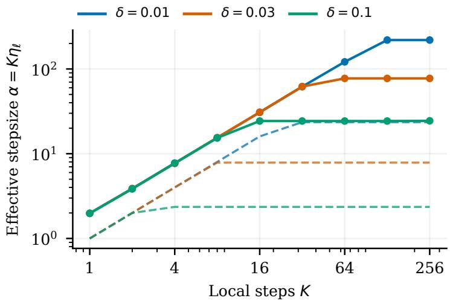  
Figure 3: Efective stepsizes $\alpha = K \eta _ { \ell }$ for the quadratic experiment in Figure 1. Dashed curves use the theoretical rule; solid curves show the tuned choices.

## F.4 Stepsize selection and reproducibility

Figure 3 shows how tuning permits larger efective stepsizes while retaining the similarity-dependent limit on local work.

The theoretical deterministic rule is

$$
\alpha _ { \mathrm { r e f } } = \frac { 1 } { \operatorname* { m a x } \{ L / K , 3 \sqrt { 2 } \delta \} } , \qquad \eta _ { \ell , \mathrm { r e f } } = \alpha _ { \mathrm { r e f } } / K .
$$

This is exactly the choice in the deterministic case following Theorem 1, yielding (15).

For each $( \delta , K )$ , we evaluate 40 logarithmically spaced values of α from $0 . 1 \alpha _ { \mathrm { r e f } }$ to $0 . 9 9 \alpha _ { \mathrm { m a x } } .$ , and include $\alpha _ { \mathrm { r e f } }$ explicitly. We then evaluate 20 additional interior logarithmic points between the neighboring grid values of the candidate with the earliest first target crossing, using a one-sided interval at an endpoint. This gives 61 candidates per setting. Each candidate uses a constant local stepsize $\eta _ { \ell } = \alpha / K$ and is evaluated for $H = 2 0 { , } 0 0 0$ rounds.

For the target $\varepsilon = 1 0 ^ { - 5 }$ , we score each candidate by

$$
R _ { \varepsilon } ^ { ( H ) } ( \alpha ) = \operatorname* { m i n } \{ r \in \{ 1 , \ldots , H \} : f ( { \bar { x } } ^ { s } ) - f ^ { \star } \leq \varepsilon { \mathrm { ~ f o r ~ a l l ~ } } s = r , \ldots , H \} .
$$

This criterion accounts for trajectories that cross the target and later exceed it. The plotted round counts exclude control initialization. We select the candidate with the smallest score, breaking ties toward smaller α. Candidates that do not reach the target within the horizon are excluded from selection.

We evaluate the exact common-coordinate formula and delayed recurrence, then compute the objective at the average of the server iterates $x ^ { 1 } , \ldots , x ^ { R }$ . We verify the selected averaged trajectories against explicit client updates for up to 200 rounds per setting.

## F.5 Neural-network experiments

## F.5.1 Experimental setup

Data and model. We use CIFAR-10 with 45,000 training images, 5,000 validation images (500 per class), and the oficial 10,000-image test set. The training set is split among $N = 1 0$ clients. The IID partition is a random equal-size split, so each client receives a sample from the same pooled empirical distribution. For the heterogeneous partition, we draw $\pi ^ { ( c ) } \sim \mathrm { D i r i c h l e t } ( 0 . 1 , \ldots , 0 . 1 )$ independently for each class c, where $\pi _ { i } ^ { ( c ) }$ is the fraction of that class assigned to client i. Small concentration favors allocations in which a few clients receive most examples of a class. We randomly shufle each class, round its allocation counts down, and assign the remaining examples to a randomly chosen client. This yields client sizes 8786, 10467, 3841, 3762, 809, 8996, 614, 2454, 1384, 3887. The split and partition seeds are both 2024; each partition is held fixed across methods, stepsizes, and training seeds. The two partitions preserve the pooled training set and the global objective while changing the local datasets. They test whether similar client data make local computation more efective. Data similarity motivates, but does not itself establish, the gradient-diference bounds in our assumptions; these runs do not estimate δ.

The CIFAR-style ResNet-18 has a $3 \times 3 ,$ stride-one input convolution, no initial max pooling, and four residua stages with two blocks each. We use GroupNorm with 32 groups in place of BatchNorm, random initialization, and no dropout or pretrained weights. GroupNorm computes normalization statistics separately for each example, so no running batch statistics need to be maintained or aggregated. BN-SCAFFOLD (Quintana et al., 2024) identifies drift in BatchNorm statistics as a separate dificulty for SCAFFOLD; our choice avoids introducing that issue into the comparison of local updates and aggregation. The architecture, preprocessing, and partitioning code are adapted from the S-DANE implementation<sup>2</sup>. Training uses random crops with padding four and random horizontal flips. Images are normalized channelwise with mean (0.4914, 0.4822, 0.4465) and standard deviation (0.2023, 0.1994, 0.2010).

Objectives and updates. Let $n _ { i }$ be the size of client i’s dataset and $n = \textstyle \sum _ { i } n _ { i }$ . Each client gradient is multiplied by $N n _ { i } / n$ , and endpoints and controls are averaged uniformly. Equivalently, $f _ { i } ( x ) = ( N n _ { i } / n ) \mathbb { E } [ \ell ( x ; \xi _ { i } ) ]$ where $\xi _ { i }$ samples a local image and its augmentation. Then $N ^ { - 1 } \sum _ { i } f _ { i }$ is the example-weighted global crossentropy objective.

All methods use 400 rounds, minibatches of $b = 6 4$ examples sampled with replacement, and a constant stepsize. We use no momentum, weight decay, clipping, or learning-rate schedule. Both SCAFFOLD variants initialize controls at the initial model using K minibatches per client. In each round, local steps use the stored controls, while new controls estimated at the round’s starting model become active in the next round. Averaging uses all client endpoints. Selection chooses one client uniformly before the local steps and uses its endpoint; all clients still estimate controls. The server stepsize is one. Minibatch SGD averages 2NK minibatch gradients at the same model before taking one update. It samples from the pooled training set, so its paired IID and Dirichlet runs give identical results and serve as the same baseline in both partitions.

Stepsize selection and evaluation. For each method, partition, and K, we select the stepsize with the smallest validation loss averaged over rounds 380, 385, 390, 395, 400 and two tuning seeds. Exact ties are resolved in favor of the smaller stepsize. The initial grid is {0.0003, 0.001, 0.003, 0.01, 0.03}. For IID averaging, the tested grid also includes {0.06, 0.1, 0.2, 0.3}. For both SCAFFOLD variants on the Dirichlet partition, it also includes {0.00003, 0.0001} at $K = 1 0 .$ , and {0.000003, 0.00001, 0.00003, 0.0001} at $K = 4 0$ . The grids were expanded using validation results; search budgets therefore difer across settings. All 80 candidate configurations were evaluated with both tuning seeds, and no selected stepsize lies at the boundary of its tested grid.

The tuning initialization/sampling seed pairs are (901, 1001) and (902, 1002). After selecting stepsizes, we evaluate them with seed pairs (1901, 2001), (1902, 2002), and (1903, 2003), paired across methods. Test metrics do not enter stepsize selection. Table 3 reports the round-400 server model, and all curves evaluate server models every five rounds. Training loss is clean-image cross-entropy on a fixed stratified 5,000-image training subset; validation and test metrics use their full splits, without random augmentation. Shaded bands are sample standard deviations across the three runs. Since the partitions are fixed, these bands describe training randomness rather than variation across client partitions. The evaluated server model difers from the random local output in Theorem 3.

Implementation. Training uses PyTorch 2.5.1, torchvision 0.20.1, CUDA 12.4, and NVIDIA H200 GPUs, with float32 computation and deterministic operations enabled.

## F.5.2 Additional training results

Table 3 summarizes the selected stepsizes and final accuracies for both local-step settings. Figure 4 gives the $K = 1 0$ learning curves, complementing the $K = 4 0$ results in Figure 2. On IID data, increasing K improves both SCAFFOLD variants at the same round budget. This benefit is absent on the heterogeneous partition. The

modest final diference between the two SCAFFOLD variants on Dirichlet data with $K = 4 0$ does not establish an advantage for selection.  
Table 3: Selected constant stepsizes and test accuracy at round 400. Accuracies are percentages, reported as mean ± sample standard deviation over three runs.
<table><tr><td>Partition</td><td>Method</td><td>K</td><td>Stepsize</td><td>Test accuracy (%)</td></tr><tr><td rowspan="6">IID</td><td>SCAFFOLD averaging</td><td>10</td><td>0.1</td><td> $7 1 . 6 8 \pm 1 . 6 5$ </td></tr><tr><td>SCAFFOLD selection</td><td>10</td><td>0.01</td><td> $5 3 . 1 4 \pm 3 . 1 8$ </td></tr><tr><td>Minibatch SGD</td><td>10</td><td>0.01</td><td> $3 7 . 2 5 \pm 3 . 7 4$ </td></tr><tr><td>SCAFFOLD averaging</td><td>40</td><td>0.2</td><td> $8 8 . 5 4 \pm 0 . 6 2 $ </td></tr><tr><td>SCAFFOLD selection</td><td>40</td><td>0.01</td><td> $7 8 . 7 3 \pm 0 . 5 1$ </td></tr><tr><td>Minibatch SGD</td><td>40</td><td>0.01</td><td> $3 5 . 8 8 \pm 2 . 2 5$ </td></tr><tr><td rowspan="6">Dirichlet 0.1</td><td>SCAFFOLD averaging</td><td>10</td><td>0.0003</td><td> $3 5 . 9 9 \pm 1 . 6 3$ </td></tr><tr><td>SCAFFOLD selection</td><td>10</td><td>0.0003</td><td> $3 0 . 1 6 \pm 4 . 3 6$ </td></tr><tr><td>Minibatch SGD</td><td>10</td><td>0.01</td><td> $3 7 . 2 5 \pm 3 . 7 4$ </td></tr><tr><td>SCAFFOLD averaging</td><td>40</td><td>0.00003</td><td> $3 0 . 3 4 \pm 1 . 1 8$ </td></tr><tr><td>SCAFFOLD selection</td><td>40</td><td>0.00003</td><td> $3 0 . 9 4 \pm 0 . 8 9$ </td></tr><tr><td>Minibatch SGD</td><td>40</td><td>0.01</td><td> $3 5 . 8 8 \pm 2 . 2 5$ </td></tr></table>

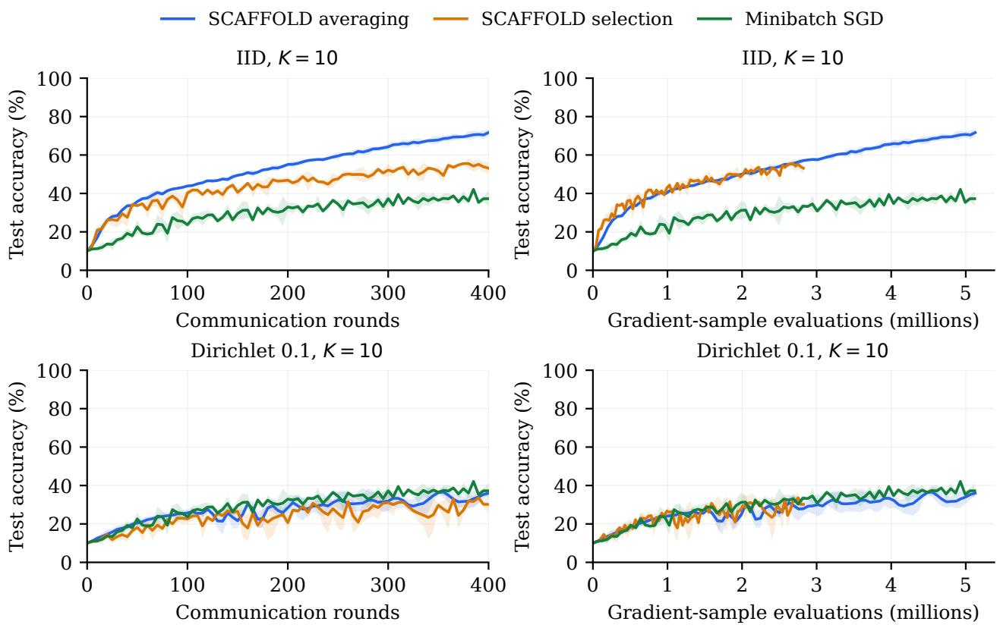  
Figure 4: Additional CIFAR-10 results for $K = 1 0 \colon$ server test accuracy versus communication rounds (left) and gradient-sample evaluations, including controls $( \mathrm { r i g h t } )$ . Curves show means and bands show sample standard deviations over three runs. Figure 2 and Figure 6 give the corresponding $K = 4 0$ results.

Training loss. Figure 5 shows that the IID advantage also appears in training loss: averaging reaches lower loss than selection and minibatch SGD for both values of K. On the Dirichlet partition, increasing K does not

produce the same improvement, and the SCAFFOLD curves exhibit occasional loss spikes. These results concern one architecture, one dataset, two fixed partitions, and a 400-round budget.

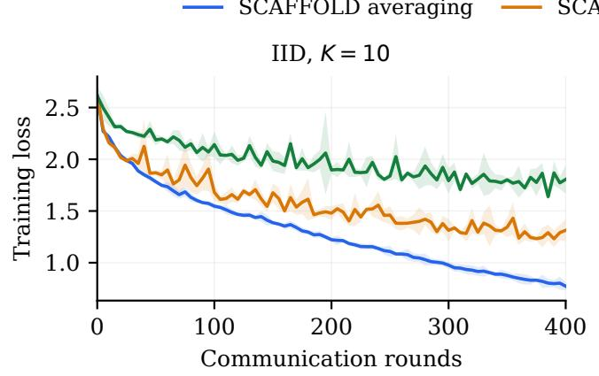

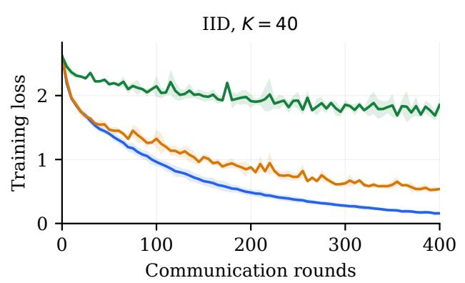

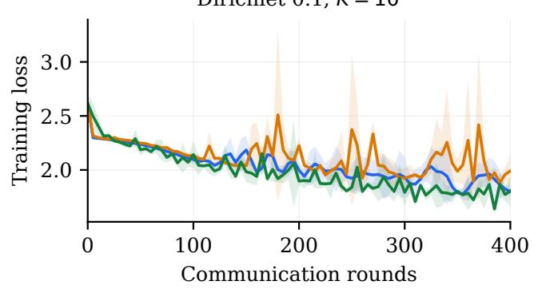

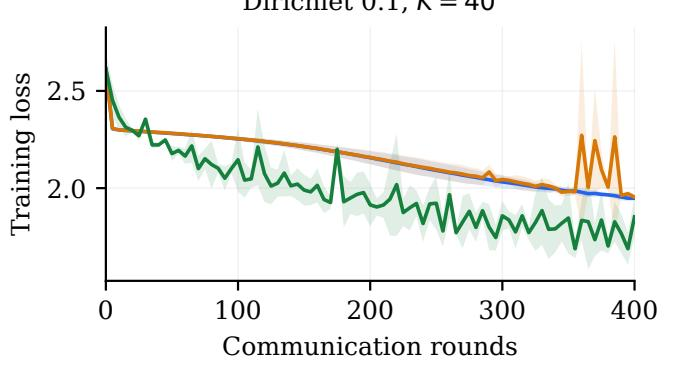  
Figure 5: Server training loss for K = 10 (left) and K = 40 (right), evaluated without augmentation on the fixed 5,000-image training subset. Curves show means and bands show sample standard deviations over three runs.

## F.5.3 Computation and communication costs

We count each example used in a gradient calculation, including control estimation and repeated draws. An ordinary round uses 2NKb such evaluations for averaging, (N + 1)Kb for selection, and 2NKb for minibatch SGD. Both SCAFFOLD variants also use NKb evaluations at initialization. Thus minibatch SGD matches averaging’s ordinary-round sample budget; selection uses less computation. Evaluation passes are excluded from these counts.

Figure 6 compares accuracy at the same computation budget for $K = 4 0 ,$ , complementing the communicationround comparison in Figure 2.

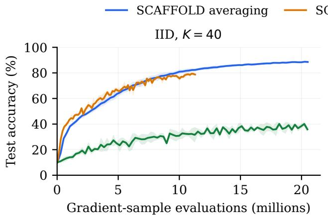

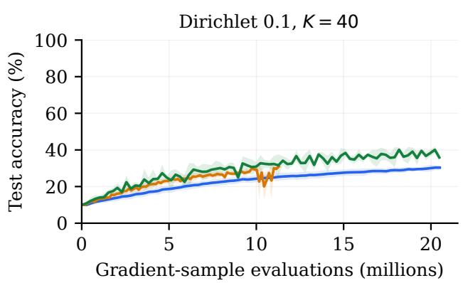  
Figure 6: CIFAR-10 with $K = 4 0 \colon$ server test accuracy versus gradient-sample evaluations, including controls, for IID (left) and Dirichlet (right) partitions. Curves show means and bands show sample standard deviations over three runs.

For communication volume, let P be the bytes in one model-sized vector. We count uncompressed uploads and downloads: averaging uses $4 N P R + 2 N P$ bytes over R rounds, selection uses $2 ( N + 1 ) P R + 2 N P$ , and minibatch SGD uses 2NPR. These counts refer to the server-output implementation used in the experiments, which does not return the additional sampled local iterate in Algorithm 2. The SCAFFOLD counts include initial contro estimation, model and control exchanges, and the returned endpoints. Here $P = 4 4 , 6 9 5 , 8 4 8$ bytes for 11,173,962 float32 parameters. This measures modeled tensor trafic. Clients are simulated sequentially, so runtime does not measure distributed communication latency.

## F.6 Trajectory diagnostics

We measure diferences between clients’ gradient changes along the $K \ : = \ : 4 0$ training trajectories from $\mathrm { A p - }$ pendix F.5. These measurements use the same selected stepsizes and three random seeds, with server models at rounds $0 , 2 0 , \ldots , 4 0 0$ . They do not enter stepsize selection.

Measurements. For each partition, we sample 256 training examples per client without replacement and take a nested subset of 128 examples. The subsets and each image’s crop and flip are fixed across models, methods, and seeds. Let $\widehat { \nabla } f _ { i } ( x )$ denote the gradient averaged over one such subset, including the objective weight $N n _ { i } / n$ used in training. For a displacement u, define

$$
a _ { i } ( x , u ) = \frac { \widehat { \nabla } f _ { i } ( x + u ) - \widehat { \nabla } f _ { i } ( x ) } { \| u \| } , \qquad \bar { a } ( x , u ) = \frac { 1 } { N } \sum _ { i = 1 } ^ { N } a _ { i } ( x , u ) .
$$

We compute four quantities:

$$
\begin{array} { l l } { \widehat { \delta } _ { \mathrm { a v g } } ( x , u ) = \displaystyle \left( \frac { 1 } { N } \sum _ { i = 1 } ^ { N } \| a _ { i } ( x , u ) - \bar { a } ( x , u ) \| ^ { 2 } \right) ^ { 1 / 2 } , \qquad } & { \widehat { \delta } _ { \mathrm { m a x } } ( x , u ) = \operatorname* { m a x } _ { \dot { a } } \| a _ { i } ( x , u ) - \bar { a } ( x , u ) \| , } \\ { \widehat { L } _ { \mathrm { l o c } } ( x , u ) = \operatorname* { m a x } _ { \dot { a } } \| a _ { i } ( x , u ) \| , } & { \widehat { L } _ { g } ( x , u ) = \| \bar { a } ( x , u ) \| . } \end{array}
$$

The first two measure averaged and uniform disagreement between local gradient changes; the last two measure local and global gradient sensitivity on the sampled data.

At each model, we use three normalized Gaussian directions and displacements of length $1 0 ^ { - 3 } \| x \|$ and $1 0 ^ { - 2 } \| x \|$ The directions are shared across all measurements, and the denominator uses the displacement represented in floating-point arithmetic. For each seed, we take the maximum over the three directions separately for each quantity, then report means and sample standard deviations over seeds. The maximizing direction can difer between quantities. The same examples and augmentations are used at x and $x + u ,$ so their gradient diference contains no fresh sampling between the two evaluations. These are finite gradient-diference measurements on sampled objectives, rather than estimates with guarantees for the global constants in our assumptions.

Partition and trajectory comparisons. Figure 7 shows the two disagreement measurements using 256 examples per client and relative radius $1 0 ^ { - 2 }$ . Minibatch SGD follows the same model trajectory in both partitions, allowing a comparison at the same model parameters. On this trajectory, both disagreement measurements are larger for the Dirichlet partition at every measured round, seed, radius, and subset size. This supports the distinction between the two partitions in terms of gradient changes. The comparison includes both their diferent class distributions and the objective weights induced by unequal client sizes.

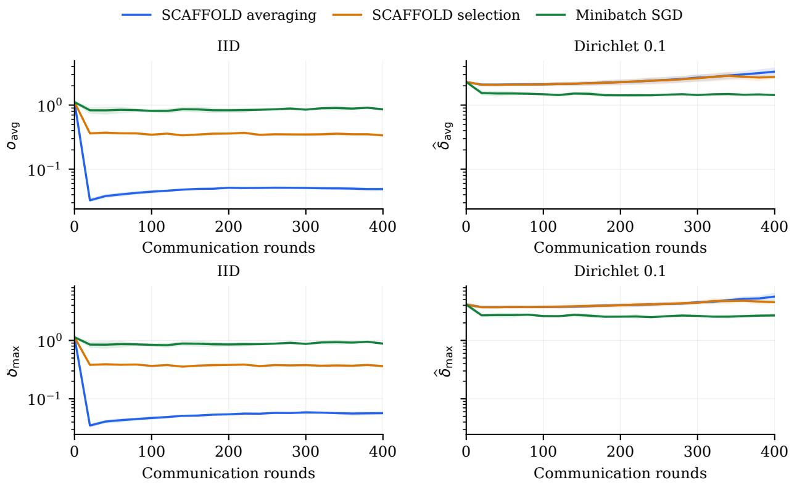  
Figure 7: Averaged and uniform gradient disagreement along the $K = 4 0$ trajectories, using 256 examples per client and relative radius $1 0 ^ { - 2 }$ . Curves show means of the three-direction maxima; bands show sample standard deviations over three runs. Vertical axes are logarithmic.

Comparison of similarity and smoothness measurements. Table 4 compares all four quantities at round 400, with relative radius $1 0 ^ { - 2 }$ and 256 examples per client. Figure 8 shows the corresponding ratios to local sensitivity, computed separately for each seed and then averaged.

Table 4: Gradient-diference measurements at round 400, with relative radius $1 0 ^ { - 2 }$ and 256 examples per client. Values are means ± sample standard deviations over three runs.
<table><tr><td>Partition</td><td>Method</td><td> $\widehat { \delta } _ { \mathrm { a v g } }$ </td><td> $\widehat { \delta } _ { \mathrm { m a x } }$ </td><td> $\widehat { L } _ { \mathrm { l o c } }$ </td><td> ${ \widehat { L } } _ { g }$ </td></tr><tr><td rowspan="3">IID</td><td>Averaging</td><td> $0 . 0 4 9 \pm 0 . 0 0 3$ </td><td> $0 . 0 5 7 \pm 0 . 0 0 3$ </td><td> $0 . 0 6 1 \pm 0 . 0 0 3$ </td><td> $0 . 0 1 7 \pm 0 . 0 0 1$ </td></tr><tr><td>Selection</td><td> $0 . 3 3 8 \pm 0 . 0 1 7$ </td><td> $0 . 3 6 3 \pm 0 . 0 1 9$ </td><td> $0 . 4 0 6 \pm 0 . 0 2 9$ </td><td> $0 . 1 6 4 \pm 0 . 0 2 6$ </td></tr><tr><td>Minibatch SGD</td><td> $0 . 8 6 0 \pm 0 . 0 3 6$ </td><td> $0 . 8 8 4 \pm 0 . 0 3 6$ </td><td> $1 . 0 1 3 \pm 0 . 0 1 8$ </td><td> $0 . 4 6 1 \pm 0 . 0 4 5$ </td></tr><tr><td rowspan="3">Dirichlet 0.1</td><td>Averaging</td><td> $3 . 3 2 2 \pm 0 . 5 5 1$ </td><td> $5 . 6 4 2 \pm 0 . 8 9 3$ </td><td> $7 . 7 1 5 \pm 2 . 3 2 8$ </td><td> $2 . 5 8 3 \pm 1 . 3 1 4$ </td></tr><tr><td>Selection</td><td> $2 . 7 4 5 \pm 0 . 1 5 6$ </td><td> $4 . 5 1 9 \pm 0 . 2 7 4$ </td><td> $5 . 5 6 7 \pm 0 . 6 8 7$ </td><td> $1 . 6 8 8 \pm 0 . 6 1 0$ </td></tr><tr><td>Minibatch SGD</td><td> $1 . 4 3 4 \pm 0 . 0 2 1$ </td><td> $2 . 6 8 0 \pm 0 . 1 6 8$ </td><td> $2 . 9 4 7 \pm 0 . 2 6 1$ </td><td> $0 . 5 1 3 \pm 0 . 0 5 3$ </td></tr></table>

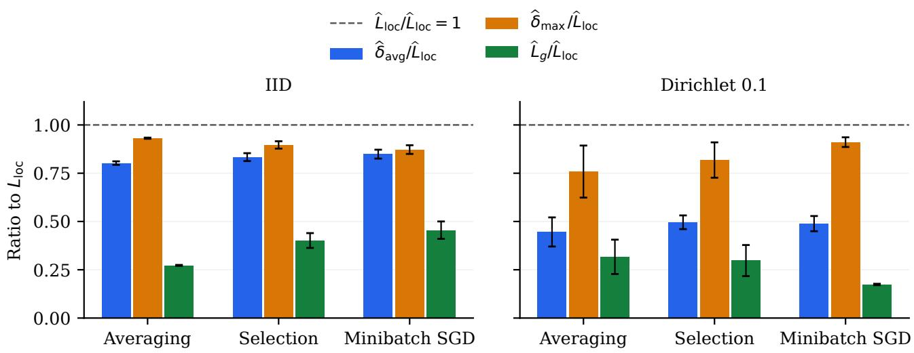  
Figure 8: Similarity and global sensitivity relative to local sensitivity at round 400, using relative radius $1 0 ^ { - 2 }$ and 256 examples per client. Bars show mean per-seed ratios and error bars show sample standard deviations over three runs. The dashed line represents $\widehat { L } _ { \mathrm { l o c } } / \widehat { L } _ { \mathrm { l o c } } = 1$

By definition, $\widehat { \delta } _ { \mathrm { a v g } } \leq \widehat { \delta } _ { \mathrm { m a x } }$ . The ratio $\widehat { \delta } _ { \mathrm { m a x } } / \widehat { \delta } _ { \mathrm { a v g } }$ ranges from 1.03 to 1.16 across methods on IID data, compared with 1.65 to 1.87 on Dirichlet data. Thus averaged and uniform similarity give closer measurements on the IID partition.

Global gradient sensitivity is also smaller than local sensitivity: $\widehat { L } _ { g } / \widehat { L } _ { \mathrm { l o c } }$ ranges from 0.17 to 0.46 across the six settings. Averaging gradient changes across clients can therefore substantially reduce their magnitude relative to the largest local change. This illustrates the distinction between the two smoothness quantities retained in our nonconvex upper bound.

On IID data, SCAFFOLD with averaging reaches models with smaller absolute disagreement, but their loca gradient sensitivity is also smaller. The ratio $\widehat { \delta } _ { \mathrm { a v g } } / \widehat { L } _ { \mathrm { l o c } }$ is $0 . 8 0 \mathrm { - } 0 . 8 5$ on IID data and 0.45–0.50 on Dirichlet data; $\widehat { \delta } _ { \mathrm { m a x } } / \widehat { L } _ { \mathrm { l o c } }$ remains 0.76–0.93 across both partitions. These measurements do not exhibit a regime of uniform disagreement much smaller than local sensitivity, and the absolute and relative comparisons need not give the same ordering. Since the methods also visit diferent models, these ratios alone do not explain averaging’s empirical advantage.

Sensitivity to radius and sample size. We repeat the measurements at both radii and nested subset sizes. With 256 examples per client, reducing the relative radius from $1 0 ^ { - 2 }$ to $1 0 ^ { - 3 }$ increases $\widehat { \delta } _ { \mathrm { a v g } }$ by a median factor of 2.86 over all measured models and seeds. Reducing the subset size from 256 to 128 increases it by a median factor of 1.31 at radius $1 0 ^ { - 2 }$ and 1.38 at radius $1 0 ^ { - 3 }$ . The ordering of the partitions on the minibatch-SGD trajectory persists in all four settings. Finite client samples, changes in ReLU activation patterns, and numerical precision can afect these measurements. In particular, they neither certify the similarity assumptions for the neural network nor identify the constants governing the theoretical rates.