# SHARED CONTEXT, SEPARATE ENGINES: STREAMING VISION–LANGUAGE INFERENCE ON EDGE SOCS

Yilong Li 1 Chengpo Yan 1 Yijing Zeng 2 Hanlei Wu 3 Mingjun Song 1 Suman Banerjee 1

Code: https://github.com/jimmy-yilong-li/CrossInfer

## ABSTRACT

Edge SoCs pack CPUs, GPUs, and NPUs, yet vision–language model (VLM) runtimes keep generation on one engine and leave the others idle. Streaming VLMs expose further parallelism: new frames arrive while earlier queries are still being answered. Engines differ in compute and memory access and contend when they co-run, so no single placement of stages wins across SoCs and workloads. Backend-local KV state keeps other engines from continuing the work. CrossInfer coordinates heterogeneous accelerators to execute stateful VLM inference concurrently. It separates a stream’s versioned context from each engine’s KV state, so any engine can continue the stream by reusing, importing, or reconstructing that state. Stateful Streaming Generation ingests new frames on one engine while another answers, and Concurrent Sequence Generation serves different ready requests in parallel. State-aware dispatch sends each request to the engine expected to finish it first. Each answer reads a fixed, published version of its history and matches its serial reference. CrossInfer beats the strongest single-engine baselines on Apple M4 Max, Rockchip RK3588, and Qualcomm QCS6490, even when they reuse context. On two RK3588 video streams, it delivers 19.6% more throughput than the best single engine with context reuse and 27.2% more than parallel engines without shared state. Cross-engine KV import cuts first-token latency by a factor of 4.6 over prefix recomputation. Stateful Streaming Generation delivers up to 2.48× the throughput of serial execution, and state-aware dispatch cuts query completion time by up to 72.7%.

## 1 INTRODUCTION

Open vision–language models (VLMs) (Liu et al., 2023; 2024b; Li et al., 2025; Marafioti et al., 2025; Wang et al., 2024; Bai et al., 2025b;a; Qwen Team, 2026) bring visual question answering to robots, wearable assistants, and other edge devices. Local inference keeps visual data on-device and avoids dependence on cloud connectivity (Li et al., 2026; Wan et al., 2024). Despite integrating CPUs, GPUs, and neural accelerators, edge SoCs often rely on a single engine for VLM language execution. In streaming VLM inference (Niu et al., 2025), one engine can extend the video context with new observations while another answers from an earlier, consistent version of that history. Ready queries can also execute concurrently, whether they share the same visual history or belong to separate streams.

VLM efficiency depends on how engines cooperate, not just their standalone performance. Despite sharing physical memory, engines differ in compute and effective memoryaccess performance: batch-one decoding favors the M4 Max GPU but the RK3588 CPU (Figure 3). Co-running changes these trade-offs again: on M4 Max, a second language engine can increase throughput by up to 29% or reduce it by 45%, and M4 Max and RK3588 favor opposite prefill/generation regimes (Figure 8). Separating vision and language execution gives CrossInfer 29.6% higher throughput than GPU-only MLX (Hannun et al., 2023) on a 64-frame video (Table 1).

Cooperation also depends on where the required context resides. Context reuse (Gim et al., 2024; Zheng et al., 2024) avoids recomputing history within one runtime, but each backend keeps that history in its own KV layout and positional metadata. NanoMind (Li et al., 2026) hands visual tokens between processors on a custom board; its handoff does not cover this language state. An idle engine must import or reconstruct the context it lacks. A busy engine that holds it may therefore finish a query sooner, although longer queues can reverse this advantage. Ingestion must also preserve the history each ongoing answer reads.

CrossInfer runs stateful VLM inference across heterogeneous accelerators (Figure 1). It decouples logical context from engine-specific KV state: a stream’s history is a sequence of published context versions, and each engine reuses, imports, or reconstructs its own representation of a version, so several engines can work on the same history at once. In Stateful Streaming Generation, one engine extends the stream’s context while another generates from an earlier version with private generation state. In Concurrent Sequence Generation, CPU and GPU backends serve different ready requests. NPU visual encoding overlaps language execution in both modes, with engine roles set by each platform’s stage costs, and a dispatcher places each ready request by its estimated completion time, which depends on where its state resides and on co-running interference.

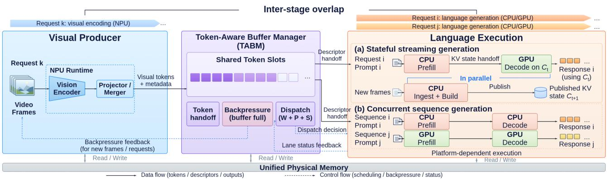  
Figure 1. Overview of CrossInfer. (a) Stateful Streaming Generation: One engine ingests new observations while another generates responses from published context, using state handoff. (b) Concurrent Sequence Generation: CPU and GPU execute ready requests in parallel, with state-aware dispatch based on queued work, context preparation, and co-running performance.

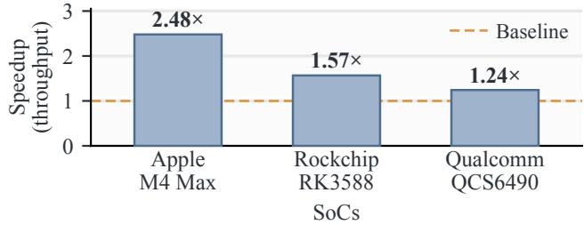  
Figure 2. CrossInfer’s request throughput over serial execution, ingesting new frames on one engine while another answers; every answer matches its serial reference. On QCS6490, serial execution already reuses context.

We implement CrossInfer on three edge SoCs, Apple M4 Max, Rockchip RK3588, and Qualcomm QCS6490 (Section 4). On M4 Max, overlapping vision with language execution raises FastVLM-1.5B (Vasu et al., 2025) request throughput by up to 23% and cuts mean time to first token by 22% relative to GPU-only MLX with context reuse. Across four Qwen3.5 models from 0.8B to 9B, the same overlap raises throughput by up to 72.4% over serial execution with context reuse. CrossInfer also serves a single Qwen2.5-VL-3B request with 23.6% less energy than llama.cpp (Gerganov, 2023). On RK3588, serving ready requests on the CPU and GPU concurrently raises request throughput by 36.3% over GPU-only execution at eight streams and by up to 52.0% over serial OpenCL (The Khronos Group, 2026) execution. With context reuse and ingestion during generation, Stateful Streaming Generation achieves 2.48× the throughput of serial execution without context reuse on M4 Max and 56.7% more on RK3588 (Figure 2), with up to 70.8% lower mean time to first token. On QCS6490, ingestion during generation alone adds 24.3%. Both modes beat the best single engine by up to 37.2% for additional VLMs (Li et al., 2025; Vasu et al., 2025) on RK3588 and on QCS6490, which also encodes every frame on its NPU.

Cross-engine state sharing adds gains beyond context reuse. Stateful Streaming Generation exceeds GPU-only execution with context reuse by up to 59.4%, while every answer matches its serial reference. With two video streams on RK3588, CrossInfer outperforms two engines without shared state by 27.2% and the best single engine with context reuse by 19.6%, and cuts time to first token by 34.9%. Importing another engine’s KV state brings the first token 4.6× sooner than recomputing the prefix. State-aware dispatch picks the faster engine in all nine RK3588 history and backlog settings, cutting query completion time by up to 72.7% relative to always using the idle engine (Figure 9).

This paper makes three contributions:

• Cross-accelerator execution of stateful VLM inference. We unify stage overlap and request concurrency in one execution model for heterogeneous edge accelerators.

• Shared context with cross-accelerator state continuation. Versioned context and explicit token and state interfaces let any engine continue a stream’s history, and every answer matches its serial reference.

• Architecture- and state-aware execution. We show how stage costs and co-running interference, which differ across SoCs, determine which engines to combine. State-aware dispatch places each request on the engine expected to finish it first.

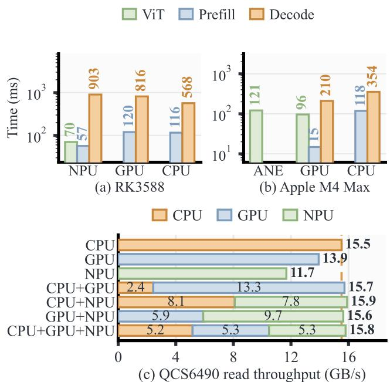

## 2 BACKGROUND AND MOTIVATION

## 2.1 VLM Inference on the Edge

Edge VLMs often run on a single accelerator although modern SoCs offer several. GPU-only MLX, for example, keeps the M4 Max GPU 85–99% busy while the Apple Neural Engine (ANE) (Apple, 2022) sits idle (Table 1). Yet VLM stages favor different engines: the fastest decode engine differs by SoC (Figure 3), and on RK3588 generating 32 tokens takes 568–903 ms across engines against 70 ms for CLIP (Radford et al., 2021) ViT-B/32 encoding on the NPU. Prior work separates LLM prefill and decoding (Patel et al., 2024; Zhong et al., 2024) or exploits heterogeneous processors (Xu et al., 2025; Xue et al., 2024; Chen et al., 2025), and NanoMind (Li et al., 2026) pairs a custom board with a commodity SoC for cross-accelerator VLM inference. Shared memory (Apple, 2020) does not make one engine’s state usable by another: each runtime keeps its own buffers and KV-cache layout.

Engines also interfere when they run together: co-running slows RK3588 CPU and Mali GPU (Arm, 2026d) decoding by 26% and 11% (Figure 8(c)). On QCS6490, co-running engines share about 16 GB/s of read bandwidth unevenly: with CPU and GPU active, the GPU keeps 13.3 GB/s while the CPU falls from 15.5 to 2.4 GB/s (Figure 3(c)). On Snapdragon 8 Gen 3 (Qualcomm Technologies, Inc., 2026e), HeteroInfer (Chen et al., 2025) reports that running the GPU and NPU together raises aggregate decoding bandwidth from 40–45 to about 60 GB/s, so bandwidth sharing is itself platform-specific.

## 2.2 Streaming Applications

Streaming VLMs expose parallelism that single-engine execution leaves unused. In online video understanding (Niu et al., 2025), new frames continuously extend the video context while queries refer to the history accumulated so far. On one engine, ingestion and generation compete for the same execution capacity, so each delays the other. Yet later frames could be encoded and ingested while an earlier query is answered. Queries with ready context can also execute concurrently, whether they share a video history or belong to separate streams. Exploiting this parallelism requires managing context that evolves throughout the session. Each answer must read a consistent version of the history, even as new frames arrive, while concurrent answers maintain independent generation state. Pausing ingestion sacrifices overlap, whereas copying the full history for each answer wastes memory. Execution on another engine requires im-

Figure 3. Per-stage VLM latency on (a) RK3588 and (b) Apple M4 Max for one image (ViT (Dosovitskiy et al., 2021)) and 32 tokens (prefill and decode), shown on a log scale. RK3588 runs CLIP ViT-B/32 and Qwen2.5-0.5B-Instruct (Yang et al., 2024b); M4 Max runs Qwen2.5-VL-3B (Q4 K M) with Core ML (Apple Inc., 2026) vision on the ANE. (c) QCS6490 effective read throughput for 256 MiB inputs, with the dashed line marking CPU-only throughput (Appendix F).

porting compatible KV state or reconstructing it through prefill, so placement depends on context availability as well as engine load (Srivatsa et al., 2025).

## 3 DESIGN

Edge SoCs enable VLM cooperation at three levels: assigning stages to suitable engines, executing engines concurrently, and coordinating a stream’s state across engines. CrossInfer lets engines continue from shared, versioned context. Context dependencies determine readiness; engine costs and state availability determine placement.

## 3.1 Execution Model

A stream supplies observations in temporal order, each an image or a group of video frames. Visual encoding turns an observation into embeddings, prefill ingests them into the language-model context, and decoding answers a query from the history it needs. Each completed history is published as a context version: we write $f _ { t }$ for the t-th observation, $C _ { t }$ for the version that ends with it, and $Q _ { t }$ for a query bound to $C _ { t }$ . A language runtime worker bound to one engine forms a language lane, which keeps its own KV state and runs prefill and decoding for the work assigned to it. CrossInfer arranges lanes in two ways (Figure 4), and NPU visual encoding overlaps language execution in both.

Stateful Streaming Generation. One lane ingests new observations and publishes each context version while another lane answers from a published version. In Figure 4(a), the CPU builds $C _ { t + 1 }$ as the GPU decodes $Q _ { t }$ on $C _ { t }$ . Section 3.5 describes how each platform assigns these roles. The same pipeline serves successive single-image requests: the first lane prefills the next request while the second decodes the current one.

Concurrent Sequence Generation. CPU and GPU lanes execute ready requests concurrently. Requests bound to the same published context reuse its history while maintaining private generation state. In Figure 4(b), the CPU reuses $C _ { t }$ locally while the GPU imports the same version; each performs its own query prefill and decoding. Requests within a stream may bind different versions, while separate streams maintain independent histories. Each request runs on one lane, with parallelism arising from overlapping requests. Both modes operate within one serving session: ingestion advances stream context while CPU and GPU lanes answer ready queries from the same or other streams.

## 3.2 Context Evolution

CrossInfer separates a stream’s growing history from the state of each answer. By default, a query binds the version ending with the last observation before it: a query arriving after $f _ { t }$ binds $C _ { t }$ and waits for its publication if $f _ { t }$ is still being ingested. While $Q _ { t }$ is answered, new observations build $C _ { t + 1 } ; Q _ { t }$ keeps reading $C _ { t }$ and writing its own private suffix, and later queries bind the newer version. An answer therefore never sees observations that arrived after its query, and publishing a later version never disturbs the prefix or token positions of an answer in progress. Versioning keeps ingestion moving without locking the shared history for the duration of an answer or copying it in full for each response. Versions identify logical history, while KV caches and positional metadata are its backend-specific representations, so moving an answer to another engine changes only the representation. An answer fed back as input joins a later context update before dependent work runs. Each answer thus matches a serial execution that ingests its bound history in order and decodes the query on the same engines with the same model and decoding settings, which Section 5 uses as the serial reference.

## 3.3 Data and Context Coordination

Token interface. Visual tokens cross runtimes at the projector or merger output, together with model-specific metadata (Liu et al., 2024a; Li et al., 2025; Wang et al., 2024; Bai et al., 2025b). Cross-attention models (Alayrac et al., 2022) connect visual features to attention layers, and Qwen3-VL’s

DeepStack (Bai et al., 2025a) additionally injects them into intermediate language layers. CrossInfer uses the Token-Aware Buffer Manager (TABM) (Li et al., 2026) to hand these tokens to multiple language consumers through shared descriptors; each consumer binds the payload in place or copies it into storage its runtime accepts.

State interface. Once a request binds a version, its lane makes that version available in one of three ways, each with its own context-preparation cost. Reuse forks state the lane already holds, so answers share computed history while each advances its own suffix. Import continues from state that another backend computed, as the GPU does in Figure 4(b), at the cost of a transfer that grows with the history; it needs a compatible KV representation on both sides, which depends on the backend pair. Rebuilding recomputes the language prefill from retained visual embeddings and text, skipping vision, and keeps every engine able to continue a stream when no compatible state exists. The interface carries the KV state and positional metadata needed to continue, and reuse requires a matching prefix, token positions, model configuration, and representation. These costs are the context-preparation term of the dispatcher’s estimate (Section 3.4). For hybrid models such as Qwen3.5 (Qwen Team, 2026), a response forks from the current published version, sharing its attention KV prefix but keeping its own recurrent state, which cannot be cut back to a shorter prefix (Pan et al., 2025). A response holds its bound prefix until it finishes and owns its generated suffix; Appendix E describes failure handling.

Buffer backpressure. A TABM slot is shared by its consumers and is released after all of them and any dependent reconstruction finish. Admission bounds requests in flight, outstanding context updates per stream, and retained state per lane, and a full token buffer pauses visual production.

## 3.4 Dispatch and Overlap

Placement works at two levels: the deployment fixes stage roles per platform (Section 3.5), and the dispatcher sends each ready request to a lane, combining context location with lane status. Idle-lane dispatch ranks available lanes by observed service time; state-aware dispatch also weighs queued work and context preparation on busy lanes.

State-aware dispatch. The state interface tells the dispatcher which continuation paths each lane can use and what they cost. For a ready request $r ,$ the dispatcher estimates its completion time on each lane ℓ that can serve it:

$$
T ( \ell , r ) = W _ { \ell } + P _ { \ell } ( r ) + S _ { \ell } ( r ) ,
$$

where $W _ { \ell }$ is the remaining time of ${ \boldsymbol { \ell } } { \boldsymbol { \mathrm { { s } } } }$ running and queued work, $P _ { \ell } ( r )$ is the cost of the cheapest path that makes $r { } _ { \mathrm { ~ s ~ } }$ bound context available on ℓ (zero if ℓ already holds it), and $S _ { \ell } ( r )$ is the time to prefill the query and generate the response. Service-time estimates use moving averages of measurements taken while the lanes run together, so they track current interference. The request goes to the lane with the smallest estimate. An idle lane therefore loses to a busy one whenever waiting is predicted to finish sooner, because the busy lane holds the history or runs faster. Section 5.6 measures these choices, and Appendix G.4 evaluates the policy with retained context replicas. The runtime schedules work at backend submission and completion boundaries, without tensor-level scheduling across backends.

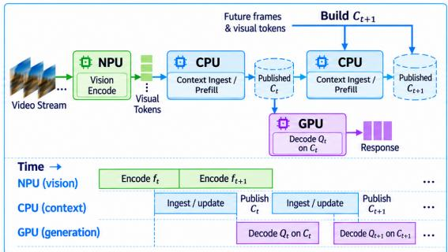  
(a) Stateful Streaming Generation

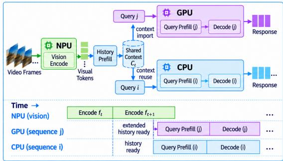  
(b) Concurrent Sequence Generation  
Figure 4. Execution modes in CrossInfer. (a) The CPU builds $C _ { t + 1 }$ while the GPU answers $Q _ { t }$ from the published $C _ { t } .$ . (b) Two lanes answer different queries over $C _ { t } \mathrm { : }$ the CPU reuses it in place and the GPU imports it.

Inter-stage overlap. Once a visual payload is published, the NPU encodes later observations while the language lanes consume completed inputs. Steady-state throughput follows the slower of the visual and language paths when they co-run. Offloading vision frees the GPU for language execution.

## 3.5 Engine Backends

The deployment picks each platform’s roles from stage profiles, the ingestion rate, state-handoff cost, and co-running interference. CPU-to-GPU handoff suits platforms where GPU decoding is faster and CPU prefill keeps pace with incoming observations; GPU-to-CPU handoff suits platforms where stage costs favor GPU prefill and CPU decoding.

On Apple M4 Max, the ANE or the GPU encodes vision; in Stateful Streaming Generation, the CPU ingests frames and the Metal (Apple, 2026b) lane, which retains history across queries, imports each bound version to answer. On RK3588 and QCS6490, the NPU encodes vision and the CPU and GPU form the two language lanes: in Concurrent Sequence Generation each lane serves its own requests, and in Stateful Streaming Generation the GPU extends the stream’s history while the CPU imports the bound version to answer. Appendix B gives the backend details.

## 4 IMPLEMENTATION AND EXPERIMENTAL SETUP

Hardware platforms. We evaluate CrossInfer on three devices, each built around a heterogeneous edge SoC: (1) a Mac Studio (Apple, 2025) with an Apple M4 Max SoC (Apple, 2024), featuring a 16-core Apple Neural Engine (Apple, 2022), a 40-core GPU, and 64 GB of unified memory; (2) an Orange Pi 5 Ultra (Orange Pi, 2026) board with a Rockchip RK3588 SoC (Rockchip Electronics Co., Ltd., 2025), comprising four Cortex-A76 (Arm, 2026b) and four Cortex-A55 (Arm, 2026a) CPU cores, a Mali-G610 GPU (Arm, 2026d), and a 6 TOPS NPU; and (3) a Rubik Pi 3 (Thundercomm America Corporation, 2026; Qualcomm Technologies, Inc., 2026d) board with a Qualcomm QCS6490 SoC (Qualcomm Technologies, Inc., 2025), comprising four Cortex-A78 (Arm, 2026c) and four Cortex-A55 CPU cores, an Adreno 643 GPU (Qualcomm Technologies, Inc., 2026b), and a 12 TOPS Hexagon NPU (Qualcomm Technologies, Inc., 2026c). NPU inference uses Core ML or our compiled ANE backend (Appendix A) on M4 Max, RKN-N/RKNPU2 (Rockchip, 2026) on RK3588, and QNN (Qualcomm Technologies, Inc., 2026a) on QCS6490. On M4 Max, ggml (ggml-org, 2026) runs language inference on the CPU and, through Metal, on the GPU, and MLX (Hannun et al., 2023) encodes vision on the GPU. MNN (Jiang et al., 2020) runs CPU and OpenCL GPU inference on RK3588 and QCS6490.

Vision–language models. Our primary model is Qwen2.5- VL-3B-Instruct (Bai et al., 2025b). We additionally evaluate LLaVA-OneVision (OneVision) (Li et al., 2025), built on Qwen2 (Yang et al., 2024a), at 0.5B and 7B, FastVLM (Vasu et al., 2025) at 0.5B and 1.5B, and Qwen3.5 (Qwen Team, 2026) at 0.8B, 2B, 4B, and 9B. We use OneVision-0.5B for the main RK3588 streaming, context-reuse, and dispatch experiments. OneVision-7B and FastVLM-0.5B run both execution modes on RK3588; OneVision-0.5B and both FastVLM models run them on QCS6490. We use Qwen3.5 to evaluate inter-stage overlap across model scale on M4 Max. The models exercise different visual frontends, positional metadata, and language backends through the same token and state interfaces.

## 5 EVALUATION

Our evaluation examines whether cross-accelerator execution outperforms the strongest single-engine baselines, how cross-engine state sharing contributes to performance, and why architecture-aware placement matters.

## 5.1 Methodology

Baselines and metrics. On M4 Max, we compare against MLX (Hannun et al., 2023) and llama.cpp (Gerganov, 2023) on the GPU. Other comparisons run CrossInfer’s own pipeline on the same backends: single-lane baselines show the benefit of using both engines, and ablations isolate the contributions of context reuse, overlap, handoff, and dispatch. Video-MME (Fu et al., 2025) provides multi-frame video inputs, and we replay the timestamped online-video queries of OVO-Bench (Niu et al., 2025) as live streams. Time to first token (TTFT) runs from request arrival to the first emitted token and includes queueing, preprocessing, visual execution, handoff, and prefill. Aggregate end-to-end (E2E) throughput divides the tokens generated across all lanes by the wall-clock time from first arrival to last completion. Request throughput counts completed requests per second over the same interval, and frame throughput counts processed frames per second.

Measurement protocol. Measurements start after model loading, compilation, and backend initialization, and each stage is timed until its output is ready. Appendix B gives run counts, generation caps, and statistics.

## 5.2 End-to-End Performance

Concurrent video streams. On two concurrent eight-frame RK3588 streams with on-device NPU visual encoding, the two execution modes with online dispatch raise request throughput by 19.6% and cut mean and p95 TTFT by 34.9% and 36.4% over the best single lane with context reuse (Figure 9(c,d)). Against Naive Parallelism, which runs both lanes without shared state, the throughput gain reaches 27.2% (Appendix G.10).

Single requests. For a single Qwen2.5-VL-3B request on M4 Max, CrossInfer uses 23.6% less CPU, GPU, and ANE energy than llama.cpp (Appendix B). It reaches the first token in 227 ms, versus 244 ms for MLX and 255 ms for llama.cpp, and delivers up to 14.9% higher E2E throughput (Figure 5). CrossInfer prefills text and visual tokens in one pass instead of the three passes of llama.cpp, reading visual embeddings directly from the shared handoff buffer. This reduces prefill latency by up to 28.5% and TTFT by up to 14.2% over separate prefills (Appendix B).

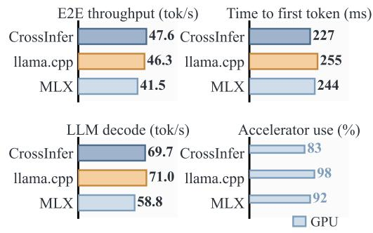  
Figure 5. Single request on Apple M4 Max for FP16 Qwen2.5-VL-3B. CrossInfer uses Core ML on the ANE for vision and ggml on Metal for language; the baselines run on the GPU.

Multi-frame inputs. Longer video inputs give CrossInfer more visual work to overlap with generation. CrossInfer completes Video-MME (Fu et al., 2025) inputs faster than MLX from 16 frames onward (Table 1). Across the input sizes, ANE utilization rises from 27% to 91%, while GPU utilization falls from 80% to 13%. At 64 frames, CrossInfer finishes in 16.60 s instead of 21.51 s, a 29.6% throughput gain over MLX, which keeps the GPU saturated.

Inter-stage overlap. CrossInfer raises FastVLM-1.5B request throughput by up to 23% over GPU-only MLX (Table 1(b)). Against the same path run serially, overlap raises throughput by up to 32.0%. CrossInfer also beats GPU-only ggml at both answer lengths while using 10% less peak resident memory (Table 1(b)). On a longer, 64-frame stream at 1 fps, CrossInfer lowers mean TTFT to 245 ms, 11.7% below the faster GPU-only pipeline and 19.1% below GPUonly MLX (Table 1(c)).

Across four Qwen3.5 models from 0.8B to 9B, overlap raises request throughput over serial execution with context reuse by up to 72.4% for 32-token answers and up to 23.9% for 128-token answers. Predictions made before the 64-token runs match all four measured times within 1.3% (Appendix C). Descriptor handoff and overlap raise frame throughput on a 16-frame Qwen2.5-VL-3B stream from 1.57 to 2.89 fps, 1.83× sequential split execution with byte transfer, at an unchanged decode rate (Appendix C).

## 5.3 Stateful Streaming Generation

Reuse and ingestion during generation. On an eightframe, four-query RK3588 stream where the GPU ingests frames while the CPU answers (Figure 6(b)), Stateful Streaming Generation exceeds CPU-only and GPU-only execution with context reuse by 11.6% and 37.2% in request throughput, and serial execution without context reuse by 56.7% with a 47.7% lower mean TTFT (Figure 6(a)).

Table 1. CrossInfer versus GPU-only execution on Apple M4 Max. (a) Video-MME (Fu et al., 2025) with 150 generated tokens per run; input is frames @ fps. (b) FastVLM-1.5B on an eight-frame, eight-query stream with retained KV; Serial is CrossInfer’s path without overlap. (c) All four configurations serve 0.126 req/s. Bold marks the better result.  
(a) Video-MME
<table><tr><td rowspan="2">Input</td><td colspan="2">MLX</td><td rowspan="2"></td><td colspan="2">CrossInfer</td></tr><tr><td>Time↓ (s)</td><td>E2E↑ GPU (tok/s) (%)</td><td>Time↓ (s) (tok/s)</td><td>E2E↑ GPU ANE (%) (%)</td></tr><tr><td>2 @ 0.5 4@1</td><td>2.21</td><td>67.87</td><td>85</td><td>2.34</td><td>64.10 80 27</td></tr><tr><td>8 @ 2</td><td>2.85</td><td>52.63</td><td>89</td><td>3.23</td><td>46.44 70 43</td></tr><tr><td>16 @ 4</td><td>3.86</td><td>38.86</td><td>93</td><td>4.19 35.80</td><td>55 56</td></tr><tr><td></td><td>6.33</td><td>23.70</td><td>93</td><td>6.10 24.59</td><td>37 76</td></tr><tr><td>32 @ 4</td><td>10.96</td><td>13.69</td><td>98</td><td>9.94</td><td>15.09 23 85</td></tr><tr><td>64 @ 8</td><td>21.51</td><td>6.97</td><td>99</td><td>16.60 9.04</td><td>13 91</td></tr></table>

(b) FastVLM-1.5B stream
<table><tr><td>Configuration</td><td>req/s (SD)↑</td><td>TTFT (ms)↓</td><td>RSS (GiB)</td></tr><tr><td colspan="4">32 tokens per answer</td></tr><tr><td>GPU-only ggml</td><td>3.2780 (0.0149)</td><td>1294</td><td>2.039</td></tr><tr><td>GPU-only MLX</td><td>3.3322 (0.0123)</td><td>1273</td><td>1.289</td></tr><tr><td>Serial</td><td>3.1044 (0.0269)</td><td>1305</td><td>1.780</td></tr><tr><td>CrossInfer</td><td>4.0976 (0.0365)</td><td>994</td><td>1.826</td></tr><tr><td colspan="4">128 tokens per answer</td></tr><tr><td>GPU-only ggml</td><td>1.3821 (0.0069)</td><td>2757</td><td>2.052</td></tr><tr><td>GPU-only MLX</td><td>1.4347 (0.0058)</td><td>2647</td><td>1.285</td></tr><tr><td>Serial</td><td>1.3394 (0.0057)</td><td>2787</td><td>1.842</td></tr><tr><td>CrossInfer</td><td>1.5059 (0.0065)</td><td>2458</td><td>1.841</td></tr></table>

(c) FastVLM-1.5B, 64 frames at 1 fps
<table><tr><td></td><td>GPU ggml</td><td>GPU MLX</td><td>Serial</td><td>CrossInfer</td></tr><tr><td>TTFT (ms)↓</td><td>277</td><td>302</td><td>300</td><td>245</td></tr></table>

On M4 Max, where the CPU ingests and the Metal GPU answers, it delivers 2.48× the request throughput of serial execution with a 70.8% lower mean TTFT, and 7.9% more request throughput than Metal-only execution with context reuse (Appendix G.1). Ingestion during generation adds 15.6% on top of context reuse on RK3588 and 12.2% on M4 Max.

Across models and SoCs. With GPU ingestion and CPU answering, this mode outperforms the best single lane for every model on RK3588 and QCS6490, by up to 22.4% (Figure 8(d)). For OneVision-7B, prefilling the next frame during the CPU’s answer brings the second query’s first token 11.0 s earlier than CPU-only execution. On QCS6490, which runs the whole pipeline including Hexagon NPU encoding and GPU-to-CPU state handoff, ingestion during generation alone adds 20.8–24.3% throughput over serial execution with context reuse (Appendices G.7 and G.8).

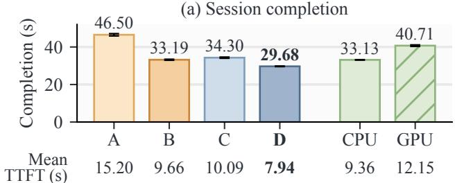

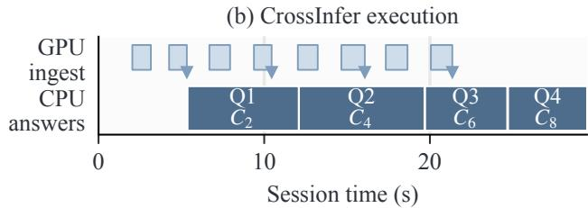  
Figure 6. Stateful Streaming Generation on RK3588. A–D: neither mechanism, ingestion during generation only, context reuse only, and both (CrossInfer). (a) Session completion time, with mean TTFT listed below; error bars show SD. (b) Execution trace with each query’s bound version; triangles mark context readiness.

Context reuse across queries. Across four queries sharing a visual prefix, reuse delivers 2.34× the throughput of recomputing the prefix on M4 Max and 2.79× on RK3588, as visual encoding and common-prefix preparation run once instead of four times (Appendix G). The benefit extends to larger VLMs: on the RK3588 CPU, reuse raises request throughput 2.89× for Qwen2.5-VL-3B and 1.90× for OneVision-7B, whose later queries start answering in about 1 s.

## 5.4 Concurrent Sequence Generation

Concurrent execution raises two-stream throughput on M4 Max by 25.7% over serial execution and cuts median TTFT from 1.75 to 1.45 s. With more streams, the gain grows to 29.1% (Figure 7(a,b)). On RK3588, the CPU and GPU lanes together deliver 36.3% higher request throughput than GPU-only at eight concurrent streams and cut p95 latency by 27.8% (Figure 7(c,d); Appendix G.5). Across two to sixteen streams, the gain over serial OpenCL execution reaches 52.0%. With four simultaneous requests, the two lanes raise throughput over the best single lane by 27.4% for OneVision-7B and 37.2% for FastVLM-0.5B on RK3588, and by 14.4–17.2% for all three models on QCS6490 with on-device vision (Figure 8(d)).

## 5.5 When a Second Language Lane Pays Off

The profitable CPU–GPU combination depends on the balance between prefill and generation, and M4 Max and RK3588 favor opposite regions (Figure 8). On M4 Max, adding the CPU lane helps six of nine configurations, by up to 29.3% with short prefill and moderate generation, but costs 44.8% at 1024 prefill tokens and eight output tokens. For Qwen2.5-VL-3B, Metal prefills 8.0× faster than the CPU but decodes only 1.7× faster. A lane that is slower at every stage still pays off when its co-running throughput exceeds what it takes from the faster lane: with a retained 1024-token history, the two lanes decode 33.9% faster than Metal alone, within 2.3% of the rate predicted before the run (Figure 8(c); Appendix H). On RK3588, where the lanes run at closer rates, gains grow with prefill length and shrink with generation length, as repeated weight reads during decoding increase shared-memory contention. The two lanes also deliver 30% more decode throughput than the best single lane (Figure 11(a)). The faster single lane also depends on the model (Appendix G.7).

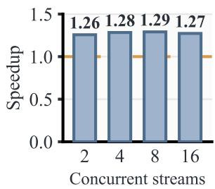  
(a) M4 Max: throughput

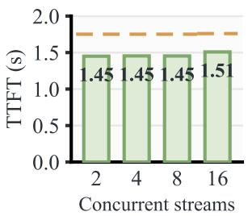  
(b) M4 Max: median TTFT

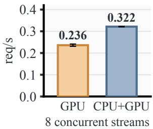  
(c) RK3588: throughput

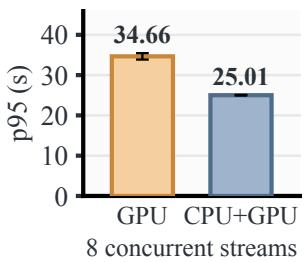  
(d) RK3588: p95 latency  
Figure 7. Concurrent Sequence Generation against serial execution on M4 Max (top) and GPU-only execution on RK3588 (bottom). (a,b) Speedup and median TTFT, with dashed lines marking serial execution. (c,d) Eight-stream request throughput and p95 latency; error bars show SD.

## 5.6 State-Aware Dispatch

CrossInfer selects the faster lane across all nine history/backlog settings (Figure 9(a,b)). Longer histories favor context reuse, while longer backlogs favor the idle GPU. With eight frames, choosing CPU reuse cuts query completion time by 72.7% relative to always using the idle GPU under a short backlog, and choosing the GPU cuts it by 31.6% relative to always waiting for the CPU under a long backlog. On QCS6490, $W + P + S$ improves request throughput by 43.7% over reuse-first and 7.3% over idle-first dispatch across two concurrent video streams (Appendix G.6). It matches the throughput of the best single lane with retained context while reducing mean TTFT by 9.0%, and by 17.9% under sparse arrivals.

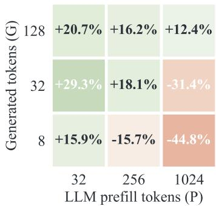  
(a) M4 Max: CPU + Metal GPU

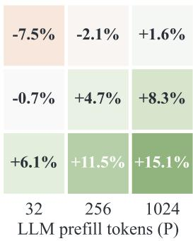  
(b) RK3588: CPU + Mali GPU

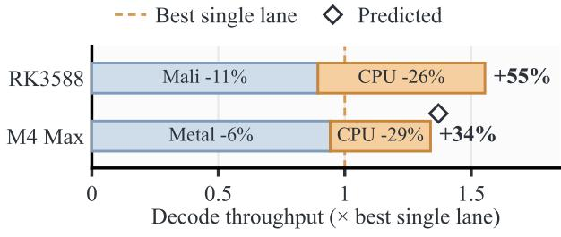  
(c) Co-running decode

Stateful Streaming Generation Concurrent Sequence Generation  
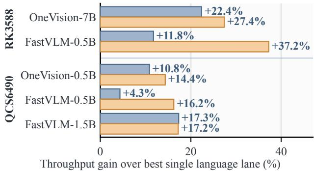  
(d) Two modes across models  
Figure 8. Adding a second language lane. (a, b) Gain over the best single lane across prefill and generation lengths. (c) Co-running decode throughput, with per-lane slowdowns and the predicted M4 Max rate; the RK3588 CPU lane runs on cores 0–4, mostly Cortex-A55. (d) Gain per model for both execution modes, with precomputed visual embeddings on RK3588 and on-device vision on QCS6490 (Appendices G.7 and G.8).

## 5.7 Mechanism Analysis

State handoff saves the receiving engine from repeating the prefix computation: on RK3588, importing ready GPU contexts reduces the first-token latency of CPU-served queries by a factor of 4.6, from 1482 to 319 ms, and serves three queries 2.90× faster than recomputing the prefix (Figure 11(c); Appendix G.9). Without compatible KV state, the GPU reconstructs upcoming contexts while the CPU answers, cutting a later query’s time to first token by 41.0% relative to CPU-only execution (Appendix G.4). Data handoff avoids serialization and copying: on M4 Max, passing visual tokens by descriptor instead of serializing tensors cuts the transport round trip by 12.1× and raises frame throughput under backlog 3.3× (Figure 10), and on RK3588, mapping buffers instead of copying them cuts the round trip by 30% (Figure 11(b)).

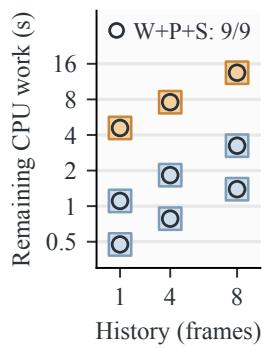  
(a) Reuse vs. idle capacity

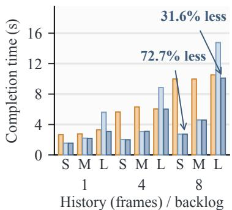  
(b) Query completion

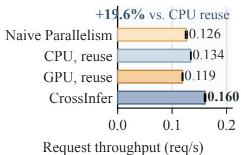  
(c) Throughput

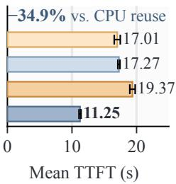  
(d) Mean TTFT

Figure 9. State-aware dispatch on RK3588. (a) The faster fixed policy (color) and the $W + P + S$ choice (circle). (b) Query completion time under short (S), medium (M), and long (L) backlogs. (c, d) Request throughput and mean TTFT on two concurrent video streams with 112-token answers; error bars show SD. Naive Parallelism runs both lanes without shared state.  
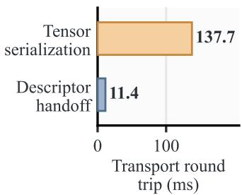

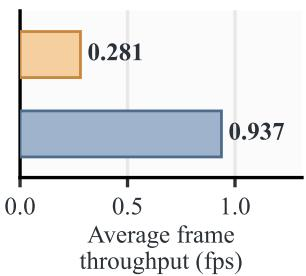  
(a) Complete transport round trip (b) Average frame throughput  
Figure 10. Visual-token transport on Apple M4 Max: descriptor handoff versus Python tensor serialization and reconstruction. (a) Complete TABM transport round trip for an 800 KB visual payload. (b) Average frame throughput under long-prompt backlog.

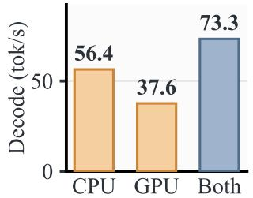  
(a) Text decoding

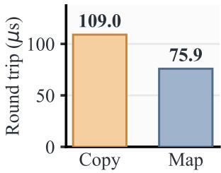  
(b) Buffer handoff

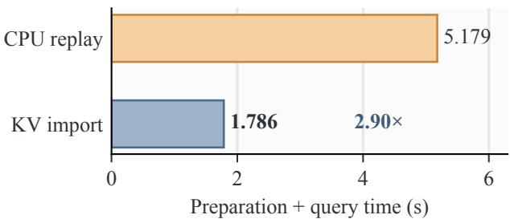  
(c) KV import versus prefix replay  
Figure 11. (a) Qwen2.5-0.5B (Yang et al., 2024b) decode throughput on the RK3588 CPU and GPU, alone and together. (b) Round trip of a 768 KB buffer by mapping versus copying. (c) Preparation plus query time for three OneVision-0.5B queries, CPU replay versus importing GPU-built KV.

## 5.8 Output Equivalence and Accuracy

CrossInfer preserves output equivalence: across all three platforms, concurrent and overlapped execution reproduce every output token and first-step logit of the same pipeline run serially. For OneVision-7B and FastVLM-0.5B, serial and overlapped execution even produce bit-identical perlayer K/V tensors (Appendix G). CPU-to-Metal handoff matches CPU-local accuracy at 75.0% on M4 Max, while GPU-to-CPU handoff achieves comparable accuracy for all three models on QCS6490 (Table 2).

## 6 RELATED WORK

## 6.1 Heterogeneous On-Device Inference

NanoMind (Li et al., 2026) decomposes multimodal inference into modules placed across processors and connects them through TABM, and Phase Matters (Murthy et al., 2026) characterizes heterogeneous VLM pipeline configurations on a mobile SoC. llm.npu (Xu et al., 2025), PowerInfer-2 (Xue et al., 2024), HeteroInfer (Chen et al., 2025), Hetero-

Table 2. Task accuracy (%) after cross-engine state handoff on 200 single-frame OVO queries per model. (a) Qwen2.5-VL-3B with 4-bit language weights on M4 Max. (b) INT4 language weights on QCS6490, with GPU-built context imported for CPU generation.  
(a) M4 Max: CPU-to-Metal handoff
<table><tr><td colspan="4">CPU local Metal local CPU → Metal</td></tr><tr><td>Accuracy (%)</td><td>75.0</td><td>74.5</td><td>75.0</td></tr><tr><td colspan="4">(b) QCS6490: GPU-to-CPU handoff</td></tr><tr><td>Model</td><td>CPU local</td><td>GPU → CPU</td><td></td></tr><tr><td>OneVision-0.5B</td><td>47.0</td><td>50.5</td><td></td></tr><tr><td>FastVLM-0.5B</td><td>69.5</td><td>70.5</td><td></td></tr><tr><td>FastVLM-1.5B</td><td>74.0</td><td>72.5</td><td></td></tr></table>

Mosaic (Jun et al., 2026), and pipelined sharding (Ukarande et al., 2026) split LLM and VLM inference across CPUs, GPUs, and NPUs, while Agent.xpu (Wei et al., 2025) schedules concurrent agentic workloads and CORE (Zhang et al., 2026c) coordinates CPU, GPU, and memory frequencies. Core ML (Apple Inc., 2026) and ExecuTorch (Nachin et al., 2026) map one model’s operations onto several backends within one framework. CrossInfer instead coordinates stateful VLM execution across separate backends, carrying both visual tokens and language context between engines.

## 6.2 Prefill–Decode Scheduling and Disaggregation

Orca (Yu et al., 2022) introduces iteration-level request scheduling, while vLLM (Kwon et al., 2023) uses PagedAttention for memory-efficient request batching. Dist-Serve (Zhong et al., 2024), Splitwise (Patel et al., 2024), Encode–Prefill–Decode (EPD) (Singh et al., 2025), and TriInfer (Dong et al., 2026) disaggregate prefill, decoding, and multimodal encoding. Sarathi-Serve (Agrawal et al., 2024) and NanoFlow (Zhu et al., 2025) chunk or overlap work within and across stages, and Stream2LLM (Bachkaniwala et al., 2026) overlaps prefill with streaming context retrieval. Preble (Srivatsa et al., 2025) balances KV reuse and load in distributed serving, and performance models choose CPU–GPU policies per phase (Na et al., 2025) or predict co-running slowdowns on edge devices (Huang et al., 2025). CrossInfer’s placement weighs the edge SoC’s unequal engine speeds, context-preparation costs, and co-running interference (Section 5.6).

## 6.3 Context Reuse and State Transfer

Prompt Cache (Gim et al., 2024) and SGLang (Zheng et al., 2024) reuse attention states and KV prefixes across requests, while LMCache (Cheng et al., 2025) and SuperInfer (Yu et al., 2026b) move KV between engines or between GPU and CPU memory. On devices, SparKV (Liu et al., 2026) overlaps cloud-to-device KV loading with local recomputation. Dynamic Flow, Static Graph (Huang et al., 2026) maps prefix and non-prefix reuse onto statically compiled mobile NPU graphs. mzCache (Yu et al., 2026a) restores evicted weights and KV through shared CPU–GPU buffers while GPU inference proceeds. CrossInfer reuses context across backends with different KV representations, importing compatible state or reconstructing the context from retained visual embeddings and text.

## 6.4 Streaming Video Understanding

VLMCache (Zhang et al., 2026b) reuses visual computation across frames to reduce on-device prefill cost, and ReKV (Di et al., 2025) decouples video processing from question answering through video KV caches. InfiniPot-V (Kim et al., 2025), StreamingVLM (Xu et al., 2026), and V-Rex (Kim et al., 2026) keep the growing video KV cache within budget by compression, by retaining attention sinks and recent tokens, or by dynamic retrieval on a dedicated accelerator. Speak While Watching (Lin et al., 2026), Think While Watching (Wang et al., 2026), and Think-as-You-See (Zhang et al., 2026a) support concurrent visual ingestion and generation through changes to positional encoding, attention, and state management. CrossInfer runs ingestion and generation on separate engines with the model unchanged, binding each response to a published version.

## 7 CONCLUSION

CrossInfer runs stateful VLM inference across the accelerators of an edge SoC by separating a stream’s history from engine-specific KV state. One engine ingests new observations while others answer from published versions or serve other requests, and every answer matches its serial reference. For the same workload, adding a second language engine can raise throughput on one SoC and lower it on another, because engines are fastest at different stages, slow each other down when they co-run, and cannot use each other’s context without moving it. CrossInfer therefore maps stages to complementary engines and chooses between waiting for reusable context and using an idle engine. On three edge SoCs, it delivers higher throughput and lower response latency.

## REFERENCES

Agrawal, A., Kedia, N., Panwar, A., Mohan, J., Kwatra, N., Gulavani, B., Tumanov, A., and Ramjee, R. Taming throughput-latency tradeoff in LLM inference with Sarathi-Serve. In 18th USENIX Symposium on Operating Systems Design and Implementation (OSDI), pp. 117– 134, Santa Clara, CA, 2024. USENIX Association. URL https://www.usenix.org/conference/os di24/presentation/agrawal.

Alayrac, J.-B., Donahue, J., Luc, P., Miech, A., Barr, I., Hasson, Y., Lenc, K., Mensch, A., Millican, K., Reynolds, M., Ring, R., Rutherford, E., Cabi, S., Han, T., Gong, Z., Samangooei, S., Monteiro, M., Menick, J. L., Borgeaud, S., Brock, A., Nematzadeh, A., Sharifzadeh, S., Binkowski, M., Barreira, R., Vinyals, O.,´ Zisserman, A., and Simonyan, K. Flamingo: a visual language model for few-shot learning. In Advances in Neural Information Processing Systems, volume 35, 2022. URL https://papers.nips.cc/paper\_files/p aper/2022/hash/960a172bc7fbf0177cccc bb411a7d800-Abstract-Conference.html.

Apple. Apple unleashes M1, November 2020. URL https: //www.apple.com/newsroom/2020/11/app le-unleashes-m1/. Apple Newsroom, accessed October 10, 2026.

Apple. Deploying transformers on the Apple Neural Engine, 2022. URL https://machinelearning.appl e.com/research/neural-engine-transfo rmers. Apple Machine Learning Research. Accessed: 2026-04-02.

Apple. Apple introduces M4 Pro and M4 Max, October 2024. URL https://www.apple.com/newsro om/2024/10/apple-introduces-m4-pro-a nd-m4-max/. Apple Newsroom, accessed April 1, 2026.

Apple. Mac Studio (2025) – Tech Specs, 2025. URL ht tps://support.apple.com/en-us/122211. Apple Support, accessed October 11, 2026.

Apple. IOSurface, 2026a. URL https://develope r.apple.com/documentation/iosurface. Apple Developer Documentation, accessed October 10, 2026.

Apple. Metal overview, 2026b. URL https://deve loper.apple.com/metal/. Apple Developer Documentation, accessed October 10, 2026.

Apple. Model Intermediate Language, 2026c. URL https: //apple.github.io/coremltools/docs-g uides/source/model-intermediate-langu age.html. Core ML Tools documentation, accessed October 10, 2026.

Apple. powermetrics(1), 2026d. macOS 26.2 manual page, accessed October 26, 2026.

Apple Inc. Core ML. https://developer.appl e.com/documentation/coreml, 2026. Apple Developer Documentation, accessed March 28, 2026.

Arm. Cortex-A55, 2026a. URL https://www.arm.co m/products/silicon-ip-cpu/cortex-a/c ortex-a55. Official product page, accessed October 11, 2026.

Arm. Cortex-A76, 2026b. URL https://www.arm.co m/products/silicon-ip-cpu/cortex-a/c ortex-a76. Official product page, accessed October 11, 2026.

Arm. Cortex-A78, 2026c. URL https://www.arm.co m/products/silicon-ip-cpu/cortex-a/c ortex-a78. Official product page, accessed October 11, 2026.

Arm. Mali-G610, 2026d. URL https://www.arm.co m/products/silicon-ip-multimedia/gpu/ mali-g610. Official product page, accessed October 11, 2026.

Bachkaniwala, R., Luo, C., So, R., Mahajan, D., and Rong, K. Stream2LLM: Overlap context streaming and prefill for reduced time-to-first-token. In Proceedings of Machine Learning and Systems, volume 8, pp. 2201–2217. MLSys, 2026. URL https://proceedings.mlsy s.org/paper\_files/paper/2026/hash/3b 3889d313ba9476c12c2d77ea66b24f-Abstr act-Conference.html.

Bai, S., Cai, Y., Chen, R., Chen, K., Chen, X., Cheng, Z., Deng, L., Ding, W., Gao, C., Ge, C., Ge, W., Guo, Z., Huang, Q., Huang, J., Huang, F., Hui, B., Jiang, S., Li, Z., Li, M., Li, M., Li, K., Lin, Z., Lin, J., Liu, X., Liu, J., Liu, C., Liu, Y., Liu, D., Liu, S., Lu, D., Luo, R., Lv, C., Men, R., Meng, L., Ren, X., Ren, X., Song, S., Sun, Y., Tang, J., Tu, J., Wan, J., Wang, P., Wang, P., Wang, Q., Wang, Y., Xie, T., Xu, Y., Xu, H., Xu, J., Yang, Z., Yang, M., Yang, J., Yang, A., Yu, B., Zhang, F., Zhang, H., Zhang, X., Zheng, B., Zhong, H., Zhou, J., Zhou, F., Zhou, J., Zhu, Y., and Zhu, K. Qwen3-VL technical report, 2025a. URL https://arxiv.org/abs/2511.21631v2.

Bai, S., Chen, K., Liu, X., Wang, J., Ge, W., Song, S., Dang, K., Wang, P., Wang, S., Tang, J., Zhong, H., Zhu, Y., Yang, M., Li, Z., Wan, J., Wang, P., Ding, W., Fu, Z., Xu, Y., Ye, J., Zhang, X., Xie, T., Cheng, Z., Zhang, H., Yang, Z., Xu, H., and Lin, J. Qwen2.5-VL technical report, 2025b. URL https://arxiv.org/abs/2502.13923v1.

Chen, L., Feng, D., Feng, E., Wang, Y., Zhao, R., Xia, Y., Xu, P., and Chen, H. Characterizing mobile SoC for accelerating heterogeneous LLM inference. In Proceedings ofthe ACM SIGOPS 31st Symposium on Operating Systems Principles, pp. 359–374, New York, NY, USA, 2025. Association for Computing Machinery. doi: 10.1145/3731569.3764808.

Cheng, Y., Liu, Y., Yao, J., An, Y., Chen, X., Feng, S., Huang, Y., Shen, S., Du, K., and Jiang, J. LMCache: An efficient KV cache layer for enterprise-scale LLM inference, 2025. URL https://arxiv.org/abs/ 2510.09665.

Di, S., Yu, Z., Zhang, G., Li, H., Zhong, T., Cheng, H., Li, B., He, W., Shu, F., and Jiang, H. Streaming video question-answering with in-context video KV-cache retrieval. In The Thirteenth International Conference on Learning Representations, pp. 42115–42127, 2025. URL https://proceedings.iclr.cc/paper\_fi les/paper/2025/hash/67a9b444cbcd6475 72c88194619f72d5-Abstract-Conference. html.

Dong, X., Liu, T., Zeng, Y., Huang, W., Zhao, X., Wu, S., Liu, L., Liu, Y., Wu, Y., Yang, H., Zhang, K., and Li, J. TriInfer: Hybrid EPD disaggregation for efficient multimodal large language model inference. In Proceedings of Machine Learning and Systems, volume 8, pp. 1670– 1684. MLSys, 2026. URL https://proceedings. mlsys.org/paper\_files/paper/2026/has h/f068c65585985c25c17f221390774ec7-A bstract-Conference.html.

Dosovitskiy, A., Beyer, L., Kolesnikov, A., Weissenborn, D., Zhai, X., Unterthiner, T., Dehghani, M., Minderer, M., Heigold, G., Gelly, S., Uszkoreit, J., and Houlsby, N. An image is worth 16x16 words: Transformers for image recognition at scale. In International Conference on Learning Representations, 2021. URL https://ar xiv.org/abs/2010.11929.

Fu, C., Dai, Y., Luo, Y., Li, L., Ren, S., Zhang, R., Wang, Z., Zhou, C., Shen, Y., Zhang, M., Chen, P., Li, Y., Lin, S., Zhao, S., Li, K., Xu, T., Zheng, X., Chen, E., Shan, C., He, R., and Sun, X. Video-MME: The first-ever comprehensive evaluation benchmark of multi-modal LLMs in video analysis. In Proceedings of the IEEE/CVF Conference on Computer Vision and Pattern Recognition (CVPR), pp. 24108–24118, 2025. URL https://openaccess .thecvf.com/content/CVPR2025/html/Fu \_Video-MME\_The\_First-Ever\_Comprehens ive\_Evaluation\_Benchmark\_of\_Multi-mod al\_LLMs\_in\_CVPR\_2025\_paper.html.

Gerganov, G. llama.cpp, 2023. URL https://github .com/ggml-org/llama.cpp.

ggml-org. ggml: Tensor library for machine learning, 2026. URL https://github.com/ggml-org/ggml. Official project repository, accessed October 10, 2026.

Gim, I., Chen, G., Lee, S.-s., Sarda, N., Khandelwal, A., and Zhong, L. Prompt Cache: Modular attention reuse for low-latency inference. In Proceedings of Machine

Learning and Systems, volume 6, 2024. URL https:// proceedings.mlsys.org/paper\_files/pa per/2024/hash/a66caa1703fe34705a4368 c3014c1966-Abstract-Conference.html.

Hannun, A., Digani, J., Katharopoulos, A., and Collobert, R. MLX: Efficient and flexible machine learning on Apple Silicon, 2023. URL https://github.com/ml-e xplore/mlx.

Huang, T., Ramesh, A., Ruppel, E., Pereira, N., Rowe, A., and Joe-Wong, C. Interference-aware edge runtime prediction with conformal matrix completion. In Proceedings of Machine Learning and Systems, volume 7. MLSys, 2025. URL https://proceedings.mlsy s.org/paper\_files/paper/2025/hash/40 b8fb4f90004405e14b1ede6ab42373-Abstr act-Conference.html.

Huang, Z., Chen, S., Niu, C., Sun, Y., Wang, Z., Zhao, Z., Lv, C., Wu, F., and Chen, G. Dynamic Flow, Static Graph: KV cache reuse for efficient LLM serving on mobile NPUs, 2026. URL https://arxiv.org/ab s/2609.34727.

Jiang, X., Wang, H., Chen, Y., Wu, Z., Wang, L., Zou, B., Yang, Y., Cui, Z., Cai, Y., Yu, T., Lyu, C., and Wu, Z. MNN: A universal and efficient inference engine. In Proceedings ofMachine Learning and Systems, volume 2, 2020. URL https://proceedings.mlsys.or g/paper\_files/paper/2020/hash/bc1906 1f88f16e9ed4a18f0bbd47048a-Abstract. html.

Jun, G. H., Pang, W., Richter, E., Saeedi, M., Amarnath, A., Ferrao, P., and Chen, D. HeteroMosaic: Exposing and exploiting heterogeneous execution opportunities for energy-efficient edge LLM inference. In 59th IEEE/ACM International Symposium on Microarchitecture (MICRO), 2026. URL https://arxiv.org/abs/2607.1 2839v4. To appear.

Kim, D., Yang, S., Shin, W., and Kim, J.-Y. V-Rex: Realtime streaming video LLM acceleration via dynamic KV cache retrieval. In 2026 IEEE International Symposium on High Performance Computer Architecture (HPCA), 2026. doi: 10.1109/HPCA68181.2026.11408603. URL https://doi.org/10.1109/HPCA68181.20 26.11408603.

Kim, M., Shim, K., Choi, J., and Chang, S. InfiniPot-V: Memory-constrained KV cache compression for streaming video understanding. In Advances in Neural Information Processing Systems, volume 38, 2025. doi: 10.52202/085713-4639. URL https://proceedi ngs.neurips.cc/paper\_files/paper/202

5/hash/caef5f5e658aa1f7565f063a2cd99 726-Abstract-Conference.html.

Kumaresan, R. Orion: Characterizing and programming Apple’s Neural Engine for LLM training and inference, 2026. URL https://arxiv.org/abs/2603.0 6728v1.

Kwon, W., Li, Z., Zhuang, S., Sheng, Y., Zheng, L., Yu, C. H., Gonzalez, J. E., Zhang, H., and Stoica, I. Efficient memory management for large language model serving with PagedAttention. In 29th ACM Symposium on Operating Systems Principles (SOSP), pp. 611–626, New York, NY, USA, 2023. Association for Computing Machinery. doi: 10.1145/3600006.3613165.

Li, B., Zhang, Y., Guo, D., Zhang, R., Li, F., Zhang, H., Zhang, K., Zhang, P., Li, Y., Liu, Z., and Li, C. LLaVA-OneVision: Easy Visual Task Transfer. Transactions on Machine Learning Research, 2025. URL https: //openreview.net/forum?id=zKv8qULV6n.

Li, Y., Zeng, Y., Zhang, S., Zhang, H., Xiong, X., Liu, J., Hu, P., and Banerjee, S. Tiny but mighty: A softwarehardware co-design approach for efficient multimodal inference on battery-powered small devices. In The Fourteenth International Conference on Learning Representations, pp. 109458–109473, 2026. URL https: //proceedings.iclr.cc/paper\_files/pa per/2026/hash/b20260e3e1bd7ea1088319 25d65ce0a6-Abstract-Conference.html.

Lin, J., Tong, J., Wu, H., Zhang, J., Liu, J., Jin, X., and Shen, X. Speak While Watching: Unleashing TRUE realtime video understanding capability of multimodal large language models, 2026. URL https://arxiv.org/ abs/2601.06843v1.

Liu, H., Li, C., Wu, Q., and Lee, Y. J. Visual Instruction Tuning. In Advances in Neural Information Processing Systems, volume 36, pp. 34892–34916. Curran Associates, Inc., 2023. URL https://proceedings.neurip s.cc/paper\_files/paper/2023/hash/6dc f277ea32ce3288914faf369fe6de0-Abstrac t-Conference.html.

Liu, H., Li, C., Li, Y., and Lee, Y. J. Improved Baselines with Visual Instruction Tuning. In Proceedings of the IEEE/CVF Conference on Computer Vision and Pattern Recognition (CVPR), pp. 26296–26306, 2024a. URL https://openaccess.thecvf.com/conten t/CVPR2024/html/Liu\_Improved\_Baselin es\_with\_Visual\_Instruction\_Tuning\_CV PR\_2024\_paper.html.

Liu, H., Li, C., Li, Y., Li, B., Zhang, Y., Shen, S., and Lee, Y. J. LLaVA-NeXT: Improved reasoning, OCR,

and world knowledge, January 2024b. URL https: //llava-vl.github.io/blog/2024-01-3 0-llava-next/.

Liu, H., Zhai, L., Wang, J., Fang, Z., Chen, J., and Huang, J. SparKV: Overhead-aware KV cache loading for efficient on-device LLM inference, 2026. URL https://arxi v.org/abs/2604.21231v3.

maderix. ANE training: Backpropagation on Apple Neural Engine. https://github.com/maderix/ANE, 2026. Online; accessed 2026-03-27.

Marafioti, A., Zohar, O., Farre, M., Noyan, M., Bakouch,´ E., Cuenca, P., Zakka, C., Allal, L. B., Lozhkov, A., Tazi, N., Srivastav, V., Lochner, J., Larcher, H., Morlon, M., Tunstall, L., von Werra, L., and Wolf, T. SmolVLM: Redefining small and efficient multimodal models, 2025. URL https://arxiv.org/abs/2504.05299 v1.

Murthy, A. V., Kotre, Y. N., Sharma, P., Mishra, P., Ganapathi, S., and Shukla, P. Phase Matters: Characterizing heterogeneous vision-language inference on a mobile SoC. In Proceedings of the 24th Annual International Conference on Mobile Systems, Applications and Services Workshops, pp. 322–327, New York, NY, USA, 2026. Association for Computing Machinery. doi: 10.1145/3812836.3814781. 9th International Workshop on Edge Systems, Analytics and Networking (EdgeSys 2026).

Na, S., Jeong, G., Ahn, B. H., Jezghani, A., Young, J., Hughes, C. J., Krishna, T., and Kim, H. FlexInfer: Flexible LLM inference with CPU computations. In Proceedings of Machine Learning and Systems, volume 7. MLSys, 2025. URL https://proceedings.mlsy s.org/paper\_files/paper/2025/hash/69 8cfaf72a208aef2e78bcac55b74328-Abstr act-Conference.html.

Nachin, M., Desai, D., Jia, S., Lai, C., Liu, M., Szwejbka, J., Alvarez, R., Ascani, R., Bort, D., Candales, M., Caples, A., Cao, Y., Chen, Z., Chintala, S., Comer, G., Islam, T., Jia, S., Karuturi, T., Khuu, J., Kukkadapu, A., Manlaibaatar, T., Or, A., Patel, K., Pothapragada, S., Qiu, L., Rao, S., Reblitz-Richardson, O., Ren, M., Roy, S., Shoumikhin, A., Wolchok, S., Yang, G., Yi, A., Yuan, M., Zhang, H., Zhang, J., Zhang, J., Zhang, S., and Bilgin, C. ExecuTorch – a unified PyTorch solution to run ML models on-device. In Proceedings of Machine Learning and Systems, volume 8, pp. 569–609. MLSys, 2026. URL https://proceedings.mlsys.org/paper\_ files/paper/2026/hash/236f915dd02af4 f11927f67330b21d4b-Abstract-Conferenc e.html.

Niu, J., Li, Y., Miao, Z., Ge, C., Zhou, Y., He, Q., Dong, X., Duan, H., Ding, S., Qian, R., Zhang, P., Zang, Y., Cao, Y., He, C., and Wang, J. OVO-Bench: How far is your Video-LLMs from real-world online video understanding? In Proceedings of the IEEE/CVF Conference on Computer Vision and Pattern Recognition (CVPR), pp. 18902–18913, June 2025. URL https: //openaccess.thecvf.com/content/CVPR 2025/html/Niu\_OVO-Bench\_How\_Far\_is\_Yo ur\_Video-LLMs\_from\_Real-World\_Online\_ Video\_CVPR\_2025\_paper.html.

Orange Pi. Orange Pi 5 Ultra. http://www.orangepi .org/html/hardWare/computerAndMicroc ontrollers/details/Orange-Pi-5-Ultra .html, 2026. Official product page, accessed October 19, 2026.

Pan, R., Wang, Z., Jia, Z., Karakus, C., Zancato, L., Dao, T., Wang, Y., and Netravali, R. Marconi: Prefix caching for the era of hybrid LLMs. In Proceedings ofMachine Learning and Systems, volume 7. MLSys, 2025. URL https://proceedings.mlsys.org/paper\_ files/paper/2025/hash/7c180af017258d 239bac6248d1eb26ac-Abstract-Conferenc e.html.

Patel, P., Choukse, E., Zhang, C., Shah, A., Goiri, ´I., Maleki, S., and Bianchini, R. Splitwise: Efficient generative LLM inference using phase splitting. In 2024 ACM/IEEE 51st Annual International Symposium on Computer Architecture (ISCA), pp. 118–132. IEEE, 2024. doi: 10.1109/ISCA59077.2024.00019.

Qualcomm Technologies, Inc. Qualcomm Dragonwing QCS6490/QCM6490 Processors. https://docs.q ualcomm.com/doc/87-28733-1/87-28733 -1\_REV\_F\_QUALCOMM\_QCS6490\_QCM6490\_Pr ocessors\_Product\_Brief.pdf, 2025. Product brief, document 87-28733-1 Rev. F, accessed April 15, 2026.

Qualcomm Technologies, Inc. Qualcomm AI Engine Direct SDK, 2026a. URL https://www.qualcomm.com /developer/software/qualcomm-ai-engin e-direct-sdk. Official SDK page, accessed October 11, 2026.

Qualcomm Technologies, Inc. Qualcomm Adreno GPU, 2026b. URL https://www.qualcomm.com/p roducts/technology/processors/adreno. Official product page, accessed October 11, 2026.

Qualcomm Technologies, Inc. Qualcomm Hexagon NPU, 2026c. URL https://www.qualcomm.com/p roducts/technology/processors/hexagon. Official product page, accessed October 11, 2026.

Qualcomm Technologies, Inc. Introduction to RUBIK Pi 3, 2026d. URL https://academy.qualcomm.com /course-catalog/Rubik-Pi-3-introduct ion-and-unboxing. Qualcomm Academy course, accessed October 11, 2026.

Qualcomm Technologies, Inc. Snapdragon 8 Gen 3 mobile platform, 2026e. URL https://www.qualcomm.c om/products/mobile/snapdragon/smartp hones/snapdragon-8-series-mobile-pla tforms/snapdragon-8-gen-3-mobile-pla tform. Product page, accessed October 21, 2026.

Qwen Team. Qwen3.5: Towards native multimodal agents, 2026. URL https://qwen.ai/blog?id=qwen3. 5. Blog post, February 2026.

Radford, A., Kim, J. W., Hallacy, C., Ramesh, A., Goh, G., Agarwal, S., Sastry, G., Askell, A., Mishkin, P., Clark, J., Krueger, G., and Sutskever, I. Learning Transferable Visual Models From Natural Language Supervision. In Proceedings of the 38th International Conference on Machine Learning, volume 139 of Proceedings of Machine Learning Research, pp. 8748–8763. PMLR, 2021. URL https://proceedings.mlr.press/v139/r adford21a.html.

Rockchip. RKNN-Toolkit2, 2026. URL https://gith ub.com/airockchip/rknn-toolkit2. Official SDK repository, accessed September 10, 2026.

Rockchip Electronics Co., Ltd. RK3588 brief datasheet, 2025. URL https://www.rock-chips.com /uploads/pdf/2022.8.26/192/RK3588%20 Brief%20Datasheet.pdf. Official datasheet, accessed September 10, 2026.

Singh, A., Natarajan, V., Shah, M., Jiang, Y., Chen, X., Batra, D., Parikh, D., and Rohrbach, M. Towards VQA models that can read. In Proceedings of the IEEE/CVF Conference on Computer Vision and Pattern Recognition, pp. 8317–8326, 2019.

Singh, G., Wang, X., Hu, Y., Yu, T. T. L., Xing, L., Jiang, W., Wang, Z., Bai, X., Li, Y., Xiong, Y., Zhang, Y., and Fan, Z. Efficiently serving large multimodal models using EPD disaggregation. In Proceedings ofthe 42nd International Conference on Machine Learning, volume 267 of Proceedings of Machine Learning Research, pp. 55740– 55756. PMLR, 2025. URL https://proceedings. mlr.press/v267/singh25d.html.

Srivatsa, V., He, Z., Abhyankar, R., Li, D., and Zhang, Y. Preble: Efficient distributed prompt scheduling for LLM serving. In The Thirteenth International Conference on Learning Representations, pp. 37057–37082, 2025. URL https://proceedings.iclr.cc/paper\_fi

les/paper/2025/hash/5bc342f48de82647 79952fac378f96dc-Abstract-Conference. html.

The Khronos Group. OpenCL: The open standard for parallel programming of heterogeneous systems, 2026. URL https://www.khronos.org/opencl/. Official project documentation, accessed October 10, 2026.

Thundercomm America Corporation. About RUBIK Pi 3. https://www.thundercomm.com/rubik-p i-3/en/docs/about-rubikpi/, 2026. Official documentation page, accessed April 16, 2026.

Ukarande, A., Shekhar, D., Blackstein, M., and Rangan, R. Efficient, VRAM-constrained xLM inference on clients. In Proceedings ofMachine Learning and Systems, volume 8, pp. 1884–1900. MLSys, 2026. URL https:// proceedings.mlsys.org/paper\_files/pa per/2026/hash/7cd265ae802235b8d5778a 4a96ff22dd-Abstract-Conference.html.

Vasu, P. K. A., Faghri, F., Li, C.-L., Koc, C., True, N., Antony, A., Santhanam, G., Gabriel, J., Grasch, P., Tuzel, O., and Pouransari, H. FastVLM: Efficient vision encoding for vision language models. In Proceedings of the IEEE/CVF Conference on Computer Vision and Pattern Recognition, pp. 19769–19780, 2025. URL https://openaccess.thecvf.com/conten t/CVPR2025/html/Vasu\_FastVLM\_Efficie nt\_Vision\_Encoding\_for\_Vision\_Langua ge\_Models\_CVPR\_2025\_paper.html.

Wan, Z., Wang, X., Liu, C., Alam, S., Zheng, Y., Liu, J., Qu, Z., Yan, S., Zhu, Y., Zhang, Q., Chowdhury, M., and Zhang, M. Efficient Large Language Models: A Survey. Transactions on Machine Learning Research, 2024. ISSN 2835-8856. URL https://openreview.net/f orum?id=bsCCJHbO8A.

Wang, L., Jin, Z., Hao, Y., Chen, Y., Liu, K., Ao, Y., and Zhao, J. Think While Watching: Online streaming segment-level memory for multi-turn video reasoning in multimodal large language models, 2026. URL https://arxiv.org/abs/2603.11896v1.

Wang, P., Bai, S., Tan, S., Wang, S., Fan, Z., Bai, J., Chen, K., Liu, X., Wang, J., Ge, W., Fan, Y., Dang, K., Du, M., Ren, X., Men, R., Liu, D., Zhou, C., Zhou, J., and Lin, J. Qwen2-VL: Enhancing vision-language model’s perception of the world at any resolution, 2024. URL https://arxiv.org/abs/2409.12191v2.

Wei, X., Zhang, J., Li, H., Chen, J., Guan, H., Qu, R., Li, M., Chen, X., and Luo, G. Agent.xpu: Efficient scheduling of agentic LLM workloads on heterogeneous SoC, 2025. URL https://arxiv.org/abs/2506.24045 v2. Revised January 6, 2026.

Xu, D., Zhang, H., Yang, L., Liu, R., Huang, G., Xu, M., and Liu, X. Fast on-device LLM inference with NPUs. In Proceedings ofthe 30th ACM International Conference on Architectural Support for Programming Languages and Operating Systems, Volume 1, pp. 445–462, New York, NY, USA, 2025. Association for Computing Machinery. doi: 10.1145/3669940.3707239.

Xu, R., Xiao, G., Chen, Y., He, L., Peng, K., Lu, Y., and Han, S. StreamingVLM: Real-time understanding for infinite video streams. In International Conference on Learning Representations (ICLR), pp. 61463–61475, 2026. URL https://proceedings.iclr.cc/paper\_fi les/paper/2026/hash/6445dd88ebb9a6a3 afa0b126ad87fe41-Abstract-Conference. html.

Xue, Z., Song, Y., Mi, Z., Zheng, X., Xia, Y., and Chen, H. PowerInfer-2: Fast large language model inference on a smartphone, 2024. URL https://arxiv.org/ab s/2406.06282v3.

Yang, A., Yang, B., Hui, B., Zheng, B., Yu, B., Zhou, C., Li, C., Li, C., Liu, D., Huang, F., Dong, G., Wei, H., Lin, H., Tang, J., Wang, J., Yang, J., Tu, J., Zhang, J., Ma, J., Yang, J., Xu, J., Zhou, J., Bai, J., He, J., Lin, J., Dang, K., Lu, K., Chen, K., Yang, K., Li, M., Xue, M., Ni, N., Zhang, P., Wang, P., Peng, R., Men, R., Gao, R., Lin, R., Wang, S., Bai, S., Tan, S., Zhu, T., Li, T., Liu, T., Ge, W., Deng, X., Zhou, X., Ren, X., Zhang, X., Wei, X., Ren, X., Liu, X., Fan, Y., Yao, Y., Zhang, Y., Wan, Y., Chu, Y., Liu, Y., Cui, Z., Zhang, Z., Guo, Z., and Fan, Z. Qwen2 technical report, 2024a. URL https://arxiv.org/abs/2407.10671.

Yang, A., Yang, B., Zhang, B., Hui, B., Zheng, B., Yu, B., Li, C., Liu, D., Huang, F., Wei, H., Lin, H., Yang, J., Tu, J., Zhang, J., Yang, J., Yang, J., Zhou, J., Lin, J., Dang, K., Lu, K., Bao, K., Yang, K., Yu, L., Li, M., Xue, M., Zhang, P., Zhu, Q., Men, R., Lin, R., Li, T., Tang, T., Xia, T., Ren, X., Ren, X., Fan, Y., Su, Y., Zhang, Y., Wan, Y., Liu, Y., Cui, Z., Zhang, Z., and Qiu, Z. Qwen2.5 technical report, 2024b. URL https://arxiv.org/ abs/2412.15115.

Yu, G.-I., Jeong, J. S., Kim, G.-W., Kim, S., and Chun, B.- G. Orca: A distributed serving system for Transformer-Based generative models. In 16th USENIX Symposium on Operating Systems Design and Implementation (OSDI 22), pp. 521–538, Carlsbad, CA, 2022. USENIX Association. URL https://www.usenix.org/confere nce/osdi22/presentation/yu.

Yu, H., Kim, M., Park, J., and Lee, K. mzCache: Ondevice LLM memory management under multitasking. In Proceedings ofthe Annual International Conference

on Mobile Computing and Networking, 2026a. doi: 10.1 145/3795866.3844495. URL https://doi.org/10 .1145/3795866.3844495.

Yu, J., Hu, M., Lin, Z., and Zhang, M. SuperInfer: SLOaware rotary scheduling and memory management for LLM inference on superchips. In Proceedings ofMachine Learning and Systems, volume 8, pp. 75–93. MLSys, 2026b. URL https://proceedings.mlsys.or g/paper\_files/paper/2026/hash/07fd64 f9316f40193c6a4d87d8afa011-Abstract-C onference.html.

Zhai, X., Mustafa, B., Kolesnikov, A., and Beyer, L. Sigmoid Loss for Language Image Pre-Training. In Proceedings ofthe IEEE/CVF International Conference on Computer Vision (ICCV), pp. 11975–11986, 2023. URL https://openaccess.thecvf.com/conten t/ICCV2023/html/Zhai\_Sigmoid\_Loss\_fo r\_Language\_Image\_Pre-Training\_ICCV\_2 023\_paper.html.

Zhang, J., Tong, J., Lin, J., Wu, H., Sun, Y., Ma, Y., and Shen, X. Think-as-You-See: Streaming chain-of-thought reasoning for large vision-language models. In Proceedings of the IEEE/CVF Conference on Computer Vision and Pattern Recognition (CVPR), pp. 11998–12008, June 2026a. URL https://openaccess.thecvf.co m/content/CVPR2026/html/Zhang\_Think-a s-You-See\_Streaming\_Chain-of-Thought \_Reasoning\_for\_Large\_Vision-Language\_ Models\_CVPR\_2026\_paper.html.

Zhang, Y., Xu, D., Chen, Z., Wang, C., Zhang, Y., Xu, M., and Huang, G. VLMCache: Efficient on-device vision-language model inference. In Proceedings ofthe 24th Annual International Conference on Mobile Systems, Applications and Services, MobiSys ’26, pp. 854–867, New York, NY, USA, 2026b. Association for Computing Machinery. doi: 10.1145/3745756.3809243. URL http s://doi.org/10.1145/3745756.3809243.

Zhang, Z., Dash, P., Xu, Q., Hu, Y. C., Li, J., and Guan, H. Rethinking DVFS for mobile LLMs: Unified energyaware scheduling with CORE. In Proceedings of Machine Learning and Systems, volume 8, pp. 186–198. MLSys, 2026c. URL https://proceedings.mlsys.or g/paper\_files/paper/2026/hash/136b9a 13861308c8948cd308ccd02658-Abstract-C onference.html.

Zheng, L., Yin, L., Xie, Z., Sun, C., Huang, J., Yu, C. H., Cao, S., Kozyrakis, C., Stoica, I., Gonzalez, J. E., Barrett, C., and Sheng, Y. SGLang: Efficient execution of structured language model programs. In Advances in Neural Information Processing Systems, volume 37, 2024. doi:

10.52202/079017-2000. URL https://proceedi ngs.neurips.cc/paper\_files/paper/202 4/hash/724be4472168f31ba1c9ac630f15d ec8-Abstract-Conference.html.

Zhong, Y., Liu, S., Chen, J., Hu, J., Zhu, Y., Liu, X., Jin, X., and Zhang, H. DistServe: Disaggregating prefill and decoding for goodput-optimized large language model serving. In 18th USENIX Symposium on Operating Systems Design and Implementation (OSDI), pp. 193–210, Santa Clara, CA, 2024. USENIX Association. URL https://www.usenix.org/conference/os di24/presentation/zhong-yinmin.

Zhu, K., Gao, Y., Zhao, Y., Zhao, L., Zuo, G., Gu, Y., Xie, D., Tang, T., Xu, Q., Ye, Z., Kamahori, K., Lin, C.-Y., Wang, Z., Wang, S., Krishnamurthy, A., and Kasikci, B. NanoFlow: Towards optimal large language model serving throughput. In 19th USENIX Symposium on Operating Systems Design and Implementation (OSDI), pp. 749–765, Boston, MA, 2025. USENIX Association. URL https://www.usenix.org/conference/os di25/presentation/zhu-kan.

## AI USAGE DISCLOSURE

OpenAI Codex and Anthropic Claude Code were used iteratively to generate and revise runtime code, experimental scripts, figures, and manuscript passages. They also supported system and experiment design discussions, literature search, testing, evaluation, and result analysis. The authors directed these iterations, selected the material incorporated into the work, and take responsibility for the final methods, results, and text.

## A ADDITIONAL ANE BACKEND AND CRANE COMPILATION

Alongside the Core ML (Apple Inc., 2026) visual path, our custom backend invokes Apple’s private ANE (Apple, 2022) interfaces. Our CRANE pipeline specializes visual graphs for static compilation.

## A.1 Runtime and Static Graph Compilation

Open-source ANE work (maderix, 2026) exposes private compilation and execution interfaces, including fused computation and shared IOSurface buffers (Apple, 2026a). Orion (Kumaresan, 2026) adds program caching, graph compilation, and inference support. Our custom visual backend uses these private interfaces to submit Model Intermediate Language (MIL) programs (Apple, 2026c) to Apple’s compiler and execute the resulting programs on the ANE.

Compiling a visual encoder for an NPU requires supported operators and tensor shapes, tiling, and positional schedules compatible with the backend’s compiler. CRANE separates host-side schedule construction from static device computation. For a fixed image geometry, the host determines the patch grid, window indices, and positional metadata before compilation. Specializing these values produces a static compute graph while retaining the model’s attention and positional semantics. Different image geometries require corresponding specializations. The same separation also makes fixed-schedule visual computation suitable for Core ML export.

## A.2 Fused Execution and Buffer Chaining

The fixed-resolution ANE backend compiles each vision transformer block into one MIL program. Each program fuses normalization, projections, attention, the feed-forward network, and residual updates. This reduces host work between operators. Model weights and fixed rotary-position tensors are embedded as compile-time constants, and compiled programs are reused across requests with the same input geometry.

Blocks pass intermediate activations through IOSurfacebacked buffers. A cached execution plan reuses these buffers and avoids repeated host packing between blocks. Chaining keeps intermediate activations within the visual encoder. The evaluated ane fused path returns the final output to the host; the language backend then copies it into its input tensor. Descriptor handoff and payload copying remain separate operations.

## A.3 Compilation Granularity and Numerical Checks

On the fixed 384×384 Qwen2.5-VL-3B (Bai et al., 2025b) configuration, the fused and chained visual path of the compiled backend reaches a warm visual-encoding latency of 245 ms across 32 transformer blocks. A single block with approximately 39 MB of embedded weights and constants compiles into one MIL program. RKNN’s whole-encoder submission (Rockchip, 2026) and this backend’s block-level submission are different ways of realizing the visual stage.

For the evaluated pooler outputs, fused versus unfused ANE execution has a maximum absolute difference of 0.079 and a mean of 0.003. Comparing fused ANE with the bfloat16 MLX (Hannun et al., 2023) path gives a maximum difference of 0.066 and a mean of 0.003. Results labeled ane fused use this custom backend.

## B EXPERIMENTAL SETUP DETAILS

Engine backends. On RK3588 (Rockchip Electronics Co., Ltd., 2025), RKNN-Toolkit2 (Rockchip, 2026) compiles the visual encoder and projector into a fixed-shape .rknn graph, which RKNPU2 submits as one execution unit. In Concurrent Sequence Generation, the OpenCL (The Khronos Group, 2026) worker prepares context for each request it serves. On Apple M4 Max (Apple, 2024), when ingestion and generation share a ggml (ggml-org, 2026) KV representation, continuation needs synchronization and compatible buffer bindings rather than layout conversion. On every platform, image preprocessing and model-specific input preparation stay on the host, compilation and reusablebuffer setup happen outside the per-request path, and each backend reports completion before TABM (Li et al., 2026) publishes its output.

On M4 Max, the streaming comparison reports the mean of five runs per configuration, with up to 32 generated tokens per request and 16 frames per run. On RK3588, the concurrency sweep runs a 16-request stream per configuration on the CPU and OpenCL lanes with an eight-token generation cap and reports aggregate request throughput and p50/p95 end-to-end latency. Figure 5 uses Qwen2.5-VL-3B in FP16, with Core ML visual encoding on the ANE and ggml (ggmlorg, 2026) language inference on Metal (Apple, 2026b) with combined prefill. All three systems answer the same image and prompt. We report the mean of five measured runs. TTFT runs from the image request to the first token; for CrossInfer it comprises 4.5 ms of preprocessing, 121.3 ms of visual encoding, 100.5 ms of language prefill, and 1.0 ms of other first-token work. GPU use is the mean device-level sample over the request. For 32 output tokens, E2E throughput is $3 2 / ( \mathrm { T T F T } + 3 1 / r )$ , where TTFT is in seconds and r is the decode rate in tok/s. Each request starts from fresh KV state with prefix reuse disabled. Table 3 gives per-request energy for CrossInfer, llama.cpp (Gerganov, 2023), and MLX over five 32-token requests each, with CPU, GPU, and ANE power from powermetrics (Apple, 2026d). Figure 12 compares separate and combined prefill on the same path in F16 and Q4 K M. Each configuration runs five warm requests that generate one token, and TTFT runs from the image request to the first token. Separate prefill processes the prompt prefix, the visual rows, and the prompt suffix in three passes; combined prefill processes them in one pass over the same handoff buffer. Over two questions with up to 32 generated tokens, combined prefill matches separate prefill token for token in Q4 K M; in F16, one answer diverges at token 12, where the two leading candidates differ by 0.0003 in logit.

Table 3. Per-request energy and mean power on M4 Max for Qwen2.5-VL-3B in FP16 with 32 output tokens.
<table><tr><td>System</td><td>GPU (J)</td><td>CPU+GPU+ANE (J)</td><td>Power (W)</td></tr><tr><td>CrossInfer</td><td>18.57</td><td>20.74</td><td>29.49</td></tr><tr><td>llama.cpp</td><td>25.80</td><td>27.13</td><td>38.94</td></tr><tr><td>MLX</td><td>18.50</td><td>21.52</td><td>30.34</td></tr></table>

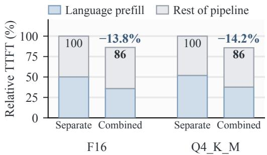  
Figure 12. Single-request TTFT for Qwen2.5-VL-3B on M4 Max with separate and combined prefill (CrossInfer). Vision runs through Core ML on the ANE, language through ggml on Metal.

In the five-run matched eight-stream OVO (Niu et al., 2025) comparison in Section 5.4, each request carries roughly 730 visual tokens and generates at most eight tokens. Requests are dispatched to idle language lanes using observed service times. Shared-prefix reuse and eight-frame stateful execution also use five complete runs per configuration. Error bars and ± values denote sample standard deviations across runs; percentage-gain deviations are in percentage points. Gains are calculated within each paired run and then averaged. At eight concurrent streams, p95 is measured from batch release to request completion.

Visual inputs. The RK3588 streaming and placement experiments with OneVision (Li et al., 2025) pool the projected spatial grid from 27 × 27 to 14 × 14, retaining one newline row for 197 visual rows per frame. The eight-stream OVO replay uses the original roughly 730-row image representation. For OneVision-0.5B, reducing the grid cuts median OpenCL prefill time by 54.0% and raises request throughput by 56.1%. This comparison varies the visual input; execution-mode comparisons keep it fixed. FastVLM-0.5B (Vasu et al., 2025) uses its own 256-row representation

Table 4. OneVision-0.5B language-weight precision on RK3588 OpenCL, using the same 200 single-frame OVO queries.
<table><tr><td>Weights</td><td>Correct / 200</td><td>Accuracy (%)</td></tr><tr><td>FP16</td><td>117</td><td>58.5</td></tr><tr><td>INT8</td><td>123</td><td>61.5</td></tr><tr><td>INT4</td><td>106</td><td>53.0</td></tr></table>

(Appendix G.7).

Language precision. INT8 gives the highest accuracy in the 200-query OneVision-0.5B OpenCL evaluation (Table 4). Each query uses one OVO frame and one generated choice token, with the same visual inputs across weight precisions. In a separate CPU context-reuse comparison, INT4 gives the highest request throughput at 1.044 req/s. That comparison uses four distinct questions, 32-token caps, and a shared 197-row visual prefix.

## C FIXED-RESOLUTION STREAMING CONFIGURATION

The 16-frame comparison in Section 5.2 uses the compiled ANE visual backend (Appendix A) and an FP16 Qwen2.5- VL-3B language model through the native ggml bridge on Metal. Both modes use these backends. Sequential split execution transfers visual tensors as bytes and finishes language generation before encoding the next frame. Overlapped execution uses TABM descriptors and encodes subsequent frames while the language worker generates answers. Frame throughput includes token handoff and completed generation, with up to 32 output tokens per request. Overlap raises frame throughput from 1.57 to 2.89 fps, 1.83× sequential split execution, at an unchanged decode rate.

The FastVLM-1.5B comparison in Table 1(b) streams eight OVO (Niu et al., 2025) frames with eight questions and generates 32 or 128 tokens per answer. The GPU-only configurations run MLX vision, encoding the next frame ahead, with 4-bit ggml or MLX language models; CrossInfer and Serial run Core ML vision whose output the ggml language model reads in place, and only CrossInfer overlaps it with generation. Every configuration retains the video KV state and runs five times. In Table 1(c), each query generates 32 tokens, and each configuration runs three times.

The Qwen3.5 (Qwen Team, 2026) scale comparison in Section 5.2 runs the same pipeline at 0.8B, 2B, 4B, and 9B: Core ML vision, Metal language execution with Q4 K M weights and retained context, and 32-, 64-, or 128-token answers, serially or with inter-stage overlap, three runs per configuration. Table 5 gives the request throughput of serial and overlapped execution and the gain from overlap at 32 and 128 tokens. At 64 tokens, overlap raises request throughput by 36.9%, 41.7%, 22.1%, and 17.5% for the 0.8B, 2B,

4B, and 9B models, and predictions made before these runs match the measured wall-clock times within 1.3%. Gains are largest for short answers, where visual processing takes the largest share of each request. All 288 pairs of serial and overlapped answers are identical across the 576 requests. Peak process RSS is sampled during overlapped execution in the 32- and 128-token runs.

## D SECOND-LANE THROUGHPUT AND BUFFER HANDOFF ON RK3588

We run 16 ordered TextVQA (Singh et al., 2019) requests using OneVision-0.5B (Li et al., 2025) with a Qwen2 (Yang et al., 2024a) language backbone, NPU vision, and at most eight generated tokens per request. Running both language lanes alongside the NPU raises request throughput by 14.3% over the best single lane, from 0.2774 to 0.3172 req/s.

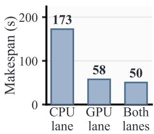

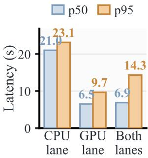  
(a) Makespan and response latency

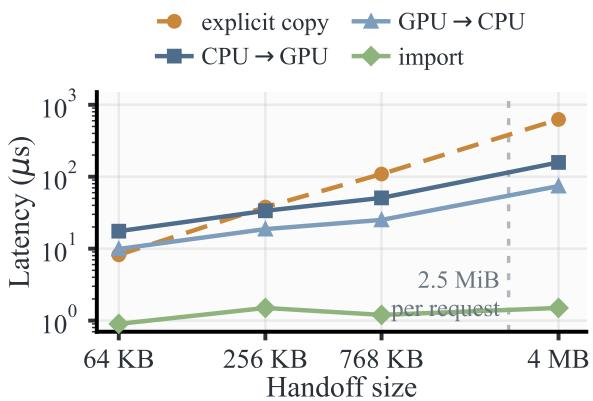  
(b) Buffer handoff latency  
Figure 13. Second-lane throughput and buffer handoff on RK3588. (a) Makespan and p50/p95 response latency over a 16-request stream. (b) Buffer handoff latency versus transfer size, medians of 50 iterations. The vertical line marks the 2.5 MiB that CrossInfer moves per request.

Adding the CPU lane reduces the 16-request stream’s makespan from 57.7 to 50.4 s, a 12.5% reduction (Figure 13).

The RK3588 co-running decode measurement in Figure 8(c)

uses 32 prefill tokens and 128 generated tokens. CPU decoding falls from 34.67 to 25.59 tok/s and Mali GPU (Arm, 2026d) decoding from 38.77 to 34.66 tok/s, for 60.25 tok/s in aggregate. Figure 11(a) uses 64 prefill tokens and 256 generated tokens.

Buffer handoff adds much less time than language execution in this workload. Importing a buffer takes about 1.2 µs across the measured sizes, using allocation mapping rather than a payload copy. A round trip for a 768 KB KV-sized block takes 75.9 µs, compared with $1 0 9 . 0 \mu s$ for explicit copying. At the 2.5 MiB payload used per request, the speedup reaches 2.7×.

At the visual–language boundary, descriptor handoff for a 1.91 MB visual-token batch takes $0 . 5 0 \mu \mathrm { s } ;$ serializing the payload takes 142× as long.

In Figure 10(a), the Python byte path converts and serializes the tensor, publishes and consumes the queue entry, and reconstructs the tensor. Descriptor handoff passes the retained tensor’s reference and metadata. In panel (b), average frame throughput is input frames divided by total run time; output throughput between the first and last completed answers is 0.987 and 0.983 fps, respectively.

## E RUNTIME FAILURE HANDLING

An illegal slot transition in TABM, such as a second publication or a release without a hold, fails the handoff instead of exposing stale data. Lane faults are distinguished from request failures: a faulty lane is removed from dispatch, whereas a failed request is retired without affecting the lane that served it.

## F QCS6490 EFFECTIVE READ BANDWIDTH

Figure 3(c) reports the 256 MiB rates; Table 6 gives both input sizes, with each engine reading complete 64 or 256 MiB inputs alone or alongside the others, as means and standard deviations over five runs.

## G ADDITIONAL CONTEXT-REUSE AND STREAMING RESULTS

## G.1 Eight-Frame Stateful Execution

The RK3588 panels in Figure 6 use eight distinct frames from one OVO video, arriving two seconds apart. Four different queries arrive at 2.001, 6.001, 10.001, and 14.001 s and bind $C _ { 2 } , C _ { 4 } , C _ { 6 }$ , and C . All six configurations execute fresh RKNN SigLIP (Zhai et al., 2023) visual encoding and the trained projector once per frame; each produces 197 visual rows. The OneVision-0.5B W8 language model uses greedy decoding to generate exactly 128 tokens per query, or 512 per session, in all six configurations. Each configuration runs five times.

Table 5. Inter-stage overlap across Qwen3.5 model sizes on Apple M4 Max: request throughput (req/s, three runs per configuration) of the same retained-context pipeline run serially and with overlap, the gain from overlap, and peak process RSS during overlapped execution.
<table><tr><td rowspan="2">Model</td><td colspan="3">32-token answers</td><td colspan="3">128-token answers</td><td rowspan="2">Peak RSS (GiB)</td></tr><tr><td>Serial</td><td>Overlap</td><td>Gain</td><td>Serial</td><td>Overlap</td><td>Gain</td></tr><tr><td>Qwen3.5-0.8B</td><td>3.618</td><td>6.009</td><td>66.1%</td><td>1.614</td><td>1.906</td><td>18.1%</td><td>1.261</td></tr><tr><td>Qwen3.5-2B</td><td>2.278</td><td>3.927</td><td>72.4%</td><td>1.069</td><td>1.324</td><td>23.9%</td><td>1.917</td></tr><tr><td>Qwen3.5-4B</td><td>1.434</td><td>1.963</td><td>36.9%</td><td>0.603</td><td>0.682</td><td>13.1%</td><td>3.394</td></tr><tr><td> $\mathrm { Q w e n } 3 . 5 { \cdot } 9 \mathrm { B }$ </td><td>1.010</td><td>1.304</td><td>29.1%</td><td>0.417</td><td>0.486</td><td>16.6%</td><td>6.094</td></tr></table>

Table 6. Effective read throughput on QCS6490 (Qualcomm Technologies, Inc., 2025) (GB/s, mean ± SD over five repeats) for engines reading alone and together.
<table><tr><td rowspan="2">Configuration</td><td colspan="4">64MiB</td><td colspan="4">256 MiB</td></tr><tr><td>CPU</td><td>GPU</td><td>NPU</td><td>Sum</td><td>CPU</td><td>GPU</td><td>NPU</td><td>Sum</td></tr><tr><td>CPU</td><td> $1 5 . 2 0 { \pm } 0 . 0 6$ </td><td>一</td><td></td><td>15.20</td><td> $1 5 . 5 2 { \pm } 0 . 0 4 $ </td><td>一</td><td></td><td>15.52</td></tr><tr><td>GPU</td><td>一</td><td> $1 2 . 2 0 { \pm } 0 . 1 0 $ </td><td></td><td>12.20</td><td>一</td><td> $1 3 . 9 3 { \pm } 0 . 1 1 $ </td><td></td><td>13.93</td></tr><tr><td>NPU</td><td></td><td>一</td><td> $1 0 . 6 1 { \pm } 0 . 1 0$ </td><td>10.61</td><td>1</td><td>一</td><td> $1 1 . 6 8 { \pm } 0 . 0 6 $ </td><td>11.68</td></tr><tr><td> $\mathrm { C P U + G P U }$ </td><td> $4 . 6 3 { \pm } 0 . 0 9$ </td><td> $1 1 . 0 7 { \pm } 0 . 0 9$ </td><td></td><td>15.71</td><td> $2 . 4 4 { \pm } 0 . 1 1$ </td><td> $1 3 . 2 8 { \pm } 0 . 1 1 $ </td><td></td><td>15.72</td></tr><tr><td> $\mathrm { C P U + N P U }$ </td><td> $8 . 6 3 { \pm } 0 . 1 0$ </td><td>一</td><td> $6 . 9 1 { \pm } 0 . 0 8$ </td><td>15.53</td><td> $8 . 1 0 { \pm } 0 . 1 0$ </td><td>一</td><td> $7 . 8 1 { \pm } 0 . 0 9$ </td><td>15.90</td></tr><tr><td> $\mathrm { G P U + N P U }$ </td><td></td><td> $6 . 0 0 { \pm } 0 . 1 3$ </td><td> $8 . 9 2 { \pm } 0 . 1 2$ </td><td>14.91</td><td></td><td> $5 . 9 1 { \pm } 0 . 0 4$ </td><td> $9 . 7 3 { \pm } 0 . 0 2$ </td><td>15.63</td></tr><tr><td> $\mathrm { C P U + G P U + N P U }$ </td><td> $5 . 9 2 { \pm } 0 . 1 0 $ </td><td> $4 . 8 9 { \pm } 0 . 0 6$ </td><td> $4 . 8 3 { \pm } 0 . 0 4 $ </td><td>15.65</td><td> $5 . 1 7 { \pm } 0 . 0 2$ </td><td> $5 . 3 2 { \pm } 0 . 0 0$ </td><td> $5 . 3 2 { \pm } 0 . 0 0$ </td><td>15.80</td></tr></table>

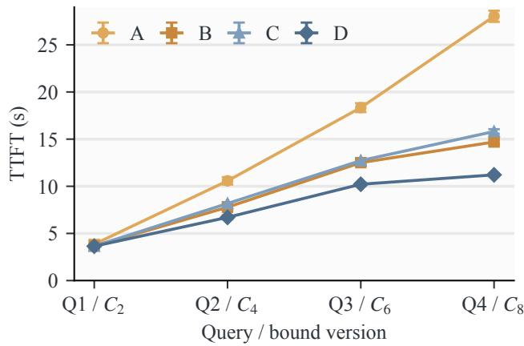  
Figure 14. Per-query TTFT for the four matched configurations in Figure 6. A: neither mechanism; B: ingestion during generation; C: context reuse; D: both (CrossInfer). Each query uses the same bound version in all four configurations. Points and error bars show five-run means and sample standard deviations.

Configurations A–D fix OpenCL context preparation and CPU answer generation. Without reuse, each query rebuilds its 2/4/6/8-frame history; with reuse, only new frames are appended. Both begin preparing frames as they arrive. Disabling ingestion during generation delays subsequent language preparation until the preceding answer finishes.

Figure 14 shows how query waiting changes as history grows. Mean TTFT falls from 15.20 to 7.94 s with both mechanisms. After reuse, ingestion during generation adds 15.6% throughput. With both mechanisms, CrossInfer exceeds the reuse-enabled CPU-only and GPU-only baselines by 11.6% and 37.2% in req/s, with mean TTFT lower by 15.1% and 34.6%, respectively. Ingestion and answering overlap for $7 . 0 1 \pm 0 . 1 4 \mathrm { s } .$ . All sixty paired comparisons preserve token IDs and first-step logits as ingestion advances through the bound versions.

Table 7. M4 Max CPU-to-Metal execution on the eight-frame stream. A–D use the same mechanism settings as Figure 15.
<table><tr><td>Configuration</td><td>Completion (s)</td><td>Mean TTFT (s)</td></tr><tr><td>A</td><td>60.219</td><td>21.345</td></tr><tr><td>B</td><td>57.259</td><td>19.837</td></tr><tr><td>C</td><td>27.265</td><td>7.760</td></tr><tr><td>D (CrossInfer)</td><td>24.293</td><td>6.234</td></tr></table>

M4 Max. Figure 15 uses the same eight frames and query arrivals, with fresh MLX visual encoding and Qwen2.5-VL-3B Q4 K M language execution. CPU ingests the frames; Metal (Apple, 2026b) imports each bound context and generates the answer. Each frame supplies 196 visual rows, and every configuration generates four 128-token answers. The session time includes visual encoding, context construction, state handoff, and generation.

Reuse reduces frame prefills from twenty to eight. Ingestion during generation adds 12.2% throughput after reuse; together the two mechanisms reduce mean TTFT by 70.8% (Table 7). Metal-only execution with context reuse completes the same session in 26.2 s, so D delivers 7.9% more request throughput. All twelve paired comparisons with the same path’s serial execution match token sequences and complete first-continuation logit vectors.

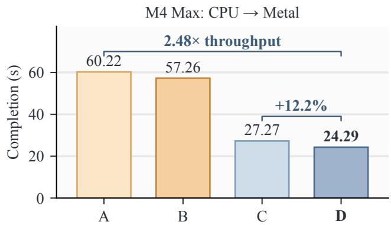  
Figure 15. CPU-to-Metal execution on M4 Max: 2.48× request throughput with context reuse and ingestion during generation (D vs. A), and 12.2% additional throughput after reuse (D vs. C). Qwen2.5-VL-3B with 4-bit language weights processes eight frames and four queries, generating 128 tokens per query. A–D use the mechanism settings in Figure 6.

## G.2 Cross-Query Multimodal Context Reuse

Four requests share one image and alternate two questions, generating eight tokens each. The first request builds the context; the remaining three reuse it. Both platforms keep models resident, and the measured window includes the first cache miss, image processing, visual execution, language state preparation or import, and generation. RK3588 uses five four-request runs per configuration.

On RK3588, RKNN SigLIP and the trained projector feed an OpenCL OneVision-0.5B W8 context builder; CPU answers import its cached 24-layer KV state without replaying the language prefix. M4 Max uses MLX Qwen2.5-VL vision and native Qwen2.5-VL-3B Q4 K M Metal execution (Gerganov, 2023; Apple, 2026b), retaining the root and forking a private suffix for each answer. Visual encoding and common-prefix construction each fall from four executions to one. All twenty RK3588 and four M4 Max cached answers match their rebuild counterparts; RK3588’s first-token logits also match exactly.

Figure 16 separates the initial miss from subsequent reuse. RK3588’s mean TTFT falls from 3465 to 1089 ms, and session time from 14.820 to 5.316 s. On M4 Max, mean TTFT falls from 293 to 97 ms and session time from 1.372 to 0.587 s.

Larger models. Qwen2.5-VL-3B and OneVision-7B use INT4 language weights on the RK3588 CPU. Each answers four distinct questions sharing one image, generating 32

tokens per question.

Reusing context raises Qwen2.5-VL-3B’s request rate from 0.0350 to 0.1011 req/s and reduces mean first-token time from 25.29 to 6.74 s. Subsequent queries return their first token in 0.52–0.58 s. For OneVision-7B, request rate rises from 0.0479 to 0.0908 req/s and mean TTFT falls from 13.73 to 4.20 s; subsequent queries reach the first token in $0 . 9 0 { - } 1 . 0 7 \mathrm { s } .$ . All four Qwen2.5-VL-3B output sequences and all four OneVision-7B first-step logit vectors match their rebuild counterparts.

## G.3 Incremental Context Extension

In three-query incremental sequences, context reuse reduces completion time by factors of 1.6–2.4 across the two platforms. On M4 Max, TTFT for a query after the fourth frame falls from 403.5 to 162.2 ms. On OpenCL, all three answers from the retained-context sequence match those from rebuilt context.

Native Metal context reuse also accelerates a three-frame, three-query sequence by 1.62–1.63× relative to rebuilding history for each question. This Qwen2.5-VL-3B Q4 K M measurement uses prepared MLX visual embeddings and eight generated tokens per answer. All three reused-context answers match rebuilding.

## G.4 Replay-Based Context Preparation

A separate three-frame RK3588 experiment prepares lanelocal context through replay and retained replicas, rather than state import. With eager replicas and state-aware routing, the first two queries run on CPU and the third on OpenCL. Relative to CPU-only execution, Q3’s arrival-tofirst-token time falls from 7.447 to 4.397 s (41.0%), and the third frame’s arrival-to-publication delay falls from 7.269 to 4.101 s. Request throughput rises by 4.67%, from 0.220 to 0.230 req/s. OpenCL prepares $C _ { 2 }$ and $C _ { 3 }$ while CPU answers from $C _ { 1 }$ and $C _ { 2 } .$ , with 1.165 and 0.539 s of native prefill/decoding concurrency.

Each query binds its required version, including when that version is requested after later ingestion. All sixteen samebackend serial-reference comparisons match every token ID and first-step logit: four configurations, each with three timed answers and one historical-version answer.

## G.5 Concurrent Sequence Generation

The RK3588 sweep in Figure 17 varies concurrency from two to sixteen streams, reaching 52.0% higher request throughput than serial execution. In the matched two-stream comparison, each lane serves eight requests. The five-run eight-stream comparison appears in Figure 7, and CrossInfer improves both throughput and p95 latency in every run.

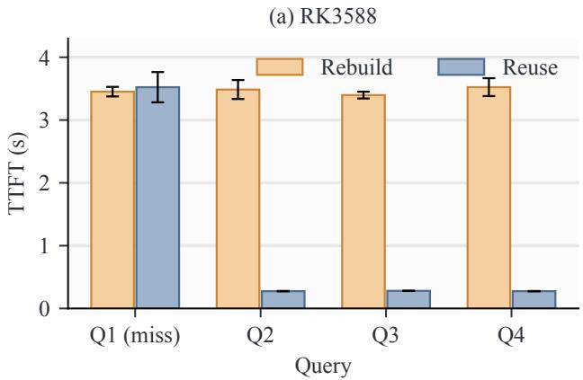

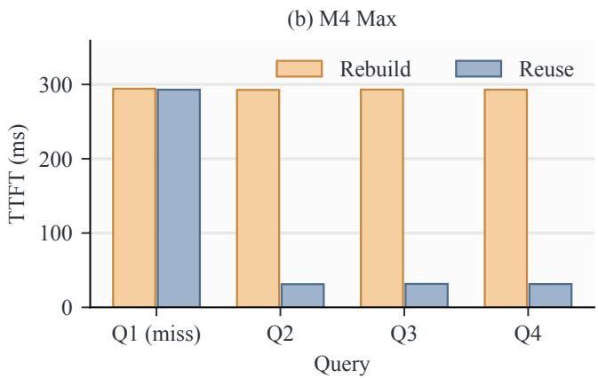  
Figure 16. Cross-query context reuse, including the initial cache miss. Four requests share a visual prefix and generate eight tokens each. Mean TTFT falls by 68.6% on RK3588 and 67.0% on M4 Max; reuse delivers 2.79× and 2.34× the end-to-end request throughput of rebuilding context, respectively. Subsequent requests avoid visual encoding and common-prefix construction. RK3588 bars show five-run means with sample-SD error bars.

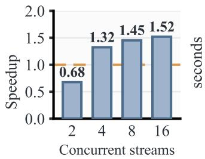  
(a) Throughput relative to serial

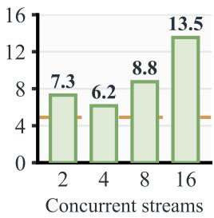  
(b) Median TTFT  
Figure 17. RK3588 concurrent-stream sweep. Dashed lines mark the serial OpenCL baseline shared by all four concurrency settings.

On M4 Max, the OVO replay in Figure 7(a,b) runs Qwen2.5- VL-3B with Q4 K M language weights. Answers are capped at 32 tokens, and each configuration generates 297 tokens in total. With identical weights, precision, inputs, context, and decoding settings, all 16 M4 Max OVO outputs match their serial counterparts in every configuration. All 80 RK3588 eight-stream comparisons match the same lane running alone.

## G.6 State-Aware Dispatch

Figure 9(a,b) evaluates OneVision-0.5B W8 on RK3588. RKNN SigLIP and the trained projector prepare 197 visual rows per frame before the query-placement window. The CPU retains the requested context, and the GPU starts with a warm model and reconstructs the query’s context from retained embeddings.

Histories contain one, four, or eight frames. For each history, short and medium backlogs use one background query $R _ { 1 }$ , with $R _ { 2 }$ arriving after 70% or 30% of its calibrated solo duration. The long backlog queues three $R _ { 1 }$ jobs and releases $R _ { 2 }$ after 10% of the first job’s solo duration. The corresponding $R _ { 1 }$ budgets are 50, 78, and 128 tokens for the three history lengths; every $R _ { 2 }$ generates 32 tokens.

Solo and co-running calibration supplies the dispatcher’s preparation and service estimates. The nine choices compare the two fixed policies with the $W + P + S$ selector. All 27 executions match their own backend’s serial reference tokens and full first-step logits.

Online dispatch on QCS6490. On QCS6490, two streams each contain eight frames and four queries, with 128 output tokens per query. OneVision-0.5B uses INT4 language weights; fresh visual encoding runs through QNN (Qualcomm Technologies, Inc., 2026a) on the Hexagon NPU (Qualcomm Technologies, Inc., 2026c) with 8-bit weights and 16-bit activations, followed by the trained CPU projector. All dispatch policies use the same arrival trace, engine allocation, and initial cost estimates. Idle-first selects an idle lane; reuse-first favors the lane holding the context; CrossInfer chooses by $W + P + S$

The dense trace releases frames at one-second intervals, offsets the two streams by 50 ms, and issues queries just after frames 2, 4, 6, and 8. Table 8 reports means over five runs. Request throughput includes visual processing, context preparation, state handoff, and generation; TTFT runs from query arrival to the first token. CrossInfer reduces mean TTFT by 8.98% relative to CPU-only with retained context. On sparse and burst traces, the reductions are 17.91% and 14.49%, respectively.

Table 8. Online dispatch on QCS6490: request throughput and mean TTFT over five runs of the dense two-stream trace. Both single-lane baselines retain context.
<table><tr><td>Configuration</td><td>Throughput (req/s)</td><td>Mean TTFT (s)</td></tr><tr><td>CPU-only</td><td>0.15811</td><td>23.877</td></tr><tr><td>GPU-only</td><td>0.11250</td><td>31.741</td></tr><tr><td>Idle-first</td><td>0.14699</td><td>22.985</td></tr><tr><td>Reuse-first</td><td>0.10976</td><td>32.738</td></tr><tr><td>CrossInfer</td><td>0.15773</td><td>21.732</td></tr></table>

Table 9. RK3588 execution modes with OneVision-7B and FastVLM-0.5B, using precomputed visual embeddings. Each concurrent request generates 32 tokens; each stateful query generates 64. CPU+GPU serial uses the same ingestion, state-transfer, and answer paths as CrossInfer, but waits for the previous answer before ingesting the next frame.
<table><tr><td></td><td colspan="2">OneVision-7B</td><td colspan="2">FastVLM-0.5B</td></tr><tr><td>Configuration</td><td>Req/s TTFT (s)</td><td>Mean</td><td>Req/s</td><td>Mean s TTFT (s)</td></tr><tr><td colspan="5">Concurrent Sequence Generation</td></tr><tr><td>CPU-only</td><td>0.04664</td><td></td><td>46.5920.53015</td><td>4.074</td></tr><tr><td>GPU-only</td><td>0.04727</td><td>44.653</td><td>0.32787</td><td>6.565</td></tr><tr><td>CrossInfer</td><td>0.06021</td><td>33.267</td><td>0.72757</td><td>3.073</td></tr><tr><td colspan="5">Stateful Streaming Generation</td></tr><tr><td>CPU-only</td><td>0.03517</td><td></td><td>27.6220.39184</td><td>1.535</td></tr><tr><td>GPU-only</td><td>0.03337</td><td></td><td>27.2540.28519</td><td>2.079</td></tr><tr><td>CPU+GPU serial</td><td>0.03427</td><td></td><td>26.9300.38469</td><td>1.709</td></tr><tr><td>CrossInfer</td><td>0.04304</td><td></td><td>21.471 0.43790</td><td>1.385</td></tr></table>

## G.7 Execution Modes with OneVision-7B and FastVLM-0.5B

Figure 8(d) uses INT4 language weights with block size 64 and greedy generation on RK3588. Model-specific visual embeddings are prepared before timing: OneVision-7B uses its trained SigLIP/projector to produce 197 rows of 3584 values per frame, and FastVLM-0.5B (Vasu et al., 2025) uses its FastViTHD/projector to produce 256 rows of 896 values. Table 9 gives the absolute request rates and mean TTFT. The CPU and GPU lanes run at similar rates with OneVision-7B, whereas FastVLM-0.5B runs faster on the CPU.

For Concurrent Sequence Generation, four independent visual requests arrive together, each building its own context. The combined configuration assigns two requests to each lane. Throughput uses the shared batch wall clock, and TTFT starts at batch release, including queueing. For Stateful Streaming Generation, two distinct frames arrive at 0 and 2 s, with a query 1 ms after each frame, bound to $C _ { 1 }$ and $C _ { 2 }$ respectively. Single-lane configurations retain the history. In the combined configuration, OpenCL ingests each frame and exports its context for CPU import and generation. TTFT starts at each query’s scheduled arrival.

Table 10. QCS6490 request throughput (req/s) with on-device visual processing and 128 output tokens per query. CPU+GPU serial is defined as in Table 9.
<table><tr><td colspan="2">OneVision</td><td colspan="2">FastVLM</td></tr><tr><td>Configuration</td><td>0.5B</td><td>0.5B</td><td>1.5B</td></tr><tr><td colspan="3">Concurrent Sequence Generation</td></tr><tr><td>CPU-only GPU-only</td><td>0.2145 0.1690</td><td>0.2143 0.1622</td><td>0.0765 0.0744</td></tr><tr><td>CrossInfer</td><td>0.2453</td><td>0.2491</td><td>0.0897</td></tr><tr><td colspan="4">Stateful Streaming Generation</td></tr><tr><td>CPU-only</td><td>0.1545</td><td>0.1488</td><td>0.0572</td></tr><tr><td>GPU-only</td><td>0.1112</td><td>0.0974</td><td>0.0522</td></tr><tr><td>CPU+GPU serial</td><td>0.1418</td><td>0.1251</td><td>0.0540</td></tr><tr><td>CrossInfer</td><td>0.1713</td><td>0.1553</td><td>0.0671</td></tr></table>

For OneVision-7B, the next frame’s prefill overlaps the CPU’s answer to the previous query, and the second query’s TTFT falls by 11.0 s, from 40.83 s with CPU-only to 29.84 s. All eight concurrent outputs match their own-lane references, and all four stateful outputs match the serial execution of the same GPU-to-CPU path, including every first-step logit. Corresponding $C _ { 1 }$ and $C _ { 2 }$ prefixes have bit-identical per-layer K/V tensors under serial and overlapped execution: all 28 layers for OneVision-7B and all 24 for FastVLM-0.5B.

## G.8 Execution Modes on QCS6490

On Qualcomm QCS6490 (Qualcomm Technologies, Inc., 2025), we evaluate OneVision-0.5B, FastVLM-0.5B, and FastVLM-1.5B end to end, encoding every frame on the device (Figure 8(d)). The Qualcomm AI Engine Direct SDK (QNN) (Qualcomm Technologies, Inc., 2026a) runs the visual encoders on the Hexagon NPU (Qualcomm Technologies, Inc., 2026c) with 8-bit weights and 16-bit activations, and the CPU runs the trained projectors. OneVision-0.5B’s SigLIP encoder executes as seven NPU partitions, and pooling yields 197 rows per frame. FastVLM’s full visual encoder runs on the NPU, producing 256 rows per frame. Language execution uses MNN (Jiang et al., 2020) with INT4 weights on the CPU and, through OpenCL, on the Adreno GPU (Qualcomm Technologies, Inc., 2026b), with greedy generation. Every configuration generates 128 tokens per query, with EOS termination disabled.

Concurrent Sequence Generation serves four requests with distinct frames and questions. Stateful Streaming Generation ingests eight frames arriving one second apart and answers four queries bound to $C _ { 2 } , C _ { 4 } , C _ { 6 }$ , and $C _ { 8 }$ . As on RK3588, OpenCL ingests each frame and exports its context, and the CPU imports it to answer. Table 10 gives the absolute request rates. The CPU is the faster single lane for all three models. Ingestion during generation raises request throughput by 20.8–24.3% over CPU+GPU serial.

Table 11. QCS6490 accuracy (%) on 200 single-frame OVO questions per model. CPU columns vary language-weight precision with the same visual frontend. The last column uses INT4 language weights and GPU-built context imported for CPU generation.
<table><tr><td rowspan="2">Model</td><td colspan="2">CPU GPU→CPU</td></tr><tr><td>INT4 INT8</td><td>FP16 INT4</td></tr><tr><td>OneVision-0.5B</td><td>47.0 59.0</td><td>58.0 50.5</td></tr><tr><td>FastVLM-0.5B</td><td>69.5 75.5 74.0</td><td>70.5</td></tr><tr><td>FastVLM-1.5B</td><td>74.0 72.0 73.0</td><td>72.5</td></tr></table>

Ingestion overlaps decoding for 10.55, 13.82, and 26.51 s with OneVision-0.5B, FastVLM-0.5B, and FastVLM-1.5B, respectively.

In all 24 comparisons, eight per model, outputs match token IDs and complete first-step logits: each concurrent request matches its own lane’s reference, and each streaming answer matches serial execution on the same GPU-to-CPU path.

GPU-to-CPU generation achieves task accuracy comparable to CPU-local INT4 (Table 11), with KV imported for all 600 task queries.

## G.9 State Handoff

RK3588. Figure 11(c) compares CPU incremental replay with import of ready OpenCL contexts for three OneVision-0.5B W8 queries. Each frame has 197 prepared visual rows; each answer generates eight tokens. Mean time to the first token falls from 1482 to 319 ms. Repeated queries of each imported version match every token and first-step logit in all three comparisons.

M4 Max. Table 2(a) uses Qwen2.5-VL-3B Q4 K M and 200 single-frame OVO queries with fixed 384 × 384 images. MLX prepares 196 visual tokens per image. CPU-local, Metal-local and CPU-to-Metal paths receive the same visual embeddings, questions, and option order. The CPU root is exported before the question; Metal imports it, prefills the question, and emits one greedy choice token.

## G.10 Integrated Multi-Stream Execution

The two-stream runs use OneVision-0.5B with INT8 language weights and FP16 SigLIP vision on RK3588. Two OVO video clips supply eight frames each, and each query binds the context version covering the frames that arrived before it. Generation is greedy. Each frame passes through the NPU visual encoder and trained projector, then pooling produces 197 visual rows.

All four configurations use the same arrival trace, and the timed window includes visual encoding, projection, initial context preparation, state handoff, queueing, and generation. CrossInfer retains separate histories for the two streams, ingests frames on OpenCL, and selects each answer’s engine online using $W + P + S$ and one shared queue per engine. Published query-visible contexts remain fixed as ingestion advances.

Table 12. Two-stream RK3588 request throughput (req/s) and mean TTFT (s). Parentheses give throughput SD over three runs for the fixed-112-token setting.
<table><tr><td rowspan="2">Configuration</td><td>112 tokens</td><td colspan="2">EOS, 128-token cap</td></tr><tr><td>req/s TTFT</td><td>req/s</td><td>TTFT</td></tr><tr><td>Naive Parallelism</td><td>0.1261 (0.0016) 17.01</td><td>0.118</td><td>16.96</td></tr><tr><td>CPU, reuse</td><td>0.1341 (0.0004) 17.27</td><td>0.134</td><td>15.11</td></tr><tr><td>GPU, reuse</td><td>0.1191 (0.0007) 19.37</td><td>0.119</td><td>18.30</td></tr><tr><td>CrossInfer</td><td>0.1604 (0.0013) 11.25</td><td>0.147</td><td>12.14</td></tr></table>

In the run of Figure 9(c,d), every answer generates 112 tokens and each configuration runs three times. Table 12 gives request throughput and mean TTFT. Against CPU reuse, CrossInfer lowers p95 TTFT from 27.64 to 17.59 s, p95 query completion from 31.62 to 21.94 s, and session time from 59.67 to 49.89 s. Ingestion of new context overlaps decoding from earlier versions for 5.80 s on average. With 16-token answers, little generation remains to overlap, and CrossInfer’s request throughput is 2.3% below CPU reuse. All 168 answers across these runs reproduce the token IDs and complete first-step logits of serial execution along the same backend path.

In a separate 128-token run, CrossInfer’s processes peak at 3.51 GiB of resident memory in total, with mean utilization of 295% CPU, 35.1% GPU, and 70.5%, 23.2%, and 23.2% on the three NPU cores.

The earlier run in Figure 18 releases each stream’s frames at four-second intervals, starts the second stream 50 ms later, and issues queries 1 ms after frames 2, 4, 6, and 8. It uses a 128-token cap with EOS termination. There, CrossInfer raises request throughput by 9.3% and cuts mean TTFT by 19.6% relative to CPU reuse, and gains 24.8% over Naive Parallelism. Seven answers import the GPU’s KV state and run on CPU; one runs on OpenCL. CPU and GPU decode different streams concurrently for 7.66 s, and within a stream, new-frame ingestion also overlaps an earlier answer. The longest TTFT falls from 26.89 s with CPU reuse to 22.06 s. All eight answers in each configuration reproduce the token IDs and complete first-step logits of serial execution along the same backend path.

## H STAGE COSTS AND SECOND-LANE DECODING ON M4 MAX

These measurements run the Qwen2.5-VL-3B language model with Q4 K M weights on Apple M4 Max. Metal leads the CPU at every stage, by 7.99× in 1024-token prefill but only 1.69× in decoding, close to its 1.62× lead in sequential reads (Table 13).

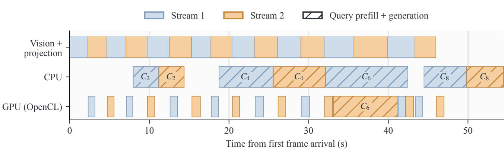  
Figure 18. Both execution modes in the earlier two-stream RK3588 run with EOS termination. Colors identify the streams. Solid language intervals ingest frames; hatched intervals process queries, including query prefill and generation. Query labels identify the bound context version. Vision and projection process all sixteen arriving frames.

Table 13. CPU and Metal on Apple M4 Max for the Qwen2.5-VL 3B language model.
<table><tr><td>Measurement</td><td>CPU</td><td>Metal</td><td>Metal/CPU</td></tr><tr><td>Sequential read, 1 GiB (GB/s)</td><td>286.82</td><td>463.77</td><td>1.62×</td></tr><tr><td>Prefill, 1024 tokens (tok/s)</td><td>270.91</td><td>2163.41</td><td>7.99×</td></tr><tr><td>Decode, 32-token prefix (tok/s)</td><td>90.51</td><td>152.51</td><td>1.69×</td></tr></table>

Table 14. Decode throughput (tok/s) on Apple M4 Max with each lane decoding from a retained prefix, alone and co-running. The gain is over Metal alone.
<table><tr><td>Prefix</td><td>CPU</td><td>Metal</td><td>CPU+Metal</td><td>Gain</td></tr><tr><td>32 tokens</td><td>90.51</td><td>152.51</td><td>208.16</td><td>36.5%</td></tr><tr><td>1024 tokens</td><td>82.89</td><td>149.09</td><td>199.64</td><td>33.9%</td></tr></table>

Each lane decodes a separate sequence from a retained prefix, alone and co-running, with three runs per configuration (Table 14). At a 1024-token prefix, co-running lowers Metal from 149.09 to 140.53 tok/s while the CPU contributes 59.11 tok/s, so the two lanes deliver 199.64 tok/s, 33.9% more than Metal alone. A stage-cost model calibrated before this operating point was measured predicts 204.28 tok/s, 2.32% above the measured rate, and chooses co-running. Figure 8(c) marks the prediction. In the prefill and generation sweep of Figure 8(a), the CPU lane serves 0.125 req/s against 1.768 req/s on Metal at 1024 prefill tokens and eight output tokens.