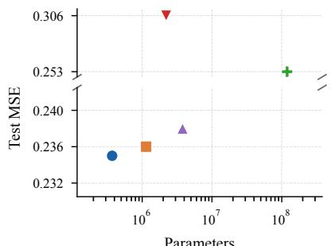
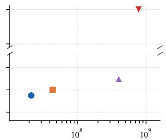
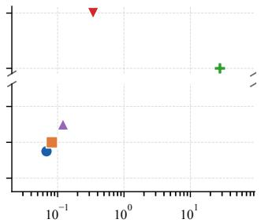
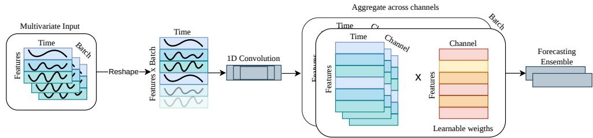
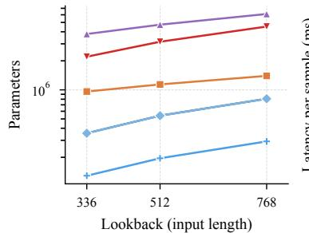
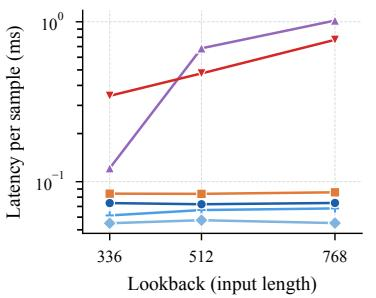
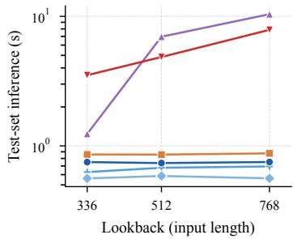

# STeP-TS: Shared Temporal Filters with Pruning for Time Series

Hanne Raum∗ Department of Computer Science Albert-Ludwigs-Universität Freiburg raum@informatik.uni-freiburg.de

Jasper Hoffmann Department of Computer Science Albert-Ludwigs-Universität Freiburg

Joschka Bödecker Department of Computer Science and BrainLinks-BrainTools Albert-Ludwigs-Universität Freiburg

## Abstract

Multivariate time series forecasting requires capturing temporal dependencies across multiple scales while accounting for both shared and variable-specific dynamics. Compact forecasting models have emerged as an attractive alternative to increasingly large architectures, but preserving strong predictive performance within tight computational and memory budgets remains challenging. We propose a compact one-layer convolutional framework that learns a shared bank of multiscale temporal filters of each variable. Lightweight variable-specific scalar weights determine the contribution of each temporal component, enabling the model to capture shared temporal structure while adapting to variable-specific dynamics. The learned weights and filter-output energy further provide a natural signal for structured pruning of convolutional filters, reducing computational complexity with minimal degradation in forecasting performance. We additionally introduce an amplitude-adaptive normalization mechanism that preserves variable-dependent temporal amplitudes. Experiments on multiple datasets demonstrate forecasting performance competitive with state-of-the-art methods while requiring substantially fewer parameters and inference FLOPs and achieving low per-sample latency.

## 1 Introduction

Forecasting is crucial in many real-world applications such as weather prediction [Kurth et al., 2023], transportation systems [Lv et al., 2015], and power demand estimation [Alsalem, 2025]. Time-series forecasting has evolved from classical statistical models such as ARIMA [Jenkins, 2014] to deeplearning approaches including LSTMs [Hochreiter and Schmidhuber, 1997], convolutional models such as ModernTCN [Luo and Wang, 2024], and Transformers such as PatchTST [Nie et al., 2022].

However, increasing model complexity does not necessarily improve forecasting performance. DLinear [Zeng et al., 2023], for example, showed that simple linear mappings can outperform substantially larger Transformer models on several long-term forecasting benchmarks. This raises the question of how much model capacity is actually required for accurate forecasting, especially in resourceconstrained settings.

A similar question arises for convolutional architectures. Convolutions can be interpreted as learnable filters whose frequency response is determined by their kernel weights, while the kernel size influences the temporal receptive field. Temporal Convolutional Networks (TCNs) increase the receptive field through dilated convolutions ([Sen et al., 2019], [Bai et al., 2018]), while more recent architectures

  
Parameters

  
Inference FLOPs (fwd pass)

  
Latency per sample (ms)  
STeP-TS (ours), L=520 xLSTMMixer, L=512 ModernTCN, L=336 PatchTST, L=336 Chronos-2 (zero-shot)

Figure 1: Accuracy against cost on Weather (horizon = 336). STeP-TS matches the strongest baselines in test MSE (0.235 vs 0.236 / 0.238) while using 3.1× fewer parameters and 3.0× fewer inference FLOPs than xLSTMMixer, and 10.2× / 27.3× fewer than ModernTCN. Each model is measured at its own published configuration, so lookback differs per model (given in the legend). PatchTST uses default hyperparameters, as additional reference Chronos2 [Ansari et al., 2025b] (zero-shot) is added

such as ModernTCN employ large-kernel convolutions to efficiently capture long-range temporal dependencies [Luo and Wang, 2024]. This motivates investigating how kernel size, receptive field, and model complexity influence forecasting performance, and how much convolutional capacity is necessary to capture the relevant temporal structure.

In this work, we propose STeP-TS (Shared Temporal Filters with Pruning for Time Series), a simple one-layer model that decomposes the input into parallel multi-scale temporal components using convolutional filters with different kernel sizes. As shown in Fig. 1, STeP-TS achieves competitive forecasting accuracy while requiring substantially fewer parameters and inference FLOPs than strong baselines.

Our design is motivated by the observation that variables in multivariate time series often exhibit shared temporal and spectral characteristics, while retaining variable-specific dynamics and interactions. We therefore use shared temporal filters across all variables, an assumption also adopted by approaches such as [Chen et al., 2023, Das et al., 2024, Kraus et al., 2025]. Rather than learning separate filters for each variate learned scalar weights combine the resulting components to adapt the shared filters to variable-specific dynamics. Furthermore, the learned weights, together with the energy of the convolutional outputs, provide a simple criterion for identifying and pruning entire convolutional filters, reducing computational complexity without additional optimization or performance-based pruning. The shallow architecture makes the contribution of individual filters directly observable, providing a transparent basis for structured pruning.

We make the following contribution:

1. We propose a simple one-layer convolutional architecture that achieves competitive state-ofthe-art forecasting performance while requiring substantially less architectural complexity

2. We improve computational efficiency through a simple, filter-pruning mechanism that uses the learned feature-specific weights and the energy of the convolutional filter outputs to identify and remove entire convolutional filters without significant performance degradation.

3. We mitigate the damping effect of convolutional filters by introducing a learned amplitudeadaptive normalization mechanism that preserves and adapts the amplitude of temporal patterns across variables.

## 2 Related work

In the following, we provide a short overview of different architectures used in time series forecasting.

Recurrent Neural Networks (RNNs), particularly Long Short-Term Memory (LSTM) [Hochreiter and Schmidhuber, 1997], model temporal dependencies recurrently. XLSTMTime [Alharthi and Mahmood, 2024] extends LSTM with modified memory structures and exponential gating, while XLSTM-Mixer [Kraus et al., 2025] combines this approach with an NLinear-based backbone [Zeng et al., 2023]. State Space Models (SSMs) provide another approach, with SMamba [Wang et al., 2025] adapting Mamba to forecasting through bidirectional and additional linear layers.

MLP-based models include DLinear [Zeng et al., 2023], which decomposes series into trend and seasonal components, as well as TiDE [Das et al., 2024] and CycleNet [Lin et al., 2024], which incorporate covariates and cyclic patterns, respectively. TSMixer Chen et al. [2023] mixes information across temporal and feature dimensions, while TimeMixer [Wang et al., 2024] adopts a multiscale decomposition and mixing strategy inspired by filter banks [Rabiner, 1996] and wavelet-based multiresolution analysis [Mallat, 1989].

Transformer-based models such as Informer [Zhou et al., 2021], Autoformer [Wu et al., 2021], and FEDformer [Zhou et al., 2022] introduced increasingly complex architectures, although their performance was challenged by simpler models such as DLinear. PatchTST [Nie et al., 2022] improved upon DLinear using patch-based Transformers with variable-independent processing. More recently, pretrained time-series foundation models such as Chronos-2 [Ansari et al., 2025a] and Moirai [Liu et al., 2026] have scaled forecasting through large-scale pretraining, at substantially higher computational cost.

Convolutional Neural Networks (CNNs) capture temporal patterns through convolutional operations. SCINet [Liu et al., 2022] uses recursive decomposition, MICN [Wang et al., 2023] combines seasonaltrend decomposition with multiscale pooling, and ModernTCN [Luo and Wang, 2024] employs patch embedding and large-kernel depthwise convolutions.

In contrast, our approach avoids explicit decomposition, patchification, and hierarchical processing. It learns parallel temporal filters with different kernel sizes, providing multiple receptive fields, while per-variable and per-feature weighting enables variable-specific adaptation. Filters can be pruned to adapt model capacity, and large strides with interpolation enable efficient large-kernel filtering. The resulting model forms a compact and potentially sparse multi-scale temporal filter bank.

## 3 Method

In the following, we describe the model architecture, an overview is given in Fig. 2. For consistency, we define the notation for multivariate forecasting. The input is a time series vector ${ \bf X } _ { T } = \{ { \bf x } _ { 1 } , \ldots , { \bf x } _ { T } \} \in \mathbb { R } ^ { V \times T }$ , where $T$ denotes the number of time steps and V the number of variables. The goal is to predict the future time sequence $\mathbf { Y } _ { H } = \{ \mathbf { x } _ { T + 1 } , \dotsc , \mathbf { x } _ { T + H } \} \in \mathbb { R } ^ { V \times H }$ over a forecasting horizon of length $H$

Decomposition module. The decomposition module assumes that variates within the same domain share common temporal patterns, e.g. due to similar sampling rates or underlying periodicities. Instead of learning independent filters for each variate, the model learns shared temporal filters across all variates to capture common frequency patterns efficiently.

Given an input time series $\mathbf { X } _ { T } \in \mathbb { R } ^ { B \times V \times T }$ , we merge the batch B and the variate dimension to $\tilde { \mathbf { X } } \in \mathbb { R } ^ { ( B \cdot V ) \times T }$ . A set of $C$ one-dimensional convolutional filters $\{ k _ { c } \} _ { c = 1 } ^ { C }$ with different kernel sizes is applied along the temporal axis,

$$
\begin{array} { r } { \tilde { \bf X } ^ { \mathrm { c o n v } } = k _ { c } * \tilde { \bf X } , c = 1 , . . . , C , } \end{array}
$$

enforcing the learning of filters that generalize across both samples and features. or pruning, the convolutional weights are normalized as described in Appendix A.1. After convolution, the representation is reshaped back to $\mathbf { X } ^ { \mathrm { c o n v } } \in \mathbb { R } ^ { B \times V \times C \times T }$ . To retain variate-specific characteristics, learnable aggregation weights $\mathbf { A } _ { \mathbf { v } , \mathbf { c } } \in \mathbb { R } ^ { V \times C }$ determine the contribution of each channel to each variate:

$$
\mathbf { X } _ { b , v , t } ^ { \mathrm { o u t } } = \sum _ { c = 1 } ^ { C } \mathbf { A _ { v , c } } \mathbf { X } _ { b , v , c , t } ^ { \mathrm { c o n v } }
$$

resulting into an final output $\mathbf { X } ^ { \mathrm { o u t } } \in \mathbb { R } ^ { B \times V \times T }$ , which are passed to an ensemble head for the final forecast. Additional the aggregation weights are later used to provide a signal for pruning unnecessary convolutional channels. To reduce the cost of large kernels, convolution is performed with increased stride and the resulting representations are interpolated to the original temporal resolution, details in Appendix A.2.

Ensemble forecasting head. After the convolutional stack, each variate v is represented by $x _ { v } \in$ $\mathbb { R } ^ { T }$ . A single shared forecasting head may not capture differences between variates, while using one head per variate can lead to overfitting. We therefore use a small number $K = 1 , 2 , 3$ of shared linear heads $h _ { v , k } \in \mathbb { R } ^ { H \times T }$ and let each variate mix heads using its own weights $\Pi _ { v , k } \colon$

  
Figure 2: Overview of STeP-TS. The input features are first reshaped into the batch dimension and processed by 1D convolutional filters with different kernel sizes along the sequence length, learning general temporal patterns across the dataset. The resulting representations are reshaped into batch × features × channels, where channels are individually weighted for each feature and then aggregated. The resulting batch × features × sequence representation is finally passed to the forecasting head to generate the prediction.

$$
\hat { y } _ { v } = \sum _ { k = 1 } ^ { K } \Pi _ { v , k } h _ { v , k } , \qquad \mathrm { w i t h } \Pi = \mathrm { s o f t m a x } _ { K } \big ( U V ^ { \top } / \sqrt { r } \big ) .
$$

where the mixing weights $\Pi _ { v , k }$ are generated from low rank factors $U \in \mathbb { R } ^ { V \times r }$ , and $V \in \mathbb { R } ^ { K \times r }$ The mixture weights are fixed for each variate and independent on the current input. With $( K = 1 )$ all variates use the same head. Larger $( K )$ gives them more freedom to specialize. Although with $K \geq V$ we could in principle give each variate its own head. We only consider $K = 1 , 2 ,$ 3 to keep the model compact and let a hyperparameter study choose its best fit for each dataset.

## 3.1 Normalization

To improve forecasting performance, we use reversible instance normalization (RevIN) [Kim et al., 2022] to account for distribution shifts between input sequences, details in Appendix A.3. But implicitly assuming compatible input and horizon distributions. This can lead to amplitude mismatch under fast regime changes, such as weekday to weekend transitions, an instance of inter-space distribution shift [Fan et al., 2023]. We therefore introduce a bounded, input-conditioned gain that adjusts the RevIN denormalization scale (adRevIN) while remaining shared across variates and the forecast horizon. The gain is predicted from a coarse representation of the raw input using a smal MLP, it starts from the RevIN solution through zero initialization, and is learned directly from the forecasting loss without auxiliary statistics targets, more details in Appendix A.4.

## 3.2 Structured pruning of convolutional channels

Since the channels are aggregated using the learnable weights $\mathbf { A } _ { \mathbf { v } , \mathbf { c } } ,$ setting an entire column $\mathbf { A } _ { : , c }$ to zero removes the contribution of channel c for all variates. Pruning therefore reduces to selecting a subset of the $C$ convolutional channels.

Importance. The importance of a channel depends on both its learned aggregation weights and the temporal activity of its convolutional response. Let $g _ { c } ( x ) _ { v , t }$ denote the output of convolutional channel c for variate v at time t with $N _ { b }$ as samples per batch and B as batches,

$$
\sigma _ { v , c } ^ { 2 } ( x ) \ = \ \frac { 1 } { T - 1 } \sum _ { t = 1 } ^ { T } \bigl ( g _ { c } ( x ) _ { v , t } - \bar { g } _ { v , c } ( x ) \bigr ) ^ { 2 } , \qquad \bar { g } _ { v , c } ( x ) = \frac { 1 } { T } \sum _ { t = 1 } ^ { T } g _ { c } ( x ) _ { v , t } .
$$

The variance is preferred over the temporal mean because oscillatory signals can have means close to zero despite exhibiting substantial temporal variation. We then define the importance score $p _ { c } ^ { \mathrm { e } }$ as

$$
p _ { c } ^ { \mathrm { e } } = \frac { 1 } { N _ { b } B V } \sum _ { n = 1 } ^ { N _ { b } } \sum _ { b = 1 } ^ { B } \sum _ { v = 1 } ^ { V } a _ { v , c } ^ { 2 } \sigma _ { v , c } ^ { 2 } ( x _ { n , b } )
$$

Since $\mathbf { A } _ { \mathbf { v } , \mathbf { c } }$ is constant over time, $\sigma _ { v , c } ^ { 2 } ( x )$ gives an additional estimate over the temporal variance of the output. $p _ { c } ^ { \mathrm { e } }$ accounts for both.

Pruning ratio. With the importance score $p _ { c } ^ { \mathrm { e } }$ the effective number of useful scales is estimated using the participation ratio of channels $C ,$

$$
\mathrm { P R } ( p ) = { \frac { ( \sum _ { c } p _ { c } ^ { \mathrm { e } } ) ^ { 2 } } { \sum _ { c } ( p _ { c } ^ { \mathrm { e } } ) ^ { 2 } } } = { \frac { 1 } { \sum _ { c } s _ { c } ^ { 2 } } } , \qquad \mathrm { w i t h ~ t h e ~ i m p o r t a n c e ~ s c o r e ~ } s _ { c } = { \frac { p _ { c } } { \sum _ { j } p _ { j } } } .
$$

The participation ratio lies between 1 and $C$ and represents the effective number of scales contributing to the representation, we set the pruning floor round up $\operatorname { P R } ( p )$ and set a margin $m = 1$ channels. Recomputing $\operatorname { P R } ( p )$ after each removal would progressively reduce the pruning target. If a channel with importance share u is removed, the participation ratio of the remaining channels becomes

$$
\mathrm { P R } ^ { \prime } = \mathrm { P R } \frac { ( 1 - u ) ^ { 2 } } { 1 - \mathrm { P R } u ^ { 2 } } .
$$

For the least important channel, $u \leq 1 / C _ { : }$ , which implies $\mathrm { P R } ^ { \prime } < \mathrm { P R }$ . Thus, recomputing the participation ratio would allow further pruning purely due to the changing normalisation. We therefore compute the initial participation ratio once and fix the pruning budget to $\lceil \mathrm { P R } _ { 0 } \rceil + m$ for the remainder of training, while the importance score $s _ { c }$ and therefore the rank of the channels is updated after every pruned channel. Details of the pruning schedule can be found in the Appendix A.4.

## 4 Experiments

We conduct experiments on standard long-term forecasting tasks. Furthermore, we perform an ablation study.

Datasets. For long term forecasting we used 6 established benchmarks (ETTh1, ETTm1, ETTh2, ETTm2, weather, traffic, electricity), details in the Appendix A.5.

Training. We selected the parameters for STeP-TS by Hyperparamter studies with Optuna[Akiba et al., 2019] and Tree Parzen Estimator(TPE)[Bergstra et al., 2011]. We trained on mean absoulute error (MAE) and evaluated results on mean squared errors (MSE) and MAE (except traffic). The final results are averaged over three different seeds (2021, 2022, 2023), following [Wang et al., 2024]). All models were trained on a single NVIDIA L40S on an internal SLURM cluster (PyTorch 2.6, CUDA 12.4), optimised with Adam under a cosine schedule with linear warmup, and tuned with Optuna 4.3.

Baseline Models. We compare STeP-TS against a wide range of state-of-the-art baselines, including convolutional architectures such ModernTCN [Luo and Wang, 2024], Transformer-based models such as PatchTST [Nie et al., 2022] and, recurrent architectures including xLSTMTime [Alharthi and Mahmood, 2024] and xLSTM-Mixer [Kraus et al., 2025] TimeMixer [Wang et al., 2024] and TS Mixer [Alharthi and Mahmood, 2024], state-space models including S-Mamba [Wang et al., 2025], MLP-based approaches such as DLinear [Zeng et al., 2023], CycleNet [Lin et al., 2024], and TiDE [Das et al., 2024], as well as pretrained models including Timer-XL [Liu et al., 2025] and MoraiBase [Woo et al., 2024]. For completeness, all baselines are reported in the Appendix; however, to improve readability, we present only a representative subset in the main text and refer otherwise to Table B.

## 4.1 Main Results: Long-Term Forecasting Performance

Table 1 presents the long-term forecasting results. We evaluate STeP-TS with a varying lookback lenghth sequence lengths of 520 or 720, following the argumentation in [Kraus et al., 2025, Abdelmalak et al., 2025]. HPO selects between the two configurations. The corresponding hyperparameter configurations are reported in Table 4, while the complete results for each forecasting horizon are provided in Appendix B.

STeP-TS achieves competitive forecasting performance with substantially fewer parameters and lower latency, demonstrating its computational efficiency. In particular, it outperforms ModernTCN on Weather and ETTm2, and on ETTm1 in terms of MAE, while achieving comparable performance on ETTh1. On Electricity, STeP-TS achieves better MAE with only a slight degradation in MSE.

Table 1: Average (Avg.) results across four prediction horizons 96, 192, 336, 720. Lower MSE and MAE indicate better performance. Best results are highlighted in bold red, while second-best results are shown in blue and underlined. All results are averaged over three random seeds (2021, 2022, 2023); average standard deviation of 0.001 for both MSE and MAE.
<table><tr><td rowspan="2">Model Type|</td><td colspan="2">Convolutional</td><td colspan="2">RNN</td><td colspan="3">MLP</td><td rowspan="2">SSM</td><td colspan="2">Transformer</td></tr><tr><td>STeP-TS</td><td>ModTCN</td><td>xLSTMix. xLSTMTime 2025</td><td></td><td>TimeMix 2024</td><td>DLinear 2023</td><td>TiDE 2024</td><td>S-Mamba 2025</td><td>PatchTST Timer-XL</td></tr><tr><td>Models Dataset</td><td>(ours) |MSE MAE|</td><td>2024 MSE MAE|</td><td>MSE MAE|MSE</td><td>2024 MAE</td><td></td><td>|MSE MAE|MSE MAE|</td><td>|MSE MAE|</td><td></td><td>2022 MSE MAE|MSE MAE|</td><td>2025 |MSE MAE</td></tr><tr><td>Weather</td><td></td><td>|0.224 0.264|</td><td>[0.219 0.250| |0.222</td><td>0.255</td><td>|0.222 0.262</td><td>|0.246 0.300|</td><td>|0.236 0.282|</td><td>0.251</td><td></td><td></td></tr><tr><td>ETTh1</td><td>|0.216 0.246|</td><td></td><td></td><td></td><td>0.411 0.423</td><td></td><td></td><td></td><td>0.276|0.241 0.264|</td><td>|0.256 0.294</td></tr><tr><td></td><td>0.407 0.420</td><td>0.4040.420</td><td>0.397 0.420 0.408</td><td>0.428</td><td>[0.348 0.376|</td><td>0.423 0.437 0.357 0.379</td><td>0.419 0.430</td><td>0.455 0.450</td><td>0.4580.450</td><td>0.404 0.417</td></tr><tr><td>ETTm1 ETTm2</td><td>0.353 0.369</td><td>0.351 0.381 [0.253 0.314]</td><td>0.339 0.366 0.347 0.248 0.307 0.254</td><td>0.372 0.310</td><td>[0.256 0.316|</td><td>0.267 0.332</td><td>[0.355 0.378 [0.249 0.312]</td><td>0.398 0.405 0.288 0.332</td><td>0.353 0.382 0.256 0.317</td><td>0.373 0.392</td></tr><tr><td>ETTh2</td><td>0.249 0.306 0.340 0.384</td><td>0.3220.379</td><td>0.3400.382 0.346</td><td>0.386</td><td>0.316 0.384</td><td>0.431 0.447</td><td>0.3450.394</td><td>0.381 0.405</td><td>0.324 0.381</td><td>0.273 0.336 0.3470.388</td></tr><tr><td>Electricity</td><td>0.160 0.247</td><td>0.1560.253</td><td>0.153 0.245 0.157</td><td>0.250</td><td>0.156 0.247</td><td>0.166 0.264</td><td>0.159 0.257</td><td>0.170 0.265</td><td>0.159 0.253</td><td>0.193 0.295</td></tr><tr><td>Traffic</td><td>0.414 0.271</td><td>0.396 0.270</td><td>0.392 0.253</td><td>0.391 0.261</td><td>0.388 0.263</td><td>0.434 0.295</td><td></td><td>0.356 0.261|0.414 0.276|0.391 0.264</td><td></td><td></td></tr></table>

These results are particularly notable given the substantially smaller parameter count of STeP-TS, suggesting that the proposed architecture makes more effective use of its parameters.

## 4.2 Main Results: Efficiency and Pruning

STeP-TS achieves competitive performance while maintaining a low computational cost, see Fig. 1. Additionally, Fig. 3 compares the parameter count, inference latency, and overall test-time cost of the evaluated models on Weather for a forecast horizon of 336 and 21 variates. To provide a consistent comparison, all models are evaluated with the same three lookback windows. For STeP-TS, we evaluate both the smallest and largest configurations in terms of the number of heads (one and three heads), as well as different lookback windows.

As described in Sec. 3.2, our already compact model can be further pruned by removing entire convolutional layers. Although this has only a minor effect on the total parameter count, it reduces the number of FLOPs and inference latency, resulting in a measurable speed-up. We measure this effect consistently across the ETT and Weather datasets. Details of the speed-up measurements are provided in Table 10.

  
STeP-TS, 8 ch (linear) STeP-TS, 5 ch (pruned) ModernTCN STeP-TS, 8 ch (3 heads) xLSTMMixer PatchTST  
Figure 3: Computational cost of each model on Weather at $H = 3 3 6$ . All models are evaluated at the same three lookback windows. Left: parameter count. Centre: per-sample latency, measured as the batch-32 inference time amortised over the 32 series. Right: wall-clock inference time over the full Weather test split at batch size 32. STeP-TS is evaluated at both ends of its head range—the linear head and the published three-head configuration—as well as with a pruned variant that removes three of its eight scale channels (one low-, one mid-, and one high-scale channel) while otherwise remaining identical to the three-head model. All measurements were performed on a single RTX 3080 Ti with a batch size of 32. PatchTST is evaluated its default hyperparameters.

## 4.3 Ablations: Ensemble Head and Normalization

To investigate the contribution of the different model components to forecasting performance, we train several variants of STeP-TS. Specifically, we compare a single linear forecasting head with an ensemble of two forecasting heads, and investigate the impact of the additional RevIN module (adRevIN) with a scaling factor of $s _ { c } \in [ 0 . 1 , 0 . 5 ]$ and pooling windows of [6,12,24,32, 48, 64], details in A.4. The results are reported in Table 2. We perform hyperparameter optimization (HPO) only for the learning rate to identify suitable settings for each variant. For comparability, we fix the main architectural parameters across all variants: the number of channels, sequence length (520), number of convolutional layers (8), and kernel sizes (30–160). This setup may not yield optimal configurations for every variant, but ensures consistent and directly comparable results. The ablation study is conducted on the Weather, ETTm2, and ETTm1 datasets.

Table 2: Ablation study of the ensemble forecasting head and adRevIN across different forecasting horizons with a fixed lookback window of 520. Results are averaged across three seeds (2021, 2022, 2023); with average standard deviation of 0.001 for both MSE and MAE.
<table><tr><td rowspan="2">Weather</td><td>96</td><td>192</td><td>336</td><td>720</td><td>Avg</td></tr><tr><td>-adRevIN +adRevIN MSE MAE MSE MAE</td><td>-adRevIN +adRevIN MSE MAE MSE MAE</td><td>-adRevIN +adRevIN MSE MAE MSE MAE</td><td>-adRevIN +adRevIN MSE MAE MSE MAE</td><td>-adRevIN +adRevIN MSE MAE MSE MAE</td></tr><tr><td>With Ensemble W/o Ensemble</td><td>|0.142 0.181 0.142 0.181 |0.184 0.145 0.187 70.145 0.189</td><td>0.223 0.183 0.223| 0.188 0.229 0.188 0.229</td><td>0.235 0.265 0.235 0.264| 0.238 0.268 0.240 0.271</td><td>0.309 0.320 0.310 0.320| 0.312 0.323 0.314 0.324</td><td>|0.218 0.247 0.218 0.247 0.221 0.252 0.222 0.253</td></tr><tr><td rowspan="2">ETTm1</td><td>96</td><td>192</td><td>336</td><td>720</td><td>Avg</td></tr><tr><td>-adRevIN +adRevIN MSE MAE MSE MAE</td><td>-adRevIN +adRevIN MSE MAE MSE MAE</td><td>-adRevIN +adRevIN MSE MAE MSE MAE</td><td>-adRevIN +adRevIN MSE MAE MSE MAE</td><td>-adRevIN +adRevIN MSE MAE MSE MAE</td></tr><tr><td>With Ensemble| W/o Ensemble</td><td>|0.299 0.342 0.297 0.339 0.290 0.334 0.285 0.333</td><td>|0.339 0.359 0.338 0.361 0.334 0.358 0.330 0.357</td><td>|0.372 0.378 0.363 0.377| 0.363 0.376 0.359 0.376</td><td>|0.425 0.410 0.416 0.409 0.422 0.409 0.410 0.407</td><td>|0.359 0.372 0.354 0.372 0.352 0.369 0.346 0.368</td></tr><tr><td rowspan="2">ETTm2</td><td>96</td><td>192</td><td>336</td><td>720</td><td>Avg</td></tr><tr><td>-adRevIN +adRevIN MSE MAE MSE MAE</td><td>-adRevIN +adRevIN MSE MAE MSE MAE</td><td>-adRevIN +adRevIN MSE MAE MSE MAE</td><td>-adRevIN +adRevIN MSE MAE MSE MAE</td><td>-adRevIN +adRevIN MSE MAE MSE MAE</td></tr><tr><td>With Ensemble| W/o Ensemble</td><td>|0.160 0.243 0.164 0.248 0.161 0.245 0.163 0.247</td><td>|0.217 0.283 0.220 0.287 [0.219 0.285 0.220 0.286|</td><td>|0.273 0.322 0.272 0.321 0.271 0.321 0.271 0.321</td><td>|0.362 0.379 0.361 0.378| [0.360 0.378 0.359 0.377</td><td>|0.253 0.307 0.254 0.309 0.253 0.307 0.253 0.308</td></tr></table>

The ablation study in Table 2 shows that the benefits of the ensemble forecasting head are strongly data-dependent. While Weather consistently benefits from the ensemble, ETTm1 does not show a clear advantage. For ETTm2, the ensemble provides improvements mainly at the shorter forecasting horizons (96 and 192). Based on these dataset-dependent effects, we therefore leave the choice of using the ensemble forecasting head to HPO. The effect of adRevIN is also dataset-dependent. For ETTm1, adRevIN consistently improves forecasting performance, whereas its impact on Weather is negligible. This is a favorable property, as applying adRevIN does not negatively affect performance when it does not provide a measurable benefit. A similar observation can be made for ETTm2, where adRevIN leads to a slight decrease in MAE while having virtually no effect on MSE. Overall, the ablation suggests that the choice of the ensemble head is the more influential design decision, while adRevIN can provide additional benefits for some datasets without noticeably harming performance when its effect is limited.

## 5 Conclusion and Outlook

In this work, we introduced STeP-TS, a simple and lightweight model for multivariate time-series forecasting. By sharing convolutional filters across variables while learning feature-specific weights, STeP-TS captures multi-scale temporal patterns with a few parameter than existing approaches. Despite its simplicity, STeP-TS achieves competitive, and in several cases state-of-the-art, forecasting performance while offering lower computational cost and latency. Furthermore, the shared structure enables entire convolutional layers to be pruned, providing an additional reduction in computational complexity without requiring additional optimization procedures. Looking ahead, the compact and structured nature of STeP-TS opens interesting opportunities for interpretability. Since the model relies on a small number of shared temporal components and explicit feature-specific weights, the contribution of individual temporal filters to each variable can be directly analyzed. Combined with the proposed pruning mechanism, this could provide a simple way to identify which temporal patterns are relevant for individual variables. Exploring these interpretability aspects, as well as extending the approach to different temporal structures, represents a promising direction for future work.

Acknowledgments Funded by the Deutsche Forschungsgemeinschaft (DFG, German Research Foundation), Project-ID 499552394 SFB 1597 and under grant number 539134284, through EFRE (FEIH\_2698644) and the state of BadenWürttemberg. . Use of infrastructure by the Institute for Machine-Brain Interfacing Technology (IMBIT), University of Freiburg, under the Research Buildings at Universities program (project BW1241025).

## References

Ibram Abdelmalak, Kiran Madhusudhanan, Jungmin Choi, Christian Kloetergens, Vijaya Krishna Yalavarit, Maximilian Stubbemann, and Lars Schmidt-Thieme. Channel Dependence, Limited Lookback Windows, and the Simplicity of Datasets: How Biased is Time Series Forecasting?, February 2025. URL https://arxiv.org/abs/2502.09683v3.

Takuya Akiba, Shotaro Sano, Toshihiko Yanase, Takeru Ohta, and Masanori Koyama. Optuna: A nextgeneration hyperparameter optimization framework. In Proceedings ofthe 25th ACM SIGKDD International Conference on Knowledge Discovery & Data Mining, KDD ’19, page 2623–2631, New York, NY, USA, 2019. Association for Computing Machinery. ISBN 9781450362016. doi: 10.1145/3292500.3330701. URL https://doi.org/10.1145/3292500.3330701.

Musleh Alharthi and Ausif Mahmood. xLSTMTime: Long-Term Time Series Forecasting with xLSTM. AI, 5(3):1482–1495, September 2024. ISSN 2673-2688. doi: 10.3390/ai5030071. URL https://www.mdpi.com/2673-2688/5/3/71. Publisher: Multidisciplinary Digital Publishing Institute.

Khalaf Alsalem. A hybrid time series forecasting approach integrating fuzzy clustering and machine learning for enhanced power consumption prediction. Scientific Reports, 15(1):6447, February 2025. ISSN 2045-2322. doi: 10.1038/s41598-025-91123-8. URL https://doi.org/10.1038/ s41598-025-91123-8.

Abdul Fatir Ansari, Oleksandr Shchur, Jaris Küken, Andreas Auer, Boran Han, Pedro Mercado, Syama Sundar Rangapuram, Huibin Shen, Lorenzo Stella, Xiyuan Zhang, Mononito Goswami, Shubham Kapoor, Danielle C. Maddix, Pablo Guerron, Tony Hu, Junming Yin, Nick Erickson, Prateek Mutalik Desai, Hao Wang, Huzefa Rangwala, George Karypis, Yuyang Wang, and Michael Bohlke-Schneider. Chronos-2: From univariate to universal forecasting, 2025a. URL https: //arxiv.org/abs/2510.15821.

Abdul Fatir Ansari, Oleksandr Shchur, Jaris Küken, Andreas Auer, Boran Han, Pedro Mercado, Syama Sundar Rangapuram, Huibin Shen, Lorenzo Stella, Xiyuan Zhang, Mononito Goswami, Shubham Kapoor, Danielle C. Maddix, Pablo Guerron, Tony Hu, Junming Yin, Nick Erickson, Prateek Mutalik Desai, Hao Wang, Huzefa Rangwala, George Karypis, Yuyang Wang, and Michael Bohlke-Schneider. Chronos-2: From univariate to universal forecasting, 2025b. URL https: //arxiv.org/abs/2510.15821.

Thomas Bachlechner, Bodhisattwa Prasad Majumder, Huanru Henry Mao, Garrison W. Cottrell, and Julian McAuley. Rezero is all you need: Fast convergence at large depth. In Uncertainty in Artificial Intelligence (UAI), 2021.

Shaojie Bai, J. Zico Kolter, and Vladlen Koltun. An Empirical Evaluation of Generic Convolutional and Recurrent Networks for Sequence Modeling, April 2018. URL http://arxiv.org/abs/ 1803.01271. arXiv:1803.01271 [cs.LG].

James Bergstra, Rémi Bardenet, Yoshua Bengio, and Balázs Kégl. Algorithms for hyper-parameter optimization. In Proceedings of the 25th International Conference on Neural Information Processing Systems, NIPS’11, page 2546–2554, Red Hook, NY, USA, 2011. Curran Associates Inc. ISBN 9781618395993.

Si-An Chen, Chun-Liang Li, Sercan O. Arik, Nathanael Christian Yoder, and Tomas Pfister. TSMixer: An All-MLP Architecture for Time Series Forecast-ing. Transactions on Machine Learning Research, April 2023. ISSN 2835-8856. URL https://openreview.net/forum? id=wbpxTuXgm0.

Abhimanyu Das, Weihao Kong, Andrew Leach, Shaan Mathur, Rajat Sen, and Rose Yu. Long-term Forecasting with TiDE: Time-series Dense Encoder, April 2024. URL http://arxiv.org/abs/ 2304.08424. arXiv:2304.08424 [stat].

Wei Fan, Pengyang Wang, Dongkun Wang, Dongjie Wang, Yuanchun Zhou, and Yanjie Fu. Dish-ts: A general paradigm for alleviating distribution shift in time series forecasting. In Proceedings of the AAAI Conference on Artificial Intelligence, 2023.

Sepp Hochreiter and Jürgen Schmidhuber. Long short-term memory. Neural Computation, 9(8): 1735–1780, 1997. doi: 10.1162/neco.1997.9.8.1735.

G. M. Jenkins. Autoregressive–Integrated Moving Average (ARIMA) Models. John Wiley & Sons, Ltd, 2014. ISBN 9781118445112. doi: https://doi.org/10.1002/9781118445112.stat03472. URL https://onlinelibrary.wiley.com/doi/abs/10.1002/9781118445112.stat03472.

Taesung Kim, Jinhee Kim, Yunwon Tae, Cheonbok Park, Jangho Choi, and Jaegul Choo. Reversible instance normalization for accurate time-series forecasting against distribution shift. In International Conference on Learning Representations, 2022. URL https://api.semanticscholar. org/CorpusID:251647808.

Maurice Kraus, Felix Divo, Devendra Singh Dhami, and Kristian Kersting. xLSTM-Mixer: Multivariate Time Series Forecasting by Mixing via Scalar Memories, November 2025. URL http://arxiv.org/abs/2410.16928. arXiv:2410.16928 [cs].

Thorsten Kurth, Shashank Subramanian, Peter Harrington, Jaideep Pathak, Morteza Mardani, David Hall, Andrea Miele, Karthik Kashinath, and Anima Anandkumar. Fourcastnet: Accelerating global high-resolution weather forecasting using adaptive fourier neural operators. In Proceedings of the Platformfor Advanced Scientific Computing Conference, PASC ’23, New York, NY, USA, 2023. Association for Computing Machinery. ISBN 9798400701900. doi: 10.1145/3592979.3593412. URL https://doi.org/10.1145/3592979.3593412.

Shengsheng Lin, Weiwei Lin, Xinyi Hu, Wentai Wu, Ruichao Mo, and Haocheng Zhong. CycleNet: Enhancing Time Series Forecasting through Modeling Periodic Patterns. Advances in Neural Information Processing Systems, 37:106315–106345, December 2024. doi: 10.52202/079017-3373. URL https://proceedings.neurips.cc/paper\_files/paper/ 2024/hash/bfe7998398779dde03cad7a73b1f81b6-Abstract-Conference.html.

Chenghao Liu, Taha Aksu, Juncheng Liu, Xu Liu, Hanshu Yan, Quang Pham, Silvio Savarese, Doyen Sahoo, Caiming Xiong, and Junnan Li. Moirai 2.0: When less is more for time series forecasting, 2026. URL https://arxiv.org/abs/2511.11698.

Minhao Liu, Ailing Zeng, Muxi Chen, Zhijian Xu, Qiuxia Lai, Lingna Ma, and Qiang Xu. Scinet: time series modeling and forecasting with sample convolution and interaction. In Proceedings of the 36th International Conference on Neural Information Processing Systems, NIPS ’22, Red Hook, NY, USA, 2022. Curran Associates Inc. ISBN 9781713871088.

Yong Liu, Guo Qin, Xiangdong Huang, Jianmin Wang, and Mingsheng Long. Timer-XL: Long-Context Transformers for Unified Time Series Forecasting. International Conference on Learning Representations, 2025:83982–84006, May 2025. URL https://proceedings.iclr.cc/paper\_files/paper/2025/hash/ d09820e292f915d77fa717d228c425ee-Abstract-Conference.html.

Donghao Luo and Xue Wang. MODERNTCN: A MODERN PURE CONVOLUTION STRUCTURE FOR GENERAL TIME SERIES ANALYSIS. 2024.

Yisheng Lv, Yanjie Duan, Wenwen Kang, Zhengxi Li, and Fei-Yue Wang. Traffic flow prediction with big data: A deep learning approach. IEEE Transactions on Intelligent Transportation Systems, 16(2):865–873, 2015. doi: 10.1109/TITS.2014.2345663.

S.G. Mallat. A theory for multiresolution signal decomposition: the wavelet representation. IEEE Transactions on Pattern Analysis and Machine Intelligence, 11(7):674–693, 1989. doi: 10.1109/ 34.192463.

Yuqi Nie, Nam H. Nguyen, Phanwadee Sinthong, and Jayant Kalagnanam. A Time Series is Worth 64 Words: Long-term Forecasting with Transformers. September 2022. URL https: //openreview.net/forum?id=Jbdc0vTOcol.

Lawrence R. Rabiner. Multirate Digital Signal Processing. Prentice Hall PTR, USA, 1st edition, 1996. ISBN 0136051626.

Rajat Sen, Hsiang-Fu Yu, and Inderjit Dhillon. Think globally, act locally: a deep neural network approach to high-dimensional time series forecasting. Curran Associates Inc., Red Hook, NY, USA, 2019.

Huiqiang Wang, Jian Peng, Feihu Huang, Jince Wang, Junhui Chen, and Yifei Xiao. MICN: Multi-scale local and global context modeling for long-term series forecasting. In The Eleventh International Conference on Learning Representations, 2023. URL https://openreview.net/ forum?id=zt53IDUR1U.

Shiyu Wang, Haixu Wu, Xiaoming Shi, Tengge Hu, Huakun Luo, Lintao Ma, James Zhang, and Jun Zhou. TimeMixer: Decomposable Multiscale Mixing for Time Series Forecasting. International Conference on Learning Representations, 2024:38626– 38652, May 2024. URL https://proceedings.iclr.cc/paper\_files/paper/2024/ hash/a7ac8a21e5a27e7ab31a5f42a0117bdb-Abstract-Conference.html.

Zihan Wang, Fanheng Kong, Shi Feng, Ming Wang, Xiaocui Yang, Han Zhao, Daling Wang, and Yifei Zhang. Is Mamba effective for time series forecasting? Neurocomputing, 619:129178, February 2025. ISSN 0925-2312. doi: 10.1016/j.neucom.2024.129178. URL https://www. sciencedirect.com/science/article/pii/S0925231224019490.

Gerald Woo, Chenghao Liu, Akshat Kumar, Caiming Xiong, Silvio Savarese, and Doyen Sahoo. Unified Training of Universal Time Series Forecasting Transformers. In Proceedings ofthe 41st International Conference on Machine Learning, pages 53140–53164. PMLR, July 2024. URL https://proceedings.mlr.press/v235/woo24a.html. ISSN: 2640-3498.

Haixu Wu, Jiehui Xu, Jianmin Wang, and Mingsheng Long. Autoformer: decomposition transformers with auto-correlation for long-term series forecasting. In Proceedings of the 35th International Conference on Neural Information Processing Systems, NIPS ’21, Red Hook, NY, USA, 2021. Curran Associates Inc. ISBN 9781713845393.

Ailing Zeng, Muxi Chen, Lei Zhang, and Qiang Xu. Are Transformers Effective for Time Series Forecasting? Proceedings ofthe AAAI Conference on Artificial Intelligence, 37(9):11121–11128, June 2023. ISSN 2374-3468. doi: 10.1609/aaai.v37i9.26317. URL https://ojs.aaai.org/ index.php/AAAI/article/view/26317.

Haoyi Zhou, Shanghang Zhang, Jie Peng, Shuai Zhang, Jianxin Li, Hui Xiong, and Wancai Zhang. Informer: Beyond efficient transformer for long sequence time-series forecasting. In Proceedings of the AAAI Conference on Artificial Intelligence, volume 35, pages 11106–11115, 2021. doi: 10.1609/aaai.v35i12.17325. URL https://doi.org/10.1609/aaai.v35i12.17325.

Tian Zhou, Ziqing Ma, Qingsong Wen, Xue Wang, Liang Sun, and Rong Jin. FEDformer: Frequency enhanced decomposed transformer for long-term series forecasting. In Kamalika Chaudhuri, Stefanie Jegelka, Le Song, Csaba Szepesvari, Gang Niu, and Sivan Sabato, editors, Proceedings of the 39th International Conference on Machine Learning, volume 162 of Proceedings ofMachine Learning Research, pages 27268–27286. PMLR, 17–23 Jul 2022. URL https://proceedings. mlr.press/v162/zhou22g.html.

## A Experimental Details

In the following, we provide definitions such as metrics and norms, normalization schemes, and details on pruning used for the experiments in this work.

## A.1 Unit Norm

With convolutional filters of different kernel sizes, the model can learn a filter bank covering multiple temporal scales. Depending on the dataset, however, not all scales may be necessary. Since the convolutional filters operate in parallel, individual scales can be removed without affecting the information flow through the remaining filters.

To identify redundant scales, we first normalise the convolutional weights,

$$
\tilde { w } : , c = \frac { w _ { : , c } | } { \| w _ { : , c } \| _ { 2 } + \varepsilon } ,
$$

so that filters with different kernel sizes can be compared on an equal basis. Without this normalization, filters with larger kernel sizes would have a larger overall weight magnitude even when their individual weights have the same magnitude. The convolutional scales are then pruned according to the following criteria.

## A.2 Interpolation of larger convolutional layer

To obtain a consistent output size across all convolutional channels, the convolutional outputs must be restored to the original input length. This becomes computationally expensive for large kernel sizes, as we use kernels of up to $K _ { c } = \bar { 1 } 6 0$ . Although dilated convolutions could reduce the computational cost, we opted not to use them in order to preserve as much local information as possible. Specifically, the stride determines the spacing between consecutive positions at which the convolution is evaluated. Although not every input position is directly used as the center of a convolution operation, positions between two evaluated points still contribute indirectly through the convolutional window. After the strided convolution, the resulting feature map is upsampled to the original sequence length using linear interpolation. Thus, the values at positions omitted by the strided convolution are reconstructed by interpolating between neighboring convolutional outputs. The stride $s _ { c }$ is selected based on the kernel size $K _ { c }$ as follows

$$
s _ { c } = \left\{ \begin{array} { l l } { 1 } & { K _ { c } < 5 0 , } \\ { 2 } & { 5 0 \leq K _ { c } < 1 0 0 , } \\ { 4 } & { K _ { c } \geq 1 0 0 , } \end{array} \right. ,
$$

and the output is interpolated back to length L with

$$
\begin{array} { r } { g _ { c } ( x ) _ { v , t } \ = \ \Big ( \mathrm { U p } _ { s _ { c } } \big [ \sum _ { k = 0 } ^ { K _ { c } - 1 } w _ { k } ^ { ( c ) } \tilde { x } _ { v , s _ { c } \tau + k } + b _ { c } \big ] \Big ) _ { t } . } \end{array}
$$

where $\displaystyle ( \mathrm { U p } s _ { c } )$ denotes linear interpolation by a factor corresponding to the stride $( s _ { c } )$ . This procedure preserves the original temporal resolution while substantially reducing the number of convolution operations for larger kernels.

## A.3 Reversible Instance Normalization (RevIN)

We use Reversible Instance Normalization (RevIN) [Kim et al., 2022], to account for distribution shifts between input sequences. Each sequence x is normalized using its own mean and standard deviation and denormalized after processing,

$$
\tilde { x } = \frac { x - \mu _ { x } } { \sigma _ { x } } , \qquad \hat { x } = \tilde { x } \sigma _ { x } + \mu _ { x } .
$$

This removes shifts in the input distribution while restoring the original scale at the output. Here we use a simplified version of RevIN.

## A.4 Regime-aware amplitude correction

RevIN normalizes each input window using its own mean and standard deviation and reuses these statistics to denormalize the forecast. This implicitly assumes that the input and output windows have compatible distributions. While this assumption can be reasonable for slowly varying series, it can break under fast amplitude changes, such as weekday–weekend transitions, where the forecast horizon may have a systematically larger or smaller scale than the lookback window. In this case, the input-derived standard deviation used by RevIN may be inappropriate for the forecast horizon, resulting in an amplitude mismatch between the normalized prediction and the target. This is an instance of the inter-space distribution shift described by [Fan et al., 2023].

We therefore introduce a single bounded gain $\gamma ( x )$ into the RevIN denormalisation:

$$
\hat { x } ~ = ~ \gamma ( x ) \sigma \tilde { x } ~ + ~ \mu _ { f }
$$

Here, $\gamma ( x )$ is computed by

$$
\gamma ( x ) \ = \ 1 + s \operatorname { t a n h } \bigl ( \phi ( x ) \bigr ) \ \in \ [ 1 - s , \ 1 + s ] ,
$$

with $s \in [ 0 . 1 , 0 . 5 ]$ bounds the maximum deviation from RevIn. $\phi ( x )$ is two-layer MLP from a coarse summary $g ( x )$ of the raw lookback window, without RevIN normalization. We obtain $g ( x )$ by average-pooling over variates and local time blocks, with pooling stride $p \in 6 , 1 2 , 3 2$ , 84 treated as a hyperparameter. Additional the second MLP layer is initialized to zero, so that $\gamma ( \boldsymbol { x } ) = 1$ and training starts exactly from RevIN [Bachlechner et al., 2021]. The gain is shared across variates and the forecast horizon, so it corrects only the overall amplitude across the dataset without changing the forecast shape. Since σ is detached, γ is the only path through which the forecasting loss can adjust the predicted amplitude.

Pruning schedule. Pruning is performed during training rather than only after convergence. After a warm-up period, channels are removed at regular intervals separated by a cooldown of $\bar { E } _ { \mathrm { r } }$ epochs. No pruning is performed within the final $E _ { \mathrm { r } }$ epochs, ensuring that every removal is followed by sufficient retraining.

Pruned channels are re-zeroed after each optimiser step to prevent gradients or optimiser momentum from reviving them. A forward-pass mask can additionally skip inactive branches, reducing the computational cost without changing the output. Finally, the selected architecture can be retrained from random initialisation, allowing different architectures to be compared independently of a particular optimisation trajectory, but experiments showed that on average performance decreased less within the iterative pruning than retraining the selected architectures from scratch, see 8.

Pruning measurement. We define the speedup as the ratio between the wall-clock latency of the dense model and that of the pruned model:

$$
\mathrm { S p e e d U p } = \frac { \mathrm { L a t e n c y } _ { \mathrm { d e n s e } } } { \mathrm { L a t e n c y } _ { \mathrm { p r u n e d } } } .
$$

A speedup of 1.4× therefore indicates a 1.4-fold reduction in inference time, while 1.0× indicates no improvement. Latency is measured for a single forward pass with a batch size of one, averaged over 50 runs following 10 warm-up runs. GPU synchronization is performed for each measurement to ensure that the reported latency reflects actual device execution time rather than an estimate based on FLOPs.

## A.5 Experimental Details

Datasets. Table A.5 provides an overview of the datasets. The table summarizes the key properties of the datasets, including their domains, forecasting horizons, sampling frequencies, and number of variates.

We follow the standard data splits established in [Wu et al., 2021], dividing each dataset chronologically into training, validation, and test sets. Specifically, we use a split ratio of 6:2:2 for the ETT datasets and 7:1:2 for all other datasets

Table 3: The long-term forecasting benchmark datasets
<table><tr><td>Dataset</td><td>Source</td><td>Domain</td><td>Horizons</td><td>Sampling</td><td>Variates</td></tr><tr><td>Weather</td><td>[Zhou et al., 2021]</td><td>Weather</td><td>96-720</td><td>10 min</td><td>21</td></tr><tr><td>Electricity</td><td>[Zhou et al., 2021]</td><td>Power Usage</td><td>96-720</td><td>1 hour</td><td>321</td></tr><tr><td>Traffic</td><td>[Wu et al., 2021]</td><td>Traffic Load</td><td>96-720</td><td>1 hour</td><td>862</td></tr><tr><td>ETT</td><td>[Zhou et al., 2021]</td><td>Power Production</td><td>96-720</td><td>15&amp; 60 min</td><td>7</td></tr></table>

Metric details. For long-term forecasting, we use mean squared error (MSE), mean absolute error (MAE), and mean reverse Huber (BerHu) loss. The MAE and MSE are defined as

$$
\mathrm { M A E } = \frac { 1 } { H V } \sum _ { i = T + 1 } ^ { T + H } \sum _ { v = 1 } ^ { V } | y _ { i , v } - \hat { y } _ { i , v } | , \qquad \mathrm { M S E } = \frac { 1 } { H V } \sum _ { i = T + 1 } ^ { T + H } \sum _ { v = 1 } ^ { V } ( y _ { i , v } - \hat { y } _ { i , v } ) ^ { 2 } ,
$$

where H denotes the forecasting horizon, V the number of variables, $y _ { i , v }$ the ground-truth value of variable v at time step $i ,$ and $\hat { y } _ { i , \imath }$ the corresponding prediction.

The point-wise reverse Huber (BerHu) loss is defined as

$$
\mathcal { L } _ { \mathrm { B e r H u } } ( e ) = \left\{ \begin{array} { l l } { | e | , } & { | e | \leq \delta , } \\ { \displaystyle \frac { e ^ { 2 } + \delta ^ { 2 } } { 2 \delta } , } & { | e | > \delta , } \end{array} \right.
$$

where the transition threshold is set to

$$
\delta = \frac { 1 } { 5 } \operatorname* { m a x } _ { \stackrel { \textstyle i = T + 1 , \ldots , T + H } { \upsilon = 1 , \ldots , V } } | y _ { i , v } - \hat { y } _ { i , v } | .
$$

We report the mean reverse Huber loss as

$$
\mathrm { B e r H u } = \frac { 1 } { H V } \sum _ { i = T + 1 } ^ { T + H } \sum _ { v = 1 } ^ { V } \mathcal { L } _ { \mathrm { B e r H u } } \left( y _ { i , v } - \hat { y } _ { i , v } \right) .
$$

Training and hyperparameter tuning details. In the following, we provide details to our training. We used Adam as the optimizer and cosine annealing an warm up phase of 5 Epochs. Training was performed between 30 to 70 epochs.

For hyperparameter tuning, we used Optuna Akiba et al. [2019] with Tree Parzen estimator Bergstra et al. [2011], we used 8 - 30 trials for each prediction horizon; HPO is performed at the validation set. To provide full reproducibility also in the time series setting we provide all the details of the hyperparameter optimization in Tab. 4.

## B Full Forecasting Results

Table B reports the complete long-term forecasting results across all datasets and prediction horizons. Table 6 provides a compact overview of these results by counting how often each model ranks first or second across the evaluated settings.

Table 4: Hyperparameter search spaces used for HPO. Deviations are indicated explicitly.
<table><tr><td>Hyperparameter</td><td>Default search space</td><td>Dataset-specific space</td></tr><tr><td>Learning rate (lr)</td><td> $[ 1 0 ^ { - 4 } , 5 \times 1 0 ^ { - 3 } ]$ </td><td></td></tr><tr><td>Forecasting heads</td><td>{1,2, 3}</td><td></td></tr><tr><td>Amplitude scale (s)</td><td>[0, 0.5]</td><td></td></tr><tr><td>Sequence length</td><td>[520, 720]</td><td></td></tr><tr><td>Fixed parameters</td><td></td><td></td></tr><tr><td>Batch size</td><td>32</td><td></td></tr><tr><td>Optimizer</td><td>Adam</td><td></td></tr><tr><td>Scheduler</td><td>Cosine annealing</td><td></td></tr><tr><td>Weight decay</td><td>10-5</td><td></td></tr><tr><td>Convolutional layers</td><td>8</td><td></td></tr><tr><td>Maximum kernel size</td><td>160</td><td>Traffic: 10</td></tr><tr><td>Minimum kernel size</td><td>30</td><td>Traffic: 3</td></tr><tr><td>Number of epochs</td><td>30</td><td>Traffic: 70</td></tr><tr><td>Loss</td><td>MAE</td><td>Traffic: reverse Huber</td></tr></table>

Table 5: Full multivariate long-term forecasting results across all datasets and prediction horizons. Lower is better for both MSE and MAE. The best result in each row is shown in bold red, the second-best is underlined blue. A dash (-) indicates the model was not evaluated on that dataset. A thin rule sets each dataset’s Avg row apart from its horizon rows.
<table><tr><td rowspan=1 colspan=11></td></tr><tr><td rowspan=1 colspan=2>96  0.1420.1810.1490.200</td><td rowspan=1 colspan=8>0.1430.1840.1440.1870.1470.1970.1450.1980.1480.2000.1760.2370.1660.2220.1650.210</td><td rowspan=1 colspan=1>0.1490.1980.1720.2200.1710.2250.2200.217</td></tr><tr><td rowspan=1 colspan=2>720  0.3060.3190.3140.334</td><td rowspan=1 colspan=2>0.3100.323</td><td rowspan=1 colspan=3>0.3130.3260.3100.3300.3200.3360</td><td rowspan=1 colspan=1>.3120.3330.3230.362</td><td rowspan=1 colspan=1>0.3130.340</td><td rowspan=1 colspan=1>0.3500.345</td><td rowspan=1 colspan=1>0.3140.3340.3650.3590.3560.3700.3730.354</td></tr><tr><td rowspan=1 colspan=4>Avg  0.2160.2470.2240.2640.2190.250</td><td rowspan=1 colspan=5>0.2220.2550.2220.2620.2250.2640.2230.2640.2460.3000.2360.282</td><td rowspan=1 colspan=1>0.2510.276</td><td rowspan=1 colspan=1>0.2410.2640.2590.2870.2560.2940.288 0.282</td></tr><tr><td rowspan=1 colspan=4>96  0.1300.2200.1290.2260.1260.218</td><td rowspan=1 colspan=4>0.1280.2210.1290.2240.1310.2290.1260.2210.1400.237</td><td rowspan=1 colspan=1>0.1320.229</td><td rowspan=1 colspan=1>0.1390.235</td><td rowspan=1 colspan=1>0.1290.2220.1680.2720.1410.2370.1600.250</td></tr><tr><td rowspan=1 colspan=4>720  0.2000.2830.1910.2860.1830.276</td><td rowspan=1 colspan=4>0.1850.2760.1940.2870.1970.2930.1960.2900.2030.301</td><td rowspan=1 colspan=1>0.1960.294</td><td rowspan=1 colspan=1>0.2040.298</td><td rowspan=1 colspan=1>0.1970.2900.2200.3200.2190.3080.2280.309</td></tr><tr><td rowspan=1 colspan=4>Avg  0.1600.2470.1560.2530.1530.245</td><td rowspan=1 colspan=6>0.1570.2500.1560.2470.1600.2570.1560.2510.1660.2640.1590.2570.1700.265</td><td rowspan=1 colspan=1>0.1590.2530.1930.2950.1740.2680.188 0.275</td></tr><tr><td rowspan=1 colspan=4>96  0.3880.2620.3680.2530.3570.236</td><td rowspan=1 colspan=4>0.3580.2420.3600.2490.3760.2640.3740.2680.4100.282</td><td rowspan=1 colspan=2>0.3360.2530.3820.261</td><td rowspan=1 colspan=1>0.3600.2490.5930.321</td></tr><tr><td rowspan=1 colspan=4>720  0.4530.2890.4400.2960.4390.283</td><td rowspan=1 colspan=2>0.4340.287</td><td rowspan=1 colspan=2>0.4300.2810.4440.3060.4410.3020.4660.315</td><td rowspan=1 colspan=2>0.3860.2730.4600.300</td><td rowspan=1 colspan=1>0.4320.2860.6400.350</td></tr><tr><td rowspan=1 colspan=2>Avg  0.4140.2710.3960.270</td><td rowspan=1 colspan=2>0.3920.253</td><td rowspan=1 colspan=1>0.391</td><td rowspan=1 colspan=1>0.261</td><td rowspan=1 colspan=2>0.3880.2630.4080.2840.4030.2820.4340.295</td><td rowspan=1 colspan=1>0.3560.261</td><td rowspan=1 colspan=1>0.4140.276</td><td rowspan=1 colspan=1>0.3910.2640.6200.336</td></tr><tr><td rowspan=1 colspan=1>96  0.365</td><td rowspan=1 colspan=1>0.3890.3680.394</td><td rowspan=1 colspan=2>0.3590.386</td><td rowspan=1 colspan=1>0.368</td><td rowspan=1 colspan=1>0.395</td><td rowspan=1 colspan=2>0.3610.3900.3610.3920.3820.4030.3750.399</td><td rowspan=1 colspan=1>0.3750.398</td><td rowspan=1 colspan=1>0.3860.405</td><td rowspan=1 colspan=1>0.3700.4000.3840.4020.3690.3910.376 0.392</td></tr><tr><td rowspan=2 colspan=1>720  0.437</td><td rowspan=2 colspan=3>0.4560.4500.4610.4190.448</td><td rowspan=2 colspan=2>0.4410.465</td><td rowspan=2 colspan=2>0.4450.4600.4630.4720.4860.4870.4720.490</td><td rowspan=2 colspan=1>0.4540.465</td><td rowspan=2 colspan=1>0.5020.489</td><td></td></tr><tr><td rowspan=1 colspan=1>0.4220.4400.4910.4690.4180.4230.4330.4280.4470.4680.5210.5000.4230.4410.4470.444</td></tr><tr><td rowspan=1 colspan=1>Avg  0.407</td><td rowspan=1 colspan=3>0.4210.4040.4200.3970.420</td><td rowspan=1 colspan=2>0.4080.428</td><td rowspan=1 colspan=3>0.4110.4230.4120.4280.4350.4400.4230.4370.4190.430</td><td rowspan=1 colspan=1>0.4550.450</td><td rowspan=1 colspan=1>0.4130.4340.4580.4500.4040.4170.4170.419</td></tr><tr><td rowspan=1 colspan=1>96  0.289</td><td rowspan=1 colspan=3>0.3350.2920.3460.2750.328</td><td rowspan=1 colspan=2>0.2860.335</td><td rowspan=1 colspan=3>0.2910.3400.2850.3390.2970.3510.2990.3430.3060.349</td><td rowspan=1 colspan=1>0.3330.368</td><td rowspan=1 colspan=1>0.2930.3460.3380.3750.3170.3560.3630.356</td></tr><tr><td></td><td></td><td></td><td></td><td></td><td></td><td rowspan=1 colspan=3>0.3270.3650.3270.3650.3380.3770.3350.3650.3350.3660.3600.3810.3560.3820.3740.4000.3690.3860.3640.384</td><td></td><td></td></tr><tr><td rowspan=1 colspan=1>720  0.420</td><td rowspan=1 colspan=2>0.4090.4160.4170.409</td><td rowspan=1 colspan=1>0.407</td><td rowspan=1 colspan=6>0.4160.4110.4150.4170.4190.4140.4310.4250.4250.4210.4130.4130.4750.448</td><td rowspan=1 colspan=1>0.4160.4200.4780.4500.4300.4310.460 0.418</td></tr><tr><td rowspan=1 colspan=1>Avg  0.353</td><td rowspan=1 colspan=2>0.3690.3510.3810.339</td><td rowspan=1 colspan=1>0.366</td><td rowspan=1 colspan=6>0.3470.3720.3480.3760.3470.3750.3600.3880.3570.3790.3550.3780.3980.405</td><td rowspan=1 colspan=1>0.3530.3820.4000.4060.3730.3920.4070.385</td></tr><tr><td rowspan=1 colspan=1>96  0.158</td><td rowspan=1 colspan=2>0.2450.1660.2560.157</td><td rowspan=1 colspan=1>0.244</td><td rowspan=1 colspan=6>0.1640.2500.1640.2540.1630.2520.1760.2650.1670.2600.1610.2510.1790.263</td><td rowspan=1 colspan=1>0.1660.2560.1870.2670.1890.2770.2050.273</td></tr><tr><td rowspan=1 colspan=11>720  0.3520.3750.3510.3810.3510.3770.3610.3800.3590.3830.4200.4220.3610.3880.3970.4210.3520.3830.4110.4060.3620.3850.4080.403 0.3750.4020.437 0.411</td></tr><tr><td rowspan=1 colspan=11>Avg  0.2490.3060.2530.3140.2480.3070.2540.3100.2560.3160.2670.3220.2630.3240.2670.3320.2490.3120.2880.3320.2560.3170.2910.3330.2730.3360.3120.338</td></tr><tr><td rowspan=1 colspan=11>96  0.2720.3320.2630.3320.2670.3290.2730.3330.2710.3300.2740.3410.3520.2890.2890.3530.2700.3360.2960.3480.274 0.3370.3400.3740.2830.3420.294 0.330192  0.3350.3750.3200.3740.3380.3750.3400.3780.3170.4020.3390.3850.3950.3830.3830.4180.3320.3800.3760.3960.3140.3820.4020.4140.3400.3790.3650.375</td></tr><tr><td rowspan=1 colspan=11>ETTh2 336  0.3660.4030.3130.3760.3670.4010.3730.4030.3320.3960.3610.4060.4230.4480.4480.4650.3600.4070.4240.4310.3290.3840.4520.4520.3660.4000.3760.390720  0.3870.4250.3920.4330.3880.4240.3980.4300.3420.4080.4450.4700.4510.6050.6050.5510.4190.4510.4260.4440.3790.4220.4620.4680.3970.4310.416 0.433Avg  0.340 0.3840.3220.3790.3400.3820.346 0.3860.3160.384 0.3550.401 0.4050.4310.4310.4470.3450.394 0.3810.4050.3240.3810.414 0.427 0.3470.388 0.363 0.382</td></tr></table>

Table 6: Number of times each model achieves the best (bold red) or second-best (underlined blue) result in Table 5, broken down by metric. Counted over all 35 (dataset, horizon) rows, including the per-dataset averages. “Best (total)” sums the MSE and MAE best-counts; “2nd (total)” sums the second-best counts.
<table><tr><td>Model</td><td>MSE best</td><td>MSE 2nd</td><td>MAE best</td><td>MAE 2nd</td><td>Best (total)</td><td>2nd (total)</td></tr><tr><td>xLSTMix.</td><td>15</td><td>9</td><td>15</td><td>10</td><td>30</td><td>19</td></tr><tr><td>STeP-TS</td><td>6</td><td>3</td><td>10</td><td>12</td><td>16</td><td>15</td></tr><tr><td>ModTCN</td><td>4</td><td>4</td><td>4</td><td>1</td><td>8</td><td>5</td></tr><tr><td>TiDE</td><td>6</td><td>1</td><td>1</td><td>1</td><td>7</td><td>2</td></tr><tr><td>TimeMix</td><td>3</td><td>7</td><td>2</td><td>2</td><td>5</td><td>9</td></tr><tr><td>Timer-XL</td><td>0</td><td>1</td><td>2</td><td>1</td><td>2</td><td>2</td></tr><tr><td>PatchTST</td><td>1</td><td>2</td><td>0</td><td>3</td><td>1</td><td>5</td></tr><tr><td>CycleNet</td><td>0</td><td>2</td><td>1</td><td>0</td><td>1</td><td>2</td></tr><tr><td>xLSTMTime</td><td>0</td><td>3</td><td>0</td><td>3</td><td>0</td><td>6</td></tr><tr><td>TSMixer</td><td>0</td><td>3</td><td>0</td><td>0</td><td>0</td><td>3</td></tr><tr><td>MoiraiBase</td><td>0</td><td>0</td><td>0</td><td>2</td><td>0</td><td>2</td></tr><tr><td>DLinear</td><td>0</td><td>0</td><td>0</td><td>0</td><td>0</td><td>0</td></tr><tr><td>S-Mamba</td><td>0</td><td>0</td><td>0</td><td>0</td><td>0</td><td>0</td></tr><tr><td>TimesNet</td><td>0</td><td>0</td><td>0</td><td>0</td><td>0</td><td>0</td></tr></table>

## C Pruning and Efficiency

This section provides additional results on the computational efficiency of STeP-TS and the effect of structured channel pruning. We first compare computational cost across models and lookback lengths in Table 7. We then evaluate the cost–accuracy trade-off of pruning, with Table 10 on the Weather dataset. Finally, Table 9 provides the complete per-dataset and per-horizon results.

In more detail, Table 9 reports the average computational improvements across datasets. We compare the pruning variant $p _ { c } ^ { \mathrm { e } }$ , which uses learnable aggregation weights $A _ { v , c } ,$ against the corresponding variant without $A _ { v , c } .$ For each dataset and forecasting horizon, we conduct three runs with different random seeds. As described in A.4, we perform iterative pruning after a warm-up period of 8 epochs. The first pruning step is performed after the warm-up, followed by subsequent pruning steps at intervals separated by a cooldown period of $E _ { r } = 5$ epochs. Within each pruning interval, we select the epoch with the best validation loss. Training lasts for a total of 40 epochs, with no further pruning allowed during the final 5 epochs. To ensure a fair comparison of the computational measurements on the same GPU, we perform a control run immediately before each pruning run using the corresponding seed. We note that the number of channels that can be pruned varies across seeds. This variation is expected, as the kernel size determines the lowest frequency that can be captured, while higher-frequency components remain less constrained. Consequently, the temporal information represented by individual channels can depend on the initialization, leading to differences in the number of channels identified for pruning across seeds. We provide more details on the speed-up measurements in A.4.

Table 7: Cost–accuracy trade-off of the two channel-pruning criteria, averaged over 20 dataset/horizon pairs. Dense is the same with pruning disabled, trained from the same config, seeds, code and GPU in the same job and scored on the same epoch window. Latency is per sample at batch 32 on an L40S.
<table><tr><td>Criterion</td><td>Avg. Active Channels (of 8)</td><td>FLOPs (rel.)</td><td>Latency [µs/sample]</td><td>Speedup</td><td>∆MSE%</td><td>∆MAE%</td></tr><tr><td>Dense</td><td>8.00</td><td>1.00</td><td>49.0</td><td>1.00</td><td></td><td></td></tr><tr><td>with  $A _ { v , c }$ </td><td>5.00</td><td>0.63</td><td>42.1</td><td>1.20</td><td>+0.03</td><td>-0.01</td></tr><tr><td>w/o  $A _ { v , c }$ </td><td>5.97</td><td>0.75</td><td>45.4</td><td>1.08</td><td>0.00</td><td>0.00</td></tr></table>

As shown in table 7, pruning without $A _ { v , c }$ has no measurable impact on performance, with an average degradation of 0%. In contrast, pruning with $A _ { v , c }$ provides greater computational gains at the cost of a slightly higher, but still negligible, accuracy degradation of 0.03% in MSE, while MAE even improves marginally by 0.01%.

Additionally,in Table 8, , we compare pruning with $A _ { v , c }$ against randomly selecting channels for pruning across datasets. Interestingly, when the resulting pruned architectures are retrained from scratch, both approaches lead to a similar average performance degradation of approximately 0.3%. This suggests that training the pruned architecture from scratch is not a suitable strategy for preserving the performance of the original model, regardless of how the channels are selected. In contrast, when pruning is performed iteratively while retaining and fine-tuning the learned model, $A _ { v , c }$ results in only a negligible performance degradation of 0.03% and outperforms random pruning 0.08%. This advantage becomes even more pronounced as more channels are removed, suggesting that the model can compensate for the removal of a small number of channels, whereas more aggressive pruning requires a systematic selection of channels to avoid substantial performance degradation.

Table 8: $A _ { v , c }$ versus random channel pruning, grouped by the number of scale channels removed per seed. Entries are the change in test MSE relative to the dense control of the same seed, in percent; the difference column is random minus energy in percentage points (± one standard error over cells). Pruned is the model during iterative training and scored after the last removal; retrained is a fresh model trained from scratch with the final channel set fixed from epoch 0. Random pruning is averaged over three independent draws. Cells are (dataset, horizon, seed) triples over five datasets, so cells of one combination are not independent.
<table><tr><td></td><td></td><td></td><td colspan="4">Pruned during training</td><td colspan="3">Retrained from scratch</td></tr><tr><td>Removed</td><td>Cells</td><td>Combos</td><td>Energy</td><td>Random</td><td>Random – Energy</td><td>Energy</td><td>Random</td><td></td><td>Random – Energy</td></tr><tr><td>0</td><td>4</td><td>4</td><td>-0.03</td><td>-0.01</td><td> $+ 0 . 0 2 \pm 0 . 0 2$ </td><td>-0.03</td><td>-0.01</td><td></td><td> $+ 0 . 0 2 \pm 0 . 0 2$ </td></tr><tr><td>1</td><td>5</td><td>4</td><td>+0.01</td><td>+0.02</td><td> $+ 0 . 0 1 \pm 0 . 0 9$ </td><td>+0.04</td><td></td><td>-0.15</td><td> $- 0 . 1 9 \pm 0 . 2 6$ </td></tr><tr><td>2</td><td>15</td><td>11</td><td>-0.07</td><td>-0.15</td><td> $- 0 . 0 8 \pm 0 . 1 0$ </td><td>+0.45</td><td></td><td>+0.05</td><td> $- 0 . 4 0 \pm 0 . 1 4$ </td></tr><tr><td>3</td><td>13</td><td>11</td><td>+0.06</td><td>+0.11</td><td> $+ 0 . 0 5 \pm 0 . 0 3$ </td><td>+0.44</td><td></td><td>+0.46</td><td> $+ 0 . 0 2 \pm 0 . 1 9$ </td></tr><tr><td>4</td><td>12</td><td>10</td><td>-0.14</td><td>-0.06</td><td> $+ 0 . 0 8 \pm 0 . 0 9$ </td><td>-0.32</td><td></td><td>-0.07</td><td> $+ 0 . 2 5 \pm 0 . 4 0$ </td></tr><tr><td>5</td><td>8</td><td>8</td><td>-0.05</td><td>+0.26</td><td> $+ 0 . 3 1 \pm 0 . 2 9$ </td><td>+0.04</td><td></td><td>+0.56</td><td> $+ 0 . 5 2 \pm 0 . 6 0$ </td></tr><tr><td>6</td><td>3</td><td>2</td><td>+1.35</td><td>+1.89</td><td> $+ 0 . 5 4 \pm 0 . 2 6$ </td><td>+3.19</td><td>+2.78</td><td></td><td> $- 0 . 4 1 \pm 0 . 4 3$ </td></tr><tr><td>All</td><td>60</td><td>20</td><td>+0.03</td><td>+0.10</td><td> $+ 0 . 0 8 \pm 0 . 0 5$ </td><td>+0.31</td><td></td><td>+0.30</td><td> $- 0 . 0 1 \pm 0 . 1 3$ </td></tr></table>

Table 9: Per-horizon pruning results. Chan. is the mean number of surviving scale channels of $\begin{array} { r } { 8 ; } \end{array}$ FLOPs, latency and speedup are relative to that run’s own dense pass. ∆ is the change against dense on the same three seeds; bold marks the MSE changes that clear a paired two-sided t-test $( d f = 2 ,$ α = 0.05) — every other ∆ lies inside the seed spread and should be read as no measurable change. The avg line under each dataset averages its four horizons.
<table><tr><td></td><td></td><td colspan="3">Dense</td><td colspan="6">with  $A _ { v , c }$ </td><td colspan="6">w/o  $A _ { v , c }$ </td></tr><tr><td>Dataset</td><td>H</td><td>MSE</td><td>MAE</td><td>Lat. [µs]</td><td>Chan. (of 8)</td><td>FLOPs (rel.)</td><td> $\operatorname { L a t } .$  [µs]</td><td>Spd.</td><td>∆MSE%</td><td>∆MAE%</td><td>Chan. (of 8)</td><td>FLOPs (rel.)</td><td>Lat. [µs]</td><td>Spd.</td><td>∆MSE%</td><td>∆MAE%</td></tr><tr><td>ETTh1</td><td>96</td><td>0.367</td><td>0.390</td><td>49.3</td><td>7.00</td><td>0.87</td><td>49.2</td><td>1.00</td><td>+0.07</td><td>-0.09</td><td>7.33</td><td>0.91</td><td>49.8</td><td>0.97</td><td>+0.10</td><td>-0.01</td></tr><tr><td></td><td>192 336</td><td>0.394 0.427</td><td>0.408</td><td>48.3</td><td>6.67</td><td>0.83</td><td>46.5</td><td>1.04</td><td>+0.24</td><td>+0.03</td><td>7.33</td><td>0.93</td><td>47.1</td><td>1.01</td><td>+0.53</td><td>+0.24 +0.13</td></tr><tr><td></td><td>720</td><td>0.437</td><td>0.427 0.457</td><td>48.5 48.1</td><td>7.00 7.33</td><td>0.85 0.90</td><td>48.2 49.6</td><td>1.01 0.98</td><td>+0.06 -0.09</td><td>+0.09 -0.03</td><td>6.67 6.67</td><td>0.82 0.80</td><td>47.0 45.2</td><td>1.03 1.03</td><td>+0.26 0.00</td><td>+0.06</td></tr><tr><td></td><td></td><td></td><td></td><td></td><td></td><td></td><td></td><td></td><td></td><td></td><td></td><td></td><td></td><td></td><td></td><td></td></tr><tr><td></td><td>avg</td><td>0.406</td><td>0.420</td><td>48.5</td><td>7.00</td><td>0.86</td><td>48.4</td><td>1.01</td><td>+0.07</td><td>0.00</td><td>7.00</td><td>0.86</td><td>47.3</td><td>1.01</td><td>+0.22</td><td>+0.11</td></tr><tr><td>ETTh2</td><td>96</td><td>0.273</td><td>0.332</td><td>48.2</td><td>5.67</td><td>0.72</td><td>43.5</td><td>1.10</td><td>-0.71</td><td>-0.51</td><td>7.00</td><td>0.87</td><td>47.1</td><td>1.00</td><td>-0.12</td><td>-0.11</td></tr><tr><td></td><td>192</td><td>0.332</td><td>0.373</td><td>48.1</td><td>3.67</td><td>0.47</td><td>34.3</td><td>1.38</td><td>-0.10</td><td>-0.09</td><td>6.67</td><td>0.84</td><td>45.1</td><td>1.04</td><td>-0.43</td><td>-0.28</td></tr><tr><td></td><td>336 720</td><td>0.387 0.384</td><td>0.411</td><td>49.5</td><td>4.00</td><td>0.51</td><td>37.1</td><td>1.32</td><td>-0.76</td><td>-0.38</td><td>6.00</td><td>0.76</td><td>45.0</td><td>1.07</td><td>-0.59</td><td>-0.15</td></tr><tr><td></td><td></td><td></td><td>0.424</td><td>49.0</td><td>4.00</td><td>0.51</td><td>36.8</td><td>1.32</td><td>-0.10</td><td>-0.12</td><td>6.00</td><td>0.74</td><td>44.8</td><td>1.06</td><td>-0.06</td><td>-0.11</td></tr><tr><td>ETTm1</td><td>avg</td><td>0.344</td><td>0.385</td><td>48.7</td><td>4.33</td><td>0.55</td><td></td><td>37.91.28</td><td>-0.42</td><td>-0.27</td><td>6.42</td><td>0.8045.5</td><td></td><td>1.04</td><td>-0.30</td><td>-0.16</td></tr><tr><td></td><td>96</td><td>0.288</td><td>0.334</td><td>48.4</td><td>2.33</td><td>0.28</td><td>29.5</td><td>1.58</td><td>+1.26</td><td>+0.28</td><td>4.67</td><td>0.60</td><td>38.6</td><td>1.22</td><td>+0.01</td><td>+0.02</td></tr><tr><td></td><td>192</td><td>0.337</td><td>0.356</td><td>49.8</td><td>4.67</td><td>0.62</td><td>40.6</td><td>1.22</td><td>+0.05</td><td>+0.03</td><td>5.00</td><td>0.64</td><td>40.7</td><td>1.18</td><td>+0.06</td><td>+0.09</td></tr><tr><td>336 720</td><td></td><td>0.363</td><td>0.376</td><td>49.6</td><td>5.33</td><td>0.68</td><td>43.8</td><td>1.12</td><td>0.00</td><td>+0.01</td><td>5.33</td><td>0.67</td><td>42.8</td><td>1.12</td><td>-0.05</td><td>-0.01 +0.18</td></tr><tr><td></td><td></td><td>0.420</td><td>0.409</td><td>49.5</td><td>5.67</td><td>0.72</td><td>45.2</td><td>1.09</td><td>-0.01</td><td>+0.04</td><td>6.00</td><td>0.76</td><td>45.2</td><td>1.07</td><td>+0.06</td><td></td></tr><tr><td>ETTm2</td><td>avg</td><td>0.352</td><td>0.369</td><td>49.3</td><td>4.50</td><td>0.58</td><td>39.8</td><td>1.25</td><td>+0.33</td><td>+0.09</td><td>5.25</td><td>0.67</td><td>41.8</td><td>1.15</td><td>+0.02</td><td>+0.07</td></tr><tr><td></td><td>96</td><td>0.158</td><td>0.245</td><td>49.3</td><td>5.33</td><td>0.68</td><td>42.7</td><td>1.15</td><td>+0.09</td><td>+0.13</td><td>5.67</td><td>0.73</td><td>43.7</td><td>1.09</td><td>+0.03</td><td>+0.06</td></tr><tr><td></td><td>192</td><td>0.214</td><td>0.283</td><td>49.3</td><td>4.67</td><td>0.61</td><td>40.5</td><td>1.21</td><td>-0.16</td><td>-0.14</td><td>5.67</td><td>0.73</td><td>43.9</td><td>1.09</td><td>-0.07</td><td>-0.15</td></tr><tr><td></td><td>336 720</td><td>0.269</td><td>0.320</td><td>48.4</td><td>4.00</td><td>0.51</td><td>36.3</td><td>1.33</td><td>-0.26</td><td>-0.03</td><td>5.67</td><td>0.75</td><td>42.4</td><td>1.11</td><td>+0.01</td><td>+0.03 -0.04</td></tr><tr><td></td><td></td><td>0.351</td><td>0.375</td><td>48.1</td><td>5.00</td><td>0.65</td><td>41.0</td><td>1.17</td><td>-0.01</td><td>-0.03</td><td>5.33</td><td>0.68</td><td>41.0</td><td>1.14</td><td>-0.08</td><td></td></tr><tr><td></td><td>avg</td><td>0.248</td><td>0.306</td><td>48.8</td><td>4.75</td><td>0.61</td><td>40.1</td><td>1.21</td><td>-0.09</td><td>-0.02</td><td>5.58</td><td>0.72</td><td>42.7</td><td>1.11</td><td>-0.03</td><td>-0.03</td></tr><tr><td>Weather</td><td>96</td><td>0.142</td><td>0.181</td><td>49.2</td><td>4.00</td><td>0.49</td><td>41.3</td><td>1.32</td><td>+0.39</td><td>+0.12</td><td>5.67</td><td>0.71</td><td>49.9</td><td>1.08</td><td>+0.11</td><td>+0.03</td></tr><tr><td></td><td>192</td><td>0.182</td><td>0.222</td><td>48.8</td><td>3.00</td><td>0.39</td><td>36.8</td><td>1.42</td><td>+0.50</td><td>+0.42</td><td>5.33</td><td>0.66</td><td>48.0</td><td>1.12</td><td>+0.15</td><td>+0.11</td></tr><tr><td></td><td>336</td><td>0.232</td><td>0.263</td><td>49.7</td><td>5.33</td><td>0.70</td><td>49.3</td><td>1.12</td><td>+0.07</td><td>+0.06</td><td>6.00</td><td>0.74</td><td>52.2</td><td>1.05</td><td>+0.03</td><td>-0.04</td></tr><tr><td>720</td><td></td><td>0.306</td><td>0.319</td><td>50.7</td><td>5.33</td><td>0.69</td><td>49.6</td><td>1.10</td><td>+0.02</td><td>+0.03</td><td>5.33</td><td>0.69</td><td>49.5</td><td>1.11</td><td>+0.01</td><td>+0.03</td></tr><tr><td></td><td>avg</td><td>0.216</td><td>0.246</td><td>49.6</td><td>4.42</td></table>

Table 10: Computational cost on Weather at (H=336), measured at three matched lookbacks on one RTX 3080 Ti with batch size 32. Parameters are exact counts; FLOPs are thop estimates from a batch-1 pass. Latency, throughput, training-step time, and peak memory are averaged over repeated runs after warm-up. STeP-TS uses the standard HPO configuration; pruning removes 3 of 8 scale channels on average, with all other settings unchanged. (‡)PatchTST uses default hyperparameters. Batch size is fixed at 32 for comparability, so peak training memory may differ from the baseline authors’ settings.
<table><tr><td>L</td><td>Model</td><td>Params [K]</td><td>FLOPs [M]</td><td>Latency [µs/sample]</td><td>Throughput [samples/s]</td><td>Train step [ms]</td><td>Meminf [MB]</td><td>Memtrain [B]</td></tr><tr><td rowspan="9">336</td><td>STeP-TS, 8 ch, linear head</td><td>128.9</td><td>9.1</td><td>61.5</td><td>16,260</td><td>8.5</td><td>9.7</td><td>51.4</td></tr><tr><td>STeP-TS, 8 ch, 1 head</td><td>128.9</td><td>9.1</td><td>71.9</td><td>13,916</td><td>8.5</td><td>17.9</td><td>51.4</td></tr><tr><td>STeP-TS, 8 ch, 2 heads</td><td>242.2</td><td>13.9</td><td>73.1</td><td>13,685</td><td>8.6</td><td>18.3</td><td>53.1</td></tr><tr><td>STeP-TS, 8 ch, 3 heads†</td><td>355.4</td><td>18.6</td><td>73.5</td><td>13,608</td><td>8.8</td><td>18.8</td><td>54.9</td></tr><tr><td>STeP-TS, 5 ch, 3 heads (pruned)</td><td>355.1</td><td>17.0</td><td>55.0</td><td>18,193</td><td>6.3</td><td>18.8</td><td>43.2</td></tr><tr><td>xLSTM-Mixer</td><td>961.1</td><td>41.5</td><td>84.2</td><td>11,882</td><td>11.2</td><td>21.2</td><td>61.6</td></tr><tr><td>ModernTCN</td><td>3,790.8</td><td>401.0</td><td>121.4</td><td>8,238</td><td>18.7</td><td>39.1</td><td>807.4</td></tr><tr><td>PatchTST‡</td><td>2,206.4</td><td>779.4</td><td>344.4</td><td>2,904</td><td>36.0</td><td>36.5</td><td>1,227.2</td></tr><tr><td>STeP-TS, 8 ch, linear head</td><td>195.4</td><td>13.9</td><td>66.5</td><td>15,046</td><td>10.7</td><td>18.2</td><td>67.5</td></tr><tr><td rowspan="9">512</td><td>STeP-TS, 8 ch, 1 head</td><td>195.5</td><td>13.9</td><td>70.0</td><td>14,276</td><td>10.6</td><td>18.2</td><td>67.5</td></tr><tr><td>STeP-TS, 8 ch, 2 heads</td><td>367.9</td><td>21.1</td><td>76.7</td><td>13,034</td><td>10.9</td><td>18.9</td><td>69.8</td></tr><tr><td>STeP-TS, 8 ch, 3 heads†</td><td>540.3</td><td>28.3</td><td>72.2</td><td>13,840</td><td>11.1</td><td>19.5</td><td>72.4</td></tr><tr><td>STeP-TS, 5 ch, 3 heads (pruned)</td><td>539.9</td><td>26.0</td><td>57.4</td><td>17,420</td><td>7.8</td><td>19.5</td><td>55.7</td></tr><tr><td>xLSTM-Mixer</td><td>1,138.5</td><td>44.0</td><td>83.9</td><td>11,913</td><td>8.8</td><td>21.9</td><td>63.0</td></tr><tr><td>ModernTCN</td><td>4,736.9</td><td>611.1</td><td>682.5</td><td>1,465</td><td>43.2</td><td>45.6</td><td>1,209.0</td></tr><tr><td>PatchTST‡</td><td>3,152.6</td><td>1,187.7</td><td>475.5</td><td>2,103</td><td>50.0</td><td>50.0</td><td>2,202.3</td></tr><tr><td>STeP-TS, 8 ch, linear head</td><td>292.3</td><td>20.8</td><td>68.0</td><td>14,700</td><td>13.2</td><td>19.1</td><td></td></tr><tr><td rowspan="9">STeP-TS, 8 ch, 1 head</td><td></td><td>292.4</td><td>20.8</td><td>71.2</td><td>14,052</td><td>13.6</td><td>19.1</td><td>92.0 92.0</td></tr><tr><td>STeP-TS, 8 ch, 2 heads</td><td>550.8</td><td>31.7</td><td>73.8</td><td>13,544</td><td>13.9</td><td>20.1</td><td>95.0</td></tr><tr><td>STeP-TS, 8 ch, 3 heads†</td><td>809.2</td><td>42.5</td><td>73.6</td><td>13,586</td><td></td><td>21.1</td><td></td></tr><tr><td>STeP-TS, 5 ch, 3 heads (pruned)</td><td>808.8</td><td>38.9</td><td>55.1</td><td>18,150</td><td>14.0 9.5</td><td></td><td>98.0</td></tr><tr><td></td><td>1,396.5</td><td>47.6</td><td>85.8</td><td>11,654</td><td>7.3</td><td>20.6 22.9</td><td>73.5</td></tr><tr><td>xLSTM-Mixer ModernTCN</td><td>6,113.2</td><td>916.6</td><td>1018.1</td><td>982</td><td>63.2</td><td>56.8</td><td>68.6</td></tr><tr><td>PatchTST</td><td>4,528.8</td><td></td><td></td><td></td><td></td><td></td><td>1,788.8</td></tr><tr><td></td><td></td><td>1,781.6</td><td>771.3</td><td>1,296</td><td>81.2</td><td>77.3</td><td>4,296.8</td></tr></table>