# Sparse Reconstruction by Direct Measurement-to-Field Generation in Function Space

Linzheng Wang1∗, Jason Chen1, Nicolas Tricard1, Zituo Chen1, Xingsen Guo2,3, Sili Deng1∗

1Department of Mechanical Engineering, Massachusetts Institute of Technology, Cambridge, MA 02139, USA

2Department of Civil, Environmental and Geomatic Engineering, University College London, London WC1E 6BT, UK

3Department of Engineering, University of Cambridge, Cambridge CB2 1PZ, UK

∗Correspondence: wanglz@mit.edu; silideng@mit.edu

## Abstract

Understanding physical systems often requires recovering their full spatial state from measurements available only at sparse locations. This reconstruction becomes challenging when physical boundaries are unknown, high-resolution training fields are unavailable, or important quantities cannot be measured directly. Sparse observations may also be consistent with multiple plausible states, leading to significant reconstruction uncertainty. Here we introduce Direct Measurement-to-Field Generation (DMF-Gen), a functional rectified flow framework that learns how sparse measurements drive physical-field generation end to end. Instead of relying on grid-based rasterization or runtime guidance, DMF-Gen jointly learns a sensor–global–sensor representation with the generative transport, dynamically fusing local grounding with global context to evaluate physical fields at arbitrary query coordinates. Across benchmarks involving unobserved boundaries, missing high-resolution training fields, and unmeasured physical quantities, DMF-Gen outperforms alternative baselines by significantly reducing reconstruction errors and preserving the fidelity of physical properties. Furthermore, its stochastic ensemble generation reliably quantifies uncertainty while improving continuous ranked probability scores. These results extend sparse reconstruction from fixed-setting point estimation toward measurement-conditioned generation of physical fields under incomplete and changing information.

Sparse reconstruction seeks to recover a spatially distributed physical state from measurements available at only a small number of locations [1–3]. This need arises in many applications, from flow diagnostics [4] and reacting-flow imaging [5] to environmental sensing [6], geophysical monitoring [7] and data-driven digital twins [8]. Because the measurements constrain only a small fraction of the unknown field, the inverse problem is underdetermined. Many fields agree with the same observations, so a reconstruction method must supply the missing structure from prior knowledge of which physical states are admissible. Approaches to supplying this structure have progressed from reduced-order estimation [9] and sparse sensor placement optimization [10] to learned reconstruction of high-dimensional and multiphysics states [11–13].

As these methods move toward practical use, the missing information extends beyond the gaps between sensors in a fixed field. The number, placement, and type of sensors can change between experiments or deployments [12, 14]. The physical domain itself can be unknown, as when the shape of a defect or an immersed body is not observed directly [15]. The field may be needed at a finer resolution than the complete training data provide [16]. In coupled systems, some quantities of interest may not have direct measurements at all [17]. Each of these conditions enlarges the set of physical states consistent with the observation evidence [18]. A reconstruction method for such settings therefore faces two demands. First, it must accept observations and produce outputs whose form adapts across diferent measurements and experiments. Second, it must describe the variation that the measurements leave unresolved, rather than collapse it into a single prediction [19, 20].

Existing reconstruction methods ofer diferent strengths in meeting these requirements. Reduced-order and sparse-representation methods exploit low-dimensional structure, so that a few measurements can constrain a compact set of basis coeficients [4]. Methods from image processing, commonly using convolutional networks as backbones, learn spatial structure directly from data, but they require irregular observations to be mapped onto structured inputs [2]. Setand attention-based models such as Senseiver remove this restriction by accepting variable sensor collections and predicting the field at requested coordinates [3]. Neural operators, in turn, learn mappings between functions that can be evaluated across discretizations and geometries [21–24]. In their standard form, however, these models are deterministic and return one field for each observation set. When several states are consistent with the measurements, a single field cannot show how those states difer [25]. Localized structures whose positions are uncertain, such as a thin flame front or a narrow stress band, tend to be averaged into smoothed features that match none of the plausible states.

Generative models have begun to serve this role in recent PDE inference and turbulence reconstruction works [19, 25–27]. These methods construct a sample by progressively transforming random noise into a physical field. For sparse reconstruction, they difer mainly in two design choices: what object is generated, and how the measurements influence its generation. The generated object may be a field sampled on a fixed grid [12], or a compressed latent code that a separately trained autoencoder or neural field decodes into the physical field [26–28]. Grid-based generation ties the result to one discretization. Latent generation reduces cost, but its accuracy depends on how well the learned compression preserves fine-scale structure. Work on direct generation in the original data space has further shown that such compression is not required even for high-dimensional data [29–32]. Function-space generative models avoid both limitations by treating the generated field as a function of spatial coordinates [33–35]. In flow-based versions of these models, a random function is gradually transformed along a learned velocity over an artificial generation time [36]. A grid then serves only to specify where the resulting function is evaluated. This formulation is a natural foundation for sparse reconstruction, as the observations and the requested outputs are both sets of coordinates in the same physical domain.

Less developed is how sparse measurements should drive function-space generation. In many existing generators, measurements either guide sampling from a prior trained without them [19], or are supplied as value and mask maps on the grid of the generated field [12]. With guidance, agreement with the data is imposed during sampling, so the relationship between measurements and the unobserved field is not itself learned. Grid-based conditioning, by contrast, ties the observations to a prescribed spatial discretization and channel layout, making irregular or changing sensor sets cumbersome to represent and often requiring rasterization or interpolation before reconstruction [37]. Addressing both limitations calls for a conditioning representation that is learned jointly with the generative transport and operates on the measurement set itself. Such a representation should have three properties. First, it should integrate nonlocal information across sensors and physical variables, since sparse reconstruction can depend on both long-range spatial correlations and cross-variable coupling [38]. Second, it should keep this information attached to the locations where it was acquired, since each observation constrains the field most strongly nearby. Third, both the global context and the spatially anchored evidence should remain available when evaluating the generative velocity at arbitrary query coordinates throughout the transport.

To meet these requirements, we introduce DMF-Gen, which formulates sparse reconstruction as a direct measurement-conditioned transport of the physical field in function space (Fig. 1). Its measurement representation is learned jointly with the transport, so the model learns how observations should shape generation instead of having agreement imposed only during sampling. The representation encodes each observation by its coordinate, measured value, and physicalchannel identity (Fig. 1a), such that sensor sets of any size, layout, or channel composition enter the model without rasterization onto a grid. Adapted from global–local sensor reasoning [39], a sensor–global–sensor cycle first aggregates multi-variable cross-sensor information into a compact set of global latents and then broadcasts it back, enabling each spatially anchored token to integrate global context with its own measurement (Fig. 1b). During generation, evaluating velocity at any requested coordinate leverages the nearest enriched sensor features for local evidence and a coordinate-dependent global readout for field-wide context (Fig. 1c). Throughout this process, the evolving state is the physical field itself, rather than a compressed latent code or a fixed array. Generation therefore proceeds directly from measurements to field without a separately trained field autoencoder, and the same model can produce reconstructions flexibly on a requested grid, mesh, or point set.

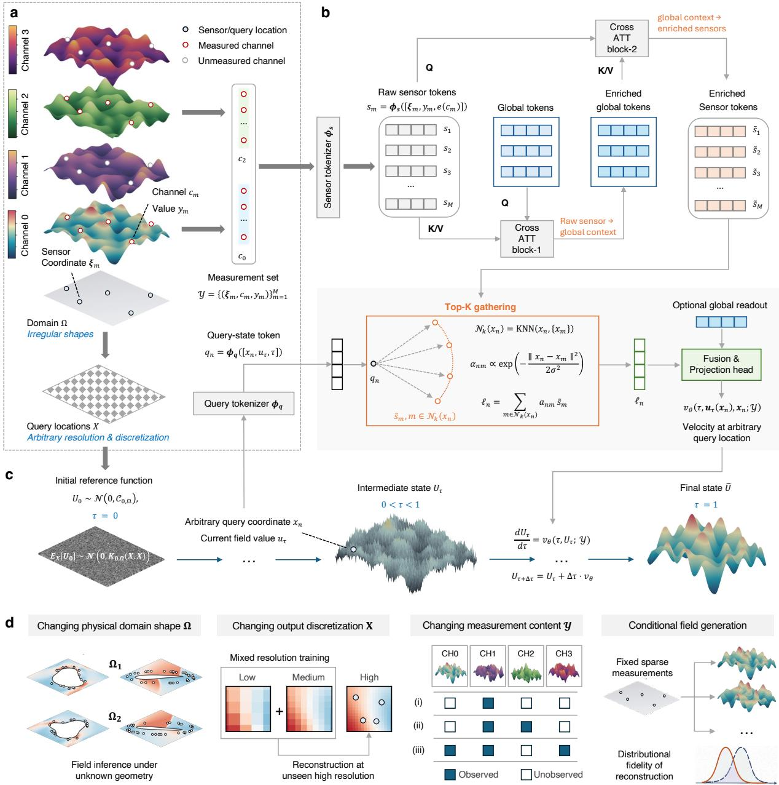  
Figure 1. Direct measurement-to-field generation. a, Each observation records a coordinate, physical channel, and value. Query coordinates are specified separately. b, Sensor tokens exchange information through global latents and return context to sensor locations. Local evidence and a global readout condition the velocity at each query coordinate. c, Rectified flow transports a smooth Gaussian reference function to a conditional field. Independent draws give multiple reconstructions. d, Evaluations vary the domain Ω, output coordinates X and measurements Y.

We evaluate DMF-Gen against four needs that arise in scientific sparse reconstruction (Fig. 1d). First, when the physical domain varies and its boundary is not observed, the field and the domain must be inferred together. DMF-Gen represents both on a common enclosing domain and generates the domain mask alongside the physical fields. We test this on elasticity and airfoil benchmarks with hidden boundaries [15]. Second, high-resolution fields may be needed when complete training fields exist only at coarser resolutions. Coordinate-wise transport allows training on mixed resolutions [40]. We test this on two-dimensional Navier–Stokes flow without complete high-resolution training fields [41]. Third, the measured variables may change, and some quantities of interest may remain unmeasured, so information must pass between physical fields. Channel-labelled observations provide a common representation for diferent combinations of measured variables. We test this on turbulent combustion with unmeasured species, velocity and pressure fields [39]. Finally, when the measurements remain compatible with several physical states, repeated generation should describe this unresolved variation and indicate which reconstructions are least reliable.

## Results

## Direct measurement-to-field generation in function space

We consider a physical field with C channels, such as temperature, velocity, and species mass fractions. Each scalar observation records its coordinate, physical-channel identity, and value,

$$
\mathcal { V } = \{ ( \pmb { \xi } _ { m } , c _ { m } , y _ { m } ) \} _ { m = 1 } ^ { M } , \qquad y _ { m } = U _ { 1 , c _ { m } } ( \pmb { \xi } _ { m } ) + \varepsilon _ { m } .\tag{1}
$$

The reconstruction is evaluated on a separate set of requested coordinates, $X = \{ \pmb { x } _ { n } \} _ { n = 1 } ^ { N }$ , where the complete C-channel field is predicted.

The target distribution is $\nu _ { \Omega } ^ { y } = \operatorname { L a w } ( U _ { 1 } \mid \mathcal { y } )$ , the law of the physical field conditioned on the measurements. Following functional rectified flow [35], we approximate this distribution by learning a transformation from a random reference field,

$$
\frac { \mathrm { d } U _ { \tau } } { \mathrm { d } \tau } = V _ { \theta } ( \tau , U _ { \tau } ; \mathcal { V } ) , \qquad U _ { 0 } \sim \mathcal { N } ( 0 , C _ { 0 , \Omega } ) , \qquad 0 \le \tau \le 1 .\tag{2}
$$

The flow time $\tau$ indexes generation, not physical evolution.

The central architectural requirement is to convert a finite measurement set into a velocity at every requested coordinate. We first tokenize each observation as

$$
s _ { m } = \phi _ { s } ( [ \gamma _ { s } ( \pmb { \xi } _ { m } ) , y _ { m } , e ( c _ { m } ) ] ) ,\tag{3}
$$

where $\gamma _ { s }$ encodes coordinates and $e ( c _ { m } )$ identifies the measured variable. A fixed-size global latent array reads the sensor tokens through cross-attention and integrates information across them. The sensor tokens then read the processed global latents. This feedback produces enriched tokens $\widetilde { s } _ { m }$ that remain attached to their original coordinates.

At each requested coordinate, the velocity model combines the current field state with measurement information at both local and global scales. A query-state token $q _ { n }$ represents the coordinate ${ \bf { x } } _ { n } .$ , the current value $U _ { \tau } ( { \pmb x } _ { n } )$ and the flow time.

The K nearest enriched sensor anchors provide local evidence,

$$
\ell _ { n } = \sum _ { m \in \mathcal { N } _ { K } ( { \boldsymbol x } _ { n } ) } \alpha _ { n m } \widetilde { s } _ { m } , \qquad \alpha _ { n m } = \mathrm { s o f t m a x } _ { m } \left[ - \frac { \| { \boldsymbol x } _ { n } - { \boldsymbol \xi } _ { m } \| _ { 2 } ^ { 2 } } { 2 \sigma ^ { 2 } } + b _ { \theta } ( \widetilde { s } _ { m } ) \right] ,\tag{4}
$$

where the learned bias adjusts the importance of sensors within the geometric neighborhood. A coordinate-based readout of the global latents provides complementary field-wide information $g _ { n }$ The shared velocity head combines these terms,

$$
\left[ V _ { \theta } ( \tau , U _ { \tau } ; \mathcal { V } ) \right] ( \pmb { x } _ { n } ) = \psi _ { \theta } ( q _ { n } , \ell _ { n } , g _ { n } ) .\tag{5}
$$

For each target $U _ { 1 }$ , an independent reference draw $U _ { 0 }$ and a uniform flow time define the straight interpolation $X _ { \tau } = ( 1 - \tau ) U _ { 0 } + \tau U _ { 1 }$ . The model predicts its displacement $U _ { 1 } - U _ { 0 }$ while receiving measurements sampled from $U _ { 1 }$

$$
\mathcal { L } _ { \mathrm { R F } } = \mathbb { E } \Bigg [ \frac { 1 } { N C } \sum _ { n = 1 } ^ { N } \left\| v _ { \theta } ( \tau , X _ { \tau } ( \pmb { x } _ { n } ) , \pmb { x } _ { n } ; \pmb { \mathcal { V } } ) - \left( U _ { 1 } ( \pmb { x } _ { n } ) - U _ { 0 } ( \pmb { x } _ { n } ) \right) \right\| _ { 2 } ^ { 2 } \Bigg ] .\tag{6}
$$

This objective trains the measurement encoder and velocity network jointly without integrating a trajectory during optimization. At inference, repeated source draws produce an empirical conditional ensemble.

We organize the baselines to separate three modeling choices in sparse reconstruction. First, FFM-FNO [33] and FFM-Perceiver [42] use the same function-space flow-matching objective with Fourier-operator and latent-attention parameterizations, respectively. Second, SiT [43] and Latent FM [44] provide generative comparisons with diferent representations of the evolving state. SiT transports patch-based physical-field arrays, whereas Latent FM transports an autoencoded field representation. Third, we compare with deterministic sparse reconstructors. These include supervised FNO [15, 16], coordinate-query attention through Senseiver [3], and an MLP-RBF model that combines local radial-basis aggregation with global pooled context. Within each evaluation setting, all methods receive the same prescribed observations and predict the same target fields.

## Changing the domain: sparse inversion on irregular geometries

Sparse measurements can provide information about both the physical field and the domain on which that field is defined. We test this joint field–geometry inversion using the elasticity and airfoil datasets released with Geo-FNO [15]. The elasticity cases contain stress fields around irregular holes representing diferent defect geometries, whereas the airfoil cases contain compressible flow around changing shapes. The nominal observations are 16 von Mises stress measurements for elasticity and 32 static-pressure measurements for airfoil flow. The targets are the complete stress field or the airfoil density, velocity, and pressure fields, respectively, together with the unobserved physical-domain mask. The Mach number is derived from the reconstructed airfoil state to examine coherence across the inferred fields.

The selected fields in Fig. 2a,c illustrate the structures that dominate reconstruction dificulty. DMF-Gen more closely localizes these structures in the illustrated cases. Across all 400 elasticity and 498 airfoil evaluation cases, its mean masked relative- $. L _ { 2 }$ errors were 0.1238 for stress and 0.0122 for Mach number, 20.5% below Geo-FNO and 36.7% below SiT, respectively. This metric measures the field discrepancy on the true physical domain, separating errors in reconstructed values from errors in the predicted mask.

The derived quantities in Fig. 2b,d test whether improved field recovery carries over to physical analysis. The peak-to-mean stress-concentration proxy $K _ { t }$ measures localized amplification relative to the mean material stress. DMF-Gen achieved the lowest mean absolute normalized $K _ { t }$ error, 0.0935, reducing the error by 13.1% relative to Geo-FNO. The pressure-drag coeficient $C _ { D }$ is computed by integrating the reconstructed static pressure over the true airfoil boundary. Its mean absolute normalized error was 0.1632, 22.4% below Senseiver.

The sensor-count sweep tests whether reconstruction remains efective as the available number of measurements changes. DMF-Gen achieved the lowest mean field error at every tested count from 8 to 64 sensors, including counts below and above the training ranges of 16–32 for elasticity and 32–48 for airfoil flow.

Narrow stress bands around the hole and sharp Mach-number transitions around the airfoil can be smoothed or displaced even when global field error is low. We therefore evaluated gradientmagnitude similarity deviation (GMSD) to assess the preservation of local gradient structure [45] (Fig. 2f). For elasticity, DMF-Gen achieved the lowest mean GMSD of 0.087 compared with

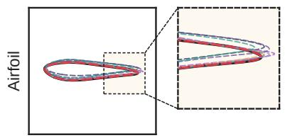

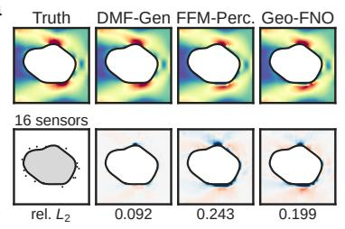

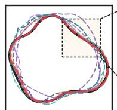

a  
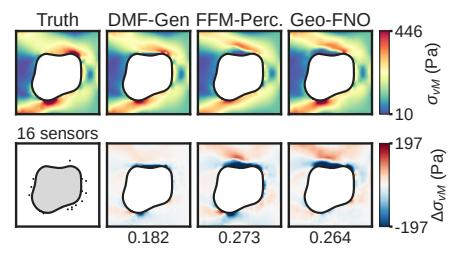

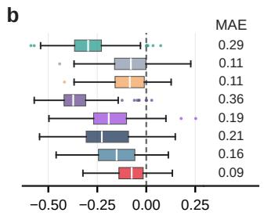

c  
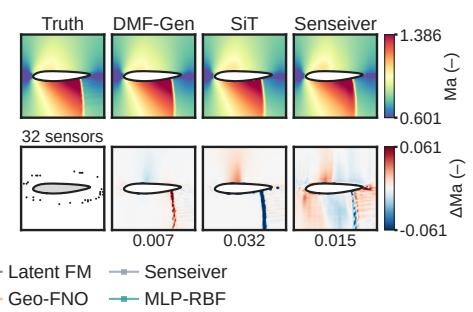

d  
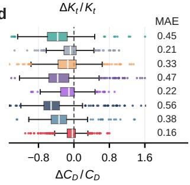

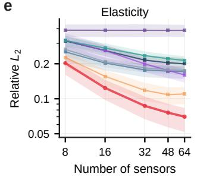

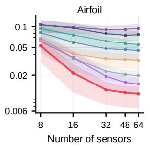

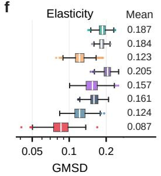

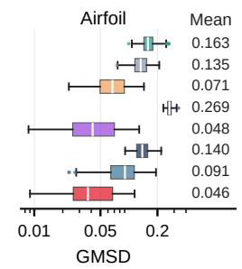

g  
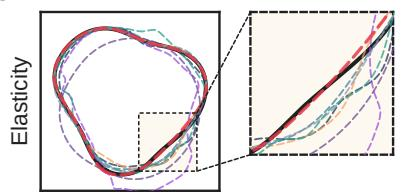

h  
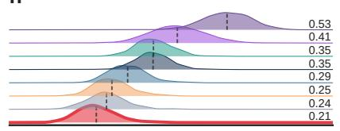

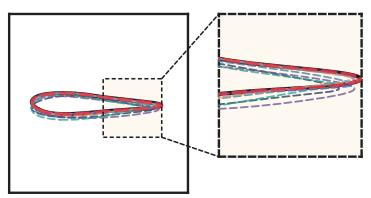

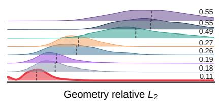  
Figure 2. Field and hidden-boundary reconstruction on irregular domains. Results include 400 elasticity and 498 airfoil test cases. $\mathbf { a } , \mathbf { c } .$ , Von Mises stress and derived Mach number from 16 stress and 32 pressure measurements. $\mathbf { b , d , }$ Signed normalized errors in $K _ { t }$ and $C _ { D }$ . Labels give mean absolute normalized errors. e, Mean masked relative- $L _ { 2 }$ error across sensor counts, with interquartile bands. f, Gradient-magnitude similarity deviation (GMSD) distributions and means. g, True and inferred boundaries for selected cases. h, Thresholded geometry relative- $. L _ { 2 }$ error distributions and means.

0.123 for Geo-FNO, supporting better recovery of the localized stress bands illustrated in Fig. 2a.   
For airfoil flow, DMF-Gen had the lowest mean GMSD at 0.046.

Geometry recovery further evaluates the unobserved domain mask separately from field accuracy. Elasticity sensors are selected from a sample-dependent band near the hole, so their coordinates contain partial boundary information. Airfoil sensors lie on the same enclosing ellipse for every profile, requiring the boundary to be inferred from pressure values. Across the full evaluation sets (Fig. 2h), DMF-Gen had the lowest mean geometry relative- $L _ { 2 }$ errors with approximately 0.21 for elasticity and 0.11 for airfoil flow. Senseiver, the best baseline in both datasets, had corresponding errors of 0.24 and 0.18.

## Changing the output discretization: reconstruction without complete highresolution training fields

Sparse reconstruction may require a field to be recovered at a finer spatial resolution than is available in the complete fields used for training. This situation can arise when high-resolution full-field data are expensive or scarce, while sparse measurements remain available for the state to be reconstructed [16].

The 2-D Navier–Stokes data from PDEBench [41] provide time-dependent fields on a common coordinate domain. We selected a scalar field and represented it on low- $( \mathrm { L } , 3 2 \times 3 2 )$ , medium-$( \mathrm { M } , 6 4 \times 6 4 )$ and high-resolution (H, 128 × 128) grids (Fig. 3a). All models are evaluated on held-out H-resolution fields. At inference, all models receive only sparse point measurements and reconstruct the field on the H-resolution output coordinates. Five training recipes progressively change how much high-resolution information is available to the model (Fig. 3a). H-only contains complete H-resolution training fields. H-limited reduces their number. Mixed-HML combines L-, M-, and H-resolution fields within one training recipe. Zero-H-balanced and Zero-H-M-rich contain no complete H-resolution training fields. Zero-H-M-rich includes more M-resolution data.

We compare DMF-Gen, FFM-Perceiver, Senseiver and MLP-RBF. This comparison evaluates reconstruction across training-resolution recipes on the same H-resolution output grid. At 512 sensors, DMF-Gen achieved the lowest mean H-resolution error under all five training recipes (Fig. 3b). Its mean relative- $L _ { 2 }$ errors were 0.0121, 0.0129 and 0.0119 under H-only, H-limited and Mixed-HML training, respectively, showing that its H-resolution accuracy was retained when lower-resolution fields were mixed with H-resolution training data. With no complete H-resolution training fields, DMF-Gen had mean errors of 0.0334 for Zero-H-balanced and 0.0288 for Zero-H-M-rich. These were 57.8% and 60.5% lower than the strongest evaluated alternative under the corresponding recipes.

The sensor sweeps in Fig. 3c distinguish information learned from the training fields from additional sparse evidence available at deployment. Across Mixed-HML and both zero-H recipes, DMF-Gen achieved the lowest mean error at every tested sensor count from 64 to 512. Thus, even when H-resolution fields are absent from training, sparse measurements continue to constrain the reconstructed high-resolution state.

We further tested whether this advantage persists across spatial scales using a four-level wavelet decomposition (Fig. 3e). Across 300 fields (Fig. 3f), all methods recover the large-scale component well. Their main diferences appear at intermediate and fine scales. Under Zero-H-M-rich training, DMF-Gen retained median spatial pattern correlations of 1.000, 0.969 and 0.815 across the large, intermediate and fine components. The corresponding fine-scale correlations were 0.368 for FFM-Perceiver, −0.089 for Senseiver, and 0.165 for MLP-RBF. DMF-Gen also kept the median squared-energy allocation bias within 0.005 percentage points of the reference at every scale.

## Changing the measurement content: reconstruction of unobserved fields

In many sensing problems, some physical quantities are dificult or unavailable to measure directly, while other coupled variables can be observed more readily [13]. For sparse reconstruction, the challenge becomes more demanding when entire target fields contain no direct observations [46]. We therefore change which physical variables are measured while keeping the domain, query coordinates, and full target state fixed [47]. We used an in-house OpenFOAM simulation of methane–air turbulent combustion over a two-dimensional backward-facing step [39]. The dataset contains methane and carbon monoxide mass fractions, temperature, streamwise velocity, and pressure, $\{ Y _ { \mathrm { C H _ { 4 } } } , Y _ { \mathrm { C O } } , T , U _ { 1 } , p \}$ , at 40,300 spatial locations.

Spatial pattern correlation  
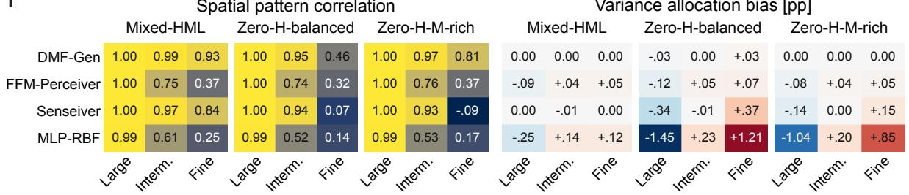

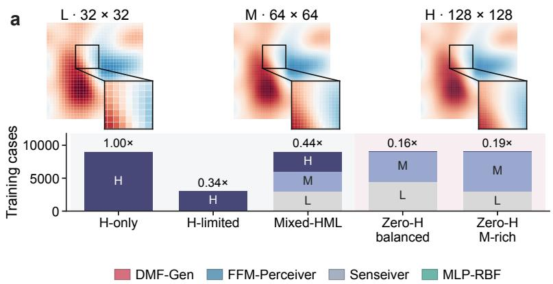

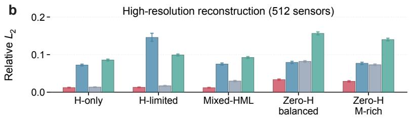

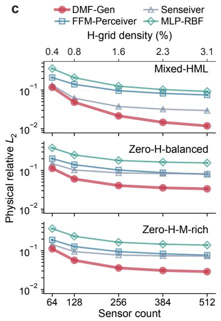

d  
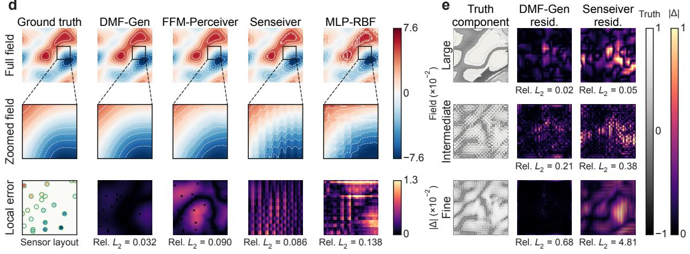  
f  
Variance allocation bias [pp]  
Figure 3. Reconstruction across training and output resolutions. a, Low- (L, 32 × 32), medium-(M, 64 × 64) and high-resolution (H, 128 × 128) fields and five training recipes. Bar labels give spatialdegree-of-freedom exposure relative to H-only. b, Mean H-resolution physical relative- $L _ { 2 }$ error using 512 sparse sensors. Whiskers are 95% simple case-bootstrap intervals. $\mathbf { c } ,$ Error across 64–512 nested H-grid sensors. d, Full field, matched enlargement and local absolute error for a held-out Zero-H-M-rich state at 512 sensors. e, Wavelet-scale truth and absolute residuals for DMF-Gen and Senseiver on the same state at 256 sensors. f, Median scale-wise pattern correlation and squared-energy allocation bias over 300 held-out case–time pairs at 256 sensors.

We used three observation regimes. The first contains 256 $T$ measurements. The second contains 256 measurements each of $T$ and $U _ { 1 }$ . The third contains 256 measurements each of $Y _ { \mathrm { C O } }$ $T .$ $U _ { 1 }$ and $p .$ Every method reconstructed all five fields. The regimes contain 256, 512 and 1,024 scalar observations, respectively, so broader channel coverage also increases the total amount of evidence. $Y _ { \mathrm { C H _ { 4 } } }$ remains unobserved in all three regimes.

Across 1,000 test states, DMF-Gen had the lowest mean error over the channels absent from each observation regime. Its unobserved-channel means were 0.117, 0.0802 and 0.0454 for temperature-only, temperature–velocity and four-channel conditioning, respectively. These values were approximately 18%, 22% and 31% lower than the strongest alternative under the corresponding regime (Senseiver for the first two and SiT for the third).

We assessed spatial-scale content separately for the three displayed unobserved fields under temperature-only conditioning. As shown in Fig. 4c, for the unobserved $Y _ { \mathrm { { C H } _ { 4 } } } , ~ p$ and $U _ { 1 }$ fields, DMF-Gen obtained mean log-spectral distances of 1.431, 2.092 and 4.966 dB, respectively, ranking second for all three. SiT had the lowest corresponding means, 1.239, 1.926 and 4.121 dB.

Spatial spectra describe each field separately, while coupled-field statistics test relationships between reconstructed variables (Fig. 4d). Under temperature-only conditioning, DMF-Gen had the lowest mean base-2 Jensen–Shannon divergence for the thermal–flow pair $T - U _ { 1 }$ (0.068) and for the pressure–velocity pair $p { - } U _ { 1 }$ (0.070). The latter is a strict missing-channel test because neither variable was observed. SiT had the lowest divergence for the chemistry–flow pair $Y _ { \mathrm { C H _ { 4 } } } – U _ { 1 }$ at 0.058, compared with 0.11 for DMF-Gen. Both variables were unobserved.

## Conditional field generation and reconstruction mechanisms

For each of 200 evaluation states under temperature-only conditioning, we generated 64 conditional samples with independent reference-function draws while holding the same 256 $T$ measurements fixed. The continuous ranked probability score (CRPS) jointly reflects agreement with the realized target and dispersion within the predictive ensemble, with lower values indicating better distributional reconstruction. Across the 200 states, DMF-Gen achieved a mean normalized CRPS of 0.0667 (95% CI, 0.0640–0.0694), compared with 0.0999 (0.0970–0.1030) for the next-lowest method, SiT (Fig. 5a), corresponding to a 33.2% reduction.

We then tested whether ensemble spread could be used to preferentially retain easier reconstruction cases. Within each method, states were ranked from lowest to highest ensemble spread, and the mean reconstruction error of the retained subset was normalized by that method’s full-cohort error. For DMF-Gen, retaining the 20% least-dispersed states reduced mean error by 12.2%, while retaining 80% still reduced it by 4.6% (Fig. 5b). At 80% retention, the corresponding reductions for the other generators were below 1% or negligible. Fig. 5c examines the underlying state-wise association between spread and reconstruction dificulty. Across the same 200 states, the normalized ensemble spread of DMF-Gen showed a Spearman correlation of $\rho = 0 . 6 5 4$ with the relative- $L _ { 2 }$ error of the ensemble-mean reconstruction, larger than the associations observed for the other generative models.

The ablations further distinguish the role of the measurement-conditioning architecture from the generative transport itself. With the full model, the mean relative- $L _ { 2 }$ error over the four unobserved fields was 0.1063 across 1,000 states. Removing the feedback from the global representation to the spatially anchored sensor tokens increased this error to 0.1270, while removing local query conditioning increased it to 0.1447 (Fig. 5d). Restricting conditioning to the local sensor pathway produced a much larger error of 0.3550.

Conditioned on CO + T + U1 + p  
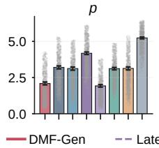

Conditioning progression (DMF-Gen)  
Baseline comparisons: conditioned on T only  
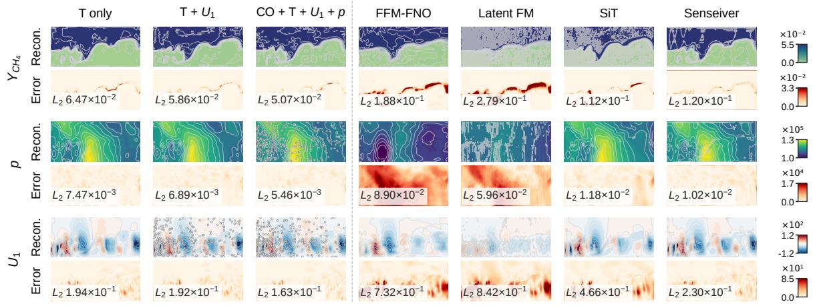

b
<table><tr><td rowspan=1 colspan=1>DMF-Gen</td><td rowspan=1 colspan=1>0.065</td><td rowspan=1 colspan=1>0.19</td><td rowspan=1 colspan=1>0.057</td><td rowspan=1 colspan=1>0.210</td><td rowspan=1 colspan=1>.0065</td></tr><tr><td rowspan=2 colspan=1>FFM-FNOFFM-Perceiver</td><td rowspan=1 colspan=1>0.19</td><td rowspan=1 colspan=1>0.46</td><td rowspan=1 colspan=1>0.18</td><td rowspan=1 colspan=1>0.84</td><td rowspan=1 colspan=1>0.069</td></tr><tr><td rowspan=1 colspan=1>0.2</td><td rowspan=1 colspan=1>0.43</td><td rowspan=1 colspan=1>0.19</td><td rowspan=1 colspan=1>0.73</td><td rowspan=1 colspan=1>0.033</td></tr><tr><td rowspan=1 colspan=1>Latent FM</td><td rowspan=1 colspan=1>0.29</td><td rowspan=1 colspan=1>0.56</td><td rowspan=1 colspan=1>0.26</td><td rowspan=1 colspan=1>0.92</td><td rowspan=1 colspan=1>0.046</td></tr><tr><td rowspan=1 colspan=1>SiT</td><td rowspan=1 colspan=1>0.1</td><td rowspan=1 colspan=1>0.28</td><td rowspan=1 colspan=1>0.092</td><td rowspan=1 colspan=1>0.44</td><td rowspan=1 colspan=1>0.011</td></tr><tr><td rowspan=1 colspan=1>MLP-RBF</td><td rowspan=1 colspan=1>0.21</td><td rowspan=1 colspan=1>0.45</td><td rowspan=1 colspan=1>0.18</td><td rowspan=1 colspan=1>0.88</td><td rowspan=1 colspan=1>0.046</td></tr><tr><td rowspan=2 colspan=1>Geo-FNOSenseiver</td><td rowspan=1 colspan=1>0.12</td><td rowspan=1 colspan=1>0.32</td><td rowspan=1 colspan=1>0.11</td><td rowspan=1 colspan=1>0.46</td><td rowspan=1 colspan=1>0.018</td></tr><tr><td rowspan=1 colspan=1>0.12</td><td rowspan=1 colspan=1>0.2</td><td rowspan=1 colspan=1>0.075</td><td rowspan=1 colspan=1>0.24</td><td rowspan=1 colspan=1>0.01</td></tr></table>

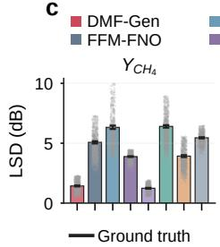

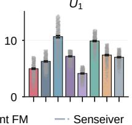

<table><tr><td colspan="6">Conditioned on T + U1</td></tr><tr><td>DMF-Gen</td><td>0.059</td><td>0.18</td><td>0.052</td><td>0.19</td><td>0.0059</td></tr><tr><td>FFM-FNO</td><td>0.19</td><td>0.46</td><td>0.18</td><td>0.73</td><td>0.071</td></tr><tr><td>FFM-Perceiver</td><td>0.19</td><td>0.42</td><td>0.18</td><td>0.75</td><td>0.027</td></tr><tr><td>Latent FM</td><td>0.23</td><td>0.48</td><td>0.2</td><td>0.65</td><td>0.032</td></tr><tr><td>SiT</td><td>0.083</td><td>0.24</td><td>0.074</td><td>0.29</td><td>0.0096</td></tr><tr><td>MLP-RBF</td><td>0.19</td><td>0.43</td><td>0.17</td><td>0.64</td><td>0.043</td></tr><tr><td>Geo-FNO</td><td>0.098</td><td>0.28</td><td>0.092</td><td>0.37</td><td>0.014</td></tr><tr><td>Senseiver</td><td>0.12</td><td>0.18</td><td>0.069</td><td>0.22</td><td>0.009</td></tr></table>

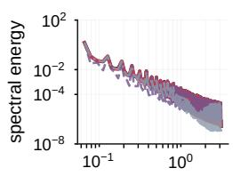

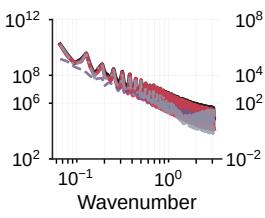

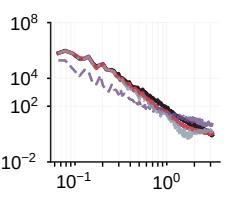

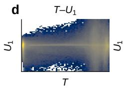

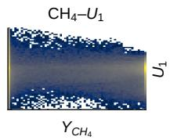

<table><tr><td rowspan=1 colspan=1>DMF-Gen</td><td rowspan=1 colspan=1>0.045</td><td rowspan=1 colspan=1>0.14</td><td rowspan=1 colspan=1>0.04</td><td rowspan=1 colspan=1>0.160</td><td rowspan=1 colspan=1>.0046</td></tr><tr><td rowspan=1 colspan=1>FFM-FNO</td><td rowspan=1 colspan=1>0.17</td><td rowspan=1 colspan=1>0.46</td><td rowspan=1 colspan=1>0.17</td><td rowspan=1 colspan=1>0.74</td><td rowspan=1 colspan=1>0.011</td></tr><tr><td rowspan=1 colspan=1>FFM-Perceiver</td><td rowspan=1 colspan=1>0.2</td><td rowspan=1 colspan=1>0.46</td><td rowspan=1 colspan=1>0.19</td><td rowspan=1 colspan=1>0.77</td><td rowspan=1 colspan=1>0.011</td></tr><tr><td rowspan=1 colspan=1>Latent FM</td><td rowspan=1 colspan=1>0.19</td><td rowspan=1 colspan=1>0.42</td><td rowspan=1 colspan=1>0.17</td><td rowspan=1 colspan=1>0.54</td><td rowspan=1 colspan=1>0.016</td></tr><tr><td rowspan=1 colspan=1>SiT</td><td rowspan=1 colspan=1>0.065</td><td rowspan=1 colspan=1>0.19</td><td rowspan=1 colspan=1>0.059</td><td rowspan=1 colspan=1>0.250</td><td rowspan=1 colspan=1>.0042</td></tr><tr><td rowspan=2 colspan=1>MLP-RBFGeo-FNO</td><td rowspan=1 colspan=1>0.18</td><td rowspan=1 colspan=1>0.39</td><td rowspan=1 colspan=1>0.15</td><td rowspan=1 colspan=1>0.67</td><td rowspan=1 colspan=1>0.012</td></tr><tr><td rowspan=1 colspan=1>0.11</td><td rowspan=1 colspan=1>0.29</td><td rowspan=1 colspan=1>0.096</td><td rowspan=1 colspan=1>0.38</td><td rowspan=1 colspan=1>0.013</td></tr><tr><td rowspan=1 colspan=1>Senseiver</td><td rowspan=1 colspan=1>0.12</td><td rowspan=1 colspan=1>0.18</td><td rowspan=1 colspan=1>0.068</td><td rowspan=1 colspan=1>0.21</td><td rowspan=1 colspan=1>0.0085</td></tr><tr><td rowspan=1 colspan=1></td><td rowspan=1 colspan=1> $Y _ { C H _ { 4 } }$ </td><td rowspan=1 colspan=1> $Y _ { C O }$ </td><td rowspan=1 colspan=1>T</td><td rowspan=1 colspan=1> $U _ { 1 }$ </td><td rowspan=1 colspan=1>p</td></tr></table>

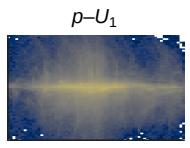

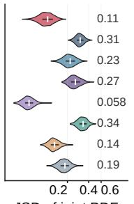  
Figure 4. Reconstruction of missing channels in turbulent combustion. a, DMF-Gen reconstructions and absolute errors under three observed-channel sets with 256 sensors per channel. Selected temperature-only baselines appear on the right. b, Mean physical relative- $L _ { 2 }$ error by field over 1,000 evaluation states. Teal marks observed fields. $\mathbf { c } ,$ Spectra and mean log-spectral distance for unobserved $Y _ { \mathrm { C H _ { 4 } } }$ $p$ and $U _ { 1 }$ under temperature-only conditioning. Error bars show 95% simple snapshot-bootstrap intervals. d, Ground-truth joint PDFs pooled over 25 states and per-state base-2 Jensen–Shannon divergence (JSD) distributions over 1,000 states for $T - U _ { 1 }$ ， $Y _ { \mathrm { C H _ { 4 } } } – U _ { 1 }$ and $p { - } U _ { 1 }$

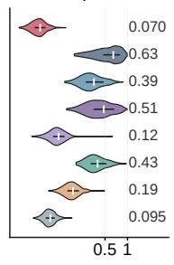  
p

The reference process afects a diferent aspect of reconstruction. Although the IID Gaussian source slightly reduced aggregate reconstruction error, it increased the mean high-frequency relative- $L _ { \mathrm { 2 } }$ error of the streamwise velocity field from 0.873 to 1.825 compared with the smooth reference source (Fig. 5d,e). The full model attenuates high-frequency $U _ { 1 }$ energy relative to the truth. The IID source introduces excess power across much of the same range.

We also measured the computational cost of transporting the physical field directly. At the native 40,300-point resolution, DMF-Gen achieved an unobserved-field relative- $L _ { 2 }$ error of 0.1063 with a median training-update time of 112.2 ms, peak training memory of 7.9 GiB and a median inference latency of 16.7 ms (Fig. 5f). Several deterministic or grid-based alternatives required less computation and had higher reconstruction error.

## Discussion

Reconstruction from sparse sensors depends on two forms of structure. The model must combine information across observations and generate a spatially coherent field. Functional flow matching provides a way to transport distributions of functions [33]. DMF-Gen links this transport to a sensor–global–sensor representation. Its latent state summarizes measurements, and the transported state remains the physical field. Each query coordinate receives nearby evidence and field-wide context.

The results suggest that the apparently diferent reconstruction problems can share a common requirement: sparse measurements must influence the generated field without fixing its spatial support, output discretization, or observed physical channels. The irregular-domain results show that sensor values can carry information about geometry that is not supplied explicitly. The mixed-resolution results show that the learned reconstruction is not tied to the discretization of the complete fields used for training. The combustion results further indicate that information can also be transferred across physical variables when entire target fields are unobserved. These findings support a formulation in which sparse evidence is organized independently from the physical field being generated, while both global and spatially local measurement information remain available during transport.

The baseline comparisons and ablations provide further evidence that function-space transport alone does not explain the reconstruction gains. FFM-FNO and FFM-Perceiver use functional transport with diferent backbones, yet remain less accurate than DMF-Gen in the tested settings. Within DMF-Gen, removing global measurement exchange, feedback to sensor anchors or local query conditioning also degrades reconstruction in the combustion study. These results point to the conditioning pathway as a key part of the formulation.

Future studies can test broader geometries, independent simulation trajectories, finer query grids, and diferent sensor layouts. The observation interface could also include spatial averages, line measurements, and other operators. Physical priors ofer another direction when governing information is available [27]. Larger three-dimensional fields may benefit from hierarchical sensor neighborhoods and domain-decomposed evaluation. These extensions would broaden the settings in which measurement-conditioned generation can recover useful physical fields.

## Methods

## Field space, measurements and query evaluation

Let $\mathcal { H } _ { \Omega }$ be a separable Hilbert space supporting the law of a C-channel physical field. Sparse observations and requested outputs are represented separately by Y and X in Eq. (1). Point measurements and evaluations act on the field representatives supplied by the simulation and interpolation procedure.

Shared tokenization and masked set attention make the conditioning representation invariant to sensor ordering. Applying the same decoder at every query makes the output equivariant to query ordering. For unknown geometries, the fields and physical-support mask are represented on a common enclosing domain, and only the prescribed sensor measurements are provided as conditioning information.

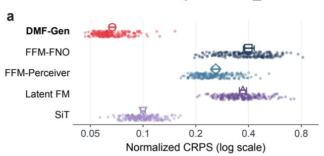

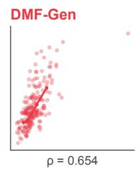

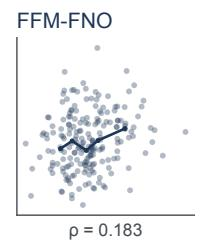

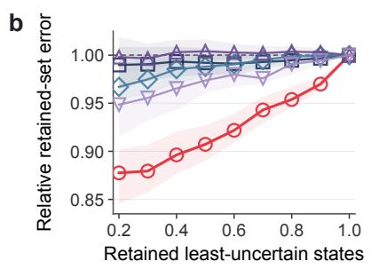

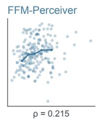  
Normalized ensemble spread

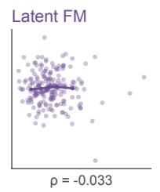

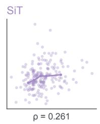

d  
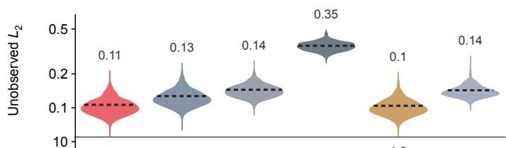

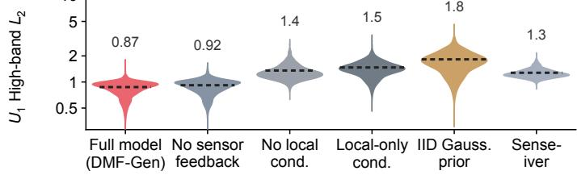

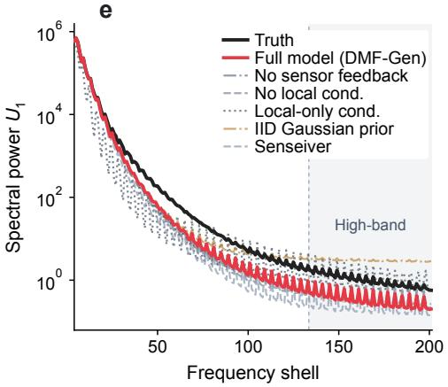

f  
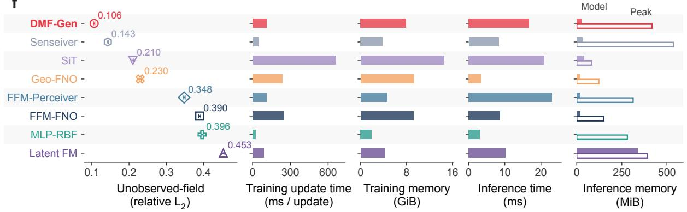  
Figure 5. Conditional generation, ablations, and cost. All analyses use 256 T measurements and target the four unobserved combustion fields. a, Normalized pointwise continuous ranked probability score (CRPS) from 64 draws for each of 200 paired states. b, Reconstruction error after retaining states with the lowest ensemble spread, normalized by each method’s full-cohort mean. Whiskers in a and bands in b are 95% moving-block-bootstrap intervals. $\mathbf { c } ,$ Ensemble spread versus ensemble-mean relative- $L _ { 2 }$ error for the same states. Labels give Spearman $\rho .$ Facet axes difer. $\mathbf { d } , \mathbf { e } ,$ Aggregate and high-band errors and median $U _ { 1 }$ spectra from 1,000-state ablation comparisons. f, Reconstruction error, time per training update, inference latency, and GPU memory use.

## Gaussian reference process

We approximate the Gaussian reference measure with a finite-rank random-Fourier-feature construction [48]. For channel $^ { c , }$

$$
U _ { 0 , c } ( \pmb { x } ) = \sqrt { \frac { 2 } { J } } \sum _ { j = 1 } ^ { J } a _ { c j } \cos ( \omega _ { j } ^ { \top } \pmb { x } + b _ { j } ) , \qquad a _ { c j } \sim \mathcal { N } ( 0 , 1 ) .\tag{7}
$$

Frequencies $\omega _ { j }$ and phases $b _ { j }$ are sampled once and retained as model bufers. The frequency scale sets the spatial correlation length. Independent Gaussian coeficients are drawn for each field sample and channel. Conditional on the fixed feature basis, this construction defines a Gaussian law with positive semidefinite, finite-rank covariance. The IID Gaussian-value source is used in the prior ablation.

## Conditional functional rectified flow

Given a target field $U _ { 1 }$ and its measurement set $\mathcal { V } ,$ we independently sample $U _ { 0 }$ and $\tau \sim \mathcal { U } ( 0 , 1 )$ and form

$$
X _ { \tau } = ( 1 - \tau ) U _ { 0 } + \tau U _ { 1 } , \qquad V ^ { \star } ( \tau , u ; \mathcal { V } ) = \mathbb { E } [ U _ { 1 } - U _ { 0 } \mid X _ { \tau } = u , \mathcal { V } ] .\tag{8}
$$

The Hilbert-space rectified-flow result connects this conditional expected velocity to the interpolation marginals under its stated rectifiability assumptions [35]. We approximate the velocity with the sensor-conditioned network and minimize the finite-query regression loss in Eq. (6). The implemented loss averages squared residuals over sampled queries and physical channels. Numerical integration of the learned velocity produces the reconstructed field.

## Dataset preparation

Irregular-geometry datasets We adapted the elasticity and airfoil datasets released with Geo-FNO [15] from forward-modeling benchmarks to sparse reconstruction. The elasticity target contains the von Mises stress field and the material-support mask around an irregular hole. The airfoil target contains four compressible-flow fields (density, velocity components, and static pressure) and an airfoil/fluid-domain mask. Prepared elasticity samples use Cartesian coordinates.

Navier–Stokes multi-resolution dataset We retained only the streamwise velocity $V _ { x }$ from the two-dimensional Navier–Stokes data in PDEBench [41]. The selected cases were represented at 32 × 32, 64 × 64 and 128 × 128 resolution and assigned to the five training recipes in Fig. 3a.

Turbulent combustion We used an in-house large-eddy simulation of turbulent methane–air combustion over a two-dimensional backward-facing step. The simulation used reactingFoam in OpenFOAM [49]. For the present study, we retained five fields, $Y _ { \mathrm { C H _ { 4 } } } , Y _ { \mathrm { C O } } , T , U _ { 1 }$ and $p ,$ at 40,300 grid points.

## Baseline methods

Each model receives the same task-specific measurement information and predicts the same fields.

FFM-FNO FFM-FNO uses the Fourier neural operator parameterization introduced in functional flow matching [22, 33]. We condition this velocity on sparse value/support maps concatenated with the evolving physical field and flow time.

FFM-Perceiver FFM-Perceiver replaces the Fourier backbone with a Perceiver IO encoder– decoder [33, 42]. The functional source and straight-flow objective are retained.

SiT We adapt the scalable interpolant transformer [43] to transport normalized physical-field arrays directly.

Latent FM Latent FM follows the two-stage construction of latent-space flow matching [44].   
An encoder E and decoder D first learn to reconstruct complete fields.

FNO The implemented supervised Fourier baseline maps sparse value/support maps directly to the target fields using FNO layers [15, 16, 22]. Its Cartesian implementation operates on the reconstruction grid. The irregular-coordinate wrapper scatters observations to a regular latent grid and bilinearly evaluates the predicted field at the requested coordinates.

Senseiver Senseiver is the deterministic coordinate-query attention baseline [3].

MLP-RBF MLP-RBF is a non-attention reference constructed for this comparison [50]. A pointwise regression head combines local evidence, query features, and a pooled global summary to predict the fields.

Author contributions L.W.: conceptualization, methodology, investigation, visualization, writing—original draft. J.C.: methodology, investigation, visualization, writing—original draft. N.T.: software, investigation, visualization. Z.C.: methodology, investigation. X.G.: methodology, writing—review and editing. S.D.: supervision, writing—review and editing.

## Data availability

The two-dimensional CFD source data are available from the PDEBench repository (https: //github.com/pdebench/PDEBench), and the elasticity and airfoil source data are available through the Geo-FNO repository (https://github.com/neuraloperator/Geo-FNO). The inhouse turbulent-combustion dataset is large and is available from the corresponding authors upon reasonable request.

## Code availability

The DMF-Gen implementation, dataset interfaces, and scripts for training, evaluation, and reconstruction are available at https://github.com/cosmos2w/DMF-Gen.

Conflict of interest The authors declare no competing interests.

## References

[1] Krithika Manohar, Bingni W. Brunton, J. Nathan Kutz, and Steven L. Brunton. Data-driven sparse sensor placement for reconstruction: Demonstrating the benefits of exploiting known patterns. IEEE Control Systems Magazine, 38(3):63–86, 2018. doi: 10.1109/MCS.2018.2810460.

[2] Kai Fukami, Romit Maulik, Nesar Ramachandra, Koji Fukagata, and Kunihiko Taira. Global field reconstruction from sparse sensors with Voronoi tessellation-assisted deep learning. Nature Machine Intelligence, 3(11):945–951, 2021. doi: 10.1038/s42256-021-00402-2.

[3] Javier E. Santos, Zachary R. Fox, Arvind Mohan, Daniel O’Malley, Hari Viswanathan, and Nicholas Lubbers. Development of the Senseiver for eficient field reconstruction from sparse observations. Nature Machine Intelligence, 5:1317–1325, 2023. doi: 10.1038/s42256-023-00746-x.

[4] Jared L. Callaham, Kazuki Maeda, and Steven L. Brunton. Robust flow reconstruction from limited measurements via sparse representation. Physical Review Fluids, 4:103907, 2019. doi: 10.1103/ PhysRevFluids.4.103907.

[5] Linzheng Wang, Ruiqu Deng, Ruizhi Zhang, Yonghao Luo, and Sili Deng. 3-d full-field reconstruction of chemically reacting flow towards high-dimension conditions through machine learning. Chemical Engineering Journal, 499:156435, 2024. doi: 10.1016/j.cej.2024.156435.

[6] Junyang Gou and Benedikt Soja. Global high-resolution total water storage anomalies from selfsupervised data assimilation using deep learning algorithms. Nature Water, 2(2):139–150, 2024. doi: 10.1038/s44221-024-00194-w. URL https://doi.org/10.1038/s44221-024-00194-w.

[7] Luc Lenain, Kaushik Srinivasan, Roy Barkan, and Nick Pizzo. An unprecedented view of ocean currents from geostationary satellites. Nature Geoscience, 19(5):526–533, 2026. doi: 10.1038/s41561-026-01943-0. URL https://doi.org/10.1038/s41561-026-01943-0.

[8] Linzheng Wang, Yaojun Li, and Sili Deng. Building digital twin for 3D multi-field reconstruction and optimization of industrial-scale combustion systems. Engineering, 59:197–214, 2026. doi: 10.1016/j. eng.2025.08.020.

[9] Karen Willcox. Unsteady flow sensing and estimation via the gappy proper orthogonal decomposition. Computers & Fluids, 35(2):208–226, 2006. doi: 10.1016/j.compfluid.2004.11.006.

[10] B. W. Brunton, S. L. Brunton, J. L. Proctor, and J. N. Kutz. Sparse sensor placement optimization for classification. SIAM Journal on Applied Mathematics, 76(5):2099–2122, 2016. doi: 10.1137/15m1036713. URL https://doi.org/10.1137/15M1036713.

[11] Florian Achermann, Thomas Stastny, Bogdan Danciu, Andrey Kolobov, Jen Jen Chung, Roland Siegwart, and Nicholas Lawrance. WindSeer: real-time volumetric wind prediction over complex terrain aboard a small uncrewed aerial vehicle. Nature Communications, 15(1):3507, 2024. doi: 10.1038/s41467-024-47778-4. URL https://doi.org/10.1038/s41467-024-47778-4.

[12] Zeyu Li, Wang Han, Yue Zhang, Qingfei Fu, Jingxuan Li, Lizi Qin, Ruoyu Dong, Hao Sun, Yue Deng, and Lijun Yang. Learning spatiotemporal dynamics with a pretrained generative model. Nature Machine Intelligence, 6(12):1566–1579, 2024. doi: 10.1038/s42256-024-00938-z.

[13] Linzheng Wang, Zituo Chen, Yaojun Li, Ruiqu Deng, Ruizhi Zhang, Yonghao Luo, Lu Lu, and Sili Deng. Learning multi-physical system on a unified manifold by collaboratively fused features. Engineering Applications of Artificial Intelligence, 170:114178, 2026. doi: 10.1016/j.engappai.2026.114178.

[14] Xu Liu, Wei Peng, Xiaoya Zhang, Xiaoyu Zhao, Weien Zhou, Wen Yao, and Xiaoqian Chen. Enhancing deep learning-based field reconstruction with a diferentiable learning framework. Nature Machine Intelligence, 7(7):1129–1140, 2025. doi: 10.1038/s42256-025-01063-1. URL https://doi.org/10. 1038/s42256-025-01063-1.

[15] Zongyi Li, Daniel Zhengyu Huang, Burigede Liu, and Anima Anandkumar. Fourier neural operator with learned deformations for PDEs on general geometries. Journal of Machine Learning Research, 24 (388):1–26, 2023. URL https://www.jmlr.org/papers/v24/23-0064.html.

[16] Xiaoyu Zhao, Xiaoqian Chen, Zhiqiang Gong, Weien Zhou, Wen Yao, and Yunyang Zhang. RecFNO: A resolution-invariant flow and heat field reconstruction method from sparse observations via Fourie neural operator. International Journal of Thermal Sciences, 195:108619, 2024. doi: 10.1016/j. ijthermalsci.2023.108619. URL https://doi.org/10.1016/j.ijthermalsci.2023.108619.

[17] Linzheng Wang, Jason Chen, Alessandro Piscopo, Alessandro Parente, and Sili Deng. Developing multi-field sparse reconstruction digital twins: A study in ammonia combustor. Proceedings of the Combustion Institute, 42:106421, 2026. doi: 10.1016/j.proci.2026.106421. URL https://doi.org/10. 1016/j.proci.2026.106421.

[18] S.J. Wright, R.D. Nowak, and M.A.T. Figueiredo. Sparse reconstruction by separable approximation. IEEE Transactions on Signal Processing, 57(7):2479–2493, 2009. doi: 10.1109/tsp.2009.2016892. URL https://doi.org/10.1109/TSP.2009.2016892.

[19] Jiachen Yao, Abbas Mammadov, Julius Berner, Gavin Kerrigan, Jong Chul Ye, Kamyar Azizzadenesheli, and Anima Anandkumar. Guided difusion sampling on function spaces with applications to PDEs. In Advances in Neural Information Processing Systems, volume 38, pages 127057–127094, 2025. doi: 10.52202/085713-4233.

[20] Peiman Mohseni and Nick Dufield. Spectral convolutional conditional neural processes. In Advances in Neural Information Processing Systems, volume 38, pages 40416–40446, 2025. doi: 10.52202/085713-1350. URL https://papers.neurips.cc/paper\_files/paper/2025/hash/ 39a5e95b048d8184d530bd0c81afa46a-Abstract-Conference.html.

[21] Lu Lu, Pengzhan Jin, Guofei Pang, Zhongqiang Zhang, and George Em Karniadakis. Learning nonlinear operators via DeepONet based on the universal approximation theorem of operators. Nature Machine Intelligence, 3:218–229, 2021. doi: 10.1038/s42256-021-00302-5.

[22] Zongyi Li, Nikola Kovachki, Kamyar Azizzadenesheli, Burigede Liu, Kaushik Bhattacharya, Andrew Stuart, and Anima Anandkumar. Fourier neural operator for parametric partial diferential equations. In International Conference on Learning Representations, 2021. URL https://openreview.net/ forum?id=c8P9NQVtmnO.

[23] Nikola Kovachki, Zongyi Li, Burigede Liu, Kamyar Azizzadenesheli, Kaushik Bhattacharya, Andrew Stuart, and Anima Anandkumar. Neural operator: Learning maps between function spaces with applications to PDEs. Journal of Machine Learning Research, 24(89):1–97, 2023. URL https: //www.jmlr.org/papers/v24/21-1524.html.

[24] Kamyar Azizzadenesheli, Nikola Kovachki, Zongyi Li, Miguel Liu-Schiafini, Jean Kossaifi, and Anima Anandkumar. Neural operators for accelerating scientific simulations and design. Nature Reviews Physics, 6:320–328, 2024. doi: 10.1038/s42254-024-00712-5.

[25] Jiahe Huang, Guandao Yang, Zichen Wang, and Jeong Joon Park. DifusionPDE: Generative pdesolving under partial observation. In Advances in Neural Information Processing Systems, volume 37, pages 130291–130323, 2024. doi: 10.52202/079017-4140. URL https://proceedings.neurips. cc/paper\_files/paper/2024/hash/eb3878c1dcbfff9ee95d5d033e5f5942-Abstract-Conference. html.

[26] Pan Du, Meet Hemant Parikh, Xiantao Fan, Xin-Yang Liu, and Jian-Xun Wang. Conditional neural field latent difusion model for generating spatiotemporal turbulence. Nature Communications, 15: 10416, 2024. doi: 10.1038/s41467-024-54712-1.

[27] Sifan Wang, Zehao Dou, Siming Shan, Tong-Rui Liu, and Lu Lu. FunDif: difusion models over function spaces for physics-informed generative modeling. Nature Communications, 17:5749, 2026. doi: 10.1038/s41467-026-72292-0.

[28] Robin Rombach, Andreas Blattmann, Dominik Lorenz, Patrick Esser, and Bjorn Ommer. Highresolution image synthesis with latent difusion models. In Proceedings of the IEEE/CVF Conference on Computer Vision and Pattern Recognition, pages 10684–10695, 2022. doi: 10.1109/CVPR52688. 2022.01042.

[29] Emiel Hoogeboom, Jonathan Heek, and Tim Salimans. Simple difusion: End-to-end difusion for high resolution images. In Proceedings of the 40th International Conference on Machine Learning, volume 202 of Proceedings of Machine Learning Research, pages 13213–13232, 2023. URL https: //proceedings.mlr.press/v202/hoogeboom23a.html.

[30] Zhennan Chen, Junwei Zhu, Xu Chen, Jiangning Zhang, Xiaobin Hu, Hanzhen Zhao, Chengjie Wang, Jian Yang, and Ying Tai. DiP: Taming difusion models in pixel space. In Proceedings of the IEEE/CVF Conference on Computer Vision and Pattern Recognition (CVPR), pages 36136– 36146, 2026. URL https://openaccess.thecvf.com/content/CVPR2026/html/Chen\_DiP\_Taming\_ Diffusion\_Models\_in\_Pixel\_Space\_CVPR\_2026\_paper.html.

[31] Shuai Wang, Ziteng Gao, Chenhui Zhu, Weilin Huang, and Limin Wang. PixNerd: Pixel neural field difusion. In International Conference on Learning Representations, volume 2026, pages 43559–43580, 2026. URL https://proceedings.iclr.cc/paper\_files/paper/2026/file/ 47f8478e53a40b9ba830b113fea01fdf-Paper-Conference.pdf.

[32] Tianhong Li and Kaiming He. Back to basics: Let denoising generative models denoise. In Proceedings of the IEEE/CVF Conference on Computer Vision and Pattern Recognition (CVPR), pages 36115–36125, 2026. URL https://openaccess.thecvf.com/CVPR2026?day=2026-06-07.

[33] Gavin Kerrigan, Giosue Migliorini, and Padhraic Smyth. Functional flow matching. In Proceedings of the 27th International Conference on Artificial Intelligence and Statistics, volume 238 of Proceedings of Machine Learning Research, pages 3934–3942, 2024. URL https://proceedings.mlr.press/v238/ kerrigan24a.html.

[34] Jae Hyun Lim, Nikola B. Kovachki, Ricardo Baptista, Christopher Beckham, Kamyar Azizzadenesheli, Jean Kossaifi, Vikram Voleti, Jiaming Song, Karsten Kreis, Jan Kautz, Christopher Pal, Arash Vahdat,

and Anima Anandkumar. Score-based difusion models in function space. Journal of Machine Learning Research, 26(158):1–62, 2025. URL https://www.jmlr.org/papers/v26/23-1472.html.

[35] Jianxin Zhang and Clayton Scott. Flow straight and fast in Hilbert space: Functional rectified flow. In International Conference on Learning Representations, pages 13612–13649, 2026. URL https://proceedings.iclr.cc/paper\_files/paper/2026/hash/ 1704ddd0bb89f159dfe609b32c889995-Abstract-Conference.html.

[36] Xingchao Liu, Chengyue Gong, and Qiang Liu. Flow straight and fast: Learning to generate and transfer data with rectified flow. In International Conference on Learning Representations, 2023. URL https://openreview.net/forum?id=XVjTT1nw5z.

[37] Julius Berner, Miguel Liu-Schiafini, Jean Kossaifi, Valentin Duruisseaux, Boris Bonev, Kamyar Azizzadenesheli, and Anima Anandkumar. Principled approaches for extending neural architectures to function spaces for operator learning. Nature Machine Intelligence, 8:1173–1181, 2026. doi: 10.1038/s42256-026-01267-z.

[38] Edoardo Calvello, Nikola B. Kovachki, Matthew E. Levine, and Andrew M. Stuart. Continuum attention for neural operators. Journal of Machine Learning Research, 26(300):1–52, 2025. URL http://jmlr.org/papers/v26/24-0879.html.

[39] Linzheng Wang, Jason Chen, Nicolas Tricard, Zituo Chen, and Sili Deng. GLU: Global-localuncertainty fusion for scalable spatiotemporal reconstruction and forecasting, 2026. URL https: //arxiv.org/abs/2603.26023.

[40] Yaozhong Shi, Zachary E. Ross, Domniki Asimaki, and Kamyar Azizzadenesheli. Mesh-informed neural operator: A transformer generative approach. Transactions on Machine Learning Research, 2025. URL https://openreview.net/forum?id=K8qAuRfv0G.

[41] Makoto Takamoto, Timothy Praditia, Raphael Leiteritz, Daniel MacKinlay, Francesco Alesiani, Dirk Pfluger, and Mathias Niepert. PDEBench: An extensive benchmark for scientific machine learning. In Advances in Neural Information Processing Systems, volume 35, pages 1596–1611, 2022. URL https://proceedings.neurips.cc/paper\_files/paper/2022/hash/ 0a9747136d411fb83f0cf81820d44afb-Abstract-Datasets\_and\_Benchmarks.html.

[42] Andrew Jaegle, Sebastian Borgeaud, Jean-Baptiste Alayrac, Carl Doersch, Catalin Ionescu, David Ding, Skanda Koppula, Daniel Zoran, Andrew Brock, Evan Shelhamer, Olivier Hénaf, Matthew M. Botvinick, Andrew Zisserman, Oriol Vinyals, and João Carreira. Perceiver IO: A general architecture for structured inputs & outputs. In International Conference on Learning Representations, 2022. URL https://openreview.net/forum?id=fILj7WpI-g.

[43] Nanye Ma, Mark Goldstein, Michael S. Albergo, Nicholas M. Bofi, Eric Vanden-Eijnden, and Saining Xie. SiT: Exploring flow and difusion-based generative models with scalable interpolant transformers. In Computer Vision – ECCV 2024, volume 15135 of Lecture Notes in Computer Science, pages 23–40, Cham, 2024. ISBN 978-3-031-72980-5. doi: 10.1007/978-3-031-72980-5\_2.

[44] Quan Dao, Hao Phung, Binh Nguyen, and Anh Tran. Flow matching in latent space, 2023. URL https://arxiv.org/abs/2307.08698.

[45] Wufeng Xue, Lei Zhang, Xuanqin Mou, and Alan C. Bovik. Gradient magnitude similarity deviation: A highly eficient perceptual image quality index. IEEE Transactions on Image Processing, 23(2): 684–695, 2014. doi: 10.1109/TIP.2013.2293423.

[46] David Gomes, António Espírito Santo, and José C. Páscoa. A sparse and decoupled supervision framework for multi-field reconstruction in turbulent flows using physics-informed neural networks. Physics of Fluids, 37(7):075113, 2025. doi: 10.1063/5.0269730. URL https://doi.org/10.1063/5. 0269730.

[47] Kazuma Kobayashi, Farid Ahmed, Jaewan Park, Subhankar Sarkar, Seid Koric, Souvik Chakraborty, and Syed Bahauddin Alam. Virtual sensing to enable real-time monitoring of inaccessible locations & unmeasurable parameters. Nature Communications, 17(1):10976, 2026. doi: 10.1038/s41467-026-77463-7.

[48] Ali Rahimi and Benjamin Recht. Random features for large-scale kernel machines. In Advances in Neural Information Processing Systems, volume 20, pages 1177–1184, 2007. URL https://proceedings. neurips.cc/paper\_files/paper/2007/hash/013a006f03dbc5392effeb8f18fda755-Abstract. html.

[49] Hrvoje Jasak. OpenFOAM: Open source CFD in research and industry. International Journal of Naval Architecture and Ocean Engineering, 1(2):89–94, 2009. doi: 10.2478/IJNAOE-2013-0011.

[50] Zhang Chen, Zhong Li, Liangchen Song, Lele Chen, Jingyi Yu, Junsong Yuan, and Yi Xu. NeuRBF: A neural fields representation with adaptive radial basis functions. In Proceedings of the IEEE/CVF International Conference on Computer Vision (ICCV), pages 4182–4194, 2023. URL https://openaccess.thecvf.com/content/ICCV2023/html/Chen\_NeuRBF\_A\_Neural\_ Fields\_Representation\_with\_Adaptive\_Radial\_Basis\_Functions\_ICCV\_2023\_paper.html.