# Spherical Brownian Diffusion for Language Modeling

Andrea Miele1, Ilija Bogunovic1

1University of Basel

Abstract. Continuous difusion language models involve two coupled design choices: how to corrupt continuous token representations and how to invert that corruption at generation time. Recent work has explored language generation on the unit sphere through geodesic and von Mises–Fisher (vMF) paths, raising the question of which forward process to use on this geometry and how much that choice matters relative to inference. We introduce Spherical Brownian Difusion, using Brownian motion as the canonical isotropic difusion on the sphere. Its heat semigroup provides a principled forward process, an additive dimension-free noise clock, and an exact ancestral bridge, while a clean-token posterior learned with cross-entropy supports multiple samplers. To separate corruption from inference, we derive high-dimensional approximation rates between Brownian and moment-matched vMF corruption and use this relationship for controlled substitutions. On Sudoku, Brownian and moment-matched vMF give nearly identical results across four samplers and five budgets under otherwise identical settings. In contrast, with the corruption process fixed, sampler choice produces a 25.0-point spread at a sampler budget of 180 calls. Using the ancestral bridge, we split this gain into a memory efect from re-noising the state, present on Sudoku and GSM8K, and a token-selection efect on GSM8K and largest at small budgets. Across reasoning tasks, categorical refinement improves performance, whereas unconditional text generation benefits from stochastic updates that preserve diversity.

Code: https://github.com/andreamiele/sbd Correspondence: andrea.miele.pro@gmail.com

rhinelab.ai

## 1 Introduction

Most language models are autoregressive [60]: they generate tokens sequentially and cannot revise earlier commitments. Difusion models instead update many positions in parallel and can revise them throughout generation. In continuous difusion language models [13, 20, 22, 36, 65], tokens are represented in a continuous space. Beyond choosing how to represent these discrete data, two coupled design choices remain: how to corrupt the representations and how to invert that corruption at inference [10, 17, 20].

The representation of discrete data on a continuous space creates a trade-of: one-hot states represent tokens exactly, but their dimension scales with the vocabulary and their distances carry little semantic structure [17]; lower-dimensional embeddings avoid both issues but require choosing a geometry. The unit sphere is a natural bounded choice, and recent spherical models use a geodesic path (S-FLM) [17] or a von Mises-Fisher (vMF) path [10]. Because each pairs its forward process with a diferent inference procedure, the efect of the corruption kernel itself is hard to isolate. We ask how the kernel interacts with training and inference, and how much it matters relative to the inference rule.

We introduce Spherical Brownian Difusion (SBD), which corrupts token embeddings with Brownian motion on the unit sphere; its transitions are given by the spherical heat kernel, which we call Heat. Up to time scaling, this is the canonical isotropic difusion on the sphere. SBD is trained with cross-entropy to predict the clean-token posterior (Figure 1), giving a single model that supports both continuous reverse-time SDE/ODE sampling and categorical refinement. This lets us vary the inference rule without changing the learned denoiser; for refinement, q-argmax selects the posterior mode and re-noises its embedding with Heat.

Heat also admits an exact ancestral bridge: the distribution of a less noisy state given the current state and a clean token. The bridge controls how much of the current state the sampler keeps: we add extra noise before each reverse step and bridge back, so more noise means less memory, at no extra network cost. Other spherical paths we consider do not allow this, so Heat serves both as a reference process and as a tool for separating state memory from token selection. To isolate the efect of the kernel itself, each kernel must be paired with compatible inference dynamics. We therefore introduce a conditional quantile map, built on the radial-transport framework of Chemseddine et al. [10], that handles multimodal paths without stif velocity integration.

Results. Using matched transport, crossed training–sampling substitutions, and the Heat bridge, we study the roles of the corruption kernel in training, continuous transport, and re-noising for categorical refinement (Sections 4.2, 4.3 and 4.4 respectively). We find that when training and sampling use compatible continuous transport, the path itself matters little: Heat, moment-matched vMF, and distant mixture kernels reach similar accuracy. Moment-matched vMF provides a principled nearby control, as our theory shows that it approaches Heat at the critical noise scale. In contrast, sampling with a kernel diferent from the one used in training is costly: replacing Heat by a mixture kernel on a Heat-trained GSM8K model reduces accuracy to near zero, while a short matched fine-tune largely restores it. Kernel shape also interacts with refinement: mixture re-noising helps q-argmax but hurts confidence gating. Inference has the larger efect overall. With Heat fixed, four inference rules span 25 points on hard Sudoku. The ancestral bridge attributes much of this gap to state memory: retaining the previous state preserves noise on Sudoku and token commitments on GSM8K. This cost grows with finer step grids on both Sudoku and GSM8K. Across Sudoku, GSM8K, and OpenWebText, SBD is competitive with recent continuous models, with the strongest method depending on the inference regime; q-argmax also improves a released S-FLM model, showing that the refinement gain transfers beyond Heat.

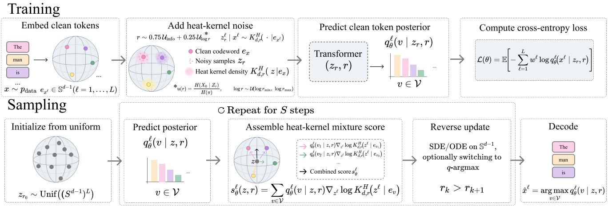  
Figure 1: Overview of SBD. Training (top): token embeddings are corrupted with the spherical heat kernel, and a Transformer predicts the clean-token posterior with cross-entropy. Sampling (bottom): the posterior either builds the score for reverse SDE/ODE updates or drives categorical refinement, which selects tokens and re-noises their codewords.

Contributions. (1) We introduce SBD, to our knowledge the first language difusion model whose forward corruption is given directly by the spherical heat semigroup on token embeddings. Its heat semigroup ofers a principled corruption process, a clean-token posterior supporting continuous and categorical sampling, and an exact ancestral bridge controlling trajectory memory (Section 3). (2) To compare spherical corruption processes without confounding kernel shape, time parameterization, and inference, we develop a conditional quantile-map integrator, heat–vMF approximation rates, and a shape residual (Section 3). (3) Using these tools, we show that inference can matter more than the spherical kernel in our controlled settings, and isolate state memory as a key factor limiting refinement, with a cost that grows with budget (Sections 4–5).

## 2 Background

Notation. Let $\mathbf { x } = ( x ^ { 1 } , \ldots , x ^ { L } ) \in \mathcal { V } ^ { L }$ be a token sequence, with token embeddings $\mathbf { e } _ { v } \in \mathbb { S } ^ { d - 1 }$ . Then $\mathbf { z } \in ( \mathbb { S } ^ { d - 1 } ) ^ { L }$ and the tangent projection is $P _ { \mathbf { z } } = I - { \mathbf { z } } { \mathbf { z } } ^ { \top }$

## 2.1 Non-autoregressive generation

Autoregressive models generate tokens from left to right. Masked discrete difusion models instead corrupt tokens and learn to reconstruct them in parallel [3, 52]. Continuous alternatives embed tokens in a Euclidean or manifoldvalued space and learn a reverse difusion or flow [20, 37, 68]. These models can revise several positions at each step, but their behavior depends on the latent geometry and on how continuous states are mapped back to tokens.

## 2.2 Spherical paths

S-FLM places token embeddings on a sphere and follows deterministic interpolating paths [17]. A related approach uses von Mises–Fisher (vMF) corruption [10]. For a clean codeword e, a vMF conditional has density proportional to exp(κ⟨z, e⟩) and score

$$
\nabla _ { \mathbf { z } } \log p _ { \mathrm { v M F } } ( \mathbf { z } \mid \mathbf { e } ) = \kappa ( \mathbf { e } - \langle \mathbf { z } , \mathbf { e } \rangle \mathbf { z } ) .\tag{1}
$$

Its radial coeficient is constant in the cosine [43]. Spherical Brownian motion has the same tangent direction but a cosine-dependent coeficient, which is the main geometric diference studied here.

## 2.3 Spherical Brownian diffusion

Brownian motion is the canonical isotropic difusion on the sphere. We use the dimension-free coordinate $r = - \log \rho$ where $\rho$ is the retained mean cosine, and intrinsic heat time $\tau _ { d } ( r ) = 2 r / ( d - 1 )$ . Here, ρ is the average cosine similarity between noisy and clean embeddings, and $\tau _ { d }$ is the elapsed time of standard Brownian motion on the sphere. The coordinate r is comparable across dimensions within one kernel family, but equal r does not imply equal token information across families; analogous time-warping ideas were used in CDCD [20]. Section 4 therefore also uses a measured information clock. In the Brownian clock, the forward process satisfies

$$
\begin{array} { r } { \mathrm { d } \mathbf { Z } _ { r } = - \mathbf { Z } _ { r } \mathrm { d } r + \sqrt { \frac { 2 } { d - 1 } } P _ { \mathbf { Z } _ { r } } \mathrm { d } \mathbf { W } _ { r } . } \end{array}\tag{2}
$$

Its transition density is the spherical heat kernel $K _ { d , r } ^ { H }$ , which solves $\partial _ { r } K _ { d , r } ^ { H } = \Delta _ { \mathbb { S } ^ { d - 1 } } K _ { d , r } ^ { H } / ( d - 1 )$ and converges to the uniform distribution as $r  \infty$ . Score-based difusion reverses this process using the score of the noisy marginal [39, 55].

For discrete data, the marginal score is a posterior average of conditional heat-kernel scores:

$$
\nabla _ { \mathbf { z } ^ { \ell } } \log p _ { r } ( \mathbf { z } ) = \sum _ { v \in \mathcal { V } } p ( x ^ { \ell } = v \mid \mathbf { Z } _ { r } = \mathbf { z } ) \nabla _ { \mathbf { z } ^ { \ell } } \log K _ { d , r } ^ { H } ( \mathbf { z } ^ { \ell } \mid \mathbf { e } _ { v } ) .\tag{3}
$$

A path-level comparison with S-FLM and vMF is given in Appendix D (Table 4).

## 3 Spherical Brownian Diffusion

This section develops Spherical Brownian Difusion (SBD) and the tools we use to study the role of the corruption kernel. We first define the Heat forward process and show how a clean-token posterior determines its marginal score (Section 3.1). We then describe training and two ways we use this posterior at inference: standard continuous reverse dynamics and categorical refinement. Our main inference tool is an exact Heat bridge, which lets us vary state memory independently of token selection. Finally, to compare Heat with other spherical corruptions without confounding the forward kernel with the sampler, we introduce matched transport and identify moment-matched vMF as a principled nearby-kernel control. These tools support the controlled kernel study in Section 4.

## 3.1 Forward process and marginal score

Our starting point is to use spherical Brownian motion as the tokenwise corruption process. Given a clean sequence x, we corrupt each token embedding independently with the spherical heat kernel introduced in Section 2.3. At noise level $r ,$ we have: $\mathbf { z } ^ { \ell } \mid x ^ { \ell } \sim K _ { d , r } ^ { \breve { H } } ( \cdot \mid \bar { \mathbf { e } } _ { x ^ { \ell } } )$ . Dependencies between positions are modeled by the Transformer rather than by the forward process.

We sample the heat kernel directly through its cosine distribution. We first draw the cosine c with respect to the clean codeword, sample a uniform tangent direction $\mathbf { v } ,$ and set $\mathbf { z } ^ { \ell } = c \mathbf { e } _ { x ^ { \ell } } + \sqrt { 1 - c ^ { 2 } } \mathbf { v }$

Because the heat kernel is isotropic, its conditional score depends only on $c _ { v } ^ { \ell } = \langle \mathbf { z } ^ { \ell } , \mathbf { e } _ { v } \rangle$ :

$$
\nabla _ { \pmb { z } ^ { \ell } } \log K _ { d , r } ^ { H } ( \pmb { z } ^ { \ell } \mid \mathbf { e } _ { v } ) = a _ { d , r } ^ { H } ( c _ { v } ^ { \ell } ) ( \mathbf { e } _ { v } - c _ { v } ^ { \ell } \mathbf { z } ^ { \ell } ) , \qquad a _ { d , r } ^ { H } ( c ) = \partial _ { c } \log K _ { d , r } ^ { H } ( c ) .\tag{4}
$$

Rather than learning the continuous score directly, we train a Transformer to predict the clean-token posterior $q _ { \theta } ^ { \ell } ( v \mid \mathbf { z } , r )$ with cross-entropy. This follows the score-interpolation view of continuous difusion for categorical data [20]: the marginal score is the posterior average of the known conditional scores. On the sphere, the corresponding posterior-weighted tangent-sum representation was also used by Chemseddine et al. [10]. For Heat,

$$
\mathbf { s } _ { \theta } ^ { \ell } ( \mathbf { z } , r ) = \sum _ { v \in \mathcal { V } } q _ { \theta } ^ { \ell } ( v \mid \mathbf { z } , r ) a _ { d , r } ^ { \mathrm { H } } ( c _ { v } ^ { \ell } ) \big ( \mathbf { e } _ { v } - c _ { v } ^ { \ell } \mathbf { z } ^ { \ell } \big ) .\tag{5}
$$

Thus, a single categorical posterior provides the score required by continuous samplers and can also be used directly for categorical refinement.

## 3.2 Training and codebooks

We train this posterior directly by denoising classification. For clean data x and a sampled Heat-corrupted state z, where $\begin{array} { r } { p _ { r } ^ { H } ( \mathbf { z } \mid \mathbf { \bar { x } } ) = \prod _ { \ell = 1 } ^ { L } K _ { d , r } ^ { H } ( \mathbf { z } ^ { \ell } \mid \mathbf { e } _ { x ^ { \ell } } ) } \end{array}$ , we predict the clean tokens with cross-entropy,

$$
\begin{array} { r } { \mathcal { L } _ { \mathrm { C E } } ( \boldsymbol { \theta } ) = \mathbb { E } _ { \mathbf { x } , r , \mathbf { z } } \Big [ - \sum _ { \ell = 1 } ^ { L } w _ { \ell } \log q _ { \boldsymbol { \theta } } ^ { \ell } ( x ^ { \ell } \mid \mathbf { z } , r ) \Big ] , } \end{array}\tag{6}
$$

where $w _ { \ell }$ is a task-dependent loss weight. We use frozen or learned unit-norm codebooks; their construction and the task-specific noise distributions are described in Appendix D.

## 3.3 Continuous dynamics and posterior refinement

Having learned q , we next describe how SBD generates. We consider two uses of the same posterior. First, it can be converted into a marginal score and used with standard reverse-SDE or probability-flow ODE dynamics. Second, it can act directly on token predictions through categorical refinement. We introduce q-argmax for the latter and, exploiting the Heat semigroup, an ancestral bridge that lets us interpolate between retaining and discarding the current continuous state.

Continuous reverse dynamics. As a standard continuous baseline, we convert the posterior into the marginal score using Equation 5. We then integrate either the reverse SDE or the probability-flow ODE on the sphere. The reverse SDE is stochastic, whereas the ODE is deterministic given its initialization. Implementation details are given in Appendix D. These are the standard score-based reverse-time dynamics for a difusion process [55].

Categorical posterior refinement. Rather than converting the posterior into a continuous score, we can act on its token predictions directly. We introduce q-argmax, which selects the most likely token at each position and re-noises its codeword at the next radius:

$$
\begin{array} { r } { \widehat { x } _ { k } ^ { \ell } = \arg \operatorname* { m a x } _ { v \in \mathcal { V } } q _ { \theta } ^ { \ell } ( v \mid \mathbf { z } _ { k } , r _ { k } ) , \qquad \mathbf { z } _ { k + 1 } ^ { \ell } \sim K _ { d , r _ { k + 1 } } ^ { H } \big ( \cdot \mid \mathbf { e } _ { \widehat { x } _ { k } ^ { \ell } } \big ) . } \end{array}\tag{7}
$$

The token choice is deterministic given the current state, while re-noising keeps the trajectory stochastic. Recomputing the posterior at every step allows later iterations to revise earlier predictions. This is related to predict-project-re-noise updates and to Difusion-LM’s repeated return to token embeddings, but here the projection is explicitly the clean-token posterior mode followed by a fresh Heat draw [36, 52].

Ancestral bridge and restart. q-argmax changes two aspects of ancestral sampling at once: it replaces posterior sampling by a mode decision and discards the previous continuous state by re-noising from scratch. To separate these efects, we exploit the Heat semigroup to construct an exact ancestral bridge. For Heat, the semigroup gives the bridge density $B _ { s  R } ^ { H }$ of the state at radius $s < R ,$ given the current state y at radius R and the clean token x:

$$
B _ { s  { R } } ^ { H } ( \mathbf { z } \mid \mathbf { y } , \mathbf { e } _ { x } ) = K _ { d , s } ^ { H } ( \mathbf { z } \mid \mathbf { e } _ { x } ) K _ { d , { R } - s } ^ { H } ( \mathbf { y } \mid \mathbf { z } ) / K _ { d , { R } } ^ { H } ( \mathbf { y } \mid \mathbf { e } _ { x } ) .\tag{8}
$$

Sampling x from the exact posterior and then from this bridge gives the exact finite-time reverse conditional;   
numerically, this is exact up to the heat-table accuracy.

We use the bridge to control how much state memory is retained. After evaluating $q _ { \theta } ( \cdot \mid \mathbf { z } _ { r _ { k } } , r _ { k } )$ , we select $\widehat { x } _ { k }$ either by argmax or by temperature-scaled posterior sampling, add $\Delta \geq 0$ forward noise, and bridge back:

$$
\begin{array} { r } { \widetilde { \mathbf { z } } \sim K _ { d , \Delta } ^ { H } ( \cdot \mid \mathbf { z } _ { r _ { k } } ) , \qquad \mathbf { z } _ { r _ { k + 1 } } \sim B _ { r _ { k + 1 }  r _ { k } + \Delta } ^ { H } ( \cdot \mid \widetilde { \mathbf { z } } , \mathbf { e } _ { \widehat { x _ { k } } } ) . } \end{array}\tag{9}
$$

This requires no additional network evaluations. $\Delta = 0$ retains the ancestral bridge state, while increasing $\Delta$ removes memory and approaches the memoryless refinement update. Token temperature independently controls whether selection is stochastic $( T = 1 )$ or approaches argmax $( T \to 0 )$

We also consider confidence-gated refinement, which keeps suficiently confident tokens fixed while continuing to refine the remaining positions. This is related to confidence-based remasking and token retention in masked difusion, but our gate uses the clean-token posterior at the current noisy state to decide which positions to hold fixed [1, 52]. Unless stated otherwise, the final sequence is decoded from one last posterior evaluation, ${ \widehat { x } } ^ { \ell } = \arg \operatorname* { m a x } _ { v \in \mathcal { V } } q _ { \theta } ^ { \ell } ( v \mid \mathbf { z } , r _ { \operatorname* { m i n } } )$ . Further sampler details and NFE accounting are given in Appendix D.

## 3.4 Matched transport across isotropic kernels

The previous sections define SBD for Heat. To determine whether its behavior comes from the corruption kernel itself, however, we need to compare Heat with alternative spherical kernels under compatible inference dynamics. Using one kernel with another kernel’s reverse dynamics would confound the forward process with sampler mismatch. We therefore construct matched transport for each isotropic kernel.

We build on Riemannian flow matching and the radial-transport framework for isotropic spherical paths [10, 11]. For sharply multimodal paths, for which direct velocity integration becomes dificult, we introduce a conditional quantile-map update, $c \longmapsto F _ { r ^ { \prime } } ^ { - 1 } ( F _ { r } ( c ) )$ , which is the exact one-dimensional monotone transport for a single conditional kernel. Averaging the resulting spherical displacements under the clean-token posterior gives a first-order update. Derivations and validation are in Appendix E.3.

## 3.5 Heat–vMF comparison as a nearby-kernel control

To isolate the efect of the corruption kernel, we need a principled nearby alternative to Heat. vMF is a natural choice: it is used by recent spherical language models and shares the same isotropic geometry, while difering in the shape of its conditional distribution. We therefore ask whether moment-matched vMF approaches Heat in high dimension, providing a controlled comparison for testing whether local kernel similarity translates to similar learned generation.

A vMF conditional has score $\kappa ( { \bf e } - c { \bf z } )$ , with a radial coeficient that is constant in $^ { c , }$ whereas the heat-kernel coeficient varies with the cosine. Intuitively, the most relevant regime for comparing their shapes is the critical noise scale, where the remaining alignment with the original token becomes comparable to random fluctuations on the sphere, both of order $1 / \sqrt { d } \ [ 6 2 ]$ . We compare the two kernels at the critical noise radius $r _ { d } = ( \log d + \xi ) / 2$ where the retained cosine is $m / { \sqrt { d } }$ for fixed $\xi$ and $m = e ^ { - \xi / 2 }$ . Let $t _ { d } = ( \log d + \xi ) / ( d - 1 )$ and choose the vMF concentration $\kappa _ { d } ^ { \star }$ to match that retained cosine. Under Heat, write $C = \langle \mathbf { Z } , \mathbf { e } \rangle$ for the noisy-clean cosine.

Proposition 1 (Critical-scale heat-vMF approximation). For fixed ξ as $d \to \infty$ 2

$$
\begin{array} { r } { D _ { \mathrm { K L } } \big ( H _ { d , r _ { d } } \| V _ { d , \kappa _ { d } ^ { \star } } \big ) = \frac { m ^ { 4 } } { 4 } t _ { d } ^ { 2 } ( 1 + o ( 1 ) ) , \qquad { \mathbb { E } } _ { H } \big [ \big ( a _ { d , r _ { d } } ^ { H } ( C ) / \kappa _ { d } ^ { \star } - 1 \big ) ^ { 2 } \big ] ^ { 1 / 2 } = m t _ { d } ( 1 + o ( 1 ) ) . } \end{array}\tag{10}
$$

In particular, these rates are $O ( ( \log d / d ) ^ { 2 } )$ and $O ( \log d / d )$

Moment matching cancels the leading linear discrepancy, leaving a quadratic term that controls both rates. The measured shape residual follows the high-dimensional trend: its maximum falls from 0.025 at $d = 1 2 8$ to 0.010 at $d = 7 6 8$ , though not uniformly over noise levels. Appendix C gives the expansion, proof, and scope of the critical-path result. Appendix Figure 15 tests the two predicted coeficients independently across eight dimensions and three critical-noise paths, without fitting their common target $m = e ^ { - \xi / 2 }$ . Both estimates approach that target as d grows, although the finite-dimensional discrepancy shrinks slowly, approximately as $1 / \log d .$

Takeaway. At the critical noise scale, moment-matched vMF is close to Heat in both conditional likelihood and relative score. This gives the kernel study (Section 4) a principled nearby-kernel comparison; the experiments test how that local agreement carries over to learned generation. The proposition concerns the critical path $r _ { d } = ( \log d + \xi ) / 2$ not the full sampling trajectory.

## 4 Which parts of SBD depend on the Brownian kernel?

SBD uses the corruption kernel in three roles: as the continuous probability path (Section 4.2), as the training channel whose posterior the sampler relies on (Section 4.3), and as the re-noising operator for categorical refinement (Section 4.4). We vary these roles separately, then use the Heat bridge to separate state memory from token selection efects while sampling (Section 4.5).

## 4.1 Setup

We pick kernels at increasing distance from Heat: moment-matched vMF, which our theory predicts is close (Section 3.5); SLERP, the path used by S-FLM; and two vMF mixtures whose bimodal shape deliberately departs from Heat. At retained cosine $m = e ^ { - r }$ , a mixture places weights m and 1 − m on vMF components with mean cosines $m + \lambda ( 1 - m )$ and $( 1 - \lambda ) m ,$ , so its mean cosine is m while $\lambda \in \{ 0 . 5 , 0 . 9 \}$ changes its shape (Equation 54). The main SLERP comparison truncates the path at $r _ { \mathrm { m i n } } = 0 . 9 4 2$ , where its information is exhausted; Appendix E.4 also reports the full path. Because equal mean cosine need not mean equal token uncertainty, we also compare kernels on a measured information clock, and we report a local shape residual that is zero when a kernel difers from Heat only by a time change (Table 1, definitions in Appendix E.3). Unless stated otherwise, Sudoku kernel experiments use hard puzzles, $d = 1 2 8$ , 20k training updates, 2,000 evaluation puzzles, and three training seeds.

## 4.2 The kernel as a continuous probability path

We first ask whether the path itself matters when everything else is matched: each kernel is trained and sampled with its own valid transport. On hard Sudoku at $B = 1 8 0$ (181 NFEs with posterior decoding), Heat, moment matched vMF, truncated SLERP, and the $. 5 / . 9$ mixtures reach 54.5%, 54.7%, 51.4%, 53.3%, and 55.3%, respectively (Tables 28 and 33). Increasing the sampler budget to B = 720 (721 NFEs) does not materially change the Heat/vMF/mixture comparison within seed variation. The full SLERP path reaches $5 6 . 2 \pm 2 . 2 \%$ at $B = 1 8 0$

The stability depends on matching the dynamics to the kernel. For the $\lambda = . 9$ mixture, inserting the mixture score into Brownian ODE dynamics with nearest-codeword decoding gives 0.0% accuracy at 180 NFEs. At the same sampler budget $B = 1 8 0$ , posterior decoding alone raises this to $1 5 . 3 \pm 3 . 6 \%$ at 181 NFEs, and valid transport alone to $1 1 . 2 \pm 0 . 7 \%$ at 180 NFEs; using both reaches $5 5 . 3 \pm 2 . 3 \%$ at 181 NFEs (Table 31). Thus, changing the kernel requires both compatible transport and compatible decoding rather than a direct score substitution. The full valid-transport comparison is in Table 28; the decoding-by-dynamics control is in Table 31, with transport checks in Appendix E.3.

## 4.3 Posterior mismatch compounds on sequence generation

Section 4.2 matched training and sampling. In practice they can be decoupled: a trained model may be sampled with another kernel or schedule. We therefore ask how much a posterior trained with one kernel loses on states from another, and whether the loss comes from kernel shape or only its noise level. To separate the two, we optionally relabel the network input using the information clock.

Small shape diferences are a clock efect. On GSM8K, moment-matched vMF changes q-argmax accuracy by only $- 0 . 9 \pm 0 . 4$ points at 65 NFEs (B = 64 plus posterior decoding). An information-matched vMF loses $3 . 8 \pm 0 .$ 4 points, but relabelling by mean cosine reduces the gap to $0 . 5 \pm 0 . 7$ (Table 38). Both kernels have small shape residuals (Table 1), so the diference comes from the noise parameterization, not the shape.

Table 1: Shape-residual ranges.
<table><tr><td>Kernel</td><td>Residual</td></tr><tr><td> $d = 1 2 8$ </td><td></td></tr><tr><td>Heat moment vMF</td><td>≤ .001  $. 0 0 \overline { { 1 } } \mathrm { - } . \overset { } { . } 0 2 5$ </td></tr><tr><td>Mix .5</td><td> $2 . 0 { - } 1 6$ </td></tr><tr><td>Mix .9</td><td> $9 . 2 \mathrm { - } 9 8 $ </td></tr><tr><td> $d = 7 6 8$ </td><td></td></tr><tr><td> $_ { \mathrm { i n f o - v M F } }$ </td><td>.000-.010</td></tr></table>

Large shape diferences are not. On hard Sudoku, mismatch cost follows the shape residual. Relabelling   
reduces the $\lambda = . 9$ loss from $1 4 . 6 \pm 2 . 9 \mathrm { { \ t o \ 9 . 6 \pm 0 . 8 } }$ points but does not help $\lambda = . 5 \ ( 4 . 4 \pm 0 . 6 \to 4 . 8 \pm 0 . 3 $ Figure 8,   
Table 30). On GSM8K, mismatch is severe: Heat-trained weights sampled with either mixture reach at most 0.5%   
accuracy, and relabelling lifts $\lambda = . 5$ only from 0.03% to 8.7% (Table 38). The cost grows with sequence length. The   
mixture-to-Heat success ratio drops from 0.47 for programs of mean length 96 to 0.03 at length 189, with correlation   
−0.96 (Figure 2, right; Table 41). This is consistent with early token errors corrupting the context of later tokens. Matched training restores accuracy. We fine-tune the same Heat checkpoint for 25k steps on Heat and on   
the $\lambda = . 5$ mixture, and sample each with its own kernel. At 257 NFEs $( B = 2 5 6$ plus posterior decoding), the   
mixture model reaches $2 6 . 2 3 \pm 1 . 3 0 \%$ , close to the Heat control $( 2 7 . 3 2 \pm 0 . 5 2 \% )$ and far above the mismatched   
mixture (0.03%; Figure 2, left; Table 42). Each arm uses one training seed; error bars are over three inference seeds.

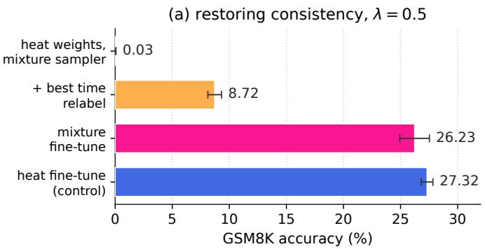

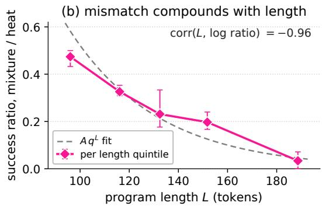  
Figure 2: GSM8K consistency restoration at $B = 2 5 6$ (257 NFEs, left) and mismatch by program length (right), both with posterior decoding. Error bars show three inference seeds; fine-tunes use one training seed per arm.

## 4.4 Kernel shape affects categorical refinement

Matched training removes the mismatch cost, but does the kernel become irrelevant? Not for categorical refinement, where it determines how selected tokens are re-noised. On hard Sudoku, matched mixture training and sampling improve q-argmax by $6 . 0 \pm 1 . 7$ points for $\lambda = . 5$ and $5 . 2 \pm 2 . 5$ points for $\lambda = . 9$ . Confidence-gated refinement behaves diferently: the $\lambda = . 5$ mixture reduces accuracy by $5 . 8 \pm 1 . 8$ points. These efects use five independent training seeds per kernel at $B = 1 8 0$ (181 NFEs with posterior decoding). In contrast, Heat and moment-matched $\mathrm { v M F }$ remain within roughly one point under tuned gating across the tested budgets. Full kernel results are given in Appendix E.3, where the q-argmax sweep and crossed training/re-noising comparison are reported. Table 32 gives the seed-level gating efects, and Table 24 shows the matched Heat–vMF comparison across inference rules.

The mixture-specific efect does not transfer directly to GSM8K. In the single-training-seed text fine-tune, the matched $\lambda = . 5$ model difers from Heat $\mathrm { b y - 1 . 0 9 \pm 1 . 8 0 }$ points with EMA and posterior decoding at 257 NFEs (paired over three inference seeds). Separately, the S-FLM transfer result shows that categorical refinement can carry across a diferent spherical forward process. Kernel shape therefore has no task-independent ordering: its efect depends on how the kernel is used and on the inference procedure.

## 4.5 Ancestral bridges separate memory from token selection

Why separate the two. Changing the kernel moves accuracy by only a few points once training and sampling match. With Heat fixed, four inference rules span about 25 points on hard Sudoku. However, q-argmax changes both state memory, through fresh re-noising, and token selection, by replacing posterior sampling with argmax. Either could explain its advantage, and they call for diferent fixes: decorrelating successive network inputs, or lowering the decoding temperature. Because an exact posterior would make ancestral sampling exact, any gain from departing from it also measures how errors of the learned posterior compound along a trajectory.

How we vary them. The Heat bridge (Equation 8) has two parameters. The restart size $\Delta$ adds extra noise before bridging back: $\Delta = 0$ is exact ancestral sampling, which keeps the full state, and $\Delta $ ∞ forgets ${ \mathrm { i t } } ,$ as q-argmax does. The temperature $T$ moves token choice from sampling $( T = 1 )$ to argmax. Neither parameter adds network calls.

Memory helps on both tasks; argmax helps on GSM8K. Removing memory gains $1 7 . 7 \pm 1 . 4$ points on Sudoku at 129 NFEs $( B = 1 2 8$ plus posterior decoding). In contrast, memoryless $T = 1$ sampling is slightly better than argmax there, by 0.5–1.4 points across the reported budgets (Table 2). On GSM8K, removing memory gains $8 . 1 \pm 0 . 6$ points at $B = 6 4$ , while argmax selection adds $1 1 . 4 \pm 1 . 0$ points at $B = 1 6$ but only $4 . 7 \pm 2 . 0$ at $B = 2 5 6$

The memory cost grows with budget. As the grid is refined, the bridge deficit grows from 6.4 to 18.4 points on Sudoku and from 3.6 to 9.5 on GSM8K (Table 10). The channel difers by task: redrawing the noise alone recovers most of the Sudoku gap but worsens GSM8K, where retaining old token commitments matters more (Tables 9 and 12). This refines $\mathrm { F M L M + ^ { \prime } s }$ observation that fresh re-noising avoids repeated rejected predictions [1].

Why Heat. The diagnostic needs a time-homogeneous Markov difusion with a tractable semigroup, so that adding $\Delta$ noise and bridging back preserves the Heat marginals. Among the paths studied here, SLERP gives only a deterministic bridge, and vMF marginals give no tractable stochastic one. The spherical Poisson kernel also has a semigroup, but it is a jump process rather than a difusion.

Table 2: Paired q-argmax gains from removing state memory or using argmax token selection
<table><tr><td>Task (B)</td><td>Memory</td><td>Token</td></tr><tr><td>Sudoku (16)</td><td> $+ 6 . 4 \pm 1 . 0$ </td><td> $- 1 . 3 \pm 1 . 0$ </td></tr><tr><td>Sudoku (180)</td><td> $+ 1 8 . 4 \pm 1 . 8$ </td><td> $- 1 . 4 \pm 1 . 0$ </td></tr><tr><td>GSM8K (16)</td><td> $+ 3 . 6 \pm 0 . 3$ </td><td> $+ 1 1 . 4 \pm 1 . 0$ </td></tr><tr><td>GSM8K (256)</td><td> $+ 9 . 5 \pm 1 . 4$ </td><td> $+ 4 . 7 \pm 2 . 0$ </td></tr></table>

Takeaway. Kernel choice has no sampler-independent ranking. With compatible continuous transport, all five kernels perform similarly on Sudoku, but a mismatched posterior is costly, especially on long GSM8K programs. In categorical refinement, a mixture can help q-argmax through re-noising yet hurt confidence gating through training. Across both tasks, retaining state memory limits refinement, and its cost grows with budget.

## 5 Benchmarks

We benchmark SBD on Sudoku, GSM8K, and Open-WebText, spanning reasoning and open-ended generation. SBD is competitive with recent continuous models, with the strongest method depending on the inference regime. We use categorical refinement for reasoning and a hybrid sampler for text (Section 4).

## 5.1 Sudoku

Experimental setup. We use the S-FLM Sudoku benchmark with 48k training and 2k evaluation puzzles per dificulty [2, 17]. SBD uses a frozen max-min $d = 1 2 8$

Table 3: Sudoku whole-grid accuracy (%) at $B = 1 8 0$ sampler calls (gated SBD: 181 NFEs). FMLM+ and SBD: mean ± std. over five sampler seeds.
<table><tr><td>Model</td><td>Easy</td><td>Medium</td><td>Hard</td></tr><tr><td>AR (greedy)</td><td>14.6</td><td>5.1</td><td>1.0</td></tr><tr><td>MDLM</td><td>92.0</td><td>77.1</td><td>30.2</td></tr><tr><td>Duo</td><td>96.3</td><td>84.7</td><td>58.4</td></tr><tr><td>CANDI</td><td>79.3</td><td>45.9</td><td>16.7</td></tr><tr><td>FLM</td><td>94.2</td><td>82.7</td><td>44.5</td></tr><tr><td>S-FLM</td><td>94.8</td><td>85.2</td><td>45.0</td></tr><tr><td>FMLM+ PR</td><td> $9 7 . 7 7 \pm . 1 3$ </td><td>92.99 ± .33</td><td> $8 1 . 6 5 \pm . 3 6$ </td></tr><tr><td>Ours: q-argmax</td><td> $9 8 . 6 9 \pm . 0 7$ </td><td>94.57 ±.21</td><td>79.70 ±.75</td></tr><tr><td>Ours: gated</td><td> $\mathbf { 9 9 . 1 1 \pm . 1 2 }$ </td><td>96.66 ± .15 83.36 ±.42</td><td></td></tr></table>

codebook, with one Heat model trained per dificulty. We evaluate each SBD sampler with five random seeds and report whole-grid exact-match accuracy at a sampler budget of $B = 1 8 0$ calls. Full budget sweeps and baseline details are given in Appendix E.2.

Results. Table 3 reports the main comparison. On hard Sudoku, gated SBD reaches 83.36%, slightly above FMLM+ (81.65%), and is the strongest reported continuous/flow model at this budget. On easy and medium puzzles, gated SBD reaches 99.11% and 96.66%, respectively. Full budget sweeps are reported in Appendix E.2.

## 5.2 Reasoning on GSM8K

Experimental setup. Following prior work, we train on TinyGSM and evaluate on the 1,319 GSM8K test problems [15, 38]. The model generates one Python program per problem, which we execute to obtain the final answer. SBD uses a learned $d = 7 6 8$ codebook and is trained for 250k updates. We compare against recent discrete and continuous non-autoregressive models trained from scratch, together with the reported vMF predictor–corrector baseline without self-conditioning. Teacher-assisted and self-conditioned variants are reported separately in Appendix E.6. The controlled decoding curves appear in Figure 3; the full-budget comparison and complete NFE ladder are in Appendix Tables 35 and 36.

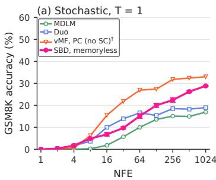

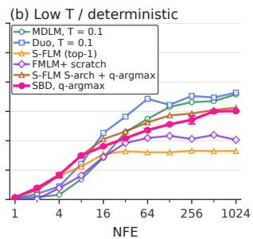  
Figure 3: GSM8K accuracy vs. NFE. (a) $T = 1 ,$ . (b) q-argmax for $\mathrm { S B D / S \mathrm { - F L M } } .$ $T ~ = ~ 0 . 1$ for $\mathrm { M D L M / D u o } ,$ endpoint argmax for FMLM+. †: published vMF PC. SBD shows mean ± std. over three seeds; baselines are single runs.

Results. At matched T = 1, SBD beats MDLM at each budget and Duo from 128 NFEs; the vMF predictor– corrector is stronger, but uses a diferent training and sampling recipe. Figure 3 shows both decoding regimes. Under low-temperature or deterministic decoding, SBD q-argmax leads only through 8 NFEs; Duo overtakes by 16 and MDLM by 32. At 1,024 NFEs, SBD trails Duo by about 6 points, narrowing the 20-point Duo–S-FLM top-1 gap. Applying q-argmax to S-FLM S-arch reaches 31.2% versus 30.1% for SBD at 1,024 NFEs (one evaluation seed); this is transfer evidence, not a controlled kernel comparison, since schedule, truncation, embedding handling, and training difer. Full baseline provenance is in Appendix E.6.

## 5.3 Unconditional OpenWebText generation

Experimental setup. We train SBD on OpenWebText with a learned d = 768 codebook for 1M updates and generate length-1,024 sequences [21, 49]. Following prior work, we evaluate sample quality with GPT-2-Large generative perplexity and diversity with unigram entropy, sweeping temperature across NFE budgets. For open-ended generation, SBD uses a hybrid sampler combining stochastic score updates followed by categorical refinement. The schedule and sampler settings are detailed in Appendix E.11; the temperature-matched k ablation is in Table 45, and all NFE frontiers in Figure 11.

Results. At 1,024 NFEs (Figure 4), SBD improves over S-FLM, while MDLM and Duo retain a better quality–diversity trade-of over much of the range. Less frequent categorical refinement raises diversity but lowers quality, so stochastic updates remain useful for open-ended generation.

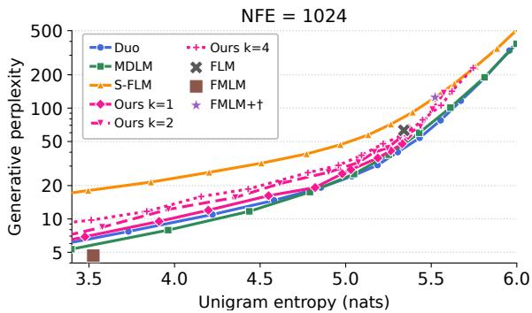  
Figure 4: OpenWebText frontier at 1,024 NFEs. Lower generative perplexity is better at matched unigram entropy.

## 6 Related Work

Language difusion spans discrete models such as MDLM and Duo, and continuous embedding or simplex approaches including Difusion-LM, CDCD, RePlaid, Dirichlet Flow Matching, and LangFlow [13, 20, 36, 52, 53, 57, 65]; CDCD’s time warping motivates our information clock. Geometric approaches include Riemannian heat-kernel and Fisher–Rao models, S-FLM, vMF spherical flows, and RDLM [6, 10, 14, 16, 17, 25, 26]. Our conditional quantile map extends spherical flow matching to multimodal cosine laws [10], while q-argmax and confidence gating relate to posterior refinement and token retention [1, 36]. Restart and revision methods likewise modify sampling dynamics or state retention [64, 67]. Our Heat bridge gives state-memory interventions a semigroup-based construction; fuller positioning is in Appendix B.

## 7 Conclusion

We use spherical Brownian motion both as a language model and as a tool for studying continuous language generation. Four lessons emerge. (i) The isotropic kernel matters little when training and sampling are matched; mismatch is severe but largely repaired by matched fine-tuning. (ii) Inference matters more: with Heat fixed, samplers span 25 points, and posterior-based token refinement outperforms continuous integration, with gains that transfer to S-FLM. (iii) Refinement benefits from fresh states: retaining trajectory memory preserves noise and token commitments, with a growing cost at finer step grids. (iv) The best sampler is task-dependent: token commitment helps reasoning, whereas open-ended text benefits from stochastic updates that preserve diversity. Progress may therefore depend less on new forward processes than on inference rules that decorrelate successive states and commit to tokens at the right time.

## AI use statement

In this work, we used generative AI tools to assist with manuscript editing, software code and figure preparation, and to independently check mathematical derivations and proofs.

Generative AI was not used to generate synthetic data sets, help develop theoretical models or conceptual frameworks, formulate mathematical claims, provide critical ingredients for proving mathematical claims, assist in the writing of proofs, propose or refine hypotheses, design or provide feedback on research methodology or experiments, implement methods, or interpret results. The following tasks were not applicable to this work: assist with translation; clean and reformat dataset; support qualitative and thematic data analysis.

All AI-assisted text, code, figures, and mathematical checks were reviewed and verified by the authors. In particular, the authors independently checked the final mathematical derivations and proofs and reviewed and tested the resulting code for correctness. We take responsibility for the final content of this work, including all text, claims, code, figures, and other artifacts produced with the aid of generative AI.

## Ethics statement

This work studies a generative modeling method using Sudoku, synthetic mathematical problems, and OpenWebText. Models trained on web text can inherit biases and produce inaccurate or harmful content. Generated programs should be executed in a restricted environment. These experiments do not establish that the models are safe for deployment.

## Reproducibility statement

We report benchmark-specific model architectures, training budgets, corruption schedules, sampling rules, NFE accounting, and evaluation protocols. The appendices document data splits, checkpoint-selection procedures, seed counts and baseline provenance; where we report variability, we specify whether it is over training or sampler seeds.

## References

[1] Manan Agarwal, Sheel Shah, Chanhyuk Lee, Jaehoon Yoo, Jerry Huang, Seunghoon Hong, Aditi Raghunathan, Jinwoo Kim, and Nicholas M Bofi. Posterior refinement: Fast language generation via any-order flow maps. arXiv preprint arXiv:2606.24773, 2026.

[2] Ali Alp. Sudoku puzzle generator. https://github.com/alicommit-malp/sudoku, 2024.

[3] Jacob Austin, Daniel D Johnson, Jonathan Ho, Daniel Tarlow, and Rianne Van Den Berg. Structured denoising difusion models in discrete state-spaces. Advances in neural information processing systems, 34:17981–17993, 2021.

[4] Heli Ben-Hamu, Itai Gat, Daniel Severo, Niklas Nolte, and Brian Karrer. Accelerated sampling from masked difusion models via entropy bounded unmasking. In The Thirty-ninth Annual Conference on Neural Information Processing Systems, 2025. URL https://openreview.net/forum?id=WBcBhT1NKO.

[5] Nicholas Matthew Bofi, Michael Samuel Albergo, and Eric Vanden-Eijnden. Flow map matching with stochastic interpolants: A mathematical framework for consistency models. Transactions on Machine Learning Research, 2025. ISSN 2835-8856. URL https://openreview.net/forum?id=cqDH0e6ak2.

[6] Valentin De Bortoli, Emile Mathieu, Michael John Hutchinson, James Thornton, Yee Whye Teh, and Arnaud Doucet. Riemannian score-based generative modelling. In Alice H. Oh, Alekh Agarwal, Danielle Belgrave, and Kyunghyun Cho, editors, Advances in Neural Information Processing Systems, 2022. URL https://openreview.net/forum?id=oDRQGo8I7P.

[7] Andrew Campbell, Joe Benton, Valentin De Bortoli, Tom Rainforth, George Deligiannidis, and Arnaud Doucet. A continuous time framework for discrete denoising models. In Alice H. Oh, Alekh Agarwal, Danielle Belgrave, and Kyunghyun Cho, editors, Advances in Neural Information Processing Systems, 2022. URL https://openreview.net/forum?id=DmT862YAieY.

[8] Huiwen Chang, Han Zhang, Lu Jiang, Ce Liu, and William T Freeman. Maskgit: Masked generative image transformer. In 2022 IEEE/CVF Conference on Computer Vision and Pattern Recognition (CVPR), pages 11305–11315. IEEE, 2022.

[9] Jannis Chemseddine, Gregor Kornhardt, Richard Duong, and Gabriele Steidl. Adapting noise to data: Generative flows from learned 1d processes. In Forty-third International Conference on Machine Learning, 2026. URL https://openreview.net/forum?id=vLQO6nrpYq.

[10] Jannis Chemseddine, Gregor Kornhardt, and Gabriele Steidl. Spherical flows for sampling categorical data. 2026. URL https://arxiv.org/abs/2605.05629.

[11] Ricky T. Q. Chen and Yaron Lipman. Flow matching on general geometries. In The Twelfth International Conference on Learning Representations, 2024. URL https://openreview.net/forum?id=g7ohDlTITL.

[12] Ting Chen, Ruixiang ZHANG, and Geofrey Hinton. Analog bits: Generating discrete data using difusion models with self-conditioning. In The Eleventh International Conference on Learning Representations, 2023 URL https://openreview.net/forum?id=3itjR9QxFw.

[13] Yuxin Chen, Chumeng Liang, Hangke Sui, Ruihan Guo, Chaoran Cheng, Jiaxuan You, and Ge Liu. Langflow: Continuous difusion rivals discrete in language modeling. arXiv preprint arXiv:2604.11748, 2026.

[14] Chaoran Cheng, Jiahan Li, Jian Peng, and Ge Liu. Categorical flow matching on statistical manifolds. In The Thirty-eighth Annual Conference on Neural Information Processing Systems, 2024. URL https: //openreview.net/forum?id=5fybcQZ0g4.

[15] Karl Cobbe, Vineet Kosaraju, Mohammad Bavarian, Mark Chen, Heewoo Jun, Lukasz Kaiser, Matthias Plappert, Jerry Tworek, Jacob Hilton, Reiichiro Nakano, et al. Training verifiers to solve math word problems. arXiv preprint arXiv:2110.14168, 2021.

[16] Oscar Davis, Samuel Kessler, Mircea Petrache, Ismail Ilkan Ceylan, Michael M. Bronstein, and Joey Bose. Fisher flow matching for generative modeling over discrete data. In The Thirty-eighth Annual Conference on Neural Information Processing Systems, 2024. URL https://openreview.net/forum?id=6jOScqwdHU.

[17] Justin Deschenaux and Caglar Gulcehre. Language modeling with hyperspherical flows. 2026. URL https: //arxiv.org/abs/2605.11125.

[18] Justin Deschenaux, Caglar Gulcehre, and Subham Sekhar Sahoo. The difusion duality, chapter II: \$\psi\$- samplers. In The Fourteenth International Conference on Learning Representations, 2026. URL https: //openreview.net/forum?id=RSIoYWIzaP.

[19] Justin Deschenaux, Lan Tran, and Caglar Gulcehre. Partition generative modeling: Masked modeling without masks. In The Fourteenth International Conference on Learning Representations, 2026. URL https://openreview.net/forum?id=vEh1ceS154.

[20] Sander Dieleman, Laurent Sartran, Arman Roshannai, Nikolay Savinov, Yaroslav Ganin, Pierre H Richemond, Arnaud Doucet, Robin Strudel, Chris Dyer, Conor Durkan, et al. Continuous difusion for categorical data. arXiv preprint arXiv:2211.15089, 2022.

[21] Aaron Gokaslan and Vanya Cohen. Openwebtext corpus. http://Skylion007.github.io/ OpenWebTextCorpus, 2019.

[22] Ishaan Gulrajani and Tatsunori Hashimoto. Likelihood-based difusion language models. In Thirty-seventh Conference on Neural Information Processing Systems, 2023. URL https://openreview.net/forum?id= e2MCL6hObn.

[23] Xiaochuang Han, Sachin Kumar, and Yulia Tsvetkov. Ssd-lm: Semi-autoregressive simplex-based difusion language model for text generation and modular control. In Proceedings of the 61st Annual Meeting of the Association for Computational Linguistics (Volume 1: Long Papers), pages 11575–11596, 2023.

[24] Keya Hu, Linlu Qiu, Yiyang Lu, Hanhong Zhao, Tianhong Li, Yoon Kim, Jacob Andreas, and Kaiming He. Elf: Embedded language flows. arXiv preprint arXiv:2605.10938, 2026.

[25] Chin-Wei Huang, Milad Aghajohari, Joey Bose, Prakash Panangaden, and Aaron Courville. Riemannian difusion models. In Alice H. Oh, Alekh Agarwal, Danielle Belgrave, and Kyunghyun Cho, editors, Advances in Neural Information Processing Systems, 2022. URL https://openreview.net/forum?id=ecevn9kPm4.

[26] Jaehyeong Jo and Sung Ju Hwang. Continuous difusion model for language modeling. In D. Belgrave, C. Zhang, H. Lin, R. Pascanu, P. Koniusz, M. Ghassemi, and N. Chen, editors, Advances in Neural Information Processing Systems, volume 38, Main Conference, pages 97394–97430. Curran Associates, Inc., 2025. doi: 10.52202/085713-3256. URL https://proceedings.neurips.cc/paper\_files/paper/2025/ file/8c4046a93293442e88f54e19a5849d68-Paper-Conference.pdf.

[27] Mingyu Jo, Jaesik Yoon, Justin Deschenaux, Caglar Gulcehre, and Sungjin Ahn. Loopholing discrete difusion: Deterministic bypass of the sampling wall. In International Conference on Learning Representations, volume 2026, pages 93890–93918, 2026.

[28] Tero Karras, Miika Aittala, Timo Aila, and Samuli Laine. Elucidating the design space of difusion-based generative models. In Alice H. Oh, Alekh Agarwal, Danielle Belgrave, and Kyunghyun Cho, editors, Advances in Neural Information Processing Systems, 2022. URL https://openreview.net/forum?id=k7FuTOWMOc7.

[29] Jaeyeon Kim, Kulin Shah, Vasilis Kontonis, Sham M. Kakade, and Sitan Chen. Train for the worst, plan for the best: Understanding token ordering in masked difusions. In Forty-second International Conference on Machine Learning, 2025. URL https://openreview.net/forum?id=DjJmre5IkP.

[30] Jaeyeon Kim, Seunggeun Kim, Taekyun Lee, David Z. Pan, Hyeji Kim, Sham M. Kakade, and Sitan Chen. Fine-tuning masked difusion for provable self-correction. In Forty-third International Conference on Machine Learning, 2026. URL https://openreview.net/forum?id=2LRaNghfoM.

[31] Seunggeun Kim, Jaeyeon Kim, Taekyun Lee, Yuyuan Chen, Yilun Du, Sham Kakade, and Sitan Chen. From interface to inference: Eliciting any-order inference from any-order models. arXiv preprint arXiv:2607.26504, 2026.

[32] Brett L. Kotschwar. Hamilton’s gradient estimate for the heat kernel on complete manifolds. Proceedings of the American Mathematical Society, 135(9):3013–3019, 2007. ISSN 00029939, 10886826. URL http: //www.jstor.org/stable/20534916.

[33] Chanhyuk Lee, Jaehoon Yoo, Manan Agarwal, Sheel Shah, Jerry Huang, Aditi Raghunathan, Seunghoon Hong, Nicholas M Bofi, and Jinwoo Kim. Flow map language models: One-step language modeling via continuous denoising. arXiv preprint arXiv:2602.16813, 2026.

[34] David Li, Nikita Gushchin, Dmitry Abulkhanov, Eric Moulines, Ivan Oseledets, Maxim Panov, and Alexander Korotin. IDLM: Inverse-distilled difusion language models. In Forty-third International Conference on Machine Learning, 2026. URL https://openreview.net/forum?id=bS8qU2wJxu.

[35] Peter Li and Shing-Tung Yau. On the parabolic kernel of the schrödinger operator. Acta Mathematica, 156: 153–201, 1986. URL https://api.semanticscholar.org/CorpusID:120354778.

[36] Xiang Li, John Thickstun, Ishaan Gulrajani, Percy S Liang, and Tatsunori B Hashimoto. Difusion-lm improves controllable text generation. Advances in neural information processing systems, 35:4328–4343, 2022.

[37] Yaron Lipman, Ricky T. Q. Chen, Heli Ben-Hamu, Maximilian Nickel, and Matthew Le. Flow matching for generative modeling. In The Eleventh International Conference on Learning Representations, 2023. URL https://openreview.net/forum?id=PqvMRDCJT9t.

[38] Bingbin Liu, Sebastien Bubeck, Ronen Eldan, Janardhan Kulkarni, Yuanzhi Li, Anh Nguyen, Rachel Ward, and Yi Zhang. TinyGSM: achieving >80% on GSM8K with small language models. 2023. URL https: //arxiv.org/abs/2312.09241.

[39] Aaron Lou, Minkai Xu, Adam Farris, and Stefano Ermon. Scaling riemannian difusion models. In Thirtyseventh Conference on Neural Information Processing Systems, 2023. URL https://openreview.net/forum? id=FLTg8uA5xI.

[40] Aaron Lou, Chenlin Meng, and Stefano Ermon. Discrete difusion modeling by estimating the ratios of the data distribution. In Ruslan Salakhutdinov, Zico Kolter, Katherine Heller, Adrian Weller, Nuria Oliver, Jonathan Scarlett, and Felix Berkenkamp, editors, Proceedings of the 41st International Conference on Machine Learning, volume 235 of Proceedings of Machine Learning Research, pages 32819–32848. PMLR, 21–27 Jul 2024. URL https://proceedings.mlr.press/v235/lou24a.html.

[41] Justin Lovelace, Varsha Kishore, Chao Wan, Eliot Seo Shekhtman, and Kilian Q Weinberger. Latent difusion for language generation. In Thirty-seventh Conference on Neural Information Processing Systems, 2023. URL https://openreview.net/forum?id=NKdtztladR.

[42] Rabeeh Karimi Mahabadi, Hamish Ivison, Jaesung Tae, James Henderson, Iz Beltagy, Matthew E Peters, and Arman Cohan. Tess: Text-to-text self-conditioned simplex difusion. In Proceedings of the 18th Conference of the European Chapter of the Association for Computational Linguistics (Volume 1: Long Papers), pages 2347–2361, 2024.

[43] Kanti V. Mardia and Peter E. Jupp. Directional Statistics. Wiley Series in Probability and Statistics. John Wiley & Sons, 1999. ISBN 9780471953333. doi: 10.1002/9780470316979.

[44] Shen Nie, Fengqi Zhu, Chao Du, Tianyu Pang, Qian Liu, Guangtao Zeng, Min Lin, and Chongxuan Li. Scaling up masked difusion models on text. In International Conference on Learning Representations, volume 2025, pages 82974–82997, 2025.

[45] William Peebles and Saining Xie. Scalable difusion models with transformers. In 2023 IEEE/CVF International Conference on Computer Vision (ICCV), pages 4172–4182. IEEE, 2023.

[46] Peter Potaptchik, Jason Yim, Adhi Saravanan, Peter Holderrieth, Eric Vanden-Eijnden, and Michael S Albergo. Discrete flow maps. arXiv preprint arXiv:2604.09784, 2026.

[47] Patrick Pynadath, Jiaxin Shi, and Ruqi Zhang. CANDI: Hybrid discrete-continuous difusion models. In Forty-third International Conference on Machine Learning, 2026. URL https://openreview.net/forum?id= 03KQGUvw1e.

[48] Patrick Pynadath, Jiaxin Shi, and Ruqi Zhang. Generative frontiers: Why evaluation matters for difusion language models. 2026. URL https://arxiv.org/abs/2604.02718.

[49] Alec Radford, Jef Wu, Rewon Child, David Luan, Dario Amodei, and Ilya Sutskever. Language models are unsupervised multitask learners. OpenAI technical report, 2019. URL https://api.semanticscholar.org/ CorpusID:160025533.

[50] Gabriel Raya, Bac Nguyen, Georgios Batzolis, Yuhta Takida, Dejan Stancevic, Naoki Murata, Chieh-Hsin Lai, Yuki Mitsufuji, and Luca Ambrogioni. Noise scheduling as information-guided allocation in difusion training. arXiv preprint arXiv:2602.18647, 2026.

[51] Daan Roos, Oscar Davis, Floor Eijkelboom, Michael M. Bronstein, Max Welling, İsmail İlkan Ceylan, Luca Ambrogioni, and Jan-Willem van de Meent. Categorical flow maps. In Forty-third International Conference on Machine Learning, 2026. URL https://openreview.net/forum?id=lK3AWzD7MS.

[52] Subham S Sahoo, Marianne Arriola, Yair Schif, Aaron Gokaslan, Edgar Marroquin, Justin T Chiu, Alexander Rush, and Volodymyr Kuleshov. Simple and efective masked difusion language models. Advances in Neural Information Processing Systems, 37:130136–130184, 2024.

[53] Subham Sekhar Sahoo, Justin Deschenaux, Aaron Gokaslan, Guanghan Wang, Justin T Chiu, and Volodymyr Kuleshov. The difusion duality. In Forty-second International Conference on Machine Learning, 2025. URL https://openreview.net/forum?id=9P9Y8FOSOk.

[54] Jiaxin Shi, Kehang Han, Zhe Wang, Arnaud Doucet, and Michalis Titsias. Simplified and generalized masked difusion for discrete data. In The Thirty-eighth Annual Conference on Neural Information Processing Systems, 2024. URL https://openreview.net/forum?id=xcqSOfHt4g.

[55] Yang Song, Jascha Sohl-Dickstein, Diederik P Kingma, Abhishek Kumar, Stefano Ermon, and Ben Poole. Score-based generative modeling through stochastic diferential equations. In International Conference on Learning Representations, 2021. URL https://openreview.net/forum?id=PxTIG12RRHS.

[56] Yang Song, Prafulla Dhariwal, Mark Chen, and Ilya Sutskever. Consistency models. In Proceedings of the 40th International Conference on Machine Learning, ICML’23. JMLR.org, 2023.

[57] Hannes Stark, Bowen Jing, Chenyu Wang, Gabriele Corso, Bonnie Berger, Regina Barzilay, and Tommi Jaakkola. Dirichlet flow matching with applications to DNA sequence design. In Ruslan Salakhutdinov, Zico Kolter, Katherine Heller, Adrian Weller, Nuria Oliver, Jonathan Scarlett, and Felix Berkenkamp, editors, Proceedings of the 41st International Conference on Machine Learning, volume 235 of Proceedings of Machine Learning Research, pages 46495–46513. PMLR, 21–27 Jul 2024. URL https://proceedings.mlr.press/ v235/stark24b.html.

[58] Robin Strudel, Corentin Tallec, Florent Altché, Yilun Du, Yaroslav Ganin, Arthur Mensch, Will Grathwohl, Nikolay Savinov, Sander Dieleman, Laurent Sifre, and Rémi Leblond. Self-conditioned embedding difusion for text generation. 2022. URL https://arxiv.org/abs/2211.04236.

[59] Jaesung Tae, Hamish Ivison, Sachin Kumar, and Arman Cohan. Tess 2: A large-scale generalist difusion language model. In Proceedings of the 63rd Annual Meeting of the Association for Computational Linguistics (Volume 1: Long Papers), pages 21171–21188, 2025.

[60] Ashish Vaswani, Noam Shazeer, Niki Parmar, Jakob Uszkoreit, Llion Jones, Aidan N Gomez, Łukasz Kaiser, and Illia Polosukhin. Attention is all you need. Advances in neural information processing systems, 30, 2017.

[61] Petar Veličković, Federico Barbero, Christos Perivolaropoulos, Simon Osindero, and Razvan Pascanu. Perplexity cannot always tell right from wrong. arXiv preprint arXiv:2601.22950, 2026.

[62] Roman Vershynin. High-Dimensional Probability: An Introduction with Applications in Data Science. Cambridge Series in Statistical and Probabilistic Mathematics. Cambridge University Press, 2018.

[63] Guanghan Wang, Yair Schif, Subham Sahoo, and Volodymyr Kuleshov. Remasking discrete difusion models with inference-time scaling. In D. Belgrave, C. Zhang, H. Lin, R. Pascanu, P. Koniusz, M. Ghassemi, and N. Chen, editors, Advances in Neural Information Processing Systems, volume 38, Main Conference, pages 147282–147339. Curran Associates, Inc., 2025. doi: 10.52202/085713-4927. URL https://proceedings.neurips.cc/paper\_files/paper/2025/file/ d877ea0dd78bdbe54830670618c1de09-Paper-Conference.pdf.

[64] Yilun Xu, Mingyang Deng, Xiang Cheng, Yonglong Tian, Ziming Liu, and Tommi S. Jaakkola. Restart sampling for improving generative processes. In Thirty-seventh Conference on Neural Information Processing Systems, 2023. URL https://openreview.net/forum?id=wFuemocyHZ.

[65] Zhihan Yang, Wei Guo, Shuibai Zhang, Subham Sekhar Sahoo, Yongxin Chen, Arash Vahdat, Morteza Mardani, and John Thickstun. Continuous difusion scales competitively with discrete difusion for language. arXiv preprint arXiv:2605.18530, 2026.

[66] Jiacheng Ye, Jiahui Gao, Shansan Gong, Lin Zheng, Xin Jiang, Zhenguo Li, and Lingpeng Kong. Beyond autoregression: Discrete difusion for complex reasoning and planning. In The Thirteenth International Conference on Learning Representations, 2025. URL https://openreview.net/forum?id=NRYgUzSPZz.

[67] Longxuan Yu, Shaorong Zhang, Yu Fu, Hui Liu, Yue Dong, and Greg Ver Steeg. Revise, don’t freeze: Samplermatched training for self-correcting masked difusion language models. arXiv preprint arXiv:2606.01026, 2026.

[68] De Shuai Zhang. When latent geometry is not enough: Draft-conditioned latent refinement for nonautoregressive text generation. arXiv preprint arXiv:2605.15557, 2026.

[69] Kaiwen Zheng, Yongxin Chen, Hanzi Mao, Ming-Yu Liu, Jun Zhu, and Qinsheng Zhang. Masked difusion models are secretly time-agnostic masked models and exploit inaccurate categorical sampling. In Y. Yue, A. Garg, N. Peng, F. Sha, and R. Yu, editors, International Conference on Learning Representations, volume 2025, pages 63186–63227, 2025. URL https://proceedings.iclr.cc/paper\_files/paper/2025/ file/9e3b203e72c4e058de26d02a92a81844-Paper-Conference.pdf.

[70] Lin Zheng, Jianbo Yuan, Lei Yu, and Lingpeng Kong. A reparameterized discrete difusion model for text generation. In First Conference on Language Modeling, 2024. URL https://openreview.net/forum?id= PEQFHRUFca.

## Appendix contents

A Limitations 15   
B Additional related work 15   
C Poisson-kernel reduction for the heat-vMF comparison 16   
C.1 Heat to Poisson . 16   
C.2 Poisson to moment-matched vMF . 16   
C.3 From the two comparisons to score and KL 17   
C.4 Finite-dimensional refinement 18   
C.5 Scope and marginal score fields 18   
D Implementation details 19   
D.1 Heat-kernel tables 19   
D.2 Full-vocabulary mixture 20   
D.3 Codebook construction 20   
D.4 Adaptive schedules and solver grids 20   
D.5 Sampling details 21   
D.6 Exact ancestral sampling for Heat 21   
D.7 Training cost . 24   
D.8 Sampling latency and throughput 25   
E Additional experimental details 26   
E.1 Model and training setup 26   
E.2 Sudoku benchmark protocol 27   
E.3 Kernel-consistency study . 29   
E.4 SLERP comparison . 33   
E.5 Published Sudoku baselines 33   
E.6 GSM8K setup and metric 34   
E.7 Full GSM8K comparison . 34   
E.8 S-FLM S-arch q-argmax transfer 36   
E.9 GSM8K kernel-consistency study 36   
E.10 GSM8K checkpoint sweep 38   
E.11 OpenWebText evaluation 40   
E.12 Discrete commitment across tasks 43   
E.13 Learned codebook geometry . 4547   
E.14 Numerical validation of the heat kernel .   
F Technical estimates for the heat-vMF proof 48   
F.1 Coordinate moments and concentration 49   
F.2 Proof of the heat-Poisson estimate 49   
F.3 Explicit Poisson-vMF calibration 51   
F.4 Exponentially weighted likelihood tails 52   
G OpenWebText generated samples 53   
G.1 Target entropy H = 4.5 nats . 53   
G.2 Target entropy H = 5.0 nats . 54   
G.3 Target entropy H = 5.25 nats 55   
G.4 Target entropy H = 5.5 nats . 56

## A Limitations

Our experiments focus on a set of controlled settings designed to isolate the efects of corruption geometry and inference. The kernel study uses hard Sudoku with a fixed d = 128 codebook and 20k training updates, providing a focused setting for studying categorical shape efects. The text mixture experiment uses a single-seed 25k-step finetuning run rather than from-scratch training. Benchmark error bars reflect sampler variation on fixed checkpoints, while training-seed variation is reported for selected kernel experiments. The crossed evaluations further suggest that the observed gating behavior is encoded in the mixture-trained weights, although a more detailed study of its calibration remains open.

The theoretical analysis focuses on the critical-noise asymptotic regime. While the conditional cosine quantile map is exact, converting it to a spherical displacement and averaging under the posterior introduces a first-order approximation. At larger GSM8K budgets, low-temperature MDLM and Duo remain strong baselines, while SBD shows smaller gains from deterministic token selection. Our restart-size (∆) analyses also target representative settings: the GSM8K sweep uses a fixed NFE budget, and the Sudoku sweep is performed on the tuning split.

## B Additional related work

Geometric and continuous models. Several works extend difusion and flow-based generative modeling to non-Euclidean spaces. Riemannian score models use heat-kernel corruption on manifolds [6, 25]. RDLM is a continuous language difusion model on a hyperspherical statistical manifold and uses Brownian motion within logarithm-bridge processes [26]. In contrast, SBD directly uses the spherical heat semigroup as the forward corruption process for token embeddings.

Spherical flows are especially close to our setting. They use vMF paths and derive the corresponding dynamics through a radial continuity equation and a one-dimensional transport construction [10]. Our quantile-map construction follows the same radial view, but applies it to more general isotropic spherical kernels, including the bimodal mixtures used in our experiments. Related ideas also appear in work on learned one-dimensional processes, flow-map matching, and consistency models [5, 9, 56].

Other continuous language models study diferent ways of defining the noise process or the representation space. CDCD uses time warping to distribute training efort across noise levels, while LangFlow studies information-uniform schedules and an ODE-based NLL bound [13, 20]. Continuous and flow-based language models also include TESS, TESS 2, self-conditioned embedding difusion, latent language difusion, Categorical Flow Maps, Discrete Flow Maps, and ELF [24, 41, 42, 46, 51, 58, 59]. Fisher Flow Matching and Statistical Flow Matching instead use Fisher–Rao geometry for categorical distributions, while SSD-LM and Dirichlet Flow Matching use simplex- or Dirichlet-valued representations [14, 16, 23, 57]. Our backbone follows DiT and the text-difusion architecture used by SEDD. Analog Bits is an earlier example of self-conditioning for difusion over discrete data [12, 40, 45].

Discrete refinement and memory. SBD is also related to discrete difusion and iterative token-refinemen methods. These include D3PM, continuous-time discrete denoising, SEDD, MD4, MDLM, and scaled masked language models [3, 7, 40, 44, 52, 54]. Partition Generative Modeling is a related any-order approach [19]. Confidence-based token ordering has also been explored in MaskGIT, reparameterized discrete difusion, and adaptive token-ordering methods [8, 29, 66, 70]. For Sudoku, recent work studies self-correction and entropy-bounded unmasking [4, 30].

Several methods repeatedly move between continuous or noisy states and token predictions. Difusion-LM projects embedding trajectories back toward token embeddings, FMLM+ accepts endpoints produced by learned flow maps, and ReMDM alternates between token predictions and remasking. Restart and revision methods similarly modify how information from earlier sampler states is retained [1, 36, 52, 63, 64, 67]. Our Heat bridge is useful for studying this efect because it lets us vary state memory while keeping the token-selection rule fixed.

This is diferent from carrying denoiser features across sampling steps, as in Loopholing [27]. Fresh-noise interventions are also related to stochastic churn in EDM [28]. FMLM+ reports that reusing the initial noise when re-noising cells lowers GSM8K accuracy from 19.0% to 14.4% at 32 NFEs [1]. Our bridge experiments separate this noise-persistence efect from persistence of the previously selected token.

Finally, sampler comparisons depend strongly on the evaluation regime. Generative perplexity can reward low-diversity samples: time-agnostic analyses of masked models trace misleadingly low generative perplexity to an efective temperature reduction caused by inaccurate categorical sampling [69], and generative frontiers make the trade-of explicit by treating generative perplexity and entropy as two components of a divergence to a reference distribution [48]. Perplexity can also assign low values to incorrect outputs and need not select the more accurate model [61]. Verifiable tasks such as Sudoku and GSM8K sidestep both issues by providing direct correctness signals, complementing entropy-aware evaluation of unconditional text. The Difusion Duality series similarly studies the interaction between training objectives and inference procedures for uniform-state difusion, including few-step generation and predictor–corrector sampling [18, 53]. These works motivate our emphasis on treating the forward process and the inference rule as separate design choices rather than attributing generation behavior to either component in isolation.

## C Poisson-kernel reduction for the heat-vMF comparison

This appendix gives the analytic reduction behind Proposition 1. Throughout, we fix $\xi \in \mathbb { R }$ and write

$$
t _ { d } = \frac { \log d + \xi } { d - 1 } , \qquad r _ { d } = \frac { d - 1 } { 2 } t _ { d } , \qquad m = e ^ { - \xi / 2 } , \qquad U = \sqrt { d } C , \qquad \bar { t } _ { d } = t _ { d } - \frac { 2 } { d } .\tag{11}
$$

Thus $q _ { d } = e ^ { - r _ { d } } = m / \sqrt { d }$ and $\mathrm { H e } _ { 2 } ( x ) = x ^ { 2 } - 1$ . All constants below may depend on the fixed operating point $\xi ,$ but not on d. Densities are taken relative to the uniform measure on $\mathbb { S } ^ { d - 1 }$ , or equivalently to the uniform coordinate law of U.

The proof has two comparison steps: heat → Poisson → moment-matched vMF. Both leave the same quadratic Hermite mode, so their coeficients can be added directly. We then obtain KL from the variance of the centered log-likelihood ratio. Appendix F gives the diferentiated expansions and tail estimates used in these steps.

## C.1 Heat to Poisson

Let $P _ { n , d }$ be the normalized zonal Gegenbauer polynomial of degree n and $h _ { n , d }$ its multiplicity. For $D = q \partial _ { q } ,$ the spherical Poisson kernel is

$$
P _ { q , d } ( u ) = \frac { 1 - q ^ { 2 } } { ( 1 - 2 q u / \sqrt { d } + q ^ { 2 } ) ^ { d / 2 } } = \sum _ { n > 0 } h _ { n , d } q ^ { n } P _ { n , d } ( u / \sqrt { d } ) .\tag{12}
$$

The heat coeficient at intrinsic time $t _ { d }$ factors exactly as

$$
\exp \left[ - \frac { 1 } { 2 } n ( n + d - 2 ) t _ { d } \right] = q _ { d } ^ { n } \exp \left[ - \frac { 1 } { 2 } n ( n - 1 ) t _ { d } \right] .\tag{13}
$$

Consequently,

$$
K _ { d , r _ { d } } ^ { H } ( u / \sqrt { d } ) = \left. \exp \left[ - \frac { t _ { d } } { 2 } D ( D - 1 ) \right] P _ { q , d } ( u ) \right| _ { q = q _ { d } } .\tag{14}
$$

Equation 14 is an identity of the convergent zonal expansions; no asymptotic approximation has yet been made. Lemma 1 (Central $C ^ { 1 }$ heat-Poisson estimate). $F i x \xi \in \mathbb { R }$ . There are remainders $R _ { d } ^ { H }$ and $S _ { d } ^ { H }$ such that, under the heat law $o f U$

$$
\log \frac { K _ { d , r _ { d } } ^ { H } ( U / \sqrt { d } ) } { P _ { q _ { d } , d } ( U ) } = - \frac { m ^ { 2 } t _ { d } } { 2 } \operatorname { H e } _ { 2 } ( U - m ) + R _ { d } ^ { H } ( U ) ,\tag{15}
$$

$$
\partial _ { u } \log \frac { K _ { d , r _ { d } } ^ { H } ( u / \sqrt { d } ) } { P _ { q _ { d } , d } ( u ) } = - m ^ { 2 } t _ { d } ( u - m ) + S _ { d } ^ { H } ( u ) ,\tag{16}
$$

with

$$
\| \boldsymbol { R } _ { d } ^ { H } - \mathbb { E } _ { H } \boldsymbol { R } _ { d } ^ { H } \| _ { L ^ { 2 } ( H ) } + \| \boldsymbol { R } _ { d } ^ { H } - \mathbb { E } _ { H } \boldsymbol { R } _ { d } ^ { H } \| _ { L ^ { 3 } ( H ) } = O ( t _ { d } ^ { 2 } + t _ { d } / d ) ,\tag{17}
$$

$$
\| S _ { d } ^ { H } \| _ { L ^ { 2 } ( H ) } = O ( t _ { d } ^ { 2 } + t _ { d } / d ) .\tag{18}
$$

The corresponding uniform $C ^ { 1 }$ estimate on a growing central window is given in Equation 76.

Proof outline. Equation 14 isolates the small heat perturbation of an explicit Poisson kernel. Its first-order term is $- t _ { d } D ( D - 1 ) P / 2$ , and $D ( D - 1 ) P / P = m ^ { 2 } \mathrm { H e } _ { 2 } ( u - m ) + O ( ( 1 + | u | ^ { 4 } ) / d )$ . An exact complex-Gaussian representation controls the Taylor remainder before and after one u derivative. Sub-Gaussian coordinate tails and global heat-kerne bounds then give the displayed heat-weighted norms. The full proof is in Appendix F.2; this argument does not diferentiate an uncontrolled density approximation. □

## C.2 Poisson to moment-matched vMF

Lemma 2 (Moment-matched Poisson-vMF expansion). At $q _ { d } = m / \sqrt { d }$ , on each growing central window $| u - m | \leq$ $A { \sqrt { \log d } }$ with fixed A, the log-density ratio and its derivative satisfy

$$
\log \frac { P _ { q _ { d } , d } ( u ) } { K _ { d , \kappa _ { d } ^ { \star } } ^ { V } ( u / \sqrt { d } ) } = \frac { m ^ { 2 } } { d } \mathrm { H e } _ { 2 } ( u - m ) + O \left( \frac { 1 + | u | ^ { 6 } } { d ^ { 2 } } \right) ,\tag{19}
$$

$$
\partial _ { u } \log \frac { P _ { q _ { d } , d } ( u ) } { K _ { d , \kappa _ { d } ^ { \star } } ^ { V } ( u / \sqrt { d } ) } = \frac { 2 m ^ { 2 } } { d } ( u - m ) + O \left( \frac { 1 + | u | ^ { 5 } } { d ^ { 2 } } \right) .\tag{20}
$$

The density remainder is $O ( d ^ { - 2 } )$ in $L ^ { 2 } ( H )$ and $L ^ { 3 } ( H )$ , and the derivative remainder is $O ( d ^ { - 2 } )$ in $L ^ { 2 } ( H )$

Proof. The vMF coordinate law is an exponential tilt of the uniform spherical coordinate law. Its log-partition function satisfies $\psi _ { d } ( \lambda ) = \lambda ^ { 2 } / 2 - \lambda ^ { 4 } / ( 4 d ) + { \cal O } ( d ^ { - 2 } )$ . Matching the heat mean, $\psi _ { d } ^ { \prime } ( \lambda _ { d } ^ { \star } ) = m _ { \colon }$ , gives $\lambda _ { d } ^ { \star } = m + $ $m ^ { 3 } / d + O ( d ^ { - 2 } )$ . Expanding the explicit Poisson density and this matched vMF density, then subtracting, leaves $m ^ { 2 } \mathrm { H e } _ { 2 } ( u - m ) / d .$ . Diferentiating the same explicit formulas gives the score term. Appendix F.3 records the expansions and the tail argument that makes their remainders valid in the stated norms. □

## C.3 From the two comparisons to score and KL

Proof of Proposition 1. Combining Lemma 1 with Lemma 2 gives

$$
L _ { d } ( U ) : = \log \frac { K _ { d , r _ { d } } ^ { H } ( U / \sqrt { d } ) } { K _ { d , \kappa _ { d } ^ { \star } } ^ { V } ( U / \sqrt { d } ) } = - \frac { m ^ { 2 } \bar { t } _ { d } } { 2 } \mathrm { H e } _ { 2 } ( U - m ) + \rho _ { d } ( U ) ,\tag{21}
$$

where

$$
\| \rho _ { d } - \mathbb { E } _ { H } \rho _ { d } \| _ { L ^ { 2 } ( H ) } + \| \rho _ { d } - \mathbb { E } _ { H } \rho _ { d } \| _ { L ^ { 3 } ( H ) } = O ( t _ { d } ^ { 2 } + t _ { d } / d + d ^ { - 2 } ) .\tag{22}
$$

The score expansion is obtained independently from the diferentiated estimate:

$$
\frac { a _ { d , r _ { d } } ^ { H } ( U / \sqrt { d } ) - \kappa _ { d } ^ { \star } } { \sqrt { d } } = - m ^ { 2 } \bar { t } _ { d } ( U - m ) + \sigma _ { d } ( U ) , \qquad \| \sigma _ { d } \| _ { L ^ { 2 } ( H ) } = O \bigl ( t _ { d } ^ { 2 } + t _ { d } / d + d ^ { - 2 } \bigr ) .\tag{23}
$$

Here we used $\partial _ { u }$ log $K ( u / \sqrt { d } ) = a ( u / \sqrt { d } ) / \sqrt { d } .$ . Equation 99 then gives

$$
\frac { a _ { d , r _ { d } } ^ { H } ( U / \sqrt { d } ) - \kappa _ { d } ^ { \star } } { \kappa _ { d } ^ { \star } } = - m \bar { t } _ { d } ( U - m ) + O _ { L ^ { 2 } ( H ) } ( t _ { d } ^ { 2 } + t _ { d } / d + d ^ { - 2 } ) .\tag{24}
$$

The explicit $2 / d$ term is lower order than $t _ { d } ,$ but it determines the leading finite-dimensional correction along the critical path. Absorbing this term into the remainder gives the simpler likelihood and score expansions in Proposition 1.

Let $X _ { d } = L _ { d } - \mathbb { E } _ { H } L _ { d } . $ . Define the centered quadratic mode and residual by

$$
H _ { 2 , d } = \mathrm { H e } _ { 2 } ( U - m ) - \mathbb { E } _ { H } \mathrm { H e } _ { 2 } ( U - m ) , \qquad \eta _ { d } = \rho _ { d } - \mathbb { E } _ { H } \rho _ { d } .\tag{25}
$$

Then

$$
X _ { d } = - \frac { m ^ { 2 } \bar { t } _ { d } } { 2 } H _ { 2 , d } + \eta _ { d } .\tag{26}
$$

Equations 22 and 72 give

$$
\mathrm { V a r } _ { H } ( X _ { d } ) = \frac { m ^ { 4 } } { 2 } \bar { t } _ { d } ^ { 2 } + { \cal O } ( t _ { d } ^ { 3 } + t _ { d } ^ { 2 } / d ) .\tag{27}
$$

Because $L _ { d } = \log ( p _ { H } / p _ { V } )$

$$
\mathbb { E } _ { H } [ e ^ { - L _ { d } } ] = 1 , \qquad D _ { \mathrm { K L } } ( H \Vert V ) = \log \mathbb { E } _ { H } [ e ^ { - X _ { d } } ] .\tag{28}
$$

The uniform Taylor expansion on $G _ { d } = \left\{ | U - m | \leq A { \sqrt { \log d } } \right\}$ , together with the exponentially weighted tail control in Appendix F.4, therefore yields

$$
D _ { \mathrm { K L } } ( H _ { d , r _ { d } } \| V _ { d , \kappa _ { d } ^ { \star } } ) = \frac { m ^ { 4 } } { 4 } \left( t _ { d } - \frac { 2 } { d } \right) ^ { 2 } + O ( t _ { d } ^ { 3 } + t _ { d } ^ { 2 } / d ) .\tag{29}
$$

In particular,

$$
D _ { \mathrm { K L } } ( H _ { d , r _ { d } } \vert \vert V _ { d , \kappa _ { d } ^ { \star } } ) = \frac { m ^ { 4 } } { 4 } t _ { d } ^ { 2 } \left[ 1 + O ( ( \log d ) ^ { - 1 } ) \right] ,\tag{30}
$$

which proves Equation 10. The moment recursion in Appendix F.1 also gives $\mathbb { E } _ { H } [ ( U - m ) ^ { 2 } ] = 1 + O ( t _ { d } + d ^ { - 1 } )$ Taking the $L ^ { 2 } ( H )$ norm in Equation 24 therefore gives the RMS relative-score error $m t _ { d } ( 1 + o ( 1 ) )$ □

Takeaway. Moment matching removes the leading linear mismatch. The remaining quadratic mode gives an $O ( t _ { d } )$ relative score error and an $O ( t _ { d } ^ { 2 } )$ conditional KL. The score claim follows from a diferentiated estimate, while the KL claim follows from a likelihood-weighted tail bound beyond the Gaussian limit.

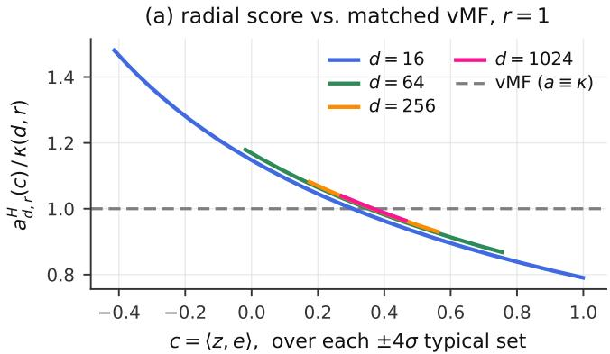

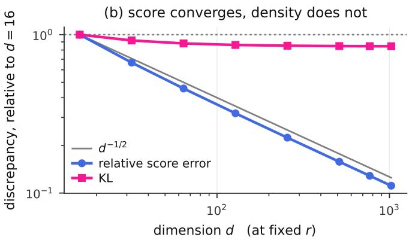  
Figure 5: Fixed-noise heat-vMF diagnostic at $r = 1$ , which is distinct from the critical scaling in Proposition 1. Left: at fixed $r ,$ the moment-matched vMF radial score becomes a better local approximation to the heat score as dimension increases. Right: both discrepancies are normalized by their values at $d = 1 6$ . The RMS relative radial-score error decreases approximately as $d ^ { - 1 / 2 }$ , while the conditional channel KL remains nearly constant. This does not contradict Equation 29: at fixed r the retained cosine is constant, whereas the proposition follows $r _ { d } = ( \log d + \xi ) / 2$ , for which the retained cosine is $m / { \sqrt { d } }$

## C.4 Finite-dimensional refinement

Combining Equation 24 with the second-moment estimate used above, and taking the fourth root in Equation 29, gives the finite-dimensional correction

$$
\frac { \widehat { m } _ { \mathrm { s c o r e } } } { m } = 1 - \frac { 2 } { d t _ { d } } + o ( ( \log d ) ^ { - 1 } ) ,\tag{31}
$$

$$
\frac { \widehat { m } _ { \mathrm { K L } } } { m } = \sqrt { 1 - \frac { 2 } { d t _ { d } } } + o ( ( \log d ) ^ { - 1 } ) ,\tag{32}
$$

where $\widehat { m } _ { \mathrm { s c o r e } }$ is recovered from the RMS relative-score error divided by $t _ { d }$ (equivalently, from the Gaussian-calibrated $\mathrm { M A D } / [ t _ { d } \sqrt { 2 / \pi } ] )$ , and $\widehat { m } _ { \mathrm { K L } } = ( 4 D _ { \mathrm { K L } } / t _ { d } ^ { 2 } ) ^ { 1 / 4 }$ . Since $d t _ { d } = \log d + \xi + o ( 1 )$ , the predicted leading corrections are respectively $- 2 / ( \log d + \xi )$ and $- 1 / ( \log d + \xi )$ . These constants follow from the explicit $2 / d$ term; the numerical sweep supports them but is not used in the proof.

## C.5 Scope and marginal score fields

For a codebook $\{ \mathbf { e } _ { x } \}$ , the heat and vMF marginal scores can be written as

$$
s _ { H } ( \mathbf { z } ) = \sum _ { x } { P _ { H } ( x \mid \mathbf { z } ) a _ { H } ( c _ { x } ) ( \mathbf { e } _ { x } - c _ { x } \mathbf { z } ) } ,\tag{33}
$$

$$
s _ { V } ( \mathbf { z } ) = \kappa \sum _ { x } P _ { V } ( x \mid \mathbf { z } ) ( \mathbf { e } _ { x } - c _ { x } \mathbf { z } ) ,\tag{34}
$$

where $c _ { x } = \langle \mathbf { z } , \mathbf { e } _ { x } \rangle$ . Since $\| \mathbf { e } _ { x } - c _ { x } \mathbf { z } \| \leq 1$

$$
\begin{array} { r } { \| s _ { H } ( \mathbf { z } ) - s _ { V } ( \mathbf { z } ) \| \leq \mathbb { E } _ { P _ { H } ( x \mid \mathbf { z } ) } | a _ { H } ( c _ { x } ) - \kappa | + \kappa \| P _ { H } ( \cdot \mid \mathbf { z } ) - P _ { V } ( \cdot \mid \mathbf { z } ) \| _ { 1 } . } \end{array}\tag{35}
$$

Rotational symmetry reduces the expectation in the first term to the single-channel heat law. After averaging over the heat marginal, the KL chain rule bounds the posterior KL by the single-channel KL. Pinsker’s inequality and Jensen’s inequality therefore give

$$
\frac { 1 } { \kappa } \mathbb { E } \| s _ { H } ( \mathbf { Z } ) - s _ { V } ( \mathbf { Z } ) \| \leq \mathbb { E } _ { H } \left| \frac { a _ { H } ( C ) } { \kappa } - 1 \right| + \sqrt { 2 D _ { \mathrm { K L } } ( H \| V _ { \kappa } ) } .\tag{36}
$$

At $\kappa = \kappa _ { d } ^ { \star }$ , both terms are $O ( t _ { d } )$ under Lemma 1.

For context, Figure 5 shows that the fixed-radius regime behaves diferently from the critical path analyzed above.

Takeaway. The critical-scale comparison also controls the exact marginal score field for a fixed codebook. It does not guarantee a learned posterior or better generation quality. The fixed-r diagnostic shows improving score agreement without a similar decrease in $\operatorname { K L } ;$ the theorem applies only to the critical noise path.

Scope of the critical-path result. Proposition 1 establishes the approximation at $r _ { d } = ( \log d + \xi ) / 2$ , corresponding to the critical regime of the sampling trajectory. At $d = 1 2 8$ and $\xi = 0 , r _ { d }$ ≈ 2.43, near the high-noise edge of the informative Heat/vMF band in Table 25; the result is therefore local. $\mathrm { U p }$ to a time change, Heat is the isotropic difusion for which the standard Brownian score-reversal dynamics are exact; other kernel shapes require compatible transport.

## D Implementation details

Why Brownian motion is the canonical isotropic difusion. For completeness, consider a nondegenerate, time-homogeneous continuous difusion on $\mathbb { S } ^ { d - 1 }$ , with $d \geq 3$ , whose law is invariant under the action of $\mathrm { S O } ( d )$ . Its generator has the local form

$$
\mathcal { L } f = b \cdot \nabla f + \frac { 1 } { 2 } \operatorname { t r } \left( A \nabla ^ { 2 } f \right) ,\tag{37}
$$

where b is a tangent vector field and A is a positive-definite symmetric tensor on the tangent bundle. Rotation invariance forces b to be an $\mathrm { S O } ( d )$ -invariant vector field. At any point, invariance under the isotropy subgroup $\mathrm { S O } ( d - 1 )$ therefore gives $b = 0$ . The same isotropy group acts irreducibly on the tangent space, so A must be a scalar multiple of the Riemannian metric. Transitivity of $\mathrm { S O } ( d )$ makes this scalar constant over the sphere. Hence

$$
\begin{array} { r } { \mathcal { L } = c \Delta _ { \mathbb { S } ^ { d - 1 } } , \qquad c > 0 , } \end{array}\tag{38}
$$

which is spherical Brownian motion up to a rescaling of time. Its transition kernels consequently form the heat semigroup.

Table 4: Comparison with S-FLM [17] and vMF spherical flows [10]. Brownian motion defines a Markov heat semigroup, while the other methods specify a path or concentration schedule.
<table><tr><td>Method</td><td>Forward family</td><td>Noise parameterization</td><td>Semigroup / path</td></tr><tr><td>S-FLM</td><td>Geodesic interpolation</td><td>Interpolation schedule  $\alpha _ { t }$ </td><td>Designed path</td></tr><tr><td>vMF</td><td>vMF family</td><td>Concentration κt</td><td>Chosen concentration schedule</td></tr><tr><td>Ours</td><td>Spherical heat kernel</td><td>Retained-cosine clock  $r = - \log \rho$ </td><td>Heat semigroup</td></tr></table>

## D.1 Heat-kernel tables

The score in Equation 5 requires $a _ { d , r } ^ { H } ( c ) = \partial _ { c } \log K _ { d , r } ^ { H } ( c )$ . At intrinsic heat time τ, the kernel has the Gegenbauer expansion

$$
\overline { { { K } } } _ { d , \tau } ^ { H } ( c ) \propto \sum _ { j \geq 0 } m _ { j , d } e ^ { - \lambda _ { j , d } \tau / 2 } P _ { j } ^ { ( d ) } ( c ) , \qquad \lambda _ { j , d } = j ( j + d - 2 ) ,\tag{39}
$$

where $m _ { j , d }$ is the dimension of the degree-j spherical-harmonic space. We scale terms by the largest term while accumulating the series; the relative size of the final sum then measures numerical cancellation.

The series is not reliable over the full domain. $\mathrm { A t } \ d = 1 2 8$ , it sufers severe cancellation around $r \in [ 0 . 4 , 1 . 8 ]$ in the region containing most probability mass, while the small-time approximation is already inaccurate. Splicing the two approximations produces errors of up to 8% under the identity

$$
\mathbb { E } [ a _ { d , r } ^ { H } ( C ) ( 1 - C ^ { 2 } ) ] = ( d - 1 ) \mathbb { E } [ C ] .\tag{40}
$$

We therefore solve the heat equation. For $f ( c , \tau ) = \log \overline { { K } } _ { d , \tau } ^ { H } ( c )$

$$
\partial _ { \tau } f = { \frac { 1 } { 2 } } \left[ ( 1 - c ^ { 2 } ) ( f _ { c c } + f _ { c } ^ { 2 } ) - ( d - 1 ) c f _ { c } \right] .\tag{41}
$$

The difusion coeficient vanishes at $c = \pm 1$ , so both endpoints are outflow boundaries. Working with the log density avoids underflow. The solver starts at $r = 0 . 0 5$ , where the small-time approximation has a Stein residual of $8 \times 1 0 ^ { - 5 }$ , i.e., a relative violation of $8 \times 1 0 ^ { - 5 }$ in Equation 40, which the exact heat kernel satisfies. It stores a snapshot at each required radius.

At runtime, log $a _ { d , r } ^ { H } ( c )$ is bilinearly interpolated from a float32 grid uniform in $\left( \log r , c \right)$ . The same table supplies the radial marginal for direct forward sampling. We check agreement with the spectral series where it is reliable, Equation 40, unit mass, and insensitivity to the solver grid.

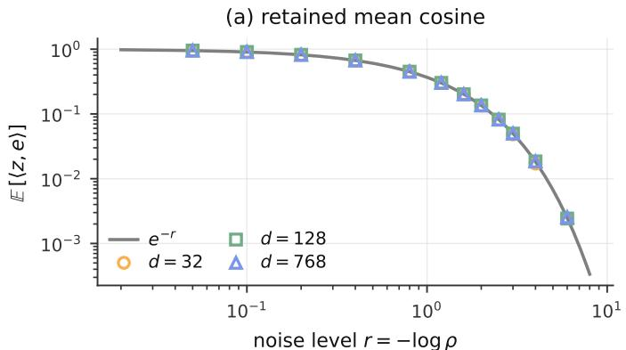

(b) composition, d = 128, r1 = 0.5, r2 = 0.5  
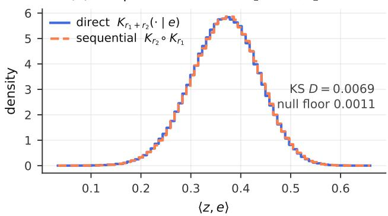  
Figure 6: Numerical validation of the Brownian clock and forward sampler. (a) For $d \in \{ 3 2 , 1 2 8 , 7 6 8 \}$ , forward samples recover $\mathbb { E } \langle \mathbf { Z } _ { r } , \mathbf { e } \rangle = e ^ { - r }$ with relative error from 0.002% to 0.1% wherever the target is above the Monte Carlo resolution. Because $r = - \log \rho ,$ this checks the heat tables and sampler. (b) $\mathrm { A t \ } d = 1 2 8$ , direct corruption at $r _ { 1 } + r _ { 2 }$ and sequential corruption at $( r _ { 1 } , r _ { 2 } ) = ( 0 . 5 , 0 . 5 )$ difer by KS distance $D = 0 . 0 0 6 9$ , compared with a null floor of 0.0011 from two independent direct draws. Across all tested dimensions and seven radius pairs, $D \leq 0 . 0 2 3$ The exact Brownian semigroup identity is therefore only approximate in the numerical sampler.

## D.2 Full-vocabulary mixture

For N positions, Equation 5 uses one $[ N \times d ] [ d \times | \mathcal { V } | ]$ product for all cosines, an elementwise lookup for the radial factors, and one $[ N \times | \mathcal { V } | ] [ | \mathcal { V } | \times d ]$ product for the weighted codewords. We evaluate the exact vocabulary sum without top-k truncation. The contraction is split into chunks of 2,048 codewords and performed in two passes, first for the log normalizer and then for the weighted sum, so no additional dense vocabulary-sized tensor is retained beyond the logits.

## D.3 Codebook construction

Frozen and learned codebooks share a max-min initialization. Starting from Gaussian vectors projected to the sphere, we minimize

$$
\mathcal { L } _ { \mathrm { c o d e } } = \mathbb { E } _ { v } \left[ \beta \log \mathrm { s u m e x p } _ { w \neq v } \left( \frac { \langle \mathbf { e } _ { v } , \mathbf { e } _ { w } \rangle } { \beta } \right) \right] ,\tag{42}
$$

annealing β from 0.08 to 0.02 and renormalizing after every update.

For learned codebooks, we optionally use

$$
\begin{array} { l } { \displaystyle \mathcal { R } = \lambda _ { \mathrm { a n c h o r } } \sum _ { \upsilon } \| \mathbf { e } _ { \upsilon } - \mathbf { a } _ { \upsilon } \| ^ { 2 } } \\ { \displaystyle + \lambda _ { \mathrm { s e p } } \sum _ { \upsilon } \frac { \mathrm { s o f t p l u s } ( \gamma [ \cos ( \mathbf { e } _ { \upsilon } , \mathrm { N N } ( \upsilon ) ) - \mu ] ) } { \gamma } . } \end{array}\tag{43}
$$

(44)

The free configuration uses $\lambda _ { \mathrm { a n c h o r } } = 0 , \lambda _ { \mathrm { s e p } } = 1 , \mu = 0 . 7$ , and $\gamma = 2 0$ . Here $\mu$ is a cosine threshold, equivalent to a nearest-neighbor angle of arccos $( 0 . 7 ) \simeq 0 . 7 9 5 4$ radians. The separation term compares a random subset of rows with the complete codebook, and the codebook learning rate is one tenth of the backbone rate. The separate $d = 1 2 8$ OWT geometry diagnostic at 150k updates has median displacement 63.7 degrees and median nearest-neighbor angle 0.970 radians (Appendix E.13). Setting $\lambda _ { \mathrm { a n c h o r } } = 3 \times 1 0 ^ { - 3 }$ keeps them within 8 degrees of the initialization.

## D.4 Adaptive schedules and solver grids

One training-noise ablation mixes the information clock $u ( r ) = H ( X _ { 0 } \mid Z _ { r } ) / H ( \pi )$ with a log-uniform radius draw:

$$
r \sim 0 . 7 5 \mathcal { U } _ { \mathrm { i n f o } } + 0 . 2 5 \mathcal { U } _ { \mathrm { l o g } r } .\tag{45}
$$

All positions contribute to the cross-entropy objective; content and padding losses are normalized separately. These variants focus training examples or solver points on noise levels where the posterior changes, without changing the forward process or training objective.

For fixed-entropy training, we measure $H _ { \boldsymbol \theta } ( r ) = \mathbb { E } [ \mathbb { H } ( q _ { \boldsymbol \theta } ( \cdot \mid \mathbf { z } , r ) ) ]$ once and draw

$$
q ( r ) \propto ( 1 - \eta ) \left. \frac { \mathrm { d } H _ { \theta } } { \mathrm { d } \log r } \right. + \eta \mathcal { U } _ { \log r } .\tag{46}
$$

For entropy-based solver grids, we invert the CDF of the same density at $S + 1$ equally spaced quantiles and use $\eta = 0 . 1 5$ . The log-uniform component is needed because the entropy curve is nearly flat at low noise.

For online adaptation, we keep a rolling bufer of $( \log r , \ell )$ pairs: 8,192 for Sudoku, 6,400 for TinyGSM, and 3,200 for OWT. This loss-slope allocation follows S-FLM’s adaptive schedule, itself inspired by InfoNoise [17, 50]. After a 1,000-step warm-up, every 500 steps we fit a regularized cubic smoothing spline with 20 knots and update

$$
q ( \log r ) \propto \operatorname* { m a x } \left( \frac { \mathrm { d } \ell } { \mathrm { d } \log r } , 0 \right) + \varepsilon .\tag{47}
$$

A uniform floor preserves coverage (mixing weight $1 0 ^ { - 3 }$ for language), and both the bufer and discretized CDF are checkpointed.

For the same vocabulary, the informative interval $u \in [ 0 . 1 , 0 . 9 ]$ occupies 13.9% of the log-radius range at $d = 1 2 8$ and 9.3% at $d = 7 6 8$ . A log-uniform draw therefore allocates relatively fewer examples to informative levels as the dimension grows.

## D.5 Sampling details

For a decreasing grid $r _ { 0 } > \cdots > r _ { S }$ , let $h = r _ { k } - r _ { k + 1 }$ and $g ^ { 2 } = 2 / ( d - 1 )$ . The spherical reverse-SDE and probability-flow ODE updates are

$$
\mathbf { z } \gets \mathrm { E x p } _ { \mathbf { z } } \left( g ^ { 2 } s _ { \theta } ( \mathbf { z } , r _ { k } ) h + g \sqrt { h } \pmb { \xi } \right) ,\tag{SDE),}
$$

$$
\begin{array} { r } { \mathbf { z } \gets \mathrm { E x p } _ { \mathbf { z } } \left( \frac { 1 } { 2 } g ^ { 2 } s _ { \theta } ( \mathbf { z } , r _ { k } ) h \right) , } \end{array}\tag{48}
$$

(ODE),

(49)

where ξ is isotropic tangent noise and the exponential map keeps every iterate on the sphere.

Prompt positions are fixed at initialization and reset to their clean codewords after every update. Plain q-argmax independently draws fresh heat-kernel noise around each selected codeword at every step; it does not reuse the OWT Gumbel tensor or evaluate the vocabulary score mixture. A first-order predictor with c corrector steps costs $1 + c$ network evaluations per step, Heun’s method costs two, and q-argmax costs one. We distinguish the sampler budget B from the total NFE: nearest-codeword or direct token readout uses B calls, while a separate posterior decode uses $B + 1$ . A Brownian Heun run takes $B / 2$ solver steps; q-argmax, the bridge, and quantile transport take B steps. Diagnostic comparisons that hold the grid rather than the call count fixed are identified separately.

## D.6 Exact ancestral sampling for Heat

The bridge in Equation 8 follows from Bayes’ rule and the Chapman–Kolmogorov identity. For a clean token x, the joint density of a bridge state $\mathbf { z } _ { s }$ and an observed state $\mathbf { y } = \mathbf { z } _ { R }$ is $K _ { d , s } ^ { H } ( \mathbf { z } _ { s } \mid \mathbf { e } _ { x } ) K _ { d , R - s } ^ { H } ( \mathbf { y } \mid \mathbf { z } _ { s } )$ ; division by the marginal $K _ { d , R } ^ { H } ( \mathbf { y } \mid \mathbf { e } _ { x } )$ normalizes it. Drawing $x \sim p ( x \mid \mathbf { y } , R )$ and then drawing from the bridge is an exact reverse step when the posterior is exact. In the numerical implementation, posterior approximation and heat-table interpolation are the sources of error.

Two-coordinate bridge sampler. Let $\eta = \langle \mathbf { e } _ { x } , \mathbf { y } \rangle , c _ { 1 } = \langle \mathbf { z } _ { s } , \mathbf { e } _ { x } \rangle$ , and $c _ { 2 } = \langle \mathbf { z } _ { s } , \mathbf { y } \rangle$ . The projection of a uniform point on $\mathbb { S } ^ { d - 1 }$ onto the span of $\mathbf { e } _ { x }$ and y has density, up to normalization,

$$
J _ { d } ( c _ { 1 } , c _ { 2 } \mid \eta ) \propto \frac { 1 } { \sqrt { 1 - \eta ^ { 2 } } } \left[ 1 - \frac { c _ { 1 } ^ { 2 } - 2 \eta c _ { 1 } c _ { 2 } + c _ { 2 } ^ { 2 } } { 1 - \eta ^ { 2 } } \right] _ { + } ^ { ( d - 4 ) / 2 } .\tag{50}
$$

The bridge-coordinate density is proportional to $K _ { d , s } ^ { H } ( c _ { 1 } ) K _ { d , R - s } ^ { H } ( c _ { 2 } ) J _ { d } ( c _ { 1 } , c _ { 2 } \mid \eta )$ . After drawing $( c _ { 1 } , c _ { 2 } )$ , we choose a uniform direction in the orthogonal complement and reconstruct $\mathbf { z } _ { s }$ . This includes the sphere’s volume factor and reduces the bridge draw to a two-dimensional numerical sampling problem.

Restart and comparison kernels. In Equation 9, the posterior is evaluated once at the current state; the selected token is held fixed while the state is re-noised by $\Delta$ and bridged back. Heat’s semigroup means the restarted state has the correct conditional marginal at radius $r _ { k } + \Delta . { \mathrm { ~ A t ~ } } \Delta = 0$ this is the ancestral bridge. As ∆ grows, its retained cosine $e ^ { - \Delta }$ decays; when the restart state is nearly uniform, bridging back approaches fresh heat re-noising of the selected codeword, the memoryless q-argmax update. The separate token rule is argmax or sampling from $q _ { \theta }$ at $T = 1$ . Both controls add no network calls.

This construction depends on a tractable Markov transition family, not on isotropy alone. Spherical Brownian motion is the canonical isotropic continuous difusion up to time scaling, as shown above. Among the spherical language-model paths compared here, SLERP is deterministic conditional on the clean token, so its bridge is a point mass. vMF distributions are not closed under composition; although vMF marginals can be generated by transport ODEs or stochastic dynamics, the former is deterministic and the latter does not provide a tractable transition density for an exact bridge. Other semigroup families or couplings may permit related bridge constructions. 1

The bridge uses the heat tables described above. For radii below 0.05, we use the small-time approximation with Stein residual $8 \times 1 0 ^ { - 5 }$ ; for larger radii, the tables are obtained by solving the log heat equation. The tabulated Chapman–Kolmogorov identity is satisfied to about $1 0 ^ { - 4 }$ in log-kernel values, and the conditional mean cosine follows $e ^ { - h }$ for an increment h. These density-level checks are distinct from Monte Carlo composition of the numerical forward sampler, whose KS errors are reported in Figure 6.

Heat configurations for the restart experiments. Table 5 records the checkpoints and evaluation protocols used below.

Table 5: Model and evaluation configuration for the Heat restart experiments. Sudoku uses B = 128 sampler calls; posterior decoding in the bridge comparison gives 129 total NFEs.
<table><tr><td>Task</td><td>Heat model</td><td>Evaluation set</td><td>Restart protocol</td></tr><tr><td>Hard Sudoku</td><td>8-layer DiT, width 512; frozen d = 128 code- 1,000 tuning and 2,000 disjoint book; 20k updates, batch 256</td><td>evaluation puzzles</td><td> $B = 1 2 8 ;$  seed regimes specified  $\mathrm { p e r ~ t a b l e }$ </td></tr><tr><td>GSM8K</td><td>Heat-trained online 250k checkpoint; context All 1,319 test problems length 512</td><td></td><td> $B \ = \ 6 4 ;$  three paired inference seeds</td></tr></table>

Sudoku bridge versus q-argmax. Table 6 compares the ancestral bridge with q-argmax on the 2,000-puzzle hard-Sudoku evaluation split at $B = 1 2 8$ . These are the four-training-seed subset used to compare both gated and ungated variants; the completed five-training-seed memory comparison is in Tables 2 and 10. Posterior decoding adds one final network call, for 129 calls total. In the ungated case, the bridge loses mainly through illegal grids, not by returning legal solutions that violate puzzle clues.

Table 6: Hard-Sudoku exact-match accuracy (%) on the 2,000-puzzle evaluation split. Each sampler uses $B = 1 2 8$ sampling calls plus one final posterior-decoding call (129 network calls total). Four paired training seeds, with sampler outputs paired within seed; ∆ columns are paired diferences from q-argmax. The main-text memory gain uses the completed five-seed comparison instead.
<table><tr><td>Sampler</td><td>Ungated</td><td>∆ Gated (tuned)</td></tr><tr><td>q-argmax</td><td> $7 7 . 1 \pm 2 . 1$ </td><td> $8 2 . 1 \pm 1 . 3$ </td></tr><tr><td>Bridge, argmax token</td><td> $5 9 . 4 \pm 3 . 1$   $- 1 7 . 8 \pm 1 . 6$ </td><td> $7 9 . 1 \pm 1 . 9 - 3 . 0 \pm 1 . 1$ </td></tr><tr><td>Bridge, sampled token  $6 0 . 4 \pm 2 . 2$ </td><td> $- 1 6 . 8 \pm 1 . 3$ </td><td> $7 9 . 1 \pm 1 . 3 - 3 . 0 \pm 0 . 6$ </td></tr><tr><td>Memoryless,  $T = 1$   $7 7 . 5 \pm 2 . 5$ </td><td> $+ 0 . 4 \pm 0 . 8 ~ \mathrm { ( n . s . ) }$ </td><td></td></tr></table>

The ungated failure breakdown (valid / legal but wrong puzzle / illegal) is 77.1 / 2.6 / 20.2 for q-argmax and 59.4 / 2.6 / 38.1 for the bridge. The same clue-violation rate shows that the bridge’s lower exact match comes from illegal grids rather than added clue drift; Table 6 reports the corresponding exact-match rates.

Restart-size sweep on Sudoku. This family was tuned on a separate 1,000-puzzle split with four sampler seeds, no gate, and $B = 1 2 8$ . Table 7 shows recovery as added noise erases more state memory; the tuning split is distinct from the evaluation split above.

Table 7: Hard-Sudoku restart sweep on the 1,000-puzzle tuning split at B = 128 sampler calls, four sampler seeds, without gating.
<table><tr><td>∆</td><td>Retained cosine  $e ^ { - \Delta }$ </td><td>Argmax token</td><td>Sampled token  $( T = 1 )$ </td></tr><tr><td>0 (bridge)</td><td>1.00</td><td>59.0</td><td>60.0</td></tr><tr><td>0.5</td><td>0.61</td><td>75.9</td><td>76.7</td></tr><tr><td>1</td><td>0.37</td><td>76.5</td><td>77.8</td></tr><tr><td>2.43 (− log d)</td><td>0.09</td><td>76.9</td><td>78.0</td></tr><tr><td>8(near-memoryless)</td><td>≈0</td><td>76.6</td><td>78.8</td></tr></table>

Why the ancestral bridge plateaus. The following diagnostics use a separate 1,000-puzzle hard-Sudoku tuning split, three independently trained Heat models (seeds 0–2), and $B = 1 2 8$ . The bridge diagnostics in Tables 8 and 9 use these three training seeds; the budget sweep in Table 10 instead uses five sampler seeds on 1,000 hard-Sudoku tuning puzzles, and the Sudoku restart-size sweep in Table 7 uses four sampler seeds on the tuning split. These seed regimes and splits are distinct. Table 8 compares each trajectory with a fresh forward sample of the true solution at the same noise level. The measured cosine marginal and codeword margin (i.e. cosine to the nearest codeword minus cosine to the second-nearest codeword, averaged over cells) show no bridge-specific shift. Yet the bridge makes fewer wrong-to-right and right-to-wrong changes, halving net revision (Table 9).

Table 8: Hard-Sudoku trajectory diagnostics on 1,000 tuning puzzles at B = 128, averaged over the informative noise band and three Heat training seeds. KS uses cosine to the nearest codeword against forward samples of the true solution; the reference codeword margin is 0.115.
<table><tr><td>Diagnostic</td><td>Memoryless</td><td>Bridge Restart</td><td> $\Delta = 0 . 5$ </td></tr><tr><td>KS versus forward cosine marginal</td><td>0.004</td><td>0.006</td><td>0.005</td></tr><tr><td>Codeword margin</td><td>0.115</td><td>0.115</td><td>0.116</td></tr><tr><td>Calibration error on trajectory states</td><td>0.050</td><td>0.070</td><td>0.053</td></tr><tr><td>Cell accuracy after r ≈ 1.9 (%)</td><td>95.0</td><td>92.7</td><td>94.6</td></tr></table>

Table 9: Hard-Sudoku memory intervention on the same 1,000 tuning puzzles, three Heat training seeds and B = 128. Bridge-fresh retains the previous token choice but redraws the noise. Flip counts are per cell over the informative band; net revision is wrong-to-right minus right-to-wrong.
<table><tr><td>Diagnostic</td><td>Memoryless</td><td>Bridge</td><td>Bridge-fresh</td><td>Restart ∆ = 0.5</td></tr><tr><td>Valid grids (%)</td><td>74.8</td><td>58.6</td><td>73.1</td><td>74.8</td></tr><tr><td>Wrong→right</td><td>0.291</td><td>0.168</td><td>1.390</td><td>0.273</td></tr><tr><td>Right→wrong</td><td>0.252</td><td>0.148</td><td>1.351</td><td>0.233</td></tr><tr><td>Net revision</td><td>0.040</td><td>0.020</td><td>0.039</td><td>0.040</td></tr><tr><td>Wrong-cell confidence, trajectory / redrawn</td><td>.976/.976</td><td>.968/.969</td><td>.975/.975</td><td>.976/.976</td></tr><tr><td>Calibration error, trajectory / redrawn</td><td>.052/.052</td><td>.068/.067</td><td>.055/.055</td><td>.052/.052</td></tr></table>

Bridge-fresh recovers 14.5 of the 16.2 lost points, about 90%, while retaining commitment memory. Its paired accuracy diference from memoryless is −1.70 ± 0.44 points across the three training seeds. Its gross flip count is about five times the memoryless count, but its net revision and accuracy are close to memoryless. Re-noising the same committed grid gives almost unchanged confidence and calibration within each sampler. Thus the calibration gap mainly reflects which grids were committed, instead of a diferent reading of a fixed grid. Confidence is nearly unchanged when evaluated on the same states, suggesting that the calibration gap mainly reflects which grids become committed. The remaining gap measures the commitment-memory cost in this intervention.

Budget scaling on Sudoku and GSM8K. Table 10 uses the 1,000-puzzle Sudoku tuning split and five sampler seeds, unlike the 2,000-puzzle benchmark in Table 19 or the five-training-seed kernel diagonal in Table 24. Its 78.0% q-argmax result at B = 180 therefore need not equal the 77.9% estimate from the latter study; the two use diferent splits and seed regimes. On Sudoku the bridge is nearly flat while q-argmax gains 12.9 points. GSM8K also shows a growing deficit, but its bridge improves by 3.0 points. For a Heat step of radius h, the old state retains mean cosine $e ^ { - h } ;$ as the grid is refined, successive readings become more correlated. The heuristic sum $\begin{array} { r } { \sum _ { k } ( 1 - e ^ { - h _ { k } } ) \le \sum _ { k } } \end{array}$ hk stays bounded by the width of the informative band, rather than growing with NFE. This scaling argument captures the efective number of posterior readings up to approximation. The slight Sudoku bridge increase, $5 8 . 8 \to 5 9 . 5 \%$ , is compatible with saturation but does not establish the mechanism on its own.

Table 10: Bridge versus q-argmax across sampler budgets B. Sudoku uses 1,000 hard tuning puzzles and five sampler seeds; GSM8K uses all 1,319 test questions, the Heat 250k checkpoint, three paired inference seeds and common prior draws. Values are mean accuracy (%); diferences are bridge minus q-argmax. The last row uses B = 180 for Sudoku and B = 256 for GSM8K.
<table><tr><td rowspan="2">B (Sudoku / GSM8K)</td><td colspan="3">Sudoku</td><td colspan="3">GSM8K</td></tr><tr><td>Bridge</td><td>q-argmax</td><td>Difference</td><td>Bridge</td><td>q-argmax</td><td>Difference</td></tr><tr><td>16</td><td>58.8</td><td>65.1</td><td>−6.4 ± 1.0</td><td>14.6</td><td>18.2</td><td>−3.6 ± 0.3</td></tr><tr><td>32</td><td>59.1</td><td>69.2</td><td>-10.1</td><td>15.3</td><td>20.9</td><td>-5.5</td></tr><tr><td>64</td><td>58.9</td><td>73.7</td><td>−14.8 ± 0.8</td><td>15.5</td><td>23.6</td><td>−8.1 ± 0.6</td></tr><tr><td>128</td><td>59.3</td><td>77.0</td><td>−17.7 ± 1.4</td><td>16.6</td><td>25.6</td><td>-9.0</td></tr><tr><td>180  / 256</td><td>59.5</td><td>78.0</td><td>−18.4 ± 1.8</td><td>17.6</td><td>27.1</td><td>−9.5 ± 1.4</td></tr></table>

The token-selection diferences summarized in the main-text bridge table are listed at every evaluated budget in Table 11. Negative values mean that sampling tokens at T = 1 is better than argmax. The Sudoku rows use the 2,000-puzzle evaluation split and five training seeds; the GSM8K rows use three paired inference seeds and common prior draws (i.e. the same initial uniform-sphere samples at $r _ { \mathrm { m a x } }$ are reused across compared samplers for each seed (common random numbers), so diferences are paired).

The memory channels separate diferently on the two tasks. At GSM8K sampler budget B = 64, bridge-fresh is worse than the exact bridge (Table 12). A single-seed control that forces the previous token to equal the current choice scores 22.67% against 23.12% for q-argmax on the same seed, and the bridge-fresh run reproduces 14.10%. The argmax changes on about 9.2% of GSM8K positions per step versus about 0.5% of Sudoku cells, with 5.9 versus 0.65 changes per position over a run. Retaining an old token therefore matters more for high-churn GSM8K; the Sudoku intervention isolates the contribution of noise persistence to the observed performance gap of the bridge sampler.

Table 11: Paired token-selection efect, measured as q-argmax minus memoryless sampling at $T = 1$ (percentage points; mean ± sd). Sudoku uses 2,000 evaluation puzzles, five training seeds, and posterior decoding (NFE $= B + 1 )$ . GSM8K uses all 1,319 test questions, three paired inference seeds, and common prior draws. Negative values favor $T = 1$ sampling.
<table><tr><td>Task (B)</td><td>q-argmax − bridge</td><td> $\mathrm { q - a r g m a x } - T = 1$ </td></tr><tr><td>Sudoku (16)</td><td> $+ 6 . 4 \pm 1 . 0$ </td><td> $- 1 . 3 \pm 1 . 0$ </td></tr><tr><td>Sudoku (64)</td><td> $+ 1 4 . 8 \pm 0 . 8$ </td><td> $- 0 . 6 \pm 0 . 8$ </td></tr><tr><td>Sudoku (128)</td><td> $+ 1 7 . 7 \pm 1 . 4$ </td><td> $- 0 . 5 \pm 0 . 7$ </td></tr><tr><td>Sudoku (180)</td><td> $+ 1 8 . 4 \pm 1 . 8$ </td><td> $- 1 . 4 \pm 1 . 0$ </td></tr><tr><td>GSM8K (16)</td><td> $+ 3 . 6 \pm 0 . 3$ </td><td> $+ 1 1 . 4 \pm 1 . 0$ </td></tr><tr><td>GSM8K (64)</td><td> $+ 8 . 1 \pm 0 . 6$ </td><td> $+ 8 . 5 \pm 1 . 3$ </td></tr><tr><td>GSM8K (256)</td><td> $+ 9 . 5 \pm 1 . 4$ </td><td> $+ 4 . 7 \pm 2 . 0$ </td></tr></table>

Table 12: GSM8K memory intervention at sampler budget B = 64 on all 1,319 test questions: one Heat 250k checkpoint, three paired inference seeds and common prior draws. Diferences are paired against q-argmax.
<table><tr><td>Sampler</td><td>Accuracy (%)</td><td>Difference (points)</td></tr><tr><td>q-argmax</td><td>23.63</td><td></td></tr><tr><td>Exact bridge</td><td>15.49</td><td> $- 8 . 1 \pm 0 . 6$ </td></tr><tr><td>Bridge-fresh</td><td>13.34</td><td> $. 1 0 . 3 \pm 1 . 3$ </td></tr></table>

Restart-size sweep on GSM8K. We use the Heat-trained 250k checkpoint and all 1,319 GSM8K test questions, with B = 64 and three paired inference seeds. Table 13 shows that memory loss also helps program generation, with slower recovery from partial memory loss than on Sudoku.

Table 13: GSM8K accuracy for the Heat restart sweep at B = 64. Results use the 250k Heat checkpoint and three paired inference seeds.
<table><tr><td>∆</td><td>GSM8K accuracy (%)</td><td>Difference from q-argmax (points)</td></tr><tr><td>0 (exact ancestral)</td><td>15.49</td><td> $- 8 . 1 4 \pm 0 . 6 1$ </td></tr><tr><td>0.5</td><td>21.89</td><td> $- 1 . 7 4 \pm 0 . 3 9$ </td></tr><tr><td>8</td><td>23.60</td><td> $- 0 . 0 3 \pm 0 . 9 5$ </td></tr><tr><td>∞(q-argmax)</td><td>23.63</td><td></td></tr></table>

Temperature-controlled GSM8K comparisons. Table 14 compares released MDLM and Duo checkpoints with SBD under matched T = 1 and low-temperature/deterministic decoding. Baseline values are single runs; SBD means are over three inference seeds. Table 15 gives the longer memoryless T = 1 and q-argmax curves used in Figure 3.

Table 14: GSM8K accuracy (%) by NFE and decoding temperature. MDLM and Duo values are single runs; SBD values are means over three inference seeds.
<table><tr><td></td><td>NFE | Duo T = 1 </td><td></td><td>MDLM T = 1 SBD memoryless T = 1 | Duo T = .1</td><td></td><td>MDLM T = .1</td><td>SBD q-argmax</td></tr><tr><td>16</td><td>10.0</td><td>1.8</td><td>6.80</td><td>22.7</td><td>14.3</td><td>18.15</td></tr><tr><td>32</td><td>13.9</td><td>5.7</td><td>9.70</td><td>28.2</td><td>23.0</td><td>20.85</td></tr><tr><td>64</td><td>16.6</td><td>10.0</td><td>15.14</td><td>34.3</td><td>27.5</td><td>23.63</td></tr><tr><td>128</td><td>15.4</td><td>13.5</td><td>19.99</td><td>32.2</td><td>31.5</td><td>25.60</td></tr><tr><td>256</td><td>18.5</td><td>15.1</td><td>22.39</td><td>35.3</td><td>33.1</td><td>27.12</td></tr></table>

## D.7 Training cost

Table 16 compares training throughput and total cost for 250k updates on TinyGSM and 1M updates on OpenWebText. The AR, MDLM, Duo, CANDI, FLM, and S-FLM values, including the S-FLM variants, are taken

Table 15: GSM8K accuracy (%) for memoryless SBD at $T = 1$ and SBD q-argmax across the full evaluated ladder.   
Means are over three inference seeds.

<table><tr><td>NFE</td><td>Memoryless, T = 1</td><td>q-argmax</td></tr><tr><td>1</td><td>0.0</td><td>0.7</td></tr><tr><td>4</td><td>1.7</td><td>8.3</td></tr><tr><td>16</td><td>6.8</td><td>18.2</td></tr><tr><td>64</td><td>15.1</td><td>23.6</td></tr><tr><td>256</td><td>22.4</td><td>27.1</td></tr><tr><td>512</td><td>26.2</td><td>30.0</td></tr><tr><td>1,024</td><td>28.8</td><td>30.1</td></tr></table>

directly from Table 3 of Deschenaux and Gulcehre [17]; we do not remeasure these baselines. Their measurements use 8 NVIDIA H100 GPUs for TinyGSM and 16 for OWT. Our measurements use NVIDIA GH200 GPUs, so this is not a hardware-matched comparison of method eficiency. Baseline totals are copied as reported, instead of being recomputed from their rounded throughput.

Table 16: Training cost on TinyGSM (250k updates) and OpenWebText (1M updates). Baseline values are from Table 3 of Deschenaux and Gulcehre [17]. Our duration and GPU-hours for TinyGSM refer to the complete run. OWT GPU-hours are implied by the reported 4.219 updates/s over 1M updates on 16 GPUs; the full-run wall time was not recorded. Throughput is measured over training segments, not averaged over the full run. Baselines use H100s and our runs use GH200s. NR indicates an unreported full-run duration.
<table><tr><td rowspan="2">Model</td><td colspan="2">Updates/s</td><td colspan="2">Duration (h)</td><td colspan="2">GPU-hours</td></tr><tr><td>TinyGSM</td><td>OWT</td><td>TinyGSM</td><td>OWT</td><td>TinyGSM</td><td>OWT</td></tr><tr><td>AR</td><td>5.4</td><td>6.0</td><td>12.8</td><td>46.6</td><td>102.1</td><td>745.7</td></tr><tr><td>MDLM</td><td>3.0</td><td>3.5</td><td>22.8</td><td>80.3</td><td>182.7</td><td>1,284.5</td></tr><tr><td>Duo</td><td>3.0</td><td>3.5</td><td>22.8</td><td>80.3</td><td>182.7</td><td>1,284.5</td></tr><tr><td>CANDI</td><td>3.0</td><td>2.5</td><td>23.5</td><td>108.9</td><td>188.3</td><td>1,742.9</td></tr><tr><td>FLM</td><td>3.2</td><td>3.3</td><td>21.7</td><td>84.2</td><td>173.6</td><td>1,346.8</td></tr><tr><td>S-FLM</td><td>4.2</td><td>4.5</td><td>16.5</td><td>61.7</td><td>132.3</td><td>987.7</td></tr><tr><td>S-FLM + adapt.</td><td>4.2</td><td>4.5</td><td>16.5</td><td>61.7</td><td>132.3</td><td>987.7</td></tr><tr><td>S-FLM + adapt. + S-arch</td><td>2.6</td><td>2.8</td><td>26.7</td><td>99.2</td><td>213.7</td><td>1,587.3</td></tr><tr><td>Ours</td><td>3.465</td><td>4.219</td><td>20.0</td><td>NR</td><td>160.3</td><td>1,053</td></tr></table>

## D.8 Sampling latency and throughput

Table 17 reports measurements on the same single NVIDIA GH200 GPU, using released baseline checkpoints and our 1M-update checkpoint. All methods generate 1,024-token sequences at T = 1 where applicable and 256 actual network evaluations, with the call counts independently verified. Each configuration uses two warmup runs followed by seven timed repeats. Latency is measured at batch size 1 in seconds per sample; throughput is measured at batch size 4 in generated tokens per second. Peak memory is also reported at batch size 4. These values report newly measured inference costs, complementing the training costs reported above.

Table 17: Sampling cost on one NVIDIA GH200 GPU at 256 NFEs, sequence length 1,024, and T = 1 where applicable. All configurations use two warmups and seven timed repeats. Latency uses batch size 1; throughpu and peak memory use batch size 4.
<table><tr><td>Method</td><td>Latency (s/sample)</td><td>Throughput (tokens/s)</td><td>Peak memory (GiB)</td></tr><tr><td>MDLM</td><td>3.40</td><td>979</td><td>3.73</td></tr><tr><td>Duo</td><td>3.21</td><td>1,259</td><td>3.73</td></tr><tr><td>S-FLM</td><td>3.62</td><td>620</td><td>5.59</td></tr><tr><td>Ours: q-argmax</td><td>3.37</td><td>1,221</td><td>2.31</td></tr><tr><td>Ours: Heun SDE</td><td>7.54</td><td>257</td><td>2.73</td></tr><tr><td>Ours: OWT hybrid, k = 1</td><td>7.03</td><td>277</td><td>5.80</td></tr></table>

At matched NFE, q-argmax has latency comparable to MDLM and Duo, with throughput close to Duo and the lowest measured peak memory. The Heun SDE and OWT hybrid are slower despite the same number of network calls, showing that matched NFE need not imply matched wall-clock cost. These timings characterize inference eficiency under the evaluated settings, with generation quality assessed separately.

## E Additional experimental details

Models, comparisons, and validation checks. We refer to trained models by their configuration. Unless stated otherwise, a learned codebook is initialized at the max-min packing (Equation 42) and trained jointly with the backbone, and the adaptive noise schedule is the online loss-adaptive r-schedule of Appendix D.4 (Equation 47). A learned codebook is unanchored when $\lambda _ { \mathrm { a n c h o r } } = 0$ in Equation 44; the anchored variant uses $\lambda _ { \mathrm { a n c h o r } } = 3 \times 1 0 ^ { - 3 }$ and is otherwise identical (Appendix D.3). The OpenWebText model (Appendix E.11) is trained for $1 0 ^ { 6 }$ updates with an unanchored learned codebook (d = 768) and the adaptive noise schedule (run owt\_d768\_online\_free\_lr3e4; Table 18). We call a model matched when it is sampled with the kernel it was trained on, and crossed when it is sampled with a diferent kernel (Section 4.3; Tables 30 and 38). Paired Heat–vMF comparisons (Tables 24 and 39) use the same seeds, puzzles, and sampler for both training kernels. For the error-compounding analysis on GSM8K (Appendix E.9), we use two denoising probes that involve no sampling. The code-token probe measures top-1 accuracy of the Heat posterior on program tokens only (Table 40). The $f u l l .$ -answer probe measures per-token accuracy over the whole answer region (program and padding) and supplies the per-token rate $p$ for the $\overline { { p ^ { L } } }$ check (Table 41 and Figure 2). We validate every transport with three checks (Appendix E.3). The Brownian-compatibility index (Equation 55, with the $L ^ { 2 }$ variant in Equation 56) measures how far a kernel family is from being generated by Brownian motion; it is zero for Heat. The conditional-law check starts the sampler from pure noise with a single codeword and tests, by a Kolmogorov–Smirnov (KS) test, whether it reproduces the kernel’s conditional law $K _ { r } .$ The intermediate-marginal check uses an exact posterior on a 10-codeword toy problem and tests the marginals at several radii (KS) and the final token frequencies (total variation).

## E.1 Model and training setup

Our Sudoku experiments use an 8-layer Difusion Transformer (DiT) with hidden width 512 and eight attention heads. GSM8K and OWT use a 12-block spectral DiT with hidden width 768, 12 attention heads, and conditioning dimension 128 [40, 45]. The codebook dimension d is separate from the backbone embedding: we compare $d = 1 2 8$ and $d = 7 6 8$ as specified per task. The posterior network receives the normalized log-radius $\widetilde { r } =$ $( \log r - \log r _ { \operatorname* { m i n } } ) / ( \log r _ { \operatorname* { m a x } } - \log r _ { \operatorname* { m i n } } )$ . In every training and sampling run, $r _ { \operatorname* { m i n } } = 0 . 0 2 \mathrm { a n d } r _ { \operatorname* { m a x } } = 8 .$ , corresponding to retained mean cosines $e ^ { - 0 . 0 2 } \simeq 0 . 9 8$ and $e ^ { - 8 } \simeq 3 . 3 5 \times 1 0 ^ { - 4 }$ . The sole exception is the truncated SLERP ablation, which uses $r _ { \mathrm { m i n } } = 0 . 9 4 2$ . Unconditioned positions are initialized uniformly on the sphere. The exact Heat marginal at $r = 8$ is not uniform, but its retained mean cosine is only $e ^ { - 8 } \simeq 3 . 3 5 \times 1 0 ^ { - 4 }$ and it is numerically close to stationarity. Uniform initialization therefore introduces a small finite-horizon approximation instead of changing the limiting process. We use AdamW with $\beta = ( 0 . 9 , 0 . 9 9 9 ) , \epsilon = 1 0 ^ { - 8 }$ , gradient clipping at 1.0, and a backbone learning rate of $3 \times 1 0 ^ { - 4 }$ . Sudoku uses weight decay 0.01, a one-cycle schedule with $5 \%$ warm-up and cosine decay, fp32 training, and no EMA. Language models use zero weight decay, a constant learning rate after 2,500 warm-up updates, bf16 training, and EMA decay 0.9999; language evaluation uses EMA weights. Dropout is 0.1 during training and disabled during evaluation. Table 18 summarizes the task-specific settings. These are our training budgets, not the budgets used to train the released baseline checkpoints.

Table 18: Main-model training configuration. Sequence length includes the prompt in conditional tasks. Language parameter counts separate the backbone from the trainable codebook; all models omit self-conditioning.
<table><tr><td>Setting</td><td>Sudoku</td><td>TinyGSM → GSM8K</td><td>OpenWebText</td></tr><tr><td>Backbone</td><td></td><td>8 layers, width 512, 8 heads 12 blocks, width 768, 12 heads; Same as GSM8K conditioning width 128</td><td></td></tr><tr><td>Parameters</td><td>26.2M</td><td>130.8M + 37.7M codebook</td><td>131.6M + 38.6M codebook</td></tr><tr><td>Codebook d</td><td>128</td><td>768</td><td>768</td></tr><tr><td>Tokenizer</td><td>Sudoku digits</td><td>SmolLM-135M; 49,152 + PAD</td><td>GPT-2; 50,257 + 1</td></tr><tr><td>Sequence length</td><td>180</td><td>512</td><td>1,024, wrapped</td></tr><tr><td>Training updates</td><td>20k</td><td>250k</td><td>1M</td></tr><tr><td>Global batch</td><td>256 (4 × 64)</td><td>512 (8 × 64)</td><td>512 (16 × 32)</td></tr><tr><td>Weight decay</td><td>0.01</td><td>0</td><td>0</td></tr><tr><td>Learning rate</td><td> $3 \times 1 0 ^ { - 4 } ;$  one-cycle</td><td> $3 \times 1 0 ^ { - 4 } ;$  constant after warm- Same as GSM8K up</td><td></td></tr><tr><td>LR warm-up</td><td>5% of updates</td><td>2,500 updates</td><td>2,500 updates</td></tr><tr><td>Precision / EMA</td><td>fp32 / none</td><td>bf16 / 0.9999</td><td>bf16 / 0.9999</td></tr><tr><td>Adaptive buffer</td><td>8,192</td><td>6,400</td><td>3,200</td></tr><tr><td>Codebook</td><td>Frozen max-min</td><td>Learned from max-min anchor; Same as GSM8K  $\mathrm { L R } \ 3 \times 1 0 ^ { - 5 }$ </td><td></td></tr></table>

Codebooks and noise schedules. The online loss-adaptive schedule starts after 1,000 updates and is refit every 500 updates; language runs mix in a uniform component of weight $1 0 ^ { - 3 }$ . Learned language codebooks are parameterized around a fixed max-min anchor but have no anchor penalty. They use a separation penalty of weight 1.0 and cosine margin 0.7, with a codebook learning rate equal to one tenth of the backbone rate (Appendix D). Frozen codebooks retain their max-min initialization. Learned codebooks are updated jointly with the backbone; their initialization and regularization are described in Appendix D. The main models use the online loss-adaptive schedule above. A separate schedule ablation mixes a uniform information-clock draw with a log-uniform draw, with weights 0.75 and 0.25 (Equation 45). Fixed-entropy and online adaptive schedules instead allocate more training examples to informative noise levels. The fixed-entropy schedule is calibrated once, whereas the online schedule is updated from the recent cross-entropy profile. We distinguish the training noise distribution from the sampling grid: the entropy + log sampling ablation uses an entropy training schedule and a log-radius solver grid, while entropy + entropy sampling also uses an entropy-based solver grid.

Conditional generation and decoding. The five GSM8K checkpoint ablations and Sudoku q-argmax runs use Equation 7 at every noise level. These runs have no score-update phase, sampler switch, or Gumbel perturbation. Each step selects the most likely clean token and independently re-noises its embedding at the next radius. Prompt positions remain fixed. The final token at each position is the most likely token under the predicted clean-token posterior. Only OWT uses the score/q-argmax hybrid. Argmax makes each token choice deterministic given the current state, but the trajectory remains stochastic because initialization and re-noising are random. Confidencegated Sudoku sampling also retains accepted tokens and stops re-noising their positions; unfrozen positions continue with the same q-argmax rule. We do not use self-conditioning in our models.

Sampling budget and uncertainty. We count network evaluations (NFEs) as Transformer forward passes during generation. A q-argmax step and a first-order ODE or SDE predictor each use one evaluation; a Heun step uses two. A predictor with c corrector updates uses 1 + c evaluations. Kernel-table lookup and heat-kernel re-noising do not call the Transformer and do not add NFEs. NFE therefore measures model calls, not total wall-clock cost. Sudoku benchmark error bars vary five sampler seeds on one trained checkpoint per dificulty, except the low-budget SDE/ODE entries, which use three. Kernel-study error bars vary independent training seeds where stated. GSM8K fine-tune error bars vary three inference seeds on one training seed per arm.

## E.2 Sudoku benchmark protocol

We use 48k training and 2k evaluation puzzles per dificulty from the S-FLM generator [2, 17]. Easy, medium, and hard puzzles reveal 40, 35, and 30 cells. One frozen max-min d = 128 Heat model is trained for 20k updates per dificulty with the online schedule, cross-entropy, global batch 256, and a fixed puzzle prefix. All benchmark entries use dropout-free evaluation and explicit network-call accounting. The information-grid entries use five sampler seeds on the same weights; low-budget SDE/ODE instead use the log-radius grid and three sampler seeds, as indicated in Table 19.

Confidence thresholds are selected separately for each dificulty and seed on 1,000 held-out puzzles from a generator seed disjoint from training and evaluation. Seven candidates span 0.99 to 0.9999999. Posterior decoding uses one last evaluation of $q _ { \boldsymbol { \theta } } ( v \mid \mathbf { z } , r _ { \mathrm { m i n } } )$ . It costs one extra call, so gated rows at $B = 1 8 0$ are charged 181 NFEs. It helps gating by 0.08, 0.69, and 0.77 points on easy, medium, and hard puzzles and is neutral for the transport samplers: the largest SDE/ODE gain is 0.27 points and the typical gain is 0.03 points.

Table 19 gives the full sweep. The solver grid is chosen per sampler on held-out puzzles; SDE/ODE use the log-radius grid below B = 64. True NFE counts network calls, so B = 16 and $B = 3 2$ correspond to 8 and 16 two-call Heun steps, respectively, while posterior decoding is charged one additional call.

Table 19: Sudoku exact-match accuracy (%). The solver grid is chosen per sampler on held-out puzzles; SDE/ODE use the log-radius grid below $B = 6 4$ . Low-budget SDE/ODE entries average three sampler seeds; all other entries average five sampler seeds on one checkpoint per dificulty. Error bars do not include training variance. Column headings are sampler calls $B ;$ gated posterior decoding uses B + 1 total NFEs, and the other rows use B.
<table><tr><td>Difficulty</td><td>Sampler / B</td><td>16</td><td>32</td><td></td><td>64</td><td></td><td>128</td><td>180</td></tr><tr><td>Easy</td><td>SDE</td><td>95.32 ± .26</td><td>96.93 ± .28</td><td>97.20 ± .18</td><td></td><td>97.32 ± .33</td><td></td><td>97.10 ± .15</td></tr><tr><td></td><td>ODE</td><td>96.33 ± .63</td><td> $9 6 . 3 8 \pm . 2 0$ </td><td>96.24 ± .21</td><td></td><td>96.54 ± .15</td><td></td><td>96.42 ± .21</td></tr><tr><td></td><td>q-argmax</td><td>97.87 ± .18</td><td> $9 8 . 2 4 \pm . 1 0 $ </td><td>98.50 ± .08</td><td></td><td> $9 8 . 6 8 \pm . 1 1$ </td><td></td><td>98.69 ± .07</td></tr><tr><td></td><td>gated q-argmax</td><td>98.85 ± .11</td><td> $9 8 . 9 4 \pm . 0 9$ </td><td>98.96 ± .13</td><td></td><td> $9 9 . 1 4 \pm . 1 1$ </td><td></td><td>99.11 ± .12</td></tr><tr><td>Medium</td><td>SDE</td><td>84.83 ± .13</td><td> $8 8 . 7 0 \pm . 4 8 $ </td><td>89.15 ± .57</td><td></td><td> $8 9 . 3 5 \pm . 5 3$ </td><td></td><td>89.75 ± .40</td></tr><tr><td></td><td>ODE</td><td>86.82 ± .38</td><td>87.32 ± .95</td><td>87.29 ± .25</td><td></td><td> $8 7 . 9 2 \pm . 2 2$ </td><td></td><td>88.15 ± .57</td></tr><tr><td></td><td>q-argmax</td><td>91.17 ± .42</td><td>92.56 ± .23</td><td>93.33 ± .33</td><td></td><td> $9 4 . 1 1 \pm . 1 1$ </td><td></td><td>94.57 ± .21</td></tr><tr><td></td><td>gated q-argmax</td><td>94.62 ± .40</td><td>95.74 ± .33</td><td>96.21 ± .33</td><td></td><td> $9 6 . 4 7 \pm . 2 2$ </td><td></td><td>96.66 ± .15</td></tr><tr><td>Hard</td><td>SDE</td><td>50.45 ± .41</td><td>60.63 ± .92</td><td>62.27 ± .73</td><td></td><td> $6 3 . 2 8 \pm . 9 3$ </td><td></td><td>63.25 ± .36</td></tr><tr><td></td><td>ODE</td><td>56.02 ± .75</td><td>57.95 ± .74</td><td>58.50 ± .88</td><td></td><td>58.72 ± .51</td><td></td><td>58.24 ± .82</td></tr><tr><td></td><td>q-argmax</td><td>68.96 ± .76</td><td>72.23 ± .81</td><td></td><td>75.58 ± .17</td><td>78.51 ± .36</td><td></td><td>79.70 ± .75</td></tr><tr><td></td><td>gated q-argmax</td><td>74.80 ± .95</td><td>78.55 ± .53</td><td>81.08 ± .43</td><td></td><td>82.76 ± .84</td><td></td><td>83.36 ± .42</td></tr></table>

Provenance of hard-Sudoku q-argmax results. Table 20 separates four Heat q-argmax results that should not be treated as repeated measurements of one setting. Only the benchmark row is used in the main Sudoku comparison. The three-seed Heat–vMF comparison in Table 24 uses an identical paired protocol for both training arms, with inference settings matched within each sampler. The Heat arm used 20k updates and the log-radius grid. Its 73.88% estimate is 5.82 points below the benchmark’s 79.70%, which used the information grid. This is consistent with the later observed 5.6-point gain from information spacing for hard-Sudoku q-argmax at $B = 1 8 0$ The seed regimes also difer: three training seeds here versus five sampler seeds on one checkpoint in the benchmark.

Table 20: Protocol provenance for four Heat q-argmax results (%) on 2,000 hard puzzles at a sampler budget of B = 180 calls. Standard deviations reflect the seed type in the last column. Gated runs include a final posterior decode (+1 call).
<table><tr><td>Study</td><td>Accuracy</td><td>Training</td><td>Grid</td><td>Decode</td><td>Seeds</td></tr><tr><td>Benchmark</td><td> $7 9 . 7 0 \pm . 7 5$ </td><td>online, 20k</td><td>information</td><td>none, 180 calls</td><td>5 sampler; 1 checkpoint</td></tr><tr><td>Heat-vMF contrast</td><td> $7 3 . 8 8 \pm . 4 1$ </td><td>20k updates</td><td>log-radius</td><td>q-argmax</td><td>3 paired training seeds</td></tr><tr><td>Kernel Heat diagonal</td><td> $7 7 . 9 \pm 1 . 8$ </td><td>online, 20k</td><td>information-matched</td><td>posterior, 181 calls</td><td>5 training seeds</td></tr><tr><td>Frozen-codebook ablation</td><td> $7 9 . 6 8 \pm . 4 2$ </td><td>online, 20k</td><td>information</td><td>posterior, 181 calls</td><td>3 sampler; 1 checkpoint</td></tr></table>

At $B = 6 4$ , both grids are available for continuous transport. Table 21 reports five sampler seeds per grid on the same 2,000 puzzles and one fixed Heat checkpoint per dificulty, with nearest-codeword decoding (64 total NFEs) and dropout disabled. Diferences are small and have mixed signs: two favor the information grid and four favor the log grid. The largest is −0.92 points for medium/ODE, compared with a quadrature-combined standard deviation of about 0.54; without paired diferences we do not assign a paired significance level. In contrast, the information grid adds 5.6 points to q-argmax on hard Sudoku at $B = 1 8 0$ . This supports a larger grid efect for categorical refinement than for the transport samplers in this control.

Table 21: NFE-64 transport control with nearest-codeword decoding: exact-match accuracy (%), mean ± sd over five sampler seeds per grid on one fixed Heat checkpoint per dificulty and 2,000 puzzles.
<table><tr><td>Difficulty</td><td></td><td>SDE log SDE information</td><td></td><td>ODE log ODE information</td></tr><tr><td>Easy</td><td> $9 7 . 1 0 \pm 0 . 4 1$ </td><td> $9 7 . 2 0 \pm 0 . 1 8$ </td><td> $9 6 . 4 7 \pm 0 . 2 3$ </td><td> $9 6 . 2 4 \pm 0 . 2 1$ </td></tr><tr><td>Medium</td><td> $8 9 . 4 4 \pm 0 . 3 1$ </td><td> $8 9 . 1 5 \pm 0 . 5 7$ </td><td> $8 8 . 2 1 \pm 0 . 4 8$ </td><td> $8 7 . 2 9 \pm 0 . 2 5$ </td></tr><tr><td>Hard</td><td> $6 2 . 9 7 \pm 0 . 7 6$ </td><td> $6 2 . 2 7 \pm 0 . 7 3$ </td><td> $5 8 . 3 4 \pm 1 . 0 2$ </td><td> $5 8 . 5 0 \pm 0 . 8 8$ </td></tr></table>

FMLM+ comparison. We evaluate released checkpoints on the same evaluation puzzles with $p = 0 . 9 9 9$ , uniform budget, fresh noise, and five sampler seeds.

Table 22: FMLM+ Sudoku exact-match accuracy (%), mean ± standard deviation over five sampler seeds on fixed released checkpoints.
<table><tr><td>NFE</td><td>Easy</td><td>Medium</td><td>Hard</td></tr><tr><td>4</td><td> $9 7 . 6 0 \pm . 0 9$ </td><td> $9 1 . 5 3 \pm . 3 9$ </td><td> $7 0 . 3 6 \pm . 7 8$ </td></tr><tr><td>16</td><td> $9 7 . 8 7 \pm . 2 7$ </td><td> $9 2 . 9 7 \pm . 5 4$ </td><td> $8 1 . 3 5 \pm . 5 5$ </td></tr><tr><td>64</td><td> $9 7 . 8 7 \pm . 2 9$ </td><td> $9 2 . 9 9 \pm . 4 2 $ </td><td> $8 1 . 4 4 \pm . 7 1$ </td></tr><tr><td>180</td><td> $9 7 . 7 7 \pm . 1 3$ </td><td> $9 2 . 9 9 \pm . 3 3$ </td><td> $\underline { { 8 1 . 6 5 \pm . 3 6 } }$ </td></tr></table>

Figure 7 shows the full budget curves behind the fixed-budget comparison.

Failure decomposition. q-argmax produces the most legal grids but can drift from a clue because every position is re-noised. Gating nearly removes this failure but prevents some repairs, while posterior decoding recovers part of the lost legality; the measured breakdown is in Table 23.

Table 23: Hard-Sudoku failure decomposition (%) at B = 180 sampler-call budget, averaged over five sampler seeds. The posterior-decoded gated row uses 181 actual calls. “Wrong puzzle” is legal but inconsistent with a clue.
<table><tr><td>Sampler</td><td>Valid</td><td>Legal</td><td>Wrong puzzle</td><td>Rows</td><td>Columns</td><td>Boxes</td></tr><tr><td>SDE</td><td>63.25</td><td>68.96</td><td>5.71</td><td>75.01</td><td>75.77</td><td>81.00</td></tr><tr><td>ODE</td><td>58.24</td><td>62.80</td><td>4.56</td><td>70.32</td><td>71.53</td><td>77.75</td></tr><tr><td>q-argmax</td><td>79.70</td><td>86.94</td><td>7.24</td><td>89.39</td><td>89.70</td><td>91.92</td></tr><tr><td>gated, nearest</td><td>82.59</td><td>82.66</td><td>0.07</td><td>85.87</td><td>86.27</td><td>89.01</td></tr><tr><td>gated, posterior</td><td>83.36</td><td>85.00</td><td>1.64</td><td>87.98</td><td>88.07</td><td>90.56</td></tr></table>

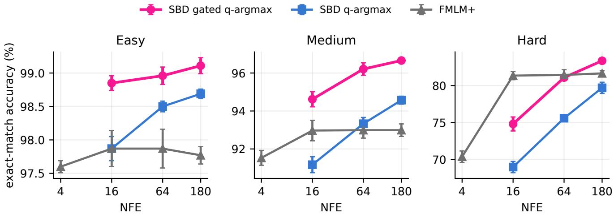  
Figure 7: Complete Sudoku accuracy curves for easy, medium, and hard puzzles. Error bars are standard deviations over five sampler seeds on fixed checkpoints, not training seeds. Comparing gated SBD with FMLM+, FMLM+ leads on hard Sudoku at $B = 1 6$ , they are tied within variation at $B = 6 4$ , and SBD leads at $B = 1 8 0$ . The plotted budget labels are sampler calls $B ;$ gated SBD’s posterior decode adds one call.

Codebook ablation. We only consider hard Sudoku here. At $d = 1 2 8$ , frozen codewords reach $7 9 . 6 8 \pm 0 . 4 2$ with q-argmax and 83.70 ± 0.66 with gating; learned codewords reach $7 6 . 4 8 \pm 0 . 1 6$ and $8 1 . 0 3 \pm 0 . 3 6$ . We omit $d = 7 6 8$ because every seed selects the tightest tested threshold and commits almost every cell early; those rows measure posterior saturation rather than codebook quality. Frozen codebooks suit Sudoku’s nine-token vocabulary, whereas language uses learned codebooks for a much larger vocabulary; this ablation does not test the language setting.

## E.3 Kernel-consistency study

Radial transport and the quantile map. For an isotropic conditional kernel, let $f _ { r } ( c )$ and $F _ { r } ( c )$ be the density and CDF of its cosine coordinate. The conditional radial velocity and its spherical lift are

$$
v _ { r } ( c ) = - \frac { \partial _ { r } F _ { r } ( c ) } { f _ { r } ( c ) } ,\tag{51}
$$

$$
\mathbf { u } _ { r } ( \mathbf { z } \mid \mathbf { e } ) = { \frac { v _ { r } ( c ) } { 1 - c ^ { 2 } } } ( \mathbf { e } - c \mathbf { z } ) .\tag{52}
$$

The marginal field is the posterior average of these conditional fields. Given the marginal velocity $\mathbf { u } _ { \theta }$ and score $\mathbf { S } _ { \theta }$ the velocity–score family is

$$
\mathbf { z } \gets \mathrm { E x p } _ { \mathbf { z } } \Big ( h [ - \mathbf { u } _ { \theta } + \varepsilon \mathbf { s } _ { \theta } ] + \sqrt { 2 \varepsilon h } \xi \Big ) ,\tag{53}
$$

with tangent noise $\xi ; \varepsilon = 0$ gives the ODE, and $\varepsilon = 1 / ( d - 1 )$ recovers the Brownian reverse SDE for Heat. The exact conditional quantile map in Section 3.4 avoids integrating through low-density gaps between mixture modes. The subsequent posterior-averaged spherical displacement is first-order.

Table 24: Hard-Sudoku accuracy $( \% )$ at $B = 1 8 0$ sampler calls across three independent training seeds. The Heat and moment-matched vMF arms use an identical paired protocol, with inference settings matched within each procedure. Entries are mean ± standard deviation. Posterior-decoded gated rows use 181 actual calls.
<table><tr><td>Training kernel</td><td>ODE</td><td>SDE</td><td>q-argmax</td><td>Gated q-argmax</td></tr><tr><td>Heat</td><td> $5 8 . 4 2 \pm 0 . 4 4$ </td><td> $6 2 . 8 3 \pm 1 . 1 6$ </td><td> $7 3 . 8 8 \pm 0 . 4 1$ </td><td> $8 3 . 4 2 \pm 0 . 3 2$ </td></tr><tr><td>Moment-matched vMF</td><td> $5 8 . 8 1 \pm 0 . 4 7$ </td><td> $6 3 . 1 1 \pm 1 . 1 4$ </td><td> $7 3 . 9 2 \pm 0 . 5 0$ </td><td> $8 2 . 6 1 \pm 0 . 3 1$ </td></tr><tr><td> $\Delta \ ( \mathrm { v M F - h e a t } )$ </td><td>+0.39</td><td>+0.28</td><td>+0.04</td><td>-0.81</td></tr></table>

Kernel family. For $a \in [ 0 , 1 )$ , let $\mathrm { v M F } _ { d } ( a \mid \mathbf { e } )$ denote the von Mises–Fisher distribution on $\mathbb { S } ^ { d - 1 }$ centered at e with concentration $\kappa _ { d } ( a )$ chosen to give mean cosine a; equivalently, $I _ { d / 2 } ( \kappa _ { d } ( a ) ) / I _ { d / 2 - 1 } ( \kappa _ { d } ( a ) ) = a$ . For $m = e ^ { - r }$ define

$$
K _ { r , \lambda } ^ { \mathrm { m i x } } ( \cdot \mid \mathbf { e } ) = m \mathrm { \ v M F } _ { d } ( m + \lambda ( 1 - m ) \mid \mathbf { e } ) + ( 1 - m ) \mathrm { \ v M F } _ { d } ( ( 1 - \lambda ) m \mid \mathbf { e } ) .\tag{54}
$$

The component weights are m and $1 - m$ , and the corresponding component mean cosines are $m + \lambda ( 1 - m )$ and $( 1 - \lambda ) m$ . Their weighted mean is m, so λ changes the conditional shape without changing the retained mean cosine. $\mathrm { A t } \ r = 1 . 6$ , the cosine standard deviation is 0.08 for Heat, 0.22 for $\lambda = . 5$ , and 0.37 for $\lambda = . 9$

Table 25: Radius at remaining token-entropy fraction u. A smaller radius reveals the token later during generation. The full SLERP path matches Heat within $| \Delta u | \le 0 . 0 1 6$ . This comparison uses the full-path clock; the truncated variant is evaluated separately. Section 4.2 reports SLERP truncated at $r _ { \mathrm { m i n } } = 0 . 9 4 2 ;$ Table 33 compares both paths.
<table><tr><td>u</td><td>Heat</td><td>vMF</td><td>Mix .5</td><td>Mix .9</td></tr><tr><td>.05</td><td>1.05</td><td>1.03</td><td>.47</td><td>.056</td></tr><tr><td>.25</td><td>1.31</td><td>1.31</td><td>.81</td><td>.31</td></tr><tr><td>.50</td><td>1.56</td><td>1.55</td><td>1.18</td><td>.73</td></tr><tr><td>.90</td><td>2.39</td><td>2.38</td><td>2.51</td><td>2.30</td></tr><tr><td></td><td>SLERP (full):</td><td> $| \Delta u | \leq 0 . 0 1 6$ </td><td>separate truncation ablation:</td><td>relative to Heat;  $r _ { \mathrm { m i n } } = 0 . 9 4 2 .$ </td></tr></table>

Valid transport checks. Write $V = v _ { r } ( c ) / ( 1 - c ^ { 2 } )$ $S = a _ { r } ( c ) / ( d - 1 )$ , and $w = 1 - c ^ { 2 }$ . Our primary raw compatibility diagnostic is the tangent-norm $L ^ { 1 }$ ratio

$$
T _ { 0 } ^ { ( 1 ) } = \frac { { \mathbb { E } } [ | V + S | \sqrt { w } ] } { { \mathbb { E } } [ | V | \sqrt { w } ] } .\tag{55}
$$

Table 26 estimates it with 20,000 draws per radius. The $L ^ { 2 }$ diagnostic in Table 29 instead uses 50,000 draws per radius and estimates

$$
T _ { 0 } ^ { ( 2 ) } = \frac { \sqrt { \mathbb { E } [ ( V + S ) ^ { 2 } w ] } } { \sqrt { \mathbb { E } [ V ^ { 2 } w ] } } .\tag{56}
$$

The two estimators difer even on the same samples. We use $T _ { 0 } ^ { ( 1 ) }$ for raw-compatibility comparisons: the order of magnitude is about $1 0 ^ { - 4 }$ for Heat, $1 0 ^ { - 2 }$ for moment-matched vMF, and order one for the mixtures. Raw $T _ { 0 }$ also counts a pure change of speed, so the fitted residual below separates time change from shape. Valid-ODE accuracy is compared in Table 28.

Table 26: Raw $T _ { 0 } ^ { ( 1 ) }$ : the $L ^ { 1 }$ estimator in Equation 55, using 20,000 draws per radius at $d = 1 2 8$ . The mixture estimates are most informative at the level of order of magnitude because of estimator variability.
<table><tr><td>r</td><td>Heat</td><td>moment vMF</td><td>mix .5</td><td>mix .9</td></tr><tr><td>.05</td><td> $7 . 2 \times 1 0 ^ { - 4 }$ </td><td> $3 . 6 \times 1 0 ^ { - 3 }$ </td><td>1.00</td><td>6.49</td></tr><tr><td>1.0</td><td> $7 . 9 \times 1 0 ^ { - 5 }$ </td><td> $1 . 9 \times 1 0 ^ { - 2 }$ </td><td>.87</td><td>3.69</td></tr><tr><td>1.6</td><td> $4 . 6 \times 1 0 ^ { - 5 }$ </td><td> $1 . 3 \times 1 0 ^ { - 2 }$ </td><td>.84</td><td>4.33</td></tr><tr><td>3.0</td><td> $3 . 2 \times 1 0 ^ { - 5 }$ </td><td> $9 . 8 \times 1 0 ^ { - 3 }$ </td><td>.80</td><td>1.41</td></tr></table>

Tail sensitivity of compatibility estimates. The mixture velocity $v _ { r } = - \partial _ { r } F _ { r } / f _ { r }$ can become very large in the low-density valley between its two modes. On identical samples, repeated estimates show that the largest 0.1% of draws account for 84–99% of $\mathbb { E } [ V ^ { 2 } w ]$ for the mixtures (Table 27). When these large velocities dominate both numerator and denominator, $T _ { 0 } ^ { ( 2 ) }$ is driven toward one and can vary substantially between repeats. The $L ^ { 1 }$ estimator is more stable, but is not immune to rare draws. The light-tailed vMF control is stable under both estimators. The shape residual uses the same second moments and inherits this sensitivity for mixtures: we interpret its mixture values as orders of magnitude, while the two-to-four-order gap from vMF supports the qualitative ordering.

Table 27: Compatibility estimators recomputed on identical samples, with two repeats per setting at $d = 1 2 8 .$ . The last column is the fraction of $\mathbb { E } [ V ^ { 2 } w ]$ contributed by the largest 0.1% of samples.
<table><tr><td>Kernel</td><td>r  $T _ { 0 } ^ { ( 1 ) }$ </td><td>, repeats  $T _ { 0 } ^ { ( 2 ) }$ </td><td>, repeats</td><td>Tail share</td></tr><tr><td>vMF</td><td>1.0</td><td>.019 / .019</td><td>.024 / .024</td><td>.001</td></tr><tr><td>Mix .5</td><td>1.0</td><td>.87 / .87</td><td>.99 / .99</td><td>.90-.94</td></tr><tr><td>Mix .9</td><td>.05</td><td>7.40 / 7.34</td><td>2.46 / 1.51</td><td>.84-.96</td></tr><tr><td>Mix .9</td><td>1.0</td><td>4.14 / 4.32</td><td>1.05 / 1.12</td><td>.97-.99</td></tr></table>

The conditional-law and intermediate-marginal checks intermediate marginals and final token frequencies. At 360 steps, the quantile ODE reaches KS at most 0.026 for Heat, vMF, and $\lambda = . 5$ , and 0.023–0.044 for $\lambda = . 9 ,$ against null floors of 0.004–0.014. The velocity integrator fails for the mixtures. The Heat score-ODE arm in the kernel study reaches $5 8 . 4 2 \pm 0 . 4 4 \%$ (Table 24); the separate valid-transport study reports 54.5 ± 3.2% for Heat’s quantile ODE (Table 28; the same group appears in Table 33). These estimates come from distinct studies and are therefore interpreted as separate measurements rather than a paired accuracy comparison. We also computed a 99.60–99.95% puzzle-level agreement between Heat paths.

Table 28: Hard-Sudoku accuracy (%) using each kernel’s valid quantile ODE, mean $\pm$ sd over three training seeds for every kernel. SLERP uses its full path here; Table 33 also reports the truncated path used in Section 4.2. Posterior decoding gives $\mathrm { N F E } = B + 1 .$ We did not run SLERP at $B = 7 2 0 .$
<table><tr><td>B</td><td>Heat</td><td>vMF</td><td>SLERP (full)</td><td> $\mathrm { M i x } \ . 5$ </td><td>Mix .9</td></tr><tr><td>180</td><td> $5 4 . 5 \pm 3 . 2$ </td><td> $5 4 . 7 \pm 2 . 3$ </td><td> $5 6 . 2 \pm 2 . 2$ </td><td> $5 3 . 3 \pm 2 . 4$ </td><td> $5 5 . 3 \pm 2 . 3$ </td></tr><tr><td>720</td><td> $5 4 . 4 \pm 1 . 6$ </td><td> $5 5 . 2 \pm 2 . 1$ </td><td>一</td><td> $5 3 . 2 \pm 2 . 6$ </td><td> $5 5 . 6 \pm 2 . 2$ </td></tr></table>

Shape residual. At each radius, let $V = v _ { r } ( c ) / ( 1 - c ^ { 2 } ) , S = a _ { r } ( c ) / ( d - 1 )$ , and $w = 1 - c ^ { 2 }$ . Weighted least squares gives $\alpha ^ { * } = - \mathbb { E } [ V S w ] / \mathbb { E } [ V ^ { 2 } w ]$ and residual $\| \alpha ^ { * } V + S \| / \| \alpha ^ { * } V \|$ . The residual is zero exactly when the local path is Heat after a time change. For SLERP, only the band-averaged residual is available; its radius-wise range and closest-Heat KS statistic are not reported in Table 29.

Table 29: Compatibility estimates across 13 radii from .05 to 5. Raw $T _ { 0 } ^ { ( 2 ) }$ is the $L ^ { 2 }$ estimator with 50,000 draws per radius; Table 26 reports the corresponding $L ^ { 1 } \mathbf { . }$ -based estimate. Mixture $L ^ { 2 }$ ratios and residuals are tail-sensitive order-of-magnitude estimates. SLERP’s residual is a band average, not a range.
<table><tr><td>Kernel</td><td></td><td> $d \mathrm { ~ \ R a w ~ } T _ { 0 } ^ { ( 2 ) } ~ ( L ^ { 2 } )$ </td><td> $\alpha ^ { * }$ </td><td>Residual</td><td>KS</td></tr><tr><td>Heat</td><td>128</td><td>≤ .001</td><td>1.000</td><td>≤ .001</td><td>≤ .012</td></tr><tr><td>Heat</td><td>768</td><td>≤ .007</td><td>1.000</td><td>≤ .007</td><td>≤ .030</td></tr><tr><td>moment vMF</td><td>128</td><td>.004-.025</td><td>.993-1.012</td><td>.001-.025</td><td>.0001-.017</td></tr><tr><td>moment vMF</td><td>768</td><td>.004-.012</td><td>.993-1.012</td><td>.000-.010</td><td>.0001-.022</td></tr><tr><td>info-vMF</td><td>768</td><td>.004-.45</td><td>.993-1.45</td><td>.000-.010</td><td>.0001-.022</td></tr><tr><td>SLERP (S-FLM path)</td><td>128</td><td></td><td>1.003</td><td>.047</td><td></td></tr><tr><td>mix .5</td><td>128</td><td>.99-1.22</td><td>.007-.57</td><td>2.0-16</td><td>.007-.45</td></tr><tr><td>mix .5</td><td>768</td><td>1.00-1.62</td><td>.000-.59</td><td>1.6-77</td><td>.007-.45</td></tr><tr><td>mix .9</td><td>128</td><td>1.00-2.48</td><td>.000-.26</td><td>9.2-98</td><td>.007-.95</td></tr><tr><td>mix .9</td><td>768</td><td>1.02-10.4</td><td>.005-1.78</td><td>2.4-44</td><td>.007-.95</td></tr></table>

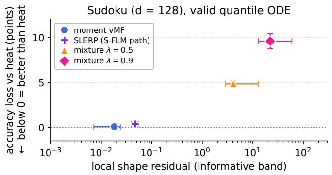

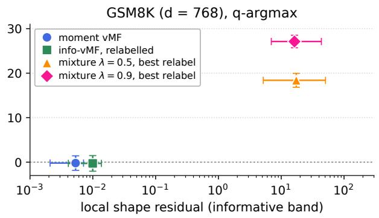  
Figure 8: Mismatch cost and the local shape residual. Horizontal bars span the residual range over tested noise levels. Sudoku uses the valid quantile ODE at $B = 1 8 0$ with posterior decoding (181 NFEs); only the mixture points use information relabelling. vMF and SLERP use their native clocks. GSM8K uses q-argmax. The residual is local in $r ,$ so the figure shows ordering instead of a fitted relationship. Negative values mean better accuracy than Heat. Diferences as small as the vMF/SLERP costs are not resolved with three training seeds; this does not apply to the larger mixture losses. Mixture residuals are tail-sensitive and indicate orders of magnitude. SLERP uses Heat-trained weights with the matched geodesic quantile ODE; its native exact velocity and radial transport agree numerically (Appendix E.4).

Figure 8 orders the measured mismatch costs by shape residual; Table 30 lists the plotted values.

Dynamics and decoding. The misspecified $\lambda = . 9$ baseline fails for two reasons. Posterior decoding fixes the difuse final component, while quantile transport fixes the path; Table 31 separates these efects.

Threshold tuning and information grid. Thresholds are selected per kernel and budget on held-out puzzles. $\mathrm { A t \ } B = 1 8 0$ the chosen values are 0.999995 for Heat, 0.999999 for $\lambda = . 5 .$ , and 0.9999995 for $\lambda = . 9$ . The information grid blends measured information progress with log-radius progress at weight 0.15. At B = 180 (181 NFEs with posterior decoding), q-argmax reaches $7 7 . 9 \pm 1 . 8$ , 83.9 ± 1.2, and $8 3 . 1 \pm 1 . 9$ for Heat, $\lambda = . 5$ , and $\lambda = . 9$ . Tuned gating reaches $8 2 . 4 \pm 1 . 6 , 7 6 . 7 \pm 1 . 4 ,$ and $7 8 . 6 \pm 2 . 0$ . These comparisons use five independently trained models per kernel, so the deviations measure training-seed variation. Table 32 reports the full gated-kernel comparison.

Table 30: Kernel mismatch costs shown in Figure 8 on hard Sudoku. Positive values mean worse accuracy than Heat. Costs are paired mean ± sd over three Heat training seeds at B = 180 with posterior decoding (181 NFEs). Only mixtures use time relabelling; their residuals are order-of-magnitude estimates.
<table><tr><td>Kernel</td><td>Figure residual Cost vs. Heat (points)</td></tr><tr><td>Moment-matched vMF</td><td>.017</td></tr><tr><td>SLERP (S-FLM path) .047</td><td> $+ . 0 8 \pm . 0 8$   $+ . 3 8 \pm . 2 0$ </td></tr><tr><td>Mixture  $\lambda = . 5$ </td><td>5.5</td></tr><tr><td>26.9</td><td> $+ 4 . 8 \pm . 3$ </td></tr><tr><td>Mixture  $\lambda = . 9$ </td><td> $+ 9 . 6 \pm . 8$ </td></tr></table>

Table 31: Hard-Sudoku accuracy (%) at a sampler budget of B = 180 network calls (Brownian ODE: Heun, 90 steps; quantile ODE: 180 steps), mean ± sd over three training seeds. Nearest decoding spends 180 NFEs; posterior decoding adds one call (181 NFEs).
<table><tr><td>Kernel</td><td>Dynamics</td><td>Nearest</td><td>Posterior</td></tr><tr><td>Mix .5</td><td>Brownian ODE</td><td> $4 4 . 8 \pm 1 . 4$ </td><td> $5 5 . 0 \pm 2 . 4$ </td></tr><tr><td rowspan="3">Mix .9</td><td>quantile ODE</td><td> $5 2 . 1 \pm 2 . 3$ </td><td> $5 3 . 3 \pm 2 . 4$ </td></tr><tr><td>Brownian ODE</td><td> $0 . 0 \pm 0 . 0$ </td><td> $1 5 . 3 \pm 3 . 6$ </td></tr><tr><td>quantile ODE</td><td> $1 1 . 2 \pm 0 . 7$ </td><td> $5 5 . 3 \pm 2 . 3$ </td></tr></table>

Table 32: Efect of the training kernel on tuned confidence-gated refinement on hard Sudoku. Entries are accuracy diferences in percentage points relative to Heat on the information $\mathrm { g r i d } ,$ mean ± standard deviation over five independent training seeds per kernel. Parentheses give the paired t statistic. SLERP is a separate three-trainingseed comparison with paired spreads; see Table 33. Budgets are sampler calls B, with one further call for posterior decoding.
<table><tr><td>B</td><td>Moment-matched vMF</td><td>SLERP</td><td> $\mathrm { M i x } \ \lambda = . 5$ </td><td> $\operatorname { M i x } \lambda = . 9$ </td></tr><tr><td>16</td><td> $+ 0 . 3 \pm 0 . 8$ </td><td></td><td> $\cdot 4 . 7 \pm 2 . 3 ( t = - 4 . 5 )$ </td><td> ${ \cdot 5 . 0 \pm 4 . 1 ( t = - 2 . 7 ) }$ </td></tr><tr><td>64</td><td> $+ 0 . 2 \pm 1 . 1$ </td><td> $+ 1 . 1 \pm 3 . 6$ </td><td> $- 5 . 2 \pm 2 . 4 ( t = - 4 . 8 )$ </td><td> $- 5 . 3 \pm 3 . 6 ( t = - 3 . 3 )$ </td></tr><tr><td>180</td><td> $- 0 . 1 \pm 1 . 0$ </td><td> $+ 0 . 1 \pm 3 . 4$ </td><td> $- 5 . 8 \pm 1 . 8 ( t = - 7 . 4 )$ </td><td> $- 3 . 8 \pm 3 . 0 ( t = - 2 . 8 )$ </td></tr></table>

Moment-matched vMF is also within ±0.5 points of Heat at every tested budget on the log grid, including $- 0 . 2 \pm 1 . 1$ points at $B = 1 8 0$ , and selects a similar confidence threshold. On the information grid, the $B = 1 6$ diference of $+ 0 . 3 \pm 0 . 8$ points gives an approximate two-sided 95% t interval of [−0.7, 1.3] points. We therefore describe the two channels as practically equivalent within roughly one point at that budget, rather than as exactly equal. The same near-zero pattern holds at $B = 6 4$ and $B = 1 8 0$ , with wider intervals. vMF’s q-argmax result is 0.5–0.8 points above Heat, but is only borderline at B = 64 (t = 2.6) and weaker elsewhere. The evidence is insuficient to establish a vMF advantage. Together with Proposition 1, this shows that moment-matched vMF remains within roughly one point of Heat under gated refinement, unlike the more distant bimodal kernels.

Time-relabelled cross. After information relabelling, the valid quantile ODE loses $4 . 8 \pm 0 . 3$ points for $\lambda = . 5 .$ slightly more than its $4 . 4 \pm 0 . 6 \mathrm { - p o i n t }$ loss before relabelling. For $\lambda = . 9 .$ relabelling reduces the loss from $1 4 . 6 \pm 2 . 9$ to $9 . 6 \pm 0 . 8$ points. For q-argmax, Heat weights with mixture re-noising, relabelling, and the mixture information grid reach $8 2 . 5 \pm 1 . 3$ at $\lambda = . 5 ,$ compared with $7 7 . 9 \pm 1 . 8$ for Heat and $8 3 . 9 \pm 1 . 2$ for the matched mixture.

## E.3.1 Brownian score-substitution baseline

This baseline applies Brownian dynamics to substituted mixture scores and uses nearest-codeword decoding, a natural but invalid choice for a non-Brownian path. At B = 180, Heat-trained SDE/ODE under $\lambda = . 9$ both solve 0.0% of puzzles; q-argmax reaches 12.5 ± 3.3 and gating 80.3 ± 1.9. Increasing Heun resolution from 180 to 11,520 NFEs does not repair the misspecified dynamics. We include these misspecified-dynamics runs as failure-mode baselines.

Reproducibility note. Evaluations use checkpoints in evaluation mode, count actual Transformer calls, keep stochastic noise outside the drift cap (i.e. a clamp on the norm of the deterministic drift (score or velocity) step in the SDE/ODE integrators.), reseed every sampler, and use a tuning set disjoint from training and evaluation. We also validated the conditional CDF derivative.

## E.4 SLERP comparison

We compare full and truncated SLERP paths alongside Heat. Each run uses 20k updates, global batch size 256, the same eight-layer backbone as the other Sudoku arms, 2,000 evaluation puzzles, and posterior decoding. Results below use three independent training seeds. The full SLERP path matches the Heat information clock within $| \Delta u | \le 0 . 0 1 6$ . We also evaluate a truncated path ending at $r _ { \mathrm { m i n } } = 0 . 9 4 2$ , where SLERP’s own information is exhausted. Using the S-FLM cutof unchanged at d = 128 would leave 77% of the entropy unresolved. Table 33 gives the accuracy comparison for both paths.

Table 33: SLERP kernel comparison on hard Sudoku. Values are accuracies in percent, mean ± sd over three independent training seeds; parenthesized values are paired diferences from Heat, also mean ± sd. All runs use the same eight-layer backbone, 20k updates, batch 256, 2,000 evaluation puzzles, and posterior decoding, so total NFE is B + 1. The truncated gating diference at B = 180 has paired t = −2.3 and is not resolved with three seeds.
<table><tr><td>Sampler</td><td>B</td><td>Heat</td><td>SLERP</td><td>SLERP truncated</td></tr><tr><td>ODE</td><td>16</td><td> $5 3 . 1 \pm 2 . 2$ </td><td> $5 5 . 0 \pm 1 . 6 ~ ( + 2 . 0 \pm 2 . 0 )$ </td><td> $5 1 . 2 \pm 2 . 7 \ ( - 1 . 8 \pm 4 . 8 )$ </td></tr><tr><td>ODE</td><td>180</td><td> $5 4 . 5 \pm 3 . 2$ </td><td> $5 6 . 2 \pm 2 . 2 \ ( + 1 . 8 \pm 3 . 3 )$ </td><td> $5 1 . 4 \pm 1 . 9 \ ( - 3 . 1 \pm 4 . 8 )$ </td></tr><tr><td>q-argmax</td><td>64</td><td> $6 5 . 3 \pm 1 . 5$ </td><td> $6 7 . 4 \pm 1 . 3 \ ( + 2 . 1 \pm 2 . 6 )$ </td><td> $6 6 . 8 \pm 1 . 7 \ ( + 1 . 5 \pm 3 . 2 )$ </td></tr><tr><td>q-argmax</td><td>180</td><td> $7 1 . 5 \pm 2 . 5$ </td><td> $7 3 . 1 \pm 1 . 3 \ ( + 1 . 6 \pm 2 . 5 ) $ </td><td> $7 1 . 9 \pm 1 . 6 ~ ( + 0 . 3 \pm 3 . 9 )$ </td></tr><tr><td>Gating, tuned</td><td>64</td><td> $7 8 . 3 \pm 2 . 0$ </td><td> $7 9 . 5 \pm 2 . 1 \ ( + 1 . 1 \pm 3 . 6 )$ </td><td> $7 7 . 7 \pm 0 . 9 \ ( - 0 . 7 \pm 2 . 7 )$ </td></tr><tr><td>Gating, tuned</td><td>1 180</td><td> $8 1 . 7 \pm 1 . 1$ </td><td> $8 1 . 8 \pm 3 . 0 ~ \dot { ( + 0 . 1 \pm 3 . 4 ) }$ </td><td> $7 8 . 4 \pm 1 . 4 \ \dot { ( - 3 . 2 \pm 2 . 5 ) }$ </td></tr></table>

Full-path SLERP is nominally ahead of Heat in all six cells. Across both paths, paired diferences are at most 3.2 points in magnitude and are not resolved with three training seeds. Its information clock is close to Heat’s, so it behaves like Heat and vMF rather than like the bimodal mixtures. The matched SLERP velocity agrees with S-FLM’s exact velocity to $1 . 4 \times 1 0 ^ { - 7 }$ per step and $4 \times 1 0 ^ { - 5 }$ over a rollout. These checks use SLERP’s own model. Separately, the $+ 0 . 3 8 \pm 0 . 2 0 \mathrm { - p o i n t }$ cost in Table 30 comes from Heat-trained checkpoints 0–2 sampled with SLERP’s matched geodesic quantile ODE, paired against the same checkpoints with Heat’s valid quantile ODE. Both arms use $B = 1 8 0$ and posterior decoding (181 NFEs). This cross uses the full SLERP path without time relabelling: $\alpha ^ { * } = 1 . 0 0 3$ and its clock difers from Heat by at most 0.016. Moment-matched vMF likewise uses its native clock; only the mixture crosses use information relabelling.

## E.5 Published Sudoku baselines

Table 34 reports the published comparison with autoregressive, discrete-difusion, and continuous-difusion Sudoku baselines. The SBD row uses the gated q-argmax result at B = 180 (181 total NFEs) from Table 19; its uncertainty is over five sampler seeds on the fixed checkpoint for each dificulty. The AR, MDLM, Duo, CANDI, FLM, and S-FLM values in the main comparison come from their published evaluations [17, 33, 47, 52, 53]. FLM is from Lee et al. [33]. The FMLM+ row uses our five-seed evaluation of the released checkpoint in Table 22 [1].

Table 34: Sudoku exact-match accuracy (%) at B = 180 sampler-call budget. AR, MDLM, Duo, CANDI, FLM, and S-FLM are published values. FMLM+ and SBD use five sampler seeds on fixed checkpoints; gated SBD uses 181 calls. Bold/underline mark the best/second-best non-AR value per column.
<table><tr><td>Model</td><td>Easy</td><td>Medium</td><td>Hard</td></tr><tr><td>Autoregressive</td><td></td><td></td><td></td></tr><tr><td>AR (sample)</td><td>13.9</td><td>5.1</td><td>0.6</td></tr><tr><td>AR (greedy)</td><td>14.6</td><td>5.1</td><td>1.0</td></tr><tr><td>Discrete diffusion</td><td></td><td></td><td></td></tr><tr><td>MDLM</td><td>92.0</td><td>77.1</td><td>30.2</td></tr><tr><td>Duo</td><td>96.3</td><td>84.7</td><td>58.4</td></tr><tr><td>Continuous diffusion</td><td></td><td></td><td></td></tr><tr><td>CANDI</td><td>79.3</td><td>45.9</td><td>16.7</td></tr><tr><td>FLM</td><td>94.2</td><td>82.7</td><td>44.5</td></tr><tr><td>S-FLM</td><td>81.5</td><td>50.6</td><td>14.0</td></tr><tr><td>+ α*(0.1)</td><td>94.0</td><td>77.6</td><td>43.2</td></tr><tr><td>+ adaptive schedule</td><td>94.8</td><td>85.2</td><td>45.0</td></tr><tr><td>FMLM+ PR</td><td>97.77 ± .13</td><td>92.99 ± .33</td><td>81.65 ± .36</td></tr><tr><td>Ours</td><td>99.11 ±.12</td><td>96.66 ±.15</td><td>83.36 ±.42</td></tr></table>

## E.6 GSM8K setup and metric

We train on TinyGSM [38], which pairs synthetic math word problems with Python solutions generated by GPT-3.5. Evaluation uses all 1,319 problems in the GSM8K test split [15]; we do not report TinyGSM test accuracy. We tokenize the problem and solution with the SmolLM tokenizer and use context length 512. The problem statement is kept clean during training and fixed during generation.

Executed final-answer accuracy. For each problem $j ,$ we generate one Python program and execute it to obtain $\widehat { a } _ { j }$ . Let $a _ { j }$ be the reference numerical answer and $b _ { j } = 1$ only when execution returns the correct answer. The reported score is

$$
\mathrm { A c c } _ { \mathrm { G S M 8 K } } = \frac { 1 0 0 } { 1 3 1 9 } \sum _ { j = 1 } ^ { 1 3 1 9 } b _ { j } .\tag{57}
$$

Programs that do not produce the correct answer are not counted as successful. We compare answers, not program text: diferent programs can solve the same problem. This is a single-generation accuracy, not pass@k or a best-of-multiple-generations score. Parentheses in Table 43 give $\textstyle \sum _ { j } b _ { j }$ , and percentages are rounded to two decimal places.

Baselines and comparability. Dense NFE sweeps use the released 250k-update checkpoints for MDLM, Duo, CANDI, FLM, S-FLM, and FMLM+ variants [1, 17]. This suite matches the TinyGSM training data, backbone scale (12 layers, hidden size 768, and 12 attention heads), and 250k model-update budget. Training hyperparameters, including the learning rate and noise schedule, remain method-specific; we do not claim an identical training recipe. The main controlled curves are MDLM, Duo, S-FLM, FMLM+ trained from scratch, and our Brownian model.

FMLM+ initialized from MDLM starts from a pretrained checkpoint, and its distilled variant uses a pretrained MDLM teacher [1]. These curves appear in the enhanced comparison in Figure 9. The 250k updates describe training of the evaluated model and do not include the cost of producing its teacher or initialization. IDLM also uses pretrained MDLM or Duo teachers and initializes its student from them [34]. We retain these strong baselines as teacher-assisted comparisons, not as matched from-scratch or equal-total-compute runs.

IDLM and vMF results are reported values from their papers [10, 34], not evaluations of our models. In Figure 3, † marks the paper-reported vMF curve; IDLM appears only in Table 36. In our numerical tables, † instead indicates pretrained assistance and ‡ indicates self-conditioning with predictor-corrector sampling. We also report vMF PC without self-conditioning from Table 20 of Chemseddine et al. [10]. Both PC curves use the best reported configuration at each NFE budget, with corrector calls included in the budget; they are not new evaluations under our sampler. Our model uses neither pretrained assistance nor self-conditioning. AR scores use 512 sequential passes. LatentMDM reports 20.8%, 33.8%, and 45.5% with two, four, and eight latent-segment rounds [31]. Because a segment round is not a matched NFE, we do not include these values in Table 36. A missing NFE measurement is marked NR; we do not interpolate missing accuracy values.

## E.7 Full GSM8K comparison

Figure 9 and Table 35 extend the controlled comparison with teacher-initialized and self-conditioned models.

Table 35 summarizes the full-budget comparison; Table 36 gives the broader baseline ladder and the three-seed SBD q-argmax values used in Figure 3. The matched-temperature subset is in Table 14, and the SBD memoryless curve in Table 15. We report the complete NFE ladder when a released checkpoint is available and use NR for values that were not reported.

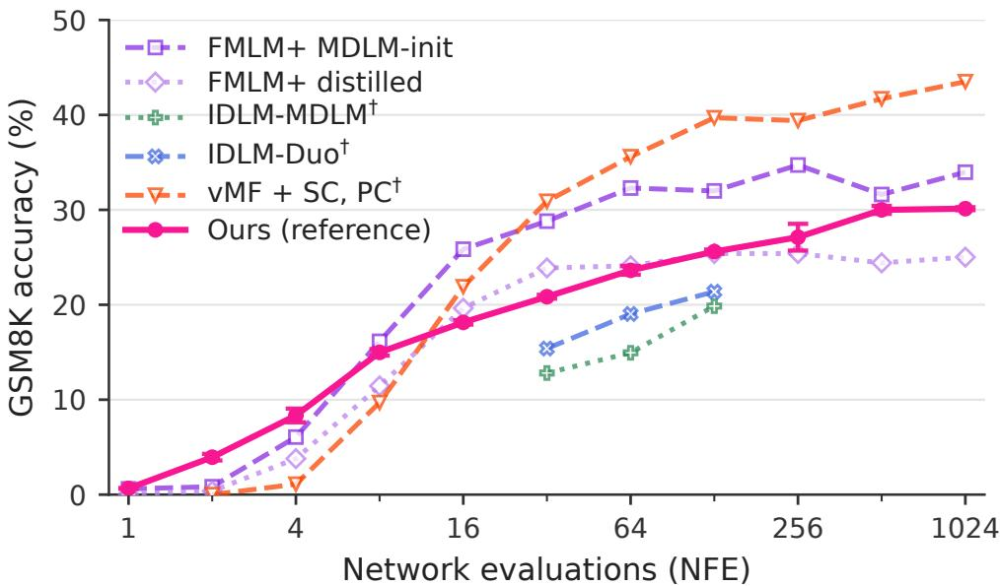  
Figure 9: Enhanced GSM8K comparisons using teacher initialization or self-conditioning. Our model uses neither; the controlled comparison is in Figure 3.

Table 35: GSM8K accuracy (%) at the full reported budget. Difusion/flow models use the reported 1,024-call budget; decoding regimes difer: MDLM/Duo use $T = 1$ , SBD uses q-argmax, and S-FLM top-1 and FMLM+ use deterministic token selection. vMF uses its published PC setting. SBD is the mean over three inference seeds; AR uses 512 sequential passes. Bold/underline mark the best/second-best non-AR result. †: pretrained assistance; ‡: self-conditioning with predictor-corrector sampling. See Appendix E.6 for provenance and comparability.
<table><tr><td>Model</td><td>Accuracy</td></tr><tr><td>Autoregressive</td><td></td></tr><tr><td>AR (sample)</td><td>53.9</td></tr><tr><td>AR (greedy)</td><td>63.3</td></tr><tr><td>Discrete diffusion</td><td></td></tr><tr><td>MDLM</td><td>16.91</td></tr><tr><td>Duo</td><td>18.95</td></tr><tr><td>Continuous diffusion and flows</td><td></td></tr><tr><td>CANDI</td><td>0.15</td></tr><tr><td>FLM</td><td>0.53</td></tr><tr><td>S-FLM (exact)</td><td>11.98</td></tr><tr><td>S-FLM (top-1)</td><td>16.53</td></tr><tr><td>FMLM+ (scratch)</td><td>20.32</td></tr><tr><td> $\mathrm { F M L M + \ ( M D L M \ i n i t . ) ^ { \dag } }$ </td><td>33.97</td></tr><tr><td> $\mathrm { F M L M + ( d i s t i l l e d ) ^ { \dagger } }$ </td><td>25.02</td></tr><tr><td>vMF (PC, no SC)</td><td>33.0</td></tr><tr><td>vMF+SC (PC)‡</td><td>43.5</td></tr><tr><td>Ours: q-argmax</td><td>30.12</td></tr></table>

Table 36: GSM8K final-answer accuracy (%) across network-evaluation budgets. Dense rows are evaluations of released 250k-update checkpoints, excluding teacher/init pretraining costs. vMF PC (with/without SC) and IDLM values are taken from their papers. SBD q-argmax reports a mean and a separate standard-deviation row over three inference seeds; other dense rows are single runs. †: pretrained teacher or initialization; ‡: self-conditioning and PC. NR means that a value is not reported. AR uses 512 sequential passes. Bold marks the best non-autoregressive result at each budget.
<table><tr><td>Model</td><td>1</td><td>2</td><td>4</td><td>8</td><td>16</td><td>32</td><td>64</td><td>128</td><td>256</td><td>512</td><td>1024</td></tr><tr><td colspan="10">Autoregressive</td><td></td><td></td><td></td></tr><tr><td>AR (sample)</td><td>NR</td><td>NR</td><td>NR</td><td>NR</td><td>NR</td><td>NR</td><td>NR</td><td>NR</td><td>NR</td><td>53.9</td><td>NR</td></tr><tr><td>AR (greedy)</td><td>NR</td><td>NR</td><td>NR</td><td>NR</td><td>NR</td><td>NR</td><td>NR</td><td>NR</td><td>NR</td><td>63.3</td><td>NR</td></tr><tr><td colspan="10">Discrete diffusion and distillation</td></tr><tr><td>MDLM</td><td>0.00</td><td>0.00</td><td>0.00</td><td>0.23</td><td>1.82</td><td></td><td></td><td></td><td>5.69 10.01 13.57 15.09 14.94 16.91</td><td></td><td></td></tr><tr><td>Duo</td><td>0.00</td><td>0.38</td><td>1.67</td><td>3.64</td><td>10.01</td><td></td><td>13.87 16.6015.39</td><td></td><td>18.50</td><td>18.27</td><td>18.95</td></tr><tr><td>IDLM-MDLM†</td><td>NR</td><td>NR</td><td>NR</td><td>NR</td><td>NR</td><td></td><td>12.81 14.94 19.86</td><td></td><td>NR</td><td>NR</td><td>NR</td></tr><tr><td>IDLM-Duo†</td><td>NR</td><td>NR</td><td>NR</td><td>NR</td><td></td><td>NR 15.39 19.03 21.38</td><td></td><td></td><td>NR</td><td>NR</td><td>NR</td></tr><tr><td colspan="10">Continuous diffusion and flows</td></tr><tr><td>CANDI (lr 10−3)</td><td>0.00</td><td>0.00</td><td>0.00</td><td>0.00</td><td>0.00</td><td>0.00</td><td>0.00</td><td>0.08</td><td>0.08</td><td>0.23</td><td>0.15</td></tr><tr><td>FLM (default)</td><td>0.00</td><td>0.00</td><td>0.00</td><td>0.00</td><td>0.00</td><td>0.00</td><td>0.08</td><td>0.15</td><td>0.23</td><td>0.45</td><td>0.53</td></tr><tr><td>S-FLM (exact)</td><td>0.83</td><td>2.58</td><td>4.70</td><td>7.51</td><td>9.25</td><td>10.31</td><td>11.22</td><td>11.22</td><td>11.68</td><td></td><td>11.75 11.98</td></tr><tr><td>S-FLM (top-1)</td><td>0.83</td><td>3.34</td><td>8.04</td><td>11.22</td><td>15.47</td><td>16.45</td><td>16.07</td><td>16.07</td><td>16.60</td><td>0 16.45 16.53</td><td></td></tr><tr><td>FMLM+ (scratch)</td><td>0.15</td><td>0.15</td><td>3.87</td><td>8.19</td><td>14.48</td><td>19.26</td><td>20.92</td><td>21.68</td><td></td><td>20.62 21.99 20.32</td><td></td></tr><tr><td>FMLM+ (MDLM init.)†</td><td>0.61</td><td>0.83</td><td>6.07</td><td>16.15</td><td>25.85</td><td></td><td>28.81 32.30</td><td>31.99</td><td></td><td>34.72 31.61 33.97</td><td></td></tr><tr><td>FMLM+ (distilled)†</td><td>0.08</td><td>0.38</td><td>3.79</td><td>11.45</td><td>19.64</td><td>23.88</td><td>24.11</td><td>25.40</td><td>25.40</td><td></td><td>24.41 25.02</td></tr><tr><td>vMF (PC, no SC)</td><td>NR</td><td>0.0</td><td>0.7</td><td>6.2</td><td>15.5</td><td>21.8</td><td>26.9</td><td>27.4</td><td>31.8</td><td>32.4</td><td>33.0</td></tr><tr><td>vMF+SC (PC)‡</td><td>NR</td><td>0.0</td><td>1.1</td><td>9.7</td><td>21.9</td><td>30.9</td><td>35.6</td><td>39.7</td><td>39.4</td><td>41.7</td><td>43.5</td></tr><tr><td colspan="10">Ours</td></tr><tr><td>Ours: q-argmax, mean</td><td></td><td>0.663.94</td><td>8.34</td><td>14.99</td><td></td><td>18.15 20.85</td><td>23.63</td><td>25.60</td><td></td><td>27.12 30.00 30.12</td><td></td></tr><tr><td>Ours: standard deviation</td><td>0.04</td><td>0.35</td><td>0.72</td><td>0.34</td><td>0.23</td><td>0.20</td><td>0.46</td><td>0.22</td><td>1.41</td><td>0.42</td><td>0.16</td></tr></table>

## E.8 S-FLM S-arch q-argmax transfer

We also apply q-argmax to the released S-FLM S-arch checkpoint, using SLERP re-noising at the model’s own time labels. The full NFE curve is shown in Figure 3; at higher budgets this refinement roughly doubles GSM8K accuracy relative to S-FLM top-1 decoding. S-FLM and SBD difer in schedule, truncation, embedding handling, and batch size, so this transfer does not isolate a kernel efect.

Table 37 gives the full values. This is one evaluation seed, so it shows transfer feasibility instead of seed-averaged comparative performance.

Table 37: GSM8K accuracy of q-argmax on the released S-FLM S-arch checkpoint, using SLERP re-noising at the model’s own time labels. One evaluation seed.
<table><tr><td>NFE</td><td>1</td><td>2</td><td>4</td><td>8</td><td>16</td><td>32</td><td>64</td><td>128</td><td>256</td><td>512</td><td>1024</td></tr><tr><td>Accuracy (%)</td><td>0.8</td><td>3.3</td><td>8.2</td><td>14.9</td><td>20.5</td><td>23.2</td><td>26.2</td><td>28.7</td><td>29.3</td><td>30.5</td><td>31.2</td></tr></table>

## E.9 GSM8K kernel-consistency study

We evaluate all 1,319 GSM8K test problems with EMA weights, context length 512, an entropy-spaced grid, and three sampling seeds. The primary readout is q-argmax with posterior decoding. Quantile-flow and Brownian ODE results are included as checks, although both continuous samplers are weak on this task.

Kernel cross. Moment-matched vMF remains close to Heat, while the mixture mismatch destroys program accuracy even under valid transport. The information-matched vMF is a pure time-change control: querying the Heat network at the equal-cosine time removes its low-budget cost (Table 38).

Kernel and training comparison. Table 39 compares Heat-trained weights sampled with Heat against information-vMF-trained weights sampled with their own kernel. It changes the training channel and inference kernel while leaving the Heat table resolution unchanged. At B = 32 the paired diference is −1.67 ± 0.92 points (t = −3.1, p ≃ 0.09); at B = 256 it is +0.13 points.

Denoising probe and relabel maps. We build the relabel maps on 512 TinyGSM validation examples that are disjoint from both the GSM8K test set and the 128-example mechanism probe. For each mixture time, the map chooses the monotone Heat-network time label with the highest clean-token accuracy. This gives an upper bound on what a scalar time change can repair; the probe measurements are in Table 40.

Table 38: GSM8K accuracy (%), mean ± standard deviation over three inference seeds. Each row names training weights and inference kernel. Budgets are sampler calls $B ;$ posterior decoding adds one call, giving 65 and 257 total NFEs.
<table><tr><td rowspan="2">Weights → kernel</td><td colspan="2">q-argmax</td><td colspan="2">quantile ODE</td></tr><tr><td> $B = 6 4$ </td><td> $B = 2 5 6$ </td><td> $B = 6 4$ </td><td> $B = 2 5 6$ </td></tr><tr><td> $\mathrm { H e a t } \to \mathrm { H e a t }$ </td><td> $2 3 . 6 3 \pm . 4 6$ </td><td> $2 7 . 1 2 \pm 1 . 4 1$ </td><td> $6 . 9 2 \pm . 6 1$ </td><td> $7 . 5 6 \pm . 6 1$ </td></tr><tr><td>Heat → moment vMF</td><td> $2 2 . 7 4 \pm . 0 8$ </td><td> $2 7 . 3 2 \pm . 2 4$ </td><td> $6 . 8 5 \pm . 6 9$ </td><td> $7 . 4 8 \pm . 6 9$ </td></tr><tr><td> $\mathrm { H e a t } \to \mathrm { m i x t u r e } \ . 5$ </td><td> $0 . 0 5 \pm . 0 9$ </td><td> $0 . 0 3 \pm . 0 4$ </td><td> $0 . 4 0 \pm . 1 6$ </td><td> $0 . 4 5 \pm . 1 3$ </td></tr><tr><td> $\mathrm { H e a t } \to \mathrm { m i x t u r e ~ . 9 }$ </td><td>0.00</td><td>0.00</td><td>0.00</td><td>0.00</td></tr><tr><td> $\mathrm { I n f o - v M F }  \mathrm { i n f o - v M F }$ </td><td> $2 3 . 0 5 \pm . 8 5$ </td><td> $2 7 . 2 4 \pm . 7 6$ </td><td> $7 . 1 5 \pm . 1 6$ </td><td> $7 . 4 3 \pm . 2 7$ </td></tr><tr><td> $\mathrm { H e a t } \to \mathrm { i n f o - v M F }$ </td><td> $1 9 . 8 1 \pm . 4 2$ </td><td> $2 6 . 5 9 \pm . 4 2$ </td><td> $5 . 9 4 \pm . 3 6$ </td><td> $6 . 8 5 \pm . 5 6$ </td></tr><tr><td> $\mathrm { H e a t } \to \mathrm { i n f o - v M F } ,$  relabelled</td><td> $2 3 . 1 0 \pm . 2 7$ </td><td> $2 7 . 3 9 \pm . 4 2$ </td><td> $6 . 8 7 \pm . 7 8$ </td><td> $7 . 4 3 \pm . 6 7$ </td></tr></table>

Table 39: GSM8K kernel/training comparison: Heat-trained Heat inference versus information-vMF-trained information-vMF inference. Values are means over three inference seeds; diferences are info-vMF minus Heat. Budgets are sampler calls B, before a separate posterior decode.
<table><tr><td>B Heat → Heat</td><td>info-vMF → info-vMF</td><td></td><td>Difference</td></tr><tr><td>1</td><td>0.66</td><td>0.96</td><td>+0.30</td></tr><tr><td>2</td><td>3.94</td><td>4.20</td><td>+0.25</td></tr><tr><td>4</td><td>8.34</td><td>8.82</td><td>+0.48</td></tr><tr><td>8</td><td>14.99</td><td>14.25</td><td>-0.73</td></tr><tr><td>16</td><td>18.15</td><td>18.12</td><td>-0.03</td></tr><tr><td>32</td><td>20.85</td><td>19.18</td><td> $- 1 . 6 7 \pm 0 . 9 2 \ ( t = - 3 . 1 , p \simeq 0 . 0 9 )$ </td></tr><tr><td>64</td><td>23.63</td><td>23.05</td><td>-0.58</td></tr><tr><td>256</td><td>27.12</td><td>27.24</td><td>+0.13</td></tr></table>

Table 40: Code-token probe: one-step top-1 accuracy of the Heat posterior on the 9,345 program tokens in 128 TinyGSM validation answers, excluding PAD. Unqualified columns use the raw time label; “best” chooses the best tested Heat-network time label.
<table><tr><td>r</td><td>Heat</td><td>moment vMF</td><td>mix .5</td><td>mix .5, best</td><td>mix .9</td><td>mix .9, best</td></tr><tr><td>.2</td><td>1.000</td><td>1.000</td><td>.996</td><td>.999</td><td>.828</td><td>.971</td></tr><tr><td>.5</td><td>.999</td><td>.999</td><td>.994</td><td>.998</td><td>.620</td><td>.945</td></tr><tr><td>1.0</td><td>.996</td><td>.996</td><td>.949</td><td>.988</td><td>.381</td><td>.880</td></tr><tr><td>1.6</td><td>.984</td><td>.983</td><td>.860</td><td>.960</td><td>.213</td><td>.758</td></tr><tr><td>2.5</td><td>.936</td><td>.936</td><td>.814</td><td>.883</td><td>.153</td><td>.481</td></tr></table>

The best-case map partly repairs the .5 mixture but cannot repair .9. At $B = 2 5 6$ with posterior decoding (257 NFEs), q-argmax moves from 0.03% to $8 . 7 2 \pm 0 . 6 0 \%$ for .5, while .9 stays at 0.00%; the Heat reference is 27.12%. The mixture tables match their target means, the conditional-law and intermediate-marginal checks pass at $d = 7 6 8$ , and generated sequences show the same posterior-level corruption.

Why program accuracy amplifies small token errors. The full-answer probe uses the same 128 TinyGSM validation answers, mixture corruption, and raw time labels as the code-token probe, but counts the full answer region (code plus PAD, about 459 positions per answer). PAD accounts for about 80% of these positions and is predicted correctly more than 99% of the time, so these per-token accuracies are not directly comparable with Table 40. In the full-answer probe, Heat at $r = . 5$ has full-answer-region token accuracy .9999 and exact sequence accuracy .969. The .5 mixture at $r = 1 . 0$ has per-token accuracy .9917 but only .250 exact accuracy, while the .9 mixture at $r = . 1$ has per-token accuracy .9792 and zero exact accuracy. The mixture-to-Heat success ratio by program length is reported in Table 41.

Table 41: GSM8K success by generated-program length at $B = 2 5 6$ with posterior decoding (257 NFEs). The same 1,319 problems define both columns; values average three inference seeds.
<table><tr><td>Length range (mean)</td><td>n</td><td>Heat</td><td>mix .5, relabelled</td><td>ratio</td></tr><tr><td>67–108 (96)</td><td>259</td><td>44.3</td><td>21.0</td><td>.47</td></tr><tr><td>108–125 (116)</td><td>258</td><td>40.8</td><td>13.3</td><td>.33</td></tr><tr><td>125-142 (132)</td><td>265</td><td>26.7</td><td>6.2</td><td>.23</td></tr><tr><td>142-164 (152)</td><td>266</td><td>17.8</td><td>3.5</td><td>.20</td></tr><tr><td>164–290 (189)</td><td>271</td><td>7.3</td><td>.25</td><td>.03</td></tr></table>

The success ratio decreases monotonically with length, with correlation −0.96 between length and log ratio. Here the independent-token model assumes that the mismatch independently preserves each generated token with a length-independent probability $p ;$ for a program of length L, it therefore predicts a mixture-to-Heat success ratio proportional to $p ^ { L }$ . The per-token probability in this diagnostic is measured over the full-answer probe’s full answer region, including PAD, instead of the code-token probe’s code-only mask. The observed decay is steeper, consistent with context-mediated error propagation. The exponential curve in Figure 2 is a descriptive fit; it is not a causal test of this explanation.

Matched fine-tuning. We fine-tune the same Heat weights for 25k updates on either Heat or the .5 mixture, then sample each model with its own kernel. Table 42 reports the results; each arm uses one training seed, and the standard deviation is over three inference seeds.

Table 42: Matched GSM8K fine-tunes $( \% )$ , mean ± sd over three inference seeds, with one training seed per arm. The main comparison uses posterior decoding at $B = 2 5 6$ (257 NFEs); nearest-codeword controls use B total NFEs. The posterior-decoded paired mixture-minus-Heat diference is −1.09 ± 1.80 points.
<table><tr><td rowspan="2">Posterior decoding, EMA Heat fine-tune → Heat</td><td colspan="2">B = 256 (257 NFEs)</td></tr><tr><td>Mix .5 fine-tune → mix .5</td><td> $2 7 . 3 2 \pm . 5 2$   $2 6 . 2 3 \pm 1 . 3 0$ </td></tr><tr><td>Nearest-codeword decoding</td><td>64 NFEs</td><td>256 NFEs</td></tr><tr><td>Heat fine-tune → Heat, EMA</td><td> $2 3 . 8 3 \pm 1 . 0 0$ </td><td> $2 7 . 3 2 \pm . 5 2$ </td></tr><tr><td>Mix .5 fine-tune → mix .5, EMA</td><td> $2 1 . 1 0 \pm . 4 9$ </td><td> $2 6 . 0 3 \pm 1 . 2 2$ </td></tr><tr><td>Heat fine-tune → Heat, no EMA Mix .5 fine-tune → mix .5, no EMA</td><td> $2 1 . 5 3 \pm . 2 7$   $1 9 . 1 6 \pm . 2 4$ </td><td> $2 6 . 0 0 \pm . 5 0$   $2 3 . 0 2 \pm 1 . 3 7$ </td></tr></table>

This shows that restoring train–inference kernel consistency can recover most of the mismatch loss, but does not determine the performance of a mixture model trained from scratch. The nearest-decoded EMA comparison gives a paired gap of $- 1 . 2 9 \pm 1 . 7 1$ points at 256 NFEs. With posterior decoding, the gap is $- 1 . 0 9 \pm 1 . 8 0$ at 257 NFEs; the three seed diferences are +0.5, −3.0, and −0.8 points. The residual gap is not resolved by these three inference seeds.

## E.10 GSM8K checkpoint sweep

Figure 10 summarizes the checkpoint comparison; Table 43 reports all available NFE measurements for the five checkpoints used in our GSM8K ablation. Each percentage is computed on the 1,319-example GSM8K test set; the number of correct programs is shown in parentheses. Entropy sampling is strongest from 16 to 256 NFEs, whereas the online adaptive configuration is strongest at 1 to 8 and 512 to 1,024 NFEs.

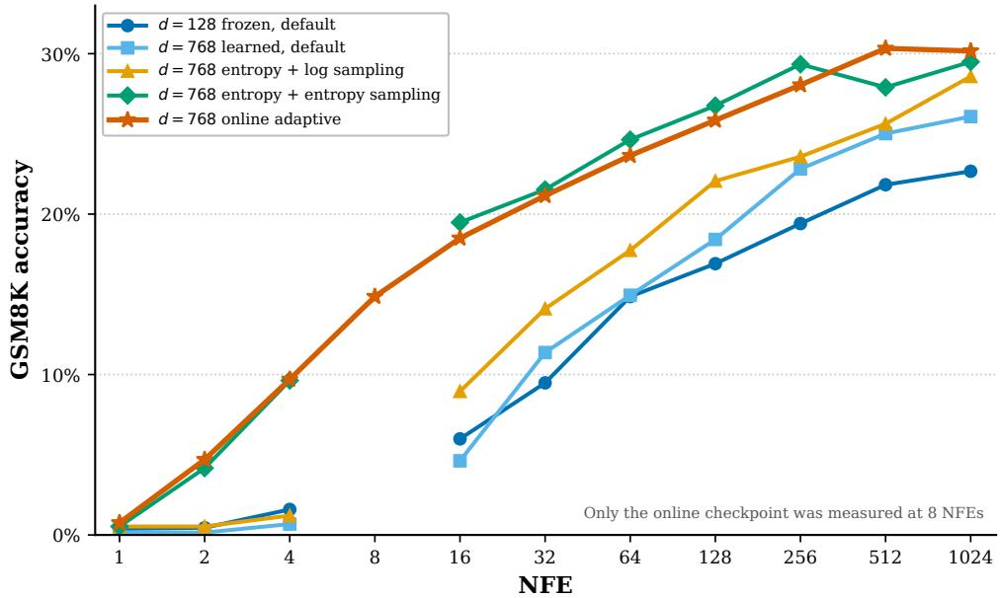  
Figure 10: Our GSM8K checkpoint and sampling ablations. All configurations use plain q-argmax without Gumbel perturbations, score updates, self-conditioning, or pretrained assistance. Missing NFE measurements are omitted; Table 43 gives the numerical results.

Table 43: GSM8K final-answer accuracy (%) across NFE budgets for our TinyGSM-trained checkpoints. Parentheses give the number of correct examples out of 1,319. Bold marks the best result at each budget; NR means not reported.
<table><tr><td>NFE</td><td>d = 128 frozen default</td><td>d = 768 learned default</td><td>d = 768 entropy + log sampling</td><td>d = 768 entropy + entropy sampling</td><td>d = 768 online adaptive</td></tr><tr><td>1</td><td>0.38 (5)</td><td>0.15 (2)</td><td>0.53 (7)</td><td>0.53 (7)</td><td>0.76 (10)</td></tr><tr><td>2</td><td>0.45 (6)</td><td>0.15 (2)</td><td>0.53 (7)</td><td>4.17 (55)</td><td>4.70 (62)</td></tr><tr><td>4</td><td>1.59 (21)</td><td>0.68 (9)</td><td>1.21 (16)</td><td>9.63 (127)</td><td>9.70 (128)</td></tr><tr><td>8</td><td>NR</td><td>NR</td><td>NR</td><td>NR</td><td>14.86</td></tr><tr><td>16</td><td>5.99 (79)</td><td>4.62 (61)</td><td>8.95 (118)</td><td>19.48 (257)</td><td>18.50 (244)</td></tr><tr><td>32</td><td>9.48 (125)</td><td>11.37 (150)</td><td>14.10 (186)</td><td>21.53 (284)</td><td>21.15 (279)</td></tr><tr><td>64</td><td>14.86 (196)</td><td>14.94 (197)</td><td>17.74 (234)</td><td>24.64 (325)</td><td>23.65 (312)</td></tr><tr><td>128</td><td>16.91 (223)</td><td>18.42 (243)</td><td>22.06 (291)</td><td>26.76 (353)</td><td>25.85 (341)</td></tr><tr><td>256</td><td>19.41 (256)</td><td>22.82 (301)</td><td>23.58 (311)</td><td>29.34 (387)</td><td>28.05 (370)</td></tr><tr><td>512</td><td>21.83 (288)</td><td>25.02 (330)</td><td>25.63 (338)</td><td>27.90 (368)</td><td>30.33 (400)</td></tr><tr><td>1024</td><td>22.67 (299)</td><td>26.08 (344)</td><td>28.58 (377)</td><td>29.49 (389)</td><td>30.17 (398)</td></tr></table>

Full-test continuous-sampler sweep. Table 44 reports ODE and Heun SDE accuracy on all 1,319 GSM8K test questions. ODE is stronger at 32 and 64 NFEs, while Heun SDE is stronger from 128 NFEs onward. Both achieve their highest reported accuracy at 256 NFEs, with ODE matching that value at 512 NFEs. Increasing the budget beyond 256 gives no further gain in this sweep. These full-test measurements are separate from the generated-trajectory diagnostics in Table 48, which use 64 examples per condition and separately record a final diagnostic call.

Table 44: GSM8K executed-answer accuracy (%) for continuous samplers on the full 1,319-question test set. Budgets are reported NFEs. Bold marks the better sampler at each budget. This table is separate from the checkpoint and generated-trajectory ablations.
<table><tr><td>NFE</td><td>ODE</td><td>Heun SDE</td></tr><tr><td>32</td><td>3.64</td><td>0.00</td></tr><tr><td>64</td><td>7.81</td><td>7.20</td></tr><tr><td>128</td><td>7.96</td><td>10.08</td></tr><tr><td>256</td><td>8.34</td><td>12.21</td></tr><tr><td>512</td><td>8.34</td><td>11.60</td></tr><tr><td>1024</td><td>8.26</td><td>11.98</td></tr></table>

## E.11 OpenWebText evaluation

Appendix G gives unedited generated excerpts at four target entropy levels and six NFE budgets.

Generation settings. Our reported OWT model uses a freely learned d = 768 codebook and the online adaptive training schedule, with 1M updates. For each method and NFE budget, we sweep the same 15 whole-trajectory temperatures, $T \in \{ 0 . 5 0 , 0 . 5 5 , \ldots , 1 . 2 0 \}$ . Apart from temperature, each method’s sampler settings remain fixed throughout the sweep. Temperature is applied at every sampling step: to the categorical transition for MDLM and Duo, and to the posterior weights used by S-FLM and our mixture score. We use $\mathrm { N F E } \in \{ 3 2 , 6 4 , 1 2 8 , 2 5 6 , 5 1 2 , 1 0 2 4 \}$ Our model and the MDLM, Duo, and S-FLM models shown as temperature sweeps use 1M training updates. The main paper shows 1,024 NFEs; Figure 11 gives all six budgets. The FLM, FMLM, and FMLM+ markers are our evaluations of released checkpoints with their native samplers, not paper-reported numbers or temperature sweeps. We do not treat them as matched-training-budget comparisons. For FMLM+, we retain four posterior-refinement rounds, $p = 0 . 9 9 9$ , fresh noise, and an equal step budget per refinement round. Only the 128-NFE point uses the authors’ released OWT configuration: 32 inner flow steps per round, for $3 2 \times 4 = 1 2 8$ evaluations. At the other budgets, † marks our budget-matched extrapolation of the inner step count to NFE/4, including $2 5 6 \times 4$ at 1,024 NFEs. These values correspond to directly measured operating points, with perplexity and entropy evaluated at those settings.

Hybrid sampler. For our $d = 7 6 8$ model, we use an entropy grid and initialize from the uniform distribution. Above $r = 2 . 0 6 4 0 6 5$ , we use stochastic Heun score updates. Below this switch, k controls the q-projection frequency: k = 1 projects at every step, $k = 2$ every second step, and $k = 4$ every fourth step. Intervening steps use continuous stochastic score/SDE updates. At a fixed NFE budget, increasing k therefore allocates fewer updates to q-projection and more to the score sampler. Here k is a cadence, not top-k posterior truncation. The default is $k = 1 ;$ at 1,024 NFEs we also evaluate $k = 2$ and $k = 4$ with the same temperature sweep and all other sampler settings fixed.

In the Gumbel configuration, q-projection uses the perturbed posterior without the additional commitment gate (the confidence gating defined in Section 3). One fixed Gumbel noise tensor is reused at every q-projection. Its efective strength is

$$
\gamma ( r ) = 0 . 2 5 \frac { \log ( r / r _ { \mathrm { m i n } } ) } { \log ( r _ { \mathrm { m a x } } / r _ { \mathrm { m i n } } ) } .\tag{58}
$$

Thus 0.25 is a base multiplier, not a final temperature: the strength is 0.25 at $r _ { \mathrm { m a x } }$ and decreases toward zero at $r _ { \mathrm { m i n } } .$ Since q-projection begins below the switch, its first efective strength is already smaller than 0.25. Whole-trajectory temperature is swept while this schedule and the other settings remain fixed. Budgets are expressed in network evaluations, not in grid points; each Heun update requires two evaluations.

Generative perplexity. We use the sample-level quality and diversity metrics of partition generative modeling [19]. The main temperature sweeps and isolated reference points use $N = 5 1 2$ sequences per setting. The plotted $k = 2$ and $k = 4$ variants instead use 64 sequences, with 32 at each of seeds 1 and 2; the plotted $k = 1$ curve uses 512, with 64 at each of seeds 1 to 8. We also evaluate $k = 1$ with the same 64-sample protocol as $k = 2 / 4$ for the controlled temperature comparison below. All sequences have length 1,024 and are scored with the same pretrained GPT-2 Large reference model and revision [49], using its tokenizer. For a sample x, we compute

$$
\operatorname { P P L } _ { \operatorname { g e n } } ( \mathbf { x } ) = \exp \left( - { \frac { 1 } { m } } \sum _ { i = 1 } ^ { m } \log p _ { \operatorname { G P T 2 - L } } ( x _ { i } \mid x _ { < i } ) \right) ,\tag{59}
$$

where m is the number of scored tokens before the first end-of-text marker. Tokens at and after that marker are excluded from the score. This measures the reference model likelihood assigned to generated text. Lower values indicate text that the reference model finds more likely, but can also result from repetitive outputs.

Unigram entropy. Within each sample, let $c ( v , { \bf x } )$ count occurrences of token v and $L _ { \mathbf { x } }$ be the number of tokens used in the entropy calculation. The empirical frequencies are $\widehat { p } _ { { \bf x } } ( v ) = c ( v , { \bf x } ) / L _ { \bf x }$ . We compute

$$
H ( \mathbf { x } ) = - \sum _ { v \in \mathcal { V } } \widehat { p } _ { \mathbf { x } } ( v ) \log \widehat { p } _ { \mathbf { x } } ( v ) .\tag{60}
$$

We take 0 log $0 = 0$ and use natural logarithms, so entropy is measured in nats. Repeated use of a small set of tokens gives low entropy; a broader token distribution gives higher entropy. This is a within-sample token diversity measure, not the entropy of the learned posterior or a measure of semantic diversity across the batch.

Averaging and frontier interpretation. Each temperature contributes one point obtained by averaging the two metrics separately across samples:

$$
\overline { { H } } = \frac { 1 } { N } \sum _ { n = 1 } ^ { N } H ( \mathbf { x } ^ { ( n ) } ) , \qquad \overline { { \mathrm { P P L } } } _ { \mathrm { g e n } } = \frac { 1 } { N } \sum _ { n = 1 } ^ { N } \mathrm { P P L } _ { \mathrm { g e n } } ( \mathbf { x } ^ { ( n ) } ) .\tag{61}
$$

We average per-sample perplexities after exponentiation; this difers from exponentiating the pooled mean negative log-likelihood. We likewise average per-sample unigram entropies rather than pooling token counts across samples.

The plotted curves retain only measured Pareto-nondominated points: a point is excluded if another measured point has at least as much entropy and no larger perplexity, with one strict improvement. We connect the retained points without fitting a curve. The temperature-matched ablation uses all 15 settings before this filtering.

For each NFE budget, the temperature sweep gives a quality-diversity curve. At a shared entropy, lower generative perplexity is better. Perplexity alone can favor collapsed samples, while entropy alone does not guarantee coherent text; the paired metrics expose this trade-of. We compare only the entropy range reached by both methods and do not extrapolate a curve beyond its measured range. The sweep gives an empirical frontier under the stated sampler settings, without asserting global optimality across all possible samplers.

Results across sampling budgets. Figure 11 gives the complete NFE sweep. At 128 NFEs, our default k = 1 sampler has lower perplexity than S-FLM at low and moderate entropy, but the advantage disappears at the high-entropy end. At 1,024 NFEs, it has lower perplexity throughout their shared entropy range. MDLM and Duo generally achieve lower perplexity at matched entropy. Increasing NFE mainly improves our low- and moderate-entropy performance, while the default sampler’s high-entropy coverage remains limited. The isolated FLM, FMLM, and FMLM+ reference points are not full temperature sweeps, so we do not infer their frontiers from these markers.

Efect of q-update frequency. The controlled k ablation uses 64 samples per temperature and variant, with 32 samples at each of seeds 1 and 2. It holds the model, nominal NFE budget, noise switch, grid construction rule, Gumbel schedule, whole-trajectory temperature, and reference-model revision fixed, changing the allocation between q-updates and continuous stochastic score updates below the switch. Entropy and perplexity both increase from $k = 1$ to $k = 2$ to $k = 4$ at every tested temperature. This operating-point shift should be distinguished from a comparison at matched entropy, which can pair diferent temperatures: in the common entropy range, $k = 1$ generally has lower perplexity than $k = 2$ and $k = 4 .$ . Larger k extends the attained entropy range, so no $k = 1$ comparison is available beyond its measured endpoint. Budgets refer to network calls, not grid points: $k = 1$ uses 443 two-call score updates and 138 one-call q-updates, $k = 2$ uses 479 and 65, and k = 4 uses 496 and 32. The realised NFEs are therefore 1,024, 1,023, and 1,024, respectively; $k = 2$ leaves one evaluation unused because of the two-call Heun updates. Table 45 gives representative temperatures from the matched-64-sample data, separate from the 512-sample $k = 1$ curve in Figure 11. These aggregate means do not provide error bars or a statistical significance test.

Table 45: Temperature-matched OWT k ablation. Each entry uses 64 samples (two seeds, 32 each) at the same nominal 1,024-NFE budget; realised NFEs are 1,024 / 1,023 / 1,024 for $k = 1 / 2 / 4$ . H is mean unigram entropy in nats and PPL is mean generative perplexity.
<table><tr><td rowspan="2">T</td><td colspan="2">k = 1</td><td colspan="2"> $k = 2$ </td><td colspan="2"> $k = 4$ </td></tr><tr><td>H</td><td>PPL</td><td>H</td><td>PPL</td><td>H</td><td>PPL</td></tr><tr><td>0.80</td><td>4.56</td><td>16.32</td><td>4.61</td><td>20.82</td><td>4.78</td><td>26.13</td></tr><tr><td>1.00</td><td>5.18</td><td>35.12</td><td>5.24</td><td>43.58</td><td>5.36</td><td>59.42</td></tr><tr><td>1.20</td><td>5.36</td><td>65.10</td><td>5.57</td><td>136.87</td><td>5.75</td><td>230.57</td></tr></table>

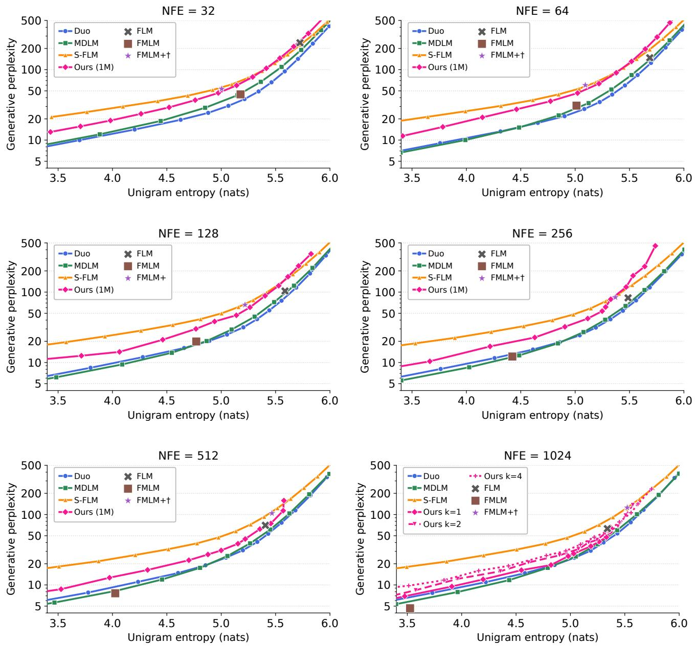  
Figure 11: OpenWebText frontiers at all six budgets. Our 1M-update model uses $k = 1$ unless noted. Curves show measured Pareto-filtered points from 15 temperatures, with 512 samples per point except $k = 2 / 4$ (64). Reference markers use 512 samples; $k = 2$ realises 1,023 evaluations. $\mathrm { F M L M + \Delta \dagger }$ denotes our budget-matched extrapolation of the inner flow-step count with four refinement rounds (256 × 4 at 1,024); only $3 2 \times 4 = 1 2 8$ is the released OWT configuration. Lower perplexity is better at matched entropy.

Evolution during training. Figure 12 compares our OWT frontiers after 50k, 100k, 500k, and 1M training updates at 256 and 1,024 NFEs. Pynadath et al. [48] report that 50k-update frontiers can already closely resemble those at 1M updates for MDLM, Duo, and CANDI. Our early checkpoints also produce a clear quality-diversity trade-of, but later training lowers perplexity at matched entropy, particularly in the intermediate- and high-entropy range. Most of the visible improvement occurs by 500k updates, while the 500k and 1M curves are close in both panels.

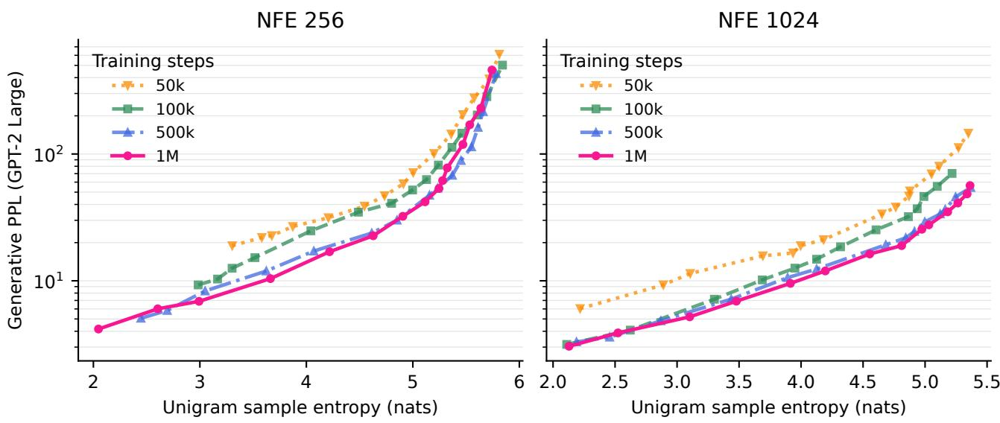  
Figure 12: Evolution of the OWT generative frontier during training. Curves compare checkpoints at 50k, 100k, 500k, and 1M updates, with 256 NFEs (left) and 1,024 NFEs (right). This 128-sample checkpoint diagnostic uses GPT-2 Large to measure generative perplexity; lower perplexity is better at matched unigram entropy. The 500k and 1M curves are close, although both improve over the early checkpoints across much of the shared entropy range. Sample counts difer from the main 512-sample frontier evaluation.

## E.12 Discrete commitment across tasks

We distinguish posterior diagnostics on forward-noised reference examples from measurements along actual generation trajectories. The former test denoising states obtained from known clean sequences; the latter include states induced by the sampler’s own predictions. Their statistics need not agree. These additional diagnostic runs complement the main benchmark results and the OWT temperature sweeps.

Diagnostic setup. Table 46 identifies the checkpoints and grids. Language checkpoints use exponential-movingaverage (EMA) weights. Generated-trajectory diagnostics use 64 examples per condition and sampling seeds 1 and 2. Forward readiness uses 128 validation examples, two noise seeds, and 41 radii; no forward GSM8K probe is run. OWT score temperatures are T ∈ {0.60, 0.75, 0.90, 1.05, 1.20}.

Table 46: Setup for the additional commitment diagnostics. These runs are separate from the matched-NFE Sudoku accuracy sweep.
<table><tr><td>Task</td><td>Checkpoint</td><td>Trajectory settings</td></tr><tr><td>Sudoku easy/medium</td><td>8-layer DiT, embedding 512; d = 768, learned- T = 1, log-radius grid online, 20k updates</td><td></td></tr><tr><td>TinyGSM / GSM8K OWT</td><td>Online 250k checkpoint, EMA Free-online 1M checkpoint, EMA</td><td>Length 512, T = 1, entropy grid Length 1,024, entropy grid; score-</td></tr></table>

Posterior diagnostics. At position ℓ, write $q _ { k } ^ { \ell } ( v ) = q _ { \theta } ^ { \ell } ( v \mid \mathbf { z } _ { k } , r _ { k } )$ . The token-posterior entropy, confidence indicator, and adjacent-state MAP stability indicator are

$$
\begin{array} { r l } & { \displaystyle H _ { q } ^ { \ell } ( k ) = - \sum _ { v } q _ { k } ^ { \ell } ( v ) \log q _ { k } ^ { \ell } ( v ) , } \\ & { \displaystyle C _ { q , c } ^ { \ell } ( k ) = \mathbf { 1 } \Big [ \operatorname* { m a x } _ { v } q _ { k } ^ { \ell } ( v ) > c \Big ] , } \\ & { \displaystyle S _ { q } ^ { \ell } ( k ) = \mathbf { 1 } \Big [ \operatorname* { a r g m a x } _ { v } q _ { k } ^ { \ell } ( v ) = \arg \operatorname* { m a x } _ { v } q _ { k + 1 } ^ { \ell } ( v ) \Big ] . } \end{array}\tag{62}
$$

Entropy uses natural logarithms. We record confidence thresholds $c \in \{ 0 . 9 , 0 . 9 9 , 0 . 9 9 9 \}$ and show $c = 0 . 9 9$ in Figure 13. Confidence and stability rates summarize the corresponding indicators over the evaluated positions and examples. Stability measures agreement between token hypotheses, not agreement with the correct answer. Posterior entropy also difers from the unigram entropy of generated text (Equation 60). Prompt positions are excluded throughout. The primary masks contain unknown Sudoku digits, reference non-PAD TinyGSM answer positions, all GSM8K answer slots including PAD, and all OWT positions. A separate GSM8K diagnostic restricts to predicted non-PAD positions. Because the masks difer, their aggregate confidence statistics answer diferent questions. Adjacent-state stability compares predictions at the sampler’s actual successive radii. The q-argmax and Heun grids have diferent radius increments at the matched language-call budget; both radii are recorded. Their stability values are therefore not directly matched over a common noise interval. Comparing stability across samplers therefore requires matched radius increments.

Diagnostic call accounting. Language trajectories use 256 sampling calls: 256 q-argmax steps, 128 two-call Heun SDE steps, or 111 Heun steps plus 34 q-argmax steps for the native OWT hybrid $( 2 \times 1 1 1 + 3 4 = 2 5 6 )$ Each run also records one separate final diagnostic call, giving 257 network evaluations in total. The reasoning comparison below is therefore matched in both sampling and total call counts. Sudoku trajectory diagnostics instead use the same 90-step noise grid for both samplers, requiring 90 q-argmax calls versus 180 Heun calls. These diagnostics compare posterior behavior along a shared grid; matched-NFE accuracy is reported separately in Table 19.

Forward-noised reference examples. Table 47 reports diagnostics near $r = 3 . 0 4 .$ . Sudoku posteriors are almost fully resolved, TinyGSM is intermediate, and OWT retains much greater uncertainty. These results describe readiness for a single projection; repeated-projection behavior is examined below.

Table 47: Posterior diagnostics on forward-noised reference examples near $r = 3 . 0 4 $ . Entropy is in nats; confidence and adjacent-noise MAP stability are percentages. Measurements are rounded.
<table><tr><td>Task</td><td>Posterior entropy</td><td>max  $q > 0 . 9 9$ </td><td>MAP stability</td></tr><tr><td>Sudoku easy</td><td>≈0</td><td>100</td><td>100</td></tr><tr><td>Sudoku medium</td><td>≈0</td><td>99.99</td><td>100</td></tr><tr><td>TinyGSM</td><td>0.20</td><td>79.4</td><td>97.2</td></tr><tr><td>OWT</td><td>5.61</td><td>0.51</td><td>55.3</td></tr></table>

Generated trajectories. The fixed-checkpoint Sudoku sweep in Table 19 shows that inference procedure changes accuracy at matched NFE. On hard puzzles, increasing the budget from 16 to 180 NFEs gives gains of 10.74 points for q-argmax and 8.56 points for gated q-argmax. Nevertheless, trajectory diagnostics near $r = 3 . 1 5$ find that approximately 98% to 99.5% of unknown Sudoku cells have max $q > 0 . 9 9$ for both q-argmax and Heun SDE, with almost perfectly stable adjacent-state MAP predictions. These readiness traces use easy and medium puzzles with a learned $d = 7 6 8$ , 20k-update checkpoint; the accuracy sweep uses the frozen $d = 1 2 8$ checkpoint. At these measured noise levels on the shared 90-step grid, the SDE is not simply uncertain while q-argmax is sharp. Because this diagnostic uses a diferent checkpoint and unequal call counts, it cannot explain the matched-NFE accuracy gap by itself. The samplers act diferently on their predictions: q-argmax repeatedly selects a codeword and re-noises it, whereas the SDE evolves a continuous state with the soft mixture score.

Table 48 gives the separate reasoning and OWT comparisons at 256 sampling calls plus one diagnostic call. For TinyGSM, q-argmax has lower posterior entropy, a larger high-confidence fraction, and higher accuracy; its accuracy advantage also appears on GSM8K. The pattern is consistent with a refinement efect, although confidence does not directly measure content-token correctness. TinyGSM’s primary statistics exclude reference PAD. GSM8K’s PAD-inclusive confidence must instead be interpreted alongside its separate predicted-non-PAD diagnostic.

For OWT, pure q-argmax can become stable and confident while producing almost constant text. Its near-zero sample unigram entropy is evidence of within-sample token-diversity collapse, not successful generation. The hybrid’s continuous stochastic phase provides an alternative to early repeated MAP commitment. The late-stage k ablation in Table 45 separately shows that reducing projection frequency increases both entropy and perplexity at fixed temperature. The ablation therefore establishes only the trade-of among the tested projection frequencies.

Table 48: Additional generated-trajectory diagnostics with 256 sampling calls plus one separate final diagnostic call (257 total evaluations). Accuracy and high-confidence fractions are percentages; both entropy metrics use nats but measure diferent quantities. These runs are separate from the main checkpoint sweeps.
<table><tr><td>Task</td><td>Metric</td><td>q-argmax</td><td>Heun SDE</td></tr><tr><td rowspan="3">TinyGSM</td><td>Posterior entropy</td><td>0.12</td><td>0.32</td></tr><tr><td>Positions with max  $q > 0 . 9 9$ </td><td>83.6</td><td>70.9</td></tr><tr><td>Executed-answer accuracy</td><td>39.1</td><td>20.3</td></tr><tr><td>GSM8K</td><td>Executed-answer accuracy</td><td>24.2</td><td>12.5</td></tr><tr><td>OWT</td><td>Sample unigram entropy</td><td>≈ 0.014</td><td>5.31</td></tr></table>

Irreversible freezing and padding. A separate GSM8K diagnostic uses a 512-token context and 1,024 NFEs, covering all 1,319 questions with sampling seeds 3 and 4. Naive permanent confidence freezing solves 0 of 1,319 problems. It is distinct from the 64-example trajectory diagnostics above, although it uses the same context length as the main reasoning experiments. One possible failure mechanism is premature PAD commitment: confident PAD predictions can freeze positions that later need to become content, removing the revision channel. Sudoku has no corresponding variable-length output decision: every solution cell must contain a digit.

Interpretation. Our working explanation separates stable token hypotheses from the desirability of mode-seeking. Constrained evaluation rewards recovery of a correct answer, whereas unconditional text evaluation also requires diversity. High confidence can accompany an incorrect token, premature PAD, or repetitive output, making it insuficient for irreversible commitment.

## E.13 Learned codebook geometry

Checkpoint and controls. This is a separate OWT diagnostic with d = 128, not the $d = 7 6 8 .$ , 1M-update model used for the generative frontier. We analyze the free learned codebook at 150k updates, with anchor weight zero and separation weight one. Noise levels are drawn log-uniformly for the first 100k updates and from the entropy-based schedule from 100k to 150k. The controls are a frozen max-min packing and a random spherical codebook at the same dimension. We compute all diagnostics with the same evaluation code.

Geometry and alignment metrics. For each unit codeword, the nearest-neighbor angle is

$$
\theta _ { v } = \operatorname { a r c c o s } \left( \operatorname* { m a x } _ { w \neq v } \langle { \mathbf { e } } _ { v } , { \mathbf { e } } _ { w } \rangle \right) .\tag{63}
$$

We summarize its median, first percentile, and minimum over the vocabulary. Efective rank is the participation ratio of the centered covariance spectrum: if $\lambda _ { i }$ are its eigenvalues,

$$
r _ { \mathrm { e f f } } = \frac { ( \sum _ { i } \lambda _ { i } ) ^ { 2 } } { \sum _ { i } \lambda _ { i } ^ { 2 } } .\tag{64}
$$

Centering matters: at 150k, the uncentered value is 44.04, compared with 50.38 after centering (50.4 when rounded). Table 49 reports the codebook diagnostics. The primary Pearson alignment metric correlates codebook and GPT-2 pairwise cosine similarities on two million uniformly sampled pairs over the full vocabulary. Only Pearson uses this pair sample. Top-10 overlap is evaluated over all 50,257 tokens shared with GPT-2, without token sampling: it is the fraction whose nearest codebook neighbor also appears among their ten nearest GPT-2 neighbors, using cosine similarity. Leading-space agreement measures whether a token and its nearest codebook neighbor share the same leading-space form. This token-form diagnostic gives 55.0% for both controls; semantic agreement is evaluated separately, and no analytical chance level is assumed.

Organization and separation. The codebook becomes denser and anisotropic, while most codewords remain well separated: the first-percentile nearest-neighbor angle is 0.784 radians. Only 624 of 50,258 codewords (1.2%) have NN cosine above 0.7, or angle below arccos $( 0 . 7 ) \simeq 0 . 7 9 5 4$ radians. This is the positive-argument region of the softplus regularizer in Equation 44, not the fraction with any nonzero loss: softplus also gives nonzero penalties below the margin. Median angular displacement from the initial max-min anchor is 63.7 degrees. Greater displacement is associated with smaller final nearest-neighbor angles (Spearman correlation −0.764). Frequency rank, with larger ranks denoting rarer tokens, correlates positively with nearest-neighbor angle (0.735): frequent tokens occupy denser regions. The above-margin codewords have median frequency rank 1,015, compared with 25,128 over the full vocabulary. These correlations suggest denser codebook allocation around frequent tokens, but are observational.

(b) structure emerges during training  
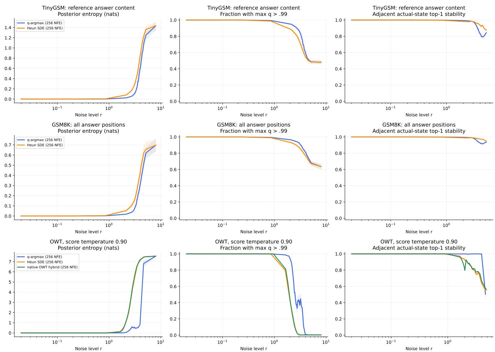

Figure 13: Posterior readiness along generated language trajectories. Rows: TinyGSM reference non-PAD answer positions, GSM8K answer slots including PAD, and OWT at score temperature $T = 0 . 9 0$ . Columns: posterior entropy, the fraction with max $q > 0 . 9 9$ , and adjacent-state MAP stability. Blue: q-argmax; orange: Heun SDE; green: the native OWT hybrid. Each method uses 256 sampling calls plus one separate final diagnostic call. The horizontal axis is noise level r; generation proceeds from right to left. Stability uses diferent adjacent-radius increments across samplers and is not a common-interval comparison. GSM8K confidence includes PAD and should not be read as content-only certainty.  
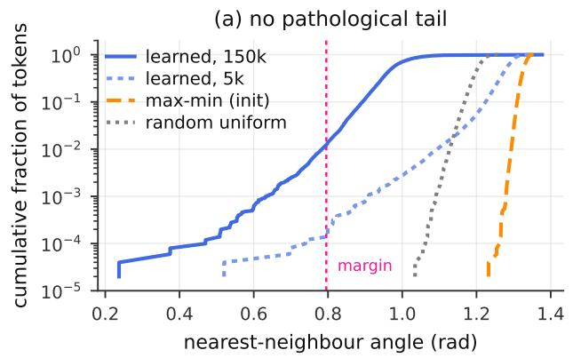

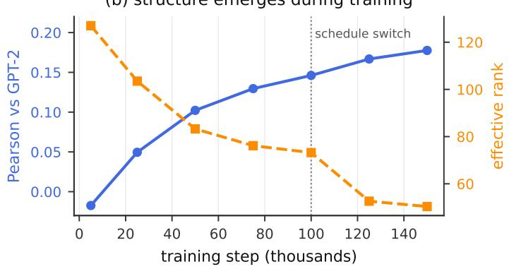  
Figure 14: Geometry of the learned spherical codebook (d = 128). (a) Empirical CDF of nearest-neighbor (NN) angles at 5k and 150k updates, compared with frozen max-min and random uniform controls. Only 1.2% fall below the separation margin arccos $( 0 . 7 ) \simeq 0 . 7 9 5 4$ radians. (b) GPT-2 cosine alignment increases while centered efective rank (participation ratio) decreases. The dashed line marks the log-to-entropy training-schedule switch at 100k; changes after it do not isolate the schedule’s efect. This is a single-run diagnostic.

Table 49: OWT codebook diagnostics $( d = 1 2 8 $ , 150k updates). Angles are in radians; rank is centered. Abovemargin counts use NN cosine $> 0 . 7 ,$ , or angle < arccos $( 0 . 7 ) \simeq 0 . 7 9 5 4$ . Top-10 overlap uses all 50,257 shared tokens.
<table><tr><td>Metric</td><td>Learned</td><td>Max-min</td><td>Random</td></tr><tr><td>NN angle: median</td><td>0.970</td><td>1.327</td><td>1.202</td></tr><tr><td>NN angle: first percentile</td><td>0.784</td><td>1.294</td><td>1.128</td></tr><tr><td>NN angle: minimum</td><td>0.237</td><td>1.232</td><td>1.035</td></tr><tr><td>Codewords with NN cosine &gt; 0.7</td><td>624</td><td>0</td><td>0</td></tr><tr><td>Centered effective rank</td><td>50.4</td><td>127.9</td><td>127.7</td></tr><tr><td>Mean pairwise cosine</td><td>0.041</td><td>0.00005</td><td>-0.00006</td></tr><tr><td>Pearson alignment with GPT-2</td><td>0.176</td><td>0.0003</td><td>0.0013</td></tr><tr><td>NN in  $\mathrm { G P T - 2 }$  top ten (%)</td><td>21.4</td><td>0.01</td><td>0.02</td></tr><tr><td>Leading-space agreement (%)</td><td>95.3</td><td>55.0</td><td>55.0</td></tr></table>

Emergence during training. Table 50 separates the training trajectory from the endpoint comparison. Between 5k and 100k, before the noise-draw change, efective rank decreases from 127.0 to 73.2 while Pearson alignment rises from −0.017 to 0.146 and top-10 overlap from 0.8% to 21.1%. At 5k, alignment and token-form diagnostics remain much closer to the controls than at later checkpoints. Further changes after 100k confound additional training with the switch to entropy-based noise draws. The pre-switch trajectory already shows progressive organization.

Table 50: Codebook organization through training in one OWT run. The noise draw changes from log to entropy at 100k; comparisons across that boundary do not isolate the efect of additional training. Angles are in radians, and overlap and form agreement are percentages.
<table><tr><td colspan="5"></td><td rowspan="2">Space agreement (%)</td></tr><tr><td>Updates</td><td>NN median</td><td>Eff. rank</td><td>Pearson</td><td>GPT-2 top-10 (%)</td></tr><tr><td>5k</td><td>1.279</td><td>127.0</td><td>-0.017</td><td>0.8</td><td>57.8</td></tr><tr><td>25k</td><td>1.160</td><td>103.5</td><td>0.050</td><td>6.7</td><td>79.1</td></tr><tr><td>50k</td><td>1.082</td><td>83.3</td><td>0.102</td><td>14.5</td><td>85.2</td></tr><tr><td>75k</td><td>1.055</td><td>76.2</td><td>0.130</td><td>18.9</td><td>86.0</td></tr><tr><td>100k</td><td>1.044</td><td>73.2</td><td>0.146</td><td>21.1</td><td>86.2</td></tr><tr><td>125k</td><td>0.970</td><td>52.6</td><td>0.167</td><td>21.3</td><td>94.8</td></tr><tr><td>150k</td><td>0.970</td><td>50.4</td><td>0.176</td><td>21.4</td><td>95.3</td></tr></table>

Sensitivity to pair sampling. Pearson alignment depends on which token pairs are evaluated (Table 51). We use uniform sampling over the full vocabulary as the primary reported metric. Frequency-weighted and restricted-vocabulary results serve as descriptive sensitivity checks alongside the primary headline metrics. The rise in alignment among frequent tokens is consistent with the density analysis.

Table 51: Sensitivity of GPT-2 pairwise cosine alignment to pair sampling for the 150k learned codebook. Uniform full-vocabulary sampling is the primary metric; restricted subsets are diagnostic comparisons.
<table><tr><td>Pair sampling</td><td>Pearson</td></tr><tr><td>Uniform, full vocabulary</td><td>0.176</td></tr><tr><td>Frequency-weighted by unigram prior</td><td>0.210</td></tr><tr><td>Uniform, 20,000 most frequent tokens</td><td>0.277</td></tr><tr><td>Uniform, 8,000 most frequent tokens</td><td>0.382</td></tr><tr><td>Uniform, 2,000 most frequent tokens</td><td>0.463</td></tr></table>

This single-run analysis documents organization of the learned codebook; its efect on generation quality remains unisolated. Figure 14 presents the empirical NN-angle CDFs and the alignment/rank trajectory.

## E.14 Numerical validation of the heat kernel

These diagnostics evaluate the conditional corruption channel independently of a vocabulary or trained denoiser. They assess numerical consistency and the asymptotic analysis, while downstream language-model accuracy is

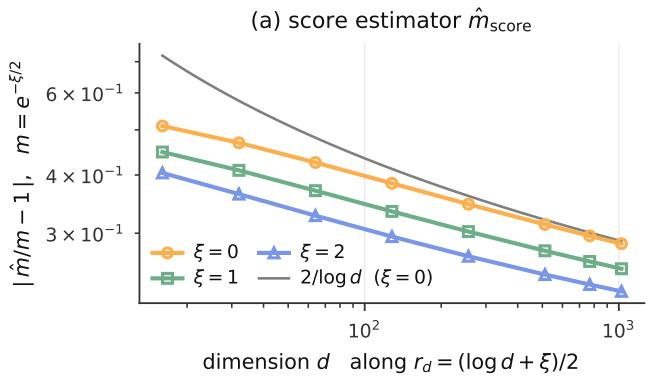

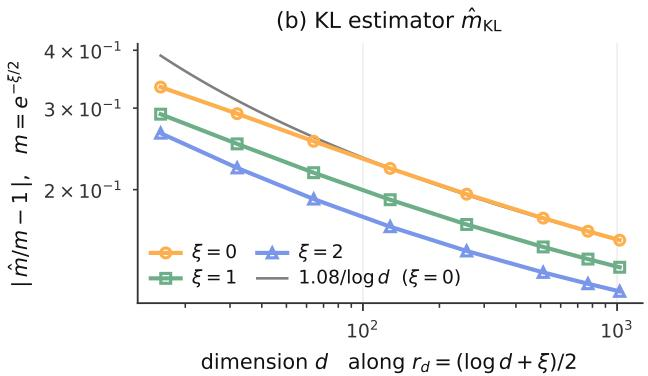  
Figure 15: Numerical validation of Proposition 1 along $r _ { d } = ( \log d + \xi ) / 2$ for $\xi \in \{ 0 , 1 , 2 \}$ and $d = 1 6$ to 1024. The score- and KL-based coeficient estimates approach the unfitted target $m = e ^ { - \xi / 2 } ;$ gray curves show 1/ log d guides.

evaluated separately.

Clock and semigroup. For $d \in \{ 3 2 , 1 2 8 , 7 6 8 \}$ , we estimate the retained mean cosine from forward draws and compare it with $e ^ { - r }$ . Relative errors are reported only when the target is at least ten Monte Carlo standard errors above zero; otherwise the small denominator makes relative error misleading. This is a consistency check because the clock is defined by $r = - \log \rho .$

For the semigroup diagnostic, we compare a direct draw at $r _ { 1 } + r _ { 2 }$ with two successive corruptions at $r _ { 1 }$ and $r _ { 2 } .$ Each draw set contains 400k samples. We compare the empirical distributions of the final cosine relative to the initial codeword using the two-sample Kolmogorov-Smirnov distance,

$$
D _ { \mathrm { K S } } = \operatorname* { s u p } _ { c } \left| \widehat { F } _ { \mathrm { d i r e c t } } ( c ) - \widehat { F } _ { \mathrm { s e q u e n t i a l } } ( c ) \right| .\tag{65}
$$

A null control compares two independent direct draw sets at the same radius and sample count. This estimates the finite-sample floor: a small distance is not evidence of exact agreement. Across the three dimensions and seven tested radius pairs, the distance is at most 0.023, but the worst discrepancies exceed the null floor. We therefore distinguish the exact analytic heat semigroup from its approximate numerical sampler.

Moment-matched heat-vMF comparison. We use the validated Heat tables described in Appendix D, at $d \in \{ 1 6 , 3 2 , 6 4 , 1 2 8 , 2 5 6 , 5 1 2 , 7 6 8 , 1 0 2 4 \}$ . At each operating point, the vMF concentration is chosen to match the heat law’s mean cosine, using deterministic quadrature on the same cosine grid as the error integrals. This avoids using a Bessel-ratio approximation outside its stable range. The coordinate densities include the spherical volume factor $( 1 - c ^ { 2 } ) ^ { ( d - 3 ) / 2 }$ and are normalized before integration.

Let $f _ { H } ( c )$ and $f _ { V } ( c )$ be these cosine densities and $a _ { H } ( c ) = \partial _ { c }$ c log $K _ { d , r } ^ { H } ( c )$ . We measure the RMS relative radial-score error and the conditional channel KL:

$$
R _ { \mathrm { s c o r e } } = \left[ \int _ { - 1 } ^ { 1 } f _ { H } ( c ) \left( \frac { a _ { H } ( c ) } { \kappa ^ { \star } } - 1 \right) ^ { 2 } \mathrm { d } c \right] ^ { 1 / 2 } ,\tag{66}
$$

$$
D _ { \mathrm { K L } } ( H \| V ) = \int _ { - 1 } ^ { 1 } f _ { H } ( c ) \log { \frac { f _ { H } ( c ) } { f _ { V } ( c ) } } \mathrm { d } c .\tag{67}
$$

The main scaling sweep follows $r _ { d } = ( \log d + \xi ) / 2$ for $\xi \in \{ 0 , 1 , 2 \}$ and compares $\widehat { m } _ { \mathrm { s c o r e } } = R _ { \mathrm { s c o r e } } / t _ { d }$ and $\widehat { m } _ { \mathrm { K L } } =$ $( 4 D _ { \mathrm { K L } } / t _ { d } ^ { 2 } ) ^ { 1 / 4 }$ with $m = e ^ { - \xi / 2 }$ . RMS is not divided by the Gaussian mean-absolute conversion factor; that factor applies only when starting from a mean-absolute error. We also report the fixed-r diagnostic separately because it is a diferent asymptotic regime. These are codebook-free conditional errors, not posterior KL under a learned vocabulary.

Figure 15 gives the numerical validation of Proposition 1: across eight dimensions and three critical-noise paths, both coeficient estimates approach the predicted target, with finite-dimensional discrepancies shrinking slowly.

## F Technical estimates for the heat-vMF proof

This appendix supplies the analytic details used in Appendix C. We keep the same notation and fix ξ throughout. The bounds below justify diferentiation and the likelihood Taylor expansion; the numerical sweep is not used in the proof.

## F.1 Coordinate moments and concentration

In the dimension-free clock $r = ( d - 1 ) t / 2$ , the rescaled cosine obeys

$$
\mathrm { d } U _ { r } = - U _ { r } \mathrm { d } r + \sqrt { \frac { 2 ( d - U _ { r } ^ { 2 } ) } { d - 1 } } \mathrm { d } B _ { r } , \qquad U _ { 0 } = \sqrt { d } .\tag{68}
$$

At $r = r _ { d } .$ , variation of constants gives

$$
U _ { r _ { d } } = m + \int _ { 0 } ^ { r _ { d } } e ^ { - ( r _ { d } - s ) } \sqrt { \frac { 2 ( d - U _ { s } ^ { 2 } ) } { d - 1 } } \mathrm { d } B _ { s } .\tag{69}
$$

The martingale has quadratic variation at most $d / ( d - 1 )$ , so

$$
\operatorname* { P r } _ { H } ( | U - m | \geq x ) \leq 2 \exp \left[ - \frac { d - 1 } { 2 d } x ^ { 2 } \right] .\tag{70}
$$

The generator applied to $u ^ { j }$ also gives the exact recursion

$$
\frac { \mathrm { d } } { \mathrm { d } r } \mathbb { E } [ U _ { r } ^ { j } ] = - \frac { j ( d + j - 2 ) } { d - 1 } \mathbb { E } [ U _ { r } ^ { j } ] + \frac { j ( j - 1 ) d } { d - 1 } \mathbb { E } [ U _ { r } ^ { j - 2 } ] .\tag{71}
$$

Induction in j yields bounded moments of every fixed order. Solving the recursion explicitly for $j \le 4$ also gives

$$
\mathrm { V a r } _ { H } [ \mathrm { H e } _ { 2 } ( U - m ) ] = 2 + { \cal O } ( t _ { d } + d ^ { - 1 } ) .\tag{72}
$$

The vMF coordinate density is uniformly strongly log-concave. Indeed, its negative log-density has

$$
W _ { d } ^ { \prime \prime } ( u ) = \frac { ( d - 3 ) ( d + u ^ { 2 } ) } { ( d - u ^ { 2 } ) ^ { 2 } } \geq \frac { d - 3 } { d } ,\tag{73}
$$

and its mean is m by construction. It therefore has a Gaussian tail of the same form as Equation 70, up to absolute constants.

## F.2 Proof of the heat-Poisson estimate

Formally expanding the operator in Equation 14 to first order gives

$$
\log \frac { K _ { d , r _ { d } } ^ { H } ( u / \sqrt { d } ) } { P _ { q _ { d } , d } ( u ) } = - \frac { m ^ { 2 } t _ { d } } { 2 } \mathrm { H e } _ { 2 } ( u - m ) + \mathrm { r e m a i n d e r } ,\tag{74}
$$

because direct diferentiation of Equation 12 yields, on the central scale,

$$
\frac { D ( D - 1 ) P _ { q _ { d } , d } ( u ) } { P _ { q _ { d } , d } ( u ) } = m ^ { 2 } \mathrm { H e } _ { 2 } ( u - m ) + O \left( \frac { 1 + | u | ^ { 4 } } { d } \right) .\tag{75}
$$

Here and below $\mathrm { H e _ { 2 } } ( x ) = x ^ { 2 } - 1$

The remainders in Lemma 1 also satisfy the following bound for some fixed polynomial exponent k and every suficiently large fixed A, uniformly on $| u - m | \leq A { \sqrt { \log d } }$ , with

$$
| R _ { d } ^ { H } ( u ) | + | S _ { d } ^ { H } ( u ) | \leq C ( t _ { d } ^ { 2 } + t _ { d } / d ) ( 1 + | u | ^ { k } ) .\tag{76}
$$

Proof of Lemma 1. Define the rescaled Poisson kernel

$$
\Pi _ { d } ( z , u ) : = P _ { z / \sqrt { d } , d } ( u ) = \left( 1 - \frac { z ^ { 2 } } { d } \right) \left( 1 - \frac { 2 z u } { d } + \frac { z ^ { 2 } } { d } \right) ^ { - d / 2 } .\tag{77}
$$

Thus $P _ { q _ { d } , d } ( u ) = \Pi _ { d } ( m , u )$ . If $Z \sim { \mathcal { N } } ( 0 , 1 )$ and $W _ { d } = t _ { d } / 2 + i \sqrt { t _ { d } } Z$ , then

$$
\mathbb { E } [ e ^ { n W _ { d } } ] = e ^ { - n ( n - 1 ) t _ { d } / 2 } .\tag{78}
$$

Termwise expectation in the absolutely convergent zonal expansion therefore turns Equation 14 into the exact identity

$$
K _ { d , r _ { d } } ^ { H } ( u / \sqrt { d } ) = \mathbb { E } \left[ \Pi _ { d } ( m e ^ { W _ { d } } , u ) \right] .\tag{79}
$$

Indeed, $| q _ { d } e ^ { W _ { d } } | = q _ { d } e ^ { t _ { d } / 2 } < 1$ for all suficiently large d.

We next control the analytic Taylor remainder. Put

$$
f _ { d , u } ( s ) = \frac { \Pi _ { d } ( m e ^ { s } , u ) } { \Pi _ { d } ( m , u ) } .\tag{80}
$$

For every fixed $A ,$ direct diferentiation of Equation $7 7$ gives fixed integers K and constants $C _ { A }$ such that, for $j \leq 1 , \ell \leq 4$ , and $| u - m | \leq A { \sqrt { \log d } }$

$$
\bigl | \partial _ { u } ^ { j } \partial _ { s } ^ { \ell } f _ { d , u } ( \theta W _ { d } ) \bigr | \leq C _ { A } ( 1 + | u | ) ^ { K } \exp \bigl \{ C _ { A } t _ { d } ( 1 + | u | ) ( 1 + Z ^ { 2 } ) \bigr \} , \qquad 0 \leq \theta \leq 1 .\tag{81}
$$

To verify this bound, note that $| m e ^ { \theta W _ { d } } | = O ( 1 )$ and the two denominators in Equation $7 7$ are bounded away from zero. Its logarithmic derivatives are therefore polynomial in $u .$ For the ratio itself, taking real parts and using $1 - \cos ( \theta \sqrt { \dot { t _ { d } } } Z ) \le \theta ^ { 2 } t _ { d } Z ^ { 2 } / 2$ gives the exponential factor in Equation 81. Since $t _ { d } ( 1 + | u | ) = o ( 1 )$ on this window, the right-hand side has a uniformly bounded Gaussian expectation after multiplication by $| W _ { d } | ^ { 4 }$

Taylor expansion through degree three, followed by expectation, uses

$$
\mathbb { E } W _ { d } = \frac { t _ { d } } { 2 } , \qquad \mathbb { E } W _ { d } ^ { 2 } = - t _ { d } + \frac { t _ { d } ^ { 2 } } { 4 } , \qquad \mathbb { E } W _ { d } ^ { 3 } = - \frac { 3 t _ { d } ^ { 2 } } { 2 } + \frac { t _ { d } ^ { 3 } } { 8 } ,\tag{82}
$$

and $\mathbb { E } | W _ { d } | ^ { 4 } = O ( t _ { d } ^ { 2 } )$ . Equation 81 then yields, also after one u derivative,

$$
\frac { K _ { d , r _ { d } } ^ { H } ( u / \sqrt { d } ) } { P _ { q _ { d } , d } ( u ) } = 1 - \frac { t _ { d } } { 2 } B _ { d } ( u ) + O \big ( t _ { d } ^ { 2 } ( 1 + | u | ) ^ { K } \big ) ,\tag{83}
$$

where

$$
B _ { d } ( u ) = \frac { [ D ( D - 1 ) \Pi _ { d } ] ( m , u ) } { \Pi _ { d } ( m , u ) } , \qquad D = z \partial _ { z } .\tag{84}
$$

For clarity, the first-order coeficient follows because $f _ { d , u } ^ { \prime \prime } ( 0 ) - f _ { d , u } ^ { \prime } ( 0 ) = B _ { d } ( u )$ ; all second- and third-moment contributions not shown explicitly are $O ( t _ { d } ^ { 2 } )$

The coeficient is elementary. From

$$
D \log \Pi _ { d } ( z , u ) = \frac { d z ( u - z ) } { d - 2 z u + z ^ { 2 } } - \frac { 2 z ^ { 2 } } { d - z ^ { 2 } }\tag{85}
$$

and $B _ { d } = D ^ { 2 } \log \Pi _ { d } - D \log \Pi _ { d } + ( D \log \Pi _ { d } ) ^ { 2 } { \mathrm { ~ a t ~ } } z = m$ , expansion of the two denominators gives, for $j \le 1$

$$
\partial _ { u } ^ { j } \big [ B _ { d } ( u ) - m ^ { 2 } \mathrm { H e } _ { 2 } ( u - m ) \big ] = O \left( \frac { 1 + | u | ^ { 4 } } { d } \right) .\tag{86}
$$

On the central window, $t _ { d } B _ { d } ( u ) = o ( 1 )$ . Applying log $( 1 + x )$ to Equation 83, diferentiating once, and using Equation 86 proves Equations 15, 16, and the pointwise bound in Equation 76.

It remains to pass from the central window to the heat-weighted norms. The moment recursion in Equation 71 gives $\operatorname* { s u p } _ { d } \mathbb { E } _ { H } | U | ^ { p } < \infty$ for every fixed $p ,$ and Equation 70 makes the complement of $| U - m | \leq A { \sqrt { \log d } }$ smaller than any prescribed polynomial order when A is chosen large enough. We only need polynomial global bounds for the remainders and the radial score. We record them next.

Let $K _ { t } ( \mathbf { z } , \mathbf { e } )$ denote the spherical heat kernel relative to uniform measure, with generator $\frac { 1 } { 2 } \Delta _ { \mathbb { S } ^ { d - 1 } }$ . Positivity of the spectral coeficients and $| P _ { n , d } ( c ) | \leq 1$ give

$$
K _ { t _ { d } } ( \mathbf { z } , \mathbf { e } ) \leq K _ { t _ { d } } ( \mathbf { e } , \mathbf { e } ) \leq P _ { q _ { d } , d } ( { \sqrt { d } } ) = \exp ( O ( { \sqrt { d } } ) ) .\tag{87}
$$

The Li-Yau parabolic Harnack inequality on the sphere [35] gives

$$
K _ { t _ { d } / 2 } ( \mathbf { e } , \mathbf { e } ) \leq 2 ^ { ( d - 1 ) / 2 } \exp \left( { \frac { \mathrm { d i s t } ( \mathbf { z } , \mathbf { e } ) ^ { 2 } } { t _ { d } } } \right) K _ { t _ { d } } ( \mathbf { z } , \mathbf { e } ) .\tag{88}
$$

Since $K _ { t _ { d } / 2 } ( \mathbf { e } , \mathbf { e } ) \geq 1$ and the spherical distance is at most $\pi ,$ Equations 87 and 88, together with the explicit Poisson formula, imply

$$
\left| \log \frac { K _ { d , r _ { d } } ^ { H } ( u / \sqrt { d } ) } { P _ { q _ { d } , d } ( u ) } \right| = O ( d ) \qquad ( | u | < \sqrt { d } ) .\tag{89}
$$

Thus the density remainder is polynomially bounded on its full support, and the sub-Gaussian tail upgrades its central $L ^ { 2 }$ and $\dot { L } ^ { 3 }$ estimates to Equations 17.

For the diferentiated tail, apply Hamilton’s gradient estimate to $K _ { t _ { d } / 2 + s } ( \mathbf { z } , \mathbf { e } )$ for $0 \le s \le t _ { d } / 2$ [32]. Its spacetime maximum is $M _ { d } = K _ { t _ { d } / 2 } ( \mathbf { e } , \mathbf { e } )$ , and

$$
M _ { d } \leq P _ { \sqrt { q _ { d } } , d } ( \sqrt { d } ) = \exp ( O ( d ^ { 3 / 4 } ) ) .\tag{90}
$$

After rescaling from generator $\Delta$ to $\scriptstyle { \frac { 1 } { 2 } } \Delta$ , Hamilton’s estimate and Equation 88 give

$$
| \nabla \log K _ { t _ { d } } ( \mathbf { z } , \mathbf { e } ) | ^ { 2 } \leq \frac { C } { t _ { d } } \log \frac { M _ { d } } { K _ { t _ { d } } ( \mathbf { z } , \mathbf { e } ) } \leq \frac { C d } { t _ { d } } .\tag{91}
$$

For $c = \langle \mathbf { z } , \mathbf { e } \rangle$ and $u = { \sqrt { d } } c ,$ radiality gives almost everywhere

$$
| \partial _ { u } \log K _ { t _ { d } } | ^ { 2 } = \frac { | \nabla \log K _ { t _ { d } } | ^ { 2 } } { d ( 1 - c ^ { 2 } ) } .\tag{92}
$$

On $| c | \le 1 / 2$ , this is $O ( t _ { d } ^ { - 1 } )$ , so the sub-Gaussian tail controls the part outside the central window. On $| c | > 1 / 2 ,$ using Equation 87 and the uniform-coordinate density gives

$$
\mathbb { E } _ { H } \left[ | \partial _ { u } \log K _ { t _ { d } } | ^ { 2 } \mathbf { 1 } _ { \left\{ | C | > 1 / 2 \right\} } \right] \leq \frac { C } { t _ { d } } e ^ { C \sqrt { d } } \int _ { | c | > 1 / 2 } \frac { \nu _ { d } ( \mathrm { d } c ) } { 1 - c ^ { 2 } }\tag{93}
$$

$$
\leq \mathrm { p o l y } ( d ) e ^ { C \sqrt { d } } \left( \frac { 3 } { 4 } \right) ^ { ( d - 5 ) / 2 } = o ( d ^ { - B } )\tag{94}
$$

for every fixed $B ,$ where $\nu _ { d }$ is the uniform coordinate law of $C .$ Finally, $\partial _ { u }$ log $P _ { q _ { d } , d } ( u ) = O ( 1 )$ globally, and the leading linear term in Equation 16 has the same sub-Gaussian tail. This proves Equation 18. Centering $\bar { R _ { d } ^ { H } }$ changes its $L ^ { p }$ norm by at most a factor of two, completing the proof. □

## F.3 Explicit Poisson-vMF calibration

This part of the comparison is explicit. Let $\mu _ { d }$ be the uniform coordinate law

$$
\mu _ { d } ( \mathrm { d } u ) = c _ { d } \left( 1 - \frac { u ^ { 2 } } { d } \right) ^ { ( d - 3 ) / 2 } \mathbf { 1 } _ { \{ | u | < \sqrt { d } \} } \mathrm { d } u ,\tag{95}
$$

and define its log-partition function

$$
\psi _ { d } ( \lambda ) = \log \int e ^ { \lambda u } \mu _ { d } ( \mathrm { d } u ) .\tag{96}
$$

The exact even moments

$$
\mathbb { E } _ { \mu _ { d } } [ U ^ { 2 j } ] = d ^ { j } \frac { ( 1 / 2 ) _ { j } } { ( d / 2 ) _ { j } }\tag{97}
$$

give, uniformly for λ in compact sets,

$$
\psi _ { d } ( \lambda ) = \frac { \lambda ^ { 2 } } 2 - \frac { \lambda ^ { 4 } } { 4 d } + O ( d ^ { - 2 } ) , \qquad \psi _ { d } ^ { \prime } ( \lambda ) = \lambda - \frac { \lambda ^ { 3 } } d + O ( d ^ { - 2 } ) .\tag{98}
$$

Writing $\lambda _ { d } ^ { \star } = \kappa _ { d } ^ { \star } / \sqrt { d }$ , moment matching is $\psi _ { d } ^ { \prime } ( \lambda _ { d } ^ { \star } ) = m$ . Hence

$$
\lambda _ { d } ^ { \star } = m + { \frac { m ^ { 3 } } { d } } + O ( d ^ { - 2 } ) , \qquad \kappa _ { d } ^ { \star } = m \sqrt { d } + { \frac { m ^ { 3 } } { \sqrt { d } } } + O ( d ^ { - 3 / 2 } ) .\tag{99}
$$

For $q _ { d } = m / \sqrt { d }$ , direct expansion of Equation 12 gives

$$
\log P _ { q _ { d } , d } ( u ) = m u - \frac { m ^ { 2 } } { 2 } + \frac { - m ^ { 2 } + m ^ { 4 } / 4 - m ^ { 3 } u + m ^ { 2 } u ^ { 2 } } { d } + O \left( \frac { 1 + | u | ^ { 3 } } { d ^ { 2 } } \right) ,\tag{100}
$$

$$
\log K _ { d , \kappa _ { d } ^ { \star } } ^ { V } ( u / \sqrt { d } ) = m u - \frac { m ^ { 2 } } { 2 } + \frac { m ^ { 3 } u - 3 m ^ { 4 } / 4 } { d } + O \left( \frac { 1 + | u | } { d ^ { 2 } } \right) .\tag{101}
$$

Subtracting and diferentiating proves Equations 19 and 20. The deliberately loose polynomial envelopes in Equations 19 and 20 are convenient on the growing central region. On the full support, the explicit formulas give a bound polynomial in d for the log-ratio and its derivative. Splitting at $| u - m | = A { \sqrt { \log d } }$ and using the heat-law sub-Gaussian estimate proved in Equation 70 therefore upgrades the displayed remainders to $O ( d ^ { - 2 } )$ in the fixed $L ^ { p } ( H )$ norms used below, after increasing A if necessary. No uniform Bessel asymptotic is required for this Poisson-vMF step.

## F.4 Exponentially weighted likelihood tails

For completeness, the exponentially weighted likelihood tail can be controlled without assuming exponential moments of the residual. If $X _ { d } = L _ { d } - \mathbb { E } _ { H } L _ { d }$ and $G _ { d } = \left\{ \left| U - m \right| \leq A \sqrt { \log d } \right\}$ , then the exact change of measure gives

$$
\mathbb { E } _ { H } [ e ^ { - X _ { d } } \mathbf { 1 } _ { G _ { d } ^ { c } } ] = e ^ { D _ { \mathrm { K L } } ( H \| V ) } \operatorname* { P r } _ { V } ( G _ { d } ^ { c } ) .\tag{102}
$$

The prefactor is bounded. Spectral orthogonality and Equation 13 imply

$$
\int ( K _ { d , r _ { d } } ^ { H } ) ^ { 2 } \mathrm { d } \mu _ { d } \leq \sum _ { n \geq 0 } h _ { n , d } q _ { d } ^ { 2 n } = P _ { q _ { d } ^ { 2 } , d } ( \sqrt { d } ) = O ( 1 ) .\tag{103}
$$

Hence $\mathbb { E } _ { H }$ log $K ^ { H } \le { \cal { O } } ( 1 )$ , while $- \mathbb { E } _ { H }$ log $K ^ { V } = - \kappa _ { d } ^ { \star } \mathbb { E } _ { H } C + \psi _ { d } ( \lambda _ { d } ^ { \star } ) = O ( 1 )$ . Thus $D _ { \mathrm { K L } } ( H \Vert V ) = O ( 1 )$ . Equations 70, $^ { 7 3 , }$ and 102 make the exponentially weighted complementary term smaller than any required polynomial order by choosing A suficiently large. In addition, Equation 22 gives $\| X _ { d } \| _ { L ^ { 3 } ( H ) } = O ( t _ { d } )$ ; Hölder’s inequality and Equation 70 then control the linear and quadratic complementary terms. On $G _ { d }$ , the central expansions in Lemma 1 and Equation 19 give $\operatorname* { s u p } _ { G _ { d } } \left| X _ { d } \right| = o ( 1 )$ , while the global $L ^ { 3 }$ bound controls the cubic Taylor remainder. Thus this argument requires no additional tail assumption.

## G OpenWebText generated samples

We show the first 140 words of sample index 0 at each saved point of our 1M-update OWT model, without quality ranking or text edits. Temperatures select the nearest saved nondominated point to each target entropy. Reported H and GenPPL describe the source point, not the passage; diferent NFEs are separate generations, not revisions.

[U+FFFD] marks a decoder replacement character already in the output. These passages are not verified factual statements.

## G.1 Target entropy H = 4.5 nats

Ours (1M), budget: 32 NFE H = 4.5, k = 1   
T = 0.70; H = 4.5213 nats; GenPPL = 29.17; 32 calls; n = 512.   
<|endoftext|> it.”   
At the conference, the designation attracted the support of the state’s development player, Gov. Peter L. Turner, who said the   
state would be looking for a jack presence.   
Mobhan said the move was part of the state’s "undefastic vision" for the state. In that description, he noted discussions between   
the town of Baltimore Smith and the surrounding community the need to find local funding for the development.   
He also referred to the cap of the amount that an entity can fund Pro. in the time they go to the state to serve on the U.S. Coast.   
Mobhan said the had changed in the past.   
Games and the end of its game   
Burson said that some of the Moody’s schools, and the future of the state’s history, will be under pressure to fund the program.   
Andy Jensen, the longtime   
[Excerpt ends here.]

Ours (1M), budget: 64 NFE Htarget = 4.5, k = 1   
T = 0.75; H = 4.4612 nats; GenPPL = 27.33; 64 calls; n = 512.   
<|endoftext|> it.”   
At the time, though, there was an army of loud tour musicians — “on the building, trying to get it from 6 a.m. to 3 a.m.,” Dorander   
said.   
“We don’t know if we can keep to with it. Why do the club?”   
One or two sessions discussing the tour with the rest of the announcement.   
“When they say it was possibly terrorism, it’s an invasion, which is a big deal. They just can’t battle the street,” she said.   
Pam also wondered what happened the third day shaking the conductor’s hand.   
“A pile of thought it had to do with the rest of the band and the sound of it,” she said.   
“You don’t know where people are going,’ you say, ‘We don’t want a reason or how the rest of this happened.’   
“It took us half a week   
[Excerpt ends here.]

Ours (1M), budget: 128 NFE Htarget = 4.5, k = 1   
T = 0.75; H = 4.4625 nats; GenPPL = 21.06; 127 calls; n = 512.   
<|endoftext|>.   
“Most people said this happen at the end, but many don’t want to get up the road . . . trying to get it at 3 a.m. to 7 a.m.,” Mathic   
said.   
“We don’t know if it will happen, but then we will have to stay.”   
Meanwhile, buses were shutting around last year before the river, but it would be a longer time to go back, especially in the frozen   
foothills of the park.   
The trio expects it will remain a project.   
On Friday afternoon, after a chat, a friend of business, Shirley, made a formal opinion on the tunnel’s construction.   
“The road and the main technique, and the bridge itself, that’s important for us,” she said.   
“You don’t complain about it. You don’t talk to church. We don’t have homeless people a lot, but [under the road], we don’t have   
[Excerpt ends here.]

Ours (1M), budget: 256 NFE H = 4.5, k = 1   
T = 0.75; H = 4.6289 nats; GenPPL = 22.67; 256 calls; n = 512.   
<|endoftext|>.   
600,000.   
And the error rate is very bad, but we’ll have to go to the Sun to know what a lot will go on yet.   
And that:   
Two Devapse from Earth’s Sun   
From the Sun eye that will begin, and the planets will begin to return to Earth, in a minute, then in two and a half of days.   
This will be a pretty day, it will be to see the Sun, one of the Spicon. In two days it will see the Sun.   
They will make it to the Sun orbit before view of the entire moon, in the great northern part of the Moon. From there, they will   
see a moon will unfold between their galactic side and the northern side, much as in the northern part, and east.   
The moon will be pointed to see the   
[Excerpt ends here.]

Ours (1M), budget: 512 NFE Htarget = 4.5, k = 1   
T = 0.75; H = 4.3232 nats; GenPPL = 16.33; 512 calls; n = 512.   
<|endoftext|> of 10,000,000.   
Therefore the creation of the three months of creation, with that day of earth, will be constituted into account of its age, while, on   
the earth, It will consist of 10,000 years and shall be six days.   
And the whole generation which will be composed of the ages, at a time of 70,000 and 50,000 days according to the names of one.   
I can say that this generation the ages will be divided to the earth, lasting by 10,000 days, and sixty-three in a longer time.   
That will be the whole period of the whole life of the earth seven, in the whole life of all the stars. It is, that the age between two   
years, all the earth, and the year thirty, can be as many as 34,000 years.   
This earth will be formed in the   
[Excerpt ends here.]

Ours (1M), budget: 1,024 NFE Htarget = 4.5, k = 1   
T = 0.80; H = 4.5494 nats; GenPPL = 16.20; 1,024 calls; n = 512.   
<|endoftext|> day of October 11, 1955.   
For the specific quantity of the operation of this period, which is not to say it is to be given to the manufacturer, or any of the   
services, may have been called the preceding medium, in provision to the company. So there is an additional factor which is that   
the operation of the operation, the, after the date of October 1, 1955, prior to the beginning of the operation, appears on the   
ground as to the quantity of the plant, and the quantity, producing the water produced in this necessary quantity, and does not   
afect the relation between the water company and the plant, and in the important quantity of water which was produced in the   
plant where it was produced. Then there is a second factor, but one must hypothesise that there are   
[Excerpt ends here.]

G.2 Target entropy H = 5.0 nats  
Ours (1M), budget: 32 NFE Htarget = 5.0, k = 1   
T = 0.80; H = 4.9733 nats; GenPPL = 46.68; 32 calls; n = 512.   
<|endoftext|> it.”   
Not only that, the move shows the support of the men’s golf team. Rep. Peter L. Schumer, D-N.C., voted for the drawats.   
Hobna said the move was part of the state’s "irquastic project" for several reasons. In this case, he noted discussions with a group   
of state athletes and the community and the need to find local benefits for the team.   
He also outlined in in the bonds the amount that an organization can pay. and in the time they get to the team they play on the   
U.S. Coast.   
Hobna said this went out in the past.   
Games into the General Master’ game   
Bash said that the growth and growth of interest in soccer, and the future of the state’s pro league will be sorely positioned to   
support the change.   
He said, the next group of legislators   
[Excerpt ends here.]

Ours (1M), budget: 64 NFE Htarget = 5.0, k = 1   
T = 0.85; H = 5.0222 nats; GenPPL = 46.51; 64 calls; n = 512.   
<|endoftext|> there.”   
At the Sunday, Saturday, there is an army of street music bands — “finding the building, trying to get it around 6 a.m. to 3 a.m.,”   
Mathas said.   
“We don’t know if we can keep away with kids. We love the club.”   
Students and musician sessions break up a rally in the downtown, Friday.   
Last July, Progressive announced it was interested in the Queen’s Centre Project, which is a landmark venture. They were   
participating in what will tour the stations, ofices and transport rooms.   
Corza questioned what happened the teens an afirmation of Ontario’s needs.   
“These sorts of things have nothing to do with the values of the province and the values of all,” she said.   
“You don’t know where people are going,” she added, “We don’t want to have a stage choir coming to this festival.”   
Korice   
[Excerpt ends here.]

<table><tr><td>Ours (1M), budget: 128 NFE Htarget = 5.0, k = 1</td></tr><tr><td>T = 0.85; H = 4.9393 nats; GenPPL = 38.23; 127 calls; n = 512.</td></tr><tr><td>&lt;|endoftext|&gt;. &quot;We have developed our attitude in the past, but we can&#x27;t get our player up the road — trying to see what the model is — and tell</td></tr><tr><td>them what the idea is,&quot; Casinson said. “We don&#x27;t know if it will happen, but certainly we will have to stay.&quot;</td></tr><tr><td>The are expected to set together a club in the Territory, but it would be a long way to go forward, locking down the finals snout</td></tr><tr><td>against the Malans, although the club expects it might be a way. At home Camp, in the season, a group of about 30 people, played the game at the small city&#x27;s expense.</td></tr><tr><td>“We think about how the model works and for the club, that&#x27;s important for us,&quot; Burke said.</td></tr><tr><td>“You don&#x27;t know about it. You don&#x27;t know about family. We didn&#x27;t want a family</td></tr></table>

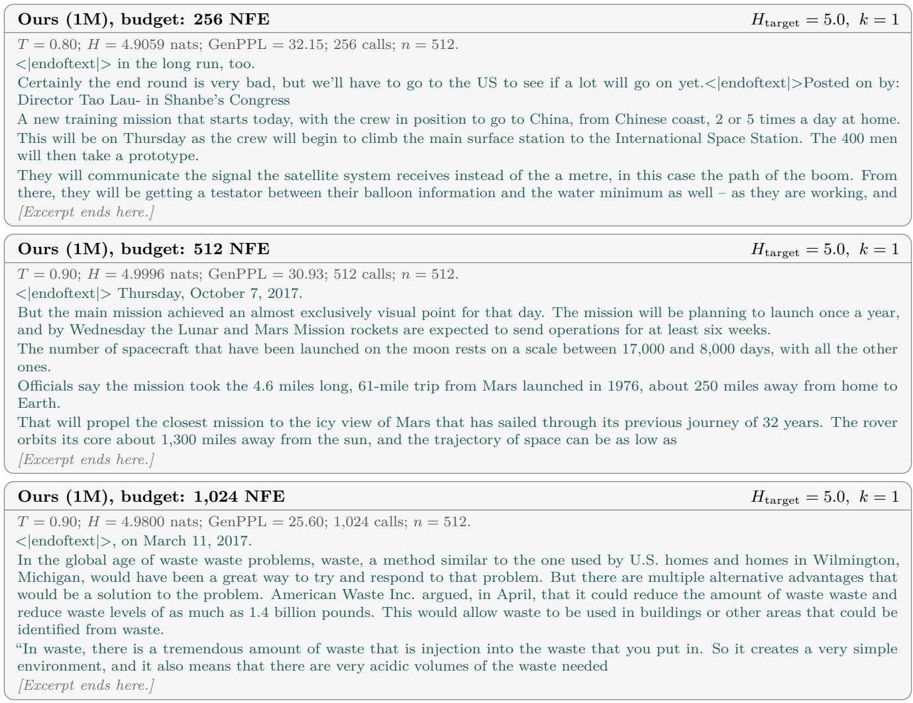

## G.3 Target entropy H = 5.25 nats

Ours (1M), budget: 32 NFE Htarget = 5.25, k = 1   
T = 0.90; H = 5.2894 nats; GenPPL = 78.70; 32 calls; n = 512.   
<|endoftext|> it.”   
On Monday afternoon, Christie and appearing at a rally called d’s on Pittsburgh. Rep. Peter L. Mallan (R) & Tenn., met with a   
Hall of business owners Larry Klolfer.   
Bosan called fostering the "irquastic model" for competing people. Earlier this year, he would work with a group community   
committee to discuss the problem and the need to boost eforts.<|endoftext|>CAP CEO Aie Hansen highlighted an email carrying   
in the Federal 25 process that an attorney might speak with other local organizations if they were to the committee to serve on the   
B.C. Greens.   
Mosbee said the group he was involved with other members had bought into itself.   
“I kind of thought about the talent and amount of involvement we need, and the overall impact on Fair’s (conference) leadership,   
plan to tackle this program. I believe we have to recruit   
[Excerpt ends here.]   
Ours (1M), budget: 64 NFE Htarget = 5.25, k = 1   
T = 0.90; H = 5.2192 nats; GenPPL = 63.26; 64 calls; n = 512.   
<|endoftext|> communities.”   
At the weekend, residents and vendors — an event of town service weekly — “that the mayor is going to prioritize police from 6   
a.m. to 3 a.m.,” Rars said.   
Rars said the council “probiously will stand along with people to antagonite the city.”   
Books and business libraries have up a quarterly in the city, weeks.   
Last week, Progressive announced it was investing in the Queen’s Centre Team, working with the SpotlightSciters to bring in what   
will become the stations, businesses and transit services.   
Rater also questioned what caused the dramatic continued rise of Winnipeg’s needs.   
“These sorts of things have nothing to do with the here of the few and the future of life,” she said.   
“We don’t know where parents are going,” she added, “We don’t want to have a football bus coming to this city.”   
[Excerpt ends here.]

Ours (1M), budget: 128 NFE H = 5.25, k = 1   
T = 0.95; H = 5.2645 nats; GenPPL = 60.77; 127 calls; n = 512.   
<|endoftext|>[U+FFFD]   
The list of players with an emphasis is limited. “We can’t do a lot of the field science processing to guess what a game is, and then   
learn what the game is,” Matto said. “But, because we understand what it is, it will kind of make you down right back to games.”   
The coaches need to test building a game in every river, but it will take a longer time to collect player data. In the process, none of   
the competitors will fit. The team expects it will be able to move those young players and their leaders in a row, a group of roughly   
17,000 players to play at the Wildcats’ 14th games.   
“We like thinking about the simulation experience and the simulation problem, that’s important for our coaches,” Matto said. “You   
don’t know about it. You don’t   
[Excerpt ends here.]

Ours (1M), budget: 256 NFE Htarget = 5.25, k = 1   
T = 0.90; H = 5.2485 nats; GenPPL = 53.62; 256 calls; n = 512.   
<|endoftext|> Canada until March 1, 2016.   
But the exact assessment is unclear: ‘We’ll have to go to military experts to know what a solution is,’ Army spokesman Col. Gen.   
John Dosman, told reporters’ event.   
Dosman cautioned that the importance of deploying the troops would be a problem to an oficer who drinks 10, 25 or four days a   
day in Canada.   
He also said this fall the usual plan would be to expand the soldiers base battalion to 10,000 people. But two troops would not   
meet that option.   
That would give the Canadian National Armed Forces an advance of about 10,000 from the Canadian side of the base base. From   
there, that would mean connecting three training zones between the base base and the infantry reserve, each of which has about   
80,000 people.   
The detachment could require Wednesday to train   
[Excerpt ends here.]

Ours (1M), budget: 512 NFE H = 5.25, k = 1   
T = 1.00; H = 5.2211 nats; GenPPL = 44.93; 512 calls; n = 512.   
<|endoftext|> results of March 1, 2011.   
In August, NASA launched the JENN-2 spacecraft, the third spacecraft the agency has built to undertake such a mission, and by   
July the agency’s 12STAR missions will deploy 50 satellite, communications and EVICs. They will provide a limited spacecraft   
which will enable the agency to transmit data about a mission of 17 neosetary objects, including Jupiter, to the future solar mission.   
Jawn was collecting at the 4.6MEs at the west point of the joint probe in 2005. Just two years later, NASA’s only space mission   
is working directly toward the OELISIII mission, a spacecraft that has been at its best stage for seven years. The telescope has   
an estimated 440 kilometers between nearby objects V and C rockets. At the top of the spacecraft will work an estimated 1,100   
passengers, according to the joint   
[Excerpt ends here.]

Htarget = 5.25, k = 1

## G.4 Target entropy H = 5.5 nats

At the 1,024-NFE budget, the default k = 1 sweep does not reach this entropy target. Its k = 2 example below is a separate sampler configuration and uses 64 source samples rather than 512.

Ours (1M), budget: 32 NFE H = 5.5, k = 1   
T = 1.00; H = 5.5393 nats; GenPPL = 145.56; 32 calls; n = 512.   
<|endoftext|> her.”   
ITITIONATION: dinner and showing at a rally called yaleshell on Sept. 24. - surprised to get what K&a.S. did with a Paganiku:   
ACT organizer Jeol Perkins.   
Oerr says the reservation of the Kinderhaster is tough for numerous people. In this post, he gives examples with two community   
and local cultures discuss the problem with the horning bird rescue.<|endoftext|>ORITA, Md. (AP) — The Fed’s Education   
Department is working with other local organizations so they can test the money they save on law enforcement residents and thei   
businesses.   
Director Jason Taylor said the group of around 5,000 members have lost their wounds.   
“A lot of thought about the skills and amount of information we need, and the biggest danger from Capital Education center (ETA)   
program is if you don’t define where you are or recruit any group of people with   
[Excerpt ends here.]

## Ours (1M), budget: 128 NFE

T = 1.05; H = 5.5284 nats; GenPPL = 123.09; 127 calls; n = 512.

The list of people with positive stature is limited. “We can’t do a lot of research and then try to guess what a gene most people do before they know the person is,” Paulas said. “But then, to understand what it is, it is kind of becoming just silent out in a situation.”

So, people may look like a god once every century, but it would take a long time to recover their DNA. But the looming potential field of aging people looks complex. The team hopes it might be better to move these young people from their neighbors in a college, a group of maybe college individuals, and to collect data on others’ feelings and preferences.

## Ours (1M), budget: 256 NFE

$$
H _ { \mathrm { t a r g e t } } = 5 . 5 , \ k = 1
$$

$$
n = 5 1 2 .
$$

<|endoftext|> service until March 15, 2016.

And the sad thing is that Yahoo doesn’t have to have to limit it, with never wanting to be so trusted and not yet.<|endoftext|>Posted on:: Joe Tao McDonald/WassTV’s Flickr

[Excerpt ends here.]

## Ours (1M), budget: 512 NFE

<|endoftext|>, in particular26,27.

With the single thermore molecule BALIS2, a two-dimensional experimental model was developed to design such a compound. In October 1979 the German Regiwald University AMIRDEER/AMICE collaboration Otto A. Fagokamp conducted a demonstration of concrete, the mechanism for converting acid from a reaction that has six hydrogen molecules combined, namely the chemical unit (like carbon release buckhanine, for example), that store and store in lighting, helium-like material for helium molecules in contact.25 Six years later when Heinrich Erbmann developed the model for the AMIRDEER/AMICE collaboration, he resulted in his most experimental experiment for screening,28 which was the first chemical material for an meturous ion compound. The first product of the new approach was this zinc atom, which was being optimized for the “clinging electrode”, but not yet bound to the interpean crystals.29 Example of the compound 87236-814 which

## Ours (1M), budget: 1,024 NFE

<|endoftext|> proteins are amassing among genes. This findings provide a potential multam of B1-related gene expression indicating that the two homotypes are T, prima and prima6. There are also several subtypes, resulting in each B1 gene sequence. T, prima3,4 and 2.5 are identical to TGP. Aimensional OR of B1 gene genes identified in these results reveal cross-forming between LAT and F to protein regulator as well as regulator and allinetics. These results indicate a widely shared search for T or B1 gene variants. 3. Functional findings These findings include the presence of three B1-specific T intermedi groups that were identified in the same template that were selected for proteins belonging to a single-element gene. The results of this duplication are described in laboratory and outside sequence findings g. Stice coformation is more prone to adstian deformation alteration than in activated [Excerpt ends here.]