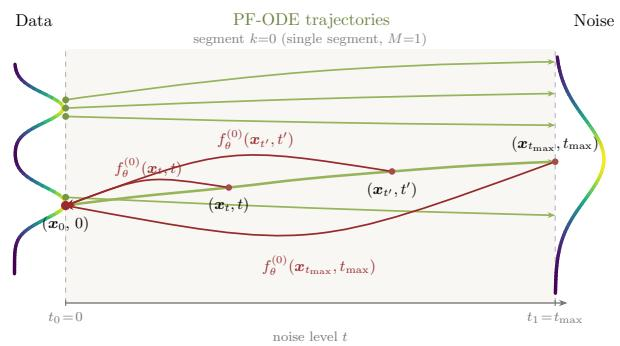
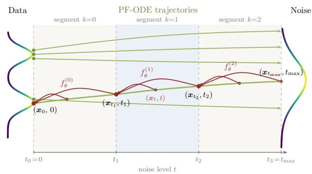
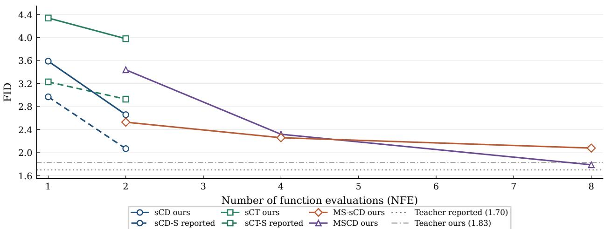
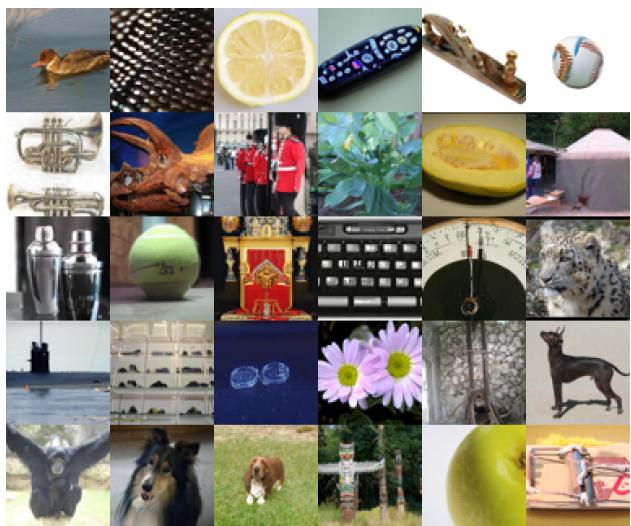
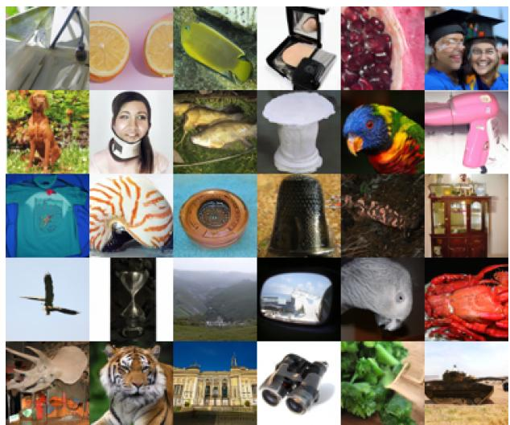
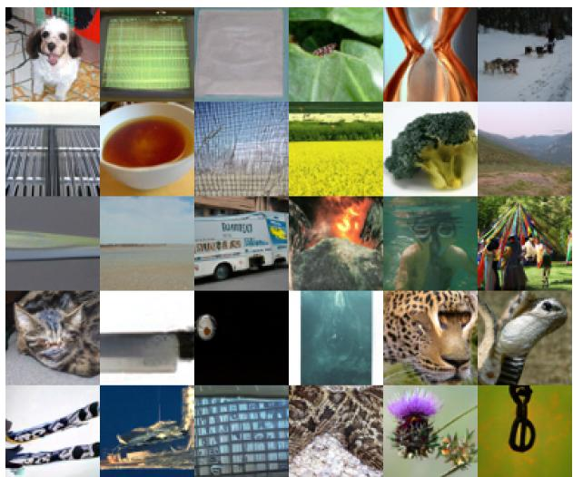
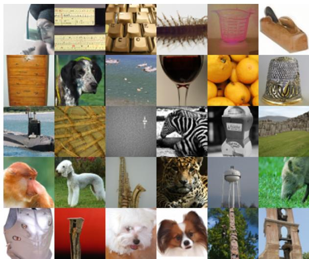

# Stable Continuous-Time Consistency Distillation: An Empirical Study with a Multistep Extension

Vinay Saji Mathew vvm5242@psu.edu The Pennsylvania State University

Soundar R. Kumara skumara@psu.edu The Pennsylvania State University

Gretta D. Kellogg gretta.kellogg@psu.edu The Pennsylvania State University

William KM Lai <sup>∗</sup> wklai2@bufalo.edu State University of New York at Bufalo

Reviewed on OpenReview: https: // openreview. net/ forum? id= di6ofoWEU8

## Abstract

Continuous-time consistency models are an attractive route to few-step generation. They remove the discretization error inherent to the timestep grid that discrete-time consistency models depend on. Until recently, however, training them was unstable. Lu & Song (2025) address this with the TrigFlow formulation and a coordinated set of architectural and training-objective changes. We conduct an independent empirical study of this framework on CIFAR-10 and ImageNet-64. No open-weight TrigFlow teachers exist at these scales, so we train them from scratch and then verify the consistency distillation (sCD) and consis tency training (sCT) behavior of students initialized from these teachers. On CIFAR-10, our students reproduce the reported FID at one and two steps. On ImageNet-64, they fall short, a gap that appears related to our teacher and to architectural choices the paper leaves unspecified. We also report a parameter-count gap of about 5% between the model size stated in the paper and a faithful re-implementation, which we attribute to the scale-and-shift conditioning projections in Adaptive Double Normalization. We then propose Multistep sCD (MS-sCD), a continuous-time, segment-conditioned multistep generalization of sCD. The segment-conditioning idea is borrowed from the discrete-time multistep consistency distilla tion of Heek et al. (2024); we build on their preliminary continuous-time experiments within the TrigFlow/sCM framework. The rest of the algorithm follows sCD. MS-sCD replaces sCM’s two-step intermediate time with a fixed segment-boundary schedule and recovers sCD at M = 1. We report FID at M = 2, 4, 8 and compare against the discrete-time MSCD baseline. Code, model weights, and training scripts are available on GitHub (Mathew et al., 2026).

## 1 Introduction

## 1.1 Motivation

Difusion models (Sohl-Dickstein et al., 2015; Ho et al., 2020; Song et al., 2021b; Karras et al., 2022) produce high-quality samples but require many sequential network evaluations. Distillation reduces this cost by training a student to generate samples in fewer steps, but methods difer in what they ask the student to learn. Progressive distillation (Salimans & Ho, 2022) repeatedly halves the sampling steps by teaching each student to match two steps of the previous model. Consistency models (Song et al., 2023) instead learn to map points on the same probability-flow ODE trajectory to a common endpoint, enabling one- or few-step generation with a single network. Later methods (Song & Dhariwal, 2024; Geng et al., 2025) refine the loss, timestep sampling, and weighting, while multistep consistency distillation (MSCD) (Heek et al., 2024) divides the trajectory into segments so that each prediction covers a shorter interval. MSCD uses DDIM (Song et al., 2021a) teacher steps within these segments and an aDDIM sampler to correct the variance shortfall of finite DDIM integration. A separate direction compares distributions rather than enforcing consistency along trajectories: variational score distillation (Wang et al., 2023), distribution matching distillation (Yin et al., 2024), and moment matching (Salimans et al., 2024) use distribution-level objectives.

For consistency models, a remaining question is whether training can avoid the timestep grid and its discretization error. Song et al. (2023) propose a continuous-time formulation (their Appendix B), but report training instability. The main iCT results of Song & Dhariwal (2024) use discrete-time training. sCM (Lu & Song, 2025) addresses this instability through the TrigFlow parameterization and coordinated changes to time conditioning, normalization, and the training objective, reporting stable continuous-time CMs at scales up to 1.5B parameters on ImageNet-512. We examine whether these results can be reproduced and whether segment-conditioned distillation extends the framework to larger sampling budgets.

## 1.2 Contributions

Our contributions are:

1. Reproduction with implementation clarifications. We reproduce sCM’s TrigFlow teacher and sCD/sCT students on CIFAR-10 (unconditional, DDPM++ backbone) and ImageNet-64 (classconditional, EDM2-S backbone), following the two configurations sCM uses. We make explicit the implementation details required to run the continuous-time CM training loop.

2. Continuous-time MS-sCD (extension). Building on Heek et al. (2024)’s preliminary experiments with segment-conditioned continuous-time training, we derive, implement, and evaluate this approach within the TrigFlow/sCM framework.

3. Comparisons with existing methods. We compare MS-sCD with MSCD (Heek et al., 2024) on the same EDM2-S backbone to assess their relative strengths at diferent sampling budgets. We also evaluate moment matching (Salimans et al., 2024) on an ADM-style backbone to examine an alternative distillation objective.

## 2 Background

## 2.1 Difusion process and probability flow ODE

Difusion models (Sohl-Dickstein et al., 2015; Ho et al., 2020; Song et al., 2021b) define a forward process that gradually corrupts a data sample $x _ { 0 }$ with Gaussian noise according to a schedule $\left( \alpha _ { t } , \sigma _ { t } \right)$ , producing $x _ { t } = \alpha _ { t } x _ { 0 } + \sigma _ { t } z$ with $z \sim \mathcal { N } ( 0 , I )$ . Song et al. (2021b) show that the associated marginals $p _ { t } ( x _ { t } )$ are also generated by a deterministic probability flow ODE (PF-ODE), $\begin{array} { r } { d x _ { t } / d t = f ( t ) x _ { t } - \frac { 1 } { 2 } g ( t ) ^ { 2 } \nabla _ { x _ { t } } } \end{array}$ log $p _ { t } ( x _ { t } )$ , whose vector field is determined by the score. Sampling reduces to integrating this ODE from $t = T$ (approximately Gaussian) back to t = 0 (data). The EDM framework (Karras et al., 2022) adopts a variance-exploding schedule and parameterizes the denoiser as $D _ { \theta } ( x _ { t } ) = c _ { \mathrm { s k i p } } ( t ) x _ { t } + c _ { \mathrm { o u t } } ( t ) F _ { \theta } ( c _ { \mathrm { i n } } ( t ) x _ { t } , c _ { \mathrm { n o i s e } } ( t ) )$ , with $F _ { \theta }$ a neural network and $( c _ { \mathrm { s k i p } } , c _ { \mathrm { o u t } } , c _ { \mathrm { i n } } , c _ { \mathrm { n o i s e } } )$ preconditioners chosen so that the training objective has unit variance across timesteps.

## 2.2 Flow matching

Flow matching (Lipman et al., 2023; Liu et al., 2023; Albergo et al., 2025) fixes an interpolation $\begin{array} { r l } { x _ { t } } & { { } = } \end{array}$ $\alpha _ { t } x _ { 0 } + \sigma _ { t } z$ between data and noise and trains a velocity field $v _ { \theta } ( x _ { t } , t )$ to match $\dot { x } _ { t } = \alpha _ { t } ^ { \prime } x _ { 0 } + \sigma _ { t } ^ { \prime } z$ , so the PF-ODE becomes ${ d x _ { t } } / { d t } = v _ { \theta } ( x _ { t } , t )$ . Diferent choices of $\left( \alpha _ { t } , \sigma _ { t } \right)$ recover variance-preserving difusion, rectified flow (Liu et al., 2023), or stochastic interpolants (Albergo et al., 2025).

## 2.3 TrigFlow

TrigFlow (Lu & Song, 2025) unifies EDM and flow matching by parameterizing noisy samples as

$$
x _ { t } = \cos ( t ) x _ { 0 } + \sin ( t ) z , \quad z \sim \mathcal { N } ( 0 , \sigma _ { d } ^ { 2 } I ) , \quad t \in [ 0 , \pi / 2 ] .\tag{1}
$$

The ideal velocity along this trajectory is ${ \dot { x } } _ { t } ^ { * } = \cos ( t ) z - \sin ( t ) x _ { 0 }$ . A TrigFlow network $F _ { \theta }$ approximates this velocity, trained via:

$$
\begin{array} { r } { \mathcal { L } _ { \mathrm { D M } } = \mathbb { E } _ { { x _ { 0 } } , z , t } \bigl [ \| \sigma _ { d } F _ { \theta } ( x _ { t } / \sigma _ { d } , t ) - \dot { x } _ { t } ^ { * } \| ^ { 2 } \bigr ] . } \end{array}\tag{2}
$$

The PF-ODE is $d x _ { t } / d t \ = \ \sigma _ { d } F _ { \theta } ( x _ { t } / \sigma _ { d } , t )$ . TrigFlow satisfies EDM’s preconditioner requirements with $c _ { \mathrm { s k i p } } ( t ) = \cos ( t ) , c _ { \mathrm { o u t } } ( t ) = - \sigma _ { d } \sin ( t ) , c _ { \mathrm { i n } } ( t ) = 1 / \sigma _ { d }$ , and $c _ { \mathrm { n o i s e } } ( t ) ~ = ~ t$ (identity time conditioning, see Lu & Song 2025 for the derivation).

CM parameterization. The TrigFlow CM (Lu & Song, 2025) parameterizes the consistency function as a one-step TrigFlow-DDIM step from t to 0:

$$
f _ { \theta } ( x _ { t } , t ) = \cos ( t ) x _ { t } - \sin ( t ) \sigma _ { d } F _ { \theta } ( x _ { t } / \sigma _ { d } , t ) .\tag{3}
$$

This automatically satisfies the boundary condition $f _ { \theta } ( x _ { 0 } , 0 ) = x _ { 0 }$ because sin $. ( 0 ) = 0$

## 2.4 Continuous-time CM training

The continuous-time limit of discrete consistency distillation (Song et al., 2023, Theorem 5 and Remark 6) gives the following training gradient, where $w ( t )$ includes the constant and time-sampling factors:

$$
\nabla _ { \theta } \mathbb { E } _ { x _ { t } , t } \bigg [ w ( t ) ~ f _ { \theta } ^ { \top } ( x _ { t } , t ) ~ \frac { d f _ { \theta ^ { - } } ( x _ { t } , t ) } { d t } \bigg ] ,\tag{4}
$$

where $\theta ^ { - }$ denotes a stop-gradient on θ (no separate EMA target network is used, following Song & Dhariwal 2024; Lu & Song 2025). Expanding the time derivative along the PF-ODE gives

$$
\frac { d f _ { \theta ^ { - } } } { d t } = \cos ( t ) \bigg ( \frac { d x _ { t } } { d t } - \sigma _ { d } F _ { \theta ^ { - } } \bigg ) - \sin ( t ) \bigg ( x _ { t } + \sigma _ { d } \frac { d F _ { \theta ^ { - } } } { d t } \bigg ) ,\tag{5}
$$

where the second term carries $d F _ { \theta ^ { - } } / d t$ , computed by a forward-mode Jacobian–vector product (JVP) and the source of training instability.

## 2.5 sCM’s six stabilization fixes

sCM identifies the instability in equation 5 as:

$$
\sin ( t ) \partial _ { t } F _ { \theta ^ { - } } = \sin ( t ) \cdot { \frac { \partial c _ { \mathrm { n o i s e } } } { \partial t } } \cdot { \frac { \partial \operatorname { e m b } ( c _ { \mathrm { n o i s e } } ) } { \partial c _ { \mathrm { n o i s e } } } } \cdot { \frac { \partial F _ { \theta ^ { - } } } { \partial \operatorname { e m b } } } .\tag{6}
$$

Three architectural changes address these factors, and three further changes modify the training objective. With logarithmic time conditioning, $c _ { \mathrm { n o i s e } } ( t ) \propto \log ( \sigma _ { d } \tan t )$ , the factor sin $( t ) \partial _ { t } c _ { \mathrm { n o i s e } } \propto 1 / \cos ( t )$ diverges as $t \to \pi / 2$ . sCM uses identity conditioning, $c _ { \mathrm { n o i s e } } ( t ) = t .$ , for which this factor is the bounded sin(t). The second change concerns the Fourier time embedding, whose large efective scale magnifies $\partial \mathrm { e m b } / \partial c _ { \mathrm { n o i s e } }$ . A positional embedding drops that scale to about 0.02. The third change is Adaptive Double Normalization (ADN), which replaces AdaGN (Dhariwal & Nichol, 2021) with

$$
y = \mathrm { n o r m } ( y ) \odot \mathrm { p n o r m } ( s ( t ) ) + \mathrm { p n o r m } ( b ( t ) ) ,\tag{7}
$$

where norm is GroupNorm (DDPM++) or channel-wise RMS normalization (EDM2), and pnorm is pixel normalization (Section 3.4). Capping the scale and shift vectors this way holds $\partial F _ { \theta ^ { - } } / \partial$ emb down throughout training.

The other three fixes act on the gradient itself. Tangent normalization divides the raw tangent by its own Euclidean norm plus a constant, $g  g / ( \| g \| _ { 2 } + c )$ with $c = 0 . 1$ (Section 4.2). Adaptive weighting rewrites the inner-product gradient equation 4 as an MSE, $\begin{array} { r } { \nabla _ { \theta } \mathbb { E } [ F _ { \theta } ^ { \top } y ] = \frac { 1 } { 2 } \nabla _ { \theta } \mathbb { E } [ \| F _ { \theta } - F _ { \theta ^ { - } } + y \| ^ { 2 } ] } \end{array}$ , and trains a log-variance head $w _ { \phi } ( t )$ next to $F _ { \theta }$ . Finally, the tangent warmup ramps the coeficient r = min(1, iter/H) on the sin(t) term from 0 to 1 over the first $H = 1 0 , 0 0 0$ iterations.

## 2.6 Multistep Consistency Distillation

Heek et al. (2024) discretize the generation trajectory into M segments with boundaries $0 = t _ { 0 } < t _ { 1 } < \cdot \cdot \cdot <$ $t _ { M }$ , train a shared network across segments, and use DDIM teacher steps within each segment. They propose the aDDIM correction to compensate for the variance shortfall of finite DDIM steps. The paper trains on the discrete grid. It also notes that continuous-time training is possible provided the model takes an extra conditioning signal that identifies the current segment (so the prediction can change discontinuously across segment boundaries), and reports that early experiments with this variant worked comparably (Heek et al., 2024, §3). Our MS-sCD (Section 6) builds on this approach by adding a segment-boundary input $t _ { k }$ to the network and training in continuous time within the TrigFlow CM framework.

## 3 TrigFlow Teacher: Architecture and Implementation

## 3.1 Backbones

We train at two settings, matching sCM’s own backbone choices. CIFAR-10 (Krizhevsky, 2009) (unconditional, 32×32) uses the Score SDE DDPM++ network of Song et al. (2021b) with the EDM 2022 (Karras et al., 2022) training settings. ImageNet-64 (class-conditional, 64×64) is a downsampled version of ImageNet (Deng et al., 2009; Russakovsky et al., 2015) and uses the magnitude-preserving EDM2 UNet (Karras et al., 2024). Both carry the TrigFlow parameterization, identity time conditioning, positional time embeddings, and ADN (Section 2.5). The EDM2 backbone is built from magnitude-preserving convolutions and uses EDM2’s normalize $( \varepsilon = 1 0 ^ { - 4 } )$ for the pixel normalization inside ADN. DDPM++ has no weightnormalized layers and instead applies the PGGAN pixel norm (Karras et al., 2018) $( \varepsilon = 1 0 ^ { - 8 } )$ that sCM cites. The rest of the section covers implementation choices that the paper leaves unspecified.

## 3.2 ADN block and parameter count

ADN modulates every residual block as $y \cdot \mathrm { p n o r m } ( s ) + \mathrm { p n o r m } ( b )$ , with the scale s and shift b produced by a single linear projection of the time embedding. Relative to EDM2’s scale-only modulation $y \cdot \left( c + 1 \right)$ , this scale-and-shift form requires the time-conditioning projection in each block to emit 2C channels instead of C, doubling the projection’s weight tensor and adding roughly $C \cdot d _ { \mathrm { e m b } }$ parameters per block, where $d _ { \mathrm { e m b } }$ is the time-embedding dimension. Summed over the encoder and decoder blocks of the UNet, this accounts for the parameter-count gap we observe between the size reported by sCM (280.2M for size S, the EDM2-S baseline figure) and our re-implementation, which has 293,922,753 parameters (≈294M, about 5% larger). The same ofset is expected at the larger model sizes.

## 3.3 Adaptive-weighting head and loss form

The paper does not specify the architecture of $w _ { \phi } ( t )$ . We use a fixed positional embedding (128 frequencies on t) followed by a single magnitude-preserving linear map to a scalar, giving one $w _ { \phi } ( t )$ per image.

For the loss, we minimize the EDM2 form

$$
\ell _ { \mathrm { o u r s } } ( x _ { 0 } , z , t ) = \frac { \| \sigma _ { d } F _ { \theta } ( x _ { t } / \sigma _ { d } , t ) - v _ { t } \| ^ { 2 } } { e ^ { w _ { \phi } ( t ) } } + D w _ { \phi } ( t ) ,\tag{8}
$$

with $D = C { \times } H { \times } W$ entries per image, summed over entries and averaged over the batch. The sCM appendix writes the corresponding scalar-per-image objective as

$$
\ell _ { \mathrm { s C M } } ( x _ { 0 } , z , t ) = \frac { e ^ { w _ { \phi } ( t ) } } { D } \| \sigma _ { d } F _ { \theta } ( x _ { t } / \sigma _ { d } , t ) - v _ { t } \| ^ { 2 } - w _ { \phi } ( t ) .\tag{9}
$$

## 3.4 Pixel-normalization

For the EDM2 backbone, we implement pnorm with EDM2’s normalize (pixel normalization in the sense of Karras et al. 2018), applied along the channel dimension:

$$
\mathrm { p n o r m } ( v ) = \frac { v } { \mathrm { R M S } ( v ) + \varepsilon } , \quad \varepsilon = 1 0 ^ { - 4 } ,\tag{10}
$$

for a length-C channel vector v. Appendix A.2 restates the full routine. The teacher training details and other hyperparameter choices are in Appendix G.

## 4 sCM Student: sCD and sCT

## 4.1 Loss formulation

The student is initialized from the teacher checkpoint. The loss minimized during sCD training is:

$$
\mathcal { L } _ { \mathrm { s C D } } ( \theta , \phi ) = \mathbb { E } _ { x _ { 0 } , z , t } \bigg [ \frac { \| F _ { \theta } - F _ { \theta ^ { - } } - g \| _ { 2 } ^ { 2 } } { D e ^ { w _ { \phi } ( t ) } } + D w _ { \phi } ( t ) \bigg ] ,\tag{11}
$$

where D is the number of entries per image, $F _ { \theta ^ { - } }$ − denotes the student forward pass with stop-gradient, and $g$ is the normalized tangent (Section 4.2). The sCD teacher provides $d x _ { t } / d t = \sigma _ { d } F _ { \mathrm { t e a c h e r } } ( x _ { t } / \sigma _ { d } , t )$ . For $\mathrm { s C T } .$ we replace the teacher prediction with the sampled conditional velocity cos $( t ) z - \sin ( t ) x _ { 0 }$ , whose conditional expectation given $( x _ { t } , t )$ is the marginal flow velocity. The corresponding continuous-time consistency training pseudo-objective is given in Song et al. (2023, Remark 10).

The raw tangent vector before normalization is:

$$
{ \tilde { g } } = - \cos ^ { 2 } ( t ) { \bigg ( } \sigma _ { d } F _ { \theta ^ { - } } - { \frac { d x _ { t } } { d t } } { \bigg ) } - r \cdot \cos ( t ) \sin ( t ) { \bigg ( } x _ { t } + \sigma _ { d } { \frac { d F _ { \theta ^ { - } } } { d t } } { \bigg ) } ,\tag{12}
$$

where $r = \operatorname* { m i n } ( 1 , \operatorname { i t e r } / H )$ is the tangent warmup ramp and $d F _ { \theta ^ { - } } / d t$ is computed via JVP (Section 4.2).

## 4.2 Computing the tangent

(a) JVP input tangents. The naive tangent $( d x _ { t } / d t , 1 )$ overflows in FP16 near $t  0$ and $t \to \pi / 2$ , so sCM rescales it by cos(t) sin(t). We feed the network the unscaled $x _ { t }$ and let it apply its own $c _ { \mathrm { i n } } = 1 / { \sigma _ { d } } .$ with tangents

$$
v _ { x } = \cos ( t ) \sin ( t ) { \frac { d x _ { t } } { d t } } , \qquad v _ { t } = \cos ( t ) \sin ( t ) .\tag{13}
$$

(b) Tangent normalization. We normalize the tangent exactly as in sCM’s Algorithm 1, $g  g / ( \| g \| _ { 2 } + c )$ with $c = 0 . 1$ , where $\| g \| _ { 2 }$ is the Euclidean norm over each sample’s $C \times H \times W$ entries.

(c) In-place weight renormalization and the JVP. We disable in-place weight renormalization during JVP calls (Appendix G). For the attention layers, we follow the EDM2 release, which notes that an optimized fused scaled-dot-product implementation had not been verified to produce identical results, and use a plain einsum implementation. The JVP rule for the optimized path in Lu & Song (2025)’s appendix is therefore not used in our setup.

## 4.3 sCD vs. sCT

The two variants share the loss in equation 11 and difer only in where the tangent $d x _ { t } / d t$ comes from, which we gave in Section 4.1. sCD requires two forward passes per training step, while sCT requires one. We initialize the student from the teacher’s weights in both cases. This is easy to overlook for sCT, which is usually described as teacher-free. Algorithm 1 of Lu & Song (2025) sets $\theta  \theta _ { \mathrm { { p r e t r a i n } } }$ , and the appendix says so directly, so the weights themselves still come from the difusion teacher. That is the real diference from the train-from-scratch consistency training of Song et al. (2023).

Table 1: TrigFlow teacher FID, 50k samples, standard ADM evaluation. ImageNet-64 is class conditional with the EDM2-S backbone. CIFAR-10 is unconditional with the DDPM++ backbone. The TrigFlow sampler is DPM-Solver-2S (Lu et al., 2022), with Heun’s intermediate step.
<table><tr><td>Dataset</td><td>Method</td><td>NFE</td><td>FID</td></tr><tr><td>ImageNet-64</td><td>EDM2-S (Karras et al., 2024)</td><td>63</td><td>1.58</td></tr><tr><td>ImageNet-64</td><td>TrigFlow teacher (Lu &amp; Song, 2025)</td><td>63</td><td>1.70</td></tr><tr><td>ImageNet-64</td><td>TrigFlow teacher (ours)</td><td>63</td><td>1.83</td></tr><tr><td>CIFAR-10</td><td>TrigFlow teacher (Lu &amp; Song, 2025)</td><td>35</td><td>2.15</td></tr><tr><td>CIFAR-10</td><td>TrigFlow teacher (ours)</td><td>35</td><td>2.08</td></tr></table>

Table 2: sCD and sCT results on ImageNet-64 (EDM2-S), without classifier-free guidance (CFG).
<table><tr><td>Method</td><td>Backbone</td><td>NFE=1 FID</td><td>NFE=2 FID</td><td>Framework</td></tr><tr><td rowspan="3">iCT-deep (Song &amp; Dhariwal, 2024) ECM-S* (ECT) (Geng et al., 2025) MSCD† (Heek et al., 2024)</td><td>ADM-style</td><td>3.25</td><td>2.77</td><td>discrete, EDM</td></tr><tr><td>EDM2-S</td><td>4.05</td><td>2.79</td><td>discrete, EDM</td></tr><tr><td>UViT-small</td><td>4.3</td><td>2.0</td><td>discrete</td></tr><tr><td rowspan="3">sCM sCD-S‡ (Lu &amp; Song, 2025) sCM sCT-S‡ (Lu &amp; Song, 2025)</td><td>EDM2-S/TrigFlow</td><td>2.97</td><td>2.07</td><td>TrigFlow</td></tr><tr><td>EDM2-S/TrigFlow</td><td>3.23</td><td>2.93</td><td>TrigFlow</td></tr><tr><td>EDM2-S/TrigFlow</td><td>3.59</td><td>2.66</td><td></td></tr><tr><td rowspan="2">Ours sCD Ours sCT</td><td>EDM2-S/TrigFlow</td><td>4.34</td><td>3.98</td><td>TrigFlow</td></tr><tr><td></td><td></td><td></td><td>TrigFlow</td></tr></table>

102.4M tuning images. <sup>†</sup> Heek et al.’s MSCD uses a UViT backbone (transformer UNet with 16×1024-channe mid-blocks at the middle stage), structurally diferent from the magnitude-preserving EDM2 UNet we use. That model is also substantially larger in parameter count than the EDM2-S/TrigFlow models compared here, so its FID values are given for context rather than as an architecture-matched baseline. <sup>‡</sup> Numbers from sCM Table 8 (appendix), at the EDM2-S size matched to our setup. The main-paper sCM table reports the XL variant for ImageNet-64.

## 5 Reproduction Results

Table 1 reports the TrigFlow teacher FIDs, and the two datasets part ways already at this stage. On CIFAR-10, we reproduce the reported teacher performance. On ImageNet-64 it reaches 1.83 against the reported 1.70. We followed the appendix schedule in full and swept the post-hoc phEMA $\sigma _ { \mathrm { r e l } }$ , settling on 0.115 rather than the prescribed 0.075, which narrowed the ImageNet gap without closing it.

Tables 2 and 3 report our sCD and sCT results on ImageNet-64 and CIFAR-10. On CIFAR-10, where the method is fully specified, both students match the reported results, giving us confidence that our training and evaluation are implemented correctly. ImageNet-64 is the harder case. Despite training for the ful prescribed schedule, our sCD-S trails the reported size-S numbers by about 0.6 FID at both step counts (3.59 vs. 2.97 at NFE=1, and 2.66 vs. 2.07 at NFE=2), and sCT-S trails by more. We discuss this further in Section 8.3.

## 6 Extension: Continuous-Time Multistep sCD (MS-sCD)

## 6.1 Motivation

sCM’s two-step sampling uses a fixed intermediate time $t _ { \mathrm { m i d } } = 1 . 1$ , whose optimal value varies with model size and training duration. More broadly, sCM’s multi-step generation applies a single-step CM repeatedly, whereas MSCD trains a shared network across segments and runs one step per segment (Figure 1). The sCM authors list “incorporating our proposed techniques into multi-step consistency models” as future work, and Heek et al. (2024) note that continuous-time training of an MSCD-style model is possible if the network takes an explicit conditioning signal identifying the current segment, so that the prediction can change discontinuously across segment boundaries.

Table 3: sCD and sCT results on unconditional CIFAR-10, DDPM++ backbone, 50k samples. sCM paper numbers from Lu & Song (2025), Table 1.
<table><tr><td>Method</td><td>NFE=1 FID NFE=2 FID</td><td></td><td>Framework</td></tr><tr><td>iCT (Song &amp; Dhariwal, 2024)</td><td>2.83</td><td>2.46</td><td>discrete, EDM</td></tr><tr><td>ECT (Geng et al., 2025)</td><td>3.60</td><td>2.11</td><td>discrete, EDM</td></tr><tr><td>CD-LPIPS (Song et al., 2023)</td><td>3.55</td><td>2.93</td><td>discrete, EDM</td></tr><tr><td>sCM sCD (Lu &amp; Song, 2025)</td><td>3.66</td><td>2.52</td><td>TrigFlow</td></tr><tr><td>sCM sCT (Lu &amp; Song, 2025)</td><td>2.85</td><td>2.06</td><td>TrigFlow</td></tr><tr><td>Ours sCD</td><td>3.59</td><td>2.39</td><td>TrigFlow</td></tr><tr><td>Ours sCT</td><td>2.88</td><td>2.09</td><td>TrigFlow</td></tr></table>

MS-sCD combines these two ideas. We add a segment-boundary input $t _ { k }$ to the sCM network through a zero-initialized embedding, so the model reduces to sCM at $M = 1$ and becomes a segment-conditioned multistep CM otherwise. Three things change as a result: the segment CM parameterization (Section 6.2), its JVP target (Section 6.3), and the training procedure (Section 6.4).

## 6.2 Segment-conditioned TrigFlow CM

We discretize $[ 0 , t _ { \mathrm { m a x } } ]$ into M segments with boundaries $0 ~ = ~ t _ { 0 } ~ < ~ t _ { 1 } ~ < ~ \cdots ~ < ~ t _ { M } ~ = ~ t _ { \operatorname* { m a x } } , ~ t _ { \operatorname* { m a x } } ~ =$ arctan $( \sigma _ { \operatorname* { m a x } } / \sigma _ { d } )$ . We fix the segment boundaries and space them uniformly in TrigFlow time t. Segment k covers $\left( { t _ { k } , t _ { k + 1 } } \right]$ . For a point $x _ { t }$ in segment $k ,$ define $\Delta t : = t - t _ { k }$ . The segment CM is:

$$
f _ { \theta } ^ { ( k ) } ( x _ { t } , t ) : = \cos ( \Delta t ) x _ { t } - \sin ( \Delta t ) \sigma _ { d } F _ { \theta } \left( \frac { x _ { t } } { \sigma _ { d } } , t , t _ { k } \right) .\tag{14}
$$

This is a TrigFlow-DDIM step from t to $t _ { k }$ . It satisfies the segment boundary condition: $f _ { \theta } ^ { ( k ) } ( x _ { t _ { k } } , t _ { k } ) = x _ { t _ { k } }$ because sin $( 0 ) = 0$ , so the CM is the identity at the bottom of each segment. Figure 1 illustrates the parameterization.

The network $F _ { \theta }$ takes $t _ { k }$ as an additional conditioning input, implemented as:

$$
\mathrm { e m b ~ \ } + = \mathrm { \ l i n e a r { \bar { \ n i t } } } _ { = 0 } ( \mathrm { P o s i t i o n a l E m b e d } ( t _ { k } ) ) ,\tag{15}
$$

with a zero-initialized linear projection.

## 6.3 MS-sCD loss

We apply the continuous-time distillation pseudo-objective of Song et al. (2023, Theorem 5 and Remark 6) to the segment CM, following sCM. Since $t _ { k }$ is constant along any PF-ODE trajectory, it does not enter the JVP tangent.

The total time derivative of $f _ { \theta ^ { - } } ^ { ( k ) }$ along the ODE is:

$$
\frac { d f _ { \theta ^ { - } } ^ { ( k ) } } { d t } = \cos ( \Delta t ) \bigg ( \frac { d x _ { t } } { d t } - \sigma _ { d } F _ { \theta ^ { - } } \bigg ) - \sin ( \Delta t ) \bigg ( x _ { t } + \sigma _ { d } \frac { d F _ { \theta ^ { - } } } { d t } \bigg ) .\tag{16}
$$



  
(a) M = 1 (sCM): a single segment covers $[ 0 , t _ { \mathrm { m a x } } ] . ~ f _ { \theta } ^ { ( 0 ) }$ maps any point on a PF-ODE trajectory to the data origin $( x _ { 0 } , 0 )$  
(b) M = 3 (MS-sCD): three segments. $f _ { \theta } ^ { ( k ) }$ maps any point $( x _ { t } , t )$ inside segment k to that segment’s lower boundary $( x _ { t _ { k } } , t _ { k } )$

Figure 1: Green arrows are PF-ODE trajectories (data ↔ noise) and red arrows show the consistency map. (a) For $M = 1$ the segment CM equation 14 reduces to sCM: $f _ { \theta } ^ { ( 0 ) }$ collapses every trajectory point to the data origin $( x _ { 0 } , 0 )$ . (b) For $M > 1$ , MS-sCD splits the time axis at $0 = t _ { 0 } < t _ { 1 } < \cdot \cdot \cdot < t _ { M } = t _ { \operatorname* { m a x } }$ and trains one segment-conditioned map $f _ { \theta } ^ { ( k ) }$ per segment k. Each $f _ { \theta } ^ { ( k ) }$ collapses trajectory points inside segment k to the segment’s lower boundary $( x _ { t _ { k } } , t _ { k } )$

After the inner-product-to-MSE conversion and prior weighting $\lambda ( t , k ) = 1 / ( \sigma _ { d } \tan { \Delta t } )$

$$
\mathcal { L } _ { \mathrm { M S - s C D } } ( \theta , \phi ) = \mathbb { E } \bigg [ \frac { 1 } { D e ^ { w _ { \phi } ( t ) } } \left\| F _ { \theta } - F _ { \theta ^ { - } } - g _ { k } \right\| _ { 2 } ^ { 2 } + D w _ { \phi } ( t ) \bigg ] ,\tag{17}
$$

where $g _ { k } = \tilde { g } _ { k } / ( \| \tilde { g } _ { k } \| _ { 2 } + c )$ , with raw target

$$
\widetilde g _ { k } = - \cos ^ { 2 } ( \Delta t ) \bigg ( \sigma _ { d } F _ { \theta ^ { - } } - \frac { d x _ { t } } { d t } \bigg ) - r \cdot \cos ( \Delta t ) \sin ( \Delta t ) \bigg ( x _ { t } + \sigma _ { d } \frac { d F _ { \theta ^ { - } } } { d t } \bigg ) .\tag{18}
$$

The JVP tangent vectors are:

$$
v _ { x } = \cos ( \Delta t ) \sin ( \Delta t ) \cdot d x _ { t } / d t , \qquad v _ { t } = \cos ( \Delta t ) \sin ( \Delta t ) ,\tag{19}
$$

and $t _ { k }$ is passed as a primal input with zero tangent (since $d t _ { k } / d t = 0$ along the PF-ODE).

## 6.4 Training algorithm

Algorithm 1 is Algorithm 1 of Lu & Song (2025) with three changes. Namely, a segment lookup that sets $t _ { k }$ from the segment t falls into, the substitution $\Delta t = t - t _ { k }$ in the tangent, and the extra conditioning input $t _ { k }$ passed to the network on both the diferentiated and the stop-gradient branches of the loss. At $M = 1$ , we set $t _ { 0 } = 0 , t _ { 1 } = t _ { \mathrm { m a x } } .$ , so $\Delta t = t$ for all $t \in ( 0 , t _ { \operatorname* { m a x } } ]$ . Then equation 17 reduces exactly to $\mathcal { L } _ { \mathrm { s C D } }$ equation 11.

## 6.5 Sampling

Algorithm 2 gives the M-step sampling procedure. Each step applies the segment CM equation 14 from $t _ { k + 1 }$ to $t _ { k } .$ , for a total cost of M network evaluations. At $M = 2$ , the NFE budget matches sCM’s two-step sampling, with the intermediate time $t _ { \mathrm { m i d } }$ replaced by the segment boundary $t _ { 1 }$ and the predict-and-re-noise procedure replaced by deterministic segment maps.

## 6.6 Results

Table 4 reports MS-sCD FID at $M = 2 , 4 , \delta$ against MSCD and the sCM baseline. At $M { = } 2 , \mathrm { M S { - } s C D }$ outperforms our discrete-time MSCD reproduction by 0.91 FID (2.53 vs. 3.44), consistent with the continuous-time formulation avoiding the discretization error that finite DDIM steps incur in the low-NFE regime. MSCD closes the gap at larger M and slightly surpasses MS-sCD at $M { = } 8 \ ( 1 . 7 9 \ \mathrm { v s . \ 2 . 0 8 } )$ , approaching the teacher FID. Figure 2 shows FID vs. NFE, with MS-sCD steadily decreasing toward the teacher FID as M grows.

Algorithm 1 Continuous-time Multistep sCD (MS-sCD) training, sCD variant.   
1: Input: data $\mathcal { D } \ ( \mathrm { s t d . } \ \sigma _ { d } )$ , teacher $F _ { \mathrm { p r e t r a i n } } ,$ student $F _ { \theta }$ (init. from F<sub>pretrain</sub>, $t _ { k }$ -embedding init. to zero),   
weighting $w _ { \phi } .$ , segments $0 = t _ { 0 } < \cdots < t _ { M } = t _ { \operatorname* { m a x } } ,$ proposal $( P _ { \mathrm { m e a n } } , P _ { \mathrm { s t d } } )$ , norm const $c = 0 . 1$ , warmup   
H, lr η.   
2: Init: $\theta  \theta _ { \mathrm { { p r e t r a i n } } } ,$ iter $ 0 .$   
3: repeat   
4: $\bar { x } _ { 0 } \sim \mathcal { D } , ~ z \sim \mathcal { N } ( 0 , \sigma _ { d } ^ { 2 } I )$   
5: $\tau \sim \mathcal { N } ( P _ { \mathrm { m e a n } } , P _ { \mathrm { s t d } } ^ { 2 } ) , ~ t $ arctan $( e ^ { \tau } / \sigma _ { d } )$   
6: find $k { \mathrm { ~ s . t . ~ } } t \in ( t _ { k } , t _ { k + 1 } ] ; \ \Delta t \gets t - t _ { k }$ {segment lookup}   
7: $x _ { t } \gets \cos ( t ) x _ { 0 } + \sin ( t ) z$   
8: $d x _ { t } / d t \gets { \sigma _ { d } F _ { \mathrm { p r e t r a i n } } ( x _ { t } / \sigma _ { d } , t ) }$ $\{ \mathrm { s C T } \colon \cos ( t ) z - \sin ( t ) x _ { 0 } \}$   
9: $r  \operatorname* { m i n } ( 1 , \operatorname { i t e r } / H )$ {tangent warmup}   
10: $Y \gets \mathrm { J V P } \left[ F _ { \theta ^ { - } } ( \cdot , \cdot , t _ { k } ) \right]$ at $( x _ { t } , t )$ with tangent  cos ∆t sin $\Delta t \left( { d x _ { t } } / { d t } \right)$ , cos ∆t sin ∆t {network   
applies $c _ { \mathrm { i n } } \mathrm { = } 1 / \sigma _ { d } ; \Delta t = t - t _ { k } \bigr \}$   
11: $\tilde { g } \gets - \cos ^ { 2 } \Delta t \left( \sigma _ { d } F _ { \theta ^ { - } } - d x _ { t } / d t \right) - r$ (cos ∆t sin $\Delta t x _ { t } + \sigma _ { d } Y )$   
12: $g _ { k }  \tilde { g } / ( \| \tilde { g } \| _ { 2 } + c )$ {L2 tangent norm}   
13: $\begin{array} { r } { \mathcal { L } \gets \frac { 1 } { D e ^ { w _ { \phi } ( t ) } } \big \| F _ { \theta } ( x _ { t } / \sigma _ { d } , t , t _ { k } ) - F _ { \theta ^ { - } } - g _ { k } \big \| _ { 2 } ^ { 2 } + D w _ { \phi } ( t ) } \end{array}$   
14: $( \theta , \phi ) \overset { \sim } {  } ( \theta , \phi ) - \eta \nabla _ { \theta , \phi } \mathcal { L } ;$ iter $ \mathrm { i t e r } + 1$   
15: until convergence

Algorithm 2 MS-sCD sampling (M steps, M NFE)   
1: Draw $\boldsymbol { x } _ { t _ { M } } \sim \mathcal { N } ( 0 , \sigma _ { d } ^ { 2 } I )$   
2: for $k = M - 1 , M - 2 , \ldots , 0$ do   
3: $\Delta _ { k } \gets t _ { k + 1 } - t _ { k }$   
4: $x _ { t _ { k } } \gets \cos ( \Delta _ { k } ) x _ { t _ { k + 1 } } - \sin ( \Delta _ { k } ) \sigma _ { d } F _ { \theta } \big ( x _ { t _ { k + 1 } } / \sigma _ { d } , t _ { k + 1 } , t _ { k } \big )$   
5: end for   
6: return $x _ { t _ { 0 } }$

Table 5 reports the same $M \in \{ 2 , 4 , 8 \}$ sweep on unconditional CIFAR-10. FID improves with M (2.60, 2.35, 2.20), matching a 199-NFE teacher evaluation within seed variation (FID 2.22), while remaining above our two-step sCT (2.09) and the 35-NFE teacher used in the main tables (2.08). We discuss this comparison in Appendix F.

This is not a strict continuous-versus-discrete ablation: each student spaces its boundaries uniformly in its teacher’s native schedule (the EDM/Karras σ-grid for MSCD, with the M=2 intermediate segment boundary at $\sigma \ = \ 1 . 1 $ ; TrigFlow t for MS-sCD), and the two also difer in noise policy and checkpoint selection (Appendices C and G). In Appendix D we retrain MSCD on $\mathrm { M S - s C D ^ { \prime } s }$ boundary locations via the EDM–TrigFlow map $\sigma = \sigma _ { d }$ tan(t); MSCD gets worse under that matched schedule, as expected when it is pulled of the teacher’s native grid. Appendix E compares dedicated segment-conditioned training to simply rolling out the one-step student. Here, Song-style iterative sampling means alternating clean-data prediction with fresh Gaussian re-noising, following the multistep consistency sampler of Song et al. (2023, Algorithm 1). Evaluating our sCD checkpoint with this procedure at $\mathrm { N F E { = } 4 }$ and 8 shows that MS-sCD remains better at the same budget.

## 7 Supporting Context: MSCD and Moment Matching

Before training the TrigFlow models we reproduced two existing distillation methods on class-conditional ImageNet-64, using the EDM framework (Karras et al., 2022) with the ADM-style UNet of Dhariwal & Nichol (2021), to validate our 50k-sample FID pipeline against published numbers. Our Multistep Consistency Distillation (MSCD, Heek et al. 2024) student reaches FID ≈2.3 at 8 steps, matching the deterministic Heun teacher at 511 NFE. This is the same method we later port to the EDM2-S backbone as the discrete-time baseline for MS-sCD (Table 4). Because MSCD trains the student to follow the deterministic teacher ODE within each segment, it is expected that the teacher quality has an influence on its FID. We separately reproduced moment matching (Salimans et al., 2024), a distribution-matching distillation, on the same backbone, reaching FID ≈1.4 with an 8-step student. We do not pursue this family further. The contrast is worth noting all the same. On images, distribution-matching distillation reaches much lower few-step FID than the trajectory-matching consistency objectives we focus on.

Table 4: MS-sCD vs. baselines on ImageNet-64 (EDM2-S, class-conditional, no CFG, 50k samples). sCM-S baselines are from Lu & Song (2025), appendix Table 8, where the main-paper sCM table reports the XL variant for ImageNet-64. The MSCD baselines on the EDM2-S backbone are our reproductions of Heek et al. (2024)’s method on this architecture.
<table><tr><td>Method</td><td>M</td><td>NFE</td><td>FID</td></tr><tr><td>sCM sCD-S (Lu &amp; Song, 2025) (appendix Table 8)</td><td>1</td><td>1</td><td>2.97</td></tr><tr><td>sCM sCD-S (Lu &amp; Song, 2025) (appendix, 2-step)</td><td>1</td><td>2</td><td>2.07</td></tr><tr><td>MSCD on EDM2-S (ours) MSCD on EDM2-S (ours)</td><td>2</td><td>2</td><td>3.44</td></tr><tr><td>MSCD on EDM2-S (ours)</td><td>4</td><td>4</td><td>2.32</td></tr><tr><td></td><td>8</td><td>8</td><td>1.79</td></tr><tr><td>MS-sCD (ours) MS-sCD (ours)</td><td>2</td><td>2</td><td>2.53</td></tr><tr><td>MS-sCD (ours)</td><td>4</td><td>4</td><td>2.26</td></tr><tr><td></td><td>8</td><td>8</td><td>2.08</td></tr><tr><td>TrigFlow teacher (ours)</td><td></td><td>63</td><td>1.83</td></tr></table>

Table 5: MS-sCD on unconditional CIFAR-10 (DDPM++ backbone, 50k samples). Teacher rows use DPM-Solver-2S on our TrigFlow teacher; the 35-NFE entry matches Table 1. Two-step sCT is from Table 3.
<table><tr><td>Method</td><td>M</td><td>NFE</td><td>FID</td></tr><tr><td>MS-sCD (ours)</td><td>2</td><td>2</td><td>2.60</td></tr><tr><td>MS-sCD (ours)</td><td>4</td><td>4</td><td>2.35</td></tr><tr><td>MS-sCD (ours)</td><td>8</td><td>8</td><td>2.20</td></tr><tr><td>Ours sCT</td><td>1</td><td>2</td><td>2.09</td></tr><tr><td>TrigFlow teacher (ours)</td><td></td><td>35</td><td>2.08</td></tr><tr><td>TrigFlow teacher (ours)</td><td></td><td>199</td><td>2.22</td></tr></table>

## 8 Discussion

## 8.1 The teacher gap propagates to the distilled students

Our TrigFlow teacher reaches FID 1.83 on ImageNet-64 against the reported 1.70 (Table 1). Since sCD distills the teacher ODE, teacher quality may contribute to our sCD-S shortfall. The sCT-S gap, which does not distill the teacher, must have a separate cause (Section 8.2). The teacher deficit also reframes the multistep route: a one-step student must absorb the entire teacher-to-data map in a single evaluation, whereas MSCD and MS-sCD divide it across M segments and lower the per-step burden, tracking the teacher more closely at the same total compute. We therefore expect that, with the residual teacher gap closed, the multistep budget–quality trade-of is the more dependable use of a fixed sampling budget at small mode scale.

  
Figure 2: FID vs. NFE on ImageNet-64 (EDM2-S, class-conditional, no CFG, 50k samples). Solid lines: our EDM2-S/TrigFlow reproduction. Dashed lines: sCM’s reported sCD-S and sCT-S numbers (Lu & Song, 2025, appendix Table 8). The two multistep students extend past the NFE≤2 regime of the single-step CMs by varying the number of segments $M \in \{ 2 , 4 , 8 \}$ : continuous MS-sCD (orange) leads at M=2, while our discrete MSCD reproduction (purple) overtakes it by M=8, both approaching the teacher reference (horizontal lines: ours 1.83, sCM-reported 1.70).

## 8.2 sCT vs. sCD ordering depends on model capacity

Lu & Song (2025) state in their Discussions and Limitations section that “sCT consistently outperforms sCD on CIFAR-10 and ImageNet 64×64 but is less efective than sCD across diferent model scales on ImageNet $5 1 2 \times 5 1 2 , $ attributing the ImageNet-512 exception to the training variance of CT in latent spaces with imperfect encoders. The same paper’s appendix table at ImageNet-64 (sCM Table 8) reports sCT-S at FID 3.23/2.93 (1-/2-step) versus sCD-S at 2.97/2.07, so sCT is worse than sCD at the smallest model size by ≈0.26 at NFE=1 and ≈0.86 at NFE=2. From size M upward the ordering reverses (sCT-M 2.25/1.81 vs. sCD-M 2.79/1.89), and sCT wins through XL as the paper’s claim suggests. The blanket statement therefore holds only at the larger scales. At EDM2-S the ordering is reversed even in a pixel-space setting where the latent-space hypothesis does not apply. The sCT/sCD ordering is therefore capacity-dependent, not purely dataset-dependent.

## 8.3 Backbone-dependent reproduction quality on CIFAR-10 versus ImageNet-64

On CIFAR-10 our sCD matches and slightly exceeds the reported FID at both step counts. On ImageNet-64, sCD-S lags by ≈0.6 FID and sCT-S by more. These results do not establish the cause of the gap. Two implementation choices specific to ImageNet-64 may contribute, but we have not tested them in controlled ablations.

Adaptive-weighting head $w _ { \phi } ( t )$ . sCM specifies the weighting objective but not the architecture of $w _ { \phi } .$ only that it follows EDM2 (a Fourier embedding into a magnitude-preserving linear map). We use a positional embedding of t instead, matching sCM’s documented Fourier-to-positional substitution for the main network, which the paper does not extend explicitly to the weighting head.

Attention implementation. sCM states that the ImageNet-64 students use FlashAttention with a custom JVP rule, but the released EDM2 backbone uses an einsum attention by default (its notes flag the fused kernel as insuficiently tested). We follow that default. The FlashAttention path and its JVP rule cannot be reconstructed from the available artifacts, and the FP16 reduction-order diference could accumulate over the 400k-iteration student schedule. Two architectural details are unspecified, and other undocumented implementation choices may also contribute to the gap.

## 9 Conclusion and Future Work

We set out to reproduce the TrigFlow/sCM formulation and to see how far it extends. The three architectural changes address the terms in equation 6, while the three objective changes modify the training gradient. On CIFAR-10, we recover the reported sCD FID at both step counts. On ImageNet-64, our teacher does not reach the reported 1.70, and the students also fall short. Implementation diferences may contribute to these gaps, but we have not isolated their efects.

Our MS-sCD results show that segment-conditioned distillation can be trained within the continuous-time sCD framework. FID improves as the number of segments increases on both datasets. On ImageNet-64, MSsCD outperforms iterative sCD sampling at the same NFE, while its advantage over discrete-time MSCD is limited to the smaller step budgets. These findings are limited to pixel-space generation at 32×32 and 64×64 resolution. Evaluating the method at higher resolutions, in latent spaces, and for text-to-image generation is left to future work.

## Acknowledgments

We thank the members of the Kumara and Lai labs for their comments and feedback. We also thank Xiowen You, Ankur Verma, and Daniel Cullina for helpful discussions and suggestions, and Charles Pavloski (NCSA NSF-OAC2320345 & NSF-OAC2005572) for feedback and troubleshooting. We gratefully acknowl edge funding support from the Cornell University BRC Epigenomics Core Facility (RRID:SCR\_021287), the Penn State Institute for Computational and Data Sciences (RRID:SCR\_025154), and Penn State AIMI (RRID:SCR\_022867). Soundar R. Kumara would also like to thank the Allen E. Pearce and Allen M. Pearce Professorship. This project was supported by NIH grant R35GM155380 to W.K.M.L. and a gift to AIMI research from Dell Technologies. Computational resources were provided through an NSF ACCESS Maximize allocation (CIS260116).

## References

Michael S. Albergo, Nicholas M. Bofi, and Eric Vanden-Eijnden. Stochastic interpolants: A unifying framework for flows and difusions. Journal of Machine Learning Research, 26(209):1–80, 2025.

Jia Deng, Wei Dong, Richard Socher, Li-Jia Li, Kai Li, and Li Fei-Fei. ImageNet: A large-scale hierarchical image database. In Proceedings of the IEEE Conference on Computer Vision and Pattern Recognition, pp. 248–255, 2009. doi: 10.1109/CVPR.2009.5206848.

Prafulla Dhariwal and Alexander Nichol. Difusion models beat GANs on image synthesis. In Advances in Neural Information Processing Systems, volume 34, pp. 8780–8794, 2021.

Zhengyang Geng, Ashwini Pokle, Weijian Luo, Justin Lin, and J. Zico Kolter. Consistency models made easy. In International Conference on Learning Representations (ICLR), 2025.

Jonathan Heek, Emiel Hoogeboom, and Tim Salimans. Multistep consistency models. arXiv preprint arXiv:2403.06807, 2024. doi: 10.48550/arXiv.2403.06807.

Martin Heusel, Hubert Ramsauer, Thomas Unterthiner, Bernhard Nessler, and Sepp Hochreiter. GANs trained by a two time-scale update rule converge to a local Nash equilibrium. In Advances in Neural Information Processing Systems, volume 30, 2017.

Jonathan Ho, Ajay Jain, and Pieter Abbeel. Denoising difusion probabilistic models. In Advances in Neural Information Processing Systems, volume 33, pp. 6840–6851, 2020.

Tero Karras, Timo Aila, Samuli Laine, and Jaakko Lehtinen. Progressive growing of GANs for improved quality, stability, and variation. In International Conference on Learning Representations (ICLR), 2018.

Tero Karras, Miika Aittala, Timo Aila, and Samuli Laine. Elucidating the design space of difusion-based generative models. In Advances in Neural Information Processing Systems, volume 35, pp. 26565–26577, 2022. doi: 10.52202/068431-1926.

Tero Karras, Miika Aittala, Jaakko Lehtinen, Janne Hellsten, Timo Aila, and Samuli Laine. Analyzing and improving the training dynamics of difusion models. In Proceedings of the IEEE/CVF Conference on Computer Vision and Pattern Recognition, pp. 24174–24184, 2024. doi: 10.1109/CVPR52733.2024.02282.

Alex Krizhevsky. Learning multiple layers of features from tiny images. Technical report, University of Toronto, 2009.

Tuomas Kynkäänniemi, Tero Karras, Samuli Laine, Jaakko Lehtinen, and Timo Aila. Improved precision and recall metric for assessing generative models. In Advances in Neural Information Processing Systems, volume 32, 2019.

Yaron Lipman, Ricky T. Q. Chen, Heli Ben-Hamu, Maximilian Nickel, and Matt Le. Flow matching for generative modeling. In International Conference on Learning Representations (ICLR), 2023.

Xingchao Liu, Chengyue Gong, and Qiang Liu. Flow straight and fast: Learning to generate and transfer data with rectified flow. In International Conference on Learning Representations (ICLR), 2023.

Cheng Lu and Yang Song. Simplifying, stabilizing and scaling continuous-time consistency models. In International Conference on Learning Representations (ICLR), 2025. Section, table, and algorithm references use arXiv:2410.11081v2.

Cheng Lu, Yuhao Zhou, Fan Bao, Jianfei Chen, Chongxuan Li, and Jun Zhu. DPM-Solver: A fast ODE solver for difusion probabilistic model sampling in around 10 steps. In Advances in Neural Information Processing Systems, volume 35, pp. 5775–5787, 2022. doi: 10.52202/068431-0418.

Vinay Saji Mathew, Soundar R. Kumara, Gretta D. Kellogg, and William KM Lai. Stable continuous-time consistency distillation: An empirical study with a multistep extension. Software Heritage archive, 2026. Version 1.0. SWHID: swh:1:dir:a63f1ad1c0e9e6746a3b31cf9dab13ecfa0b6ead.

Muhammad Ferjad Naeem, Seong Joon Oh, Youngjung Uh, Yunjey Choi, and Jaejun Yoo. Reliable fidelity and diversity metrics for generative models. In Proceedings of the 37th International Conference on Machine Learning, volume 119 of Proceedings of Machine Learning Research, pp. 7176–7185. PMLR, 2020.

Olga Russakovsky, Jia Deng, Hao Su, Jonathan Krause, Sanjeev Satheesh, Sean Ma, Zhiheng Huang, Andrej Karpathy, Aditya Khosla, Michael Bernstein, Alexander C. Berg, and Li Fei-Fei. ImageNet large scale visual recognition challenge. International Journal of Computer Vision, 115(3):211–252, 2015. doi: 10. 1007/s11263-015-0816-y.

Tim Salimans and Jonathan Ho. Progressive distillation for fast sampling of difusion models. In International Conference on Learning Representations (ICLR), 2022.

Tim Salimans, Thomas Mensink, Jonathan Heek, and Emiel Hoogeboom. Multistep distillation of difusion models via moment matching. In Advances in Neural Information Processing Systems, volume 37, pp. 36046–36070, 2024. doi: 10.52202/079017-1136.

Jascha Sohl-Dickstein, Eric Weiss, Niru Maheswaranathan, and Surya Ganguli. Deep unsupervised learning using nonequilibrium thermodynamics. In Proceedings of the 32nd International Conference on Machine Learning, volume 37 of Proceedings of Machine Learning Research, pp. 2256–2265. PMLR, 2015.

Jiaming Song, Chenlin Meng, and Stefano Ermon. Denoising difusion implicit models. In International Conference on Learning Representations (ICLR), 2021a.

Yang Song and Prafulla Dhariwal. Improved techniques for training consistency models. In International Conference on Learning Representations (ICLR), 2024.

Yang Song, Jascha Sohl-Dickstein, Diederik P Kingma, Abhishek Kumar, Stefano Ermon, and Ben Poole. Score-based generative modeling through stochastic diferential equations. In International Conference on Learning Representations (ICLR), 2021b.

Yang Song, Prafulla Dhariwal, Mark Chen, and Ilya Sutskever. Consistency models. In Proceedings of the 40th International Conference on Machine Learning, volume 202 of Proceedings of Machine Learning Research, pp. 32211–32252. PMLR, 2023.

Zhengyi Wang, Cheng Lu, Yikai Wang, Fan Bao, Chongxuan Li, Hang Su, and Jun Zhu. ProlificDreamer: High-fidelity and diverse text-to-3D generation with variational score distillation. In Advances in Neural Information Processing Systems, volume 36, pp. 8406–8441, 2023. doi: 10.52202/075280-0368.

Tianwei Yin, Michaël Gharbi, Richard Zhang, Eli Shechtman, Frédo Durand, William T. Freeman, and Taesung Park. One-step difusion with distribution matching distillation. In Proceedings of the IEEE/CVF Conference on Computer Vision and Pattern Recognition, pp. 6613–6623, 2024. doi: 10.1109/CVPR52733. 2024.00632.

## A Derivations

## A.1 CM parameterization as a TrigFlow-DDIM step

The deterministic DDIM update holds the inferred clean sample and noise fixed during each step (Song et al., 2021a). In TrigFlow coordinates, let $\hat { v } _ { t } = { \sigma } _ { d } F _ { \theta } ( x _ { t } / { \sigma } _ { d } , t )$ . Inverting the trigonometric relations between data, noise, and velocity gives

$$
\hat { x } _ { 0 } = \cos ( t ) x _ { t } - \sin ( t ) \hat { v } _ { t } ,\tag{20}
$$

$$
\hat { z } = \sin ( t ) x _ { t } + \cos ( t ) \hat { v } _ { t } ,\tag{21}
$$

where $\hat { z }$ uses the same $\sigma _ { d } .$ -scaled noise convention as equation 1. For $0 \leq s < t .$ , substituting these fixed estimates into the DDIM update yields

$$
\begin{array} { r l } & { x _ { s } ^ { \mathrm { D D I M } } = \cos ( s ) \hat { x } _ { 0 } + \sin ( s ) \hat { z } } \\ & { \quad \quad = \cos ( t - s ) x _ { t } - \sin ( t - s ) \sigma _ { d } F _ { \theta } ( x _ { t } / \sigma _ { d } , t ) . } \end{array}\tag{22}
$$

This is the first-order TrigFlow sampler described by Lu & Song (2025, Appendix B.1). Setting $s = 0$ in equation 22 recovers the CM parameterization equation $3 ;$ setting $s = t _ { k }$ and adding segment conditioning recovers equation 14.

## A.2 ADN normalization

We restate EDM2’s normalize function and derive its properties.

Function:

$$
\begin{array} { c } { \mathrm { n o r m } ( x , \mathrm { d i m } ) = x / \left( N ( x ) + \varepsilon \right) , } \\ { N ( x ) : = \| x \| _ { \ell _ { 2 } , \mathrm { d i m } } \cdot \sqrt { \displaystyle \frac { | \mathrm { n o r m } ( x ) | } { | x | } } , \quad \varepsilon = 1 0 ^ { - 4 } , } \end{array}\tag{23}
$$

where $\| \cdot \| _ { \ell _ { 2 } , \mathrm { d i m } }$ denotes the $\ell _ { 2 }$ norm along the specified axes (with keepdim=True), |norm(x)| is the number of elements in the norm output tensor, and |x| is the total number of elements in x.

Applied along dim=1 to shape $[ B , C , H , W ] ;$ : The norm output has shape $[ B , 1 , H , W ]$ , so |norm| = B·H·W and $| x | = B { \cdot } C { \cdot } H { \cdot } W$ , giving $\sqrt { | \mathrm { n o r m } | / | x | } = 1 / \sqrt { C }$ . Therefore $N ( x ) = \| v \| _ { 2 } / \sqrt { C } = \mathrm { R M S } ( v )$ (where $v = x _ { b , : , h , w }$ is the channel vector at spatial location $( b , h , w ) )$ .

Dividing by the Euclidean norm alone gives an RMS of $1 / { \sqrt { C } } ,$ , rather than approximately one. sCM cites Karras et al. (2018) for pnorm but does not fix ε or its placement. We use EDM2’s normalize $( \varepsilon = 1 0 ^ { - 4 }$ added outside the norm) for the EDM2 backbone and the original PGGAN form $( \varepsilon = 1 0 ^ { - 8 }$ , inside the square root) for $\mathrm { D D P M + + }$

ADN in the EDM2 residual block:

$$
[ s _ { \mathrm { p r e } } , b _ { \mathrm { p r e } } ] = \mathrm { s p l i t } ( \mathsf { e m b \_ l i n e a r } ( \mathrm { e m b } ) ) ,\tag{24}
$$

$$
\begin{array} { r } { s = \mathrm { n o r m } ( s _ { \mathrm { p r e } } , \mathrm { d i m } = 1 ) , \quad b = \mathrm { n o r m } ( b _ { \mathrm { p r e } } , \mathrm { d i m } = 1 ) , } \end{array}\tag{25}
$$

$$
y = { \mathrm { n o r m } } ( y , { \mathrm { d i m } } = 1 ) \odot s [ . ~ . ~ . ] + b [ . ~ . ~ . ] ,\tag{26}
$$

where [. . .] denotes broadcasting over H, W. DDPM++ uses GroupNorm for the features and the PGGAN pixel normalization defined above for scale and shift.

## B Dropout in Multistep Consistency Models

Discrete MSCD uses two student forward passes per step. We synchronize their dropout masks by saving and restoring the random state, following Song & Dhariwal (2024). This prevents dropout randomness from contributing to the consistency residual. In our MSCD reproductions on EDM (Karras et al., 2022) and EDM2 (Karras et al., 2024), students without dropout overfit within the training budget.

Our single-step sCD runs use zero dropout, following Lu & Song (2025, Appendix G.2). Continuous MSsCD computes the prediction and its time derivative in one JVP forward pass, so they share a dropout mask without explicit synchronization. For $\mathrm { M S - s C D }$ , no dropout led to overfitting and an eight-step FID near 2.3; a rate of 0.2 slowed training and showed signs of instability. We use 0.1 at resolutions $\leq 1 6$ for all reported MS-sCD results.

## C Noise Sampling for the Multistep Students

Heek et al. (2024) split difusion time into equal segments and sample the training noise uniformly over a discrete, cosine-parameterized step grid that anneals from 64 to 1280 steps. We instead use frameworkspecific noise schedules. For the discrete MSCD on EDM2-S we use the teacher’s EDM (Karras) σ grid, annealing the step count from 64 to 1280. For MS-sCD we keep the segment boundaries uniform in TrigFlow time but sample σ from a log-normal proposal $( P _ { \mathrm { m e a n } } = - 1 . 0 , P _ { \mathrm { s t d } } = 1 . 6 ;$ teacher: $P _ { \mathrm { m e a n } } = - 0 . 8 )$ and set $t = \arctan ( \sigma / \sigma _ { d } )$ , instead of spreading samples evenly across segments. This global proposal worked better in our runs. Spreading samples evenly across segments puts too much weight on noise levels the teacher rarely saw in training.

For the two-step $\scriptstyle ( M = 2 )$ discrete MSCD on EDM2 we set the intermediate segment boundary of the student grid to $\sigma = 1 . 1$ , giving $[ \sigma _ { \mathrm { m a x } } , 1 . 1 , 0 ]$ , since the default Karras schedule places it near $\sigma _ { \mathrm { m i n } } = 0 . 0 0 2$ and collapses the first segment. The M=4 runs keep the default Karras grid.

## D Matched Segment-Boundary Ablation for MSCD vs. MS-sCD

We retrain MSCD using the same segment boundaries as ${ \mathrm { M S } } { \mathrm { - s C D } } .$ , converting TrigFlow time to EDM noise levels through the correspondence of Lu & Song (2025):

$$
t = \arctan ( \sigma / \sigma _ { d } ) , \qquad \sigma = \sigma _ { d } \tan ( t ) , \qquad x _ { t } = \cos ( t ) x _ { \sigma } .\tag{27}
$$

This places the boundaries at the same noise levels in both methods; all other MSCD hyperparameters are unchanged. With $\sigma _ { d } = 0 . 5 , \sigma _ { \mathrm { m a x } } = 8 0$ , and $t _ { \mathrm { m a x } } = \arctan ( 1 6 0 ) \approx 1 . 5 6 4 5$ , the intermediate segment boundaries are:

```csv
M Intermediate boundaries (descending σ)
2 0.4969
4 1.1913, 0.4969, 0.2062
8 2.4437, 1.1913, 0.7420, 0.4969, 0.3324, 0.2062, 0.0991
```

At $M { = } 2 .$ , under a similar training budget, the matched grid reaches best FID 3.64 versus 3.44 for the original σ-space grid in Table 4. At $M { = } 4$ , the matched grid again trails (3.20 versus 2.97 at comparable budget;

original full-budget FID 2.32). At M=8, under a similar training budget, the matched grid reaches 1.99 versus 1.79 for the original grid. Using the same segment boundaries did not improve MSCD in these runs. We therefore retain the original schedules for the comparison in Table 4.

## E Iterative Single-Step sCD Baseline

MS-sCD trains a segment-conditioned student and samples with one network evaluation per segment. A useful control for assessing the benefits of MS-sCD is to keep the one-step sCD checkpoint fixed and apply Song-style iterative sampling (Song et al., 2023, Algorithm 1), adapted to TrigFlow (Lu & Song, 2025): first predict $\hat { x } _ { 0 } = f _ { \theta } ( x _ { t _ { \operatorname* { m a x } } } , t _ { \operatorname* { m a x } } )$ , then draw fresh $z \sim \mathcal { N } ( 0 , \sigma _ { d } ^ { 2 } I )$ , form $x _ { t _ { \mathrm { m i d } } } = \cos ( t _ { \mathrm { m i d } } ) \hat { x } _ { 0 } + \sin ( t _ { \mathrm { m i d } } ) z$ , and update $\hat { x } _ { 0 } = f _ { \theta } ( x _ { t _ { \mathrm { m i d } } } , t _ { \mathrm { m i d } } )$ . Repeat the re-noising and prediction pair until a total of M network evaluations have been used. We keep $t _ { \mathrm { m i d } } = 1 . 1$ fixed across repetitions, rather than optimizing a decreasing sequence of intermediate times. This uses the same sampler as our NFE=2 evaluation; it is not the deterministic MS-sCD segment chain of Algorithm 2. Table 6 shows that additional iterations improve sCD’s FID, but MS-sCD performs better at the same NFE.

Table 6: Iterative single-step sCD vs. MS-sCD on ImageNet-64 (EDM2-S, class-conditional, no CFG, 50k samples). The sCD results at $\mathrm { N F E { = } 1 / 2 }$ are from Table 2; MS-sCD results are from Table 4.
<table><tr><td>Method</td><td>NFE</td><td>FID</td></tr><tr><td>sCD iterated</td><td>1</td><td>3.59</td></tr><tr><td>sCD iterated</td><td>2</td><td>2.66</td></tr><tr><td>sCD iterated</td><td>4</td><td>2.48</td></tr><tr><td>sCD iterated</td><td>8</td><td>2.32</td></tr><tr><td>MS-sCD</td><td>2</td><td>2.53</td></tr><tr><td>MS-sCD</td><td>4</td><td>2.26</td></tr><tr><td>MS-sCD</td><td>8</td><td>2.08</td></tr></table>

## F MS-sCD on CIFAR-10 and Teacher NFE

Table 5 extends MS-sCD to unconditional CIFAR-10. Increasing M improves FID, but M=8 (2.20) does not surpass our two-step sCT (2.09). A useful reference point is the teacher ODE itself: the same TrigFlow checkpoint that reaches FID 2.08 at the standard 35-NFE DPM-Solver-2S setting (Lu & Song, 2025; Karras et al., 2022) evaluates to FID 2.22 at 199 NFE. For an exact PF-ODE, more steps should reduce numerica integration error (Karras et al., 2022; Lu et al., 2022); FID, however, measures samples from the learned vector field, so its dependence on NFE need not be monotone when model error or solver/schedule mismatch dominates. EDM likewise selects NFE by near-minimum observed FID rather than assuming a monotone curve (Karras et al., 2022). MS-sCD’s CIFAR-10 M=8 result matches that denser 199-NFE teacher evaluation within seed variation (2.20 vs. 2.22), suggesting that learned-ODE quality may influence this result under finer integration.

## G Experimental Details

## G.1 Teacher training

Both teachers are trained with the TrigFlow difusion loss equation 2 using log-normal noise-level sampling $t = \arctan ( e ^ { \tau } / \sigma _ { d } ) , \tau \sim \mathcal { N } ( P _ { \mathrm { m e a n } } , P _ { \mathrm { s t d } } ^ { 2 } ) , \sigma _ { d } = 0 . 5$

ImageNet-64 (EDM2-S backbone). $P _ { \mathrm { m e a n } } = - 0 . 8 , P _ { \mathrm { s t d } } = 1 . 6$ . Optimizer: Adam, $\beta _ { 1 } = 0 . 9 , \beta _ { 2 } = 0 . 9 9$ $\varepsilon = 1 0 ^ { - 1 1 }$ , reference learning rate η<sub>ref</sub> = 0.01 (EDM2-style auto-scaling via reference batch count 35,000). Batch size 2048 on 32 H100 GPUs. We use the post-hoc power-function EMA framework of EDM2 (phEMA). The training run records phEMA snapshots, and at evaluation we synthesize the EMA at a chosen $\sigma _ { \mathrm { r e l } }$ (Karras et al., 2024). The sCM paper’s appendix uses $\sigma _ { \mathrm { r e l } } = 0 . 0 7 5$ . In our run we swept $\sigma _ { \mathrm { r e l } }$ and found the optimal value to be $\sigma _ { \mathrm { r e l } } { = } 0 . 1 1 5$ , which we use for the reported FID. The remaining training settings match the sCM appendix.

CIFAR-10 (DDPM++ backbone, unconditional). We follow the teacher settings in Appendix G.1 of Lu & Song (2025), which themselves follow the EDM 2022 CIFAR-10 settings (Karras et al., 2022): $P _ { \mathrm { { m e a n } } } =$ −1.2, $P _ { \mathrm { s t d } } = 1 . 2 ,$ , dropout 0.13, batch size 512, learning rate $1 0 ^ { - 3 }$ , Adam $\beta _ { 1 } = 0 . 9 , \beta _ { 2 } = 0 . 9 9 9 , \varepsilon = 1 0 ^ { - 8 }$ no learning-rate decay, 400k training iterations. Backbone: Score SDE DDPM++ (Song et al., 2021b) with channel multiplier [2, 2, 2], four residual blocks per resolution, and attention at 16×16.

For CIFAR-10 we use EDM’s augmentation pipeline (horizontal flip, isotropic scale, rotation, anisotropic scale, fractional translation, all at p = 0.12) with the augmentation labels passed to the network. ImageNet-64 uses no augmentation.

Table 7: Hyperparameters for all experiments.
<table><tr><td></td><td>Teacher</td><td>sCD</td><td>sCT</td><td>MS-sCD</td><td>MSCD-EDM</td><td>MM</td></tr><tr><td>Framework Model</td><td>TrigFlow EDM2-S</td><td>TrigFlow EDM2-S</td><td>TrigFlow EDM2-S</td><td>TrigFlow EDM2-S</td><td>EDM EDM2-S</td><td>EDM EDM-S</td></tr><tr><td>Batch size</td><td>2048</td><td>2048</td><td>2048</td><td>2048</td><td>2048</td><td>2048</td></tr><tr><td>GPUs</td><td>32</td><td>32</td><td>32</td><td>32</td><td>32</td><td>16</td></tr><tr><td>Pmean</td><td>-0.8</td><td>-1.0</td><td>-1.0</td><td>-1.0</td><td>-0.8</td><td></td></tr><tr><td> $P _ { \mathrm { s t d } }$ </td><td>1.6</td><td>1.6</td><td>1.6</td><td>1.6</td><td>1.6</td><td></td></tr><tr><td>σd</td><td>0.5</td><td>0.5</td><td>0.5</td><td></td><td></td><td>0.5</td></tr><tr><td></td><td>0</td><td></td><td></td><td>0.5</td><td>0.5</td><td></td></tr><tr><td>Dropout</td><td></td><td>0</td><td>0.45</td><td>0.10</td><td>0.10</td><td>0</td></tr><tr><td>LR ref Adam β</td><td>0.01</td><td>1 × 10−4</td><td>1 × 10−4</td><td>5 × 10−4</td><td>5 × 10−4</td><td>2 × 10−6</td></tr><tr><td>Adam ε</td><td>(0.9, 0.99) 10-11</td><td>(0.9, 0.99)</td><td>(0.9, 0.99)</td><td>(0.9, 0.99)</td><td>(0.9, 0.99)</td><td>(0.0, 0.99)</td></tr><tr><td>phEMA std</td><td></td><td>10-11</td><td>10-11</td><td>10⁻11</td><td>10-8</td><td>10⁻12</td></tr><tr><td></td><td>0.075</td><td>0.075</td><td>0.075</td><td></td><td></td><td></td></tr><tr><td>Eval. weights</td><td>phEMA</td><td>phEMA</td><td>phEMA</td><td>both</td><td>EMA</td><td>live</td></tr><tr><td>Tangent c</td><td></td><td>0.1</td><td>0.1</td><td>0.1</td><td></td><td></td></tr><tr><td>Warmup H</td><td></td><td>10k</td><td>10k</td><td></td><td></td><td></td></tr><tr><td></td><td></td><td></td><td></td><td>10k</td><td></td><td></td></tr><tr><td>Params</td><td>293.9M</td><td>293.9M</td><td>293.9M</td><td>293.9M</td><td>280.2M</td><td>295.9M</td></tr></table>

Weight normalization during JVP calls. EDM2’s magnitude-preserving convolutions normalize the stored weights by their RMS before each training forward pass and apply functional normalization when computing the output. We disable the in-place weight update during JVP calls. The JVP retains the functional weight normalization, but the stored weight norms can drift during student training. We have not observed instability attributable to this drift.

Live weights versus phEMA. For the teacher and single-step students, we sweep the post-hoc EMA (phEMA) width $\sigma _ { \mathrm { r e l } }$ . For MS-sCD, we also evaluate live (non-EMA) weights saved every 4 Mi (≈4.2M) training images. In each run, we report the checkpoint and weight choice with the lowest validation FID.

FID evaluation. We evaluate Fréchet Inception Distance (FID) (Heusel et al., 2017) using 50,000 samples with the standard ADM evaluation protocol (Dhariwal & Nichol, 2021), compared against the ILSVRC 2012 training set statistics. Generation is class-conditional for ImageNet-64, with no classifier-free guidance. Following Karras et al. (2024), we compute FID over a sweep of generator seeds and report the best in the main tables. Table 8 additionally reports mean ± sample standard deviation across seeds. Table 9 complements FID with precision/recall (Kynkäänniemi et al., 2019) and density/coverage (Naeem et al., 2020) on the same 50k-sample sets used for those best-seed FIDs. Density and coverage follow the FID ordering (teacher > MS-sCD M=8 > M=4 ≈ M=2 > sCD-2 > sCD-1 ≫ sCT).

Table 8: ImageNet-64 seed FID mean ± std (EDM2-S, class-conditional, no CFG, 50k samples). Best matches the main-text FID.
<table><tr><td>Model</td><td>NFE</td><td>Best</td><td> $\mathrm { M e a n } \pm \mathrm { s t d }$ </td></tr><tr><td>TrigFlow teacher</td><td>63</td><td>1.83</td><td> $1 . 8 3 3 4 \pm 0 . 0 0 0 5$ </td></tr><tr><td>sCD</td><td>1</td><td>3.59</td><td> $3 . 6 4 2 3 \pm 0 . 0 3 3 0$ </td></tr><tr><td>sCD</td><td>2</td><td>2.66</td><td> $2 . 6 8 5 6 \pm 0 . 0 1 5 3$ </td></tr><tr><td> $\mathrm { s C T }$ </td><td>1</td><td>4.34</td><td> $4 . 4 4 0 3 \pm 0 . 0 5 5 7$ </td></tr><tr><td> $\mathrm { s C T }$ </td><td>2</td><td>3.98</td><td> $4 . 0 0 9 3 \pm 0 . 0 1 9 8$ </td></tr><tr><td>MS-sCD (M=2)</td><td>2</td><td>2.53</td><td> $2 . 5 7 6 1 \pm 0 . 0 2 3 1$ </td></tr><tr><td> $\mathrm { M S - s C D }$  (M=4)</td><td>4</td><td>2.26</td><td> $2 . 2 8 5 3 \pm 0 . 0 1 9 9$ </td></tr><tr><td>MS-sCD (M=8)</td><td>8</td><td>2.08</td><td> $2 . 1 2 2 7 \pm 0 . 0 2 4 3$ </td></tr></table>

Table 9: ImageNet-64 precision (P), recall (R), density (D), and coverage (C) on the best-seed 50k-sample sets (EDM2-S, class-conditional, no CFG), using unnormalized 2048-d Inception-2015 features and k=5 (Naeem et al., 2020).
<table><tr><td>Model</td><td>NFE</td><td>FID</td><td>P</td><td>R</td><td>D</td><td>C</td></tr><tr><td>TrigFlow teacher</td><td>63</td><td>1.83</td><td>0.802</td><td>0.708</td><td>1.165</td><td>0.968</td></tr><tr><td>sCD</td><td>1</td><td>3.59</td><td>0.776</td><td>0.703</td><td>1.062</td><td>0.950</td></tr><tr><td>sCD</td><td>2</td><td>2.66</td><td>0.780</td><td>0.708</td><td>1.104</td><td>0.960</td></tr><tr><td>sCT</td><td>1</td><td>4.34</td><td>0.722</td><td>0.737</td><td>0.878</td><td>0.900</td></tr><tr><td>sCT</td><td>2</td><td>3.98</td><td>0.719</td><td>0.747</td><td>0.890</td><td>0.904</td></tr><tr><td>MS-sCD (M=2)</td><td>2</td><td>2.53</td><td>0.785</td><td>0.702</td><td>1.121</td><td>0.960</td></tr><tr><td> $\mathrm { M S - s C D } \ ( M { = } 4 )$ </td><td>4</td><td>2.26</td><td>0.789</td><td>0.705</td><td>1.127</td><td>0.964</td></tr><tr><td> $\mathrm { M S - s C D } \ ( M = 8 )$ </td><td>8</td><td>2.08</td><td>0.788</td><td>0.707</td><td>1.147</td><td>0.966</td></tr></table>

## H Uncurated Samples on ImageNet-64

Each panel below shows 30 uncurated class-conditional ImageNet-64×64 samples (arranged as a $6 \times 5$ grid) from one of the four models discussed in the paper.

  
(a) TrigFlow teacher (EDM2-S backbone), 63-NFE DPM-Solver-2S samples.

  
(b) sCD student (TrigFlow, EDM2-S, ours), 2-NFE samples with intermediate time t<sub>mid</sub> = 1.1 (the iterative sampler in Appendix E).  
Figure 3: Teacher and sCD student samples.

  
(a) sCT student (TrigFlow, EDM2-S, ours), 2-NFE samples with intermediate time $t _ { \mathrm { m i d } } ~ = ~ 1 . 1$ (the iterative sampler in Appendix E).

  
(b) MSCD on EDM2-S (ours), M = 8 (8-NFE) samples.  
Figure 4: sCT student and 8-step MSCD samples.