# THE NOISE-TRANSMISSION BURDEN OF DIFFUSIONNETWORK: WHY IMAGE PREDICTION CAN OUTPER-FORM NOISE PREDICTION

Gyeonghun Kang∗ Pengxi Liu∗ Bingshuo Qian∗ Xiang Cheng Duke University, Durham, NC, USA

{gyeonghun.kang,pengxi.liu,bingshuo.qian,xiang.cheng}@duke.edu

## ABSTRACT

Clean-image prediction (x-prediction) and noise prediction yield equivalent population-optimal denoisers, yet can perform very differently in finite diffusion networks. For noisy input $Y _ { t }$ with noise standard deviation $\sigma _ { t } ,$ a noise predictor $f _ { \varepsilon , t }$ induces the clean-image estimate $\widehat { X } _ { 1 } = Y _ { t } - \sigma _ { t } f _ { \varepsilon , t } ( Y _ { t } )$ . This reveals a noisetransmission burden: the predictor must preserve information needed to cancel the input corruption. Under Gaussian corruption of d-dimensional data, a linear input bottleneck of rank r < d imposes a denoising-error floor $\sigma _ { t } ^ { 2 } ( d - r )$ even with unrestricted downstream computation, while the corresponding optimal risk for image prediction remains bounded. EDM attenuates this bottleneck contribution at high noise; exact preconditioning cancels it at every noise level. Without an input bottleneck, assuming exact affine recovery of the noisy patch from the model representation, we characterize how the covariance spectrum of corrections beyond linear denoising determines the width required above the patch dimension. ImageNet experiments with JiT show that measured denoising losses reflect the predicted bottleneck floor and its attenuation or cancellation through preconditioning. Further widening yields larger relative denoising gains at low noise, where corrections beyond linear denoising spread across more directions, consistent with our spectral characterization of the required model width. Together, these results provide a denoising-based account of practical generation-quality gaps across prediction targets, preconditioning choices, and model widths.

## 1 INTRODUCTION

Why should predicting the clean image be easier than predicting the noise added to it? At the population optimum, image, noise, and velocity predictors are related by simple identities and yield the same denoiser. Yet their performance can differ substantially in finite networks. JiT demonstrates this gap in pixel-space diffusion Transformers: image prediction succeeds with coarse patches and narrow input embeddings in settings where noise or velocity prediction performs poorly (Li & He, 2025). Understanding this mismatch matters for choosing prediction targets and allocating model capacity. It raises a concrete architectural question: what information must each predictor retain from its input for accurate denoising, and can it preserve that information when an input bottleneck reduces the representation dimension below the patch dimension?

Prior work shows that both data geometry and architecture influence prediction-target preference (Li & He, 2025; Jin & Wang, 2026; Gagneux et al., 2026), but does not quantify how architectural constraints on retained input information affect denoising. Existing output-rank bounds establish a loss floor when predictions are confined to a restricted output subspace (Zheng et al., 2025). A complementary limitation arises when the architecture discards noisy-input information: even an unrestricted decoder may then lack the information needed for accurate denoising. How does this error depend on the input bottleneck and noise level, even with unrestricted downstream computation, and how does an explicit input path change it? Once input compression is removed, how much additional width is needed to retain the noisy input while representing corrections beyond linear denoising? Appendix C reviews existing results and their relation to these questions.

We address these questions through the clean-image estimate induced by a noise predictor. For a clean image $X _ { 1 } \in \hat { \mathbb { R } } ^ { d }$ and normalized Gaussian-corrupted observation $\overset { \cdot } { Y _ { t } } = X _ { 1 } + \overset { \cdot } { \sigma } _ { t } \varepsilon$ , the estimate is $\widehat { X } _ { 1 } = Y _ { t } - \sigma _ { t } f _ { \varepsilon , t } ( Y _ { t } )$ . The explicit input term carries the corruption, and the learned branch must supply the noise contribution needed to cancel it. We call the requirement to retain this information a noise-transmission burden. This viewpoint connects input compression, output preconditioning, and hidden width through their effects on attainable denoising accuracy. Based on this viewpoint, our theoretical analysis and ImageNet experiments with JiT yield three linked results.

1. An input bottleneck imposes a denoising-error floor for noise prediction that grows quadratically with noise. Theorem 1 and Corollary 2 establish the floor $\sigma _ { t } ^ { 2 } ( d - r )$ when the architecture imposes a linear input bottleneck of rank $r < d ,$ , even with unrestricted downstream computation. The result requires only a finite second moment for the clean data and no manifold assumption; the corresponding optimal risk for image prediction remains bounded under the same bottleneck. Experiments show denoising loss approaching the floor at high noise (Figure 2b), with affine noise-recovery probes below the ceiling (Figure 3; Table 3).

2. EDM alleviates the noise-transmission burden at high noise; exact preconditioning cancels it. Theorem 3 and Corollary 4 characterize how an explicit input path changes the denoisingerror floor imposed by the input bottleneck. EDM suppresses it at high noise, while exact preconditioning removes it at every noise level. Consistent with this analysis, EDM improves FID from 412.11 for noise prediction to 52.28, and exact preconditioning reaches 9.15, close to image prediction’s 9.13 (Figure 2a). Concurrently, EDM’s denoising loss approaches that of image prediction at high noise, exact preconditioning tracks image prediction across noise levels (Figures 2b and 7), and learned skip coefficients closely track their exact-preconditioning values at moderate and high noise (Figure 6a).

3. Without an input bottleneck, corrections beyond linear denoising determine how far model width must exceed the patch dimension. Assuming the noisy input patch can be recovered exactly by an affine readout of the model representation, Theorem 5 and Corollary 6 characterize the minimum representation width needed for a chosen level of denoising accuracy. Since such a representation already supports linear denoising, the additional width needed depends on the remaining nonlinear correction. Both the correction’s magnitude and the distribution of its variance across directions matter. In our experiments, modest widening improves generation, denoising, and affine noisy-input recovery (Figures 4a–b, 5, and 9). Further widening yields larger relative denoising gains at low noise, where the required nonlinear corrections are spread across more directions than at high noise (Figures 4b–c and 8b–c).

## 2 PROBLEM SETUP

Let $X _ { 1 } \in \mathbb { R } ^ { d }$ be a vectorized clean image drawn from a fixed distribution with $\mathbb { E } \| X _ { 1 } \| ^ { 2 } < \infty$ . The variable $t \in [ 0 , 1 ]$ indexes a prescribed corruption path. We study a fixed interior time $0 < t < 1$ at which the signal and noise coefficients are both positive, and define the corrupted image and normalized observation by

$$
X _ { t } = a _ { t } X _ { 1 } + b _ { t } \varepsilon , \qquad Y _ { t } : = X _ { t } / a _ { t } = X _ { 1 } + \sigma _ { t } \varepsilon , \qquad \sigma _ { t } : = b _ { t } / a _ { t } ,\tag{1}
$$

where $a _ { t } , b _ { t } > 0$ are known deterministic coefficients and $\varepsilon \sim \mathcal { N } ( 0 , I _ { d } )$ is independent of $X _ { 1 }$ . All population risks below are evaluated at a fixed interior time; high noise means $\sigma _ { t } \to \infty$

Image prediction uses a network $f _ { X _ { 1 } , t } ( y )$ to estimate $X _ { 1 }$ , while noise prediction uses $f _ { \varepsilon , t } ( y )$ to estimate ε. Under squared loss, their population-optimal predictors are the conditional means $f _ { X _ { 1 } , t } ^ { * } ( y ) = \mathbb { E } [ X _ { 1 } \mid \bar { Y _ { t } } = y , t ]$ and $f _ { \varepsilon , t } ^ { * } \bar { ( } y \bar { ) } = \mathbb { E } [ \varepsilon \bar { | } Y _ { t } = \bar { y } , t ]$ . At this population level, knowing either predictor determines the other by $f _ { X _ { 1 } , t } ^ { * } ( y ) = y - \sigma _ { t } f _ { \varepsilon , t } ^ { * } ( y )$ . Thus both targets yield the same population-optimal clean-image estimate. However, for a finite network, this equivalence depends on whether the network can represent each predictor equally well. Specifically, an image predictor directly outputs its clean-image estimate, while a noise predictor induces

$$
\widehat { X } _ { 1 } ^ { ( \varepsilon ) } ( y ) : = y - \sigma _ { t } f _ { \varepsilon , t } ( y ) .\tag{2}
$$

Thus $f _ { \varepsilon , t }$ must supply the contribution needed to cancel unwanted Gaussian noise carried by the input term $y .$ Since Gaussian noise has nonzero variance in every ambient direction, preserving the information needed for this cancellation can require more network capacity than directly estimating the clean image, which may concentrate near low-dimensional structure (Li & He, 2025).

The same issue arises for general targets $T _ { t } : = \alpha _ { t } X _ { 1 } + \beta _ { t } \varepsilon$ , where $\alpha _ { t } , \beta _ { t }$ are known deterministic coefficients such that $\alpha _ { t } - \beta _ { t } / \sigma _ { t } \neq 0$ . For example, assuming differentiable $a _ { t } , b _ { t }$ , velocity prediction targets $\dot { X } _ { t } = \dot { a } _ { t } X _ { 1 } + \dot { b } _ { t } \varepsilon$ . Write $f _ { T , t }$ for the network estimator and $f _ { T , t } ^ { * } ( y ) = \mathbb { E } [ T _ { t } \mid Y _ { t } = y , t ]$ for its population-optimal counterpart. At the population level, $f _ { T , t } ^ { * }$ determines the same populationoptimal clean-image estimate as $f _ { X _ { 1 } , t } ^ { * } ,$ since $f _ { T , t } ^ { * } ( y ) = ( \alpha _ { t } - \beta _ { t } / \sigma _ { t } ) f _ { X _ { 1 } , t } ^ { * } ( y ) + ( \beta _ { t } / \sigma _ { t } ) y$ . Nevertheless, for a finite network, the corresponding clean-image estimate is

$$
\widehat X _ { 1 } ^ { ( T ) } ( y ) : = \{ f _ { T , t } ( y ) - ( \beta _ { t } / \sigma _ { t } ) y \} / ( \alpha _ { t } - \beta _ { t } / \sigma _ { t } ) .\tag{3}
$$

Therefore, whenever $\beta _ { t } \neq 0 .$ , forming an accurate clean-image estimate requires the network output $f _ { T , t } ( y )$ to cancel the unwanted Gaussian contribution of the explicit input term in this conversion. If $\beta _ { t } = 0$ and $\alpha _ { t } \neq 0$ , the network predicts a scaled clean image. Table 1 collects the relevant notation.

Table 1: Notation for direct target prediction at a fixed interior time.
<table><tr><td>Prediction target</td><td></td><td></td><td>Population optimal Network output Induced clean image</td></tr><tr><td>Image  $( X _ { 1 } )$ </td><td> $f _ { X _ { 1 } , t } ^ { * } ( y )$ </td><td> $f _ { X _ { 1 } , t } ( y )$ </td><td> $f _ { X _ { 1 } , t } ( y )$ </td></tr><tr><td>Noise (ε)</td><td> $f _ { \varepsilon , t } ^ { * } ( y )$ </td><td> $f _ { \varepsilon , t } ( y )$ </td><td> $\widehat { X } _ { 1 } ^ { ( \varepsilon ) } ( y ) , ( 2 )$ </td></tr><tr><td>General  $( T _ { t } = \alpha _ { t } X _ { 1 } + \beta _ { t } \varepsilon )$ </td><td> $f _ { T , t } ^ { * } ( y )$ </td><td> $f _ { T , t } ( y )$ </td><td> $\widehat { X } _ { 1 } ^ { ( T ) } ( y ) , ( 3 )$ </td></tr></table>

We call this requirement to carry the input information needed for noise cancellation a noisetransmission burden for a network with limited capacity. Specifically, a Transformer’s model width $d _ { h } .$ , the dimension of each token’s hidden representation, constrains its capacity to represent input and denoising information. When this width is smaller than the patch dimension $d _ { p } .$ , or when the patch passes through an intermediate embedding narrower than $d _ { p } ,$ the network has an input bottleneck. This bottleneck discards directions of the noisy input, leaving their Gaussian components inaccessible to subsequent network computation.

We ask three questions to better illuminate this noise-transmission burden. First, when an input bottleneck is present, how much does it hurt noise recovery and the clean-image estimate induced by it? Second, how much can output preconditioning, such as EDM and its flow-matching adaptation (Karras et al., 2022; Kim et al., 2025), alleviate the effect of that bottleneck by supplying an explicit input contribution? Finally, without such an input bottleneck, how much model width $d _ { h }$ is needed to recover the noisy input and approximate its population denoiser?

## 3 THEORY

## 3.1 INPUT BOTTLENECKS IMPOSE DENOISING-ERROR FLOORS ON NOISE PREDICTION

For noise prediction, an input bottleneck of rank $r < d$ induces a denoising-error floor o $f \sigma _ { t } ^ { 2 } ( d -$ r), which grows quadratically with the noise level $\sigma _ { t }$

If the input embedding discards some directions of the noisy image, how accurately can any subsequent computation recover the corruption noise? As defined in Section 2, an input bottleneck can arise when the model width satisfies $d _ { h } < d _ { p }$ or when the patch embedding passes through a narrower intermediate dimension. In the first case, a linear projection from a $d _ { p }$ -dimensional patch to $d _ { h }$ coordinates has rank at most $d _ { h }$ , so it discards at least $d _ { p } - d _ { h }$ directions. $\mathrm { J i T ^ { \circ } s 7 6 8  1 2 8  7 6 8 }$ bottleneck patch embedding illustrates the second case: the first linear layer reduces a patch to at most 128 independent coordinates, and expanding back to model width $d _ { h } = 7 6 8$ does not restore the discarded information (Li & He, 2025, Section 4.2, Figure 4, and Table 9).

In either case, the network can be written generally as

$$
Y _ { t } = X _ { 1 } + \sigma _ { t } \varepsilon \overset { A } { \longrightarrow } A Y _ { t } \overset { f _ { \varepsilon , t } } { \longrightarrow } f _ { \varepsilon , t } ( A Y _ { t } ) ,\tag{4}
$$

where $A \in \mathbb { R } ^ { r \times d }$ is a deterministic linear encoder of rank $r < d ,$ shared across t, and $\mathcal { F }$ is the class of all measurable decoders from $\mathbb { R } ^ { r }$ to $\mathbb { R } ^ { d }$ with finite squared risk. We retain the predictor notation from Section 2, writing $f _ { X _ { 1 } , t } ( A Y _ { t } )$ and $f _ { \varepsilon , t } ( A Y _ { t } )$ to make the restricted network input explicit. All subsequent computation, including attention and the output projection, is included in the unrestricted decoder. Note that for M nonoverlapping patches of dimension $d _ { p }$ and a shared linear patch embedding of rank $r _ { p } ,$ the whole-image dimensions are $d \ : = \ : M d _ { p }$ and $r \ = \ M r _ { p }$ Figure 1a illustrates this decomposition in standard DiT, together with the output preconditioning studied below.

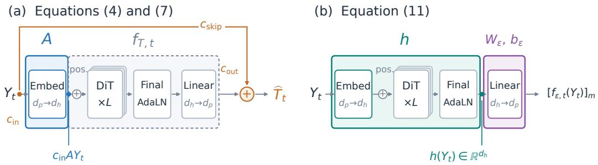  
Figure 1: Architectural formulations of standard DiT. (a) Linear input map A and output preconditioning, (4) and (7). (b) Representation $h ,$ including final AdaLN, and the affine output layer in (11).

An input bottleneck can be less problematic for image prediction, which only needs to estimate the clean image $X _ { 1 }$ from $A Y _ { t }$ . The optimal predictor $\mathbb { E } \bar { [ X _ { 1 } \mid A Y _ { t } , t ] }$ has denoising risk bounded above by $\mathbb { E } \| X _ { 1 } - \mathbb { E } [ X _ { 1 } ] \| ^ { 2 }$ , uniformly in the noise level. Moreover, clean images may concentrate near a structure of intrinsic dimension below the retained dimension r, so a suitable encoder may preserve the clean-image structure needed for denoising despite the input bottleneck.

In contrast, a noise predictor $f _ { \varepsilon , t }$ must recover from $A Y _ { t }$ the noisy-input information needed to cancel the corruption carried by $Y _ { t }$ . Precisely, its induced clean-image estimate is $\widehat { X } _ { 1 } ^ { ( \varepsilon ) } ( Y _ { t } ) =$ $Y _ { t } - \sigma _ { t } f _ { \varepsilon , t } ( A Y _ { t } )$ , following (2) with the network input restricted to $\hat { A Y } _ { t }$ . The explicit input term contains the intact noisy image $Y _ { t } .$ , but the network $f _ { \varepsilon , t }$ can use only $A Y _ { t }$ to cancel its noise.

This loss of input information limits how accurately the network can recover the noise. A rank-r encoder A retains r directions and discards $d - r$ . At high noise, recovering the noise in the retained r directions becomes easier because $A Y _ { t } / \sigma _ { t } = A X _ { 1 } / \bar { \sigma _ { t } } +$ Aε approaches Aε. At every noise level, however, the discarded $d - r$ Gaussian components are independent of $A Y _ { t } .$ , imposing a persistent noise-recovery loss of at least $d - r$ , even for the best possible decoder. Theorem 1 quantifies it.

Theorem 1 (Optimal noise recovery under an input bottleneck). Under the preceding assumptions, the optimal sampled-noise risk is at least $d - r$ at every noise level, and

$$
\operatorname* { i n f } _ { f _ { \varepsilon , t } \in \mathcal { F } } \mathbb { E } \| \varepsilon - f _ { \varepsilon , t } ( A Y _ { t } ) \| ^ { 2 } = d - r + O ( \sigma _ { t } ^ { - 2 } ) , \qquad \sigma _ { t } \to \infty .\tag{5}
$$

This noise-recovery floor translates directly into denoising error since $\mathbb { E } \| \widehat { X } _ { 1 } ^ { ( \varepsilon ) } ( Y _ { t } ) - X _ { 1 } \| ^ { 2 } \ =$ $\sigma _ { t } ^ { 2 } \mathbb { E } \lVert \boldsymbol { \varepsilon } - \boldsymbol { f } _ { \boldsymbol { \varepsilon } , t } ( \boldsymbol { A } Y _ { t } ) \rVert ^ { 2 }$ . Corollary 2 quantifies the induced denoising error.

Corollary 2 (High-noise denoising error induced by an input bottleneck). Under the assumptions ofTheorem 1, the induced clean-image estimate $\widehat { X } _ { 1 } ^ { ( \varepsilon ) } ( Y _ { t } ) = Y _ { t } - \sigma _ { t } f _ { \varepsilon , t } ( A Y _ { t } )$ satisfies

$$
\operatorname* { i n f } _ { f _ { \varepsilon , t } \in \mathcal { F } } \mathbb { E } \| \widehat { X } _ { 1 } ^ { ( \varepsilon ) } ( Y _ { t } ) - X _ { 1 } \| ^ { 2 } = \sigma _ { t } ^ { 2 } ( d - r ) + O ( 1 ) , \qquad \sigma _ { t } \to \infty .\tag{6}
$$

The discarded directions therefore contribute at least $\sigma _ { t } ^ { 2 } ( d - r )$ to denoising error at every noise level, making their effect more severe at higher noise even with the best possible decoder. The optimal denoising risk for image prediction under the same bottleneck remains bounded at every noise level.

## 3.2 OUTPUT PRECONDITIONING CONTROLS THE NOISE-TRANSMISSION BURDEN

Output preconditioning controls the noise-transmission burden by supplying an explicit input contribution. Exact preconditioning makes the network’s target a scaled clean image, while EDM approaches this form at high noise.

Output preconditioning combines the network output with a scaled copy of the noisy input (Karras et al., 2022; Song et al., 2023; Li & He, 2025), which can mitigate the noise-transmission burden. To see this, consider the general target $T _ { t } = \alpha _ { t } X _ { 1 } + \beta _ { t } \varepsilon$ introduced in Section 2. With an input bottleneck A as in Section 3.1, a preconditioned estimate takes the form

$$
\widehat { T } _ { t } = c _ { \mathrm { s k i p } } Y _ { t } + c _ { \mathrm { o u t } } f _ { T , t } ( c _ { \mathrm { i n } } A Y _ { t } ) .\tag{7}
$$

Here $f _ { T , t }$ denotes the raw network in the preconditioned parameterization, and $\widehat { T } _ { t }$ is the estimate of $T _ { t }$ after preconditioning. All coefficients are deterministic at the fixed time, $c _ { \mathrm { i n } } , c _ { \mathrm { o u t } } \ne 0 .$ , and $f _ { T , t } \in \mathcal { F }$ is unrestricted. Since $c _ { \mathrm { i n } } , c _ { \mathrm { o u t } }$ can be absorbed into $f _ { T , t } ,$ they do not change the best attainable risk. The main effect comes from the skip coefficient $c _ { \mathrm { s k i p } } .$ , which determines how much of the intact input $Y _ { t }$ is added directly to the network output, while the network sees only $A Y _ { t }$

Specifically, the skip term supplies $c _ { \mathrm { s k i p } } Y _ { t }$ , leaving the scaled network $c _ { \mathrm { o u t } } f _ { T , t } ( c _ { \mathrm { i n } } A Y _ { t } )$ to predict $T _ { t } - c _ { \mathrm { s k i p } } Y _ { t } = ( \alpha _ { t } - c _ { \mathrm { s k i p } } ) X _ { 1 } + ( \bar { \beta _ { t } } - c _ { \mathrm { s k i p } } \sigma _ { t } ) \varepsilon$ . Unless $c _ { \mathrm { s k i p } } ~ = ~ \beta _ { t } / \sigma _ { t }$ , this residual target still contains noise in the $d - r$ directions discarded by A in the input. These components remain inaccessible to the network, yielding the following risk floor.

Theorem 3 (Optimal target prediction under output preconditioning). Under the preceding assumptions, the optimal target risk is at least $( \beta _ { t } - c _ { \mathrm { s k i p } } \sigma _ { t } ) ^ { 2 } ( d - r )$ at every noise level, and

$$
\operatorname* { i n f } _ { f _ { T , t } \in \mathcal { F } } \mathbb { E } \| T _ { t } - \widehat { T } _ { t } \| ^ { 2 } = ( \beta _ { t } - c _ { \mathrm { s k i p } } \sigma _ { t } ) ^ { 2 } ( d - r ) + O \left( \left( \alpha _ { t } - \frac { \beta _ { t } } { \sigma _ { t } } \right) ^ { 2 } + ( \alpha _ { t } - c _ { \mathrm { s k i p } } ) ^ { 2 } \right) , \quad \sigma _ { t } \to \infty .\tag{8}
$$

This bound shows how $c _ { \mathrm { s k i p } }$ controls the noise-transmission burden: the $d - r$ discarded noise components contribute $( \beta _ { t } - c _ { \mathrm { s k i p } } \sigma _ { t } ) ^ { 2 } ( d - r )$ to the risk. If $c _ { \mathrm { s k i p } } = \beta _ { t } / \sigma _ { t } ,$ which we call exact preconditioning, this term is eliminated, making the target for the scaled network output a scaled clean image, $\bar { T _ { t } } - c _ { \mathrm { s k i p } } Y _ { t } = ( \alpha _ { t } - \beta _ { t } / \sigma _ { t } ) X _ { 1 }$ . Since $\alpha _ { t } - \beta _ { t } / \sigma _ { t } \neq 0$ , the network therefore performs image prediction up to a known scaling.

EDM alleviates the noise-transmission burden without exactly canceling it. It uses the image target, $( \alpha _ { t } , \beta _ { t } ) = ( 1 , 0 )$ , with coefficients

$$
c _ { \mathrm { s k i p } } = \frac { \sigma _ { \mathrm { d a t a } } ^ { 2 } } { \sigma _ { t } ^ { 2 } + \sigma _ { \mathrm { d a t a } } ^ { 2 } } , \qquad c _ { \mathrm { o u t } } = \frac { \sigma _ { t } \sigma _ { \mathrm { d a t a } } } { \sqrt { \sigma _ { t } ^ { 2 } + \sigma _ { \mathrm { d a t a } } ^ { 2 } } } , \qquad c _ { \mathrm { i n } } = \frac { 1 } { \sqrt { \sigma _ { t } ^ { 2 } + \sigma _ { \mathrm { d a t a } } ^ { 2 } } } ,
$$

with fixed data scale $\sigma _ { \mathrm { { d a t a } } } > 0$ (Karras et al., 2022, Table 1 and Appendix B.6, Equations (117), (131), and (138)). Theorem 3 gives the discarded-noise term

$$
c _ { \mathrm { s k i p } } ^ { 2 } \sigma _ { t } ^ { 2 } ( d - r ) = \frac { \sigma _ { \mathrm { d a t a } } ^ { 4 } \sigma _ { t } ^ { 2 } } { ( \sigma _ { t } ^ { 2 } + \sigma _ { \mathrm { d a t a } } ^ { 2 } ) ^ { 2 } } ( d - r ) = O ( \sigma _ { t } ^ { - 2 } ) .
$$

This contribution vanishes at high noise, while the remaining term in (8) stays bounded. Theorem 7 formalizes the corresponding target limit: the raw network target $( X _ { 1 } - \dot { c } _ { \mathrm { s k i p } } Y _ { t } ) / c _ { \mathrm { o u t } }$ converges in mean square to $X _ { 1 } / \sigma _ { \mathrm { d a t a } }$ Thus the learned target approaches a scaled clean image, and the unavoidable contribution of discarded noise decays at an explicit rate. Exact preconditioning eliminates that contribution at every noise level. This is consistent with $\mathrm { J i T } \mathbf { \hat { s } }$ observation that EDM-style preconditioning improves over direct noise and velocity prediction while remaining worse than image prediction in its setting. JiT also notes the high-noise approach to image prediction as a possible explanation (Li & He, 2025, Appendix B.2 and Table 10).

To illustrate the denoising consequences of these parameterizations, we convert the target prediction into a clean-image estimate. Rewriting the same target as $T _ { t } = ( \alpha _ { t } - \beta _ { t } / \sigma _ { t } ) X _ { 1 } + ( \bar { \beta } _ { t } / \bar { \sigma } _ { t } ) Y _ { t }$ and

applying the conversion in (3) to $\widehat { T } _ { t }$ gives

$$
\widehat { X } _ { 1 } ^ { ( T ) } ( Y _ { t } ) = \frac { \widehat { T } _ { t } - ( \beta _ { t } / \sigma _ { t } ) Y _ { t } } { \alpha _ { t } - \beta _ { t } / \sigma _ { t } } = \underbrace { \frac { c _ { \mathrm { s k i p } } - \beta _ { t } / \sigma _ { t } } { \alpha _ { t } - \beta _ { t } / \sigma _ { t } } } _ { \tilde { c } _ { \mathrm { s k i p } } } Y _ { t } + \underbrace { \frac { c _ { \mathrm { o u t } } } { \alpha _ { t } - \beta _ { t } / \sigma _ { t } } } _ { \tilde { c } _ { \mathrm { o u t } } } f _ { T , t } ( c _ { \mathrm { i n } } A Y _ { t } ) .\tag{9}
$$

The converted coefficients $\tilde { c } _ { \mathrm { s k i p } }$ and $\tilde { c } _ { \mathrm { o u t } }$ determine the clean-image estimate, whose risk follows from Theorem 3.

Corollary 4 (Denoising risk under output preconditioning). For $\widehat { X } _ { 1 } ^ { ( T ) } ( Y _ { t } ) ~ = ~ \widetilde { c } _ { \mathrm { s k i p } } Y _ { t } ~ +$ $\tilde { c } _ { \mathrm { o u t } } f _ { T , t } ( c _ { \mathrm { i n } } A Y _ { t } )$ under the preceding assumptions, every decoder satisfies $\mathbb { E } \Vert \widehat { X } _ { 1 } ^ { ( T ) } ( Y _ { t } ) ~ -$ $X _ { 1 } \| ^ { 2 } \geq \tilde { c } _ { \mathrm { s k i p } } ^ { 2 } \sigma _ { t } ^ { 2 } ( d - r ) . \ I f \tilde { c } _ { \mathrm { s k i p } } ( t )$ stays bounded as $\sigma _ { t }  \infty ,$ , then

$$
\operatorname* { i n f } _ { f _ { T , t } \in \mathcal { F } } \mathbb { E } \| \widehat { X } _ { 1 } ^ { ( T ) } ( Y _ { t } ) - X _ { 1 } \| ^ { 2 } = \tilde { c } _ { \mathrm { s k i p } } ( t ) ^ { 2 } \sigma _ { t } ^ { 2 } ( d - r ) + O ( 1 ) , \qquad \sigma _ { t } \to \infty .\tag{10}
$$

Corollary 4 puts the three cases in a common form. Exact preconditioning gives $\tilde { c } _ { \mathrm { s k i p } } = 0 \mathrm { { , } }$ , eliminating the discarded-noise contribution, while bare noise prediction has $\tilde { c } _ { \mathrm { s k i p } } = 1$ and incurs the $\sigma _ { t } ^ { 2 } ( d - r )$ error growth. For EDM, $\tilde { c } _ { \mathrm { s k i p } } = c _ { \mathrm { s k i p } } = { \sigma _ { \mathrm { d a t a } } ^ { 2 } } / { ( \sigma _ { t } ^ { 2 } + \sigma _ { \mathrm { d a t a } } ^ { 2 } ) }$ , so this contribution vanishes at high noise and the optimal denoising risk remains bounded.

## 3.3 THE RESIDUAL BEYOND LINEAR DENOISING DETERMINES MODEL WIDTH

The extra model width needed for denoising is determined by the residual beyond linear denoising of the noisy patch, assuming the model representation allows affine recovery of that patch.

When a noise predictor has access to the full noisy image, with $A = I _ { d }$ and model width $d _ { h } \geq d _ { p } ,$ how does its width limit denoising accuracy? To investigate this question, we focus on one output patch m of dimension $d _ { p } ,$ whose hidden representation has model width $d _ { h }$ and may depend on the whole noisy image $Y _ { t } .$ . A subscript m denotes the corresponding patch quantities, and $\mathbf { \bar { \rho } } [ \cdot ] _ { m }$ selects patch m from a full-image prediction. In particular, $[ f _ { X _ { 1 } , t } ^ { * } ( Y _ { t } ) ] _ { m } = \operatorname { \mathbb { E } } [ X _ { 1 , m } \mid Y _ { t } , t ]$ . For this patch, we rewrite the network in (4) making its hidden representation and final output layer explicit:

$$
Y _ { t } \xrightarrow { h } h ( Y _ { t } ) \in \mathbb { R } ^ { d _ { h } } \xrightarrow [ ] { \mathrm { f i n a l o u t p u t } \mathrm { l a y e r } } [ f _ { \varepsilon , t } ( Y _ { t } ) ] _ { m } = W _ { \varepsilon } h ( Y _ { t } ) + b _ { \varepsilon } .\tag{11}
$$

Here h includes all computation before the final output layer, with $W _ { \varepsilon } \in \mathbb { R } ^ { d _ { p } \times d _ { h } }$ and $b _ { \varepsilon } \in \mathbb { R } ^ { d _ { p } }$ fixed across images. For a Transformer, h includes attention and feed-forward blocks, final normalization, and modulation (Figure 1b). The map $W _ { \varepsilon } h ( Y _ { t } ) + b _ { \varepsilon }$ denotes the final linear output projection, which is affine when a bias is included.

It is not clear a priori what information should be retained in the hidden representation $h ( Y _ { t } )$ for accurate denoising. However, the identity $[ f _ { \varepsilon , t } ^ { * } ( Y _ { t } ) ] _ { m } = ( Y _ { t , m } - [ f _ { X _ { 1 } , t } ^ { * } ( Y _ { t } ) \hat { ] _ { m } } ) / \sigma _ { t }$ suggests a possible realization of the optimal noise predictor: $h ( Y _ { t } )$ could make both the noisy patch $Y _ { t , m }$ and the denoising information for $[ f _ { X _ { 1 } , t } ^ { * } ( Y _ { t } ) ] _ { m } ^ { * }$ separately accessible through affine readouts. Motivated by this, we assume that the noisy patch can be recovered affinely from $h ( Y _ { t } )$ , as formalized below.

Assumption 1 (Affine recovery of the noisy patch). We consider only representations h satisfying $\mathbb { E } \| h ( Y _ { t } ) \| ^ { 2 } < \dot { \infty }$ for which there exist $W \doteq \overline { { \mathbb { R } ^ { d _ { p } \times d _ { h } } } }$ and $b \in \mathbb { R } ^ { d _ { p } }$ such that W $h ( Y _ { t } ) + b = Y _ { t , m }$ with probability one.

This representation strategy is also motivated by the linear structure observed in trained denoisers. Wang & Vastola (2024) find that Gaussian score approximations describe learned scores well at moderate to high noise, while Li et al. (2024, Appendix D) report that denoisers approach the identity map at low noise. These observations motivate studying representations that keep the noisy patch affinely accessible while encoding additional denoising corrections.

Assumption 1 already provides affine denoising features. Under Assumption 1 and (11), both the noisy patch $Y _ { t , m }$ and the predicted noise $[ f _ { \varepsilon , t } ^ { - } ( Y _ { t } ) ] _ { m }$ are affine in $h ( Y _ { t } )$ , so their combination $\widehat { X } _ { 1 , m } ^ { ( \varepsilon ) } ( Y _ { t } ) = Y _ { t , m } - \sigma _ { t } [ f _ { \varepsilon , t } ( Y _ { t } ) ] _ { m }$ is also affine in $h ( Y _ { t } )$ . Choosing $W _ { \varepsilon } , b _ { \varepsilon }$ allows this clean estimate to realize any affine estimate of the clean patch $X _ { 1 , m }$ based on the noisy patch $Y _ { t , m }$ . In this sense, every representation satisfying Assumption 1 can support the best affine denoising estimate from the noisy patch alone, denoted by $\ell _ { t } ( Y _ { t , m } )$ and derived in Appendix A.3.1. Optimizing $h , W _ { \varepsilon } , b _ { \varepsilon }$ within this class yields an approximation error no greater than that of $\ell _ { t } ( Y _ { t , m } )$

What remains is how much additional model width $d _ { h } - d _ { p }$ is needed to represent the denoising features beyond this affine baseline. We characterize these features through the residual $R _ { t } : = $ $[ f _ { X _ { 1 } , t } ^ { * } ( Y _ { t } ) ] _ { m } ^ { ^ { \bullet } } - \ell _ { t } ( Y _ { t , m } )$ , which can reflect nonlinear dependence on the noisy patch or information from other patches. The width question translates into how well the excess $d _ { h } - d _ { p }$ coordinates can approximate this residual. Let $\lambda _ { j } ( \mathrm { C o v } ( R _ { t } ) )$ ) denote the $j \cdot$ -th largest eigenvalue of the residual covariance. Theorem 5 characterizes the optimal approximation error through these eigenvalues.

Theorem 5 (Optimal denoiser approximation at a fixed width). Under Assumption 1,

$$
\operatorname* { i n f } _ { h , W _ { \varepsilon } , b _ { \varepsilon } } \mathbb { E } \| \widehat { X } _ { 1 , m } ^ { ( \varepsilon ) } ( Y _ { t } ) - [ f _ { X _ { 1 } , t } ^ { * } ( Y _ { t } ) ] _ { m } \| ^ { 2 } = \sum _ { j > d _ { h } - d _ { p } } \lambda _ { j } ( \operatorname { C o v } ( R _ { t } ) ) .\tag{12}
$$

The infimum is attained by $h ( Y _ { t } ) = ( Y _ { t , m } , Q ^ { \top } R _ { t } , 0 )$ for some $W _ { \varepsilon } , b _ { \varepsilon } ,$ , where $Q$ contains $o r { - }$ thonormal eigenvectors for the largest min $\{ d _ { h } - d _ { p } , d _ { p } \}$ eigenvalues $o f \mathrm { C o v } ( R _ { t } )$

At $d _ { h } = d _ { p } ,$ , the best affine clean readout is $\ell _ { t } ,$ with approximation error $\mathbb { E } \Vert R _ { t } \Vert ^ { 2 }$ . Additional width allows the representation to capture leading covariance directions of $R _ { t } ,$ reducing the error by their variance. Thus fewer extra coordinates are needed when the residual variance concentrates in a small number of directions. The clean-image loss $\mathbb { E } \Vert \widehat { X } _ { 1 , m } ^ { ( \varepsilon ) } ( Y _ { t } ) - X _ { 1 , m } \Vert ^ { 2 }$ equals this approximation error plus the irreducible Bayes risk, as shown in Appendix A.3.3.

The same spectrum determines the smallest width needed to reach a chosen approximation tolerance.

Corollary 6 (Width required at a fixed approximation tolerance). For $\delta \geq 0 ,$ , the smallest width   
in the preceding representation class attaining $\mathbb { E } \| \widehat { X } _ { 1 , m } ^ { ( \varepsilon ) } ( Y _ { t } ) - [ f _ { X _ { 1 } , t } ^ { * } ( Y _ { t } ) ] _ { m } \| ^ { 2 } \leq \delta i s$   
$d _ { h } = d _ { p } + \operatorname* { m i n } \left\{ k \in \{ 0 , \dots , d _ { p } \} : \sum _ { j > k } \lambda _ { j } ( \operatorname { C o v } ( R _ { t } ) ) \leq \delta \right\} .$

For zero approximation error, the required width is $d _ { p } + \operatorname { r a n k } ( \operatorname { C o v } ( R _ { t } ) )$ , so width $2 d _ { p }$ always suffices within this representation class.

## 4 EXPERIMENTS

We test our theoretical predictions with experiments on ImageNet. Sections 3.1 and 3.2 show that an input bottleneck, arising when model width $d _ { h }$ is smaller than patch dimension $d _ { p }$ or the input passes through a narrow patch embedding, limits noise recovery (Theorem 1) and imposes a denoisingerror floor (Corollary 2). EDM-style preconditioning alleviates this discarded-noise contribution at high noise, while exact preconditioning eliminates it (Theorem 3 and Corollary 4). To test these predictions, we use JiT-B/16 (Li & He, 2025) on ImageNet256 with a $7 6 8  1 2 \dot { 8 } $ 768 bottleneck patch embedding, comparing prediction targets and output preconditioning through FID-10K, fixedtime denoising loss, and noise-recovery probes.

Section 3.3 shows that when $d _ { h } \ \geq \ d _ { p }$ , the additional model width needed to approximate the population-optimal denoiser is determined by the covariance spectrum of its residual beyond the best affine denoiser, under Assumption 1 (Theorem 5 and Corollary 6). This residual describes the correction beyond linear denoising needed at each time t. To examine this width requirement, we remove the bottleneck embedding and widen noise predictors from $d _ { h } = d _ { p }$ to $2 \bar { d _ { p } }$ , using ImageNet256 with $d _ { p } = 7 6 8$ and ImageNet128 with $d _ { p } = 1 9 2$ . We also probe affine recovery of the noisy input from the hidden representation to assess empirical support for Assumption 1. Finally, we use a pretrained ADM denoiser (Dhariwal & Nichol, 2021) as a proxy for the population-optimal denoiser to estimate the residual spectrum directly.

Both suites use $X _ { t } = t X _ { 1 } + ( 1 - t ) \varepsilon , \operatorname { s o } \sigma _ { t } = ( 1 - t ) / t$ and small t means high noise. Denoising, probe, and residual-spectrum measurements use the ImageNet validation split, held out from backbone training. Experimental details and additional results are provided in Appendix B.

## 4.1 PRECONDITIONING LOWERS DENOISING FLOORS UNDER INPUT BOTTLENECKS

EDM alleviates the noise-transmission burden; exact preconditioning cancels it. Noise prediction (Noise) performs poorly under the input bottleneck, reaching FID 412.11, compared with 9.13 for image prediction (Image) and 177.20 for velocity prediction (Velocity; Figure 2a). EDM preconditioning substantially alleviates this gap: the JiT (Li & He, 2025) and Simple ReFlow (Kim et al., 2025) variants (EDM: JiT and EDM: ReFlow), which differ only in input scaling, both reach approximately 52.28. Simply supplying the noisy input through an additive shortcut (Additive), which adds $X _ { t }$ to the raw noise-network output, gives FID 181.09. Exact preconditioning (Exact) instead reaches 9.15 and makes the learned branch image-prediction-equivalent away from endpoint clamps. Allowing the skip and output coefficients to be learned as functions of t gives FID 9.56, 14.99, and 15.13 for three variants with different initial coefficient values (Learned 1, Learned 2, and Learned 3, respectively). The learned skip approaches the exact-preconditioning condition at moderate and high noise (Figure 6a; Appendix B.1.2).

The predicted denoising floor helps explain the generation differences. Our theory suggests one explanation for these generation differences through a lower bound on denoising loss. With $r _ { p } / d _ { p } \overset { \_ } { \leq } 1 2 8 / 7 6 8 = 1 / 6 .$ , Corollaries 2 and 4 give

$$
\frac 1 d \mathbb { E } \| \widehat { X } _ { 1 } ^ { ( T ) } ( Y _ { t } ) - X _ { 1 } \| ^ { 2 } \geq \tilde { c } _ { \mathrm { s k i p } } ^ { 2 } \sigma _ { t } ^ { 2 } \left( 1 - \frac { r _ { p } } { d _ { p } } \right) \geq \frac { 5 } { 6 } \tilde { c } _ { \mathrm { s k i p } } ^ { 2 } \sigma _ { t } ^ { 2 } .
$$

Noise prediction has $\tilde { c } _ { \mathrm { s k i p } } = 1$ , yielding the floor $5 \sigma _ { t } ^ { 2 } / 6$ . Exact preconditioning has $\tilde { c } _ { \mathrm { s k i p } } = 0$ and eliminates this discarded-noise contribution. For EDM, $\tilde { c } _ { \mathrm { s k i p } } = { \sigma _ { \mathrm { d a t a } } ^ { 2 } } / { ( \sigma _ { t } ^ { 2 } + \sigma _ { \mathrm { d a t a } } ^ { 2 } ) }$ : the contribution is most pronounced at low to intermediate noise, and vanishes as $\sigma _ { t }  \infty .$

These predicted floors are visible in the measured denoising losses (Figure 2b). $\mathrm { A t } ~ t = 0 . 0 5 ~ ( \sigma _ { t } =$ 19), noise prediction has MSE 300.836, close to the floor 300.833; at $t = 0 . 5$ , the corresponding values are 0.83387 and 0.83333. Image prediction and exact preconditioning instead give MSE 0.11016 and 0.11019 at $t = 0 . 0 5$ , and 0.01570 and 0.01571 at $t = 0 . 5$ . For both EDM variants, the intermediate-noise floor is reflected in a higher loss: at $t = 0 . 5$ , their MSE is approximately 0.04747, with a floor of 0.03333. At high noise, $t = 0 . 0 5$ , their MSE is approximately 0.1103, close to the losses for image prediction and exact preconditioning as the EDM floor becomes negligible. Figure 7 compares the full loss grid for all variants.

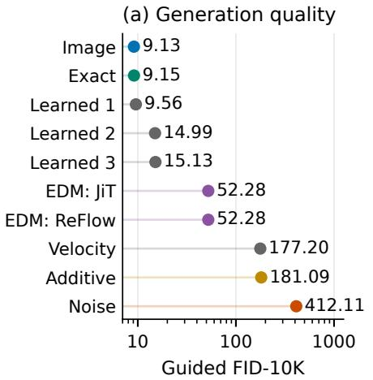

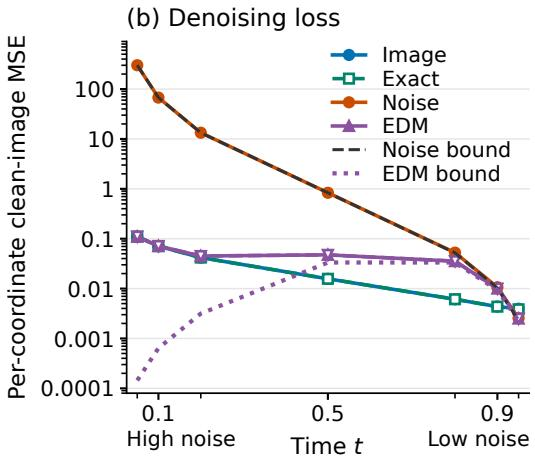  
Figure 2: Generation and denoising under the same input bottleneck, at epoch 200. (a) Guided FID-10K (↓). (b) Per-coordinate clean-image MSE and the discarded-noise lower bounds from Corollaries 2 and 4. Both EDM input scalings are plotted and nearly coincide. Noise prediction follows its growing floor; the EDM floor becomes negligible at high noise, where its loss approaches those for image prediction and exact preconditioning. FID and MSE use logarithmic scales; panel (b) uses time t, with $\sigma _ { t } = ( 1 - t ) / t$

(c) Residual structure

Limited noise recovery makes the noise-transmission burden explicit. We fit affine noise probes to the noise predictor’s embedding and block outputs at six times. For a probe estimate εb, population explained variance is $\mathrm { E V } [ \varepsilon ] =$ $\dot { 1 } - \mathbb { E } \| \varepsilon - \widehat { \varepsilon } \| ^ { 2 } / \dot { d } ,$ since standard Gaussian noise has total variance d. The numerator is the noise-recovery risk in Theorem 1; its floor $d - r$ gives the ceiling $\mathrm { E V } [ \varepsilon ] \stackrel { \cdot } { \leq } r / d \leq 1 / 6 .$ We report the empirical counterpart using the test-noise variance. The theorem also predicts that the optimal score approaches $r / d$ at high noise, as recovery in the retained directions becomes easier. Figure 3 shows the final block. Consistently, all 78 scores stay below $1 / 6 ,$ and final-block recovery rises from 0.0833 at low noise $( t ~ = ~ 0 . 9 5 )$ to 0.1665 at high noise $( t = 0 . 1 )$ The discarded noise still imposes the denoising floor. Table 3 gives all layerwise scor

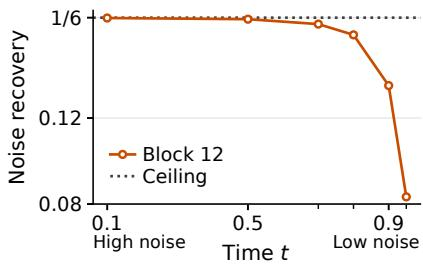  
Figure 3: Block-12 noise recovery approaches but stays below the $1 / 6$ ceiling at high noise, consistent with Theorem 1.

## 4.2 WIDENING IMPROVES DENOISING AND AFFINE INPUT RECOVERY

We now consider noise predictors with model width $d _ { h } \geq d _ { p }$ and a single linear patch embedding that can preserve full input rank. ImageNet256 with $1 6 \times 1 6$ RGB patches has $d _ { p } = 7 6 8$ and 256 image tokens. Image-prediction controls also include widths below $d _ { p } .$ . Depth and the image-loss convention remain fixed; width changes the parameter and attention-head counts.

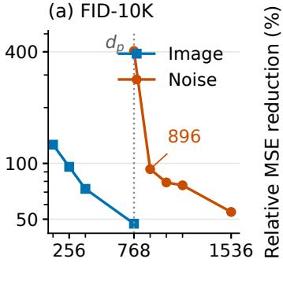  
Model width $d _ { h }$

(b) Denoising gain  
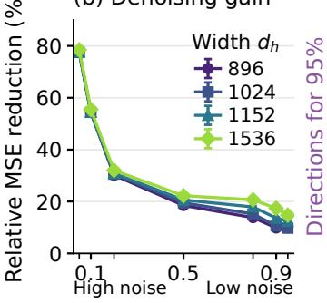  
Time t

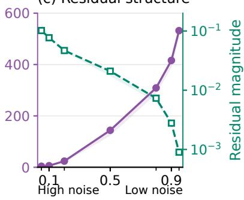  
Time t  
Figure 4: Model width and denoiser approximation on ImageNet256. (a) Generation quality versus model width; the dotted line marks $d _ { p } = 7 6 8$ . (b) Relative clean-image MSE reduction from width 768. (c) Residual structure of a proxy for the population-optimal denoiser: purple circles give the 95%-variance direction count (left axis), and dashed green squares give residual magnitude (right axis, log scale). Both curves show the central patch; shading spans patch positions.

Generation and denoising improve immediately above $d _ { h } = d _ { p } ,$ with stronger affine input recovery. At epoch 200, increasing the noise predictor’s width from 768 to 896, still below $2 d _ { p } ,$ reduces ImageNet256 FID from 404.03 to 93.11 (Figure 4a). Further widening gives smaller FID improvements, reaching 54.71 at width 1536.

These generation gains are accompanied by lower denoising loss and stronger affine noisy-input recovery from the final representation h (Figure 5). $\mathrm { { A t } } t = 0 . 5$ , increasing width from 768 to 896 reduces clean-image MSE from 0.01959 to 0.01597 and raises noisy-input recovery from 78.34% to 93.60%. At width 1536, MSE is 0.01524 and input recovery is 99.18%.

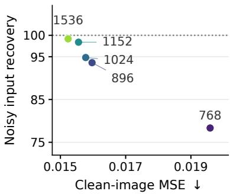  
Figure 5: At $t = 0 . 5 ;$ labels: $d _ { h }$

This supports the input-preserving representation in Assump  
tion 1. ImageNet128 shows the same association (Figures 8a and ${ \mathfrak { g } } { \mathfrak { b } } , { \mathrm { d } } ) ;$ Figure 9 shows imageprediction controls at both resolutions.

Further widening gives larger relative denoising gains at low noise. To understand the sharp generation improvement from width 768 to 896 and the smaller gains from further widening, we measure relative denoising improvements at each t. Recall that Theorem 5 characterizes how the best attainable approximation to the population-optimal denoiser improves with width under Assumption 1. For trained models, we estimate such approximation improvement by comparing their clean-image losses, since at a fixed t, the population identity gives

$$
\underbrace { \mathbb { E } \Big [ \| \widehat { X } _ { 1 , d _ { p } } ^ { ( \varepsilon ) } - X _ { 1 } \| ^ { 2 } - \| \widehat { X } _ { 1 , d _ { h } } ^ { ( \varepsilon ) } - X _ { 1 } \| ^ { 2 } \Big ] } _ { \mathrm { d e n o i s i n g - l o s s ~ r e d u c t i o n ~ ( e s t i m a t e d ) } } = \underbrace { \mathbb { E } \Big [ \| \widehat { X } _ { 1 , d _ { p } } ^ { ( \varepsilon ) } - f _ { X _ { 1 } , t } ^ { * } \| ^ { 2 } - \| \widehat { X } _ { 1 , d _ { h } } ^ { ( \varepsilon ) } - f _ { X _ { 1 } , t } ^ { * } \| ^ { 2 } \Big ] } _ { \mathrm { p o p u l a t i o n - d e n o i s e r ~ a p p r o x i m a t i o n ~ i m p r o v e m e n t } } ,
$$

where model width is indicated by an additional subscript and the common argument Yt is suppressed. Figure 4b reports the measured reduction as a percentage of the width-768 model’s cleanimage MSE at the same t. At high noise $( t = 0 . 0 5 )$ , width 896 already gives a $7 7 . 7 \%$ reduction, and width 1536 gives 78.4%. At low noise $( t = 0 . 9 )$ , the corresponding reductions increase from 9.8% to 17.4%. Thus most of the high-noise benefit is obtained in the first step above $d _ { h } = d _ { p }$ , while further widening gives a clearer relative benefit at low noise. Measured from width 896, widening to 1536 reduces MSE by 3.2% at $t = 0 . 0 5$ and 8.4% at $t = 0 . 9$ . Figure 8b gives the ImageNet128 counterpart; Tables 4 and 5 give the full absolute-loss grids at both resolutions.

Low-noise denoising is closer to linear, but needs corrections from many coordinates. Why does further widening give larger relative denoising gains at low noise? To investigate this, we inspect the covariance spectrum of the residual in Section 3.3. Under Assumption 1, Theorem 5 and Corollary 6 connect the concentration of this spectrum to the additional model width needed to approximate the denoiser. A residual whose variance is spread over more directions requires more additional coordinates to capture the same fraction of that variance. We use a pretrained ADM denoiser (Dhariwal & Nichol, 2021) as a proxy for $f _ { X _ { 1 } , t } ^ { * }$ , and estimate the best affine patch denoiser $\ell _ { t }$ from clean-patch means and covariances. Based on this, writing $\lambda _ { 1 } \geq \cdots \geq \lambda _ { d _ { p } } \geq 0$ for the eigenvalues of $\mathrm { \bar { C } o v } ( R _ { t } )$ and taking $k \in \{ 0 , \ldots , d _ { p } \}$ , we estimate

$$
\mathrm { R e s i d u a l \ m a g n i t u d e } = \frac { 1 } { d _ { p } } \sum _ { j = 1 } ^ { d _ { p } } \lambda _ { j } , \qquad 9 5 \% \ \mathrm { d i r e c t i o n s } = \operatorname* { m i n } \left\{ k : \sum _ { j = 1 } ^ { k } \lambda _ { j } \geq 0 . 9 5 \sum _ { j = 1 } ^ { d _ { p } } \lambda _ { j } \right\} .
$$

Figure 4c shows that the residual becomes smaller at low noise: its variance per coordinate falls by a factor of 27.7 between $t = 0 . 1$ and $t = 0 . 9$ . This is consistent with the low-noise near-identity behavior reported by Li et al. (2024, Appendix D). At the same time, the residual becomes more dispersed: 6 directions capture 95% of its variance at high noise $( t = 0 . 1 )$ , compared with 416 at low noise $( t = 0 . 9 )$ . The same contrast holds on ImageNet128 (Figure 8c); Table 6 compares the reference denoiser’s accuracy with JiT. This pattern supports a spectral interpretation of the further low-noise denoising gains from widening.

Before closing this section, we remark on the original DiT scaling experiments. DiT-S/8 and DiT-B/8 have the same depth of 12, with widths 384 and 768 and latent patch dimension $d _ { p } = 2 5 6$ (Peebles & Xie, 2023, Section 3.2, Table 1, and Figure 6). This comparison crosses $2 d _ { p } = 5 1 2$ , and the improved generative performance is qualitatively consistent with additional width supporting corrections beyond linear denoising under Assumption 1.

## 5 CONCLUSION

Our analysis has several limitations. Our width characterization relies on Assumption 1: the noisy patch must be exactly recoverable through an affine readout of the representation. This describes one representation strategy rather than a necessary property of all successful noise predictors. Within our unrestricted representation class, width $2 d _ { p }$ already suffices to represent the population-optimal denoiser. Further improvements in generation from widening beyond $2 d _ { p }$ are not characterized by our current denoising-risk theory; explaining these gains is left for future work. Moreover, although our experiments use networks shared across noise levels and evaluate both denoising and generation, the theoretical analysis treats each noise level separately, leaving open how parameter sharing changes the attainable tradeoffs. It also characterizes denoising accuracy without establishing how errors propagate through sampling or translate into differences between generated and target distributions.

## REPRODUCIBILITY STATEMENT

The repository at https://github.com/hun-learning94/noiseburden provides training and evaluation code, saved numerical results, and scripts to regenerate all tables and Figures 2–9. It includes run configurations, checkpoint identities, and instructions for supplying the external data and model weights. Appendix A contains the proofs of all theorems and corollaries, including the supporting lemmas and derivations. Appendix B documents the training and generation settings, held-out evaluation protocols, probe procedures, residual-spectrum estimation, and protocol qualifications.

## AI USE STATEMENT

Generative AI tools assisted with reviewing the literature, improving the presentation of the work, developing and cleaning up code, carrying out experiments, refining proofs, providing manuscript feedback, and editing the text. The authors independently reviewed and verified all AI-assisted results, made the final scientific and methodological decisions, and take full responsibility for the contents of this paper.

## REFERENCES

Shadab Ahamed, Eshed Gal, Md Shahriar Rahim Siddiqui, Simon Ghyselincks, Moshe Eliasof, and Eldad Haber. Preconditioned flow matching. arXiv preprint arXiv:2603.02337, 2026. URL https://arxiv.org/abs/2603.02337v2. Version 2, May 13, 2026.

Hansheng Chen, Jan Ackermann, Minseo Kim, Gordon Wetzstein, and Leonidas Guibas. Asymmetric flow models. arXiv preprint arXiv:2605.12964, 2026. URL https://arxiv.org/abs/ 2605.12964v2. Version 2, May 25, 2026.

Minshuo Chen, Kaixuan Huang, Tuo Zhao, and Mengdi Wang. Score approximation, estimation and distribution recovery of diffusion models on low-dimensional data. In Proceedings of the 40th International Conference on Machine Learning, volume 202 of Proceedings of Machine Learning Research, pp. 4672–4712, 2023. URL https://proceedings.mlr.press/ v202/chen23o.html.

Prafulla Dhariwal and Alexander Nichol. Diffusion models beat GANs on image synthesis. In Advances in Neural Information Processing Systems, volume 34, 2021. URL https://proceedings.neurips.cc/paper/2021/hash/ 49ad23d1ec9fa4bd8d77d02681df5cfa-Abstract.html. NeurIPS 2021 conference version.

Anne Gagneux, Segol´ ene Martin, R\` emi Gribonval, and Mathurin Massias. Training flow matching:´ The role of weighting and parameterization. In Second DeLTa Workshop at ICLR, 2026. URL https://arxiv.org/abs/2603.06454v2. arXiv:2603.06454v2, April 17, 2026.

Qing Jin and Chaoyang Wang. Revisiting diffusion model predictions through dimensionality. arXiv preprint arXiv:2601.21419, 2026. URL https://arxiv.org/abs/2601.21419v2. Version 2, March 27, 2026.

Tero Karras, Miika Aittala, Timo Aila, and Samuli Laine. Elucidating the design space of diffusionbased generative models. In Advances in Neural Information Processing Systems, volume 35, 2022. URL https://arxiv.org/abs/2206.00364v2. Archived arXiv:2206.00364v2, October 11, 2022.

Beomsu Kim, Yu-Guan Hsieh, Michal Klein, Marco Cuturi, Jong Chul Ye, Bahjat Kawar, and James Thornton. Simple ReFlow: Improved techniques for fast flow models. In International Conference on Learning Representations, 2025. URL https://proceedings.iclr.cc/paper\_files/paper/2025/file/ a95ba79ea3881ffd9fb8620e1a0d4b36-Paper-Conference.pdf. ICLR 2025 conference version, Appendix D.2.

Tianhong Li and Kaiming He. Back to basics: Let denoising generative models denoise. arXiv preprint arXiv:2511.13720, 2025. URL https://arxiv.org/abs/2511.13720v2. Version 2, January 7, 2026.

Xiang Li, Yixiang Dai, and Qing Qu. Understanding generalizability of diffusion models requires rethinking the hidden Gaussian structure. In Advances in Neural Information Processing Systems, volume 37, 2024. URL https://proceedings.neurips.cc/paper\_files/paper/ 2024/file/69e68611ec4d8c0ae4a4b2bece165f5f-Paper-Conference.pdf. NeurIPS 2024 conference version.

William Peebles and Saining Xie. Scalable diffusion models with transformers. In Proceedings of the IEEE/CVF International Conference on Computer Vision, pp. 4195–4205, 2023. URL https://arxiv.org/abs/2212.09748v2. arXiv:2212.09748v2, March 2, 2023.

Yang Song, Prafulla Dhariwal, Mark Chen, and Ilya Sutskever. Consistency models. In Proceedings of the 40th International Conference on Machine Learning, volume 202 of Proceedings of Machine Learning Research, pp. 32211–32252. PMLR, 2023. URL https://proceedings. mlr.press/v202/song23a.html. ICML 2023 proceedings version.

Binxu Wang and John J. Vastola. The unreasonable effectiveness of Gaussian score approximation for diffusion models and its applications. Transactions on Machine Learning Research, 2024. URL https://arxiv.org/abs/2412.09726v1. Archived arXiv:2412.09726v1, December 12, 2024.

Boyang Zheng, Nanye Ma, Shengbang Tong, and Saining Xie. Diffusion transformers with representation autoencoders. arXiv preprint arXiv:2510.11690, 2025. URL https://arxiv. org/abs/2510.11690v1. Version 1, October 13, 2025.

## APPENDIX CONTENTS

A Proofs 13   
A.1 Input bottlenecks 13   
A.1.1 Proof of Theorem 1 13   
A.1.2 Proof of Corollary 2 14   
A.2 Output preconditioning . 14   
A.2.1 Proof of Theorem 3 14   
A.2.2 Convergence of EDM’s raw network target 15   
A.2.3 Proof of Corollary 4 15   
A.3 Model width under affine input recovery 15   
A.3.1 Derivation of the best affine denoising baseline 15   
A.3.2 Feature decomposition under affine input recovery 16   
A.3.3 Proof of Theorem 5 . 16   
A.3.4 Proof of Corollary 6 18   
B Experimental protocols and additional results 18   
B.1 Preconditioning lowers denoising floors under input bottlenecks 18   
B.1.1 Training, preconditioning, and generation 18   
B.1.2 Learned versus exact preconditioning coefficients 19   
B.1.3 Fixed-time denoising losses 19   
B.1.4 Layerwise noise-recovery probes . 20   
B.2 Widening improves denoising and affine input recovery 21   
B.2.1 Model configurations and generation results 21   
B.2.2 Affine input-recovery probes and controls . 22   
B.2.3 Denoising losses across widths and noise levels 23   
B.2.4 ADM residual spectra and reference checks 24

## C Related literature

## A PROOFS

All arguments use the model and conventions of Section 2. We work at the fixed time of the corresponding statement and suppress this conditioning when it is unambiguous

## A.1 INPUT BOTTLENECKS

Lemma 1 (Projected clean-image risk under an input bottleneck). Under the assumptions of Section 3.1, for any deterministic orthogonal projector $P _ { A }$

$$
0 \leq \mathbb { E } \Vert P _ { A } \{ X _ { 1 } - \mathbb { E } [ X _ { 1 } \mid A Y _ { t } , t ] \} \Vert ^ { 2 } \leq \operatorname { t r } \left( P _ { A } \operatorname { C o v } ( X _ { 1 } ) \right) .\tag{13}
$$

The bound is uniform in the noise level.

Proof. The conditional mean $P _ { A } \mathbb { E } [ X _ { 1 } \mid A Y _ { t } , t ]$ minimizes the squared error for predicting $P _ { A } X _ { 1 }$ from $A Y _ { t }$ . Its risk is therefore at most that of the constant predictor $P _ { A } \mathbb { E } X _ { 1 }$ , namely $\mathbb { E } \Vert \tilde { P _ { A } } ( X _ { 1 } -$ $\mathbb { E } X _ { 1 } ) \Vert ^ { 2 } = \operatorname { t r } ( P _ { A } \operatorname { C o v } ( X _ { 1 } ) )$ , where the equality uses $P _ { A } ^ { \top } P _ { A } ^ { \bullet } = P _ { A }$ □

## A.1.1 PROOF OF THEOREM 1

Proof. Let $P _ { A }$ be the orthogonal projector onto the row space of A. We will show that the optimal noise-recovery risk consists of a discarded-direction contribution $d - r$ and a retained-direction contribution of order $\sigma _ { t } ^ { - 2 }$ . The conditional mean $\mathbb { E } [ \varepsilon \mid A Y _ { t } , t ]$ attains the minimum squared risk, and the retained and discarded subspaces are orthogonal, so

$$
\begin{array} { r l } & { \underset { f _ { \varepsilon , t } \in \mathcal { F } } { \operatorname* { i n f } } \mathbb { E } \| \varepsilon - f _ { \varepsilon , t } ( A Y _ { t } ) \| ^ { 2 } = \mathbb { E } \big \| ( I - P _ { A } ) \varepsilon - \mathbb { E } [ ( I - P _ { A } ) \varepsilon \mid A Y _ { t } , t ] \big \| ^ { 2 } } \\ & { \qquad + \mathbb { E } \big \| P _ { A } \varepsilon - \mathbb { E } [ P _ { A } \varepsilon \mid A Y _ { t } , t ] \big \| ^ { 2 } . } \end{array}
$$

For the first term, the projected Gaussian vectors $( I - P _ { A } ) \varepsilon$ and $P _ { A } \varepsilon$ are independent because their cross covariance is zero. Since $X _ { 1 }$ is independent of ε, the discarded noise is also independent of

$( X _ { 1 } , P _ { A } \varepsilon )$ , and hence of $( X _ { 1 } , A Y _ { t } )$ because $A Y _ { t } = A X _ { 1 } + \sigma _ { t } A P _ { A } \varepsilon$ . It follows that

$$
\begin{array} { r } { \mathbb { E } [ ( I - P _ { A } ) \varepsilon \mid A Y _ { t } , t ] = 0 , \qquad \mathbb { E } \| ( I - P _ { A } ) \varepsilon \| ^ { 2 } = \operatorname { t r } ( I - P _ { A } ) = d - r . } \end{array}
$$

Thus the first term is exactly $d - r$ at every noise level.

For the second term, $P _ { A } Y _ { t }$ is determined by $A Y _ { t } ,$ and $P _ { A } Y _ { t } = P _ { A } X _ { 1 } + \sigma _ { t } P _ { A } \varepsilon$ gives

$$
P _ { A } \varepsilon - \mathbb { E } [ P _ { A } \varepsilon \mid A Y _ { t } , t ] = - \sigma _ { t } ^ { - 1 } P _ { A } \{ X _ { 1 } - \mathbb { E } [ X _ { 1 } \mid A Y _ { t } , t ] \} .
$$

The second term is therefore $\sigma _ { t } ^ { - 2 }$ times the projected clean-image risk. By Lemma 1, it lies between zero and $\sigma _ { t } ^ { - 2 } \operatorname { t r } ( P _ { A } \operatorname { C o v } ( X _ { 1 } ) )$

Combining the two terms gives the exact decomposition

$$
\operatorname* { i n f } _ { f _ { \varepsilon , t } \in { \mathcal { F } } } \mathbb { E } \| \varepsilon - f _ { \varepsilon , t } ( A Y _ { t } ) \| ^ { 2 } = d - r + \sigma _ { t } ^ { - 2 } \mathbb { E } { \bigl \| } P _ { A } \{ X _ { 1 } - \mathbb { E } [ X _ { 1 } \mid A Y _ { t } , t ] \} { \bigr \| } ^ { 2 } .
$$

The remainder is nonnegative and of order $\sigma _ { t } ^ { - 2 }$ , proving both the lower bound $d - r$ at every noise level and the high-noise expansion in (5). □

## A.1.2 PROOF OF COROLLARY 2

Proof. For each decoder the induced clean error is exactly

$$
\widehat { X } _ { 1 } ^ { ( \varepsilon ) } ( Y _ { t } ) - X _ { 1 } = Y _ { t } - \sigma _ { t } f _ { \varepsilon , t } ( A Y _ { t } ) - X _ { 1 } = \sigma _ { t } \{ \varepsilon - f _ { \varepsilon , t } ( A Y _ { t } ) \} .
$$

Multiplying the exact risk decomposition in the proof of Theorem 1 by $\sigma _ { t } ^ { 2 }$ therefore gives

$$
\operatorname* { i n f } _ { f _ { \epsilon , t } } \mathbb { E } \| \widehat { X } _ { 1 } ^ { ( \varepsilon ) } ( Y _ { t } ) - X _ { 1 } \| ^ { 2 } = \sigma _ { t } ^ { 2 } ( d - r ) + \mathbb { E } \big \| P _ { A } \{ X _ { 1 } - \mathbb { E } [ X _ { 1 } \mid A Y _ { t } , t ] \} \big \| ^ { 2 } .
$$

By Lemma 1, the remainder belongs to the interval $[ 0 , \mathrm { t r } ( P _ { A } \cos ( X _ { 1 } ) ) ]$ uniformly in the noise level, which completes the proof. □

## A.2 OUTPUT PRECONDITIONING

## A.2.1 PROOF OF THEOREM 3

Proof. We will show that the optimal target risk consists of the discarded-noise contribution $( \beta _ { t } -$ $c _ { \mathrm { s k i p } } \dot { \sigma } _ { t } ) ^ { 2 } ( d - r )$ and two nonnegative clean-image uncertainty terms. Since $c _ { \mathrm { i n } } , c _ { \mathrm { o u t } } \ne 0$ , the scaled outputs $c _ { \mathrm { o u t } } ^ { \phantom { \dagger } } f _ { T , t } ^ { \phantom { \dagger } } ( c _ { \mathrm { i n } } A Y _ { t } )$ range over all measurable functions of $A Y _ { t }$ with finite squared risk. The optimum is therefore attained by the conditional mean of the residual target $T _ { t } - c _ { \mathrm { s k i p } } Y _ { t }$ given $A Y _ { t } .$ Let $P _ { A }$ project onto the row space of A. We split the optimal residual error into its retained and discarded components, whose squared norms add by orthogonality:

$$
\begin{array} { r l } & { \underset { f _ { T , t } \in \mathcal { F } } { \operatorname* { i n f } } \mathbb { E } \| T _ { t } - \widehat { T _ { t } } \| ^ { 2 } = \mathbb { E } \big \| P _ { A } \{ T _ { t } - c _ { \mathrm { s k i p } } Y _ { t } - \mathbb { E } [ T _ { t } - c _ { \mathrm { s k i p } } Y _ { t } \mid A Y _ { t } , t ] \} \big \| ^ { 2 } } \\ & { \qquad + \mathbb { E } \big \| \big ( I - P _ { A } \big ) \{ T _ { t } - c _ { \mathrm { s k i p } } Y _ { t } - \mathbb { E } [ T _ { t } - c _ { \mathrm { s k i p } } Y _ { t } \mid A Y _ { t } , t ] \} \big \| ^ { 2 } . } \end{array}
$$

For the retained component, $P _ { A } Y _ { t }$ is determined by $A Y _ { t }$ , and substituting $P _ { A } \varepsilon ~ = ~ ( P _ { A } Y _ { t } ~ -$ $P _ { A } X _ { 1 } ) / \sigma _ { t }$ gives

$$
P _ { A } ( T _ { t } - c _ { \mathrm { s k i p } } Y _ { t } ) = ( \alpha _ { t } - \beta _ { t } / \sigma _ { t } ) P _ { A } X _ { 1 } + \left( \frac { \beta _ { t } } { \sigma _ { t } } - c _ { \mathrm { s k i p } } \right) P _ { A } Y _ { t } .
$$

Its second term is observed, so subtracting the conditional mean leaves $( \alpha _ { t } - \beta _ { t } / \sigma _ { t } ) P _ { A } \{ X _ { 1 } - \mathbb { E } [ X _ { 1 } \mid$ $A Y _ { t } , t ] \}$ , whose squared risk is a nonnegative clean-image uncertainty term.

For the discarded component, the proof of Theorem 1 established that $( I - P _ { A } ) \varepsilon$ is independent of $( X _ { 1 } , A Y _ { t } )$ , has mean zero, and has expected squared norm $d - r$ . Consequently, subtracting the conditional mean of the discarded residual target gives

$$
\begin{array} { r l } & { ( I - P _ { A } ) \{ T _ { t } - c _ { \mathrm { s k i p } } Y _ { t } - \mathbb { E } [ T _ { t } - c _ { \mathrm { s k i p } } Y _ { t } \mid A Y _ { t } , t ] \} } \\ & { \quad = ( \alpha _ { t } - c _ { \mathrm { s k i p } } ) ( I - P _ { A } ) \{ X _ { 1 } - \mathbb { E } [ X _ { 1 } \mid A Y _ { t } , t ] \} + ( \beta _ { t } - c _ { \mathrm { s k i p } } \sigma _ { t } ) ( I - P _ { A } ) \varepsilon . } \end{array}
$$

The clean uncertainty is a function of $( X _ { 1 } , A Y _ { t } )$ , so its expected inner product with the discarded noise is zero. The squared risk of this component is therefore the sum of a nonnegative clean-image uncertainty term and $( \beta _ { t } - c _ { \mathrm { s k i p } } \sigma _ { t } ) ^ { 2 } ( d - \bar { r } )$

Combining the retained and discarded contributions gives the exact optimal risk

$$
\begin{array} { r l r } {  { \operatorname* { i n f } _ { f _ { T , t } \in \mathcal { F } } \mathbb { E } \| T _ { t } - \widehat { T } _ { t } \| ^ { 2 } = ( \beta _ { t } - c _ { \mathrm { s k i p } } \sigma _ { t } ) ^ { 2 } ( d - r ) + ( \alpha _ { t } - \beta _ { t } / \sigma _ { t } ) ^ { 2 } \mathbb { E } \big \| P _ { A } \{ X _ { 1 } - \mathbb { E } [ X _ { 1 } \mid A Y _ { t } , t ] \} \big \| ^ { 2 } } } \\ & { } &  ( 1 4 \ \end{array}
$$

The two clean-image uncertainty terms are nonnegative, proving the stated lower bound for every decoder. By Lemma 1, their sum is bounded above by t $\cdot ( \dot { \mathrm { C o v } } ( X _ { 1 } ^ { \setminus } ) ) \big [ ( \alpha _ { t } - \beta _ { t } / \sigma _ { t } ) ^ { 2 } + ( \alpha _ { t } - c _ { \mathrm { s k i p } } ) ^ { 2 } \big ] ^ { \cdot }$ proving the expansion in (8); its implicit constant depends only on the clean-image covariance. Note that setting $( \dot { \alpha _ { t } } , \beta _ { t } ) = ( 0 , 1 )$ and $c _ { \mathrm { s k i p } } = 0$ recovers the exact noise-recovery decomposition used to prove Theorem 1. □

## A.2.2 CONVERGENCE OF EDM’S RAW NETWORK TARGET

Theorem 7 (EDM’s raw target approaches scaled image prediction). Under the model of Section 2, with EDM’s coefficientsfrom Section 3.2 andfixed $\sigma _ { \mathrm { { d a t a } } } > 0$

$$
\mathbb { E } \left\| \frac { X _ { 1 } - c _ { \mathrm { s k i p } } Y _ { t } } { c _ { \mathrm { o u t } } } - \frac { X _ { 1 } } { \sigma _ { \mathrm { d a t a } } } \right\| ^ { 2 } \longrightarrow 0 , \qquad \sigma _ { t } \to \infty .
$$

Proof. The effective raw target admits the explicit expansion

$$
\frac { X _ { 1 } - c _ { \mathrm { s k i p } } Y _ { t } } { c _ { \mathrm { o u t } } } = \frac { 1 - c _ { \mathrm { s k i p } } } { c _ { \mathrm { o u t } } } X _ { 1 } - \frac { c _ { \mathrm { s k i p } } \sigma _ { t } } { c _ { \mathrm { o u t } } } \varepsilon = \frac { \sigma _ { t } } { \sigma _ { \mathrm { d a t a } } \sqrt { \sigma _ { t } ^ { 2 } + \sigma _ { \mathrm { d a t a } } ^ { 2 } } } X _ { 1 } - \frac { \sigma _ { \mathrm { d a t a } } } { \sqrt { \sigma _ { t } ^ { 2 } + \sigma _ { \mathrm { d a t a } } ^ { 2 } } } \varepsilon .
$$

The first coefficient tends to $1 / \sigma _ { \mathrm { d a t a } }$ and the second to zero. Independence and zero mean of ε give the exact mean-square difference

$$
\mathbb { E } \left\| \frac { X _ { 1 } - c _ { \mathrm { s k i p } } Y _ { t } } { c _ { \mathrm { o u t } } } - \frac { X _ { 1 } } { \sigma _ { \mathrm { d a t a } } } \right\| ^ { 2 } = \left( \frac { \sigma _ { t } } { \sigma _ { \mathrm { d a t a } } \sqrt { \sigma _ { t } ^ { 2 } + \sigma _ { \mathrm { d a t a } } ^ { 2 } } } - \frac { 1 } { \sigma _ { \mathrm { d a t a } } } \right) ^ { 2 } \mathbb { E } \| X _ { 1 } \| ^ { 2 } + \frac { d \sigma _ { \mathrm { d a t a } } ^ { 2 } } { \sigma _ { t } ^ { 2 } + \sigma _ { \mathrm { d a t a } } ^ { 2 } } \longrightarrow 0 .
$$

This proves the stated convergence to scaled image prediction.

## A.2.3 PROOF OF COROLLARY 4

Proof. By (9), the converted clean-image estimate has the same preconditioned form, with coefficients $\tilde { c } _ { \mathrm { s k i p } }$ and $\tilde { c } _ { \mathrm { o u t } }$ . Apply Theorem 3 with the image target $( \alpha _ { t } , \beta _ { t } ) = ( 1 , 0 )$ and these converted coefficients in place of $c _ { \mathrm { s k i p } } , c _ { \mathrm { o u t } }$ . It gives the lower bound $\bar { c } _ { \mathrm { s k i p } } ^ { 2 } \sigma _ { t } ^ { 2 } ( d - r )$ for every decoder and the expansion

$$
\operatorname* { i n f } _ { f _ { T , t } \in \mathcal { F } } \mathbb { E } \| \widehat { X } _ { 1 } ^ { ( T ) } ( Y _ { t } ) - X _ { 1 } \| ^ { 2 } = \tilde { c } _ { \mathrm { s k i p } } ^ { 2 } \sigma _ { t } ^ { 2 } ( d - r ) + O \big ( 1 + ( 1 - \tilde { c } _ { \mathrm { s k i p } } ) ^ { 2 } \big ) , \qquad \sigma _ { t } \to \infty .
$$

$\mathrm { I f } \tilde { c } _ { \mathrm { s k i p } } ( t )$ stays bounded, the remainder is $O ( 1 )$ , proving (10).

## A.3 MODEL WIDTH UNDER AFFINE INPUT RECOVERY

## A.3.1 DERIVATION OF THE BEST AFFINE DENOISING BASELINE

We seek the affine estimate $\ell _ { t } ( y ) = L y + u$ that minimizes $\mathbb { E } \Vert X _ { 1 , m } - L Y _ { t , m } - u \Vert ^ { 2 }$ at the fixed time. Because $[ f _ { X _ { 1 } , t } ^ { * } ( Y _ { t } ) ] _ { m } = \operatorname { \mathbb { E } } [ X _ { 1 , m } \mid Y _ { t } , t ]$ , the conditional-mean decomposition shows that replacing $X _ { 1 , m } \ \mathrm { b y } \ [ f _ { X _ { 1 } , t } ^ { * ^ { * } } ( Y _ { t } ) ] _ { m }$ subtracts only the irreducible Bayes risk from this objective. Thus the best affine estimate of the clean patch is also the best affine approximation to its population-optimal denoiser.

For a fixed L, minimizing over u makes the mean residual zero, giving $u = \mathbb { E } [ f _ { X _ { 1 } , t } ^ { * } ( Y _ { t } ) ] _ { m } \mathrm { ~ - ~ }$ $L \mathbb { E } Y _ { t , m }$ . After substituting this intercept, the remaining problem is to fit the centered denoiser from the centered noisy patch. Differentiating this squared-error objective with respect to L gives the normal equation

$$
L \operatorname { C o v } ( Y _ { t , m } ) = \operatorname { C o v } ( [ f _ { X _ { 1 } , t } ^ { * } ( Y _ { t } ) ] _ { m } , Y _ { t , m } ) .
$$

Indeed, the residual $R _ { t } = [ f _ { X _ { 1 } , t } ^ { * } ( Y _ { t } ) ] _ { m } - L Y _ { t , m } - u$ satisfies

$$
\operatorname { C o v } ( R _ { t } , Y _ { t , m } ) = \operatorname { C o v } ( [ f _ { X _ { 1 } , t } ^ { * } ( Y _ { t } ) ] _ { m } , Y _ { t , m } ) - L \operatorname { C o v } ( Y _ { t , m } ) = 0 .
$$

Thus the optimal residual is uncorrelated with the noisy patch. Since $\operatorname { C o v } ( Y _ { t , m } ) = \operatorname { C o v } ( X _ { 1 , m } ) +$ $\sigma _ { t } ^ { 2 } I _ { d _ { p } } \succ 0$ , it is invertible, so the unique optimal coefficients are

$$
L = \operatorname { C o v } ( [ f _ { X _ { 1 } , t } ^ { * } ( Y _ { t } ) ] _ { m } , Y _ { t , m } ) \operatorname { C o v } ( Y _ { t , m } ) ^ { - 1 } , \qquad u = \mathbb { E } [ f _ { X _ { 1 } , t } ^ { * } ( Y _ { t } ) ] _ { m } - L \mathbb { E } Y _ { t , m } .\tag{15}
$$

The tower property gives $\mathbb { E } [ f _ { X _ { 1 } , t } ^ { * } ( Y _ { t } ) ] _ { m } = \mathbb { E } X _ { 1 , m }$ and Cov $\cdot ( [ f _ { X _ { 1 } , t } ^ { * } ( Y _ { t } ) ] _ { m } , Y _ { t , m } ) = \operatorname { C o v } ( X _ { 1 , m } )$ so the coefficients depend only on the clean-patch mean and covariance and the noise level. Consequently, the residual $R _ { t } = [ f _ { X _ { 1 } , t } ^ { * } ( Y _ { t } ) ] _ { m } - \bar { \ell } _ { t } ( Y _ { t , m } )$ is a square-integrable function of the whole observation $Y _ { t } ,$ satisfying $\mathbb { E } R _ { t } \ = \ 0$ and $\mathrm { C o v } ( R _ { t } , Y _ { t , m } ) = 0$ . Lastly, under Assumption 1, the baseline $\ell _ { t } ( Y _ { t , m } ) = L W h ( Y _ { t } ) + L b + \upsilon$ is already available as an affine readout of $h ( Y _ { t } )$

## A.3.2 FEATURE DECOMPOSITION UNDER AFFINE INPUT RECOVERY

Lemma 2 (Feature decomposition under affine input recovery). Let h, W, b satisfy Assumption 1. Then W has rank $d _ { p } .$ . After centering h and $\boldsymbol { Y } _ { t , m }$ and using the same symbols for the centered variables, the representation can be written as

$$
h = W ^ { \dagger } Y _ { t , m } + N g ( Y _ { t } ) , \qquad g ( Y _ { t } ) \in \mathbb { R } ^ { d _ { h } - d _ { p } } ,
$$

where $W ^ { \dagger }$ is a right inverse of W, the columns of N form an orthonormal basis of ker $W ,$ , and g is a square-integrablefunction ofY .

Proof. The affine recovery identity $W h ( Y _ { t } ) + b = Y _ { t , m } $ gives $\operatorname { C o v } ( Y _ { t , m } ) = W \operatorname { C o v } ( h ( Y _ { t } ) ) W ^ { \top }$ Since $\operatorname { C o v } ( Y _ { t , m } ) = \operatorname { C o v } ( X _ { 1 , m } ) + \sigma _ { t } ^ { 2 } I _ { d _ { p } } \succ 0$ , W has rank $d _ { p }$ and ker W has dimension $d _ { h } - d _ { p }$ Thus a right inverse $W ^ { \dagger }$ exists.

For the centered variables, $W h = Y _ { t , m } ,$ so $W ( h - W ^ { \dagger } Y _ { t , m } ) = 0$ . The difference $h - W ^ { \dagger } Y _ { t , m }$ therefore lies in ker $W$ and can be written as $N g ( Y _ { t } )$ , with $g ( Y _ { t } ) = N ^ { \top } ( h { - } W ^ { \dagger } Y _ { t , m } )$ . This gives the claimed decomposition. The function $g$ is square-integrable because it is a fixed linear combination of the square-integrable variables h and $Y _ { t , m }$ . Thus affine recovery separates the representation into a linear function of the noisy patch and $d _ { h } - d _ { p }$ additional feature coordinates. □

## A.3.3 PROOF OF THEOREM 5

Proof. We will first show that every admissible representation has approximation error at least the spectral tail in (12), and then construct one that attains this bound. The key is to separate the features needed for affine recovery of the noisy patch from the remaining $d _ { h } - \dot { d } _ { p }$ feature coordinates, and determine how many output directions those remaining coordinates can supply.

First, we express the problem in terms of a clean-image readout. Under Assumption 1, the noiseoutput head in (11) induces $\widehat { X } _ { 1 , m } ^ { ( \varepsilon ) } ( Y _ { t } ) = C h ( Y _ { t } ) + c ,$ where $C = W - \sigma _ { t } W _ { \varepsilon }$ and $c = b - \sigma _ { t } b _ { \varepsilon }$ Conversely, any $C , c$ determine a noise-output head through $W _ { \varepsilon } = ( W - C ) / \sigma _ { t }$ and $b _ { \varepsilon } = ( b { - } c ) / \sigma _ { t }$ Thus optimizing the noise-output layer is equivalent to optimizing an arbitrary affine clean readout of the same representation. We therefore use $C ,$ c to study its approximation error directly.

For the lower bound, fix any admissible representation and center h, $Y _ { t , m } ,$ , and the population denoiser, absorbing their means into the affine intercepts and using the same symbols for the centered variables. Since any constant mean deviation contributes an additional nonnegative squared norm, a lower bound for the centered error also bounds the original error. Lemma 2 decomposes such h into the recovered input and $d _ { h } - d _ { p }$ additional feature coordinates. Applying the clean readout to this decomposition gives

$$
C h = C W ^ { \dagger } Y _ { t , m } + C N g ( Y _ { t } ) .
$$

The first term is linear in the noisy patch. The second can use arbitrary nonlinear features of the whole image, but its output always lies in $S = \operatorname { c o l } ( C N )$ , whose dimension is at most $d _ { h } - d _ { p }$ . In patch-output space $\mathbb { R } ^ { d _ { p } }$ , S contains the directions that the additional features can affect through the readout CN.

Since the additional features contribute only within S, we obtain a lower bound by examining the prediction error in $S ^ { \perp }$ , where their contribution vanishes regardless of how expressive $g$ is. The orthogonal complement $S ^ { \perp }$ consists of the patch-output directions perpendicular to every direction in S, whose predicted components the additional features cannot change. Write the centered population denoiser as $[ f _ { X _ { 1 } , t } ^ { * } ( Y _ { t } ) ] _ { m } = L Y _ { t , m } + R _ { t }$ , using the affine baseline from Appendix A.3.1. The

approximation error is then

$$
C h - [ f _ { X _ { 1 } , t } ^ { * } ( Y _ { t } ) ] _ { m } = ( C W ^ { \dagger } - L ) Y _ { t , m } + C N g ( Y _ { t } ) - R _ { t } .
$$

Projecting onto $S ^ { \perp }$ removes $C N g ( Y _ { t } )$ . The remaining affine patch term cannot cancel the projected residual in mean square, because $\operatorname { C o v } ( R _ { t } , Y _ { t , m } ) = 0 \quad$ . Writing $P _ { S ^ { \perp } }$ for the orthogonal projector onto $S ^ { \perp }$ , we obtain

$$
\begin{array} { r l } & { \mathbb { E } \| C h - [ f _ { X _ { 1 } , t } ^ { * } ( Y _ { t } ) ] _ { m } \| ^ { 2 } \geq \mathbb { E } \| P _ { S ^ { \perp } } \{ ( C W ^ { \dagger } - L ) Y _ { t , m } - R _ { t } \} \| ^ { 2 } } \\ & { \phantom { \sum } = \mathbb { E } \| P _ { S ^ { \perp } } ( C W ^ { \dagger } - L ) Y _ { t , m } \| ^ { 2 } + \mathbb { E } \| P _ { S ^ { \perp } } R _ { t } \| ^ { 2 } } \\ & { \phantom { \sum } \geq \mathrm { t r } \left( P _ { S ^ { \perp } } \operatorname { C o v } ( R _ { t } ) \right) . } \end{array}
$$

The equality uses the vanishing cross term; the last inequality drops the nonnegative error from the affine patch contribution. Every admissible readout therefore incurs at least the residual variance outside its additional-feature output subspace.

Let $k = d _ { h } - d _ { p } \geq 0$ . We now bound the variance captured by a subspace S of the patch-output space $\mathbb { R } ^ { d _ { p } }$ with dimension at most $k .$ . Let $q _ { 1 } , \ldots , q _ { d _ { \pi } }$ be orthonormal eigenvectors of $\operatorname { C o v } ( R _ { t } )$ , ordered by decreasing eigenvalue. The total residual variance is $\begin{array} { r } { \mathrm { t r } ( \mathrm { C o v } ( R _ { t } ) ) \_ = \sum _ { j = 1 } ^ { d _ { p } } \lambda _ { j } ( \mathrm { C o v } ( R _ { t } ) ) } \end{array}$ . Writing $P _ { S }$ for the orthogonal projector onto $S ,$ the variance captured by S is

$$
\mathrm { t r } \left( P _ { S } \operatorname { C o v } ( R _ { t } ) \right) = \sum _ { j = 1 } ^ { d _ { p } } \lambda _ { j } \big ( \operatorname { C o v } ( R _ { t } ) \big ) \| P _ { S } q _ { j } \| ^ { 2 } .
$$

Each weight $\| { P _ { S } q _ { j } } \| ^ { 2 }$ lies in $[ 0 , 1 ] ,$ , and the weights sum to $\operatorname { t r } ( P _ { S } ) = \dim S \leq k$ . Since the eigenvalues are nonnegative and ordered from largest to smallest, this weighted sum is at most the sum of the largest min $\left\{ k , d _ { p } \right\}$ eigenvalues. Subtracting the captured variance from the total therefore gives

$$
\operatorname { t r } \big ( P _ { S ^ { \perp } } \operatorname { C o v } ( R _ { t } ) \big ) = \operatorname { t r } \big ( \operatorname { C o v } ( R _ { t } ) \big ) - \operatorname { t r } \big ( P _ { S } \operatorname { C o v } ( R _ { t } ) \big ) \geq \sum _ { j > k } \lambda _ { j } \big ( \operatorname { C o v } ( R _ { t } ) \big ) .
$$

For $k \geq d _ { p } ,$ the sum is empty and equals zero. Together with the preceding error bound, this proves that no admissible representation and output layer can improve on the right side of (12).

It remains to show that this lower bound is attainable. Return to the original, uncentered variables, and let $Q$ contain orthonormal eigenvectors for the largest min $\{ k , d _ { p } \}$ eigenvalues of $\operatorname { C o v } ( R _ { t } )$ Store the noisy patch and the corresponding residual coordinates in

$$
h ( Y _ { t } ) = \big ( Y _ { t , m } , Q ^ { \top } R _ { t } , 0 \big ) \in \mathbb { R } ^ { d _ { h } } ,
$$

where the final zero block pads unused coordinates. The first $d _ { p }$ coordinates recover the noisy patch exactly and provide the affine baseline $\ell _ { t } ( Y _ { t , m } )$ . The remaining coordinates provide the projection $Q Q ^ { \top } R _ { t } ,$ so an affine clean readout can produce

$$
\widehat { X } _ { 1 , m } ^ { ( \varepsilon ) } ( Y _ { t } ) = \ell _ { t } ( Y _ { t , m } ) + Q Q ^ { \top } R _ { t } .
$$

Its error is exactly the omitted residual $- ( I - Q Q ^ { \top } ) R _ { t }$ , giving

$$
\mathbb { E } \| \widehat { X } _ { 1 , m } ^ { ( \varepsilon ) } ( Y _ { t } ) - [ f _ { X _ { 1 } , t } ^ { * } ( Y _ { t } ) ] _ { m } \| ^ { 2 } = \sum _ { j > k } \lambda _ { j } \big ( \operatorname { C o v } ( R _ { t } ) \big ) .
$$

All feature blocks are square-integrable functions of $Y _ { t } ,$ , and the readout matrices are fixed across images. The correspondence at the start of the proof supplies noise-output coefficients $W _ { \varepsilon } , b _ { \varepsilon }$ inducing this clean estimate. The construction therefore belongs to the stated class and attains the lower bound, proving the theorem.

Finally, the standard conditional-mean decomposition translates denoiser approximation into cleanimage loss:

$$
\mathbb { E } \| \widehat { X } _ { 1 , m } ^ { ( \varepsilon ) } ( Y _ { t } ) - X _ { 1 , m } \| ^ { 2 } = \mathbb { E } \| [ f _ { X _ { 1 } , t } ^ { * } ( Y _ { t } ) ] _ { m } - X _ { 1 , m } \| ^ { 2 } + \mathbb { E } \| \widehat { X } _ { 1 , m } ^ { ( \varepsilon ) } ( Y _ { t } ) - [ f _ { X _ { 1 } , t } ^ { * } ( Y _ { t } ) ] _ { m } \| ^ { 2 } .
$$

The first term is the irreducible Bayes risk and is independent of the representation. Thus the spectral tail also gives the smallest excess clean-image loss above that risk within the stated class. □

## A.3.4 PROOF OF COROLLARY 6

Proof. For width $d _ { h } \ = \ d _ { p } + k ,$ Theorem 5 gives the attained minimum approximation error $\begin{array} { r } { \sum _ { j > k } \lambda _ { j } ( \operatorname { C o v } ( R _ { t } ) ) } \end{array}$ . This tail sum is nonincreasing in k and is zero at $k \ = \ d _ { p } .$ The smallest width attaining tolerance δ is therefore $d _ { p }$ plus the smallest $k \in \{ 0 , \ldots , d _ { p } \}$ for which the tail sum is at most δ. For $\delta \ = \ 0 .$ , all positive residual eigenvalues must be retained, giving $d _ { h } = d _ { p } + \operatorname { r a n k } ( \operatorname { C o v } ( R _ { t } ) )$ □

## B EXPERIMENTAL PROTOCOLS AND ADDITIONAL RESULTS

The two subsections follow Sections 4.1 and 4.2, respectively. Fixed-time denoising, probe, and residual-spectrum evaluations use the official ImageNet validation split, held out from backbone training. Fitting, tuning, and test images are disjoint within each diagnostic.

## B.1 PRECONDITIONING LOWERS DENOISING FLOORS UNDER INPUT BOTTLENECKS

## B.1.1 TRAINING, PRECONDITIONING, AND GENERATION

Training. The bottleneck suite uses 12 Transformer blocks and model width 768, with the patch embedding specified in Section 4.1. Training images are center-cropped, randomly flipped, and normalized to [−1, 1]. We use seed 0, unit Gaussian noise, $\mathrm { l o g i t } ( t ) \stackrel {  } { \sim } \mathcal { N } ( - 0 . 8 , 0 . \dot { 8 } ^ { 2 } )$ , label-drop probability 0.1, and zero attention and projection dropout. The effective batch size is 1024. AdamW uses $( \beta _ { 1 } , \dot { \beta } _ { 2 } ) = ( 0 . 9 , 0 . 9 5 )$ and zero weight decay; the learning rate warms up for five epochs to $2 \times 1 0 ^ { - 4 }$ and remains constant thereafter. Each configuration has one training run.

Implemented image-loss convention. Both experimental suites express the image-space objective as a weighted velocity loss, with conversion denominators clamped at $\tau = 0 . 0 5$ . Let $c _ { - } ( t ) \ =$ max $\tau ( 1 - t , \tau )$ and $c _ { + } ( t ) = \operatorname* { m a x } ( t , \tau )$ . For complete image or noise estimates, the implementation uses

$$
\begin{array} { r l } & { v _ { \mathrm { t a r g e t } } = ( X _ { 1 } - X _ { t } ) / c _ { - } ( t ) , } \\ & { \widehat { v } _ { \mathrm { i m a g e } } = ( \widehat { X } _ { 1 } - X _ { t } ) / c _ { - } ( t ) , } \\ & { \qquad \widehat { v } _ { \varepsilon } = ( X _ { t } - \widehat { \varepsilon } ) / c _ { + } ( t ) , } \\ & { \qquad \mathscr { L } = \mathbb { E } \big [ ( 1 - t ) ^ { 2 } \| \widehat { v } - v _ { \mathrm { t a r g e t } } \| ^ { 2 } \big ] . } \end{array}\tag{16}
$$

Pixel dimensions are averaged in the code. Velocity prediction targets $X _ { 1 } - \varepsilon$ and supplies vb directly; its induced clean estimate is $X _ { t } + ( 1 - t ) \widehat { v }$ . For $\tau \leq t \leq 1 - \tau$ , this objective equals induced cleanimage squared error. Endpoint clamps modify that identity. Exact preconditioning and its learned initialization also replace $1 - t$ by $\operatorname* { m a x } ( 1 - \dot { t } , \tau )$ in their output coefficients. All seven fixed-time evaluation points lie in the interval where the implemented and analytic conversions agree, up to numerical precision. Time and class conditioning are implicit below; the observed class label is included in the population conditioning.

Fixed and learned noise-output coefficients. In implementation coordinates, the shortcut models output

$$
{ \widehat { \varepsilon } } = { \frac { c _ { \mathrm { s k i p } } } { t } } X _ { t } + c _ { \mathrm { o u t } } f _ { \varepsilon , t } ( A X _ { t } ) .\tag{17}
$$

Since $X _ { t } ~ = ~ t Y _ { t }$ , this is the parameterization in Section 3.2 with $c _ { \mathrm { i n } } = t .$ . Table 2 lists the fixed choices and their converted clean-image skip. The additive choice leaves $\tilde { c } _ { \mathrm { s k i p } } = t ,$ so its discardednoise contribution is $( 1 - t ) ^ { 2 } ( d - r )$ by Corollary 4.

Table 2: Fixed noise-output coefficients and the resulting clean-image skip. The learned branch receives $A X _ { t } , \operatorname { s o } c _ { \mathrm { i n } } = t .$
<table><tr><td>Variant</td><td> $c _ { \mathrm { s k i p } }$ </td><td> $c _ { \mathrm { o u t } }$ </td><td> $\tilde { c } _ { \mathrm { s k i p } }$ </td></tr><tr><td>Noise</td><td>0</td><td>1</td><td>1</td></tr><tr><td>Additive</td><td>t</td><td>1</td><td>t</td></tr><tr><td>Exact</td><td> $1 / \sigma _ { t }$ </td><td> $- 1 / \sigma _ { t }$ </td><td>0</td></tr></table>

A coefficient MLP uses eight sine/cosine frequency pairs, a hidden layer of 64 units, and a SiLU activation. Its zero-initialized final layer adds learned corrections to $c _ { \mathrm { s k i p } } / t$ and $c _ { \mathrm { o u t } }$ in (17). Learned 1, Learned 2, and Learned 3 initialize $( c _ { \mathrm { s k i p } } , c _ { \mathrm { o u t } } )$ to $( 1 / \sigma _ { t } , - 1 / \sigma _ { t } )$ , (0, 1), and (t, 1), respectively:

exact, noise, and additive initialization. The same endpoint clamps apply, and the trained skip is evaluated at each time when computing a denoising bound.

The two EDM input scalings. Both variants use the image target and the EDM output coefficients in Section 3.2, with $\sigma _ { \mathrm { { d a t a } } } = 0 . 5$ (Karras et al., 2022, Table 1 and Appendix B.6). EDM: JiT retains $A X _ { t }$ as the raw input, so $c _ { \mathrm { i n } } = t \mathrm { \Omega } ( \mathrm { L i \ } \& $ He, 2025, Appendix B.2, Equations (7)–(8)). EDM: ReFlow uses $A X _ { t } / \sqrt { \sigma _ { \mathrm { d a t a } } ^ { 2 } t ^ { 2 } + ( 1 - t ) ^ { 2 } }$ , giving $c _ { \mathrm { i n } } = 1 / \sqrt { \sigma _ { \mathrm { d a t a } } ^ { 2 } + \sigma _ { t } ^ { 2 } }$ (Kim et al., 2025, Appendix D.2, Equations (22)–(25) and (35)). In raw Xt coordinates, the explicit image-output coefficient is $c _ { \mathrm { s k i p } } / t .$ . The backbone, output coefficients, optimizer, time sampling, image-loss convention, and evaluation protocol are otherwise shared. The $c _ { \mathrm { o u t } } ^ { - 2 }$ weighting in Kim et al. (2025, Appendix D.2.2, Equation (23)) is not used in this input-scaling comparison.

Generation. Generation uses Heun’s method with 50 steps, an Euler final step, and 10,000 generated images. Guidance scale 2.9 is active over [0.1, 1.0]; FID uses the JiT ImageNet256 reference statistics. Evaluations use epoch-200 EMA1 weights with per-update decay 0.9999. Nearby FID values are descriptive single-run measurements, without a run-to-run uncertainty estimate.

## B.1.2 LEARNED VERSUS EXACT PRECONDITIONING COEFFICIENTS

We extract the coefficient MLPs from the epoch-200 EMA1 checkpoints used for generation and denoising, checking their implementation and checkpoint hashes. Figure 6 evaluates a 901-point uniform grid in [0.05, 0.95], supplemented by the seven denoising-evaluation times and checked against their saved coefficients. This interval avoids changes from endpoint clamps.

For a noise target, $\tilde { c } _ { \mathrm { s k i p } } ~ = ~ 1 - \sigma _ { t } c _ { \mathrm { s k i p } } ,$ , so a unit skip ratio $c _ { \mathrm { s k i p } } / ( 1 / \sigma _ { t } )$ marks the exactpreconditioning condition. All three variants have $| \tilde { c } _ { \mathrm { s k i p } } | ~ < ~ 0 . 0 0 4 5$ over $0 . 0 5 \leq t \leq 0 . 5$ . At $t = 0 . 9$ , the corresponding values are 0.00566, 0.899, and 0.834 for Learned 1, Learned 2, and Learned 3, respectively, showing their different low-noise behavior. The output ratio ${ c _ { \mathrm { o u t } } } / { ( - 1 / \sigma _ { t } ) }$ need not equal one: rescaling or changing the sign of the learned branch can be absorbed into $c _ { \mathrm { o u t } }$ Learned 2 and Learned 3 have positive $c _ { \mathrm { o u t } }$ , while the exact coefficient is negative.

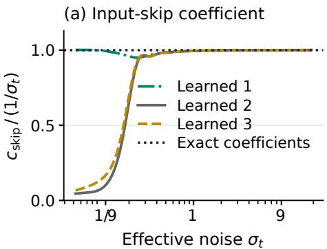

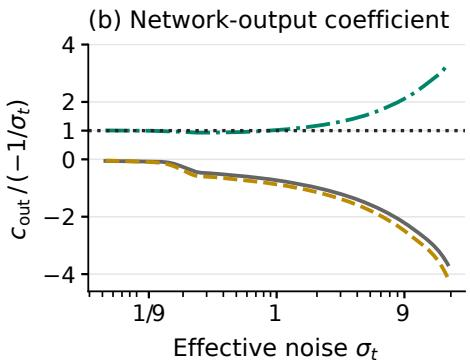  
Figure 6: Learned coefficients relative to exact preconditioning at epoch 200 (EMA1). The dotted line marks exact coefficients. (a) The skip ratio approaches 1 at moderate and high noise. (b) Output ratios can differ in sign and scale because the learned branch can absorb these changes.

## B.1.3 FIXED-TIME DENOISING LOSSES

Checkpoints and conversions. We evaluate epoch-200 EMA1 weights for all ten bottleneck variants and all sixteen width checkpoints at $t \in \{ 0 . 0 5 , 0 . 1 , 0 . 2 , 0 . 5 , 0 . 8 , 0 . 9 , 0 . 9 5 \}$ . Predictions include the complete skip and output scale before the clean-image conversion defined in Section 2. Evaluations use true class labels, no classifier-free guidance, and no clipping. We average clean-image and sampled-noise squared error per coordinate and per image, and check their conversion identity numerically.

Images and numerical evaluation. We select ten images per class without replacement from the official ImageNet validation split, using seed 20261025. The resulting 10000 images are ordered in ten blocks of 1000, each containing one image per class in randomized class order. The final two blocks supply 2000 evaluation images, two per class; validation labels use the same class order as backbone training. Images receive native-resolution center crops, no random flips, and [−1, 1] normalization. Each image’s standard Gaussian draw uses seed 23102026 plus its zero-based po sition in this 10000-image fixture. Draws are reused across times and models at each resolution.

The resolutions share image identities, with resolution-specific Gaussian arrays. The probe fixtures below use separate corruption draws. The frozen backbone uses BF16 and target conversion uses FP32. We retain per-image errors and compute 95% percentile intervals with 1000 image-bootstrap resamples, conditional on the trained checkpoints. The bottleneck floor uses the rank upper bound $r _ { p } \leq 1 2 8 ;$ a lower actual rank would strengthen it. Curves connect only the seven measured times. $\mathrm { A t } t = 0 . 0 5$ , the 95% MSE intervals for noise prediction, image prediction, and exact preconditioning are [300.794, 300.879], [0.10810, 0.11223], and [0.10813, 0.11229], respectively. The noiseprediction interval contains the predicted floor 300.833. Figure 7 shows all bottleneck results, including variants omitted from Figure 2b.

<table><tr><td rowspan=6 colspan=1>ImageNoiseVelocityAdditiveExactLearned 1</td><td rowspan=1 colspan=1>0.11</td><td rowspan=1 colspan=1>0.0708</td><td rowspan=1 colspan=1>0.0419</td><td rowspan=1 colspan=1>0.0157</td><td rowspan=1 colspan=1>0.00611</td><td rowspan=1 colspan=1>0.00435</td><td rowspan=1 colspan=1>0.00395</td></tr><tr><td rowspan=1 colspan=1>301</td><td rowspan=1 colspan=1>67.5</td><td rowspan=1 colspan=1>13.3</td><td rowspan=1 colspan=1>0.834</td><td rowspan=1 colspan=1>0.0525</td><td rowspan=1 colspan=1>0.0106</td><td rowspan=1 colspan=1>0.00254</td></tr><tr><td rowspan=1 colspan=1>0.86</td><td rowspan=1 colspan=1>0.742</td><td rowspan=1 colspan=1>0.57</td><td rowspan=1 colspan=1>0.217</td><td rowspan=1 colspan=1>0.0346</td><td rowspan=1 colspan=1>0.00872</td><td rowspan=1 colspan=1>0.00231</td></tr><tr><td rowspan=1 colspan=1>0.86</td><td rowspan=1 colspan=1>0.742</td><td rowspan=1 colspan=1>0.57</td><td rowspan=1 colspan=1>0.217</td><td rowspan=1 colspan=1>0.0346</td><td rowspan=1 colspan=1>0.00872</td><td rowspan=1 colspan=1>0.00228</td></tr><tr><td rowspan=1 colspan=1>0.11</td><td rowspan=1 colspan=1>0.0709</td><td rowspan=1 colspan=1>0.0419</td><td rowspan=1 colspan=1>0.0157</td><td rowspan=1 colspan=1>0.00612</td><td rowspan=1 colspan=1>0.00435</td><td rowspan=1 colspan=1>0.00384</td></tr><tr><td rowspan=1 colspan=1>0.111</td><td rowspan=1 colspan=1>0.0708</td><td rowspan=1 colspan=1>0.0419</td><td rowspan=1 colspan=1>0.0157</td><td rowspan=1 colspan=1>0.0059</td><td rowspan=1 colspan=1>0.00433</td><td rowspan=1 colspan=1>0.0042</td></tr><tr><td rowspan=1 colspan=1>Learned 2</td><td rowspan=1 colspan=1>0.111</td><td rowspan=1 colspan=1>0.0709</td><td rowspan=1 colspan=1>0.0418</td><td rowspan=1 colspan=1>0.0156</td><td rowspan=1 colspan=1>0.00586</td><td rowspan=1 colspan=1>0.00958</td><td rowspan=1 colspan=1>0.00252</td></tr><tr><td rowspan=1 colspan=1>Learned 3</td><td rowspan=1 colspan=1>0.111</td><td rowspan=1 colspan=1>0.0708</td><td rowspan=1 colspan=1>0.0418</td><td rowspan=1 colspan=1>0.0156</td><td rowspan=1 colspan=1>0.00585</td><td rowspan=1 colspan=1>0.00847</td><td rowspan=1 colspan=1>0.00242</td></tr><tr><td rowspan=1 colspan=1>EDM: JiT</td><td rowspan=1 colspan=1>0.11</td><td rowspan=1 colspan=1>0.0715</td><td rowspan=1 colspan=1>0.045</td><td rowspan=1 colspan=1>0.0475</td><td rowspan=1 colspan=1>0.0355</td><td rowspan=1 colspan=1>0.01</td><td rowspan=1 colspan=1>0.00251</td></tr><tr><td rowspan=1 colspan=1>EDM: ReFlow</td><td rowspan=1 colspan=1>0.11</td><td rowspan=1 colspan=1>0.0715</td><td rowspan=1 colspan=1>0.045</td><td rowspan=1 colspan=1>0.0475</td><td rowspan=1 colspan=1>0.0355</td><td rowspan=1 colspan=1>0.01</td><td rowspan=1 colspan=1>0.0025</td></tr><tr><td rowspan=1 colspan=1>High</td><td rowspan=1 colspan=1>0.05noise</td><td rowspan=1 colspan=1>0.1</td><td rowspan=1 colspan=1>0.2</td><td rowspan=1 colspan=1>0.5</td><td rowspan=1 colspan=1>0.8</td><td></td><td></td></tr></table>

Figure 7: Full denoising-loss comparison under the input bottleneck at epoch 200 (EMA1), using 2000 common validation images without guidance. Cell values give per-coordinate clean-image MSE to three significant figures; color gives the ratio to the image-prediction MSE at the same t, on a logarithmic scale. Small t means high noise.

## B.1.4 LAYERWISE NOISE-RECOVERY PROBES

Layerwise affine probes. We use the epoch-200 noise-prediction checkpoint with EMA1 decay 0.9999 at $t = 0 . 1 , 0 . 5 , 0 . 7 , 0 . 8 , 0 . 9 , 0 . 9 5$ Layer 0 is the first block’s input, including embedding and positional terms; layers 1–12 are block outputs, with class-context tokens removed. Block 12 precedes final normalization, modulation, and output projection; it differs from the final-head input used in the width probes. The first 8000 validation images from Appendix B.1.3 fit the probes, and the final 2000 form the disjoint test set, giving eight fitting and two test images per class. Images receive $2 5 6 \times 2 5 6$ center crops, no flips, and [−1, 1] normalization. Independent fitting and evaluation Gaussian streams use seeds 117 and 991. All layers receive common images, labels, and corruptions; corruption draws are also shared across times.

Each layer/time pair has a separate affine decoder of the noise patch, with its matrix and intercept shared across patch positions. The ridge coefficient is $1 0 ^ { - 3 }$ times the mean feature-Gram diagonal; the intercept receives a $1 0 ^ { - 8 }$ diagonal term for numerical stability. Backbone inference uses FP32 with TF32 disabled; sufficient statistics and the linear solve use FP64. All six times were evaluated together on one H200. Scores use the explained-variance definition in Section 4.1, with noise variance estimated on the test set by centering each within-patch coordinate across images and patch positions. They include prediction bias; finite-test normalization can fluctuate around the population bound. Table 3 retains all layers, complementing the block-12 curve in Figure 3.

Table 3: Layerwise affine noise-recovery scores for the noise predictor at epoch 200 (EMA1; ↑), evaluated together on one H200. Scores use 2000 validation test images and finite-test noise variance normalization. Layer 0 is the embedding; all values are below $1 / \bar { 6 }$
<table><tr><td>Layer</td><td> $t = 0 . 1$ </td><td> $t = 0 . 5$ </td><td> $t = 0 . 7$ </td><td> $t = 0 . 8$ </td><td> $t = 0 . 9$ </td><td> $t = 0 . 9 5$ </td></tr><tr><td>0</td><td>0.16662</td><td>0.16611</td><td>0.16384</td><td>0.15873</td><td>0.13403</td><td>0.08302</td></tr><tr><td>1</td><td>0.16662</td><td>0.16611</td><td>0.16383</td><td>0.15872</td><td>0.13381</td><td>0.08163</td></tr><tr><td>2</td><td>0.16662</td><td>0.16610</td><td>0.16383</td><td>0.15871</td><td>0.13387</td><td>0.08206</td></tr><tr><td>3</td><td>0.16662</td><td>0.16610</td><td>0.16383</td><td>0.15871</td><td>0.13389</td><td>0.08226</td></tr><tr><td>4</td><td>0.16662</td><td>0.16610</td><td>0.16383</td><td>0.15872</td><td>0.13392</td><td>0.08225</td></tr><tr><td>5</td><td>0.16662</td><td>0.16610</td><td>0.16383</td><td>0.15871</td><td>0.13390</td><td>0.08224</td></tr><tr><td>6</td><td>0.16662</td><td>0.16610</td><td>0.16382</td><td>0.15871</td><td>0.13393</td><td>0.08247</td></tr><tr><td>7</td><td>0.16661</td><td>0.16610</td><td>0.16382</td><td>0.15871</td><td>0.13393</td><td>0.08247</td></tr><tr><td>8</td><td>0.16661</td><td>0.16609</td><td>0.16382</td><td>0.15871</td><td>0.13394</td><td>0.08250</td></tr><tr><td>9</td><td>0.16661</td><td>0.16609</td><td>0.16382</td><td>0.15871</td><td>0.13394</td><td>0.08252</td></tr><tr><td>10</td><td>0.16660</td><td>0.16608</td><td>0.16382</td><td>0.15871</td><td>0.13396</td><td>0.08259</td></tr><tr><td>11</td><td>0.16656</td><td>0.16604</td><td>0.16378</td><td>0.15868</td><td>0.13397</td><td>0.08258</td></tr><tr><td>12</td><td>0.16651</td><td>0.16597</td><td>0.16368</td><td>0.15868</td><td>0.13509</td><td>0.08334</td></tr></table>

## B.2 WIDENING IMPROVES DENOISING AND AFFINE INPUT RECOVERY

## B.2.1 MODEL CONFIGURATIONS AND GENERATION RESULTS

Architecture and training. The sweep uses $1 6 \times 1 6$ RGB patches at resolution 256 and $8 \times 8$ patches at resolution 128, with 12 blocks and 256 image tokens in every model. A single learned patch projection maps $\mathbb { R } ^ { d _ { p } }$ to $\mathbb { R } ^ { d _ { h } }$ . Noise widths are 768, 896, 1024, 1152, 1536 at resolution 256 and 192, 256, 320, 384 at resolution 128; image widths are 128, 256, 384, 768 and 64, 128, 192, respectively. Noise predictors have no forced reduction below patch dimension at the input, while image predictors with $d _ { h } < d _ { p }$ retain an input bottleneck. Attention uses the full model width in its query, key, value, and output projections; no output bypass is added. Head dimension is 64, except for the width-128, 256, and 384 ImageNet256 image predictors, which use head dimension 32. The head count is $d _ { h }$ divided by head dimension, so widening changes parameter and head counts as well as representation dimension.

Training follows the preprocessing, optimizer, batch size, schedule, time sampling, and seed-0 conventions in Appendix B.1.1, with loss (16). Each configuration has one run; checkpoint identity is checked by file hashes. The ImageNet128 image-width-64 checkpoint comes from a fresh matched seed-0 run and is shared by generation, native-loss, and input-recovery evaluations.

Generation. Generation uses Heun’s method with 50 steps, 10,000 images, guidance scale 1, and sampling seed 0. FID uses resolution-specific ImageNet reference statistics; generated samples are not paired across models. All reported FIDs use epoch-200 EMA1 weights with decay 0.9999 and one GPU with generation batch size 8; ImageNet256 evaluation used an RTX 5000 Ada GPU. Figures 4a and 8a show the complete generation comparison at both resolutions. These are singlerun FID-10K results, without run-to-run uncertainty estimates.

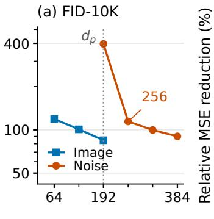  
Model width $d _ { h }$

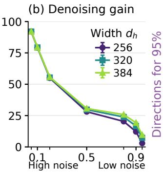  
Time t

(c) Residual structure  
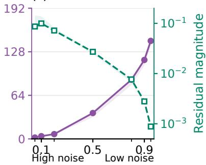  
Time t  
Figure 8: ImageNet128 counterpart to Figure 4, with patch dimension $d _ { p } = 1 9 2 .$ . (a) FID-10K versus model width. (b) Relative clean-image MSE reduction from width 192. (c) Residual structure of a proxy for the population-optimal denoiser. Colors, axes, and shading follow Figure 4.

## B.2.2 AFFINE INPUT-RECOVERY PROBES AND CONTROLS

Features and images. We use all sixteen epoch-200 EMA1 checkpoints at $t = 0 . 5$ . The feature h is the input to the final linear output projection, after final normalization and modulation, with classcontext tokens excluded. We use the validation fixture from Appendix B.1.3, with deterministic resolution-specific center crops normalized to [−1, 1] and no augmentation. A fixed permutation of the first 8000 images, with seed 251025, supplies 384 fitting and 128 tuning images; the final 2000 fixture images form the disjoint test set. Within each resolution, all models receive identical images, labels, and Gaussian corruptions. A fixed CUDA Gaussian stream with seed 99003 supplies the fitting, tuning, and first 128 test fields. For these fields at resolution 128, each disjoint $2 \times 2$ group of the resolution-256 field is summed and divided by 2. The remaining 1872 test fields use independent standard Gaussian pixels from CPU generators with seeds $9 9 0 0 3 + j$ , where $j = 6 4 0 , \ldots , 2 5 1 1$ is the example’s index in the combined fitting, tuning, and test sequence, separately at each resolution. Input recovery and native denoising use the same 2000 test images and corruptions. These image identities match the fixed-time denoising grid, but the corruption draws differ.

Affine fitting and score. The probe matrix is shared across all 256 patch positions, with a positiondependent intercept estimated from fitting images only. Tuning MSE selects a ridge penalty from $\{ 0 \dot { , } 1 0 ^ { - 8 } , 1 0 ^ { - 6 } , 1 \dot { 0 } ^ { - 4 } , 1 0 ^ { - 2 } , 1 \}$ times the mean eigenvalue of the fitting feature covariance; zero penalty uses a pseudoinverse with relative eigenvalue cutoff $1 0 ^ { - 1 2 }$ . The backbone uses BF16; fitting and score accumulation use FP64. For the fitted readout $\widehat { Y } _ { t , m } ,$ the population input-recovery score is $1 0 0 \big ( 1 - \mathbb { E } \| Y _ { t , m } - \widehat { Y } _ { t , m } \| ^ { 2 } / \mathbb { E } \| Y _ { t , m } - \mathbb { E } [ Y _ { t , m } ] \| ^ { 2 } \big )$ . Its empirical counterpart pools squared errors and target variances across images, positions, and coordinates, centering each within-patch coordinate across images and patch positions. It includes prediction bias and equals $1 0 0 R ^ { 2 }$ . The implementation targets $\bar { X } _ { t , m } \stackrel { = } { = } t \bar { Y } _ { t , m } .$ , which gives the same affine classes and normalized scores at fixed $t > 0$ . Only the input recovery is probed: denoising MSE uses the trained output head, true class labels, and no guidance.

Figure 9 adds the ImageNet128 counterpart and image-prediction controls to the ImageNet256 noise-predictor comparison in Figure 5. The controls show that affine input preservation is not a universal requirement for accurate denoising across prediction targets. The probes measure finitesample affine accessibility at one time, without establishing exact recovery, its necessity for noise prediction, or a causal effect on denoising.

(a) ImageNet256  
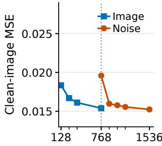

(b) ImageNet128  
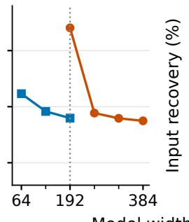

(c) ImageNet256  
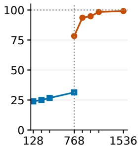  
Model width $d _ { h }$

(d) ImageNet128  
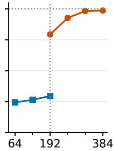  
Figure 9: Paired denoising and affine input recovery versus model width at epoch 200 (EMA1) and $t = 0 . 5 .$ (a,b) Clean-image MSE from the trained denoising head on ImageNet256 and ImageNet128. (c,d) Affine noisy-input recovery from the final-head input at the same resolutions. Blue squares and orange circles mark image and noise prediction. Vertical dotted lines mark $d _ { h } = d _ { p } ;$ horizontal dotted lines mark 100% input recovery.

## B.2.3 DENOISING LOSSES ACROSS WIDTHS AND NOISE LEVELS

The checkpoint, image, corruption, and precision protocol is shared with Appendix B.1.3. Tables 4 and 5 retain absolute clean-image MSE for all widths and both prediction targets at the two resolutions. The relative gain in Figures 4b and 8b is a ratio of sample means, with total clean-image MSE, including Bayes risk, in the denominator. For its uncertainty intervals, we jointly resample the 2000 paired image errors and recompute numerator and denominator in each of 1000 bootstrap resamples, using seed 231023. The reference-width gain and interval are identically zero; the 2.5th and 97.5th percentiles give the plotted 95% intervals, conditional on the trained checkpoints. These within-target width comparisons do not imply an ordering of trained image and noise predictors; the absolute-loss grids retain that distinction.

Table 4: ImageNet256: per-coordinate native clean-image MSE at epoch 200 (EMA1, 2000 validation images, no guidance; ↓). Patch dimension is $d _ { p } = 7 6 8$ . Columns give $t ;$ the same images and corruptions are used for all widths.
<table><tr><td>Prediction</td><td> $d _ { h }$ </td><td>.05</td><td>.1</td><td>.2</td><td>.5</td><td>.8</td><td>.9</td><td>.95</td></tr><tr><td>Noise</td><td>768</td><td>0.54859</td><td>0.16399</td><td>0.062464</td><td>0.019595</td><td>0.0057381</td><td>0.0025318</td><td>0.0011617</td></tr><tr><td>Noise</td><td>896</td><td>0.1222</td><td>0.074817</td><td>0.043629</td><td>0.015972</td><td>0.0049459</td><td>0.0022827</td><td>0.0010471</td></tr><tr><td>Noise</td><td>1024</td><td>0.12351</td><td>0.07479</td><td>0.043377</td><td>0.015776</td><td>0.00486540.0022625</td><td></td><td>0.0010483</td></tr><tr><td>Noise</td><td>1152</td><td>0.12228</td><td>0.074653</td><td>0.043191</td><td>0.015557</td><td>0.0047105</td><td>0.0021868</td><td>0.0010165</td></tr><tr><td>Noise</td><td>1536</td><td>0.11825</td><td>0.073</td><td>0.042467</td><td>0.015237</td><td>0.004552</td><td>0.0020918</td><td>0.00099022</td></tr><tr><td>Image</td><td>128</td><td>0.11259</td><td>0.073589</td><td>0.044556</td><td>0.018345</td><td>0.00946140.0080807</td><td></td><td>0.0077457</td></tr><tr><td>Image</td><td>256</td><td>0.11145</td><td>0.07241</td><td>0.043287</td><td>0.016699</td><td>0.0069612</td><td>0.0051806</td><td>0.0046526</td></tr><tr><td>Image</td><td>384</td><td>0.11087</td><td>0.071777</td><td>0.042721</td><td>0.016122</td><td>0.006083</td><td>0.0041282</td><td>0.003496</td></tr><tr><td>Image</td><td>768</td><td>0.11021</td><td>0.070968</td><td>0.041957</td><td>0.015395</td><td>0.0050643</td><td>0.0028932</td><td>0.0021718</td></tr></table>

Table 5: ImageNet128: per-coordinate native clean-image MSE at epoch 200 (EMA1, 2000 validation images, no guidance; ↓). Patch dimension is $d _ { p } = 1 9 2$ . Columns give $t ;$ the same images and corruptions are used for all widths.
<table><tr><td>Prediction</td><td> $d _ { h }$ </td><td>.05</td><td>.1</td><td> $. 2$ </td><td>.5</td><td>.8</td><td>.9</td><td>.95</td></tr><tr><td>Noise</td><td>192</td><td>1.957</td><td>0.48142</td><td>0.12913</td><td>0.027037</td><td>0.0069793</td><td>0.0029279</td><td>0.0012212</td></tr><tr><td>Noise</td><td>256</td><td>0.15822</td><td>0.10029</td><td>0.058144</td><td></td><td>0.019440.0055573</td><td>0.0025714</td><td>0.0011851</td></tr><tr><td>Noise</td><td>320</td><td>0.15593</td><td>0.099435</td><td>0.057605</td><td>0.018981</td><td>0.0053131</td><td>0.0024401</td><td>0.0011328</td></tr><tr><td>Noise</td><td>384</td><td>0.15521</td><td>0.098938</td><td>0.05719</td><td>0.01875</td><td>0.0051801</td><td>0.0023641</td><td>0.001104</td></tr><tr><td>Image</td><td>64</td><td>0.14759</td><td>0.098758</td><td>0.058917</td><td></td><td>0.021162 0.0086825</td><td>0.0068084</td><td>0.0063907</td></tr><tr><td>Image</td><td>128</td><td>0.14647</td><td>0.097371</td><td>0.057447</td><td></td><td>0.0195960.0065516</td><td>0.0042498</td><td>0.0035854</td></tr><tr><td>Image</td><td>192</td><td>0.14597</td><td>0.096735</td><td>0.056728</td><td></td><td>0.0189960.0058493</td><td>0.0034035</td><td>0.0026305</td></tr></table>

## B.2.4 ADM RESIDUAL SPECTRA AND REFERENCE CHECKS

Denoisers and evaluation data. We use the official class-conditional ImageNet128 and ImageNet256 ADM U-Nets of Dhariwal & Nichol (2021), with checkpoints 128x128 diffusion.pt and 256x256 diffusion.pt from the released implementation.1 At each resolution, the same 10000 validation image identities from Appendix B.1.3 receive native-resolution deterministic center crops normalized to [−1, 1]: the first 6000 fit the affine baseline and the final 4000 estimate the spectrum, giving six fitting and four evaluation images per class. All measurements use true labels, no guidance, no clipping, and the seven times in Appendix B.1.3. Image selection and ordering follow Appendix B.1.3, and each corruption uses seed 23102026 plus the image’s position; each image shares its Gaussian draw across times. ADM receives $Y _ { t } / \sqrt { 1 + \sigma _ { t } ^ { 2 } }$ in its variance-preserving convention. We interpolate its time embedding linearly in log effective noise between the original 1000 linear-schedule steps, then apply (2); the variance head is unused. Timestep interpolation is an approximation. Inference and conversion use FP32; covariance estimates and eigendecompositions use FP64.

Fitted baseline and residual. We analyze one fixed RGB patch at a time: $8 \times 8$ at resolution 128 and $1 6 \times 1 6$ at resolution 256. Let $\widehat { \mu } _ { m } , \widehat { \Sigma } _ { m }$ be its clean mean and covariance from the 6000 fitting images, with covariance divisor equal to the sample count. The formula in Appendix A.3.1 gives

$$
\begin{array} { r l } & { \widehat { \ell } _ { t } ( y ) = \widehat { \mu } _ { m } + \widehat { \Sigma } _ { m } ( \widehat { \Sigma } _ { m } + \sigma _ { t } ^ { 2 } I _ { d _ { p } } ) ^ { - 1 } ( y - \widehat { \mu } _ { m } ) , } \\ & { \quad \widehat { R } _ { t } = [ \widehat { X } _ { 1 } ^ { \mathrm { ( A D M ) } } ( Y _ { t } ) ] _ { m } - \widehat { \ell } _ { t } ( Y _ { t , m } ) . } \end{array}\tag{18}
$$

Clean moments avoid fitting incidental clean–noise correlations from finitely many corruptions. The baseline pools classes and uses only the noisy patch; ADM also observes the whole image and class label. Its residual can therefore reflect nonlinear local dependence, information from other patches, and class information.

Covariance directions and spatial variation. We subtract the empirical residual mean on the 4000 evaluation images and form the covariance with divisor 4000. A residual direction is a unit covariance eigenvector in the patch-output space $\mathbb { R } ^ { d _ { p } }$ . Magnitude and the 95% direction count use the definitions in Section 4.2. Figure 4c uses patch (7, 7) on the zero-based $1 6 \times 1 6$ patch grid; shading spans separate estimates at (7, 7), (3, 3), (3, 12), (12, 3), (12, 12). Positions are analyzed separately, so the band represents spatial variation rather than a confidence interval. Figure 8c gives the corresponding native-resolution ImageNet128 spectrum.

Finite-sample and spatial checks. For ImageNet256, the five positions give 95% direction counts of 5–6 at t = 0.1 and 388–416 at t = 0.9. Using 3000 instead of 6000 baseline-fitting images gives central-patch counts 6 and 419. Learning directions on half the evaluation images and measuring captured variance on the other, reversing roles, gives 6 and 500. The qualitative contrast persists, while exact low-noise counts depend on finite-sample estimation. The 95% count describes relative concentration; an absolute approximation tolerance also depends on residual magnitude.

Denoising quality of the reference. Table 6 compares ADM with the epoch-200 EMA1 full-input JiT noise and image predictors, using widths 384 and 192 at resolution 128, and 1536 and 768 at resolution 256. Every row within a resolution uses the same 4000 validation images and corrup tions with FP32 inference and conversion. This reference-quality comparison is distinct from the 2000-image, BF16-backbone native-loss grid. The reference predictions and fitted residual spectrum remain estimates of the population quantities.

Table 6: Denoising quality of the resolution-matched ADM references: full-image per-coordinate clean-image MSE on 4000 common validation images within each resolution, without guidance. Columns give t; bold marks the lowest measured MSE at each time. All rows use FP32 inference and conversion.
<table><tr><td>Denoiser</td><td></td><td>.05</td><td>.1</td><td>.2</td><td>.5</td><td>.8</td><td>.9</td><td>.95</td></tr><tr><td>ImageNet256</td><td></td><td></td><td></td><td></td><td></td><td></td><td></td><td></td></tr><tr><td>JiT noise</td><td> $( d _ { h } = 1 5 3 6 )$ </td><td></td><td></td><td></td><td>0.111033 0.071357 0.042082 0.015287 0.004591 0.002104 0.000993</td><td></td><td></td><td></td></tr><tr><td>JiT image</td><td> $( d _ { h } = 7 6 8 )$ </td><td>0.1100870.070997 0.0419160.015472 0.0051180.002918 0.002197</td><td></td><td></td><td></td><td></td><td></td><td></td></tr><tr><td>ADM U-Net</td><td></td><td>0.110465 0.070728 0.040943 0.014005 0.003711 0.001485 0.000594</td><td></td><td></td><td></td><td></td><td></td><td></td></tr><tr><td>ImageNet128</td><td></td><td></td><td></td><td></td><td></td><td></td><td></td><td></td></tr><tr><td>JiT noise</td><td> $( d _ { h } = 3 8 4 )$ </td><td>0.1458390.0963490.0563840.0186850.0051890.0023650.001104</td><td></td><td></td><td></td><td></td><td></td><td></td></tr><tr><td>JiT image</td><td> $( d _ { h } = 1 9 2 )$ </td><td></td><td></td><td>0.1456760.0963430.0564080.018963 0.0058660.003411 0.002636</td><td></td><td></td><td></td><td></td></tr><tr><td>ADM U-Net</td><td></td><td></td><td></td><td>0.145347 0.095172 0.054216 0.016763 0.004073 0.001563 0.000596</td><td></td><td></td><td></td><td></td></tr></table>

## C RELATED LITERATURE

Prediction targets and data geometry. JiT motivates image prediction through the manifold hypothesis and demonstrates its advantage in coarse-patch Transformers, including models with narrow input embeddings (Li & He, 2025). Jin & Wang (2026) connect data geometry to the preferred mixture of clean data and noise in the prediction target through an analysis of a linear predictor shared across time, and propose k-Diff to learn this mixture jointly with the network. These work establish the importance of data geometry when choosing a prediction target.

A further question is whether the architecture preserves the input information needed to predict that target accurately. Even directions containing little clean-image information can carry noise that must be canceled when forming a clean-image estimate from a noise predictor. Our analysis quantifies the denoising error caused by losing this information: Section 3.1 establishes a rank-dependent er ror floor even with unrestricted downstream computation, requiring only Gaussian corruption and a finite second moment for the clean data. Once input compression is removed, Section 3.3 characterizes the additional width needed to represent corrections beyond linear denoising, assuming affine recovery of the noisy patch.

Architecture and prediction-target differences. Gagneux et al. (2026) place prediction parameterizations in a common denoising formulation, separate the induced denoiser class from loss weighting, and show that target preference depends strongly on architecture: small-patch Transformers favor velocity prediction, while larger patches favor image prediction in their tested settings. Their controlled-manifold experiments also show that intrinsic dimension interacts with the architecture. These experiments establish that architectural locality can change which prediction target performs best. Complementing this experimental evidence, RAE derives a sampled-velocity loss floor for a network with linear input and output maps around a nonlinear body (Zheng et al., 2025, Theorem 1 and Appendix B.1). Its proof uses the restriction of every prediction to the column space of the final output map. This identifies a limitation on the directions the output can represent.

These results leave open how information discarded at the input translates into unavoidable denoising error, and how much representation width is needed to retain the noisy input while supporting accurate denoising. Within the common denoising viewpoint, Theorem 1 characterizes information unavailable from the input while allowing unrestricted decoder outputs, and Corollary 2 translates the resulting noise-recovery floor into denoising error. Theorem 5 and Corollary 6 then character ize the width required for a chosen denoising accuracy, assuming exact affine recovery of the noisy patch.

Linear denoising and affine input recovery. Wang & Vastola (2024) study Gaussian score approximations based on the data mean and covariance, and provide theoretical and empirical evidence that these linear approximations describe learned scores well at moderate to high noise. Li et al. (2024) fit linear models to trained denoisers and find that, in the generalization regime, these approximations closely resemble the optimal denoisers for a Gaussian distribution with the empirical data mean and covariance. They also report near-identity behavior at low noise, distinguishing this behavior from evidence of learned Gaussian structure (Li et al., 2024, Appendix D). These observations motivate the representation strategy in Section 3.3: keeping the noisy patch affinely accessible provides the features needed for linear denoising, while additional representation coordinates can encode the remaining correction. We formalize this strategy in Assumption 1, which requires exact recovery of the noisy patch through an affine readout of the model representation. Such a representation supports any affine denoiser of that patch, including the best affine estimate used as our linear-denoising baseline. This connects the observed linear structure of learned denoisers to our analysis of the additional width needed for corrections beyond that baseline.

Preconditioning and analytic input paths. EDM combines a scaled copy of the noisy input with a learned output using noise-dependent coefficients (Karras et al., 2022); consistency models use a related construction to enforce their boundary condition (Song et al., 2023). Related approaches use analytic score components for subspace data (Chen et al., 2023) or project the noise target while recovering the full velocity analytically (Chen et al., 2026). JiT reports that output preconditioning improves over direct noise and velocity prediction but remains worse than image prediction, and links the improvement to its high-noise approach to image prediction (Li & He, 2025, Appendix B.2 and Table 10). Section 3.2 quantifies this pattern through the input-rank-dependent contribution of discarded noise, distinguishing EDM’s high-noise attenuation from exact cancellation at every noise level. Theorem 7 also formalizes the raw target’s mean-square convergence to a scaled clean image. Data preconditioning improves covariance conditioning and optimization in Gaussian and Gaussianmixture settings (Ahamed et al., 2026). This complements our output-preconditioning analysis of the best attainable risk under architectural information constraints.