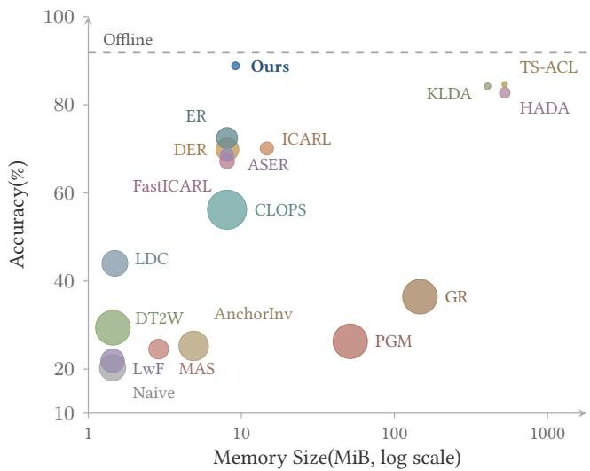
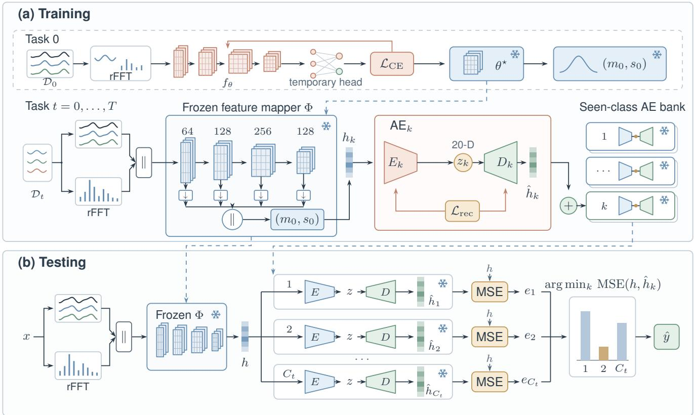
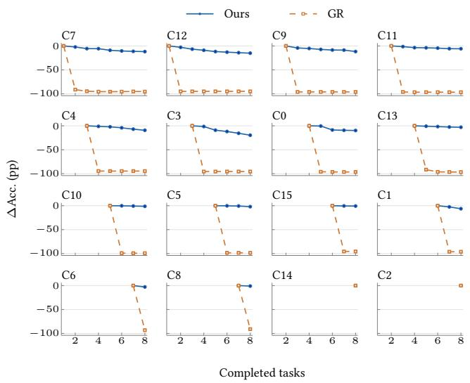
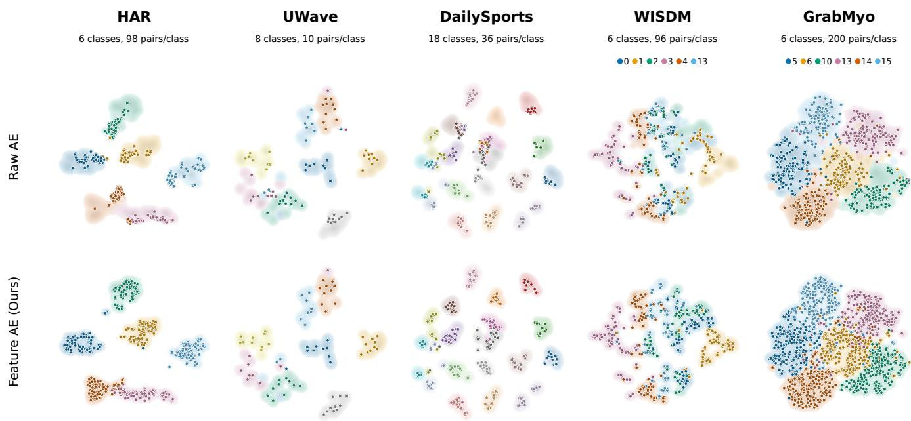
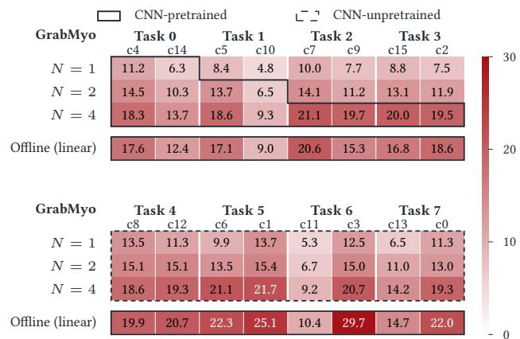

# TRACE: Memory-Eficient Time Series Class-Incremental Learning via Temporal-Spectral Reconstruction

Junhui Mao1, Junru Zhang1, Liming Ye1, Cheng Peng1, Haoran Shi2, Xiaoli Tang2, Baokun Wang3, Bin Dou , Yabo Dong , Han Yu

1Zhejiang University, Hangzhou, China 2Nanyang Technological University, Singapore 3Ant Group, China

## Abstract

Web-connected sensing applications continuously generate multivariate time series with evolving behavioral categories, making Time Series Class-Incremental Learning (TSCIL) essential for adapting to new classes without forgetting previously acquired knowl edge. However, preserving diverse and evolving class distributions under strict privacy and memory constraints remains a fundamental challenge. Existing approaches often face a trade-of between retaining suficient historical knowledge for accurate recognition and minimizing the memory required for continual adaptation. To address these limitations, we propose TRACE, a memory-eficient, replayfree framework that preserves class-specific knowledge through generative modeling rather than sample rehearsal. TRACE employs a compact, frozen temporal-spectral representation and lightweight class-specific autoencoders to capture complex intra-class variations. By independently preserving each class model, TRACE avoids recursive generation and catastrophic forgetting, while enabling direct classification through reconstruction-based scoring without retaining historical samples or large statistical matrices. Extensive experiments across five TSCIL benchmarks demonstrate that TRACE achieves competitive classification accuracy while reducing mean retained memory by approximately 98.26% compared with TS-ACL, the strongest evaluated analytical baseline, and achieving an approximately 33.43% relative improvement in accuracy on GrabMyo.

## CCS Concepts

• Computing methodologies → Online learning settings; • Information systems → Data mining.

## Keywords

Time Series Classification, Class-Incremental Learning, Continual Learning, Generative Classification, Reconstruction Scoring

## 1 Introduction

The Web has become a critical infrastructure for acquiring, exchanging, and interpreting continuous sensor-generated data across distributed devices and services. In Web-connected applications, such as wearable activity monitoring and tele-rehabilitation, multichannel time series provide rich temporal information for extracting meaningful behavioral patterns from continuously evolving data streams [29]. Unlike static data, these streams exhibit transient variations, periodic patterns, and multi-scale temporal dependencies [12, 38]. Moreover, as Web-connected applications continuously encounter new users, activities, and interaction contexts, the underlying behavioral categories evolve over time, making static classification models inadequate. This motivates Time Series Class-Incremental Learning (TSCIL) [29], which enables continuous acquisition of new behavioral knowledge while preserving previously learned classes. However, deploying TSCIL in distributed Web-based edge-cloud environments remains challenging, as privacy concerns restrict access to historical user data, while resource-constrained devices impose stringent limitations on memory consumption and synchronization overhead. Meanwhile, models should continuously recognize both previously learned and emerging classes without relying on task-identity information.

Existing TSCIL paradigms struggle to seamlessly navigate these constraints, facing a stark trade-of between accuracy and memory (Figure 1). Regularization techniques [1, 18] (e.g., LwF and MAS) sufer from catastrophic forgetting, while experience replay [4, 31] violates privacy mandates. Generative replay [29, 34] (e.g., GR) bypasses data storage but introduces prohibitive synthesis overhead and cascading errors. Recently, analytic continual learning (ACL) [17, 20, 25] (e.g., KLDA, TS-ACL, and HADA) addressed forgetting by freezing the backbone and dramatically expanding feature dimensions (e.g., 5,000 to 8,000). While mathematically robust, maintaining such massive covariance matrices demands hundreds of megabytes of persistent memory, rendering them intractable for resource-constrained edge architectures.

A pivotal bottleneck in memory-constrained TSCIL is the reliance on a globally shared parametric state. Continuously updating shared boundaries to accommodate novel classes inevitably triggers representation drift and catastrophic forgetting, whereas indiscrim inately expanding the model state triggers architectural bloat. This dilemma is particularly pronounced in time series, where disparate activities may share local waveform morphologies but diverge radically in frequency or periodic evolution [5, 32]. To resolve this, we ask a fundamental question: How can we support class expansion in time series recognition while preserving previously learned knowledge, without historical replay or high-dimensional feature expansion?

In response, we introduce a novel replay-free TSCIL framework called TRACE (Temporal-Spectral Reconstruction for Adaptive Class Expansion). Our key insight is that continual recognition of evolving time series classes does not necessarily require repeatedly updating shared decision boundaries. Instead, a stable temporalspectral representation can support independent modeling of classspecific variations. Guided by this insight, TRACE integrates complementary temporal dynamics and frequency characteristics into a compact, frozen multi-scale feature space. Each emerging class is then independently modeled by a lightweight autoencoder, preserving previously learned representations without historical data replay or shared parameter updates. During inference, TRACE directly recognizes all encountered classes by comparing their reconstruction errors, eliminating the need for a shared discriminative classifier. This design enables memory-eficient class expansion while avoiding interference with previously learned model parameters and the overhead of high-dimensional statistical matrices.

  
Figure 1: Mean final test accuracy versus retained memory across five datasets (25 runs per dataset). Bubble area represents the mean within-dataset variance across runs, and the dashed line indicates the ofline joint-training reference.

The main contributions of this work are summarized as follows:

• We propose TRACE, a replay-free TSCIL framework that decouples temporal-spectral feature extraction from classspecific modeling, enabling continuous acquisition of emerging time series classes without revisiting historical data or updating previously learned models.

• We develop a compact, frozen temporal-spectral representation that captures complementary temporal dynamics and frequency patterns across multiple scales, providing a stable feature space for learning evolving time series classes.

• We introduce a class-specific generative recognition strategy that models complex intra-class temporal variations through independent autoencoders, enabling incremental class expansion via reconstruction-based inference without shared classifier updates or large statistical matrices.

• Extensive experiments across five time-series benchmarks demonstrate the efectiveness and memory eficiency of TRACE. Compared with the second-best method, our method improves average accuracy by 5.01% while reducing retained memory by 98.26%. Our analyses further highlight the importance of temporal-spectral representations and nonlinear class-specific modeling for continual time-series recognition.

## 2 Related Work

## 2.1 Time Series Classification

Time series classification (TSC) assigns semantic labels to sequential observations and supports applications such as activity recognition, physiological monitoring, and industrial sensing [9, 12]. Existing research spans distance-based, dictionary-based, shapeletbased, and ensemble approaches, which characterize temporal patterns through complementary representations [23, 24, 32]. Deep learning further enables representation learning through convolutional, recurrent, and attention-based architectures [9, 13, 38], while random convolutional transformations ofer eficient alternatives [7, 8]. More recent studies explore self-supervised learning, time-frequency consistency, and large-scale pretraining to improve representation transfer across datasets and tasks [11, 19, 39, 40]. Despite these advances, conventional ofline classification protocols generally assume a fixed label space, leaving continual acquisition of emerging classes and preservation of historical knowledge to be addressed.

## 2.2 Time Series Class-Incremental Learning

Time Series Class-Incremental Learning (TSCIL) learns new classes sequentially while retaining recognition of all seen classes without task identities [29]. CIL research has largely focused on computer vision [6, 36]. Regularization and distillation preserve important parameters or previous predictions [1, 18], whereas exemplar replay retains old samples for rehearsal [4, 30]. To reduce historical-data storage and privacy concerns, generative replay replaces exemplars with synthesized samples [26, 34]. However, image-oriented generative replay methods struggle to capture complex temporal dependencies, leading to limited sample diversity and degraded recognition performance on multivariate time series [29].

Time-series methods have explored signal-specific memory management [14, 15], temporal alignment and confidence-aware distillation [22, 28], and feature-space inversion [16]. Analytical methods further use closed-form classifier updates to avoid storing exemplars [17, 20]. However, shared-model updates can interfere with old knowledge, while high-dimensional analytical heads incur densematrix storage costs. Subject-dependent within-class variations further complicate knowledge retention, since preserving only a few representative patterns may not adequately cover the diversity of each class [29]. To address these trade-ofs, TRACE performs replayfree generative classification using a frozen temporal-spectral representation and independently preserved class AEs, assigning labels by deterministic reconstruction error.

## 3 Methodology

We implement the concept of decoupled generative recognition through TRACE. The core philosophy of this framework is to avoid continually updating a shared discriminative head, which is vulnerable to catastrophic forgetting. Instead, we establish a universally frozen feature space and model each class with an independent autoencoder. As illustrated in Figure 2, TRACE decomposes replayfree time series continual recognition into three distinct stages: (1) constructing and freezing a compact temporal-spectral feature mapping Φ; (2) independently fitting and freezing a lightweight autoencoder (AE) for each incoming class; and (3) evaluating all seen classes via deterministic feature reconstruction errors.

  
Figure 2: TRACE uses deterministic class-specific autoencoders. (a) Task 0 supervises the temporal-spectral CNN. The temporary head is discarded, and the CNN and Task-0 feature statistics are frozen. Each incoming class fits a bottleneck AE with reconstruction loss, then freezes it without replay. (b) Queries are encoded once and reconstructed by all seen-class AEs. The smallest feature MSE determines the prediction. Snowflakes mark frozen components.

In the following, we define the continual learning problem setting in §3.1. In §3.2, we present the pipeline for extracting the frozen temporal-spectral representation, which serves as our universal semantic substrate. Given this stable foundation, we introduce the isolated per-class generative modeling and our novel deterministic scoring mechanism in §3.3. Finally, we provide the comprehensive workflow of TRACE in §3.4.

## 3.1 Problem Definition

Let a continual learner receive sequential task datasets $\mathcal { D } _ { 0 } , . . . , \mathcal { D } _ { T }$ where each task � introduces a set of new classes $\mathcal { K } _ { t }$ such that $\mathcal { K } _ { s } \cap \mathcal { K } _ { t } = \emptyset$ for $s \neq t .$ Following task $t ,$ the cumulative set of seen classes is defined as:

$$
C _ { t } = \bigcup _ { s = 0 } ^ { t } { \mathcal { K } } _ { s } , \qquad C _ { t } = | C _ { t } | .\tag{1}
$$

Each task dataset $\mathcal { D } _ { t } = \mathcal { F } _ { t } \cup \mathcal { V } _ { t }$ comprises disjoint fitting and early stopping splits, respectively. During task �, the learner only has access to authentic data samples from $\mathcal { D } _ { t } .$ . At inference, the objective is to predict labels across all previously seen classes $C _ { t }$ without relying on ground-truth task identities. Each input sequence is denoted $\mathbf { a s } \ x \in \mathbb { R } ^ { L \times M }$ , characterized by a temporal length � and sensor channels �.

## 3.2 Constructing the Universal Semantic Substrate

To support class-specific generative modeling, the feature space must remain compact while preserving the diverse characteristics of multivariate time series. Temporal waveforms capture local dynamics, while frequency spectra provide complementary information about periodicity and global spectral structure. To efectively integrate these characteristics, we employ a multi-scale convolutional extractor that aggregates temporal and spectral features across diferent receptive fields, producing a compact and stable representation for incremental learning.

Temporal-spectral input construction. For each sample � and independently across each channel along the temporal axis, we compute the single-sided orthonormal real Fast Fourier Transform (rFFT). We extract its magnitude spectrum and concatenate it with the raw signal � prior to input normalization:

$$
u ( x ) = \mathrm { N o r m } _ { \mathrm { i n } } ( x \parallel _ { \mathrm { t i m e } } \mid \mathrm { r F F T } ( x ) \mid ) \in \mathbb { R } ^ { ( L + \lfloor L / 2 \rfloor + 1 ) \times M } .\tag{2}
$$

Normin follows TSCIL’s original input normalization configuration [29]: LayerNorm across channels per position (HAR, DailySports, GrabMyo), InstanceNorm over concatenated time per channel (UWave), or identity (WISDM). Both use per-sample statistics without afine parameters or running statistics.

Multi-scale convolutional projection. The augmented input $u ( x )$ is processed by a 1D convolutional network comprising four blocks (Conv1d with kernel size 5, ReLU, normalization, MaxPool2, and dropout). To comprehensively capture multi-scale temporal-spectral patterns, we apply global average pooling (GAP) to the output of each block $\ell \in \{ 1 , 2 , 3 , 4 \}$ and concatenate the resulting vectors:

$$
v _ { \theta } \big ( x \big ) = \bigoplus _ { \ell = 1 } ^ { 4 } \mathrm { G A P } \Big ( f _ { \theta } ^ { ( \ell ) } ( u ( x ) ) \Big ) \in \mathbb { R } ^ { d } ,\tag{3}
$$

where our default channel widths (64, 128, 256, 128) yield a compact multi-scale feature representation of dimension �.

Initial-task supervision. We train the temporal-spectral CNN with a temporary linear classification head on the initial-task fitting split $\mathcal { F } _ { 0 }$ using cross-entropy loss, selecting the checkpoint on $\mathcal { N } _ { 0 }$ . After training, we discard the classification head and permanently freeze the backbone parameters $\theta ^ { \star }$ . The backbone remains unchanged throughout subsequent incremental tasks.

Frozen feature standardization. We compute the coordinate-wise mean $m _ { 0 } \in \mathbb { R } ^ { d }$ and population standard deviation $s _ { 0 } \in \mathbb { R } ^ { d }$ using only fitting features from ${ \mathcal { F } } _ { 0 } .$ . These statistics define the frozen feature mapping Φ:

$$
h = \Phi ( x ) = \frac { v _ { \theta ^ { \star } } ( x ) - m _ { 0 } } { \mathrm { m a x } ( s _ { 0 } , \epsilon ) } , \qquad \epsilon = 1 0 ^ { - 3 } .\tag{4}
$$

Both the parameters $\theta ^ { \star }$ and the standardization statistics $( m _ { 0 } , s _ { 0 } )$ remain permanently fixed after $\mathcal { D } _ { 0 }$ . This absolute rigidity ensures zero representation drift across all subsequent tasks.

## 3.3 Cross-Manifold Generative Inference

Given the frozen feature mapping Φ, TRACE models each class independently to incorporate new knowledge without modifying previously learned models. Rather than updating a shared discriminative head, we train a lightweight autoencoder for each incoming class and perform classification by comparing class-specific reconstruction errors.

Independent class-specific AE training. When a new class $k \in$ $\mathcal { K } _ { t }$ arrives, we extract its frozen training features $\mathcal { H } _ { k } = \{ \Phi ( x )$ $( x , y ) \in \mathcal { F } _ { t } , y = k \}$ . Instead ofupdating a shared discriminative head, we train an entirely independent, symmetric bottleneck AE (� → $1 2 8 \to r \to 1 2 8 \to d .$ , with bottleneck dimension $r = 2 0 )$ consisting of a deterministic encoder $E _ { k }$ and decoder $D _ { k }$ tailored exclusively to this class. Its reconstruction mapping is $A _ { k } \ = \ D _ { k } \circ E _ { k }$ . The model parameters are optimized by minimizing the reconstruction objective over $\mathcal { H } _ { k }$

$$
\mathcal { L } _ { k } = \mathbb { E } _ { h \in \mathcal { H } _ { k } } \left[ \frac { 1 } { 2 } \left. h - D _ { k } ( E _ { k } ( h ) ) \right. _ { 2 } ^ { 2 } \right] .\tag{5}
$$

We restore the checkpoint of $A _ { k }$ minimizing reconstruction loss on $\mathcal { H } _ { k } ^ { \mathrm { v a l } } = \{ \Phi ( x ) \mid ( x , y ) \in \mathcal { V } _ { t } , y = k \}$ }, then permanently freeze $E _ { k }$ and $D _ { k }$ . Crucially, historical class AEs are never updated, accessed, or sampled for replay during this process.

Deterministic scoring and invariance. At inference, each seenclass AE deterministically reconstructs the extracted feature $\Phi ( x )$ in a single forward pass without Monte Carlo sampling. We evaluate each seen class $k \in C _ { t }$ by its dimension-averaged reconstruction error and predict the class with the smallest score:

$$
e _ { k } ( x ) = { \frac { 1 } { d } } \| \Phi ( x ) - D _ { k } \bigl ( E _ { k } ( \Phi ( x ) ) \bigr ) \| _ { 2 } ^ { 2 } , \qquad \hat { y } = \underset { k \in C _ { t } } { \arg \operatorname* { m i n } } e _ { k } ( x ) .\tag{6}
$$

Because the mapping Φ, the statistics $( m _ { 0 } , s _ { 0 } )$ , and all historical AEs remain strictly frozen, the scoring function of any previously learned class $k \in C _ { t }$ is invariant across future tasks: ${ \bar { e } } _ { k } ^ { ( t + 1 ) } ( x ) =$ $e _ { k } ^ { ( t ) } ( x )$ . This score-function invariance prevents parameter drift in historical class models without updating past parameters, while newly added class models still participate in candidate score competition at inference.

## 3.4 Workflow of TRACE

We summarize the overall training and inference workflow of TRACE in Algorithm 1, which separates frozen feature extraction from independent class-specific generative modeling. The frozen AE bank after task � is $\mathcal { B } _ { t } = \{ ( k , A _ { k } ) ~ | ~ k \in C _ { t } \}$

Architectural design. TRACE consists of a shared feature extractor and a collection of independent class-specific AEs. The feature extractor employs a lightweight four-block 1D CNN to capture multi-scale patterns from temporal signals augmented with rFFT spectral information. Each class is modeled by a compact AE with a low-dimensional bottleneck, enabling class-specific feature reconstruction without updating a shared discriminative head.

Base training $( { \mathcal { D } } _ { 0 } ) .$ In TRACE, the feature extractor and a temporary classification head are trained on $\mathcal { F } _ { 0 }$ using cross-entropy loss, with checkpoint selection on $\mathcal { N } _ { 0 } .$ After training, the classification head is discarded, and the backbone parameters $\theta ^ { \star }$ are frozen. The feature standardization statistics $( m _ { 0 } , s _ { 0 } )$ are then computed from the fitting features of $\mathcal { F } _ { 0 }$ and fixed for all subsequent tasks. Finally, an independent AE is trained and frozen for each class in $\mathcal { D } _ { 0 }$ using the resulting feature representations.

Incremental learning $( { \mathcal { D } } _ { t } , t \geq 1 ) .$ . For each subsequent task, incoming samples are mapped into the fixed feature space through Φ. An independent AE is initialized and trained for each newly introduced class using $\operatorname { E q . } \left( 5 \right)$ . Once trained, its parameters are frozen and the model is added to the collection of previously learned class models. With the default 576-dimensional features, each new class incurs a modest storage overhead of approximately 0.5853 MiB (FP32) for its 153,428 AE parameters. Throughout this process, neither the feature extractor nor any existing AE is updated, and no historical samples or generated replay data are required.

Inference. Given a test sequence �, the frozen feature extractor produces its representation $h = \Phi ( x )$ . This representation is evaluated by all AEs corresponding to previously encountered classes. Each AE deterministically reconstructs ℎ via $D _ { k } ( E _ { k } ( h ) )$ , and the predicted label is assigned to the class with the smallest reconstruction error according to Eq. (6). This procedure enables classification across all learned classes without task-identity information, historical data replay, or updates to existing models.

Table 1: Benchmark class counts, task horizons (2 classes per task), and input dimensions $( L \times M )$ across the five TSCIL benchmarks compared with the original benchmark [29].
<table><tr><td>Dataset</td><td>Shape (L × M)</td><td>Classes</td><td>Orig. Tasks</td><td>Our Tasks</td></tr><tr><td>HAR [3]</td><td> $1 2 8 \times 9$ </td><td>6</td><td>3</td><td>3</td></tr><tr><td>UWave [21]</td><td> $3 1 5 \times 3$ </td><td>8</td><td>4</td><td>4</td></tr><tr><td>DailySports [2]</td><td> $1 2 5 \times 4 5$ </td><td>18</td><td>6</td><td>9</td></tr><tr><td>WISDM [37]</td><td> $2 0 0 \times 3$ </td><td>18</td><td>6</td><td>9</td></tr><tr><td>GrabMyo [27]</td><td> $1 2 8 \times 2 8$ </td><td>16</td><td>5</td><td>8</td></tr></table>

Algorithm 1 TRACE: Training and inference   
Require: Task-specific fitting and early-stopping splits $\mathcal { F } _ { t } , \mathcal { N } _ { t }$ and   
new class sets $\bar { \mathcal { K } } _ { t } ,$ for $t = 0 , \ldots , T .$   
1: Train the CNN feature extractor and a temporary classification   
head on ${ \mathcal { F } } _ { 0 } ;$ select the best checkpoint using $\mathcal { N } _ { 0 } .$   
2: Discard the head; freeze $\theta ^ { \star } ;$ ; compute (�0, �0) from ${ \mathcal { F } } _ { 0 } .$   
3: Fix $\Phi ( x ) = ( v _ { \theta ^ { \star } } ( x ) - m _ { 0 } ) / \mathrm { m a x } ( s _ { 0 } , \epsilon )$ , where $\epsilon = 1 0 ^ { - 3 }$ and   
operations are element-wise.   
4: Initialize $\mathcal { B } _ { - 1 } \gets \emptyset .$   
5: for task $t = 0 , . . . , T$ do   
6: $\mathcal { B } _ { t } \gets \mathcal { B } _ { t - 1 } .$   
7: for each new class $k \in \mathcal { K } _ { t }$ do   
8: Construct $\mathcal { H } _ { k } = \{ \Phi ( x ) : ( x , y ) \in \mathcal { F } _ { t } , \ y = k \} .$   
9: Construct $\mathcal { H } _ { k } ^ { \mathrm { v a l } } = \{ \Phi ( x ) : ( x , y ) \in \mathcal { V } _ { t } , y = k \}$   
10: Train a new AE $A _ { k } = D _ { k } \circ E _ { k }$ on $\mathcal { H } _ { k }$ using $\operatorname { E q . } ( 5 ) .$   
11: Restore the best checkpoint on $\mathcal { H } _ { k } ^ { \mathrm { v a l } }$ ; freeze $A _ { k } .$   
12: $\mathcal { B } _ { t }  \mathcal { B } _ { t } \cup \{ ( k , A _ { k } ) \}$   
13: end for   
14: Discard current-task data, extracted features, and training   
optimizers.   
15: end for   
16: Inference: Given a query � after task $t \in \{ 0 , \ldots , T \}$ , retrieve   
$\mathcal { B } _ { t }$ and compute $h  \Phi ( x )$   
17: return $\begin{array} { r } { \hat { y } = \arg \operatorname* { m i n } _ { k \in C _ { t } } \frac { 1 } { d } \| h - A _ { k } ( h ) \| _ { 2 } ^ { 2 } . } \end{array}$

## 4 Experiments

## 4.1 Experimental Setup

Datasets. We evaluate TRACE on five multivariate time series benchmarks: HAR [3], UWave [21], DailySports [2], WISDM [37], and GrabMyo [27]. Following the established TSCIL benchmark [29], each incremental task introduces two new classes. We include all available classes in the incremental stream, resulting in 3, 4, 9, 9, and 8 tasks, respectively. Dataset statistics and task configurations are summarized in Table 1.

Evaluation Metrics. We evaluate classification accuracy after each incremental task and report final test accuracy after all classes have been introduced. To assess memory eficiency, we measure the retained state (MiB) required for continued incremental learning, including model parameters, stored exemplars, normalization statistics, analytical matrices, and persistent optimizer states. All memory components are measured using their native data types. We further examine the accuracy–memory trade-of to evaluate recognition performance under storage constraints.

Implementation Details. We implement all methods within a unified evaluation framework based on [29], using the standard fourblock 1D CNN backbone while preserving method-specific representations and learning mechanisms. To prevent data leakage, the development data of each class is partitioned into training (80%), early-stopping (10%), and validation (10%) subsets. Hyperparameters are determined using development data and fixed across all class orders before formal evaluation. The validation data is then merged into the training set for final model fitting, while the earlystopping subset is retained for epoch selection. The oficial test sets are used exclusively for evaluation. Each configuration is evaluated over five class orders and five random seeds, yielding 25 runs per dataset. We average results across seeds within each order and compute 95% confidence intervals across the five order-level means using Student’s �-distribution (df = 4).

Baselines. We compare TRACE against representative TSCIL and conventional class-incremental learning methods under a unified evaluation protocol. The baselines include experience replay methods (ER [31], DER [4], iCaRL [30], ASER [33], CLOPS [14], and FastICARL [15]), generative replay (GR [29, 34]), regularization-, distillation-, and adaptation-based methods (LwF [18], MAS [1], DT2W [28], LDC [10], PGM [35], and AnchorInv [16]), and analytical learning methods (KLDA [25], TS-ACL [17], and HADA [20]). We additionally include Ofline, which jointly trains on all classes, as a reference, and Naive, which sequentially fine-tunes on incoming tasks without any forgetting mitigation mechanism. For fair comparison, all methods follow a common four-block CNN backbone design while retaining their method-specific feature representations, classification heads, and incremental update strategies. Consistent dataset partitions, class orders, and evaluation metrics are applied across all methods.

## 4.2 Main Performance

Table 2 and Figure 1 summarize the overall performance and accuracy– memory trade-of across five TSCIL benchmarks. TRACE achieves the highest five-dataset average final accuracy of 88.85% among all evaluated continual-learning methods, with only 9.17 MiB of retained memory. It achieves the best accuracy on HAR, DailySports, and GrabMyo, while remaining competitive with KLDA on UWave and TS-ACL on WISDM. Exemplar-based methods, such as ER and DER, achieve reasonable performance on HAR and DailySports but exhibit substantial accuracy degradation on WISDM and GrabMyo. This suggests that limited historical exemplars may be insuficient to capture complex intra-class temporal variations. Regularizationand distillation-based methods, such as LwF and DT2W, generally achieve lower accuracy, reflecting their susceptibility to catastrophic forgetting. Generative replay (GR) avoids storing historical samples but performs poorly across several datasets, potentially due to limited synthesis fidelity and accumulated errors across incremental tasks. Its additional generator and optimizer states also introduce considerable memory overhead. Analytical methods, such as KLDA and TS-ACL, demonstrate strong classification performance, achieving the highest accuracy among continual-learning methods on UWave and WISDM, respectively. However, high-dimensional feature expansion and the associated statistical matrices can introduce substantial retained memory overhead, exceeding 400 MiB for some evaluated configurations. Their comparatively lower performance on GrabMyo suggests that increasing feature dimensionality alone may be insuficient to characterize complex nonlinear intraclass variations.

Table 2: Final test accuracy (mean ± SD, %) and estimated retained memory (MiB) over five class orders and five seeds per dataset (25 runs). Macro averages weight datasets equally. Ofline denotes all-class joint training. Bold and underlining indicate the highest and second-highest five-dataset macro-average accuracy among continual-learning methods, respectively.
<table><tr><td rowspan="2">Method</td><td colspan="2">HAR</td><td colspan="2">UWave</td><td colspan="2">DailySports</td><td colspan="2">WISDM</td><td colspan="2">GrabMyo</td><td colspan="2">5-Dataset Macro</td></tr><tr><td>Acc (%)</td><td>MiB</td><td>Acc (%)</td><td>MiB</td><td>Acc (%)</td><td>MiB</td><td>Acc (%)</td><td>MiB</td><td> $\operatorname { A c c } \left( \% \right)$ </td><td>MiB</td><td>Acc (%)</td><td>MiB</td></tr><tr><td colspan="10">Reference Bounds (Joint-Training Reference &amp; Fine-Tuning Lower Bound)</td><td></td><td></td><td></td></tr><tr><td>Offline (Joint Ref.)</td><td> $9 2 . 0 6 \pm 1 . 3 0$ </td><td>1.43</td><td> $9 5 . 0 2 \pm 0 . 9 3$ </td><td>1.42</td><td> $9 8 . 5 0 \pm 0 . 5 2 $ </td><td>1.48</td><td> $8 5 . 8 3 \pm 2 . 3 7$ </td><td>1.43</td><td> $8 7 . 7 3 \pm 1 . 6 1$ </td><td>1.45</td><td>91.83</td><td>1.44</td></tr><tr><td>Naive</td><td> $3 8 . 2 3 \pm 8 . 7 2$ </td><td>1.43</td><td> $2 4 . 6 2 \pm 0 . 2 9$ </td><td>1.42</td><td> $1 5 . 1 4 \pm 3 . 4 3$ </td><td>1.48</td><td> $1 1 . 4 0 \pm 1 . 2 0$ </td><td>1.43</td><td> $1 2 . 1 6 \pm 0 . 1 4$ </td><td>1.45</td><td>20.31</td><td>1.44</td></tr><tr><td colspan="10">Experience &amp; Generative Replay Methods</td><td colspan="3"></td></tr><tr><td>ER [31]</td><td> $8 9 . 3 3 \overset { \cdot } { \pm } 2 . 0 5$ </td><td>3.04</td><td> $7 9 . 1 1 \pm 3 . 3 7$ </td><td>1.56</td><td> $9 6 . 1 9 \pm 1 . 6 8$ </td><td>8.43</td><td> $4 6 . 1 4 \pm 6 . 1 2$ </td><td>3.49</td><td> $5 1 . 4 4 \pm 1 . 2 3$ </td><td>23.78</td><td>72.44</td><td>8.06</td></tr><tr><td>DER [4]</td><td> $8 9 . 9 5 \pm 1 . 1 7$ </td><td>3.05</td><td> $7 5 . 9 8 \pm 4 . 9 4$ </td><td>1.57</td><td> $9 7 . 0 7 \pm 0 . 9 5$ </td><td>8.45</td><td> $3 2 . 4 8 \pm 6 . 2 5$ </td><td>3.55</td><td> $5 3 . 8 1 \pm 1 . 3 7$ </td><td>23.88</td><td>69.86</td><td>8.10</td></tr><tr><td>iCaRL [30]</td><td> $8 8 . 5 1 \pm 2 . 1 3$ </td><td>4.65</td><td> $8 4 . 8 5 \pm 1 . 9 0$ </td><td>1.71</td><td> $9 2 . 7 1 \pm 1 . 5 6$ </td><td>15.39</td><td> $3 3 . 2 0 \pm 3 . 3 0$ </td><td>5.55</td><td> $5 1 . 1 5 \pm 1 . 0 2$ </td><td>46.09</td><td>70.09</td><td>14.68</td></tr><tr><td>ASER [33]</td><td> $8 8 . 5 9 \pm 2 . 1 0$ </td><td>3.04</td><td> $7 6 . 5 7 \pm 2 . 6 8$ </td><td>1.56</td><td> $9 6 . 0 6 \pm 1 . 2 4$ </td><td>8.43</td><td> $3 3 . 1 7 \pm 2 . 7 6$ </td><td>3.49</td><td> $4 8 . 7 6 \pm 1 . 1 9$ </td><td>23.78</td><td>68.63</td><td>8.06</td></tr><tr><td>CLOPS [14]</td><td> $8 6 . 2 8 \pm 3 . 0 7$ </td><td>3.04</td><td> $5 9 . 6 0 \pm 1 1 . 8 8 $ </td><td>1.56</td><td> $7 7 . 5 1 \pm 6 . 6 4$ </td><td>8.43</td><td> $2 2 . 0 1 \pm 1 . 7 1$ </td><td>3.49</td><td> $3 5 . 5 2 \pm 1 . 3 1$ </td><td>23.78</td><td>56.19</td><td>8.06</td></tr><tr><td>FastICARL [15]</td><td> $8 6 . 5 8 \pm 1 . 7 9$ </td><td>3.04</td><td> $8 2 . 7 2 \pm 2 . 3 1$ </td><td>1.57</td><td> $8 8 . 7 8 \pm 3 . 1 4$ </td><td>8.44</td><td> $3 0 . 2 8 \pm 2 . 7 9$ </td><td>3.50</td><td> $4 7 . 4 6 \pm 1 . 2 5$ </td><td>23.79</td><td>67.16</td><td>8.07</td></tr><tr><td>GR [29, 34]</td><td> $5 1 . 4 4 \pm 8 . 3 1$ </td><td>46.55</td><td> $7 3 . 9 0 \pm 7 . 9 9$ </td><td>68.61</td><td> $3 1 . 7 9 \pm 4 . 4 6$ </td><td>393.72</td><td> $1 2 . 8 2 \pm 1 . 5 3 $ </td><td>46.72</td><td> $1 2 . 1 7 \pm 0 . 1 5$ </td><td>178.50</td><td>36.42</td><td>146.82</td></tr><tr><td colspan="10">Regularization, Distillation, and Replay-Free Adaptation Methods</td><td colspan="3"></td></tr><tr><td>LwF [18]</td><td> $4 4 . 7 4 \pm 7 . 4 7$ </td><td>1.43</td><td> $2 4 . 8 7 \pm 0 . 5 4$ </td><td>1.42</td><td> $1 5 . 5 4 \pm 3 . 4 8$ </td><td>1.48</td><td> $1 2 . 1 0 \pm 1 . 7 9$ </td><td>1.43</td><td> $1 2 . 2 0 \pm 0 . 1 9$ </td><td>1.45</td><td>21.89</td><td>1.44</td></tr><tr><td>MAS [1]</td><td> $5 1 . 0 0 \pm 6 . 1 9$ </td><td>2.85</td><td> $2 5 . 0 7 \pm 1 . 6 0$ </td><td>2.84</td><td> $2 4 . 5 5 \pm 2 . 7 5$ </td><td>2.95</td><td> $1 1 . 2 1 \pm 1 . 3 5$ </td><td>2.85</td><td> $1 0 . 8 3 \pm 0 . 5 0$ </td><td>2.91</td><td>24.53</td><td>2.88</td></tr><tr><td>DT2W [28]</td><td> $5 8 . 4 3 \pm 8 . 3 6$ </td><td>1.43</td><td> $5 0 . 1 1 \pm 8 . 8 8$ </td><td>1.42</td><td> $1 4 . 1 9 \pm 2 . 6 4$ </td><td>1.49</td><td> $1 1 . 1 4 \pm 0 . 8 0$ </td><td>1.43</td><td> $1 3 . 0 6 \pm 0 . 4 9$ </td><td>1.46</td><td>29.38</td><td>1.45</td></tr><tr><td>LDC [10]</td><td> $6 6 . 9 5 \pm 7 . 5 5$ </td><td>1.45</td><td> $6 7 . 1 0 \pm 2 . 2 7$ </td><td>1.45</td><td> $2 8 . 1 2 \pm 4 . 6 2$ </td><td>1.55</td><td> $2 1 . 9 9 \pm 1 . 4 4$ </td><td>1.50</td><td> $3 5 . 8 3 \pm 0 . 9 7$ </td><td>1.52</td><td>44.00</td><td>1.49</td></tr><tr><td>PGM [35]</td><td> $3 9 . 8 0 \pm 9 . 6 4$ </td><td>24.12</td><td> $4 6 . 1 1 \pm 6 . 6 3$ </td><td>31.40</td><td> $1 3 . 9 6 \pm 3 . 7 9$ </td><td>70.92</td><td> $1 1 . 4 9 \pm 1 . 3 1$ </td><td>68.43</td><td> $2 0 . 1 9 \pm 1 . 5 9$ </td><td>62.35</td><td>26.31</td><td>51.44</td></tr><tr><td>AnchorInv [16]</td><td> $4 4 . 4 9 \pm 8 . 7 3$ </td><td>2.24</td><td> $2 6 . 7 9 \pm 2 . 3 9$ </td><td>2.38</td><td> $2 7 . 6 9 \pm 5 . 2 6$ </td><td>10.07</td><td> $1 3 . 1 0 \pm 1 . 9 9$ </td><td>3.12</td><td> $1 4 . 2 4 \pm 0 . 8 4$ </td><td>6.60</td><td>25.26</td><td>4.88</td></tr><tr><td colspan="10">Analytical Continual Learning Methods (Replay-Free)</td><td colspan="3"></td></tr><tr><td>KLDA [25]</td><td> $8 7 . 3 9 \pm 1 . 4 5$ </td><td>405.36</td><td> $9 4 . 5 3 \pm 0 . 3 3$ </td><td>405.51</td><td> $9 7 . 2 9 \pm 0 . 8 3 $ </td><td>406.32</td><td> $7 9 . 6 8 \pm 0 . 9 8 $ </td><td>406.27</td><td> $6 2 . 1 4 \pm 1 . 3 0$ </td><td>406.15</td><td>84.20</td><td>405.92</td></tr><tr><td> $\mathrm { T S } { \mathrm { - A C L } } \left[ 1 7 \right]$ </td><td> $8 9 . 8 1 \pm 0 . 9 5$ </td><td>525.23</td><td> $9 3 . 8 3 \pm 0 . 2 1$ </td><td>525.34</td><td> $9 7 . 4 1 \pm 0 . 1 6$ </td><td>526.00</td><td> $8 0 . 2 2 \pm 1 . 2 7$ </td><td>525.95</td><td> $6 1 . 8 0 \pm 1 . 1 5$ </td><td>525.86</td><td>84.61</td><td>525.68</td></tr><tr><td>HADA [20]</td><td> $8 9 . 8 2 \pm 2 . 4 2$ </td><td>525.41</td><td> $9 1 . 5 9 \pm 0 . 7 4$ </td><td>525.53</td><td> $9 8 . 2 4 \pm 0 . 8 1$ </td><td>526.19</td><td> $7 0 . 9 9 \pm 2 . 3 5$ </td><td>526.14</td><td> $6 3 . 0 7 \pm 1 . 3 7$ </td><td>526.04</td><td>82.74</td><td>525.86</td></tr><tr><td>Ours</td><td> $9 0 . 0 6 \pm 1 . 1 0$ </td><td>4.94</td><td> $9 3 . 2 2 \pm 0 . 5 8$ </td><td>6.10</td><td> $9 8 . 5 2 \pm 0 . 2 6$ </td><td>12.01</td><td> $8 0 . 0 2 \pm 2 . 3 4$ </td><td>11.96</td><td> $8 2 . 4 6 \pm 0 . 9 0$ </td><td>10.82</td><td>88.85</td><td>9.17</td></tr></table>

In contrast, TRACE combines complementary temporal-spectral information with independent nonlinear class modeling, enabling efective recognition of diverse temporal patterns without maintaining large analytical matrices. Compared with TS-ACL, the strongest analytical baseline in five-dataset average accuracy, TRACE achieves a 5.01% relative improvement in average accuracy while reducing retained memory by approximately 98.26% (9.17 versus 525.68 MiB). This favorable trade-of highlights the efectiveness of preserving class-specific knowledge within a compact, frozen feature space rather than relying on high-dimensional statistical expansion.

To further examine knowledge preservation during incremental learning, Figure 3 tracks per-class accuracy changes from their first evaluation on GrabMyo. While generative replay (GR) sufers severe degradation as new classes arrive, TRACE maintains substantially more stable historical recognition, with a mean old-class accuracy decline of only 7.17 pp, compared with 95.73 pp for GR. This advantage is consistent with our independent class modeling strategy, which preserves previously learned scoring functions within a fixed temporal-spectral feature space without updating historical parameters or relying on replay.

## 4.3 Ablation Study

Figure 3: GrabMyo per-class test accuracy changes (pp) are measured from first evaluation and averaged over five seeds under a fixed class arrival sequence. Blue solid curves show Ours (AE), and orange dashed curves show GR.

We examine the key design choices of TRACE, including featurespace reconstruction, temporal-spectral fusion, multi-scale feature extraction, and class-specific modeling. The results are summarized in Table 3.

  
Figure 4: Raw-series AE (top) and feature AE (ours, bottom) deterministically reconstruct identical validation inputs. Shading shows real density, and dots show paired reconstructions in a shared joint t-SNE diagnostic space per column. All classes are shown for HAR/UWave/DailySports. Six classes selected post hoc are shown for WISDM/GrabMyo.

Feature-Space Reconstruction. We first investigate the benefit of reconstructing frozen features rather than raw time series. While direct raw-series reconstruction (No Map) performs well on HAR and UWave, its efectiveness deteriorates substantially on more complex datasets. In contrast, feature-space reconstruction (Base) yields relative accuracy gains of 166.56% on WISDM and 96.02% on GrabMyo. By integrating temporal dynamics and spectral characteristics into a compact feature space, the frozen CNN provides more informative representations for class-specific reconstruction, particularly for complex multichannel signals. Figure 4 further illustrates this diference, where feature-space reconstructions exhibit closer alignment with real class neighborhoods in the selected t-SNE visualizations. These findings support performing class-specific generative modeling in a learned temporal-spectral feature space rather than directly in the raw signal domain.

Temporal-Spectral Inputs. We investigate the contribution of spectral information by comparing time-domain inputs (Time), channel-wise spectral concatenation (FFT-Ch), and length-wise temporal-spectral fusion (rFFT-Len). As shown in Table 3, spec tral augmentation provides dataset-dependent improvements, with rFFT-Len achieving a 24.44% relative accuracy gain over Time on GrabMyo. This improvement highlights the complementary role of spectral information, which exposes global frequency charac teristics alongside local temporal variations, benefiting complex biosignal recognition. Although other configurations perform better on individual datasets, rFFT-Len achieves the highest average accuracy across all five benchmarks while preserving the original sensor channel structure. These results motivate its adoption as the default temporal-spectral input design in TRACE.

Multi-Scale Features. We further examine the efect of representation structure and capacity by comparing last-layer features (Last, 128-D), multi-scale concatenation (Base, 576-D), and a wider backbone (Wide, 1152-D). Multi-scale features consistently outperform the last-layer representation, with a 34.17% relative accuracy gain on GrabMyo. By aggregating intermediate convolutional features, the multi-scale representation preserves information across diferent receptive fields, allowing both localized signal variations and broader temporal-spectral structures to contribute to recognition. Further increasing the feature dimension provides only modest and dataset-dependent improvements at additional model cost. We therefore adopt the compact 576-D multi-scale representation to balance recognition performance and memory eficiency.

Class-Specific Models. To assess the importance of nonlinear class-specific modeling, we compare deterministic AEs with class centroids (Mean), diagonal Gaussian estimators (Diag. Gauss.), rank-20 PCA, and variational autoencoders (VAE) under identical frozen representations. Simple statistical models consistently underperform AEs, while PCA remains competitive on simpler datasets but struggles with complex temporal signals. In particular, AEs outperform PCA by a relative 48.07% on WISDM and 44.34% on GrabMyo. These results suggest that even within a shared temporal-spectral feature space, simple statistical models and linear subspaces may not adequately capture nonlinear intra-class variations. In contrast, class-specific AEs provide more flexible reconstruction models for such complex feature distributions. Deterministic AEs also achieve competitive performance relative to VAEs across the benchmarks, without requiring stochastic latent sampling or variational regularization. These findings motivate lightweight deterministic AEs for independent class-specific recognition.

  
Figure 5: GrabMyo per-class accuracy gains over $\textit { N } = \textit { 0 }$ (pp) average five seeds under one class arrival sequence (Task 0: c4, c14). Solid/dashed outlines indicate CNNpretrained/unpretrained classes. Ofline is the all-class linear head. Darker red indicates larger gains.

## 4.4 Generalization of Frozen Features

Beyond architectural design, we investigate how pretraining coverage afects the generalization of frozen temporal-spectral representations to emerging classes.

Pretraining Coverage. We vary the number � of tasks used for CNN pretraining before freezing the backbone. For $N = 0 ,$ the CNN is randomly initialized and immediately frozen without gradient updates. The $N = 1$ configuration is standard TRACE, with supervision restricted to the initial task. For expanded coverage $( N = 2 , 4 )$ , the CNN is pretrained on the first � tasks (2� classes). We also include all-class pretraining. In every configuration, feature standardization uses only the initial-task training features, and the sequential class-specific AE fitting protocol is retained. Expanded and all-class pretraining use future-task labels and are therefore evaluated as representation diagnostics.

Table 4 summarizes the final test accuracy under these configu rations. Overall, broader pretraining coverage generally improves recognition performance, highlighting the importance of learning transferable representations. This trend is particularly evident on GrabMyo, where increasing coverage from � = 0 to � = 4 yields a 23.74% relative accuracy gain, with further gains under all-class supervision. These results suggest that exposure to more diverse classes helps the temporal-spectral backbone learn representations that better support subsequent class-specific reconstruction. Interestingly, under all-class pretraining, All AE achieves higher mean accuracy than the corresponding linear classification head on all datasets. This consistent advantage further supports the efectiveness of our class-specific reconstruction strategy.

Transfer to Unseen Classes. We further investigate whether broader pretraining coverage benefits classes excluded from CNN pretraining. To isolate this efect, we evaluate fixed cohorts of unseen classes under diferent pretraining horizons $( N \leq 4 )$ . Broader pretraining coverage can also benefit unpretrained classes on complex datasets. For example, increasing coverage from $N = 1$ to $N = 4$ yields an 8.11-percentage-point accuracy gain on GrabMyo. Figure 5 further illustrates that improvements extend to classes not encountered during CNN pretraining. These findings suggest that broader supervision can enhance the transferability of frozen temporal-spectral features, allowing newly introduced classes to benefit from a more informative shared representation without updating the backbone.

Table 3: Feature representation, input design, and classmodel ablations report final test accuracy (mean ± SD, %, 25 runs per cell). Bold indicates the column best.
<table><tr><td>Variant</td><td>HAR</td><td>UWave</td><td>DailySp.</td><td>WISDM</td><td>GrabMyo</td></tr><tr><td colspan="6">Feature representation (AE)</td></tr><tr><td>No Map</td><td> $\mathbf { 9 4 . 4 3 \pm 0 . 4 8 }$ </td><td> ${ \bf 9 6 . 0 0 \pm 0 . 2 5 }$ </td><td> $9 7 . 3 5 \pm 0 . 7 1 $ </td><td> $3 0 . 0 2 \pm 0 . 9 5$ </td><td> $4 2 . 0 7 \pm 0 . 7 0$ </td></tr><tr><td>Last (128)</td><td> $8 4 . 0 1 \pm 2 . 4 1$ </td><td> $9 2 . 5 9 \pm 1 . 1 6$ </td><td> $9 6 . 1 7 \pm 1 . 3 4$ </td><td> $7 4 . 6 4 \pm 4 . 0 7$ </td><td> $6 1 . 4 6 \pm 3 . 6 5$ </td></tr><tr><td>Base (576)</td><td> $9 0 . 0 6 \pm 1 . 1 0$ </td><td> $9 3 . 2 2 \pm 0 . 5 8$ </td><td> $9 8 . 5 2 \pm 0 . 2 6$ </td><td> $8 0 . 0 2 \pm 2 . 3 4$ </td><td> $8 2 . 4 6 \pm 0 . 9 0$ </td></tr><tr><td>Wide (1152)</td><td> $9 0 . 9 2 \pm 0 . 6 4$ </td><td> $9 3 . 3 2 \pm 0 . 6 5$ </td><td> $9 8 . 6 1 \pm 0 . 1 4$ </td><td> $7 9 . 2 0 \pm 2 . 3 4$ </td><td> ${ \bf 8 5 . 1 9 \pm 0 . 7 2 }$ </td></tr><tr><td colspan="6">Input design (AE)</td></tr><tr><td>Time</td><td> $8 9 . 5 9 \pm 1 . 0 3$ </td><td> $9 2 . 7 4 \pm 0 . 7 6$ </td><td> $9 9 . 2 2 \pm 0 . 2 2 $ </td><td> $7 9 . 3 7 \pm 1 . 8 3 $ </td><td> $6 6 . 2 7 \pm 1 . 0 8$ </td></tr><tr><td>FFT-Ch</td><td> $9 0 . 8 3 \pm 1 . 1 2$ </td><td> $9 4 . 4 1 \pm 0 . 6 9$ </td><td> $9 9 . 0 8 \pm 0 . 1 9$ </td><td> $7 7 . 8 1 \pm 2 . 4 9$ </td><td> $7 6 . 6 7 \pm 2 . 5 8$ </td></tr><tr><td colspan="6">Class model (fixed features)</td></tr><tr><td>AE</td><td> $8 9 . 9 9 \pm 1 . 1 4$ </td><td> $9 3 . 2 2 \pm 0 . 5 8$ </td><td> $9 8 . 5 0 \pm 0 . 1 9$ </td><td> $7 9 . 7 0 \pm 2 . 1 5$ </td><td> $8 2 . 1 1 \pm 1 . 1 0$ </td></tr><tr><td>VAE</td><td> $8 9 . 7 5 \pm 1 . 2 2 $ </td><td> $9 3 . 4 4 \pm 0 . 5 5$ </td><td> $9 8 . 5 4 \pm 0 . 2 6$ </td><td> $6 9 . 6 3 \pm 2 . 3 8$ </td><td> $8 1 . 8 8 \pm 0 . 8 0 $ </td></tr><tr><td>PCA</td><td> $8 9 . 7 2 \pm 1 . 0 7$ </td><td> $9 5 . 3 6 \pm 0 . 3 5$ </td><td> $9 8 . 0 7 \pm 0 . 1 9$ </td><td> $5 3 . 8 3 \pm 1 . 1 8$ </td><td> $5 6 . 8 9 \pm 1 . 3 1$ </td></tr><tr><td>Mean</td><td> $7 8 . 5 9 \pm 2 . 7 5$ </td><td> $6 6 . 5 4 \pm 1 . 9 8$ </td><td> $7 4 . 2 7 \pm 2 . 2 1$ </td><td> $2 3 . 7 0 \pm 0 . 9 1$ </td><td> $3 2 . 7 2 \pm 1 . 5 8$ </td></tr><tr><td>Diag. Gauss.</td><td> $8 1 . 5 5 \pm 2 . 2 1$ </td><td> $7 4 . 0 0 \pm 2 . 1 8$ </td><td> $8 1 . 8 7 \pm 3 . 6 0 $ </td><td> $2 6 . 0 5 \pm 1 . 1 3$ </td><td> $3 2 . 6 4 \pm 1 . 3 8$ </td></tr></table>

Table 4: CNN pretraining coverage is evaluated by test accuracy (mean ± SD, %, 25 runs per cell). � counts pretraining tasks. All AE uses all-class pretraining, and Linear is the corresponding CNN classifier.
<table><tr><td>N / Head</td><td>HAR</td><td>UWave</td><td>DailySp.</td><td>GrabMyo</td></tr><tr><td>N=0</td><td> $8 9 . 5 5 \pm 0 . 7 0$ </td><td> $9 2 . 7 9 \pm 0 . 5 9$ </td><td> $9 8 . 6 9 \pm 0 . 2 1$ </td><td> $7 3 . 8 2 \pm 0 . 5 8$ </td></tr><tr><td>N=1</td><td> $9 0 . 0 6 \pm 1 . 1 0$ </td><td> $9 3 . 2 2 \pm 0 . 5 8$ </td><td> $9 8 . 5 2 \pm 0 . 2 6$ </td><td> $8 2 . 4 6 \pm 0 . 9 0$ </td></tr><tr><td>N=2</td><td> $9 2 . 1 6 \pm 1 . 6 5$ </td><td> $9 4 . 6 6 \pm 0 . 6 1$ </td><td> $9 8 . 8 1 \pm 0 . 1 9$ </td><td> $8 6 . 6 7 \pm 0 . 6 4$ </td></tr><tr><td>N=4</td><td>一</td><td>一</td><td> $9 9 . 1 5 \pm 0 . 2 6$ </td><td> $9 1 . 3 4 \pm 0 . 3 4$ </td></tr><tr><td> $\mathrm { A l l ~ A E }$ </td><td> $9 4 . 5 6 \pm 0 . 7 6$ </td><td> $9 6 . 7 6 \pm 0 . 2 4$ </td><td> $9 9 . 5 7 \pm 0 . 0 9$ </td><td> $9 5 . 1 9 \pm 0 . 2 0$ </td></tr><tr><td>Linear</td><td> $9 4 . 3 0 \pm 0 . 6 2 $ </td><td> $9 5 . 8 0 \pm 1 . 1 1 $ </td><td> $9 9 . 0 9 \pm 0 . 2 4 $ </td><td> $9 1 . 4 2 \pm 1 . 0 5$ </td></tr></table>

## 5 Conclusion

We presented TRACE, a memory-eficient and replay-free framework for time series class-incremental learning. By combining frozen temporal-spectral representations with independent class-specific generative modeling, TRACE enables incremental learning without retaining historical data or updating previously learned models. Experiments across five TSCIL benchmarks demonstrate strong recognition performance with low memory overhead, achieving the highest average accuracy of 88.85% with only 9.17 MiB of retained state. Ablation studies further validate the efectiveness of the key design components. The modular design also ensures stable representations and predictable memory growth as new classes are introduced. These results demonstrate the potential of compact generative modeling for continual learning in resource-constrained and privacy-conscious Web-connected sensing applications.

## References

[1] Rahaf Aljundi, Francesca Babiloni, Mohamed Elhoseiny, Marcus Rohrbach, and Tinne Tuytelaars. 2018. Memory Aware Synapses: Learning What (Not) to Forget. In Proceedings ofthe European Conference on Computer Vision (ECCV). 139–154.

[2] Kerem Altun and Billur Barshan. 2010. Human Activity Recognition Using Inertial/Magnetic Sensor Units. In International Workshop on Human Behavior Understanding. Springer, 38–51.

[3] Davide Anguita, Alessandro Ghio, Luca Oneto, Xavier Parra, and Jorge L. Reyes-Ortiz. 2013. A Public Domain Dataset for Human Activity Recognition Using Smartphones. In Proceedings ofthe European Symposium on Artificial Neural Networks (ESANN). 437–442.

[4] Pietro Buzzega, Matteo Boschini, Angelo Porrello, Davide Abati, and Simone Calderara. 2020. Dark Experience for General Continual Learning: A Strong, Simple Baseline. In Advances in Neural Information Processing Systems (NeurIPS), Vol. 33. 15920–15930.

[5] Zhicheng Cui, Wenlin Chen, and Yixin Chen. 2016. Multi-scale convolutional neural networks for time series classification. arXiv preprint arXiv:1603.06995 (2016).

[6] Matthias De Lange, Rahaf Aljundi, Marc Masana, Sarah Parisot, Xu Jia, Aleš Leonardis, Gregory Slabaugh, and Tinne Tuytelaars. 2021. A Continual Learning Survey: Defying Forgetting in Classification Tasks. IEEE Transactions on Pattern Analysis and Machine Intelligence 44, 7 (2021), 3366–3385.

[7] Angus Dempster, François Petitjean, and Geofrey I. Webb. 2020. ROCKET: Exceptionally Fast and Accurate Time Series Classification Using Random Con volutional Kernels. Data Mining and Knowledge Discovery 34, 5 (2020), 1454–1495.

[8] Angus Dempster, Daniel F. Schmidt, and Geofrey I. Webb. 2021. MiniRocket: A Very Fast (Almost) Deterministic Transform for Time Series Classification. In Proceedings of the 27th ACM SIGKDD Conference on Knowledge Discovery and Data Mining (KDD ’21). 248–257.

[9] Navid Mohammadi Foumani, Lynn Miller, Chang Wei Tan, Geofrey I. Webb, Germain Forestier, and Mahsa Salehi. 2024. Deep Learning for Time Series Classification and Extrinsic Regression: A Current Survey. Comput. Surveys 56, 9, Article 217 (2024), 45 pages. doi:10.1145/3649448

[10] Alex Gomez-Villa, Dipam Goswami, Kai Wang, Andrew D. Bagdanov, Bartłomiej Twardowski, and Joost van de Weijer. 2024. Exemplar-Free Continual Representation Learning via Learnable Drift Compensation. In Proceedings ofthe European Conference on Computer Vision (ECCV). 473–490.

[11] Mononito Goswami, Konrad Szafer, Arjun Choudhry, Yifu Cai, Shuo Li, and Artur Dubrawski. 2024. MOMENT: A Family of Open Time-Series Foundation Models. In Proceedings ofthe 41st International Conference on Machine Learning (Proceedings ofMachine Learning Research, Vol. 235). PMLR, 16115–16152. https: //proceedings.mlr.press/v235/goswami24a.htm

[12] Hassan Ismail Fawaz, Germain Forestier, Jonathan Weber, Lhassane Idoumghar, and Pierre-Alain Muller. 2019. Deep learning for time series classification: a review. Data mining and knowledge discovery 33, 4 (2019), 917–963.

[13] Hassan Ismail Fawaz, Benjamin Lucas, Germain Forestier, Charlotte Pelletier, Daniel F Schmidt, Jonathan Weber, Geofrey I Webb, Lhassane Idoumghar, Pierre-Alain Muller, and François Petitjean. 2020. Inceptiontime: Finding alexnet for time series classification. Data mining and knowledge discovery 34, 6 (2020), 1936–1962.

[14] Dani Kiyasseh, Tingting Zhu, and David A. Clifton. 2021. A Clinical Deep Learning Framework for Continually Learning from Cardiac Signals Across Diseases, Time, Modalities, and Institutions. Nature Communications 12, 1 (2021), 4221.

[15] Young D. Kwon, Jagmohan Chauhan, and Cecilia Mascolo. 2021. FastICARL: Fast Incremental Classifier and Representation Learning with Eficient Budget Allocation in Audio Sensing Applications. In Proceedings ofInterspeech. 356–360.

[16] C. Li, B. Gao, G. D. Jones, T. Denison, and T. Zhu. 2025. AnchorInv: Few-Shot Class-Incremental Learning of Physiological Signals via Feature Space-Guided Inversion. In Proceedings of the AAAI Conference on Artificial Intelligence, Vol. 39. 14274–14282.

[17] Jiaxu Li, Kejia Fan, Songning Lai, Linpu Lv, Jinfeng Xu, Jianheng Tang, Anfeng Liu, Houbing Herbert Song, Yutao Yue, Yunhuai Liu, and Huiping Zhuang. 2025. TS-ACL: Closed-Form Solution for Time Series-oriented Continual Learning. arXiv preprint arXiv:2410.15954 (2025).

[18] Zhizhong Li and Derek Hoiem. 2018. Learning Without Forgetting. IEEE Transactions on Pattern Analysis and Machine Intelligence 40, 12 (2018), 2935–2947.

[19] Yuxuan Liang, Haomin Wen, Yuqi Nie, Yushan Jiang, Ming Jin, Dongjin Song, Shirui Pan, and Qingsong Wen. 2024. Foundation Models for Time Series Analysis: A Tutorial and Survey. In Proceedings of the 30th ACM SIGKDD Conference on Knowledge Discovery and Data Mining. ACM, 6555–6565. doi:10.1145/3637528. 3671451

[20] Han Liu, Fengbin Zhang, Sizhe Huang, Minghao Gu, Runze Li, Liang Xi, and Ruidong Wang. 2026. HADA: Heteroscedastic-Aware Analytical Dynamic Adap tation for Time Series Class-Incremental Learning. IEEE Transactions on Knowledge and Data Engineering (2026). doi:10.1109/TKDE.2026.3730166

[21] Jiayang Liu, Lin Zhong, Jehan Wickramasuriya, and Venu Vasudevan. 2009. uWave: Accelerometer-Based Personalized Gesture Recognition and Its Applica tions. Pervasive and Mobile Computing 5, 6 (2009), 657–675.

[22] Yu Liu, Haoqin Yang, Jinping Sui, Hui Wang, Haipeng Li, Weimin Wang, and Qi Jia. 2026. Time Series Class-Incremental Learning via Confidence-guided Mask Distillation and Prototype-guided Contrastive Learning. In Proceedings of the AAAI Conference on Artificial Intelligence.

[23] Matthew Middlehurst, James Large, Michael Flynn, Jason Lines, Aaron Bostrom, and Anthony Bagnall. 2021. HIVE-COTE 2.0: A New Meta Ensemble for Time Series Classification. Machine Learning 110, 11 (2021), 3211–3243. doi:10.1007/ s10994-021-06057-9

[24] Matthew Middlehurst, Patrick Schäfer, and Anthony Bagnall. 2024. Bake Of Redux: A Review and Experimental Evaluation of Recent Time Series Classifica tion Algorithms. Data Mining and Knowledge Discovery 38, 4 (2024), 1958–2031. doi:10.1007/s10618-024-01022-1

[25] S. Momeni, S. Mazumder, and B. Liu. 2025. Continual Learning Using a Kernel Based Method over Foundation Models. In Proceedings ofthe AAAI Conference on Artificial Intelligence, Vol. 39. 19528–19536.

[26] Oleksiy Ostapenko, Mihai Puscas, Tassilo Klein, Patrick Jähnichen, and Moin Nabi. 2019. Learning to Remember: A Synaptic Plasticity Driven Framework for Continual Learning. In Proceedings ofthe IEEE/CVFConference on ComputerVision and Pattern Recognition (CVPR). 11321–11329. doi:10.1109/CVPR.2019.01158

[27] Ashirbad Pradhan, Jiayuan He, and Ning Jiang. 2022. Multi-day Dataset of Forearm and Wrist Electromyogram for Hand Gesture Recognition and Biometrics. Scientific Data 9, 1 (2022), 733.

[28] Zhongzheng Qiao, Minghui Hu, Xudong Jiang, P. N. Suganthan, and Ramasamy Savitha. 2023. Class-Incremental Learning on Multivariate Time Series via Shape-Aligned Temporal Distillation. In Proceedings ofthe IEEE International Conference on Acoustics, Speech and Signal Processing (ICASSP). 1–5.

[29] Zhongzheng Qiao, Quang Pham, Zhen Cao, Hoang H. Le, P. N. Suganthan, Xudong Jiang, and Savitha Ramasamy. 2024. Class-incremental Learning for Time Series: Benchmark and Evaluation. In Proceedings ofthe 30th ACM SIGKDD Conference on Knowledge Discovery and Data Mining (KDD ’24). ACM, 5613–5624. doi:10.1145/3637528.3671581

[30] Sylvestre-Alvise Rebufi, Alexander Kolesnikov, Georg Sperl, and Christoph H. Lampert. 2017. iCaRL: Incremental Classifier and Representation Learning. In Proceedings of the IEEE Conference on Computer Vision and Pattern Recognition (CVPR). 2001–2010.

[31] David Rolnick, Arun Ahuja, Jonathan Schwarz, Timothy P. Lillicrap, and Gregory Wayne. 2019. Experience Replay for Continual Learning. In Advances in Neural Information Processing Systems (NeurIPS), Vol. 32.

[32] Patrick Schäfer and Ulf Leser. 2017. Fast and Accurate Time Series Classification with WEASEL. In Proceedings ofthe 2017 ACM on Conference on Information and Knowledge Management. 637–646.

[33] Dongsub Shim, Zheda Mai, Jihwan Jeong, Scott Sanner, Hyunwoo Kim, and Jongseong Jang. 2021. Online Class-Incremental Continual Learning with Adversarial Shapley Value. In Proceedings of the AAAI Conference on Artificial Intelligence, Vol. 35. 9630–9638.

[34] Hanul Shin, Jung Kwon Lee, Jaehong Kim, and Jiwon Kim. 2017. Continual Learning with Deep Generative Replay. In Advances in Neural Information Processing Systems (NeurIPS), Vol. 30.

[35] F. Wan and Y. Yang. 2025. Probabilistic Group Mask Guided Discrete Optimization for Incremental Learning. In Proceedings ofthe 42nd International Conference on Machine Learning (ICML).

[36] Liyuan Wang, Xingxing Zhang, Hang Su, and Jun Zhu. 2024. A Comprehensive Survey of Continual Learning: Theory, Method and Application. IEEE Transactions on Pattern Analysis and Machine Intelligence 46, 8 (2024), 5362–5383. doi:10.1109/TPAMI.2024.3367329

[37] Gary M. Weiss, Kenichi Yoneda, and Thaier Hayajneh. 2019. Smartphone and Smartwatch-Based Biometrics Using Activities of Daily Living. IEEE Access 7 (2019), 133190–133202

[38] Haixu Wu, Tengge Hu, Yong Liu, Hang Zhou, Jianmin Wang, and Mingsheng Long. 2022. TimesNet: Temporal 2D-Variation Modeling for General Time Series Analysis. arXiv preprint arXiv:2210.02186 (2022).

[39] Zhihan Yue, Yujing Wang, Juanyong Duan, Tianmeng Yang, Congrui Huang, Yunhai Tong, and Bixiong Xu. 2022. TS2Vec: Towards Universal Representation of Time Series. In Proceedings ofthe AAAI Conference on Artificial Intelligence, Vol. 36. 8980–8987. doi:10.1609/aaai.v36i8.20881

[40] Xiang Zhang, Ziyuan Zhao, Theodoros Tsiligkaridis, and Marinka Zitnik. 2022. Self-Supervised Contrastive Pre-Training for Time Series via Time-Frequency Consistency. In Advances in Neural Information Processing Systems, Vol. 35. doi:10. 52202/068431-0288