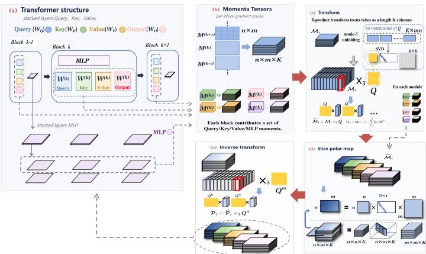
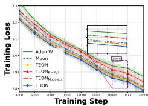
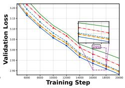
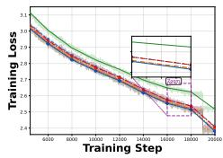
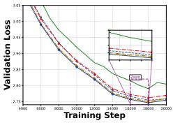
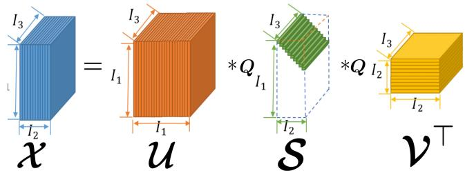

# TUON: A TENSOR-AWARE OPTIMIZER UTILIZING TENSOR-SVD AND POLARIZATION FOR LARGE LAN-GUAGE MODEL PRETRAINING

Anda Tang   
the State Key Lab of General AI   
School of Intelligence Science and Technology   
Peking University   
Beijing, China   
tanganda@pku.edu.cn   
Junjie Wang   
the State Key Lab of General AI   
School of Intelligence Science and Technology   
Peking University   
Beijing, China   
wangjunjie25@stu.pku.edu.cn   
Xuanlin Yang   
the State Key Lab of General AI   
School of Intelligence Science and Technology   
Peking University   
Beijing, China   
2401112159@stu.pku.edu.cn   
Zhouchen Lin ∗   
the Pazhou Laboratory (Huangpu)   
the State Key Lab of General AI   
School of Intelligence Science and Technology   
the Institute for Artificial Intelligence   
Peking University   
Beijing, China   
zlin@pku.edu.cn

## ABSTRACT

Large scale language model (LLM) pretraining is increasingly bottlenecked by optimizer efficiency, driving optimizer design from vector-aware methods such as AdamW to matrix-aware methods. Matrix-aware optimizers such as Muon exploit matrix structure but treat layers independently, neglecting cross-layer correlations. Tensor-aware optimizers are therefore needed, yet existing ones rely on a matricization-based tensor algebra and remain restricted to shallow stacking and specific modules. In this paper, we propose TUON, a novel optimizer built on a transform-based tensor algebra derived from the Tensor-SVD (T-SVD). Unlike methods that polarize a globally unfolded matrix, TUON mixes layers via a unitary transform Q and then polarizes each transformed slice, and inverts the transform to recover the update. This mix-then-separate strategy captures cross-layer correlations while preserving per-layer diversity, avoiding the structural dimension imbalance and cross-layer misalignment of unfolding. Thus it successfully scales to more layers and diverse modules beyond QKV. Theoretically, we prove that TUON performs steepest descent under a Q-transformed tensor spectral norm, and identify its update as the tensor polar factor of the T-SVD. We further establish transform non-redundancy, norm and smoothness comparisons with Muon and TEON, and a convergence guarantee. Empirically, TUON improves consistently over Muon and TEON on GPT-124M/350M and Qwen-0.6B/4B, with ablations confirming the transformation mechanism, cross-layer structure beyond two-layer stacking, adaptability beyond QKV, and robustness to the polarization method.

## 1 INTRODUCTION

As model and data scales continue to grow, the resource intensity of large scale language model (LLM) pretraining has placed optimization efficiency at the forefront of research Liu et al. (2025c;a); Zhang et al. (2026b). In this context, optimizers are critical for training efficiency. The past years have witnessed optimizer advances along different structural granularity levels, from vector-aware to matrix-aware methods. Among them, Adam (Kingma & Ba, 2015) and AdamW (Loshchilov &

Hutter, 2017) remain the default and most widely-used optimizers. It treats parameters via coordinatewise momentum statistics, placing it within the vector-aware family (Xie et al., 2024; Zhang et al., 2024). Then, matrix-aware optimizers (Gupta et al., 2018; Vyas et al., 2025) are emerging as a promising paradigm for next-generation efficient training algorithms. As a representative, Muon (Jordan et al., 2024) has achieved record-breaking pretraining performance on LLMs (Liu et al., 2025a; Team et al., 2025). Compared with vector-aware optimizers, the improvement may stem from matrix-aware optimizers preserving more information from the matrix structure in Transformers.

A Transformer naturally has richer structure than the matrix view suggests. Each module repeats across depth with compatible shapes, forming a tensor $\boldsymbol { w } \in \mathbb { R } ^ { m \times n \times \breve { K } }$ indexing layers. Yet to fit into optimizer frameworks, this structure is usually split into separate matrices $\bar { \pmb { W } } ^ { ( 1 ) } , \ldots , \pmb { W } ^ { ( K ) } \in$ $\mathbb { R } ^ { m \times n }$ , losing cross-layer information. Existing matrix-aware methods operate layer-wise and thus neglect cross-layer correlations. This has motivated tensor-aware optimizers. TEON (Zhang et al., 2026a) matricizes the third-order gradient tensors along the first and second modes and orthogonalizes them, extending Muon to the tensor level. Tensorion (Bogachev et al., 2026) instead relaxes the tensor spectral norm into a tractable surrogate, operating on native higher-order parameters within a single layer and adaptively selecting the unfolding.

Despite their empirical success, existing tensor-aware optimizers exhibit two practical limitations. First, they are restricted in scope. TEON is applied for QKV-specific structures and performs worse on other modules such as output projections and MLPs, so its benefits remain confined to a narrow subset of the network. Tensorion has been applied to vision tasks, leaving its applicability to LLMs unclear. Second, they are confined to shallow stacking. TEON supports only two-layer stacking, and its performance degrades as more layers are concatenated, preventing it from realizing the theoretica information gain that larger stacking sizes are expected to yield (Zhang et al., 2026a).

These limitations stem from two structural problems. The first is a dimension imbalance induced by unfolding. As the number of layers grows, the unfolded matrix becomes increasingly rectangular, so its number of singular directions is bounded by its smaller dimension, and may be far smaller than the larger dimension. Thus, these directions span only a small subspace of the full parameter space, causing information loss. The second is cross-layer misalignment. Even within the same module type, each slice has its own semantic role and evolves differently during training, which means each dominant subspace may not align. Global unfolding concatenates all slices into one matrix to solve for a single shared subspace that approximates all slices collectively. This compromise subspace smooths out slice-specific characteristics and suppresses head- or layer-specific signals. Ultimately, these problems stem from the tensor algebra underlying existing tensor-aware optimizers. Addressing them requires a different tensor algebra, which induces a geometry better suited to cross-layer optimization. This raises a natural question:

Can we design a tensor-aware optimizer that captures cross-layer structure beyond two-layer stacking, adapts to diverse module types beyond QKV, and scales across model sizes, while being theoretically interpretable under a proper tensor geometry?

In this work, we answer this question affirmatively by introducing TUON, a Tensor-aware optimizer Utilizing tensOr-SVD and polarizatioN, built upon a transform-based tensor algebra grounded in the Tensor-SVD (T-SVD) (Kilmer & Martin, 2011; Kernfeld et al., 2015; Zheng et al., 2026). For third-order tensors in Transformer, TUON applies a unitary transform $Q$ along the layer mode to exploit cross-layer structure, then polarizes each transformed slice independently, and inverts the transform to recover the update. While the algebra only requires $Q$ to be invertible, we further require it to decorrelate layer-wise coupling to prevent mutual interference between slices during polarization. Thus we propose DecorQ, a data-dependent transform that diagonalizes the layer Gram matrix and decouples the update into independent orthogonal subproblems. This mix-then-separate design captures cross-layer structure while preserving per-layer diversity, avoiding the information loss of global unfolding and scaling gracefully to many layers and diverse modules beyond QKV.

Theoretically, we first give the tensor spectral under Q-transformation and its dual. Then we prove that TUON is steepest descent for this norm. We further show that the update is the tensor polar factor of a Q-product T-SVD and prove that the transform is non-redundant. At last, we establish norm comparability and smoothness comparison with Muon and TEON, and provide a convergence guarantee. Empirically, TUON delivers consistent improvements across GPT-124M/350M and Qwen-

0.6B/4B. Ablations further confirm the effectiveness of the transform DecorQ, its extension beyond two-layer stacking, its adaptability beyond QKV, and its robustness to the polarization method.

Our main contributions are as follows:

• We propose TUON, a tensor-aware optimizer based on transform-based tensor algebra that better exploits cross-layer information, with the DecorQ transform to decouple layers without mutual interference during polarization. The optimizer applies across layer depths, module types, and model sizes.

• We prove that TUON performs steepest descent under the transform-induced norm. Moreover, we identify the update as the tensor polar factor of a Q-product T-SVD, and prove the non-redundancy of this transform.

• We establish geometry comparisons with Muon and TEON. The transform distorts the Muon geometry by at most a factor of $\sqrt { K }$ , and at a common operator radius, the TUON oracle is at least as strong as the TEON oracle, and can be up to $\bar { \sqrt { K } }$ stronger.

• We provide comprehensive experiments. TUON improves over Muon and TEON on GPT-124M/350M and Qwen-0.6B/4B, with ablations confirming the transformation mechanism, cross-layer structure beyond two-layer stacking, adaptability beyond QKV, and robustness to the polarization method.

§2 presents the TUON method, §3 its theoretical properties, §4 the experimental results. §5 concludes with future directions. Notation, preliminaries, and a comprehensive related work review are provided in Appendices A, B, and C, respectively.

## 2 METHODOLOGY OF TUON

## 2.1 MOMENTUM TENSOR AND LAYER TRANSFORM

For one compatible group, stack the momenta at t-th iteration as $\pmb { \mathcal { M } } _ { t } ( : , : , k ) = \pmb { M } _ { t } ^ { ( k ) }$ and $\mathbf { \nabla } \mathcal { M } _ { t } =$ $\beta \pmb { M } _ { t - 1 } + ( 1 - \beta ) \pmb { \mathscr { G } } _ { i }$ where $\pmb { \mathcal { M } } _ { t } \in \mathbb { R } ^ { m \times n \times K }$ . Given a unitary $Q \in \mathbb { C } ^ { k \times K } , Q ^ { \mathsf { H } } Q = I$ , where $Q ^ { \mathsf { H } }$ denotes the conjugate transpose of $Q$ , our tensor-product-transform treats every tube as a length-K column,

$$
\widehat { \pmb { \mathscr { M } } } _ { t } = \pmb { \mathscr { M } } _ { t } \times _ { 3 } \pmb { Q } , \quad \mathrm { w h e r e ~ t h e ~ } j \mathrm { \cdot t h ~ s l i c e ~ o f ~ } \widehat { \pmb { \mathscr { M } } } _ { t } \quad \widehat { \pmb { M } } _ { t , j } = \widehat { \pmb { M } } _ { t } ( : , : , j ) = \sum _ { k = 1 } ^ { K } Q _ { j k } \pmb { M } _ { t } ^ { ( k ) } .\tag{1}
$$

Choice of the layer transform $Q .$ . In this tensor algebra derived from T-SVD, the layer transform $Q$ only needs to be unitary (or invertible). Many standard transforms satisfy this requirement, including the DCT, the Haar wavelet transform, and the FFT (discussed in Appendix E). These fixed transforms are simple and computationally efficient. However, a fixed transform imposes a prior mismatched to actual layer statistics. To see this, let ${ \sf M } _ { t } \in \mathbb { R } ^ { K }$ ×mn be the mode-3 unfolding of the momentum tensor, whose k-th row is $\mathrm { v e c } ( M _ { t } ^ { ( k ) } ) ^ { \top }$ , and define the layer-wise Gram matrix

$$
\mathsf { C } _ { t } : = \mathsf { M } _ { t } \mathsf { M } _ { t } ^ { \mathsf { T } } \in \mathbb { R } ^ { K \times K } , \qquad ( \mathsf { C } _ { t } ) _ { i j } = \langle M _ { t } ^ { ( i ) } , M _ { t } ^ { ( j ) } \rangle _ { \mathrm { F } } .\tag{2}
$$

This matrix encodes the pairwise coupling among layers. Large off-diagonal entries indicate strongly correlated update directions, while near-zero entries indicate decoupled evolution. A good choice of $Q$ should decorrelate this structure so that the transformed slices evolve independently.

This motivates our default choice, DecorQ. We set $Q = U _ { 3 } ^ { \mathsf { T } }$ , where $U _ { 3 }$ is the left singular matrix of the SVD $\mathsf { M } _ { t } = \pmb { U } _ { 3 } \pmb { \Sigma } _ { 3 } \pmb { V } _ { 3 } ^ { \mathsf { T } }$ . Under this transform, the Gram matrix of the transformed slices becomes

$$
\begin{array} { r } { \widehat { \mathsf C } _ { t } = Q \mathsf M _ { t } \mathsf M _ { t } ^ { \mathsf T } Q ^ { \mathsf T } = { U } _ { 3 } ^ { \mathsf T } \big ( { U } _ { 3 } \Sigma _ { 3 } ^ { 2 } { U } _ { 3 } ^ { \mathsf T } \big ) { U } _ { 3 } = \Sigma _ { 3 } ^ { 2 } , } \end{array}\tag{3}
$$

which is diagonal. Hence the transformed slices satisfy $\langle \widehat { M } _ { t , i } , \widehat { M } _ { t , j } \rangle _ { \mathrm { F } } = 0$ for $i \neq j$ , which are mutually orthogonal. The original coupled K-layer of a tensor is therefore decoupled into $K$ independent single-channel problems, each evolving in its own orthogonal subspace without mutual interference. DecorQ is data-dependent and is refreshed from the momentum statistics during training, so the transform adapts to the evolving cross-layer structure rather than imposing a fixed prior. We compare DecorQ against DCT, Haar, and DFT in experiments in $\ S 4 . 2 .$ , where DecorQ consistently achieves the best performance. Unlike existing approaches that orthogonalize the unfolded matrix as a whole, TUON uses unfolding only to construct $Q .$ . Full derivations and additional transform choices are provided in Appendix E.

Algorithm 1 TUON   
Require: compatible matrices $\{ W _ { t } ^ { ( k ) } \} _ { k = 1 } ^ { K }$ , gradients $\{ G _ { t } ^ { ( k ) } \} _ { k = 1 } ^ { K }$ and momentum $\{ M _ { t } ^ { ( k ) } \} _ { k = 1 } ^ { K } ;$ learning rate   
ηt, momentum coefficient β, weight decay coefficient λ, NS steps J   
1: $\dot { \pmb { \mathcal { G } } } _ { t } \gets \mathrm { s t a c k } _ { 3 } ( \pmb { G } _ { t } ^ { ( 1 ) } , \dots , \pmb { G } _ { t } ^ { ( K ) } )$   
2: $\pmb { \mathscr { M } } _ { t } \gets \beta \pmb { \mathscr { M } } _ { t - 1 } + ( 1 - \beta ) \pmb { \mathscr { G } } _ { t }$   
3: Compute the Gram matrix $\bar { \mathsf { C } _ { t } } : = \mathsf { M } _ { t } \mathsf { M } _ { t } ^ { \mathsf { T } } \in \mathbb { R } ^ { K \times K }$ with $( \mathsf { C } _ { t } ) _ { k \ell } = \langle \pmb { M } _ { t } ( : , : , k ) , \pmb { M } _ { t } ( : , : , \ell ) \rangle _ { \mathrm { F } }$   
4: Compute eigendecomposition $\mathsf C _ { t } = \mathbf U _ { t } \pmb { \Lambda } _ { t } \mathbf U _ { t } ^ { \mathsf T }$   
5: Set $\dot { Q } _ { t } \gets \check { \mathbf { U } } _ { t } ^ { \top }$ ▷ Refresh per 200 iteration   
6: $\widehat { \pmb { M } } _ { t } \gets \pmb { M } _ { t } \times _ { 3 } \pmb { Q } _ { t }$   
7: for $j _ { . } = 1 , \ldots , K$ in parallel do   
8: $\widehat { \pmb { \mathscr { P } } } _ { t } ( : , : , j ) \gets$ polarization $\widehat { ( \pmb { \mathscr { M } } _ { t } ( : , : , j ) ) }$ ▷ Newton–Schulz, J steps   
9: end for   
10: $\mathcal { P } _ { t }  \widehat { \mathcal { P } } _ { t } \times _ { 3 } Q _ { t } ^ { \mathsf { H } }$   
11: $\pmb { \mathcal { W } } _ { t + 1 }  ( 1 - \eta _ { t } \lambda ) \pmb { \mathcal { W } } _ { t } - \eta _ { t } \gamma _ { t } \pmb { \mathcal { P } } _ { t }$ with $\gamma _ { t }  1 / ( \mathrm { R M S } ( \pmb { \mathcal { P } } _ { t } ) + \epsilon )$

## 2.2 POLARIZATION AND INVERSE TRANSFORM

Then for each transformed slice $\widehat { M } _ { t , j }$ , we polarize (or orthogonalize) them, defined as

$$
\widehat { P } _ { t , j } = \mathrm { p o l a r } ( \widehat { M } _ { t , j } ) = U _ { t , j } V _ { t , j } ^ { \top } ,\tag{4}
$$

where $U _ { t , j }$ and $V _ { t , j }$ correspond to the singular value decomposition (SVD) of $\widehat { M } _ { t , j } = U _ { t , j } \Sigma _ { t , j } V _ { t , j } ^ { \top }$ Then the polarized tensor $\widehat { \mathcal { P } } _ { t }$ is made up by each polarized slice $\widehat { P } _ { t , j } , \ \mathrm { i . e . , } \ \widehat { P } _ { t , j } \ = \ \widehat { \mathcal { P } } _ { t } ( : , :$ $, j ) , ( j = 1 , \cdots , K )$ . Instead of exact SVD, the polar factor is approximated by fast iterative methods such as Newton–Schulz (NS, Appendix F).

After obtaining the approximate polar factors $\widehat { \mathcal { P } } _ { t }$ , we invert the transform to recover the update in the original tensor domain as

$$
\mathcal { P } _ { t } = \widehat { \mathcal { P } } _ { t } \times _ { 3 } Q ^ { \mathsf { H } } .\tag{5}
$$

To control the overall step magnitude while preserving the direction of the update, we then scale the entire stack by $\begin{array} { r } { \gamma _ { t } = \frac { 1 } { \mathrm { R M S } ( \pmb { \mathcal { P } } _ { t } ) + \epsilon } } \end{array}$ , where $\begin{array} { r } { \mathrm { R M S } ( \pmb { \mathcal { P } } _ { t } ) = \sqrt { \frac { 1 } { m n K } \sum _ { i = 1 } ^ { m } \sum _ { j = 1 } ^ { n } \sum _ { k = 1 } ^ { K } | \pmb { \mathcal { P } } _ { t } ( i , j , k ) | ^ { 2 } } } \end{array}$ is the root-mean-square value (typically $1 / \sqrt { \operatorname* { m a x } ( m , n ) }$ , as suggested by the rank–energy identity in Proposition 3), and ϵ avoids division by zero. Since $\gamma _ { t }$ is shared across all layers, it only changes the effective trust-region radius, not the relative direction across slices. Finally, with decoupled weight decay, $\pmb { \mathcal { W } } _ { t + 1 } = ( 1 - \eta _ { t } \lambda ) \pmb { \mathcal { W } } _ { t } - \eta _ { t } \pmb { \widetilde { \mathcal { P } } } _ { t } , \quad \pmb { \widetilde { \mathcal { P } } } _ { t } = \gamma _ { t } \pmb { \mathcal { P } } _ { t }$ where $\eta _ { t }$ is the learning rate and λ is the weight-decay coefficient.

Complexity analysis. Table 1 compares the resulting complexities. In the typical regime $K \ll$ min(m, n), TUON has the comparable asymptotic cost as Muon and TEON. A detailed derivation of the per-iteration complexity is deferred to Appendix G.1.

Table 1: Per-iteration computational complexity for a single tensor group of $K \times m \times n$
<table><tr><td></td><td>Optimizer Per-iteration complexity</td><td>Dominant term</td></tr><tr><td>Muon</td><td> $O ( K m n \cdot \operatorname* { m i n } ( m , n ) )$ </td><td> $K m n \cdot \operatorname* { m i n } ( m , n )$ </td></tr><tr><td>TEON</td><td> $O ( K m n \cdot \operatorname* { m i n } ( m , n \dot { K } ) )$ </td><td> $K m n \cdot \operatorname* { m i n } ( \stackrel { } { m } , n \dot { K } )$ </td></tr><tr><td>TUON</td><td> $O \big ( K m n \cdot \operatorname* { m i n } ( m , n ) + K ^ { 2 } m n \big )$ </td><td> $K m n \cdot \operatorname* { m i n } ( m , n )$ </td></tr></table>

  
Figure 1: Illustration of the TUON update

## 3 STEEPEST DESCENT THEORY AND COMPARATIVE ADVANTAGES

This section develops the complete theory of TUON. Preliminaries including Matrix SVD, operator/nuclear norm duality, polar factors, norm-induced LMO, T-SVD, and norm-smoothness are reviewed in Appendix B. The Muon and TEON geometries, including their trust-region updates, are stated in Appendix D. Detailed step-by-step proofs of every result in this section are given in Appendix H. The theoretical development answers four questions. i) Is the update in our method the exact steepest descent direction under some well-defined norm geometry (Sec. 3.1)? ii) Does the layer transform cancel algebraically with the inverse transform (Sec. 3.1)? iii) How does the geometry compare with Muon and TEON (Sec. 3.2)? iv) Can a strict convergence be certified (Sec. 3.3)?

Let $\pmb { \chi } \in \mathbb { R } ^ { m \times n \times K }$ stack K compatible matrices, with frontal slices $X _ { k } : = \pmb { \chi } ( : , : , k )$ . Define mode-1 unfolding as $\mathcal { U } ( \pmb { \mathscr { X } } ) : = [ \pmb { \dot { X _ { 1 } } } , \dots , \pmb { X _ { n K } } ] \in \mathbb { C } ^ { m \times n K }$ . Under this convention, $\mathcal { U } ( \pmb { \mathcal { X } } \times _ { 3 } \pmb { Q } ) =$ $\mathcal { U } ( \pmb { \mathscr { X } } ) R _ { Q } \ , R _ { Q } : = \pmb { Q } ^ { \top } \otimes I _ { n } .$ where ⊗ is the Kronecker product and $I _ { n }$ is the identity matrix of size n. Since both $Q$ and $I _ { n }$ are unitary, their Kronecker product $R _ { Q }$ is unitary. Below, ∥ · ∥Muon and $\Vert \cdot \Vert _ { \mathrm { T E O N } }$ denote the spectral norms used by Muon and TEON, respectively; their duals and optimizer maps are given in Appendix D. Appendix B.4 verifies directly that $\Vert \cdot \Vert _ { Q , \mathrm { T s } }$ is a norm. Proposition 1 identifies the dual norm associated with TUON, which measures the largest first-order alignment with a direction in the unit trust region. The proof can be found in Appendix H.

Definition 1 (Tensor spectral and nuclear norms under Q-transform). Define $\Vert \pmb { \mathscr { x } } \Vert _ { Q , \mathrm { T s } } : =$ $\operatorname* { m a x } _ { 1 \leq j \leq K } { \| \widehat { \boldsymbol { X } } _ { j } \| _ { \mathrm { o p } } }$ and $\begin{array} { r } { \| \pmb { \mathscr { X } } \| _ { \pmb { Q } , \mathrm { T n } } : = \sum _ { j = 1 } ^ { K } \| \widehat { \pmb { X } } _ { j } \| . } \end{array}$ ∗ where $\| \cdot \| _ { \mathrm { o p } }$ and $\| \cdot \|$ ∗ denote the matrix operator (spectral) norm and nuclear norm, respectively.

Proposition 1 (Dual norm). For unitary $Q , \parallel \cdot \parallel _ { Q , \mathrm { T n } }$ is the dual norm $o f \parallel \cdot \parallel _ { Q , \mathrm { T s } } ,$ , defined as $\operatorname* { s u p } _ { \| \pmb { \mathcal { D } } \| _ { \pmb { Q } , \mathrm { T s } } \le 1 } \langle \pmb { \mathcal { G } } , \pmb { \mathcal { D } } \rangle _ { \mathrm { F } } = \| \pmb { \mathcal { G } } \| _ { \pmb { Q } , \mathrm { T n } }$

## 3.1 STEEPEST DESCENT AND T-SVD POLAR

For clarity, we fix the notation in this part as follows. Define the update of TUON by a general Q transform as $\pmb { \mathcal { P } } : = \operatorname { \bigl ( p o l a r } ( ( \pmb { M } \times _ { 3 } \pmb { \dot { Q } } ) _ { k \in \{ 1 , \cdots , K \} } ) ) \times _ { 3 } \pmb { Q } ^ { \mathsf { H } }$ . From Theorem 1, we will show that TUON is normalized steepest descent under the Q-transformed tensor spectral norm, rather than a heuristic composition of matrix normalizations. A shared positive scale on all slices only changes the effective trust-region radius $\rho ,$ not the update direction.

Theorem 1. For every radius $\rho > 0 , - \rho \pmb { \mathcal { P } } \in \arg \operatorname* { m i n } _ { \| \pmb { \mathcal { D } } \| _ { Q , \mathrm { T s } } \leq \rho } \langle \pmb { \mathcal { M } } , \pmb { \mathcal { D } } \rangle _ { \mathrm { F } }$ and the optimal value is $- \rho \| \mathbf { \mathcal { M } } \| _ { Q , \mathrm { T n } } = - \rho \sum _ { j = 1 } ^ { K } \| \widehat { M } _ { j } \| _ { * }$

The update also admits a tensor-algebraic interpretation. Let $\pmb { \mathcal { M } } = \pmb { \mathcal { U } } * _ { Q } \pmb { \mathcal { S } } * _ { Q } \pmb { \mathcal { V } } ^ { \top }$ be the T-SVD of M (see Appendix B.5), where $s$ is f-diagonal with the nonzero singular values of the transformed slices on its diagonal. Let $\mathcal { I } _ { \mathrm { s u p p } }$ be the f-diagonal tensor obtained from S by replacing every nonzero diagonal entry with 1. Analogously to the matrix polar factor $U V ^ { \top }$ of $\pmb { A } = \pmb { U } \pmb { \Sigma V } ^ { \top }$ , the tensor polar factor is tpola $\mathbf { \bar { \omega } } _ { Q } ( \mathbf { \mathcal { M } } ) : = \mathcal { U } \ast _ { Q } \mathcal { T } _ { \mathrm { s u p p } } \ast _ { Q } \mathcal { V } ^ { \intercal }$ . The following proposition shows that this tensor-algebraic object is exactly the optimizer map from Theorem 1.

Proposition 2 (tensor polar equivalence). The optimizer map P equals the partial-isometryfactor of the generalized T-SVD: $\pmb { \mathcal { P } } = \mathrm { t p o l a r } _ { Q } ( \pmb { \mathcal { M } } ) = \pmb { \mathcal { U } } \ast _ { Q } \pmb { \mathcal { T } } _ { \mathrm { s u p p } } \ast _ { Q } \pmb { \mathcal { V } } ^ { \top }$ . For $K = 1$ , this reduces to matrix Muon. For $Q = I ,$ , it reduces to independent layer-wise polar maps.

The proposed direction is thus both the exact LMO for a tensor-spectral trust region and the generalized polar factor of a third-order tensor. Our novelty lies in specializing the t-product and tensor polar decomposition to cross-layer optimization, which enables the comparative, convergence, and oracle analyses in $\ S \ 3 . 2 .$ . These proofs can be found in Appendices H.2 and H.3.

Non-redundancy of the Layer Transform. A natural concern is that the layer transform Q might be algebraically redundant, since the update applies Q and later $Q ^ { \mathsf { H } }$ , the two might simply cancel, leaving no real effect. For a TEON-style unfolding polar, a unitary change of layer basis cancels exactly, so it cannot adapt the update to the transform. In TUON, however, the transform is applied before the nonlinear slice-wise polar maps, so it changes the tensor partition. This establishes an algebraic distinction between the two approaches. The following theorem clarifies when this cancellation occurs.

Theorem 2 (Unfolding cancellation versus slice-wise non-cancellation). Let $M _ { ( 1 ) } = \mathcal { U } ( \mathcal { M } )$ and $\pmb { R } _ { Q } = \pmb { Q } ^ { \top } \otimes \pmb { I } _ { n } .$ . For the matrix polar map, polar $( M _ { ( 1 ) } R _ { Q } ) R _ { Q } ^ { \sf H } = \mathrm { p o l a r } ( M _ { ( 1 ) } )$ . Hence a unitary layer transform is redundant under a global unfolding polar. In contrast, under the algebra used by TUON, $( \mathrm { p o l a r } _ { \mathrm { s l i c e } } ( \mathbf { \mathcal { M } } \times _ { 3 } \mathbf { \mathcal { Q } } ) ) \times _ { 3 } \mathbf { \mathcal { Q } } ^ { \mathrm { f i } } \neq \mathrm { p o l a r } _ { \mathrm { s l i c e } } ( \mathbf { \bar { \mathcal { M } } } )$ , cancellation does not occur in general.

Proposition 3. Let $r _ { j } : = \mathrm { r a n k } ( \widehat { M } _ { j } )$ . Then $\begin{array} { r } { \| \pmb { \mathcal { P } } \| _ { \mathrm { F } } ^ { 2 } = \sum _ { j = 1 } ^ { K } r _ { j } } \end{array}$ and $\begin{array} { r } { \mathrm { R M S } ( \pmb { \mathcal { P } } ) = \sqrt { \sum _ { j } r _ { j } / ( m n K ) } } \end{array}$

Ifslices arefull rank, then $\mathrm { R M S } ( \pmb { \mathcal { P } } _ { Q } ) = 1 / ( \sqrt { \operatorname* { m a x } ( \ b { m } , \pmb { n } ) } )$ , independently ofK.

Since the polar map normalizes all nonzero singular values to one, the update energy depends only on the number of active singular directions, not on the momentum magnitude. Proposition 3 gives this energy exactly and shows that stacking more layers does not inflate the RMS by a factor of $\sqrt { K }$ which justifies the stack-scale factor for normalization in §2.2. Proofs are in Appendix H.4 and H.5.

## 3.2 COMPARISON WITH MUON AND TEON

In this part, we show that any unitary layer transform distorts the Muon geometry by at most a factor of $\sqrt { K }$ , where K is the number of stacked layers. The precise Muon norm pair and its polar LMO are reviewed in Appendix D.1. Here we only use the notation $\| \cdot \| _ { \mathrm { M u o n } }$ and $\ u \Vert \cdot \Vert _ { \mathrm { M u o n } , * }$

Theorem 3. Define $\begin{array} { r } { \alpha _ { Q } : = \operatorname* { m a x } _ { j } \sum _ { k = 1 } ^ { K } | Q _ { j k } | } \end{array}$ and $\begin{array} { r } { \beta _ { Q } : = \operatorname* { m a x } _ { k } \sum _ { j = 1 } ^ { K } | Q _ { j k } | } \end{array}$ . Since $Q$ is unitary, $\alpha _ { Q } , \beta _ { Q } \leq \sqrt { K }$ . Then, for every tensor X and for their duals $\pmb { \mathscr { G } }$

$$
\frac { 1 } { \beta _ { Q } } \| \pmb { \mathscr { X } } \| _ { \mathrm { M u o n } } \leq \| \pmb { \mathscr { X } } \| _ { Q , \mathrm { T s } } \leq \alpha _ { Q } \| \pmb { \mathscr { X } } \| _ { \mathrm { M u o n } , } , \quad \frac { 1 } { \alpha _ { Q } } \| \pmb { \mathscr { G } } \| _ { \mathrm { M u o n } , * } \leq \| \pmb { \mathscr { G } } \| _ { Q , \mathrm { T n } } \leq \beta _ { Q } \| \pmb { \mathscr { G } } \| _ { \mathrm { M u o n } , * } .\tag{6}
$$

The bounds, $\begin{array} { r } { \frac { 1 } { \beta _ { Q } } \| \pmb { \mathcal { X } } \| _ { \mathrm { M u o n } } \le \| \pmb { \mathcal { X } } \| _ { Q , \mathrm { T s } } \le \alpha _ { Q } \| \pmb { \mathcal { X } } \| _ { \mathrm { M u o n } } , } \end{array}$ , ensure that the transform neither collapses nor explodes the trust-region scale. Their dual counterparts control the gradient’s nuclear norm: the best first-order decrease under the $Q$ geometry is at least $1 / \sqrt { K }$ and at most $\sqrt { K }$ times that under the layer-wise Muon geometry. This is the key stability statement: no unitary layer transform can distort the Muon geometry by more than a factor of $\sqrt { K }$ , regardless of the data or the choice of $Q .$

Corollary 1 (Smoothness comparison). Let $L _ { Q }$ and $L _ { \mathrm { M u o n } }$ be the smallest constants satisfying $\| \nabla F ( \pmb { \chi } ) ^ { * } - \nabla F ( \pmb { \mathscr { y } } ) \| _ { \pmb { Q } , \mathrm { T n } } \leq L _ { \pmb { Q } } ^ { \bullet } \| \pmb { \mathscr { x } } - \pmb { \mathscr { y } } \| _ { \pmb { Q } , \mathrm { T s } }$ and the analogous inequality under the Muon norm pair. Then $\begin{array} { r } { \frac { 1 } { \alpha _ { Q } ^ { 2 } } L _ { \mathrm { M u o n } } \leq L _ { Q } \leq \beta _ { Q } ^ { 2 } L _ { \mathrm { M u o n } } } \end{array}$

In Corollary 1, the induced smoothness constants differ by at most a factor $K .$ This establishes the maximum scale at which a convergence improvement can arise, while also preventing an unsupported claim of arbitrary acceleration from a mere coordinate change.

Theorem 4 (LMO gain with TEON). For every unitary Q and tensor $x , \| x \| _ { Q , \mathrm { T s } } \leq \| x \| _ { \mathrm { T E O N } } \leq$ $\sqrt { K } \Vert \pmb { \mathcal { X } } \Vert _ { Q , \mathrm { T s } }$ . Consequently, $\begin{array} { r } { \| \pmb { \mathcal { G } } \| _ { \mathrm { T E O N , * } } \le \| \pmb { \mathcal { G } } \| _ { \pmb { Q } , \mathrm { T n } } \le \sqrt { K } \| \pmb { \mathcal { G } } \| _ { \mathrm { T E O N , * } } } \end{array}$ . Thus, at a common radius $\rho , \rho \| \pmb { \mathscr { G } } \| _ { \mathrm { T E O N , * } } \leq \rho \| \pmb { \mathscr { G } } \| _ { \pmb { Q } , \mathrm { T n } } \leq \sqrt { K } \rho \| \pmb { \mathscr { G } } \| _ { \mathrm { T E O N , * } }$

Then, we compare the linearized decrease with TEON. The TEON norm/dual norm, and TEON polar update are stated in Appendix D.2. Thus, at equal operator radius, the exact TUON first-order oracle is never weaker than the TEON oracle and may be up to $\sqrt { K }$ stronger. These proofs can be found in Appendix H.8, H.9 and H.10.

## 3.3 CONVERGENCE

Theorem 5. Let F be the training objective, lower bounded by $F _ { \star } , \ \eta$ is the step size and T is the number of iterations. Suppose F is lower bounded by $F _ { \star }$ and is LQ-smooth under $\Vert \cdot \Vert _ { Q , \mathrm { T s } } .$ For $\pmb { \mathcal { W } } _ { t + 1 } = \pmb { \mathcal { W } } _ { t } - \eta \pmb { \mathcal { P } } _ { \pmb { Q } } ( \nabla F ( \pmb { \mathcal { W } } _ { t } ) )$ , we have min $\begin{array} { r } { \rvert \lvert \nabla F ( \mathbf { \mathcal { W } } _ { t } ) \rvert \rvert _ { Q , \mathrm { T n } } \leq \frac { F ( \mathbf { \mathcal { W } } _ { 0 } ) - F _ { \star } } { \eta T } + \frac { L _ { Q } \eta } { 2 } } \end{array}$ Choosing $\eta = \sqrt { \frac { 2 ( F ( \mathcal { W } _ { 0 } ) - F _ { \star } ) } { L _ { Q } T } }$ gives

$$
\operatorname* { m i n } _ { 0 \leq t < T } \| \nabla F ( \mathcal { W } _ { t } ) \| _ { \mathrm { F } } \leq \operatorname* { m i n } _ { 0 \leq t < T } \| \nabla F ( \mathcal { W } _ { t } ) \| _ { Q , \mathrm { T n } } \leq \sqrt { \frac { 2 L _ { Q } \bigl ( F ( \mathcal { W } _ { 0 } ) - F _ { \star } \bigr ) } { T } } .\tag{7}
$$

Corollary 1 bounds the smoothness gap between TUON and Muon by at most a factor K. Together with Theorem $^ { 5 , }$ this yields a convergence improvement of at most $\sqrt { K }$ and a tighter $O ( T ^ { - 1 / 2 } )$ stationarity certificate. The proof is in Appendix H.11.

## 4 EXPERIMENTS

We evaluate TUON across three dimensions to thoroughly assess its effectiveness and generality. (i) Architecture and Scalability. GPT-124M/350M and Qwen-0.6B/4B verify broad applicability and scalability (§4.1). (ii) Ablation. Ablations isolate the transformation mechanism, cross-layer stacking beyond two layers, module adaptability beyond QKV, and robustness to the polarization method (§4.2). (iii) Cost. Step-time comparison shows that TUON adds only marginal overhead and scales gracefully (§4.3).

Baselines. We compare TUON against representative optimizers from three levels of structural granularity. (i) AdamW (Loshchilov & Hutter, 2017) is the de facto vector-aware standard for large-scale pretraining. (ii) Muon (Jordan et al., 2024) is a matrix-aware optimizer that has recently demonstrated remarkable breakthroughs in LLM pretraining. (iii) TEON (Zhang et al., 2026a) is a recent tensor-aware optimizer that has consistently outperformed Muon across model scales and architectures. Tensorion is also a tensor-aware optimizer, but it has been validated mainly on vision tasks, so we use TEON rather than Tensorion as our tensor-aware baseline. Together, these baselines span vector-, matrix-, and tensor-level optimization. More details can be found in Appendix I.3.

Experimental details. All baselines follow the same configurations , ensuring a fair comparison. Comprehensive experimental details, such as computational resources, configurations, implementation specifics, are elaborated in Appendix I.2. Our implementation strictly follows the PyTorch official API. Fully functional, production-ready code is publicly released (see Appendix I.1 for link and implement details).

## 4.1 RESULTS ON LLM PRETRAINING

Table 2 reports validation loss on GPT-2 (124M, 350M) and Qwen3 (0.6B, 4B). TUON achieves the lowest loss on three of the four settings and consistently outperforms Muon and TEON. Specifically, TUON reduces validation loss over AdamW by 0.0382, 0.0765, and 0.0510 on GPT-2 350M and the two Qwen3 scales, respectively. Moreover, TUON outperforms Muon on all four settings, with the largest gap at 124M (0.1131). This suggests that cross-layer structure is particularly beneficial. Furthermore, TUON improves over TEON on every model, consistent with our motivation and theory in §3.2. Fig. 2 presents the training and validation curves for Qwen3 0.6B and 4B. TUON outperforms

  
(a) Qwen 0.6B .

(b) Qwen 4B.  
  
Figure 2: Training curves of Qwen models.

Table 2: Validation loss on GPT-2 (124M, 350M; 50k iterations) and Qwen3 (0.6B, 4B; 20k iterations). $\Delta = \mathrm { { V a l - V a l } _ { A d a m W } ; }$ negative $\Delta$ indicates improvement. Best per column in bold. Lower is better.
<table><tr><td rowspan="2">Optimizer</td><td colspan="2"> $1 2 4 \mathbf { M _ { G P T - 2 } }$ </td><td colspan="2"> $3 5 0 \mathbf { M } _ { \mathbf { G P T } \cdot 2 }$ </td><td colspan="2"> $\mathbf { 0 . 6 B _ { Q w e n 3 } }$ </td><td colspan="2"> $\mathbf { 4 B _ { 0 w e n 3 } }$ </td></tr><tr><td>Val</td><td> $\Delta$ </td><td>Val</td><td> $\Delta$ </td><td>Val</td><td> $\Delta$ </td><td>Val</td><td> $\Delta$ </td></tr><tr><td>AdamW</td><td>2.9230</td><td></td><td>2.7307</td><td></td><td>2.9652</td><td></td><td>2.8108</td><td></td></tr><tr><td>Muon</td><td>3.0488</td><td> $+ 0 . 1 2 5 8$ </td><td>2.7404</td><td>+0.0097</td><td>2.9056</td><td>-0.0596</td><td>2.7636</td><td>-0.0472</td></tr><tr><td>TEON</td><td>2.9442</td><td>+0.0212</td><td>2.6935</td><td>-0.0372</td><td>2.8978</td><td>-0.0674</td><td>2.7604</td><td>-0.0504</td></tr><tr><td>TUON</td><td>2.9357</td><td>+0.0127</td><td>2.6925</td><td>-0.0382</td><td>2.8887</td><td>-0.0765</td><td>2.7598</td><td>-0.0510</td></tr></table>

Table 3: Effect of stacking size K. ↑/↓ denote K = full is worse/better than K = 2. 20k iterations.
<table><tr><td rowspan="2">Model</td><td rowspan="2">Muon</td><td colspan="2"> $\mathrm { T E O N } _ { \mathrm { m o d e } - 1 }$ </td><td colspan="2"> $\mathrm { T E O N } _ { \mathrm { m o d e } - 2 }$ </td><td colspan="2"> $\mathrm { T U O N _ { D C T } }$ </td><td colspan="2"> $\mathrm { T U O N } _ { \mathrm { D e c o r Q } }$ </td></tr><tr><td> ${ \tt K } = 2$ </td><td>K=full</td><td>K=2</td><td>K=full</td><td>K=2</td><td>K=full</td><td>K=2</td><td>K=full</td></tr><tr><td>124MGPT-2</td><td>3.0583</td><td>3.0255</td><td>3.0513(↑)</td><td>3.0332</td><td>3.0789(↑)</td><td>3.0309</td><td>3.0295(↓)</td><td>3.0299</td><td>3.0233(↓)</td></tr><tr><td>350MGPT-2</td><td>2.8427</td><td>2.8427</td><td>2.8617(↑)</td><td>2.8643</td><td>2.8762(↑)</td><td>2.8150</td><td>2.8218(↑)</td><td>2.8183</td><td>2.8143(↓)</td></tr><tr><td> $\mathbf { 0 . 6 B _ { Q w e n 3 } }$ </td><td>2.9056</td><td>2.8994</td><td>2.9323(↑)</td><td>2.8978</td><td>2.9583(↑)</td><td>2.9203</td><td>2.9210(↑)</td><td>2.8938</td><td>2.8887(↓)</td></tr><tr><td> $\mathbf { 4 B _ { 0 w e n 3 } }$ </td><td>2.7636</td><td>2.7627</td><td>2.7649(↑)</td><td>2.7604</td><td>2.7640(↑)</td><td>2.7606</td><td>2.8100(↑)</td><td>2.7629</td><td>2.7598 (↓)</td></tr></table>

AdamW, Muon, TEON, and the TEON variants that stack all layers $( \mathrm { T E O N } _ { K = \mathrm { F u l l } } )$ or extend to QKVO and ML $\mathrm { ~ P ~ } ( \mathrm { T E O N } _ { \mathrm { M o d u l e _ { A l l } } } )$ . Overall, TUON delivers consistent improvements across two architectures and four scales without per-scale tuning, supporting the claim that a transform-based tensor algebra offers a more effective geometry for cross-layer optimization.

## 4.2 ABLATION STUDIES

We conduct ablation studies to isolate the effect of each design choice in our method. Unless otherwise noted, we train all models for 20k iterations for computational reasons.

Choices of Q. The T-SVD-based algebra only requires $Q$ to be invertible and does not specify which transform suits cross-layer optimization. Our analysis in § 2 suggests that Q should be guided by layer statistics, which we test here by comparing fixed transforms (DCT, Haar, DFT) against data-dependent DecorQ variants (static and residual); details are in Appendix E and I.6.

In Table 7, DecorQ achieves the best results, improving over DCT by 0.0502, while the other four choices perform comparably. It reflects that layer statistics are empirically superior. Moreover, static DecorQ reaches a competitive 2.7658 but remains slightly worse than the adaptive version, indicating that refreshing Q during training provides a consistent benefit. Overall, the ablation confirms that the layer mode should be treated as a structured dimension rather than an arbitrary algebraic index.

Stacking size K. A larger stacking size K exposes more cross-layer structure, and the theoretical analysis in § 3.2 and in (Zhang et al., 2026a) predicts a larger potential gain as K grows. Table 3 tests whether this potential is realized in practice. TEON performs best at $K = 2$ and consistently degrades at K = full for both mode-1 and mode-2 unfolding, exposing a gap between theory and practice. Although larger K promises more gain, unfolding methods lose performance as K grows.

Two causes are likely. Unfolding conflates structural information, and aligning top singular vectors across many layers becomes increasingly difficult.

TUON with DecorQ is the only method that improves from $K = 2$ to $K = \mathrm { f u l l }$ on all four models: 3.0299 to 3.0233 (GPT-2 124M), 2.8183 to 2.8143 (GPT-2 350M), 2.8938 to 2.8887 (Qwen3 0.6B), and 2.7629 to 2.7598 (Qwen3 4B), confirming its ability to exploit more layers. We also notice that TUON with DCT degrades on three of the four models, isolating the effect of Q, i.e., it is not larger K alone that helps, but the ability to adapt the shared basis to the grouped layers. Overall, although the gain remains modest and falls short of the $\sqrt { K }$ upper bound by theory, TUON with DecorQ is the first that makes stacking more layers beneficial rather than harmful, a regime that prior methods cannot reach.

Unfolding mode. TEON requires an additional hyperparameter, i.e., unfold along mode-1 or mode-2. It reports that mode-1 works better in practice (Zhang et al., 2026a). Our experiments reveal that the better mode of TEON is model-dependent (Table 3). Specifically, GPT-2 favors mode-1, while Qwen3 favors mode-2. Moreover, choosing the wrong mode costs 0.0216 on GPT-2 350M. The gap is non-negligible, meaning TEON requires a per-model mode choice, and neither mode provides a universally correct alignment. TUON avoids this hyperparameter by transform-based tensor algebra. In all main experiments, we report the stronger of the two TEON modes, ensuring that the comparison is against the most favorable TEON configuration. Even under this conservative protocol, TUON outperforms the best TEON on every model in Table 2.

Layer type. Our method applies uniformly to all layer types. We verify this by comparing ModuleQKV (attention projections only) with ModuleAll (QKVO and MLP). Table 9 reports the results. Under mode-1, TEON degrades on all four models, and under mode-2 the degradation is even larger, e.g., from 3.0332 to 3.1027 on GPT-2 124M. This confirms that the matricization-based tensor algebra struggles to maintain alignment across heterogeneous layer types under either unfolding mode. TUON behaves differently, extending from $\mathrm { M o d u l e _ { Q K V } }$ to ModuleAll yields comparable or better losses on GPT-2 124M (3.0225 to 3.0233), GPT-2 350M (2.8291 to $2 . 8 1 4 3 )$ , Qwen3 0.6B (2.8897 to 2.8887), and Qwen3 4B (2.7606 to 2.7598). Moreover, in the Modul $\mathrm { ; _ { A l l } }$ setting, it outperforms the best TEON by 0.0298, 0.0474, 0.0131, and 0.0041, respectively. These results show that TUON’s benefit extends beyond attention to MLP and output projections, where prior tensor-aware optimizers fail to transfer.

Polarization methods. Our optimizer relies on a polar map, approximated in practice by Newton– Schulz (NS) iterations. We test the robustness of TUON to the polarization method by comparing NS $\left( J = 5 \right)$ with PolarExpress (Amsel et al., 2026) on Qwen3-4B. In Table 11, the two methods perform comparably at both stacking sizes. Specifically, at $K = 2$ , NS reaches 2.7629 and PolarExpress 2.7638; at full stacking, PolarExpress is slightly better (2.7569 vs. 2.7598). Both differences are an order of magnitude smaller than the gain from the $Q$ mechanism (0.0502), confirming the robustness of TUON.

## 4.3 TRAINING STEP TIME

We compare the per-iteration step time with identical hardware, batch size, sequence length, and parallelism configuration. Table 4 reports the average time per iteration (ms), excluding the first few iterations to remove compilation and initialization overhead. Relative to vector-aware AdamW, TUON is slower by 6.1%, 8.3%, 3.5%, and 12.5% on the four models per iteration, respectively. Compared with matrix-aware and tensor-aware optimizer, TUON is on par with Muon and TEON across all four models, within 0.2%–1.1% of TEON and 1.7%–6.1% of Muon. These results show that TUON introduces only marginal overhead and scales gracefully to larger models, making the per-iteration cost a reasonable price for the optimization benefits reported above.

## 5 CONCLUSION

We introduce TUON, a tensor-aware optimizer built on a transform-based tensor algebra grounded in the Tensor-SVD. For third-order tensors in Transformers, TUON applies a unitary transform Q along the layer mode and polarizes each transformed slice independently before inverting the transform, a mix-then-separate design that exploits cross-layer structure while preserving per-layer diversity and avoiding the information loss of global unfolding. Empirically, TUON improves consistently over Muon and TEON on GPT-124M/350M and Qwen-0.6B/4B, with ablations confirming its transformation mechanism, cross-layer stacking beyond two layers, adaptability beyond QKV, and robustness to polarization, at only marginal overhead. For future work, although DecorQ realizes the benefits of larger stacking sizes, these gains remain bounded and below the theoretical maximum. Further extending TUON’s stacking capability is therefore a promising direction. Two additional directions are extending TUON to other parameter groups and heterogeneous architectures, and co-designing tensor-efficient kernels that exploit the layer-mode transform and slice-wise polarization to reduce memory traffic and improve hardware efficiency.

Table 4: Time per iteration (ms) on four models. Lower values indicate faster training.
<table><tr><td rowspan="2">Model</td><td colspan="4">Time per Iteration (ms)</td></tr><tr><td> $1 2 4 \mathbf { M } _ { \mathbf { G P T } \cdot 2 }$ </td><td> $3 5 0 \mathbf { M } _ { \mathbf { G P T } - 2 }$ </td><td> $\mathbf { 0 . 6 } \mathbf { B _ { Q w e n 3 } }$ </td><td> $\mathbf { 4 B _ { Q w e n 3 } }$ </td></tr><tr><td>AdamW</td><td>152.74</td><td>379.95</td><td>3265.5</td><td>5466.9</td></tr><tr><td>Muon</td><td>160.88</td><td>404.81</td><td>3324.3</td><td>5794.7</td></tr><tr><td>TEON</td><td>161.81</td><td>408.30</td><td>3385.7</td><td>6081.5</td></tr><tr><td>TUON</td><td>162.12</td><td>411.64</td><td>3378.3</td><td>6150.7</td></tr></table>

## AI USE STATEMENT

In this work, we used generative AI tools solely for suggested-disclosure tasks to aid writing. These tools are used to improve readability, suggesting alternative phrasing, and refining the overall presentation of our work. We have not used generative AI tools for any required-disclosure tasks as defined by the ICLR policy, such as generating synthetic data, developing theoretical models or conceptual frameworks or mathematical claims, writing proofs, designing experiments or methodology, implementing methods, or interpreting results. We have reviewed all AI-assisted work. All AI-suggested text edits were critically reviewed, revised as needed, and checked for accuracy and consistency by the authors. We take responsibility for the final content of this work, including text, claims or artifacts produced with the aid of generative AI.

See the ICLR 2027 AI Policy for Authors for more details. This statement should not be more than 1 page.

## REPRODUCIBILITY STATEMENT

We have taken the following steps to ensure the reproducibility of our work.

Our implementation strictly follows the PyTorch official API,

torch.optim

. The complete production-ready code is publicly available.

For all results. The complete source code is provided as anonymous material and is also available at https://anonymous.4open.science/r/tuon-802A/README.md.

All computational resources, training details, configurations, baselines and TUON implementation specifics, model architectures and hyper-parameters are provided in Appendices I.1, I.2 and I.4.

For theoretical results. Complete proofs of all claims are provided in Appendix H.1.

We believe the above materials are sufficient for reproducing all main results reported in this paper. Any remaining implementation details not covered here are available upon reasonable request to the authors.

## REFERENCES

Noah Amsel, David Persson, Christopher Musco, and Robert M Gower. The polar express: Optimal matrix sign methods and their application to the muon algorithm. In International Conference on Learning Representations, volume 2026, pp. 138323–138360, 2026.

Kang An, Yuxing Liu, Rui Pan, Shiqian Ma, Donald Goldfarb, and Tong Zhang. Asgo: Adaptive structured gradient optimization. arXiv preprint arXiv:2503.20762, 2025.

Amir Beck. First-order methods in optimization. SIAM, 2017.

Vladimir Bogachev, Vladimir Aletov, Alexander Molozhavenko, Sergei Kudriashov, and Maxim Rakhuba. Tensorion: A tensor-aware generalization of the muon optimizer. arXiv preprint arXiv:2606.25975, 2026.

Xi Chen, Kaituo Feng, Changsheng Li, Xunhao Lai, Xiangyu Yue, Ye Yuan, and Guoren Wang. Fira: Can we achieve full-rank training of LLMs under low-rank constraint? arXiv preprint arXiv:2410.01623, 2024.

Xiangning Chen, Chen Liang, Da Huang, Esteban Real, Kaiyuan Wang, Hieu Pham, Xuanyi Dong, Thang Luong, Cho-Jui Hsieh, Yifeng Lu, et al. Symbolic discovery of optimization algorithms. Advances in neural information processing systems, 36:49205–49233, 2023.

Lieven De Lathauwer, Bart De Moor, and Joos Vandewalle. A multilinear singular value decomposition. SIAMjournal on Matrix Analysis and Applications, 21(4):1253–1278, 2000.

John Duchi, Elad Hazan, and Yoram Singer. Adaptive subgradient methods for online learning and stochastic optimization. Journal ofmachine learning research, 12(7), 2011.

Vineet Gupta, Tomer Koren, and Yoram Singer. Shampoo: Pre-conditioned stochastic tensor optimization. In Proceedings ofthe 35th International Conference on Machine Learning, volume 80 of Proceedings ofMachine Learning Research, pp. 1842–1850. PMLR, 2018.

Geoffrey Hinton, Nitish Srivastava, and Kevin Swersky. Neural networks for machine learning lecture 6a overview of mini-batch gradient descent. Cited on, 14(8):2, 2012.

Keller Jordan, Yuchen Jin, Vlado Boza, Jiacheng You, Franz Cesista, Laker Newhouse, and Jeremy Bernstein. Muon: An optimizer for hidden layers in neural networks, 2024. URL https: //kellerjordan.github.io/posts/muon/.

Eric Kernfeld, Misha Kilmer, and Shuchin Aeron. Tensor–tensor products with invertible linear transforms. Linear Algebra and its Applications, 485:545–570, 2015.

Misha E. Kilmer and Carla D. Martin. Factorization strategies for third-order tensors. Linear Algebra and its Applications, 435(3):641–658, 2011. doi: 10.1016/j.laa.2010.09.020.

Gyu Yeol Kim and Min-hwan Oh. Convergence of muon with newton–schulz. arXiv preprint arXiv:2601.19156, 2026.

Diederik P. Kingma and Jimmy Ba. Adam: A method for stochastic optimization. In International Conference on Learning Representations, 2015.

Tamara G Kolda and Brett W Bader. Tensor decompositions and applications. SIAM review, 51(3): 455–500, 2009.

Hao Kong, Canyi Lu, and Zhouchen Lin. Tensor q-rank: New data dependent definition of tensor rank. Machine Learning, 110:1867–1900, 2021. doi: 10.1007/s10994-021-05987-8.

Hong Liu, Zhiyuan Li, David Hall, Percy Liang, and Tengyu Ma. Sophia: A scalable stochastic second-order optimizer for language model pre-training. arXiv preprint arXiv:2305.14342, 2023.

Jingyuan Liu, Jianlin Su, Xingcheng Yao, Zhejun Jiang, Guokun Lai, Yulun Du, Yidao Qin, Weixin Xu, Enzhe Lu, Junjie Yan, et al. Muon is scalable for LLM training. arXiv preprint arXiv:2502.16982, 2025a.

Liming Liu, Zhenghao Xu, Zixuan Zhang, Hao Kang, Zichong Li, Chen Liang, Weizhu Chen, and Tuo Zhao. Cosmos: A hybrid adaptive optimizer for memory-efficient training of LLMs. arXiv preprint arXiv:2502.17410, 2025b.

Ziyue Liu, Ruijie Zhang, Zhengyang Wang, Mingsong Yan, Zi Yang, Paul D Hovland, Bogdan Nicolae, Franck Cappello, Sui Tang, and Zheng Zhang. Cola: Compute-efficient pre-training of LLMs via low-rank activation. In Proceedings ofthe 2025 Conference on Empirical Methods in Natural Language Processing, pp. 4627–4645, 2025c.

Ilya Loshchilov and Frank Hutter. Decoupled weight decay regularization. arXiv preprint arXiv:1711.05101, 2017.

Canyi Lu, Jiashi Feng, Zhouchen Lin, and Shuicheng Yan. Exact low tubal rank tensor recovery from gaussian measurements. arXiv preprint arXiv:1806.02511, 2018.

Canyi Lu, Xi Peng, and Yunchao Wei. Low-rank tensor completion with a new tensor nuclear norm induced by invertible linear transforms. In 2019 IEEE/CVF conference on computer vision and pattern recognition, pp. 5989–5997. IEEE, 2019.

James Martens and Roger Grosse. Optimizing neural networks with kronecker-factored approximate curvature. In International conference on machine learning, pp. 2408–2417. PMLR, 2015.

Son Nguyen, Bo Liu, Lizhang Chen, and Qiang Liu. Improving adaptive moment optimization via preconditioner diagonalization. arXiv preprint arXiv:2502.07488, 2025.

Thomas Pethick, Wanyun Xie, Kimon Antonakopoulos, Zhenyu Zhu, Antonio Silveti-Falls, and Volkan Cevher. Training deep learning models with norm-constrained lmos. arXiv preprint arXiv:2502.07529, 2025.

Noam Shazeer and Mitchell Stern. Adafactor: Adaptive learning rates with sublinear memory cost. In International Conference on Machine Learning, pp. 4596–4604. PMLR, 2018.

Kimi Team, Yifan Bai, Yiping Bao, Y Charles, Cheng Chen, Guanduo Chen, Haiting Chen, Huarong Chen, Jiahao Chen, Ningxin Chen, et al. Kimi k2: Open agentic intelligence. arXiv preprint arXiv:2507.20534, 2025.

Ledyard R Tucker. Some mathematical notes on three-mode factor analysis. Psychometrika, 31(3): 279–311, 1966.

Nikhil Vyas, Depen Morwani, Rosie Zhao, Itai Shapira, David Brandfonbrener, Lucas Janson, and Sham Kakade. Soap: Improving and stabilizing shampoo using adam for language modeling. In International Conference on Learning Representations, volume 2025, pp. 93423–93444, 2025.

Sike Wang, Pan Zhou, Jia Li, and Hua Huang. 4-bit shampoo for memory-efficient network training. Advances in Neural Information Processing Systems, 37:126997–127029, 2024.

Shuo Xie, Tianhao Wang, Sashank Reddi, Sanjiv Kumar, and Zhiyuan Li. Structured preconditioners in adaptive optimization: A unified analysis. arXiv preprint arXiv:2503.10537, 2025.

Xingyu Xie, Pan Zhou, Huan Li, Zhouchen Lin, and Shuicheng Yan. Adan: Adaptive nesterov momentum algorithm for faster optimizing deep models. IEEE Transactions on Pattern Analysis and Machine Intelligence, 2024.

Yan Yang, Bin Gao, and Ya-xiang Yuan. Variational analysis of determinantal varieties. arXiv preprint arXiv:2511.22613, 2025.

Yan Yang, Bin Gao, and Ya-xiang Yuan. Optimization over the intersection of manifolds. arXiv preprint arXiv:2605.22736, 2026a.

Yan Yang, Bin Gao, and Ya-xiang Yuan. A space-decoupling framework for optimization on boundedrank matrices with orthogonally invariant constraints: Y. yang et al. Mathematical Programming, pp. 1–53, 2026b.

Yang You, Jing Li, Sashank Reddi, Jonathan Hseu, Sanjiv Kumar, Srinadh Bhojanapalli, Xiaodan Song, James Demmel, Kurt Keutzer, and Cho-Jui Hsieh. Large batch optimization for deep learning: Training bert in 76 minutes. arXiv preprint arXiv:1904.00962, 2019.

Ziming Yu, Pan Zhou, Sike Wang, Jia Li, Mi Tian, and Hua Huang. Zeroth-order fine-tuning of LLMs in random subspaces. arXiv preprint arXiv:2410.08989, 2024.

Ruijie Zhang, Yequan Zhao, Ziyue Liu, Zhengyang Wang, Dongyang Li, Yupeng Su, Sijia Liu, and Zheng Zhang. Teon: Tensorized orthonormalization beyond layer-wise muon for large language model pre-training. arXiv preprint arXiv:2601.23261, 2026a.

Ruijie Ray Zhang, Ziyue Alvin Liu, Zhengyang Wang, and Zheng Zhang. Lax: Boosting low-rank training of foundation models via latent crossing. Advances in Neural Information Processing Systems, 38:142920–142948, 2026b.

Yushun Zhang, Congliang Chen, Ziniu Li, Tian Ding, Chenwei Wu, Diederik P Kingma, Yinyu Ye, Zhi-Quan Luo, and Ruoyu Sun. Adam-mini: Use fewer learning rates to gain more. arXiv preprint arXiv:2406.16793, 2024.

Jiawei Zhao, Zhenyu Zhang, Beidi Chen, Zhangyang Wang, Anima Anandkumar, and Yuandong Tian. Galore: Memory-efficient LLM training by gradient low-rank projection. arXiv preprint arXiv:2403.03507, 2024.

Jingjing Zheng, Anda Tang, Qiangqiang Mao, Zhouchen Lin, and Yankai Cao. Refta: Breaking the weight reconstruction bottleneck in tensorized parameter-efficient fine-tuning. In Proceedings of the IEEE/CVF Conference on Computer Vision and Pattern Recognition, pp. 26369–26378, 2026.

Yu-Bang Zheng, Ting-Zhu Huang, Xi-Le Zhao, Tai-Xiang Jiang, Teng-Yu Ji, and Tian-Hui Ma. Tensor n-tubal rank and its convex relaxation for low-rank tensor recovery. Information Sciences, 532:170–189, 2020.

Pan Zhou, Xingyu Xie, and Shuicheng Yan. Win: Weight-decay-integrated nesterov acceleration for adaptive gradient algorithms. 2023.

Pan Zhou, Xingyu Xie, Zhouchen Lin, Kim-Chuan Toh, and Shuicheng Yan. Win: Weight-decayintegrated nesterov acceleration for faster network training. Journal of Machine Learning Research, 25(83):1–74, 2024.

## CONTENTS

1 Introduction   
2 Methodology of TUON 3   
2.1 Momentum tensor and layer transform 3   
2.2 Polarization and inverse transform 4   
3 Steepest descent theory and comparative advantages 5   
3.1 Steepest descent and T-SVD polar 5   
3.2 Comparison with Muon and TEON . 6   
3.3 Convergence 7   
4 Experiments 7   
4.1 Results on LLM pretraining . 7   
4.2 Ablation studies 8   
4.3 Training step time 9   
5 Conclusion 9   
A Unified notation 16   
B Preliminaries 17   
B.1 Tensor notation and unitary mode-3 transforms 17   
B.2 SVD, matrix norms, and the polar factor 18   
B.3 Dual norms, norm ordering, and linear minimization oracles (LMO) 20   
B.4 The Q-transform spectral quantity is a norm 21   
B.5 T-product and T-SVD tensor algebra 21   
B.6 Smoothness and the descent lemma 22   
C Related work 23   
D Muon and TEON Geometries 26   
D.1 Muon 26   
D.2 TEON 26   
D.3 How a layer transform acts on the TEON unfolding 27   
E Selection of Q 27   
E.1 Momentum tensor and layer transform 27   
F Polarization via Newton–Schulz iteration 30   
G Stack scaling and weight update 31   
G.1 Computational complexity analysis . 31   
H Detailed proofs for Section 3 32   
H.1 Proof of Proposition 1: duality of the Q-block norms 32   
H.2 Proof of Theorem 1: exact normalized steepest descent 33   
H.3 Proof of Proposition 2: tensor-polar equivalence . 33   
H.4 Proof of Theorem 2: cancellation and non-cancellation 34   
H.5 Proof of Proposition 3: exact update energy 35   
H.6 Non-unitary transforms 36   
H.7 A time-varying unitary basis 37   
H.8 Proof of Theorem 3: norm comparability . 38   
H.9 Proof of Corollary 1: smoothness constants 40   
H.10 Proof of Theorem 4: comparison with TEON 40   
H.11 Proof of Theorem 5: convergence 42   
I Experiments 43   
I.1 Code and reproducibility 43   
I.2 Datasets, models and training configuration. 43   
I.3 Baselines. 44   
I.4 Hyperparameters 45   
I.5 Results on LLM pretraining . 45   
I.6 Ablation studies 46   
I.7 Training time comparison . 50

## A UNIFIED NOTATION

For one architecture-compatible group of K matrices, we use

<table><tr><td>Symbol</td><td>Meaning</td></tr><tr><td> ${ \pmb W } _ { t } ^ { ( k ) } , { \pmb G } _ { t } ^ { ( k ) } , { \pmb M } _ { t } ^ { ( k ) } \in \mathbb { R } ^ { m \times n }$ </td><td>parameter, stochastic gradient, and momentum of layer slice k</td></tr><tr><td> $\mathcal { W } _ { t } , \mathcal { G } _ { t } , \mathcal { M } _ { t } \in \mathbb { R } ^ { m \times n \times K }$ </td><td>their stacked tensors</td></tr><tr><td> $\pmb { Q } \mathrm { o r } \pmb { Q } _ { t }$ </td><td>unitary layer-mode transform</td></tr><tr><td> $\widehat { \pmb { M } } _ { t } = { \pmb { M } } _ { t } \times _ { 3 } { \pmb { Q } }$ </td><td>momentum in transformed layer coordinates</td></tr><tr><td> $\mathsf { M } _ { t }$ </td><td>mode-3 unfolding of  $\mathbf { \mathcal { M } } _ { t }$ </td></tr><tr><td> $\mathsf C _ { t } = \mathsf M _ { t } \mathsf M _ { t } ^ { \mathsf T }$ </td><td>layer Gram matrix</td></tr><tr><td> $\mathscr { P } _ { Q } ( \mathcal { M } ) \mathrm { o r } \mathscr { P }$ </td><td>exact transform-slice-polar-inverse-transform map</td></tr><tr><td> $\mathrm { t p o l a r } _ { Q } ( \cdot )$ </td><td>generalized tensor polar factor</td></tr><tr><td> $u , s , \tilde { \nu }$ </td><td>T-SVD factors of  $\mathbf { \mathcal { M } }$ </td></tr><tr><td> $\mathcal { I } _ { \mathrm { s u p p } }$ </td><td>support indicator tensor</td></tr><tr><td> $\gamma _ { t }$ </td><td>shared stack-scale factor</td></tr><tr><td>€</td><td>small constant for numerical stability</td></tr><tr><td> $J$ </td><td>number of Newton-Schulz iterations</td></tr><tr><td> $I$ </td><td>refresh interval for  $Q _ { t }$ </td></tr><tr><td> $\eta _ { t } , \beta , \lambda$ </td><td>learning rate, momentum coefficient, and decoupled weight decay</td></tr><tr><td> $\eta$   $T$ </td><td>fixed step size used in the theory</td></tr><tr><td></td><td>number of iterations in the convergence analysis</td></tr><tr><td> $F _ { \star }$ </td><td>lower bound of the objective</td></tr><tr><td> $\rho _ { t }$ </td><td>trust-region radius in the theory</td></tr><tr><td> $\Vert \cdot \Vert _ { Q , \mathrm { T s } }$ </td><td> $Q \cdot$  -block spectral norm</td></tr><tr><td> $\begin{array} { r l } & { \parallel \cdot \parallel _ { Q , \mathrm { T n } } } \\ & { \parallel \cdot \parallel _ { \mathrm { M u o n } } , \parallel \cdot \parallel _ { \mathrm { T E O N } } } \end{array}$ </td><td>Q-block nuclear norm (dual of  $\| \cdot \| _ { Q , \mathrm { T s } } )$ </td></tr><tr><td></td><td>Muon and TEON spectral norms</td></tr><tr><td> $L _ { Q }$ </td><td>smoothness constant under the  $Q { \mathrm { - b l o c k } }$  norm pair</td></tr><tr><td> $\alpha _ { Q } , \beta _ { Q }$ </td><td>transform spread constants</td></tr><tr><td> $\mathcal { U } ( \cdot )$ </td><td>mode-1 unfolding operator</td></tr><tr><td> $\overset { \cdot } { R _ { Q } } = Q ^ { \mathsf { T } } \otimes I _ { n }$ </td><td>unfolding transformation matrix</td></tr></table>

This convention is used in the method, theory, experiments, and appendices.

## B PRELIMINARIES

This appendix collects the elementary facts used in Section 3. They are stated explicitly so that the proofs can be followed using only basic linear algebra and first-order optimization.

## B.1 TENSOR NOTATION AND UNITARY MODE-3 TRANSFORMS

For $\pmb { \chi } \in \mathbb { C } ^ { m \times n \times K }$ , its kth frontal slice is $X _ { k } = \pmb { \chi } ( : , : , k )$ . A mode-3 transform by $Q \in \mathbb { C } ^ { K \times K }$ is

$$
\widehat { \pmb { \mathscr { X } } } = \pmb { \mathscr { X } } \times _ { 3 } \pmb { Q } , \qquad \widehat { \pmb { X } } _ { j } = \sum _ { k = 1 } ^ { K } \pmb { Q } _ { j k } \pmb { X } _ { k } .\tag{8}
$$

The Frobenius inner product and norm are

$$
\langle \pmb { \mathcal { X } } , \pmb { \mathcal { Y } } \rangle _ { \mathrm { F } } : = \sum _ { k = 1 } ^ { K } \mathrm { t r } ( \pmb { X } _ { k } ^ { \sf H } \pmb { Y } _ { k } ) , \qquad \| \pmb { \mathcal { X } } \| _ { \mathrm { F } } ^ { 2 } : = \langle \pmb { \mathcal { X } } , \pmb { \mathcal { X } } \rangle _ { \mathrm { F } } .\tag{9}
$$

Lemma 1 (Parseval identities for a unitary layer transform). $I f Q ^ { \mathsf { H } } Q = I ,$ , then

$$
\langle \pmb { \mathcal { X } } \times _ { 3 } \pmb { Q } , \pmb { \mathcal { Y } } \times _ { 3 } \pmb { Q } \rangle _ { \mathrm { F } } = \langle \pmb { \mathcal { X } } , \pmb { \mathcal { Y } } \rangle _ { \mathrm { F } } , \qquad \| \pmb { \mathcal { X } } \times _ { 3 } \pmb { Q } \| _ { \mathrm { F } } = \| \pmb { \mathcal { X } } \| _ { \mathrm { F } } .\tag{10}
$$

Proof. We prove the inner-product preservation by expanding the Frobenius inner product entry-wise.   
The norm preservation then follows as a special case.

First, we express the tensor in terms of its tubes. For each position $( a , b )$ in the $m \times n$ matrix, define the tube vector

$$
\pmb { x } _ { a b } : = \left[ \begin{array} { c } { \pmb { X } _ { 1 } ( a , b ) } \\ { \pmb { X } _ { 2 } ( a , b ) } \\ { \vdots } \\ { \pmb { X } _ { K } ( a , b ) } \end{array} \right] \in \mathbb { C } ^ { K } , \qquad \pmb { y } _ { a b } : = \left[ \begin{array} { c } { \pmb { Y } _ { 1 } ( a , b ) } \\ { \pmb { Y } _ { 2 } ( a , b ) } \\ { \vdots } \\ { \pmb { Y } _ { K } ( a , b ) } \end{array} \right] \in \mathbb { C } ^ { K } .\tag{11}
$$

These vectors collect the values along the third mode (the layer dimension) for a fixed matrix entry $( a , b )$ . The Frobenius inner product of X and $_ { \mathscr { p } }$ can then be written as

$$
\langle { \pmb x } , { \pmb y } \rangle _ { \mathrm { F } } = \sum _ { a = 1 } ^ { m } \sum _ { b = 1 } ^ { n } { \pmb x } _ { a b } ^ { \sf H } { \pmb y } _ { a b } .\tag{12}
$$

Indeed, $\begin{array} { r } { \pmb { x } _ { a b } ^ { \sf H } \pmb { y } _ { a b } = \sum _ { k = 1 } ^ { K } \overline { { \pmb { X } _ { k } ( a , b ) } } \pmb { Y } _ { k } ( a , b ) } \end{array}$ , and summing over all $( a , b )$ recovers the standard Frobenius inner product.

Second, we express the transformed tensor in terms of the same tubes. Applying Q along the third mode transforms each tube vector independently:

$$
\widehat { X } _ { j } ( a , b ) = \sum _ { k = 1 } ^ { K } Q _ { j k } X _ { k } ( a , b ) ,\tag{13}
$$

which means that the transformed tube at position $( a , b )$ is

$$
\widehat { \pmb { x } } _ { a b } : = \left[ \begin{array} { c } { \widehat { \pmb { X } } _ { 1 } ( a , b ) } \\ { \widehat { \pmb { X } } _ { 2 } ( a , b ) } \\ { \vdots } \\ { \widehat { \pmb { X } } _ { K } ( a , b ) } \end{array} \right] = \pmb { Q } \pmb { x } _ { a b } .\tag{14}
$$

Similarly, ${ \widehat { y } } _ { a b } = Q y _ { a b }$

Then we compute the inner product of the transformed tensors. Using the same tube-sum identity as in Step 1, the inner product of the transformed tensors is

$$
\langle { \pmb x } \times _ { 3 } { \pmb Q } , { \pmb y } \times _ { 3 } { \pmb Q } \rangle _ { \mathrm { F } } = \sum _ { a = 1 } ^ { m } \sum _ { b = 1 } ^ { n } \widehat { \pmb x } _ { a b } ^ { \sf H } \widehat { \pmb y } _ { a b } .\tag{15}
$$

Substituting ${ \widehat { \pmb { x } } } _ { a b } = \pmb { Q } \pmb { x } _ { a b }$ and ${ \widehat { y } } _ { a b } = Q y _ { a b }$ gives

$$
{ \widehat { \pmb { x } } } _ { a b } ^ { \sf H } { \widehat { \pmb { y } } } _ { a b } = ( \pmb { Q } \pmb { x } _ { a b } ) ^ { \sf H } ( \pmb { Q } \pmb { y } _ { a b } ) = \pmb { x } _ { a b } ^ { \sf H } \pmb { Q } ^ { \sf H } \pmb { Q } \pmb { y } _ { a b } .\tag{16}
$$

Since $Q$ is unitary, $Q ^ { \mathsf { H } } Q = I $ , so

$$
\widehat { \pmb { x } } _ { a b } ^ { \sf H } \widehat { \pmb { y } } _ { a b } = { \pmb { x } } _ { a b } ^ { \sf H } { \pmb { y } } _ { a b } .\tag{17}
$$

At last, we sum over all entries. Summing the identity $\widehat { \pmb { x } } _ { a b } ^ { \sf H } \widehat { \pmb { y } } _ { a b } = { \pmb { x } } _ { a b } ^ { \sf H } { \pmb { y } } _ { a b }$ over all m × n entries (a, b) yields

$$
\langle { \pmb x } \times _ { 3 } { \pmb Q } , { \pmb y } \times _ { 3 } { \pmb Q } \rangle _ { \mathrm { F } } = \langle { \pmb x } , { \pmb y } \rangle _ { \mathrm { F } } .\tag{18}
$$

This proves the inner-product preservation.

Moreover, we can have the norm preservation as a corollary. Setting $\boldsymbol { \mathscr { y } } = \boldsymbol { \mathscr { x } }$ in the inner-product preservation gives

$$
\| { \pmb { \mathscr { X } } } \times _ { 3 } { \pmb { Q } } \| _ { \mathrm { F } } ^ { 2 } = \| { \pmb { \mathscr { X } } } \| _ { \mathrm { F } } ^ { 2 } .\tag{19}
$$

Taking square roots (both sides are nonnegative) yields the norm-preservation identity.

## B.2 SVD, MATRIX NORMS, AND THE POLAR FACTOR

Let $\ b { A } \in \mathbb { C } ^ { m \times n }$ have compact singular value decomposition

$$
A = U \Sigma V ^ { \mathsf { H } } , \qquad \Sigma = \operatorname { d i a g } ( \sigma _ { 1 } , \dots , \sigma _ { r } ) , \qquad r = { \mathrm { r a n k } } ( A ) .\tag{20}
$$

The spectral, nuclear, and Frobenius norms are

$$
\| A \| _ { \mathrm { o p } } = \sigma _ { 1 } , \qquad \| A \| _ { * } = \sum _ { i = 1 } ^ { r } \sigma _ { i } , \qquad \| A \| _ { \mathrm { F } } ^ { 2 } = \sum _ { i = 1 } ^ { r } \sigma _ { i } ^ { 2 } .\tag{21}
$$

The canonical polar factor of a nonzero matrix A is defined using its compact singular value decomposition $\mathbf { \dot { A } } = U \Sigma V ^ { \mathsf { H } }$ . Specifically, we set

$$
\operatorname { p o l a r } ( A ) : = U V ^ { \mathsf { H } } .\tag{22}
$$

This factor acts as the unitary part of the polar decomposition, i.e. it retains the singular vectors of A while replacing all nonzero singular values by one. For a zero matrix, we define polar ${ \bf \Pi } ( { \bf 0 } ) : = { \bf 0 }$

Lemma 2 (Elementary polar identities). For $A \neq 0$ with rank r,

$$
\begin{array} { r } { \| \operatorname { p o l a r } ( A ) \| _ { \mathrm { o p } } = 1 , \qquad \| \operatorname { p o l a r } ( A ) \| _ { \mathrm { F } } ^ { 2 } = r , \qquad \langle A , \operatorname { p o l a r } ( A ) \rangle _ { \mathrm { F } } = \| A \| _ { * } . } \end{array}\tag{23}
$$

Proof. The nonzero singular values of $U V ^ { \mathsf { H } }$ are all one. Therefore its largest singular value is one and its squared Frobenius norm is the sum of r ones. For the inner product,

$$
\langle A , U V ^ { \mathsf { H } } \rangle _ { \mathrm { F } } = \mathrm { t r } \big ( A ^ { \mathsf { H } } U V ^ { \mathsf { H } } \big )\tag{24}
$$

$$
= \operatorname { t r } ( V \Sigma U ^ { \mathsf { H } } U V ^ { \mathsf { H } } )\tag{25}
$$

$$
\ O = \operatorname { t r } ( V \Sigma V ^ { \mathsf { H } } ) = \operatorname { t r } ( \Sigma ) \ O = \sum _ { i = 1 } ^ { r } { \sigma } _ { i } = \| A \| _ { * } .\tag{26}
$$

The quantity is real and nonnegative, so taking its real part does not change it.

Lemma 3 (Operator–nuclear Holder inequality) ¨ . For matrices of the same shape,

$$
| \langle A , B \rangle _ { \mathrm { F } } | \leq \| A \| _ { * } \| B \| _ { \mathrm { o p } } .\tag{27}
$$

Equality in the maximization over $\| B \| _ { \mathrm { o p } } \leq 1$ is attained by $B = \mathrm { p o l a r } ( A )$ .

Proof. Write $\pmb { A } = \pmb { U } \pmb { \Sigma V } ^ { \mathsf { H } }$ . Cyclicity of trace gives

$$
\langle \boldsymbol { A } , \boldsymbol { B } \rangle _ { \mathrm { F } } = \operatorname { t r } ( \boldsymbol { A } ^ { \sf H } \boldsymbol { B } ) = \operatorname { t r } ( \boldsymbol { \Sigma } \boldsymbol { U } ^ { \sf H } \boldsymbol { B } \boldsymbol { V } ) .\tag{28}
$$

Let $C = U ^ { \mathsf { H } } B V$ . Multiplication by matrices with orthonormal columns cannot increase the spectral norm, so $\| C \| _ { \mathrm { o p } } \leq \| B \| _ { \mathrm { o p } }$ . Since every diagonal entry satisfies $| C _ { i i } | \leq \| C \| _ { \mathrm { o p } }$

$$
| \operatorname { t r } ( \Sigma C ) | = \left| \sum _ { i } \sigma _ { i } C _ { i i } \right| \leq \sum _ { i } \sigma _ { i } | C _ { i i } |\tag{29}
$$

$$
\leq \left( \sum _ { i } \sigma _ { i } \right) \| C \| _ { \mathrm { o p } } \leq \| A \| _ { * } \| B \| _ { \mathrm { o p } } .\tag{30}
$$

$\mathrm { I f } \parallel B \parallel _ { \mathrm { o p } } \leq 1$ , Lemma 2 shows that $B = U V ^ { \mathsf { H } }$ is feasible and gives inner product $\| A \|$ ∗. Hence

$$
\operatorname* { s u p } _ { \| B \| _ { \mathrm { o p } } \leq 1 } \langle A , B \rangle _ { \mathrm { F } } = \| A \| _ { * } .\tag{31}
$$

Lemma 4 (Rank-based norm bounds). If $\ b { A } \in \mathbb { C } ^ { m \times n }$ and $r _ { 0 } : = \operatorname* { m i n } ( m , n )$ , then

$$
\| A \| _ { * } \leq r _ { 0 } \| A \| _ { \mathrm { o p } } , \qquad \| A \| _ { \mathrm { F } } ^ { 2 } \leq r _ { 0 } \| A \| _ { \mathrm { o p } } ^ { 2 } .\tag{32}
$$

Proof. There are at most $r _ { 0 }$ nonzero singular values and each is at most $\sigma _ { 1 } = \| A \| _ { \mathrm { o p } }$ . Therefore

$$
\sum _ { i } \sigma _ { i } \le r _ { 0 } \sigma _ { 1 } , \qquad \sum _ { i } \sigma _ { i } ^ { 2 } \le r _ { 0 } \sigma _ { 1 } ^ { 2 } .\tag{33}
$$

## B.3 DUAL NORMS, NORM ORDERING, AND LINEAR MINIMIZATION ORACLES (LMO)

We begin by recalling the fundamental duality between measuring the size of a direction and measuring the size of a gradient. Given a norm $\Vert \cdot \Vert$ that defines the geometry of our trust region, its dual norm is defined as

$$
\| g \| _ { * } : = \operatorname* { s u p } _ { \| d \| \leq 1 } \langle g , d \rangle .\tag{34}
$$

This quantity measures the maximum possible alignment between a fixed vector g (typically a gradient) and any direction d lying within the unit ball of the primal norm. Intuitively, the dual norm tells us how “large” the gradient appears when measured against the geometry induced by ∥ · ∥.

Given a trust-region radius $\rho > 0 ,$ , the linear minimization oracle (LMO) seeks the direction within the scaled ball $\| \bar { \boldsymbol { d } } \| \leq \rho$ that minimizes the first-order approximation of the objective:

$$
\operatorname* { a r g m i n } _ { \| d \| \leq \rho } \langle g , d \rangle .\tag{35}
$$

Because the objective $\langle g , d \rangle$ is linear in $^ { d , }$ the minimum over a symmetric convex ball is always attained on the boundary, pointing in the direction opposite to g. More precisely, by the definition of the dual norm in equation 34, the optimal value is

$$
\operatorname* { m i n } _ { \| \pmb { d } \| \le \rho } \langle \pmb { g } , \pmb { d } \rangle = - \rho \| \pmb { g } \| _ { * } .\tag{36}
$$

The direction that achieves this minimum is called the normalized steepest-descent direction with respect to the norm ∥ · ∥. It points in the direction of the negative dual certificate and has norm exactly $\rho .$

Lemma 5 (Order reversal for dual norms). Suppose two norms satisfy

$$
a \| { \pmb x } \| _ { A } \leq \| { \pmb x } \| _ { B } \leq b \| { \pmb x } \| _ { A } \qquad f o r a l l { \pmb x } ,\tag{37}
$$

where $a , b > 0$ . Then their duals satisfy

$$
\frac { 1 } { b } \| \pmb { g } \| _ { A , * } \leq \| \pmb { g } \| _ { B , * } \leq \frac { 1 } { a } \| \pmb { g } \| _ { A , * } .\tag{38}
$$

Proof. We prove the two inequalities in equation 38 separately.

First, for the lower bound: $\begin{array} { r } { \| \pmb { g } \| _ { B , * } \geq \frac { 1 } { b } \| \pmb { g } \| _ { A , * } } \end{array}$

The condition $\| { \pmb x } \| _ { B } \le b \| { \pmb x } \| _ { A }$ tells us that the B-ball is larger than the A-ball scaled by b. More precisely, any vector with $\| \pmb { x } \| _ { A } \leq 1 / b$ must satisfy $\| \pmb { x } \| _ { B } \leq 1$ . Hence

$$
\{ \mathbf { } x : \| \mathbf { } x \| _ { A } \leq 1 / b \} \subseteq \{ \mathbf { } x : \| \mathbf { } x \| _ { B } \leq 1 \} .\tag{39}
$$

Taking the supremum of the linear functional $\langle g , x \rangle$ over a larger set can only increase the result. Therefore

$$
\| g \| _ { B , * } = \operatorname* { s u p } _ { \| \mathbf x \| _ { B } \leq 1 } \langle \pmb { g } , \pmb { x } \rangle \geq \operatorname* { s u p } _ { \| \pmb x \| _ { A } \leq 1 / b } \langle \pmb { g } , \pmb x \rangle = \frac { 1 } { b } \operatorname* { s u p } _ { \| \pmb y \| _ { A } \leq 1 } \langle \pmb { g } , \pmb y \rangle = \frac { 1 } { b } \| \pmb { g } \| _ { A , * } .\tag{40}
$$

The third equality uses the change of variables $\pmb { x } = \pmb { y } / b$

Second, for the upper bound: $\begin{array} { r } { \| \pmb { g } \| _ { B , * } \le \frac { 1 } { a } \| \pmb { g } \| _ { A , * } } \end{array}$

Similarly, the condition $a \| \pmb { x } \| _ { A } \le \| \pmb { x } \| _ { B }$ implies

$$
\{ \pmb { x } : \| \pmb { x } \| _ { B } \leq 1 \} \subseteq \{ \pmb { x } : \| \pmb { x } \| _ { A } \leq 1 / a \} .\tag{41}
$$

Taking the supremum of $\langle g , x \rangle$ over the smaller set (the B-ball) gives a value no larger than taking it over the larger set (the A-ball):

$$
\| g \| _ { B , * } = \operatorname* { s u p } _ { \| \pmb { x } \| _ { B \leq 1 } } \langle \pmb { g } , \pmb { x } \rangle \leq \operatorname* { s u p } _ { \| \pmb { x } \| _ { A } \leq 1 / a } \langle \pmb { g } , \pmb { x } \rangle = \frac { 1 } { a } \| \pmb { g } \| _ { A , * } .\tag{42}
$$

Again, the last equality follows from ${ \pmb x } = { \pmb y } / a .$

## B.4 THE Q-TRANSFORM SPECTRAL QUANTITY IS A NORM

Lemma 6 (tensor spectral norm under Q-transform axioms). If Q is invertible, then

$$
\| { \pmb { \mathscr X } } \| _ { { \pmb Q } , \mathrm { T s } } : = \operatorname* { m a x } _ { j } \| ( { \pmb X } \times _ { 3 } { \pmb Q } ) _ { j } \| _ { \mathrm { o p } }\tag{43}
$$

is a norm.

Proof. We verify the three norm axioms.

Positive definiteness. Every spectral norm is nonnegative, hence the maximum is nonnegative. If $\| \pmb { x } \| _ { Q , \mathrm { T s } } = 0 .$ , then every transformed slice is zero, so ${ \bf \bar { \alpha } } { \bf \times } _ { 3 } Q = 0$ . Since $Q$ is invertible, applying $Q ^ { - 1 }$ gives $x = 0$ . Conversely, $x = 0$ clearly gives norm zero.

Absolute homogeneity. For any scalar $c ,$

$$
\| c \pmb { \mathcal { X } } \| _ { Q , \mathrm { T s } } = \operatorname* { m a x } _ { j } \| c \pmb { \widehat { X } } _ { j } \| _ { \mathrm { o p } } = | c | \operatorname* { m a x } _ { j } \| \widehat { \pmb { X } } _ { j } \| _ { \mathrm { o p } } = | c | \| \pmb { \mathcal { X } } \| _ { Q , \mathrm { T s } } .\tag{44}
$$

Triangle inequality. Linearity of the transform and the matrix operator-norm triangle inequality give

$$
\Vert \pmb { \mathscr { X } } + \pmb { \mathscr { Y } } \Vert _ { \pmb { Q } , \mathrm { T s } } = \operatorname* { m a x } _ { j } \Vert \widehat { \pmb { X } _ { j } } + \widehat { \pmb { Y } _ { j } } \Vert _ { \mathrm { o p } }\tag{45}
$$

$$
\leq \operatorname* { m a x } _ { j } ( \| \widehat { \boldsymbol { X } } _ { j } \| _ { \mathrm { o p } } + \| \widehat { \boldsymbol { Y } } _ { j } \| _ { \mathrm { o p } } )\tag{46}
$$

$$
\leq \operatorname* { m a x } _ { j } \| \widehat { \mathbf { X } } _ { j } \| _ { \mathrm { o p } } + \operatorname* { m a x } _ { j } \| \widehat { \mathbf { Y } } _ { j } \| _ { \mathrm { o p } } .\tag{47}
$$

## B.5 T-PRODUCT AND T-SVD TENSOR ALGEBRA

We begin by introducing the foundational algebraic framework for third-order tensors under invertible linear transforms. Throughout this section, we let $\pmb { \mathcal { A } } \in \mathbb { R } ^ { I _ { 1 } \times I _ { 2 } \times I _ { 3 } }$ denote a third-order tensor, and we fix an orthogonal linear transform $Q \in \mathbb { R } ^ { I _ { 3 } \times I _ { 3 } }$ satisfying $Q Q ^ { \top } = Q ^ { \top } Q = I$ . The application of Q to a tensor is understood mode-wise along the third dimension, i.e., $\pmb { Q } ( \pmb { \mathcal { A } } ) : = \pmb { \mathcal { A } } \times _ { 3 } \mathbf { \bar { Q } }$

Definition 2 (t-product under orthogonal transform (Kernfeld et al., 2015)). For tensors $\textbf { \em A } \in$ $\mathbb { R } ^ { I _ { 1 } \times r \times I _ { 3 } }$ and $\dot { \pmb { { \mathscr { B } } } } \in { \mathbb { R } ^ { r \times I _ { 2 } \times I _ { 3 } } }$ , their t-product, denoted by A ∗Q B, is the tensor in $\mathbb { R } ^ { I _ { 1 } \times I _ { 2 } \times I _ { 3 } }$ defined as

$$
\begin{array} { r } { \pmb { \mathscr { A } } * _ { Q } \pmb { \mathscr { B } } : = \pmb { Q } ^ { - 1 } \big ( \pmb { Q } ( \pmb { A } ) \odot \pmb { Q } ( \pmb { \mathscr { B } } ) \big ) , } \end{array}\tag{48}
$$

where ⊙ denotes the slice-wise matrix product: for each $i _ { 3 } = 1 , \dots , I _ { 3 }$

$$
\left[ Q ( { \cal A } ) \odot Q ( \pmb { \mathscr { B } } ) \right] _ { : , : , i _ { 3 } } = \left[ Q ( { \cal A } ) \right] _ { : , : , i _ { 3 } } \cdot \left[ Q ( \pmb { \mathscr { B } } ) \right] _ { : , : , i _ { 3 } } .
$$

Definition 3 (f-diagonal tensor (Kilmer & Martin, 2011)). A tensor $\pmb { S } \in \mathbb { R } ^ { I _ { 1 } \times I _ { 2 } \times I _ { 3 } }$ is said to be f-diagonal ifeveryfrontal slice $\pmb { S } _ { : , : , i _ { 3 } }$ is a diagonal matrixfor all $i _ { 3 } \in \{ 1 , \ldots , I _ { 3 } \}$

Definition 4 (Identity tensor under Q (Kernfeld et al., 2015)). The tensor $\pmb { \mathcal { T } } \in \mathbb { R } ^ { I _ { 1 } \times I _ { 1 } \times I _ { 3 } }$ is called the identity tensor (with respect to Q) if its transformed version $Q ( \pmb { \mathcal { T } } )$ has eachfrontal slice equal to the identity matrix $\pmb { I } _ { I _ { 1 } } \in \mathbb { R } ^ { I _ { 1 } \times I _ { 1 } }$

Definition 5 (Tensor conjugate transpose (Kernfeld et al., 2015)). For a tensor $\pmb { \mathcal { O } } \in \mathbb { R } ^ { I _ { 1 } \times I _ { 2 } \times I _ { 3 } }$ , its conjugate transpose $\boldsymbol { \mathcal { O } } ^ { \top } \in \mathbb { R } ^ { I _ { 2 } \times I _ { 1 } \times I _ { 3 } }$ is defined slice-wise in the transformed domain:

$$
\big [ \boldsymbol { Q } ( \mathcal { O } ^ { \top } ) \big ] _ { : , : , i _ { 3 } } \ = \ \big ( \big [ \boldsymbol { Q } ( \mathcal { O } ) \big ] _ { : , : , i _ { 3 } } \big ) ^ { \top } , \qquad i _ { 3 } = 1 , \ldots , I _ { 3 } .
$$

Definition 6 (Orthogonal tensor (Kernfeld et al., 2015)). A tensor $\pmb { \mathcal { O } } \in \mathbb { R } ^ { I _ { 1 } \times I _ { 1 } \times I _ { 3 } }$ is called orthogonal (under the t-product ∗Q) ifit satisfies

$$
\mathcal { O } ^ { \top } \ast _ { Q } \mathcal { O } = \mathcal { O } \ast _ { Q } \mathcal { O } ^ { \top } = \mathcal { Z } ,
$$

where I is the identity tensorfrom Definition 4.

  
Figure 3: Illustrations of T-SVD

Theorem 6. (T-SVD) (Kernfeld et al., 2015) Let $\pmb { \mathcal { X } } \in \mathbb { R } ^ { I _ { 1 } \times I _ { 2 } \times I _ { 3 } }$ . Then it can be factorized as $\pmb { \chi } = \pmb { \mathcal { U } } * _ { Q } \pmb { \mathcal { S } } * _ { Q } \pmb { \mathcal { V } } ^ { \top }$ , where $\boldsymbol { u } \in \mathbb { R } ^ { I _ { 1 } \times I _ { 1 } \times I _ { 3 } }$ $\pmb { \nu } \in \mathbb { R } ^ { I _ { 2 } \times I _ { 2 } \times I _ { 3 } }$ are orthogonal, and $\pmb { S } \in \mathbb { R } ^ { I _ { 1 } \times I _ { 2 } \times I _ { 3 } }$ is a f-diagonal tensor.

The T-SVD in Theorem 6 is illustrated in figure 3.

The slice decoupling is all that is needed in the tensor-polar proof.

## B.6 SMOOTHNESS AND THE DESCENT LEMMA

Let $\| \cdot \|$ be a norm and $\| \cdot \| _ { * }$ its dual. A differentiable function is L-smooth Beck (2017) in this norm pair if

$$
\| \nabla F ( { \boldsymbol { \mathbf { X } } } ) - \nabla F ( { \boldsymbol { \mathbf { Y } } } ) \| _ { * } \leq L \| { \boldsymbol { \mathbf { X } } } - { \boldsymbol { \mathbf { Y } } } \| .\tag{49}
$$

Lemma 7 (Descent lemma in a general norm). Let $F : \mathbb { R } ^ { d } $ R be a continuously differentiable function, and let $\| \cdot \|$ be a norm on $\mathbb { R } ^ { d }$ with dual norm $\| \cdot \| _ { * } .$ . Under equation 49, i.e., its gradient is L-Lipschitz under the dual norm, then, for any $\boldsymbol { X } , \boldsymbol { D } \in \mathbb { R } ^ { d }$

$$
F ( X + D ) \leq F ( X ) + \langle \nabla F ( X ) , D \rangle + \frac { L } { 2 } \| D \| ^ { 2 } .\tag{50}
$$

Proof. We prove the descent lemma by integrating the smoothness condition along the line segment from X to $X + D$

First, we give the exact integral representation. Define the scalar function $\phi ( s ) : = F ( X + s D ) $ for $s \in [ 0 , 1 ]$ . By the fundamental theorem of calculus,

$$
F ( X + D ) - F ( X ) = \phi ( 1 ) - \phi ( 0 ) = \int _ { 0 } ^ { 1 } \phi ^ { \prime } ( s ) d s .\tag{51}
$$

Applying the chain rule gives ${ \phi ^ { \prime } ( s ) = \langle \nabla F ( \pmb X + s D ) , \pmb D \rangle }$ , hence

$$
F ( X + D ) - F ( X ) = \int _ { 0 } ^ { 1 } \langle \nabla F ( X + s D ) , D \rangle d s .\tag{52}
$$

To isolate the first-order term, we add and subtract $\langle \nabla F ( { \pmb X } ) , { \pmb D } \rangle$ inside the integral:

$$
F ( { \pmb X } + { \pmb D } ) - F ( { \pmb X } ) = \int _ { 0 } ^ { 1 } \langle \nabla F ( { \pmb X } ) , { \pmb D } \rangle d s + \int _ { 0 } ^ { 1 } \langle \nabla F ( { \pmb X } + s { \pmb D } ) - \nabla F ( { \pmb X } ) , { \pmb D } \rangle d s\tag{53}
$$

$$
= \langle \nabla F ( \pmb { X } ) , \pmb { D } \rangle + \int _ { 0 } ^ { 1 } \langle \nabla F ( \pmb { X } + s \pmb { D } ) - \nabla F ( \pmb { X } ) , \pmb { D } \rangle d s .\tag{54}
$$

The first term is exactly the linear approximation at $X ;$ the integral captures the accumulated deviation of the gradient along the path.

Then we bound the integral using smoothness. For each $s \in [ 0 , 1 ]$ , the dual Holder inequality gives¨

$$
\begin{array} { r l } & { | \langle \nabla F ( \pmb { X } + s \pmb { D } ) - \nabla F ( \pmb { X } ) , \pmb { D } \rangle | \leq \| \nabla F ( \pmb { X } + s \pmb { D } ) - \nabla F ( \pmb { X } ) \| _ { * } \| \pmb { D } \| . } \end{array}\tag{55}
$$

By the L-smoothness assumption in equation 49, the gradient deviation is bounded by

$$
\| \nabla F ( { \pmb X } + s { \pmb D } ) - \nabla F ( { \pmb X } ) \| _ { * } \leq L \| s { \pmb D } \| = L s \| { \pmb D } \| .\tag{56}
$$

Combining these two bounds yields

$$
| \langle \nabla F ( { \pmb X } + s { \pmb D } ) - \nabla F ( { \pmb X } ) , { \pmb D } \rangle | \leq L s \| { \pmb D } \| ^ { 2 } .\tag{57}
$$

Applying the bound in equation 57 to the integral in equation 54, we obtain

$$
F ( \pmb { X } + \pmb { D } ) - F ( \pmb { X } ) \leq \langle \nabla F ( \pmb { X } ) , \pmb { D } \rangle + \int _ { 0 } ^ { 1 } L s \| \pmb { D } \| ^ { 2 } d s\tag{58}
$$

$$
\mathrm {  ~ \Gamma ~ } = \langle \nabla F ( { \bf X } ) , { \cal D } \rangle + \frac { L } { 2 } \| { \cal D } \| ^ { 2 } .\tag{59}
$$

This proves the claimed descent inequality.

## C RELATED WORK

Optimizers can be categorized by the structural granularity they exploit.

Vector-aware optimizers. Vector-aware optimizers treat parameters as vectors, updating each coordinate independently based on per-coordinate gradient statistics. Adagrad (Duchi et al., 2011) introduced per-parameter scaling but suffers from aggressive learning-rate decay due to accumulating squared gradients. RMSprop (Hinton et al., 2012) addressed this by employing exponential moving averages, providing more stable updates. Adam (Kingma & Ba, 2015), combining momentum with adaptive scaling, has become the default optimizer in most deep learning pipelines, with AdamW (Loshchilov & Hutter, 2017) further improving generalization by decoupling weight decay from gradient updates.

Recent variants enhance efficiency and convergence through various strategies. Adan (Xie et al., 2024) and Win (Zhou et al., 2024; 2023) strengthen Adam with Nesterov-style acceleration for faster convergence. Lion (Chen et al., 2023) removes second-moment tracking entirely, trading some adaptability for significant memory savings. Sophia (Liu et al., 2023) leverages approximate secondorder information (Hessian diagonal) to accelerate pre-training. Adam-mini (Zhang et al., 2024) reduces memory footprint via block-wise learning rates, partitioning parameters into blocks that share adaptive scales. Despite their practical success, all these methods fundamentally treat parameters as flattened vectors, updating each coordinate independently and disregarding the structural correlations inherent in matrix-valued or tensor-valued parameters such as weight matrices and convolutional kernels.

Matrix-aware optimizers. Recognizing the limitations of vector-wise updates, a growing body of work exploits matrix structure to improve optimization. K-FAC (Martens & Grosse, 2015) and Shampoo (Gupta et al., 2018) use Kronecker-factored approximations of the Fisher or curvature matrix, enabling efficient second-order updates that respect matrix geometry. Adafactor (Shazeer & Stern, 2018) reduces memory through factored second-moment estimates, while LAMB (You et al., 2019) introduces layer-wise normalization for stable large-batch training. More recently, GaLore (Zhao et al., 2024) projects gradients into low-rank subspaces to substantially reduce optimizer memory usage during pre-training. SOAP (Vyas et al., 2025) interprets Shampoo in the eigenbasis of its preconditioner and performs Adam-style updates in that basis, achieving improved performance over Adam at the cost of additional computational overhead. AdaDiag (Nguyen et al., 2025) leverages SVD to transform gradients into a near-diagonal preconditioning space, accelerating convergence through better-conditioned updates.

Among matrix-aware methods, Muon (Jordan et al., 2024) takes a distinctly different approach. Instead of constructing a preconditioner, Muon applies the polar factor—the unitary part of the polar decomposition—to each layer-wise momentum matrix via efficient Newton–Schulz iterations. This operation replaces all nonzero singular values with one, effectively regularizing the spectral distribution of update matrices and preventing rank collapse. The result is improved isotropy and training stability, particularly in large-scale settings where gradient rank collapse is a known issue. Subsequent work has scaled Muon to larger architectures (Liu et al., 2025a). Other recent advances further explore structural efficiency and scalability (Wang et al., 2024; Chen et al., 2024; Pethick et al., 2025; Liu et al., 2025b; An et al., 2025; Xie et al., 2025; Yu et al., 2024). Collectively, these matrix-aware methods demonstrate that structural awareness—particularly spectral operations at the matrix level—can substantially enhance training efficiency, naturally motivating further exploration into higher-order tensor structures.

Tensor-aware optimizers. Recent advances in optimization for deep neural networks have sought to exploit the structured nature of parameters beyond the vectorized view. Tensorion Bogachev et al. (2026) extends Muon to higher-order parameter tensors, such as convolutional kernels, by replacing the matrix spectral norm with a designed tensor norm that balances tightness to the tensor spectral norm. Concretely, Tensorion defines a relaxed dual norm as the maximum of nuclear norms over a set of tensor unfoldings, and its primal norm is obtained via duality. The optimizer then selects a matricization mode that yields the most balanced unfolding, thereby maximizing a high-probability upper bound on the nuclear norm. Then it applies Newton–Schulz orthogonalization to the resulting matrix before folding it back.

Tensorion is primarily designed for convolutional neural networks and other vision-oriented architectures where parameters naturally appear as 4D tensors. Empirically, it demonstrates improved convergence and test accuracy over both SGD-based and Adam-based baselines on CIFAR and Tiny ImageNet datasets, as well as consistent gains when applied to the convolutional patch-embedding module in Vision Transformers. However, its reliance on a fixed unfolding per layer, while computationally efficient, may not fully adapt to dynamically changing gradient structures during training, and its validation is largely confined to computer vision tasks, with limited exploration in large-scale language modeling or sequential domains.

In contrast, TEON Zhang et al. (2026a) generalizes Muon across layers rather than within a single tensor. Motivated by the observation that layer-wise orthogonalization neglects cross-layer gradient correlations, TEON stacks gradient matrices of the Query, Key, and Value projections of Transformer blocks into a third-order tensor and applies mode-1 matricization followed by matrix orthogonalization. This choice is grounded in a theoretical analysis under the non-Euclidean trust-region framework, which shows that TEON can achieve up to a K-fold improvement over Muon in convergence bounds when the stacked gradients exhibit aligned top right singular vectors. TEON is thus tailored for large language model pre-training, where parameter blocks are predominantly matrices but exhibit strong inter-layer and inter-component correlations. Experimental results on GPT-style and LLaMA-style models, ranging from 60M to 1B parameters, demonstrate consistent perplexity improvements over Muon and AdamW under various approximate SVD schemes. Nevertheless, K-fold convergence improvement is theoretically appealing but practically limited, as its benefits are realized only at $K = 2 .$ . Larger stacks fail to maintain the required singular-vector alignment and yield diminishing performance. More fundamentally, TEON applies a single global orthogonalization to the entire concatenated unfolding. The flat shape of a single matrix unfolded by all stacked layers may cause information loss. It inevitably suppresses weaker but potentially informative layer-specific signals when K grows or when layer-wise directions are not perfectly aligned.

The limitations of Tensorion and TEON reveal a common structural tension: Tensorion operates intra-tensor by selecting a single unfolding of a native higher-order parameter, while TEON operates inter-tensor by globally matricizing stacked layers, but both rely on a single, fixed matricization that collapses cross-mode or cross-layer information into a monolithic matrix before orthogonalization. This raises a natural question: can we design a tensor-aware optimizer that captures cross-layer structure without sacrificing per-layer expressivity, while avoiding the NP-hardness of the full tensor spectral norm?

We answer this affirmatively with TUON, a novel optimizer built upon transform-based tensor algebra. Instead of globally matricizing stacked layers, TUON applies a unitary transform Q along the layer mode, effectively rotating cross-layer information into a transform domain where each frontal slice becomes an independent m × n matrix representing a transformed cross-layer mode. Critically, TUON then applies the Muon polar map independently to each transformed slice before inverting the transform. This ”mix-then-separate” strategy captures cross-layer correlations through the unitary mixing while preserving per-layer diversity through slice-wise polar maps, preventing the dominance of a single global direction that plagues TEON’s global unfolding.

TUON is algebraically distinct from both predecessors. Unlike TEON, whose global polar map is invariant to unitary layer transforms, TUON’s slice-wise polar map does not commute with the layer transform, making the choice of Q genuinely consequential and enabling the optimizer to adapt to the data-dependent structure of layer-wise gradients. Unlike Tensorion, TUON operate in an exact LMO sense under a well-defined Q spectral norm, with dual norm equal to the sum of transformed-slice nuclear norms, eliminating the need for unfolding-mode search or spectral-norm relaxation. Theoretically, TUON enjoys a geometry-matched convergence guarantee and achieves up to a ${ \sqrt { K } } .$ -fold improvement over TEON in both radius-matched and energy-matched oracle alignments, with the gain governed by a measurable alignment factor. Practically, the method adds only a lightweight unitary transform and retains the same Newton–Schulz iterations as Muon, making it scalable and easy to integrate into existing training pipelines. By combining the theoretical rigor of exact LMO geometry with the practical efficiency of transform-based tensor algebra, TUON offers a principled and generalizable solution to tensor-aware optimization that bridges the gap between intra-tensor structure and inter-layer correlations.

Tensor algebra. In the past years, two classical frameworks have dominated tensor decomposition related tensor algebra. CP decomposition factorizes a tensor as a sum of rank-one tensors; while con ceptually straightforward, it is computationally demanding and its rank is NP-hard to compute (Kolda & Bader, 2009). Tucker decomposition, also known as Higher-Order Singular Value Decomposition (HOSVD), generalizes matrix SVD by decomposing a tensor into a core tensor multiplied by factor matrices along each mode (Tucker, 1966; De Lathauwer et al., 2000). These methods are grounded in a matricization-based tensor algebra, where tensors are first unfolded into matrices, and all subsequent algebraic operations are carried out at the matrix level. Although HOSVD successfully produces orthogonal bases per mode, the resulting core tensor is generally not f-diagonal (definitions can be found in Appendix B.5), losing the neat spectral interpretation of diagonal singular values in the matrix case. To remedy this, Kilmer & Martin (2011) introduced the t-product, a novel multiplication based on circular convolution and the Fast Fourier Transform (FFT). The t-product induces the tensor SVD (T-SVD):

$$
\pmb { \chi } = \pmb { \mathcal { U } } * _ { Q } \pmb { \mathcal { S } } * _ { Q } \pmb { \mathcal { V } } ^ { \top } ,
$$

where U and V are orthogonal, and S is f-diagonal, thereby mirroring the matrix SVD structure. Computation proceeds by applying FFT along the third dimension, performing matrix SVD on each frontal slice, and inverting the transform. A major generalization is made by Kernfeld et al. (2015), who show that the t-product only depends on the chosen invertible linear transform and need not be limited to the Fourier transform. This leads to tensor-tensor products with arbitrary invertible transforms, such as the Discrete Cosine Transform (DCT), wavelets, or even data-dependent transforms, greatly expanding flexibility and applicability (Kernfeld et al., 2015; Lu et al., 2019). This yields a family of products and factorizations with algebraic structures (Kernfeld et al., 2015). These methods rely on the t-product, a tensor algebra defined natively on tensors rather than through unfolding. Matrix operations appear only as slice-wise operations in the transform domain. We refer to this paradigm as transform-based tensor algebra.

Subsequent works systematically investigate relations between T-SVD and HOSVD and established algebraic properties such as orthogonal invariance. Meanwhile, the tensor nuclear norm (TNN) and the tubal rank were defined based on T-SVD, providing powerful convex optimization tools for low-rank tensor recovery, including tensor completion and robust principal component analysis (Lu et al., 2018; 2019; Zheng et al., 2020). Algorithmically, the original T-SVD requires computing many matrix SVDs. Lu et al. (2018) reduce the cost by leveraging conjugate symmetry in the Fourier domain, requiring only about half the SVD computations. More recently, randomized T-SVD algorithms have been proposed for large-scale data via tensor random projections to obtain fast low-rank approximations. These tools have been successfully applied to tensor completion, robust principal component analysis, and multilinear systems (Lu et al., 2019; Zheng et al., 2020; Lu et al., 2018). Recent work extends these ideas to higher-order tensors via separable transforms along multiple modes (Zheng et al., 2020), and to data-dependent transforms that adapt the basis to the data at hand (Kong et al., 2021; Zheng et al., 2026). General tensor algebra has also been considered in low-rank optimization (Yang et al., 2026b;a; 2025). We specialize these tools to a full-parameter optimizer and develop comparative, convergence, and inexact-oracle analyses.

The definitions and theorems related to t-product and T-SVD can be found in the Preliminaries B.5 in Appendix.

## D MUON AND TEON GEOMETRIES

This appendix fixes the baseline notation used in the main comparisons. The discussion concerns ideal exact polar maps; finite-iteration implementations may approximate them.

## D.1 MUON

For a stack $\pmb { \chi } \in \mathbb { C } ^ { m \times n \times K }$ with frontal slices $\pmb { X _ { k } } \in \mathbb { C } ^ { m \times n } \operatorname { f o r } k = 1 , \dots , K$ , we define the Muon norm pair as follows:

$$
\| \pmb { \mathcal { X } } \| _ { \mathrm { M u o n } } : = \operatorname* { m a x } _ { 1 \leq k \leq K } \| \pmb { X } _ { k } \| _ { \mathrm { o p } } , \qquad \| \pmb { \mathcal { G } } \| _ { \mathrm { M u o n } , * } : = \sum _ { k = 1 } ^ { K } \| \pmb { G } _ { k } \| _ { * } .\tag{60}
$$

Here, X denotes a generic tensor direction (used as the argument of the primal norm), while G denotes a gradient tensor (used as the argument of the dual norm). The constraint $\| \mathbf { \mathcal { D } } \| _ { \mathrm { M u o n } } \le \rho$ means that each layer’s update direction $\scriptstyle D _ { k }$ has spectral norm at most $\rho ,$ independently of all other layers.

Proposition 4 (Ideal Muon as an exact LMO). Suppose each gradient slice has a compact singular value decomposition

$$
\begin{array} { r } { \pmb { G } _ { k } = \pmb { U } _ { k } \pmb { \Sigma } _ { k } \pmb { V } _ { k } ^ { \sf H } , \qquad k = 1 , \ldots , K , } \end{array}\tag{61}
$$

where $\begin{array} { r l r } { U _ { k } } & { { } \in } & { \mathbb { C } ^ { m \times r _ { k } } } \end{array}$ and $\begin{array} { r l r } { V _ { k } } & { { } \in } & { \mathbb { C } ^ { n \times r _ { k } } } \end{array}$ have orthonormal columns, and $\begin{array} { r l } { \Sigma _ { k } } & { { } = } \end{array}$ di $\mathsf { \Psi } \mathsf { \Psi } \displaystyle { \mathsf { \Psi } } ( \sigma _ { k , 1 } , \ldots , \sigma _ { k , r _ { k } } ) \ \in \ \mathbb { R } ^ { r _ { k } \times r _ { k } }$ is diagonal with positive singular values. Then an optimal solution ofthe linear minimization problem

$$
\operatorname* { m i n } _ { \| \mathcal { D } \| _ { \mathrm { M u o n } } \leq \rho } \langle \mathcal { G } , \mathcal { D } \rangle _ { \mathrm { F } }\tag{62}
$$

is given by the slices

$$
\begin{array} { r } { \boldsymbol { D } _ { k } ^ { * } = - \rho \boldsymbol { U } _ { k } \boldsymbol { V } _ { k } ^ { \sf H } , \qquad k = 1 , \ldots , K , } \end{array}\tag{63}
$$

and the corresponding optimal value is

$$
\operatorname* { m i n } _ { \| \mathcal { D } \| _ { \mathrm { M u o n } } \leq \rho } \langle \mathcal { G } , \mathcal { D } \rangle _ { \mathrm { F } } = - \rho \sum _ { k = 1 } ^ { K } \| G _ { k } \| _ { * } .\tag{64}
$$

Proof. The trust-region constraint $\| \mathbf { \mathcal { D } } \| _ { \mathrm { M u o n } } \le \rho$ is, by definition, equivalent to the K independent constraints

$$
\| D _ { k } \| _ { \mathrm { o p } } \leq \rho \qquad { \mathrm { f o r ~ a l l ~ } } k = 1 , \ldots , K .\tag{65}
$$

The objective also decouples:

$$
\langle \mathcal { G } , \mathcal { D } \rangle _ { \mathrm { F } } = \sum _ { k = 1 } ^ { K } \langle G _ { k } , D _ { k } \rangle _ { \mathrm { F } } .\tag{66}
$$

Thus the overall optimization separates into K independent matrix subproblems, each of the form

$$
\operatorname* { m i n } _ { \| D _ { k } \| _ { \mathrm { o p } } \leq \rho } \langle G _ { k } , D _ { k } \rangle _ { \mathrm { F } } .\tag{67}
$$

By Lemma 3, the optimal solution to each subproblem is

$$
\begin{array} { r } { { D } _ { k } ^ { * } = - \rho \mathrm { p o l a r } ( \pmb { G } _ { k } ) = - \rho { U } _ { k } { V } _ { k } ^ { \mathsf { H } } , } \end{array}\tag{68}
$$

with optimal value $- \rho \| G _ { k } \| _ { * }$ . Summing the K independent optimal values proves the claim.

## D.2 TEON

Without loss of generality, for analysis, let $\mathcal { U } ( \pmb { x } ) = [ \pmb { X } _ { 1 } , \dots , \pmb { X } _ { K } ]$ . Define

$$
\begin{array} { r } { \| \pmb { \mathcal { X } } \| _ { \mathrm { T E O N } } : = \| \pmb { \mathcal { U } } ( \pmb { \mathcal { X } } ) \| _ { \mathrm { o p } } , \qquad \| \pmb { \mathcal { G } } \| _ { \mathrm { T E O N , * } } : = \| \pmb { \mathcal { U } } ( \pmb { \mathcal { G } } ) \| _ { * } . } \end{array}\tag{69}
$$

Unlike Muon, TEON couples all slices through one concatenated matrix constraint.

Proposition 5 (Ideal TEON as an exact LMO). Let $\mathcal { U } ( \pmb { \mathscr { G } } ) = \pmb { U } \pmb { \Sigma } \pmb { V } ^ { \mathsf { H } }$ . Then

$$
\mathcal { D } _ { \mathrm { T E O N } } ^ { * } = - \rho \mathcal { U } ^ { - 1 } ( U V ^ { \mathsf { H } } )\tag{70}
$$

solves

$$
\operatorname* { m i n } _ { \| \mathbf { \mathcal { D } } \| _ { \mathrm { T E O N } } \le \rho } \langle \pmb { \mathcal { G } } , \pmb { \mathcal { D } } \rangle _ { \mathrm { F } } ,\tag{71}
$$

with optimal value $- \rho \| \mathcal { U } ( \pmb { \mathcal { G } } ) \|$ ∗

Proof. Matricization preserves the Frobenius inner product, so the tensor problem is exactly

$$
\operatorname* { m i n } _ { \| D _ { ( 1 ) } \| _ { \mathrm { o p } } \leq \rho } \langle \mathcal { U } ( \pmb { \mathscr { G } } ) , D _ { ( 1 ) } \rangle _ { \mathrm { F } } .\tag{72}
$$

Lemma 3 gives $D _ { ( 1 ) } ^ { * } = - \rho U V ^ { \mathsf { H } }$ . Folding this matrix back to a tensor gives the stated direction.

## D.3 HOW A LAYER TRANSFORM ACTS ON THE TEON UNFOLDING

We establish a key algebraic identity that underpins the comparison between TEON and our proposed method.

Let $\pmb { \chi } \in \mathbb { C } ^ { m \times n \times K }$ be a third-order tensor with frontal slices $X _ { 1 } , \ldots , X _ { K }$ , and let $\mathcal { U } ( \pmb { \mathscr { X } } ) : =$ $[ X _ { 1 } , \dots , X _ { K } ] \in \mathbb { C } ^ { m \times n K }$ denote its horizontal unfolding. Under the mode-3 transform convention, applying a unitary matrix $Q \in \mathbb { C } ^ { K \times K }$ along the layer dimension and then unfolding is equivalent to first unfolding and then multiplying on the right by a Kronecker product:

$$
\mathscr { U } ( \pmb { \mathscr { X } } \times _ { 3 } \pmb { Q } ) = \mathscr { U } ( \pmb { \mathscr { X } } ) ( \pmb { Q } ^ { \top } \otimes \pmb { I } _ { n } ) .\tag{73}
$$

The Kronecker product $\pmb { R } _ { Q } : = \pmb { Q } ^ { \top } \otimes \pmb { I } _ { n }$ is unitary whenever $Q$ is:

$$
\pmb { R } _ { Q } ^ { \sf H } \pmb { R } _ { Q } = ( \overline { { { Q } } } \otimes \pmb { I } _ { n } ) ( \pmb { Q } ^ { \sf T } \otimes \pmb { I } _ { n } ) = ( \overline { { { Q } } } \pmb { Q } ^ { \sf T } ) \otimes \pmb { I } _ { n } = \pmb { I } _ { n K } .\tag{74}
$$

This identity reveals a crucial distinction between TEON and TUON. The TEON norm is defined as the operator norm of the horizontal unfolding:

$$
\| { \pmb { \mathscr { X } } } \| _ { \mathrm { T E O N } } : = \| { \pmb { \mathscr { U } } } ( { \pmb { \mathscr { X } } } ) \| _ { \mathrm { o p } } .\tag{75}
$$

Since $R _ { Q }$ is unitary, right-multiplication by $R _ { Q }$ leaves the operator norm invariant:

$$
\| \mathcal { U } ( \pmb { \mathscr { X } } \times _ { 3 } \pmb { Q } ) \| _ { \mathrm { o p } } = \| \mathcal { U } ( \pmb { \mathscr { X } } ) \pmb { R } _ { \pmb { Q } } \| _ { \mathrm { o p } } = \| \mathcal { U } ( \pmb { \mathscr { X } } ) \| _ { \mathrm { o p } } .\tag{76}
$$

Consequently, the TEON norm is invariant to the choice of the unitary layer transform $Q \mathrm { : }$ : the transform is entirely “absorbed” by the unitary invariance of the spectral norm.

This stands in sharp contrast to TUON, where the layer transform is applied before the nonlinear slice-wise polar map. Because the polar map does not commute with unitary transformations (as shown in Theorem 2), the TUON geometry depends nontrivially on $Q .$ . The identity in equation 73 is therefore instrumental in the TEON comparison (Section 3.2) and the transform-cancellation proof (Theorem 2), where it formalizes why TEON cannot exploit cross-layer structure through a unitary layer basis.

## E SELECTION OF $Q$

## E.1 MOMENTUM TENSOR AND LAYER TRANSFORM

For one compatible group, stack the gradients and momenta as $\pmb { \mathscr { G } } _ { t } ( : , : , k ) = \pmb { G } _ { t } ^ { ( k ) }$ and $\mathbf { \nabla } \mathcal { M } _ { t } ~ =$ $\beta \mathbf { M } _ { t - 1 } + ( 1 - \beta ) \bar { \mathbf { g } _ { t } }$ where $\mathbf { \mathcal { M } } _ { t } \in \mathbb { R } ^ { m \times n \times K }$ . Given a unitary $Q \in \mathbb { C } ^ { k \times K } , \dot { Q } ^ { \mathsf { H } } Q = I ,$ our tensor-product-transform treats every tube as a length-K column,

$$
\widehat { \pmb { M } } _ { t } = \pmb { M } _ { t } \times _ { 3 } \pmb { Q } , \quad \mathrm { w h e r e ~ t h e ~ } j \mathrm { - t h ~ s l i c e ~ o f ~ } \widehat { \pmb { M } } _ { t } \quad \widehat { \pmb { M } } _ { t , j } = \widehat { \pmb { M } } _ { t } ( : , : , j ) = \sum _ { k = 1 } ^ { K } Q _ { j k } \pmb { M } _ { t } ^ { ( k ) } .\tag{77}
$$

Before we study the choice of $Q ,$ , we establish a rigorous equivalence between tensor slice representation and matrix multiplication.

We use the sans-serif bold symbol M exclusively for the mode-3 unfolding matrix, reserving the italic bold M for individual slice matrices $( \mathbf { e } . \mathbf { g } . , M _ { t } ^ { ( k ) } )$ .

First, we establish a rigorous equivalence between the slice-wise linear combination

$$
\widehat { M } _ { t , j } = \sum _ { k = 1 } ^ { K } Q _ { j k } M _ { t } ^ { ( k ) } , \qquad j = 1 , \ldots , K ,\tag{78}
$$

and the mode-3 matrix multiplication

$$
\widehat { \mathsf { M } } _ { t } = \mathbf { Q } \mathsf { M } _ { t } ,\tag{79}
$$

where $M _ { t } ^ { ( k ) } \in \mathbb { R } ^ { m \times n }$ are the original slices, $Q _ { j k } \in \mathbb { C }$ are the entries of $\mathbf { Q } \in \mathbb { C } ^ { K \times K }$ , and $\widehat { M } _ { t , j } \in$ $\mathbb { R } ^ { m \times n }$ are the resulting slices.

It can be proved as follows. Define the vectorization operator vec $: \mathbb { R } ^ { m \times n }  \mathbb { R } ^ { m n }$ that stacks the columns of a matrix into a single column vector. We construct the mode-3 unfolding matrix $\mathsf { M } _ { t } \in \mathbb { R } ^ { K \times m n }$ by stacking the transposed vectorizations of each slice as rows:

$$
{ \sf M } _ { t } = \left[ \begin{array} { c } { { \mathrm { v e c } ( M _ { t } ^ { ( 1 ) } ) ^ { \sf T } } } \\ { { \mathrm { v e c } ( M _ { t } ^ { ( 2 ) } ) ^ { \sf T } } } \\ { { \vdots } } \\ { { \mathrm { v e c } ( M _ { t } ^ { ( K ) } ) ^ { \sf T } } } \end{array} \right] .\tag{80}
$$

Equivalently, the k-th row of ${ \sf M } _ { t }$ satisfies

$$
( \mathsf { M } _ { t } ) _ { k , : } = \mathrm { v e c } ( M _ { t } ^ { ( k ) } ) ^ { \mathsf { T } } .\tag{81}
$$

Then we consider the matrix multiplication. Let $\mathbf { Q } \in \mathbb { C } ^ { K \times K }$ . Compute the matrix produc

$$
\widehat { \mathsf { M } } _ { t } = \mathbf { Q } \mathsf { M } _ { t } \in \mathbb { C } ^ { K \times m n } .\tag{82}
$$

By the definition of matrix multiplication, the j-th row of $\widehat { \mathsf { M } } _ { t }$ is

$$
( \widehat { \mathsf { M } } _ { t } ) _ { j , : } = \sum _ { k = 1 } ^ { K } Q _ { j k } \left( \mathsf { M } _ { t } \right) _ { k , : } .\tag{83}
$$

Next, we apply the inverse vectorization operator ve $\mathsf { z } ^ { - 1 } : \mathbb { R } ^ { m n }  \mathbb { R } ^ { m \times n }$ to each row of $\widehat { \mathsf { M } } _ { t }$ . By linearity of $\mathrm { v e c } ^ { - 1 }$

$$
\mathrm { v e c } ^ { - 1 } \left( ( \widehat { \mathsf { M } } _ { t } ) _ { j , : } ^ { \mathsf { T } } \right) = \mathrm { v e c } ^ { - 1 } \left( \sum _ { k = 1 } ^ { K } Q _ { j k } \left( { \mathsf { M } } _ { t } \right) _ { k , : } ^ { \mathsf { T } } \right) = \sum _ { k = 1 } ^ { K } Q _ { j k } \mathrm { v e c } ^ { - 1 } \left( \left( { \mathsf { M } } _ { t } \right) _ { k , : } ^ { \mathsf { T } } \right) .\tag{84}
$$

By construction of $\mathsf { M } _ { t }$ in equation 80,

$$
\mathrm { v e c } ^ { - 1 } \big ( ( \mathsf { M } _ { t } ) _ { k , : } ^ { \mathsf { T } } \big ) = M _ { t } ^ { ( k ) } .\tag{85}
$$

Therefore, defining

$$
\widehat { M } _ { t , j } : = \mathrm { v e c } ^ { - 1 } \left( ( \widehat { \mathsf { M } } _ { t } ) _ { j , : } ^ { \mathsf { T } } \right) ,\tag{86}
$$

we obtain

$$
\widehat { M } _ { t , j } = \sum _ { k = 1 } ^ { K } Q _ { j k } M _ { t } ^ { ( k ) } .\tag{87}
$$

As a conclusion, equation 87 is identical to equation 78. Hence,

$$
\widehat { M } _ { t , j } = \sum _ { k = 1 } ^ { K } Q _ { j k } M _ { t } ^ { ( k ) } \iff \widehat { \mathsf { M } } _ { t } = \mathbf { Q } \mathsf { M } _ { t }\tag{88}
$$

where the equivalence holds up to the bijective mapping between slices and rows established by vec and $\mathrm { v e c } ^ { \bar { - } 1 }$ . Consequently, the slice-wise linear combination is precisely the row-wise linear combination effected by left-multiplication by Q on the mode-3 unfolding.

The equivalence above justifies interpreting $\times _ { 3 }$ as left-multiplication on the mode-3 unfolding. Under above formulations, we give several concrete choices of $Q$ and analyze the default DecorQ method we choose .

DCT. For the orthonormal DCT-II,

$$
Q _ { j k } = \alpha _ { j } \cos \left[ \frac { \pi } { K } \left( k + \frac { 1 } { 2 } \right) j \right] , \quad \alpha _ { 0 } = K ^ { - 1 / 2 } , \quad \alpha _ { j } = ( 2 / K ) ^ { 1 / 2 } ( j > 0 ) ,
$$

with zero-based indices. It is real and expresses smooth and oscillatory depth modes without imposing a periodic endpoint.

The main practical transform is as follow. For $K = 2$

$$
\widehat { M } _ { t , 1 } = \frac { M _ { t } ^ { ( 1 ) } + M _ { t } ^ { ( 2 ) } } { \sqrt { 2 } } , \qquad \widehat { M } _ { t , 2 } = \frac { M _ { t } ^ { ( 1 ) } - M _ { t } ^ { ( 2 ) } } { \sqrt { 2 } } .\tag{89}
$$

The first slice is a shared adjacent-layer mode and the second is a residual mode.

Haar transform. The Haar transform is the simplest orthogonal wavelet transform. For a vector of length $N = 2 ^ { n }$ , it recursively decomposes adjacent pairs of entries into their sum and difference, producing a multi-scale representation: the leading coefficients encode global averages, while the remaining coefficients encode local differences at increasingly finer scales.

Formally, the Haar matrix $H _ { N }$ is defined recursively as

$$
H _ { 1 } = [ 1 ] , \qquad H _ { 2 n } = \frac { 1 } { \sqrt { 2 } } \left[ H _ { n } \otimes [ 1 , \ 1 ] \right] ,\tag{90}
$$

where $\otimes$ denotes the Kronecker product and $I _ { n }$ is the $n \times n$ identity matrix. For example,

$$
H _ { 2 } = \frac { 1 } { \sqrt { 2 } } \left[ \begin{array} { c c } { 1 } & { 1 } \\ { 1 } & { - 1 } \end{array} \right] , \qquad H _ { 4 } = \frac { 1 } { 2 } \left[ \begin{array} { c c c c } { 1 } & { 1 } & { 1 } & { 1 } \\ { 1 } & { 1 } & { - 1 } & { - 1 } \\ { \sqrt { 2 } } & { - \sqrt { 2 } } & { 0 } & { 0 } \\ { 0 } & { 0 } & { \sqrt { 2 } } & { - \sqrt { 2 } } \end{array} \right] .\tag{91}
$$

The Haar matrix is orthogonal, i.e., $H _ { N } H _ { N } ^ { \top } = H _ { N } ^ { \top } H _ { N } = I$ , and can be applied in $O ( N )$ time via a butterfly scheme. Unlike the DCT, whose basis functions are global cosine waves, each Haar basis function is supported on a small number of adjacent coordinates. It is therefore well suited to capturing local, piecewise, or multi-scale correlation structures, while requiring only additions, subtractions, and powers of ${ \sqrt { 2 } } .$ , with no trigonometric evaluations.

DFT/FFT. The unitary DFT uses $Q _ { j k } = K ^ { - 1 / 2 } e ^ { - 2 \pi i j k / K }$ . It is implemented with an orthonormal FFT. Frontal slices and NS products are complex-valued, with Hermitian rather than ordinary transposes.

DecorQ. Let $\mathsf { M } _ { t } \in \mathbb { R } ^ { K }$ ×mn be the mode-3 unfolding of the momentum tensor $\mathbf { \mathcal { M } } _ { t } .$ , whose k-th row is vec $( M _ { t } ^ { ( k ) } ) ^ { \top }$ . We set $Q = U _ { 3 } ^ { \mathsf { T } }$ , where $U _ { 3 }$ is the left singular matrix from the SVD $\mathsf { M } _ { t } = U _ { 3 } \Sigma _ { 3 } V _ { 3 } ^ { \mathsf { T } }$ This choice is not arbitrary: it diagonalizes the layer-wise Gram matrix, inducing a geometrically decoupled coordinate system in which subsequent operations act independently on each slice.

To see this, consider the Gram matrix of the original slices:

$$
\mathsf { C } _ { t } : = \mathsf { M } _ { t } \mathsf { M } _ { t } ^ { \mathsf { T } } \in \mathbb { R } ^ { K \times K } , \qquad ( \mathsf { C } _ { t } ) _ { i j } = \langle M _ { t } ^ { ( i ) } , M _ { t } ^ { ( j ) } \rangle _ { \mathrm { F } } ,\tag{92}
$$

whose $( i , j )$ -th entry measures the Frobenius inner product between the i-th and $j \cdot$ -th momentum slices. This matrix encodes the pairwise coupling among layers, that is large off-diagonal entries indicate strongly correlated update directions, while near-zero entries indicate decoupled evolution.

The goal of $Q$ is to diagonalize this coupling structure via a unitary rotation, so that each transformed slice evolves independently in its own orthogonal subspace.

Under the transform $\widehat { \mathsf { M } } _ { t } = \pmb { Q } \mathsf { M } _ { t }$ , the Gram matrix of the transformed slices becomes

$$
\begin{array} { r } { \widehat { \mathsf { C } } _ { t } = \widehat { \mathsf { M } } _ { t } \widehat { \mathsf { M } } _ { t } ^ { \mathsf { T } } = Q \mathsf { M } _ { t } \mathsf { M } _ { t } ^ { \mathsf { T } } Q ^ { \mathsf { T } } = U _ { 3 } ^ { \mathsf { T } } \bigl ( U _ { 3 } \Sigma _ { 3 } ^ { 2 } U _ { 3 } ^ { \mathsf { T } } \bigr ) U _ { 3 } = \Sigma _ { 3 } ^ { 2 } , } \end{array}\tag{93}
$$

which is diagonal. Hence, for any $i \neq j$

$$
\langle \widehat { M } _ { t , i } , \widehat { M } _ { t , j } \rangle _ { \mathrm { F } } = ( \widehat { \mathsf { C } } _ { t } ) _ { i j } = 0 .\tag{94}
$$

The transformed slices $\widehat { M } _ { t , 1 } , \ldots , \widehat { M } _ { t , K }$ are therefore mutually orthogonal in the Frobenius inner product sense.

This orthogonality has a fundamental algorithmic consequence. The polarization step computes $\widehat { P } _ { t , j } = \mathrm { p o l a r } ( \widehat { M } _ { t , j } )$ , which preserves the column and row subspaces of each slice while discarding its magnitude. Since the slices are mutually orthogonal, their polar factors remain confined to their respective orthogonal subspaces:

$$
\langle \widehat { P } _ { t , i } , \widehat { P } _ { t , j } \rangle _ { \mathrm { F } } = 0 , \quad i \neq j .\tag{95}
$$

Because the inverse transform $\pmb { \mathcal { P } } _ { t } = \pmb { \widehat { \mathcal { P } } } _ { t } \times _ { 3 } \pmb { Q } ^ { \mathsf { H } }$ is a unitary rotation (and thus preserves inner products), this orthogonality carries over to the original tensor domain:

$$
\langle \mathcal { P } _ { t } ( : , : , i ) , \mathcal { P } _ { t } ( : , : , j ) \rangle _ { \mathrm { F } } = 0 , \quad i \neq j .\tag{96}
$$

Consequently, the update direction for slice i resides entirely in a subspace orthogonal to that of slice j. Any modification to slice $i \ ' _ { \mathbf { S } }$ update—whether scaling, clipping, or otherwise adjusting its magnitude—produces no projection onto slice $j ^ { \circ } \mathbf { s }$ subspace. In other words, adjusting slice i does not affect slice $j .$ This geometric decoupling effectively transforms the original coupled multi-layer optimization problem into K independent single-channel subproblems, each evolving in its own orthogonal subspace without mutual interference.

## F POLARIZATION VIA NEWTON–SCHULZ ITERATION

We now describe the practical polarization step that replaces the expensive singular value decomposition. Instead of computing the exact polar factor via SVD, we use a fast iterative approximation based on the Newton–Schulz polynomial.

For each transformed slice $\widehat { M } _ { t , j } \in \mathbb { R } ^ { m \times n }$ , we first ensure that the matrix is in a shape suitable for efficient iteration. If $m > n$ , we transpose the slice so that the number of rows does not exceed the number of columns; this keeps the Gram matrix $X X ^ { \top }$ as small as possible and reduces computational cost. After optionally transposing, we initialize

$$
X _ { 0 , j } = \frac { \widehat { M } _ { t , j } } { \Vert \widehat { M } _ { t , j } \Vert _ { \mathrm { F } } + \epsilon } ,\tag{97}
$$

where $\epsilon > 0$ is a small constant to prevent division by zero. This initialization scales the slice to unit Frobenius norm, which is a stable starting point for the iteration.

We then apply J steps of the quintic Newton–Schulz iteration. At each step $\ell = 0 , 1 , \dots , J - 1$ , we compute

$$
\begin{array} { r } { A _ { \ell , j } = X _ { \ell , j } X _ { \ell , j } ^ { \sf H } , } \end{array}\tag{98}
$$

and update

$$
\begin{array} { r } { { X } _ { \ell + 1 , j } = a { X } _ { \ell , j } + \left( b { A } _ { \ell , j } + c { A } _ { \ell , j } ^ { 2 } \right) { X } _ { \ell , j } , } \end{array}\tag{99}
$$

where $( a , b , c ) = ( 3 . 4 4 4 5 , - 4 . 7 7 5 0 , 2 . 0 3 1 5 )$ are the precomputed coefficients from the PolarExpress scheme (Amsel et al., 2026). These coefficients are designed to flatten the singular-value spectrum rapidly: the iteration drives all nonzero singular values toward one within a small number of steps. The output $X _ { J , j }$ is an approximation to the exact polar factor polar $( \widehat { M } _ { t , j } )$ , though it is not exact due to the finite iteration count and floating-point rounding (Kim & Oh, 2026). In practice, $J = 4$ or 5 suffices for most applications.

## G STACK SCALING AND WEIGHT UPDATE

After obtaining the approximate polar factors $\mathcal { P } _ { t }$ in the original tensor domain via inverse transformation, we apply a single shared scaling factor to the entire stack. This step controls the overall step magnitude while preserving the direction of the update.

Let $\mathrm { R M S } ( \mathscr { P } _ { t } )$ denote the root-mean-square value of all entries in the tensor $\mathcal { P } _ { t }$ :

$$
\mathrm { R M S } ( \pmb { \mathcal { P } } _ { t } ) = \sqrt { \frac { 1 } { m n K } \sum _ { i = 1 } ^ { m } \sum _ { j = 1 } ^ { n } \sum _ { k = 1 } ^ { K } | \pmb { \mathcal { P } } _ { t } ( i , j , k ) | ^ { 2 } } .\tag{100}
$$

We define the scaling factor

$$
\gamma _ { t } = \frac { s } { \operatorname { R M S } ( \mathcal { P } _ { t } ) + \epsilon } ,\tag{101}
$$

where $s > 0$ is a target RMS value (typically set to a constant such as $1 / \sqrt { \operatorname* { m a x } ( m , n ) }$ as suggested by the rank–energy identity in Proposition 3), and ϵ is a small constant to avoid division by zero. The scaled update is then

$$
\begin{array} { r } { \tilde { \mathcal { P } } _ { t } = \gamma _ { t } \mathcal { P } _ { t } . } \end{array}\tag{102}
$$

Because $\gamma _ { t }$ is shared across all layers, this scaling changes the effective trust-region radius but does not alter the relative direction of the update across slices. This is a crucial design choice: it preserves the geometric structure of the polar direction while allowing the overall step size to be tuned by a single global parameter.

Finally, we apply decoupled weight decay and the scaled update to obtain the new parameters:

$$
\begin{array} { r } { \pmb { \mathcal { W } } _ { t + 1 } = \left( 1 - \eta _ { t } \lambda \right) \pmb { \mathcal { W } } _ { t } - \eta _ { t } \pmb { \widetilde { \mathcal { P } } } _ { t } , } \end{array}\tag{103}
$$

where $\eta _ { t }$ is the learning rate and λ is the weight-decay coefficient. This update rule combines the momentum-based polar direction with standard $L _ { 2 }$ regularization.

We note that one could also apply per-slice scaling factors, for example to preserve the Frobenius energy of each individual slice. Such variants can be useful in certain engineering contexts, but they correspond to a different weighted geometry and are not part of the main algorithm presented here. We therefore treat them as separate ablations and focus on the shared-scaling scheme throughout this work.

## G.1 COMPUTATIONAL COMPLEXITY ANALYSIS

We analyze the per-iteration computational cost of the proposed optimizer for a single tensor group consisting of $K$ matrices of size $m \times n$ . The main computational burden lies in the slice-wise Newton– Schulz polar iterations. For each of the K slices, each iteration involves matrix multiplications of an $m \times n$ matrix with its transpose, incurring $O ( m n \cdot \operatorname* { m i n } ( m , n ) )$ operations. With a fixed number of iterations J (typically ${ \bar { J } } = 5$ in our implementation), the total cost of polarization is $O ( J K m n \cdot \operatorname* { m i n } ( m , n ) )$ , which is O(Kmn · $\operatorname* { m i n } ( m , n ) )$ since J is a constant. In addition to polarization, the tensor transform $\mathcal { M } _ { t } \times _ { 3 } Q$ and its inverse each require $O ( K ^ { 2 } m n )$ operations. When Q is updated adaptively from the momentum tensor, an additional $\mathrm { \bf S V D }$ on the $K \times m n$ unfolding matrix is performed every $I \left( \mathrm { e . g . , 1 0 0 } \right)$ steps, costing $O ( K ^ { 2 } m n )$ per update (assuming $K \ll m n )$ , which amortizes to $O ( \dot { K } ^ { 2 } m \dot { n } / I )$ per iteration. Thus the total complexity per iteration is approximately K mn · min $( m , n ) + K ^ { 2 } m n$ Since $K \ll m$ and $K \ll n$ , the polarization step therefore dominates the overall cost, and the total complexity per iteration is approximately $O ( K m n \cdot \operatorname* { m i n } ( m , n ) )$

Muon incurs $O ( K m n \cdot \operatorname* { m i n } ( m , n ) )$ cost, while TEON requires $O ( m ( n K ) \cdot \operatorname* { m i n } ( m , n K ) )$ . Our method has a cost of $O ( K m n \cdot \operatorname* { m i n } ( m , n ) )$ . In the typical regime where $\dot { K } \ll \operatorname* { m i n } ( m , n )$ , these complexities are comparable. Moreover, this overhead remains negligible relative to the overall pretraining cost. Thus, TUON achieves its cross-layer structural benefits at a modest computational premium, scaling gracefully with the group size $K { \bf \dot { \Omega } }$ . Table 1 compares the resulting complexities.

## H DETAILED PROOFS FOR SECTION 3

## H.1 PROOF OF PROPOSITION 1: DUALITY OF THE Q-BLOCK NORMS

Before solving a norm-constrained steepest-descent problem, we must know the dual norm. It measures the largest possible first-order alignment with a direction in the unit trust region. Proposition 1 identifies the measure naturally associated with TUON.

Proposition 1[Dual norm] For unitary $Q , \parallel \cdot \parallel _ { Q , \mathrm { T n } }$ is the dual norm $o f \parallel \cdot \parallel _ { Q , \mathrm { T s } } .$

$$
\operatorname* { s u p } _ { \| \pmb { \mathcal { D } } \| _ { \boldsymbol { Q } , \mathrm { T s } } \leq 1 } \langle \pmb { \mathcal { G } } , \pmb { \mathcal { D } } \rangle _ { \mathrm { F } } = \| \pmb { \mathcal { G } } \| _ { \boldsymbol { Q } , \mathrm { T n } } .\tag{104}
$$

Proof. We prove the duality by establishing both the upper bound and its attainability. The argument proceeds in three steps.

First, we move the inner product to the transform domain. By the Parseval identity for unitary mode-Q transforms (Lemma 1), the Frobenius inner product is preserved under the layer-mode transformation:

$$
\langle \mathcal { G } , \pmb { \mathcal { D } } \rangle _ { \mathrm { F } } = \langle \widehat { \pmb { \mathscr { G } } } , \widehat { \pmb { \mathscr { D } } } \rangle _ { \mathrm { F } } = \sum _ { j = 1 } ^ { K } \langle \widehat { \pmb { G } } _ { j } , \widehat { \pmb { D } } _ { j } \rangle _ { \mathrm { F } } ,\tag{105}
$$

where $\widehat { \pmb { g } } = \pmb { g } \times _ { 3 } \pmb { Q }$ and $\widehat { \pmb { \mathscr { D } } } = \pmb { \mathscr { D } } \times _ { 3 } \pmb { Q }$ denote the transformed tensors, and $\widehat { G } _ { j } , \widehat { D } _ { j } \in \mathbb { C } ^ { m \times n }$ are their respective $j \cdot$ th frontal slices. Thus the tensor inner product decouples into a sum of K independent matrix inner products.

Second, we have the universal upper bound. For any feasible direction satisfying $\| \mathbfcal { D } \| _ { Q , \mathrm { { T s } } } \leq 1$ , the definition of the tensor spectral norm under Q-transform implies

$$
\| \widehat { D } _ { j } \| _ { \mathrm { o p } } \leq 1 \qquad \mathrm { f o r ~ a l l ~ } j = 1 , \ldots , K .\tag{106}
$$

Applying the matrix Holder inequality (Lemma¨ 3) slice-wise yields

$$
\begin{array} { r } { \langle \widehat { G } _ { j } , \widehat { D } _ { j } \rangle _ { \mathrm { F } } \leq \| \widehat { G } _ { j } \| _ { * } \| \widehat { D } _ { j } \| _ { \mathrm { o p } } \leq \| \widehat { G } _ { j } \| _ { * } . } \end{array}\tag{107}
$$

Summing this inequality over all slices gives

$$
\langle \pmb { \mathscr { G } } , \pmb { \mathscr { D } } \rangle _ { \mathrm { F } } \leq \sum _ { j = 1 } ^ { K } \| \widehat { \pmb { G } } _ { j } \| _ { * } = \| \pmb { \mathscr { G } } \| _ { \pmb { Q } , \mathrm { T n } } .\tag{108}
$$

Since this bound holds for every feasible $\mathbf { \mathcal { D } } ,$ , we conclude that the supremum is at most $\| \pmb { \mathcal { G } } \| _ { Q , \mathrm { T n } }$ At last, we construct the equality case to show that the upper bound is tight. For each nonzero transformed slice, take its compact singular value decomposition

$$
\widehat { G } _ { j } = U _ { j } \Sigma _ { j } V _ { j } ^ { \mathsf { H } } ,\tag{109}
$$

and define its canonical polar factor

$$
\widehat { D } _ { j } ^ { \ast } = U _ { j } V _ { j } ^ { \mathsf { H } } = \operatorname { p o l a r } ( \widehat { G } _ { j } ) .\tag{110}
$$

For zero slices, set $\widehat { D } _ { j } ^ { * } = { \mathbf { 0 } }$ . Lemma $2$ guarantees that each polar factor satisfies $\| \widehat { D } _ { j } ^ { * } \| _ { \mathrm { o p } } \leq 1$ , so the assembled tensor $\widehat { \pmb { \mathscr { D } } } ^ { * }$ is feasible under the tensor spectral norm under $Q \cdot$ -transform. Moreover, the polar alignment identity gives

$$
\langle \widehat { G } _ { j } , \widehat { D } _ { j } ^ { * } \rangle _ { \mathrm { F } } = \| \widehat { G } _ { j } \| _ { * } .\tag{111}
$$

Summing over $j$ and applying the inverse unitary transform (which preserves the inner product) yields equality in equation 108. Therefore the upper bound is attained, and the supremum is exactly $\bf { \bar { \vert } } | | \mathcal { G } \Vert _ { Q , \mathrm { T n } }$ □

By applying the transform $Q ,$ , the original tensor norm decouples into independent matrix norms across the $\bar { K }$ slices. Therefore, the natural measure of the gradient’s descent potential is no longer its Frobenius norm, but the sum of nuclear norms of the transformed slices. This decoupling serves as the basic tool behind the exact oracle, the comparison with Muon and TEON, and the convergence.

## H.2 PROOF OF THEOREM 1: EXACT NORMALIZED STEEPEST DESCENT

Theorem 1 [Exact LMO and normalized steepest descent] For every radius $\rho > 0 ;$

$$
- \rho \mathbfcal { P } _ { Q } ( \mathbf { M } ) \in \operatorname * { a r g m i n } _ { \| \mathbfcal { D } \| _ { Q , \mathrm { T s } } \leq \rho } \langle \mathbfcal { M } , \mathbf { D } \rangle _ { \mathrm { F } } ,\tag{112}
$$

and the optimal value $i s \textstyle - \rho \| \mathbf { \mathcal { M } } \| _ { Q , \mathrm { T n } } = - \rho \sum _ { j = 1 } ^ { K } \| \widehat { M } _ { j } \| _ { * }$

Proof. For any D with $\begin{array} { r } { \| \mathcal { D } \| _ { Q , \mathrm { T s } } \leq \rho , } \end{array}$ the dual Holder inequality from Proposition ¨ 1 gives

$$
| \langle \pmb { M } , \pmb { \mathcal { D } } \rangle _ { \mathrm { F } } | \leq \| \pmb { M } \| _ { \pmb { Q } , \operatorname { T n } } \| \pmb { \mathcal { D } } \| _ { \pmb { Q } , \operatorname { T s } } \leq \rho \| \pmb { M } \| _ { \pmb { Q } , \operatorname { T n } } .\tag{113}
$$

Hence

$$
\langle \mathbf { \mathcal { M } } , \mathbf { \mathcal { D } } \rangle _ { \mathrm { F } } \geq - \rho \Vert \mathbf { \mathcal { M } } \Vert _ { Q , \mathrm { T n } } .\tag{114}
$$

No feasible direction can have a smaller linearized objective value.

In transformed coordinates, set

$$
\widehat { D } _ { j } ^ { * } : = - \rho \mathrm { p o l a r } ( \widehat { M } _ { j } ) .\tag{115}
$$

Each nonzero polar factor has spectral norm one, so

$$
\| \mathbf { \mathcal { D } } ^ { * } \| _ { Q , \mathrm { T s } } = \operatorname* { m a x } _ { j } \| \widehat { D } _ { j } ^ { * } \| _ { \mathrm { o p } } \leq \rho .\tag{116}
$$

Inverse transforming the slices gives exactly

$$
\mathbf { \mathcal { D } } ^ { * } = - \rho \mathbf { \mathcal { P } } _ { Q } ( \mathbf { \mathcal { M } } ) .\tag{117}
$$

Using Parseval and Lemma 2,

$$
\langle \boldsymbol { \mathcal { M } } , \boldsymbol { \mathcal { D } } ^ { * } \rangle _ { \mathrm { F } } = - \rho \sum _ { j = 1 } ^ { K } \langle \widehat { M } _ { j } , \mathrm { p o l a r } ( \widehat { M } _ { j } ) \rangle _ { \mathrm { F } }\tag{118}
$$

$$
= - \rho \sum _ { j = 1 } ^ { K } \| \widehat { M } _ { j } \| _ { * }\tag{119}
$$

$$
\mathbf { \Lambda } = - \rho \Vert \mathbf { \mathcal { M } } \Vert _ { Q , \operatorname { T n } } .\tag{120}
$$

This equals the universal lower bound in equation 114, so the proposed direction is globally optimal. □

## H.3 PROOF OF PROPOSITION 2: TENSOR-POLAR EQUIVALENCE

The update of our method also admits a natural interpretation in the language of tensor algebra. Let

$$
\pmb { \mathcal { M } } = \pmb { \mathcal { U } } * _ { Q } \pmb { \mathcal { S } } * _ { Q } \pmb { \mathcal { V } } ^ { \top }\tag{121}
$$

be the T-SVD (Kernfeld et al., 2015; Kilmer & Martin, 2011; Zheng et al., 2026) of M (see Appendix B.5 for definitions), where S is an f-diagonal tensor whose diagonal entries in the transform domain are the nonzero singular values of the corresponding transformed slices. Define $\mathcal { I } _ { \mathrm { s u p p } }$ to be the f-diagonal tensor obtained from S by replacing every nonzero diagonal entry with 1, while leaving zeros unchanged. In other words, $\mathcal { I } _ { \mathrm { s u p p } }$ is the indicator of the support of the singular values in the transform domain. The polar factor of a matrix $\pmb { A } = \pmb { U } \pmb { \Sigma V } ^ { \top }$ is $U V ^ { \top }$ , which replaces the singular values Σ by the identity on the support. Analogously, the generalized tensor polar factor of M is obtained by replacing the singular-value tensor S with its support indicator $\mathcal { I } _ { \mathrm { s u p p } } \mathrm { : }$

$$
\mathrm { t \mathrm { - } p o l a r } _ { Q } ( \pmb { \mathscr { M } } ) : = \pmb { \mathscr { U } } \ast _ { Q } \pmb { \mathscr { T } } _ { \mathrm { s u p p } } \ast _ { Q } \pmb { \mathscr { V } } ^ { \top } .\tag{122}
$$

The following proposition establishes that this tensor-algebra object is exactly the optimizer map from Theorem 1.

Proposition 2[Q-tensor polar equivalence] The optimizer map equals the partial-isometry factor of the generalized T-SVD:

$$
\mathcal { P } _ { Q } ( \mathcal { \pmb { M } } ) = \mathrm { t p o l a r } _ { Q } ( \mathcal { \pmb { M } } ) = \mathcal { U } \ast _ { Q } \mathcal { T } _ { \mathrm { s u p p } } \ast _ { Q } \mathcal { V } ^ { \top } .\tag{123}
$$

For $K = 1$ , this reduces to matrix Muon. For $Q = I ,$ it reduces to independent layer-wise polar maps.

Proof. We prove the equivalence by working in the transform domain, where the Tensor SVD decouples into independent matrix SVDs.

First, we make slice-wise decomposition in the transform domain. By the definition of the generalized T-SVD in Appendix B.5, equation 121 is equivalent to a collection of K independent matrix singular value decompositions applied to each transformed slice:

$$
\widehat { M } _ { j } = \widehat { U } _ { j } \widehat { S } _ { j } \widehat { V } _ { j } ^ { \mathsf { H } } , \qquad j = 1 , \ldots , K ,\tag{124}
$$

where $\widehat { \pmb { S } } _ { j } = \mathrm { d i a g } ( \sigma _ { j , 1 } , \ldots , \sigma _ { j , r _ { j } } ) \in \mathbb { R } ^ { r _ { j } \times r _ { j } }$ is a diagonal matrix containing the nonzero singular values of the j-th transformed slice, and $r _ { j } = \mathrm { r a n k } ( \widehat { M } _ { j } )$ .

Then we replace singular values by their support indicators. For each $j ,$ define $\widehat { J } _ { \mathrm { s u p p } , j } \in \mathbb { R } ^ { r _ { j } \times r _ { j } }$ to be the diagonal matrix

$$
\widehat { \cal J } _ { \mathrm { s u p p } , j } : = \mathrm { d i a g } ( { \bf 1 } _ { \{ \sigma _ { j , 1 } > 0 \} } , \ldots , { \bf 1 } _ { \{ \sigma _ { j , r _ { j } } > 0 \} } ) = { \cal I } _ { r _ { j } } ,\tag{125}
$$

which is simply the identity matrix of size $r _ { j } ,$ since all diagonal entries of $\widehat { \cal S } _ { j }$ are positive by construction. In the full $m \times n$ matrix, this corresponds to a diagonal matrix with ones on the support of the nonzero singular values and zeros elsewhere. Then

$$
\widehat { U } _ { j } \widehat { J } _ { \mathrm { s u p p } , j } \widehat { V } _ { j } ^ { \mathsf { H } } = \widehat { U } _ { j } \widehat { V } _ { j } ^ { \mathsf { H } } = \mathrm { p o l a r } ( \widehat { M } _ { j } ) .\tag{126}
$$

This is precisely the canonical polar factor of the j-th transformed slice: it retains the left and right singular vectors while discarding the singular values.

Thus, by reassembling the tensor, the transformed frontal slices of the tensor

$$
\mathcal { U } * _ { Q } \mathcal { T } _ { \mathrm { s u p p } } * _ { Q } \mathcal { V } ^ { \intercal }\tag{127}
$$

are exactly the slice-wise polar factors constructed in Step 2. Applying the inverse transform $Q ^ { \mathsf { H } }$ along the third mode reconstructs the original tensor domain. By the definition of $\mathcal { P } _ { Q } ( \mathcal { M } )$ in Section 3.1, this reconstructed tensor is precisely $\mathcal { P } _ { Q } ( \mathcal { M } )$ . Therefore,

$$
\mathcal { P } _ { Q } ( \mathcal { M } ) = \mathcal { U } * _ { Q } \mathcal { T } _ { \mathrm { s u p p } } * _ { Q } \mathcal { V } ^ { \top } ,\tag{128}
$$

which proves the proposition.

## H.4 PROOF OF THEOREM 2: CANCELLATION AND NON-CANCELLATION

Theorem 2[unfolding cancellation versus slice-wise non-cancellation] Let $M _ { ( 1 ) } = \mathcal { U } ( \mathcal { M } )$ and $\pmb { R } _ { Q } = \pmb { Q } ^ { \top } \otimes \pmb { I } _ { n } .$ . For the canonical matrix polar map,

$$
\mathrm { p o l a r } ( M _ { ( 1 ) } { \cal R } _ { Q } ) { \cal R } _ { Q } ^ { \sf H } = \mathrm { p o l a r } ( M _ { ( 1 ) } ) .\tag{129}
$$

Hence a unitary layer transform is algebraically redundant around a single global unfolding polar. In contrast,

$$
\left( \mathrm { p o l a r } _ { \mathrm { s l i c e } } ( \mathbf { \mathcal { M } } \times _ { 3 } \mathbf { \mathcal { Q } } ) \right) \times _ { 3 } \mathbf { \mathcal { Q } } ^ { \mathsf { H } } \neq \mathrm { p o l a r } _ { \mathrm { s l i c e } } ( \mathbf { \mathcal { M } } )\tag{130}
$$

in general.

Proof. We prove the two claims separately. First, we will show that unfolding polar cancels the transform. Let

$$
M _ { \mathrm { ( 1 ) } } = U \Sigma V ^ { \mathsf { H } }\tag{131}
$$

be a compact singular value decomposition of the unfolded matrix. Because $R _ { Q }$ is unitary, we have

$$
M _ { ( 1 ) } R _ { Q } = U \Sigma V ^ { \mathsf { H } } R _ { Q } = U \Sigma ( R _ { Q } ^ { \mathsf { H } } V ) ^ { \mathsf { H } } .\tag{132}
$$

The columns of $R _ { O } ^ { \mathsf { H } } V$ remain orthonormal, so this is another compact SVD with the same left singular vectors U and the same singular values Σ. Therefore,

$$
\mathrm { p o l a r } ( M _ { ( 1 ) } { \cal R } _ { Q } ) = U ( { \cal R } _ { Q } ^ { \sf H } V ) ^ { \sf H } = U V ^ { \sf H } { \cal R } _ { Q } = \mathrm { p o l a r } ( M _ { ( 1 ) } ) { \cal R } _ { Q } .\tag{133}
$$

Multiplying both sides on the right by $R _ { Q } ^ { \mathsf { H } }$ proves equation 129.

Second, we give a concrete slice-wise counterexample. It suffices to construct this single instance where equality fails. Consider two scalar slices

$$
M _ { 1 } = 2 , \qquad M _ { 2 } = 1 ,\tag{134}
$$

and the two-point orthonormal DCT/Hadamard matrix

$$
Q = { \frac { 1 } { \sqrt { 2 } } } \left[ \begin{array} { r r } { 1 } & { 1 } \\ { 1 } & { - 1 } \end{array} \right] .\tag{135}
$$

If we apply scalar polar maps directly to the original slices, we obtain $( 1 , 1 ) ^ { \mathsf { T } }$ , since the polar factor of any positive scalar is 1.

In the transformed path, we first mix the slices:

$$
Q \left[ { 1 \atop 1 } \right] = { \frac { 1 } { \sqrt { 2 } } \atop \left\lfloor { 1 \atop 1 } \right\rfloor } .\tag{136}
$$

Both entries are positive, so their scalar polar factors are again $( 1 , 1 ) ^ { \mathsf { T } }$ . Applying the inverse transform gives

$$
Q ^ { \top } \left[ { 1 \atop 1 } \right] = \left[ { 0 \atop 0 } \right] ,\tag{137}
$$

which differs from the original $( 1 , 1 ) ^ { \mathsf { T } }$ . Therefore, slice-wise polarization and layer mixing do not commute in general. □

## H.5 PROOF OF PROPOSITION 3: EXACT UPDATE ENERGY

Proposition 3[Rank–energy identity] Let $r _ { j } : = \mathrm { r a n k } ( \widehat { M } _ { j } )$ . Then

$$
\| \mathcal { P } _ { Q } ( \pmb { \mathscr { M } } ) \| _ { \mathrm { F } } ^ { 2 } = \sum _ { j = 1 } ^ { K } r _ { j } , \qquad \mathrm { R M S } ( \mathcal { P } _ { Q } ( \pmb { \mathscr { M } } ) ) = \sqrt { \frac { \sum _ { j } r _ { j } } { m n K } } .\tag{138}
$$

If every transformed slice is full rank, then

$$
\mathrm { R M S } ( \mathcal P _ { Q } ) = \frac { 1 } { \sqrt { \operatorname* { m a x } ( m , n ) } } ,\tag{139}
$$

independently of K.

Proof. We prove the rank–energy identity by analyzing the Frobenius norm of the polar factor in the transform domain and then transferring the result back to the original domain via unitary invariance.

For each transformed slice $\widehat { M } _ { j } \in \mathbb { C } ^ { m \times n }$ , Lemma 2 states that the canonical polar factor polar $( \widehat { M } _ { j } )$ has all nonzero singular values equal to one. Consequently, its squared Frobenius norm equals the number of nonzero singular values, which is precisely its rank:

$$
\Vert \mathrm { p o l a r } ( \widehat { M } _ { j } ) \Vert _ { \mathrm { F } } ^ { 2 } = \mathrm { r a n k } ( \widehat { M } _ { j } ) = : r _ { j } .\tag{140}
$$

This holds for each slice independently.

The transformed polar tensor $\widehat { \pmb { \mathscr { P } } } : = \pmb { \mathscr { P } } _ { Q } ( \pmb { \mathscr { M } } ) \times _ { 3 } \pmb { Q }$ has frontal slices ${ \widehat { P } } _ { j } = \operatorname { p o l a r } ( { \widehat { M } } _ { j } )$ . Since the Frobenius norm of a tensor is the square root of the sum of the squared Frobenius norms of its frontal slices, we have

$$
\Vert \widehat { \pmb { \mathscr { P } } } \Vert _ { \mathrm { F } } ^ { 2 } = \sum _ { j = 1 } ^ { K } \Vert \widehat { \pmb { P } } _ { j } \Vert _ { \mathrm { F } } ^ { 2 } = \sum _ { j = 1 } ^ { K } r _ { j } .\tag{141}
$$

By definition, $\mathcal { P } _ { Q } ( \mathcal { M } ) = \widehat { \mathcal { P } } \times _ { 3 } Q ^ { \mathsf { H } }$ . Since $Q$ is unitary, Lemma 1 guarantees that the mode-3 unitary transform preserves the Frobenius norm:

$$
\| \mathcal { P } _ { Q } ( \mathcal { M } ) \| _ { \mathrm { F } } = \| \widehat { \mathcal { P } } \| _ { \mathrm { F } } .\tag{142}
$$

Combining this with equation 141 gives

$$
\| \mathcal { P } _ { Q } ( \mathcal { M } ) \| _ { \mathrm { F } } ^ { 2 } = \sum _ { j = 1 } ^ { K } r _ { j } .\tag{143}
$$

This establishes the first part of the proposition.

The root-mean-square (RMS) value of a tensor is defined as the Frobenius norm divided by the square root of the total number of entries. Since $\mathcal { P } _ { Q } ( \mathcal { M } ) \in \mathbb { C } ^ { m \times n \times K }$ has mnK entries, we have

$$
\mathrm { R M S } \big ( \mathcal P _ { Q } ( \mathcal M ) \big ) ^ { 2 } = \frac { 1 } { m n K } \| \mathcal P _ { Q } ( \mathcal { \pmb M } ) \| _ { \mathrm F } ^ { 2 } = \frac { 1 } { m n K } \sum _ { j = 1 } ^ { K } r _ { j } .\tag{144}
$$

Taking square roots yields the RMS formula in the proposition.

If every transformed slice is full rank, then each slice has rank $r _ { j } = r : = \operatorname* { m i n } ( m , n )$ , since a matrix in $\mathbb { C } ^ { m \times n }$ can have rank at most min $( m , n )$ . Substituting $r _ { j } = r$ into the RMS formula gives

$$
\operatorname { R M S } \left( \mathbf { \mathcal { P } } _ { Q } ( \mathbf { \mathcal { M } } ) \right) ^ { 2 } = \frac { K r } { m n K } = \frac { 1 } { \operatorname* { m a x } ( m , n ) } .\tag{145}
$$

Here we used the identity $m n / r = \operatorname* { m a x } ( m , n )$ , which follows from $r = \operatorname* { m i n } ( m , n )$ . Therefore,

$$
\operatorname { R M S } \bigl ( \mathcal { P } _ { Q } ( \boldsymbol { \mathcal { M } } ) \bigr ) = \frac { 1 } { \sqrt { \operatorname* { m a x } ( m , n ) } } ,\tag{146}
$$

which is independent of K. This completes the proof.

## H.6 NON-UNITARY TRANSFORMS

Then we show the necessity of the invertibility of transform $Q .$ Non-unitary coordinates do not preserve the Frobenius pairing, so it cannot simply use the proposed pipeline.

Theorem 7. For a non-unitary transform T . Let $\mathcal { L } _ { T } ( \pmb { \mathcal { D } } ) \ : = \ \pmb { \mathcal { D } } \ \times _ { 3 } \ \pmb { T }$ and $\| \mathbf { \mathcal { D } } \| _ { T , \mathrm { { T s } } } ~ : =$ maxj $\| \big ( \mathcal { L } _ { T } \mathcal { D } \big ) _ { i } \| _ { \mathrm { o p } }$ . An exact radius-ρ LMO is $\pmb { \mathcal { D } } ^ { * } = - \rho \mathcal { L } _ { \pmb { T } } ^ { - 1 } \big [ \mathrm { p o l a r } _ { \mathrm { s l i c e } } \big ( \mathcal { L } _ { \pmb { T } } ^ { - * } \pmb { \mathcal { G } } \big ) \big ]$ , where $\mathcal { L } _ { T } ^ { - * } \mathcal { G } =$ ${ \mathcal { G } } \times _ { 3 } T ^ { - \mathsf { H } }$ . For unitary $T = Q , T ^ { - \mathsf { H } } = Q$ and the practical TUON rule is recovered.

This Theorem shows that a non-orthogonal transform requires the inverse-adjoint correction above.

Proof. We derive the correct linear minimization oracle for a non-unitary transform by working in the transformed coordinate system.

First, we change variables to the transformed direction space. Let the transformed direction be

$$
\begin{array} { r } { \widehat { \pmb { \mathscr { D } } } = \mathcal { L } _ { T } \pmb { \mathscr { D } } , \qquad \mathrm { s o ~ t h a t } \qquad \pmb { \mathscr { D } } = \mathcal { L } _ { T } ^ { - 1 } \widehat { \pmb { \mathscr { D } } } . } \end{array}\tag{147}
$$

Under this change of variables, the trust-region constraint becomes

$$
\operatorname* { m a x } _ { 1 \leq j \leq K } \| \widehat { \boldsymbol { D } } _ { j } \| _ { \mathrm { o p } } \leq \rho ,\tag{148}
$$

where $\widehat { \cal D } _ { j }$ denotes the j-th frontal slice of $\hat { \pmb { \mathcal D } }$ . This constraint is now separable across slices.

Second, we transform the linear objective correctly. A naive approach would transform the gradient by the same operator $\mathcal { L } _ { T }$ , yielding $\check { \mathcal { L } } _ { T } \mathcal { G }$ . However, because $\mathcal { L } _ { T }$ is not unitary, this would not preserve the Frobenius pairing. The correct transformed gradient is obtained via the adjoint.

Recall that the adjoint of a linear map is defined by the identity

$$
\langle \pmb { \mathscr { A } } , \mathcal { L } _ { T } \pmb { \mathscr { B } } \rangle _ { \mathrm { F } } = \langle \pmb { \mathscr { L } } _ { T } ^ { * } \pmb { \mathscr { A } } , \pmb { \mathscr { B } } \rangle _ { \mathrm { F } } \quad \mathrm { f o r ~ a l l } \ \pmb { \mathscr { A } } , \pmb { \mathscr { B } } .\tag{149}
$$

Applying this to the objective, we have

$$
\langle \pmb { \mathcal { G } } , \pmb { \mathcal { D } } \rangle _ { \mathrm { F } } = \langle \pmb { \mathcal { G } } , \mathcal { L } _ { T } ^ { - 1 } \pmb { \widehat { \mathcal { D } } } \rangle _ { \mathrm { F } }\tag{150}
$$

$$
= \langle ( \mathcal { L } _ { T } ^ { - 1 } ) ^ { * } \pmb { \mathcal { G } } , \widehat { \pmb { D } } \rangle _ { \mathrm { F } }\tag{151}
$$

$$
\begin{array} { r } { \ d \mathbf { \Omega } = \langle \mathcal { L } _ { T } ^ { - * } \mathcal { G } , \widehat { \pmb { D } } \rangle _ { \mathrm { F } } , } \end{array}\tag{152}
$$

where $\mathcal { L } _ { T } ^ { - * } \mathrel { \mathop : } = ( \mathcal { L } _ { T } ^ { - 1 } ) ^ { * }$ denotes the adjoint of the inverse operator. Thus, the correct gradient in the transformed coordinates is $\mathcal { L } _ { T } ^ { - * } \mathcal { G }$ , not the naive ${ \mathcal { L } } _ { T } { \mathcal { G } }$

Then we solve the transformed block problem. With the constraint separable across slices and the objective expressed in terms of $\mathcal { L } _ { T } ^ { - * } \dot { \mathcal { G } }$ , the optimization problem decouples into K independent matrix subproblems of the form

$$
\operatorname* { m i n } _ { \| \hat { D } _ { j } \| _ { \mathrm { o p } } \leq \rho } \langle ( \mathcal { L } _ { T } ^ { - * } \pmb { \mathcal { G } } ) _ { j } , \widehat { D } _ { j } \rangle _ { \mathrm { F } } .\tag{153}
$$

By Lemma $^ { 3 , }$ the optimal solution for each slice is the negative polar factor scaled by $\rho \colon$

$$
\begin{array} { r } { \widehat { D } _ { j } ^ { * } = - \rho \operatorname { p o l a r } \big ( ( \mathcal { L } _ { T } ^ { - * } \pmb { \mathcal { G } } ) _ { j } \big ) . } \end{array}\tag{154}
$$

Assembling the slices gives the transformed optimal direction

$$
\begin{array} { r } { \widehat { \pmb { \mathscr { D } } } ^ { * } = - \rho \mathrm { p o l a r } _ { \mathrm { s l i c e } } \left( \mathcal { L } _ { \pmb { T } } ^ { - * } \pmb { \mathscr { G } } \right) . } \end{array}\tag{155}
$$

Mapping back to the original coordinates via $\boldsymbol { \mathcal { L } } _ { T } ^ { - 1 }$ yields

$$
\begin{array} { r } { \pmb { \mathcal { D } } ^ { * } = - \rho \mathcal { L } _ { \pmb { T } } ^ { - 1 } \left[ \mathrm { p o l a r } _ { \mathrm { s l i c e } } \left( \mathcal { L } _ { \pmb { T } } ^ { - * } \pmb { \mathcal { G } } \right) \right] , } \end{array}\tag{156}
$$

which is the claimed inverse-adjoint LMO formula.

Finally, for the specific case of mode-3 multiplication, the inverse operator is $\mathcal { L } _ { T } ^ { - 1 } \pmb { \chi } = \pmb { \chi } \times _ { 3 } \pmb { T } ^ { - 1 }$ Its adjoint is therefore

$$
( \mathcal { L } _ { \pmb { T } } ^ { - 1 } ) ^ { * } \pmb { \mathcal { X } } = \pmb { \mathcal { X } } \times _ { 3 } ( \pmb { T } ^ { - 1 } ) ^ { \mathsf { H } } = \pmb { \mathcal { X } } \times _ { 3 } \pmb { T } ^ { - \mathsf { H } } .\tag{157}
$$

Hence

$$
\mathcal { L } _ { T } ^ { - * } \pmb { \mathcal { G } } = \pmb { \mathcal { G } } \times _ { 3 } \pmb { T } ^ { - \mathsf { H } } .\tag{158}
$$

If $\mathbf { \nabla } \mathbf { T } = Q$ is unitary, then $Q ^ { - \mathsf { H } } = \pmb { Q }$ , so the formula reduces to the familiar TUON rule:

$$
\begin{array} { r } { \pmb { \mathcal { D } } ^ { * } = - \rho \mathcal { L } _ { \pmb { Q } } ^ { - 1 } [ \mathrm { p o l a r } _ { \mathrm { s l i c e } } ( \mathcal { L } _ { \pmb { Q } } \pmb { \mathcal { G } } ) ] , } \end{array}\tag{159}
$$

which recovers the practical implementation from Section 2.

## H.7 A TIME-VARYING UNITARY BASIS

Moreover, in our algorithm, a data-dependent LSM basis may change during training. We therefore show whether the convergence argument survives when each step uses a different unitary geometry.

Theorem 8 (Time-varying unitary transforms). Let $Q _ { t }$ be a unitary transform selected from information available before the current update, and suppose the descent lemma at iteration t holds with constant $L _ { t }$ under $\Vert \cdot \Vert _ { Q _ { t } , \mathrm { T s } } .$ . For $\pmb { \mathcal { W } } _ { t + 1 } = \pmb { \mathcal { W } } _ { t } - \eta _ { t } \pmb { \mathcal { P } } _ { \pmb { Q } _ { t } } ( \nabla F ( \pmb { \mathcal { W } } _ { t } ) )$ , we have

$$
\sum _ { t = 0 } ^ { T - 1 } \eta _ { t } \lVert \nabla F ( \mathbf { \mathcal { W } } _ { t } ) \rVert _ { Q _ { t } , \mathrm { T n } } \leq F ( \mathbf { \mathcal { W } } _ { 0 } ) - F _ { \star } + \frac { 1 } { 2 } \sum _ { t = 0 } ^ { T - 1 } L _ { t } \eta _ { t } ^ { 2 } .\tag{160}
$$

No explicit basis-drift term appears when momentum is stored in the original tensor coordinates and $Q _ { t }$ only defines the current oracle geometry. If momentum is stored in transformed coordinates, it must be transported whenever the basis changes. This distinction gives a concrete implementation rule for adaptive DecorQ.

Proof. We prove that time-varying unitary transforms preserve the convergence guarantee, provided the update direction is the exact LMO for the geometry defined at each iteration.

First we apply the descent lemma at iteration $t .$ Let $Q _ { t }$ be the unitary transform used at iteration $t ,$ and let $L _ { t }$ be the smoothness constant of $F$ with respect to the $Q _ { t }$ norm pair. At this iteration, the exact TUON update is

$$
\mathscr { W } _ { t + 1 } = \mathscr { W } _ { t } - \eta _ { t } \mathscr { P } _ { Q _ { t } } ( \nabla F ( \mathscr { W } _ { t } ) ) .\tag{161}
$$

By Theorem 1, the polar direction $\mathcal { P } _ { Q _ { t } } ( \nabla F ( \mathbf { \mathcal { W } } _ { t } ) )$ is the exact LMO for the $Q _ { t }$ -block geometry, so the descent lemma (Lemma 7) gives

$$
F ( \mathcal { W } _ { t + 1 } ) \leq F ( \mathcal { W } _ { t } ) - \eta _ { t } \Vert \nabla F ( \mathcal { W } _ { t } ) \Vert _ { Q _ { t } , \mathrm { T n } } + \frac { L _ { t } \eta _ { t } ^ { 2 } } { 2 } .\tag{162}
$$

This inequality holds for each t independently, without any reference to previous transforms $Q _ { t - 1 } , Q _ { t - 2 } , . . .$

Then, we sum equation 162 from $t = 0$ to $T - 1$ yields

$$
\sum _ { t = 0 } ^ { T - 1 } \eta _ { t } \| \nabla F ( \mathcal { W } _ { t } ) \| _ { Q _ { t } , \mathrm { T n } } \leq F ( \mathcal { W } _ { 0 } ) - F ( \mathcal { W } _ { T } ) + \frac { 1 } { 2 } \sum _ { t = 0 } ^ { T - 1 } L _ { t } \eta _ { t } ^ { 2 } .\tag{163}
$$

Since F is bounded below by $F _ { \star }$ , we have $F ( \pmb { \mathscr W } _ { T } ) \geq F _ { \star }$ , so

$$
\sum _ { t = 0 } ^ { T - 1 } \eta _ { t } \lVert \nabla F ( \mathbf { \mathcal { W } } _ { t } ) \rVert _ { Q _ { t } , \mathrm { T n } } \leq F ( \mathbf { \mathcal { W } } _ { 0 } ) - F _ { \star } + \frac { 1 } { 2 } \sum _ { t = 0 } ^ { T - 1 } L _ { t } \eta _ { t } ^ { 2 } .\tag{164}
$$

This is the claimed cumulative bound.

## H.8 PROOF OF THEOREM 3: NORM COMPARABILITY

Theorem 3[Norm comparability with Muon] Define $\begin{array} { r } { \alpha _ { \pmb { Q } } ~ : = ~ \operatorname* { m a x } _ { j } \sum _ { k = 1 } ^ { K } | \pmb { Q } _ { j k } | } \end{array}$ and $\beta _ { Q } : =$ maxk $\textstyle \sum _ { j = 1 } ^ { K } | Q _ { j k } |$ . Then, for every tensor $_ { x }$ and for their duals ${ \mathfrak { s } } ,$

$$
\frac { 1 } { \beta _ { Q } } \| \pmb { \mathscr { X } } \| _ { \mathrm { M u o n } } \leq \| \pmb { \mathscr { X } } \| _ { Q , \mathrm { T s } } \leq \alpha _ { Q } \| \pmb { \mathscr { X } } \| _ { \mathrm { M u o n } , } , \quad \frac { 1 } { \alpha _ { Q } } \| \pmb { \mathscr { G } } \| _ { \mathrm { M u o n } , * } \leq \| \pmb { \mathscr { G } } \| _ { Q , \mathrm { T n } } \leq \beta _ { Q } \| \pmb { \mathscr { G } } \| _ { \mathrm { M u o n } , * } .\tag{165}
$$

Since $Q$ is unitary, $\alpha _ { Q } , \beta _ { Q } \leq \sqrt { K } .$

Proof. We prove the norm equivalence by establishing bounds in both directions for the primal norms; the dual inequalities then follow from standard duality arguments. The proof proceeds in four steps. First, we get the upper bound of the $Q$ norm by the Muon norm. For each transformed slice, we have

$$
\| \widehat { \boldsymbol { X } _ { j } } \| _ { \mathrm { o p } } = \left\| \sum _ { k = 1 } ^ { K } \boldsymbol { Q } _ { j k } \boldsymbol { X } _ { k } \right\| _ { \mathrm { o p } }\tag{166}
$$

$$
\leq \sum _ { k = 1 } ^ { K } | Q _ { j k } | \| X _ { k } \| _ { \mathrm { o p } }\tag{167}
$$

$$
\leq \left( \sum _ { k = 1 } ^ { K } | Q _ { j k } | \right) \operatorname* { m a x } _ { 1 \leq k \leq K } \| X _ { k } \| _ { \mathrm { o p } }\tag{168}
$$

$$
\leq \alpha _ { Q } \| \pmb { \mathcal { X } } \| _ { \mathrm { M u o n } } .\tag{169}
$$

Here, the first inequality uses the triangle inequality for the operator norm, and the second uses the fact that each term is bounded by the maximum over all slices. Taking the maximum over $j = 1 , \ldots , K$ on both sides yields

$$
\| { \pmb { \mathscr { X } } } \| _ { { Q } , \mathrm { T s } } \leq \alpha _ { Q } \| { \pmb { \mathscr { X } } } \| _ { \mathrm { M u o n } } .\tag{170}
$$

Second we obtain the reverse bound using the inverse transform. Since $Q$ is unitary, we have $Q ^ { - 1 } = Q ^ { \mathsf { H } }$ , so the inverse transform expresses each original slice as a linear combination of the transformed slices:

$$
X _ { k } = \sum _ { j = 1 } ^ { K } \overline { { Q } } _ { j k } \widehat { X } _ { j } .\tag{171}
$$

Applying the same triangle-inequality argument,

$$
\| X _ { k } \| _ { \mathrm { o p } } \leq \sum _ { j = 1 } ^ { K } | Q _ { j k } | \| \widehat { X _ { j } } \| _ { \mathrm { o p } }\tag{172}
$$

$$
\leq \left( \sum _ { j = 1 } ^ { K } | Q _ { j k } | \right) \operatorname* { m a x } _ { 1 \leq j \leq K } \| \widehat { \mathbf { X } } _ { j } \| _ { \mathrm { o p } }\tag{173}
$$

$$
\leq \beta _ { Q } \| \pmb { \mathcal { X } } \| _ { Q , \mathrm { T s } } .\tag{174}
$$

Taking the maximum over $k = 1 , \ldots , K$ gives

$$
\begin{array} { r } { \| \pmb { \mathcal { X } } \| _ { \mathrm { M u o n } } \le \beta _ { Q } \| \pmb { \mathcal { X } } \| _ { Q , \mathrm { T s } } . } \end{array}\tag{175}
$$

Rearranging yields the lower bound:

$$
\frac { 1 } { \beta _ { Q } } \| \pmb { \mathcal { X } } \| _ { \mathrm { M u o n } } \le \| \pmb { \mathcal { X } } \| _ { Q , \mathrm { T s } } .\tag{176}
$$

This completes the primal norm equivalence.

Then we derive the dual inequalities via duality. Applying Lemma 5 to the two primal inequalities in equation 170 and equation 176 gives the corresponding bounds for the dual norms. The order reversal is a standard property of norm duality. A larger primal unit ball corresponds to a smaller dual unit ball, and vice versa. Specifically, from $\| \mathbf { \mathcal { X } } \| _ { Q , \mathrm { T s } } \leq \tilde { \alpha } _ { Q } \| \mathbf { \mathcal { X } } \| _ { \mathrm { M u o n } }$ , we obtain $\lVert \boldsymbol { \mathcal { G } } \rVert _ { \mathrm { M u o n , * } } \leq \alpha _ { Q } \lVert \boldsymbol { \mathcal { G } } \rVert _ { Q , \mathrm { T n } }$ and from $\lVert \pmb { \mathcal { X } } \rVert _ { \mathrm { M u o n } } \leq \beta \pmb { Q } \rVert \pmb { \mathcal { X } } \rVert _ { \pmb { Q } , \mathrm { T s } }$ , we obtain $\| \dot { \pmb { \mathcal { G } } } \| _ { \pmb { Q } , \mathrm { T n } } \le \beta _ { \pmb { Q } } \| \pmb { \mathcal { G } } \| _ { \mathrm { M u o n } , * }$ . Combining these yields

$$
\frac { 1 } { \alpha _ { Q } } \| \pmb { \mathscr { G } } \| _ { \mathrm { M u o n , * } } \leq \| \pmb { \mathscr { G } } \| _ { { Q } , \mathrm { T n } } \leq \beta _ { Q } \| \pmb { \mathscr { G } } \| _ { \mathrm { M u o n , * } } .\tag{177}
$$

We note that here $\mathfrak { s }$ denotes an arbitrary tensor playing the role of the dual variable; it need not be a gradient for the norm inequality itself.

Finally, we can bound the constants $\alpha _ { Q }$ and $\beta _ { Q }$ . It remains to show that the distortion factors are controlled by $\sqrt { K }$ . Since $Q$ is unitary, every row $\pmb q _ { j }$ has Euclidean norm one:

$$
\sum _ { k = 1 } ^ { K } | Q _ { j k } | ^ { 2 } = 1 .\tag{178}
$$

By Cauchy–Schwarz,

$$
\sum _ { k = 1 } ^ { K } | \pmb { Q } _ { j k } | \leq \sqrt { K } \left( \sum _ { k = 1 } ^ { K } | \pmb { Q } _ { j k } | ^ { 2 } \right) ^ { 1 / 2 } = \sqrt { K } .\tag{179}
$$

The same argument applies to every column, since the columns of a unitary matrix also have Euclidean norm one. Therefore,

$$
\alpha _ { Q } \leq \sqrt { K } , \qquad \beta _ { Q } \leq \sqrt { K } .\tag{180}
$$

Substituting equation 180 into equation 170 and equation 176 yields the universal bound stated in the theorem. □

Why the $\sqrt { K }$ bound matters. The bound $\alpha _ { Q } , \beta _ { Q } \le \sqrt { K }$ is the key stability statement of the theorem. It tells us that no unitary layer transform can distort the Muon geometry by more than a factor of $\sqrt { K }$ , regardless of the data or the choice $o f Q .$ . In other words, changing the layer basis from the natural layer-wise geometry to any unitary-transformed geometry can shrink or expand the norm ball by at most $\sqrt { K }$ . This ensures that the geometry of TUON is never pathologically far from that of layer-wise Muon, and provides the foundation for the convergence comparisons that follow. The same $\sqrt { K }$ factor reappears naturally in the TEON comparison, where it governs the maximum possible gain of a slice-wise polar oracle over a global unfolding polar.

## H.9 PROOF OF COROLLARY 1: SMOOTHNESS CONSTANTS

Corollary 1[Smoothness comparison] Let $L _ { Q }$ and $L _ { \mathrm { M u o n } }$ be the smallest constants satisfying

$$
\| \nabla F ( { \pmb x } ) - \nabla F ( { \pmb y } ) \| _ { { \pmb Q } , \mathrm { T n } } \le L _ { \pmb Q } \| { \pmb X } - { \pmb y } \| _ { { \pmb Q } , \mathrm { T s } }\tag{181}
$$

and the analogous inequality under the Muon norm pair. Then

$$
{ \frac { 1 } { \alpha _ { Q } ^ { 2 } } } L _ { \mathrm { M u o n } } \leq L _ { Q } \leq \beta _ { Q } ^ { 2 } L _ { \mathrm { M u o n } } .\tag{182}
$$

Proof. Define the gradient difference and the variable difference as

$$
Z : = \nabla F ( { \pmb x } ) - \nabla F ( { \pmb y } ) , \qquad { \pmb D } : = { \pmb x } - { \pmb y } .\tag{183}
$$

For any $x \neq y$ , Theorem 3 gives the dual-norm comparison

$$
\| Z \| _ { Q , \mathrm { T n } } \leq \beta _ { Q } \| Z \| _ { \mathrm { M u o n } , * } ,\tag{184}
$$

and the primal-norm comparison

$$
\| D \| _ { Q , \mathrm { T s } } \geq \frac { 1 } { \beta _ { Q } } \| D \| _ { \mathrm { M u o n } } .\tag{185}
$$

Dividing equation 184 by equation 185 yields

$$
\frac { \| Z \| _ { Q , \mathrm { T n } } } { \| D \| _ { Q , \mathrm { T s } } } \leq \beta _ { Q } ^ { 2 } \frac { \| Z \| _ { \mathrm { M u o n } , * } } { \| D \| _ { \mathrm { M u o n } } } .\tag{186}
$$

Taking the supremum over all pairs $x \neq y$ , and using the definitions of $L _ { Q }$ and $L _ { \mathrm { M u o n } }$ , gives

$$
L _ { Q } \leq \beta _ { Q } ^ { 2 } L _ { \mathrm { M u o n } } .\tag{187}
$$

For the reverse direction, Theorem 3 also gives

$$
\| Z \| _ { \mathrm { M u o n , * } } \le \alpha _ { Q } \| Z \| _ { Q , \mathrm { T n } } , \qquad \| D \| _ { \mathrm { M u o n } } \ge \frac { 1 } { \alpha _ { Q } } \| D \| _ { Q , \mathrm { T s } } .\tag{188}
$$

The same ratio argument yields

$$
{ \frac { \| Z \| _ { \mathrm { M u o n , * } } } { \| D \| _ { \mathrm { M u o n } } } } \leq \alpha _ { Q } ^ { 2 } { \frac { \| Z \| _ { Q , \mathrm { T n } } } { \| D \| _ { Q , \mathrm { T s } } } } .\tag{189}
$$

Taking the supremum over all pairs again gives

$$
L _ { \mathrm { M u o n } } \leq \alpha _ { Q } ^ { 2 } L _ { Q } ,\tag{190}
$$

which is equivalent to

$$
\frac { 1 } { \alpha _ { Q } ^ { 2 } } L _ { \mathrm { M u o n } } \leq L _ { Q } .\tag{191}
$$

Combining equation 187 and equation 191 completes the proof.

## H.10 PROOF OF THEOREM 4: COMPARISON WITH TEON

Theorem 4[LMO gain with TEON] For every unitary $Q$ and tensor X , $\| { \pmb { \mathscr { X } } } \| _ { { \pmb { Q } } , \mathrm { T s } } \leq \| { \pmb { \mathscr { X } } } \| _ { \mathrm { T E O N } } \leq$ $\sqrt { K } \lVert \boldsymbol { \mathcal { X } } \rVert _ { Q , \mathrm { T s } }$ . Consequently,

$$
\begin{array} { r } { \| \pmb { \mathscr { G } } \| _ { \mathrm { T E O N , * } } \leq \| \pmb { \mathscr { G } } \| _ { \pmb { Q } , \mathrm { T n } } \leq \sqrt { K } \| \pmb { \mathscr { G } } \| _ { \mathrm { T E O N , * } } . } \end{array}\tag{192}
$$

Thus, at a common radius $\rho , \rho \| \pmb { \mathscr { G } } \| _ { \mathrm { T E O N , * } } \leq \rho \| \pmb { \mathscr { G } } \| _ { Q , \mathrm { T n } } \leq \sqrt { K } \rho \| \pmb { \mathscr { G } } \| _ { \mathrm { T E O N , } }$ ∗

Proof. We establish the norm sandwich by analyzing the relationship between the horizontal unfolding and its block structure. The proof proceeds in three parts.

First, we express the TEON norm in terms of the transformed unfolding. Let

$$
\pmb { A } : = \mathcal { U } ( \widehat { \pmb { x } } ) = [ \widehat { \pmb { X } } _ { 1 } , \dots , \widehat { \pmb { X } } _ { K } ] ,\tag{193}
$$

where $\widehat { \pmb { x } } = \pmb { x } \times _ { 3 } \pmb { Q }$ and $\widehat { X _ { j } }$ denotes its j-th frontal slice. By the identity U $' ( { \pmb x } \times _ { 3 } { \pmb Q } ) = \mathcal { U } ( { \pmb x } ) R _ { { \pmb Q } }$ with $\pmb { R } _ { Q } = \pmb { Q } ^ { \top } \otimes \pmb { I } _ { n }$ unitary, we have

$$
\| \pmb { A } \| _ { \mathrm { o p } } = \| \mathcal { U } ( \pmb { \mathcal { X } } ) \| _ { \mathrm { o p } } = \| \pmb { \mathcal { X } } \| _ { \mathrm { T E O N } } .\tag{194}
$$

This identity will be used repeatedly in the bounds below.

Second, we get the lower bound (TEON norm dominates the $Q$ norm). Fix any block index $j \in \{ 1 , \ldots , K \}$ . Consider vectors whose only nonzero block is the j-th block. On this restricted subspace, the action of A is exactly that of the matrix $\widehat { X _ { j } }$ . Therefore, the operator norm of A is at least the operator norm of any individual block:

$$
\| A \| _ { \mathrm { o p } } \geq \| \widehat { X } _ { j } \| _ { \mathrm { o p } } .\tag{195}
$$

Since this holds for every $j ,$ taking the maximum over j gives

$$
\| A \| _ { \mathrm { o p } } \geq \operatorname* { m a x } _ { 1 \leq j \leq K } \| { \widehat { \boldsymbol X } } _ { j } \| _ { \mathrm { o p } } = \| { \boldsymbol X } \| _ { Q , \mathrm { T s } } .\tag{196}
$$

Combining this with equation 194 yields the lower bound:

$$
\| { \pmb { \mathscr { X } } } \| _ { \mathrm { T E O N } } \geq \| { \pmb { \mathscr { X } } } \| _ { { \pmb { Q } } , \mathrm { T s } } .\tag{197}
$$

Intuitively, the TEON norm looks at the entire concatenated matrix and therefore cannot be smaller than any one of its constituent blocks.

We now establish the reverse inequality. Observe that

$$
A A ^ { \mathsf { H } } = \sum _ { j = 1 } ^ { K } { \widehat { X } } _ { j } { \widehat { X } } _ { j } ^ { \mathsf { H } } .\tag{198}
$$

The squared operator norm of A is the largest eigenvalue of $A A ^ { \mathsf { H } }$ . By the linearity of the trace and the fact that the largest eigenvalue is bounded by the sum of the largest eigenvalues of each term,

$$
\| A \| _ { \mathrm { o p } } ^ { 2 } = \lambda _ { \mathrm { m a x } } ( A A ^ { \sharp } )\tag{199}
$$

$$
\leq \sum _ { j = 1 } ^ { K } \lambda _ { \operatorname* { m a x } } ( \widehat { X } _ { j } \widehat { X } _ { j } ^ { \mathsf { H } } )\tag{200}
$$

$$
= \sum _ { j = 1 } ^ { K } \| \widehat { \pmb X _ { j } } \| _ { \mathrm { o p } } ^ { 2 }\tag{201}
$$

$$
\leq K \operatorname* { m a x } _ { 1 \leq j \leq K } \| \widehat { \pmb X } _ { j } \| _ { \mathrm { o p } } ^ { 2 } .\tag{202}
$$

Taking square roots on both sides gives

$$
\| A \| _ { \mathrm { o p } } \leq \sqrt { K } \operatorname* { m a x } _ { 1 \leq j \leq K } \| \widehat { \pmb X } _ { j } \| _ { \mathrm { o p } } .\tag{203}
$$

Since $\| \pmb { \mathcal { X } } \| _ { \pmb { Q } , \mathrm { T s } } = \operatorname* { m a x } _ { j } \| \widehat { \pmb { X } } _ { j } \| _ { \mathrm { o p } }$ , we obtain

$$
\| { \pmb { \mathscr { X } } } \| _ { \mathrm { T E O N } } \leq \sqrt { K } \| { \pmb { \mathscr { X } } } \| _ { Q , \mathrm { T s } } .\tag{204}
$$

The key observation here is that the TEON norm aggregates energy from all blocks, but the operator norm can at most amplify the maximum block norm by a factor of $\sqrt { K }$

Finally, we derive the dual and oracle inequalities. Applying the dual-order-reversal lemma (Lemma 5) to the primal sandwich in equation 197 and equation 204 yields the corresponding dual-norm sandwich:

$$
\begin{array} { r } { \| \pmb { \mathscr { G } } \| _ { \mathrm { T E O N , * } } \leq \| \pmb { \mathscr { G } } \| _ { \pmb { Q } , \mathrm { T n } } \leq \sqrt { K } \| \pmb { \mathscr { G } } \| _ { \mathrm { T E O N , * } } . } \end{array}\tag{205}
$$

Finally, multiplying by the common trust-region radius $\rho$ and invoking the exact LMO values from Theorem 1 (for the $Q$ geometry) and Proposition 5 (for TEON) gives the radius-matched oracle gain:

$$
\rho \| \pmb { \mathscr { G } } \| _ { \mathrm { T E O N , * } } \leq \rho \| \pmb { \mathscr { G } } \| _ { \mathbf { Q } , \mathrm { T n } } \leq \sqrt { K } \rho \| \pmb { \mathscr { G } } \| _ { \mathrm { T E O N , * } } .
$$

This completes the proof.

(206)

□

## H.11 PROOF OF THEOREM 5: CONVERGENCE

Theorem 5 Suppose $F$ is lower bounded by $F _ { \star }$ and is LQ-smooth under $\Vert \cdot \Vert _ { Q , \mathrm { T s } }$ . For

$$
\pmb { \mathcal { W } } _ { t + 1 } = \pmb { \mathcal { W } } _ { t } - \eta \pmb { \mathcal { P } } _ { \mathbf { Q } } ( \nabla F ( \pmb { \mathcal { W } } _ { t } ) ) ,\tag{207}
$$

we have

$$
\operatorname* { m i n } _ { 0 \leq t < T } \| \nabla F ( \mathcal { W } _ { t } ) \| _ { Q , \mathrm { T n } } \leq \frac { F ( \mathcal { W } _ { 0 } ) - F _ { \star } } { \eta T } + \frac { L _ { Q } \eta } { 2 } .\tag{208}
$$

Choosing

$$
\eta = \sqrt { \frac { 2 ( F ( \pmb { \mathscr { W } } _ { 0 } ) - F _ { \star } ) } { L _ { Q } T } }\tag{209}
$$

gives

$$
\operatorname* { m i n } _ { 0 \leq t < T } \| \nabla F ( \mathcal { W } _ { t } ) \| _ { \mathrm { F } } \leq \operatorname* { m i n } _ { 0 \leq t < T } \| \nabla F ( \mathcal { W } _ { t } ) \| _ { Q , \mathrm { T n } } \leq \sqrt { \frac { 2 L _ { Q } \bigl ( F ( \mathcal { W } _ { 0 } ) - F _ { \star } \bigr ) } { T } } .\tag{210}
$$

Proof. We prove the convergence guarantee for the exact TUON update. The proof proceeds in four steps.

First, we give the one-step descent under the Q geometry. The exact TUON update displacement at iteration t is

$$
\pmb { \mathcal { D } } _ { t } = - \eta \pmb { \mathcal { P } } _ { \pmb { Q } } ( \nabla F ( \pmb { \mathcal { W } } _ { t } ) ) .\tag{211}
$$

By Theorem 1, the polar direction $\mathscr { P } _ { Q } ( \nabla F ( \pmb { \mathscr { W } } _ { t } ) )$ has tensor spectral norm under Q-transform at most one, and satisfies the polar alignment identity

$$
\langle \nabla F ( \mathcal { W } _ { t } ) , \mathcal { P } _ { Q } ( \nabla F ( \mathcal { W } _ { t } ) ) \rangle _ { \mathrm { F } } = \| \nabla F ( \mathcal { W } _ { t } ) \| _ { Q , \mathrm { T n } } .\tag{212}
$$

Applying the general descent lemma (Lemma 7) under the $Q$ norm pair gives

$$
F ( \mathcal { W } _ { t + 1 } ) \leq F ( \mathcal { W } _ { t } ) - \eta \| \nabla F ( \mathcal { W } _ { t } ) \| _ { Q , \mathrm { T n } } + \frac { L _ { Q } \eta ^ { 2 } } { 2 } .\tag{213}
$$

This inequality captures the trade-off: the linear decrease is proportional to the gradient’s $Q$ dual norm, while the penalty is controlled by the smoothness constant $L _ { Q }$

Second, we telescope the one-step inequality. Summing equation 213 from t = 0 to T − 1 yields

$$
\eta \sum _ { t = 0 } ^ { T - 1 } \lVert \nabla F ( \mathcal { W } _ { t } ) \rVert _ { Q , \mathrm { T n } } \leq F ( \mathcal { W } _ { 0 } ) - F ( \mathcal { W } _ { T } ) + \frac { L _ { Q } \eta ^ { 2 } T } { 2 } .\tag{214}
$$

Since $F$ is bounded below by $F _ { \star }$ , we have $F ( \pmb { \mathscr W } _ { T } ) \geq F _ { \star }$ , so

$$
\frac { 1 } { T } \sum _ { t = 0 } ^ { T - 1 } \| \nabla F ( \mathbf { \mathscr { W } } _ { t } ) \| _ { Q , \mathrm { T n } } \leq \frac { F ( \mathbf { \mathscr { W } } _ { 0 } ) - F _ { \star } } { \eta T } + \frac { L _ { Q } \eta } { 2 } .\tag{215}
$$

Since the minimum is always no larger than the average, we obtain equation 208.

Then we optimize the step size. Let $\Delta _ { 0 } : = F ( \pmb { \mathscr { W } } _ { 0 } ) - F _ { \star }$ . The right-hand side of equation 215 as a function of $\eta$ is

$$
b ( \eta ) = \frac { \Delta _ { 0 } } { \eta T } + \frac { L _ { Q } \eta } { 2 } .\tag{216}
$$

This convex function is minimized when its derivative vanishes:

$$
b ^ { \prime } ( \eta ) = - \frac { \Delta _ { 0 } } { \eta ^ { 2 } T } + \frac { L _ { Q } } { 2 } = 0 ,\tag{217}
$$

which gives the optimal step size

$$
\eta ^ { * } = \sqrt { \frac { 2 \Delta _ { 0 } } { L _ { Q } T } } .\tag{218}
$$

Substituting $\eta ^ { * }$ into equation 215 yields

$$
\frac { 1 } { T } \sum _ { t = 0 } ^ { T - 1 } \| \nabla F ( \mathcal { W } _ { t } ) \| _ { Q , \mathrm { T n } } \leq \sqrt { \frac { 2 L _ { Q } \Delta _ { 0 } } { T } } .\tag{219}
$$

Finally, we relate the Q dual norm to the Frobenius norm. For any tensor $x ,$ the tensor spectral norm under Q-transform is bounded above by the Frobenius norm:

$$
\| \pmb { \mathcal { X } } \| _ { \mathbf { Q } , \mathrm { T s } } = \operatorname* { m a x } _ { 1 \leq j \leq K } \| \widehat { \pmb { X } } _ { j } \| _ { \mathrm { o p } } \leq \left( \sum _ { j = 1 } ^ { K } \| \widehat { \pmb { X } } _ { j } \| _ { \mathrm { F } } ^ { 2 } \right) ^ { 1 / 2 } = \| \pmb { \mathcal { X } } \| _ { \mathrm { F } } ,\tag{220}
$$

where the equality follows from Parseval’s identity for the unitary transform Q. By the standard order-reversal property of dual norms (Lemma 5), this implies

$$
\Vert \pmb { \mathscr { G } } \Vert _ { \mathrm { F } } \leq \Vert \pmb { \mathscr { G } } \Vert _ { \pmb { Q } , \mathrm { T n } }\tag{221}
$$

for any tensor ${ \mathfrak { s } } .$ . Applying this to $\pmb { \mathscr { G } } = \nabla F ( \pmb { \mathscr { W } } _ { t } )$ gives

$$
\operatorname* { m i n } _ { 0 \leq t < T } \| \nabla F ( \mathcal { W } _ { t } ) \| _ { \mathrm { F } } \leq \operatorname* { m i n } _ { 0 \leq t < T } \| \nabla F ( \mathcal { W } _ { t } ) \| _ { Q , \mathrm { T n } } .\tag{222}
$$

Combining this with equation 219 yields equation 210.

## I EXPERIMENTS

We empirically evaluate TUON against vector-aware, matrix-aware, and tensor-aware baselines on LLM pretraining. Our experiments are designed around five questions:

1. Does TUON improve pretraining validation loss over AdamW, Muon and TEON?

2. Is the method robust to stacking depth K, from $K = 2$ to K = full?

3. Is the method robust to module coverage, i.e., does it remain effective when MLP projections are tensorized alongside attention?

4. Is the method robust across model scales and architectures?

5. Is the method robust across polarization methods?

## I.1 CODE AND REPRODUCIBILITY

Our implementation strictly follows the PyTorch official API, i.e. it is inherited from the base class torch.optim

. The complete production-ready code is publicly available.

The code of TUON is available at https://anonymous.4open.science/r/tuon-802A/ README.md.

## I.2 DATASETS, MODELS AND TRAINING CONFIGURATION.

This appendix provides a complete description of the model families, training codebases, and datasets used in our experiments (4).

GPT-2 (nanoGPT). For GPT-2, we adopt the nanoGPT codebase, a lightweight reimplementation of the GPT-2 decoder-only transformer featuring learned absolute positional embeddings, GELUbased MLPs, pre-LayerNorm residual blocks, and tied weights between the token embedding and the language modeling head. Two standard configurations are trained: a 124M ‘small’ variant (12 layers, 12 attention heads, hidden width 768) and a 350M ‘medium’ variant (24 layers, 16 heads, width 1024). Both use a 1024-token context window and the GPT-2 BPE vocabulary (50,304 padded entries). All full-parameter runs are trained for 50k optimizer steps, with a 2000-step linear warmup followed by cosine decay to one tenth of the peak learning rate.

Qwen3 (Megatron). The Qwen3 runs are conducted with the Megatron framework, which supports tensor, pipeline, and sequence parallelism for large-scale transformers. We use the Qwen3 dense decoder architecture — RMSNorm, SwiGLU MLPs, rotary positional embeddings, grouped-query attention, and QK-normalization — at two parameter scales, 0.6B and 4B. Each run lasts 20k iterations with a 2000-step warmup. The 4B model is trained with two-stage pipeline parallelism, while the 0.6B model fits within a single pipeline stage.

OpenWebText. OpenWebText is a public reproduction of the WebText corpus used to pretrain the original GPT-2. It consists of English web pages collected from outbound Reddit links, filtered by a minimum score threshold, deduplicated, and lightly cleaned. The corpus contains roughly 8B GPT-2 BPE tokens and is used as the pretraining data for both nanoGPT scales.

C4. C4 (Colossal Clean Crawled Corpus) is a large English web corpus built from Common Crawl and subjected to aggressive heuristic filtering, including deduplication, language identification, and removal of boilerplate and offensive material. It is a widely used and well-characterized pretraining corpus, and we use it without modification for both Qwen3 scales.

Finally, all runs use sequence length 2048, global batch size 256, and seed 42. GPT-2 runs use learning rate $1 \times 1 0 ^ { - 3 }$ (Moonlight adjusted-LR); Qwen3 runs use $2 \times 1 0 ^ { - 3 }$ with TP (Tensor Parallelism)=1 and PP (Pipeline Parallelism)=1.

## I.3 BASELINES.

We compare against three families of optimizers.

Vector-aware. AdamW (Loshchilov & Hutter, 2017) is the standard coordinate-wise baseline and represents the vector-aware family. For AdamW, we sweep the peak learning rate for each model and scale, selecting the value that yields the best final validation loss. The selected peak learning rates are reported in Table 5.

Matrix-aware. Muon (Jordan et al., 2024) applies a polar map to each weight matrix independently. It is the strongest layer-wise matrix-aware optimizer and serves as the reference point for all reported ∆ values.

Tensor-aware. We use TEON (Zhang et al., 2026a) as the tensor-aware baseline. TEON relies on depends on several hyperparameters, including the number of stacked layers, the module types to which tensorization is applied, and the unfolding mode. We therefore treat TEON as a baseline family and evaluate the following variants:

• two-layer stacking;

• stacking all compatible layers along the layer mode;

• applied only to QKV projections;

• extended to attention and MLP;

• TEON-style concat polar with mode-1 or mode-2 unfolding;

For each model scale, we select the best-performing TEON configuration and report it as the tensoraware baseline. This ensures that the comparison is against the strongest TEON variant rather than against a single arbitrary configuration. All tensor-aware methods, including ours, are tuned under the same protocol.

TUON implementation. For each compatible parameter group, we stack the momentum tensors along the layer mode to form $\mathcal { M } _ { t } ^ { \star } \ \in \ \mathbb { R } ^ { \star \times n \times K }$ We compute the mode-3 unfolding $\mathsf { M } _ { t } = \mathsf { m o d e 3 \_ u n f o l d } ( \pmb { \mathscr { M } } _ { t } )$ , take its SVD $\mathsf { M } _ { t } = \mathbf { U } _ { t } \pmb { \Sigma } _ { t } \mathbf { V } _ { t } ^ { \mathsf { T } }$ , and set $\mathbf { \dot { Q } } _ { t } = \mathbf { U } _ { t } ^ { \mathsf { T } }$ . The transform is refreshed every 200 iterations. We then apply $\widehat { \pmb { M } } _ { t } = { \pmb { M } } _ { t } \times _ { 3 } \pmb { Q } _ { t }$ , polarize each transformed frontal slice independently using a Newton–Schulz iteration with $J = 5$ steps, and invert the transform. The scaling factor is $s = 1 / \sqrt { \operatorname* { m a x } ( m , n ) }$ with $\epsilon = 1 0 ^ { - 8 }$ , and weight decay is decoupled. The key mechanistic difference from TEON is that TUON uses per-slice polar after a unitary mixing, whereas TEON uses concat polar with a shared singular basis.

Table 5: Peak learning rates for the AdamW baseline on GPT-2 (124M, 350M) and Qwen3 (0.6B,4B), respectively.
<table><tr><td>optimizer</td><td>GPT-2 124M</td><td>GPT-2 350M Qwen3 0.6B Qwen3 4B</td><td></td><td></td></tr><tr><td>AdamW</td><td> $2 . 4 \times 1 0 ^ { - 3 }$ </td><td> $2 \times 1 0 ^ { - 3 }$ </td><td> $1 \times 1 0 ^ { - 3 }$ </td><td> $3 \times 1 0 ^ { - 4 }$ </td></tr><tr><td>Muon</td><td> $1 \times 1 0 ^ { - 3 }$ </td><td> $1 \times 1 0 ^ { - 3 }$ </td><td> $2 \times 1 0 ^ { - 3 }$ </td><td> $1 \times 1 0 ^ { - 3 }$ </td></tr><tr><td>TEON</td><td> $1 \times 1 0 ^ { - 3 }$ </td><td> $1 \times 1 0 ^ { - 3 }$ </td><td> $2 \times 1 0 ^ { - 3 }$ </td><td> $1 \times 1 0 ^ { - 3 }$ </td></tr><tr><td>TUON</td><td> $1 \times 1 0 ^ { - 3 }$ </td><td> $1 \times 1 0 ^ { - 3 }$ </td><td> $2 \times 1 0 ^ { - 3 }$ </td><td> $1 \times 1 0 ^ { - 3 }$ </td></tr></table>

Table 6: Validation loss on GPT-2 (124M, 350M; 50k iterations) and Qwen3 (0.6B, 4B; 20k iterations) with different optimizers. $\Delta = \mathrm { \Delta V a l - V a l _ { A d a m w } }$ within the same model and horizon; negative $\Delta$ indicates improvement over AdamW. Best per column in bold. Lower is better.
<table><tr><td rowspan="2">Optimizer</td><td colspan="2"> $1 2 4 \mathbf { M _ { G P T - 2 } }$ </td><td colspan="2"> $3 5 0 \mathbf { M } _ { \mathbf { G P T } \cdot 2 }$ </td><td colspan="2"> $\mathbf { 0 . 6 B _ { Q w e n 3 } }$ </td><td colspan="2"> $\mathbf { 4 B _ { 0 w e n 3 } }$ </td></tr><tr><td>Val</td><td> $\Delta$ </td><td>Val</td><td> $\Delta$ </td><td>Val</td><td>∆</td><td>Val</td><td> $\Delta$ </td></tr><tr><td>AdamW</td><td>2.9230</td><td></td><td>2.7307</td><td></td><td>2.9652</td><td></td><td>2.8108</td><td></td></tr><tr><td>Muon</td><td>3.0488</td><td>+0.1258</td><td>2.7404</td><td>+0.0097</td><td>2.9056</td><td>-0.0596</td><td>2.7636</td><td>-0.0472</td></tr><tr><td>TEON</td><td>2.9442</td><td>+0.0212</td><td>2.6935</td><td>-0.0372</td><td>2.8978</td><td>-0.0674</td><td>2.7604</td><td>-0.0504</td></tr><tr><td>TUON</td><td>2.9357</td><td>+0.0127</td><td>2.6925</td><td>-0.0382</td><td>2.8887</td><td>-0.0765</td><td>2.7598</td><td>-0.0510</td></tr></table>

Evaluation protocol. We use different training horizons for the two model families. GPT-2 runs are trained for 50k iterations, which is close to the standard nanoGPT/OpenWebText convergence point and allows absolute validation loss to be compared across methods. Qwen3 runs are trained for 20k iterations under a fixed compute budget. To keep the comparison internally consistent, we never compare absolute loss across families or horizons; all cross-method comparisons are made within the same family and the same horizon. For all runs we report final validation loss, intermediate validation loss every 2k iterations at the same family and horizon.

## I.4 HYPERPARAMETERS

We sweep the peak learning rate for each model and scale, selecting the value that yields the best final validation loss. The selected peak learning rates are reported in Table 5.

## I.5 RESULTS ON LLM PRETRAINING

Advantages across scales and architectures. Table 6 reports validation loss on GPT-2 (124M, 350M) and Qwen3 (0.6B, 4B). TUON achieves the lowest validation loss on three of the four settings, consistently improving over Muon and TEON. On GPT-2 124M, where AdamW remains the strongest baseline, TUON still achieves the smallest gap among all tensor-aware methods.

Comparison with AdamW. Relative to AdamW, TUON reduces validation loss on GPT-2 350M and both Qwen3 scales, with improvements of 0.0382, 0.0765, and 0.0510, respectively. On GPT-2 124M, where all optimizers remain close to AdamW, TUON still outperforms Muon and TEON by 0.1131 and 0.0085, respectively.

Comparison with Muon. Muon is competitive at larger scale models, where it trails AdamW by 0.1258. In contrast, TUON remains stable across scales, outperforming Muon on all four settings. The gap is largest at 124M (0.1131) and remains consistent at 350M, 0.6B, and 4B, suggesting that the cross-layer structure exploited by TUON is particularly beneficial when the model is small and layer-wise orthogonalization alone is insufficient.

Comparison with TEON. TEON is the strongest baseline among the tensor-aware optimizers, but TUON still improves over it on every model. The gains are modest at 350M (0.0010) and 4B (0.0006), but more pronounced at 124M (0.0085) and 0.6B (0.0091). This pattern is consistent with our theoretical analysis: TUON avoids the global unfolding used by TEON, so its advantage is most visible when the number of stacked layers grows and the unfolding becomes increasingly ill-conditioned.

Table 7: Effect of transform Q on full layer stacking.
<table><tr><td>Transform</td><td>2k</td><td>4k</td><td>8k</td><td>12k</td><td>16k</td><td>18k</td><td>20k</td><td>Final</td></tr><tr><td>DCT</td><td>3.5411</td><td>3.3646</td><td>3.1192</td><td>2.9444</td><td>2.8411</td><td>2.8189</td><td>2.8051</td><td>2.8100</td></tr><tr><td>Haar</td><td>3.4437</td><td>3.1413</td><td>2.9302</td><td>2.8321</td><td>2.7655</td><td>2.7540</td><td>2.7579</td><td>2.7635</td></tr><tr><td>DFT</td><td>3.3981</td><td>3.1002</td><td>2.9163</td><td>2.8223</td><td>2.7599</td><td>2.7503</td><td>2.7579</td><td>2.7631</td></tr><tr><td>DecorQ static</td><td>3.3999</td><td>3.0975</td><td>2.9145</td><td>2.8206</td><td>2.7582</td><td>2.7482</td><td>2.7569</td><td>2.7658</td></tr><tr><td>Residual-DecorQ</td><td>3.4100</td><td>3.1079</td><td>2.9204</td><td>2.8255</td><td>2.7615</td><td>2.7511</td><td>2.7585</td><td>2.7640</td></tr><tr><td>DecorQ</td><td>3.3899</td><td>3.0916</td><td>2.9109</td><td>2.8185</td><td>2.7564</td><td>2.7461</td><td>2.7545</td><td>2.7598</td></tr></table>

Overall, TUON delivers consistent improvements over vector-, matrix-, and tensor-aware baselines across two architectures and four model scales, without requiring per-scale hyperparameter tuning. These results support the claim that a transform-based tensor algebra provides a more effective geometry for cross-layer optimization than both layer-wise orthogonalization and global unfolding.

## I.6 ABLATION STUDIES

We conduct ablation studies to isolate the effect of each design choice in our method. Unless otherwise noted, all ablations are run for 20k iterations.

Choices of Q. We first compare different choices of the layer transform Q, including DCT, Haar Wavelet Transform, DFT and DecorQ. We also explore the variant of the DecorQ transform. In addition to the default DecorQ, we evaluate a static DecorQ basis frozen at initialization and residual DecorQ where the transform is computed from residual statistics rather than momentum. Specifically, instead of estimating the DecorQ from momentum $M _ { t } ,$ we consider a residual variant that uses $R _ { t } = G _ { t } - M _ { t }$ or the projection residual $R _ { t } = G _ { t } - Q _ { t - 1 } Q _ { t - 1 } ^ { \top } G _ { t }$ . The basis is obtained by eigendecomposing the residual covariance and keeping the top-r eigenvectors, and is refreshed either periodically (sampled) or at every step via an EMA of the covariance (continuous). A low-rank variant retains only r = 10 directions. Empirically, the residual variant matches the momentum variant in both the full-layer and K = 2 settings, but does not surpass the mode-2 concat polar combination, indicating that the residual signal is a viable but not dominant source for basis estimation.

Table 7 reports results for full-layer stacking, where all layers within the same semantic role are stacked together.

In the original T-SVD-based tensor geometry, Q is only required to be invertible; any unitary or invertible transform yields a valid tensor algebra. However, this algebraic requirement alone does not specify which transform is appropriate for cross-layer optimization in Transformers. Our analysis in Section 2 suggests that the choice of Q should be guided by the layer statistics rather than left arbitrary. The ablation below tests this hypothesis directly.

Overall trend. All transforms outperform DCT, confirming that the choice of Q materially affects optimization. DFT, Haar, and the DecorQ family are consistently stronger than DCT across all checkpoints, with the gap widening as training progresses. This indicates that a fixed, data-independent transform such as DCT imposes a prior on cross-layer coupling that does not match the actual layer statistics in LLMs.

Data-dependent versus fixed transforms. The DecorQ achieves the best final loss (2.7598), outperforming DFT (2.7631), Haar (2.7635), and DCT (2.8100). Its advantage is visible from the earliest checkpoint (2k) and remains stable through 20k, suggesting that a data-dependent basis is consistently better aligned with the cross-layer structure than fixed transforms. Static DecorQ, which freezes the basis at initialization, reaches a competitive 2.7658 but is slightly worse than the adaptive DecorQ, indicating that refreshing the transform during training provides a small yet consistent benefit. This supports the view that Q should not be chosen arbitrarily. A transform adapted to layer statistics is preferable to any fixed choice.

Residual-DecorQ. Replacing momentum with residual statistics yields a final loss of 2.7640, which is better than static DecorQ and comparable to DFT, but does not surpass DecorQ. This suggests that the residual signal is a viable but not dominant source for basis estimation. As noted in the text, the residual variant also does not surpass the mode-2 concat polar combination, reinforcing that DecorQ is the preferred data-dependent choice.

Table 8: Effect of stacking size K. (↑) / (↓) denote whether the full-K setting is worse / better than K = 2. 20k iterations.
<table><tr><td rowspan="2">Model</td><td rowspan="2">Muon</td><td colspan="2"> $\mathrm { T E O N } _ { \mathrm { m o d e } - 1 }$ </td><td colspan="2"> $\mathrm { T E O N } _ { \mathrm { m o d e } - 2 }$ </td><td colspan="2"> $\mathrm { T U O N _ { D C T } }$ </td><td colspan="2"> $\mathrm { T U O N } _ { \mathrm { D e c o r Q } }$ </td></tr><tr><td>K=2</td><td>K=full</td><td>K=2</td><td>K=full</td><td>K=2</td><td>K=full</td><td>K=2</td><td>K=full</td></tr><tr><td>124MGPT-2</td><td>3.0583</td><td>3.0255</td><td>3.0513(↑)</td><td>3.0332</td><td>3.0789(↑)</td><td>3.0309</td><td>3.0295(↓)</td><td>3.0299</td><td>3.0233(↓)</td></tr><tr><td>350MGPT-2</td><td>2.8427</td><td>2.8427</td><td>2.8617(↑)</td><td>2.8643</td><td>2.8762(↑)</td><td>2.8150</td><td>2.8218(↑)</td><td>2.8183</td><td>2.8143(↓)</td></tr><tr><td> $\mathbf { 0 . 6 B _ { Q w e n 3 } }$ </td><td>2.9056</td><td>2.8994</td><td>2.9323(↑)</td><td>2.8978</td><td>2.9583(↑)</td><td>2.9203</td><td>2.9210(↑)</td><td>2.8938</td><td>2.8887(↓)</td></tr><tr><td> $\mathbf { 4 B _ { 0 w e n 3 } }$ </td><td>2.7636</td><td>2.7627</td><td>2.7649(↑)</td><td>2.7604</td><td>2.7640(↑)</td><td>2.7606</td><td>2.8100(↑)</td><td>2.7629</td><td>2.7598 (↓)</td></tr></table>

Overall, the ablation confirms the design principle behind TUON. Although the underlying tensor algebra only requires Q to be invertible, our data-dependent transform that reflects layer statistics is empirically superior. This validates the choice of DecorQ as the default transform and supports the broader claim that the layer mode should be treated as a structured dimension rather than an arbitrary algebraic index.

Stacking size K. Intuitively, a larger stacking size K exposes more cross-layer structure to the optimizer, and the theoretical analysis in Section 3.2 and in (Zhang et al., 2026a) suggests that increasing K raises the potential maximum performance gain. In this part, we examine whether this potential is actually realized in practice. We vary K by grouping adjacent layers, while all other settings follow the default configuration of our method and are kept fixed across all runs. For computational reasons we train all models for 20k iterations.

As shown in Table 8, TEON achieves its best performance at K = 2 and consistently degrades as K increases, for both mode-1 and mode-2 unfolding. On GPT-2 124M, moving from K = 2 to K = full increases the validation loss from 3.0255 to 3.0513 in mode-1 and from 3.0332 to 3.0789 in mode-2; similar trends hold on the larger models. This is consistent with the observations in Zhang et al. (2026a). and reveals a fundamental gap: the theory promises more gain from larger K, yet unfolding methods consistently lose performance as K grows. It suggests two underlying causes. First, directly unfolding a tensor to handle cross-layer coupling can lose structural information. Second, even under mode-1 or mode-2 unfolding, it is difficult to align the top singular vectors across all K matrices, so the shared basis becomes increasingly mismatched as K grows.

These results break the theoretical expectation that stacking more layers yields a greater potential gain. The gap between theory and practice may come from the tensor algebra. Specifically, the fixed transform to exploit the additional structure: a larger K offers more opportunity for decorrelation, yet a static basis cannot adapt to the increasingly diverse singular subspaces of the grouped layers.

Our proposed method, TUON with the dynamic DecorQ layer transform, brings this expectation much closer to the theoretical prediction. As shown in the last two columns of Table 8, DecorQ is the only variant that improves when moving from K = 2 to K = full on all four models: 3.0299 → 3.0233 on GPT-2 124M, 2.8183 → 2.8143 on GPT-2 350M, 2.8938 → 2.8887 on Qwen3 0.6B, and 2.7629 → 2.7598 on Qwen3 4B. In contrast, the DCT-based variant still degrades on GPT-2 350M, Qwen3 0.6B, and Qwen3 4B, and only marginally improves on GPT-2 124M. This contrast isolates the effect of the dynamic layer transform. It is not the larger K alone that helps, but the ability to adapt the shared basis to the grouped layers.

Actually, we need to admit that the gains from larger K are real but bounded. On Qwen3 4B, DecorQ improves from 2.7629 to 2.7598, a reduction of 0.0031. This aligns with the theoretical prediction that larger K provides more opportunity for decorrelation but eventually hits diminishing returns when layers become too diverse to share a common structure. The dynamic transform pushes this turning point further out, but does not remove it.

Layer type. Existing tensor-aware optimizers for LLMs are largely confined to specific module types, such as QKV-specific structures, and have not been successfully transferred to other modules such as MLPs or feed-forward projections. This restriction is not incidental. Extending the tensor transform to a wider set of modules requires the shared structure to remain well aligned across heterogeneous layer types, which fixed transforms struggle to achieve.

Table 9: Effect of layer type. ModuleQKV mirrors the attention-only scope of existing tensor-aware optimizers, while Modul $\mathrm { ; A l l }$ extends the transform to QKVO and MLP. Lower is better; the best result for each model is highlighted in bold. 20k iterations.
<table><tr><td rowspan="2">Model</td><td rowspan="2">Muon</td><td colspan="2"> $\mathrm { T E O N } _ { \mathrm { m o d e } - 1 }$ </td><td colspan="2"> $\mathrm { T E O N } _ { \mathrm { m o d e } - 2 }$ </td><td colspan="2"> $\mathrm { T U O N } _ { \mathrm { D e c o r Q } }$ </td></tr><tr><td> $\mathbf { M o d u l e } _ { \mathrm { Q K V } }$ </td><td> $\mathbf { M o d u l e _ { A l l } }$ </td><td> $\mathbf { M o d u l e } _ { \mathrm { Q K V } }$ </td><td> $\mathrm { M o d u l e _ { A l l } }$ </td><td> $\mathbf { M o d u l e } _ { \mathrm { Q K V } }$ </td><td> $\mathrm { M o d u l e _ { A l l } }$ </td></tr><tr><td>124MGPT-2</td><td>3.0583</td><td>3.0255</td><td>3.0531</td><td>3.0332</td><td>3.1027</td><td>3.0225</td><td>3.0233</td></tr><tr><td>350MGPT-2</td><td>2.8258</td><td>2.8427</td><td>2.8637</td><td>2.8643</td><td>2.9144</td><td>2.8291</td><td>2.8143</td></tr><tr><td> $\mathbf { 0 . 6  B _ { Q w e n 3 } }$ </td><td>2.9056</td><td>2.8994</td><td>2.9023</td><td>2.8978</td><td>2.9018</td><td>2.8897</td><td>2.8887</td></tr><tr><td> $\mathbf { 4 B _ { Q w e n 3 } }$ </td><td>2.7636</td><td>2.7627</td><td>2.7644</td><td>2.7604</td><td>2.7639</td><td>2.7606</td><td>2.7598</td></tr></table>

Our method removes this restriction and applies uniformly to all layer types. In this part, we examine whether this broader applicability translates into practical gains. We compare two settings. $\mathrm { M o d u l e _ { Q K V } }$ restricts the optimizer to the attention projections, mirroring the scope of existing tensoraware optimizers for LLMs. $\mathrm { M o d u l e _ { A l l } }$ extends it to QKVO and MLP, covering all major weight tensors in the network. All other settings follow the default configuration of our method and are kept fixed across all runs. This comparison directly tests whether our method can escape the attention-only regime that prior tensor-aware optimizers are confined to, and whether the resulting gains extend beyond attention projections. For computational reasons we train all models for 20k iterations.

Table 9 reports the results. Extending the tensor transform from QKV to all major weight tensors has a sharply different effect across methods. TEON degrades in every configuration: under mode-1, the validation loss increases on all four models, and under mode-2 the degradation is even more severe, e.g., from 3.0332 to 3.1027 on GPT-2 124M and from 2.8643 to 2.9144 on GPT-2 350M. This confirms that a fixed transform cannot maintain alignment across heterogeneous layer types.

Our method exhibits the opposite behavior. Moving from $\mathrm { M o d u l e _ { Q K V } }$ to $\mathrm { M o d u l e _ { A l l } }$ achieves improvements or comparable performance of validation losses on GPT-2 124M $( 3 . 0 2 2 5  3 . 0 2 3 3 )$ , GPT-2 350M (2.8291 → 2.8143), Qwen3 0.6B (2.8897 → 2.8887), and Qwen3 4B (2.7606 → 2.7598). More importantly, in the $\mathrm { M o d u l e _ { A l l } }$ setting, our method outperforms the best TEON variant by 0.0298, 0.0474, 0.0131, and 0.0041 on the four models, respectively. These results show that the benefit of our method is not specific to attention projections, but extends to MLP and output projections, where prior tensor-aware optimizers fail to transfer.

Unfolding mode. TEON first unfolds a tensor into a matrix and then applies polarization to the resulting matrix, which is equal to introduce an additional hyperparameter: whether to unfold along mode-1 or mode-2. Proposition 4.6 of (Zhang et al., 2026a) states that mode-1 orthogonalization should be preferred when the top right singular vectors $v _ { 1 }$ have high similarity, and mode-2 orthogo nalization should be preferred when the top left singular vectors $u _ { 1 }$ have high similarity. Empirically, Section 6.1 of (Zhang et al., 2026a) reports that mode-1 orthogonalization works better in practice.

Our experiments reveal a different picture. As shown in Table 10, the better mode is model-dependent: GPT-2 124M and GPT-2 350M favor mode-1, while Qwen3 0.6B and Qwen3 4B favor mode-2. The gap is not negligible: on GPT-2 350M, choosing the wrong mode costs 0.0216 in validation loss. There is no single mode that dominates across all models, which is consistent with the theoretical condition in Proposition 4.6 being model-dependent itself.

This model dependence has two consequences. First, it adds a non-trivial hyperparameter to TEON: practitioners must decide which mode to use for each new model, and the wrong choice can cost a non-negligible amount of performance. Second, it shows that neither unfolding mode provides a universally correct way to align the shared basis, which is consistent with the theoretical condition in Proposition 4.6 being model-dependent itself.

Our method does not require unfolding at all, and therefore avoids this hyperparameter choice entirely. It is noticed that, in the main experiments, we report the stronger of the two TEON modes for each model, so that the comparison is made against the most favorable TEON configuration. As shown in Table 6, TUON outperforms the best TEON variant on every model, regardless of which mode is better for that model. Even under this conservative protocol, our method remains ahead.

Table 10: Effect of unfolding mode in TEON. The better mode is highlighted in bold for each model. Lower is better.
<table><tr><td>Model</td><td>Muon</td><td> $\mathrm { T E O N } _ { \mathrm { m o d e } - 1 }$ </td><td> $\mathrm { T E O N } _ { \mathrm { m o d e } - 2 }$ </td></tr><tr><td> $1 2 4 \mathbf { M _ { G P T - 2 } }$ </td><td>3.0583</td><td>3.0255</td><td>3.0332</td></tr><tr><td> $3 5 0 \mathbf { M } _ { \mathbf { G P T } \cdot 2 }$ </td><td>2.8258</td><td>2.8427</td><td>2.8643</td></tr><tr><td> $\mathbf { 0 . 6 B _ { Q w e n 3 } }$ </td><td>2.9056</td><td>2.8994</td><td>2.8978</td></tr><tr><td> $\mathbf { 4 B _ { Q w e n 3 } }$ </td><td>2.7636</td><td>2.7627</td><td>2.7604</td></tr></table>

Table 11: Comparison of standard Newton–Schulz and PolarExpress for polar approximation on Qwen $3 _ { 4 B }$
<table><tr><td>Stacking layer number</td><td>Method</td><td>Final val</td></tr><tr><td>2</td><td>Newton-Schulz  $\left( J = 5 \right)$  PolarExpress</td><td>2.7629 2.7638</td></tr><tr><td>Full</td><td>Newton–Schulz (J = 5) PolarExpress</td><td>2.7598 2.7569</td></tr></table>

Polarization methods. Our optimizer relies on a polar map, which is approximated in practice by Newton–Schulz-type polynomial iterations. Exact SVD is prohibitively expensive inside every optimizer step, so a fast iterative approximation is required. The choice of this approximation is therefore a practical design question: if the optimizer’s performance depends strongly on which polar iteration is used, then the method would inherit an additional hyperparameter with no principled default.

We compare the standard Newton–Schulz iteration with J = 5 steps against the PolarExpress approximation (Amsel et al., 2026), which designs a stage-dependent minimax polynomial sequence for rapid polar approximation and is directly applicable to the real transformed slices produced by an orthonormal DCT. Table 11 reports the results for two representative configurations on Qwen3-4B: $K = 2$ with the DecorQ transform, and full-layer stacking with the DecorQ transform.

For K = 2, the two methods perform comparably: Newton–Schulz reaches 2.7629 and PolarExpress 2.7638, a difference of 0.0009. For full-layer stacking, PolarExpress is slightly better: 2.7569 against 2.7598, a difference of 0.0029. Notably, the sign of the difference flips between the two settings, so neither method dominates. In both cases, the gap is an order of magnitude smaller than the gain obtained from our design choices; for reference, the gain from DCT to DecorQ is 0.047. This confirms that the polarization method is a second-order factor in our framework rather than a critical one.

This robustness has a practical implication: practitioners can freely swap the polarization method according to their computational budget without jeopardizing the main conclusions. The performance of our method is driven by the dynamic layer transform and the coupling structure, not by the specific polar iteration used to approximate the polar factor.

Notably, PolarExpress is optimized for real transformed slices produced by DCT (Amsel et al., 2026), a condition that holds exactly in our setting. The small residual differences at both stacking sizes suggest that its approximation error remains modest even when matrix sizes are larger and the layer structure is more complex. In practice, PolarExpress offers a favorable trade-off: it reduces the computational cost of the polar approximation while maintaining competitive performance, especially in the full-layer regime where our best configuration resides. For the main results, we retain the standard Newton–Schulz iteration for simplicity and reproducibility, while noting that PolarExpress is a viable drop-in replacement for deployment scenarios with stringent computational budgets.

Table 12: Time per iteration (ms) on four models. Lower values indicate faster training. Our method incurs only marginal overhead compared with AdamW, Muon, and TEON.
<table><tr><td rowspan="2">Model</td><td colspan="4">Time per Iteration (ms)</td></tr><tr><td> $1 2 4 \mathbf { M } _ { \mathbf { G P T } \cdot 2 }$ </td><td> $3 5 0 \mathbf { M } _ { \mathbf { G P T } - 2 }$ </td><td> $\mathbf { 0 . 6 } \mathbf { B _ { Q w e n 3 } }$ </td><td> $\mathbf { 4 B _ { Q w e n 3 } }$ </td></tr><tr><td>AdamW</td><td>152.74</td><td>379.95</td><td>3265.5</td><td>5466.9</td></tr><tr><td>Muon</td><td>160.88</td><td>404.81</td><td>3324.3</td><td>5794.7</td></tr><tr><td>TEON</td><td>161.81</td><td>408.30</td><td>3385.7</td><td>6081.5</td></tr><tr><td>TUON</td><td>162.12</td><td>411.64</td><td>3378.3</td><td>6150.7</td></tr></table>

## I.7 TRAINING TIME COMPARISON

We compare the per-iteration step time of AdamW, Muon, TEON, and our method. All experiments are conducted on identical hardware and software environments to ensure a fair comparison. For each model, we fix the global batch size, sequence length, and the number of training iterations. We report the average time per iteration (ms), which excludes the first few iterations to eliminate the influence of compilation, caching, and initialization overhead.

For each model, all optimizers share the same backbone, data pipeline, and parallelism configuration.   
Only the optimizer-specific computation and update are varied.

Table 12 reports the time per iteration (ms) of AdamW, Muon, TEON, and our method on the GPT-2 124M/350M and Qwen3 0.6B/4B models. The goal of this comparison is not to claim a step-time advantage, but to verify that our method does not introduce non-trivial computational overhead relative to widely used optimizers.

First, the overall trend is that, across all four models, the step time of our method is close to that of Muon and TEON. On GPT-2 124M, our method takes 162.12 ms, which is 0.2% slower than TEON (161.81 ms) and 0.8% slower than Muon (160.88 ms). On GPT-2 350M, the corresponding gaps are 0.8% and 1.7%, respectively. On the larger Qwen3 models, the differences remain small: on Qwen3 0.6B, our method is 0.2% slower than TEON and 1.6% slower than Muon. On Qwen3 4B, it is 1.1% slower than TEON and 6.1% slower than Muon.

AdamW is the fastest in absolute terms on all four models, which is expected since it only maintains first- and second-order moment estimates and performs element-wise updates. Our method, in absolute terms, is slower than AdamW by only 9.4 ms, 31.7 ms, 112.8 ms, and 683.8 ms per iteration. Given that a full training run typically involves around 20K-50K iterations, the relative overhead per iteration is modest and does not change the overall training cost qualitatively.

When it comes to the scaling behavior, an important observation is that the relative overhead of our method does not grow disproportionately with model size. Between GPT-2 124M and Qwen3 4B, the model size increases by more than an order of magnitude, yet the step time of our method remain within 12.5% of AdamW and within 1.1% of TEON on the largest model. This suggests that the additional computation in our optimizer is well amortized by the forward and backward passes, and that our method scales gracefully to larger models.

Overall, the step-time results show that our method is essentially on par with Muon and TEON, and only marginally slower than AdamW. The small per-iteration overhead is a reasonable price for the optimization benefits reported in Section 2.2, and it does not constitute a practical bottleneck for large-scale training.