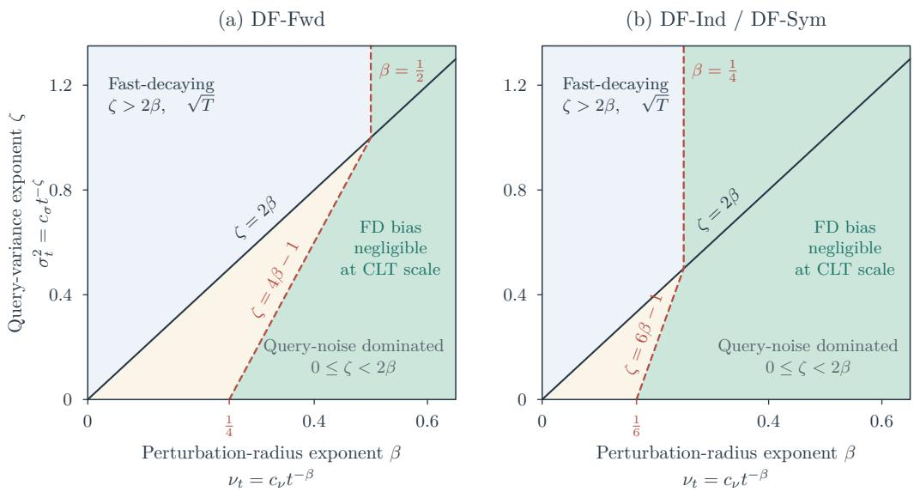

# Temporal-Difference Calibration of Black-Box Simulators

Min Zeng1, Xin Wen2, Xi Chen2, Yichen Zhang3 and Wen-Xin Zhou4

1College of Computing, City University of Hong Kong

2Stern School of Business, New York University

3Daniels School of Business, Purdue University

## Abstract

4Department of Information and Decision Science, University of Illinois Chicago

We develop a derivative-free temporal-diference (TD) framework for calibrating black-box simulators using one-step transitions from a target system and noisy simulatorgenerated continuation values. The calibration parameter is defined through Bellman orthogonality, recovering the physical parameter under correct simulator specification and yielding a near-optimal $L _ { 2 }$ approximation of the policy value under misspecification. We propose three TD algorithms based on random-direction finite diferences, distinguished by their query costs and reuse of noisy simulator evaluations. We establish almostsure convergence, last-iterate mean-square error bounds, and central limit theorems for Polyak-Ruppert averages across four query-noise regimes. Our analysis reveals a specification-dependent bias phenomenon: for two algorithms, the finite-diference bias of the TD estimating equation vanishes at the calibration target under correct specification, even when the gradient surrogate remains biased. This permits a fixed perturbation radius and rate exponents approaching $1 / 2$ in the simulator rollout budget, whereas misspecification generally recovers the classical Kiefer-Wolfowitz rates. We also develop a few-replicate online bootstrap that yields Student-t calibrated confidence intervals under negligible query noise, and identify a covariance mismatch that can invalidate conventional multiplier inference along Markov trajectories. Finally, a second-stage TD recursion corrects the remaining value discrepancy without additional simulator queries.

Keywords: derivative-free stochastic approximation; few-replicate bootstrap; online inference; Polyak–Ruppert averaging; temporal-diference learning; zeroth-order stochastic approximation

## 1 Introduction

Simulation models play an important role in policy evaluation and decision-making, particularly when direct experimentation with the target system is costly or impractical. In many simto-real applications, simulation remains integral to policy evaluation even after deployment (Coraci et al., 2025). The deployed system provides observations of states, rewards, and one-step transitions, while a simulator, initialized at the observed states and operated under the same policy, generates estimates of future returns. Such simulators often encode structural or physical knowledge that is dificult to preserve in a generic statistical predictor (Song et al., 2022). For instance, in robotic locomotion, simulator parameters may represent friction coeficients, the center of mass, and other physically interpretable quantities (Yu et al., 2019). Calibrating these parameters to the target system is therefore essential for obtaining reliable policy evaluations while retaining the structural interpretability of the simulator.

A fundamental challenge is that the target system and the simulator provide diferent forms of information. Observations from the target system may be limited to one-step transitions, whereas simulator rollouts can be generated repeatedly at selected states and parameter values. Moreover, many simulators are accessible only through noisy function evaluations, without parameter gradients. Temporal-diference (TD) learning updates value estimates using one-step transitions and continuation values, without requiring complete trajectories or realized long-term returns (Sutton, 1988). Using continuation values from simulator rollouts, calibration can proceed online, with additional simulation improving the update precision without further observations from the target system.

We define the calibration parameter through Bellman orthogonality, requiring the simulator’s one-step Bellman discrepancy to be orthogonal to its value gradient. Since the policy value is not directly observed, recovering the conventional $L _ { 2 }$ calibration target (Tuo and Wu, 2015, 2016) through Bellman residuals requires an additional instrument. TD calibration avoids estimating this instrument. We establish an oracle inequality showing that the calibrated value achieves $L _ { 2 }$ approximation error within a constant factor of the best approximation in the simulator family. Under correct specification, the calibration target coincides with the physical parameter when the TD root is unique.

Implementing this calibration presents another statistical challenge because the gradient of the simulator value is unavailable. Standard TD methods require the gradient to form the update direction (Sutton, 1988; Tsitsiklis and Van Roy, 1997). Black-box simulators return only noisy value evaluations, and random-direction finite diferences approximate the missing gradient (Kiefer and Wolfowitz, 1952; Spall, 1992). A smaller perturbation radius reduces finite-diference bias but amplifies query noise. Each update also multiplies a noisy TD residual by a noisy gradient surrogate. Reusing simulator evaluations across these factors introduces dependence that can afect both the bias and variance of the update. How does replacing exact gradients with noisy function evaluations afect the convergence and statistical eficiency of TD calibration? How should query designs, perturbation radii, and simulator replication be chosen under a simulation budget, and how does this choice depend on simulator accuracy? Online inference adds to this budget, since each bootstrap path requires fresh simulator queries at its own parameter and costs as many rollouts as the main path. Can valid inference be obtained with a small number of bootstrap paths?

We address these questions by developing a unified framework for derivative-free TD (DF-TD) calibration and inference. Our main contributions are summarized as follows.

• First, we develop three DF-TD algorithms and characterize how their query designs afect simulation cost and statistical eficiency. DF-Ind serves as the baseline, using separate simulator queries for the TD residual and gradient surrogate. DF-Fwd and DF-Sym reuse evaluations through one-sided and symmetric diferences, at the cost of introducing dependence between these noisy factors. DF-Sym retains the second-order accuracy of DF-Ind while saving one query per update. We establish almost-sure convergence and last-iterate mean-square error bounds, together with central limit theorems for Polyak–Ruppert averages across four query-noise regimes. Multiplying a noisy TD residual by a noisy gradient surrogate introduces additional variability through products of query errors, which are asymptotically non-negligible when query noise persists but negligible when it decays. Surprisingly, DF-Sym has smaller asymptotic covariance than the baseline DF-Ind under persistent noise when the query noise has kurtosis below 5.

• Second, we show that simulator specification changes the statistical cost of derivative-free calibration through bias cancellation in the TD estimating equation. For DF-Ind and

DF-Fwd, a bias of the gradient surrogate enters this equation weighted by the Bellman discrepancy. Correct specification makes this discrepancy zero at the calibration target. These algorithms can therefore calibrate consistently without eliminating gradient bias, with a rate exponent approaching $1 / 2$ in the rollout budget. Under misspecification, the same algorithms generally lose this cancellation, and controlling the remaining bias reduces the attainable rate exponents to 1/3 for DF-Ind and 1/4 for DF-Fwd.

• Third, since each bootstrap path requires fresh simulator queries at additional rollout cost, we develop an economical online multiplier bootstrap using a fixed, small number of bootstrap paths. We establish joint asymptotic normality across bootstrap deviations, yielding valid confidence intervals without trajectory storage. Under Markovian trajectory sampling, conventional multiplier bootstrap fails to capture temporal dependence: independent multipliers disrupt the telescoping Poisson remainder and reproduce only the lag-zero covariance of the TD score rather than its long-run covariance. We illustrate how this mismatch distorts coverage under misspecification through a simple Markovian example, while showing that a correctly specified simulator restores valid inference.

• Finally, a second-stage TD recursion can correct the value discrepancy remaining after simulator calibration without additional simulator queries. The discrepancy itself satisfies a Bellman equation driven by the TD residuals already computed during calibration, allowing the second stage to estimate it online. We establish joint asymptotic normality of the calibration and correction estimators, enabling inference on the corrected value.

Our work connects several strands of the literature. The first is derivative-free stochastic approximation, including the classical Kiefer-Wolfowitz procedure (Kiefer and Wolfowitz, 1952), simultaneous perturbation methods (Spall, 1992), random-direction optimization (Nesterov and Spokoiny, 2017), and averaged derivative-free procedures (Dippon and Renz, 1997). Particularly relevant is Chen et al. (2024), who develop online inference for Kiefer-Wolfowitz stochastic optimization of a strongly convex objective. Their function evaluations are constructed from a common stochastic observation, whereas our setting involves a TD semigradient whose root need not minimize an objective function, and simulator evaluations introduce independent query noise that is amplified by finite diferencing. The interaction between this noise and the noisy TD residual leads to additional covariance components and makes simulation replication an explicit design variable. The Bellman orthogonality structure also produces a specification-dependent finite-diference bias that is absent from conventional analyses.

A second related literature concerns calibration of imperfect computer models. Kennedy and O’Hagan (2001) introduced a discrepancy-based framework, while Tuo and Wu (2015, 2016) developed frequentist calibration procedures based on $L _ { 2 }$ projection. Subsequent contributions include orthogonality-constrained calibration (Plumlee, 2017), prediction-oriented calibration with finite-sample guarantees (Dai and Chien, 2018), and functional calibration using reproducing kernel Hilbert spaces (Tuo et al., 2023). In our setting, the target value function is not directly observed. We therefore calibrate the simulator using one-step transitions from the target system through Bellman orthogonality.

Our analysis also contributes to the literature on statistical inference for stochastic approximation and reinforcement learning. Online inference for stochastic gradient methods has been studied by Chen et al. (2020), Li et al. (2025), and Han and Xu (2026), among others. Random-scaling methods construct online confidence intervals from the iterate path without resampling, as in e.g., Lee et al. (2022), Li et al. (2026), and Chen et al. (2025). Related developments in online decision-making include Luo et al. (2024), Han et al. (2025), Duan et al. (2026), and Wen et al. (2026). For policy evaluation, Shi et al. (2022); Bian et al. (2025); Shi (2025) study statistical inference for value functions. Work on TD-based procedures addresses estimation and inference (Wu et al., 2024; Samsonov et al., 2024; Liu et al., 2025) and variance reduction through experience replay (Han et al., 2026). Online multiplier bootstrap for linear TD learning has been studied by Ramprasad et al. (2023). We show that this bootstrap can fail under Markov dependence. In addition, for derivative-free TD calibration, each bootstrap path requires fresh simulator queries at its own parameter, adding to the simulation cost. We therefore develop inference with a fixed, small number of paths using the few-replicate bootstrap principle of Lam and Wang (2026).

The remainder of the paper is organized as follows. Section 2 introduces the TD calibration target and establishes its approximation properties. Section 3 presents the three derivative-free TD algorithms. Section 4 develops their asymptotic theory and investigates the efects of query design, simulator specification, and rollout budgets. Section 5 develops the few-replicate online bootstrap and examines its validity under Markovian sampling. Section 6 introduces the second-stage value discrepancy correction. Section 7 discusses potential extensions.

## 2 Temporal-Diference Calibration

Consider a discounted Markov decision process for the target system, $\mathcal { M } = ( \mathcal { S } , \mathcal { A } , \mathcal { P } , r , \gamma )$ , with state space S, action space ${ \mathcal { A } } ,$ transition kernel $\mathcal { P } _ { : }$ , bounded reward function $r ,$ and discount factor $\gamma \in [ 0 , 1 )$ . We evaluate a fixed stationary policy $\pi .$ The policy induces the transition kernel $P ^ { \pi } ( \cdot \mid s ) : = \mathbb { E } _ { a \sim \pi ( \cdot \mid s ) } [ \mathcal { P } ( \cdot \mid s , a ) ]$ and the mean reward $r ^ { \pi } ( s ) : = \mathbb { E } _ { a \sim \pi ( \cdot | s ) } [ r ( s , a ) ]$ . Let $\mu$ be a stationary distribution of $P ^ { \pi }$ , and write $\textstyle ( P ^ { \pi } f ) ( s ) : = \int f ( s ^ { \prime } ) P ^ { \pi } ( d s ^ { \prime } \mid s )$ for a function $f .$ The policy value

$$
V ^ { \pi } ( s ) : = \mathbb { E } \bigg [ \sum _ { t = 0 } ^ { \infty } \gamma ^ { t } r ^ { \pi } ( s _ { t } ) \Big | s _ { 0 } = s \bigg ] ,
$$

is the unique fixed point of the Bellman operator $( T ^ { \pi } V ) ( s ) = r ^ { \pi } ( s ) + \gamma \mathbb { E } _ { s ^ { \prime } \sim P ^ { \pi } ( \cdot | s ) } [ V ( s ^ { \prime } ) ]$

For $\theta \in \mathbb { R } ^ { d }$ , the simulator is reset at state s and run under the same policy $\pi .$ Its prediction of $V ^ { \pi } ( s )$ is the expected return

$$
V ( s ; \theta ) : = \mathbb { E } _ { \theta } ^ { \mathrm { s i m } } \bigg [ \sum _ { k = 0 } ^ { \infty } \gamma ^ { k } r _ { k } ^ { \mathrm { s i m } } \bigg | s _ { 0 } = s , \pi \bigg ] .
$$

These simulator value functions form $\mathcal { V } = \{ V ( \cdot ; \theta ) : \theta \in \mathbb { R } ^ { d } \}$ with linear approximation $V ( s ; \theta ) = \phi ( s ) ^ { \top } \theta$ as a special case. We use this family to approximate $V ^ { \pi }$ , even when $V ^ { \pi } \notin \mathcal { V }$ We write $L _ { 2 } ( \mu )$ for the collection of square-integrable functions, with $\| f \| _ { \mu } ^ { 2 } : = f ( s ) ^ { 2 } \mu ( d s )$ The $L _ { 2 }$ calibration target of Tuo and Wu (2016) is $\theta _ { L _ { 2 } } \in$ arg minθ $\| V ^ { \pi } - V ( \cdot ; \theta ) \| _ { \mu } .$ , with minimum approximation error $\varepsilon _ { \mathrm { m i n } } : = \| V ^ { \pi } - V ( \cdot ; \theta _ { L _ { 2 } } ) \| _ { \mu }$ . The minimizer $\theta _ { L _ { 2 } }$ satisfies

$$
\begin{array} { r } { \mathbb { E } [ \{ V ^ { \pi } ( s ) - V ( s ; \theta _ { L _ { 2 } } ) \} \nabla _ { \theta } V ( s ; \theta _ { L _ { 2 } } ) ] = 0 . } \end{array}
$$

This criterion uses the policy value $V ^ { \pi }$ , which is not directly observed in our setting.

For a one-step transition $( s , r , s ^ { \prime } )$ , define the TD residual and the Bellman discrepancy

$$
\delta ( \theta ; s , r , s ^ { \prime } ) : = r + \gamma V ( s ^ { \prime } ; \theta ) - V ( s ; \theta ) , \ \varepsilon _ { \mathrm { B } } ( s ; \theta ) : = \mathbb { E } \big [ \delta ( \theta ; s , r , s ^ { \prime } ) \mid s \big ] = ( { \mathcal { T } } ^ { \pi } V ( \cdot ; \theta ) ) ( s ) - V ( s ; \theta ) ,
$$

where the conditional expectation is under the one-step law of the target system induced by $\pi$

The TD criterion replaces the value error in the $L _ { 2 }$ orthogonality condition by the one-step Bellman discrepancy. This gives the population semigradient operator

$$
\begin{array} { r } { G ( \theta ) : = \mathbb { E } \Big [ \delta ( \theta ; s , r , s ^ { \prime } ) \nabla _ { \theta } V ( s ; \theta ) \Big ] = \mathbb { E } \big [ \varepsilon _ { \mathrm { B } } ( s ; \theta ) \nabla _ { \theta } V ( s ; \theta ) \big ] , } \end{array}
$$

where the expectation is under the stationary one-step law. We define the temporal-diference calibration target $\theta ^ { * }$ as a solution to $G ( \theta ^ { * } ) = 0$ . Assumption $3 ( 1 )$ below assumes that a root exists and imposes a global stability condition that implies its uniqueness. Because the estimating equation uses transitions under π, weighted by $\mu ,$ the target generally depends on $( \pi , \gamma , \mu )$ , and calibrates the simulator for predicting the value of $\pi$

The relation between value error and Bellman discrepancy determines how the TD target difers from the $L _ { 2 }$ target. Since $V ^ { \pi }$ is the fixed point of $\mathcal { T } ^ { \pi }$ , for any θ such that $V ( \cdot ; \theta ) \in L _ { 2 } ( \mu )$ 2

$$
\begin{array} { r } { V ^ { \pi } - V ( \cdot ; \theta ) = ( I - \gamma P ^ { \pi } ) ^ { - 1 } \varepsilon _ { \mathrm { B } } ( \cdot ; \theta ) . } \end{array}\tag{1}
$$

Both targets can therefore be expressed through the instrument equation $\mathbb { E } [ W ( s ) \varepsilon _ { \mathrm { B } } ( s ; \theta ) ] = 0$ (Chen and Qi, 2022; Duan et al., 2024). TD calibration uses $W ( s ) = \nabla _ { \theta } V ( s ; \theta )$ , whereas the $L _ { 2 }$ first-order condition uses $\boldsymbol { W } = ( I - \gamma ( P ^ { \pi } ) ^ { * } ) ^ { - 1 } \nabla _ { \theta } V$ , where $( P ^ { \pi } ) ^ { * }$ denotes the $L _ { 2 } ( \mu ) – \mathrm { a d j o i n t }$ of Pπ. Proposition S1 in the Appendix establishes this correspondence. Accordingly, the $L _ { 2 }$ calibration instrument involves a discounted accumulation of value-function gradients over current and past states, which is not directly available from one-step observations.

We call the simulator family correctly specified (or perfect, following Tuo and Wu (2015)) if $V ( \cdot ; \theta ^ { \dagger } ) = V ^ { \pi } ( \cdot )$ µ-almost everywhere for some $\theta ^ { \dagger }$ , equivalently $\varepsilon _ { \mathrm { B } } ( \cdot ; \theta ^ { \dagger } ) = 0$ µ-almost everywhere, and misspecified (or imperfect) otherwise. We call $\theta ^ { \dagger }$ a value-matching parameter. Correct specification refers to the value function under the given policy and discount factor, and does not require the simulator’s transition and reward mechanisms to match those of the target system. For a correctly specified simulator, $\theta ^ { \dagger }$ satisfies the estimating equation for every admissible instrument, whereas under misspecification, the roots generally depend on the instrument. The next proposition shows when the TD and $L _ { 2 }$ targets coincide and bounds their diference under misspecification.

Proposition 1 (Temporal-diference calibration target). (i) Correctly specified simulator. If the simulator is correctly specified with parameter $\theta ^ { \dagger }$ and $\nabla _ { \theta } V ( \cdot ; \theta ^ { \dagger } )$ is square-integrable, then $G ( \theta ^ { \dagger } ) = 0$ . If, in addition, the TD root is unique, then $\theta ^ { \dagger } = \theta ^ { * }$ , and $\theta ^ { * } = \theta _ { L _ { 2 } }$ whenever the $L _ { 2 }$ projection is unique. (ii) Error bound for the value function. For any θ with $V ( \cdot ; \theta ) \in L _ { 2 } ( \mu )$ $\begin{array} { r } { \| V ^ { \pi } - V ( \cdot ; \theta ) \| _ { \mu } \leq ( 1 - \gamma ) ^ { - 1 } \| \varepsilon _ { \mathrm { B } } ( \cdot ; \theta ) \| _ { \mu } } \end{array}$ . (iii) Oracle inequality. Suppose Assumption $\mathcal { B }$ in Section $\it 4$ holds and an L2 projection $\theta _ { L _ { 2 } }$ exists. Then

$$
\| \theta ^ { * } - \theta _ { L _ { 2 } } \| \leq \frac { \gamma \| \mathcal { E } _ { 1 } \| _ { \mu } } { L } \varepsilon _ { \mathrm { m i n } } \quad a n d \quad \left\| V ^ { \pi } - V ( \cdot ; \theta ^ { * } ) \right\| _ { \mu } \leq \biggl ( 1 + \frac { \gamma \| \mathcal { E } _ { 1 } \| _ { \mu } ^ { 2 } } { L } \biggr ) \varepsilon _ { \mathrm { m i n } } ,
$$

where L and ${ \mathcal { E } } _ { 1 }$ are the stability constant and the gradient envelope in Assumption 3, respectively.

Under correct specification, the TD and $L _ { 2 }$ target both equal the value-matching parameter $\theta ^ { \dagger }$ , provided they are unique. Under misspecification, the targets may difer, but Part (iii) shows that the TD-calibrated value achieves an $L _ { 2 }$ error within a constant factor of the best approximation in the simulator family. Inference concerns $\theta ^ { * }$ and the calibrated value $V ( s ; \theta ^ { * } )$ at prespecified reporting states. Section 6 estimates the remaining discrepancy $V ^ { \pi } - V ( \cdot ; \theta ^ { * } )$

The Bellman discrepancy also afects the local stability of the TD root. Let $\Sigma _ { \nabla } : =$ $\mathbb { E } [ \nabla _ { \theta } V ( s ; \theta ^ { * } ) \nabla _ { \theta } V ( s ; \theta ^ { * } ) ^ { \top } ]$ and, when G is diferentiable at $\theta ^ { * }$ , write $J ^ { * } : = \nabla G ( { \theta } ^ { * } )$

Proposition 2 (Local stability and first-order identification). Under Assumption $\mathcal { B } ( \mathcal { Q } )$ , G is continuously diferentiable at $\theta ^ { * }$ with

$$
J ^ { * } = \mathbb { E } \Big [ \nabla _ { \theta } V ( s ; \theta ^ { * } ) \Big \{ \gamma \nabla _ { \theta } V ( s ^ { \prime } ; \theta ^ { * } ) - \nabla _ { \theta } V ( s ; \theta ^ { * } ) \Big \} ^ { \top } \Big ] + \mathbb { E } \Big [ \varepsilon _ { \mathrm { B } } ( s ; \theta ^ { * } ) \nabla _ { \theta } ^ { 2 } V ( s ; \theta ^ { * } ) \Big ] .
$$

Moreover, $\begin{array} { r } { \big ( J ^ { * } + J ^ { * } ^ { \top } \big ) / 2 \preceq - ( 1 - \gamma ) \Sigma _ { \nabla } + \| \varepsilon _ { \mathrm { B } } ( \cdot ; \theta ^ { * } ) \| _ { \mu } \| \mathcal { E } _ { 2 } \| _ { \mu } I _ { d } } \end{array}$ . In particular, $J ^ { * }$ is Hurwitz whenever $\| \varepsilon _ { \mathrm { B } } \bigl ( \cdot ; \theta ^ { * } \bigr ) \| _ { \mu } \bigl \| \mathcal { E } _ { 2 } \bigr \| _ { \mu } < ( 1 - \gamma ) \lambda _ { \mathrm { m i n } } \bigl ( \Sigma _ { \nabla } \bigr )$ . At a correctly specified root, $J ^ { * }$ is Hurwitz if and only if $\Sigma _ { \nabla } \succ 0$

Under correct specification, $\Sigma _ { \nabla } \succ 0$ characterizes local identification through the sensitivities of the value function and is also exactly the condition for local stability of the TD recursion. Under misspecification, the additional term in $J ^ { * }$ couples the Bellman discrepancy with simulator curvature and can compromise stability even when $\Sigma _ { \nabla } \succ 0$

We first consider stationary i.i.d. one-step sampling (Samsonov et al., 2024; Wu et al., 2024). Extensions to uniformly geometrically ergodic Markov trajectories are provided in Appendix. Assumption 1 (i.i.d. stationary one-step sampling). The tuples $\{ ( s _ { t } , a _ { t } , r _ { t } , s _ { t } ^ { \prime } ) \} _ { t \geq 1 }$ are i.i.d. draws from the stationary one-step distribution induced by $\pi _ { \cdot }$ , where $s _ { t } \sim \mu , a _ { t } \sim \pi ( \cdot \mid s _ { t } )$ 2 $r _ { t } = r ( s _ { t } , a _ { t } )$ , and $s _ { t } ^ { \prime } \sim \mathcal { P } ( \cdot \mid s _ { t } , a _ { t } )$

Under Assumption 1, the benchmark TD algorithm with access to exact gradients follows the semigradient recursion

$$
\begin{array} { r } { \theta _ { t } = \theta _ { t - 1 } + \eta _ { t } \delta ( \theta _ { t - 1 } ; s _ { t } , r _ { t } , s _ { t } ^ { \prime } ) \nabla _ { \theta } V ( s _ { t } ; \theta _ { t - 1 } ) , } \end{array}
$$

where $\{ \eta _ { t } \} _ { t \ge 1 }$ denotes the step-size sequence. The conditional mean increment is $\eta _ { t } G ( \theta _ { t - 1 } )$ Under standard stochastic-approximation conditions, the Polyak–Ruppert averaged estimator

${ \bar { \theta } } _ { T } : = T ^ { - 1 } \sum _ { t = 1 } ^ { T } \theta _ { t }$ satisfies (Polyak and Juditsky, 1992)

$$
\sqrt { T } ( \bar { \theta } _ { T } - \theta ^ { * } ) \Longrightarrow { \cal N } \big ( 0 , ( - J ^ { * } ) ^ { - 1 } \Sigma _ { \mathrm { T D } } ( - J ^ { * } ) ^ { - \top } \big ) ,\tag{2}
$$

where $\Sigma _ { \mathrm { T D } } : = \mathbb { E } [ ( \delta _ { t } ^ { * } ) ^ { 2 } \nabla _ { \theta } V ( s _ { t } ; \theta ^ { * } ) \nabla _ { \theta } V ( s _ { t } ; \theta ^ { * } ) ^ { \top } ]$ , with $\delta _ { t } ^ { * } : = \delta ( \theta ^ { * } ; s _ { t } , r _ { t } , s _ { t } ^ { \prime } )$

Remark 1 (Bellman discrepancy and TD variance). Since $\mathbb { E } [ \delta _ { t } ^ { * } \mid s _ { t } ] = \varepsilon _ { \mathrm { B } } ( s _ { t } ; \theta ^ { * } )$ , the TD score covariance with exact gradients can be decomposed as

$$
\Sigma _ { \mathrm { T D } } = \mathbb { E } \Big [ \mathbb { V } \big ( \delta _ { t } ^ { * } \mid s _ { t } \big ) \nabla _ { \theta } V \big ( s _ { t } ; \theta ^ { * } \big ) \nabla _ { \theta } V \big ( s _ { t } ; \theta ^ { * } \big ) ^ { \top } \Big ] + \mathbb { E } \Big [ \varepsilon _ { \mathrm { B } } \big ( s _ { t } ; \theta ^ { * } \big ) ^ { 2 } \nabla _ { \theta } V \big ( s _ { t } ; \theta ^ { * } \big ) \nabla _ { \theta } V \big ( s _ { t } ; \theta ^ { * } \big ) ^ { \top } \Big ] .
$$

The first term captures variability from one-step transitions, while the second reflects the contribution ofthe state-dependent Bellman discrepancy. The latter vanishes when the simulator is correctly specified and the TD root is unique.

## 3 Methodology

The TD update requires gradients that are unavailable under black-box simulator access. We approximate these gradients using random-direction finite diferences of noisy simulator evaluations and combine them with noisy TD residuals to construct derivative-free updates.

## 3.1 Noisy value queries

In the intended application, a value query is produced by resetting the black-box simulator at a state s of the target system, setting its parameter to $\theta ,$ and rolling the fixed policy forward. One rollout returns a random discounted cumulative reward. Averaging $M _ { t }$ independent rollouts produces one noisy evaluation of $V ( s ; \theta )$ , with higher precision as $M _ { t }$ increases. We use the following benchmark model for the returned evaluation.

Assumption 2. At iteration $t ,$ each fresh value query at a possibly data-dependent state– parameter location (s, θ) returns

$$
\begin{array} { r } { \tilde { V } _ { j , t } ( s ; \theta ) = V ( s ; \theta ) + \epsilon _ { j , t } , } \end{array}
$$

where the standardized noises $\{ \epsilon _ { j , t } / \sigma _ { t } \} _ { j , t }$ have a common centered, symmetric distribution with unit variance and a finite fourth moment. They are independent across fresh calls and all other sources of randomness. The deterministic sequence $\big \{ \sigma _ { t } ^ { 2 } \big \}$ is positive and non-increasing. We refer to $\epsilon _ { j , t }$ as query noise and to $\sigma _ { t } ^ { 2 }$ as its variance scale. Assumption 2 takes this variance to be independent of the state and parameter. Appendix considers location-dependent variance. For independent rollouts with a common return variance, averaging $M _ { t }$ rollouts gives query variance proportional to $M _ { t } ^ { - 1 }$ . Let $L _ { \mathrm { a l g } }$ be the number of fresh value queries per update and let $C _ { T } ^ { \mathrm { m a i n } }$ denote the number of simulator rollouts used by the main path through iteration T. When each returned value averages $M _ { t }$ rollouts,

$$
C _ { T } ^ { \mathrm { m a i n } } = L _ { \mathrm { a l g } } \sum _ { t = 1 } ^ { T } M _ { t } .\tag{3}
$$

## 3.2 Random-direction surrogates and finite-diference bias

To separate finite-diference bias from query noise, we first construct the gradient surrogates using noise-free value evaluations. At iteration t, let $u _ { t } \in \mathbb { R } ^ { d }$ have distribution $\mathcal { P } _ { u }$ with $\mathbb { E } [ u _ { t } ] = 0$ and $\mathbb { E } [ u _ { t } u _ { t } ^ { \top } ] = I _ { d }$ , independently of the past and the current one-step sample. Let $\nu _ { t } > 0$ be the perturbation radius. The superscript ex denotes this exact-query construction. The one- and two-sided surrogates are

$$
\hat { \nabla } ^ { \mathrm { e x } } V ( s _ { t } ; \theta _ { t - 1 } ) = \frac { V ( s _ { t } ; \theta _ { t - 1 } + \nu _ { t } u _ { t } ) - V ( s _ { t } ; \theta _ { t - 1 } ) } { \mathrm { , } } u _ { t } ,\tag{4}
$$

$$
\hat { \nabla } ^ { \mathrm { e x } } V ( s _ { t } ; \theta _ { t - 1 } ) = \frac { V ( s _ { t } ; \theta _ { t - 1 } + \nu _ { t } \dot { u _ { t } } ) - V ( s _ { t } ; \theta _ { t - 1 } - \nu _ { t } u _ { t } ) } { 2 \nu _ { t } } u _ { t }\tag{5}
$$

The next lemma bounds the finite-diference bias of these surrogates.

Lemma 1 (Finite-diference bias of gradient surrogate). Suppose the smoothness and the derivative bounds for $j = 2 , 3$ in Assumption $\mathcal { B } ( \mathcal { Q } )$ hold, and $\mathbb { E } [ u _ { t } u _ { t } ^ { \top } ] = I _ { d }$ with $\mathbb { E } \lVert u _ { t } \rVert ^ { 4 } < \infty$ Then there exist finite constants $C _ { 1 } , C _ { 2 } > 0$ such that, for $\mu { - } a . e .$ . s and every $\theta \in \mathbb { R } ^ { d }$

$$
\begin{array} { r l } & { \left\| \mathbb { E } _ { u _ { t } } \Big [ \hat { \nabla } ^ { \mathrm { e x } } V ( s ; \theta ) \Big ] - \nabla _ { \theta } V ( s ; \theta ) \right\| \leq C _ { 1 } \mathcal { E } _ { 2 } ( s ) \nu _ { t } , \quad f o r ~ t h e ~ o n e { - s i d e d } ~ e s t i m a t o r ~ ( 4 ) , ~ a n d } \\ & { \left\| \mathbb { E } _ { u _ { t } } \Big [ \hat { \nabla } ^ { \mathrm { e x } } V ( s ; \theta ) \Big ] - \nabla _ { \theta } V ( s ; \theta ) \right\| \leq C _ { 2 } \mathcal { E } _ { 3 } ( s ) \nu _ { t } ^ { 2 } , \quad f o r ~ t h e ~ t w o { - s i d e d } ~ e s t i m a t o r ~ ( 5 ) . } \end{array}
$$

Under these general bias bounds, a two-sided diference permits a more slowly shrinking radius for the same approximation accuracy. With noisy queries, the larger radius reduces the amplification of query noise.

## 3.3 Derivative-free temporal-diference learning

We combine the gradient surrogates with noisy TD residuals to obtain three derivative-free TD algorithms. The algorithms difer in their finite-diference construction and in whether the residual and gradient surrogate share simulator queries, but take the common form

$$
\theta _ { t } = \theta _ { t - 1 } + \eta _ { t } \hat { \delta } _ { t } \hat { \nabla } _ { t } ,
$$

where $\hat { \delta } _ { t }$ is a noisy estimate of the TD residual and $\hat { \nabla } _ { t }$ is a noisy gradient surrogate for

$\nabla _ { \theta } V \bigl ( s _ { t } ; \theta _ { t - 1 } \bigr )$ . The bias bounds in Lemma 1 concern the surrogate alone. For convergence, we must also control the finite-diference bias in the complete TD increment, which depends on how the two factors are combined.

Given the one-step transition $( s _ { t } , r _ { t } , s _ { t } ^ { \prime } )$ at iteration $t ,$ let $\epsilon _ { 1 , t } , \ldots , \epsilon _ { 4 , t }$ denote independent query noises at iteration t. Define

$$
\tilde { V } _ { 1 , t } : = V ( s _ { t } ^ { \prime } ; \theta _ { t - 1 } ) + \epsilon _ { 1 , t } , \qquad \tilde { V } _ { 2 , t } : = V ( s _ { t } ; \theta _ { t - 1 } ) + \epsilon _ { 2 , t } ,
$$

$$
\tilde { V } _ { 3 , t } : = V ( s _ { t } ; \theta _ { t - 1 } + \nu _ { t } u _ { t } ) + \epsilon _ { 3 , t } , \tilde { V } _ { 4 , t } : = V ( s _ { t } ; \theta _ { t - 1 } - \nu _ { t } u _ { t } ) + \epsilon _ { 4 , t } .
$$

DF-Ind uses separate returned values in the TD residual and gradient surrogate:

$$
\hat { \delta } _ { t } = r _ { t } + \gamma \tilde { V } _ { 1 , t } - \tilde { V } _ { 2 , t } , \qquad \hat { \nabla } _ { t } = \frac { \tilde { V } _ { 3 , t } - \tilde { V } _ { 4 , t } } { 2 \nu _ { t } } u _ { t } .\tag{6}
$$

The two factors use independent query noises but share the same one-step transition.

DF-Fwd reuses the central returned value in a one-sided diference:

$$
\hat { \delta } _ { t } = r _ { t } + \gamma \tilde { V } _ { 1 , t } - \tilde { V } _ { 2 , t } , \qquad \hat { \nabla } _ { t } = \frac { \tilde { V } _ { 3 , t } - \tilde { V } _ { 2 , t } } { \nu _ { t } } u _ { t } .\tag{7}
$$

Reusing $\tilde { V } _ { 2 , t }$ reduces the update to three fresh queries. Its query noise enters both factors, coupling the TD residual and gradient surrogate. The one-sided construction has generic first-order finite-diference bias. For a centrally symmetric direction law, however, the direction averages of the one- and two-sided surrogates coincide at every radius, since $\mathbb { E } [ V ( s ; \theta - \nu u _ { t } ) u _ { t } ] =$ $- \mathbb { E } [ V ( s ; \theta + \nu u _ { t } ) u _ { t } ]$ and $\mathbb { E } [ u _ { t } ] = 0$ , so DF-Fwd and DF-Ind have the same exact-query mean field and difer only in query cost and in the variance of the query noise.

DF-Sym uses the same perturbed pair to form a two-sided diference and the midpoint value at the current state. This removes the separate central query while retaining second-order finite-diference accuracy:

$$
\hat { \delta } _ { t } = \boldsymbol { r } _ { t } + \gamma \tilde { V } _ { 1 , t } - \frac { \tilde { V } _ { 3 , t } + \tilde { V } _ { 4 , t } } { 2 } , \qquad \hat { \nabla } _ { t } = \frac { \tilde { V } _ { 3 , t } - \tilde { V } _ { 4 , t } } { 2 \nu _ { t } } \boldsymbol { u } _ { t } .\tag{8}
$$

We write $O ( \nu _ { t } ^ { \kappa _ { \mathrm { a l g } } } )$ for the finite-diference bias bound of the TD increment used below, where $\kappa _ { \mathrm { I n d } } = \kappa _ { \mathrm { S y m } } = 2$ and $\kappa _ { \mathrm { F w d } } = 1 . ^ { 1 }$ Query reuse leaves these bias orders unchanged but afects the limiting covariance under persistent query noise.

The query counts per update in (3) are $L _ { \mathrm { I n d } } = 4$ and $L _ { \mathrm { F w d } } = L _ { \mathrm { S y m } } = 3$ . For DF-Sym, the query saved relative to DF-Ind can support more rollouts per query under a fixed budget per

Algorithm 1: Derivative-free TD learning (DF-TD)   
Input: $\theta _ { 0 }$ , step-sizes $\{ \eta _ { t } \}$ , radius $\left\{ \nu _ { t } \right\}$ , horizon T, variant in {DF-Ind, DF-Fwd, DF-Sym}   
Output: $\{ \theta _ { t } \} _ { t = 1 } ^ { \bar { T } } , \{ \bar { \theta } _ { t } \} _ { t = 1 } ^ { \bar { T } }$   
1 Initialize $\bar { \theta } _ { 0 }  \theta _ { 0 }$   
2 for $t = 1 , \dots , T$ do   
3 Sample $( s _ { t } , r _ { t } , s _ { t } ^ { \prime } )$ and $u _ { t } \sim \mathcal { P } _ { u }$   
4 if variant = DF-Ind then   
5 Query $\tilde { V } _ { 1 , t } , \tilde { V } _ { 2 , t } , \tilde { V } _ { 3 , t } , \tilde { V } _ { 4 , t }$ and compute $( \hat { \delta } _ { t } , \hat { \nabla } _ { t } )$ via (6)   
6 else if variant = DF-Fwd then   
7 Query $\tilde { V } _ { 1 , t } , \tilde { V } _ { 2 , t } , \tilde { V } _ { 3 , t }$ and compute $( \hat { \delta } _ { t } , \hat { \nabla } _ { t } )$ via (7)   
8 else if variant = DF-Sym then   
9 Query $\tilde { V } _ { 1 , t } , \tilde { V } _ { 3 , t } , \tilde { V } _ { 4 , t }$ and compute $( \hat { \delta } _ { t } , \hat { \nabla } _ { t } )$ via (8)   
10 $\theta _ { t } \gets \theta _ { t - 1 } + \eta _ { t } ( \hat { \delta } _ { t } \hat { \nabla } _ { t } )$   
11 $\begin{array} { r } { \bar { \theta } _ { t }  \frac { t - 1 } { t } \bar { \theta } _ { t - 1 } + \frac { 1 } { t } \theta _ { t } } \end{array}$   
12 end

update. Algorithm 1 summarizes the recursions.

## 4 Theoretical Analysis

We analyze how finite-diference bias and amplified query noise afect the DF-TD recursion.   
We first state the technical assumptions and give a unified error decomposition.

Assumption 3. (1) The equation $G ( \theta ) = 0$ has a solution $\theta ^ { * }$ . Moreover, there exists $L > 0$ such that, for all $\theta \in \mathbb { R } ^ { d } , ( \theta - \theta ^ { * } ) ^ { \top } G ( \theta ) \leq - L \| \theta - \theta ^ { * } \| ^ { 2 }$

(2) For µ-a.e. s, the map $\theta \mapsto V ( s ; \theta )$ is three times continuously diferentiable. Moreover, there exist measurable functions $\mathcal { E } _ { 0 } , \ldots , \mathcal { E } _ { 3 } : \mathcal { S } \to [ 0 , \infty )$ such that, for all $\theta \in \mathbb { R } ^ { d }$ and $\mu - a . e . \ s , \ | V ( s ; \theta ) - V ( s ; \theta ^ { * } ) | \leq \mathcal { E } _ { 0 } ( s ) \| \theta - \theta ^ { * } \| , \ \| \nabla _ { \theta } ^ { j } V ( s ; \theta ) \| \leq \mathcal { E } _ { j } ( s ) , \quad j = 1 , \ldots , 3 ,$ , and $\begin{array} { r } { \mathbb { E } \Big [ ( \delta _ { t } ^ { * } ) ^ { 2 } \Big ( 1 + \mathcal { E } _ { 1 } ( s _ { t } ) ^ { 2 } \Big ) + \sum _ { j = 0 } ^ { 1 } \mathcal { E } _ { j } ( s _ { t } ) ^ { 4 } + \sum _ { j = 2 } ^ { 3 } \mathcal { E } _ { j } ( s _ { t } ) ^ { 2 } + \mathcal { E } _ { 1 } ( s _ { t } ) ^ { 2 } \mathcal { E } _ { 2 } ( s _ { t } ) ^ { 2 } \Big ] < \infty . } \end{array}$

Assumption 3(1) is a global stability condition for the mean field G. Assumption 3(2) supplies the smoothness and moment bounds used to control the TD residual, gradient surrogates, and query-noise terms. For the Jacobian $J ^ { * }$ introduced above, Assumption 3(1) implies $\begin{array} { r } { \frac { J ^ { * } + ( J ^ { * } ) ^ { \top } } { 2 } \preceq - L I _ { d } } \end{array}$ . Thus J∗ is Hurwitz and nonsingular.

Remark 2. For the linear value family $V ( s ; \theta ) = \phi ( s ) ^ { \top } \theta$ , define $A : = \mathbb { E } \big [ \phi ( s _ { t } ) ( \phi ( s _ { t } ) - \gamma \phi ( s _ { t } ^ { \prime } ) ) ^ { \top } \big ]$ and $\boldsymbol { b } : = \mathbb { E } [ r _ { t } \phi ( s _ { t } ) ]$ . Then $- G ( \theta ) = A \theta - b = A ( \theta - \theta ^ { * } )$ , and hence Assumption $\mathcal { B } ( \boldsymbol { \mathit { 1 } } )$ holds whenever the symmetric part of A is positive definite, in which case one may take $L =$ $\begin{array} { r } { \lambda _ { \operatorname* { m i n } } \Bigl ( ( A + A ^ { \top } ) / 2 \Bigr ) \geq ( 1 - \gamma ) \lambda _ { \operatorname* { m i n } } \Bigl ( \mathbb { E } [ \phi ( s _ { t } ) \phi ( s _ { t } ) ^ { \top } ] \Bigr ) } \end{array}$

Assumption 4 (Algorithm tuning).

(1) The tuning sequences follow the polynomial schedules

$$
\eta _ { t } = c _ { \eta } t ^ { - \alpha } , \qquad \nu _ { t } = c _ { \nu } t ^ { - \beta } , \qquad \sigma _ { t } ^ { 2 } = c _ { \sigma } t ^ { - \zeta } ,\tag{9}
$$

where $c _ { \eta } , c _ { \nu } , c _ { \sigma } > 0 , \alpha \in ( 1 / 2 , 1 ] , \beta > 0$ , and $\zeta \geq 0$

(2) The direction sequence $\{ u _ { t } \} _ { t \ge 1 }$ is i.i.d., satisfies $\mathbb { E } [ u _ { t } ] = 0 , \mathbb { E } [ u _ { t } u _ { t } ^ { \top } ] = I _ { d } .$ , and $\mathbb { E } [ \left| \left| u _ { t } \right| \right| ^ { 8 } ] <$ $\infty ,$ and is independent of the stationary one-step sample array in Assumption 1 and of the query noises on the main path and on all bootstrap paths.

The relative decay rates of these schedules determine the balance between finite-diference bias and amplified query noise. Let $\mathcal { F } _ { t }$ be the filtration of the main path, generated by the one-step samples, random directions, and query noises of the main path through iteration t, so that $\theta _ { t - 1 }$ is $\mathcal { F } _ { t } .$ −1-measurable. Write $\hat { g } _ { t } : = \hat { \delta } _ { t } \hat { \nabla } _ { t }$ , so that $\theta _ { t } = \theta _ { t - 1 } + \eta _ { t } \hat { g } _ { t }$ , and let $\delta _ { t } ^ { \mathrm { e x } }$ and $\hat { \nabla } _ { t } ^ { \mathrm { e x } }$ be the exact-query TD residual and gradient surrogate, computed from the same $( s _ { t } , r _ { t } , s _ { t } ^ { \prime } )$ and $u _ { t }$ but with all query noises set to zero. Let $N _ { \delta , t } : = \widehat { \delta } _ { t } - \delta _ { t } ^ { \mathrm { e x } }$ and $N _ { \nabla , t } : = \hat { \nabla } _ { t } - \hat { \nabla } _ { t } ^ { \mathrm { e x } }$ . For DF-Fwd, these are $N _ { \delta , t } = \gamma \epsilon _ { 1 , t } - \epsilon _ { 2 , t }$ and $N _ { \nabla , t } = ( \epsilon _ { 3 , t } - \epsilon _ { 2 , t } ) u _ { t } / \nu _ { t }$ . The increment then splits as $\hat { g } _ { t } = g _ { t } ^ { \mathrm { e x } } + q _ { t }$ , where $g _ { t } ^ { \mathrm { e x } } : = \delta _ { t } ^ { \mathrm { e x } } \hat { \nabla } _ { t } ^ { \mathrm { e x } }$ and $q _ { t } : = \delta _ { t } ^ { \mathrm { e x } } N _ { \nabla , t } + N _ { \delta , t } \hat { \nabla } _ { t } ^ { \mathrm { e x } } + N _ { \delta , t } N _ { \nabla , t }$ . Centering $g _ { t } ^ { \mathrm { e x } }$ at its conditional mean gives the unified decomposition

$$
\hat { g } _ { t } = G ( \theta _ { t - 1 } ) + b _ { t } ^ { \mathrm { a l g } } + m _ { t } + q _ { t } ,\tag{10}
$$

where $b _ { t } ^ { \mathrm { a l g } } : = \mathbb { E } [ g _ { t } ^ { \mathrm { e x } } \mid { \mathcal { F } } _ { t - 1 } ] - G ( \theta _ { t - 1 } )$ and $m _ { t } : = g _ { t } ^ { \mathrm { e x } } - \mathbb { E } [ g _ { t } ^ { \mathrm { e x } } \mid { \mathcal { F } } _ { t - 1 } ]$ . Here $G ( \theta _ { t - 1 } )$ drives the stochastic-approximation dynamics, $b _ { t } ^ { \mathrm { a l g } }$ is the algorithm-specific finite-diference bias, $m _ { t }$ is the intrinsic TD fluctuation, and $q _ { t }$ is the perturbation from query noise, in which the noise of the gradient queries is amplified by $1 / \nu _ { t }$

Under Assumptions 1–4, both $m _ { t }$ and $q _ { t }$ have conditional mean zero given $\mathcal { F } _ { t - 1 }$ . Locally around $\theta ^ { * } , m _ { t }$ has conditional second moment of order $O ( 1 ) , b _ { t } ^ { \mathrm { a l g } }$ and $q _ { t }$ satisfy

$$
\| b _ { t } ^ { \mathrm { a l g } } \| = O ( \nu _ { t } ^ { \kappa _ { \mathrm { a l g } } } ) = O ( t ^ { - \kappa _ { \mathrm { a l g } } \beta } ) , \qquad \left\{ \mathbb { E } [ \| q _ { t } \| ^ { 2 } \ | \ \mathcal { F } _ { t - 1 } ] \right\} ^ { 1 / 2 } = O ( \sigma _ { t } / \nu _ { t } ) = O ( t ^ { \beta - \zeta / 2 } ) .\tag{11}
$$

## 4.1 Last-iterate convergence

Theorem 1 (Last-iterate convergence). Suppose Assumptions $1 \mathrm { - } \mathit { 4 }$ hold and

$$
\alpha + 2 \kappa _ { \mathrm { a l g } } \beta > 1 , \qquad 2 \alpha + \zeta - 2 \beta > 1 .\tag{12}
$$

Then $\theta _ { t } \to \theta ^ { * }$ almost surely. If $\alpha \in ( 1 / 2 , 1 )$ , or $i f \alpha = 1$ and $c _ { \eta } L > 1$ , then there exist constants $C < \infty$ and $t _ { 0 }$ such that, for all $t \geq t _ { 0 }$ ，

$$
\begin{array} { r } { \mathbb { E } \| \theta _ { t } - \theta ^ { * } \| ^ { 2 } \leq C \Big \{ t ^ { - \alpha } + t ^ { - 2 \kappa _ { \mathrm { a l g } } \beta } + t ^ { - ( \alpha + \zeta - 2 \beta ) } \Big \} . } \end{array}\tag{13}
$$

The conditions in (12) control the accumulated finite-diference bias and amplified query noise, respectively. The three terms in (13) represent the stochastic-approximation error, the squared finite-diference bias, and the amplified error from query noise. The standard stochastic-approximation rate $O ( t ^ { - \alpha } )$ is recovered when $\zeta \geq 2 \beta$ and $2 \kappa _ { \mathrm { a l g } } \beta \geq \alpha$

For persistent query noise with $\zeta = 0$ , shrinking $\nu _ { t }$ reduces finite-diference bias but amplifies query noise. Balancing the last two terms in (13) gives $\beta = \alpha / 4$ for DF-Fwd and $\beta = \alpha / 6$ for DF-Ind and $\mathrm { D F - S y m }$ , with rates $O ( t ^ { - \alpha / 2 } )$ and $O ( t ^ { - 2 \alpha / 3 } )$ , respectively. These choices satisfy (12) when $\alpha > 2 / 3$ for DF-Fwd and $\alpha > 3 / 5$ for DF-Ind and DF-Sym. Thus, second order finite-diference bias permits a slower decay of $\nu _ { t }$ and less amplification of query noise. Moreover, query reuse does not afect the last-iterate rate order.

## 4.2 Averaged inference across query-noise regimes

The following local moment conditions ensure covariance convergence and the martingale Lindeberg condition.

Assumption 5 (Inference regularity).

1. There exist $r _ { 0 } > 0$ and $\kappa > 0$ such that E $\left[ ( \mathcal { E } _ { 1 } ( s _ { t } ) \mathcal { E } _ { 2 } ( s _ { t } ) ) ^ { 2 + \kappa } \right] < \infty$

sup∥θ $\begin{array} { r } { _ { - \theta ^ { * } \| \leq r _ { 0 } } \mathbb { E } \Big [ | \delta ( \theta ; s _ { t } , r _ { t } , s _ { t } ^ { \prime } ) | ^ { 2 + \kappa } \left( 1 + \mathcal { E } _ { 1 } ( s _ { t } ) ^ { 2 + \kappa } \right) \Big ] < \infty . } \end{array}$ , and $\mathbb { E } [ \| u _ { t } \| ^ { 4 ( 2 + \kappa ) } ] < \infty$

2. The standardized query noises satisfy $\mathbb { E } [ | \epsilon _ { j , t } / \sigma _ { t } | ^ { 4 + 2 \kappa } ] < \infty$

The first part controls the intrinsic TD and random-direction terms locally around $\theta ^ { * }$ , and the second controls products of query errors.

By (11), the sign of $\zeta - 2 \beta$ determines the leading stochastic term, while a centered limit requires the finite-diference bias to be negligible at the corresponding rate. Table 1 summarizes the resulting regimes. In the fast-decaying regime,

$$
Q = \mathbb { E } \bigg [ ( \delta _ { t } ^ { * } ) ^ { 2 } \Big ( \nabla _ { \theta } V \big ( s _ { t } ; \theta ^ { * } \big ) ^ { \top } u _ { t } \Big ) ^ { 2 } u _ { t } u _ { t } ^ { \top } \bigg ] .\tag{14}
$$

The algorithm-specific covariances in the other regimes are

Table 1: Query-noise regimes for Polyak–Ruppert averages.
<table><tr><td>Noise regime Lead term</td><td></td><td>Rate  $a _ { T }$ </td><td>Additional rate conditions</td><td> $Q _ { \mathrm { r e g } } ^ { \mathrm { a l g } }$ </td></tr><tr><td>Fast-decaying:  $\zeta > 2 \beta$ </td><td> $m _ { t }$ </td><td> $\sqrt { T }$ </td><td> $\kappa _ { \mathrm { a l g } } \beta > 1 / 2$ </td><td>Q</td></tr><tr><td>Boundary:  $\zeta = 2 \beta > 0$ </td><td> $m _ { t } + q _ { t }$ </td><td> $\sqrt { T }$ </td><td> $\kappa _ { \mathrm { a l g } } \beta > 1 / 2$ </td><td> $Q _ { \mathrm { b d r y } } ^ { \mathrm { a l g } }$ </td></tr><tr><td>Intermediate:  $0 < \zeta < 2 \beta$ </td><td> $q _ { t }$ </td><td> $T ^ { ( 1 - 2 \beta + \zeta ) / 2 }$ </td><td> $2 \alpha + \zeta - 2 \beta > 1 , \mathrm { a n d }$   $\kappa _ { \mathrm { a l g } } \beta > ( 1 - 2 \beta + \zeta ) / 2$ </td><td> $Q _ { \mathrm { i n t } } ^ { \mathrm { a l g } }$ </td></tr><tr><td>Persistent:  $\zeta = 0$ </td><td> $q _ { t }$ </td><td> ${ \cal T } ^ { ( 1 - 2 \beta ) / 2 }$ </td><td> $2 \alpha - 2 \beta > 1 , \mathrm { a n d }$   $\kappa _ { \mathrm { a l g } } \beta > ( 1 - 2 \beta ) / 2$ </td><td> $Q _ { \mathrm { p e r s } } ^ { \mathrm { a l g } }$ </td></tr></table>

$$
Q _ { \mathrm { b d r y } } ^ { \mathrm { I n d } } = Q _ { \mathrm { b d r y } } ^ { \mathrm { S y m } } = Q + \frac { c _ { \sigma } \mathbb { E } [ ( \delta _ { t } ^ { * } ) ^ { 2 } ] } { 2 c _ { \nu } ^ { 2 } } I _ { d } , \qquad Q _ { \mathrm { b d r y } } ^ { \mathrm { F w d } } = Q + \frac { 2 c _ { \sigma } \mathbb { E } [ ( \delta _ { t } ^ { * } ) ^ { 2 } ] } { c _ { \nu } ^ { 2 } } I _ { d } ,\tag{15}
$$

$$
Q _ { \mathrm { i n t } } ^ { \mathrm { I n d } } = Q _ { \mathrm { i n t } } ^ { \mathrm { S y m } } = \frac { c _ { \sigma } \mathbb { E } [ ( \delta _ { t } ^ { * } ) ^ { 2 } ] } { 2 c _ { \nu } ^ { 2 } ( 1 + 2 \beta - \zeta ) } I _ { d } , \qquad Q _ { \mathrm { i n t } } ^ { \mathrm { F w d } } = \frac { 2 c _ { \sigma } \mathbb { E } [ ( \delta _ { t } ^ { * } ) ^ { 2 } ] } { c _ { \nu } ^ { 2 } ( 1 + 2 \beta - \zeta ) } I _ { d } .
$$

For the persistent regime, write $\mu _ { 4 } : = \mathbb { E } [ ( \epsilon _ { j , t } / \sigma _ { t } ) ^ { 4 } ]$ . Then

$$
Q _ { \mathrm { p e r s } } ^ { \mathrm { I n d } } = \frac { \frac { c _ { \sigma } } { 2 } \mathbb { E } [ ( \delta _ { t } ^ { * } ) ^ { 2 } ] + \frac { c _ { \sigma } ^ { 2 } } { 2 } ( 1 + \gamma ^ { 2 } ) } { c _ { \nu } ^ { 2 } ( 1 + 2 \beta ) } I _ { d } , \quad Q _ { \mathrm { p e r s } } ^ { \mathrm { F w d } } = \frac { 2 c _ { \sigma } \mathbb { E } [ ( \delta _ { t } ^ { * } ) ^ { 2 } ] + c _ { \sigma } ^ { 2 } ( 2 \gamma ^ { 2 } + 1 + \mu _ { 4 } ) } { c _ { \nu } ^ { 2 } ( 1 + 2 \beta ) } I _ { d } ,\tag{16}
$$

$$
Q _ { \mathrm { p e r s } } ^ { \mathrm { S y m } } = \frac { \frac { c _ { \sigma } } { 2 } \mathbb { E } [ ( \delta _ { t } ^ { * } ) ^ { 2 } ] + c _ { \sigma } ^ { 2 } \{ \frac { \gamma ^ { 2 } } { 2 } + \frac { \mu _ { 4 } - 1 } { 8 } \} } { c _ { \nu } ^ { 2 } ( 1 + 2 \beta ) } I _ { d } .
$$

The terms proportional to $c _ { \sigma }$ arise from the TD residual multiplying the noise of the gradient queries. The terms proportional to $c _ { \sigma } ^ { 2 }$ arise from multiplying the query noises in the residual and the gradient surrogate. Their coeficients depend on query reuse and the standardized fourth moment of the query noise.

Theorem 2 (Unified CLT across query-noise regimes). Suppose Assumptions 1–5 hold and $\alpha \in ( 1 / 2 , 1 )$ . For each DF-TD algorithm and each regime in Table 1 satisfying its rate conditions,

$$
a _ { T } ( \bar { \theta } _ { T } - \theta ^ { * } ) \Longrightarrow { \cal N } \Big ( 0 , ( - J ^ { * } ) ^ { - 1 } Q _ { \mathrm { r e g } } ^ { \mathrm { a l g } } ( - J ^ { * } ) ^ { - \top } \Big ) ,
$$

where alg denotes the algorithm and reg the query-noise regime.

Remark 3 (Instruments and query design). Under misspecification, instrument choice can change the calibration target, as discussed in Section 2. Under correct specification, the value-matching parameter is a common root for all admissible instruments, although their statistical eficiency may difer. We use the TD instrument $W = \nabla _ { \theta } V$ . With this instrument fixed, random-direction gradient approximation and query noise introduce two further sources of variability. The resulting asymptotic covariances satisfy $\begin{array} { r } { \Sigma _ { \mathrm { e f f } } \preceq ( - J ^ { * } ) ^ { - 1 } \Sigma _ { \mathrm { T D } } ( - J ^ { * } ) ^ { - \top } \preceq } \end{array}$ $( - J ^ { \ast } ) ^ { - 1 } Q ( - J ^ { \ast } ) ^ { - \top } \preceq ( - J ^ { \ast } ) ^ { - 1 } Q _ { \mathrm { b d r y } } ^ { \mathrm { a l g } } ( - J ^ { \ast } ) ^ { - \top }$ , where $\Sigma _ { \mathrm { e f f } }$ is the eficiency bound obtained by optimally choosing the instrument W (Chamberlain, 1987). The successive comparisons reflect instrument choice, random-direction approximation (Chen et al., 2024), and query noise in the boundary regime, respectively. In the fast-decaying regime, all three designs share the same limiting score covariance $Q .$ . When query noise is not negligible, query design does not change the TD instrument but determines how query noise contributes to the limiting covariance. Propositions S1 and S2 in the Appendix state and prove these claims.

Remark 4 (Efect of query reuse under persistent noise). DF-Ind and DF-Sym use the same two-sided gradient surrogate. DF-Ind uses an independent central query in the residual, whereas DF-Sym uses the midpoint of the same perturbed pair. The contribution of the queries at the current state to $N _ { \delta , t } N _ { \nabla , t }$ is therefore

$$
- \frac { \epsilon _ { 2 , t } \bigl ( \epsilon _ { 3 , t } - \epsilon _ { 4 , t } \bigr ) } { 2 \nu _ { t } } u _ { t } \ f o r \ D F { \cal I } n d , \qquad - \frac { \epsilon _ { 3 , t } ^ { 2 } - \epsilon _ { 4 , t } ^ { 2 } } { 4 \nu _ { t } } u _ { t } \ f o r \ D F { \cal S } y m .
$$

For $\zeta > 0$ , these noise products are asymptotically lower order, and the two designs have the same leading contribution from query noise. $A t \zeta = 0$ , they contribute at first order, giving

$$
Q _ { \mathrm { p e r s } } ^ { \mathrm { S y m } } - Q _ { \mathrm { p e r s } } ^ { \mathrm { I n d } } = \frac { c _ { \sigma } ^ { 2 } ( \mu _ { 4 } - 5 ) } { 8 c _ { \nu } ^ { 2 } ( 1 + 2 \beta ) } I _ { d } .
$$

Hence DF-Sym has a smaller asymptotic covariance than DF-Ind when $\mu _ { 4 } < 5$

The limit theorem for the averaged parameter estimate also yields inference for the calibrated value $V ( s ; \theta ^ { * } )$

Corollary 1 (Limit for the calibrated value). Let s be the reporting state defined in Section 2, and suppose that $\theta \mapsto V ( s ; \theta )$ is continuously diferentiable at $\theta ^ { * }$ . Under the corresponding regime of Theorem ${ \it 2 } ,$

$$
\begin{array} { r } { a _ { T } \Big ( V ( s ; \bar { \theta } _ { T } ) - V ( s ; \theta ^ { * } ) \Big ) \Longrightarrow { \mathcal N } \Big ( 0 , \nabla _ { \theta } V ( s ; \theta ^ { * } ) ^ { \top } ( - J ^ { * } ) ^ { - 1 } Q _ { \mathrm { r e g } } ^ { \mathrm { a l g } } ( - J ^ { * } ) ^ { - \top } \nabla _ { \theta } V ( s ; \theta ^ { * } ) \Big ) . } \end{array}
$$

## 4.3 Fixed perturbation radius under correct specification

For DF-Ind and DF-Fwd, the bias of gradient surrogate in Lemma 1 enters the mean TD update weighted by the Bellman discrepancy. For fixed θ and radius $\nu > 0$ , let $G _ { \nu } ^ { \mathrm { a l g } } ( \theta )$ denote the expectation of the exact-query increment $g _ { t } ^ { \mathrm { e x } }$ , so that $b _ { t } ^ { \mathrm { a l g } } = G _ { \nu _ { t } } ^ { \mathrm { a l g } } ( \theta _ { t - 1 } ) - G ( \theta _ { t - 1 } )$

Proposition 3 (Finite-diference bias and Bellman discrepancy). Under Assumption $\mathcal { B } ( \mathcal { Z } )$ and the conditions and constants $C _ { 1 } , C _ { 2 }$ of Lemma 1, for every θ and $\nu > 0$

$$
\begin{array} { r l } & { \left\| G _ { \nu } ^ { \mathrm { F w d } } ( \theta ) - G ( \theta ) \right\| \leq C _ { 1 } \nu \left\| \varepsilon _ { \mathrm { B } } ( \cdot ; \theta ) \right\| _ { \mu } \| \mathcal { E } _ { 2 } \| _ { \mu } , \quad \left\| G _ { \nu } ^ { \mathrm { I n d } } ( \theta ) - G ( \theta ) \right\| \leq C _ { 2 } \nu ^ { 2 } \| \varepsilon _ { \mathrm { B } } ( \cdot ; \theta ) \| _ { \mu } \| \mathcal { E } _ { 3 } \| _ { \mu } , } \end{array}
$$

$$
\big \| G _ { \nu } ^ { \mathrm { S y m } } ( \theta ) - G ( \theta ) \big \| \leq C _ { 2 } \nu ^ { 2 } \| \varepsilon _ { \mathrm { B } } ( \cdot ; \theta ) \| _ { \mu } \| \mathcal { E } _ { 3 } \| _ { \mu } + \frac { \nu ^ { 2 } } { 2 } \mathbb { E } [ \mathcal { E } _ { 1 } ( s ) \mathcal { E } _ { 2 } ( s ) ] \mathbb { E } \| u _ { t } \| ^ { 4 } .
$$

Moreover $\| \varepsilon _ { \mathrm { B } } ( \cdot ; \theta ) \| _ { \mu } \leq \| \varepsilon _ { \mathrm { B } } ( \cdot ; \theta ^ { * } ) \| _ { \mu } + ( 1 + \gamma ) \| \varepsilon _ { 1 } \| _ { \mu } \| \theta - \theta ^ { * } \| .$

Combining the preceding bounds gives $\lVert b _ { t } ^ { \mathrm { a l g } } \rVert \leq C \nu _ { t } ^ { \kappa _ { \mathrm { a l g } } } ( 1 + \lVert \theta _ { t - 1 } - \theta ^ { * } \rVert )$ , as used in Theorems 1 and 2. These bounds also control the displacement of the root at a fixed radius. Define $K _ { \mathrm { a l g } } : =$ $C _ { \mathrm { a l g } } ( 1 + \gamma ) \| \mathcal { E } _ { 1 } \| _ { \mu } \| \mathcal { E } _ { \kappa _ { \mathrm { a l g } } + 1 } \| _ { \mu }$ , with $C _ { \mathrm { F w d } } = C _ { 1 }$ and $C _ { \mathrm { I n d } } = C _ { \mathrm { S y m } } = C _ { \mathrm { 2 } }$ , and $\nu _ { \mathrm { a l g } } : = ( L / K _ { \mathrm { a l g } } ) ^ { 1 / \kappa _ { \mathrm { a l g } } }$ Corollary 2 (Root of the mean field at a fixed radius). Under Assumption 3, let $\nu < \nu _ { \mathrm { a l g } }$ and suppose that $G _ { \nu } ^ { \mathrm { a l g } }$ has a root $\theta _ { \nu } ^ { \mathrm { a l g } }$ . Then

$$
\| \theta _ { \nu } ^ { \mathrm { a l g } } - \theta ^ { * } \| \leq \frac { C _ { \mathrm { a l g } } \nu ^ { \kappa _ { \mathrm { a l g } } } \| \mathcal { E } _ { \kappa _ { \mathrm { a l g } } + 1 } \| _ { \mu } \| \varepsilon _ { \mathrm { B } } ( \cdot ; \theta ^ { * } ) \| _ { \mu } + { \bf 1 } \{ \mathrm { a l g } = \mathrm { S y m } \} } { L - K _ { \mathrm { a l g } } \nu ^ { \kappa _ { \mathrm { a l g } } } } \frac { \nu ^ { 2 } } { 2 } \mathbb { E } [ \mathcal { E } _ { 1 } ( s ) \mathcal { E } _ { 2 } ( s ) ] \mathbb { E } \| u _ { t } \| ^ { 4 } .
$$

Under correct specification the first term of this bound vanishes, so $\theta ^ { * }$ remains a root of $G _ { \nu } ^ { \mathrm { a l g } }$ for DF-Ind and DF-Fwd at any fixed radius, regardless of finite-diference accuracy, whereas DF-Sym may shift the root through its midpoint residual.

For DF-Ind and DF-Fwd, Lemma S1 in the Appendix shows that $G _ { \nu } ^ { \mathrm { a l g } }$ satisfies Assumption $3 ( 1 )$ with constant $L _ { \nu } : = L - K _ { \mathrm { a l g } } \nu ^ { \kappa _ { \mathrm { a l g } } }$ whenever $0 < \nu < \nu _ { \mathrm { a l g } }$ . Define $J _ { \nu } ^ { \mathrm { a l g } } : = \nabla G _ { \nu } ^ { \mathrm { a l g } } ( \theta ^ { * } )$ and $Q _ { \nu } ^ { \mathrm { a l g } } : = \mathbb { E } [ ( \delta _ { t } ^ { * } ) ^ { 2 } \hat { \nabla } _ { t } ^ { \mathrm { e x } } \hat { \nabla } _ { t } ^ { \mathrm { e x } \top } ]$ , where the exact-query surrogate is evaluated at $\theta ^ { * }$ with radius ν. Theorem 3 (Calibration at a fixed radius under correct specification). Suppose the simulator is correctly specified with value-matching parameter $\theta ^ { * }$ , that Assumptions $1 { - } 5$ hold with the radius schedule in (9) replaced by a constant $\nu _ { t } \equiv \nu \in ( 0 , \nu _ { \mathrm { a l g } } )$ , and that alg $\in \{ \mathrm { I n d } , \mathrm { F w d } \}$

(1) If $\alpha \in ( 1 / 2 , 1 )$ , or if $\alpha = 1$ and $c _ { \eta } L _ { \nu } > 1$ , then for any $\zeta \geq 0 , \theta _ { t } \to \theta ^ { * }$ almost surely and $\mathbb { E } \lVert \theta _ { t } - \theta ^ { * } \rVert ^ { 2 } = O ( t ^ { - \alpha } )$

(2) If $\alpha \in ( 1 / 2 , 1 )$ and $\zeta > 0$ , then $\sqrt { T } ( \bar { \theta } _ { T } - \theta ^ { * } ) \Rightarrow \mathcal { N } ( 0 , ( - J _ { \nu } ^ { \mathrm { a l g } } ) ^ { - 1 } Q _ { \nu } ^ { \mathrm { a l g } } ( - J _ { \nu } ^ { \mathrm { a l g } } ) ^ { - \top } )$

Under correct specification, the bias conditions $\alpha + 2 \kappa _ { \mathrm { a l g } } \beta > 1$ and $\kappa _ { \mathrm { a l g } } \beta > 1 / 2$ in Theorems 1 and 2 are no longer needed. With a fixed radius, the amplification of query noise no longer grows over time, and the fast-decaying condition $\zeta > 2 \beta$ reduces to $\zeta > 0$ . When finite diferencing introduces no approximation error in the TD increment, the results of Theorem 3 also hold for all three designs with any fixed $\nu > 0$ , even under misspecification. In this case, $G _ { \nu } ^ { \mathrm { a l g } } = G , J _ { \nu } ^ { \mathrm { a l g } } = J ^ { * }$ , and $Q _ { \nu } ^ { \mathrm { a l g } } = Q$

## 4.4 Design trade-ofs under budgets of transitions and rollouts

The preceding results compare the query designs in terms of query cost per update, the finite-diference accuracy, and the covariance contribution of query noise. Table 2 collects these trade-ofs, together with two properties of the target discussed below. We refer to $\kappa _ { \mathrm { a l g } } = 1$ and $\kappa _ { \mathrm { a l g } } = 2$ as the first- and second-order cases.

Table 2: Query cost, finite-diference accuracy, leading efects of query noise, and target preservation across the three DF-TD designs. The gradient-noise factors multiply $( \sigma _ { t } ^ { 2 } / \nu _ { t } ^ { 2 } ) I _ { d }$ in $\mathrm { C o v } ( N _ { \nabla , t } \mid \mathcal { F } _ { t - 1 } )$ . The product-noise factors multiply $c _ { \sigma } ^ { 2 } \{ c _ { \nu } ^ { 2 } ( 1 + 2 \beta ) \} ^ { - 1 } I _ { d }$ in $Q _ { \mathrm { p e r s } } ^ { \mathrm { a l g } }$ . The root-shift bounds follow from Corollary 2. The last row assumes query variance $v ( s , \theta ) / M$ at fixed replication M and follows from Proposition S3 in the Appendix.
<table><tr><td>Quantity</td><td>DF-Ind</td><td>DF-Fwd</td><td>DF-Sym</td></tr><tr><td>Fresh queries per update  $L _ { \mathrm { a l g } }$ </td><td>4</td><td>3</td><td>3</td></tr><tr><td>Bias order  $\kappa _ { \mathrm { a l g } }$ </td><td>2</td><td>1</td><td>2</td></tr><tr><td>Gradient-noise factor</td><td>1 -2</td><td>2</td><td>1 -2</td></tr><tr><td>Covariance in the fast-decaying regime</td><td>Q</td><td>Q</td><td> $Q$ </td></tr><tr><td>Product-noise factor, persistent regime</td><td> $\frac { 1 + \gamma ^ { 2 } } { 2 }$ </td><td> $2 \gamma ^ { 2 } + 1 + \mu _ { 4 }$ </td><td> $\frac { \gamma ^ { 2 } } { 2 } + \frac { \mu _ { 4 } - 1 } { 8 }$ </td></tr><tr><td>Root shift under correct specification at fixed ν</td><td>none</td><td>none</td><td> $O ( \nu ^ { 2 } )$ </td></tr><tr><td>Bias from heteroscedastic query noise as  $\nu \downarrow 0$ </td><td>none</td><td>none</td><td> $\mathbb { E } [ \nabla _ { \theta } v ( s , \theta ) ]$  2M</td></tr></table>

In the fast-decaying regime, all three designs share the score covariance $Q .$ . DF-Sym matches DF-Ind in two-sided accuracy and in the noise level of the gradient queries, with one fewer query. DF-Fwd also uses three queries, but its one-sided surrogate has four times the gradientnoise factor. Under persistent noise, the covariance comparison in Remark 4 provides an additional criterion for choosing between DF-Ind and DF-Sym.

The finite-diference order also determines how the perturbation radius and query precision can be scheduled for centered inference. Figure 1 gives a geometric representation of the rate conditions in Table 1 when the finite-diference bias at the root does not vanish. Compared with the first-order case, second-order finite-diference accuracy admits a wider set of schedules for the perturbation radius and the query precision for centered inference. In the fast-decaying regime, the threshold for the finite-diference bias decreases from $\beta > 1 / 2$ to $\beta > 1 / 4$ . At $\zeta = 0$ , the corresponding thresholds are $1 / 4$ and $1 / 6$ . Second-order accuracy therefore permits a more slowly shrinking perturbation radius and slower growth of the replication count $M _ { t }$

The radius and replication choices can also afect the calibration target, as summarized in the last two rows of Table 2. Under correct specification, DF-Ind and DF-Fwd preserve $\theta ^ { * }$ at a suficiently small fixed radius by Theorem 3. DF-Sym can shift the root through its midpoint residual unless $V ( s ; \theta )$ is afine in θ. With query variance $v ( s , \theta ) / M$ at fixed replication M, query reuse can also bias the DF-Sym mean field unless $v ( s , \theta )$ is independent of θ. See Proposition S3 for the small-radius limit of this bias and a bound on the resulting root shift.

  
Figure 1: Tuning geometry for averaged DF-TD inference when the finite-diference bias at the root does not vanish. The solid line $\zeta = 2 \beta$ separates the fast-decaying region from the region dominated by query noise. Dashed lines give the boundaries for the finite-diference bias in the first and second-order cases. Table 1 gives the exact rates and the additional α-dependent conditions.

The requirements on the perturbation radius and query precision determine the simulator rollout cost for a given number of target-system transitions. Each TD update uses one transition of the target system. When each returned value averages $M _ { t } \asymp t ^ { \zeta }$ independent simulator rollouts, (3) gives the cost of T updates as $C _ { T } ^ { \mathrm { m a i n } } \asymp L _ { \mathrm { a l g } } T ^ { 1 + \zeta }$

For inference, the question is how many simulator rollouts are needed to make query noise negligible. Under the fast-decaying conditions in Table 1, $\zeta > 2 \beta$ and $\kappa _ { \mathrm { a l g } } \beta > 1 / 2$ require $\zeta > 1$ in the first-order case and $\zeta > 1 / 2$ in the second-order case. Let $\epsilon > 0$ denote an arbitrarily small, fixed margin above these thresholds for ζ. Choosing $\zeta = 1 + \epsilon \ \mathrm { o r } \ \zeta = 1 / 2 + \epsilon .$ respectively, supports centered root-T inference with rollout budgets of order $T ^ { 2 + \epsilon }$ or $T ^ { 3 / 2 + \epsilon }$ When performance is indexed only by the rollout budget, the root-T rate becomes $T ^ { - 1 / 2 } \asymp$ $( C _ { T } ^ { \mathrm { m a i n } } ) ^ { - 1 / \{ 2 ( 1 + \zeta ) \} }$ $\mathrm { A s } \ \zeta$ approaches 1 and $1 / 2$ from above in the first- and second-order cases, respectively, the exponents approach $1 / 4$ and $1 / 3 { \mathrm { ; } }$ matching the Kiefer-Wolfowitz rates with independent evaluation noise (Fabian, 1967; Dippon and Renz, 1997). The persistent regime of Table 1 reaches the same exponents with fixed rollout replication, so replication changes the rate in T but not the frontier in the rollout budget. By contrast, under correct specification, both DF-Ind and DF-Fwd can use a fixed radius and retain centered root-T inference with $\zeta > 0$ , as established in Theorem 3. The exponent $1 / \{ 2 ( 1 + \zeta ) \}$ then approaches $1 / 2 \ \mathrm { a s } \ \zeta \downarrow 0$ The preferred design therefore depends on how accurate the simulator is believed to be.

Algorithm 2: Few-replicate online bootstrap for DF-TD   
Input: $\theta _ { 0 } , \{ \eta _ { t } \} , \{ \nu _ { t } \}$ , horizon T, bootstrap size $B \geq 2 ,$ level $1 - \tau _ { \mathrm { { ; } } }$ and a DF-TD variant   
Output: Main and bootstrap averages and coordinatewise intervals   
1 Initialize $\begin{array} { r } { \bar { \theta } _ { 0 }  \theta _ { 0 } ; } \end{array}$ for each $b \in [ B ]$ , set $\theta _ { 0 } ^ { ( b ) }  \theta _ { 0 }$ and $\bar { \theta } _ { 0 } ^ { ( b ) }  \theta _ { 0 }$   
2 for $t = 1 , \dots , T$ do   
3 Sample $( s _ { t } , r _ { t } , s _ { t } ^ { \prime } )$ and $u _ { t } \sim \mathcal { P } _ { u }$   
4 Run one DF-TD step of the main path using Algorithm 1   
5 for $b = 1 , \dots , B$ do   
6 Sample $W _ { t } ^ { ( b ) }$ according to Assumption 6   
7 Reuse $( s _ { t } , r _ { t } , s _ { t } ^ { \prime } )$ and $u _ { t } ,$ draw fresh query noises, and compute $\hat { g } _ { t } ^ { ( b ) }$ at $\theta _ { t - 1 } ^ { ( b ) }$   
8 $\theta _ { t } ^ { ( b ) } \gets \theta _ { t - 1 } ^ { ( b ) } + \eta _ { t } W _ { t } ^ { ( b ) } \hat { g } _ { t } ^ { ( b ) }$   
9 $\begin{array} { r } { \bar { \theta } _ { t } ^ { ( b ) }  \frac { t - 1 } { t } \bar { \theta } _ { t - 1 } ^ { ( b ) } + \frac { 1 } { t } \theta _ { t } ^ { ( b ) } } \end{array}$   
10 end   
11 $\begin{array} { r } { \bar { \theta } _ { t , B } ^ { \mathrm { b o o t } }  B ^ { - 1 } \sum _ { b = 1 } ^ { B } \bar { \theta } _ { t } ^ { ( b ) } } \end{array}$   
12 for $i = 1 , \ldots , d$ do   
13 $\begin{array} { r l } & { S _ { t , i } ^ { 2 }  \frac { t } { B - 1 } \sum _ { b = 1 } ^ { B } \{ ( \bar { \theta } _ { t } ^ { ( b ) } ) _ { i } - ( \bar { \theta } _ { t , B } ^ { \mathrm { b o o t } } ) _ { i } \} ^ { 2 } } \end{array}$   
14 $\mathrm { C I } _ { t , i } ^ { \mathrm { b o o t } } \gets [ ( \bar { \theta } _ { t } ) _ { i } \pm t _ { B - 1 , 1 - \tau / 2 } S _ { t , i } / \sqrt { t } ]$   
15 end   
16 end

## 5 Few-replicate Online Bootstrap

Because each bootstrap path must be evaluated at its own parameter, every path costs as many simulator rollouts as the main path. Thus, B directly controls simulation cost, motivating inference with a fixed, small number of bootstrap paths.

We develop an online multiplier bootstrap for DF-TD using a fixed number $B \geq 2$ of bootstrap paths in the fast-decaying regime. Each path shares the observed transition and perturbation direction with the main path, but uses an independent multiplier and fresh local value queries at its own parameter, which introduce an additional source of randomness.

All paths are updated in one pass without storing the sample trajectory. As in (3), the total

training budget is $\begin{array} { r } { ( B + 1 ) L _ { \mathrm { a l g } } \sum _ { t = 1 } ^ { T } M _ { t } = ( B + 1 ) C _ { T } ^ { \mathrm { m a i n } } } \end{array}$

Assumption 6 (Bootstrap weights and query streams). For fixed B, the array $\{ W _ { t } ^ { ( b ) } : t \geq$ $1 , b \in \{ 1 , \dots , B \} \}$ is independent across $( t , b )$ , with $\mathbb { E } [ W _ { t } ^ { ( b ) } ] = 1 , \mathbb { V } ( W _ { t } ^ { ( b ) } ) = 1$ , and, for some $\begin{array} { r } { \kappa _ { W } > 0 , \operatorname* { s u p } _ { t , b } \mathbb { E } \bigl [ | W _ { t } ^ { ( b ) } | ^ { 2 + \kappa _ { W } } \bigr ] < \infty } \end{array}$ . The weight array is independent of $\sigma ( \cup _ { T } \mathcal { F } _ { T } )$ and of all bootstrap query noises. For each b, the bootstrap query noises are an independent copy of the original sequence of query noises and are independent across queries, time, and replicates.

Examples of weights satisfying Assumption 6 include Exp(1) and $\mathrm { U n i f } ( 1 - \sqrt { 3 } , 1 + \sqrt { 3 } )$

Algorithm 2 gives the resulting one-pass procedure. The bootstrap dispersion is computed around the bootstrap sample mean, whereas the reported interval is centered at the main estimator. Theorem 4 gives the conditional and joint limits that fixed-B inference requires.

Theorem 4 (Few-replicate bootstrap joint limit). Under the assumptions for the fast-decaying regime in Theorem 2 and Assumption 6, let $\Sigma _ { \mathrm { s t d } } : = ( - J ^ { * } ) ^ { - 1 } Q ( - J ^ { * } ) ^ { - \top }$

(a) Conditional validity. For each fixed $b \in \{ 1 , \ldots , B \}$ , conditionally on $\mathcal { F } _ { T }$

$$
\sqrt { T } \Bigl ( \bar { \theta } _ { T } ^ { ( b ) } - \bar { \theta } _ { T } \Bigr ) \Longrightarrow { \cal N } ( 0 , \Sigma _ { \mathrm { s t d } } ) .
$$

(b) Joint fixed-B limit. For any fixed $B \geq 2$ 2

$$
\sqrt { T } \Big ( \bar { \theta } _ { T } - \theta ^ { * } , \bar { \theta } _ { T } ^ { ( 1 ) } - \bar { \theta } _ { T } , \ldots , \bar { \theta } _ { T } ^ { ( B ) } - \bar { \theta } _ { T } \Big ) \Longrightarrow ( Z _ { 0 } , Z _ { 1 } , \ldots , Z _ { B } ) ,
$$

where $Z _ { 0 } , Z _ { 1 } , \ldots , Z _ { B }$ are independent and identically distributed as $\mathcal { N } ( 0 , \Sigma _ { \mathrm { { s t d } } } )$

The joint limit in Theorem 4(b) allows the bootstrap dispersion to Studentize the main estimation error. Independence of the Gaussian components and their common covariance yield the $t _ { B - 1 }$ pivot in Corollary 3. For a coordinate i, let $S _ { T , i }$ be the dispersion computed by Algorithm 2 at $t = T$ , and set the ratio $\sqrt { T } \{ ( \bar { \theta } _ { T } ) _ { i } - ( \theta ^ { * } ) _ { i } \} / S _ { T , i }$ to zero on the event $S _ { T , i } = 0$ Corollary 3. Suppose the assumptions of Theorem $4 ( b )$ hold, and let $i \in \{ 1 , \ldots , d \}$ be fixed with $( \Sigma _ { \mathrm { s t d } } ) _ { i i } > 0$ . Then

$$
\frac { \sqrt { T } \big ( ( \bar { \theta } _ { T } ) _ { i } - ( \theta ^ { * } ) _ { i } \big ) } { S _ { T , i } } \Longrightarrow t _ { B - 1 } .
$$

Consequently, for any $\tau \in ( 0 , 1 )$ ,

$$
\mathbb { P } \bigg ( ( \theta ^ { * } ) _ { i } \in \bigg [ ( \bar { \theta } _ { T } ) _ { i } - \frac { t _ { B - 1 , 1 - \tau / 2 } } { \sqrt { T } } S _ { T , i } , ( \bar { \theta } _ { T } ) _ { i } + \frac { t _ { B - 1 , 1 - \tau / 2 } } { \sqrt { T } } S _ { T , i } \bigg ] \bigg ) \to 1 - \tau .
$$

The interval can be reported at any prespecified deterministic checkpoint. Under the fixedradius conditions of Theorem 3(2), Theorem 4 and Corollary 3 remain valid, with $\Sigma _ { \mathrm { s t d } }$ replaced

by $( - J _ { \nu } ^ { \mathrm { a l g } } ) ^ { - 1 } Q _ { \nu } ^ { \mathrm { a l g } } ( - J _ { \nu } ^ { \mathrm { a l g } } ) ^ { - \top }$

Remark 5 (Inference for the value at a fixed state). The same construction can be used for value reporting at s. Apply the joint delta method to $\theta \mapsto V ( s ; \theta )$ , and define

$$
S _ { T , s } ^ { 2 } = { \frac { T } { B - 1 } } \sum _ { b = 1 } ^ { B } \Bigl \{ V ( s ; \bar { \theta } _ { T } ^ { ( b ) } ) - { \frac { 1 } { B } } \sum _ { b ^ { \prime } = 1 } ^ { B } V ( s ; \bar { \theta } _ { T } ^ { ( b ^ { \prime } ) } ) { \Bigr \} } ^ { 2 } .
$$

If $\theta \mapsto V ( s ; \theta )$ is continuously diferentiable at $\theta ^ { * }$ and $\nabla _ { \boldsymbol { \theta } } V ( s ; { \boldsymbol { \theta } } ^ { * } ) ^ { \top } \Sigma _ { \mathrm { s t d } } \nabla _ { \boldsymbol { \theta } } V ( s ; { \boldsymbol { \theta } } ^ { * } ) > 0$ , then

$$
\frac { \sqrt { T } \{ V ( s ; \bar { \theta } _ { T } ) - V ( s ; \theta ^ { * } ) \} } { S _ { T , s } } \Longrightarrow t _ { B - 1 } .
$$

Hence a level-(1−τ ) interval for $\begin{array} { r } { V ( s ; \theta ^ { * } ) ~ i s \left[ V ( s ; \bar { \theta } _ { T } ) - \frac { t _ { B - 1 , 1 - \tau / 2 } } { \sqrt { T } } S _ { T , s } , V ( s ; \bar { \theta } _ { T } ) + \frac { t _ { B - 1 , 1 - \tau / 2 } } { \sqrt { T } } S _ { T , s } \right] } \end{array}$

If the values used to construct this interval are reported from fresh simulator rollouts, the interval retains its asymptotic coverage when the additional Monte Carlo error and truncation bias are $o _ { p } ( T ^ { - 1 / 2 } )$ . Appendix discusses these terminal reporting errors.

The results above assume independent one-step samples. Along a trajectory, the score at the target, $\psi _ { t } ^ { * } : = \delta _ { t } ^ { * } \{ \nabla _ { \theta } V ( s _ { t } ; \theta ^ { * } ) ^ { \top } u _ { t } \} u _ { t }$ , is in general dependent over time. Its lag-zero covariance is $Q { \mathrm { : } }$ , because $\psi _ { t } ^ { * }$ is centered and each transition along the stationary trajectory has the law in Assumption 1. Write $\begin{array} { r } { \Omega _ { \mathrm { M } } = Q + \sum _ { \ell \neq 0 } \mathrm { C o v } ( \psi _ { 0 } ^ { * } , \psi _ { \ell } ^ { * } ) } \end{array}$ for its long-run covariance, and let $\Sigma _ { \mathrm { M } } : = ( - J ^ { \ast } ) ^ { - 1 } \Omega _ { \mathrm { M } } ( - J ^ { \ast } ) ^ { - \top }$ . Theorem S3 in the Appendix gives the full conditions and the proof of the following statement.

Proposition 4 (Bootstrap under trajectory sampling). Suppose the observations are generated along a stationary, uniformly geometrically ergodic Markov Chain. Assume the conditions of the fast-decaying regime and the Markov regularity conditions of Appendix hold, and that all $B + 1$ paths of Algorithm 2 remain in a fixed compact set almost surely. Then $\sqrt { T } ( \bar { \theta } _ { T } - \theta ^ { * } ) \Rightarrow \mathcal { N } ( 0 , \Sigma _ { \mathrm { M } } )$ , while the bootstrap deviations $\sqrt { T } ( \bar { \theta } _ { T } ^ { ( b ) } - \bar { \theta } _ { T } ) \Rightarrow \mathcal { N } ( 0 , \Sigma _ { \mathrm { s t d } } )$ jointly across $b \leq B$ conditionally on the data. For any coordinate $i ,$ , the $t _ { B - 1 }$ intervals in Corollary 3 are calibrated if and only if $( \Sigma _ { \mathrm { M } } ) _ { i i } = ( \Sigma _ { \mathrm { s t d } } ) _ { i i }$ . A suficient condition is that $\psi _ { t } ^ { * }$ be a martingale diference, which for TD calibration is equivalent to $\varepsilon _ { \mathrm { B } } ( s _ { t } ; \theta ^ { * } ) \nabla _ { \theta } V ( s _ { t } ; \theta ^ { * } ) = 0$ almost surely.

The Poisson equation for the chain explains the two limits. It splits $\psi _ { t } ^ { * }$ into a martingale diference and a telescoping remainder $\rho _ { t - 1 } - \rho _ { t }$ . Along the main path, the remainder is weighted by the slowly varying Polyak–Ruppert weights, making its sum $o ( \sqrt { T } )$ . Along a bootstrap path the remainder is weighted by $W _ { t } ^ { ( b ) } - 1$ , which is not slowly varying. After summation by parts it becomes $\sum _ { t } ( W _ { t + 1 } ^ { ( b ) } - W _ { t } ^ { ( b ) } ) \rho _ { t }$ , whose conditional variance can be of order

T. Conditionally on the data, $\begin{array} { r } { \mathbb { V } \{ \frac { 1 } { \sqrt { T } } \sum _ { t } ( W _ { t } ^ { ( b ) } - 1 ) \psi _ { t } ^ { * } \} = \frac { 1 } { T } \sum _ { t } \psi _ { t } ^ { * } \psi _ { t } ^ { * \top }  Q } \end{array}$ , and the bootstrap limit therefore has the lag-zero covariance. In contrast to Theorem 4.2 of Ramprasad et al. (2023), which concludes that the online multiplier bootstrap for linear TD is distributionally consistent along uniformly ergodic Markov trajectories without requiring the score to be a martingale diference, we show that this bootstrap can be inconsistent when this score has temporal dependence.

The martingale condition in Proposition 4 is equivalent to the vanishing of the discrepancy term in Remark 1. A correctly specified simulator with a unique TD root satisfies the condition. If the condition fails, the intervals need not be calibrated, as the following example shows. Consider a two-state chain $s _ { t } \in \{ - 1 , 1 \}$ with uniform stationary law and $\mathbb { E } [ s _ { t + 1 } \mid s _ { t } ] = \varrho s _ { t }$ for some $\varrho \in ( 0 , 1 )$ , reward $r _ { t } = s _ { t }$ , and the one-parameter linear family $V ( s ; \theta ) = \theta$ . Take $u _ { t }$ to be Rademacher. This is linear TD with a constant feature. Here $\theta ^ { * } = 0$ , the score is $\psi _ { t } ^ { * } = s _ { t }$ , the discrepancy $\varepsilon _ { \mathrm { B } } ( s ; 0 ) = s$ is autocorrelated along the chain, and $Q = 1$ while $\Omega _ { \mathrm { M } } = ( 1 + \varrho ) / ( 1 - \varrho )$ The bootstrap standard error is therefore multiplied by $\{ ( 1 - \varrho ) / ( 1 + \varrho ) \} ^ { 1 / 2 }$ , and a nominal $1 - \tau$ interval has limiting coverage $\mathbb { P } ( | t _ { B - 1 } | \le \{ ( 1 - \varrho ) / ( 1 + \varrho ) \} ^ { 1 / 2 } t _ { B - 1 , 1 - \tau / 2 } )$ . Random scaling (e.g., Lee et al., 2022) may avoid this mismatch by preserving the Poisson cancellation along the main path at the cost of nonstandard critical values and wider intervals than methods based on covariance estimates. We leave its extension to DF-TD for future work.

## 6 Correcting the Calibrated Value

For a misspecified simulator the calibrated value difers from the policy value by $\Delta ( s ) : = $ $V ^ { \pi } ( s ) - V ( s ; \theta ^ { * } )$ . Given (1), the value discrepancy $\Delta ( s )$ solves a Bellman equation,

$$
\Delta ( s ) = \varepsilon _ { \mathrm { B } } ( s ; \theta ^ { * } ) + \gamma ( P ^ { \pi } \Delta ) ( s ) = \mathbb { E } \Big [ \delta ( \theta ^ { * } ; s , r , s ^ { \prime } ) + \gamma \Delta ( s ^ { \prime } ) \ | \ s \Big ] .\tag{17}
$$

This suggests augmenting the DF-TD calibration in Algorithm 1 with a second-stage TD recursion that uses the TD residuals already computed to estimate the $\Delta$

To approximate $\Delta$ , let $\chi : { \mathcal { S } }  \mathbb { R } ^ { p }$ be a fixed feature map, chosen to capture discrepancies left by simulator calibration. Define $A _ { \chi } : = \mathbb { E } [ \chi ( s ) \{ \chi ( s ) - \gamma \chi ( s ^ { \prime } ) \} ^ { \top } ] , b _ { \chi } ( \theta ) : = \mathbb { E } [ \delta ( \theta ; s , r , s ^ { \prime } ) \chi ( s ) ]$ , and, when $A _ { \chi }$ is nonsingular, $\omega ^ { * } : = A _ { \chi } ^ { - 1 } b _ { \chi } ( \theta ^ { * } )$ . The corrected value is $V ^ { \mathrm { c } } ( s ) : = V ( s ; \theta ^ { * } ) + \chi ( s ) ^ { \top } \omega ^ { * }$ In particular, using only the gradient features $\nabla _ { \theta } V \big ( \cdot ; \theta ^ { * } \big )$ would give $b _ { \chi } ( \theta ^ { * } ) = G ( \theta ^ { * } ) = 0$ , and hence no correction. The following proposition relates the remaining error to how well the

span of $\chi$ approximates $\Delta .$ .

Proposition 5 (Projected value discrepancy). $I f \Sigma _ { \chi } : = \mathbb { E } [ \chi ( s ) \chi ( s ) ^ { \top } ] \succ 0$ and $\mathbb { E } \| \chi ( s ) \| ^ { 2 } < \infty$ then $( A _ { { \boldsymbol { \chi } } } + A _ { { \boldsymbol { \chi } } } ^ { \top } ) / 2 \succeq ( 1 - \gamma ) \Sigma _ { { \boldsymbol { \chi } } } , { \boldsymbol { \chi } } ^ { \top } { \boldsymbol { \omega } } ^ { * }$ is the unique fixed point of $f \mapsto \Pi _ { \chi } \{ \varepsilon _ { \mathrm { B } } ( \cdot ; \theta ^ { * } ) + \gamma P ^ { \pi } f \}$ with $\Pi _ { \chi }$ the $L _ { 2 } ( \mu )$ -projection onto the span of $\chi$ , and $\| \chi ^ { \top } \omega ^ { * } - \Delta \| _ { \mu } \leq ( 1 - \gamma ) ^ { - 1 } \| \Pi _ { \chi } \Delta - \Delta \| _ { \mu }$ $I f \Delta = \chi ^ { \top } \omega _ { 0 }$ µ-almost everywhere, then $\omega ^ { * } = \omega _ { 0 }$ and $V ^ { \mathrm { c } } = V ^ { \pi }$ µ-almost everywhere.

The second stage estimates $\omega ^ { * }$ through the following recursion, which runs alongside the first stage without additional simulator queries:

$$
\omega _ { t } = \omega _ { t - 1 } + \eta _ { t } \left\{ \hat { \delta } _ { t } + \gamma \chi ( s _ { t } ^ { \prime } ) ^ { \top } \omega _ { t - 1 } - \chi ( s _ { t } ) ^ { \top } \omega _ { t - 1 } \right\} \chi ( s _ { t } ) , \qquad { \bar { \omega } } _ { T } : = T ^ { - 1 } \sum _ { t = 1 } ^ { T } \omega _ { t } ,\tag{18}
$$

where $\hat { \delta } _ { t }$ is the noisy TD residual of the main path. The corrected estimate is $V _ { T } ^ { \mathrm { c } } ( s ) = V ( s ; \bar { \theta } _ { T } ) +$ $\chi ( s ) ^ { \top } \bar { \omega } _ { T }$ . Since the recursion (18) depends on the evolving first stage parameter, we analyze the two estimators jointly. Define $e _ { t } ^ { * } = \delta _ { t } ^ { * } + \gamma \chi ( s _ { t } ^ { \prime } ) ^ { \top } \omega ^ { * } - \chi ( s _ { t } ) ^ { \top } \omega ^ { * } , B ^ { * } = \mathbb { E } [ \chi ( s _ { t } ) \{ \gamma \nabla _ { \theta } V ( s _ { t } ^ { \prime } ; \theta ^ { * } ) -$ $\nabla _ { \theta } V \big ( s _ { t } ; \theta ^ { * } \big ) \big \} ^ { \top } \big ]$ 2

$$
\mathcal { I } = \left( \begin{array} { l l } { J ^ { * } } & { 0 } \\ { B ^ { * } } & { - A _ { \chi } } \end{array} \right) , \quad \mathrm { a n d } \ Q = \left( \begin{array} { c c } { Q } & { \mathbb { E } [ \delta _ { t } ^ { * } e _ { t } ^ { * } \nabla _ { \theta } V ( s _ { t } ; \theta ^ { * } ) \chi ( s _ { t } ) ^ { \top } ] } \\ { \mathbb { E } [ \delta _ { t } ^ { * } e _ { t } ^ { * } \chi ( s _ { t } ) \nabla _ { \theta } V ( s _ { t } ; \theta ^ { * } ) ^ { \top } ] } & { \mathbb { E } [ ( e _ { t } ^ { * } ) ^ { 2 } \chi ( s _ { t } ) \chi ( s _ { t } ) ^ { \top } ] } \end{array} \right) .
$$

Theorem 5 (Joint limit of calibration and correction). In the fast-decaying regime of Theorem ${ \mathcal { Q } } ,$ suppose $\Sigma _ { \chi } \ \succ \ 0$ and, for the $\kappa ~ > ~ 0$ of Assumption 5, $\mathbb { E } \| \chi ( s _ { t } ) \| ^ { 4 + 2 \kappa } < \infty$ and $\begin{array} { r } { \operatorname* { s u p } _ { \| \theta - \theta ^ { * } \| \leq r _ { 0 } } \mathbb { E } [ | \delta ( \theta ; s _ { t } , r _ { t } , s _ { t } ^ { \prime } ) | ^ { 2 + \kappa } \| \chi ( s _ { t } ) \| ^ { 2 + \kappa } ] < \infty } \end{array}$ . Then $( \theta _ { t } , \omega _ { t } ) \to ( \theta ^ { * } , \omega ^ { * } )$ a.s., and

$$
\begin{array} { r } { \sqrt { T } \left( \begin{array} { l } { \bar { \theta } _ { T } - \theta ^ { * } } \\ { \bar { \omega } _ { T } - \omega ^ { * } } \end{array} \right) \Longrightarrow { \cal N } \big ( 0 , \ ( - \mathcal { T } ) ^ { - 1 } \mathcal { Q } ( - \mathcal { T } ) ^ { - \top } \big ) . } \end{array}
$$

The Jacobian is block lower-triangular, so no stability condition beyond Assumption $3 ( 1 )$ and $\Sigma _ { \chi } \succ 0$ is needed. The block $B ^ { * }$ captures the estimation error that the TD residuals inherit from the first-stage calibration. By the delta method with gradient $h _ { s } : = ( \nabla _ { \theta } V ( s ; \theta ^ { * } ) ^ { \top } , \chi ( s ) ^ { \top } ) ^ { \top }$ $\sqrt { T } \{ V _ { T } ^ { \mathrm { c } } ( s ) - V ^ { \mathrm { c } } ( s ) \} \Rightarrow \mathcal { N } ( 0 , h _ { s } ^ { \top } ( - \mathcal { I } ) ^ { - 1 } \mathcal { Q } ( - \mathcal { I } ) ^ { - \top } h _ { s } )$ , and by Proposition 5 this is a limit theorem for the policy value when $\Delta$ lies in the span of $\chi$

Running (18) inside each bootstrap path of Algorithm 2, with the path’s multiplier applied to the second-stage increment, extends Theorem 4 to the stacked recursion and gives the corresponding $t _ { B - 1 }$ interval for $V ^ { \mathrm { c } } ( s )$ , as shown at the end of Appendix. For DF-Ind and DF-Fwd the second stage has no finite-diference bias. For DF-Sym the midpoint residual adds a bias of order $\nu _ { t } ^ { 2 }$ , which the fast-decaying conditions of Table 1 make negligible.

## 7 Discussion

The role of simulator specification extends beyond the definition of the calibration target. It also determines whether finite-diference approximation alters the population estimating equation and whether multiplier inference remains valid under Markov sampling. Under correct specification, the Bellman discrepancy vanishes at the calibration target, which preserves the target for DF-Ind and DF-Fwd even with a fixed perturbation radius and restores bootstrap validity along trajectories. Under misspecification, these cancellations generally fail, which changes both the attainable derivative-free rates and the validity of multiplier inference.

Several extensions remain open. Along Markov trajectories with a misspecified simulator, the fixed-B analysis could be extended to block multipliers or alternative random-scaling inference. Richer estimating equations, including multi-step residuals and more eficient instruments, may move the calibration target closer to the $L _ { 2 }$ projection while retaining the online structure. Adaptive replication schemes that allocate simulator rollouts according to observed variability are another natural direction.

## References

Bian, Z., Shi, C., Qi, Z. and Wang, L. (2025), ‘Of-policy evaluation in doubly inhomogeneous environments’, Journal of the American Statistical Association 120(550), 1102–1114.

Chamberlain, G. (1987), ‘Asymptotic eficiency in estimation with conditional moment restrictions’, Journal of Econometrics 34(3), 305–334.

Chen, X., Lai, Z., Li, H. and Zhang, Y. (2024), ‘Online statistical inference for stochastic optimization via Kiefer–Wolfowitz methods’, Journal of the American Statistical Association 119(548), 2972–2982.

Chen, X., Lee, J. D., Tong, X. T. and Zhang, Y. (2020), ‘Statistical inference for model parameters in stochastic gradient descent’, The Annals of Statistics 48(1), 251–273.

Chen, X., Lee, S., Liao, Y., Seo, M. H., Shin, Y. and Song, M. (2025), ‘SGMM: Stochastic approximation to generalized method of moments’, Journal of Financial Econometrics 23(1), nbad027.

Chen, X. and Qi, Z. (2022), ‘On well-posedness and minimax optimal rates of nonparametric Q-function estimation in of-policy evaluation’, in Proceedings of the 39th International

Conference on Machine Learning.

Coraci, D., Silvestri, A., Razzano, G., Fop, D., Brandi, S., Borkowski, E., Hong, T., Schlueter, A. and Capozzoli, A. (2025), ‘A scalable approach for real-world implementation of deep reinforcement learning controllers in buildings based on online transfer learning: The HiLo case study’, Energy and Buildings 329, 115254.

Dai, X. and Chien, P. (2018), ‘Another look at statistical calibration: A non-asymptotic theory and prediction-oriented optimality’, arXiv preprint arXiv:1802.00021.

Dippon, J. and Renz, J. (1997), ‘Weighted means in stochastic approximation of minima’, SIAM Journal on Control and Optimization 35(5), 1811–1827.

Duan, C., Li, J. and Xia, D. (2026), ‘Online policy learning and inference by matrix completion’, Journal of the American Statistical Association 121(553), 598–611.

Duan, Y., Wang, M. and Wainwright, M. J. (2024), ‘Optimal policy evaluation using kernelbased temporal diference methods’, The Annals of Statistics 52(5), 1927–1952.

Fabian, V. (1967), ‘Stochastic approximation of minima with improved asymptotic speed’, The Annals of Mathematical Statistics 38(1), 191–200.

Han, J., Dai, X. and Zhu, Y. (2026), ‘Variance reduction via resampling and experience replay’, Proceedings of the AAAI Conference on Artificial Intelligence 40(26), 21558–21566.

Han, Q., Sun, W. W. and Zhang, Y. (2025), ‘Online statistical inference in decision-making with matrix context’, The Annals of Statistics 53(5), 1963–1986.

Han, Q. and Xu, X. (2026), ‘Gradient descent inference in empirical risk minimization’, The Annals of Statistics 54(3), 1232–1261.

Kennedy, M. C. and O’Hagan, A. (2001), ‘Bayesian calibration of computer models’, Journal of the Royal Statistical Society: Series B (Statistical Methodology) 63(3), 425–464.

Kiefer, J. and Wolfowitz, J. (1952), ‘Stochastic estimation of the maximum of a regression function’, The Annals of Mathematical Statistics 23(3), 462–466.

Lam, H. and Wang, Z. (2026), ‘Cheap bootstrap for fast uncertainty quantification of stochastic gradient descent’, Journal of Machine Learning Research 27(93), 1–42.

Lee, S., Liao, Y., Seo, M. H. and Shin, Y. (2022), ‘Fast and robust online inference with stochastic gradient descent via random scaling’, in Proceedings of the AAAI Conference on Artificial Intelligence.

Li, J., Lou, Z., Schmidt-Hieber, J. and Wu, W. B. (2025), ‘Statistical guarantees for high-

dimensional stochastic gradient descent’, in Advances in Neural Information Processing Systems.

Li, X., Liang, J., Chen, X. and Zhang, Z. (2026), ‘Convergence and inference of stream stochastic gradient descent, with applications to queueing systems and inventory control’, Operations Research 74(4), 2034–2052.

Liu, W., Tu, J., Chen, X. and Zhang, Y. (2025), ‘Online estimation and inference for robust policy evaluation in reinforcement learning’, The Annals of Statistics 53(5), 2128–2152.

Luo, Y., Sun, W. W. and Liu, Y. (2024), ‘Distribution-free contextual dynamic pricing’, Mathematics of Operations Research 49(1), 599–618.

Nesterov, Y. and Spokoiny, V. (2017), ‘Random gradient-free minimization of convex functions’, Foundations of Computational Mathematics 17(2), 527–566.

Plumlee, M. (2017), ‘Bayesian calibration of inexact computer models’, Journal of the American Statistical Association 112(519), 1274–1285.

Polyak, B. T. and Juditsky, A. B. (1992), ‘Acceleration of stochastic approximation by averaging’, SIAM Journal on Control and Optimization 30(4), 838–855.

Ramprasad, P., Li, Y., Yang, Z., Wang, Z., Sun, W. W. and Cheng, G. (2023), ‘Online bootstrap inference for policy evaluation in reinforcement learning’, Journal of the American Statistical Association 118(544), 2901–2914.

Samsonov, S., Moulines, E., Shao, Q.-M., Zhang, Z.-S. and Naumov, A. (2024), ‘Gaussian approximation and multiplier bootstrap for Polyak–Ruppert averaged linear stochastic approximation with applications to TD learning’, in Advances in Neural Information Processing Systems.

Shi, C. (2025), ‘Statistical inference in reinforcement learning: a selective survey’, arXiv preprint arXiv:2502.16195 .

Shi, C., Zhang, S., Lu, W. and Song, R. (2022), ‘Statistical inference of the value function for reinforcement learning in infinite-horizon settings’, Journal of the Royal Statistical Society Series B: Statistical Methodology 84(3), 765–793.

Song, H., Song, M. and Liu, X. (2022), ‘Online autonomous calibration of digital twins using machine learning with application to nuclear power plants’, Applied Energy 326, 119995.

Spall, J. C. (1992), ‘Multivariate stochastic approximation using a simultaneous perturbation gradient approximation’, IEEE Transactions on Automatic Control 37(3), 332–341.

Sutton, R. S. (1988), ‘Learning to predict by the methods of temporal diferences’, Machine Learning 3(1), 9–44.

Tsitsiklis, J. N. and Van Roy, B. (1997), ‘An analysis of temporal-diference learning with function approximation’, IEEE Transactions on Automatic Control 42(5), 674–690.

Tuo, R., He, S., Pourhabib, A., Ding, Y. and Huang, J. Z. (2023), ‘A reproducing kernel Hilbert space approach to functional calibration of computer models’, Journal of the American Statistical Association 118(542), 883–897.

Tuo, R. and Wu, C. F. J. (2015), ‘Eficient calibration for imperfect computer models’, The Annals of Statistics 43(6), 2331–2352.

Tuo, R. and Wu, C. F. J. (2016), ‘A theoretical framework for calibration in computer models: Parametrization, estimation and convergence properties’, SIAM/ASA Journal on Uncertainty Quantification 4(1), 767–795.

Wen, X., Sun, W. W. and Zhang, Y. (2026), ‘Online tensor inference’, Operations Research 74(3), 1339–1353.

Wu, W., Li, G., Wei, Y. and Rinaldo, A. (2024), ‘Statistical inference for temporal diference learning with linear function approximation’, arXiv preprint arXiv:2410.16106 .

Yu, W., Kumar, V. C., Turk, G. and Liu, C. K. (2019), ‘Sim-to-real transfer for biped locomotion’, in 2019 IEEE/RSJ International Conference on Intelligent Robots and Systems.