# Transporting Quantiles to Codebook: Scalable Vector Quantization without Codebook Collapse

Yuwei Zeng1 Zekun Shi1,2

1 National University of Singapore 2 SEA AI Lab

## Abstract

Effective discrete representation learning with VQ-VAE serves as a fundamental component of modern autoregressive generative models. However, it is widely known to suffer from codebook collapse and inefficient code utilization. To address this issue, we propose FlowVQ, a simple yet effective alternative to standard vector quantization by formulating neural quantization as a joint modeling and clustering process. Specifically, we learn the latent space using a lightweight flow matching model alongside training, corresponding to a probability flow ODE that transports an often fixed well-behaved source distribution while preserving probability mass. Based on this, we define the codebook C by transporting evenquantile partitioned prior codes C from the source space through the learned flow, and obtaining the Voronoi centroids under the induced distribution, leading to a structured discretization. We evaluated on image tokenization and generation, as well as on two tasks requiring high-precision tokenization, demonstrating scalability and improved expressivity of the codebook with full utilization. Code is available at: GitHub repository.

## 1 Introduction

Vector Quantized Variational AutoEncoder (VQ-VAE), proposed by Van Den Oord et al. [1], [2] demonstrates effective discrete latent representation learning by incorporating Vector Quantization (VQ) into reconstruction. It learns a finite set of codebook vectors and tokenizes continuous data into discrete sequences by mapping to the nearest vectors, enabling large autoregressive models for continuous data generation while leveraging the design, training, and scaling principles behind large language models. By balancing fidelity, expressiveness, and computational efficiency, VQ-VAE remains an essential building block of modern generative models that are adopted across diverse domains, including state-of-the-art models for image generation and video-based world modeling.

With codebook collapse and unscalable model capacity remaining unresolved, existing works have explored numerous ways to mitigate such issues. Early improvements [3–5] involved various training techniques such as random restart, random replacement, and k-means initialization. Williams et al. [6] and Takida et al. [7, 8] proposed stochastic quantization, Zhu et al. [9] and Chang et al. [10] proposed adding an additional projector layer or bridging network after a frozen codebook. With an altered latent space, model performance can be compromised, leading to degenerate reconstruction and representation learning. Recently, Lookup-Free Quantization (LFQ) [11–13] methods proposed an alternative to VQ based on direct scalar quantization with fixed hypercube geometry, rounding values in each dimension to the nearest point, and showed scalable codebook capacity with improved image generation using large vocabulary sizes beyond 214.

To circumvent codebook collapse, we propose that an ideal codebook should jointly model and cluster the latent space into even partitions alongside reconstruction training. The codebook vectors correspond to the Voronoi centers of these partitions, naturally allocating denser vectors to highdensity regions and sparser vectors to low-density regions, regardless of the manifold geometry. This ensures full and balanced utilization, addressing expressiveness and scalability. Based on this principle, we propose a flow-based vector quantization approach without interfering with the representation learning objective.

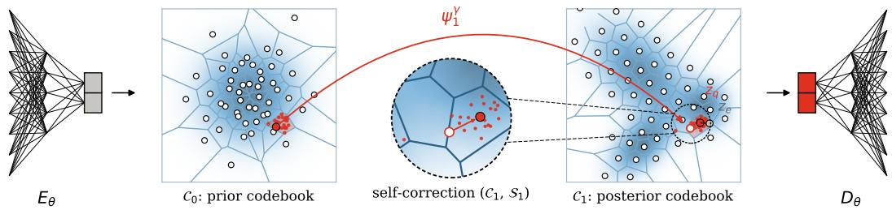  
Figure 1: FlowVQ on a three-mode 2D latent distribution (K = 50): the learned flow $\psi _ { 1 } ^ { \gamma }$ transports the approximately equal-mass quantile prior codebook $\mathscr { C } _ { 0 } \in \mathcal { N } ( \mathbf { 0 } , I )$ , initialized using Sobol samples here and kept fixed thereafter, to the latent space. Self-correction refines each transported code using the pushed quantile samples $S _ { 1 }$ , yielding the density-adaptive posterior codebook $\mathsf { \bar { C } } _ { 1 }$

A flow matching model [14] learns a continuous transport mapping samples from a prior distribution, such as a Gaussian, to an arbitrary data distribution. This transport corresponds to a Probability Flow ODE (PF-ODE) [15, 16], which preserves probability mass and transports prior quantiles to data quantiles. Based on this, we define the prior codebook uniformly in the well-behaved source space, and co-train the flow model with VQ-VAE. The codebook vectors are then obtained as the pushforward of the prior codebook and move toward the Voronoi centers under the estimated density. Experiments show that a lightweight flow model introduces minor overhead relative to VQ-VAE while maintaining full code utilization and improving performance.

In summary, our contributions are as follows:

1. We propose FlowVQ, a novel VQ technique that converts codebook learning into a quantile transport problem, where code utilization emerges as a geometric property of the latent space, enabling balanced usage and avoiding codebook collapse.

2. We show that FlowVQ consistently achieves full codebook utilization across a range of tasks, improving reconstruction and generation quality within a unified tokenizer framework.

## 2 Related Works

VQ-VAE & Generation in the Latent Space Proposed by [1], the VQ-VAE combines vector quantization with a reconstruction objective and achieves effective neural tokenization. It enables autoregressive generation on continuous data, such as high-fidelity image generation, by predicting the sequence of tokens in the latent space using a PixelCNN [1, 17] and, more recently transformer models. VQ-GAN [18] further couples the training with a discriminative loss, addressing the issue of blurry reconstruction from traditional VAE greatly improving generation fidelity. It has since been adopted as a standard framework. Recently, advancements on residual [19], multi-head [20], and multi-scale [21] tokenization were proposed and demonstrate solid improvements [19, 21, 22]. As a general tokenization technique, VQ-VAE based tokenizers are widely adopted in diverse generative tasks today, especially in tasks where direct generation can be prohibitively expensive such as image [12, 21, 23], audio [3, 24], and video [25, 26], or in fields where structural representations are often unavailable, such as AI for protein and material generation [27–29].

Mitigating Codebook Collapse To address the codebook collapse, which leads to unscalable codebook capacity, an active line of work has been proposed to mitigate it. Early work addressed it with various tricks such as random restart or random replacement [3, 5]. Another line of work explored differentiable relaxation [4, 30, 31], most notably using the Gumbel–Softmax [32] . However, these approaches generally underperform and produces lower-quality reconstruction [6]. Takida et al. [7, 8] proposed improving the mode-dropping behavior by switching to stochastic quantization but suffer from similar unrealistic reconstructions. Zhu et al. [9] and Chang et al. [10] addressed the under-utilization issue by adding intermediate projection layer(s) between a frozen codebook and the decoder. In a parallel track, Mentzer et al. [11], Yu et al. [12], and Weber et al. [13] proposed LFQ, which rounds each dimension to the nearest point in a hypercube, and scales the codebook capacity with its size using direct scalar quantization. These methods demonstrate competitive or improved image generation performance, especially with large vocabulary sizes beyond $2 ^ { 1 4 } \ \mathrm { t o } \ 2 ^ { 1 8 }$

The majority of the existing works mitigate this issue without fundamentally solving it. To our knowledge, the closest work is OptVQ [22], which introduces global information via optimal transport between batch latents and the codebook. However, its cost matrix requires per-batch normalization for numerical stability, which distorts the transport cost inconsistently across batches. Moreover, the resulting doubly stochastic assignment is converted to a hard assignment, which does not guarantee that every code is selected, especially under stronger entropy regularization. Full utilization thus depends on the entropy weight, which trades off quantization accuracy against utilization and may be sub-optimal for a given task as observed in our experiments.

## 3 Method

## 3.1 Preliminary

We define a codebook ${ \mathcal { C } } = \{ { \bf C } _ { i } \} _ { i = } ^ { K }$ where $\mathbf { C } _ { i } \in \mathbb { R } ^ { d }$ , K is the number of code vectors and d is the latent vector dimension. Given an input x, the original latent vector is $z _ { e } = E _ { \theta } ( x )$ , and the quantized vector $z _ { q }$ is defined as:

$$
z _ { q } = \mathbf { C } _ { i } \quad \mathrm { w h e r e } \quad i = \arg \operatorname* { m i n } _ { i } | | \mathbf { C } _ { i } - z _ { e } | | _ { 2 }\tag{1}
$$

With $\operatorname { s g } ( )$ indicating the stop gradient operator, the original VQ-VAE trains with the following objective function. $\beta$ is a training dynamics dependent coefficient that controls the expansion rate of $z _ { e }$ driven by the reconstruction objective, while ensuring the effectiveness of the STE operator in the reconstruction loss:

$$
\begin{array} { r c c c c c l } { { \mathcal { L } _ { \mathrm { v Q - v A E } } ( \theta , \mathcal { C } ) } } & { { = } } & { { \underbrace { | | D _ { \theta } ( { \mathrm { S T E } } ( z _ { q } ) ) - x | | _ { 2 } ^ { 2 } } _ { \mathrm { r e c o n s t u c t i o n ~ l o s s } } } } & { { + } } & { { \underbrace { | | \mathbf { s g } ( z _ { e } ) - z _ { q } | | _ { 2 } ^ { 2 } } _ { \mathrm { c o d e b o t k l o s s } } } } & { { + } } & { { \beta \underbrace { | | z _ { e } - \mathbf { s g } ( z _ { q } ) | | _ { 2 } ^ { 2 } } _ { \mathrm { c o m m i t m e n t ~ l o s s } } } } \\ { { } } & { { } } & { { \mathrm { w h e r e } } } & { { \mathrm { S T E } ( z _ { q } ) = z _ { e } + \mathbf { s g } ( z _ { q } - z _ { e } ) } } & { { } } & { { } } \end{array}\tag{2}
$$

## 3.2 Flow-based Codebook

In this work, we propose to define the codebook in the prior space, which we call the prior codebook $\mathcal { C } _ { 0 }$ . The prior space can be arbitrary, as long as it supports uniform sampling. To achieve uniform sampling, we partition the prior space into K equal probability mass quantiles using its cumulative distribution function (CDF) $\mathcal { F } . \{ \dot { \mathbf { C } } _ { 0 } ^ { i } \} _ { i = } ^ { K }$ is then obtained by applying the inverse $\breve { \mathrm { C D F } } \mathcal { F } ^ { - 1 }$ to the centers of these quantiles:

$$
\mathbf { C } _ { 0 } ^ { i } = \mathcal { F } ^ { - 1 } \left( \frac { i - 0 . 5 } { K } \right) , \quad i = 1 , . . . , K
$$

In higher dimensional latent spaces, as d increases, exact uniform quantile partitioning becomes intractable. We use Sobol sequences, a low-discrepancy quasi-random sequence designed to evenly fill multi-dimensional spaces to generate approximate uniformly distributed quantile centers. Specifically, we first generate K points in the CDF as d-dimensional unit hypercube $[ 0 , 1 ] ^ { d }$

$$
\{ \mathbf { u } _ { i } \} _ { i = 1 } ^ { K } = \operatorname { S o b o l } ( K , d ) \quad \mathrm { w h e r e } \quad \mathbf { u } _ { i } \in [ 0 , 1 ] ^ { d }\tag{3}
$$

Then obtain the prior codebook for each quantile similarly

$$
\mathbf { C } _ { 0 } ^ { i } = \mathcal { F } ^ { - 1 } ( \mathbf { u } _ { i } )\tag{4}
$$

We define the learned quantizer flow velocity field as $u _ { t } ^ { \gamma }$ , and the associated flow map as $\psi _ { t } ^ { \gamma }$ . Let the data distribution be $x \sim p _ { \mathrm { d a t a } }$ . During VQ-VAE training, it is trained to match the current latent distribution over $z _ { e }$ with the conditional flow matching objective:

$$
\mathcal { L } _ { \mathrm { F M } } ( \gamma ) = \mathbb { E } _ { t \sim \mathcal { U } [ 0 , 1 ] , \ z _ { 0 } \sim \mathcal { N } ( 0 , I _ { d } ) , \ x \sim p _ { \mathrm { d a t a } } } | | u _ { t } ^ { \gamma } ( z ) - u _ { t } ( z \mid z _ { 1 } , z _ { 0 } ) | | _ { 2 } ^ { 2 }\tag{5}
$$

$$
\mathrm { w h e r e } \quad \frac { d } { d t } \psi _ { t } ^ { \gamma } ( z ) = u _ { t } ^ { \gamma } ( \psi _ { t } ^ { \gamma } ( z ) ) , \quad z _ { 1 } = E _ { \theta } ( x ) , \quad \psi _ { t } ( z \mid z _ { 1 } , z _ { 0 } ) = ( 1 - t ) z _ { 0 } + t z _ { 1 }
$$

With latent distribution modeling and clustering handled by a separate flow model, the explicit codebook loss term in Eq (2) is no longer required. The flow matching objective is optimized in a decoupled manner and should introduce minimal interference to the reconstruction and quantization objectives. The overall training objective is then updated to:

$$
\begin{array} { r l } & { { \mathcal { L } } _ { \mathrm { F l o w V Q } } ( \theta , \gamma ) = { \mathcal { L } } _ { \mathrm { V Q } , \mathrm { v A E } } ( \theta ) ~ + ~ { \mathcal { L } } _ { \mathrm { F M } } ( \gamma ) } \\ & { ~ = | | D _ { \theta } ( { \mathrm { S T E } } ( z _ { q } ) ) - x | | ^ { 2 } ~ + ~ { \beta } | | z _ { e } - \ s { \mathrm { g } } ( z _ { q } ) | | ^ { 2 } ~ + ~ { \mathbb { E } } _ { t , z _ { 0 } , z _ { 1 } } | | u _ { t } ^ { \gamma } ( z ) - u _ { t } ( z \mid z _ { 1 } , z _ { 0 } ) | | ^ { 2 } , } \end{array}\tag{6}
$$

The final codebook $\mathcal { C } _ { 1 }$ used in vector quantization is periodically updated. Each code vector ${ \bf C } _ { 1 } ^ { i }$ is obtained as the pushforward of the prior codebook $\mathbf { C } _ { 0 } ^ { i }$ through the trained flow $\psi _ { t } ^ { \gamma }$ :

$$
\mathbf { C } _ { 1 } ^ { i } = \psi _ { 1 } ^ { \gamma } ( \mathbf { C } _ { 0 } ^ { i } ) , \quad i = 1 , . . . , K\tag{7}
$$

The codebook structure closely follows the geometry of the latent manifold and adapts to its density, naturally providing sharper resolution in denser regions and coarser in sparser regions. This is in contrast to the original $\bar { \mathsf { V } } \bar { \mathsf { Q } }$ , which is sensitive to both initialization and training dynamics due to its reliance on both codebook and commitment losses between only matched pairs, which are a root cause of codebook collapse. Similarly, fixed-geometry approaches such as LFQ do not adapt to the latent distribution, including empty regions beyond the latent boundaries and holes within it, which limits their expressivity.

## 3.3 Self-Correction toward Voronoi Centroids

Up to this point, a set of approximately uniform points in the latent space is obtained through Eq (7) as the codebook $\mathcal { C } _ { 1 }$ , which only fulfills the first two key properties of faithful latent modeling and approximately even partitioning. To minimize the approximation error arising from the quasi-random sequence and the non-linear flow mapping, we introduce a self-correction mechanism that updates $\mathcal { C } _ { 1 }$ toward the Voronoi centroids as the Euclidean centers of the transported quantiles, aiming to achieve the final desired property of the codebook. This process can be viewed as transporting each quantile cell through a set ofits uniformly spread samples.

The trained flow serves as a proxy for the latent data distribution. Denoting N as a sampling ratio, we uniformly draw NK points $\{ \bar { \mathbf { S } } _ { 0 } ^ { i } \} _ { i = 1 } ^ { N K }$ from the prior and push them through the flow to the latent space as dense samples $S _ { 1 }$ similarly, simulating the incoming latent data for vector quantization as $\{ z _ { e } ^ { ' } \}$

$$
\begin{array} { r l } & { \mathbf { S } _ { 0 } ^ { i } = \mathcal { F } ^ { - 1 } ( \mathbf { v } _ { i } ) , \quad \mathrm { w h e r e } \quad \{ \mathbf { v } _ { i } \} _ { i = 1 } ^ { N K } = { \mathrm { S o b o l } } ( N K , d ) , \ : \mathbf { v } _ { i } \in [ 0 , 1 ] ^ { d } } \\ & { \mathbf { S } _ { 1 } ^ { i }  \psi _ { 1 } ^ { \gamma } ( \mathbf { S } _ { 0 } ^ { i } ) , \quad i = 1 , . . . , N K } \end{array}\tag{8}
$$

We then cluster $\{ \mathbf { S } _ { 1 } ^ { i } \} _ { i = 1 } ^ { N K }$ with respect to the current codebook $\mathcal { C } _ { 1 }$ and update each ${ \bf C } _ { 1 } ^ { i }$ toward the corresponding cluster centroid, implementing a self-correction mechanism that improves codebook alignment with the latent manifold. This process is analogous to k-means clustering initialized with well-chosen centers.

$$
\mathcal { C } _ { 1 } = \arg \operatorname* { m i n } _ { \mathcal { C } _ { 1 } } \sum _ { j = 1 } ^ { K } \sum _ { \mathbf { S } _ { 1 } ^ { i } \in Q _ { j } } | | \mathbf { S } _ { 1 } ^ { i } - \mathbf { C } _ { 1 } ^ { j } | | _ { 2 } ^ { 2 }\tag{9}
$$

Where $\{ Q _ { j } \} _ { j = 1 } ^ { K }$ denotes the K quantile clusters in the latent space, and $\mathbf { C } _ { 1 } ^ { j }$ corresponds to the current codebook vectors of the quantiles. This process is performed iteratively a few times and deterministic with minimal overhead.

Optionally, we can further correct the codebook $\mathcal { C } _ { 1 }$ online towards the cluster centroids of real latent data $\{ z _ { e } \}$ during co-training. This could reduce the remaining approximation error due to finite samples and model error. Specifically, this online correction reinstates the codebook loss of $\mathcal { L } _ { \mathrm { V Q } }$ -VAE in Eq (2) in Eq (6), which can pose a risk of re-introducing codebook collapse between two codebook updates. However, due to the quality of the flow partition and frequent codebook update, we did not observe significant collapse in our experiments and found it can further improve the model slightly over the purely self-corrected version.

## 4 Experiments

In this section, We evaluate FlowVQ on image reconstruction and generation in terms of generation quality with common metrics such as FID, IS, and codebook quality, measured by its entropy and utilization rate. We first evaluate it on CIFAR-10 [33] in Sec 4.1.1, followed by ImageNet-1K [34] at 256×256 resolution in Sec 4.1.2.

To further examine the expressivity induced by FlowVQ and its general applicability, we evaluate FlowVQ on two high-precision tasks: crystalline material tokenization in Sec 4.2.1, and action tokenization for robotics in Sec 4.2.2

## 4.1 Image Tokenization

## 4.1.1 CIFAR-10

As various design choices affect the final model performance, to understand the sole effect of VQ techniques, we first conduct a set of controlled experiments on CIFAR-10. All models share the same encoder and decoder architecture and training scheme (47M parameters), differing only in the quantizer, i.e., quantization and codebook update. The image is compressed to the latent space by a fixed factor $f = 4 , \mathrm { i . e }$ . from $H \times W$ to an ${ \dot { H } } / f \times W / f$ patch token grid. We evaluate reconstruction under different codebook sizes and dimensions to examine the codebook scalability.

For baselines, we compare against two most common quantization methods: VQ-GAN [18, 13], and hypercubic LFQ method [12, 13]. We also compare with OptVQ [22]. For a fair comparison with LFQ method , which ties the codebook size |C| to the latent vector dimension d : $| { \mathcal { C } } | = { \bar { 2 } } ^ { d }$ , we adjust d accordingly for $| \mathcal { C } | = 1 0 2 4$ and $| \mathcal { C } | = 1 6 3 \dot { 8 } 4$ . We also explored the effect of auxiliary entropy loss, a technique widely adopted to improve codebook utilization in existing works [11–13, 35], which optimizes the mutual information between the latent inputs and codebook, as illustrated in [36, 37]:

$$
\mathcal { L } _ { e n t } = \mathbb { E } [ H ( q ( \boldsymbol { z } ) ) ] - H [ \mathbb { E } ( q ( \boldsymbol { z } ) ) ]\tag{10}
$$

<table><tr><td></td><td>d</td><td>|C|</td><td>rFID↓</td><td>IS ↑</td><td>SSIM↑</td><td>PSNR↑</td><td>LPIPS↓</td><td>MAE↓</td><td>Entropy↑</td><td>Util % ↑</td></tr><tr><td rowspan="3">VQ-GAN+</td><td>10</td><td>1024</td><td>2.40</td><td>10.77</td><td>0.78</td><td>23.62</td><td>0.130</td><td>0.050</td><td>8.81</td><td>45.6</td></tr><tr><td>10</td><td>10240</td><td>2.65</td><td>10.70</td><td>0.75</td><td>23.27</td><td>0.143</td><td>0.052</td><td>8.07</td><td>2.7</td></tr><tr><td>14</td><td>16384</td><td>1.93</td><td>10.88</td><td>0.81</td><td>24.79</td><td>0.115</td><td>0.044</td><td>8.71</td><td>2.6</td></tr><tr><td rowspan="3">w/o  $\mathcal { L } _ { e n t }$  LFQ</td><td>14</td><td>16384</td><td>1.65</td><td>10.87</td><td>0.81</td><td>24.82</td><td>0.114</td><td>0.044</td><td>8.57</td><td>2.8</td></tr><tr><td>10</td><td>1024</td><td>3.00</td><td>10.65</td><td>0.74</td><td>23.01</td><td>0.149</td><td>0.058</td><td>8.46</td><td>50.0</td></tr><tr><td>14</td><td>16384</td><td>2.95</td><td>10.83</td><td>0.73</td><td>22.57</td><td>0.161</td><td>0.056</td><td>5.91</td><td>0.8</td></tr><tr><td rowspan="3">OptVQ</td><td>14</td><td>16384</td><td>2.03</td><td>10.83</td><td>0.83</td><td>24.96</td><td>0.104</td><td>0.043</td><td>13.83</td><td>100.0</td></tr><tr><td>10</td><td>1024</td><td>3.42</td><td>10.79</td><td>0.76</td><td>23.50</td><td>0.138</td><td>0.050</td><td>9.99</td><td>100.0</td></tr><tr><td>10</td><td>10240</td><td>1.95</td><td>10.88</td><td>0.85</td><td>25.31</td><td>0.091</td><td>0.041</td><td>13.27</td><td>100.0</td></tr><tr><td rowspan="3">FlowVQ</td><td>14</td><td>16384</td><td>1.72</td><td>10.93</td><td>0.85</td><td>25.78</td><td>0.087</td><td>0.039</td><td>13.94</td><td>100.0</td></tr><tr><td>10</td><td>1024</td><td>2.11</td><td>10.71</td><td>0.80</td><td>24.28</td><td>0.118</td><td>0.046</td><td>9.93</td><td>100.0</td></tr><tr><td>10</td><td>10240</td><td>1.87</td><td>10.68</td><td>0.83</td><td>25.39</td><td>0.100</td><td>0.040</td><td>13.28</td><td>100.0</td></tr><tr><td rowspan="2">w/  $\mathcal { L } _ { e n t }$ </td><td>14</td><td>16384</td><td>1.40</td><td>10.72</td><td>0.86</td><td>26.50</td><td>0.086</td><td>0.036</td><td>13.97</td><td>100.0</td></tr><tr><td>14</td><td>16384</td><td>1.39</td><td>10.89</td><td>0.87</td><td>26.72</td><td>0.081</td><td>0.035</td><td>13.97</td><td>100.0</td></tr></table>

Table 1: Evaluation of image quality and codebook utilization on CIFAR-10. By default, all baselines optimize the auxiliary entropy loss while FlowVQ does not if not specified. As the entropy maximization is tightly coupled in the OptVQ optimization process, we did not explore removing it.

For FlowVQ, the velocity field is modeled using a lightweight 4-layer MLP with hidden dimension $h = 2 5 6 \ : ( 0 . 2 \mathrm { M }$ extra parameters). We observe this setting to be effective in producing an aligned latent space and fix it across all tasks. We set the source distribution to a normal distribution $\sqrt { ( \mathbf { 0 } , \mathbf { I } _ { d } ) }$ The dense prior samples are generated with a ratio $\mathrm { N } = 5 0$ . We start the initial codebook construction at the 1000th step, then update it every 1000 steps using batch size 128.

Result Analysis The results are summarized in Table 1. We can spot the codebook collapse of the original VQ immediately when |C| increases from 1024 to 10240 with a fixed latent dimension. The number of active codes decreases from $1 0 2 4 \times 4 5 . 6 \% = 4 6 7 \mathrm { t o } 1 0 2 4 0 \times 2 . 7 3 \% = 2 8 0 .$ leading to degenerate overall performance. The entropy regularization drastically improves the utilization rate of LFQ, but does not guarantee full utilization when balancing multiple objectives of minimizing quantization error and maximally filling the hypercube simultaneously. The same conflict applies to OptVQ, which was observed to learn fast in early steps, but plateaus much earlier than methods that are solely driven by the quantization objective, such as VQGAN and FlowVQ here. Nevertheless, we note that VQ-GAN serves as a strong baseline due to its flexibility, which leads to high-quality alignment between the codebook and an evolving latent space.

We observe that FlowVQ achieves significant improvements in both image quality, with rFID = 1.40, reconstruction error MAE of 0.036, and codebook quality with full utilization across all settings. The performance consistently improves with increasing |C|. Explicit optimizing the mutual information further improves the model slightly, though we note the performance is very close between the two. Both variants achieve the highest entropy (13.97, near the maximum $l o g _ { 2 } 1 6 3 8 4 = 1 4 )$ , indicating the most balanced usage across codes, which validates the effectiveness of the proposed method.

Codebook Visualization We next provide visualizations of the latent space on the evaluation set and codebook alignment between FlowVQ and baselines without global information in Fig 2. We can see the codebook collapse pattern in VQ-GAN, where a large number of codes at the bottom left remain unused despite the active codes aligning well with the latent space, while LFQ imposes a hypercube geometry, so holes in latent space inevitably lead to unused codes. FlowVQ, on the contrary, models the geometry flexibly similar to VQ-GAN and imposes no additional regularization on the latent shape, resulting in high code utilization that allows it to scale with the codebook size.

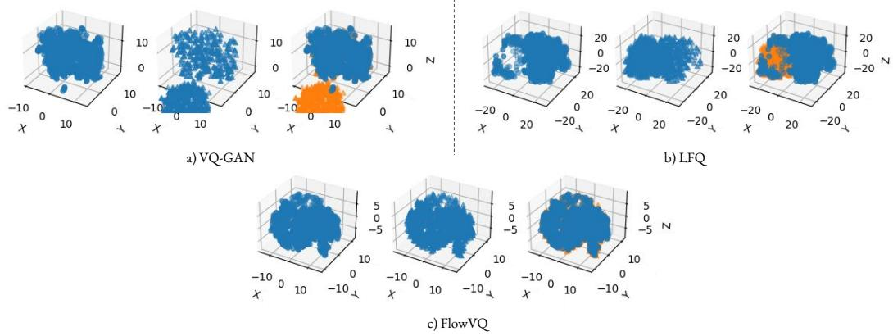  
Figure 2: Visualization of (left) the latent vectors on the evaluation set •; (middle) the codebook ▲; (right) the joint plot of latent vectors • and codebook vectors ▲ in each plot. For each model, the latent vectors and code vectors are randomly down-sampled to the same number, then jointly reduced to 3D using t-SNE for visualization.

Time Analysis One potential concern for the proposed method is that the pushforward operation can be time-consuming. We measure the average training time per 1000 steps (one codebook update cycle) for all models in robotics VLA model Table 6 in Appendix B. FlowVQ takes on average 618s compared to 535s for VQ-GAN, increased by 15.6% with the difference mostly due to the codebook update, which takes 82.8s on average. This time is expected to further decrease with more GPU memory. Meanwhile, as the prior vectors are pre-defined in the fixed source space, the update is fully deterministic and easily supports distributed execution with minimal communication overhead. We implement the distributed update. It takes 3s per codebook update on 32 NVIDIA A100 GPUs for |C| = 16384 for large scale training such as ImageNet, thus comparable speed to the original VQ-GAN.

## 4.1.2 ImageNet-1K

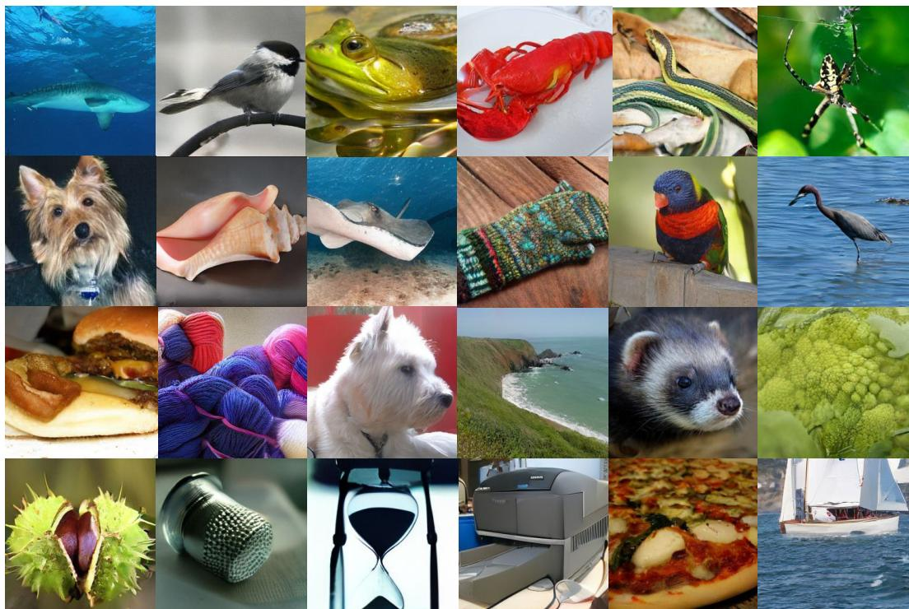

Figure 3: class-conditioned generation on ImageNet-1K $2 5 6 \times 2 5 6$ trained model. Each image corresponds to a different class. More samples can be found in Appendix C.3.
<table><tr><td>Model</td><td>Tokenizer</td><td>|C|</td><td>#tokens</td><td>#params</td><td>rFID↓</td><td> $\mathbf { g F I D \downarrow }$ </td><td>IS↑</td></tr><tr><td>ImageNet-1K val. data [21]</td><td></td><td></td><td></td><td></td><td></td><td>1.78</td><td>236.9</td></tr><tr><td>LDM-4-G [23]</td><td>Continuous*</td><td>8192</td><td> $6 4 ^ { 2 }$ </td><td>400M</td><td></td><td>3.60</td><td>247.7</td></tr><tr><td>LDM-8-G [23]</td><td>Continuous*</td><td>16384</td><td> $3 2 ^ { 2 }$ </td><td>506M</td><td></td><td>7.76</td><td>209.5</td></tr><tr><td>MAR-L-407M [38]</td><td>Continuous</td><td></td><td> $1 6 ^ { 2 }$ </td><td>407M</td><td>1.22</td><td>1.97</td><td>291.2</td></tr><tr><td>FSQ [11]</td><td>LFQ</td><td>1000</td><td> $1 6 ^ { 2 }$ </td><td>155M</td><td>一</td><td>4.53</td><td></td></tr><tr><td>MAGVIT-v2 [12]</td><td>LFQ</td><td>262144</td><td> $1 6 ^ { 2 }$ </td><td>307M</td><td></td><td>1.78</td><td>319.4</td></tr><tr><td>Open-MAGVIT2-AR-B [39]</td><td>LFQ</td><td>262144</td><td> $1 6 ^ { 2 }$ </td><td>343M</td><td>1.67</td><td>3.08</td><td>258.3</td></tr><tr><td>BSQ [40]</td><td>LFQ</td><td>262144</td><td> $1 6 ^ { 2 }$ </td><td>174M</td><td>1.14</td><td>5.44</td><td>139.6</td></tr><tr><td>taming-VQGAN</td><td>VQ</td><td>1024</td><td> $1 6 ^ { 2 }$ </td><td>310M</td><td>7.94</td><td>5.88</td><td>304.8</td></tr><tr><td>taming-VQGAN</td><td>VQ</td><td>16384</td><td> $1 6 ^ { 2 }$ </td><td>310M</td><td>4.98</td><td></td><td></td></tr><tr><td>MaskGIT [35]</td><td>VQ</td><td>1024</td><td> $1 6 ^ { 2 }$ </td><td>227M</td><td>2.28</td><td>6.18</td><td>182.1</td></tr><tr><td>SQ-VAE-2 [7]</td><td>VQ</td><td>3072</td><td> $1 6 ^ { 2 }$ </td><td></td><td>4.51</td><td></td><td></td></tr><tr><td>LlamaGen [41]</td><td>VQ</td><td>16384</td><td> $1 6 ^ { 2 }$ </td><td>343M</td><td>2.19</td><td>4.21</td><td>200.1</td></tr><tr><td>VAR-d16 [21]</td><td>VQ</td><td>4096</td><td> $1 6 ^ { 2 }$ </td><td>310M</td><td>-</td><td>3.30</td><td>274.4</td></tr><tr><td>VAR-d20 [21]</td><td>VQ</td><td>4096</td><td> $1 6 ^ { 2 }$ </td><td>600M</td><td></td><td>2.57</td><td>302.6</td></tr><tr><td>FlowVQ</td><td>VQ</td><td>16384</td><td> $1 6 ^ { 2 }$ </td><td>307M</td><td>1.48</td><td>1.89</td><td>351.4</td></tr></table>

Table 2: Image reconstruction and generation on ImageNet-1K 256×256 with classifier free guidance. We compare FlowVQ with the existing works with similar model capacity and their guided or rejection sampling scores. \* LDM reconstructs on continuous space, but generation discretizes input to the nearest token.

We next extend the evaluation on ImageNet-1K at a resolution of $2 5 6 \times 2 5 6$ for both reconstruction and generation. For stage one, the model shares a similar design to Sec 4.1.1 but is constructed deeper using channel multiplier as [1,1,2,2,4], leading to a compression ratio f = 16 and a $1 6 \times 1 6$ token grid. We train the model for 1.35M steps using batch size 256, and a single-cycle cosine scheduler with a base learning rate 1e-4 using the AdamW optimizer [42].

For stage two, we train a Masked Language Model (MLM) to generate images similar to the existing line of works [35, 11, 43, 40, 39, 12]. We use a cosine mask schedule from MaskGIT [35] which demonstrated superior generative performance. The MLM contains 307M parameters, comparable to GPT2-medium capacity. It is trained with the same learning rate and steps as stage one. Following convention, we report FID [44] and IS [45] scores for guided generation. More hyperparameter details can be found in Appendix C.2.

From Table 2, under similar model capacity, FlowVQ |C| = 16384 achieves a good balance between reconstruction and generation. It achieves the highest IS score and outperforms all models in terms of gFID with 1.89, except MAGVIT-v2 (1.78), where FlowVQ uses only 6.25% of its vocabulary size. The baselines include MAR-L-407M, which uses a slightly larger generator and autoregressively generates images in the original continuous latent space without tokenization, as well as models using advanced VQ techniques such as VAR and SQ-VAE-2, which use multi-scale and residual VQ, respectively. Like other VQ methods, FlowVQ is compatible with those techniques.

For qualitative measure, we plot the generated samples in Figure 3. We also validate generalization of the codebook by reconstructing unseen images from COCO-2017 validation set in Figure 4, where we found FlowVQ can produce more faithful and plausible reconstruction over details and particularly faces.

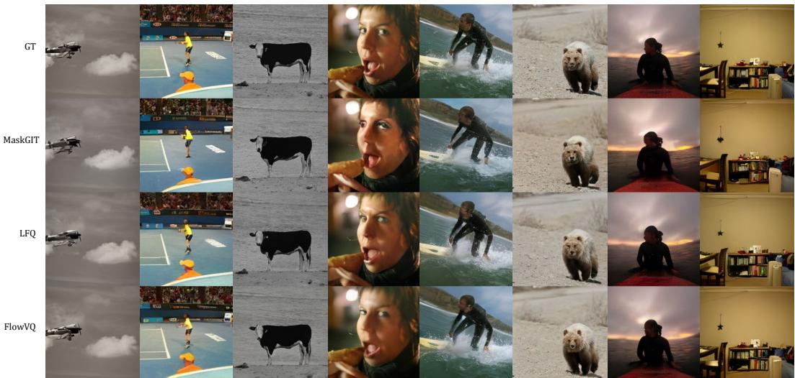  
Figure 4: Reconstruction on unseen images from COCO-2017 validation data on ImageNet-1K 256 × 256 trained model.

## 4.2 High Precision Tokenization

To examine the potential of an adaptive and fully utilized codebook for FlowVQ as a general tokenizer, we would like to extend the evaluation beyond the image domain. One natural task to consider is high-precision tokenization, especially where structural representation is missing and generation can greatly benefit from the discretized representation learning. Data containing geometric, motion, and spatial state information usually resides in continuous space, and small numerical differences can lead to significantly different physical states or interaction outcomes. Tokenization needs to allocate sufficient resolution to ensure that distinct physical configurations do not collapse into indistinguishable tokens. The current common practice uses k-means initialized VQ-VAE [27–29]. We consider two representative tasks here: crystalline material tokenization in Sec 4.2.1 and robot action tokenization in Sec 4.2.2.

## 4.2.1 Crystalline Material Tokenization

We evaluate tokenization techniques for crystalline materials based on their ability to faithfully represent crystal structures using an atom-based encoder–decoder transformer. Crystals exhibit periodic atomic arrangements in 3D space and are commonly represented by a unit cell containing a set of atoms. Each atom is described by a tuple (A, X, L), where A is its one-hot atom type vector, X is its 3D fractional coordinates, and L is the lattice information. These components are then concatenated into a single vector before being fed into the model.

We evaluate on MP-20 [46] with |C| = 8192 and d = 8. As VQ-VAE and OptVQ benefit from an aligned initialization [27–29], and to isolate the effect of the quantizer, we initialize their codebooks with k-means centroids of the training-set latents from the same autoencoder at epoch W = 500, when FlowVQ quantization begins. All methods also start from the same encoder and decoder weights. For evaluation, we follow prior work [47] by comparing each reconstructed material with its ground-truth material using StructureMatcher from PyMatgen [48] and reporting the resulting match rate. We do not report codebook utilization rate for this task because MP-20 is a relatively small dataset, and the evaluation distribution does not fully cover the training distribution, which is reflected as only 7,408 of the 8,192 codes derived from the training data k-means clusters were actively used on the evaluation set. This number can further vary with the latent geometry evolving during training. We analyze the number of actively utilized codes instead.

<table><tr><td rowspan=1 colspan=1></td><td rowspan=1 colspan=1>VQVAE</td><td rowspan=1 colspan=1>LFQ</td><td rowspan=1 colspan=1>OptVQ $( \epsilon = 1 0 ^ { * } )$ </td><td rowspan=1 colspan=1>KM-VQVAE</td><td rowspan=1 colspan=1>KM-OptVQ(€ = 10)</td><td rowspan=1 colspan=1>KM-OptVQ(e = 1)</td><td rowspan=1 colspan=1>FlowVQ</td><td rowspan=1 colspan=1>FlowVQ(w/ oc)</td></tr><tr><td rowspan=1 colspan=3>Match Rate ↑ 47.16 % 24.63%</td><td rowspan=1 colspan=1>10.81%</td><td rowspan=1 colspan=1>78.38%</td><td rowspan=1 colspan=1>17.85%</td><td rowspan=1 colspan=1>53.27%</td><td rowspan=1 colspan=2>90.81 % 90.66 %</td></tr></table>

∗ϵ in Eq. 8 of the original paper, where ϵ = 10 is the open-source configuration across all tasks and used for table 1 experiments.

Table 3: Match rate between the reconstructed and ground-truth material on MP-20.

FlowVQ significantly outperforms all baseline methods, including k-means initialized techniques. It achieves the highest match rate (90.81%) with 7178 actively utilized codes on average, compared to the second best method KM-VQVAE as 78.38% with the average actively used code number as 3192. LFQ and OptVQ generally perform poorly on this task. For k-means initialized OptVQ, reducing ϵ from 10 to 1, which strengthens the entropy regularization as its weight scales with 1 , improves the match rate from 17.85% to 53.27% but significantly reduces the number of active codes from 7110 to 1311, consistent with our analysis in Sec 2. More details on the experiment setting can be found in Appendix D.

## 4.2.2 Robotics Action Tokenization

Robot actions in foundation models [49–52] have recently been represented as action chunks [53, 54], as fixed-length sequences of actions. Each action is represented as a vector defining the next delta movement. We evaluate on the DROID dataset [55] and compare with common action tokenizers: 1) FAST+ [56], which applies the Discrete Cosine Transform (DCT) to each action dimension of a chunk, quantizes the coefficients by scaling and rounding, flattens them from low to high frequency, and compresses the resulting sequence with a pretrained Byte-Pair Encoding (BPE) [57, 58] vocabulary, 2) K-means initialized VQ-VAE. Similar to Sec 4.2.1, we use an encoder-decoder transformer with quantization applied in the latent space. |C| is set to 2048 for fair comparison with existing tokenizers, latent dimension d = 8, and more details can be found in Appendix E.

<table><tr><td rowspan=1 colspan=1></td><td rowspan=1 colspan=1>FAST+</td><td rowspan=1 colspan=1>KM-VQVAE</td><td rowspan=1 colspan=1>FlowVQ</td></tr><tr><td rowspan=1 colspan=1>MSE(e-4) ↓</td><td rowspan=1 colspan=1>2.40</td><td rowspan=1 colspan=1>1.88</td><td rowspan=1 colspan=1>1.71</td></tr><tr><td rowspan=1 colspan=1>Utilization ↑</td><td rowspan=1 colspan=1>97.02%</td><td rowspan=1 colspan=1>10.89%</td><td rowspan=1 colspan=1>100%</td></tr></table>

Table 4: Trajectory reconstruction error of 50-step action chunks on DROID dataset.

From Table 4, we observe FlowVQ achieves full codebook utilization on validation trajectories throughout the training, and reaches the lowest reconstruction error of $1 . 7 1 e ^ { - 4 }$ . KM-VQVAE starts with full utilization, but gradually drops to 10.89% during training. Both FlowVQ and KM-VQVAE yield a more accurate reconstruction of action compared to FAST+.

## 4.3 Ablation Study

To better understand the contribution of the learned transport and of each codebook correction mechanism, we ablate FlowVQ on CIFAR-10 and MP-20 and report the best model performance in Table 5. On both tasks, the prior codebook transport can deliver more accurate tokenization compared to baseline methods reflected as lower FID score and higher material match rate (FID 1.49 vs 1.65 in Table 1; 88.15% vs 78.38% in Table 3), and adding self-correction stabilizes the training with less fluctuation observed. Adding online correction on top further improves image tokenization slightly, while performing on par on material tokenization.

(a) Image Tokenization: CIFAR-10
<table><tr><td></td><td></td><td>FID↓</td><td>IS↑</td><td>SSIM ↑</td><td>PSNR ↑</td><td>LPIPS↓</td><td>MAE↓</td><td>Entropy ↑</td><td>Util ↑</td></tr><tr><td> $\mathcal { C } _ { 0 } \to \mathcal { C } _ { 1 }$ </td><td></td><td>1.49</td><td>10.79</td><td>0.856</td><td>26.11</td><td>0.086</td><td>0.038</td><td>13.92</td><td>100%</td></tr><tr><td></td><td> $\mathcal { C } _ { 0 }  \mathcal { C } _ { 1 } + \mathrm { s c }$ </td><td>1.52</td><td>10.70</td><td>0.841</td><td>25.73</td><td>0.094</td><td>0.039</td><td>13.97</td><td>100%</td></tr><tr><td></td><td> $\mathcal { C } _ { 0 }  \mathcal { C } _ { 1 } + \mathrm { s c } + \mathrm { o c }$ </td><td>1.40</td><td>10.72</td><td>0.861</td><td>26.50</td><td>0.086</td><td>0.036</td><td>13.97</td><td>100%</td></tr></table>

(b) Crystalline Material Tokenization: MP-20
<table><tr><td>MP-20 Match Rate</td><td> $\mathcal { C } _ { 0 } \to \mathcal { C } _ { 1 }$ </td><td> $\mathcal { C } _ { 0 }  \mathcal { C } _ { 1 } + \mathrm { s c }$   $\mathcal { C } _ { 0 }  \mathcal { C } _ { 1 } + \mathrm { s c } + \mathrm { o c }$ </td></tr><tr><td>Match Rate ↑</td><td>88.15%</td><td>90.81% 90.66%</td></tr></table>

Table 5: Ablation study on FlowVQ components on CIFAR-10 image tokenization and MP-20 material tokenization tasks. With details in Sec 3.3, sc refers to self-correction mechanism, and oc refers to the optional online-correction mechanism.

## 5 Conclusion

To summarize, we introduced FlowVQ, a vector quantization technique that reformulates codebook learning in classic VQ-VAE as a quantile-based transport process, where balanced code utilization is governed by the geometry of the latent space rather than a byproduct of auxiliary optimization objectives. By constructing the codebook via deterministic pushforwards from a uniform prior and refining them through self-correction, FlowVQ achieves stable and balanced code usage while avoiding codebook collapse. We conducted experiments across a range of tokenization and generation tasks, demonstrating consistently improved reconstruction and generation quality. We hope the proposed method will serve as a useful tool, especially in fields where features are naturally continuous or hybrid, and benefit from learned representations.

Limitations and Future Work In addition to the slight increase in training time, FlowVQ primarily focuses on addressing codebook collapse, while another important limitation of VQ-VAE lies in the reliance on the biased STE for backpropagation through discrete quantization. Recent works have shown that this gradient mismatch can be alleviated through simple rotation tricks [59], but more effective alternatives remain largely unexplored. Another direction worth exploring is to investigate FlowVQ together with recent architectures on flexible-length [60, 61] or flexible-resolution [62] embedding learning, which may enable more adaptive token allocation to regions with higher semantic or structural complexity, leading to further improvements.

Acknowledgments We thank the anonymous reviewers for their constructive feedback and suggestions, which improved the paper. We thank Liu Nian for sharing his code for k-means initialized VQ-VAE for crystalline material tokenization, which enabled an insightful comparison during the development. Zekun Shi is partially supported by the Singapore Economic Development Board through the Industrial Postgraduate Programme.

## References

[1] Aaron Van Den Oord, Oriol Vinyals, et al. Neural discrete representation learning. Advances in neural information processing systems, 30, 2017.

[2] Ali Razavi, Aaron Van den Oord, and Oriol Vinyals. Generating diverse high-fidelity images with vq-vae-2. Advances in neural information processing systems, 32, 2019.

[3] Prafulla Dhariwal, Heewoo Jun, Christine Payne, Jong Wook Kim, Alec Radford, and Ilya Sutskever. Jukebox: A generative model for music. arXiv preprint arXiv:2005.00341, 2020.

[4] Eirikur Agustsson, Fabian Mentzer, Michael Tschannen, Lukas Cavigelli, Radu Timofte, Luca Benini, and Luc V Gool. Soft-to-hard vector quantization for end-to-end learning compressible representations. Advances in neural information processing systems, 30, 2017.

[5] Chuanxia Zheng and Andrea Vedaldi. Online clustered codebook. In Proceedings of the IEEE/CVF International Conference on Computer Vision, pages 22798–22807, 2023.

[6] Will Williams, Sam Ringer, Tom Ash, David MacLeod, Jamie Dougherty, and John Hughes. Hierarchical quantized autoencoders. Advances in Neural Information Processing Systems, 33: 4524–4535, 2020.

[7] Yuhta Takida, Takashi Shibuya, WeiHsiang Liao, Chieh-Hsin Lai, Junki Ohmura, Toshimitsu Uesaka, Naoki Murata, Shusuke Takahashi, Toshiyuki Kumakura, and Yuki Mitsufuji. SQ-VAE: Variational bayes on discrete representation with self-annealed stochastic quantization. In International Conference on Machine Learning, 2022.

[8] Yuhta Takida, Yukara Ikemiya, Takashi Shibuya, Kazuki Shimada, Woosung Choi, Chieh-Hsin Lai, Naoki Murata, Toshimitsu Uesaka, Kengo Uchida, Wei-Hsiang Liao, et al. Hq-vae: Hierarchical discrete representation learning with variational bayes. Trans. Mach. Learn. Res., 2024.

[9] Lei Zhu, Fangyun Wei, Yanye Lu, and Dong Chen. Scaling the codebook size of vq-gan to 100,000 with a utilization rate of 99%. Advances in Neural Information Processing Systems, 37: 12612–12635, 2024.

[10] Yifan Chang, Jie Qin, Limeng Qiao, Xiaofeng Wang, Zheng Zhu, Lin Ma, and Xingang Wang. Scalable training for vector-quantized networks with 100% codebook utilization. International Conference on Learning Representations, 2026.

[11] Fabian Mentzer, David Minnen, Eirikur Agustsson, and Michael Tschannen. Finite scalar quantization: Vq-vae made simple. In The Twelfth International Conference on Learning Representations, 2024.

[12] Lijun Yu, José Lezama, Nitesh Bharadwaj Gundavarapu, Luca Versari, Kihyuk Sohn, David Minnen, Yong Cheng, Agrim Gupta, Xiuye Gu, Alexander G Hauptmann, et al. Language model beats diffusion-tokenizer is key to visual generation. In ICLR, 2024.

[13] Mark Weber, Lijun Yu, Qihang Yu, Xueqing Deng, Xiaohui Shen, Daniel Cremers, and Liang-Chieh Chen. Maskbit: Embedding-free image generation via bit tokens. Transactions on Machine Learning Research, 2024.

[14] Yaron Lipman, Ricky TQ Chen, Heli Ben-Hamu, Maximilian Nickel, and Matt Le. Flow matching for generative modeling. arXiv preprint arXiv:2210.02747, 2022.

[15] Dimitra Maoutsa, Sebastian Reich, and Manfred Opper. Interacting particle solutions of fokker–planck equations through gradient–log–density estimation. Entropy, 22(8):802, 2020.

[16] Yang Song, Jascha Sohl-Dickstein, Diederik P Kingma, Abhishek Kumar, Stefano Ermon, and Ben Poole. Score-based generative modeling through stochastic differential equations. arXiv preprint arXiv:2011.13456, 2020.

[17] Aaron Van den Oord, Nal Kalchbrenner, Lasse Espeholt, Oriol Vinyals, Alex Graves, et al. Conditional image generation with pixelcnn decoders. Advances in neural information processing systems, 29, 2016.

[18] Patrick Esser, Robin Rombach, and Bjorn Ommer. Taming transformers for high-resolution image synthesis. In Proceedings ofthe IEEE/CVF conference on computer vision and pattern recognition, pages 12873–12883, 2021.

[19] Doyup Lee, Chiheon Kim, Saehoon Kim, Minsu Cho, and Wook-Shin Han. Autoregressive image generation using residual quantization. In Proceedings of the IEEE/CVF conference on computer vision and pattern recognition, pages 11523–11532, 2022.

[20] Chuanxia Zheng, Tung-Long Vuong, Jianfei Cai, and Dinh Phung. Movq: Modulating quantized vectors for high-fidelity image generation. Advances in Neural Information Processing Systems, 35:23412–23425, 2022.

[21] Keyu Tian, Yi Jiang, Zehuan Yuan, Bingyue Peng, and Liwei Wang. Visual autoregressive modeling: Scalable image generation via next-scale prediction. Advances in neural information processing systems, 37:84839–84865, 2024.

[22] Borui Zhang, Wenzhao Zheng, Jie Zhou, and Jiwen Lu. Preventing local pitfalls in vector quantization via optimal transport. arXiv preprint arXiv:2412.15195, 2024.

[23] Robin Rombach, Andreas Blattmann, Dominik Lorenz, Patrick Esser, and Björn Ommer. Highresolution image synthesis with latent diffusion models. In Proceedings of the IEEE/CVF conference on computer vision and pattern recognition, pages 10684–10695, 2022.

[24] Sander Dieleman, Aaron Van Den Oord, and Karen Simonyan. The challenge of realistic music generation: modelling raw audio at scale. Advances in neural information processing systems, 31, 2018.

[25] Wilson Yan, Yunzhi Zhang, Pieter Abbeel, and Aravind Srinivas. Videogpt: Video generation using vq-vae and transformers. arXiv preprint arXiv:2104.10157, 2021.

[26] Jake Bruce, Michael D Dennis, Ashley Edwards, Jack Parker-Holder, Yuge Shi, Edward Hughes, Matthew Lai, Aditi Mavalankar, Richie Steigerwald, Chris Apps, et al. Genie: Generative interactive environments. In Forty-first International Conference on Machine Learning, 2024.

[27] Mahdi Pourmirzaei, Alex Morehead, Farzaneh Esmaili, Jarett Ren, Mohammadreza Pourmirzaei, and Dong Xu. Gcp-vqvae: A geometry-complete language for protein 3d structure. bioRxiv, pages 2025–10, 2025.

[28] Shuqi Lu, Haowei Lin, Lin Yao, Zhifeng Gao, Xiaohong Ji, Linfeng Zhang, Guolin Ke, et al. Uni-3dar: Unified 3d generation and understanding via autoregression on compressed spatial tokens. arXiv preprint arXiv:2503.16278, 2025.

[29] ZiJie Qiu, Luozhijie Jin, Zijian Du, Hongyu Chen, Yan Cen, Siqi Sun, Yongfeng Mei, and Hao Zhang. Vqcrystal: Leveraging vector quantization for discovery of stable crystal structures. arXiv preprint arXiv:2409.06191, 2024.

[30] Alexei Baevski, Steffen Schneider, and Michael Auli. vq-wav2vec: Self-supervised learning of discrete speech representations. In International Conference on Learning Representations, 2020.

[31] Shiyin Jiang, Wei Long, Minghao Han, Zhenghao Chen, Ce Zhu, and Shuhang Gu. Differentiable vector quantization for rate-distortion optimization of generative image compression. arXiv preprint arXiv:2604.10546, 2026.

[32] Eric Jang, Shixiang Gu, and Ben Poole. Categorical reparameterization with gumbel-softmax. In International Conference on Learning Representations, 2017.

[33] Alex Krizhevsky, Geoffrey Hinton, et al. Learning multiple layers of features from tiny images. 2009.

[34] Jia Deng, Wei Dong, Richard Socher, Li-Jia Li, Kai Li, and Li Fei-Fei. Imagenet: A largescale hierarchical image database. In 2009 IEEE conference on computer vision and pattern recognition, pages 248–255. Ieee, 2009.

[35] Huiwen Chang, Han Zhang, Lu Jiang, Ce Liu, and William T Freeman. Maskgit: Masked generative image transformer. In Proceedings of the IEEE/CVF conference on computer vision and pattern recognition, pages 11315–11325, 2022.

[36] Andreas Krause, Pietro Perona, and Ryan Gomes. Discriminative clustering by regularized information maximization. Advances in neural information processing systems, 23, 2010.

[37] Aren Jansen, Daniel PW Ellis, Shawn Hershey, R Channing Moore, Manoj Plakal, Ashok C Popat, and Rif A Saurous. Coincidence, categorization, and consolidation: Learning to recognize sounds with minimal supervision. In ICASSP 2020-2020 IEEE International Conference on Acoustics, Speech and Signal Processing (ICASSP), pages 121–125. IEEE, 2020.

[38] Tianhong Li, Yonglong Tian, He Li, Mingyang Deng, and Kaiming He. Autoregressive image generation without vector quantization. Advances in Neural Information Processing Systems, 37:56424–56445, 2024.

[39] Zhuoyan Luo, Fengyuan Shi, Yixiao Ge, Yujiu Yang, Limin Wang, and Ying Shan. Openmagvit2: An open-source project toward democratizing auto-regressive visual generation. arXiv preprint arXiv:2409.04410, 2024.

[40] Yue Zhao, Yuanjun Xiong, and Philipp Kraehenbuehl. Image and video tokenization with binary spherical quantization. In The Thirteenth International Conference on Learning Representations, 2025.

[41] Peize Sun, Yi Jiang, Shoufa Chen, Shilong Zhang, Bingyue Peng, Ping Luo, and Zehuan Yuan. Autoregressive model beats diffusion: Llama for scalable image generation. arXiv preprint arXiv:2406.06525, 2024.

[42] Ilya Loshchilov and Frank Hutter. Decoupled weight decay regularization. In International Conference on Learning Representations, 2019.

[43] Lijun Yu, Yong Cheng, Kihyuk Sohn, José Lezama, Han Zhang, Huiwen Chang, Alexander G Hauptmann, Ming-Hsuan Yang, Yuan Hao, Irfan Essa, et al. Magvit: Masked generative video transformer. In Proceedings of the IEEE/CVF Conference on Computer Vision and Pattern Recognition, pages 10459–10469, 2023.

[44] Martin Heusel, Hubert Ramsauer, Thomas Unterthiner, Bernhard Nessler, and Sepp Hochreiter. Gans trained by a two time-scale update rule converge to a local nash equilibrium. Advances in neural information processing systems, 30, 2017.

[45] Tim Salimans, Ian Goodfellow, Wojciech Zaremba, Vicki Cheung, Alec Radford, and Xi Chen. Improved techniques for training gans. Advances in neural information processing systems, 29, 2016.

[46] Anubhav Jain, Shyue Ping Ong, Geoffroy Hautier, Wei Chen, William Davidson Richards, Stephen Dacek, Shreyas Cholia, Dan Gunter, David Skinner, Gerbrand Ceder, et al. Commentary: The materials project: A materials genome approach to accelerating materials innovation. APL materials, 1(1), 2013.

[47] Chaitanya K Joshi, Xiang Fu, Yi-Lun Liao, Vahe Gharakhanyan, Benjamin Kurt Miller, Anuroop Sriram, and Zachary Ward Ulissi. All-atom diffusion transformers: Unified generative modelling of molecules and materials. In Forty-second International Conference on Machine Learning, 2025.

[48] Shyue Ping Ong, William Davidson Richards, Anubhav Jain, Geoffroy Hautier, Michael Kocher, Shreyas Cholia, Dan Gunter, Vincent L Chevrier, Kristin A Persson, and Gerbrand Ceder. Python materials genomics (pymatgen): A robust, open-source python library for materials analysis. Computational Materials Science, 68:314–319, 2013.

[49] Moo Jin Kim, Karl Pertsch, Siddharth Karamcheti, Ted Xiao, Ashwin Balakrishna, Suraj Nair, Rafael Rafailov, Ethan P Foster, Pannag R Sanketi, Quan Vuong, et al. Openvla: An open-source vision-language-action model. In 8th Annual Conference on Robot Learning, 2024.

[50] Physical Intelligence, Kevin Black, Noah Brown, James Darpinian, Karan Dhabalia, Danny Driess, Adnan Esmail, Michael Equi, Chelsea Finn, Niccolo Fusai, et al. π0.5: a visionlanguage-action model with open-world generalization. arXiv preprint arXiv:2504.16054, 2025.

[51] Jose Barreiros, Andrew Beaulieu, Aditya Bhat, Rick Cory, Eric Cousineau, Hongkai Dai, Ching-Hsin Fang, Kunimatsu Hashimoto, Muhammad Zubair Irshad, Masha Itkina, et al. A careful examination of large behavior models for multitask dexterous manipulation. Science Robotics, 11(113):eaea6201, 2026.

[52] Han Xue, Jieji Ren, Wendi Chen, Gu Zhang, Yuan Fang, Guoying Gu, Huazhe Xu, and Cewu Lu. Reactive diffusion policy: Slow-fast visual-tactile policy learning for contact-rich manipulation. In Proceedings ofRobotics: Science and Systems (RSS), 2025.

[53] Tony Z Zhao, Vikash Kumar, Sergey Levine, and Chelsea Finn. Learning fine-grained bimanual manipulation with low-cost hardware. arXiv preprint arXiv:2304.13705, 2023.

[54] Lucy Lai, Ann ZX Huang, and Samuel J Gershman. Action chunking as conditional policy compression. Cognition, 264:106201, 2025.

[55] Alexander Khazatsky, Karl Pertsch, Suraj Nair, Ashwin Balakrishna, Sudeep Dasari, Siddharth Karamcheti, Soroush Nasiriany, Mohan Kumar Srirama, Lawrence Yunliang Chen, Kirsty Ellis, et al. Droid: A large-scale in-the-wild robot manipulation dataset. arXiv preprint arXiv:2403.12945, 2024.

[56] Karl Pertsch, Kyle Stachowicz, Brian Ichter, Danny Driess, Suraj Nair, Quan Vuong, Oier Mees, Chelsea Finn, and Sergey Levine. Fast: Efficient action tokenization for vision-language-action models. arXiv preprint arXiv:2501.09747, 2025.

[57] Philip Gage. A new algorithm for data compression. C Users Journal, 12(2):23–38, 1994.

[58] Rico Sennrich, Barry Haddow, and Alexandra Birch. Neural machine translation of rare words with subword units. In Proceedings ofthe 54th annual meeting ofthe associationfor computational linguistics (volume 1: long papers), pages 1715–1725, 2016.

[59] Christopher Fifty, Ronald Guenther Junkins, Dennis Duan, Aniketh Iyengar, Jerry Weihong Liu, Ehsan Amid, Sebastian Thrun, and Christopher Re. Restructuring vector quantization with the rotation trick. In The Thirteenth International Conference on Learning Representations, 2025.

[60] Keita Miwa, Kento Sasaki, Hidehisa Arai, Tsubasa Takahashi, and Yu Yamaguchi. One-d-piece: Image tokenizer meets quality-controllable compression. arXiv preprint arXiv:2501.10064, 2025.

[61] Roman Bachmann, Jesse Allardice, David Mizrahi, Enrico Fini, Oguzhan Fatih Kar, Elmira˘ Amirloo, Alaaeldin El-Nouby, Amir Zamir, and Afshin Dehghan. Flextok: Resampling images into 1d token sequences of flexible length. In Forty-second International Conference on Machine Learning, 2025.

[62] Yucheng Mao, Zeyuan Chen, Xiaojun Shan, Xiang Zhang, Divyansh Srivastava, Bingnan Li, and Zhuowen Tu. Quadtok: Quadtree visual tokenizer for autoregressive image generation. arXiv preprint arXiv:2610.10497, 2026.

[63] Nian Liu, Yuwei Zeng, Ryoji Kubo, Nikita Kazeev, Stephen Gregory Dale, Artem Maevskiy, Pengru Huang, Thomas Laurent, Kostya S Novoselov, and Xavier Bresson. Composable crystals: Controllable materials discovery via concept learning. arXiv preprint arXiv:2605.14769, 2026.

[64] Claudio Zeni, Robert Pinsler, Daniel Zügner, Andrew Fowler, Matthew Horton, Xiang Fu, Zilong Wang, Aliaksandra Shysheya, Jonathan Crabbé, Shoko Ueda, et al. A generative model for inorganic materials design. Nature, 639(8055):624–632, 2025.

[65] Matthijs Douze, Alexandr Guzhva, Chengqi Deng, Jeff Johnson, Gergely Szilvasy, Pierre-Emmanuel Mazaré, Maria Lomeli, Lucas Hosseini, and Hervé Jégou. The faiss library. IEEE Transactions on Big Data, 2025.

## Appendix

## A Algorithm

Here we now present the pseudocode of the complete training scheme for FlowVQ in Algorithm 1.

Algorithm 1 Flow-based Vector Quantization (FlowVQ)   
Require: Dataset D, Encoder $E _ { \theta } ,$ Decoder $\overline { { D _ { \theta } } } .$ , Quantizer $\psi _ { \gamma }$   
Require: $T$ - total steps, K - codebook size, d - codebook dimension, N - dense sample ratio   
W - starting steps, M - codebook update frequency , $\beta - \mathcal { L } _ { \mathrm { c o m m i t m e n t } }$ coefficient   
1: Initialize prior codebook and dense samples:   
$\{ \mathbf { C } _ { 0 } ^ { i } \} _ { i = 1 } ^ { K } = \mathcal { F } ^ { - 1 } ( S o b o l ( K , d ) ) , \quad \{ \mathbf { S } _ { 0 } ^ { i } \} _ { i = 1 } ^ { N K } = \mathcal { F } ^ { - 1 } ( S o b o l ( N K , d ) )$   
2: for $i = 1$ to T do   
3: i ${ \mathrm { ~ f ~ } } i < W$ then   
4: $\mathcal L _ { \mathrm { r e c o n } } ( \theta ) = \| D _ { \theta } ( E _ { \theta } ( x ) ) - x \| _ { 2 } ^ { 2 }$   
5: $\theta \gets \theta - \eta \nabla _ { \theta } \mathcal { L } _ { \mathrm { r } }$ econ   
6: else # Train tokenization with FlowVQ   
7: if $i = W$ then # Initializeflow $\psi _ { \gamma }$ at step W   
8: while not converged do   
9: $\begin{array} { r } { \mathcal { L } _ { \mathrm { F M } } ( \gamma ) = \mathbb { E } \big [ \big \| u _ { t } ^ { \gamma } ( z ) - u _ { t } ( z | E _ { \theta } ( x ) , z _ { 0 } ) \big \| _ { 2 } ^ { 2 } \big ] \mathrm { f o r } x \in \mathcal { D } } \end{array}$   
10: $\gamma  \gamma - \eta \nabla _ { \gamma } ^ { - } \mathcal { L } _ { \mathrm { F M } }$   
11: end while   
12: end if   
13: if $( i - W )$ mod $M = 0$ then # Update $\mathcal { C } _ { 1 }$ periodically afterwards   
14: $\dot { \mathcal { C } } _ { 1 } = \psi _ { 1 } ^ { \gamma } ( \mathcal { C } _ { 0 } ) , \mathcal { S } _ { 1 } = \psi _ { 1 } ^ { \gamma } ( \mathcal { S } _ { 0 } )$   
15: $\begin{array} { r } { \mathcal { C } _ { 1 } \gets \arg \operatorname* { m i n } _ { \mathcal { C } _ { 1 } } \sum _ { j = 1 } ^ { K } \sum _ { s _ { 1 } ^ { i } \in Q _ { j } } \| s _ { 1 } ^ { i } - \mathbf { C } _ { 1 } ^ { j } \| _ { 2 } ^ { 2 } } \end{array}$   
16: end if   
17: $z _ { e } = E _ { \theta } ( x )$   
18: $z _ { q } = \mathrm { V Q } \dot { ( z _ { e } , \mathcal { C } _ { 1 } ) }$   
19: $\mathcal { L } _ { \mathrm { F I o w V Q } } ( \theta , \gamma ) = \| D _ { \underline { { \theta } } } ( { \mathrm { S T E } } ( z _ { q } ) ) - x \| _ { 2 } ^ { 2 } + \beta \| z _ { e } - { \mathrm { s g } } ( z _ { q } ) \| _ { 2 } ^ { 2 } + \| u _ { t } ^ { \gamma } ( z ) - u _ { t } ( z \mid z _ { e } , z _ { 0 } ) \| _ { 2 } ^ { 2 }$   
20: $( \theta , \gamma ) \stackrel { \cdot } {  } ( \theta , \gamma ) - \eta \nabla _ { ( \theta , \gamma ) } \dot { \mathcal { L } } _ { \mathrm { F l o w V Q } }$   
21: end if   
22: end for

## B Training Time Comparison

Here we report the mean training time per 1000 steps as one codebook update cycle using $| { \mathcal { C } } | =$ 16384.

For training time, the relatively higher variance of FlowVQ is due to the usage of adaptive ODE solver Dopri45, where we did not investigate alternative solvers in this work. In particular, fixed-step Euler integration may offer further speedups without significantly compromising performance, a possibility that remains to be explored.

<table><tr><td></td><td>VQ-GAN</td><td>LFQ</td><td>OptVQ</td><td>FlowVQ w/ sc</td></tr><tr><td>t (s)↓</td><td> $5 3 5 . 2 \pm 0 . 4$ </td><td> $5 7 8 . 2 \pm 0 . 4$ </td><td> $5 9 6 . 4 \pm 0 . 5$ </td><td> $6 1 8 . 0 \pm 1 3 . 5$ </td></tr></table>

Table 6: Runtime per 1,000 steps (one codebook update cycle) on a single NVIDIA A5000 GPU, with no other processes running and $\left| \mathcal { C } \right| = 1 6 3 8 4$

## C Image Tokenization

## C.1 Image Reconstruction

The hyper-parameters for image tokenization tasks for both CIFAR-10 and ImageNet-1K $2 5 6 \times 2 5 6$ are listed in Table 7:
<table><tr><td>Config</td><td>CIFAR-10 Reconstruction</td><td>ImageNet-1k Reconstruction</td></tr><tr><td>input size</td><td> $3 2 \times 3 2 \times 3$ </td><td> $2 5 6 \times 2 5 6 \times 3$ </td></tr><tr><td>latent size</td><td> $8 \times 8 \times d$ </td><td> $1 6 \times 1 6 \times d$ </td></tr><tr><td>batch size</td><td>128</td><td>256</td></tr><tr><td>Data Augmentation</td><td>False</td><td>True</td></tr><tr><td>random cropping</td><td></td><td>[0.8, 1.0]</td></tr><tr><td>random aspect ratio</td><td></td><td> $[ \frac { 3 } { 4 } , \frac { 4 } { 3 } ]$ </td></tr><tr><td>resize to input size</td><td></td><td>True</td></tr><tr><td>random horizontal  $\mathrm { { f i p } }$ </td><td></td><td>True</td></tr><tr><td>Optimizer</td><td></td><td></td></tr><tr><td></td><td>AdamW  $1 e ^ { - 4 }$ </td><td></td></tr><tr><td>base lr beta</td><td>[0.9, 0.999]</td><td></td></tr><tr><td>weight decay</td><td> $1 e ^ { - 4 }$ </td><td></td></tr><tr><td>warmup step</td><td>0</td><td>5000</td></tr><tr><td>scheduler</td><td></td><td></td></tr><tr><td>gradient clipping norm</td><td>Cosine 1.0</td><td></td></tr><tr><td>total steps</td><td> $\vert C \vert = 1 0 2 4 , 1 0 2 4 0 , 1 6 3 8 4 - 1 6 5 \mathrm { K } , 1 6 5 \mathrm { K } , 3 2 5 \mathrm { K }$ </td><td>1.35M</td></tr><tr><td>Model</td><td></td><td></td></tr><tr><td></td><td>128</td><td></td></tr><tr><td>hidden dimension channel multiplier</td><td>[1, 2, 4]</td><td></td></tr><tr><td>residual blocks</td><td>2</td><td>[1, 1, 2, 2, 4] 2</td></tr><tr><td>Loss Coefficients</td><td></td><td></td></tr><tr><td>discriminator start step</td><td></td><td></td></tr><tr><td> $\beta$ </td><td>20k 0.25</td><td></td></tr><tr><td> $\mathcal { L } _ { \mathit { r e c o n s t r u c t i o n } }$  weight</td><td>4.0</td><td></td></tr><tr><td> $\mathcal { L } _ { d i }$  scriminator</td><td>0.02</td><td></td></tr><tr><td> $\mathcal { L } _ { p e r c e p t u a l }$ </td><td></td><td></td></tr><tr><td> $\mathcal { L } _ { L e C a m }$ </td><td></td><td></td></tr><tr><td> $\mathcal { L } _ { E n t r o p y }$ </td><td>0.001</td><td></td></tr><tr><td> $\mathcal { L } _ { f m }$ </td><td></td><td></td></tr><tr><td> $\mathrm { G P U }$ </td><td>A5000</td><td>A100</td></tr><tr><td></td><td></td><td></td></tr></table>

Table 7: Hyperparameters for image reconstruction.

## C.2 Masked Language Model

The hyper-parameters for image generation using masked language model is listed here for ImageNet-1K $2 5 6 \times 2 5 6$ are listed in Table 8 below:

<table><tr><td>Config</td><td></td></tr><tr><td>#Tokens batch size Data Augmentation</td><td> $1 6 \times 1 6$  1024</td></tr><tr><td></td><td></td></tr><tr><td>random cropping</td><td>[0.8, 1.0]</td></tr><tr><td>resize to input size</td><td>True</td></tr><tr><td>random horizontal flip</td><td>True</td></tr><tr><td>Optimizer</td><td></td></tr><tr><td></td><td>AdamW</td></tr><tr><td>base lr</td><td> $1 e ^ { - 4 }$ </td></tr><tr><td>beta</td><td>[0.9, 0.96]</td></tr><tr><td>weight decay</td><td>0.045</td></tr><tr><td>warmup step</td><td>5000</td></tr><tr><td>scheduler</td><td>Cosine</td></tr><tr><td>gradient clipping norm</td><td>1.0</td></tr><tr><td>total steps</td><td>1.35M</td></tr><tr><td>Model</td><td></td></tr><tr><td>hidden dimension</td><td>4096</td></tr><tr><td>attention heads</td><td>16</td></tr><tr><td>depth</td><td></td></tr><tr><td></td><td>24</td></tr><tr><td>dropout</td><td>0.1</td></tr><tr><td>label dropout</td><td>0.1</td></tr><tr><td>class label smoothing</td><td>0.1</td></tr><tr><td>mask schedule</td><td>arccos</td></tr><tr><td>classifier free sampling</td><td></td></tr><tr><td>temperature</td><td>9.0</td></tr><tr><td>guidance</td><td>7.6</td></tr><tr><td></td><td></td></tr><tr><td>scale power</td><td>2.5</td></tr><tr><td>GPU</td><td>A100</td></tr></table>

Table 8: Hyperparameters for masked language model on image generation.

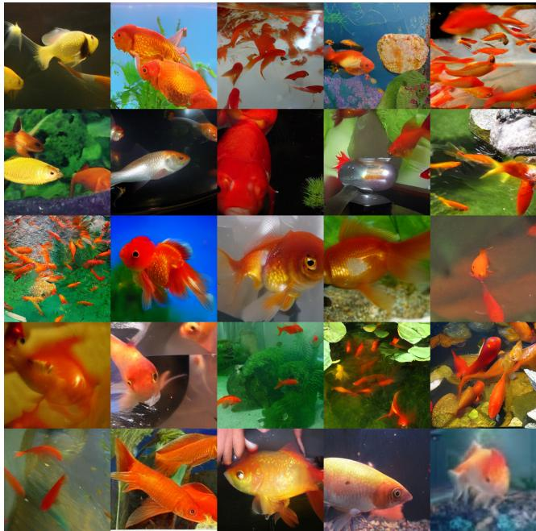  
Figure 5: goldfish, Carassius auratus

## C.3 More Generated Samples

In this section, we present more samples using classifier free guidance. The model is given the same label in the batch size 25. We reshape the output to $[ 5 \times 2 5 6 , 5 \times 2 5 6 ]$ and plot here over different classes:

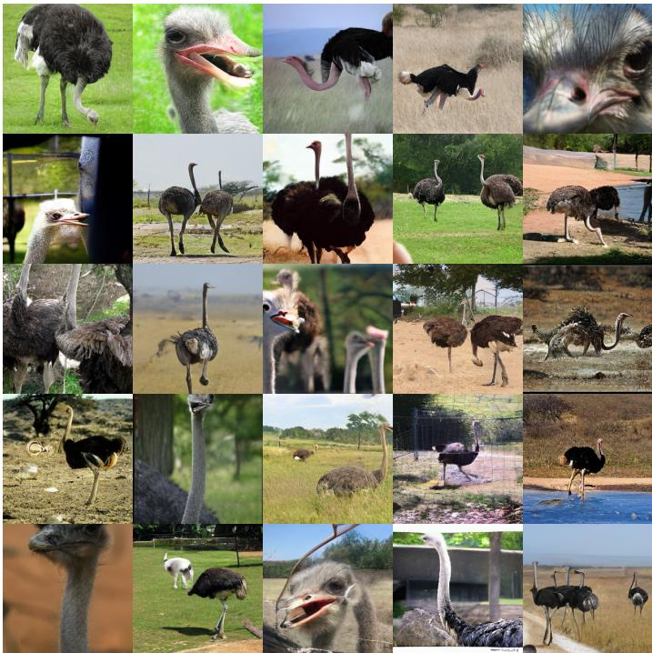  
Figure 6: ostrich, Struthio camelus

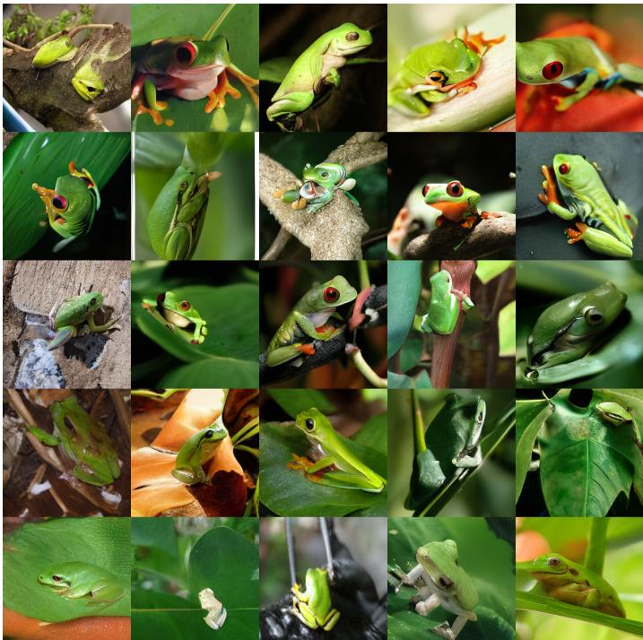  
Figure 7: tree frog, tree-frog

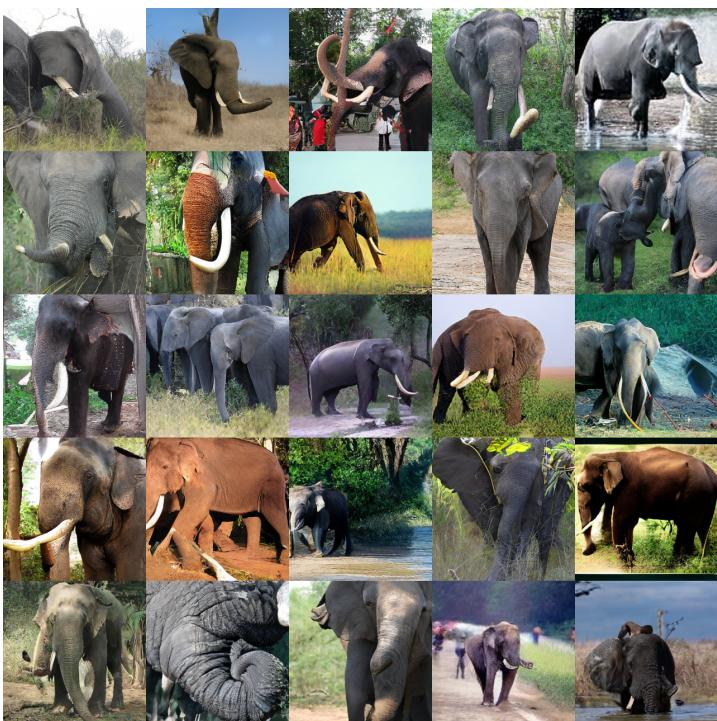  
Figure 8: tusker

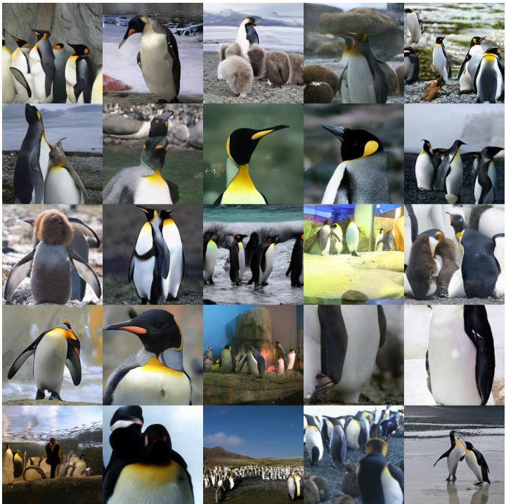  
Figure 9: king penguin, Aptenodytes patagonica

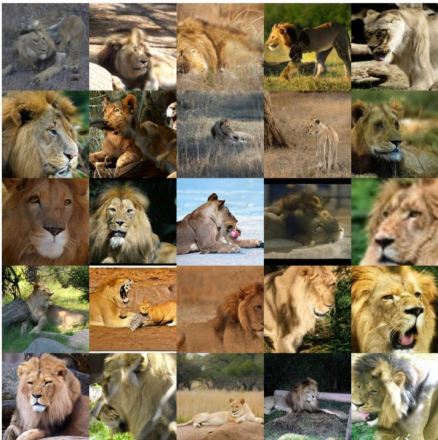  
Figure 10: lion, king of beasts, Panthera leo

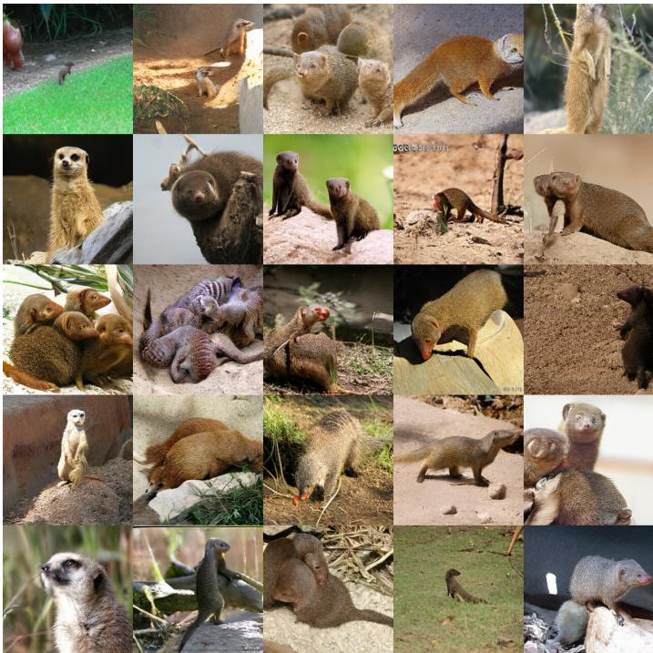  
Figure 11: mongoose

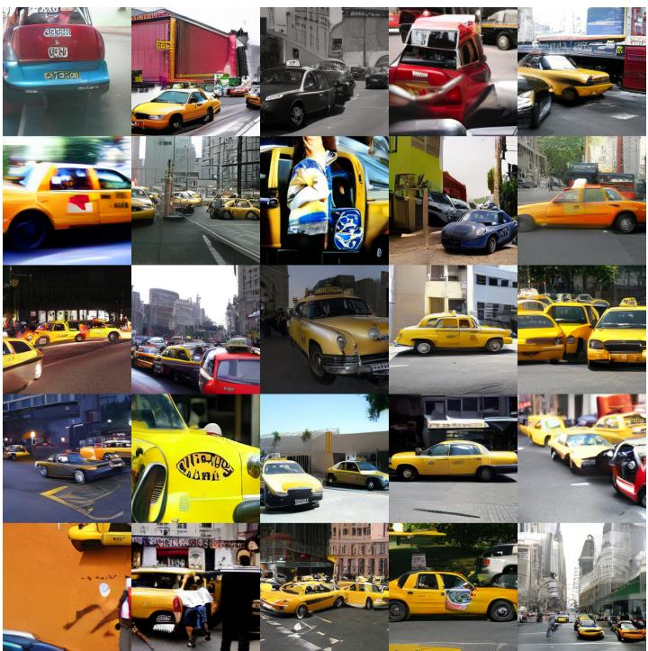  
Figure 12: cab, hack, taxi, taxicab

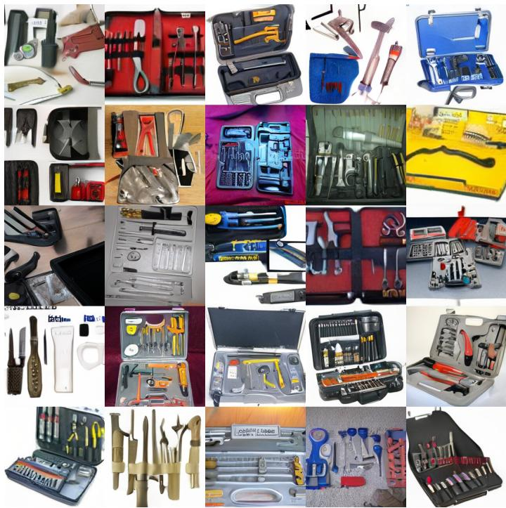  
Figure 13: carpenter’s kit, tool kit

## D Material Tokenization

We follow [63] for the data processing, model design and training for crystalline material tokenization using atom only features without using atom neighbor information. Each material is represented by its minimum repeating unit, containing the lattice information as 3 lattice base vectors $L \doteq [ l _ { 1 } , l _ { 2 } , l _ { 3 } ]$ and a set of atoms within, represented using a one-hot atom type A and continuous 3D coordinate $X = [ x , y , z ]$ in the fractional coordinate. Following Mattergen [64], a normalized rotational invariant representation $\tilde { L }$ is used, where $W$ and $V$ are the left and right singular vectors of $\scriptstyle L ,$ respectively, and Σ is the diagonal matrix of singular values.

$$
\begin{array} { l } { \displaystyle { \pmb { L } = \pmb { U } \tilde { \pmb { L } } , \pmb { U } = \pmb { W } \pmb { V } ^ { \top } , \tilde { \pmb { L } } = \pmb { V } \pmb { \Sigma } \pmb { V } ^ { \top } , } } \\ { \displaystyle { \tilde { \pmb { L } } = \frac { \tilde { \pmb { L } } } { \sqrt [ 3 ] { N _ { a t o m } } } . } } \end{array}
$$

We used a transformer-based encoder-decoder architecture, where the encoder contains 6 and decoder contains 2 transformer blocks. The hidden dimension is 512 and each transformer block uses 8 attention heads. We set the starting epoch W to 500, and update the codebook at every $\mathbf { M } = 5$ epochs. The model is trained using Adam optimizer, with constant learning rate $1 e - 4$ and batch size 128. The codebook size $\mathbf { K } = 8 \bar { 1 } 9 2$ and vector size $\mathrm { d } = 8$ . The loss function is defined as follows where $\mathcal { L } _ { \mathrm { c o d e b o o k } }$ is enabled only when online correction is used, and $\alpha = 0 . 0 1$ is chosen for both ${ \mathsf { V Q - V A E } }$ and FlowVQ to keep all loss terms on comparable scales:

$$
\mathcal { L } ( \theta , \gamma ) = \mathcal { L } _ { \mathrm { r e c o n } } + \mathcal { L } _ { \mathrm { F M } } + \alpha ( \mathcal { L } _ { \mathrm { c o d e b o o k } } + \beta \mathcal { L } _ { \mathrm { c o m m i t m e n t } } )
$$

For baseline models, we performed k-means clustering on the training data latent vectors of the autoencoder at epoch W using FAISS [65]1, and used the resulting cluster centroids to initialize VQ-VAE and $\mathrm { O p t - V Q }$ codebook vectors. To ensure consistency with the initial latent space, and fair comparison from the same starting point, we also initialized the encoder and decoder weights using those of the autoencoder. For LFQ, we used the implementation from vector-quantize-pytorch library2.

## E Action Tokenization

The action tokenization is evaluated on the DROID dataset [55], which contains 76k successful demonstration trajectories. We split the original trajectories into 80% train, 10% validation and 10% test set, then further processed them into non-overlapping chunks of 50 steps. The codebook size K is set to 2048 for fair comparison with existing tokenizers, and vector size ${ \mathrm { d } } = 8$ . The codebook construction starts at step $\dot { W } = 1 0 0 0 ^ { t h }$ , and is update at every $2 5 0 ^ { t h }$ steps using batch size 512. The model contains 8 transformer blocks for both encoder and decoder, using 8 attention heads and hidden dimension as 512. Similarly, we train the model using a constant learning rate $1 e ^ { - 4 }$ and Adam optimizer.

For the baseline FAST+ tokenizer, we use the weight downloaded from its original HuggingFace repository3.