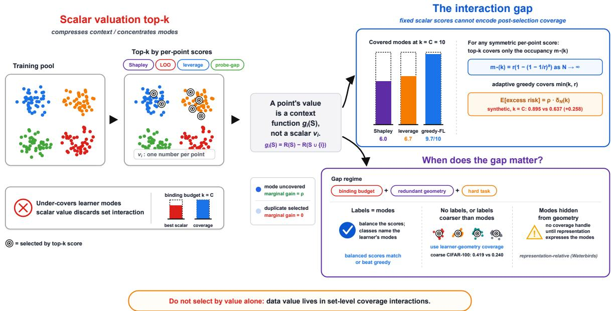
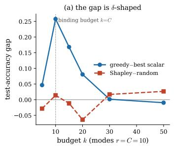
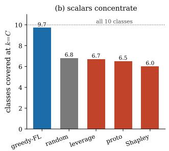
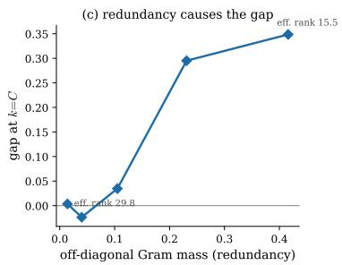
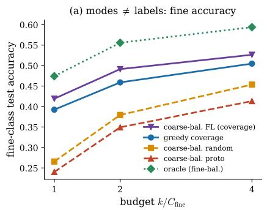
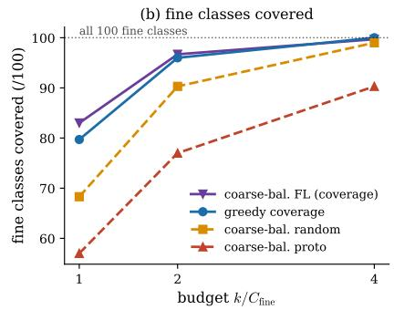
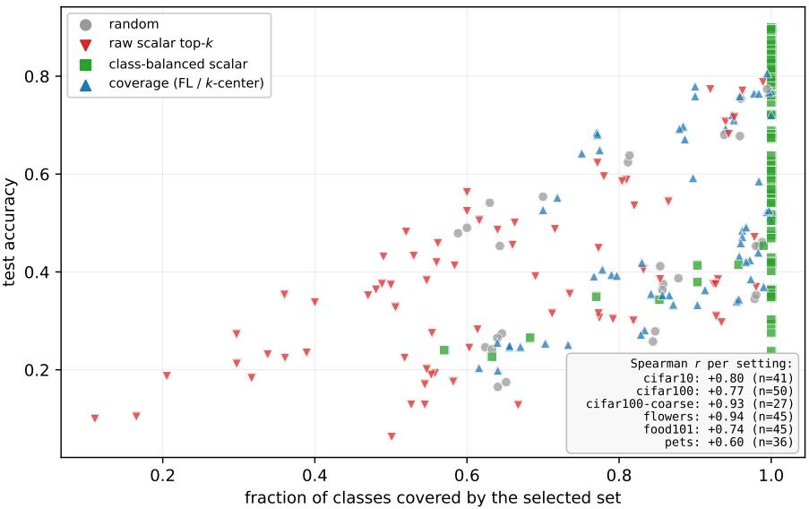

# When Does Data Value Reduce to Class Balance? A Coverage View of Per-Point Data Valuation

Yingjie Bai

ybai0439@uni.sydney.edu.au

School of Computer Science, The University of Sydney

Weiming Zhi

weiming.zhi@sydney.edu.au

School of Computer Science, The University of Sydney

Reviewed on OpenReview: https: //openreview. net/forum?id=AZExWUZRPd

## Abstract

Per-point data-valuation scores — Data Shapley, influence, leverage — are routinely used to select training data: keep the points with the top k scores. We argue that top-k by a fixed, mode-blind per-point score is the wrong selection rule precisely in the regime where data selection matters. The reason is that a point’s value is not a fixed number but depends on what else has been selected — a near-duplicate of an already-chosen point adds almost nothing, however high its score — and a per-point scalar cannot express this interaction.

The theory quantifies this failure exactly: in an equal latent-mode model, fixed top-k selection incurs a closed-form excess risk over adaptive coverage because it repeatedly spends budget on already-covered modes. The gap is largest when the budget is tight, the learner representation is redundant, and missing a mode is costly.

The practical rule is simple: use balance when the labels available at selection identify the learner’s modes, and use explicit coverage when they do not. On standard classification tasks with strong pretrained features, class-balancing the same per-point scores recovers the missing coverage and matches or outperforms generic set coverage across our datasets. Without labels, label-free coverage improves accuracy by up to +0.20 while raw top-k can fall below random; when labels are coarser than the modes, coverage within coarse strata performs best. We turn this distinction into a pre-specified diagnostic and validate it across both favorable and stress-test settings.

The limits are part of the claim: the advantage is representation-relative. Coverage fails when the relevant modes are not expressed in the learner geometry, as with spurious subgroups, or when data quality varies independently of coverage — exactly as the theory predicts.

Code: https://github.com/Benjy-byj/Data-Value-Class-Balance

## 1 Introduction

Data valuation assigns each training point a scalar worth, and these scalars are widely used to select data: keep the top-k most valuable points to train cheaply, or to curate a fine-tuning set. Data Shapley (Ghorbani & Zou, 2019), leave-one-out and influence (Koh & Liang, 2017), datamodels (Ilyas et al., 2022), and leverage scores all produce such per-point numbers. We ask whether top-k-by-score is a good selection rule. The answer is no, precisely in the regime where data selection helps: under a binding budget, a redundant representation, and a non-interpolable task, it is provably suboptimal in a latent-mode model. Worse, “improving” the per-point score can hurt selection when the sharper score concentrates the selected set (Figure 1 previews the argument).

  
Figure 1: Data value is a context function, and a fixed scalar top-k pays an exact coverage price. Left: per-point valuation (Shapley, LOO/influence, leverage, probe-gap) compresses each training point to one number $v _ { i }$ , and its top-k concentrates on a few modes of the pool (circled points), under-covering the learner’s modes: the scalar discards the set-level interaction. Middle: a point’s value is the context function $g _ { i } ( S ) = \mathrm { R } ( S ) - \mathrm { R } ( S \cup \{ i \} )$ equal to ρ while the point’s mode is uncovered, 0 once a same-mode duplicate is selected. Top right: the exact result — for any symmetric per-point score, top-k covers only the occupancy m (k) $( r ( 1 - ( 1 - 1 / r ) ^ { k } )$ as $N \to \infty )$ versus adaptive greedy’s min $( k , r )$ , giving E[excess risk] $\mathbf { \xi } = \rho \delta _ { N } ( k )$ (a lower bound for non-coordinated scores, Definition 1); empirically, at $k = C = 1 0$ Shapley covers 6.0 and leverage 6.7 of 10 modes versus greedy’s 9.7, and the synthetic binding-budget gap is 0.895 vs 0.637 (+0.258). Bottom right: the gap matters under a binding budget, a redundant learner geometry, and a hard task, and the correction is the modes-vs-labels boundary: balance the same scores when the labels name the learner’s modes; use learner-geometry coverage when labels are missing or coarser than the modes (coarse-label CIFAR-100: coverage within coarse strata 0.419 vs. coarse-balanced prototypicality 0.240 fine accuracy); and expect no coverage handle when the representation does not express the modes (Waterbirds).

The reason is structural. The value of a point is not a number but a function of the context of other selected points: a point that is the only representative of a concept is valuable; once a near-duplicate is selected, its marginal value collapses. A scalar summary discards exactly the information a selector needs: which points are jointly non-redundant. (Shapley averages the context function over contexts; influence evaluates it at full data.) We make this precise, prove a lower bound on the resulting selection gap, identify its source as the of-diagonal mass of the learner-geometry Gram, and verify it.

## Contributions.

• Value is a context function (§2). A closed form $g _ { i } ( S )$ for kernel learners; the interaction is the of-diagonal (redundant) Gram mass, and a fixed, mode-blind top-k under-covers the modes relative to greedy coverage.

• An impossibility (§3). In an equal latent-mode instance, a symmetric valuation selected topk has expected excess risk exactly $\rho \delta _ { N } ( k )$ over greedy coverage, and at least this much for any non-coordinated randomized score (Definition $1 ;$ marginal within-mode symmetry alone is provably insuficient, Remark 1). The positivity range and boundary cases are characterized exactly. LOO ≡ 0, Shapley is mode-constant, and a spiked-covariance analysis gives the soft-mode extension.

• The modes-vs-labels boundary (§4). Across synthetic and real ViT experiments we show that the relevant question is not whether a scalar score is accurate pointwise, but whether the groups available at selection name the learner’s modes. When modes coincide with labels, a one-line class balance of the same scores recovers the missing coverage and can outperform label-free coverage. When labels are unavailable or coarser than the modes, scalar balancing is insuficient and an explicit learner-geometry coverage or diversity correction is needed. We also delimit the claim: coverage helps only when the target modes are expressed in the learner geometry, and it can fail when the representation hides the relevant subgroups.

The practical output of the paper is a one-line rule: if the labels available at selection name the learner’s modes, balance within labels; otherwise add an explicit learner-geometry coverage correction. When the modes are not expressed in the representation at all, expect neither to help. §4.4 turns this rule into a decision procedure (Algorithm 1) and validates it, including its failure modes.

Roadmap. §2 sets up the one object everything else uses: a point’s value as a context function, with a closed form for kernel learners and the exact conditions under which its coverage objective is the supervised risk. §3 proves the main result in a hard latent-mode model (§3.1), states the extensions to general randomized scores and soft modes (§3.2), and collects scope and qualifications (§3.3). §4 organizes the experiments by role: direct validation of the theory (§4.1), the modes-vs-labels boundary on real data (§4.2), the failure modes the theory predicts (§4.3), the diagnostic (§4.4), and robustness (§4.5).

## 2 Value is a context function

What this section establishes. Everything in the paper rests on one reframing: a training point’s value is not a scalar but a function of the already-selected set. This section defines that context function and gives it a closed form for kernel learners (Eq. 1). It then states precisely when the coverage objective it induces is the supervised risk, and when it is only a proxy (Proposition 1). Finally, it identifies the two mechanisms by which redundancy makes value context-dependent (Theorem 1, Proposition 2) — the information a fixed scalar must discard. A closing paragraph fixes the terminology (modes, classes, clusters) used throughout.

A learner has risk $\operatorname { R } ( S ) = \mathbb { E } _ { x \sim D } ( f _ { S } ( x ) - f ^ { \star } ( x ) ) ^ { 2 }$ for a selected set $S \subseteq P , | P | = N$ . The marginal value of point i in context S is $g _ { i } ( S ) = \mathrm { R } ( S ) - \mathrm { R } ( S \cup \{ i \} ) \geq 0$ (monotone R). Scalar valuations collapse this function to a number: leave-one-out / influence $v _ { i } ^ { \mathrm { L O O } } = g _ { i } ( P \setminus \{ i \} )$ ; Data Shapley $v _ { i } ^ { \mathrm { S h } } = \mathbb { E } _ { \pi } g _ { i } ( S _ { < i } ^ { \pi } )$ ; leverage and probe-gap are geometry- or label-derived per-point scores. The interaction is $\mathrm { I n t } _ { i } = \mathrm { m a x } _ { S } g _ { i } ( S ) - \mathrm { m i n } _ { S } g _ { i } ( S )$

Linear-algebra form. For a kernel/linear learner and point selection, the covered target is the feature second moment $\Sigma = \mathbb { E } _ { x } [ \varphi \varphi ^ { \top } ] \colon \mathrm { R } ( S ) = \mathrm { t r } { \big ( } ( I - P _ { S } ) \Sigma { \big ) }$ , with $P _ { S }$ the projector onto span $\{ \varphi _ { i } : i \in S \}$ . The marginal is the Σ-novelty of the point’s feature after orthogonalizing against S (Gram–Schmidt / partial correlation):

$$
g _ { i } ( S ) = \frac { \langle \varphi _ { i } ^ { \perp ( S ) } , \Sigma \varphi _ { i } ^ { \perp ( S ) } \rangle } { \| \varphi _ { i } ^ { \perp ( S ) } \| ^ { 2 } } , \qquad \varphi _ { i } ^ { \perp ( S ) } = ( I - P _ { S } ) \varphi _ { i } .\tag{1}
$$

What R(S) is, and when it is the supervised risk. As written, $\mathrm { R } ( S ) = \mathrm { t r } ( ( I - P _ { S } ) \Sigma )$ is a representationcoverage objective: it measures the feature second-moment mass not reconstructed by the span of the selected points. It is not automatically the supervised risk for an arbitrary target. The connection requires a mode-aligned target assumption: the target variation is supported on learner-mode directions (equivalently, in the latent-mode instance the label is a function of mode identity and an uncovered mode incurs a positive cost). The next proposition makes the connection exact rather than heuristic.

Proposition 1 (mode-aligned targets: coverage risk is the supervised excess risk). In the spiked-covariance model $\begin{array} { r } { o f \ \xi \mathcal { S } ( \varphi _ { i } \overset { \cdot } { = } u _ { j ( i ) } + \eta \xi _ { i } , \ \Sigma ) = \sum _ { j } \pi _ { j } u _ { j } \overset { \cdot } { u _ { j } ^ { \intercal } } + \eta ^ { 2 } P _ { \perp } ) } \end{array}$ , let the target be mode-aligned, $\bar { f } ^ { \star } ( x ) = \theta _ { \star } ^ { \top } \varphi ( x )$ with $\begin{array} { r } { \theta _ { \star } = \sum _ { j } \beta _ { j } u _ { j } } \end{array}$ , and let $\hat { f } _ { S }$ be the best predictor whose coeficient vector lies in span $\{ \varphi _ { i } : i \in S \}$ (any kernel/ridge learner trained on S is of this form). Then

$$
\mathbb { E } \big ( \hat { f } _ { S } - f ^ { \star } \big ) ^ { 2 } \ : = \ : \sum _ { j : S \cap P _ { j } = \emptyset } \beta _ { j } ^ { 2 } \pi _ { j } \ : + \ : O ( \eta ^ { 4 } ) ,
$$

i.e. the supervised excess risk equals the coverage risk $\mathrm { R } ( S )$ of the latent-mode model with per-mode costs $\rho _ { j } = \beta _ { j } ^ { 2 } \pi _ { j }$ , exactly at $\eta = 0$ and to leading order for small η. For classification with labels constant on modes and an argmax readout, the same coverage structure holds with $\rho _ { j }$ the mode’s probability mass times its chance-level error: an uncovered mode is predicted at chance. (Proof: App. A.)

Under mode-aligned targets, then, optimizing coverage is optimizing supervised risk; without the assumption, $\mathrm { R } ( S )$ should be read as a coverage proxy. App. I.2 tests the assumption directly on real features: between 46% and 74% of the learner’s target variance is constant within label-free geometry modes, so the squared-loss equality is a hard-mode limit that real geometry attenuates, while the classification clause holds — the trained learner is correct on only 0–5% of the test points of uncovered classes. Three objects should not be conflated: (i) the generic supervised risk of the opening definition, about which we prove nothing in general; (ii) the representation-coverage objective $\mathrm { t r } ( ( I - P _ { S } ) \Sigma )$ , which the closed form (1) and the greedy analysis concern; and (iii) the hard latent-mode risk of $\ S 3 .$ , where (ii) reduces to counting covered modes. The exact theory establishes (iii) and extends to soft modes asymptotically. It connects to (i) only through the mode-aligned-target assumption of Proposition 1: we do not claim that arbitrary supervised selection utility reduces to geometric coverage, and Waterbirds is the standing counterexample. The experiments of §4 then test the proxy’s empirical reach: coverage of learner-geometry modes tracks downstream accuracy across the selectors, budgets, and datasets of the main experiments (§4.5), including for an SGD-trained classifier.

Theorem 1 (no-interaction geometry and redundancy). If the feature vectors are mutually orthogonal $( \varphi _ { i } \perp \varphi _ { j } \ f o r \ i \ne j )$ , then $g _ { i } ( S )$ is independent of any context S not already containing i: selecting other points never changes the residual $o f \varphi _ { i }$ , so there is no selection interaction. Conversely, when the learner geometry contains redundant directions, orthogonalizing against previously selected neighbors can change a point’s marginal in two distinct ways. (i) Rank collapse: the residual may fall to zero once a redundant neighbor is selected, so $g _ { i }$ collapses to $0 \ : -$ an all-or-nothing interaction. (ii) Directional rotation: among contexts where the residual stays nonzero, its direction may rotate, and if Σ is anisotropic on those directions the Rayleigh quotient in (1) changes. The hard latent-mode model below realizes mechanism (i) exactly, while the soft-mode and general-spectrum settings combine both. Both are carried by the of-diagonal / block mass of the learner-geometry Gram $G = \Phi \Phi ^ { \top }$

Proposition 2 (interaction has two sources). Let $\varphi _ { i } ^ { \perp ( S ) }$ be the residual of $\varphi _ { i }$ after projecting away span $\{ \varphi _ { j }$ $j \in S \}$ . Interaction decomposes into two terms. (i) Directional. Over contexts $S , S ^ { \prime }$ with $\varphi _ { i } ^ { \perp ( S ) } \neq 0$ and $\varphi _ { i } ^ { \perp ( S ^ { \prime } ) } \neq 0$ , write $w _ { i } ( S ) = \varphi _ { i } ^ { \perp ( S ) } / \lVert \varphi _ { i } ^ { \perp ( S ) } \rVert$ and let $D _ { i } = \operatorname* { s u p } \| w _ { i } ( S ) - w _ { i } ( S ^ { \prime } ) \|$ over such contexts be the diameter of the set of residual directions. Then

$$
\operatorname* { s u p } _ { S , S ^ { \prime } : \varphi _ { i } ^ { \perp } \neq 0 } | g _ { i } ( S ) - g _ { i } ( S ^ { \prime } ) | \ \leq \ \left( \lambda _ { \operatorname* { m a x } } ( \Sigma ) - \lambda _ { \operatorname* { m i n } } ( \Sigma ) \right) D _ { i } .
$$

$D _ { i }$ measures the amount of nonzero residual-direction variation induced $b y$ redundancy; directional interaction requires $D _ { i } > 0$ and anisotropy of $\Sigma \ ( \lambda _ { \mathrm { m a x } } > \lambda _ { \mathrm { m i n } } )$ . Exact-duplicate or same-mode redundancy instead appears through the separate rank-collapse term below. (ii) Rank collapse. If some context $S _ { 0 }$ has $\varphi _ { i } ^ { \perp ( S _ { 0 } ) } = 0$ (point i lies in the selected span), then $g _ { i } ( S _ { 0 } ) = 0 ;$ this all-or-nothing term can be nonzero even when Σ is isotropic, and it is exactly the latent-mode mechanism (once a same-mode point is selected, another point’s residual collapses).

Proof. (i) $g _ { i } ( S ) = R ( w _ { i } ( S ) )$ with $R ( w ) = w ^ { \top } \Sigma w$ . For any unit $w , w ^ { \prime } ,$ , in the eigenbasis of Σ, $R ( w ) - R ( w ^ { \prime } ) =$ $\begin{array} { r } { \sum _ { k } ( \lambda _ { k } - c ) ( w _ { k } ^ { 2 } - w _ { k } ^ { \prime 2 } ) } \end{array}$ for any c; with $\begin{array} { r } { c = \frac { 1 } { 2 } ( \lambda _ { \operatorname* { m a x } } + \lambda _ { \operatorname* { m i n } } ) } \end{array}$ and Cauchy–Schwarz, $| R ( w ) - R ( w ^ { \prime } ) | \leq ( \lambda _ { \operatorname* { m a x } } -$ $\lambda _ { \operatorname* { m i n } } ^ { } ) \lVert w - w ^ { \prime } \rVert \leq ( \lambda _ { \operatorname* { m a x } } - \lambda _ { \operatorname* { m i n } } ) D _ { i \cdot } \mathrm { ~ ( i i ) ~ }$ Since $\varphi _ { i }$ lies in span(S0), adding i does not change the selected span, so $\mathrm { R } ( S _ { 0 } \cup \{ i \} ) = \mathrm { R } ( S _ { 0 } )$ and hence $g _ { i } ( S _ { 0 } ) = \mathrm { R } ( S _ { 0 } ) - \mathrm { R } ( S _ { 0 } \cup \{ i \} ) = 0 .$ □

This separates two mechanisms a single of-diagonal summary would conflate. Directional interaction is the classical marginal-screening-versus-forward-selection efect under collinearity: orthogonalization rotates the residual and anisotropy of Σ moves its Rayleigh quotient. Rank-collapse interaction is stronger: a duplicate or same-mode neighbor makes the residual vanish, collapsing the marginal to zero. The latent-mode theorem below uses the all-or-nothing mechanism; the soft-mode extension makes the collapse approximate.

Equivalently: scalar valuation is marginal (univariate) screening; the optimal context-aware selector is forward selection / greedy coverage (which orthogonalizes); their gap is the redundancy that orthogonalization removes. This is the classical failure of marginal screening under collinearity, here applied to data valuation. The of-diagonal Gram is a contribution covariance: the selection interaction lives in shared directions, not in per-point diagonals alone.

Terminology (modes vs. classes vs. clusters). A mode is a group of points that the learner must cover to generalize — a block of interchangeable features in the learner geometry (a block of the Gram). Classes are the labels available at selection; clusters are geometric groups in the representation. Our results turn on whether these coincide: when the modes are the classes, balancing labels sufices; when they are finer geometric clusters (or unlabeled), coverage is needed. Throughout, r is the number of modes, m the per-mode size, k the budget, and C the number of labels.

## 3 The interaction gap

What this section establishes. The main result (§3.1): in a hard latent-mode model, any fixed, symmetric per-point ranking used as top-k pays an exact, computable excess-risk price $\rho \delta _ { N } ( k )$ relative to adaptive greedy coverage. Corollary 2 characterizes exactly when this price is large. Extensions to general randomized scores and to soft modes are isolated in §3.2; what the result does not say — unequal modes, partially-aligned selectors, and the precise procedure being critiqued — is collected in §3.3. Readers who want the argument’s spine can read §3.1 alone.

## 3.1 The hard latent-mode model and the exact gap

Latent-mode instance. Let the pool be $\textstyle P = \bigcup _ { j = 1 } ^ { r } P _ { j }$ with r modes of size $m = N / r$ . A non-degenerate (block) learner geometry makes covering ≥ 1 point of mode j drive its residual to 0; an uncovered mode costs $\rho _ { j } > 0$ (the task is non-interpolable across modes). Then $\begin{array} { r } { \mathrm { R } ( S ) = \sum _ { j : S \cap P _ { j } = \emptyset } \rho _ { j } } \end{array}$

Assumptions, stated explicitly, and their realism. The hard instance makes four idealizations. We state each one, together with where it is relaxed. (A1) Rank-collapse coverage: one representative drives its whole mode’s residual to zero. This is the $\eta  0$ limit of the soft-mode model (§3.2, App. E), where a representative captures the mode direction only up to $O ( \eta ^ { 2 } )$ . The noise sweep (Table 2) shows the empirical gap degrading continuously as the collapse becomes approximate. The same dial, turned on real ViT features (shrinking within-class variance toward the block limit, or adding noise toward the difuse one), raises the real-data gap with block contrast through the datasets’ operating point (Table 16; monotonically on Flowers-102, with one small local dip on CIFAR-100): the hard model is the endpoint of a continuum the real data sits on, not a disconnected idealization. (A2) Block exchangeability: within-mode points are indistinguishable to the learner geometry and the valuation functional. Exact in the population model; on finite noisy features it holds only in distribution, which is why Theorem 2 uses uniform tie-breaking and Proposition 3 requires non-coordination within modes (Definition 1). (A3) Equal sizes and costs: used for the exact equality and for the unconditional lower bound; Remark 2 shows the bound can reverse for unequal sizes, so we do not claim it beyond the equal case. $( A \ 4 )$ Mode-aligned target: the label varies across modes, not within (Proposition 1); this is what licenses reading R(S) as supervised risk, and Waterbirds (§4.3) is the deliberate failure case. None of A1–A4 is claimed to hold literally on real data. The model isolates a mechanism — fixed mode-blind rankings under-cover redundant geometry — and the experiments then test that mechanism where the assumptions hold only approximately (pretrained ViT Grams have within-class block structure; of-diagonal mass 0.37–0.39, Table 8) and where they fail (Waterbirds, the corrupted-pool quality experiment).

Lemma 1 (all-or-nothing marginal). For $i \in P _ { j } , g _ { i } ( S ) = \rho _ { j } \mathbf { 1 } [ S \cap P _ { j } = \emptyset ] \in \{ 0 , \rho _ { j } \}$ , so ${ \mathrm { I n t } } _ { i } = \rho _ { j }$ . Any scalar $v _ { i } \in [ 0 , \rho _ { j } ]$ disagrees with the true marginal on an Ω(1) fraction of contexts.

Lemma 2 (exchangeability collapses scores). In the block-exchangeable instance — where points within a mode are indistinguishable to the learner geometry and the valuation functional (the population / hard-block model, or finite samples with identical within-mode features) — any symmetric valuation is mode-constant: $v _ { i } = c _ { j } \ f o r \ i \in P _ { j }$ . (On finite noisy data the within-mode scores are only equal in distribution; the occupancy bound then requires more than marginal symmetry — the precise suficient condition is non-coordination within modes, Definition 1, and Remark 1 shows some such condition is necessary.)

The two canonical scalars, exactly. LOO/influence: at full data every mode is covered, and removing one point of a mode with m $\geq 2$ leaves it covered, so $v _ { i } ^ { \mathrm { L O O } } = 0$ for every point — influence is identically zero in the redundant regime. Shapley: $v _ { i } ^ { \mathrm { S h } } = \rho _ { j }$ Pr[i first of its mode in $\pi ] = \rho _ { j } / m _ { j } ,$ , constant over points for equal modes. Both are mode-blind in the sense of Lemma 2. (Numerically confirmed: $\mathrm { L O O } \equiv 0 ;$ Shapley $= \rho / m$ to three digits.)

Theorem 2 (interaction gap, exact for symmetric valuations). Take equal modes $( m _ { j } \equiv m , N = r m ) _ { \ l }$ , equal costs $\rho ,$ and any budget $1 \leq k \leq N$ , with ties in the score broken uniformly at random. Because the modes are statistically identical, a data-dependent symmetric valuation (the population / block-exchangeable versions of leave-one-out, Data Shapley, and leverage- or probe-gap-type scores) is constant not only within each mode (Lemma 2) but across modes, hence constant on the whole pool; its top-k set is then a uniformly random k-subset of P. (On finite noisy data these scores are constant only in distribution; Proposition 3 covers exactly the non-coordinated case, Definition $^ { 1 , }$ and Remark 1 delimits why some such condition is needed.) It therefore covers exactly the occupancy number of modes,

$$
\begin{array} { r } { \mathbb { E } [ \# c o v e r e d ] = m _ { \star } ( k ) = r \Big ( 1 - \binom { ( r - 1 ) m } { k } \Big / \binom { r m } { k } \Big ) \xrightarrow [ N \to \infty ] { } r \big ( 1 - ( 1 - \frac { 1 } { r } ) ^ { k } \big ) , } \end{array}
$$

while greedy coverage $S _ { \mathrm { F L } }$ covers min $\mathsf { \Omega } _ { 1 } ( k , r )$ modes — exactly optimal in this instance, a fortiori $( 1 - 1 / e )$ optimal (Nemhauser et al., 1978). Hence, with $\operatorname { R } ( S ) = \rho \left( r - { \# } c o v e r e d \right)$ ，

$$
\begin{array} { r } { \mathbb { E } [ \mathrm { R } ( S _ { v } ) ] - \mathrm { R } ( S _ { \mathrm { F L } } ) = \rho \delta _ { N } ( k ) , \qquad \delta _ { N } ( k ) = \operatorname* { m i n } ( k , r ) - m _ { \star } ( k ) \ \geq 0 , } \end{array}
$$

with strict positivity exactly on $2 \leq k \leq N - m$ when $m \geq 2 { : }$ at $k = 1$ a single uniform draw always covers a fresh mode, so $\delta _ { N } ( 1 ) = 0$ and top-k is optimal; for $k > N - m$ every k-subset covers all modes and the gap again vanishes; and $i f m = 1$ there is no redundancy and $\delta _ { N } \equiv 0$ — redundancy $( m \ge 2 )$ is what creates the gap. As $N \to \infty$ with $k , r$ fixed, $\delta _ { N } ( k )  \delta ( k ) = \operatorname* { m i n } ( k , r ) - r \big ( 1 - ( 1 - 1 / r ) ^ { k } \big )$ ; we use the finite-pool $\delta _ { N }$ in statements and the closed-form limit δ in prose.

Proof. Equal modes are exchangeable, so a symmetric functional of the data assigns them equal values; with within-mode constancy (Lemma 2) the score is constant on $P ,$ , and uniform tie-breaking makes $S _ { v }$ a uniform k-subset. A fixed mode is missed if none of its m points is drawn, probability $\binom { ( r - 1 ) m } { k } / \binom { r m } { k }$ ; summing the complement over r modes gives $\mathbb { E } [ \# \mathrm { c o v e r e d } ] = m _ { \star } ( k )$ . Greedy gains a fresh mode each step while an uncovered mode remains (a covered mode has zero marginal, Lemma 1), so it covers min $( k , r )$ . Subtract. For the positivity range: $m _ { \star } ( 1 ) = 1$ (one draw, one mode); for $2 \leq k \leq \operatorname* { m i n } ( r , N - m )$ the first draw covers a fresh mode and each later draw repeats an already-hit mode with positive probability (possible since $m \geq 2 )$ so $m _ { \star } ( k ) < k ;$ for $r < k \le N - m$ a fixed mode is missed with positive probability, so $m _ { \star } ( k ) < r ;$ and for $k > N - m$ every mode is hit surely. (Full details, App. D.) □

Two consequences give the theorem its practical reading: making a score better can make selection worse, and the price is large exactly in the regime where data selection is worth doing.

Corollary 1 (improving a valuation need not improve selection). Whether a valuation helps or hurts coverage depends on how its high values are spread across modes. A score that concentrates — high values on many points of a few dense, typical modes — covers fewer than the uniform baseline and can fall below random at a binding budget; empirically the estimated Data Shapley and prototypicality do exactly this (their high scores cluster on typical points) and both dip to or below random near $k = C$ in $\ S 4 .$ The equal-mode symmetric valuation instead ties random exactly (Theorem 2). Either way, a more accurate per-point number does not monotonically improve selection, because coverage is a set-level property the scalar does not control.

Corollary 2 (phase boundary). Two statements, both proved in App. D. (a) Exact positivity range. The gap $\rho \delta _ { N } ( k )$ is nonzero precisely when $\rho > 0$ (hard task), m ≥ 2 (redundant geometry), and $2 \leq k \leq N - m ;$ outside this range a scalar top-k is optimal in the model. (b) Magnitude: when the gap matters. In the large-N limit the gap is δ-shaped in the budget: for $\begin{array} { r } { k \le r , \delta ( k ) \le \binom { k } { 2 } / r , } \end{array}$ so the per-budget regret $\delta ( k ) / k$ is $O ( k / r )$ and vanishes when $k \ll r ;$ at the binding budget $k = \Theta ( r )$ the gap is $\Theta ( r ) - a$ constant fraction of the total risk ρr $( e . g . ~ \delta ( r ) = r / e + O ( 1 ) ) ,$ and for $k \geq r$ it decays as $\delta ( k ) = r ( 1 - 1 / r ) ^ { k } \leq r e ^ { - k / r }$ . Hence the gap is a constant-fraction excess risk if all three conditions hold: (i) a binding budget $( k = \Theta ( r ) ) , ~ ( i i ) ~ a$ hard task $( \rho > 0 )$ , and (iii) a redundant learner geometry $( m \geq 2 ,$ equivalently of-diagonal Gram mass $> 0$ / efective rank ≪ N). Condition (iii) is geometry redundancy, not representation non-locality.

All three claims are confirmed numerically (App. H, Table 22): uniform coverage agrees with the closed-form m⋆(k) within 0.007 modes (Theorem 2), a concentrating score stays below it (Proposition 3), and the unequal-mode reversal of Remark 2 occurs as predicted.

## 3.2 Extensions: general randomized scores and soft modes

What this subsection adds. The theorem covers symmetric scores with uniform tie-breaking. Two extensions matter in practice: scores that are only randomized approximations of a mode-level quantity (the finite-noisydata case), and modes that are only approximately redundant. Both are stated here, separated from the main result; neither changes its message.

Definition 1 (non-coordinated scores). A (possibly randomized) score is non-coordinated within modes if it decomposes as $v _ { i } = c _ { j ( i ) } + \varepsilon _ { i } .$ , where $\big ( c _ { 1 } , \ldots , c _ { r } \big )$ is any random mode-level vector (it may depend arbitrarily on the data) and, conditionally on $\left( c _ { j } \right)$ and the mode partition, the within-mode perturbations $\left( \varepsilon _ { i } \right)$ are i.i.d. across the points of each mode and independent across modes (atomless, so ties have probability zero; a deterministic mode-constant score with uniform tie-breaking is the special case of i.i.d. uniform ε).

Proposition 3 (general lower bound, equal modes, non-coordinated scores). For equal-size modes $( m \ge 2 )$ any score that is non-coordinated within modes (Definition 1) used as top-k covers at most the occupancy, $\mathbb { E } [ \# c o v e r e d ] \leq m _ { \star } ( k )$ , so $\begin{array} { r } { \mathbb { E } [ \mathrm { R } ( S _ { v } ) ] - \mathrm { R } ( S _ { \mathrm { F L } } ) \geq \rho \delta _ { N } ( k ) ; f o r 2 \leq k \leq N - m } \end{array}$ equality holds if the mode-level values are equal (Theorem 2), while at $k = 1$ every selector covers exactly one mode and the bound is trivially tight. A score whose mode-values concentrate the budget on a few modes covers strictly fewer (App. D, by a pooling / Schur-convexity argument that uses the equal mode sizes).

Remark 1 (coordination is exactly what the bound excludes — and exactly set-level information). Some restriction beyond marginal within-mode symmetry is necessary: a randomized score that draws one representative per mode uniformly and assigns it value 1 (all others 0) has within-mode exchangeable marginals — no point is systematically preferred — yet its top-r covers all r modes, beating the occupancy bound. But such a score is jointly coordinated: its within-mode components are anti-correlated in a way that requires knowing the mode partition — which is precisely set-level (mode-coordinating) information. Definition 1 excludes exactly this: a per-point score computed pointwise from the data, with independent per-point noise, cannot coordinate across a mode. The impossibility is therefore sharp about what “per-point” means: to beat occupancy, mode-coordinating structure must enter the scores. That is escape (iii) of the scope discussion below (a mode-aware score is no longer mode-blind), and it is exactly what balancing and coverage corrections supply.

Soft modes / general spectra (asymptotic in η). Replace hard modes by a spiked covariance $\begin{array} { r } { \Sigma = \sum _ { j } \pi _ { j } u _ { j } u _ { j } ^ { \top } + \eta ^ { 2 } P _ { \perp } } \end{array}$ with within-mode noise $\eta ,$ , under the explicit assumptions (S1)–(S3) of App. E (orthonormal spikes; equal masses $\pi _ { j } \equiv \pi = : \rho$ for the equal-mode statement; noise directions $\xi _ { i } \ \mathrm { i . i . d . }$ mean-zero, supported on the spikes’ orthogonal complement, and bounded). Then (App. E) there exist $\eta _ { 0 } > 0$ and $c < \infty ,$ , depending only on the instance parameters, such that for all $\eta \leq \eta _ { 0 }$ every uncovered-mode marginal is $\geq \rho - c \eta ^ { 2 }$ and every covered-mode marginal is $\leq c \eta ^ { 2 }$ , whence $\mathbb { E } [ \mathrm { R } ( S _ { v } ) ] - \mathrm { R } ( S _ { \mathrm { F L } } ) \ \geq \ \rho \delta _ { N } ( k ) - c \eta ^ { 2 } k$ for $2 \leq k \leq N - m -$ positive for small η. We state this as an asymptotic extension and do not optimize the constants (numerically, at our settings, the two marginals are $0 . 1 1 7 \approx \pi$ and 0.004); unequal masses assign unequal efective costs $\rho _ { j } = \pi _ { j }$ and fall under the caveats of Remark 2. The $\pi _ { j }$ are the spike eigenvalues of Σ and $\bar { \eta } ^ { 2 }$ the tail: the gap is large for a peaked spectrum (low efective rank, redundant) and vanishes as the spectrum flattens (high efective rank, near-orthogonal). General Σ reduces to the marginal-screening-vs-OMP gap of sparse approximation, governed by the Gram coherence.

## 3.3 Scope and qualifications

What this subsection delimits. Three boundaries of the result, stated so they are not discovered by surprise: selectors partially aligned with the modes (open), unequal mode sizes (the bound can reverse), and the precise procedure the theorems critique (fixed, mode-blind, non-adaptive rankings — nothing else).

Informally, a selector whose geometry is only partially aligned with the modes should interpolate between greedy coverage (fully aligned) and the mode-blind occupancy baseline; formalizing this interpolation for general representations is left open.

Remark 2 (unequal modes). With unequal sizes the bound can reverse: a score favoring small (rare) modes can cover more than uniform. With r = 10 modes — nine singletons and one mode of 91 points — and k = 9, a score that prefers the singletons covers all nine, beating uniform random. Coverage then depends on whether the score’s high values align with small modes (spreading, helpful) or large ones (concentrating, harmful); only equal modes give the unconditional bound.

Scope: what is and is not critiqued. The result is about a specific procedure: a fixed, mode-blind, non-adaptive per-point ranking used as top-k, with no balancing, grouping, or coverage constraint. Three escapes leave this regime, and the rest of the paper is precisely about them: (i) adaptive recomputation of the marginal after each pick is exactly greedy and covers min(k, r); (ii) a group-aware score (class quotas, subgroup balance) restores coverage when the groups are the modes (§4.2); and (iii) a score that already encodes mode-aware structure is, by definition, no longer mode-blind. What we claim is therefore sharp but bounded: $\delta _ { N } ( k )$ is the exact price of non-adaptivity — the regret of any fixed mode-blind score relative to adaptive coverage — so within this regime the remedy is structural (balance or cover), not a more accurate number. We do not claim that every conceivable scalar fails; we identify the regime in which a naive top-k provably under-covers.

## 4 Experiments

Findings at a glance. Scope of the empirical claims. All real-data experiments select from frozen pretrained representations with probe-family learners (ridge, an SGD-trained MLP, logistic regression, 1-NN), extended by a from-scratch CNN pilot and a LoRA fine-tuning check $\left( \operatorname { A p p . ~ G } \right)$ . The evaluation emphasizes the binding budget $k \approx C$ , where the theory locates the largest gap; full $k = C , 2 C ,$ , 4C sweeps are in App. G (Table 14). The strongest empirical claims should be read within this setting.

The section is organized by the role each experiment plays in the argument: direct tests of the formal results (§4.1), the practical modes-vs-labels claim on real features (§4.2), the failure modes the theory predicts (§4.3), the decision procedure built on them (§4.4), and robustness to the estimator, encoder, modality, and hyperparameters (§4.5). One line per finding:

• Direct validation (§4.1): a symmetric valuation’s top-k agrees with the closed-form $m _ { \star } ( k )$ within 0.007 modes, and every boundary case of the corrected theorem is verified (Table 22). On real pools the same formula predicts random selection’s coverage with zero parameters, and every raw scalar top-k falls below it (Table 17). The theory’s exact selector provably and empirically matches facility location in the block regime and diverges exactly where the lemma’s condition fails (Lemma 4, Tables 1, 10).

• The boundary (§4.2): with labels = modes, class-balancing the same scores matches or beats greedy coverage (Table 3), and KNN-Shapley concentrates like every other scalar (Table 4); with no labels, coverage beats random by +0.08 to +0.20 while raw top-k falls below random (Table 5); with labels coarser than modes, the correction is stratified coverage, not scalar balancing (Table 6).

Table 1: Test accuracy by selector vs. budget $( r = C = 1 0 )$ . Greedy-FL (context-aware coverage) beats every per-point top-k at the binding budget; the gap is δ-shaped (peaks at $k = C ,  0 \mathrm { \ a s \ } k \gg C )$ . Greedy-proj is the theory’s exact selector (greedy trace-reduction / OMP on the feature second moment, Eq. 1); in this near-block regime it matches facility location at binding budgets (0.889 vs 0.895 at $k = C ;$ both cover ≈9.7–9.8 of 10 classes), as Lemma 4 predicts; App. F (Table 10) delimits where the correspondence breaks on real features. Gaps are computed from unrounded means, so they can difer by 0.001 from diferences of the displayed values.
<table><tr><td>k</td><td>random</td><td>LOO</td><td>leverage</td><td>proto</td><td>marginal</td><td>shapley</td><td>greedy-FL</td><td>greedy-proj</td><td>FL-best</td></tr><tr><td>5</td><td>0.419</td><td>0.249</td><td>0.444</td><td>0.417</td><td>0.293</td><td>0.390</td><td>0.490</td><td>0.490</td><td>+0.047</td></tr><tr><td>10</td><td>0.601</td><td>0.263</td><td>0.600</td><td>0.637</td><td>0.417</td><td>0.615</td><td>0.895</td><td>0.889</td><td>+0.258</td></tr><tr><td>15</td><td>0.690</td><td>0.267</td><td>0.741</td><td>0.719</td><td>0.500</td><td>0.678</td><td>0.909</td><td>0.906</td><td>+0.168</td></tr><tr><td>20</td><td>0.821</td><td>0.364</td><td>0.802</td><td>0.847</td><td>0.526</td><td>0.757</td><td>0.928</td><td>0.886</td><td>+0.081</td></tr><tr><td>30</td><td>0.821</td><td>0.343</td><td>0.819</td><td>0.907</td><td>0.612</td><td>0.837</td><td>0.908</td><td>0.862</td><td>+0.001</td></tr><tr><td>50</td><td>0.897</td><td>0.464</td><td>0.894</td><td>0.951</td><td>0.729</td><td>0.924</td><td>0.942</td><td>0.870</td><td>-0.010</td></tr></table>

• Failure modes (§4.3): coverage fails when the representation does not express the modes (Waterbirds) and when quality varies independently of coverage (corrupted pools, Table 7) — both predicted by the theory’s conditions.

• The diagnostic (§4.4): validated on every setting, including an honest near-threshold misroute on coarse labels that the pre-stated ambiguity rule catches, and a subgroup audit row that detects Waterbirds’ hidden modes (Table 8).

• Robustness (§4.5, App. G): the gap persists across probes, an SGD-trained MLP, logistic/1-NN, three encoders, a text corpus, a from-scratch end-to-end pilot, and a LoRA fine-tune of the backbone; coverage tracks accuracy across the 244 pooled pairs of §4.5.

## 4.1 Direct validation of the theory

What this subsection shows. The formal results, tested as literally as possible: the synthetic suite instantiates the latent-mode regime and checks the occupancy predictions, the concentration mechanism, the causal role of redundancy, and the phase boundary. Two further direct checks on real pools — the occupancy formula as a zero-parameter prediction (Table 17) and the blockness dial on real features (Table 16) — appear in App. G.

We instantiate the latent-mode regime synthetically (C=10 classes, 3 input-distant modes each, a nondegenerate embedding; learner = ridge probe). The embedding collapses each class’s three input-space clusters onto a single near-orthogonal class direction, so the learner geometry has $r = C = 1 0$ modes even though the input space has 30 clusters; modes are defined by the learner geometry throughout (§2), which is why the figures state $r = C = 1 0$ . The full suite runs in seconds (numpy). Table 1 is the core result: every per-point scalar, selected top-k, is beaten by greedy coverage at the binding budget $k = C ,$ and the gap is δ-shaped in the budget. LOO is near-useless, and Shapley stays far below the context-aware selector. Figure 2 summarizes the gap, its mechanism, and its cause.

Value is not a scalar. The marginal $g _ { i } ( S )$ over random contexts has spread/|mean| ≈ 1.5 and is bimodal (40% large gain, $5 7 \% \approx 0 )$ — all-or-nothing, as Lemma 1 predicts.

The mechanism, made visible: scalars concentrate. The failure is directly visible in the number of classes covered by the selected set. At the binding budget $k = C = 1 0$ , greedy coverage selects points spanning 9.7 of the 10 classes, whereas every per-point top-k covers far fewer — leverage 6.7, prototypicality 6.5, Data Shapley 6.0. The reason is exactly the concentration in the proof: a per-point score is (near-)constant within a class, so the top-k fills up the highest-scoring class(es) before reaching others, leaving uncovered classes uncovered. The more a score concentrates on a small set of high-scoring classes, the fewer classes it covers the counterintuitive corollary as a picture.

Table 2: Redundancy drives the gap. As noise rises the block-contrast (of-diagonal mass) falls and the efective rank rises; the gap = greedy-FL − leverage-top-k at $k = C$ collapses.
<table><tr><td>noise</td><td>block-contrast</td><td>eff. rank</td><td>gap @ k=C</td></tr><tr><td>0.10</td><td>0.416</td><td>15.5</td><td> $+ 0 . 3 4 9$ </td></tr><tr><td>0.18</td><td>0.231</td><td>22.8</td><td> $+ 0 . 2 9 5$ </td></tr><tr><td>0.30</td><td>0.105</td><td>27.7</td><td> $+ 0 . 0 3 5$ </td></tr><tr><td>0.50</td><td>0.040</td><td>29.4</td><td> $- 0 . 0 2 4$ </td></tr><tr><td>0.80</td><td>0.014</td><td>29.8</td><td> $+ 0 . 0 0 3$ </td></tr></table>

  
Figure 2: The interaction gap, its mechanism, and its cause (synthetic, $r = C = 1 0 )$ . (a) The gap greedy−best-scalar is δ-shaped: it peaks at the binding budget $k = C \ ( + 0 . 2 5 8 )$ and vanishes as $k \gg C ;$ top-k-by-Shapley even falls below random near the binding budget (red). (b) Mechanism: at $k = C$ greedy coverage spans $9 . 7 / 1 0$ classes while every per-point scalar concentrates and covers far fewer (Shapley, the most mode-informative, covers fewest, 6.0). (c) Cause: sweeping embedding noise, the $k = C$ gap grows with the of-diagonal Gram mass (redundancy) and collapses to ≈0 as the efective rank rises from 15.5 to 29.8 — a controlled causal law, not a cross-task correlation.

Redundancy causes the gap (causal). Sweeping the embedding noise to tune redundancy, the gap at $k = C$ falls with the of-diagonal / block structure (Table 2): as the efective rank rises from 15.5 to 29.8 the gap collapses from +0.35 to within 0.025 of zero (−0.024 and +0.003 at the two most difuse settings). This is a controlled causal law, not a cross-task correlation.

Phase boundary. Crossing the three conditions of Corollary 2, the gap appears only under binding budget ∧ hard task ∧ redundant geometry, where it is largest (+0.278). Difuse or loose-budget cells collapse $\tan \leq 0 ;$ the redundant easy/tight cell leaves only a smaller finite-probe residual. Representation locality is not a condition (that distinguishes this from the selection-geometry advantage it generalizes).

## 4.2 The modes-vs-labels boundary (real ViT-B/16 features)

What this subsection shows. The theory says the fix for scalar concentration is structural; which structure depends on whether the labels available at selection name the learner’s modes. We instantiate all three cases on frozen ViT-B/16 features (learner = ridge probe; PCA-64; 3–5 seeds): labels = modes (balance wins), no labels (coverage wins), labels coarser than modes (stratified coverage wins).

Modes = labels: balancing sufices, and matches or beats coverage. A raw per-point top-k fails badly at the binding budget $k = C \colon$ it concentrates and under-covers classes, losing +0.12 to +0.22 to greedy coverage (Table 3, first row). But pretrained ViT collapses each class to roughly one cluster, so here the modes are the labels (the operating point: of-diagonal Gram mass 0.37–0.39 on these datasets, Table 8; the severity of the raw-top-k pathology is encoder-dependent, Table 21). Class-balancing the very same scores (equal quota per class, ranked within) then recovers the coverage and matches or beats greedy facility location at every budget (Table 14). The headline comparison is deployable, not oracle: at $k = C$ the single pre-specified selector class-balanced prototypicality beats greedy facility location by 0.09, 0.08, and 0.17 on CIFAR-10,

Table 3: Modes equal labels, using ViT features at budget k = C, with standard errors over five seeds. A raw per-point top-k loses to greedy facility location, but class-balancing the same scores matches or beats greedy facility location; in this regime the apparent interaction gap is class imbalance, fixed by balancing. The comparison is deployable, not oracle: the balanced row is a single pre-specified selector, class-balanced prototypicality (which coincides with the best balanced scalar on every dataset, Table 11); the raw row keeps the oracle-best raw scalar, which is conservative for our claim (coverage beats even the best raw score). Per-selector matched comparisons: Table 11.
<table><tr><td></td><td>CIFAR-10</td><td>Oxford Pets</td><td>CIFAR-100</td><td>Flowers-102</td></tr><tr><td>greedy – best raw scalar (oracle)</td><td> $+ 0 . 1 9 6 \pm 0 . 0 4 2$ </td><td> $+ 0 . 1 6 6 \pm 0 . 0 2 1$ </td><td> $+ 0 . 1 1 9 \pm 0 . 0 1 2$ </td><td> $+ 0 . 2 2 3 \pm 0 . 0 0 6$ </td></tr><tr><td>greedy – balanced prototypicality</td><td> $- 0 . 0 9 2 { \scriptstyle \pm 0 . 0 2 0 }$ </td><td> $- 0 . 0 0 4 \pm 0 . 0 1 5$ </td><td> $- 0 . 0 8 1 \pm 0 . 0 1 2$ </td><td> $- 0 . 1 7 1 \pm 0 . 0 0 6$ </td></tr></table>

Table 4: A real Data-Shapley method (KNN-Shapley) concentrates like the other scalars (frozen ViT, k = C, 3 seeds; accuracy / classes covered). Values are computed on a held-out validation split drawn from the training pool, disjoint from the final test set. Raw top-k trails random and covers few classes; balancing the same values recovers; greedy coverage is strongest. The mechanism is the per-point ranking, not the particular score.
<table><tr><td>selector (k = C)</td><td>CIFAR-10 (acc / cov /10)</td><td>CIFAR-100 (acc / cov /100)</td></tr><tr><td>random</td><td>0.541 / 6.3</td><td>0.265 / 64.0</td></tr><tr><td>KNN-Shapley, raw top-k</td><td>0.433 / 5.3</td><td>0.245 / 60.3</td></tr><tr><td>leverage, raw top-k</td><td>0.352 / 4.7</td><td>0.190 / 55.3</td></tr><tr><td>KNN-Shapley, class-balanced</td><td>0.682 / 10.0</td><td>0.363 / 100.0</td></tr><tr><td>greedy facility location</td><td>0.779 / 9.0</td><td>0.391 / 76.7</td></tr></table>

CIFAR-100, and Flowers-102 and ties it on Oxford Pets (0.004 ± 0.015; Table 3), and it coincides with the best balanced scalar throughout (Table 11). So on these datasets — standard classification, strong pretrained features, labels that name the learner’s modes — the selection interaction is class coverage, and a one-line class balance is the best fix we measure. One caveat on scope: this is a claim about the modes-=-labels regime, certified per-dataset by the alignment diagnostic, not a claim that data value generally reduces to class balance. The no-label, coarse-label, and Waterbirds settings below are exactly the cases where it does not.

A mainstream valuation method concentrates too. To check the failure is not specific to leverage or prototypicality, we add exact KNN-Shapley (Jia et al., 2019) — a real Data-Shapley method — on the same frozen features (Table 4). Used as a raw top-k it behaves identically: on CIFAR-10 it covers 5.3 of 10 classes and scores 0.43, below random (0.54); on CIFAR-100 it trails random. Class-balancing the very same Shapley values restores full coverage and lifts accuracy (0.68, 0.36). Per-point data valuation thus concentrates exactly as predicted — the critique is about the per-point ranking procedure, not one score. Appendix G extends the test to the training-dynamics family (EL2N, GraNd, TracIn-CP): every raw top-k under-covers there too, balancing restores coverage, and the dificulty orientation adds a quality axis that balancing alone cannot fix the decoupled quality-then-cover recipe of §6 on real scores.

No labels to balance: label-free coverage wins across datasets. When selection has no labels (the common curation setting), class-balancing is unavailable and the only label-free options are random, a per-point scalar top-k, or set coverage. The modes are then the many fine classes — geometric clusters in ViT space — exactly the regime the theory targets. (The budget is set to $k = C$ using the known class count only to place the evaluation at the theoretically binding point; the selectors never see labels, nothing in the methods requires knowing C, and Table 14 reports the same comparisons at 2C and 4C.) Across three many-class datasets at the binding budget $k = C$ (Table 5, 5 seeds), greedy facility location covers far more classes and wins on accuracy by +0.08 to +0.20 over random (many standard errors). A raw per-point top-k (leverage or global typicality) instead concentrates: it covers fewer classes than random and falls below random accuracy on all three datasets — the counterintuitive corollary, now on real data. The gap is δ-shaped (largest at $k = C ,$ shrinking by 4C).

Table 5: No labels to balance (frozen ViT features, $k = C ,$ , mean ± se over 5 seeds). With no labels, label-free greedy coverage beats random on every dataset by many standard errors, while a raw per-point top-k (leverage / global typicality) concentrates and falls below random on both accuracy and classes covered on all three datasets — the concentration mechanism on real data.
<table><tr><td> $k = C$ </td><td>random1</td><td></td><td></td><td></td><td>leverage typicality k-center greedy-FL</td></tr><tr><td colspan="6">test accuracy</td></tr><tr><td>CIFAR-100</td><td> $0 . 2 7 4 { \scriptstyle \pm . 0 0 9 }$ </td><td> $0 . 1 7 5 { \scriptstyle \pm . 0 0 7 }$ </td><td> $0 . 2 2 4 { \scriptstyle \pm . 0 0 6 }$ </td><td> $0 . 2 4 7 { \scriptstyle \pm . 0 0 4 }$ </td><td> $\mathbf { 0 . 4 0 5 } 2 . 0 0 4$ </td></tr><tr><td>Food-101</td><td> $0 . 1 7 5 { \scriptstyle \pm . 0 0 4 }$ </td><td> $0 . 1 2 9 { \scriptstyle \pm . 0 0 5 }$ </td><td> $0 . 0 6 3 { \scriptstyle \pm . 0 0 2 }$ </td><td> $0 . 2 0 4 { \scriptstyle \pm . 0 0 8 }$ </td><td> $\mathbf { 0 . 2 5 4 } { \scriptstyle \pm . 0 0 6 }$ </td></tr><tr><td>Flowers-102</td><td> $0 . 4 9 0 { \scriptstyle \pm . 0 1 6 }$ </td><td> $0 . 3 7 5 { \scriptstyle \pm . 0 0 6 }$ </td><td> $0 . 2 2 4 { \scriptstyle \pm . 0 1 4 }$ </td><td> $0 . 6 4 2 { \scriptstyle \pm . 0 1 1 }$ </td><td> $\mathbf { 0 . 6 8 6 } 2 . 0 0 6$ </td></tr><tr><td colspan="6">classes covered  $( / C )$ </td></tr><tr><td>CIFAR-100</td><td> $6 4 . 6 { \pm } 1 . 6 $ </td><td> $5 8 . 2 { \pm } 1 . 4 $ </td><td> $5 1 . 8 { \pm } 0 . 8 $ </td><td> $6 5 . 6 { \pm } 0 . 8 $ </td><td> $7 7 . 8 { \pm } 1 . 4$ </td></tr><tr><td>Food-101</td><td> $6 5 . 8 { \pm } 0 . 5 $ </td><td> $5 3 . 2 { \pm } 1 . 5 $ </td><td> $5 0 . 6 { \pm } 1 . 3 $ </td><td> $6 2 . 2 { \pm } 1 . 7 $ </td><td> $\mathbf { 7 1 . 0 { \pm } 0 . 9 }$ </td></tr><tr><td>Flowers-102</td><td> $6 1 . 2 { \pm } 2 . 4 $ </td><td> $4 9 . 8 { \pm } 0 . 8 $ </td><td> $3 6 . 8 { \pm } 1 . 3 $ </td><td> $7 6 . 6 { \pm } 1 . 2$ </td><td> ${ \bf 7 8 . 6 { \pm 0 . 7 } }$ </td></tr></table>

Table 6: Modes not equal labels: CIFAR-100 selected with only the 20 coarse superclasses, evaluated on the 100 fine classes at $k = C _ { \mathrm { f i n e } }$ (3 seeds). Balancing the coarse labels with a scalar is insuficient (it cannot resolve fine modes inside a superclass), but pairing the coarse quotas with an explicit within-coarse coverage step (facility location) is the best practical selector — above label-free greedy coverage — and trails only the unavailable fine-label oracle. The correction that matters is coverage/diversity, not scalar balancing. Not al diversity objectives are equally efective, though: within-coarse k-center improves fine-class coverage (73.3) but selects boundary or atypical points and scores poorly (0.251), whereas facility location better represents the dense fine modes and gives the best practical accuracy.
<table><tr><td>selector  $\left( k = C _ { \mathrm { f i n e } } \right)$ </td><td>fine accuracy</td><td>fine classes (/100)</td></tr><tr><td>coarse-balanced random (scalar)</td><td>0.266</td><td>68.3</td></tr><tr><td>coarse-balanced prototypicality (scalar)</td><td>0.240</td><td>57.0</td></tr><tr><td>coarse-balanced k-center (coverage)</td><td>0.251</td><td>73.3</td></tr><tr><td>coarse-balanced facility location (coverage)</td><td>0.419</td><td>83.0</td></tr><tr><td>label-free greedy coverage</td><td>0.392</td><td>79.7</td></tr><tr><td>oracle (fine-balanced)</td><td>0.474</td><td>100.0</td></tr></table>

Modes ̸= labels: an explicit coverage or diversity correction is needed. The picture changes when the labels available at selection are coarser than the learner’s modes. On CIFAR-100 we let selectors use only the 20 coarse superclasses, but evaluate on the 100 fine classes (Table 6, Figure 3). Balancing the coarse labels with a scalar cannot resolve the fine modes inside a superclass: at the binding budget $k = C _ { \mathrm { f i n e } }$ it reaches only 0.266 (coarse-balanced random) or 0.240 (coarse-balanced prototypicality) fine accuracy, below even label-free greedy coverage (0.392). But the coarse labels are useful when paired with an explicit within-coarse coverage step: coarse-balanced facility location — equal quota per superclass, chosen by facility location within each — reaches 0.419, above label-free coverage and second only to the unavailable fine-label oracle (0.474). So the correction that matters is coverage/diversity, not scalar balancing. When labels are coarser than the modes, use them as strata for coverage, not as targets for a per-point ranking.

## 4.3 Failure modes: when neither correction works

What this subsection shows. Two deliberate boundary cases, both predicted by the theory’s conditions: coverage has no handle on modes the representation does not express (Waterbirds), and coverage without a quality gate fails when quality varies independently of coverage (corrupted pools). These delimit the rule; they are not incidental failures.

  
Figure 3: Modes not equal labels: coverage, not scalar balancing, is the needed correction (CIFAR-100 coarse-to-fine). Selectors use only the 20 coarse superclasses, evaluation is on the 100 fine classes. (a) Scalar coarse balancing (orange/red) is insuficient; coarse-balanced facility location (purple) — coverage within each superclass — is the best practical selector, above label-free greedy coverage (blue) and second only to the unavailable fine-label oracle (green). (b) The advantage is coverage of finer modes: the coverage selectors span the most fine classes at every budget, decisively at the binding budget $k = C _ { \mathrm { f i n e } } .$

Table 7: Quality and coverage are orthogonal: a controlled demonstration (CIFAR-100, 30% corrupted feature-outliers, $k = C ,$ 5 seeds). Pure coverage selects almost only corrupted points and collapses to chance; quality-then-coverage avoids them and is best — the decoupled recipe.
<table><tr><td>selector (k = C)</td><td>test accuracy</td><td> $\%$  selected corrupted</td></tr><tr><td>random</td><td> $0 . 1 5 6 { \scriptstyle \pm . 0 0 9 }$ </td><td>34%</td></tr><tr><td>quality (typicality) top-k</td><td> $0 . 2 2 6 { \scriptstyle \pm . 0 0 4 }$ </td><td>0%</td></tr><tr><td>k-center (coverage)</td><td> $0 . 0 1 1 { \scriptstyle \pm . 0 0 2 }$ </td><td>99%</td></tr><tr><td>greedy facility location (coverage)</td><td> $0 . 0 1 1 { \scriptstyle \pm . 0 0 3 }$ </td><td>97%</td></tr><tr><td>quality-filter + coverage</td><td> $\mathbf { 0 . 3 8 7 \pm . 0 0 7 }$ </td><td>0%</td></tr></table>

Coverage needs the modes to live in the representation. The positive coverage results share a precondition — the modes are geometric clusters expressed in the learner representation. When they are not, coverage fails. On Waterbirds (Sagawa et al., 2020) the modes are four spurious subgroups (bird × background), but a frozen generic ViT organizes points by the visually dominant background rather than the subgroup. Facility location therefore spends its budget on the two majority subgroups (covering only ∼2 of the 4 even at $k = 1 0 0 )$ ), and the coverage selectors place atypical points rather than representative minority ones. At the tight budget $k = 2 0$ , worst-group accuracy is then worst for the coverage methods (0.21–0.23), below random (0.36) and label-balancing (0.43), and is recovered only by an oracle that balances the true subgroups (0.67). This is exactly what the theory predicts: the gap is governed by the learner-geometry Gram (§2), so coverage helps only when the modes are that geometry’s structure. A generic representation that does not express the subgroups ofers no coverage handle on them; discovering representation-hidden modes (and worst-group robustness as the objective) is outside our scope.

The quality axis, controlled. When point quality varies independently of coverage, pure coverage can be actively harmful — the trade-of flagged in §6. We exhibit it cleanly: inject 30% corrupted examples (feature outliers with random labels) into the CIFAR-100 pool and select k = C (Table 7). Pure coverage is catastrophic — k-center and greedy facility location fill 97–99% of the budget with the corrupted outliers (they maximize spread) and collapse to chance. A quality score (typicality) avoids the outliers but concentrates. The decoupled recipe — restrict to the high-quality half, then cover within it — selects no corrupted points and wins by a wide margin, instantiating the quality-controlled-pool-then-coverage rule of §6.

Algorithm 1 Mode-aware selection: a diagnostic decision tree (balance-or-cover)   
1: Input: pool features $\overline { { \Phi \in \mathbb { R } ^ { N \times d } } }$ , budget k, optional labels y with C classes   
2: K ← learner-geometry kernel of Φ; compute redundancy diagnostics (of-diagonal Gram mass, efective   
rank) ▷ is a raw top-k risky?   
3: if labels unavailable then   
4: return learner-geometry coverage of K (greedy facility location; k-center as a cheap variant)   
5: else   
6: $a \gets \mathrm { N M I } \big ( k \mathrm { - m e a n s } ( \Phi , C ) , y \big )$ ▷ label–cluster alignment: the routing statistic   
7: report wLMM and wSPLIT (Definition 2) ▷ within-label multimodality: caution signals   
8: if $a \geq \tau$ (pre-fixed $\tau = 0 . 4 5 )$ then ▷ labels name the modes   
9: return class-balanced selection: ${ \approx } \lfloor k / C \rfloor$ per class, ranked within class by the chosen score   
10: else ▷ labels coarser than / unaligned with the modes   
11: return learner-geometry coverage, stratified by the labels when available   
12: end if   
13: end if

## 4.4 The diagnostic: balance or cover, decided before selecting

What this subsection adds. The boundary of §4.2 is only useful if a practitioner can locate themselves on it before selecting. We package the rule as a decision procedure (Algorithm 1), define its statistics (Definition 2), and validate it on every setting in the paper — including the settings that stress it.

Definition 2 (diagnostic statistics). Let Φ be the (PCA-reduced) pool features and y the labels available at selection, with C label values. The routing statistic is $a = \mathrm { N M I } ( k { \mathrm { - m e a n s } } ( \Phi , C ) , y )$ , the normalized mutual information between a C-way k-means clustering of the features and the labels. Two within-label multimodality statistics are reported alongside it: wLMM (spread version), the mean over labels of the participation ratio $\left( \sum _ { \ell } \lambda _ { \ell } \right) ^ { 2 } / \sum _ { \ell } \lambda _ { \ell } ^ { 2 }$ of that label’s feature covariance spectrum; and wSPLIT (cluster version), the mean over labels of the SSE reduction of a within-label 2-means split, $1 - \mathrm { S S E _ { 2 } / S S E _ { 1 } } \in [ 0 , 1 ]$ , over labels with at least six points $\mathrm { ( S S E _ { 1 } > 0 }$ for every such label in our data) — near 0 for a difuse unimodal label, large when a label contains separated sub-modes. All are computed from the frozen representation and selection-time labels only; no test labels or accuracies enter.

Efective rank and of-diagonal Gram mass are redundancy diagnostics: they indicate whether a raw top-k ranking is likely to concentrate in a redundant learner geometry, not the number of semantic classes in a high-class image dataset. The balance-vs-cover branch is set by the alignment statistic a alone: the released code routes on a $\geq \tau$ with $\tau = 0 . 4 5$ fixed in advance. wLMM and wSPLIT are reported as caution signals: they flag residual within-label structure (labels coarser than the modes) but are not thresholded by the router. The diagnostic is a heuristic for choosing between two safe corrections, not an oracle. We do not tune its threshold on test accuracy, and the experiments report the balanced and coverage selectors directly, so our conclusions do not depend on the routing firing correctly. When the alignment statistic is ambiguous, we recommend reporting both safe selectors and avoiding a raw per-point top-k.

The diagnostic, validated where it works and where it strains. Algorithm 1 routes between balance and coverage without using test accuracy: redundancy statistics flag whether a raw top-k is risky, and the branch is set by the pre-fixed alignment threshold. Table 8 reports every setting in the paper, including the two designed to stress the router. Correct routings: the five modes-=-labels datasets have $a \ge 0 . 5 4 5 > \tau$ and route to balance, matching the best selector family (Tables 11 and 14); the no-label settings route to coverage by construction. An honest miss: with CIFAR-100’s coarse labels on identical features, the alignment drops $0 . 6 3 8 \to 0 . 4 6 6$ but lands 0.016 above τ, so the NMI router alone would say balance while the correct branch is stratified coverage (Table 6). Any threshold in (0.47, 0.54) would separate every setting we measured, but we do not move τ post hoc. Instead the case illustrates the pre-stated protocol: a near-τ alignment, together with a wLMM jump on matched features $( 1 0 . 3  1 4 . 2 , + 3 8 \% )$ , is exactly the ambiguity signature under which one reports both safe selectors — and never a raw top-k. The audit row: on Waterbirds the available 2-class labels align well with the geometry $( a = 0 . 6 7 2 )$ , and balancing them is indeed the better safe correction (§4.3). The failure lives in modes that no statistic of features plus available labels can see; the subgroup audit row $( a _ { g } = 0 . 3 9 8 )$ detects it when subgroup annotations exist. The routing is thus predictive where the representation expresses the modes, fails visibly and diagnosably where labels are marginally coarse, and delegates to representation auditing where the modes are hidden.

Table 8: Diagnostic validation, including the settings where it is stressed (frozen ViT, 3 seeds). Efective rank / of-diagonal Gram mass measure redundancy; a = NMI of k-means(C) vs. the selection-time labels is the routing statistic (Definition 2); wLMM/wSPLIT are the reported caution signals. Top: all five modes-=-labels datasets have $a \ge 0 . 5 4 5 > \tau = 0 . 4 5$ and route to balance, matching the best selector family (Tables 11 and 14). Bottom: the stress rows. With coarse labels on identical CIFAR-100 features, a drops $0 . 6 3 8 \to 0 . 4 6 6$ and wLMM rises $1 0 . 3  1 4 . 2$ , but a lands 0.016 above the pre-fixed τ , so the router misfires (the correct branch is stratified coverage, Table 6); any $\tau \in ( 0 . 4 7 , 0 . 5 4 )$ would separate every setting correctly, but we do not move the threshold post hoc — instead the near-τ value plus the paired wLMM jump trigger the pre-stated ambiguity rule (report both selectors). On Waterbirds the available 2-class labels align with the geometry $( a = 0 . 6 7 2 ;$ balancing them is indeed the better safe correction, §4.3), while the audit row shows the true subgroup modes are not expressed $( a _ { g } = 0 . 3 9 8 ) \mathrm { - } \mathrm { n o }$ statistic of features and available labels can route around representation-hidden modes.
<table><tr><td>setting</td><td>C</td><td>eff. rank</td><td>off-diag</td><td>NMI(C)</td><td>ARI(C)</td><td>wLMM</td><td>wSPLIT</td><td>branch</td></tr><tr><td>CIFAR-10</td><td>10</td><td>23.6</td><td>0.38</td><td>0.749</td><td>0.681</td><td>15.9</td><td>0.12</td><td>BALANCE (labels = modes)</td></tr><tr><td>Oxford Pets</td><td>37</td><td>26.4</td><td>0.37</td><td>0.841</td><td>0.670</td><td>12.3</td><td>0.16</td><td>BALANCE</td></tr><tr><td>CIFAR-100</td><td>100</td><td>25.6</td><td>0.38</td><td>0.638</td><td>0.288</td><td>10.3</td><td>0.17</td><td>BALANCE</td></tr><tr><td>Flowers-102</td><td>102</td><td>26.9</td><td>0.39</td><td>0.864</td><td>0.616</td><td>5.9</td><td>0.33</td><td>BALANCE</td></tr><tr><td>Food-101</td><td>101</td><td>24.8</td><td>0.37</td><td>0.545</td><td>0.189</td><td>10.6</td><td>0.19</td><td>BALANCE</td></tr><tr><td>CIFAR-100, coarse labels</td><td>20</td><td>25.6</td><td>0.38</td><td>0.466</td><td>0.287</td><td>14.2</td><td>0.13</td><td>BALANCE (misroute)</td></tr><tr><td>same features, fine labels</td><td>100</td><td>25.6</td><td>0.38</td><td>0.638</td><td>0.288</td><td>10.3</td><td>0.17</td><td>BALANCE</td></tr><tr><td>Waterbirds, labels y</td><td>2</td><td>32.2</td><td>0.37</td><td>0.672</td><td>0.807</td><td>30.1</td><td>0.06</td><td>BALANCE</td></tr><tr><td>Waterbirds, subgroups g (audit)</td><td>4</td><td>32.2</td><td>0.37</td><td>0.398</td><td>0.270</td><td>25.4</td><td>0.07</td><td>modes hidden</td></tr></table>

## 4.5 Broader evidence and robustness

What this subsection shows. Evidence that the boundary is a property of the selected data rather than of any single estimator, encoder, modality, or hyperparameter choice — and that the coverage proxy tracks downstream accuracy wherever we measure it. Further robustness suites (training-dynamics valuation baselines, more learners and encoders, text, a from-scratch pilot and a LoRA fine-tune, full budget sweeps, and hyperparameter sensitivity) are in App. G.

Beyond the ridge probe. A natural worry is that the gap is an artifact of the closed-form linear probe. It is not: replacing the probe with a small SGD-trained MLP (Adam, cross-entropy, dropout) reproduces the coverage gap almost exactly — within 0.02 accuracy of the ridge probe on both datasets — and keeps the raw leverage top-k below random (Table 9). The interaction is a property of the selected data; a trained nonlinear classifier benefits from coverage just as the linear probe does. Appendix G pushes this much further: logistic regression and k-NN learners, ResNet-50 / CLIP / MiniLM-text encoders, a from-scratch CNN trained on raw pixels and a LoRA fine-tune of the ViT backbone (the ordering persists in both), the causal blockness dial turned on real features, and the occupancy formula’s zero-parameter match to real coverage.

Coverage predicts accuracy — the proxy validated. Proposition 1 says that under mode-aligned targets the coverage risk is the supervised risk; the empirical counterpart is that classes covered should predict test accuracy across selectors of every family. Figure 4 pools the 244 (classes covered, test accuracy) pairs of the main selector experiments — six settings (five datasets and coarse-label CIFAR-100), all selectors, and budgets k=C to 4C, including the KNN-Shapley suite — and within every setting the two are positively rank-correlated: Spearman +0.60 to +0.94 (mean +0.80). Raw scalar top-k selections sit in the low-coverage, low-accuracy corner; balanced and coverage selections sit at high coverage and high accuracy. This is the sense in which optimizing the representation-coverage proxy optimizes downstream supervised performance in these experiments.

Table 9: Beyond the ridge probe: the gap is a property of the data, not the estimator. Label-free selection at $k = C ,$ scored with the closed-form ridge probe vs. an SGD-trained MLP (5 seeds, ± se on the MLP). The coverage gap (greedy-FL − random) is nearly identical under both learners, and a raw leverage top-k stays below random under both. Gaps are computed from unrounded means, so they can difer by 0.001 from diferences of the displayed values.
<table><tr><td>dataset</td><td>learner</td><td>random</td><td>leverage</td><td>k-center</td><td>greedy-FL</td><td>gap (FL-rand)</td></tr><tr><td rowspan="2">CIFAR-100</td><td>ridge</td><td>0.274</td><td>0.175</td><td>0.247</td><td>0.405</td><td>+0.131</td></tr><tr><td>MLP</td><td>0.267±.007</td><td>0.186±.010</td><td>0.200±.008</td><td>0.397±.010</td><td>+0.130</td></tr><tr><td rowspan="2">Flowers-102</td><td>ridge</td><td>0.490</td><td>0.375</td><td>0.642</td><td>0.686</td><td>+0.195</td></tr><tr><td>MLP</td><td>0.473±.016</td><td>0.357±.006</td><td>0.567±.015</td><td>0.653±.007</td><td>+0.180</td></tr></table>

  
Figure 4: Coverage predicts accuracy. The 244 (fraction of classes covered, test accuracy) pairs pooled across the six settings shown — the main selector experiments, every selector family and budget $( k = C , 2 C , 4 C )$ , including the coarse-to-fine and KNN-Shapley suites; no new runs. Within each setting coverage and accuracy are positively rank-correlated (per-setting Spearman r inset, mean +0.80), the empirical counterpart of Proposition 1: mode coverage is the operative proxy for downstream risk. Raw scalar top-k (red) concentrates — low coverage, low accuracy; balanced (green) and coverage (blue) selectors restore both.

Reproducibility. All selectors are the few-line numpy routines of §4 (RBF facility location, greedy projection / OMP, k-center, ridge leverage, class-balanced top-k); the synthetic suite runs in seconds, and the real-data results use frozen ImageNet ViT-B/16 features over 3–5 seeds. Full hyperparameters — kernel bandwidth, the facility-location objective, prototypicality, ridge λ, the MLP architecture and optimizer, and each dataset’s pool/budget construction — are in Appendix F; code and exact configurations are available at https://github.com/Benjy-byj/Data-Value-Class-Balance.

## 5 Related work

Per-point data valuation. A large literature assigns each training point a scalar worth: Data Shapley (Ghorbani & Zou, 2019) and its eficient or reweighted variants — KNN-Shapley (Jia et al., 2019), Beta-Shapley (Kwon & Zou, 2022), Data Banzhaf (Wang & Jia, 2023), LAVA (Just et al., 2023), learned valuation (Yoon et al., 2020) — and gradient / influence attribution: influence functions (Koh & Liang, 2017), TracIn (Pruthi et al., 2020), datamodels (Ilyas et al., 2022), TRAK (Park et al., 2023), and memorization estimates (Feldman & Zhang, 2020). All return per-point numbers. We do not claim every conceivable scalar fails, but that a fixed, mode-blind, non-adaptive per-point ranking used as a top-k selector is provably suboptimal in the redundant latent-mode regime; our experiments instantiate this with geometry-based scores and KNN-Shapley, and the theory covers gradient/datamodel scores when they are used as fixed mode-blind rankings. This sharpens two Data-Shapley-specific observations: for data selection it can match random absent a structured utility (Wang et al., 2024), and as a batch active-learning filter it needs an explicit diversity / coverage criterion (Ghorbani et al., 2022). Our contribution is the exact occupancy gap and the modes-vs-labels boundary that determine when balancing sufices and when explicit coverage is needed.

Coresets and data pruning. Set-level selection instead optimizes a subset: submodular coresets (Wei et al., 2015; Mirzasoleiman et al., 2020; Killamsetty et al., 2021), facility-location summarization (Lin & Bilmes, 2011), k-center / core-set active learning (Sener & Savarese, 2018), and leverage / Nyström sampling (Drineas & Mahoney, 2005). Dificulty-based pruning scores — forgetting (Toneva et al., 2019), EL2N/GraNd (Paul et al., 2021), proxy selection (Coleman et al., 2020) — are again per-point, and pruning at scale shows that a coverage of easy and hard examples is what matters (Sorscher et al., 2022). We supply the theory for why set-level coverage is needed here, the exact scalar gap δ, and the boundary saying when the class-balance proxy sufices.

Information-theoretic selection. Bayesian experimental design and active learning select the points most informative about a quantity of interest (Chaloner & Verdinelli, 1995; MacKay, 1992): the model parameters or latent function (BALD and its relatives; Houlsby et al., 2011), predictions at target inputs (expected predictive information gain, EPIG; Bickford Smith et al., 2023), or, when selecting training data, the loss on a holdout set (Mindermann et al., 2022). These are set objectives, and our coverage objective is one of them: for a Gaussian linear model with isotropic prior and noiseless observations, the posterior covariance of the coeficients after observing S is $I - P _ { S }$ , so $\mathrm { R } ( S ) = \mathrm { t r } ( ( I - P _ { S } ) \Sigma )$ is the integrated posterior predictive variance over the target distribution (a V-optimality criterion) and $g _ { i } ( S )$ in $\operatorname { E q . }$ (1) is exactly the expected reduction of that variance from adding i (App. I). EPIG is its log-loss analogue; target-agnostic information gain about the function, ${ \textstyle \frac { 1 } { 2 } } \log \operatorname* { d e t } ( I + \sigma ^ { - 2 } K _ { S S } )$ (Krause et al., 2008; Srinivas et al., 2010), drops the Σ-weighting and scores a candidate by its own posterior variance. Our results therefore locate information-theoretic selection rather than oppose it: used adaptively it is set-level coverage, and used as a fixed per-point ranking it inherits the occupancy gap — the redundant batches of top-k BALD that motivated BatchBALD (Kirsch et al., 2019) are an instance. In data attribution, Tailor et al. (2026) score training subsets by their information loss at a query — the increase in predictive entropy when the subset is withheld, computed with a Gaussian-process surrogate on tangent features — and observe that this criterion agrees with influence scores for single examples but promotes diversity for subsets, the per-point versus set-level distinction that our occupancy theorem makes quantitative in the latent-mode model. Run as selectors in our protocol (App. I), greedy EPIG matches facility location (CIFAR-100: 0.411 vs. 0.403), while the same EPIG score used as a fixed top-k ranking falls below random (0.216 vs. 0.280).

Data selection for LMs; marginal screening. Curating pretraining/fine-tuning mixtures selects or balances groups — importance resampling (Xie et al., 2023a), domain reweighting (Xie et al., 2023b); our boundary predicts when balancing groups is enough (group = mode) versus when label-free coverage in the model’s representation is needed. Statistically, our gap is the classical failure of univariate screening under collinearity — marginal / sure-independence screening (Fan & Lv, 2008) vs. orthogonal matching pursuit / forward selection (Tropp, 2004) — instantiated for data valuation, with its exact form (δ, occupancy), the phase boundary, and the counterintuitive “more accurate score ⇒ worse selection.”

Subgroup robustness. The Waterbirds boundary connects to spurious-correlation robustness (Sagawa et al., 2020; Liu et al., 2021): there the modes are subgroups a generic representation does not express precisely our learner-geometry condition.

## 6 Limitations and conclusion

The results are for non-adaptive valuations and primarily frozen-representation learners. The real experiments use frozen encoder features (ViT-B/16 in the main text; the core comparisons are repeated on ResNet-50, CLIP ViT-B/32, and MiniLM text embeddings in App. G) and probe-family learners (ridge, an SGD-trained MLP, logistic regression, and k-NN). A from-scratch CNN pilot and a LoRA fine-tune of the selection backbone extend this: the selector ordering persists under from-scratch training and parameter-eficient fine-tuning, respectively (App. G). Full-scale fine-tuning at larger budgets, LLM validation, and tightening the constants of the general coherence-governed gap are natural next steps.

A second axis lies outside our model: when point quality varies independently of coverage, a quality scalar can dominate, and pure coverage may select unique-but-low-quality outliers. Table 7 is our formal evidence: pure coverage selects almost only corrupted outliers and collapses, while quality-filter-then-coverage performs best. This suggests a decoupled recipe — restrict to a quality-controlled pool, then cover within it — and formalizing the quality–coverage trade-of is a natural extension.

The message is sharp but scoped: a point’s value is a context function, not a number. Where selection matters most — a binding budget, a redundant learner geometry, and non-interpolable modes — a raw fixed per-point top-k concentrates and under-covers, and should not be used without a balancing or coverage correction. Which correction depends on a single question: do the labels available at selection name the learner’s modes? If yes, class-balance the scores; this recovers the missing coverage and often beats generic set-level coverage. If no, add an explicit learner-geometry coverage correction. And if the modes are not expressed in the representation at all, coverage has no handle on them; representation learning or subgroup discovery is the missing step.

## Broader Impact Statement

Subset choice shapes who and what a model represents. Our Waterbirds result shows geometric coverage inherits the blind spots of the representation it covers: subgroups the encoder does not express are recovered by neither coverage nor label balancing, so practitioners should audit subgroup representation directly rather than trust diversity objectives to protect minorities. The same diagnostics could be misused to exclude data sources; an auditable balance-or-cover rule instead makes selection easier to inspect and contest than opaque scores.

## Acknowledgments

We thank the Action Editor and the four anonymous reviewers for careful and constructive reviews that substantially improved this paper. The first author also thanks the mentors and colleagues who provided guidance and feedback on this work.

## References

F. Bickford Smith, A. Kirsch, S. Farquhar, Y. Gal, A. Foster, T. Rainforth. Prediction-oriented Bayesian active learning. AISTATS, 2023.

K. Chaloner, I. Verdinelli. Bayesian experimental design: a review. Statistical Science, 1995.

C. Coleman, C. Yeh, S. Mussmann, B. Mirzasoleiman, P. Bailis, P. Liang, J. Leskovec, M. Zaharia. Selection via proxy: eficient data selection for deep learning. ICLR, 2020.

P. Drineas, M. W. Mahoney. On the Nyström method for approximating a Gram matrix for improved kernel-based learning. Journal of Machine Learning Research, 2005.

J. Fan, J. Lv. Sure independence screening for ultrahigh dimensional feature space. Journal of the Royal Statistical Society: Series B, 2008.

V. Feldman, C. Zhang. What neural networks memorize and why: discovering the long tail via influence estimation. NeurIPS, 2020.

A. Ghorbani, J. Zou. Data Shapley: equitable valuation of data for machine learning. ICML, 2019.

A. Ghorbani, J. Zou, A. Esteva. Data Shapley valuation for eficient batch active learning. 56th Asilomar Conference on Signals, Systems, and Computers, pp. 1456–1462, IEEE, 2022.

N. Houlsby, F. Huszár, Z. Ghahramani, M. Lengyel. Bayesian active learning for classification and preference learning. arXiv:1112.5745, 2011.

A. Ilyas, S. M. Park, L. Engstrom, G. Leclerc, A. Madry. Datamodels: understanding predictions with data and data with predictions. ICML, 2022.

R. Jia, D. Dao, B. Wang, F. A. Hubis, N. M. Gürel, B. Li, C. Zhang, C. J. Spanos, D. Song. Eficient task-specific data valuation for nearest neighbor algorithms. Proceedings of the VLDB Endowment, 2019.

H. A. Just, F. Kang, J. T. Wang, Y. Zeng, M. Ko, M. Jin, R. Jia. LAVA: data valuation without pre-specified learning algorithms. ICLR, 2023.

K. Killamsetty, D. Sivasubramanian, G. Ramakrishnan, A. De, R. Iyer. GRAD-MATCH: gradient matching based data subset selection for eficient deep model training. ICML, 2021.

A. Kirsch, J. van Amersfoort, Y. Gal. BatchBALD: eficient and diverse batch acquisition for deep Bayesian active learning. NeurIPS, 2019.

P. W. Koh, P. Liang. Understanding black-box predictions via influence functions. ICML, 2017.

A. Krause, A. Singh, C. Guestrin. Near-optimal sensor placements in Gaussian processes: theory, eficient algorithms and empirical studies. Journal of Machine Learning Research, 2008.

Y. Kwon, J. Zou. Beta Shapley: a unified and noise-reduced data valuation framework for machine learning. AISTATS, 2022.

H. Lin, J. Bilmes. A class of submodular functions for document summarization. ACL, 2011.

E. Z. Liu, B. Haghgoo, A. S. Chen, A. Raghunathan, P. W. Koh, S. Sagawa, P. Liang, C. Finn. Just train twice: improving group robustness without training group information. ICML, 2021.

D. J. C. MacKay. Information-based objective functions for active data selection. Neural Computation, 1992.

A. W. Marshall, I. Olkin, B. C. Arnold. Inequalities: Theory of Majorization and Its Applications. Springer, 2nd edition, 2011.

S. Mindermann, J. Brauner, M. Razzak, M. Sharma, A. Kirsch, W. Xu, B. Höltgen, A. N. Gomez, A. Morisot, S. Farquhar, Y. Gal. Prioritized training on points that are learnable, worth learning, and not yet learnt. ICML, 2022.

B. Mirzasoleiman, J. Bilmes, J. Leskovec. Coresets for data-eficient training of machine learning models. ICML, 2020.

G. L. Nemhauser, L. A. Wolsey, M. L. Fisher. An analysis of approximations for maximizing submodular set functions—I. Mathematical Programming, 1978.

S. M. Park, K. Georgiev, A. Ilyas, G. Leclerc, A. Madry. TRAK: attributing model behavior at scale. ICML, 2023.

M. Paul, S. Ganguli, G. K. Dziugaite. Deep learning on a data diet: finding important examples early in training. NeurIPS, 2021.

G. Pruthi, F. Liu, S. Kale, M. Sundararajan. Estimating training data influence by tracing gradient descent. NeurIPS, 2020.

S. Sagawa, P. W. Koh, T. B. Hashimoto, P. Liang. Distributionally robust neural networks for group shifts: on the importance of regularization for worst-case generalization. ICLR, 2020.

O. Sener, S. Savarese. Active learning for convolutional neural networks: a core-set approach. ICLR, 2018.

B. Sorscher, R. Geirhos, S. Shekhar, S. Ganguli, A. S. Morcos. Beyond neural scaling laws: beating power law scaling via data pruning. NeurIPS, 2022.

N. Srinivas, A. Krause, S. Kakade, M. Seeger. Gaussian process optimization in the bandit setting: no regret and experimental design. ICML, 2010.

D. Tailor, N. Felicioni, K. Ciosek. A Bayesian information-theoretic approach to data attribution. AISTATS, 2026.

M. Toneva, A. Sordoni, R. T. des Combes, A. Trischler, Y. Bengio, G. J. Gordon. An empirical study of example forgetting during deep neural network learning. ICLR, 2019.

J. A. Tropp. Greed is good: algorithmic results for sparse approximation. IEEE Transactions on Information Theory, 2004.

J. T. Wang, R. Jia. Data Banzhaf: a robust data valuation framework for machine learning. AISTATS, 2023.

J. T. Wang, T. Yang, J. Zou, Y. Kwon, R. Jia. Rethinking data Shapley for data selection tasks: misleads and merits. ICML, 2024.

K. Wei, R. Iyer, J. Bilmes. Submodularity in data subset selection and active learning. ICML, 2015.

S. M. Xie, S. Santurkar, T. Ma, P. Liang. Data selection for language models via importance resampling. NeurIPS, 2023a.

S. M. Xie, H. Pham, X. Dong, N. Du, H. Liu, Y. Lu, P. Liang, Q. V. Le, T. Ma, A. W. Yu. DoReMi: optimizing data mixtures speeds up language model pretraining. NeurIPS, 2023b.

J. Yoon, S. Arik, T. Pfister. Data valuation using reinforcement learning. ICML, 2020.

## Appendix

The appendix gives complete proofs of all results in the main text. Appendix A derives the closed form (1) and proves the no-interaction geometry theorem (Theorem 1). Appendix B proves the latent-mode Lemmas 1–2; Appendix C computes leave-one-out and Data Shapley exactly; Appendix D proves the interaction-gap Theorem 2 and its corollaries; and Appendix E gives the soft-mode (spiked-covariance) extension. Appendix F gives experimental details (selectors, learners, features, and per-dataset configurations) and relates facility location to the theory’s selector; Appendix G collects additional robustness experiments; Appendix H records the numerical verification; and Appendix I reads the coverage objective as Bayesian experimental design, runs information-theoretic selectors, and tests the mode-aligned-target assumption directly.

## A The coverage risk and the marginal-value closed form

Setup. For a kernel/linear learner and point selection, the quantity the selected set must reconstruct is the feature second moment $\Sigma = \mathbb { E } _ { x } [ \varphi \varphi ^ { \top } ] \succeq 0 \quad$ , where $\varphi = \varphi ( x )$ is the feature map. Writing $P _ { S }$ for the orthogonal projector onto span $\{ \varphi _ { i } : i \in S \}$ , the (population) risk of the best learner supported on S is the uncovered second-moment mass

$$
\mathrm { R } ( S ) = \mathrm { t r } \big ( ( I - P _ { S } ) \Sigma \big ) = \sum _ { \ell } \sigma _ { \ell } \big \| ( I - P _ { S } ) e _ { \ell } \big \| ^ { 2 } ,\tag{2}
$$

with $( \sigma _ { \ell } , e _ { \ell } )$ the eigenpairs of Σ. It is nonincreasing in S (adding a column can only enlarge the range of $P _ { S } )$ so $g _ { i } ( S ) = \mathrm { R } ( S ) - \mathrm { R } ( S \cup \{ i \} ) \geq 0$

Derivation of the closed form (1). Let $w = \varphi _ { i } ^ { \perp ( S ) } / \| \varphi _ { i } ^ { \perp ( S ) } \|$ with $\varphi _ { i } ^ { \bot ( S ) } = ( I - P _ { S } ) \varphi _ { i }$ the component of $\varphi _ { i }$ orthogonal to the current span (assume $\varphi _ { i } ^ { \perp ( S ) } \neq 0 ;$ otherwise i is already in the span and $g _ { i } ( S ) = 0 )$ . Adding $\varphi _ { i }$ extends the projector by exactly the rank-one term along w:

$$
P _ { S \cup \{ i \} } = P _ { S } + w w ^ { \top } .
$$

Substituting into (2),

$$
g _ { i } ( S ) = \mathrm { t r } \big ( ( P _ { S \cup \{ i \} } - P _ { S } ) \Sigma \big ) = \mathrm { t r } \big ( \boldsymbol w w ^ { \top } \Sigma \big ) = \boldsymbol w ^ { \top } \Sigma \boldsymbol w = \frac { \langle \boldsymbol \varphi _ { i } ^ { \bot ( S ) } , \Sigma \boldsymbol \varphi _ { i } ^ { \bot ( S ) } \rangle } { \| \boldsymbol \varphi _ { i } ^ { \bot ( S ) } \| ^ { 2 } } ,
$$

which is (1): the marginal value is the Σ-Rayleigh quotient of the point’s feature after orthogonalizing against the selected set (a Gram–Schmidt / partial-correlation residual). □

Theorem 1 (no-interaction geometry, restated). $I f \ \varphi _ { i } \perp \varphi _ { j }$ for all $i \neq j$ , then for every context $S \not \ni i$ the marginal $g _ { i } ( S )$ equals the constant $\langle \varphi _ { i } , \Sigma \varphi _ { i } \rangle / \| \varphi _ { i } \| ^ { 2 }$ , independent of S. Conversely, with redundant features the marginal becomes context-dependent through two distinct mechanisms: (i) directional rotation of the residual when its direction changes and Σ is anisotropic on the shared directions, and (ii) rank collapse when a context drives the residual to zero, both controlled by the of-diagonal mass of $G = \Phi \Phi ^ { \top }$

Proof. If the features are mutually orthogonal then for any $S \nearrow i$ we have $P _ { S } \varphi _ { i } = 0$ , hence $\varphi _ { i } ^ { \bot ( S ) } = \varphi _ { i }$ and (1) gives the stated constant for every such S; the interaction In $\mathrm { t } _ { i } = 0$ . Conversely, suppose $\varphi _ { i }$ has a nonzero component along span $\{ \varphi _ { j } : j \in S \}$ for some $S . \ ( i )$ If the residual stays nonzero, its unit direction $w _ { i } ( S ) = \varphi _ { i } ^ { \perp ( S ) } / \lVert \varphi _ { i } ^ { \perp ( S ) } \rVert$ varies with S, and since $g _ { i } ( S ) = w _ { i } ( S ) ^ { \top } \Sigma w _ { i } ( S )$ is a Rayleigh quotient, an anisotropic $\Sigma$ makes it vary as $w _ { i } ( S )$ rotates; Proposition $2 ( \mathrm { i } )$ bounds this by $\left( \lambda _ { \operatorname* { m a x } } - \lambda _ { \operatorname* { m i n } } \right)$ times the residual-direction diameter. $( i i )$ If some $S _ { 0 }$ makes $\varphi _ { i } ^ { \perp ( S _ { 0 } ) } = 0$ , then $g _ { i } ( S _ { 0 } ) = 0$ regardless of Σ (Proposition 2(ii)). The latentmode instance of Appendix B realizes mechanism (ii) in the extreme, where the range is In $\mathbf { \Phi } _ { i } = \rho _ { j ( i ) } = \Omega ( 1 )$ □

This is the classical statement that marginal (univariate) screening difers from forward selection exactly by the redundancy that orthogonalization removes; here applied to data valuation. The of-diagonal Gram is the contribution covariance referred to in the main text.

Proof of Proposition 1 (mode-aligned targets). Write $U _ { \mathrm { c o v } } = \{ j : S \cap P _ { j } \neq \emptyset \}$ and $U _ { \mathrm { u n c } } = \{ j : S \cap P _ { j } =$ ∅}. Since $\xi _ { i } \perp \mathrm { s p a n } \{ u _ { \ell } \}$ by construction, every selected feature satisfies $\langle u _ { j } , \varphi _ { i } \rangle = \langle u _ { j } , u _ { j ( i ) } \rangle = \mathbf { 1 } [ j = j ( i ) ]$ hence for an uncovered mode $j , u _ { j } \perp \varphi _ { i }$ for every $i \in S$ exactly, so no $\theta \in$ span $\{ \varphi _ { i } : i \in S \}$ has a uj-component. The excess risk of a linear predictor θ is $\mathbb { E } ( \theta ^ { \top } \varphi - \theta _ { \star } ^ { \top } \varphi ) ^ { 2 } = \| \theta - \theta _ { \star } \| _ { \Sigma } ^ { 2 }$ with $\| \boldsymbol { v } \| _ { \Sigma } ^ { 2 } = \boldsymbol { v } ^ { \top } \Sigma \boldsymbol { v }$ . Lower bound: for any feasible θ, the diference $\theta - \theta ,$ ⋆ has $u _ { j } .$ -component exactly $- \beta _ { j }$ for each $j \in U _ { \mathrm { u n c } } ,$ so $\begin{array} { r } { \| \theta - \theta _ { \star } \| _ { \Sigma } ^ { 2 } \geq \sum _ { j \in U _ { \mathrm { u n c } } } \beta _ { j } ^ { 2 } \pi _ { j } } \end{array}$ Upper bound: for each covered mode j pick one selected point $\varphi _ { i _ { j } } = u _ { j } + \eta \xi _ { i _ { j } }$ and set $\begin{array} { r } { \theta = \sum _ { j \in U _ { \mathrm { c o v } } } \beta _ { j } \bar { \varphi } _ { i _ { j } } } \end{array}$ Then $\begin{array} { r } { \theta - \theta _ { \star } = - \sum _ { j \in U _ { \mathrm { u n c } } } \beta _ { j } u _ { j } + \eta \sum _ { j \in U _ { \mathrm { c o v } } } \beta _ { j } \xi _ { i _ { j } } } \end{array}$ ; the two parts are Σ-orthogonal (mode subspace vs. noise subspace), and since $\Sigma { \boldsymbol { v } } = { \boldsymbol { \eta } } ^ { 2 } { \boldsymbol { v } }$ on the noise subspace, $\begin{array} { r } { \Vert \theta - \theta _ { \star } \Vert _ { \Sigma } ^ { 2 } = \sum _ { j \in U _ { \mathrm { u n c } } } \beta _ { j } ^ { 2 } \pi _ { j } + \eta ^ { 4 } \Vert \sum _ { j \in U _ { \mathrm { c o v } } } \beta _ { j } \xi _ { i _ { j } } \Vert ^ { 2 } = } \end{array}$ $\begin{array} { r } { \sum _ { j \in U _ { \mathrm { u n c } } } \beta _ { j } ^ { 2 } \pi _ { j } + O ( \eta ^ { 4 } ) } \end{array}$ . The minimizer over the span is squeezed between the two, giving the claim; at $\eta = 0$ the bounds coincide and the identity is exact. For the classification statement, labels are constant on modes; a covered mode contains a training point whose feature matches the mode direction up to ${ \cal { O } } ( \eta )$ , so the argmax readout of the fitted one-hot regression predicts its label correctly for small $\eta ,$ while an uncovered mode’s direction is orthogonal to the span, leaving its logits at the prior — chance level. The 0–1 risk therefore decomposes as $\begin{array} { r } { \sum _ { j \in U _ { \mathrm { u n c } } } \operatorname* { P r } [ j ] \left( 1 - 1 / C \right) + O ( \eta ) } \end{array}$ , the coverage risk with $\rho _ { j } = \mathrm { P r } [ j ] ( 1 - 1 / C )$ □

## B The latent-mode instance: Lemmas 1–2

Recall the instance: $\textstyle P = \bigcup _ { j = 1 } ^ { r } P _ { j }$ with r modes of size $m = N / r ,$ a block learner geometry in which covering $\geq 1$ point of mode j drives that mode’s residual to 0, and an uncovered mode costs $\rho _ { j } > 0$ . Equation (2) then reduces to

$$
\operatorname { R } ( S ) = \sum _ { j : S \cap P _ { j } = \emptyset } \rho _ { j } .\tag{3}
$$

Lemma 1 (all-or-nothing marginal, restated). For $i \in P _ { j } , g _ { i } ( S ) = \rho _ { j } \mathbf { 1 } [ S \cap P _ { j } = \emptyset ] \in \{ 0 , \rho _ { j } \}$ , so Int ${ \bf \Phi } _ { i } = \rho _ { j }$ . Any scalar $v _ { i } \in [ 0 , \rho _ { j } ]$ disagrees with the true marginal on an Ω(1) fraction of contexts.

Proof. Take $i \in P _ { j }$ and any context S with $i \not \in S$ . If $S \cap P _ { j } = \emptyset$ , mode $j$ is uncovered in S but covered in $S \cup \{ i \}$ , so by $( 3 ) { \overset { } { \operatorname { g } } } _ { i } ( S ) = \operatorname { R } ( S ) - \operatorname { R } ( S \cup \{ i \} ) = \rho _ { j } . \ \operatorname { I f } \ S \cap { \bar { P _ { j } } } \neq \emptyset$ , mode $j$ is already covered and remains so, the term $\rho _ { j }$ is absent from both risks, and no other mode’s coverage changes by adding a mode-j point, so $g _ { i } ( S ) = 0$ . Hence $g _ { i } ( S ) = \rho _ { j } { \bf 1 } [ S \cap P _ { j } = \emptyset ]$ and In $\mathrm { t } _ { i } = \rho _ { j } - 0 = \rho _ { j }$ . Finally, a fixed scalar $v _ { i }$ predicts a single value, whereas the true marginal takes both 0 and $\rho _ { j }$ on positive-probability context families (e.g. random S of size k with $k < r$ has $\operatorname* { P r } [ S \cap P _ { j } = \varnothing ] = \Omega ( 1 )$ and $\operatorname* { P r } [ S \cap P _ { j } \neq \varnothing ] = \Omega ( 1 ) )$ ; so $| v _ { i } - g _ { i } ( S ) | \geq \rho _ { j } / 2$ on at least one of the two families, an $\Omega ( 1 )$ fraction. □

Lemma 2 (exchangeability collapses scores, restated). Every valuation that is a symmetric functional of the training distribution is constant on each mode: $v _ { i } = c _ { j }$ for all $i \in P _ { j }$

Proof. Points within a mode are distributionally identical (exchangeable): there is a measure-preserving relabeling of the pool that swaps any $i , i ^ { \prime } \in P _ { j }$ and fixes all other points and the distribution D. Leave-one-out, Data Shapley, leverage and probe-gap are all symmetric functionals — their definitions are invariant to the names of the points and depend only on the multiset of features/labels. Applying the swap leaves the functional unchanged, so $v _ { i } = v _ { i ^ { \prime } }$ . Hence v is constant on $P _ { j }$ □

## C The two canonical scalars, computed exactly

Leave-one-out $/$ influence. By definition $v _ { i } ^ { \mathrm { L O O } } = g _ { i } ( P \setminus \{ i \} ) = \mathrm { R } ( P \setminus \{ i \} ) - \mathrm { R } ( P )$ . At full data every mode is covered, so $\mathrm { R } ( P ) = 0$ . For $i \in P _ { j }$ with $m \geq 2 .$ , the set $P \setminus \{ i \}$ still contains the other $m - 1 \geq 1$ points of mode $j ,$ so mode $j$ stays covered and $\operatorname { R } ( P \setminus \{ i \} ) = 0$ . Therefore $\overset { \cdot } { v _ { i } ^ { \mathrm { L O O } } } = 0$ for every point: in the redundant regime each point is individually removable and influence sees no value, leaving top-k an arbitrary tie-break.

Data Shapley. For a random permutation π and $i \in P _ { j }$ , the marginal $g _ { i } ( S _ { < i } ^ { \pi } )$ equals $\rho _ { j }$ if no point of mode $j$ precedes i in π (mode j still uncovered when i arrives) and 0 otherwise (Lemma 1). Hence

$$
v _ { i } ^ { \mathrm { S h } } = \mathbb { E } _ { \pi } g _ { i } ( S _ { < i } ^ { \pi } ) = \rho _ { j } ~ \operatorname* { P r } _ { \pi } [ i \mathrm { ~ i s ~ t h e ~ f i r s t ~ p o i n t ~ o f ~ m o d e ~ } j ] = \frac { \rho _ { j } } { m _ { j } } ,
$$

because the $m _ { j }$ points of mode $j$ are equally likely to be the first of their mode in a uniform random order. For equal modes $v ^ { \mathrm { S h } }$ is constant over all points; for unequal modes it is mode-constant (up-weighting rare modes) but still mode-measurable, hence subject to Lemma 2 and the gap below.

## D Proof of the interaction gap

Throughout, $\mathrm { R } ( S ) = \rho \left( r - N _ { \mathrm { c o v } } ( S ) \right)$ with $N _ { \mathrm { c o v } } ( S ) = \# \{ j : S \cap P _ { j } \neq \emptyset \} \ ( \mathrm { E q . ~ ( 3 ) } )$ , so comparing selectors reduces to comparing expected covered modes. Greedy facility location gains $\rho$ from a fresh mode and 0 from a covered one (Lemma 1), so it covers a new mode each step while one remains: $N _ { \mathrm { c o v } } ( S _ { \mathrm { F L } } ) = \operatorname* { m i n } ( k , r )$ exactly optimal (a fortiori $( 1 - 1 / e )$ -optimal by submodularity (Nemhauser et al., 1978)). We use a uniform tie-breaking rule throughout (Theorem 2’s hypothesis).

Equality for symmetric valuations (Theorem 2). With equal modes the whole pool is exchangeable: any relabeling permuting points within and across modes preserves the data distribution. A data-dependent symmetric valuation is invariant under such relabelings, so it assigns one common value to all $N = r m$ points. Its top-k set, ties broken uniformly, is therefore a uniformly random k-subset of P. A fixed mode $j$ is uncovered if none of its m points is drawn, whence

$$
\begin{array} { r } { \operatorname* { P r } [ \mathrm { m o d e \textit { j } m i s s e d } ] = \frac { \binom { N - m } { k } } { \binom { N } { k } } = \frac { \binom { ( r - 1 ) m } { k } } { \binom { r m } { k } } , \qquad \mathbb { E } [ N _ { \mathrm { c o v } } ] = r \Big ( 1 - \frac { \binom { ( r - 1 ) m } { k } } { \binom { r m } { k } } \Big ) = m _ { \star } ( k ) , } \end{array}
$$

exact for finite $N$ ; as $N  \infty$ with $m / N \ = \ 1 / r , \ \binom { ( r - 1 ) m } { k } / \binom { r m } { k } \ \to \ ( 1 - 1 / r ) ^ { k }$ , recovering $m _ { \star } ( k ) $ $r ( 1 - ( 1 - 1 / r ) ^ { k } )$ . Subtracting from greedy gives $\mathbb { E } [ \mathrm { R } ( S _ { v } ) ] \ - \mathrm { R } ( \mathrm { \bar { S } } _ { \mathrm { F L } } ) = \rho \left( \operatorname* { m i n } ( k , r ) - m _ { \star } ( k ) \right) = \rho \delta _ { N } ( k )$ Positivity range. At $k = 1 , m _ { \star } ( 1 ) = 1$ : one draw always covers one fresh mode, so $\delta _ { N } ( 1 ) = 0$ . For $2 \leq k \leq$ min $( r , N - m )$ (with $m \geq 2 )$ , the second draw repeats the first draw’s mode with probability $( m - 1 ) / ( N - 1 ) > 0$ , so $\mathbb { E } [ N _ { \mathrm { c o v } } ] < k$ and $\delta _ { N } ( k ) > 0$ . For $r < k \le N - m$ , a fixed mode is missed with probability $\binom { N - m } { k } / \binom { N } { k } > \dot { 0 }$ , so $m _ { \star } ( k ) < r = \operatorname* { m i n } ( k , r )$ and $\delta _ { N } ( k ) > 0$ . For $k > N - m$ , every k-subset intersects every mode $( k > N - m$ leaves fewer than m points unselected), so $m _ { \star } ( k ) = r$ and $\delta _ { N } ( k ) = 0$ . If $m = 1$ then every point is its own mode and any k-subset covers k modes, so $\delta _ { N } \equiv 0$ □

Upper bound for non-coordinated scores (Proposition 3, equal modes of size m). Let $v _ { i } = c _ { j ( i ) } + \varepsilon _ { i }$ be non-coordinated within modes (Definition 1). (Equal sizes are used in the pooling step below; Remark 2 shows the bound can fail for unequal modes; and Remark 1 shows some such condition is necessary — jointly coordinated within-mode randomization can beat occupancy.) Condition on the realization of the mode-level vector $\big ( c _ { 1 } , \ldots , c _ { r } \big )$ . Given $\left( c _ { j } \right)$ , all points of a mode share the same mode-level value, so the within-mode ranking is by the conditionally i.i.d. ε alone: conditioned additionally on the per-mode counts $s _ { j } = | S _ { v } \cap P _ { j } |$ with $\textstyle \sum _ { j } s _ { j } = k$ , the chosen $s _ { j }$ points are uniform inside $P _ { j }$ , and mode j is covered if $s _ { j } \geq 1$ thus $\begin{array} { r } { N _ { \mathrm { c o v } } = \sum _ { j } \mathbf { 1 } [ s _ { j } \geq 1 ] } \end{array}$ is a function of the count vector $s = ( s _ { 1 } , \ldots , s _ { r } )$ alone, whose law given $\left( c _ { j } \right)$ is that of a deterministic tiered mode-constant score with uniform tie-breaking. It therefore sufices to show, for every fixed tier vector $^ { c , }$ that the uniform score (whose s is multivariate hypergeometric, the Theorem 2 case) maximizes $\mathbb { E } [ N _ { \mathrm { c o v } } | c ] ;$ averaging over c then gives the proposition.

Lemma 3 (pooling does not decrease coverage). Fix all per-mode counts except two modes $a , b$ with $s _ { a } + s _ { b } = t$ Pooling the pair — redrawing the t points uniformly without replacement from the 2m points of $P _ { a } \cup P _ { b }$ gives the pair expected coverage $2 - 2 \binom { m } { t } / \binom { 2 m } { t }$ . When the original allocation is concentrated $( s _ { a } \in \{ 0 , t \}$ , so the pair covers 1), pooling does not decrease coverage:

$$
2 - 2 { \frac { \binom { m } { t } } { \binom { 2 m } { t } } } \geq 1 \qquad ( t \geq 1 ) ,
$$

with strict inequality for $t \geq 2$

Proof. After pooling, a given mode of the pair is missed if all t points fall in the other mode’s m slots, probability $\binom { \bar { m } } { t } / \binom { 2 m } { t }$ ; summing the complement over the two modes gives the stated pair coverage. The inequality is $\begin{array}{c} \textstyle { \bar { ( } } { m } \\ { t } \end{array} ) / { \bigl ( } { \bar { 2 } } { m } \atop t \geq \frac { 1 } { 2 }$ , i.e. the t draws are at least as likely to touch both halves as to fall in one; for $t \geq 2$ the event “all in one half” has probability $< \mathit { \frac { 1 } { 2 } }$ strictly (e.g. $\begin{array} { r } { \binom { m } { 2 } / \binom { 2 m } { 2 } = \frac { m - 1 } { 2 ( 2 m - 1 ) } < \frac { 1 } { 2 } ) } \end{array}$ . □

From pairwise to global. Fix the tier vector c. The top-k takes whole value-tiers and a uniform subset of the single active tier, so within a tier the counts are already exchangeable and every split pair (one mode fully taken, the other untaken) is concentrated — exactly the case of Lemma 3. Repeatedly pooling split pairs weakly increases $\mathbb { E } [ N _ { \mathrm { c o v } } ]$ and converges to the fully exchangeable law, the uniform k-subset, with $\mathbb E [ N _ { \mathrm { c o v } } ] = m _ { \star } ( k )$ (Theorem 2). Hence $\mathbb { E } [ N _ { \mathrm { { c o v } } } ( S _ { v } ) ] \leq m _ { \star } ( k )$ , with equality if the mode-values are equal — for $2 \leq k \leq N - m ;$ at $k = 1$ every allocation covers exactly one mode, so every mode-constant score attains the bound. This is the majorization statement that $\textstyle \sum _ { j } \mathbf { 1 } [ s _ { j } = 0 ]$ is Schur-convex in the counts and the uniform allocation is majorized by every tiered one (Marshall et al., 2011). Subtracting from greedy gives $\mathbb { E } [ \mathrm { R } ( S _ { v } ) ] - \mathrm { R } ( S _ { \mathrm { F L } } ) \geq \rho \delta _ { N } ( k )$ □

Corollary (mode signal can help or hurt). For equal modes, $\mathbb { E } [ N _ { \mathrm { c o v } } ]$ is maximized at zero mode signal and decreases as the signal concentrates the budget within a few modes, so a concentrating score can fall below uniform random at a binding budget. With unequal sizes the efect can go either way (Remark 2): a score whose high values spread budget across rare modes can cover more than uniform, whereas one that concentrates within a few large modes covers fewer. The unconditional lower bound is therefore specific to equal-size modes; in general, whether mode signal helps or hurts coverage depends on whether it spreads the budget across modes or concentrates it.

Corollary (phase boundary, restated and proved). (a) Exact positivity range. By the positivity analysis above, $\rho \delta _ { N } ( k ) > 0 \mathrm { i f f } \rho > 0 , m \geq 2$ , and $2 \leq k \leq N - m ;$ ; if any condition fails, the scalar top-k is optimal in the model. (b) Magnitude. Work in the $N  \infty$ limit $\delta ( k ) = \operatorname* { m i n } ( k , r ) - r ( 1 - ( 1 - 1 / r ) ^ { k } )$ where the k uniform draws become independent. Small budgets: for $k \leq r$ , writing $N _ { \mathrm { c o v } } = k - \neq$ collisions and union-bounding the $\binom { k } { 2 }$ pairwise collision events (each of probability $1 / r )$ gives $\begin{array} { r } { k - m _ { \star } ( k ) \leq { \binom { k } { 2 } } / r _ { : } } \end{array}$ so the per-budget regret is $\delta ( k ) / k \le ( k - 1 ) / ( 2 r ) = O ( k / r )$ , vanishing when $k \ll r .$ . Binding budgets: at $k = \alpha r$ with $\alpha \in ( 0 , 1 ]$ fixed, $\delta ( k ) = r \big ( \alpha - 1 + ( 1 - 1 / r ) ^ { \alpha r } \big ) \to r ( \alpha - 1 + e ^ { - \alpha } )$ , which is $\Theta ( r )$ for fixed α (at $\alpha = 1 \colon \delta ( r ) = r / e + O ( 1 ) ) \longrightarrow \mathrm { a }$ constant fraction of the total risk $\rho r .$ . Loose budgets: for $k \geq r .$ $\delta ( k ) = r ( 1 - 1 / r ) ^ { k } \leq r e ^ { - k / r }$ , decaying exponentially in $k / r$ . Together these give the δ-shape observed empirically: the gap is a constant-fraction excess risk if the budget binds $( k = \Theta ( r ) )$ , the task is hard $( \rho > 0 )$ and the learner geometry is redundant $( m \geq 2 , \mathrm { i . e . } \ r \ll N$ with of-diagonal Gram mass). Condition (iii) is redundancy of the learner geometry, not non-locality of the representation.

## E Soft modes: the spiked-covariance extension (asymptotic)

This appendix is an asymptotic (small-η) extension: we state explicit assumptions, prove the leading-order behavior with existence-form constants, and do not optimize those constants.

Assumptions. (S1) Spikes: r orthonormal directions $u _ { 1 } , \ldots , u _ { r } ;$ a point of mode $j$ is $\varphi _ { i } = u _ { j ( i ) } + \eta \xi _ { i }$ . (S2) Masses: the population second moment is

$$
\Sigma = \sum _ { j = 1 } ^ { r } \pi _ { j } u _ { j } u _ { j } ^ { \top } + \eta ^ { 2 } P _ { \bot } ,
$$

with $P _ { \perp }$ the projector onto the orthogonal complement of span $\{ u _ { \ell } \}$ ; for the equal-mode occupancy statement we take equal masses $\pi _ { j } \equiv \pi = : \rho$ (unequal masses give per-mode costs $\rho _ { j } = \pi _ { j }$ and fall under Remark 2). (S3) Noise: the $\xi _ { i }$ are i.i.d., mean-zero, supported on $\mathrm { r a n g e } ( P _ { \perp } )$ (exactly orthogonal to every spike), and bounded, $\| \xi _ { i } \| \le B$ almost surely. All constants below depend only on $( r , m , k , B )$

Soft Lemma 1 (leading order, constants not optimized). Under (S1)–(S3) there exist $\eta _ { 0 } ~ > ~ 0$ and $c < \infty$ depending only on $( r , m , k , B )$ such that for all $\eta \leq \eta _ { 0 }$ and all contexts S with $| S | \le k \colon i f$ mode $j ( i )$ is uncovered by $S$ then $g _ { i } ( S ) \geq \pi _ { j ( i ) } - c \eta ^ { 2 }$ , and if it is covered then $g _ { i } ( S ) \leq c \eta ^ { 2 }$ . Informally, $g _ { i } ( S ) = \pi _ { j ( i ) } { \bf 1 } [ m o d e j ( i )$ uncovered] $+ O ( \eta ^ { 2 } )$

Proof. Uncovered mode. If no selected point shares mode $j = j ( i )$ , then $u _ { j } \notin \operatorname { s p a n } \{ \varphi _ { \ell } : \ell \in S \}$ up to ${ \cal { O } } ( \eta )$ , so $\varphi _ { i } ^ { \perp ( S ) } = \varphi _ { i } + { \cal O } ( \eta )$ . Using $\Sigma \varphi _ { i } = \pi _ { j } u _ { j } ( u _ { j } ^ { \top } \varphi _ { i } ) + \eta ^ { 2 } P _ { \perp } \varphi _ { i } = \pi _ { j } u _ { j } + \eta ^ { 3 } \xi _ { i }$ and $\| \varphi _ { i } \| ^ { 2 } = 1 + \eta ^ { 2 } \| \xi _ { i } \| ^ { 2 }$

$$
g _ { i } ( S ) = \frac { \langle \varphi _ { i } , \Sigma \varphi _ { i } \rangle } { \| \varphi _ { i } \| ^ { 2 } } + O ( \eta ^ { 2 } ) = \frac { \pi _ { j } + O ( \eta ^ { 4 } ) } { 1 + O ( \eta ^ { 2 } ) } + O ( \eta ^ { 2 } ) = \pi _ { j } + O ( \eta ^ { 2 } ) .
$$

(The apparent first-order correction from $\varphi _ { i } ^ { \perp ( S ) } = \varphi _ { i } + { \cal O } ( \eta )$ lies in the noise subspace orthogonal to the mode directions; since Σ has no first-order cross term between the mode subspace and the noise subspace, its contribution to the Rayleigh quotient is ${ \cal O } ( \eta ^ { 2 } ) . ,$ Covered mode. If some selected point shares mode $j ,$ then $u _ { j } ~ \in$ span up to ${ \cal { O } } ( \eta )$ , so $\bar { \varphi _ { i } ^ { \perp } } { } ^ { ( S ) } = \eta \xi _ { i } ^ { \perp } + \bar { O ( \eta ^ { 2 } ) }$ is pure noise of norm ${ \cal { O } } ( \eta )$ . Since $\xi _ { i } \in \mathrm { r a n g e } ( P _ { \perp } )$ $\Sigma \varphi _ { i } ^ { \bot ( S ) } = \eta ^ { 2 } \varphi _ { i } ^ { \bot ( S ) } + { \cal O } ( \eta ^ { 3 } )$ , whence the Rayleigh quotient is $g _ { i } ( S ) = \eta ^ { 2 } + O ( \eta ^ { 3 } ) = O ( \eta ^ { 2 } )$ □

The proof tracks the perturbation only to leading order; each $O ( \eta ^ { 2 } )$ hides a constant bounded by a polynomial in B and the number of selected points, which (S3)’s boundedness makes uniform over contexts $| S | \le k -$ this is where c and $\eta _ { 0 }$ come from, and we do not compute them sharply. As $\eta  0$ this recovers the $\{ 0 , \pi _ { j } \}$ dichotomy of Lemma 1, and the interaction range $g _ { i }  \pi _ { j ( i ) }$ stays $\Omega ( 1 )$

Soft theorem (asymptotic). Under (S1)–(S3) with equal masses $\pi _ { j } \equiv \pi = \rho _ { ; }$ , within-mode exchangeability (Lemma 2) is unchanged, so the occupancy argument of Appendix D applies to the leading term; the covered-mode residuals contribute at most $c \eta ^ { 2 } k$ to either risk, with c as in Soft Lemma 1:

$$
\begin{array} { r } { \mathbb { E } [ \mathrm { R } ( S _ { v } ) ] - \mathrm { R } ( S _ { \mathrm { F L } } ) \ \geq \ \rho \delta _ { N } ( k ) - c \eta ^ { 2 } k \quad \mathrm { f o r ~ a l l ~ } \eta \leq \eta _ { 0 } , \ 2 \leq k \leq N - m , } \end{array}
$$

which is positive once $\eta ^ { 2 } < \rho \delta _ { N } ( k ) / ( c k )$ . We present this as an asymptotic extension of the exact hard-mode theorem, not a sharp finite-η result.

Spectral reading. The $\pi _ { j }$ are the spike eigenvalues of Σ, r is the efective rank, and $\eta ^ { 2 }$ is the tail. The gap is large for a peaked spectrum (low efective rank ⇒ redundant, large of-diagonal Gram) and vanishes as the spectrum flattens (high efective rank ⇒ near-orthogonal points, diagonal Gram) — the controlled law of the noise sweep (Table 2). For general Σ the problem reduces to the classical marginal-screening-versusorthogonal-matching-pursuit gap of sparse approximation, governed by the Gram coherence $\mu = \operatorname* { m a x } _ { i \neq j } | G _ { i j } |$ the spiked model is the clean computable instance.

## F Experimental details

Selectors. The kernel is RBF with the median-heuristic bandwidth $\sigma ^ { 2 } = $ median $\mathbb { 1 } _ { i \neq j } \lVert \varphi _ { i } - \varphi _ { j } \rVert ^ { 2 }$ . Greedy facility location maximizes $\textstyle \sum _ { j }$ max $_ { i \in S } K _ { j i }$ by the standard greedy step; ridge leverage is $\bar { \tau _ { i } } = [ K ( \bar { K } + \lambda I ) ^ { - 1 } ] _ { i i }$ with $\lambda = 0 . 1$ ; k-center is farthest-first from the medoid. Prototypicality is $- \| \varphi _ { i } - \bar { \varphi } _ { c ( i ) } \|$ (distance to the class mean) and global typicality is $- \lVert \varphi _ { i } - \bar { \varphi } \rVert$ . Class-balanced selectors take $\lfloor k / C \rfloor$ points per class, ranking within a class by the scalar and filling any shortfall at random.

KNN-Shapley. We compute exact KNN-Shapley (Jia et al., 2019) on the frozen ViT feature space after PCA projection, with 10 nearest neighbors and Euclidean distance. The valuation set is a held-out validation split drawn from the training pool (1500 examples per seed), disjoint from both the selected training subset and the final test set; the scores are computed once per seed before selection. The same scores are used two ways — raw top-k, and class-balanced (labels only impose equal per-class quotas, with points ranked within class by their KNN-Shapley value) — so the comparison isolates the selection rule: the per-point values are unchanged while the raw $\mathrm { t o p } { - } k$ procedure is replaced by a coverage-preserving quota.

Learners. The probe is one-hot ridge regression, $W = ( \Phi ^ { \top } \Phi + \lambda I ) ^ { - 1 } \Phi ^ { \top } Y$ with $\lambda = 0 . 1$ , predicting arg max. The MLP (Table 9) is $6 4  2 5 6  C$ with ReLU and dropout 0.3, trained by Adam (learning rate $1 0 ^ { - 3 }$ weight decay $1 0 ^ { - 4 } )$ for 300 full-batch steps with early stopping on a 10% held-out split of the selected set.

Features and data. Images are resized to $2 2 4 ^ { 2 }$ , normalized with ImageNet statistics, and embedded by a frozen timm ViT-B/16 (vit\_base\_patch16\_224); the embeddings are PCA-projected to 64 dimensions (fit on the pool). Each seed draws a fresh pool of $N \leq 5 0 0 0$ training points and as many test points; budgets are $k \in \{ C , 2 C , 4 C \}$ , binding at $k = C .$ $\mathrm { C I F A R - } 1 0 / 1 0 0$ , Oxford ${ \mathrm { P e t s } } ,$ , Flowers-102, and Food-101 use their standard splits; Waterbirds uses the WILDS subgroup metadata. We report means over 3–5 seeds with standard errors; gaps and diferences are computed from unrounded means and then rounded. The synthetic suite uses $C = 1 0$ classes with 3 input-distant modes each, a non-degenerate embedding, and the same ridge probe.

Facility location vs. the theory’s greedy coverage, and scalability. The theory’s greedy coverage adds, at each step, a point maximizing the marginal (1) — greedy trace-reduction of $\mathrm { t r } ( ( I - P _ { S } ) \Sigma )$ , i.e. orthogonal matching pursuit on the feature second moment. RBF facility location is the empirical selector. The relationship between the two is settled in three steps rather than asserted: the next lemma shows they coincide exactly in the analyzed block instance; the greedy-proj column of Table 1 confirms the match empirically at binding budgets in the near-block synthetic regime (0.889 vs 0.895 at $k = C )$ ; and Table 10 runs both on real features, where they diverge — exactly where the lemma’s soft-mode condition fails which delimits what the theory’s literal objective does and does not capture on real data.

Lemma 4 (facility location realizes projection greedy in the block model). In the hard latent-mode instance $( \varphi _ { i } = u _ { j ( i ) }$ with orthonormal mode directions $u _ { j } ,$ , equal sizes m, equal costs), consider any kernel of the form $K _ { x y } = \mathrm { { \overset { . } { \kappa } } } ( \mathrm { { \overset { . } { \| } } } \varphi _ { x } - \varphi _ { y } \| )$ with κ strictly decreasing $( R B F$ is such a kernel): $K _ { x y } = \kappa ( 0 )$ if x, y share a mode and $K _ { x y } = \kappa ( \sqrt { 2 } ) < \kappa ( 0 )$ otherwise. Then for every step $t \leq r$ , greedy facility location adds a point of a previously uncovered mode (its gain is m $( \kappa ( 0 ) - \kappa ( \sqrt { 2 } ) ) > 0$ versus 0 for any duplicate), exactly as greedy projection does (marginal $\rho _ { j }$ vs 0, Lemma 1); both therefore cover min $( k , r )$ modes and achieve identical risk at every budget. With soft modes $( \eta > 0 )$ , the fresh-mode facility-location gain is $m ( \kappa ( 0 ) - \kappa ( \sqrt { 2 } ) ) + O ( L \eta )$ and the duplicate gain $O ( L \eta )$ (L the Lipschitz constant of κ), so the correspondence persists whenever $m ( \kappa ( 0 ) - \kappa ( \sqrt { 2 } ) ) \gg L \eta ;$ outside this regime the two objectives can diverge, and Table 1 shows where they do (loose budgets, where the theory predicts no gap).

Proof. Facility location’s objective is $\begin{array} { r } { F ( S ) = \sum _ { x \in P } \operatorname* { m a x } _ { i \in S } K _ { x i } } \end{array}$ . In the hard instance all points of a mode are identical, so after any selection the running max for a point x is $\kappa ( 0 )$ if x’s mode is covered and $\kappa ( { \sqrt { 2 } } )$ if some other mode is covered (or 0 if $S = \varnothing ;$ the first step then gains $m \kappa ( 0 ) + ( N - m ) \kappa ( \sqrt { 2 } )$ , maximized by any point). Adding a duplicate of a covered mode changes no point’s max: its mode-mates already sit at $\kappa ( 0 )$ and every other point’s max is $\geq \kappa ( { \sqrt { 2 } } )$ , which equals the new candidate’s kernel value — gain 0. Adding a first representative of an uncovered mode raises exactly its m mode-mates from $\kappa ( { \sqrt { 2 } } )$ to $\kappa ( 0 ) -$ gain $m ( \kappa ( 0 ) - \kappa ( \sqrt { 2 } ) ) > 0$ . Greedy facility location therefore picks a fresh mode while one remains, matching greedy projection’s fresh-mode picks (Lemma 1); with equal sizes and costs the covered-mode counts, and hence the risks, coincide at every step. The soft-mode perturbation follows since every kernel entry moves by at most $L \cdot O ( \eta )$ and each gain $\mathrm { a g g r e g a t e s } \le N$ entries. □

Numerically (experiments\_omp.py, 20 random instances, $r = 1 0 , m = 5 ) $ : at $\eta = 0$ the two selectors cover identically min $. ( k , r )$ modes in all 60 checks; at $\eta = 0 . 1 5$ they agree on 98% of checks with coverage fractions 0.998 (projection) vs 1.000 (facility location) — the correspondence degrades only as the soft-mode condition weakens, as the lemma predicts.

The recovered modes of the empirical selector depend on the kernel bandwidth, the PCA dimension, and feature normalization (the median heuristic and PCA-64 above worked across all datasets without tuning; the synthetic redundancy sweep, Table 2, isolates the bandwidth/efective-rank dependence). Facility location needs the $N \times N$ Gram, i.e. $O ( N ^ { 2 } )$ time and memory, which is the relevant cost at the binding budgets we study (k in the hundreds, pools of thousands); greedy projection as implemented is $O ( N k d + N d ^ { 2 } )$ For larger pools, standard approximations include lazy (accelerated) greedy, k-NN graph sparsification, approximate-neighbor kernels, and stochastic-greedy or streaming submodular maximization; these trade exactness for scalability, and evaluating them at larger scale is orthogonal to the balance-vs-cover boundary studied here.

Table 10: The theory’s literal selector vs. the empirical one, on real features (label-free selection, frozen ViT, $k = C , 3$ seeds, accuracy / classes covered). Unlike in the block regime (Lemma 4, Table 1), raw greedy projection underperforms facility location on real features and behaves like the k-center family: real feature spectra are heavy-tailed, so trace-reduction spends its budget on spectral extremes (atypical directions), while the modes that carry the labels are density modes, which RBF facility location targets. This is the same boundary-point pathology the paper documents for k-center (Table 6) and quality-blind coverage (Table $7 ) { \mathrm { : } }$ the correspondence holds where the lemma’s condition $m ( \kappa ( 0 ) - \kappa ( \sqrt { 2 } ) ) \gg L \eta$ holds, and degrades with it.
<table><tr><td> $k = C$ </td><td>CIFAR-100</td><td>Flowers-102</td><td></td><td>Food-101</td></tr><tr><td>random</td><td> $0 . 2 8 0 { \scriptstyle \pm . 0 1 4 } \ / \ 6 6 . 7$ </td><td> $0 . 4 8 6 { \scriptstyle \pm . 0 2 8 \ } / \ 6 0 . 7$ </td><td></td><td> $0 . 1 7 9 { \scriptstyle \pm . 0 0 5 } \ / \ 6 6 . 3$ </td></tr><tr><td>k-center</td><td> $0 . 2 4 3 { \scriptstyle \pm . 0 0 4 } \ / \ 6 5 . 0$ </td><td> $0 . 6 3 9 { \scriptstyle \pm . 0 1 5 } \ / \ 7 6 . 7$ </td><td></td><td> $0 . 1 9 5 { \scriptstyle \pm . 0 1 0 ~ / ~ } 6 0 . 3$ </td></tr><tr><td>greedy-proj (literal OMP)</td><td> $0 . 2 4 3 { \scriptstyle \pm . 0 0 4 } \ / \ 6 4 . 0$ </td><td> $0 . 4 5 9 { \scriptstyle \pm . 0 0 6 }$ </td><td>/56.7</td><td> $0 . 1 6 3 { \scriptstyle \pm . 0 0 5 \ } / \ 6 5 . 0$ </td></tr><tr><td>greedy-FL</td><td> $\mathbf { 0 . 4 0 3 } 2 . 0 0 1$  /78.3</td><td> $\mathbf { 0 . 6 8 3 \pm . 0 1 1 }$ </td><td>/78.7</td><td> $\mathbf { 0 . 2 5 4 { \scriptstyle \pm . 0 1 0 \ } / \ 7 0 . 7 }$ </td></tr></table>

Two readings follow. For the theory–experiment bridge: the theorems’ content is the scalar-vs-set gap — any fixed ranking under-covers relative to adaptive coverage — and both greedy projection and facility location are adaptive coverage selectors that coincide in the analyzed instance. On real features the operative modes are density modes of the learner geometry rather than spectral directions of the raw second moment, so facility location on the RBF Gram is the faithful instantiation of “cover the learner’s modes”, and we present it as such rather than as an approximation to literal trace-reduction. For practice: the divergence is itself an instance of the paper’s quality axis — objectives that reward extremes (trace-reduction, k-center) select atypical points; density-weighted coverage does not — reinforcing that the choice of coverage objective matters beyond the scalar-vs-set distinction.

Table 11: Full per-selector test accuracy at $k = C$ (modes = labels; mean ± se, 5 seeds), complementing Table 3, which reports only the gap to the best selector. Class-balanced prototypicality achieves the highest mean accuracy on every dataset; raw per-point scalars (leverage, prototypicality, LOO, Data Shapley) lose to their balanced versions and often to random; greedy coverage is strong but is itself matched (Oxford Pets) or beaten by balanced prototypicality when modes = labels. Data Shapley (a TMC estimate) is omitted on the 100-class datasets for cost.
<table><tr><td>selector  $( k = C )$ </td><td></td><td></td><td></td><td>CIFAR-10 Oxford Pets CIFAR-100 Flowers-102</td></tr><tr><td colspan="5">raw scalar / random</td></tr><tr><td>random</td><td> $0 . 5 5 4 { \scriptstyle \pm . 0 1 7 }$ </td><td> $0 . 4 5 3 { \scriptstyle \pm . 0 2 6 }$ </td><td> $0 . 2 4 6 { \scriptstyle \pm . 0 1 0 }$ </td><td> $0 . 4 7 9 { \scriptstyle \pm . 0 0 5 }$ </td></tr><tr><td>leverage</td><td> $0 . 3 7 3 { \scriptstyle \pm . 0 3 7 }$ </td><td> $0 . 4 1 3 { \scriptstyle \pm . 0 1 5 }$ </td><td> $0 . 1 9 3 { \scriptstyle \pm . 0 1 0 }$ </td><td> $0 . 3 6 4 { \scriptstyle \pm . 0 1 3 }$ </td></tr><tr><td>prototypicality</td><td> $0 . 3 5 3 { \scriptstyle \pm . 0 2 1 }$ </td><td> $0 . 1 8 7 { \scriptstyle \pm . 0 1 0 }$ </td><td> $0 . 2 3 1 { \scriptstyle \pm . 0 0 7 }$ </td><td> $0 . 1 0 0 { \scriptstyle \pm . 0 0 7 }$ </td></tr><tr><td>LOO / influence Data Shapley</td><td> $0 . 4 1 9 { \scriptstyle \pm . 0 6 0 }$ </td><td> $0 . 2 3 5 { \scriptstyle \pm . 0 2 9 }$ </td><td> $0 . 2 7 5 { \scriptstyle \pm . 0 0 5 }$ </td><td> $0 . 4 5 9 { \scriptstyle \pm . 0 0 6 }$ </td></tr><tr><td></td><td> $0 . 5 6 3 { \scriptstyle \pm . 0 3 2 }$ </td><td> $0 . 5 0 5 { \scriptstyle \pm . 0 1 7 }$ </td><td></td><td></td></tr><tr><td colspan="5">class-balanced (same scores, equal per-class quota)</td></tr><tr><td>bal-random</td><td> $0 . 6 7 2 { \scriptstyle \pm . 0 1 2 }$ </td><td> $0 . 6 0 6 { \scriptstyle \pm . 0 0 8 }$ </td><td> $0 . 3 4 8 { \scriptstyle \pm . 0 0 7 }$ </td><td> $0 . 7 6 2 { \scriptstyle \pm . 0 1 3 }$ </td></tr><tr><td>bal-leverage</td><td> $0 . 6 2 0 { \scriptstyle \pm . 0 1 9 }$ </td><td> $0 . 5 9 2 { \scriptstyle \pm . 0 1 4 }$ </td><td> $0 . 2 7 6 { \scriptstyle \pm . 0 0 5 }$ </td><td> $0 . 7 4 6 { \scriptstyle \pm . 0 0 4 }$ </td></tr><tr><td>bal-prototypicality</td><td> $\mathbf { 0 . 8 5 1 } { \scriptstyle \pm . 0 0 7 }$ </td><td> $\mathbf { 0 . 6 7 5 { \scriptstyle \pm . 0 1 0 } }$ </td><td> $\mathbf { 0 . 4 7 5 } { \scriptstyle \pm . 0 0 5 }$ </td><td> $\mathbf { 0 . 8 5 2 } { \scriptstyle \pm . 0 0 5 }$ </td></tr><tr><td>bal-LOO</td><td> $0 . 5 7 9 { \scriptstyle \pm . 0 3 1 }$ </td><td> $0 . 6 2 6 { \scriptstyle \pm . 0 3 6 }$ </td><td> $0 . 3 6 5 { \scriptstyle \pm . 0 1 2 }$ </td><td> $0 . 7 6 1 { \scriptstyle \pm . 0 0 9 }$ </td></tr><tr><td>bal-Shapley</td><td> $0 . 7 8 1 { \scriptstyle \pm . 0 1 5 }$ </td><td> $0 . 6 3 8 { \scriptstyle \pm . 0 1 4 }$ </td><td></td><td></td></tr><tr><td>coverage</td><td></td><td></td><td></td><td></td></tr><tr><td></td><td></td><td></td><td></td><td></td></tr><tr><td>k-center</td><td> $0 . 5 2 7 { \scriptstyle \pm . 0 2 2 }$ </td><td> $0 . 5 5 2 { \scriptstyle \pm . 0 1 4 }$ </td><td> $0 . 2 4 9 { \scriptstyle \pm . 0 0 6 }$ </td><td> $0 . 6 4 9 { \scriptstyle \pm . 0 0 7 }$ </td></tr><tr><td>greedy facility location</td><td> $0 . 7 5 9 { \scriptstyle \pm . 0 2 0 }$ </td><td> $0 . 6 7 1 { \scriptstyle \pm . 0 0 8 }$ </td><td> $0 . 3 9 4 { \scriptstyle \pm . 0 0 8 }$ </td><td> $0 . 6 8 1 { \scriptstyle \pm . 0 0 2 }$ </td></tr></table>

## G Additional robustness experiments

This appendix collects further robustness evidence: training-dynamics valuation baselines, downstream learners, full budget sweeps, hyperparameter sensitivity, two checks of the theory on real pools, a text modality, end-to-end training (a from-scratch CNN and a LoRA fine-tune), and encoders. Unless stated otherwise, features are the same frozen embeddings as §4 (PCA-64, pools of 4000, 3 seeds, budget $k = C )$

Training-dynamics valuation baselines: EL2N, GraNd, TracIn-CP. The main text instantiates the concentration mechanism with geometry scores (leverage, prototypicality), LOO, TMC-Shapley, and exact KNN-Shapley. We add the training-dynamics family used in data pruning — EL2N and GraNd (Paul et al., 2021) and TracIn-CP (Pruthi et al., 2020), computed for a linear softmax probe (full-batch GD, 5 inits; TracIn from checkpointed gradients against a held-out validation split of the pool). Because these are dificulty scores, they carry a quality orientation on top of the coverage axis, so we evaluate the full $2 \times 2 \cdot$ {hard-first, easy-first} × {raw top-k, class-balanced} (Table 12). Three regularities emerge. (i) Every raw top-k — all three scores, both orientations, all three datasets, 18/18 cases — concentrates: it covers fewer classes than random and scores below random, the occupancy mechanism on a third score family. (ii) Class-balancing restores full class coverage $( C / C )$ in every case and improves test accuracy over the matched raw variant in 17 of 18 cases (the exception, EL2N-hard on CIFAR-10, stays far below random either way); whether it also recovers good accuracy depends on the within-class ranking it inherits: EL2N-easy balanced is the best of its family on all three datasets (0.848/0.497/0.829), while EL2N-hard balanced stays below random on both CIFAR variants — coverage is fixed, quality is not, the quality axis of §6 (Table 7) on real scores. (iii) Which orientation is right is score- and dataset-dependent (GraNd-hard beats GraNd-easy on CIFAR-10 and Flowers but not CIFAR-100), so no fixed per-point recipe substitutes for the structural corrections; what is uniform across all 36 variants is the two axes themselves: raw rankings concentrate, and balancing repairs exactly the coverage axis. The practical reading is the decoupled recipe: choose a quality-sane within-class ranking, then apply the coverage correction; neither alone sufices for dificulty scores.

More downstream learners. Table 13 repeats the label-free selection comparison of Table 5 with logistic regression and 1-NN in place of the ridge probe. The coverage gap is stable across learners (+0.12 to +0.14

Table 12: Training-dynamics scores obey the same law (k = C, 3 seeds, test accuracy; pool excludes the 1000-point validation split, so the reference rows difer slightly from Table 11. Classes covered: every raw variant covers fewer classes than random — as few as 2.0/10, 20.3/100, 5.0/102 — while every balanced variant covers all C.) Raw top-k of every score and orientation trails random (18/18); balancing restores coverage in all cases and good accuracy exactly when the within-class ranking is quality-sane (EL2N-easy best of family on all three datasets).
<table><tr><td>selector (k = C)</td><td>CIFAR-10</td><td>CIFAR-100</td><td>Flowers-102</td></tr><tr><td>random greedy facility location</td><td>0.491±.030 0.759±.023</td><td> $0 . 2 7 5 { \scriptstyle \pm . 0 0 5 }$  0.395±.004</td><td>0.474±.023 0.688±.013</td></tr><tr><td>EL2N hard, raw balanced</td><td>0.187 0.173</td><td>0.060 0.099</td><td>0.178 0.502</td></tr><tr><td>EL2N easy, raw balanced</td><td>0.383 0.848</td><td>0.209 0.497</td><td>0.050 0.829</td></tr><tr><td>GraNd hard, raw balanced</td><td>0.378 0.661</td><td>0.168 0.287</td><td>0.236 0.789</td></tr><tr><td>GraNd easy, raw balanced</td><td>0.278 0.524</td><td>0.227 0.365</td><td>0.234 0.696</td></tr><tr><td>TracIn hard, raw balanced</td><td>0.228 0.284</td><td>0.097 0.265</td><td>0.150 0.695</td></tr><tr><td>TracIn easy, raw / balanced</td><td>0.212 2/ 0.296</td><td>0.060 / 0.164</td><td>0.080 / 0.660</td></tr></table>

on CIFAR-100, +0.20 to +0.23 on Flowers-102) and the raw leverage top-k stays below random for every learner: together with the SGD-MLP result (Table 9), the selection interaction is a property of the selected data, not of the estimator trained on it.

Table 13: The gap is learner-independent (label-free selection, k = C, 3 seeds): the coverage gap (greedy-FL − random) and the below-random raw leverage top-k persist across ridge, logistic regression, and 1-NN. Gaps are computed from unrounded means, so they can difer by 0.001 from diferences of the displayed values.
<table><tr><td>dataset</td><td>learner</td><td>random</td><td>leverage</td><td>k-center</td><td>greedy-FL</td><td>gap (FL-rand)</td></tr><tr><td rowspan="3">CIFAR-100</td><td>ridge</td><td>0.280±.014</td><td> $0 . 1 7 9 { \scriptstyle \pm . 0 0 5 }$ </td><td>0.243±.004</td><td>0.403±.001</td><td>+0.123</td></tr><tr><td>logistic</td><td>0.291±.016</td><td>0.212±.045</td><td>0.175±.007</td><td> $\mathbf { 0 . 4 1 2 } { \scriptstyle \pm . 0 0 5 }$ </td><td>+0.121</td></tr><tr><td>1-NN</td><td>0.263±.013</td><td>0.193±.012</td><td>0.137±.004</td><td>0.399±.002</td><td>+0.136</td></tr><tr><td rowspan="3">Flowers-102</td><td>ridge</td><td>0.486±.028</td><td>0.374±.011</td><td>0.639±.015</td><td>0.683±.011</td><td>+0.197</td></tr><tr><td>logistic</td><td>0.481±.026</td><td>0.408±.004</td><td>0.509±.028</td><td> $\mathbf { 0 . 7 0 2 } { \scriptstyle \pm . 0 0 2 }$ </td><td>+0.220</td></tr><tr><td>1-NN</td><td>0.455±.018</td><td> $0 . 3 7 7 { \scriptstyle \pm . 0 1 1 }$ </td><td>0.445±.007</td><td> $\mathbf { 0 . 6 8 2 } { \scriptstyle \pm . 0 0 4 }$ </td><td>+0.227</td></tr></table>

Full budget sweeps. The main text emphasizes the binding budget k = C because the theory locates the largest gap there; Table 14 reports the complete picture at k = C, 2C, 4C for both regimes, from the same runs. Two facts emerge, both predicted. Label-free: greedy coverage beats random at every budget on every dataset, with the margin shrinking as the budget loosens $( \mathrm { C I F A R - 1 0 0 : ~ } + 0 . 1 3 1  + 0 . 0 9 8  + 0 . 0 6 1 )$ and the raw scalar top-ks remain at or below random throughout — the δ-shape on real data. Modes = labels: the FL-over-best-raw-scalar gap is δ-shaped (e.g. Flowers +0.223 → +0.143 → +0.086; CIFAR-10 even reverses sign by 4C, −0.009), while best-balanced matches or beats FL at every budget on every dataset (every entry is negative, all but Oxford Pets at k = C by more than one standard error) — balancing is not a binding-budget artifact.

Hyperparameter sensitivity: kernel bandwidth and PCA dimension. The paper uses the medianheuristic bandwidth and PCA-64 everywhere without tuning; Table 15 varies each around the default. The coverage gap is essentially flat across a 4× range of squared bandwidth (+0.109 to +0.127 on CIFAR-100; +0.194 to +0.210 on Flowers-102) and across a doubling of the PCA dimension; at d = 32 the whole representation degrades (random drops too) and the gap attenuates but remains clearly positive (+0.062, +0.129). No selector hyperparameter was tuned anywhere in the paper.

Table 14: Complete budget sweeps $( k = C , 2 C , 4 C ;$ mean ± se over seeds; same runs as the main-text tables). Top: label-free selection, test accuracy. Bottom: modes = labels, the two headline gaps. Gaps are computed from unrounded means, so they can difer by 0.001 from diferences of the displayed values.
<table><tr><td colspan="8">(a) label-free selection: accuracy</td></tr><tr><td>dataset</td><td>k</td><td>random</td><td></td><td>leverage typicality</td><td>k-center</td><td>greedy-FL</td><td></td></tr><tr><td rowspan="4">CIFAR-100</td><td>C</td><td> $0 . 2 7 4 { \scriptstyle \pm . 0 0 9 }$ </td><td> $0 . 1 7 5 { \scriptstyle \pm . 0 0 7 }$ </td><td> $0 . 2 2 4 { \scriptstyle \pm . 0 0 6 }$ </td><td></td><td>0.247±.004 0.405±.004</td><td></td></tr><tr><td>2C</td><td> $0 . 3 8 7 { \scriptstyle \pm . 0 1 3 }$ </td><td> $0 . 3 0 3 { \scriptstyle \pm . 0 1 0 }$ </td><td> $0 . 3 1 5 { \pm } . 0 1 0$ </td><td> $0 . 3 5 5 { \scriptstyle \pm . 0 0 7 }$ </td><td>0.485±.002</td><td></td></tr><tr><td>4C</td><td> $0 . 4 6 1 { \scriptstyle \pm . 0 1 2 }$ </td><td> $0 . 3 8 5 { \scriptstyle \pm . 0 0 6 }$ </td><td> $0 . 3 8 5 { \scriptstyle \pm . 0 0 8 }$ </td><td> $0 . 4 3 2 { \scriptstyle \pm . 0 0 5 }$ </td><td> $\mathbf { 0 . 5 2 3 } { \scriptstyle \pm . 0 0 4 }$ </td><td></td></tr><tr><td>Flowers-102 C</td><td> $0 . 4 9 0 { \scriptstyle \pm . 0 1 6 }$ </td><td> $0 . 3 7 5 { \scriptstyle \pm . 0 0 6 }$ </td><td> $0 . 2 2 4 { \scriptstyle \pm . 0 1 4 }$ </td><td> $0 . 6 4 2 { \scriptstyle \pm . 0 1 1 }$ </td><td> $\mathbf { 0 . 6 8 6 } 2 . 0 0 6$ </td><td></td></tr><tr><td rowspan="4"></td><td>2C</td><td> $0 . 6 2 4 { \scriptstyle \pm . 0 1 1 }$ </td><td> $0 . 5 0 0 { \scriptstyle \pm . 0 1 1 }$ </td><td> $0 . 3 8 2 { \scriptstyle \pm . 0 1 1 }$ </td><td> $0 . 6 9 8 { \scriptstyle \pm . 0 0 5 }$ </td><td> $\mathbf { 0 . 7 5 9 } { \scriptstyle \pm . 0 0 9 }$ </td><td></td></tr><tr><td>4C</td><td>0.678±.008</td><td> $0 . 5 8 8 { \scriptstyle \pm . 0 1 3 }$ </td><td> $0 . 4 8 7 { \scriptstyle \pm . 0 1 2 }$ </td><td> $0 . 7 2 1 { \scriptstyle \pm . 0 1 0 }$ </td><td> $\mathbf { 0 . 7 7 0 } { \scriptstyle \pm . 0 0 7 }$ </td><td></td></tr><tr><td>C</td><td> $0 . 1 7 5 { \scriptstyle \pm . 0 0 4 }$ </td><td> $0 . 1 2 9 { \scriptstyle \pm . 0 0 5 }$ </td><td> $0 . 0 6 3 { \scriptstyle \pm . 0 0 2 }$ </td><td> $0 . 2 0 4 { \scriptstyle \pm . 0 0 8 }$ </td><td> $\mathbf { 0 . 2 5 4 } 2 . 0 0 6$ </td><td></td></tr><tr><td>2C 4C</td><td> $0 . 2 7 9 { \scriptstyle \pm . 0 1 0 }$   $0 . 3 4 5 { \pm } . 0 1 1$ </td><td> $0 . 2 2 4 { \scriptstyle \pm . 0 0 5 }$   $0 . 2 9 7 { \scriptstyle \pm . 0 0 9 }$ </td><td> $0 . 1 2 8 { \scriptstyle \pm . 0 0 1 }$   $0 . 1 9 6 { \scriptstyle \pm . 0 0 5 }$ </td><td> $0 . 2 8 1 { \scriptstyle \pm . 0 0 9 }$   $0 . 3 4 1 { \scriptstyle \pm . 0 0 7 }$ </td><td> $\mathbf { 0 . 3 3 3 \pm . 0 0 3 }$   $\mathbf { 0 . 3 7 0 } { \scriptstyle \pm . 0 0 6 }$ </td><td></td></tr><tr><td colspan="8">(b) modes = labels: gaps across budgets greedy – best raw scalar greedy – best balanced scalar</td></tr><tr><td colspan="2">dataset CIFAR-10</td><td>C</td><td>2C</td><td>4C  $- 0 . 0 0 9 { \scriptstyle \pm . 0 1 0 }$ </td><td>C  $- 0 . 0 9 2 { \scriptstyle \pm . 0 2 0 }$ </td><td>2C</td><td></td><td>4C</td></tr><tr><td colspan="2">Oxford Pets</td><td> $+ 0 . 1 9 6 { \pm } . 0 4 2$   $+ 0 . 1 6 6 { \pm } . 0 2 1$ </td><td> $+ 0 . 0 7 2 { \scriptstyle \pm . 0 0 9 }$   $+ 0 . 0 4 2 { \pm } . 0 1 5$ </td><td> $+ 0 . 0 1 8 { \pm } . 0 1 1$ </td><td> $- 0 . 0 0 4 { \pm } . 0 1 5$ </td><td></td><td> $- 0 . 0 1 8 { \pm } . 0 0 9$   $- 0 . 0 2 1 { \scriptstyle \pm . 0 1 4 }$ </td><td> $- 0 . 0 2 7 { \scriptstyle \pm . 0 0 6 }$   $- 0 . 0 2 7 { \scriptstyle \pm . 0 0 9 }$ </td></tr><tr><td colspan="2">CIFAR-100</td><td> $+ 0 . 1 1 9 { \scriptstyle \pm . 0 1 2 }$ </td><td> $+ 0 . 0 6 7 { \scriptstyle \pm . 0 1 4 }$ </td><td> $+ 0 . 0 4 0 { \scriptstyle \pm . 0 0 7 }$ </td><td> $- 0 . 0 8 1 { \scriptstyle \pm . 0 1 2 }$ </td><td></td><td> $\cdot 0 . 0 9 2 { \scriptstyle \pm . 0 0 8 }$ </td><td> $- 0 . 0 8 7 { \scriptstyle \pm . 0 0 3 }$ </td></tr><tr><td colspan="2">Flowers-102</td><td> $+ 0 . 2 2 3 { \scriptstyle \pm . 0 0 6 }$ </td><td> $+ 0 . 1 4 3 { \pm } . 0 2 1$ </td><td> $+ 0 . 0 8 6 { \pm } . 0 0 4$ </td><td> $- 0 . 1 7 1 { \scriptstyle \pm . 0 0 6 }$ </td><td></td><td> $- 0 . 1 2 4 { \pm } . 0 0 3$ </td><td> $- 0 . 1 3 2 { \pm } . 0 0 8$ </td></tr><tr><td colspan="2">Food-101</td><td> $+ 0 . 0 7 7 { \scriptstyle \pm . 0 1 6 }$ </td><td> $+ 0 . 0 3 3 { \pm } . 0 1 4$ </td><td> $+ 0 . 0 1 6 { \pm } . 0 1 4$ </td><td> $- 0 . 0 4 6 { \pm } . 0 0 1$ </td><td></td><td> $- 0 . 0 8 3 { \pm } . 0 0 2$ </td><td> $- 0 . 0 8 4 { \pm } . 0 1 1$ </td></tr><tr><td colspan="2"></td><td></td><td></td><td></td><td></td><td></td><td></td><td></td></tr></table>

Table 15: Sensitivity of the coverage gap (greedy-FL vs random, k = C, 3 seeds) to the RBF bandwidth multiplier b $( \sigma ^ { 2 } = b \dot { \times }$ median) and the PCA dimension d. Default b = 1, d = 64 in bold.
<table><tr><td></td><td>b=0.5</td><td>b=1</td><td>b=2</td><td>d=32</td><td>d=128</td></tr><tr><td>CIFAR-100 gap</td><td> $+ 0 . 1 2 7$ </td><td> ${ \bf + 0 . 1 2 3 }$ </td><td> $+ 0 . 1 0 9$ </td><td> $+ 0 . 0 6 2$ </td><td> $+ 0 . 1 1 8$ </td></tr><tr><td>Flowers-102 gap</td><td>+0.210</td><td> ${ \bf + 0 . 1 9 7 }$ </td><td> $+ 0 . 1 9 4$ </td><td>+0.129</td><td> $+ 0 . 2 3 5$ </td></tr></table>

The idealization, dialed on real features. The latent-mode model is the hard limit of a dial that real data sits partway along, and the dial can be turned on the real features themselves. Starting from the frozen ViT pool, we either shrink within-class variance toward the class means (interpolation λ, toward the hard block limit) or add isotropic noise (toward the difuse limit), manipulating only the selection/training geometry — test features are untouched and no test labels are used. Table 16: the coverage gap at $k = C$ generally increases with the measured block contrast through the real datasets’ operating point and vanishes (or reverses) at the difuse end — monotonically on Flowers-102, where the sweep runs −0.051 → +0.219 (real) $ + 0 . 4 6 0$ without a single inversion, and with one small local reversal on CIFAR-100 (+0.152 → +0.148 between λ = 0.3 and 0.6). The mechanism the hard model isolates is present in real geometry, with the model as its endpoint; this is the real-feature analogue of the synthetic causal law (Table 2).

The occupancy formula as a zero-parameter prediction. Theorem 2’s coverage count is exact combinatorics, so it can be confronted with real pools with no fitted quantity: with the actual per-class counts $\{ n _ { c } \}$ of each pool, a uniform random k-subset covers $\textstyle \sum _ { c } \big ( 1 - \binom { \mathbf { \hat { \phi } } N - n _ { c } } { k } \big / \binom { N } { k } \big )$ classes in expectation. Table 17: observed random coverage matches the prediction to at most 0.24 classes (of up to 102; 6.51 vs 6.51 on CIFAR-10) — the theorem’s combinatorial core is literally measurable on real data. The formula then serves as the yardstick for concentration: every raw scalar top-k falls below it (by up to 49 classes for prototypicality on Flowers), while greedy coverage sits far above — the theorem’s two sides, quantified in classes on real pools.

Text modality. All real-data experiments above are vision. Repeating the core comparison on 20 Newsgroups with frozen MiniLM sentence embeddings (mean-pooled hidden states, PCA-64, ridge probe, 3 seeds) reproduces the full pattern on language (Table 18): at the binding budget $k = C = 2 0$ , every raw scalar top-k covers fewer classes than random and falls well below it (leverage 0.156, global typicality 0.112 vs random 0.275), greedy coverage beats random (0.358), and class-balanced prototypicality is best (0.426, covering 20/20 classes); the ordering is unchanged at 2C and 4C. The mechanism is not a property of image encoders.

Table 16: The causal law on real features (k = C, 3 seeds). The pool geometry is dialed from difuse (noise σ× feature scale) through the real features to near-block (within-class shrinkage λ); block contrast is the measured within−cross class kernel gap, and the selection gap (greedy-FL − random) generally increases with it (monotonically on Flowers-102, one small local reversal on CIFAR-100), vanishing at the difuse end — efective rank spans 58→15 (CIFAR-100). No test-side information is touched.
<table><tr><td colspan="3">CIFAR-100</td><td colspan="2">Flowers-102</td></tr><tr><td>geometry</td><td>block contrast</td><td>gap (FL-rand)</td><td>block contrast</td><td>gap (FL-rand)</td></tr><tr><td>noise  $\sigma { = } 2 . 0$ </td><td>0.037</td><td>-0.007</td><td>0.056</td><td>-0.051</td></tr><tr><td>noise  $\sigma { = } 1 . 0$ </td><td>0.094</td><td>+0.044</td><td>0.146</td><td>+0.093</td></tr><tr><td>noise  $\sigma { = } 0 . 5$ </td><td>0.155</td><td>+0.110</td><td>0.243</td><td>+0.187</td></tr><tr><td>real features</td><td>0.197</td><td>+0.135</td><td>0.312</td><td>+0.219</td></tr><tr><td>shrink  $\lambda { = } 0 . 3$ </td><td>0.299</td><td>+0.152</td><td>0.422</td><td>+0.267</td></tr><tr><td>shrink  $\lambda { = } 0 . 6$ </td><td>0.455</td><td>+0.148</td><td>0.541</td><td>+0.345</td></tr><tr><td>shrink  $\lambda { = } 0 . 9$ </td><td>0.598</td><td>+0.243</td><td>0.618</td><td>+0.460</td></tr></table>

Table 17: The occupancy formula predicts real coverage with zero parameters (classes covered at $k = C .$ , 3 seeds, 300 random draws per seed). Random selection sits on the exact prediction m⋆ computed from each pool’s actual class counts; every raw scalar top-k falls below it (concentration); greedy coverage exceeds it.
<table><tr><td>dataset</td><td>C</td><td> $m _ { \star }$  (exact)</td><td>random (obs.)</td><td>leverage</td><td>proto</td><td>typicality</td><td>greedy-FL</td></tr><tr><td>CIFAR-10</td><td>10</td><td>6.51</td><td>6.51</td><td>5.7</td><td>2.7</td><td>3.7</td><td>8.7</td></tr><tr><td>Oxford Pets</td><td>37</td><td>23.64</td><td>23.56</td><td>21.0</td><td>7.0</td><td>11.0</td><td>32.0</td></tr><tr><td>CIFAR-100</td><td>100</td><td>63.44</td><td>63.50</td><td>56.7</td><td>31.3</td><td>52.7</td><td>78.3</td></tr><tr><td>Flowers-102</td><td>102</td><td>59.28</td><td>59.04</td><td>49.0</td><td>10.3</td><td>38.7</td><td>78.7</td></tr><tr><td>Food-101</td><td>101</td><td>64.02</td><td>63.93</td><td>53.0</td><td>13.3</td><td>51.0</td><td>70.7</td></tr></table>

Table 18: The gap on language embeddings (20 Newsgroups, frozen MiniLM, C = 20, 3 seeds; accuracy / classes covered). The vision pattern replicates: raw scalar top-k below random with under-coverage, coverage above random, balanced prototypicality best.
<table><tr><td>selector</td><td> $k = C$ </td><td> $k = 2 C$ </td><td> $k = 4 C$ </td></tr><tr><td>random</td><td>0.275±.024 / 13.0</td><td> $0 . 2 9 8 { \scriptstyle \pm . 0 0 9 } \ / \ 1 7 . 3$ </td><td> $0 . 3 3 9 { \scriptstyle \pm . 0 1 3 } \ / \ 2 0 . 0$ </td></tr><tr><td>leverage top-k</td><td>0.156±.002 / 12.0</td><td> $0 . 1 7 9 { \scriptstyle \pm . 0 1 4 } \ / \ 1 6 . 0$ </td><td> $0 . 2 0 8 { \scriptstyle \pm . 0 0 9 } \ /$  19.3</td></tr><tr><td>typicality top-k</td><td> $0 . 1 1 2 { \scriptstyle \pm . 0 0 7 }$  / 10.7</td><td> $0 . 1 3 4 { \scriptstyle \pm . 0 1 9 ~ / ~ } 1 4 . 3$ </td><td> $0 . 1 6 6 { \scriptstyle \pm . 0 1 7 }$  /18.0</td></tr><tr><td>k-center</td><td> $0 . 1 4 6 { \scriptstyle \pm . 0 1 3 } \ /$  11.3</td><td>0.192±.014 / 16.0</td><td> $0 . 2 2 5 { \scriptstyle \pm . 0 0 8 } _ { \ }$  /19.7</td></tr><tr><td>greedy-FL</td><td> $0 . 3 5 8 { \scriptstyle \pm . 0 1 6 } \ /$  14.7</td><td> $0 . 3 8 3 { \scriptstyle \pm . 0 1 6 ~ / ~ 1 8 . 7 }$ </td><td> $0 . 4 1 4 { \scriptstyle \pm . 0 0 9 } \ / \ 2 0 . 0$ </td></tr><tr><td>bal-prototypicality</td><td> $\mathbf { 0 . 4 2 6 { \scriptstyle \pm . 0 0 9 } } \ / \ 2 0 . 0$ </td><td> $\mathbf { 0 . 4 3 9 { \scriptstyle \pm . 0 0 4 } } \ /$  20.0</td><td> $\mathbf { 0 . 4 6 4 } \pm . 0 0 2 \ / \ 2 0 . 0$ </td></tr></table>

End-to-end pilot: a CNN trained from scratch on the selected subset. As a first step past frozen representations, we train a small CNN from raw $3 2 ^ { 2 }$ pixels on the selected CIFAR-100 subsets (standard augmentation, Adam, 60 epochs; selection still in the frozen ViT geometry; 3 seeds). Absolute accuracies are necessarily tiny (a from-scratch network on 100–400 images), so we report this as a pilot; but the selector ordering matches the frozen-feature experiments at every budget (Table 19): leverage top-k < k-center < random $< \mathrm { g r e e d y  – F L } \leq$ balanced prototypicality, with the raw top-k clearly below random (0.064 vs 0.094 at $k = 4 C )$ and coverage/balance clearly above (0.109/0.120). End-to-end training does not wash out the selection efect; the LoRA experiment below strengthens this further.

Table 19: End-to-end pilot (CNN trained from scratch on raw CIFAR-100 pixels on the selected subset; 3 seeds). Absolute accuracies are small at these subset sizes, but the selector ordering of the frozen-feature experiments persists at every budget.
<table><tr><td>k</td><td></td><td></td><td></td><td>random leverage k-center greedy-FL bal-proto</td><td></td></tr><tr><td>C</td><td> $0 . 0 5 3 { \scriptstyle \pm . 0 0 3 }$ </td><td> $0 . 0 4 1 { \scriptstyle \pm . 0 0 4 }$ </td><td> $0 . 0 4 4 { \scriptstyle \pm . 0 0 0 }$ </td><td> $\mathbf { 0 . 0 6 6 } \pm . 0 0 8$ </td><td> $\mathbf { 0 . 0 6 6 } \pm . 0 0 4$ </td></tr><tr><td>2C</td><td> $0 . 0 6 2 { \scriptstyle \pm . 0 0 4 }$ </td><td> $0 . 0 4 4 { \scriptstyle \pm . 0 0 6 }$ </td><td> $0 . 0 5 4 { \scriptstyle \pm . 0 0 6 }$ </td><td> $0 . 0 7 2 { \scriptstyle \pm . 0 0 2 }$ </td><td> $\mathbf { 0 . 0 8 2 } { \scriptstyle \pm . 0 0 3 }$ </td></tr><tr><td>4C</td><td> $0 . 0 9 4 { \scriptstyle \pm . 0 0 3 }$ </td><td> $0 . 0 6 4 { \scriptstyle \pm . 0 0 4 }$ </td><td> $0 . 0 6 6 { \scriptstyle \pm . 0 0 5 }$ </td><td> $0 . 1 0 9 { \scriptstyle \pm . 0 0 6 }$ </td><td> $\mathbf { 0 . 1 2 0 { \scriptstyle \pm . 0 0 4 } }$ </td></tr></table>

LoRA fine-tuning on the selected subset. Going further than the pilot: we inject rank-8 LoRA adapters into every attention qkv/proj layer of the frozen ViT-B/16, add a fresh head, and train adapters+head on the subset chosen by each selector (selection still in the frozen PCA-64 geometry, as everywhere in the paper); CIFAR-100, $k \in \{ C , 4 C \}$ , 3 seeds (Table 20). The frozen-feature ordering replicates in all 24 runs: at $k = C$ leverage $\mathrm { t o p } { - } k ~ 0 . 2 0 1 <$ random 0.253 < greedy-FL 0.380 < balanced prototypicality 0.488; at $k = 4 C$ the coverage gap shrinks (+0.075) and balancing stays best — the δ-shape under parameter-eficient fine-tuning of the very backbone whose geometry drives selection.

Table 20: LoRA fine-tuning of the selection backbone (rank-8 adapters on all ViT-B/16 attention layers + fresh head, trained on the selected subset; CIFAR-100, 3 seeds, mean $\pm \ \mathrm { s e } )$ . The frozen-feature ordering — leverage < random $< \mathrm { g r e e d y  – F L } \leq$ balanced prototypicality — holds in every run.
<table><tr><td>k</td><td>random</td><td>leverage</td><td> $\mathrm { g r e e d y } { \mathrm { - F L } }$ </td><td>bal-proto</td></tr><tr><td>C</td><td> $0 . 2 5 3 { \scriptstyle \pm . 0 1 4 }$ </td><td> $0 . 2 0 1 { \scriptstyle \pm . 0 1 1 }$ </td><td> $0 . 3 8 0 { \scriptstyle \pm . 0 0 1 }$ </td><td> $\mathbf { 0 . 4 8 8 } { \scriptstyle \pm . 0 0 7 }$ </td></tr><tr><td>4C</td><td> $0 . 5 3 9 { \scriptstyle \pm . 0 0 1 }$ </td><td> $0 . 4 3 9 { \scriptstyle \pm . 0 0 7 }$ </td><td> $0 . 6 1 4 { \scriptstyle \pm . 0 0 2 }$ </td><td> $\mathbf { 0 . 6 4 8 { \scriptstyle \pm . 0 0 4 } }$ </td></tr></table>

Representation sensitivity: more encoders. Table 21 repeats the two core comparisons — the label free coverage gap and the balanced-prototypicality-vs-coverage result — on ImageNet ResNet-50 and CLIP ViT-B/32 in addition to the paper’s ViT-B/16. Both core results replicate on every backbone: greedy coverage beats random in all six backbone×dataset cells $\left( + 0 . 0 6 \mathrm { t o } + 0 . 2 0 \right)$ and class-balanced prototypicality is the best selector in all six. The severity of the raw top-k pathology is representation-dependent, as the theory says it must be: leverage falls below random in five of six cells but ties random on CLIP/CIFAR-100 (+0.011) — CLIP’s contrastively-trained geometry spreads ridge leverage more uniformly, attenuating (not reversing) the concentration failure. The gap is a property of the learner geometry’s redundancy structure, and it travels with the encoder exactly as condition (iii) of Corollary 2(b) predicts.

Table 21: The mechanism is encoder-robust $( k = C ;$ 3 seeds, accuracy; label-free selectors plus classbalanced prototypicality). Across ImageNet ViT-B/16, ImageNet ResNet-50, and CLIP ViT-B/32: greedy coverage beats random and balanced prototypicality is best in every cell; the raw leverage top-k trails random in five of six cells (ties on CLIP/CIFAR-100).
<table><tr><td>backbone</td><td>dataset</td><td>random</td><td>leverage</td><td></td><td>k-center greedy-FL bal-proto</td><td></td></tr><tr><td rowspan="2">ViT-B/16</td><td>CIFAR-100</td><td> $0 . 2 8 0 { \scriptstyle \pm . 0 1 4 }$ </td><td> $0 . 1 7 9 { \scriptstyle \pm . 0 0 5 }$ </td><td> $0 . 2 4 3 { \scriptstyle \pm . 0 0 4 }$ </td><td> $0 . 4 0 3 { \scriptstyle \pm . 0 0 1 }$ </td><td> $\mathbf { 0 . 4 8 2 } { \scriptstyle \pm . 0 1 2 }$ </td></tr><tr><td>Flowers-102</td><td> $0 . 4 8 6 { \scriptstyle \pm . 0 2 8 }$ </td><td> $0 . 3 7 4 { \scriptstyle \pm . 0 1 1 }$ </td><td> $0 . 6 3 9 { \scriptstyle \pm . 0 1 5 }$ </td><td> $0 . 6 8 3 { \scriptstyle \pm . 0 1 1 }$ </td><td> $\mathbf { 0 . 8 4 3 { \scriptstyle \pm . 0 0 5 } }$ </td></tr><tr><td rowspan="2">ResNet-50</td><td>CIFAR-100</td><td> $0 . 1 8 2 { \scriptstyle \pm . 0 0 9 }$ </td><td> $0 . 1 2 7 { \scriptstyle \pm . 0 0 3 }$ </td><td> $0 . 2 0 9 { \scriptstyle \pm . 0 0 4 }$ </td><td> $0 . 2 4 0 { \scriptstyle \pm . 0 1 2 }$ </td><td> $\mathbf { 0 . 3 0 7 } 2 . . 0 0 4$ </td></tr><tr><td>Flowers-102</td><td> $0 . 2 6 9 { \scriptstyle \pm . 0 0 9 }$ </td><td> $0 . 1 8 8 { \scriptstyle \pm . 0 0 4 }$ </td><td> $0 . 3 1 0 { \scriptstyle \pm . 0 0 5 }$ </td><td> $0 . 3 7 7 { \scriptstyle \pm . 0 0 5 }$ </td><td> $\mathbf { 0 . 4 9 2 } 2 { \scriptstyle \pm . 0 0 4 }$ </td></tr><tr><td rowspan="2">CLIP ViT-B/32</td><td>2 CIFAR-100</td><td> $0 . 2 1 1 { \scriptstyle \pm . 0 0 7 }$ </td><td> $0 . 2 2 2 { \scriptstyle \pm . 0 0 9 }$ </td><td> $0 . 3 0 0 { \scriptstyle \pm . 0 0 4 }$ </td><td> $0 . 2 8 9 { \scriptstyle \pm . 0 0 5 }$ </td><td> $\mathbf { 0 . 3 4 8 } { \scriptstyle \pm . 0 0 7 }$ </td></tr><tr><td>Flowers-102</td><td> $0 . 3 0 3 { \scriptstyle \pm . 0 0 8 }$ </td><td> $0 . 2 1 3 { \scriptstyle \pm . 0 0 5 }$ </td><td> $0 . 3 7 1 { \scriptstyle \pm . 0 1 4 }$ </td><td> $0 . 3 9 7 { \scriptstyle \pm . 0 0 6 }$ </td><td> $\mathbf { 0 . 4 7 4 } { \scriptstyle \pm . 0 0 4 }$ </td></tr></table>

## H Numerical verification

All analytic claims are reproduced by the self-contained synthetic suite (experiments.py, numpy, ${ \sim } 1 . 5 \mathrm { s } )$ (i) the marginal $g _ { i } ( S )$ over random contexts has spread/|mean| ≈ 1.5 and is bimodal (40% large, $5 7 \% \approx 0 )$ matching Lemma 1; (ii) leave-one-out $\mathrm { i s } \equiv 0$ to machine precision and Data Shapley equals $\rho / m$ to three digits, matching Appendix C; (iii) at the binding budget $k = C$ greedy coverage scores 0.895 versus best per-point top-k 0.637 (gap +0.258), and estimated Data Shapley top-k dips below random near $k = C$ matching Theorem 2 and the concentration corollary; (iv) the soft-mode marginals are $0 . 1 1 7 \approx \pi _ { j }$ (uncovered) and $0 . 0 0 4 = O ( \eta ^ { 2 } )$ (covered), matching Appendix $\operatorname { E } ; \left( \mathrm { v } \right)$ sweeping embedding noise, the $k = C$ gap falls with the of-diagonal block mass and collapses from +0.35 to within 0.025 of zero as the efective rank rises from 15.5 to 29.8 (Table 2), the controlled causal law.

Direct validation of the occupancy theorem. Independently of the ML suite, we check the latent-mode combinatorics directly (verify\_theory.py, $2 \times 1 0 ^ { 4 }$ trials, Table 22): for $r = 1 0$ equal modes of size $m = 5 ,$ , a uniform k-subset — the top-k of any symmetric valuation (Theorem 2) — agrees with the closed-form $m _ { \star } ( k )$ within 0.007 modes (the maximum error across $k )$ ; a concentrating mode-constant score stays at or below $m _ { \star } ( k )$ (Proposition 3); greedy covers min $( k , r ) ;$ and with unequal sizes (nine singletons and one mode of 91 points) a rare-favoring score covers 9.0 modes versus the uniform 1.8, exactly the reversal of Remark 2.

Boundary cases of the corrected statement. The same script verifies every boundary case of Theorem 2 and Corollary 2(a) exactly: $\delta _ { N } ( 1 ) = 0$ to machine precision (a single draw always covers a fresh mode); $\delta _ { N } ( k ) > 0$ strictly on the whole range $2 \leq k \leq N - m ; \delta _ { N } ( k ) = 0$ identically for $k > N - m$ (every k-subset covers all modes); $\delta _ { N } \equiv 0$ when $m = 1$ (no redundancy, no gap); and, in the $N \to \infty$ limit form, the union bound $\begin{array} { r } { \delta ( k ) \leq { \binom { k } { 2 } } / { r } } \end{array}$ for $k \leq r$ and the exact loose-budget decay $\delta ( k ) = r ( 1 - 1 / r ) ^ { k }$ for $k \geq r .$ , with $\delta ( r ) = 3 . 4 9$ at $r = 1 0$ , within $O ( 1 )$ of $r / e = 3 . 6 8$

Table 22: Direct validation of the occupancy theorem $( r = 1 0$ modes, equal size $m = 5$ unless noted; $2 \times 1 0 ^ { 4 }$ trials). Uniform sampling agrees with the closed form $m _ { \star } ( k )$ within 0.007 modes (Thm 2); a concentrating score stays $\leq m ,$ (Prop 3); unequal modes reverse the bound (Rem 2).
<table><tr><td>k</td><td> $m _ { \star } ( k )$  (theory)</td><td>uniform (sim)</td><td>concentrating (sim)</td><td>greedy</td></tr><tr><td>2</td><td>1.918</td><td>1.918</td><td>1.000</td><td>2</td></tr><tr><td>5</td><td>4.234</td><td>4.235</td><td>1.000</td><td>5</td></tr><tr><td>8</td><td>5.985</td><td>5.984</td><td>2.000</td><td>8</td></tr><tr><td>10</td><td>6.894</td><td>6.899</td><td>2.000</td><td>10</td></tr><tr><td colspan="5">unequal sizes 9×1+91, k = 9:</td></tr></table>

## I Information-theoretic selection and mode-aligned targets

## I.1 Coverage as Bayesian experimental design

Consider the Gaussian linear model $f ( x ) = \theta ^ { \top } \varphi ( x )$ with prior $\theta \sim \mathcal { N } ( 0 , I )$ and observations $y _ { i } = f ( x _ { i } ) + \epsilon _ { i } .$ $\epsilon _ { i } \sim \mathcal { N } ( 0 , \sigma ^ { 2 } )$ . After observing $S ,$ the posterior covariance of θ is $( I + \sigma ^ { - 2 } \Phi _ { S } ^ { \top } \Phi _ { S } ) ^ { - 1 }$ , which tends to $I - P _ { S }$ as $\sigma ^ { 2 } \to 0 ;$ noiseless observations reveal the component of θ in span $\{ \varphi _ { i } : i \in S \}$ exactly and leave the orthogonal complement at its prior. The posterior predictive variance at x is then $v _ { x } ( S ) { \stackrel { \textstyle , } { = } } \| ( I - P _ { S } ) \varphi ( x ) \| ^ { 2 }$ , and averaging over the target distribution gives $\mathbb { E } _ { x } v _ { x } ( S ) = \mathbb { E } _ { x } \varphi ( x ) ^ { \top } ( I - P _ { S } ) \varphi ( x ) = \mathrm { t r } ( ( I - P _ { S } ) \Sigma ) = \mathrm { R } ( \bar { S } )$ . The coverage objective is therefore the integrated posterior predictive variance, the V-optimality criterion of Bayesian design (Chaloner & Verdinelli, 1995), and the context function is the expected variance reduction from adding i: with the noiseless rank-one update $v _ { x } ( S \cup \{ i \} ) = v _ { x } ( S ) - c _ { S } ( x , i ) ^ { 2 } / v _ { i } ( S )$ , where $c _ { S } ( x , i ) = \langle \varphi ( x ) ^ { \perp ( S ) } , \varphi _ { i } ^ { \perp ( S ) } \rangle$

$$
\mathrm { R } ( S ) - \mathrm { R } ( S \cup \{ i \} ) = \frac { \mathbb { E } _ { x } c _ { S } ( x , i ) ^ { 2 } } { v _ { i } ( S ) } = \frac { \langle \varphi _ { i } ^ { \perp ( S ) } , \Sigma \varphi _ { i } ^ { \perp ( S ) } \rangle } { \| \varphi _ { i } ^ { \perp ( S ) } \| ^ { 2 } } = g _ { i } ( S ) ,
$$

which is Eq. (1). Two information-theoretic objectives bracket it. Expected predictive information gain (EPIG; Bickford Smith et al., 2023) replaces the variance reduction at a target input by the mutual information between the candidate’s label and the target’s label, $\begin{array} { r } { \mathbb { E } _ { x } \left[ - \frac { 1 } { 2 } \log ( 1 - \rho _ { S } ( \bar { x , } i ) ^ { 2 } ) \right] } \end{array}$ with $\rho _ { S }$ the posterior predictive correlation: the log-loss analogue of $g _ { i } ( S )$ , averaged over the target distribution in the same way. Targetagnostic information gain about f, 1 log det $( I + \sigma ^ { - 2 } K _ { S S } )$ (Krause et al., 2008; Srinivas et al., 2010), has greedy marginal ${ \textstyle \frac { 1 } { 2 } } \log ( \bar { 1 } + \sigma ^ { - 2 } v _ { i } ( S ) )$ : it scores a candidate by its own posterior variance, with no $\Sigma \mathrm { - }$ -weighting.

The objectives as selectors. Because the Gaussian posterior covariance does not depend on the labels, all three objectives run label-free, exactly like facility location. We use the protocol of Table 10, with facility location’s RBF median-bandwidth kernel as the GP prior covariance, the pool as the sample of target inputs, and noise $\sigma ^ { 2 } = 0 . 1$ fixed in advance to the probe’s ridge λ. Greedy variants re-condition the posterior after every selection (rank-one updates); fixed top-k computes the EPIG score once at $S = \emptyset$ and uses it as a per-point ranking. $( \mathrm { A t \ } S = \emptyset , \mathrm { B A L D }$ is constant under an RBF kernel, i.e. random.) In Table 23 the paper’s dichotomy reappears inside the information-theoretic family: greedy EPIG — adaptive and target-aware matches facility location on all three datasets. The same EPIG score used as a fixed ranking concentrates and falls far below random, covering fewer classes than random on every dataset; it behaves like global typicality in Table 5, which is what EPIG at $S = \emptyset$ measures (average predictive correlation with the pool). Target-agnostic information gain lands between random and facility location, at random on CIFAR-100. With $\sigma ^ { 2 } = 0 . 0 1$ every conclusion is unchanged; with $\sigma ^ { 2 } = 1$ each selection conditions the posterior less and greedy EPIG weakens toward its fixed ranking (0.360 / 0.579 / 0.227 on CIFAR-100 / Flowers-102 / Food-101), still above random.

Table 23: Information-theoretic objectives as label-free selectors (protocol of Table 10: $k = C ,$ , three seeds; accuracy ± se, classes covered in parentheses; $\sigma ^ { 2 } = 0 . 1 )$ . Adaptive, target-aware greedy EPIG matches facility location; the same score used as a fixed ranking falls below random.
<table><tr><td>selector</td><td>CIFAR-100</td><td>Flowers-102</td><td>Food-101</td></tr><tr><td>random</td><td>0.280±.014 (66.7)</td><td>0.486±.028 (60.7)</td><td>0.179±.005 (66.3)</td></tr><tr><td>greedy facility location</td><td>0.403±.001 (78.3)</td><td>0.683±.011 (78.7)</td><td>0.254±.010 (70.7)</td></tr><tr><td>information gain, greedy (target-agnostic)</td><td>0.282±.007 (66.3)</td><td>0.643±.007 (73.7)</td><td>0.229±.004 (63.3)</td></tr><tr><td>EPIG, greedy (target-aware)</td><td>0.411±.008 (76.7)</td><td>0.698±.017 (78.7)</td><td>0.270±.006 (74.7)</td></tr><tr><td>EPIG, fixed top-k</td><td>0.216±.013 (51.0)</td><td>0.167±.013 (28.3)</td><td>0.069±.007 (48.3)</td></tr></table>

## I.2 A direct test of the mode-aligned-target assumption

Proposition 1 rests on one assumption — the target varies only across modes — and makes two claims: under squared loss, the excess risk of the best in-span predictor equals the uncovered mode mass; under an argmax readout, an uncovered mode is predicted at chance. We test the assumption and both claims directly on the five modes-=-labels datasets (three seeds; Table 24).

The assumption. Let $f ^ { \star }$ be the learner’s full-pool predictor (the ridge probe fit on every pool point, the $f ^ { \star } = \theta _ { \star } ^ { \top } \varphi$ of the proposition) and let the modes be found label-free by k-means on the features $( r = C .$ , as in the diagnostic). The mode-aligned fraction $A = 1 - \mathbb { E } \| f ^ { \star } ( x ) - \bar { f } _ { \mathrm { m o d e } ( x ) } ^ { \star } \| ^ { 2 } / \mathbb { E } \| f ^ { \star } ( x ) - \mathbb { E } f ^ { \star } \| ^ { 2 }$ , with $\bar { f } _ { m } ^ { \star }$ the mean of $f ^ { \star }$ over mode m, equals $1 - O ( \eta ^ { 2 } )$ in the proposition’s spiked model. On real features it is 0.46–0.74: the targets are substantially but not perfectly mode-aligned, most on CIFAR-10, Oxford Pets, and Flowers-102, least on CIFAR-100 and Food-101. Alignment tracks the coverage gains: across the three label-free datasets, facility location’s gain over random (Table 5: Flowers-102 +0.20, CIFAR-100 +0.13, Food-101 +0.08) orders them as $A$ does (0.72, 0.49, 0.46). With coarse CIFAR-100 labels, the coarse target aligns more with fine-level geometry modes $( r = 1 0 0 \colon A = 0 . 6 3 )$ than with a coarse clustering $\left( r = 2 0 \colon 0 . 4 5 \right)$ — mode-aligned at the fine level while the labels are coarse, exactly where the boundary prescribes coverage within coarse strata (§4.2).

Table 24: A direct test of the mode-aligned-target assumption (Proposition 1). A: share of target variance constant within label-free modes (k-means, $r = C )$ or classes; slope: in-span excess risk per unit of uncovered class mass at $k = C$ (hard-mode value 1).
<table><tr><td>dataset</td><td>A (geometry modes)</td><td>A (classes)</td><td>slope vs.  $U ( S )$ </td><td> $R ^ { 2 }$ </td><td>acc. on uncovered</td></tr><tr><td>CIFAR-10</td><td>0.737</td><td>0.795</td><td> $0 . 2 7 8 { \scriptstyle \pm . 0 1 2 }$ </td><td>0.84</td><td>0.046</td></tr><tr><td>Oxford Pets</td><td>0.707</td><td>0.732</td><td> $0 . 2 1 5 { \scriptstyle \pm . 0 0 5 }$ </td><td>0.95</td><td>0.000</td></tr><tr><td>CIFAR-100</td><td>0.494</td><td>0.503</td><td> $0 . 0 4 7 { \scriptstyle \pm . 0 0 3 }$ </td><td>0.75</td><td>0.000</td></tr><tr><td>Flowers-102</td><td>0.720</td><td>0.740</td><td> $0 . 1 6 4 { \scriptstyle \pm . 0 0 2 }$ </td><td>0.98</td><td>0.000</td></tr><tr><td>Food-101</td><td>0.456</td><td>0.438</td><td>0.028±.002</td><td>0.73</td><td>0.000</td></tr></table>

The squared-loss claim. Holding the budget at $k = C$ , we choose which classes are covered — 25, 50, 75, or 100% of them, the k points spread evenly over the covered classes, 8 draws per level and seed — and regress the excess risk $L ( S )$ of the best in-span kernel predictor (population-oracle coeficients on the RBF sections of the selected points, one-hot targets) on the uncovered class mass $U ( S )$ . The hard-mode prediction is $L = U$ . The relation is linear $( R ^ { 2 } = 0 . 7 3 – 0 . 9 8 )$ but attenuated, with slope 0.03–0.28 rather than 1: in real RBF geometry an uncovered class is partly predictable from covered neighbors, and the attenuation is strongest where alignment is weakest (the slope and A rank the datasets almost identically, Spearman 0.9). The squared-loss equality is thus the hard-mode limit of an attenuated linear relation, consistent with the soft-mode analysis $\left( \operatorname { A p p . ~ E } \right)$

The classification claim. The ridge probe trained on the same subsets is correct on only 0–5% of the test points of uncovered classes, at or below chance: under an argmax readout the mass of every uncovered class is lost, however soft the geometry. This is the mechanism behind the coverage–accuracy relation of Figure 4.