# When Fine-Grained Credit Assignment Helps and Hurts: Multimodal Agentic Reinforcement Learning through Video Editing

Lei Zhao<sup>1∗</sup> Zongheng Cao<sup>2</sup> Xinyu Hu<sup>2</sup>

<sup>1</sup>University of Pennsylvania <sup>2</sup>Philo Labs

## Abstract

Reinforcement learning (RL) has shown promise for training multimodal agents to reason and use tools. However, it remains unclear when fine-grained credit assignment improves learning and when it fails to improve task performance. Video editing provides a useful testbed for this question, combining multimodal perception, long-horizon planning, and tool use with delayed outcome feedback. We construct four movie-trailer editing task types—Content Selection, Narrative Sequencing, Rough Cut, and Fine Cut—that reflect real-world editing workflows and span diferent levels of task complexity and interaction horizon. Decaying process rewards provides the largest benefit on Fine Cut, with a 45.4% relative gain over outcome-only GRPO on tasks averaging more than 60 turns under outcome-only GRPO. On the three shorter-horizon task types averaging 30–40 turns under the same baseline, outcome-only GRPO remains competitive, with decaying process rewards yielding at most a 10.4% relative gain. Process rewards from an LLM judge initially improve tool use and encourage visual inspection. As training progresses, however, GRPO+PRM with a fixed process-reward weight increasingly exhibits excessive reasoning and redundant tool calls: process rewards continue to rise while task completion rates and outcome scores decline. Decaying the process-reward weight to zero mitigates this reward-hacking behavior while preserving the early gains. Despite dense token-level supervision, on-policy self-distillation (OPSD) yields little improvement or substantial degradation and is highly sensitive to the choice of privileged information. Our analysis reveals diferences in teacher–student disagreement and gradient magnitudes, and suggests possible dilution of informative signals over long trajectories.

€ Project Page: § GitHub: Models:

https://leizhao7.github.io/videoedit/

https://github.com/leizhao7/video-editing-credit-assignment https://huggingface.co/collections/leizhao7/ when-fine-grained-credit-assignment-helps-and-hurts

## 1 Introduction

Video agents are moving from video understanding towards long-horizon multimodal tasks such as video production, where models must integrate multimodal perception, planning, and tool use (Wang et al., 2024; Yang et al., 2024; Sandoval-Castañeda et al., 2025; Zhao et al., 2026a; Zhang et al., 2026b). However, even the strongest agent systems struggle on these tasks (Cao et al., 2026; Hu et al.,

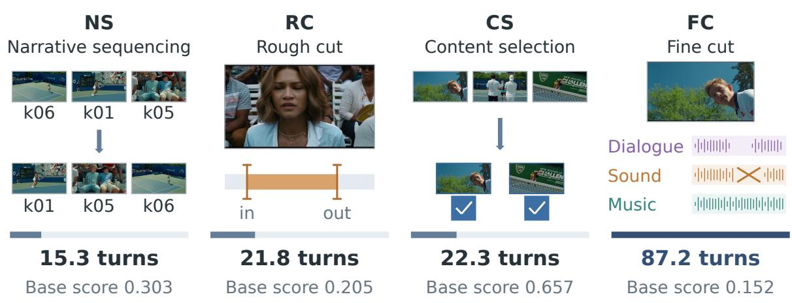  
(a) Tasks and horizon

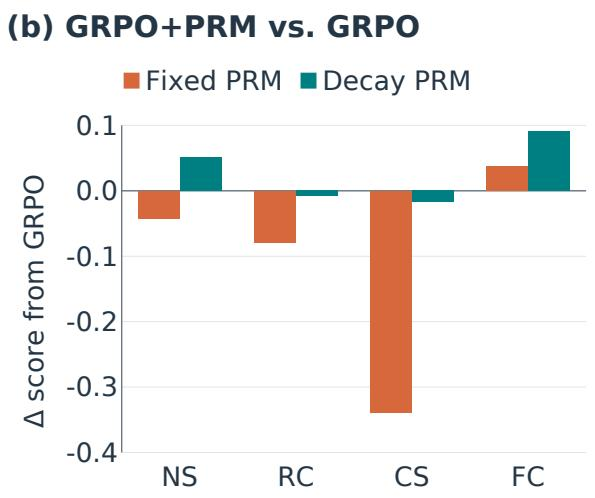

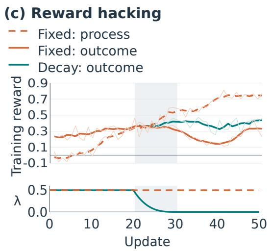  
Figure 1: Task-dependent efects of process rewards for Qwen3.5-9B. (a) Independent task schematics, ordered by base-policy horizon. Turns and base scores are task-type averages, not example-specific results; evaluation metrics average four repetitions. Fine Cut keeps picture and timing fixed. (b) Final score diferences from outcome-only GRPO. (c) Fixed-weight process and outcome rewards, and decayed-weight outcome rewards available from update 21. Faint lines connect recorded observations; thick lines show centered five-observation means. The aligned strip shows fixed and cubic-decay weights λ. Shading marks the decayed variant’s 20–30 decay window.

2026). Reinforcement learning has shown promise for improving their performance, enabling agents to refine their decision-making and tool-use policies through feedback from task execution (Kulkarni and Fazli, 2026; Zhang et al., 2026a; Yang et al., 2026; Zhang et al., 2026c; Wang et al., 2025d). However, reward formulation remains challenging because the quality of the resulting video rests on subjective judgment (Yan et al., 2026a; Wen et al., 2026). In addition, feedback on the final video becomes available only after a sequence of interdependent editing decisions, making it dificult to determine how individual actions contribute to the final outcome. Credit assignment is therefore central to training these agents (Arjona-Medina et al., 2019; Feng et al., 2025; Tan et al., 2026).

Yet it remains unclear when finer-grained credit assignment helps or hurts learning in long-horizon multimodal tasks.

Most work on video production builds a workflow around a model that it never updates (Sandoval-Castañeda et al., 2025; Zhao et al., 2026a; Zhang et al., 2026b). Crayotter trains an editing agent with segment-level credit, where segments group consecutive editing events from the same stage (Yan et al., 2026a). We ask how trajectory-, turn-, and token-level credit compare across editing tasks under a shared training setup. Elsewhere, several lines report that finer credit helps. VAGEN gives a multi-turn visual agent dense turn-level supervision (Wang et al., 2025b), TAPO repairs the credit that a trajectory-level advantage misassigns to tool calls inside failed rollouts (Dong et al., 2026), and interface agents trained on step-level progress signals beat actors trained on outcome rewards alone (Zhang et al., 2025a; Chen et al., 2025). Other work reports negative results for process rewards. Group-relative optimization with an outcome reward provably carries an implicit process reward, which makes an explicit one look redundant (Sullivan and Koller, 2025). A process reward is dense but remains prone to bias and reward hacking (Zheng et al., 2026; Pan et al., 2026). Outcome-only training is argued to sufice on long horizons once exploration is wide enough (Pu et al., 2026). How credit should be assigned in long-horizon multimodal agents therefore remains unclear.

We study the question in movie-trailer editing. We generate 797 tasks from 49 real movies and their released trailers. The work decomposes into four stages that a human editor performs in order, which give the task types Content Selection (CS), Narrative Sequencing (NS), Rough Cut (RC), and Fine Cut (FC). The four types difer in editing requirements, interaction length, and in the quality profile of the turns they elicit, which lets us ask how the same credit signal behaves as the task changes. We train Qwen3.5-9B (Qwen Team, 2026) for 50 updates on 716 of these tasks under four schemes that cover the three granularities. At the trajectory level we use outcome-only GRPO. At the turn level we compare GRPO+PRM (fixed λ) and GRPO+PRM (decayed λ). Both use a process reward from Gemini 3.8 Flash, averaged over three votes. At the token level we use on-policy self-distillation (OPSD). Its teacher receives privileged information that the student never sees: reference answers or turn-level suggestions. Outcome scores come from Gemini 3.1 Pro, so the process reward and the outcome reward never share a model. The schemes share the base model, training tasks, and number of updates, while objective-specific settings are detailed in Appendix C.1. We evaluate every run on 81 validation tasks four times and report the mean, and we record how the agent behaves as well as what it scores.

Our contributions are threefold. First, we develop a data-construction pipeline that turns films and their released trailers into four types of editing tasks reflecting real-world editing workflows. Training on these tasks improves Qwen3.5-9B’s video editing performance on held-out films. Second, we compare trajectory-, turn-, and token-level learning signals under a shared setup. Decaying process rewards yields a 45.4% relative gain over outcome-only GRPO on Fine Cut, while outcomeonly GRPO remains competitive on the three shorter-horizon task types. Third, we analyze training dynamics and model behavior to identify limitations of the tested finer-grained signals: fixed process rewards can undermine task completion despite encouraging desirable behaviors, and OPSD is sensitive to the privileged information provided to its teacher.

## 2 Related Work

Agents for video production. Video-editing agents have evolved from executing languageguided actions to managing long-horizon multi-stage production (Wang et al., 2024; Yang et al., 2024; Sandoval-Castañeda et al., 2025; Wang et al., 2025c; Ding et al., 2025; Zhao et al., 2026a; Li et al., 2026c; Zhang et al., 2026b; Liang et al., 2025; Yan et al., 2026b; Zhou et al., 2026a). These systems focus on designing editing workflows while keeping the underlying models fixed. Despite this progress, advanced agents remain unreliable in professional video post-production tasks (Cao et al., 2026; Hu et al., 2026). Another line of work trains video-editing policies (Tang et al., 2022; Hu et al., 2023; Zhou et al., 2026b; Yu et al., 2026). These methods use policy gradients for shot composition or supervised and preference-based post-training for tool-using planners. Crayotter assigns segment-level credit based on rankings of finished videos produced for the same task (Yan et al., 2026a). Our study compares trajectory-, turn-, and token-level supervision across a shared suite of editing tasks.

Credit assignment for long-horizon agents. Attributing delayed outcomes to the decisions that caused them is a long-standing challenge (Arjona-Medina et al., 2019; Ren et al., 2021; Harutyunyan et al., 2019; Mesnard et al., 2020; Meulemans et al., 2023). Research on language agents builds explicit learning signals at several granularities. Trajectory-level methods score a whole rollout against its peers (Shao et al., 2024; Wang et al., 2025d). Turn-level methods estimate value, progress, or a relative advantage for each turn (Zhou et al., 2024; Wang et al., 2025a; Feng et al., 2025; Xi et al., 2026; Li et al., 2026b; Tan et al., 2026; Liu et al., 2026). Finer methods assign an advantage to a reasoning step or a segment within a response (Kazemnejad et al., 2024; Guo et al., 2025). Multimodal work follows the same three levels across visual, interface, embodied, and video agents (Wang et al., 2025b; Pang et al., 2026; Dong et al., 2026; Tan et al., 2025; Zheng et al., 2026; Chen et al., 2025; Zhang et al., 2025a; Zhou et al., 2026c; Xu et al., 2025; Kulkarni and Fazli, 2026; Li et al., 2026a; Zhang et al., 2026a; Yang et al., 2026; Zhang et al., 2026c). Whether explicit finer-grained supervision improves learning remains an empirical question. Under mild assumptions, outcome-only GRPO can be written as a process-aware objective that carries an implicit Monte Carlo process reward (Sullivan and Koller, 2025). Process reward models are also hard to build and to evaluate. Synthesizing their labels by Monte Carlo estimation generalizes worse than using a judge or a human annotator (Zhang et al., 2025b), and benchmarks for fine-grained error detection expose substantial weaknesses in current models (Song et al., 2025; Sun et al., 2026). Empirical studies nevertheless report benefits from denser feedback (Wang and Ammanabrolu, 2025; Wu et al. 2026), alongside failure modes involving teacher guidance, reward-model overoptimization, and proxy exploitation (Li et al., 2026d; Fu et al., 2026; Skalse et al., 2022; Gao et al., 2023; Thaman, 2026; Pu et al., 2026; Gunjal et al., 2026; Shao et al., 2025). Evidence remains limited on when finer-grained supervision helps or hurts long-horizon multimodal agents, and how these efects vary across tasks and training stages.

## 3 Preliminaries

## 3.1 Long-Horizon Multimodal Agent

We consider a task x drawn from a task distribution D, in which an agent interacts with an environment over many turns, following standard formulations of long-horizon agentic RL (Zhou

et al., 2024; Wang et al., 2025d; Feng et al., 2025; Zhang et al., 2026c). At turn t the agent observes a state $s _ { t } \in S$ and emits an action $a _ { t } \in \mathcal V ^ { * }$ , and the environment returns the next state,

$$
a _ { t } \sim \pi _ { \theta } ( \cdot \mid s _ { t } , x ) , \qquad s _ { t + 1 } \sim \mathcal { P } ( \cdot \mid s _ { t } , a _ { t } ) .\tag{3.1}
$$

The state $s _ { t }$ carries images, tool outputs, and a mutable workspace alongside the textual history. The episode yields a trajectory $\tau = ( s _ { 0 } , a _ { 0 } , \ldots , a _ { T - 1 } , s _ { T } )$ and a delivered artifact $y _ { \tau } = \mathrm { O u t p u t } ( s _ { T } )$ which a grader maps to a terminal reward $R _ { \mathrm { o u t } } ( y _ { \tau } ) \in [ 0 , 1 ]$ . No reward is available before the agent commits.

## 3.2 Credit Assignment

We next present three credit assignment schemes at diferent granularities.

Trajectory level. At this granularity we study Group Relative Policy Optimization (GRPO) (Shao et al., 2024) with an outcome-only reward. GRPO estimates advantages from a group of rollouts without a learned critic. For each task x, we sample G trajectories $\{ \tau _ { i } \} _ { i = 1 } ^ { G }$ from $\pi _ { \mathrm { o l d } }$ and score them with $o _ { i } = R _ { \mathrm { o u t } } ( y _ { \tau _ { i } } )$ . The group-normalized advantage is

$$
A _ { i } ^ { \mathrm { o u t } } = \frac { o _ { i } - \mu _ { o } } { \sigma _ { o } + \epsilon } ,\tag{3.2}
$$

with $\mu _ { o }$ and $\sigma _ { o }$ the group mean and sample standard deviation. We optimize the policy using rollout importance sampling with token-mean reduction over valid assistant tokens (Appendix C). Every token of $\tau _ { i }$ receives the same $A _ { i } ^ { \mathrm { { o u t } } }$ , so the signal does not vary within a trajectory. We write this setting as outcome-only GRPO.

Turn level. A process reward model (PRM) scores each action from its interaction history and the tool feedback it produced (Wang et al., 2026). We average the M valid judgments of a turn into ${ r } _ { i , t }$ and add a normalized process term to the shared outcome term,

$$
A _ { i , t } = A _ { i } ^ { \mathrm { o u t } } + \lambda A _ { i , t } ^ { \mathrm { p r o c } } , \qquad A _ { i , t } ^ { \mathrm { p r o c } } = \frac { r _ { i , t } - \mu _ { t } } { \sigma _ { t } + \epsilon } ,\tag{3.3}
$$

where $\mu _ { t }$ and $\sigma _ { t }$ are the mean and sample standard deviation of valid process scores at the same turn index t across rollouts of task x. We do not apply additional batch-level advantage normalization. We call λ the process-reward weight and compare two settings. GRPO+PRM (fixed λ) keeps this weight fixed throughout training. GRPO+PRM (decayed λ) reduces it to zero partway through training. Later updates therefore use only the outcome reward. Every token of action $a _ { i , t }$ receives $A _ { i , t }$ , so the signal varies across turns but not within one.

Token level. On-policy self-distillation (OPSD) matches a teacher distribution on the student’s own prefixes (Zhao et al., 2026b). The teacher $\pi _ { \mathrm { t e a } }$ is a frozen copy of the initial policy and receives privileged information $c _ { t }$ that the student never sees. We compare two forms of privileged information: reference answers and turn-level suggestions. For token k of action $a _ { t }$ we write $p _ { t , k } ( v ) = \pi _ { \theta } ( v \mid s _ { t } , x , a _ { t , < k } )$ for the student and $q _ { t , k } ( v ) = \pi _ { \mathrm { t e a } } ( v \mid s _ { t } , x , c _ { t } , a _ { t , < k } )$ for the teacher. All OPSD experiments use the forward KL divergence,

$$
\begin{array} { r } { \mathcal { L } ( \boldsymbol { \theta } ) = \mathbb { E } _ { t , k } [ D _ { \mathrm { K L } } ( q _ { t , k } \Vert p _ { t , k } ) ] , } \end{array}\tag{3.4}
$$

taken over the generated assistant tokens. In practice we evaluate the KL on the teacher’s top-K support rather than the full vocabulary, and Appendix C gives the details. OPSD trains on this loss with no reward term at all. Every token receives its own target, so the signal varies within a turn as well.

## 4 Task Suite

## 4.1 Tasks and Environment

We study movie-trailer editing as it is done in practice (Murch, 2001; Pearlman, 2012). We decompose the editing of one trailer into four stages that a human editor works through in order, following the workflow-oriented view of AgenticVBench (Cao et al., 2026). Each stage gives one task type, namely Content Selection (CS), Narrative Sequencing (NS), Rough Cut (RC), and Fine Cut (FC). Figure 1(a) illustrates the four editing operations. A task consists of a multi-turn episode in which the agent inspects the supplied media and commits its artifact. The released trailer provides a reference answer for each task, held by the evaluator and hidden from the agent. Table 1 gives the task, the input, and the output of each type of task. See Appendix A for the definition of each type and Appendix A.7 for two worked examples. Base scores range from 0.152 to 0.657 under the respective task metrics, and mean interaction horizons range from 15.3 to 87.2 turns.

Scoring. Each task is scored on the artifact the agent commits when the episode ends. All tasks use the same three channels for this outcome score $R _ { \mathrm { o u t } }$

$$
R _ { \mathrm { o u t } } = w _ { \mathrm { d e t } } R _ { \mathrm { d e t } } + w _ { \mathrm { r e f } } R _ { \mathrm { r e f } } + w _ { \mathrm { b l i n d } } R _ { \mathrm { b l i n d } } ,\tag{4.1}
$$

where $R _ { \mathrm { d e t } }$ is a deterministic verifier that scores the artifact against that reference answer, $R _ { \mathrm { r e f } }$ is a multimodal LLM judge that scores the artifact with that reference, and $R _ { \mathrm { b l i n d } }$ is the same judge asking whether the artifact works on its own terms. Both judge channels score against a weighted rubric, and one model call grades each rubric item with its own evidence attached. The weights of Equation 4.1 sum to one and vary with the type. In this paper, we use Gemini 3.1 Pro as the multimodal LLM judge. The process rewards used during training come from a diferent model.

Content Selection and Narrative Sequencing use only the deterministic score, with weights (1, 0, 0). Content Selection scores the unordered selected shot set S against the reference set $S ^ { \star }$ using $\mathrm { F 1 } , 2 | S \cap S ^ { \star } | / ( | S | + | S ^ { \star } | )$ . It evaluates selection alone, with partial credit for overlap.<sup>1</sup> Narrative Sequencing scores agreement with the reference order. Rough Cut uses (0.4, 0.4, 0.2), combining deterministic cut-point similarity with reference-conditioned and reference-free judge scores. Fine Cut uses (0, 0.4, 0.6) to assess sound design and transitions through the two judge channels. These task-specific metrics measure diferent editing objectives, so their absolute values are not a common scale of task dificulty. Table 16 lists the judge rubrics, and Appendix C gives the aggregation.

Editing environments and harness. Each task runs in a fresh workspace holding the editorial brief, a manifest, and the media the task type exposes. The agent is provided with a shell and eight media tools for inspecting pictures, probing audio, and validating its own artifact. See Appendix B.2 for the full list. We run the agent in the oficial OpenCode harness. To keep training and rollout on the same pixels, we add a plugin to the harness that registers every image before it enters the conversation. See Appendix B for details.

Table 1: Task stages, inputs and outputs of the four task types. CS: Content Selection; NS: Narrative Sequencing; RC: Rough Cut; FC: Fine Cut. Each task also receives an editorial brief. The RC target specifies total duration. Turns and score are averaged over four independent evaluations of all 81 validation tasks with the untrained Qwen3.5-9B.
<table><tr><td>Task stage</td><td>Task type</td><td>Input</td><td>Output</td><td>Turns Score</td></tr><tr><td>Understanding</td><td>CS</td><td>Candidate shots</td><td>Selected shot IDs</td><td>22.3 0.657</td></tr><tr><td></td><td>NS</td><td>Shuffled shots</td><td>Ordered shot IDs</td><td>15.3 0.303</td></tr><tr><td>Editing</td><td>RC</td><td>Ordered shots, target duration</td><td>Clip in/out points</td><td>21.80.205</td></tr><tr><td></td><td>FC</td><td>Rough cut, audio assets</td><td>Rendered edit</td><td>87.2 0.152</td></tr></table>

## 4.2 Data Construction and Dataset

Given a source film and its released trailer, we detect shot boundaries and align usable trailer shots to their source-film footage. We partition the trailer into narratively coherent chunks and generate an editorial brief for each, describing its narrative role without identifying the clips. Each chunk yields one task of each type by varying the supplied media and required editing operation (Table 1). Figure 2 illustrates the pipeline, and Appendix A gives the construction details.

The pipeline produces 2,352 tasks from 49 films. After filtering with Gemini 3.8 Flash we sample 797 of them, 716 for training from 43 films and 81 for validation from 6 films that do not appear in training. Table 2 gives the split by task type, and Appendix A lists the films and describes the audit and the sampling protocol.

Table 2: Task counts by type. The training and validation films are disjoint.
<table><tr><td>Split</td><td>CS</td><td>NS</td><td>RC</td><td>FC</td><td>Total</td></tr><tr><td>Train</td><td>122</td><td>132</td><td>231</td><td>231</td><td>716</td></tr><tr><td>Validation</td><td>14</td><td>15</td><td>26</td><td>26</td><td>81</td></tr></table>

## 5 Experiments

## 5.1 Experimental Setup

Training settings. We train Qwen3.5-9B (Qwen Team, 2026) for 50 updates on the 716 training tasks (Section 4.2) under four diferent schemes for credit assignment: (i) outcome-only GRPO, (ii) GRPO+PRM (fixed λ), (iii) GRPO+PRM (decayed λ), and (iv) OPSD. For GRPO+PRM (fixed λ), we use a process-reward weight of λ = 0.5 throughout training. GRPO+PRM (decayed λ) keeps the same weight until update 20. We then decay it to zero over updates 20–30 and keep it at zero thereafter. Section 6.2 explains the choice of this interval, and Appendix C gives the decay schedule and full training configuration. For OPSD, we compare two forms of privileged information: reference answers and turn-level suggestions. Gemini 3.8 Flash generates the turn-level suggestions from the student’s context at each turn. These suggestions are provided to the frozen teacher as privileged information.

Evaluation. We evaluate the final checkpoint of each run on the 81 validation tasks introduced in Section 4.2. To reduce evaluation variance, we evaluate every task four times and report the mean score, denoted avg@4. See Appendix C for the full evaluation configuration.

## 5.2 Experiment Results

Table 3 summarizes the results. Outcome-only GRPO improves all four task types, raising the overall score from 0.284 to 0.413. Unexpectedly, GRPO+PRM (fixed λ) scores lower than outcome-only GRPO on every task type except Fine Cut. Decaying the process-reward weight improves all four task scores over GRPO+PRM (fixed λ) and yields the highest overall score of 0.447. Its largest gain over outcome-only GRPO is on Fine Cut (0.293 vs. 0.201). OPSD (reference answers) performs similarly to the untrained model (0.277 vs. 0.284 overall), while OPSD (turn-level suggestions) drops to 0.044. Section 6 analyzes these contrasting outcomes.

## 6 Credit Assignment: Benefits and Failure Modes

We examine trajectory-level credit on long horizons in Section 6.1. Section 6.2 links process-reward hacking to declining task completion and studies process-reward weight decay as a mitigation. Section 6.3 examines the sensitivity of OPSD to privileged information.

## 6.1 Task Structure and Trajectory-Level Credit

Gains vary across editing tasks. As shown in Table 3, outcome-only GRPO raises the overall score from 0.284 to 0.413. However, Fine Cut improves by only 0.050, whereas the other three task types each improve by at least 0.15. On Fine Cut, adding process rewards further raises the score from 0.201 to 0.239 with a fixed weight and 0.293 with a decaying weight. These improvements show that further gains on Fine Cut are achievable beyond the outcome-only result. On the other three task types, the tested finer-grained methods yield limited additional gains over outcome-only GRPO: none improves Content Selection or Rough Cut, and the largest gain on Narrative Sequencing is 0.052.

Table 3: Validation scores for the final checkpoints of all training variants across the four task types. Each score is the mean over four repetitions (avg@4). Percentages below scores show relative changes from the base model, computed using the four-decimal evaluation means. Best result per column in bold.
<table><tr><td></td><td colspan="4">Mean task score (avg@4)</td></tr><tr><td>Method</td><td>CS NS</td><td>RC</td><td>FC</td><td>Overall</td></tr><tr><td>Qwen3.5-9B</td><td>0.657</td><td>0.303 0.205</td><td>0.152</td><td>0.284</td></tr><tr><td>Outcome-only GRPO</td><td>0.821 (+24.9%)</td><td>0.500 0.356 (+65.1%) (+73.4%)</td><td>0.201 (+32.9%)</td><td>0.413 (+45.5%)</td></tr><tr><td>GRPO+PRM (fixed λ) GRPO+PRM (decayed λ)</td><td>0.482 (-26.6%) 0.804</td><td>0.457 0.276 (+51.0%)(+34.8%) 0.552 0.348</td><td>0.239 (+57.8%) 0.293</td><td>0.334 (+17.4%) 0.447</td></tr><tr><td>OPSD (reference answers)</td><td>(+22.3%) 0.606</td><td>(+82.2%) (+69.5%) 0.267</td><td>(+93.2%) 0.219 0.162</td><td>(+57.2%) 0.277</td></tr><tr><td></td><td>(−80.4%) (−79.2%) (−84.5%)(−100.0%) (-84.4%)</td><td>0.063</td><td></td><td>0.044</td></tr><tr><td></td><td>0.129</td><td>0.032</td><td>0.000</td><td></td></tr><tr><td>OPSD (turn-level suggestions)</td><td>(-7.8%)</td><td>(-11.7%) (+6.8%)</td><td>(+6.9%)</td><td>(-2.7%)</td></tr></table>

A possible explanation: long horizons mix good and bad turns. To understand why outcome-only GRPO is less efective on Fine Cut, we evaluate every turn in the untrained model’s validation rollouts from the second evaluation repetition using Gemini 3.8 Flash. The judge labels each turn as positive, neutral, or negative. We quantify rollout mixing as 2 min $( n _ { + } , n _ { - } ) / ( n _ { + } + n _ { - } )$ where $n _ { + }$ and n<sub>−</sub> denote the numbers of positive and negative turns, respectively.

As shown in Table 4, Fine Cut has a mixing score of 0.651, whereas the other three task types range from 0.297 to 0.390. Trajectory-level credit assignment assigns the same advantage to every turn in a rollout and cannot distinguish between positive and negative turns. The higher mixing on Fine Cut is consistent with greater ambiguity in assigning credit to individual turns. This may partly explain the smaller gains from outcome-only GRPO on Fine Cut.

## 6.2 GRPO+PRM: Reward Hacking and Mitigation

Reward hacking with a fixed process-reward weight. All task types except Fine Cut score lower than outcome-only GRPO, as shown in Table 3. Table 5 further shows a sharp decline in the model’s ability to deliver a result, with 44.1% of rollouts being truncated compared with only 0.3% under outcome-only GRPO. Late in training, the model continues calling tools to gather evidence but often stops before committing to a final result.

We further analyze the training dynamics of GRPO+PRM (fixed λ). As shown in Figure 1(c), the process reward increases while the outcome reward declines after update 30. Appendix C.7 provides the full training curves. As shown in Section 7, process rewards encourage desirable behaviors such as visual inspection, reasoning, and reflection. One possible interpretation is that encouraging these behaviors helps improve task scores early in training. Later, continued optimization with a fixed process-reward weight may lead the model to overuse these behaviors, consuming its interaction budget and reducing its ability to complete the task.

Table 4: Turn-level quality of the untrained model’s rollouts from the second evaluation repetition on all 81 validation tasks, scored by the process-reward judge.
<table><tr><td>Task type</td><td>Positive</td><td>Neutral</td><td>Negative</td><td>Mixing</td></tr><tr><td>CS</td><td>55.3%</td><td>36.0%</td><td>8.7%</td><td>0.297</td></tr><tr><td>NS</td><td>42.7%</td><td>44.9%</td><td>12.4%</td><td>0.355</td></tr><tr><td>RC</td><td>44.5%</td><td>43.6%</td><td>11.9%</td><td>0.390</td></tr><tr><td>FC</td><td>16.7%</td><td>47.5%</td><td>35.8%</td><td>0.651</td></tr></table>

Process-reward weight decay mitigates reward hacking. Observations in Figure 1(c) motivate us to decay the process-reward weight λ to zero between updates 20 and 30. This schedule retains process guidance early in training and shifts later updates to the outcome reward alone. Results in Table 3 show that this approach is efective. On the first three task types, the model achieves performance comparable to outcome-only GRPO, with an average score of 0.568 versus 0.559. On Fine Cut, the method improves performance over the untrained model by 0.141, whereas outcome-only GRPO yields an improvement of only 0.050. As shown in Section 7, decaying the process-reward weight further encourages desirable behaviors, such as longer reasoning and more frequent reflection, compared with keeping the weight fixed.

## 6.3 OPSD Is Sensitive to Privileged information

With reference answers, OPSD scores 0.277, close to the untrained model’s 0.284. With turn-level suggestions, its score drops to 0.044 (Table 3).

OPSD gradients depend on privileged information. The two variants share the same distillation loss, frozen teacher, student model, and training hyperparameters. Compared with reference answers, turn-level suggestions yield an approximately 15-fold larger mean forward KL divergence and increase the mean gradient norm from 0.084 to 1.177 (Table 13).

The OPSD signal can be diluted over a trajectory. With reference answers, the most divergent 5% of turns account for 47.4% of the total KL but only 17.9% of the tokens (Table 14). This concentration suggests that averaging over valid assistant tokens may dilute the contribution of the more divergent turns. However, KL measures disagreement rather than the usefulness of teacher guidance, and whether gradient magnitude or signal dilution causes the observed outcomes remains to be tested. Appendix C.5 provides further analysis of trajectory lengths, gradient norms, and KL concentration.

## 7 Model Behavior

Table 5 compares the behavior of the trained policies. We use outcome-only GRPO as the baseline for the $\mathrm { G R P O + P R M }$ variants and the untrained model for OPSD. Reflection counts turns with an explicit self-correction marker; it does not assess whether a correction is valid.

Table 5: Validation behavior across four repetitions of all 81 tasks. Fixed-weight PRM has a truncation rate of 44.1%; decaying the weight reduces it to 6.2%, with longer reasoning and more frequent reflection markers.
<table><tr><td></td><td colspan="3">Interaction</td><td colspan="2">Visual inspection</td><td colspan="2">Reasoning</td></tr><tr><td>Method</td><td></td><td>Turns Tool calls Truncated Frames</td><td></td><td></td><td></td><td></td><td>Blind Length Reflection</td></tr><tr><td>Qwen3.5-9B</td><td>41.7</td><td>61.4</td><td>1.5%</td><td>32.2</td><td>7.4%</td><td>644</td><td>17.7%</td></tr><tr><td>Outcome-only GRPO</td><td>45.1</td><td>52.2</td><td>0.3%</td><td>84.2</td><td>4.6%</td><td>618</td><td>19.0%</td></tr><tr><td>GRPO+PRM (fixed λ)</td><td>82.4</td><td>165.8</td><td>44.1%</td><td>143.6</td><td>0.3%</td><td>761</td><td>24.8%</td></tr><tr><td>GRPO+PRM (decayed λ)</td><td>56.9</td><td>99.5</td><td>6.2%</td><td>129.8</td><td>0.0%</td><td>1,035</td><td>36.0%</td></tr><tr><td>OPSD (reference answers)</td><td>41.1</td><td>62.5</td><td>1.5%</td><td>36.7</td><td>3.4%</td><td>657</td><td>17.8%</td></tr><tr><td>OPSD (turn-level suggestions)</td><td>11.8</td><td>19.3</td><td>0.0%</td><td>19.4</td><td>34.9%</td><td>59</td><td>0.7%</td></tr></table>

Turns, tool calls, and frames are means per rollout; frames count returned images. Truncated and Blind are percentages of rollouts stopped by a budget and receiving no images, respectively. Length is reasoning characters per completed turn; Reflection is the percentage of completed turns with an explicit self-correction marker. See Appendix C.4 for measurement details.

Process rewards encourage desirable behaviors but do not ensure completion. Compared with outcome-only GRPO, GRPO+PRM (fixed λ) encourages more visual inspection, longer reasoning, and more frequent self-correction markers (Table 5). However, these changes accompany higher scores only on Fine Cut; scores fall on the other three task types (Table 3). The truncation rate also rises from 0.3% to 44.1%. The value of these behaviors therefore depends on the task and on whether the model can still complete it.

GRPO gains accompany greater visual inspection. Compared with the base model, outcomeonly GRPO increases frames seen from 32.2 to 84.2, without increasing tool calls or reasoning length (Table 5). Greater visual input may help the three shorter-horizon tasks, consistent with their larger gains, whereas Fine Cut may require more complex tool use and reasoning to coordinate a longer sequence of editing operations.

Less process guidance mitigates hacking and elicits better behavioral patterns. Compared with GRPO+PRM (fixed λ), GRPO+PRM (decayed λ) makes fewer tool calls while retaining substantial visual inspection, producing longer reasoning, and showing more frequent self-correction markers (Table 5). These changes accompany a reduction in truncation from 44.1% to 6.2% and an increase in overall task score from 0.334 to 0.447 (Table 3). Compared with outcome-only GRPO, GRPO+PRM (decayed λ) achieves a substantial gain on Fine Cut, which may be associated with its longer reasoning and more extensive visual inspection.

OPSD behavior depends on privileged information. As shown in Table 5, with reference answers, OPSD remains behaviorally close to the untrained model, apart from a lower blind rate. With turn-level suggestions, rollouts become much shorter, reasoning length and reflection frequency drop sharply, and blind rollouts become more frequent. These behavioral changes accompany the collapse in task performance (Table 3).

## 8 Conclusion

Our experiments show when finer-grained credit helps and when it hurts. Process guidance helps most on Fine Cut, while outcome-only GRPO remains competitive on shorter-horizon tasks. Process guidance can hurt when more visual inspection and reasoning accompany poorer task completion. Decaying the process-reward weight improves completion while retaining these behaviors. OPSD is sensitive to privileged information, showing that dense supervision alone does not guarantee efective learning. Our process-reward findings are based on GRPO+PRM with LLM-judged turnlevel rewards on movie-trailer editing tasks; whether they extend to untested methods such as GiGPO (Feng et al., 2025) and Turn-PPO (Li et al., 2026b) remains open. For OPSD, we identify failure patterns without establishing efective remedies. How to improve teacher guidance and training stability requires further study.

## References

Arjona-Medina, J. A., Gillhofer, M., Widrich, M., Unterthiner, T., Brandstetter, J. and Hochreiter, S. (2019). Rudder: Return decomposition for delayed rewards. Advances in Neural Information Processing Systems 32.

Cao, Z., Zheng, Y., Song, R. and Hu, X. (2026). Agenticvbench: Can ai agents complete real-world post-production tasks? arXiv preprint arXiv:2605.27705.

Chen, C., Ji, K., Zhong, H., Zhu, M., Li, A., Gan, G., Huang, Z., Zou, C., Liu, J., Chen, J. et al. (2025). Gui-shepherd: Reliable process reward and verification for long-sequence gui tasks. arXiv preprint arXiv:2509.23738.

Ding, Z., Wang, X., Chen, J., Kristensson, P. O. and Shen, J. (2025). Prompt-driven agentic video editing system: Autonomous comprehension of long-form, story-driven media. arXiv preprint arXiv:2509.16811.

Dong, C., Yue, C., He, H., Liu, Y., Tang, F., Zhou, S. K., Wang, X., Chai, J. and Yin, G. (2026). Tapo: Tool-aware policy optimization via credit transfer for multimodal search agents. arXiv preprint arXiv:2606.05784.

Feng, L., Xue, Z., Liu, T. and An, B. (2025). Group-in-group policy optimization for llm agent training. Advances in Neural Information Processing Systems 38 46375–46408.

Fu, Y., Huang, H., Jiang, K., Liu, J., Jiang, Z., Zhu, Y. and Zhao, D. (2026). Revisiting on-policy distillation: Empirical failure modes and simple fixes. arXiv preprint arXiv:2603.25562.

Gao, L., Schulman, J. and Hilton, J. (2023). Scaling laws for reward model overoptimization. In International conference on machine learning. PMLR.

Gunjal, A., Wang, A., Lau, E., Nath, V., He, Y., Liu, B. and Hendryx, S. (2026). Rubrics as rewards: Reinforcement learning beyond verifiable domains. In International Conference on Learning Representations, vol. 2026.

Guo, Y., Xu, L., Liu, J., Ye, D. and Qiu, S. (2025). Segment policy optimization: Efective segment-level credit assignment in rl for large language models. Advances in Neural Information Processing Systems 38 114399–114431.

Harutyunyan, A., Dabney, W., Mesnard, T., Gheshlaghi Azar, M., Piot, B., Heess, N., van Hasselt, H. P., Wayne, G., Singh, S., Precup, D. et al. (2019). Hindsight credit assignment. Advances in neural information processing systems 32.

Hu, H., Guo, X., Chen, Z., Gao, D., Liu, H., Jin, L. and Mao, Q. (2026). Cutverse: A compositional gui agents benchmark for media post-production editing. arXiv preprint arXiv:2605.19484.

Hu, P., Xiao, N., Li, F., Chen, Y. and Huang, R. (2023). A reinforcement learning-based automatic video editing method using pre-trained vision-language model. In Proceedings of the 31st ACM International Conference on Multimedia.

Kazemnejad, A., Aghajohari, M., Portelance, E., Sordoni, A., Reddy, S., Courville, A. and Roux, N. L. (2024). Vineppo: Refining credit assignment in rl training of llms. arXiv preprint arXiv:2410.01679.

Kulkarni, Y. and Fazli, P. (2026). Avatar: Reinforcement learning to see, hear, and reason over video. In Proceedings of the IEEE/CVF Conference on Computer Vision and Pattern Recognition.

Li, H., Guo, L., Liu, Z., Hao, D., Tang, Y., Zhao, Z., Jiang, J., Jin, Z., Chen, C., Lu, H. et al. (2026a). Timethink: Reasoning with time for video llms. arXiv preprint arXiv:2607.05089.

Li, J., Zhou, P., Meng, R., Vadera, M. P., Li, L. and Li, Y. (2026b). Turn-ppo: Turn-level advantage estimation with ppo for improved multi-turn rl in agentic llms. In Findings of the Association for Computational Linguistics: EACL 2026.

Li, K., Li, M., Chen, J., Chen, J., Zheng, Z., Wang, S. and Chen, X. (2026c). Direct: Video mashup creation via hierarchical multi-agent planning and intent-guided editing. arXiv preprint arXiv:2604.04875.

Li, Y., Zuo, Y., He, B., Zhang, J., Xiao, C., Qian, C., Yu, T., Gao, H.-a., Yang, W., Liu, Z. et al. (2026d). Rethinking on-policy distillation of large language models: Phenomenology, mechanism, and recipe. arXiv preprint arXiv:2604.13016.

Liang, Z., Zhang, D., Zhou, H., Huang, R., Li, B., Zhang, Y., Wu, S., Wang, X., Luo, J., Liao, L. et al. (2025). Univa: Universal video agent towards open-source next-generation video generalist. arXiv preprint arXiv:2511.08521.

Liu, X., Wang, K., Wu, Y., Huang, F., Li, Y., Jiao, J. and Zhang, J. (2026). Agentic reinforcement learning with implicit step rewards. In International Conference on Learning Representations, vol. 2026.

Mesnard, T., Weber, T., Viola, F., Thakoor, S., Saade, A., Harutyunyan, A., Dabney, W., Stepleton, T., Heess, N., Guez, A. et al. (2020). Counterfactual credit assignment in model-free reinforcement learning. arXiv preprint arXiv:2011.09464.

Meulemans, A., Schug, S., Kobayashi, S., Daw, N. and Wayne, G. (2023). Would i have gotten that reward? long-term credit assignment by counterfactual contribution analysis. Advances in Neural Information Processing Systems 36 68685–68735.

Murch, W. (2001). In the Blink of an Eye. Silman-James Press Los Angeles.

Pan, P.-C., Liang, Y. and Lin, S. (2026). Reward modeling for reinforcement learning-based llm reasoning: Design, challenges, and evaluation. arXiv preprint arXiv:2602.09305.

Pang, C., Feng, X., Yi, Y., Su, J., Chen, Z., Hong, J., Yao, T., Yuan, N., Luo, J., Lu, L. et al. (2026). Ica: Information-aware credit assignment for visually grounded long-horizon information-seeking agents. arXiv preprint arXiv:2602.10863.

Pearlman, K. (2012). Cutting rhythms: Shaping the film edit. CRC Press.

Pu, L., Li, X., Liu, Y., Cao, T. and Yang, B. (2026). Explore more, drift less: Outcome-only reinforcement learning can sufice for long-horizon interactive agents. arXiv preprint arXiv:2609.01245.

Qwen Team (2026). Qwen3.5: Towards native multimodal agents.

Ren, Z., Guo, R., Zhou, Y. and Peng, J. (2021). Learning long-term reward redistribution via randomized return decomposition. arXiv preprint arXiv:2111.13485.

Sandoval-Castañeda, M., Russell, B., Sivic, J., Shakhnarovich, G. and Caba Heilbron, F. (2025). Editduet: A multi-agent system for video non-linear editing. In Proceedings of the Special Interest Group on Computer Graphics and Interactive Techniques Conference Conference Papers.

Shao, R., Asai, A., Shen, S. Z., Ivison, H., Kishore, V., Zhuo, J., Zhao, X., Park, M., Finlayson, S. G., Sontag, D. et al. (2025). Dr tulu: Reinforcement learning with evolving rubrics for deep research. arXiv preprint arXiv:2511.19399.

Shao, Z., Wang, P., Zhu, Q., Xu, R., Song, J., Bi, X., Zhang, H., Zhang, M., Li, Y., Wu, Y. et al. (2024). Deepseekmath: Pushing the limits of mathematical reasoning in open language models. arXiv preprint arXiv:2402.03300.

Skalse, J., Howe, N., Krasheninnikov, D. and Krueger, D. (2022). Defining and characterizing reward gaming. Advances in neural information processing systems 35 9460–9471.

Song, M., Su, Z., Qu, X., Zhou, J. and Cheng, Y. (2025). Prmbench: A fine-grained and challenging benchmark for process-level reward models. In Proceedings of the 63rd Annual Meeting of the Association for Computational Linguistics (Volume 1: Long Papers).

Sullivan, M. and Koller, A. (2025). Grpo is secretly a process reward model. arXiv preprint arXiv:2509.21154.

Sun, Z., Zhang, X., Ding, X., Cai, B., Du, L., Xiong, K., Dai, X., Zhang, F., Tang, W., Kan, Z., Zhao, Y., Qin, B. and Liu, T. (2026). Gr-ben: A general reasoning benchmark for evaluating process reward models. arXiv preprint arXiv:2605.01203v2.

Tan, H.-Z., Yang, X.-W., Chen, H., Shao, J.-J., Wen, Y., Shen, Y., Luo, W., Du, X., Guo, L.-Z. and Li, Y.-F. (2026). Hindsight credit assignment for long-horizon llm agents. arXiv preprint arXiv:2603.08754.

Tan, W., Qu, X., Tu, M., Ge, M., Liu, A. T., Koehn, P. and Lu, L. (2025). Processsupervised reinforcement learning for interactive multimodal tool-use agents. arXiv preprint arXiv:2509.14480.

Tang, Y., Xu, S., Wang, T., Lin, Q., Lu, Q. and Zheng, F. (2022). Multi-modal segment assemblage network for ad video editing with importance-coherence reward. In Asian Conference on Computer Vision. Springer.

Thaman, K. (2026). Reward hacking benchmark: Measuring exploits in llm agents with tool use. arXiv preprint arXiv:2605.02964.

Wang, B., Li, Y., Lv, Z., Xia, H., Xu, Y. and Sodhi, R. (2024). Lave: Llm-powered agent assistance and language augmentation for video editing. In Proceedings of the 29th International Conference on Intelligent User Interfaces.

Wang, H., Leong, C. T., Wang, J., Wang, J. and Li, W. (2025a). Spa-rl: Reinforcing llm agents via stepwise progress attribution. arXiv preprint arXiv:2505.20732.

Wang, K., Zhang, P., Wang, Z., Gao, Y., Li, L., Wang, Q., Chen, H., Lu, Y., Yang, Z., Wang, L. et al. (2025b). Vagen: Reinforcing world model reasoning for multi-turn vlm agents. Advances in Neural Information Processing Systems 38 172871–172933.

Wang, R. and Ammanabrolu, P. (2025). A practitioner’s guide to multi-turn agentic reinforcement learning. arXiv preprint arXiv:2510.01132.

Wang, X., Li, X., Wei, Y., Song, Y., Zeng, F., Chen, Z., Xu, G., Xu, T. et al. (2025c). From long videos to engaging clips: A human-inspired video editing framework with multimodal narrative understanding. In Proceedings of the 2025 Conference on Empirical Methods in Natural Language Processing: Industry Track.

Wang, Y., Chen, X., Jin, X., Wang, M. and Yang, L. (2026). Openclaw-rl: Train any agent simply by talking. arXiv preprint arXiv:2603.10165.

Wang, Z., Wang, K., Wang, Q., Zhang, P., Li, L., Yang, Z., Jin, X., Yu, K., Nguyen, M. N., Liu, L. et al. (2025d). Ragen: Understanding self-evolution in llm agents via multi-turn reinforcement learning. arXiv preprint arXiv:2504.20073.

Wen, Y., Huang, Y., Xie, Q., Wu, J., Lin, Y., Gu, Y., Chen, J., Zhang, Y. and Liu, J. (2026). Ave-compass: Towards holistic evaluation for audio-video editing abilities. arXiv preprint arXiv:2607.24821.

Wu, X., Sun, Q., Zhang, R., Song, C., Wu, J., Qi, Y. and Cheng, H. (2026). Demystifying reinforcement learning for long-horizon tool-using agents: A comprehensive recipe. arXiv preprint arXiv:2603.21972.

Xi, Z., Liao, C., Li, G., Zhang, Z., Chen, W., Wang, B., Jin, S., Zhou, Y., Guan, J., Wu, W. et al. (2026). Agentprm: Process reward models for llm agents via step-wise promise and progress. In Proceedings of the ACM Web Conference 2026.

Xu, F., Zhai, G., Kong, X., Fu, T., Gordon, D. F., An, X. and Busam, B. (2025). Starevla: Progressive stage-aware reinforcement for fine-tuning vision-language-action models. arXiv preprint arXiv:2512.05107.

Yan, L., Lin, J., Zhang, Y., Pan, B., Li, W., Lyu, C., Zhou, L. and Gurrin, C. (2026a). Crayotter: Learning long-horizon video editing agents via group-relative preference backpropagation. arXiv preprint arXiv:2608.02694.

Yan, L., Zhang, Y., Xu, X., Lin, J., Pan, B., Zheng, X., Qian, J., Wu, A., Geng, J., Li, R. et al. (2026b). Crayotter: Traceable multi-agent workflows for long-form video editing. arXiv preprint arXiv:2606.07636.

Yang, L., Chen, Z., Li, X., Jia, P., Long, L. and Yang, J. (2024). Agent-based video trimming. arXiv preprint arXiv:2412.09513.

Yang, Z., Wang, S., Zhang, K., Wu, K., Leng, S., Zhang, Y., Li, B., Qin, C., Lu, S., Li, X. et al. (2026). Longvt: Incentivizing" thinking with long videos" via native tool calling. In Proceedings of the IEEE/CVF Conference on Computer Vision and Pattern Recognition.

Yu, Y., Zeng, Z., Xiao, Z., Zhou, Z., Hua, H., Xiong, W. and Luo, J. (2026). Aurora: Unified video editing with a tool-using agent. arXiv preprint arXiv:2605.18748.

Zhang, D., Zhang, S., Yang, Z., Zhu, Z., Zhao, Z., Cao, R., Chen, L. and Yu, K. (2025a). Progrm: Build better gui agents with progress rewards. arXiv preprint arXiv:2505.18121.

Zhang, H., Gu, X., Li, J., Ma, C., Bai, S., Zhang, C., Zhang, B., Zhou, Z., He, D. and Tang, Y. (2026a). Thinking with videos: Multimodal tool-augmented reinforcement learning for long video reasoning. In Proceedings of the IEEE/CVF Conference on Computer Vision and Pattern Recognition.

Zhang, P., Zhou, C., Zhang, Z., Liu, H., Zhang, C., Liu, J., Zhou, X., Chen, X., Weng, S., Li, S. et al. (2026b). A benchmark and multi-agent system for instruction-driven cinematic video compilation. In European Conference on Computer Vision. Springer.

Zhang, Y., Wang, R., Wang, J., Tang, Y., Zheng, X., Duan, H., Lu, H., Deng, H. and Lu, L. (2026c). Eva: Eficient reinforcement learning for end-to-end video agent. arXiv preprint arXiv:2603.22918.

Zhang, Z., Zheng, C., Wu, Y., Zhang, B., Lin, R., Yu, B., Liu, D., Zhou, J. and Lin, J. (2025b). The lessons of developing process reward models in mathematical reasoning. In Findings of the Association for Computational Linguistics: ACL 2025.

Zhao, S., Hu, Y., Shan, Y., Wei, Y. and Cun, X. (2026a). Cutclaw: Agentic hours-long video editing via music synchronization. arXiv preprint arXiv:2603.29664.

Zhao, S., Xie, Z., Liu, M., Huang, J., Pang, G., Chen, F. and Grover, A. (2026b). Self-distilled reasoner: On-policy self-distillation for large language models. arXiv preprint arXiv:2601.18734.

Zheng, C., Mo, X., Ma, X., Lin, Q., Zhao, Y., Zhu, J., Lou, X., Wang, J., Wang, Z., Liu, W. et al. (2026). Adaptive milestone reward for gui agents. arXiv preprint arXiv:2602.11524.

Zhou, H., Huang, L., Wang, J., Zhou, B., Wu, S., Xia, L. and Huang, C. (2026a). Videoagent: All-in-one framework for video understanding and editing. arXiv preprint arXiv:2606.23327.

Zhou, M., Qin, S., Li, Y., Chen, Q. and Jiang, P. (2026b). Autocut: End-to-end advertisement video editing based on multimodal discretization and controllable generation. arXiv preprint arXiv:2603.28366.

Zhou, Y., Gao, H., Wu, F., Zheng, C. and Qiang, W. (2026c). Temporal grpo: Beyond trajectory-level credit in vision-language-action reinforcement learning. arXiv preprint arXiv:2608.13026.

Zhou, Y., Zanette, A., Pan, J., Levine, S. and Kumar, A. (2024). Archer: Training language model agents via hierarchical multi-turn rl. arXiv preprint arXiv:2402.19446.

## Contents of the Appendix

A Task Construction Details 19   
A.1 Corpus and Summary Statistics 19   
A.2 Media Processing and Chunking 19   
A.3 Construction by Task Type . 19   
A.4 Task Inputs, Outputs, and Requirements . 21   
A.5 Audit, Repair and Sampling 23   
A.6 Split and Anti-Leakage Controls . 23   
A.7 Example Tasks . 23   
B Editing Environment Details 30   
B.1 Episode State and Tools. . 30   
B.2 Tools . 30   
B.3 Harness. 30   
B.4 Deliverable Validation 31   
B.5 Isolation and Telemetry 32   
C Training and Evaluation Details 32   
C.1 Training Configuration and Optimization 32   
C.2 Process-Reward Judgments . 34   
C.3 Evaluation and Aggregation 35   
C.4 Behavioral Measurements 36   
C.5 OPSD Teacher Inputs and Diagnostics . 37   
C.6 Outcome Metrics and Rubrics 41   
C.7 Additional Training Diagnostics 45

## A Task Construction Details

Figure 2 gives an overview of the data generation pipeline.

## A.1 Corpus and Summary Statistics

Let

$$
\mathcal { D } _ { \mathrm { e d i t } } = \{ ( F _ { i } , T _ { i } ) \} _ { i = 1 } ^ { N } ,\tag{A.1}
$$

where $F _ { i }$ is a source film and $T _ { i }$ is its corresponding trailer. The corpus contains $N = 4 9$ pairs, comprising 101.80 hours of source video and 2.09 hours of trailers. Instantiating four task types for every retained chunk produces an initial pool of 2,352 tasks, before task-level quality filtering and sampling. The final experimental dataset contains 797 tasks (Section 4.2).

## A.2 Media Processing and Chunking

Task construction converts each long film and short trailer into localized editing problems. We normalize media geometry and create analysis proxies, then detect shot boundaries in both videos. A coarse-to-fine visual matching pipeline aligns trailer shots to candidate source-film moments and rejects low-confidence matches. Graphic cards, black frames, flashes, and other featureless intervals are separated from usable footage. Speech timestamps, music activity, and picture–sound relations are extracted only for constructing fine-cut tasks and hidden evaluation evidence; the finished trailer mix and its alignments are never exposed to the policy.

A semantic pass groups the trailer into broad story beats and then into local chunks that do not cross beat boundaries. The construction produces 622 raw chunks. We retain 588 chunks containing at least three usable picture clips and two source-film anchors. The source films contain 88,669 detected shots and the trailers contain 5,978 detected shots.

## A.3 Construction by Task Type

The four tasks for a chunk are constructed independently. Narrative Sequencing uses the reference selection, Rough Cut uses the reference order, and Fine Cut starts from a reference rough cut rather than a sampled upstream output. This prevents one task type’s errors from dominating another task type’s training signal. The corpus therefore evaluates stagewise editing decisions; composing all task types into a fully end-to-end trailer editor is a separate setting.

Content Selection presents complete source shots rather than pre-trimmed positives and mixes them with neighboring and duration-matched distractors. In the final dataset, each task contains 21–36 candidates and 3–14 positives. Narrative Sequencing independently renames and shufles the selected clips. Overlapping neighboring source windows are separated where possible so that the task cannot be solved by matching duplicate boundary frames. Rough Cut supplies the reference order but requires new in- and out-points for every clip. Matching ambiguity is retained as a timing tolerance, avoiding frame-exact penalties when equivalent boundaries exist.

Fine Cut begins from a stable rough cut and exposes production-sound handles, uncut dialogue candidates, an unaligned music window, and join metadata. The agent selects and trims dialogue, places music, chooses picture and sound transitions, and renders the result. Trailer-only picture is muted so that released dialogue and music choices cannot be recovered from its audio. The structured edit and rendered preview are evaluated together.

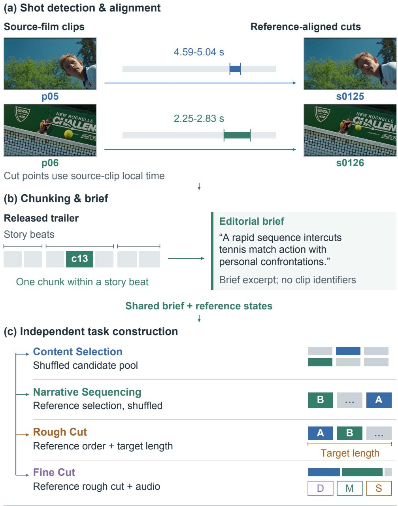  
Challengers, chunk c13. Frames and cut points are real.  
Timeline segmentation and task-asset layouts are schematic.

Figure 2: Data generation from a film–trailer pair. (a) Two real source clips and their referencealigned cuts illustrate shot matching. (b) Each local chunk stays within a story beat and receives a clip-independent brief. (c) Four tasks share the brief and initialize from reference states, so errors in sampled outputs cannot propagate between tasks. Timeline and asset layouts are schematic. D/M/S denote dialogue, music, and production sound.

## A.4 Task Inputs, Outputs, and Requirements

Each task package provides a local editing brief, the assets under initial\_state/, and a public manifest.json describing those assets. The manifest identifies files and their local time coordinates; it is not an answer key. Hidden selections, reference orders, source–trailer alignments, and grading references are kept outside the policy-visible package. The four interfaces expose diferent decisions, as detailed below. Their scores use diferent criteria and should not be interpreted as a common dificulty scale.

Content Selection (CS): choose an unordered subset. The input is a written description of the local trailer stretch and a pool of complete, silent source shots, with candidate IDs, file names, and durations in the manifest. Positive shots are mixed with distractors from the same film. Candidate numbering follows a shufle and does not indicate relevance. The agent must screen the pool and decide both which clips to keep and how many to keep. It writes output/selection.json, containing a selected array of candidate IDs. Each selected ID is listed once; the order of IDs has no meaning. The task does not ask the agent to rank the candidates, order the selected shots, choose temporal boundaries, mix audio, or render a video.

The score is the set-selection F1 against the hidden selection: precision is the fraction of selected valid candidates that belong to the reference set, and recall is the fraction of reference candidates selected. An empty selection receives zero. The reference selection size is not supplied and is not a submission constraint; selecting too many clips is penalized through precision and selecting too few through recall. This is a continuous F1 score, not a binary task-success rate. The task grader additionally reports missed and incorrect clips; its diagnostic pass flag is separate from the reported score.

Narrative Sequencing (NS): order the supplied shots. The input contains the referenceselected shots, independently shufled and renamed, together with a description of the desired narrative stretch. Unlike the silent CS pool, the NS clips include production sound. The agent can use action continuity, dialogue, eyelines, movement, shot size, scene changes, and the brief to recover an ordering. It writes output/order.json, whose order array lists every supplied ID exactly once, from first to last. Dropping a shot, duplicating an ID, or introducing a new ID is invalid. The agent does not choose a subset, trim shots, or alter the sound mix.

The deterministic score combines three complementary properties of the permutation: one minus normalized positional displacement, the normalized longest increasing subsequence, and the fraction of directed reference-adjacent pairs retained. These three factors are multiplied. Thus, preserving some pairwise order alone does not ensure that the sequence preserves the reference joins. The Heretic chunk 5 grader used in our experiments accepts four explicitly enumerated orders and takes the best match among them; this is a task-specific repair rather than a general acceptance of arbitrary alternative orders.

Rough Cut (RC): choose an interval within every ordered clip. The input supplies the selected clips in their reference order, their available durations, a local editing brief, and a target total duration. The agent writes output/cuts.json. Each object in its cuts array contains clip, in\_s, and out\_s. Times are measured from the beginning of the named source clip, rather than on a global film or output timeline. All supplied clips must appear exactly once and in the supplied order. Every kept interval must have a nonnegative start, an end after its start, and boundaries within the available media. The sum of the kept durations must stay near the supplied target. The agent chooses where an action begins and ends and how much time each shot receives; it does not reselect or reorder the material, add dialogue, or redesign the mix. The grading pipeline renders the submitted cuts for evaluation.

The final RC score combines a deterministic timing component (weight 0.4), reference-informed judgment (0.4), and judgment without the reference (0.2). The deterministic component is the fraction of scorable shots for which both the in-point error and the kept-duration error are within their reference tolerances. In-point tolerances are specific to each shot, reflecting matching ambiguity; they are not a universal frame-exact threshold. Shots with no source-film counterpart remain part of the required sequence but are excluded from this timing-component denominator. Submission validity and the full judging rubrics are detailed in Appendix C.

Fine Cut (FC): finish sound and transitions on a fixed picture edit. The input is a reference rough cut with fixed shot order and picture timing. The manifest supplies shot durations, the times and identities of joins, available production-sound handles, an index of uncut dialogue takes, and an unaligned music window. These are candidate materials, not an assembled reference mix. Dialogue takes can contain surrounding speech, and some takes do not belong in the requested stretch. A shot made for the trailer can arrive without production sound; the prompt and manifest identify such cases.

The agent must deliver both output/edit.json and output/preview.mp4. The structured edit records the following choices:

• Dialogue: which supplied takes to use, the source-local in\_s/out\_s interval in each take, the output-timeline placement at\_s, and any gain adjustment. Unneeded takes may be omitted; a take may be reused when the edit calls for it.

• Production sound: whether to retain or mute a shot’s own sound and, when a handle is used, its source interval and timeline placement. Silent shots cannot supply production sound that does not exist.

• Music: the ofset within the supplied cue that aligns with the start of the edit, and the resulting audible entry and balance. The agent must determine the alignment from the material.

• Every join: a picture choice of cut, dip\_to\_black, dissolve, or other, and a sound choice of hard, carries\_over, prelap, or under. These respectively distinguish a sound break, an L-cut, a J-cut, and a sound bridge. Every supplied join must be specified once; there is no quota requiring bridges or decorative transitions.

• Cards, when required by the task: text and appearance for supplied card placeholders. These are task-dependent, not a requirement to add a card to every stretch.

The picture shots and their established timing remain fixed, subject to the requested join treatments. The rendered preview must make the declared choices audible and visible and stay within the duration allowance used by the submission validator. Merely declaring a line in JSON does not establish that it can be heard in the final mix. The FC score combines judgment without the reference (weight 0.6) and reference-informed judgment (0.4); there is no deterministic exact-match component. The reference is one realized solution, and the rubrics evaluate task-appropriate alternatives through their actual audiovisual result.

## A.5 Audit, Repair and Sampling

We audit every constructed task with Gemini 3.8 Flash, giving it the task description, the available tools, the video and audio assets, and the hidden grading references. The audit checks whether the brief is supported by the supplied media and whether the grading rules evaluate decisions that can be inferred from the public input. For Content Selection and Narrative Sequencing it checks whether visual and narrative cues support the target selection or order. For Rough Cut and Fine Cut it checks the feasibility of the timing, dialogue and audiovisual requirements, and it allows several reasonable edits.

Tasks with contradictory briefs, missing or corrupted assets, answer leakage, or unsupported reference constraints are repaired or dropped. A repair makes targeted changes to prompts, references, graders or media, followed by file-integrity, decoding and grader checks as applicable. Unresolved tasks and incomplete audit responses leave the candidate pool. Review coverage varies, and some candidates receive additional independent-context reviews while others receive a single audit or repair-author judgment.

Filtering and repair leave 925 candidates. We draw 797 of them by fixed-seed sampling stratified by split, task type and film, which preserves film coverage within each type and uses no policy reward scores. The 128 unselected candidates remain valid and are set aside only to fix the dataset size and the type proportions.

## A.6 Split and Anti-Leakage Controls

The initial construction uses a film-level split: 43 films and 2,076 tasks in the training pool, and 6 films and 276 tasks in the validation pool. Filtering and sampling retain this film partition, yielding 716 training and 81 validation tasks. The 43 training films are 28 Years Later - The Bone Temple, A Complete Unknown, Arthur the King, Avatar - The Way of Water, Ballerina, Beetlejuice Beetlejuice, Bugonia, Challengers, Crime 101, Dune - Part Two, Evil Dead Burn, Furious 7, His Three Daughters, Hit Man, Horizon - An American Saga - Chapter 1, How to Train Your Dragon, John Wick - Chapter 4, Land of Bad, Lee, M3GAN 2.0, Maria, May December, Mercy, Migration, Mission Impossible - The Final Reckoning, Mufasa - The Lion King, Oppenheimer, Ordinary Angels, Ricky Stanicky, Send Help, Smile 2, Song Sung Blue, The Bikeriders, The Hunger Games - The Ballad of Songbirds & Snakes, The Iron Claw, The Marvels, The Rip, The Wild Robot, Transformers One, Warfare, White Bird, Young Woman and the Sea, Zootopia 2. The 6 validation films are Deadpool & Wolverine, Heretic, Sinners, The Drama, They Will Kill You and Whiplash. Candidate identifiers are independently randomized across task types, competing clips share a normalized encoding path, and answer records and reference alignments remain outside the policy-visible task package.

Table 6 lists the final validation coverage. Filtering does not require every held-out film to contribute a task of every type; for example, no Content Selection task from Deadpool & Wolverine is retained in this split.

## A.7 Example Tasks

We expand the two worked task examples, Content Selection and Fine Cut, below and then provide additional Narrative Sequencing and Rough Cut examples. All four are actual validation tasks from the dataset used in our experiments. The task-specific prompts are reproduced in full, with only typesetting and JSON whitespace changed; the shared environment and tool instructions are omitted. File names in the prompts are relative to the task directory or its input asset directory. The JSON blocks are the format illustrations supplied in those prompts, not reference answers or completed submissions. In particular, the Rough Cut block lists only two placeholder intervals and the Fine Cut block lists only four of seven joins. An actual submission must satisfy the complete task requirements. The manifest details preceding each prompt report the actual supplied assets.

Table 6: Final validation tasks by film and task type. These counts describe the 81 tasks, before repeated evaluation.
<table><tr><td>Film</td><td>CS</td><td>NS</td><td>RC</td><td>FC</td></tr><tr><td>Heretic</td><td>4</td><td>2</td><td>5</td><td>4</td></tr><tr><td>Sinners</td><td>4</td><td>2</td><td>4</td><td>4</td></tr><tr><td>The Drama</td><td>2</td><td>3</td><td>3</td><td>5</td></tr><tr><td>They Will Kill You</td><td>1</td><td>2</td><td>3</td><td>4</td></tr><tr><td>Whiplash</td><td>3</td><td>3</td><td>7</td><td>4</td></tr><tr><td>Deadpool &amp; Wolverine</td><td>0</td><td>3</td><td>4</td><td>5</td></tr><tr><td>Total</td><td>14</td><td>15</td><td>26</td><td>26</td></tr></table>

Content Selection: Heretic, chunk 1. Dataset ID: s\_1\_heretic\_c1; task-local ID: heretic\_s1\_c1. The public manifest contains 30 candidates (c01–c32, excluding c13 and c15), each with a path under initial\_state/clips/ and its duration. The hidden reference contains 11 selected shots; this number is not supplied to the agent. The task asks for selection only.

Task — pick the clips for this stretch.

You are the assistant editor on the Heretic trailer. There are 30 candidate clips under initial\_state/clips/.

This stretch of the trailer covers:

Two young women walk up a wooded driveway where their bicycles are parked and are greeted at the front door as the homeowner opens it. In the living room, a vinyl record spins on a turntable and the homeowner presents a closed copy of the Book of Mormon on the table. The conversation is warm with shared smiles and laughter across the room, concluding with him leaning forward at his desk speaking enthusiastically, followed by a close-up of the young woman on the couch reacting with an amused, questioning head tilt.

It sits inside the beat The Doorstep.

## What to do.

Screen every candidate and pick the ones this stretch actually uses — the shots that cut together into the description above. The rest are real footage from the same film that the trailer did not use here; most are neighbouring shots from the same scenes.

• Order does not matter here. This stage is only about which clips.

• The count is not given. Decide it yourself; over-picking costs as much as underpicking.

• Every candidate is a complete shot at its own boundaries — silent, identically transcoded, numbered after a shufle. Judge from the picture.

Deliverable.

Write output/selection.json:

{"selected": ["c03", "c07", "c19"]}

Just the ids you picked, in any order.

Fine Cut: Deadpool & Wolverine, chunk 3. Dataset ID: s\_4e\_deadpoolwolverine\_c3; tasklocal ID: deadpoolwolverine\_s4e\_c3. The manifest fixes a 12.867-second rough cut at 23.976024 frames per second, with shots p01–p08 and seven joins. Their successive durations are 1.272, 3.212, 1.835, 0.876, 1.001, 1.376, 1.377, and 1.918 seconds. The join times are 1.272, 4.484, 6.319, 7.195, 8.196, 9.572, and 10.949 seconds on the rough-cut timeline. Shot p06 is trailer-only and has no production sound; the other seven shots have sound handles extending four seconds on each side. Five dialogue candidates (d01–d05) and the music window complete the input.

Fine cut — deadpoolwolverine / c3.

You have a rough cut: 8 shots in order, each already trimmed to the frame, joined with 7 straight cuts. The pictures and their timing are settled and are not yours to change.

What is not settled is everything you can hear, and what happens at the joins.

This stretch covers:

Wide of the wasteland and Wolverine’s yellow-suit reveal in blinding light, cut into the birthday party for "I’m about to lose everything I’ve ever cared about," then back to the wasteland for the two of them going at it — "not my problem" / "is that what you said when your world went to shit?"

What you have.

• shots/pNN.mp4: the rough cut’s shots. They carry the film’s own production sound — whatever the microphone picked up on set.

• handles/pNN.m4a: the same sound, but running 4 seconds before each shot’s first frame and 4 seconds past its last. manifest.json gives handle.picture\_in\_s — where the picture starts inside that file.

• takes/dNN.m4a: 5 pieces of dialogue, lifted from the film uncut. manifest.json lists every stretch of speech in each file (speech\_spans\_s) — the line that was looked for, and whatever else happens to sit either side of it. All of it is yours to use. Not all of these pieces belong in this stretch.

• music.wav: the trailer’s music. The window runs wider than this stretch at both ends — how much wider is not stated — and it is not lined up. Where the music comes in is one of your decisions.

• manifest.json: shots, joins with their exact times and frames, dialogue index, music window.

## The work.

Sound. The rough cut plays each shot’s own production sound, cut of hard at both edges. That is not a trailer. Decide what is heard:

• Which of the 5 lines belong in this stretch, and which do not. Some are here to be left out.

• Where each line you keep starts — under which shot, and how much of it runs before or after the picture changes.

• How much of a take to use. They run long on purpose; the trailer’s version of a line is usually shorter than the film’s.

• Where the production sound is worth keeping, and where it should give way.

• Where the music enters, and how it sits against the pictures.

Silent shots. p06 was made for the trailer rather than shot for the film, so it has no production sound at all — the picture arrives silent. What plays under it is entirely your call.

Picture. Most joins want a straight cut and nothing else — this is the common case, and adding something everywhere is the most reliable way to make a trailer worse. Where a join wants more, the moves are: a dip to black (how long it holds, and whether either side ramps, is part of the call), a dissolve, or something faster — a whip pan, a flash frame.

None of this is a checklist. Which of these a join wants — or whether it wants any — is the question being asked.

## Deliverable.

Write output/edit.json:

```jsonl
{
"music": {"starts_at_s": 3.20,
"note": "file time that lands on 0.0 of the cut"},
"dialogue": [
{"take": "d03", "in_s": 1.40, "out_s": 3.10,
"at_s": 0.00, "gain_db": 14,
"why":
"carries into the second shot before the picture turns"
}
],
"joins": [
{"join": 1, "picture": "cut", "sound": "hard"},
{"join": 2, "picture": "dip_to_black",
"black_hold_s": 0.30,
"fade_in_s": 0.35, "sound": "under"},
{"join": 3, "picture": "cut",
"sound": "carries_over",
"note": "line d03 runs on"},
{"join": 4, "picture": "cut", "sound": "under",
"note": "music holds it"}
],
"production_sound": [
{"shot": "p04", "keep": true, "gain_db": -6}],
"cards": [{"shot": "p04",
"text": "FROM THE DIRECTOR OF",
"look": "white type, centred, on black",
"in": "cut", "out": "dip"}]
}
```

take / in\_s / out\_s are which line and which part of it; at\_s is where it lands on this stretch’s timeline, where 0.0 is the first frame. gain\_db is how far you lift or drop it.

On levels. The music was mixed against a diferent set of lines than the ones you have, so it does not step aside where you need it to. Measured across the corpus, a take sits about 12 dB under the music bed, and dialogue that reads clearly usually sits 6–12 dB over it. Whatever you lay in will be buried unless you say otherwise — gain\_db on the line, gain\_db on the production sound, or both.

On each join:

• picture — one of cut / dip\_to\_black / dissolve / other

• sound — one of these four, and give it on every join:

– hard — the sound breaks where the picture breaks

– carries\_over — something belonging to the leaving shot runs past it. An L-cut.

– prelap — something belonging to the arriving shot starts early. A J-cut.

– under — neither side’s own sound matters here; what carries the join is laid on top. A sound bridge — usually the music bed, sometimes a line from elsewhere running across both shots.

There are 7 joins, numbered 1 to 7 in order. Give all of them.

Also render it. Build the result as output/preview.mp4 — this stretch’s picture with your mix under it. It runs the length of the rough cut plus whatever black you chose to add. ffmpeg is here. The JSON says what you decided; the render is where anyone can hear whether it worked. A line you placed but cannot hear in the render is a line you did not place.

## How this is judged.

Not against a single correct answer. The trailer that was actually cut from this material is one solution; a diferent set of choices can be as good or better. What is looked at is whether the choices hold together: does a line land where the picture supports it, does the music arrive somewhere that means something, is the restraint at the plain joins deliberate rather than absent.

Narrative Sequencing: Heretic, chunk 5. Dataset ID: s\_2\_heretic\_c5; task-local ID: heretic\_s2\_c5. The manifest supplies seven shufled clips with production sound, k01–k07. Their durations, in ID order, are 9.215, 9.215, 8.881, 7.963, 5.752, 7.087, and 5.961 seconds. The output must be a permutation of these seven IDs; the IDs are not narrative positions.

Task — put this stretch in order.

You are the assistant editor on the Heretic trailer. The 7 shots this stretch uses have already been chosen and sit in initial\_state/clips/ — but they are shufled.

This stretch covers:

After the second press card, Mr. Reed is at his workbench assembling the architectural model of the house, followed by a close-up of his hands trimming a figurine with a craft blade. Next, Mr. Reed stands lurking in the shadowy hallway. Cut back to the two women confronting the test at the doors: Barnes crying in despair against the doorframe, and Paxton approaching the door marked "DISBELIEF". Finally, reaction shots of escalating dread: a tear falling down Paxton’s cheek, tightening to an extreme close-up of her throat swallowing as Mr. Reed describes the physical grip of fear.

It sits inside the beat Being Studied.

## What to do.

Put the 7 shots into the order the trailer used.

Use all of them, each exactly once. The ids were assigned after a shufle and carry no ordering information.

Judge from picture and sound: how actions run on from one shot to the next, dialogue continuity, where eyelines and movement point, how shot sizes step, where the location changes, and the narrative progression in the description above.

Deliverable.

Write output/order.json:

```jsonl
{"order": ["k03", "k01", "k05", "k07",
"k06", "k02", "k04"]}
```

Every id, first to last.

Rough Cut: Heretic, chunk 2. Dataset ID: s\_3\_heretic\_c2; task-local ID: heretic\_s3\_c2. The manifest supplies 11 ordered source clips, p01–p11, with durations 3.698, 2.496, 3.674, 9.257, 9.840, 9.855, 2.339, 12.431, 18.185, 20.976, and 19.976 seconds. The exact manifest target is 15.182 seconds, rounded to 15.18 seconds in the prompt. Every clip needs its own interval. The numeric intervals in the prompt’s JSON block illustrate field syntax only and must be replaced by intervals within these actual source durations.

Task — rough-cut this stretch.

You are the assistant editor on the Heretic trailer. The shots for this stretch are chosen and ordered already, in initial\_state/clips/ — 11 of them, p01 first.

Your job is to set an in point and an out point on each — where to start using that shot and where to leave it. Most run longer than the trailer’s use of them.

This stretch covers:

A run of dark close-ups — locks, a dial, ceiling lights from below — establishes the house as a maze. The two are led into the peaked-roof room with two doors side by side, and he tells them leaving means going out the back of his house.

Target total: 15.18 seconds across the 11 shots.

What to do.

For each shot, decide which part of it the trailer would use:

• where the action reads strongest — where to come in, where to leave

• whether to cut away mid-gesture or let it finish

• the lengths should add up to close to the target

Deliverable.

Write output/cuts.json:

```jsonl
{"cuts": [
{"clip": "p01", "in_s": 12.34, "out_s": 13.90},
{"clip": "p02", "in_s": 4.05, "out_s": 5.20}
]}
```

in\_s / out\_s are seconds within that clip (the clip starts at 0). Give all 11, in order.

## B Editing Environment Details

## B.1 Episode State and Tools

Each task runs in a fresh filesystem workspace. The loader stages the task prompt, a manifest, and only the media visible for the current task type. The public manifest identifies the supplied assets and the timing information appropriate to that task. Prepared frames and observation tools support Content Selection, Narrative Sequencing, and Rough Cut. Fine Cut additionally requires manipulation of the supplied picture, dialogue, production-sound and music assets to build an audiovisual timeline and render a preview. Hidden answers, matching records, rubrics, and reference decisions remain in a separate evaluator-owned directory.

The policy may maintain notes, compare candidates, write timeline scripts, render intermediate results, inspect them, and revise its output. A turn is one policy generation request; it may contain several tool calls, so turn count and tool-call count difer. The episode terminates when the policy produces a final response or exhausts a turn, context, or output budget. The common turn limit is 100. Termination by a final response does not establish that a valid deliverable exists or that the task has been completed successfully.

## B.2 Tools

Beyond the harness’s own shell, which provides FFmpeg, fprobe and Python for local cutting, joining, mixing and probing, the policy calls eight media tools over MCP.

The policy interface supports text and images. The audio tools return analysis text rather than an audio waveform for the model to listen to. A transcript may drop words, so the absence of a transcript does not mean the absence of speech. The music tags come from a read-only store built before training, not from an online model. Audio onsets and periodicity estimates are candidates for editing decisions, not guaranteed musical beats. The technical validator does not provide the hidden outcome score or certify artistic quality. Thus observation and validation tools can reduce uncertainty while still leaving the editing decision to the policy.

## B.3 Harness

Episodes run in the oficial OpenCode harness at version 1.15.5, commit d7a6e1da. We do not modify its binary or its upstream source. The media tools above are served over MCP, and an image-registration plugin on the tool.execute.after hook intercepts both native image attachments and MCP image content, normalizing and registering each image before it reaches the conversation history. The recorded configuration also disables automatic compaction and pruning and retains the policy’s original generation inputs for replay.

The plugin exists because the harness rearranges tool images into fresh user messages and may compress or trim history. Registering images ahead of that step keeps the request the inference backend receives identical to the one a training replay reconstructs, so the policy is never optimized against pixels it did not see. Images that arrive by URL, in an unknown binary modality, or without registration are refused rather than silently downscaled or dropped.

Table 7: Media tools available to the policy. None of them exposes a task label, a hidden reference decision or an editing-specific oracle.
<table><tr><td>Tool</td><td>What it returns</td></tr><tr><td>view_image</td><td>Prepared or policy-generated still images selected by path.</td></tr><tr><td>inspect_video</td><td>Sampled video frames selected by timestamps or an interval; returns actual decoded times rather than continuous playback.</td></tr><tr><td>inspect_frames</td><td>Frame-index or time-based inspection near a cut, optionally cropped; returns a sheet or individual images.</td></tr><tr><td>contact_sheet</td><td>A numbered sheet of up to 16 requested source images or frames.</td></tr><tr><td>inspect_audio</td><td>Duration, level, silence and an offline English transcript for a requested audio window.</td></tr><tr><td>analyze_audio</td><td>Loudness, true peak, channel-level measurements, silence, and onset or pulse candidates for an audio window.</td></tr><tr><td>validate_media</td><td>Technical checks on a declared edit or rendered file, including timing, stream/decode information and schema constraints.</td></tr><tr><td>listen_music</td><td>Pre-computed instrument, mood and energy descriptions for a selected music window.</td></tr></table>

## B.4 Deliverable Validation

At termination, the environment collects only the named deliverables: selection.json for Content Selection, order.json for Narrative Sequencing, cuts.json for Rough Cut, and edit.json together with preview.mp4 for Fine Cut. The submitted text response is not a substitute for these artifacts. JSON validation checks types, identifiers, finite time values and the schema required by the task. Missing or malformed deliverables and violated submission constraints receive zero outcome reward. Infrastructure failures and unavailable grades are tracked separately rather than automatically counted as policy failures.

Rough Cut checks. Every supplied clip must occur exactly once and in the supplied order. Each retained interval must have a nonnegative in-point, an out-point after the in-point, and endpoints within the corresponding media. If the manifest specifies a target duration T, the sum of all retained intervals must be within max(1, min(3, 0.1T)) seconds of T. This common delivery rule supersedes older total-duration tolerance text in the raw task prompt; it does not permit endpoints outside the source media. The original task-specific reference tolerances still define the separate deterministic quality metric (Appendix C.6).

Fine Cut checks. The edit description must cover every supplied join exactly once. Picture join types are cut, dip\_to\_black, dissolve or other; sound relationships are hard, under, prelap or carries\_over. Dialogue entries must reference available takes with valid trim intervals and placement times. Production sound must reference an existing source; explicit timing requires a supplied handle and all timing fields. Required title cards must be declared with nonempty text. A declared music ofset must lie inside the supplied cue. The preview must be probeable, contain a video stream, and meet the same total-duration tolerance relative to the locked picture sequence. These structural checks do not by themselves prove that dialogue is intelligible, a declared transition appears in the render, or the mix satisfies the brief; the outcome rubrics judge the actual delivered audiovisual result.

## B.5 Isolation and Telemetry

Every trajectory executes in a disposable sandbox without network access. Concurrent rollouts of the same task receive private workspaces, so one sample cannot inspect or overwrite another sample’s output. The environment logs turns, tool calls, images viewed, validation errors, rendering status, and reward components. These records support the later analysis of training cost, failure modes, and credit assignment without enlarging the policy-visible state.

The same public task, observation tools and deliverable contract are used for student training rollouts and evaluation. Reward computations and OPSD teacher-only inputs are performed outside the policy sandbox. They do not enlarge the student’s public state or expose validation answers to it.

## C Training and Evaluation Details

## C.1 Training Configuration and Optimization

Training configuration. Training uses asynchronous policy updates in SkyRL, with FSDP sharding and vLLM inference engines. Table 8 lists the settings shared by every training variant, and Table 9 lists the settings that difer. The periodic validation pass uses one rollout per task to monitor progress. Final reported scores use repeated evaluation of the selected final checkpoint; where available, its recorded validation pass supplies the first repetition and three additional passes complete avg@4. These repetitions vary rollout sampling, not the training seed.

Policy optimization and advantage normalization. The reward-based variants use token-level importance ratios between the current policy and the rollout policy. Ratios outside (0.8, 1.28) receive zero weight; the retained ratios are treated as constants during backpropagation. The policy loss uses token-mean reduction over valid assistant tokens. For Equation 3.3, only valid process scores from turns with active loss tokens enter the group statistics, with $\epsilon = 1 0 ^ { - 6 }$ . The process advantage is zero for turns with missing or invalid scores, groups with fewer than two valid scores, or groups with sample standard deviation at most $\epsilon ;$ the outcome term is retained.

Process-weight schedule. The fixed variant uses $\lambda = 0 . 5$ at every update. For the decayed variant, the coeficient is 0.5 through update 20, then $0 . 5 [ 1 - ( u - 2 0 ) / 1 0 ] ^ { 3 }$ for $2 0 < u < 3 0$ , and zero from update 30 onward. Here u is the consumer optimizer’s global update index, rather than the index at which an asynchronous rollout began. For example, updates 21 and 25 use coeficients 0.3645 and 0.0625. Setting the coeficient to zero removes the process term from the policy advantage; it does not change the outcome reward or the final evaluation grader.

Table 8: Training settings shared by all training variants.
<table><tr><td>Setting</td><td>Value</td></tr><tr><td>Tasks per update</td><td>16</td></tr><tr><td>Optimizer</td><td>AdamW, constant learning rate  $1 \times 1 0 ^ { - 6 }$ </td></tr><tr><td>Micro-batch per GPU</td><td>2</td></tr><tr><td>Training updates</td><td>50</td></tr><tr><td>Clipping thresholds  $( \delta _ { \mathrm { l o w } } , \delta _ { \mathrm { h i g h } } )$ </td><td>(0.2, 0.28)</td></tr><tr><td>Loss reduction</td><td>token mean</td></tr><tr><td>Additional batch-level advantage normalization disabled</td><td></td></tr><tr><td>Rollout sampling</td><td>temperature 1.0, top-p 1.0, top-K -1</td></tr><tr><td>Turn budget</td><td>100</td></tr><tr><td>Trainer prompt-length setting</td><td>24,576</td></tr><tr><td>Generation limit per turn</td><td>16,384</td></tr><tr><td>Checkpoint / validation interval</td><td>every 2 / every 10 updates</td></tr><tr><td>Maximum generation staleness</td><td>1 update</td></tr><tr><td>Inference engines</td><td>4, tensor-parallel size 1, bfloat16</td></tr><tr><td>Random seed</td><td>42</td></tr></table>

Table 9: Per-variant training configuration. The schedule for GRPO+PRM (decayed λ) takes λ from 0.5 to zero with a cubic curve over updates 20 to 30 and holds it there through update 50. OPSD optimizes the top-K distillation objective of Equation 3.4 against a frozen copy of the initial policy, retaining the teacher’s top 64 tokens, and uses no outcome or process reward. Our OPSD runs sample one rollout per task rather than eight, so their configured trajectory count per update is one eighth of that of the reward-based variants.
<table><tr><td colspan="5">Qwen3.5-9B</td></tr><tr><td>Setting</td><td>Outcome-only GRPO</td><td>GRPO+PRM (fixed λ)</td><td>GRPO+PRM (decayed λ)</td><td>OPSD</td></tr><tr><td>Rollouts per task</td><td>8</td><td>8</td><td>8</td><td>1</td></tr><tr><td>Process-reward weight λ</td><td>0</td><td>0.5</td><td>0.5→0</td><td>0</td></tr><tr><td>Advantage estimator</td><td>GRPO</td><td>GRPO</td><td>GRPO</td><td></td></tr><tr><td>Policy loss</td><td colspan="4">rollout importance sampling</td></tr><tr><td>Zero-variance filter</td><td>yes</td><td>yes</td><td>yes</td><td>top-K KL no</td></tr><tr><td>Context limit</td><td colspan="4">131,072</td></tr><tr><td>Policy GPUs</td><td>4</td><td>4</td><td>4</td><td>4</td></tr></table>

Token weighting and comparison scope. The token-mean loss divides the summed contributions of valid assistant tokens by the total number of such tokens in the optimization batch. Thus each valid token has the same reduction weight; turns and trajectories are not individually renormalized to have equal weight. Prompt tokens, tool observations, padding, and positions with an inactive loss mask do not contribute to this loss. The configured batch targets eight trajectories for each of 16 tasks in the reward-based variants and one trajectory for each of 16 tasks in each OPSD variant. Matching 50 updates therefore does not match the number of sampled trajectories or generated tokens across these objectives. The comparisons in this paper are comparisons of the specified training recipes.

## C.2 Process-Reward Judgments

Context and timing. The process judge reviews consecutive windows of ten completed assistant turns; the final window may be shorter. It receives the original public task, public assistant actions and tool observations, registered images, and typed facts derived from the available records. Separate reasoning/thinking fields are excluded from this packet. Target turns and a bounded selection of earlier turns retain detailed evidence; omitted earlier material is explicitly marked as incomplete history. The image packet prioritizes the current window and uses up to 16 original images, reserving at most four for earlier context. These are judge-input limits, not limits on the policy’s observations.

Each window receives three independent judgments from Gemini 3.8 Flash. For a particular turn, valid scores are averaged; an abstention is excluded from this average rather than treated as a neutral vote. If no valid score remains, that turn receives no process contribution. The judge is asked to cite only evidence available at or before the turn being assessed. Since several target turns appear together in a retrospective window, this citation rule does not establish that the model’s judgment is causally independent of later turns in that window.

Table 10: Process-judgment decision rules. These summarize the implemented rubric; they specify intended supervision rather than guarantee the correctness of every judgment.
<table><tr><td>Score</td><td>Evidence required</td></tr><tr><td>+1</td><td>New task-relevant information or inference supported by observations; a verified correc- tion; or a substantive edit that demonstrably advances a task requirement.</td></tr><tr><td>0</td><td>Routine file operations, an unchanged check, or an honest status update without verified new progress. A successful command or valid JSON alone does not earn credit.</td></tr><tr><td>-1</td><td>An observed error, a demonstrated task violation, an invalid claim of verification, or a supported persistent repetition of already-resolved work.</td></tr><tr><td>Abstain</td><td>Material evidence is missing or inadequate for the proposed judgment. Unavailable media or an infrastructure failure alone does not establish an agent error.</td></tr></table>

Evidence validation. Decisions identify the turn, event type, evidence scope, score, and supporting record IDs. Validators check the allowed fields, event-to-score mapping, record identities and time boundaries. Visual claims require attached pixels; text metadata is not treated as direct auditory evidence. In the archived process-judge adapter, authenticated audio attachments are unavailable, so claims requiring direct listening must abstain unless the available evidence supports a narrower metadata or reasoning judgment. Routine readback of an unchanged JSON file is neutral. The repetition rule is deliberately narrow: it requires the same literal shell command and matching observed text over three consecutive turns, together with evidence that the work is redundant. Such validation checks provenance and protocol compliance; it does not prove semantic correctness or eliminate reward hacking.

## C.3 Evaluation and Aggregation

Evaluation configuration. Table 11 lists the evaluation settings. The outcome grader and the process-reward judge are diferent models, so process rewards are not produced by the model that assigns the reported outcome scores.

Table 11: Evaluation configuration. The outcome grader applies the rubric formulation of Section 4.1; the process-reward judge is used for training the GRPO+PRM variants and for the turn-quality analysis.
<table><tr><td>Setting</td><td>Value</td></tr><tr><td>Validation tasks</td><td>81, from six held-out films</td></tr><tr><td>Evaluations per task</td><td>4 independent repetitions</td></tr><tr><td>Evaluated checkpoint</td><td>after 50 updates, unless stated otherwise</td></tr><tr><td>Sampling</td><td>temperature 1.0, top-p 1.0, top-K -1</td></tr><tr><td>Thinking</td><td>enabled</td></tr><tr><td>Turn budget</td><td>100</td></tr><tr><td>Max generated tokens per turn</td><td>116,384</td></tr><tr><td>Context limit</td><td>131,072</td></tr><tr><td>Outcome grader</td><td>Gemini 3.1 Pro Preview, temperature 0, seed 42</td></tr><tr><td>Process-reward judge</td><td>Gemini 3.8 Flash, temperature 1</td></tr><tr><td>Process judgments per turn</td><td>M = 3, averaged over the valid ones</td></tr><tr><td>Process score per judgment</td><td>-1, 0, or +1; abstentions are dropped</td></tr></table>

Score aggregation. For each method and task, avg@4 averages the four outcome scores, rather than selecting the best attempt. Task-type scores then average equally over tasks of that type. Overall averages equally over all 81 tasks: Content Selection has 14 tasks, Narrative Sequencing 15, Rough Cut 26, and Fine Cut 26. Overall is therefore a task-count-weighted average of the four type scores, not their unweighted mean. Relative gains over the base model use the unrounded aggregated scores as $( R - R _ { \mathrm { b a s e } } ) / R _ { \mathrm { b a s e } } ;$ the three-decimal scores displayed in the table may not reproduce these percentages exactly. Absolute score diferences are likewise computed before rounding.

Interaction length. Table 12 reports the mean number of turns by task type. A turn is one policy request, counted from the rollout’s recorded request IDs. Each method includes all 324 rollouts from four independent repetitions of the 81 validation tasks, including rollouts whose outcome grades required recovery.

Table 12: Mean turns by task type over four independent repetitions of all 81 validation tasks (324 rollouts per method). Overall averages over all tasks, weighted by the number of tasks of each type.
<table><tr><td>Method</td><td>CS</td><td>NS RC</td><td>FC</td><td>Overall</td></tr><tr><td>Qwen3.5-9B</td><td>22.3</td><td>15.3 21.8</td><td>87.2</td><td>41.7</td></tr><tr><td>Outcome-only GRPO</td><td>34.8</td><td>32.3 37.7</td><td>65.4</td><td>45.1</td></tr><tr><td>GRPO+PRM (fixed λ)</td><td>70.4</td><td>84.6 85.1</td><td>84.9</td><td>82.4</td></tr><tr><td>GRPO+PRM (decayed λ)</td><td>31.6</td><td>52.5 54.3</td><td>75.7</td><td>56.9</td></tr><tr><td>OPSD (reference answers)</td><td>23.0</td><td>13.5 22.6</td><td>85.2</td><td>41.1</td></tr><tr><td>OPSD (turn-level suggestions)</td><td>11.8</td><td>9.0 12.2</td><td>13.0</td><td>11.8</td></tr></table>

## C.4 Behavioral Measurements

The behavioral analysis uses the four recorded validation repetitions of each Qwen3.5-9B variant. Each variant contributes 324 task–repetition pairs. We count a turn from its policy-request identifier, so a request that is interrupted before a completed generation still contributes to interaction length. Tool calls count requested invocations, whereas frames count image attachments returned in completed tool results; these need not increase together. A contact sheet is one image attachment even when it contains multiple sampled frames. Neither measure counts distinct source-film frames. Blind rollouts are those with no returned image attachment. Truncation indicates a recorded budget termination, rather than an assessment of whether the final artifact is correct.

Reasoning length. Reasoning length is measured in characters, not tokenizer tokens. For each completed generation event, we parse the action text as JSON and read its reasoning field. A missing or non-string field contributes zero characters. We divide the total number of reasoning characters by the number of completed generation events, pooling all tasks and repetitions within a method. This is a turn-weighted average, not the average of per-rollout ratios. It is distinct from the number of policy requests used for interaction length, because an interrupted request may not emit a completed generation event.

Reflection markers. We apply the case-insensitive expression below to the same reasoning field. A completed turn counts once if any alternative matches, even if several markers occur. The reflection rate is the number of matching turns divided by the number of completed generation events, again pooling tasks and repetitions. Missing reasoning is a non-match. The expression uses Python regular-expression syntax; \b is a word boundary and \s is whitespace.

r"\bwait[,.\s]"   
r"|\breconsider\b"   
r"|\blet me (re-?check|re-?examine|re-?visit|re-?think|"   
r"re-?do|re-?count|re-?calculate|re-?verify|"   
r"retry|try again)\b"   
r"|\b(was|were|is|are)\s+(wrong|incorrect|invalid)\b"   
r"|\bmy (mistake|error)\b"   
r"|\bshould have\b"   
r"|\b(did|does)\s?n[o']?t work\b"   
r"|\btry again\b"   
r"|\bon second thought\b"   
r"|\bthat'?s not (right|correct)\b"   
r"|\b(previous|earlier|last) (attempt|approach|try|call)s?\b"   
r"|\bI (over|mis)[a-z]+", re.I)

This is a lexical indicator of explicit reconsideration. It does not establish that the agent found an error, changed its next action, or improved the edit. For example, an isolated “wait” or a mention of a previous attempt can match without an efective correction. Longer reasoning also provides more opportunities for a match. Consequently, the behavior columns describe observed policy activity and should be interpreted together with task outcome and completion, rather than as independent measures of reasoning quality.

## C.5 OPSD Teacher Inputs and Diagnostics

Teacher and student. The KL teacher is a frozen copy of the initial Qwen3.5-9B, initialized from the same checkpoint as the student. It is not updated by an exponential moving average or replaced by the trained student. The student samples its own actions from the public task context. Teacher-side privileged information changes the distribution evaluated at those same student action tokens; it is not inserted into student rollout or evaluation inputs, and it does not replace student actions with supervised action labels.

Reference-answer conditioning. The private answer card contains the selected clip IDs for Content Selection; the reference order for Narrative Sequencing; and clip-relative reference in/out intervals and target duration for Rough Cut. For Fine Cut it contains reference join decisions, dialogue identities and onset times, and a music source ofset. The Fine Cut card is explicitly a partial editing plan, not a ready-to-submit executable edit: unprovided trim endpoints, gains, mixing envelopes and render commands are not invented as reference targets. Rough Cut and Fine Cut reference choices are marked non-unique. The card is inserted only into the teacher’s existing system message while preserving the student’s action-token and image sufix. Cards are bound to training task identities and the corresponding stored answer and manifest; validation tasks are excluded from this private catalog.

Turn-suggestion conditioning. Gemini 3.8 Flash receives the original public context immediately before turn t, including prior tool observations and admitted images, and proposes one next action. It neither executes that action nor observes the student’s current action or future outcome. An action may contain multiple tool calls. The proposal is appended as a teacher-only note after the original turn context, followed by the original student action tokens. A separate teacher prefix is constructed for each turn; the note from a previous or future turn is not carried into it. Gemini is the suggestion generator, while the frozen Qwen3.5-9B remains the model that supplies KL targets. Suggestions are checked for format, available tool names, argument schemas and a maximum of 2,048 teacher-hint tokens. These checks do not establish that a suggestion is semantically correct or executable in the student’s state.

Teacher context and objective. Both variants reserve up to 2,048 additional teacher-only tokens, giving a teacher context limit of 133,120 tokens while the student’s limit remains 131,072. The implemented forward-KL objective uses neither an outcome-reward term nor a process-reward term, and does not apply sampled-action importance weighting. Outcomes are still recorded for evaluation and diagnostics.

Top-K+tail KL in OPSD. We give the implemented form of Equation 3.4 here. Let $p _ { t , k }$ and $q _ { t , k }$ be its full-vocabulary student and teacher distributions at token position k of turn t. We use uppercase $K = 6 4$ for the support size, to distinguish it from the token index k. At each position, the teacher selects

$$
S _ { t , k } = \mathrm { T o p K } _ { v \in \mathcal { V } } q _ { t , k } ( v ) , \qquad | S _ { t , k } | = K .\tag{C.1}
$$

Both models are evaluated on this same teacher-selected set; the student does not select a separate top-K set. The selection is made independently at each prediction position on the student’s sampled prefix.

All retained probabilities keep their respective full-vocabulary softmax normalizers. We aggregate the remaining vocabulary into one tail class ⊥, with

$$
q _ { t , k } ^ { \perp } = \sum _ { v \notin S _ { t , k } } q _ { t , k } ( v ) , \qquad p _ { t , k } ^ { \perp } = \sum _ { v \notin S _ { t , k } } p _ { t , k } ( v ) .\tag{C.2}
$$

Thus $\widetilde { q } _ { t , k } = ( ( q _ { t , k } ( v ) ) _ { v \in S _ { t , k } } , q _ { t , k } ^ { \perp } )$ and $\widetilde { p } _ { t , k } = ( ( p _ { t , k } ( v ) ) _ { v \in S _ { t , k } } , p _ { t , k } ^ { \perp } )$ are normalized distributions over the same $K + 1 = 6 5$ classes. We do not renormalize the retained 64 entries to sum to one or discard the tail mass. The per-token forward KL used in both OPSD variants is

$$
\begin{array} { r l } & { \ell _ { t , k } ^ { ( K ) } = D _ { \mathrm { K L } } ( \widetilde { q } _ { t , k } \| \widetilde { p } _ { t , k } ) } \\ & { \qquad = \displaystyle \sum _ { v \in S _ { t , k } } q _ { t , k } ( v ) \log \frac { q _ { t , k } ( v ) } { p _ { t , k } ( v ) } + q _ { t , k } ^ { \perp } \log \frac { q _ { t , k } ^ { \perp } } { p _ { t , k } ^ { \perp } } . } \end{array}\tag{C.3}
$$

The direction is teacher-to-student, $D _ { \mathrm { K L } } ( q \| p )$ . The student-sampled token need not belong to $S _ { t , k } \colon$ this is a distribution-level target at every valid assistant prediction position, not a loss evaluated only at the sampled token.

For an optimization batch B, let $m _ { i , t , k } \in \{ 0 , 1 \}$ denote the valid assistant-token loss mask for trajectory i. The implemented token-mean reduction is

$$
\mathcal { L } _ { K } ( \theta ) = \frac { \sum _ { i \in \mathcal { B } } \sum _ { t , k } m _ { i , t , k } \ell _ { i , t , k } ^ { ( K ) } } { \sum _ { i \in \mathcal { B } } \sum _ { t , k } m _ { i , t , k } } .\tag{C.4}
$$

Prompt tokens, tool observations and padding are excluded. Turns and trajectories are not separately normalized to have equal weight. Teacher targets, selected vocabulary IDs and sampled prefixes are held fixed within an update; gradients pass through the student probabilities, including their full-vocabulary normalizer and aggregate tail mass.

Approximation and numerical implementation. The top-K+tail construction preserves each selected probability and the total probability outside the selected set. It does not preserve how probability is distributed among individual tail tokens. Its KL is therefore a coarsened objective, rather than the exact full-vocabulary KL; it is no greater than the full KL and becomes equal when the conditional teacher and student distributions within the tail agree.

This construction reduces each stored teacher target to 64 vocabulary IDs and 65 log-probabilities per active position. It does not avoid the full-vocabulary projection needed for normalization. For numerical stability, the implementation computes each tail log-probability as the log-sum-exp of the complementary logits minus the full-vocabulary log-sum-exp, rather than subtracting a near-one retained probability from one. Logits are projected in chunks of 128 active positions, and the backward pass recomputes these projections instead of retaining a trajectory-by-vocabulary tensor. Log-probability arithmetic uses FP32 in the reported runs. We use the same K = 64 in both variants and do not claim that this value is optimal or that tail aggregation preserves all full-vocabulary supervision.

Interpreting teacher–student disagreement. Changing privileged information changes the teacher targets on student-visited states. A larger KL identifies stronger distributional disagreement, but does not by itself establish that the teacher proposes a better action. Likewise, a larger parametergradient norm is an observed optimization diference, not proof that a particular probability ratio causes instability. The top-K+tail forward-KL implementation diferentiates through normalized student logits; for a retained vocabulary entry, its logit derivative is the diference between student and teacher probabilities. We therefore interpret the loss, gradient and outcome measurements together, without treating the derivative with respect to an unconstrained probability as a parametergradient mechanism.

Gradient magnitude by privileged information. Table 13 reports the two OPSD mean gradient norms used in Section 6.3, alongside additional diagnostics from the 50 retained optimizer updates. Gradient norms are measured before global clipping. The two OPSD variants and outcomeonly GRPO share the learning rate and the clipping threshold. Their objectives, targets, sampled trajectories and evolving policies can all afect the observed norms; this comparison does not isolate a single cause.

How the divergence is spread over a trajectory. Table 14 uses the 800 trajectories stored in the pre-update signal records (16 per update for 50 updates) of each reported OPSD run. Turns are ranked by their summed token KL, and the table reports the share of total KL held by the top 1% and 5% of turns, and the token share held by the top 5% (rounded down to an integer number of turns). For the last column, turn j in a trajectory of length L has relative position j/ max(1, L − 1) with zero-based j. We average each turn’s per-token KL within the earliest (< 0.2) and latest (≥ 0.8) fifths and take their ratio. This diagnostic weights turns equally within each positional bin; it does not change the token-mean training objective.

With reference answers, a median recorded trajectory contains 23 turns and 13,680 generated tokens. Under token-mean reduction, concentrating disagreement in relatively few turns may dilute their contribution when averaged with the remaining tokens. These statistics do not establish whether the divergent turns provide useful guidance or whether this concentration causes the limited performance gains.

Table 13: Mean teacher–student KL per token and gradient-norm summaries. The two OPSD mean gradient norms are those reported in Section 6.3. Mean KL, maximum norms, clipping counts and the outcome-only GRPO mean norm are computed over the 50 retained optimizer updates, excluding superseded restart attempts. Gradient norms are measured before global clipping. Rows are ordered by the mean norm. The clipping threshold is 1.0, and the Clipped column counts retained updates whose norm exceeded it. Outcome-only GRPO trains on no distillation target and therefore has no teacher–student KL, and its row pools the 50 updates of that run across its resumed segments.
<table><tr><td>Privileged information Mean KL Mean norm</td><td></td><td></td><td>Max norm</td><td>Clipped</td></tr><tr><td>Reference answers</td><td>0.0019</td><td>0.084</td><td>0.249</td><td>0</td></tr><tr><td>Outcome-only GRPO</td><td></td><td>0.240</td><td>0.296</td><td>0</td></tr><tr><td>Turn-level suggestions</td><td>0.0279</td><td>1.177</td><td>3.981</td><td>22</td></tr></table>

Table 14: Concentration of the teacher–student KL across the turns of a run, over the 800 recorded training trajectories per run. Ranking uses total KL per turn; the positional ratio uses the mean of per-turn, per-token KL values.
<table><tr><td></td><td colspan="2">Share of total KL held by</td><td></td><td>First fifth</td></tr><tr><td>Privileged information top 1% turns top 5% turns Tokens in top 5% over last</td><td></td><td></td><td></td><td></td></tr><tr><td>Reference answers</td><td>19.8%</td><td>47.4%</td><td>17.9%</td><td>3.91</td></tr><tr><td>Turn-level suggestions</td><td>5.6%</td><td>19.6%</td><td>14.2%</td><td>0.72</td></tr></table>

Does the target track task success. For every rollout of every update we take its mean KL per token against the teacher and the outcome reward it earns, which gives 800 paired values per run over the 50 updates. Table 15 reports the Pearson correlation between the two. This is a descriptive association between distributional disagreement and realized outcome. The observed correlation is modestly negative for reference answers and near zero for turn-level suggestions. Correlation alone neither establishes teacher correctness nor tests whether an individual teacher-guided update improves the student.

Table 15: Correlation between the per-token KL of a rollout and the outcome reward it earns, over the 800 rollouts of each run. The reported t is the nominal Pearson-correlation statistic. These pooled rollouts share training updates and task identities; the statistic does not account for this dependence and should not be interpreted as a causal test.
<table><tr><td>Privileged information</td><td>r</td><td> $r ^ { 2 }$ </td><td>t</td></tr><tr><td>Reference answers</td><td>-0.165</td><td>0.027</td><td>-4.71</td></tr><tr><td>Turn-level suggestions</td><td>-0.007</td><td>0.000</td><td>-0.19</td></tr></table>

## C.6 Outcome Metrics and Rubrics

Outcome scoring. The channel weights $( w _ { \mathrm { d e t } } , w _ { \mathrm { r e f } } , w _ { \mathrm { b l i n d } } )$ of Equation 4.1 are (1, 0, 0) for Content Selection and Narrative Sequencing, (0.4, 0.4, 0.2) for Rough Cut, and (0, 0.4, 0.6) for Fine Cut.

Deterministic metrics. Content Selection uses set F1, $2 | S \cap S ^ { \star } | / ( | S | + | S ^ { \star } | )$ , on the submitted and reference clip IDs. Narrative Sequencing maps the submitted permutation to reference ranks and multiplies three terms: one minus normalized absolute displacement, the length of the longest increasing subsequence divided by the number of clips, and the fraction of consecutive submitted pairs that are consecutive in the reference (Cao et al., 2026). Absolute displacement is normalized by $\lfloor n ^ { 2 } / 2 \rfloor$ for n clips. The Heretic c5 verifier used in our experiments takes the best score over its four accepted orders. Kendall’s τ is logged as a diagnostic but is not the outcome score.

For Rough Cut, a scorable shot is a hit only if both its in-point error and its retained-duration error fall within the corresponding reference tolerances. The deterministic score is the fraction of scorable shots that are hits. In-point tolerances are shot-specific, derived from the alignment’s self-similarity plateau; retained-duration tolerance comes from the task key. Unmatched alternate takes remain in the delivered sequence but are excluded from this reference-based denominator. Invalid ranges are not exempted as unscorable shots. Fine Cut has no deterministic similarity channel.

The two judge channels are rubric-based, and Table 16 lists their items. A separate multimodal judgment grades each subjective item from 0 to 4 using the submitted continuous video and the relevant evidence. Rough Cut additionally has a mechanically assigned duration band in its reference channel. The item scores combine into a channel score by

$$
R _ { \mathrm { c h a n n e l } } = \frac { \sum _ { i } s _ { i } w _ { i } } { 4 \sum _ { i } w _ { i } } ( 0 . 7 5 ) ^ { z } ,\tag{C.5}
$$

where z counts the items that scored 0. The factor (0.75)<sup>z</sup> is a soft penalty. The final evaluation uses direct rubric judgments with submission validation enabled; no additional joint consistency-review call modifies the channel scores. A complete Rough Cut grade comprises six subjective rubric judgments plus mechanical metrics; a Fine Cut grade comprises seven subjective rubric judgments. These counts describe distinct items, not provider requests after transport or output-format retries. Missing required grades are recorded as grading failures rather than silently renormalizing the remaining channels.

Table 16: Rubric items and weights inside each judge channel. The blind channel asks whether the edit works on its own terms, and the reference channel asks how far it departs from the released trailer.
<table><tr><td>Type</td><td>Channel Items with weights</td><td></td></tr><tr><td>RC</td><td>Blind</td><td>cut placement 0.35, beat coverage 0.40, join continuity 0.25</td></tr><tr><td>RC</td><td>Reference</td><td>picture entries 0.24, picture exits 0.24, pacing 0.32, mechanical duration 0.20</td></tr><tr><td>FC</td><td>Blind</td><td>dialogue 0.32, music 0.20, continuity 0.20, transition 0.28</td></tr><tr><td>FC</td><td></td><td>Reference dialogue 0.40, continuity 0.35, music 0.25</td></tr></table>

What each rubric evaluates. Tables 17 and 18 specify the individual criteria. The task prompt establishes the required visual beat and audiovisual functions. The public manifest identifies the available assets and their time coordinates. Reference-informed judgments additionally receive reference evidence, but a reference choice does not by itself make that choice mandatory. A diferent edit can receive full credit when it satisfies the task. Judges must ground their assessment in the submitted continuous video and audio, using clip or join IDs and timestamps to locate the evidence. Contact sheets, source context, ASR, and signal measurements support inspection; they do not replace watching and listening to the submission. A missing measurement means unknown, and an empty defect list is not suficient evidence of quality.

For the mechanical RC duration item, each percentage threshold is replaced by the larger of that percentage of the target and the answer key’s dur\_tol\_s; the implementation uses 0.1668 seconds if that field is absent or zero. The band is computed arithmetically without an LLM call. This item measures total duration, whereas the separate deterministic RC score tests both in-point and kept-duration tolerances shot by shot. These two uses of timing should not be conflated with the validity checks applied before judging.

The subjective rubrics distinguish full satisfaction from minor, repeated, major, and fundamental failures using the criterion-specific conditions in these tables. They do not introduce a common numeric threshold for dialogue loudness, bridge counts, shot-length variation, or source-reference distance. The highest band requires positive evidence that the stated criterion is met; a lower band requires an observable, task-relevant defect. Reference media is used only when actually available to the judge, and source annotations or declared edit notes cannot establish that their contents occur in the submitted render.

Table 17: RC rubric details. B and R denote judgment without the reference and reference-informed judgment. Weights are within the respective channel; the R weights include the mechanical duration item. Source context can contain discarded footage and artificial reel joins, neither of which is submitted content.
<table><tr><td>Item and weight</td><td>Evidence and task requirement</td><td>Failure criteria and scope</td></tr><tr><td>B: cut placement (0.35)</td><td>Submitted picture entries and exits, inspected with the mapped source cut-context reel; whether the selected windows make the intended actions legible.</td><td>Visible premature cuts, truncated actions, missed moments, or dead holds. Equal shot lengths, starts at zero, or static similarity alone do not show a defect. Finished sound is not required.</td></tr><tr><td>B: visual coverage (0.40)</td><td>The full assembled sequence against the prompt&#x27;s explicit visual actions, relationships, and requested beat.</td><td>Required content is absent, unclear, or too brief to understand. An action visible only in discarded source context does not count as delivered; ASR does not substitute for visual coverage.</td></tr><tr><td>B: join continuity (0.25)</td><td>Actual consecutive submitted shots in motion; spatial and action continuity, rhythm, and the style requested by the task.</td><td>Distracting discontinuities or confusing joins that disrupt the intended sequence. Static likeness is not proof of a jump cut, and deliberate montage can be appropriate.</td></tr><tr><td>R: picture entries (0.24)</td><td>Submitted entries, source context, and available reference entry evidence; whether useful openings and essential picture moments remain legible.</td><td>Entries that miss the useful opening or linger before it. A numeric departure from the reference is not itself a defect; effective alternative entries can receive full credit.</td></tr><tr><td></td><td>R: picture exits (0.24) Submitted exits and available reference exit evidence; whether actions have enough time to read without unnecessary tails.</td><td>Visibly clipped actions or prolonged dead tails. Credit depends on the actual loss or preservation of the shot&#x27;s purpose, not exact reference matching.</td></tr><tr><td>R: pacing (0.32)</td><td>Continuous playback, the requested beat, Concrete rushing, stalling, or misplaced and available reference pacing evidence; the distribution of time and emphasis across shots.</td><td>emphasis. Total duration is scored separately; uniform lengths or a different duration-variation statistic are not faults by themselves.</td></tr><tr><td>R: total duration (0.20; The sum of submitted kept intervals mechanical)</td><td>versus the answer key&#x27;s target_duration_s, with an absolute tolerance floor from dur_tol_s.</td><td>Bands 4, 3, 2, and 1 allow absolute errors up to 3%, 8%, 18%, and 35% of the target, respectively, each with the absolute floor applied; larger errors receive 0. This does not replace the</td></tr></table>

Table 18: FC rubric details. B and R denote judgment without the reference and reference-informed judgment. Weights are within each channel. All items evaluate the delivered audiovisual result: a declared JSON operation or a possible source-media alignment is not evidence that it was realized.
<table><tr><td>Item and weight</td><td>Evidence and task requirement</td><td>Failure criteria and scope</td></tr><tr><td>B: dialogue (0.32)</td><td>Listen to the submitted mix while watching the picture; assess intelligibility, irrelevant, or poorly placed. Missing placement, and narrative relevance against the prompt&#x27;s explicit requirements.</td><td>Required speech is masked, missing, ASR words alone do not prove inaudibility; lip-sync claims require visible mouth and audible speech evidence. Appropriate absence is</td></tr><tr><td>B: music (0.20)</td><td>The audible cue&#x27;s entry, exit, phrasing, balance, and relationship to the picture and dialogue, where the brief requires those functions.</td><td>Music fights the picture, masks speech, or fails a required musical function. A declared cue offset is not delivered alignment. A steady bed or silence can be correct; there is no requirement to hit every cut.</td></tr><tr><td>B: continuity choices (0.20)</td><td>Actual picture-sound continuity across joins; whether hard cuts, sustained beds, the flow. There is no bridge quota: one dialogue overlaps, or other bridges serve the requested stretch.</td><td>Observed continuity weaknesses disrupt bed may span many joins, and a deliberate hard cut may be appropriate. Unconfirmed crossings are not</td></tr><tr><td>B: transition execution The continuous render at actual (0.28)</td><td>transition locations, with measured discontinuities used only to locate possible problems.</td><td>Audible chops, distracting level jumps, unintended black, inappropriate fades, or disruptive seams. Source black, title cards, and required pauses are not errors; signal discontinuities alone do not establish defects.</td></tr><tr><td>R: dialogue (0.40)</td><td>The same delivered-dialogue evidence, informed by the reference&#x27;s dialogue choices and the task&#x27;s intended narrative function.</td><td>An actual loss of required meaning, intelligibility, or effective placement. A different line selection is not penalized solely for differing from the reference or leaving a source opportunity unused.</td></tr><tr><td>R: continuity (0.35)</td><td>Delivered continuity choices and their execution, considered with the available reference evidence for the intended beat. bridge annotations describe one solution;</td><td>Disruptive joins or transition defects that weaken the actual sequence. Reference they do not impose a transition-count target or require identical bridge types.</td></tr><tr><td>R: music (0.25)</td><td>The audible mix and its relationship to picture and dialogue, informed by the available reference musical treatment and distance from the reference cue offset the prompt.</td><td>An actual phrasing, balance, entry/exit, or task-relevance problem. Numeric alone is insufficient; an effective alternative cue placement can receive full credit.</td></tr></table>

Rubric interpretation. The blind Rough Cut rubric assesses useful picture entry/exit points, coverage of the requested visual beat, and continuity of the actual joins. Its reference channel assesses entries, exits and pacing with the released edit as a feasible comparison. Fine Cut evaluates delivered dialogue, music, audiovisual continuity choices and transition execution; its reference channel revisits dialogue, continuity and music. In all subjective rubrics, band 4 denotes full task-appropriate compliance, band 3 a minor defect, band 2 several or a meaningful defect, band 1 substantial failure, and band 0 failure of an essential requirement. The per-item criteria specify the relevant visible or audible defect; this summary is not an additional scoring rule. Appropriate silence, a hard cut, or an alternative edit is not penalized merely for difering from the reference. Declarations, tool counts, source transcripts and metadata alone do not prove a successful delivered result.

Rough Cut duration band. Let T be the target duration and E the absolute error in the summed retained clip durations. The mechanical reference-channel item assigns bands 4, 3, 2, and 1 when E is at most 3%, 8%, 18%, and 35% of T, respectively; each threshold has an absolute floor equal to the task’s frame-based duration tolerance. Larger errors receive band 0. This graded item is separate from the common submission-validity gate, which allows total-duration error max(1, min(3, 0.1T)) seconds. A submission outside that gate receives zero outcome reward before subjective quality can contribute.

Scoring exclusions. The protocol accepts the first valid grade rather than the best available one. In the initial evaluation pass, judge refusals are not retried. Both rules avoid selecting for trajectories that happen to score well on a later attempt. Refusals are rare but not absent: a small number of Rough Cut trajectories trigger the judge’s content filter, which excludes that trajectory and the group it belongs to. Where this leaves a repetition incomplete we average over the remaining complete repetitions and report the count. For the six Qwen3.5-9B variants reported in Table 3, recovered grades fill the initially excluded evaluations, giving complete coverage of all 324 task–repetition pairs per variant. Behavioral metrics for Qwen3.5-9B cover all four repetitions of the 81 validation tasks (Table 5).

## C.7 Additional Training Diagnostics

The following curves use optimizer-update metric records. Their logged generation counts can difer from the fixed-size OPSD signal exports analyzed above; interaction length uses the logged batch denominator. Averages over update ranges give each recorded update equal weight.

Process-reward dynamics. Figure 3 expands the process- and outcome-reward curves shown in Figure 1(c).

Training dynamics beyond the final evaluation. Figure 4 reports the outcome reward and interaction length of the training batches for the five Qwen3.5-9B variants. These are training diagnostics, separate from the repeated held-out evaluation. Over updates 41–50, GRPO+PRM (fixed λ) averages 80.5 policy turns per rollout, compared with 43.8 for outcome-only GRPO and 60.7 for GRPO+PRM (decayed λ); the corresponding means of the per-update outcome rewards are 0.257, 0.356, and 0.394. Thus, the longer trajectories of the fixed-weight run do not coincide with higher training outcome reward in this interval. These lengths do not measure truncation or successful task completion.

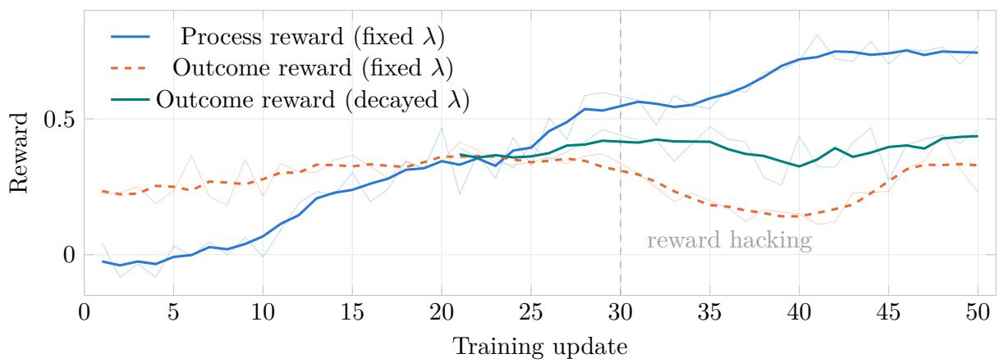  
Figure 3: Training dynamics of GRPO+PRM (fixed λ) and GRPO+PRM (decayed λ). Faint lines show recorded values; thick lines show centered five-observation moving averages. With a fixed weight, the process reward keeps rising while the outcome reward falls after update 30. The decayed-weight outcome curve uses the same observations as Figure 1(c), starting at update 21; lines connect available observations.

Observed degradation in OPSD (turn-level suggestions). The outcome and generation diagnostics make the degradation visible beyond the training objective. In OPSD (turn-level suggestions), mean training outcome reward decreases from 0.166 over updates 1–10 to 0.020 over updates 41–50, while mean generated assistant tokens per rollout decrease from 13.9k to 2.9k. For OPSD (reference answers), the corresponding outcome means are 0.255 and 0.245. Figure 5 shows larger teacher–student KL and gradient norms, together with generally lower later policy entropy, for the suggestion-conditioned run. Its gradient norm exceeds 1.0 on 22 of the 50 retained updates, compared with none for the reference-conditioned run. These observations document degradation in this configuration; they do not isolate its cause. The comparisons involve diferent sampled trajectories, and the OPSD variants use one rollout per task while the reward-based variants use eight.

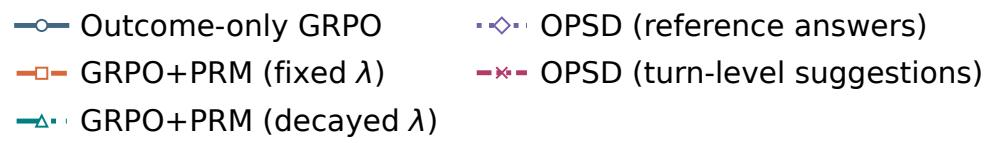

(a) Outcome reward  
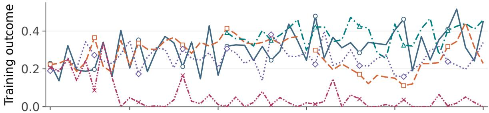

(b) Interaction length  
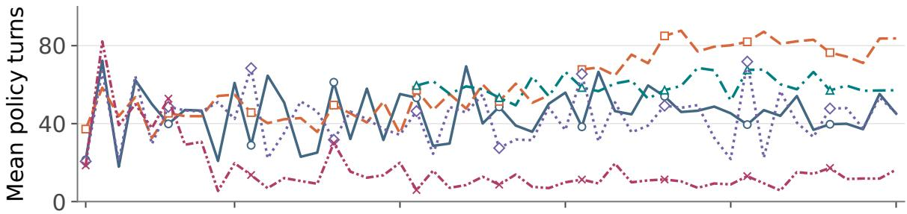

(c) Generated assistant tokens per rollout  
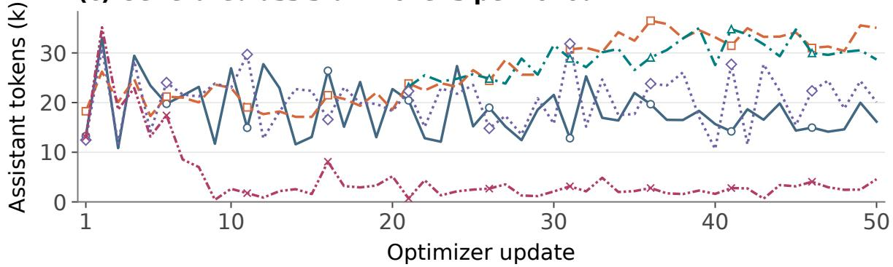  
Figure 4: Training dynamics of the five Qwen3.5-9B variants. Each point is an unsmoothed, recorded optimizer update: (a) outcome reward on training rollouts, (b) policy turns divided by the logged rollout count, and (c) logged mean assistant tokens per rollout. Outcome reward is monitored but not optimized by OPSD. Records are selected along the final checkpoint lineage. The missing fixed-weight update 30 is left as a gap. The decayed run starts at update 21 from the fixed-weight update-20 checkpoint; its earlier prefix is not replotted. These are individual training runs, with diferent rollout batches, not repeated held-out evaluation scores.

OPSD (reference answers) OPSD (turn-level suggestions)

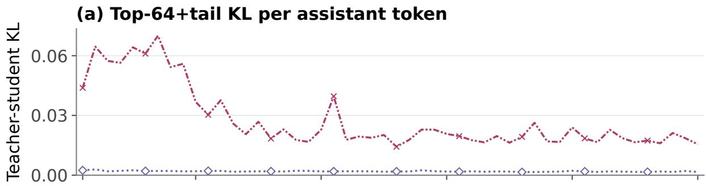

(b) Gradient norm before global clipping  
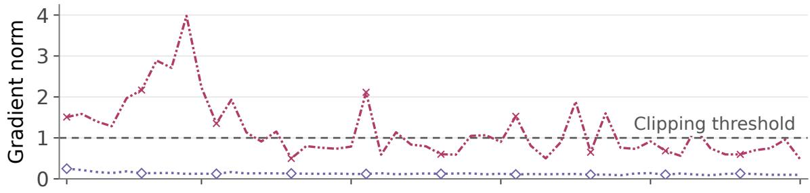

(c) Logged policy entropy  
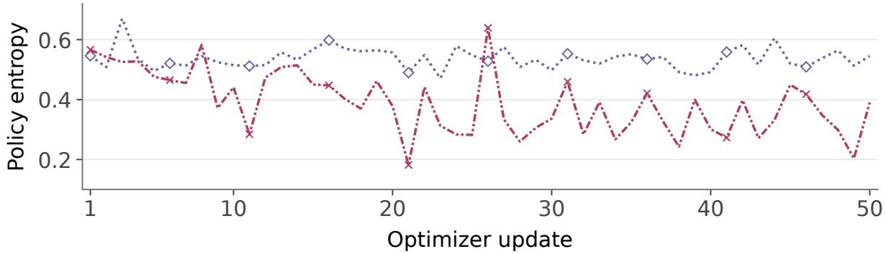  
Figure 5: Optimization diagnostics for the two reported OPSD runs over 50 retained optimizer updates. (a) Token-mean forward KL on the teacher’s top 64 tokens plus a tail class; (b) gradient norm before global clipping, with the threshold of 1.0 dashed; and (c) logged policy entropy. Points are unsmoothed records from the final checkpoint lineage, with repeated or superseded restart attempts excluded. The suggestion-conditioned run has larger KL and gradient norms and generally lower later entropy. These diagnostics accompany the outcome degradation in Figure 4; they do not establish a causal mechanism.