# When Respondents Are Scarce: LLM-Derived Semantic Priors for Bayesian Confirmatory Factor Analysis

Shaohuai Feng 1, Mohd Wira Mohd Shafiei 1,\*, Mohd Sukri Shafie 2,\*, Siyang Tian³

1 Centre for Global Sustainability Studies (CGSS), Universiti Sains Malaysia, Minden, Penang, Malaysia.

2 Centre for Education and Training in Renewable Energy, Energy Efficiency and Green Technology (CETREE), Universiti Sains Malaysia, Minden, Penang, Malaysia.

³ Centre for Instructional Technology and Multimedia, Universiti Sains Malaysia, Minden, Penang, Malaysia.

Email: 592236987zed@gmail.com (S.F.); fengshawyn@student.usm.my (T.S.).

\* Corresponding authors: msmwira@outlook.com (M.W.M.S.);

## Abstract

Across social and behavioral research, measuring latent constructs can be challenging when target populations are small or difficult to reach. Recruiting additional respondents may be costly or infeasible, leaving researchers with limited data for estimating questionnaire factor structures. Yet item wording contains structural expectations before data collection, and whether these can improve small-sample estimation without replacing empirical validation remains unclear. We introduce the Semantic – Empirical Updating Framework (SEUF), which converts large language model paraphrases and embeddings, aligned with hypothesized item-factor assignments, into prespecified priors for Bayesian confirmatory factor analysis. We evaluated SEUF using a 38-item survey of 617 industrial-park stakeholders and two public surveys, FEVS and RIASEC. Semantic structure persisted after wording controls across all three instruments. With 50 respondents, SEUF achieved loading precision comparable to conventional CFA with 70-82 respondents, equivalent to 29–39% fewer respondents at the specified precision benchmark. Results showed lower loading errors and improved credible-interval coverage relative to conventional CFA in both public surveys. Gains were greatest when respondent data were limited, highlighting the value of semantic priors under information scarcity. By harnessing structural information already embedded in questionnaires, SEUF advances a more resource-efficient approach to measurement and opens new directions for study design and empirical inference in hard-to-reach populations.

Keywords: Large language models; Semantic priors; Bayesian confirmatory factor analysis; Psychometrics; Small-sample estimation

## 1.0 Introduction

Psychometric inference is typically based on response data, although some measurement information is available before data collection. Item content is determined in advance through construct definitions and instrument-design decisions, whereas model parameters are estimated from observed response patterns. This distinction is important because collecting response data is costly, particularly for lengthy instruments, which has motivated the development of shorter validated measures (Chen et al., 2025). To address this problem, the key methodological question is whether information available before data collection can reduce reliance on respondent data. Bayesian structural equation modelling provides a principled framework for testing whether such prior information can be incorporated into estimation (Chen et al., 2024).The inferential consequences of a prior depend heavily on its accuracy and informativeness (Edeh et al., 2025). Thus, the practical difficulty is not merely the absence of previous knowledge. In psychometric applications, there are often no scalable, item-specific, and empirically calibrated sources from which to build informative priors. Formal expert elicitation is technically challenging and resource-intensive in contemporary Bayesian applications (Sehlabana et al., 2025). More recently, the idea of using large language models as sources of quantitative information for Bayesian prior elicitation has been investigated, but this approach treats the model as an expert-like source of knowledge (Selby et al., 2025). So the deeper question is what information is already embedded in the measurement instrument, and how can that information be given an explicit inferential role?

Questionnaire items are usually developed from existing theories, clinical descriptions, and prior literature. Their wording may therefore contain information about the constructs they are intended to measure. Recent studies have begun to extract this information using semantic embeddings. For example, item text has been used to predict which psychological items or scales are more strongly related (Wulff & Mata, 2025), to identify expected factor groupings in personality measures (Milano et al., 2025), and to approximate observed correlations among items in personality and psychopathology questionnaires (Ravenda et al., 2025; Kambeitz et al., 2025). These findings suggest that item text can provide useful information about item relationships before response data are collected. Semantic information and response data, however, should not be treated as equivalent sources of evidence. Item semantics largely reflect how a construct was defined and represented at the time of instrument development, while response data reflect how those items actually relate in a population. Thus, the factor structure inferred from item text may resemble the structure obtained from respondent data, but this resemblance is not evidence for empirical validity in itself. For instance, semantic and response-based factor structures may be quite similar, but the latter have stronger relations to external diagnostic histories (Kojima et al., 2026). Hence, semantic information can be used to capture the intended structure of an instrument, whereas response data provide additional evidence about the empirical structure. The methodological challenge is to use the former to inform estimation without replacing the latter. But it is not yet clear how to incorporate semantic information into psychometric estimation. Previous work has largely focused on the extent to which item embeddings can reproduce or predict structures in response data. Conversely, Bayesian measurement models provide a general framework for combining prior knowledge with empirical evidence. What remains is a pragmatic method of translating item-level semantic information into priors on measurement parameters. Importantly, such a method should distinguish information available from the item text prior to data collection from information provided by respondents. Without this distinction, similarity between semantic and empirical structures can be interpreted as empirical confirmation, and improvements in estimation efficiency cannot be clearly attributed to semantic information.

Existing studies have shown that item wording contains recoverable information about questionnaire structure, but this information has largely been used to reproduce or predict structures observed in response data. What remains unclear is how semantic information available before data collection can enter psychometric inference without being treated as respondent evidence.

This study makes three contributions.

Conceptually, SEUF reframes the small-sample measurement problem: rather than asking only how many additional respondents are needed, it examines how much structural information a questionnaire already provides before administration and how that information can improve estimation with limited responses. Methodologically, SEUF establishes semantic-prior construction as a pre-estimation step for small-sample questionnaire analysis, integrating LLM-derived item semantics with Bayesian CFA to supplement limited respondent data, while using matched-tightness controls to distinguish semantic contributions from general prior shrinkage. Empirically, across three questionnaires, SEUF achieved the loading precision of conventional CFA with 70–82 respondents using only 50, while reducing loading errors in two public surveys. These findings demonstrate its practical potential for preliminary factor analysis in small or hard-to-reach populations, where additional recruitment is difficult, while identifying the conditions under which semantic information adds value beyond general shrinkage.

## 2.0 Literature Review

## 2.1 Response burden and prior information in psychometric estimation

Psychometric inference is based on information from respondents and items. The amount of respondent information needed for stable latent-variable estimation depends on sample size, model complexity, and prior informativeness (Edeh et al., 2025). Thus, complex structural equation models can still be difficult to estimate with limited samples (Cox & Kelcey, 2025). The second cost is the length of the instrument. More lengthy assessments can lead to increased respondent burden and insufficient-effort responding (Ulitzsch et al., 2025). Therefore, response burden and item wording are important determinants of measurement quality, not merely practical concerns in questionnaire administration (Eisele et al., 2025). However, traditional item-reduction methods rely on response data collected from the full instrument. As a result, identifying items that can be removed requires respondents to first complete those same items, creating a practical tension between item screening and the goal of reducing response burden.

Bayesian inference provides a formal way of changing this information balance. Informative priors can stabilize estimation if they encode sufficiently accurate information about the parameters being estimated (Edeh et al., 2025). However, their benefits are conditional, as prior specification can also influence bias, uncertainty, and model-fit behavior (Bhangale & Jorgensen, 2025). Bayesian fit indices may respond differently to model misspecification under different prior specifications (Liu et al., 2025). Small variance priors can also produce misleading signals when prior assumptions contradict the fitted model (Depaoli et al., 2025). Therefore, posterior concentration alone should not be interpreted as a general improvement in estimation. In the present context, efficiency is evaluated relative to a prespecified precision criterion and should be interpreted alongside prior–data agreement and model-fit behavior. This distinction is especially important when informative priors are used to justify smaller samples. The main limitation is thus not the absence of Bayesian machinery. The challenge is in obtaining prior information on the parameters that is both scalable and defensible. Structured expert elicitation is resource- and technically demanding (Sehlabana et al., 2025). This burden becomes large in psychometric models because the prior specification may need to account for a multitude of item-factor relations. Recently, large language models have been investigated as quantitative sources for Bayesian prior elicitation (Selby et al., 2025). This strategy is useful but treats the model itself as an information source like an expert. The wording of the items themselves provides a different source of knowledge that is independent of the model used to extract it. The key question is whether information available from item wording before data collection can be translated into informative priors and calibrated using empirical data.

## 2.2 Item text as pre-data structural information

Recent advances in language modeling have made item-level structural information computable. Semantic embeddings can encode psychological items and constructs in a shared space and can predict empirically found relations between psychological measures (Wulff & Mata, 2025). The wording of the items therefore contains recoverable information about relations which are conventionally estimated following the administration of the questionnaire. This correlation shows up at the level of inter-item covariance. To a large extent, the semantic relations between questionnaire items match empirical correlation patterns (Ravenda et al., 2025). The correspondence is also valid for multidimensional structure (Milano et al., 2025; Kambeitz et al., 2025). Text-derived structure may also support pre-data model diagnosis. SEMbeddings builds surrogate matrices for confirmatory factor analysis based on embedding-based item similarities prior to the collection of new response data (Feraco & Toffalini, 2024). This approach shows that semantic structure can guide model evaluation prior to conventional empirical estimation. Language models are also being applied at an earlier stage of the measurement process: instrument development. Multi-agent systems can generate and evaluate candidate psychological items with explicit human review stages (Lee et al., 2026). In addition, language models are used in item development in human-in-the-loop approaches, but not as a replacement for subsequent requirements for psychometric validation (Mara & Rybak, 2026).

These findings do not mean that semantic information can replace respondent data. Semantic similarity may reflect both construct-relevant content and similarities in wording, while empirical responses capture how items actually function among respondents (Garrido et al., 2025). Thus, item semantics provide information available before data collection, whereas response data provide additional evidence about how items behave in practice. The unresolved question is therefore not whether item text contains structural information, but how this information can be incorporated into psychometric inference without being treated as evidence supplied by respondents.

## 2.3 Semantic expectations and incremental respondent data

When semantic information is treated as information available before data collection, the inferential question changes. Rather than asking whether item text can reproduce the structure later observed in response data, we ask what structure can be expected from item text before administration and how that expectation changes after respondent data are observed. In a Bayesian framework, the text-derived expectation is represented as a prior and is updated by response data to form the posterior. The difference between the prior and posterior therefore reflects the additional information contributed by respondents.

Bayesian adaptive procedures already quantify the value of additional observations through expected information gain, using Bayesian updating to evaluate how much uncertainty is reduced by new data (Sloman et al., 2024). The same logic can be applied to measurement parameters instead of respondent scores. The question becomes whether responses change what was already expected about the structural role of an item from its wording. This is a different approach from the usual screening of items. Traditional procedures ask whether an item functions adequately after administration. Residual local dependence can reflect associations among item responses not accounted for by the standard factor structure (Ferrando et al., 2025). Wording-effect models can identify method variance that biases item–factor relations (Garrido et al., 2025). These approaches measure psychometric behavior. The incremental-information analysis asks a different question. An item can have strong loading and acceptable model behavior but offer little structural information in its responses beyond an accurate semantic expectation. This does not mean that such an item is psychometrically weak. Or it might be information that is redundant to what was already knowable before the data collection. The converse is important too. A large prior-to-posterior change does not necessarily mean a bad item. It indicates that the respondents gave information that was not expected by the semantic expectation.

This difference changes how efficiency must be judged. A semantic prior may reduce respondent requirements for a specified estimation objective when smaller samples achieve posterior precision comparable to a larger-sample weak-prior benchmark. Such gains should therefore be interpreted as precision-based efficiency under the specified model and prior, rather than as evidence that all aspects of estimation quality are preserved (Bhangale & Jorgensen, 2025). Thus, apparent efficiency should be distinguished from posterior concentration that results only from a tight prior. Previous work has established three important pieces. Bayesian psychometrics provides methods for combining prior information with observed data. Semantic psychometrics shows that item wording contains information about measurement structure. Conventional psychometric methods show how items behave once response data are collected. What remains unresolved is how to convert semantic information into a calibrated prior and then determine how much additional information is contributed by respondents.

## 3.0 Methodology

## 3.1 Conceptual and analytical framework

The framework separates two sources of information in questionnaire analysis: information that is available from item wording before any responses are collected, and information that is added by respondent data. Item wording is first converted into a semantic expectation about the loading structure, after testing how much of that expectation can be explained by lexical overlap or repeated phrasing (Section 3.2). The paraphrase-controlled expectation is then frozen as an informative prior,

$\varLambda _ { p r i o r }$ , and combined with respondent data in a Bayesian confirmatory factor analysis (CFA) to yield

the posterior loading matrix $\varLambda _ { p o s t }$ (Section 3.3). The prior-to-posterior movement, �, indicates how much the responses changed what was already expected from the wording (Figure 1).

The analyses address three aims. First, we test whether the structure recovered from item text survives lexical and paraphrase controls (Section 3.2). Second, we examine whether the semantic prior allows target loadings to be estimated with a given precision from fewer respondents than the conventional confirmatory factor analysis that applied researchers would otherwise use (Sections 3.3–3.5). Third, we examine whether these findings generalize to two large public surveys, which also provide near-population reference values for checking whether gains in precision are accompanied by gains in accuracy. Precision and accuracy are evaluated separately, because a tight prior can make a posterior narrow without making it correct (Section 3.5).

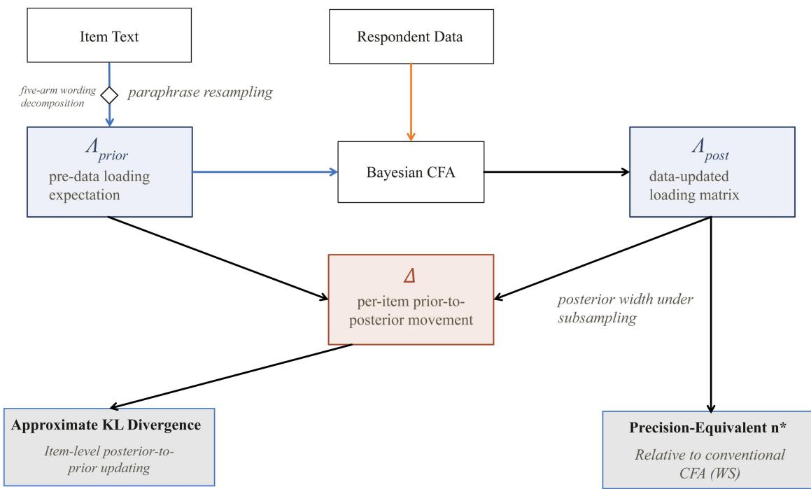  
Figure 1. Conceptual framework of semantic-prior updating and subsequent analyses

## 3.2 Evaluating lexical and template confounding

To test whether the factor structure recovered from item text was driven by lexical or template-level regularities, we compared five similarity representations: raw-text, lexical-only, residualized, boilerplate-stripped and paraphrase-controlled similarity. Items were encoded with a multilingual sentence-embedding model (Table 2). Raw-text similarity was the cosine similarity between the embeddings of the original items. Lexical-only similarity was predicted from surface-form features (token overlap, character n-grams, TF-IDF overlap, shared leading stems and length). Residualized similarity was obtained by partialling these features out of Fisher-�-transformed raw similarities. Boilerplate-stripped similarity was recomputed after removing tokens that occurred in at least half of the items. For the paraphrase-controlled representation, 30 meaning-preserving rewrites were generated per item while instrument-specific template phrases were prohibited, and each item was represented by the $\ell _ { 2 } \mathrm { - n o r m a l i z e d }$ centroid of its paraphrase embeddings.

For each representation �, the standardized block contrast was calculated as

$$
B C _ { a } = \frac { \overline { { S } } _ { a , w i t h i n } - \overline { { S } } _ { a , b e t w e e n } } { \mathrm { S D } ( S _ { a } ) }\tag{1}
$$

where $\overline { { S } } _ { a , w i t h i n }$ and $\overline { { S } } _ { a , b e t w e e n }$ are the mean similarities of item pairs within and between hypothesised factors. The share of the raw-text structure retained by representation � was

$$
R _ { a } = \frac { B C _ { a } } { B C _ { r a w } }\tag{2}
$$

Agreement between data-driven clusters of each similarity matrix and the hypothesised factor assignment was summarised with the adjusted Rand index (ARI). To test whether the block contrast

exceeded chance, factor labels were permuted $B = 5 0 0 0$ times, and the permutation � score and one-sided � value were computed as

$$
z _ { a } = \frac { B C _ { a } - \mathrm { m e a n } ( B C _ { a } ^ { p e r m } ) } { \mathrm { S D } ( B C _ { a } ^ { p e r m } ) }\tag{3}
$$

$$
p _ { a } = \frac { 1 + \sum _ { b = 1 } ^ { B } \mathbb { I } \left( B C _ { a , b } ^ { p e r m } \ge B C _ { a } \right) } { B + 1 }\tag{4}
$$

The raw-text representation served as the reference. The lexical-only representation quantifies the contribution of surface form, and the paraphrase-controlled representation tests whether the structure persists when the original wording is varied.

## 3.3 Constructing the semantic prior

Let $\lambda _ { i } \in \mathbb { R } ^ { k }$ denote the loading vector of item � on � factors, and let � be the paraphrase-controlled item-similarity matrix. Because � need not be positive semidefinite, it was shrunk toward the identity by the smallest amount that restored positive definiteness. Principal-axis factoring with � factors was applied, and the unrotated loadings were aligned with the hypothesised binary target matrix � by orthogonal Procrustes rotation. Because the rotation targets the researcher's item-to-factor assignment, the prior combines information from item text with the hypothesised measurement design; it uses no response data.

Raw similarity-based loadings were mapped to the Bayesian CFA loading-parameter scale using a fixed, data-free calibration. The constants (0.60, 0.75, ±0.40, and 0.15) were chosen heuristically and fixed before fitting any of the three datasets, without using respondent data. Let $\tilde { \lambda } _ { i j }$ denote the

Procrustes-rotated PAF loading and $\bar { \bar { \lambda } } _ { T }$ the mean of all rotated target loadings within each instrument.

The prior-location parameters were calculated as follows: $m _ { i j } = \left\{ \begin{array} { c } { { 0 . 6 0 + 0 . 7 5 ( \tilde { \lambda } _ { i j } - \bar { \tilde { \lambda } } _ { T } ) , t _ { i j } = 1 , } } \\ { { \operatorname* { m a x } \{ - 0 . 4 0 , \operatorname* { m i n } ( 0 . 4 0 , \tilde { \lambda } _ { i j } ) \} , t _ { i j } = 0 } } \end{array} \right.$

All prior standard deviations were fixed at $s _ { i j } { = } 0 . 1 5$ . The prior for each loading was

$$
p ( \lambda _ { i j } ) { = } \left\{ \begin{array} { l l } { T N _ { [ 0 , \infty ) } ( m _ { i j } , s _ { i j } ^ { 2 } ) , t _ { i j } = 1 } \\ { \quad N ( m _ { i j } , s _ { i j } ^ { 2 } ) , t _ { i j } = 0 } \end{array} \right.\tag{5}
$$

Here, $t _ { i j } { = } 1$ denotes a hypothesised target loading and $t _ { i j } { = } 0$ a cross-loading. The priors were placed on the model loading parameters $\lambda _ { i j }$ , rather than the fully standardized loadings $\lambda _ { i j } ^ { * }$ evaluated in Section 3.5. The prior matrices were frozen before posterior inspection (CRAEIP: f9557e8e…; FEVS: a58b6a16…; RIASEC: 98598fa7…).

## 3.4 Bayesian CFA and comparison models

Five-point Likert responses were treated as continuous, and each item was standardized to mean 0 and standard deviation 1 within each analysed sample. The observation model was

$$
y \sim N ( 0 , \varLambda \phi \varLambda ^ { ' } + \mathrm { d i a g } ( \psi ) )\tag{6}
$$

with factor correlations $\phi$ following an LKJ prior with concentration $\eta = 2$ (factor variances fixed at 1) and residual variances following half-normal(1) priors. The likelihood was evaluated from the sample covariance matrix, and posterior draws were obtained with the No-U-Turn sampler.

To judge the semantic prior against what applied researchers actually use, two simple-structure models were fitted to every subsample (Table 2). In both, each item loads only on its hypothesised factor and cross-loadings are fixed at zero. WS is the conventional CFA, with weakly informative $T N _ { [ 0 , \infty ) } ( 0 , 1 )$ target-loading priors, and serves as the benchmark. SS uses the semantic prior of Equation (5) for the target loadings. At the full sample, the specification in which all $p \times k$ loadings are free was also fitted with a weak prior (WX: $T N _ { [ 0 , \infty ) } ( 0 , 1 )$ targets, $N ( 0 , 0 . 2 0 ^ { 2 } )$ cross-loadings) and with the semantic prior on all cells (SX), to examine global fit and item-level updating when cross-loadings are estimated.

## 3.5 Respondent requirements and evaluation criteria

Respondent requirements were evaluated by subsampling. For each instrument, subsamples of $n \in \{ 5 0 , 7 5 , 1 0 0 , 1 5 0 , 2 5 0 , 4 0 0 , 6 1 7 \}$ respondents were drawn without replacement (20 independent subsamples per � ), and both models were fitted to the same subsamples, so that comparisons are paired. For Table 5, five independent subsamples of $\mathtt { n } = 7 0 0$ were used for each public survey (FEVS and RIASEC), separately from the 20-replicate subsampling analysis. For the CRAEIP questionnaire, $n = 6 1 7$ is the complete sample and was refitted with four Markov chain Monte Carlo (MCMC) seeds. All criteria were computed over the set $\mathcal { T }$ of hypothesised target loadings, on the fully standardized scale $\lambda _ { i j } ^ { * } = \lambda _ { i j } / \sqrt { { \varSigma } _ { i i } }$ evaluated for every posterior draw, so that all models and the reference share one metric. Precision was the mean posterior standard deviation:

$$
\overline { { \sigma } } ( n ) = \frac { 1 } { | \mathcal { T } | } \sum _ { ( i , j ) \in \mathcal { T } } \operatorname { S D } _ { p o s t } { ( \lambda _ { i j } ^ { * } ) }\tag{7}
$$

Precision alone cannot establish reliable measurement, because a tight prior narrows the posterior whether or not it is correct. For the two public surveys, accuracy was therefore measured against near-population reference loadings $\lambda _ { i j } ^ { r e f }$ : standardized maximum-likelihood estimates of the simple-structure CFA fitted to the complete samples (FEVS, $N = 6 2 7 2 6$ ; RIASEC, $N = 1 3 5 7 6 4 )$ These references are model-based estimates rather than known population values. The root-mean-square error of the posterior-mean loadings $\hat { \lambda } _ { i j } ^ { * }$ and the coverage of the 95% credible intervals were in Equation (8 and 9)

$$
R M S E ( n ) = \sqrt { \frac { 1 } { | \mathcal { T } | } \sum _ { ( i , j ) \in \mathcal { T } } { ( \hat { \lambda } _ { i j } ^ { * } - \lambda _ { i j } ^ { r e f } ) ^ { 2 } } }\tag{8}
$$

$$
C o v ( n ) = \frac { 1 } { | \mathcal { T } | } \sum _ { ( i , j ) \in \mathcal { T } } \mathbb { I } ( \lambda _ { i j } ^ { r e f } \in C r I _ { 9 5 } ( \lambda _ { i j } ^ { * } ) )\tag{9}
$$

Reliability was summarised by factor-level coefficient omega computed for each draw from the standardized loadings in Equation (10),

$$
\omega _ { f } = \frac { ( \sum _ { i \in f } \lambda _ { i f } ^ { * } ) ^ { 2 } } { ( \sum _ { i \in f } \lambda _ { i f } ^ { * } ) ^ { 2 } + \sum _ { i \in f } ( 1 - \lambda _ { i f } ^ { * 2 } ) }\tag{10}
$$

and its error was the mean absolute difference between the posterior-mean $\omega _ { f }$ and the reference omega computed in the same way from $\lambda ^ { r e f }$

Comparisons with WS were made on paired differences (SS minus WS on the same subsample), summarised by their mean and a 95% bootstrap interval over the 20 subsamples. Respondent efficiency was expressed as the WS-equivalent sample size: the number of respondents the conventional CFA needs to reach the precision (or accuracy) that SS attains at � , obtained by log-linear interpolation of the WS curve. Convergence was assessed with $\widehat { R }$ and bulk effective sample size over all sampled parameters (target loadings, residual variances and factor correlations).

## 3.6 Item-level updating, negative control and item screening

At the item level, prior-to-posterior updating was summarized using an approximate posterior-to-prior Kullback–Leibler divergence for each item's loading vector in Equation (11),

$$
D _ { K L , i } = \frac { 1 } { | V _ { i } | } \sum _ { s \in V _ { i } } [ \log q _ { i } ( \lambda _ { i } ^ { ( s ) } ) - \log p _ { i } ( \lambda _ { i } ^ { ( s ) } ) ]\tag{11}
$$

where $q _ { i }$ is a multivariate normal approximation fitted to the posterior draws using their empirical mean and covariance, $p _ { i }$ is the exact prior density, and $V _ { i }$ is the set of posterior draws for which both log densities are finite. For each retained draw, the log-density difference was evaluated and averaged over $V _ { i }$ (in nats). Because the posterior density was approximated and the divergence evaluated using Monte Carlo draws, this measure represents an approximate posterior-to-prior divergence rather than an exact information gain. Prior–data agreement was checked by the standardized displacement of each posterior target mean from its prior mean, and the share of items within ±2 prior standard deviations is reported. KL rankings under the semantic and weak priors were compared with Spearman's $\rho .$

To separate semantic alignment from prior tightness, two matched-tightness controls were evaluated. Shuffled-SS reassigned item-specific semantic prior means using a seeded derangement while preserving the original target-loading mask and prior standard deviations. Common-prior used a shared target-loading prior mean within each instrument, with prior SDs and the target mask unchanged. For CRAEIP, loading RMSE and coverage were evaluated against standardized loadings from the full-sample simple-structure CFA (N = 617), serving as an internal model-based reference rather than population ground truth.

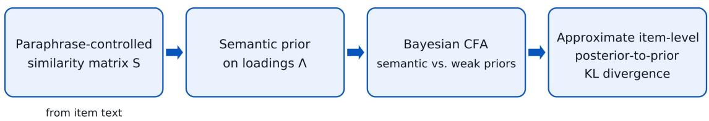  
Figure 2. From item wording to item-level information gain

## 4.0 Experiments and Discussion

## 4.1 Experimental setup

## 4.1.1 Instruments and samples

The primary instrument was the Circular Resource Allocation Efficiency in Industrial Parks (CRAEIP) questionnaire, developed by the authors' research centre [institution blinded for review]. It was developed within a prespecified multidimensional framework, reviewed by domain experts and finalized with 38 items across nine theoretically defined constructs. Questionnaire development and pre-study validation, including expert review, content validation, cognitive pretesting and pilot testing, were completed before the present analysis and are documented in Supplementary Information S1. Participants were recruited from four zero-carbon industrial parks through on-site contact, online communication platforms and community groups, and referral. Of 880 questionnaires distributed, 772 were returned (87.73%), and 617 were retained after data-quality screening (79.92% of returned questionnaires; overall usable yield 70.11%). Exclusions mainly reflected invalid responses, including failed attention-check items. Respondents came from diverse professional roles, organisational settings and levels of familiarity with the parks (Figure 3). Because industrial-park stakeholders are a small and hard-to-reach population, this sample illustrates the setting in which reducing respondent requirements matters most.

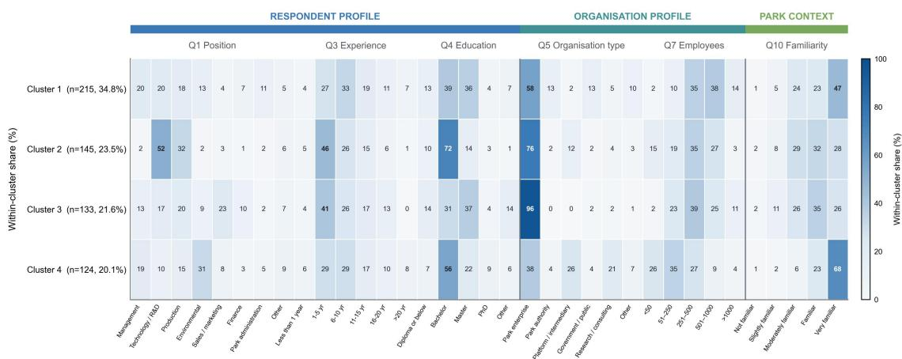  
Figure 3. Respondent profile clusters

Responses were recorded on a five-point Likert scale, and construct scores were calculated as the mean of each construct's items. Mean construct scores ranged from 2.970 (PV) to 3.498 (ICI), with standard deviations between 0.870 and 0.983 (Table 1). Distributions showed limited skewness (−0.371 to 0.044) and negative excess kurtosis (−0.799 to −0.472). All pairwise Spearman correlations between construct scores were positive and moderate, with no pair showing an exceptionally high correlation (Figure 4).

Table 1. Descriptive statistics and distribution of constructs
<table><tr><td>Construct</td><td>No. of items</td><td>Mean</td><td>SD</td><td>Median</td><td>IQR</td><td>Skewness</td><td>Excess kurtosis</td></tr><tr><td>IGA</td><td>4</td><td>3.246</td><td>0.887</td><td>3.25</td><td>1.25</td><td>-0.227</td><td>-0.472</td></tr><tr><td>MPI</td><td>4</td><td>3.017</td><td>0.97</td><td>3</td><td>1.5</td><td>-0.050</td><td>-0.754</td></tr><tr><td>ICI</td><td>4</td><td>3.498</td><td>0.891</td><td>3.5</td><td>1.25</td><td>-0.371</td><td>-0.568</td></tr><tr><td>DTCG</td><td>4</td><td>3.129</td><td>0.921</td><td>3</td><td>1.25</td><td>-0.078</td><td>-0.678</td></tr><tr><td>RICC</td><td>4</td><td>3.182</td><td>0.958</td><td>3.25</td><td>1.5</td><td>-0.123</td><td>-0.716</td></tr><tr><td>BRNC</td><td>5</td><td>3.246</td><td>0.948</td><td>3.2</td><td>1.4</td><td>-0.162</td><td>-0.704</td></tr><tr><td>RME</td><td>4</td><td>3.288</td><td>0.95</td><td>3.25</td><td>1.5</td><td>-0.225</td><td>-0.752</td></tr><tr><td>COE</td><td>4</td><td>3.215</td><td>0.87</td><td>3.25</td><td>1.25</td><td>-0.078</td><td>-0.536</td></tr><tr><td>PV</td><td>5</td><td>2.97</td><td>0.983</td><td>3</td><td>1.4</td><td>0.044</td><td>-0.799</td></tr></table>

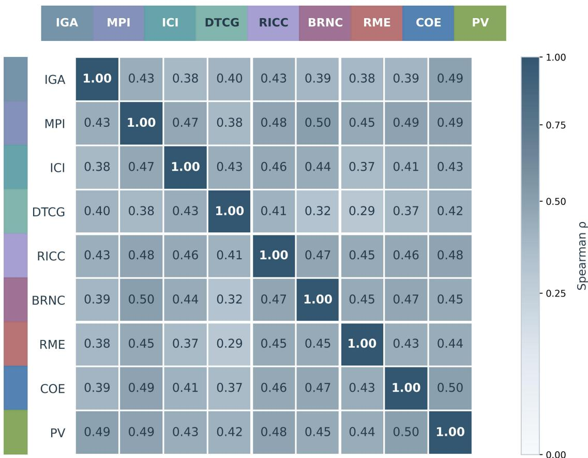  
Figure 4. Construct correlation matrix

Two public datasets were used to test whether the findings generalize beyond the CRAEIP questionnaire and to provide near-population reference values against which reduced-sample estimates can be judged. The first was the 2024 Federal Employee Viewpoint Survey (FEVS) Public Release Data File (U.S. Office of Personnel Management, 2024). Whole OPM-defined index components with explicit item-to-dimension assignments were retained: Global Satisfaction (4 items), Performance Confidence (4 items), the three Employee Engagement sub-indices—Intrinsic Work Experience, Leaders Lead and Supervisors (5 items each)—and Employee Experience (5 items), giving 28 items on six dimensions. After out-of-scale codes were recoded to missing, 62,726 of 87,321 respondents had complete responses on all 28 items. The second was the Holland Code (RIASEC) dataset of the Open-Source Psychometrics Project (2018), with 48 Likert-rated vocational-interest items on six dimensions (Realistic, Investigative, Artistic, Social, Enterprising and Conventional) based on the public-domain RIASEC marker scales (Armstrong et al., 2008); 135,764 of 145,828 respondents were complete cases. Because the two surveys differ from the CRAEIP questionnaire and from each other in content, dimensionality and population, they provide two independent tests.

## 4.1.2 Implementation settings

Table 2 lists the frozen implementation. The paraphrase generator, encoder, decoding policy and prior construction were fixed before any confirmatory posterior was inspected and were applied unchanged to all three instruments, so differences between similarity representations, prior specifications and instruments reflect the intended contrasts rather than later adjustments to the text models.

Table 2. Implementation settings
<table><tr><td>Component</td><td>Setting</td></tr><tr><td>Paraphrase generation model</td><td>Qwen3.5 9B; 30 paraphrases per item; temperature 1.0, top-p 0.95</td></tr><tr><td>Text embedding model</td><td>Qwen3 Embedding 4B; local inference via Ollama (no external API)</td></tr><tr><td>Semantic prior</td><td>PAF + Procrustes to target; target means calibrated (location 0.60, scale 0.75); cross-loading means truncated to ±0.40; all SDs 0.15</td></tr><tr><td>Weak prior</td><td>Target  $T N _ { [ 0 , \infty ) } ( 0 , 1 )$   $N ( 0 , 0 . 2 0 ^ { 2 } )$  ; cross-loadings (WX only)</td></tr><tr><td>Factor correlations / residuals</td><td>LKJ(η = 2) / half-normal(1)</td></tr><tr><td>Sampler</td><td>NUTS (NumPyro); target acceptance 0.90</td></tr><tr><td>Posterior fits reported in Tables 4–5</td><td>4 chains × 1,000 warm-up + 1,000 draws</td></tr><tr><td>Subsampling fits (Sections 2 chains × 500 warm-up + 500 draws;</td><td> $\hat { \mathrm { R } }$  and ESS over all</td></tr><tr><td>4.2.4–4.2.5) Subsample grid</td><td>sampled parameters n = 50, 75, 100, 150, 250, 400, 617; 20 subsamples per n</td></tr><tr><td>Population references</td><td>Standardized ML simple-structure CFA (semopy) on the complete FEVS (N = 62,726) and RIASEC (N = 135,764)</td></tr><tr><td>Evaluation scale</td><td>samples Fully standardized loadings  $\lambda / \sqrt { \varSigma _ { i i } }$  per posterior draw</td></tr><tr><td>Primary sample</td><td>CRAEIP, n = 617 complete cases</td></tr><tr><td>(Table 5)</td><td>Cross-instrument validation FEVS and RIASEC: 5 independent subsamples of n = 700 per survey</td></tr></table>

## 4.2 Results and discussion

## 4.2.1 Wording sensitivity and residual semantic structure

Figure 5 decomposes item similarity into the five representations (Panels A–E) and summarises the construct-level contrast that survives paraphrasing (Panel F). The block pattern of the hypothesised factors is visible in all five representations; only the residualized matrix shows clear attenuation. Lexical information therefore carries part, but not all, of the structure. Construct-level retention after paraphrasing differed markedly. IGA, DTCG and RME retained 95.9%, 82.9% and 87.6% of their raw contrasts; ICI and COE retained 109.1% and 101.4%, and PV 135.1%. RICC (61.5%) and BRNC (56.5%) retained less, and MPI only 23.9%. Retention above 100% does not indicate better construct validity; it most likely reflects paraphrasing removing superficial overlap between constructs and leaving construct-specific content.

A  
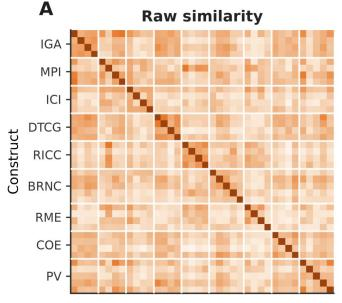

B  
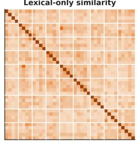

C  
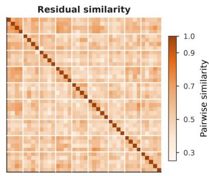

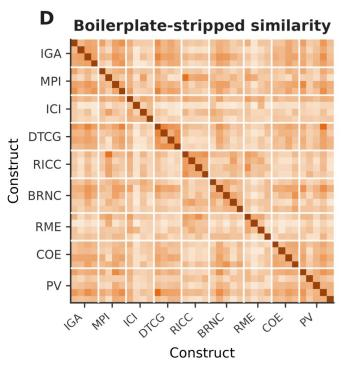

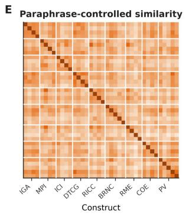

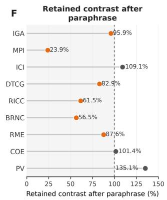  
Figure 5. Five-arm wording decomposition

At the questionnaire level (Table 3), lexical-only similarity reproduced 82.9% of the raw block contrast (1.056) and the raw cluster ARI (0.140). Removing boilerplate retained 85.1% of the contrast and meaning-preserving paraphrase 83.7%, so the block organization largely survives when repeated template wording is removed or surface formulations are changed. Residualization reduced the contrast to 63.3% and the ARI to 0.079. The paraphrase representation retained 83.7% of the contrast but had a lower ARI (0.089), indicating that the factor blocks are separated on average but are not cleanly recoverable by unsupervised clustering. Permutation tests were significant for every representation $( \mathrm { z } = 6 . 0 0 \mathrm { - 9 . 5 8 , p < . 0 0 1 ) }$ .

Table 3. Global comparison across similarity representations
<table><tr><td>Arm</td><td>Block contrast</td><td>Share of raw contrast</td><td>Cluster ARI</td><td>Permutation z</td><td>p</td></tr><tr><td>Raw</td><td>1.056</td><td>100.00%</td><td>0.140</td><td>9.58</td><td>***</td></tr><tr><td>Lexical-only</td><td>0.876</td><td>82.90%</td><td>0.140</td><td>7.30</td><td>***</td></tr><tr><td>Residual</td><td>0.668</td><td>63.30%</td><td>0.079</td><td>6.00</td><td>***</td></tr><tr><td>Stripped</td><td>0.899</td><td>85.10%</td><td>0.122</td><td>8.44</td><td>***</td></tr><tr><td>Paraphrase</td><td>0.884</td><td>83.70%</td><td>0.089</td><td>8.82</td><td>***</td></tr></table>

Note. \*\*\* $\mathsf { p } < . 0 0 1$ , one-sided permutation test (5,000 label permutations). ARI = adjusted Rand index.

Wording-related regularities therefore contribute substantially to the apparent questionnaire structure but do not fully account for it. Wording dependence is partial and construct-specific rather than a uniform property of the instrument. This motivates using the paraphrase-controlled representation, rather than raw text, as the basis of the semantic prior.

## 4.2.2 Behaviour of the semantic prior at the full sample

Table 4 compares the pair of free-cross-loading specifications, which differ only in prior hyperparameters (SX and WX), on the complete CRAEIP sample. Global fit was virtually unchanged: $\chi ^ { 2 } ( 3 2 5 ) = 4 5 4 . 3 2 $ versus 454.78, with identical RMSEA (.025), CFI (.988) and TLI (.974); plug-in SRMR was lower under the semantic prior (.019 vs. .042). The semantic prior reduced the mean posterior SD of the target loadings from .171 to .056, increased the minimum bulk effective sample size from 1,899 to 3,049 and roughly halved sampling time (103 vs. 194 s). The posterior target loadings were, however, systematically smaller under the semantic prior (mean 0.739, item range 0.618–0.861) than under the weak prior (mean 1.056, item range 0.866–1.363). Weak-prior target loadings above 1 on standardized items indicate that, with all cross-loadings free, target and cross-loadings trade off against each other and are only weakly identified. This is why the WX model is a poor precision benchmark and why the conventional simple-structure CFA is used as the benchmark in Sections 4.2.4–4.2.5.

Table 4. Full-sample comparison of the semantic (SX) and weak (WX) specifications, CRAEIP (n = 617)
<table><tr><td>Measure</td><td>Semantic prior (SX)</td><td>Weak prior (WX)</td></tr><tr><td>x²(325)</td><td>454.32</td><td>454.78</td></tr><tr><td>RMSEA/CFI / TLI</td><td>.025 / .988 / .974</td><td>.025 / .988 / .974</td></tr><tr><td>SRMR</td><td>.019</td><td>.042</td></tr><tr><td>Max R / min bulk ESS</td><td>1.004 / 3,049</td><td>1.003 / 1,899</td></tr><tr><td>Sampling time (s)</td><td>103</td><td>194</td></tr><tr><td>Mean posterior SD, target loadings</td><td>.056</td><td>.171</td></tr><tr><td>Mean (range) posterior target loading</td><td>.739 (.618–.861)</td><td>1.056 (.866–1.363)</td></tr><tr><td>Items within ±2 prior SD (prior–data check)</td><td>97.4% (RME3 outside)</td><td></td></tr><tr><td>Spearman ρ, item KL ranks, semantic vs. weak</td><td>.08</td><td></td></tr></table>

Note. Fit indices are descriptive plug-in values from the posterior-mean model-implied covariance matrix.

Item-level updating also differed between priors. KL rankings under the two priors were nearly unrelated (ρ = .08; Figure 6): RME3 moved from rank 30 under the weak prior to rank 1 under the semantic prior, whereas BRNC1 moved from rank 1 to rank 26. Large rank shifts flag items whose wording-based expectation diverges from the observed responses and can guide closer inspection, but they reflect prior-dependent updating rather than item quality.

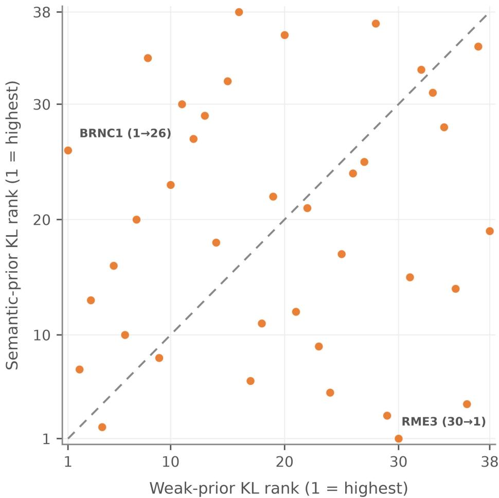  
Figure 6. Item-level KL rank agreement across priors

## 4.2.3 Semantic structure across questionnaires

The two public surveys were used to test whether the main findings extend beyond the CRAEIP questionnaire (Table 5). The semantic structure generalized well. After paraphrase control, the block contrast was 0.837 of its raw-text value in CRAEIP, 1.071 in FEVS and 1.266 in RIASEC, and agreement between paraphrase-based clusters and the hypothesised dimensions was higher in the public surveys (ARI = 0.356 and 0.691) than in CRAEIP (0.089). All permutation tests were significant $( \mathrm { z } = 8 . 8 2 \mathrm { - } 2 0 . 9 2 , \mathrm { p } < . 0 0 1 )$ . The frozen semantic priors were also compatible with the response data in all three instruments: the prior-predictive check passed, and 97.4%, 99.3% and 95.0% of items had posterior target loadings within ±2 prior SDs of their prior means. Mean approximate item-level posterior-to-prior divergences were 4.14, 3.81 and 4.53 nats for CRAEIP, FEVS and RIASEC, respectively. Because the loading-vector dimensions differ across instruments, these values should not be interpreted as directly comparable amounts of respondent information.

Table 5. Cross-instrument validation of the semantic-prior framework
<table><tr><td>Measure</td><td>CRAEIP</td><td>FEVS</td><td>RIASEC</td></tr><tr><td>Items (factors)</td><td>38 (9)</td><td>28 (6)</td><td>48 (6)</td></tr><tr><td>Respondent samples for Bayesian diagnostics</td><td>617</td><td>5×700</td><td>5×700</td></tr><tr><td>Lexical-only share of raw block contrast</td><td>0.829</td><td>0.763</td><td>0.797</td></tr><tr><td>Paraphrase-controlled share of raw block contrast</td><td>0.837</td><td>1.071</td><td>1.266</td></tr><tr><td>Cluster ARI, paraphrase-controlled</td><td>0.089</td><td>0.356</td><td>0.691</td></tr><tr><td>Permutation z, paraphrase-controlled</td><td>8.82***</td><td>10.28***</td><td>20.92***</td></tr><tr><td>Prior-predictive check</td><td>Pass</td><td>Pass</td><td>Pass</td></tr><tr><td>Items within ±2 prior SD, %</td><td>97.4</td><td>99.3 (1.6)</td><td>95.0 (1.1)</td></tr><tr><td>Mean item KL, nats</td><td>4.14</td><td>3.81 (0.06)</td><td>4.53 (0.06)</td></tr></table>

Note. FEVS and RIASEC Bayesian diagnostics used five independent subsamples of n = 700 (mean [SD] where applicable). Semantic statistics were derivedfrom item text only. \*\*\* p < .001, one-sided permutation test (5,000 permutations).

## 4.2.4 Respondent efficiency relative to a conventional CFA

The respondent-efficiency analysis tested whether semantic priors reduced the sample size needed to achieve a given level of loading precision. Paired comparisons between SS and the conventional CFA (WS) held the simple-structure specification constant to isolate the target-loading prior's contribution (Table 6 and Figure 7). Using WS as the benchmark avoids inflating the apparent benefit of semantic information through uncertainty from weakly identified cross-loadings in WX.

Semantic priors improved precision across all three instruments, with the largest practical gains at small sample sizes. At n = 50, SS achieved the precision that WS required approximately 72 respondents to attain in CRAEIP, 70 in FEVS and 82 in RIASEC. These estimates correspond to respondent savings of approximately 31%, 29% and 39%, respectively, extending the benefit beyond the primary questionnaire. RIASEC had the largest absolute reduction in posterior SD at this sample size, and FEVS had the smallest. Posterior uncertainty under WS was also substantially lower in FEVS, suggesting that the scope for further precision gains depended partly on how informative respondent data already were under the conventional model.

The gains diminished as sample size increased. At n = 250, WS-equivalent sample sizes ranged from 261 to 275, corresponding to savings of approximately 4% to 9%. The respondent savings were thus concentrated in small samples, with no constant proportional reduction across sample sizes. This attenuation is consistent with respondent information increasingly dominating a fixed prior, although the comparison does not establish that semantic alignment alone produced the gains. Restrictive priors can also narrow posteriors, so these savings describe precision under the specified models. Their implications for estimation quality depend on the separate accuracy assessment in Section 4.2.5.

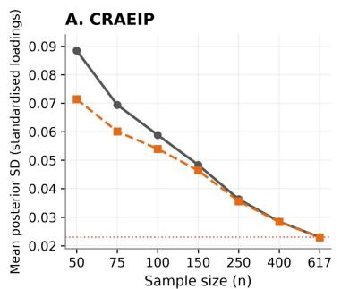

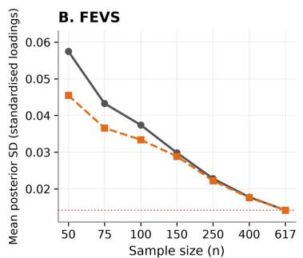

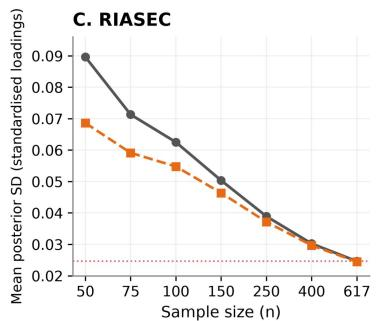  
— WS: conventional CFA (weak prior)-- SS: fixed semantic prior

Figure 7. Posterior precision under subsampling: semantic prior versus conventional CFA Note. Means over 20 paired subsamples per n (CRAEIP:four MCMC replicates at $n = 6 l 7 )$ . Dotted lines: WS at $n = 6 l 7 .$ Loadings are fully standardized. The 95% bootstrap confidence intervals for paired dif erences (SS − WS) are reported in Table 6.

Table 6. Precision of the semantic prior (SS) relative to the conventional CFA (WS)
<table><tr><td>Instrument</td><td>n</td><td>Posterior SD, WS</td><td>Posterior SD, SS</td><td>∆SD (SS – WS) [95% CI]</td><td>WS-equivalent n</td></tr><tr><td>CRAEIP</td><td>50</td><td>0.08851</td><td>0.07142</td><td>-0.01708 [-0.01866, 0.01539]</td><td>72</td></tr><tr><td rowspan="8">FEVS</td><td>75</td><td>0.06945</td><td>0.0601</td><td>-0.00935 [-0.01099, 0.00784]</td><td>97</td></tr><tr><td>100</td><td>0.05888</td><td>0.05399</td><td>-0.00488 [-0.00585, - 0.00391]</td><td>121</td></tr><tr><td>150</td><td>0.04837</td><td>0.04637</td><td>-0.00200 [-0.00248, - 0.00147]</td><td>163</td></tr><tr><td>250</td><td>0.03634</td><td>0.03562</td><td>-0.00072 [-0.00099, - 0.00045]</td><td>261</td></tr><tr><td>50</td><td>0.05747</td><td>0.04547</td><td>-0.01200 [-0.01468, - 0.00926]</td><td>70</td></tr><tr><td>75</td><td>0.04328</td><td>0.03657</td><td>-0.00670 [-0.00869, 0.00492]</td><td>105</td></tr><tr><td>100</td><td>0.03742</td><td>0.03338</td><td>-0.00404 [-0.00567, - 0.00240]</td><td>124</td></tr><tr><td>150</td><td>0.02983</td><td>0.02887</td><td>-0.00096 [-0.00179, 0.00019]</td><td>161</td></tr><tr><td>RIASEC</td><td>250</td><td>0.0228</td><td>0.02221</td><td>-0.00058 [-0.00111, - 0.00006]</td><td>264</td></tr><tr><td rowspan="5"></td><td>50</td><td>0.08962</td><td>0.0686</td><td>-0.02102 [-0.02333, - 0.01861]</td><td>82</td></tr><tr><td>75</td><td>0.0713</td><td>0.05911</td><td>-0.01219[-0.01390, - 0.01070]</td><td>112</td></tr><tr><td>100</td><td>0.06252</td><td>0.05477</td><td>-0.00775 [-0.00871, - 0.00678]</td><td>129</td></tr><tr><td>150</td><td>0.05034</td><td>0.04636</td><td>-0.00397 [-0.00519, - 0.00283]</td><td>179</td></tr><tr><td>250</td><td>0.03892</td><td>0.03714</td><td>-0.00178 [-0.00222, 0.00134]</td><td>275</td></tr></table>

Note. WS-equivalent n = number of respondents the conventional CFA needs to reach the precision

of SS at the given n (log-linear interpolation). Negative ΔSD favours SS. 20 paired subsamples per n.

## 4.2.5 Accuracy and calibration-dependent limits

The public surveys allowed us to assess whether gains in posterior precision were accompanied by more accurate loading estimates. Standardized CFA estimates from the complete FEVS and RIASEC samples served as near-population references under the specified measurement model (Figure 8; Table 7). SS yielded lower loading RMSE than the conventional CFA (WS) in both surveys. At $\mathbf { n } = 5 0$ , the paired RMSE reduction was 0.012 in FEVS (95% bootstrap CI [0.0107, 0.0128]) and 0.023 in RIASEC (95% bootstrap CI [0.0215, 0.0245]). The larger improvement in RIASEC accompanied greater estimation error under WS, suggesting more scope for regularization to improve small-sample estimates. In both surveys, the accuracy advantage weakened as sample size increased, consistent with diminishing prior influence as respondent information accumulated. Lower RMSE does not rule out prior-induced bias, since reduced variability can offset bias in the overall estimation error. Coverage of the reference loadings remained below the nominal 95% level throughout the reported comparisons. At n = 50, coverage was 80% under WS and 82% under SS in FEVS, and 86% under WS and 88% under SS in RIASEC.

Reliability estimation provided further, albeit more modest, evidence of the practical value of semantic priors. At n = 50, SS reduced absolute omega error from 0.0308 to 0.0274 in FEVS and from 0.0231 to 0.0206 in RIASEC, with the differences becoming negligible as sample size increased (Figure 8; Table 7). The concentration of these benefits in smaller samples is particularly relevant to measurement studies involving specialized or hard-to-reach populations, where limited respondent availability can constrain the initial evaluation of an instrument. By improving loading accuracy while providing modest gains in reliability estimation, SEUF offers a way to make more effective use of limited response data through structural information already embedded in item wording. Its practical contribution lies not in replacing empirical validation, but in strengthening preliminary measurement estimation before larger respondent samples become available.

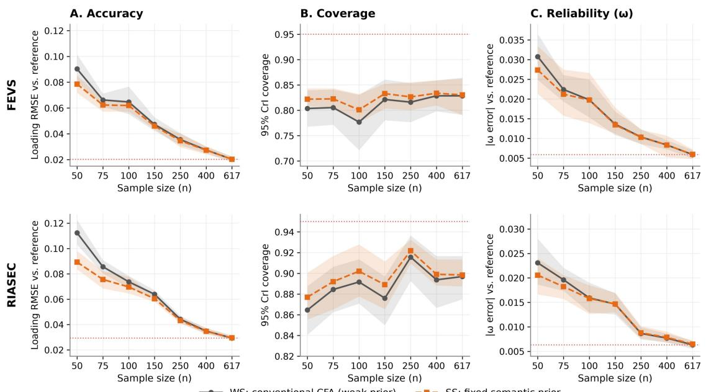  
WS: conventional CFA (weak prior)-- SS: fixed semantic prior

Figure 8. Accuracy, coverage and reliability against population references

Note. References are standardized ML estimates from the complete samples $( F E V S ~ N = ~ 6 2 , 7 2 6 ;$

RIASEC N = 135,764). Means over 20 paired subsamples; shaded bands are 95% bootstrap intervals. Dotted lines: WS at n = 617 (Panels A, C) and nominal 0.95 coverage (Panel B).

Table 7. Accuracy, coverage and reliability relative to the conventional CFA (FEVS and RIASEC)
<table><tr><td>Survey</td><td>n</td><td>RMSE WS</td><td>RMSE SS</td><td>ΔRMSE (SS – WS) [95% CI]</td><td>Coverage WS / SS</td><td>|ω error| WS / SS</td></tr><tr><td>FEVS</td><td>50</td><td>0.09</td><td>0.079</td><td>-0.012 [-0.0128, - 0.0107]</td><td>80% / 82%</td><td>0.0308 / 0.0274</td></tr><tr><td rowspan="6">RIASEC</td><td>75</td><td>0.066</td><td>0.062</td><td>-0.004 [-0.0052, 0.0026]</td><td>81% / 82%</td><td>0.0224 / 0.0212</td></tr><tr><td>100</td><td>0.065</td><td>0.062</td><td>-0.003 [-0.0037, - 0.0019]</td><td>78% / 80%</td><td>0.0198 / 0.0197</td></tr><tr><td>150</td><td>0.047</td><td>0.046</td><td>-0.001 [-0.0020, - 0.0005]</td><td>82% / 83%</td><td>0.0136/ 0.0134</td></tr><tr><td>50</td><td>0.112</td><td>0.089</td><td>-0.023 [-0.0245, - 0.0215]</td><td>86% / 88%</td><td>0.0231/ 0.0206</td></tr><tr><td>75</td><td>0.086</td><td>0.076</td><td>-0.010 [-0.0113, - 0.0087]</td><td>88% / 89%</td><td>0.0196/ 0.0182</td></tr><tr><td>100</td><td>0.074</td><td>0.07</td><td>-0.004 [-0.0050, - 0.0030]</td><td>89% / 90%</td><td>0.0159 / 0.0158</td></tr><tr><td></td><td>150</td><td>0.064</td><td>0.06</td><td>-0.004 [-0.0042, - 0.0028]</td><td>88% / 89%</td><td>0.0146 / 0.0147</td></tr></table>

Note. Paired dif erences over the same 20 subsamples; negative ΔRMSEfavours SS. Coverage is the mean proportion of reference loadings inside the 95% credible interval.

## 4.2.6 Isolating the Contribution of Semantic Alignment

In the matched-tightness negative-control analysis (Table 8), correctly aligned semantic priors yielded lower loading RMSE than shuffled priors across CRAEIP, FEVS, and RIASEC, with reductions of 0.0098, 0.0066, and 0.0110, respectively. Improvements over equally tight shared-mean priors were smaller (0.0033, 0.0018, and 0.0040), and the corresponding 95% confidence intervals included zero for CRAEIP and FEVS but not for RIASEC. Mean posterior standard deviations were similar across the three informative-prior conditions. Credible-interval coverage remained below the nominal 95% level across all prior conditions. Correct semantic correspondence therefore improved loading estimation relative to arbitrary prior assignment, but evidence for an additional benefit over shared-mean shrinkage varied across instruments. The gains from semantic priors appear to reflect both general shrinkage and item-level alignment.

Table 8. Matched-tightness negative-control analysis of semantic alignment across three instruments (n = 50)
<table><tr><td>Instrument</td><td>Prior condition</td><td>Loading RMSE</td><td>Mean posterior SD</td><td>95% Coverage (%)</td><td>ΔRMSE vs. SS [95% CI]</td></tr><tr><td rowspan="2">CRAEIP</td><td>WS</td><td>0.1084</td><td>0.0891</td><td>84.2</td><td>0.0147 [0.0108,</td></tr><tr><td>SS (aligned)</td><td>0.0937</td><td>0.072</td><td>85.7</td><td>0.0189] Reference</td></tr><tr><td></td><td>Shuffled-SS</td><td>0.1035</td><td>0.0736</td><td>78.1</td><td>0.0098 [0.0051,</td></tr><tr><td>Instrument</td><td>Prior condition</td><td>Loading RMSE</td><td>Mean posterior SD</td><td>95% Coverage (%)</td><td>ΔRMSE vs. SS [95% CI] 0.0147]</td></tr><tr><td></td><td>Common-prior</td><td>0.097</td><td>0.0714</td><td>81.8</td><td>0.0033 [-0.0011, 0.0078]</td></tr><tr><td>FEVS</td><td>WS</td><td>0.0916</td><td>0.0579</td><td>80.4</td><td>0.0113 [0.0095, 0.0132]</td></tr><tr><td></td><td>SS (aligned)</td><td>0.0803</td><td>0.046</td><td>82.7</td><td>Reference 0.0066 [0.0038,</td></tr><tr><td></td><td>Shuffled-SS</td><td>0.0869</td><td>0.0468</td><td>76.8</td><td>0.0095]</td></tr><tr><td></td><td>Common-prior</td><td>0.0821</td><td>0.0456</td><td>78.9</td><td>0.0018 [-0.0006, 0.0042]</td></tr><tr><td>RIASEC</td><td>WS</td><td>0.113</td><td>0.0901</td><td>86.5</td><td>0.0230 [0.0206, 0.0255]</td></tr><tr><td></td><td>SS (aligned)</td><td>0.09</td><td>0.0692</td><td>87.3</td><td>Reference 0.0110 [0.0074,</td></tr><tr><td></td><td>Shuffled-SS</td><td>0.101</td><td>0.0705</td><td>81.2</td><td>0.0148]</td></tr><tr><td></td><td>Common-prior</td><td>0.094</td><td>0.0687</td><td>84.1</td><td>0.0040 [0.0003, 0.0077]</td></tr></table>

Note. WS = conventional weak-prior CFA; SS = aligned semantic-prior CFA; Shufled-SS = semantic prior with reassigned item-specific means; Common-prior = shared-mean informative prior. All informative-prior conditions retained the same prior standard deviations and target-loading mask. ΔRMSE vs. SS denotes the diference between each comparison model and aligned SS; positive values favour SS. Confidence intervals were calculated from paired subsample dif erences. CRAEIP used fully standardized target loadings from the full-sample simple-structure CFA (N = 617) as an internal, model-based reference rather than independent population ground truth. FEVS and RIASEC used thefull-sample CFA references described in Section 3.5.

## 4.2.7 Summary and limitations

The experiments demonstrate practical benefits for small-sample estimation. At n = 50, semantic priors achieved loading precision comparable to conventional CFA with approximately 72 respondents in CRAEIP, 70 in FEVS, and 82 in RIASEC, corresponding to respondent savings of approximately 31%, 29%, and 39%. Lower loading RMSE in both public surveys provided further evidence that the additional precision could accompany more accurate estimates. The benefits extended across the three instruments and were greatest when respondent information was limited, suggesting particular value for studies in which recruitment is difficult. SEUF also provides an approximate measure of how much posterior loading estimates differ from expectations derived from item wording. This complements conventional item evaluation by distinguishing psychometric performance from information gained through respondent data.

Several limitations remain. The priors used one paraphrase model, one embedding model, and a fixed, data-free loading calibration, leaving sensitivity to model choice and the separate contributions of semantic alignment and calibration unresolved. Reliability gains were also smaller than loading gains. Interval coverage remained below nominal levels under both semantic-prior and conventional CFA models. The normal-theory treatment of Likert responses warrants comparison with ordinal likelihoods, although its contribution to undercoverage remains unclear. Accuracy references were full-sample estimates rather than known population parameters, and the RIASEC model had only moderate fit (CFI = 0.81). Because the efficiency analysis was retrospective, prospective studies and simulations with known parameters are needed before the estimated savings can guide smaller-sample designs.

## 5.0 Conclusion

Psychometric measurement relies heavily on respondent data, although questionnaire items contain structured information before administration. This study examines how that information can inform estimation while remaining distinct from empirical evidence of validity. We treat semantic structure as pre-data information and express it through Bayesian priors that are updated by respondent evidence.

Across all three instruments, semantic structure remained detectable after controlling for lexical and wording-related features, indicating that surface similarity did not fully account for it. In Bayesian CFA, semantic priors improved posterior precision and computational efficiency while leaving global model fit largely unchanged. In subsampling analyses, they allowed factor loadings to be estimated at a given precision with fewer respondents than conventional CFA required. The largest gains occurred in the smallest samples. These gains clarify the framework's practical payoff. Semantic priors also reduced loading RMSE against population references in both public surveys, although credible-interval coverage remained below the nominal 95% level. Evidence of additional benefits over shared-mean priors varied across instruments.

Alongside its methodological contribution, the framework offers a way to assess efficiency in terms of the additional respondent information needed once item-derived prior information is incorporated into estimation. It may support precision-oriented sample-size planning and item review, particularly for small or hard-to-reach populations. These applications still depend on respondent evidence and empirical validation of constructs; neither can be replaced by language models or semantic similarity. Researchers should assess prior–data agreement and sensitivity to the loading-level calibration.

The conclusions are subject to the limitations discussed in Section 4.2.7, particularly the use of a single paraphrase model and a single embedding model, together with fixed prior calibration. Future research should assess whether semantic priors remain robust across models and settings and how their loading scale can be calibrated from data. It should also establish when these priors deliver practical gains without weakening empirical validation. Another question is whether item-level posterior-to-prior divergence can inform item screening and questionnaire reduction. To assess this possibility, researchers would need to construct a reduced instrument and independently validate its reliability, factor structure, and broader measurement properties.

<table><tr><td>Abbreviations</td><td></td></tr><tr><td>SEUF</td><td>Semantic-Empirical Updating Framework</td></tr><tr><td>CRAEIP</td><td>Circular Resource Allocation Efficiency in Industrial Parks</td></tr><tr><td>CFA</td><td>Confirmatory Factor Analysis</td></tr><tr><td>KL</td><td>Kullback-Leibler divergence</td></tr><tr><td>ARI</td><td>Adjusted Rand Index</td></tr><tr><td>FEVS</td><td>Federal Employee Viewpoint Survey</td></tr><tr><td>RIASEC</td><td>Realistic, Investigative, Artistic, Social, Enterprising, and Conventional</td></tr><tr><td>RMSEA</td><td>Root Mean Square Error of Approximation</td></tr><tr><td>CFI</td><td>Comparative Fit Index</td></tr><tr><td>TLI</td><td>Tucker-Lewis Index</td></tr></table>

## Preregistration Statement

This study was not preregistered.

## Code, Materials, and Data Availability

Core analysis code and archived semantic priors are available for anonymous review at https://anonymous.4open.science/r/Semantic-Prior-Bayesian-CFA-8E40/. Data are not shared at submission. Upon acceptance, code, materials, and de-identified data will be deposited in a trusted repository prior to publication.

## Reference：

1. Armstrong, P. I., Allison, W., & Rounds, J. (2008). Development and initial validation of brief public domain RIASEC marker scales. Journal of Vocational Behavior, 73(2), 287–299. https://doi.org/10.1016/j.jvb.2008.06.003

2. Bhangale, A. M., & Jorgensen, T. D. (2025). Empirical Bayes Priors for MCMC Estimation of the Multivariate Social Relations Model. Multivariate Behavioral Research, 60(5), 930–953. https://doi.org/10.1080/00273171.2025.2496507

3. Chen, J., Chan, C. M., Thin, N. T., Xu, F., Ding, W., Xu, B., & Liang, A. (2025). Symptom measurement of post‐stroke depression at rehabilitation stage: Development and validation of a new short form. Journal of Clinical Neuroscience, 139, 111422. https://doi.org/10.1016/J.JOCN.2025.111422

4. Chen, Q., Su, K., Feng, Y., Zhang, L., Ding, R., & Pan, J. (2024). A tutorial on Bayesian structural equation modelling: Principles and applications. International Journal ofPsychology, 59(6), 1326–1346. https://doi.org/10.1002/IJOP.13258

5. Cox, K., Kelcey, B. Comparing Bayesian estimation and structural-after-measurement approaches for structural equation models with latent interactions and complex data structures. Behav Res 57, 320 (2025). https://doi.org/10.3758/s13428-025-02840-x

6. Depaoli, S., Jia, F., & Visser, M. (2025). Using Small-Variance Priors to Detect Covariate Misspecifications in Latent Class Analysis Models. Structural Equation Modeling: A Multidisciplinary Journal, 32(5), 780–800. https://doi.org/10.1080/10705511.2025.2505635

7. Edeh, E., Liang, X., & Cao, C. (2025). Correction to: Probing beyond: The impact of model size and prior informativeness on Bayesian SEM fit indices (Behavior Research Methods, (2025), 57, 4, (108), 10.3758/s13428-025-02609-2). Behavior Research Methods, 57(5), 148-. https://doi.org/10.3758/S13428-025-02672-9/METRICS

8. Eisele, G., Hiekkaranta, A., Kunkels, Y. K., aan het Rot, M., van Ballegooijen, W., Bartels, S. L., Bastiaansen, J. A., Beymer, P. N., Bylsma, L. M., Carpenter, R. W., Ellison, W. D., Fisher, A. J., Forkmann, T., Frumkin, M. R., Fulford, D., Naragon-Gainey, K., Greene, T., Heininga, V. E., Jones, A., … Kirtley, O. J. (2025). ESM-Q: A consensus-based quality assessment tool for experience sampling method items. Behavior Research Methods, 57(4), 124. https://doi.org/10.3758/s13428-025-02626-1

9. Feraco, T., & Toffalini, E. (2024). SEMbeddings: how to evaluate model misfit before data collection using large-language models. Frontiers in Psychology, 15, 1433339. https://doi.org/10.3389/FPSYG.2024.1433339/TEXT

10. Ferrando, P. J., Navarro-González, D., & Morales-Vives, F. (2025). Linear and Nonlinear Indices of Score Accuracy and Item Effectiveness for Measures That Contain Locally Dependent Items. Educational and Psychological Measurement, 85(1), 60-81.

11. Garrido, L. E., Christensen, A. P., Golino, H., Martínez-Molina, A., Arias, V. B., Guerra-Peña, K., Nieto-Cañaveras, M. D., Azevedo, F., & Abad, F. J. (2025). A Systematic Evaluation of Wording Effects Modeling Under the Exploratory Structural Equation Modeling Framework. Multivariate Behavioral Research, 60(6), 1169–1198. https://doi.org/10.1080/00273171.2025.2545362

12. Kambeitz, J., Schiffman, J., Kambeitz-Ilankovic, L., Mittal, V. A., Ettinger, U., & Vogeley, K. (2025). The empirical structure of psychopathology is represented in large language models. Nature Mental Health, 3(12), 1482–1492. https://doi.org/10.1038/S44220-025-00527-Y;SUBJMETA

13. Kojima, H., Soda, T., & Yamashita, Y. (2026). Language or syndrome? Investigating the origins of the general psychopathology factor through large language model embeddings. Psychiatry and Clinical Neurosciences, 80(3), 196–204. https://doi.org/10.1111/PCN.70010;SUBPAGE:STRING:FULL

14. Lee, P., Son, M., & Jia, Z. (2026). AI-powered Automatic Item Generation for Psychological Tests: A Conceptual Framework for an LLM-based Multi-Agent AIG System. Journal of Business and Psychology, 41(1), 71–99. https://doi.org/10.1007/s10869-025-10067-y

15. Liu, H., Heo, I., Ivanov, A., & Depaoli, S. (2025). Model Assumption Violations in Bayesian Latent Mediation Analysis: An Exploration of Bayesian SEM Fit Indices and PPP. Structural Equation Modeling: A Multidisciplinary Journal, 32(5), 866–896. https://doi.org/10.1080/10705511.2025.2503789

16. Mara, C., & Rybak, T. (2026). Leveraging large language models in patient-reported outcome measure development: practical opportunities, cautions, and a human-in-the-loop roadmap. Journal of Patient-Reported Outcomes, 10(1), 93. https://doi.org/10.1186/s41687-026-01112-2

17. Milano, N., Luongo, M., Ponticorvo, M., & Marocco, D. (2025). Semantic analysis of test items through large language model embeddings predicts a-priori factorial structure of personality tests. Current Research in Behavioral Sciences, 8, 100168. https://doi.org/10.1016/J.CRBEHA.2025.100168

18. Open-Source Psychometrics Project. (2018). Answers to the Holland Code (RIASEC) Test. https://openpsychometrics.org/\_rawdata/

19. Ravenda, F., Preti, A., Poletti, M., Mira, A., & Raballo, A. (2025). Rethinking psychometrics through LLMs: how item semantics shape measurement and prediction in psychological questionnaires. Scientific Reports 2025 15:1, 15(1), 37313-. https://doi.org/10.1038/s41598-025-21289-8

20. Sehlabana, M. A., Maposa, D., Boateng, A., & Das, S. (2025). Bayesian prior elicitation for malaria modelling. Scientific African, 29, e02810. https://doi.org/10.1016/j.sciaf.2025.e02810

21. Selby, D., Iwashita, Y., Spriestersbach, K., Saad, M., Bappert, D., Warrier, A., Mukherjee, S., Kise, K., & Vollmer, S. (2025). Had Enough of Experts? Quantitative Knowledge Retrieval

From Large Language Models. Stat, 14(2), e70054. https://doi.org/10.1002/STA4.70054;PAGE:STRING:ARTICLE/CHAPTER

22. Sloman, S. J., Cavagnaro, D. R., & Broomell, S. B. (2024). Knowing what to know: Implications of the choice of prior distribution on the behavior of adaptive design optimization. Behavior Research Methods, 56(7), 7102–7125. https://doi.org/10.3758/s13428-024-02410-7

23. Ulitzsch, E., Viechtbauer, W., Lüdtke, O., Myin-Germeys, I., Nagy, G., Nestler, S., & Eisele, G. V. (2025). Investigating the effect of experience sampling study design on careless and insufficient effort responding identified with a screen-time-based mixture model. Psychological Assessment, 37(8), 347–359. https://doi.org/10.1037/pas0001379

24. U.S. Office of Personnel Management. (2024). 2024 Federal Employee Viewpoint Survey public release data file. https://www.opm.gov/fevs/public-data-file

25. Wulff, D. U., & Mata, R. (2025). Semantic embeddings reveal and address taxonomic incommensurability in psychological measurement. Nature Human Behaviour 2025 9:5, 9(5), 944–954. https://doi.org/10.1038/s41562-024-02089-y