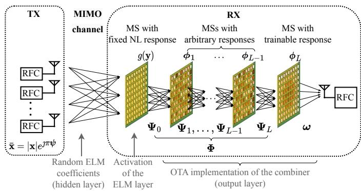
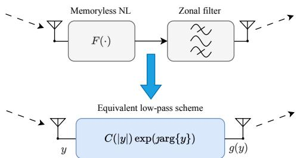
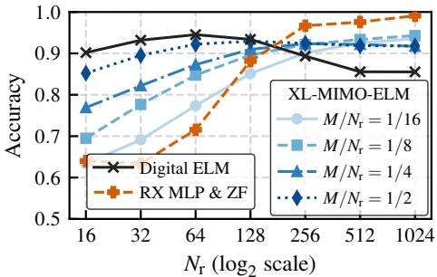
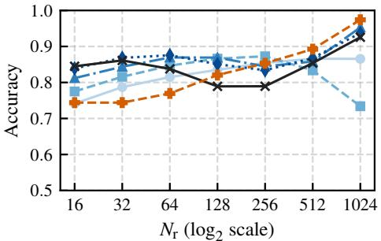
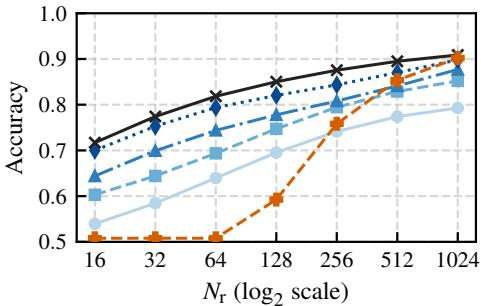
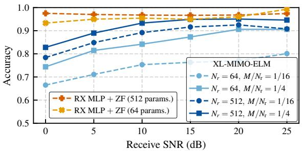
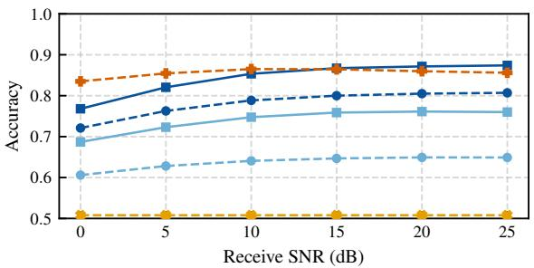
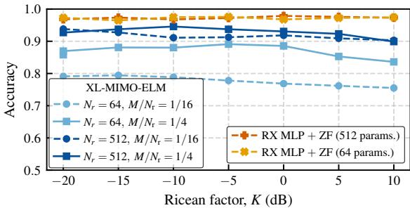
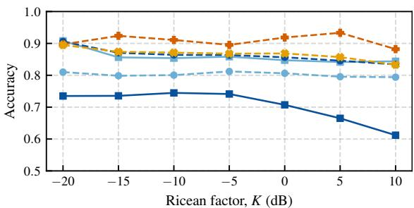

# XL MIMO Extreme Learning Machines: Wave-Domain Inference with Stacked Metasurfaces

Kyriakos Stylianopoulos, Graduate Student Member, IEEE, Mattia Fabiani, Graduate Student Member, IEEE, Davide Dardari, Fellow, IEEE, and George C. Alexandropoulos, Senior Member, IEEE

Abstract—The recently envisioned goal-oriented communications paradigm requires machine learning inference to be performed directly on wirelessly transferred data, by splitting neural network computations between the transmitter, the Receiver (RX), and the wireless channel. Such approaches aim to offload large portions of the computation onto the channel itself, which is often controlled by reconfigurable MetaSurfaces (MSs). Typical MS-parametrized systems, however, enable only limited computation offloading in the wave domain, usually corresponding to a single neural network layer, due to adverse channel fading effects and the almost linear operation of the channel and conventional MS models. In this paper, we demonstrate that an eXtremely Large (XL) Multiple-Input Multiple-Output (MIMO) system equipped with Stacked Intelligent MSs (SIM) at the RX side, together with a single antenna and its accompanying radio-frequency chain, may act as a twolayer neural network operating exclusively over the air. The first (uncontrollable) network layer corresponds to the transformations offered by wireless fading, while the second (controllable) layer is implemented via SIM operations. In particular, only the first, front-end MS layer needs to exhibit nonlinear response to serve as an activation function. Leveraging the Extreme Learning Machine (ELM) framework, the proposed XL MIMO system architecture is shown to be a universal approximator, and the optimal linear-SIM-based combining is derived in closed form, allowing for fast training even and partial signal observability. Numerical evaluations across diverse datasets showcase that the proposed XL-MIMO-ELM framework achieves classification accuracy comparable to idealized digital models, thereby, proving the viability of low complexity, wave-domain neural computations.

Index Terms—Over-the-air inference, extreme learning machines, nonlinear processing, XL MIMO, SIM, wave-domain computing.

## I. INTRODUCTION

Future wireless networks are expected to support increasingly demanding local processing of sensory observations under stringent communication and computational constraints. Conventional architectures, which separate the acquisition, transmission, and processing of data, become inefficient in such settings, as the Transmitter (TX) typically extracts and encodes features without direct knowledge of the downstream inference task, while the Receiver (RX) first reconstructs the transmitted data before performing the desired inference. This separation can lead to unnecessary data transmission, increased processing complexity, and redundant computations at both ends of the communication link. To address these limitations, future wireless systems will leverage Edge Inference (EI), where the TX and RX are jointly trained as an end-to-end Machine Learning (ML) model tailored to a target inference task [2]. Instead of transmitting a representation designed for faithful data reconstruction, EI enables the TX to extract task-relevant features while simultaneously encoding them for transmission, allowing the RX to directly infer the target values without reconstructing the original input [3], [4]. By aligning communication and inference within a single endto-end architecture, EI reduces both the amount of information that needs to be conveyed over the wireless channel and the computational resources required for downstream processing.

To further alleviate the computational costs associated with end-to-end wireless intelligence, the emerging Over-The-Air (OTA) computing paradigm exploits the intrinsic superposition property of wireless propagation to perform computations directly in the wave domain [5]. To this end, rather than receiving individual signals and processing them digitally, multiple transmitted waveforms can naturally combine over the wireless channel, thereby implementing part of the desired computation through their physical propagation. This property has motivated a growing body of work on wireless physical Deep artificial Neural Networks (DNNs), which exploit waveform superposition together with transceiver processing for multi-antenna systems to realize computational transformations entirely OTA [6], [7].

In parallel, recent advancements in metamaterial sciences have resulted in MetaSurface (MS) structures capable to perform DNN-equivalent operations by shaping the electromagnetic signals being diffracted through them [8], [9], giving rise to the concept of wave-domain signal processing [10], [11]. Subsequent approaches integrated MS structures [12] into wireless systems to perform OTA computations enabled by wave-domain signal processing, thus establishing the propagation environment as a trainable hidden module within an end-to-end ML model [3], [4], [13]. Hardware platforms based on MSs have been proposed to emulate DNN layers for OTA inference, with their physical parameters trained jointly through backpropagation [3], [4], or to approximate digitally trained DNN weight matrices directly in the wave domain [14], [15]. Relevant architectures have exploited programmable multipath propagation and frequencyselective channels to emulate one- and two-dimensional convolutional operations [16]–[18]. However, despite this progress, the computational transformations realized by many existing physical MS architectures remain predominantly linear. Consequently, the computational savings obtained from moving linear operations to the physical domain may be insufficient to compensate for the additional overhead associated with channel acquisition, analog hardware configuration, and overall system control.

Introducing NonLinear (NL) functionality into the wireless medium is therefore essential for realizing deeper and more expressive physical neural architectures, as well as for providing stronger theoretical guarantees, such as universal approximation [19]) and faster training procedures. In this regard, several recent approaches have explored this direction by constructing more elaborate propagation and hardware configurations, under the wider umbrella of analog computing. For example, neural depth has been introduced through iterative transmissions over distributed reconfigurable channels [20], while inter-element coupling under rich-scattering conditions has been very recently exploited to approximate NL functionality without explicitly introducing conventional activation layers [21]. Other architectures employ multi-hop relay networks in which NL power amplifiers provide the activation functions required to build deeper neural computations [22], [23]. However, these approaches generally rely on dedicated multi-stage physical topologies, repeated signal transmissions, or specialized NL hardware. These observations motivate physical architectures that can introduce NL representation capabilities, while retaining the low complexity and rapid reconfigurability of wave-domain computations.

More closely related to this paper, a wave-domain computing implementation for eXtremely Large (XL) Multiple-Input Multiple-Output (MIMO) systems has been recently proposed in [24], the architecture of which operates according to the Extreme Learning Machine (ELM) framework [25], enabling the hidden layer of the Single hidden Layer Feedforward Network (SLFN) to be executed entirely OTA. The activation function and the weights of the output layer have been assumed to be realized through analog combining hardware, exploiting the nonlinearities introduced by power amplifiers operating in their saturation region [26]. Since only the output-layer parameters need to be trained, the architecture enables rapid training and efficient reconfiguration when the wireless channel changes, while preserving the universal function approximation capability of ELMs. Despite providing a way for SLFNs OTA realization in traditional wireless systems, the original formulation is subject to practical limitations and scalability constraints, particularly due to the real-valued signal representation and the hardware complexity associated with the inclusion of multiple NL analog components. These limitations motivate the development of more practical and scalable physical solutions capable of retaining the computational advantages of the ELM-based EI approach, while better matching the constraints of wireless hardware components.

In this paper, capitalizing on the complex-domain ELM framework [27] and building upon recent NL metamaterial advancements [13], [28], [29], we introduce a novel XL-MIMO-ELM system architecture incorporating an RX structure comprising heterogeneous Stacked Intelligent Metasurfaces (SIM) [30] followed by a single antenna and its associated Radio-Frequency Chain (RFC). The first, front-end MS layer at the RX interfacing with the MIMO channel is composed of metamaterials exhibiting identical fixed NL responses and implements the ELM activation function, while the subsequent linear MS layers, forming a conventional linear SIM [31], realize trainable wave-domain combining, effectively approximating the digital ELM output weights. The proposed XL-MIMO-ELM framework enables fast (gradient-free) training and minimizes digital processing at the RX side, while significantly reducing the hardware complexity with respect to the system architecture in [24]. In particular, the contributions of this paper are summarized as follows:

• We introduce a novel XL MIMO system architecture incorporating a SIM with heterogeneous NL/linear MS layers at the RX side, highlighting the required analog components for activation-function-like NL front-end operation.

• We present a novel mathematical formulation showcasing that the proposed XL MIMO system operates as an ELM on the complex domain, thereby positioning our XL-MIMO-ELM framework as an EI model realized exclusively OTA via dedicated wave-domain signal processing.

• We describe the training procedure for our XL-MIMO-ELM, and design a reduced overhead alternative tailored to RXs equipped with a single antenna and respective RFC.

• A theoretical proof of the universal approximation capabilities of our XL-MIMO-ELM system is presented, following mathematical steps similar to conventional neural networks.

• We present a closed-form approach for realizing singleantenna analog combining entirely in the wave domain via configuration of the last linear MS layer of the RX SIM.

Overall, this paper presents the first fully analog neural network accommodating: i) an analog multi-antenna TX; ii) Ricean MIMO channel conditions; and iii) MS-based activation and combining realized in the wave domain, while simultaneously providing closed-form training and theoretical guarantees. The proposed XL-MIMO-ELM architecture operates with almost zero latency, while also benefiting from low power consumption and reduced hardware complexity. The presented numerical results demonstrate the efficiency of the proposed framework in numerous binary classification examples, approaching the performance of fully digital models at the XL MIMO regime.

This paper extends our recent conference version [1] in the following aspects: i) the SIM propagation is modeled through physically grounded Rayleigh–Sommerfeld coefficients [30] instead of pseudo-random matrices, and the RX architecture (frontend NL MS followed by a linear SIM and single-antenna reception) is described in detail; ii) the universal approximation property, only sketched in [1], is fully proven (Proposition 1) and complemented by an analysis of the effect of reception noise (Proposition 2); iii) the element-by-element measurement of the activation matrix is generalized to a sketching-based procedure allowing amount of measurements suited to a single RFC, with exact recovery and monotonicity guarantees (Propositions 3 and 4); iv) the iterative linear SIM training of [1] is replaced by a closed-form, gradient-free configuration of its last MS layer that implements the trained combining weights in the wave domain (Propositions 5 and 6); and v) the numerical evaluation is extended to the impact of the sketching ratio, to reception noise during both training and inference, and to Ricean and power level analyses over additional dataset and parameter combinations.

The remainder of this paper is organized as follows: Section II provides the complete XL-MIMO system model. Section III presents the formulation of the system as an ELM and provides theoretical guarantees. The complete training and inference procedures are detailed in Section IV, while a numerical evaluation is included in Section V. Finally, Section VI concludes the paper.

  
Fig. 1: The proposed XL MIMO system architecture for implementing the devised XL-MIMO-ELM framework using linear and NL MSs. The responses of the channel and MSs are used as components of the ELM algorithm to realize OTA inference.

Notation: Vectors, matrices, and sets are expressed in lowercase bold, uppercase bold, and uppercase calligraphic typefaces, respectively. $\bar { \mathbf { X } } ^ { \top } , \mathbf { X } ^ { \mathrm { H } }$ , and $\mathbf { X } ^ { \dagger }$ denote the transpose, conjugate transpose, and pseudo-inverse of X. The notation $[ \mathbf { a } , \ldots , \mathbf { z } ]$ indicates a matrix (or vector, depending on the dimensionality of $\mathbf { a } , \ldots , \mathbf { z } )$ where $\mathbf { a } , \ldots , \mathbf { z }$ are stacked horizontally. Likewise, the notation $[ \mathbf { a } ; \ldots ; \mathbf { z } ]$ implies vertical stacking. $[ \mathbf { x } ] _ { i }$ is used to denote the ith element of $\mathbf { x } . \ | { \mathcal { X } } |$ represents the cardinality of the set $\mathcal { X } , \ | | \mathbf { X } | | _ { \mathrm { F } }$ denotes the Frobenius norm of X, diag(x) creates a square matrix with the elements of x placed along its main diagonal. $\{ \cdot \}$ expresses a set or collection, sign(x) returns the sign of $x ,$ while $\operatorname { T r } ( \mathbf { X } )$ and det(X) express the trace and the determinant of X. Finally, $\mathbf { X } \sim { \mathcal { C N } } ( \mathbf { 0 } , \sigma ^ { 2 } \mathbf { I } )$ signifies that X follows the complex standard Gaussian distribution with variance $\sigma ^ { 2 } , \ j \triangleq \sqrt { - 1 }$ is the imaginary unit, and $z \in \mathbb { C }$ which can be expressed as $z = \Re e ( z ) + \jmath \Im \mathfrak { m } ( z ) = | z | \exp ( \jmath \arg \{ z \} )$ .

## II. XL MIMO SYSTEM MODEL

Consider a narrowband XL MIMO system with an $N _ { \mathrm { t } }$ -antenna TX and an RX comprising a SIM, with a front-end MS of $N _ { \mathrm { r } }$ diffractive elements, followed by a single antenna and its accompanying RFC. The methodology presented in this paper also holds for multiple synchronized TXs (e.g., sensor devices relaying raw measurements [32]) comprising a virtual sparse antenna; however, we leave such systemic elaborations for future work for the sake of focus. Instead of performing conventional wireless communications, the system is trained end-to-end to act as an OTA function approximator [24]. In particular, given a prior dataset $\mathcal { D } \triangleq \{ ( \mathbf { x } ^ { ( i ) } , \hat { z } ^ { ( i ) } ) \} _ { i = 1 } ^ { D }$ of D input-target pairs, the XL MIMO system is designed to approximate the $\mathbf x \to z$ mapping so that the TX observes the input data x (not necessarily belonging to ) and the RX infers the (unobserved) target feature z of x. As shown in Fig. 1, which will be further elaborated on during the discussion of the methodology, the proposed XL MIMO system is thus intended to perform EI, with all computational processing performed exclusively in the wave domain, i.e., OTA.

## A. Signal and Channel Models

We assume that $\mathbf { x } ^ { ( i ) } \in ( 0 , 1 ) ^ { N _ { \mathrm { t } } }$ and, without loss of generality, $z ^ { ( i ) } \in [ - 1 , + 1 ]$ , that is, the dimension of the data observations is equal to the number of TX antennas1 and the dataset is used for real-valued estimation. For reasons that will be clarified later, the data symbols are subject to Amplitude Modulation (AM); accordingly, each element of the transmitted signal vector $\bar { \textbf { x } } \in$ $\mathbb { C } ^ { N _ { \mathrm { t } } \times 1 }$ is defined $\forall i = 1 , \ldots , N _ { \mathrm { t } }$ as follows:

$$
[ \bar { \mathbf { x } } ] _ { i } \triangleq [ \mathbf { x } ] _ { i } \exp ( \ j \pi [ \psi ] _ { i } ) ,\tag{1}
$$

where the $N _ { \mathrm { t } }$ elements of $\psi$ may be chosen arbitrarily. The baseband representation of the impinging signal at the frontend MS layer of the SIM at the RX, which is composed of $N _ { \mathrm { r } }$ metamaterial elements, can be mathematically expressed as:

$$
\mathbf { y } \triangleq \mathbf { H } \bar { \mathbf { x } } \in \mathbb { C } ^ { N _ { \mathrm { r } } \times 1 } ,\tag{2}
$$

where H $\mathbf { \Psi } \in \mathrm { ~ \mathbb { C } ^ { { N _ { \mathrm { r } } } \times { N _ { \mathrm { t } } } } ~ }$ represents the XL MIMO channel gain matrix. For the subsequent theoretical analysis, we consider the case where H remains quasi-static for the duration of the training process and follows the Ricean fading distribution [33]:

$$
\mathbf { H } = \sqrt { P _ { L } } \left( \sqrt { \frac { K } { 1 + K } } \mathbf { H } _ { \mathrm { L o S } } + \sqrt { \frac { 1 } { 1 + K } } \mathbf { H } _ { \mathrm { N L o S } } \right) .\tag{3}
$$

where $P _ { L }$ represents the pathloss. Assuming TX and RX Uniform Planar Arrays (UPAs) with $N _ { \mathrm { t } } ~ = ~ N _ { \mathrm { t } , x } N _ { \mathrm { t } , y }$ and $N _ { \mathrm { r } } ~ = ~ N _ { \mathrm { r } , x } N _ { \mathrm { r } , y }$ elements, respectively, the rank-one Line-of-Sight (LoS) component is given by:

$$
{ \bf H } _ { \mathrm { L o S } } \triangleq { \bf a } _ { \mathrm { r } } \left( \boldsymbol { \theta } ^ { \mathrm { A o A } } , \boldsymbol { \phi } ^ { \mathrm { A o A } } \right) { \bf a } _ { \mathrm { t } } ^ { \mathrm { H } } \left( \boldsymbol { \theta } ^ { \mathrm { A o D } } , \boldsymbol { \phi } ^ { \mathrm { A o D } } \right) ,\tag{4}
$$

where $( \theta ^ { \mathrm { A o D } } , \phi ^ { \mathrm { A o D } } )$ and $( \theta ^ { \mathrm { A o A } } , \phi ^ { \mathrm { A o A } } )$ denote the elevation and azimuth angles of departure and arrival, respectively. Defining the string $q ~ \in ~ \{ \mathrm { t } , \mathrm { r } \}$ , the unit-norm steering vector of the corresponding UPA is defined as follows:

$$
\begin{array} { r } { \left[ \mathbf { a } _ { q } ( \theta , \phi ) \right] _ { m + n N _ { q , x } + 1 } \triangleq \frac { 1 } { \sqrt { N _ { q } } } \exp \Bigl ( \jmath \frac { 2 \pi } { \lambda } \bigl [ m d _ { q , x } \sin \theta \cos \phi } \\ { + n d _ { q , y } \sin \theta \sin \phi \bigr ] \Bigr ) . } \end{array}\tag{5}
$$

for $m \ : = \ : 0 , \ldots , N _ { q , x } - 1$ and $n ~ = ~ 0 , \ldots , N _ { q , y } - 1$ , where $d _ { q , x }$ and $d _ { q , y }$ are the inter-element spacings along the two array axes and λ is the carrier wavelength. Additionally, in (3), $\mathbf { H } _ { \mathrm { N L o S } } \ \sim \ \mathcal { C N } ( \mathbf { 0 } , 1 / \sqrt { N _ { \mathrm { t } } N _ { \mathrm { r } } } \mathbf { I } )$ , and $K$ represents the Ricean factor that controls the dominance of either component.

## B. The Proposed RX Architecture

As shown in Fig. 1, the proposed RX architecture comprises a SIM followed by a single RX antenna and its accompanying RFC. The SIM further consists of $L + 1$ diffractive MS layers indexed with $l ~ = ~ 0 , \ldots , L \colon$ the front-end MS with $l ~ = ~ 0$ implements a NL transformation on the transmitted signal, while the remaining L MSs with $l = 1 , \ldots , L$ form a typical linear SIM [30]. In the sequel, we describe each of these components.

  
Fig. 2: Element-wise bandpass memoryless NL transformation (top) and its corresponding equivalent low-pass scheme (bottom).

1) Front-End Nonlinear Metasurface: Each of the $N _ { \mathrm { r } }$ elements of the front-end MS applies a memoryless NL transformation followed by a zonal filter, as shown in Fig. 2, aiming to remove higher-order harmonics; this filtering task can be accomplished, for instance, directly by the antenna/MS element. Denoting with $F ( \cdot )$ the bandpass response of the generic NL transformation, the fundamental component produced by each NL element of this MS, under a narrowband excitation, is given by the AM/AM characteristic. It can be obtained by extracting the first cosine Fourier coefficient, and it is expressed as [34]:

$$
C ( v ) \triangleq \frac { 2 } { \pi } \int _ { 0 } ^ { \pi } F ( v \cos ( \phi ) ) \cos ( \phi ) \mathrm { d } \phi .\tag{6}
$$

The resulting equivalent low-pass mapping of the whole NL MS can be thus derived as $g ( \mathbf { y } ) \triangleq C ( | \mathbf { y } | ) \exp ( \ j \mathrm { a r g } \{ \mathbf { y } \} )$ . It is worth noticing that every memoryless bandpass NL transformation preserves the phase of the input, while transforming its envelope through the AM/AM characteristic.

In this paper, we consider an element-wise thresholding NL transformation characterized overall by the positive bias vector b $\mathbf { \Psi } \in \mathrm { ~ \mathbb { R } _ { + } ^ { { N _ { \mathrm { r } } } \times 1 } ~ }$ , whose entries are drawn from an appropriate distribution; for convenience, it may be centered around the expected receive signal power. As suggested in [28], [35], in the simplest passive implementation, such a thresholding can be approximated by exploiting the nonlinearity of an anti-parallel diode pair connected in shunt across the transmission line. The different biases can be obtained during the fabrication process by varying the diode’s polarization or its characteristic, hence, ensuring low complexity. Higher values of biases can be obtained by resorting to active NL circuits as done in [36], [37]. From (6), the transform yields the following piecewise mapping for each element $j = 1 , \ldots , N _ { \mathrm { r } }$ of the front-end NL MS layer [28]:

$$
C ( | [ \mathbf { y } ] _ { j } | ) = \left\{ \begin{array} { l l } { \mathbf { 0 } , } & { | [ \mathbf { y } ] _ { j } | \leq [ \mathbf { b } ] _ { j } } \\ { \displaystyle { \frac { 1 } { \pi } } \left( | [ \mathbf { y } ] _ { j } | \operatorname { a r c c o s } \left( \frac { [ \mathbf { b } ] _ { j } } { | [ \mathbf { y } ] _ { j } | } \right) \right. } \\ { \displaystyle \left. - [ \mathbf { b } ] _ { j } \sqrt { 1 - \left( \frac { [ \mathbf { b } ] _ { j } } { | [ \mathbf { y } ] _ { j } | } \right) ^ { 2 } } \right) , } & { | [ \mathbf { y } ] _ { j } | > [ \mathbf { b } ] _ { j } } \end{array} \right. .\tag{7}
$$

It is noted that, while the latter expression captures the exact AM/AM characteristic of the NL elements, the transcendental terms are computationally demanding for practical optimization, due to their non-differentiability at each $[ \mathbf { b } ] _ { j }$ . To this end, by approximating the transition for $| [ \mathbf { y } ] _ { j } | > [ \mathbf { b } ] _ { j }$ as a continuous quasi-linear slope, the response of the NL MS layer can be expressed as the well known softplus activation function j [38]:

$$
\begin{array} { r } { g ( [ \mathbf { y } ] _ { j } ) \simeq 0 . 2 \log \left( 1 + e ^ { 5 ( | [ \mathbf { y } ] _ { j } | - [ \mathbf { b } ] _ { j } ) } \right) \exp \left( \jmath \mathrm { a r g } \{ [ \mathbf { y } ] _ { j } \} \right) . } \end{array}\tag{8}
$$

2) Stacked Linear Metasurfaces: The L linear MS layers following the NL MS implementing (8)’s activation function constitute of response-tunable elements which can collectively process $g ( \mathbf { y } )$ in the wave domain. The element-to-element propagation between the l-th and (l+1)-th MS layers $( l = 0 , \ldots , L )$ is governed by geometric optics due to their dense placement [30]. Given elements n and $n ^ { \prime } \left( n , n ^ { \prime } = 1 , \ldots , N _ { \mathrm { r } } \right)$ with distance $d _ { n , n ^ { \prime } }$ and area $S _ { M }$ from layers l and $l - 1 \ ( l = 1 , \ldots , L )$ of distance $d _ { M }$ , each propagation matrix $\Psi _ { l } \in \mathbb { C } ^ { N _ { \mathrm { r } } \times N _ { \mathrm { r } } }$ can be expressed as:

$$
[ \Psi _ { l } ] _ { n , n ^ { \prime } } \triangleq \frac { d _ { M } S _ { M } } { d _ { n , n ^ { \prime } } ^ { 2 } } \bigg ( \frac { 1 } { 2 \pi d _ { n , n ^ { \prime } } } - \frac { \jmath } { \lambda } \bigg ) \exp \bigg ( \frac { \jmath 2 \pi } { \lambda } d _ { n , n ^ { \prime } } \bigg ) .\tag{9}
$$

The linear responses of the elements of each l-th MS layer $( l =$ $1 , \ldots , L )$ are modeled as $[ \phi _ { l } ] _ { n } \triangleq | \alpha _ { n } ^ { l } | \exp ( - \jmath \vartheta _ { n } ^ { l } )$ , where $| \alpha _ { n } ^ { l } | \leq$ 1 is the controllable amplitude and $\vartheta _ { n } ^ { l }$ the controllable phase. By defining $\Phi _ { l } \triangleq \deg ( \phi _ { l } )$ for $l = 1 , \ldots , L ,$ the linear SIM response can be mathematically expressed via the matrix:

$$
\Phi \triangleq \prod _ { l = L } ^ { 1 } \Phi _ { l } \Psi _ { l } \in \mathbb { C } ^ { N _ { \mathrm { r } } \times N _ { \mathrm { r } } } ,\tag{10}
$$

where $\Psi _ { 1 }$ is the propagation between the output of the front-end NL MS and the input of the first MS layer of the linear SIM.

3) Single-Antenna Reception: For the considered scalar estimation EI problem in this paper, the RX needs only a single antenna associated with an RFC for digital conversion. For simplicity, we position the RFC along the line passing through the centers of all L+1 MS layers, having a distance of $d _ { M }$ from the last L-th layer, identical to the inter-element distances. Due to its close proximity, this propagation defined as the row vector $\boldsymbol { \omega } \in \mathbb { C } ^ { 1 \times N _ { \mathrm { r } } }$ between the L-th linear MS layer (see Fig. 1) and the RFC can be modeled, similar to (9), as follows:

$$
[ \omega ] _ { n } \triangleq \frac { d _ { M } S _ { M } } { \tilde { d } _ { n } ^ { 2 } } \bigg ( \frac { 1 } { 2 \pi \tilde { d } _ { n } } - \frac { \jmath } { \lambda } \bigg ) \exp \bigg ( \frac { \jmath 2 \pi } { \lambda } \tilde { d } _ { n } \bigg ) \in \mathbb { C } ,\tag{11}
$$

where ${ \tilde { d } } _ { n }$ denotes the distance between the n-th element of the last L-th MS layer and the single antenna.

Putting all above together, the received signal at the output of the reception RFC, i.e., in baseband, can be expressed as:

$$
\widehat { z } \triangleq \omega \Phi g ( \mathbf { y } ) + \widetilde { n } \overset { ( a ) } { = } \mathbf { w } ^ { \mathrm { H } } g ( \mathbf { y } ) + \widetilde { n } ,\tag{12}
$$

where $\tilde { n } \ \in \ \mathcal { C N } ( 0 , \sigma _ { \tilde { n } } ^ { 2 } )$ denotes the Additive White Gaussian Noise $( \mathrm { A W G N } )$ introduced at the RX, and (a) uses the definition $\mathbf { w } \triangleq ( { \boldsymbol { \omega } } \Phi ) ^ { \mathrm { H } } \in \mathbb { C } ^ { N _ { \mathrm { r } } \times 1 }$ for the combining operation in the wave domain (i.e., implemented via the L-layer linear SIM), whose response can be controlled to solve computational EI tasks, as will be described in the next section.

## III. THE PROPOSED XL-MIMO-ELM FRAMEWORK

In this section, we show that our XL MIMO system architecture in Fig. 1 can be regarded as a form of an ELM. To this end, let us briefly describe the ELM model to be used for inference tasks on the data set . In particular, an ELM for scalar-value estimation is defined as an SLFN with N neurons in its hidden layer, which is tasked to perform the following simple operation on the input x. This is mathematically expressed as [25]:

$$
\hat { \mathbf { z } } \triangleq \sum _ { j = 1 } ^ { \mathbb { N } } [ \mathbf { w } ] _ { j } \mathbf { g } ( \mathbf { h } _ { j } ( \mathbf { x } ; \pmb { \theta } _ { j } ) ) = \mathbf { w } ^ { \mathrm { H } } \mathbf { g } ( \mathrm { H } ( \mathbf { x } ; \pmb { \theta } ) ) ,\tag{13}
$$

where w is its trainable weight vector of the output layer, g( ) is an activation function, and $\begin{array} { r } { \mathrm { H } ( \mathbf { x } ; \pmb { \theta } ) \triangleq [ \mathtt { h } _ { 1 } ( \mathbf { x } ; \pmb { \theta } _ { 1 } ) , \dots , \mathtt { h } _ { \mathtt { N } } ( \mathbf { x } ; \pmb { \theta } _ { \mathtt { N } } ) ] ^ { \top } } \end{array}$ includes the kernel functions of the N neurons of the hidden layer, each parametrized by $\theta _ { j }$ ; we use the definition $\pmb { \theta } \triangleq \{ \pmb { \theta } _ { j } \} _ { j = 1 } ^ { \tilde { \mathrm { v } } } .$ Such kernel functions may belong to a wide family of functions, and typically, even linear functions are an appropriate choice. The important aspect of in ELMs is that $\pmb \theta _ { j } ^ { \prime } \mathrm s$ are completely random and need not be optimized. The associated theoretical results [25] demonstrate that, if N is arbitrarily large (yet finite), then simply optimizing w through an analytical Least-Squares (LS) solution is sufficient to make $\hat { \boldsymbol { z } } ^ { ( i ) }$ approximate $\boldsymbol { z } ^ { ( i ) }$ with arbitrary precision $\forall \mathbf { x } ^ { ( i ) }$ in . In that respect, the ELM framework combines random parameters of the hidden layers, which acts as a random feature extraction mechanism, with trainable weights at the output layer, that act as a weighted selection of useful features. Their aforementioned universal approximation capability can thus be interpreted to mean that if the number of the random feature projections is sufficiently large, each data point has a unique representation in that random space.

## A. XL MIMO as an ELM

1) The Idealistic Noise-Free Case: Inspecting the transformations in the previous expressions (2) and (8), it can be easily concluded that they implement an ELM’s random hidden layer with random coefficients $\begin{array} { r l } { \pmb { \theta } } & { { } = } \end{array}$ $[ \Re \mathfrak { e } ( [ \mathbf { H } ] _ { 1 , : } ) , . . . , \Re \mathfrak { e } ( [ \mathbf { H } ] _ { N _ { \mathrm { r } } , : } ) , \Im \mathfrak { m } ( [ \mathbf { H } ] _ { 1 , : } ) , . . . , \Im \mathfrak { m } ( [ \mathbf { H } ] _ { N _ { \mathrm { r } } , : } ) , \mathbf { b } ^ { \top } ] ^ { \top }$ $\dot { \mathbf { \Xi } } \in \mathbb { R } ^ { \tilde { 2 } N _ { \mathrm { r } } \mathbf { \bar { \cal N } } _ { \mathrm { t } } + N _ { \mathrm { r } } }$ , and the combining weights w of (12) play the role of ELM’s trainable weights w in (13) of the output layer. Motivated by this operational equivalence, we leverage the mathematical framework for ML inference in [24], [25], [39], which accounts for random parameters alongside w, enabling both the training procedure of the ELM framework and its theoretical guarantees to be rigorously described.

To find the optimal weight vector for a given dataset , let us first define the ELM activation matrix $\bar { \mathbf { G } } \in \mathbb { C } ^ { D \times N _ { \mathrm { r } } }$ as the transpose of the activated signals at the aforedescribed front-end NL MS layer at the RX side of the proposed XL MIMO system:

$$
\mathbf { G } \triangleq [ g ^ { \mathrm { H } } ( \mathbf { y } ^ { ( 1 ) } ) ; \dots ; g ^ { \mathrm { H } } ( \mathbf { y } ^ { ( D ) } ) ] .\tag{14}
$$

The output of the system for the whole dataset can now be compactly written, following (12) and ignoring the AWGN term (implying operation at the high-Signal-to-Noise Ratio (SNR) regime for the moment), as follows:

$$
\begin{array} { r l } & { \hat { \mathbf { z } } \triangleq [ \mathbf { w } ^ { \mathrm { H } } \mathbf { g } ( \mathbf { y } ^ { ( 1 ) } ) ; \ldots \mathbf { w } ^ { \mathrm { H } } \mathbf { g } ( \mathbf { y } ^ { ( D ) } ) ] } \\ & { \quad = [ \mathbf { g } ^ { \mathrm { H } } ( \mathbf { y } ^ { ( 1 ) } ) \mathbf { w } ; \ldots ; \mathbf { g } ^ { \mathrm { H } } ( \mathbf { y } ^ { ( D ) } ) \mathbf { w } ] ^ { * } = ( \mathbf { G } \mathbf { w } ) ^ { * } \in { \mathbb { C } } ^ { D \times 1 } . } \end{array}\tag{15}
$$

We further denote the vector of target values for the whole dataset as $\mathbf { z } \triangleq [ z ^ { 1 } , \ldots , z ^ { D } ] ^ { \intercal } \in \mathbb { R } ^ { \breve { D } \times 1 }$ . Since the purpose of the inference system is to approximate z, which is a real vector for our considered estimation problems, we assume that zˆ also resides in the real domain (a formal proof of exact approximation will be presented next), therefore $\hat { \textbf { z } } \cong \hat { \textbf { z } } ^ { * } = \mathbf { G } \mathbf { w }$ , which simplifies the notation. Subsequently, the response vector w of the L-layer linear SIM can be optimized to minimize the LS error between the target and output values, yielding the following standard ELM formulation for this system design parameter:

$$
\mathbf { w } _ { \mathrm { L S } } \triangleq \arg \operatorname* { m i n } _ { \mathbf { w } } \| \mathbf { z } - \hat { \mathbf { z } } \| _ { 2 } ^ { 2 } \overset { ( 1 5 ) } { = } \arg \operatorname* { m i n } _ { \mathbf { w } } \| \mathbf { z } - \mathbf { G } \mathbf { w } \| _ { 2 } ^ { 2 } .\tag{16}
$$

This LS problem has the following closed-form solution:

$$
\mathbf { w } _ { \mathrm { L S } } \triangleq \left( \mathbf { G } ^ { \mathrm { H } } \mathbf { G } \right) ^ { - 1 } \mathbf { G } ^ { \mathrm { H } } \mathbf { z } = \mathbf { G } ^ { \dagger } \mathbf { z } \in \mathbb { C } ^ { N _ { \mathrm { r } } \times 1 } ,\tag{17}
$$

therefore, the output of the trained XL-MIMO-ELM over the training set  may be expressed as:

$$
\hat { \mathbf { z } } = \mathbf { G } \mathbf { G } ^ { \dagger } \mathbf { z } ,\tag{18}
$$

Similar to standard theoretical results from ELM and SLFN theory, the following proposition expresses the universal approximation property of the proposed XL-MIMO-ELM system framework, guaranteeing zero residual error over arbitrary data sets; therefore, zˆ becomes real-valued exactly.

Proposition 1 (Universal Approximation). Consider a dataset $\mathcal { D } \triangleq \{ ( \mathbf { x } ^ { ( i ) } , z ^ { ( i ) } ) \} _ { i = 1 } ^ { D }$ and the XL-MIMO-ELM system defined by (18) with its preceding equations. In the high-SNR regime (i.e., when $\tilde { n }  0$ in (12)), assuming H follows the Ricean channel model in (3) and the positive bias vector b in (7) is drawn from a continuous distribution with positive support, there exists a weight vector wLS of (17) such that $\lVert \mathbf { z } - \hat { \mathbf { z } } \rVert _ { 2 } ^ { 2 } = \lVert \mathbf { z } - \mathbf { G } \mathbf { w } _ { \mathrm { L S } } \rVert _ { 2 } ^ { 2 } =$ 0 for $N _ { \mathrm { r } } = D$ with probability 1.

Proof. The proof of this proposition is given in Appendix B.

2) Effect of the Reception Noise: While the previous analysis and the universal approximation guarantees of Proposition 1 assume a noise-free regime to establish baseline performance, practical RX observations are inevitably subject to the AWGN n˜ in (12). Hence, we now quantify its impact on the predictions of the trained XL-MIMO-ELM, comparing to the noise-free case. Aggregating the scalar noise components n˜ across the entire dataset of size D, we define the noise vector $\tilde { \mathbf { n } } \sim \mathcal { C N } ( \mathbf { 0 } , \sigma _ { \tilde { n } } ^ { 2 } \mathbf { I } _ { D } )$ Consequently, the estimated target vector $\tilde { \textbf { z } } \in \ \mathbb { C } ^ { D \times 1 }$ can be modeled as the ideal target zˆ corrupted by this aggregated noise:

$$
\tilde { \mathbf { z } } = \hat { \mathbf { z } } + \tilde { \mathbf { n } } .\tag{19}
$$

Proposition 2 (Prediction error under RX noise). Consider an ideal noise-free ELM satisfying $\hat { \mathbf { z } } = \mathbf { G } \mathbf { w } _ { \mathrm { L S } }$ , and the RX model in (12) with independent AWGN among elements of variance $\sigma _ { \tilde { n } } ^ { 2 } .$ . The mean squared residual error per data point between the noise-imputed predictions z˜ of the ELM of (12) and the predictions zˆ of the noise-free ELM is E $\vdots \{ ( | | \tilde { \mathbf { z } } - \hat { \mathbf { z } } | | _ { 2 } ^ { 2 } ) / D \} = \sigma _ { \tilde { n } } ^ { 2 } .$

Proof. It can be easily computed that ${ \mathbb E } \{ \| \tilde { \mathbf { z } } - \hat { \mathbf { z } } \| _ { 2 } ^ { 2 } \}$ (19)= $\mathbb { E } \big \{ \| \tilde { \mathbf { n } } \| _ { 2 } ^ { 2 } \big \} = \mathrm { T r } \big ( \mathbb { E } \big \{ \tilde { \mathbf { n } } \tilde { \mathbf { n } } ^ { \mathrm { H } } \big \} \big ) = \dot { D \sigma } _ { \tilde { n } } ^ { 2 } .$ □

Having quantified the expected system behavior in terms of the Mean Squared Error (MSE) as a function of the reception noise, we consider only noise-free cases for the rest of the analytical description of this paper for ease of presentation. However, the effects of noise are quantified numerically in Section V. Despite

Proposition 2 showing a linear relationship of MSE and $\sigma _ { \tilde { n } } ^ { 2 } .$ , it is noted that MSE is not necessarily the inference target metric of interest. For example, for classification problems, as those considered in Section V, the accuracy metric is less susceptible to the influence of noise, since the noise level must be large enough to change the decision threshold between the classes.

## B. Formulation of the Activation Matrix G

To obtain the LS solution of (17), knowledge of G is needed, which contains the activated received signals for all antennas (i.e., the output of the front-end NL MS) and all data points. Assuming Channel State Information (CSI) availability at the RX, G may be constructed digitally. It is, however, possible to obtain the required observations by consecutive data measurements, bypassing the need for a dedicated CSI estimation process [40]. In that regard, we propose a procedure of a low overhead, both in terms of communication resources, as well as in computational complexity, for deriving the LS solution (17). We assume that the AM signal corresponding to each data point of D is transmitted for a potentially enlarged symbol duration and $M \ll N _ { \mathrm { r } }$ measurements of it are collected in the following way. An arbitrary weight vector $\mathbf { a } _ { m } \in \mathbb { C } ^ { N _ { \mathrm { r } } \times 1 }$ , with $m = 1 , \ldots , M ,$ is selected as the reception combiner each time. In particular, during the m-th measurement time frame of the ith data point $( i = 1 , \ldots , D )$ , the output of the XL-MIMO-ELM system at the RX RFC can be described as follows:

$$
\begin{array} { r } { \hat { z } _ { m } ^ { ( i ) } \triangleq  { \mathbf { a } } _ { m } ^ { \mathrm { H } } g (  { \mathbf { y } } ^ { ( i ) } ) + \tilde { n } _ { i , m } , } \end{array}\tag{20}
$$

where $\mathbf { a } _ { m }$ plays the role of the wave-domain combiner w in (12). For convenience, let us define the measurement matrix as:

$$
\mathbf { A } \triangleq [ \mathbf { a } _ { 1 } ^ { \mathrm { H } } ; \dots ; \mathbf { a } _ { M } ^ { \mathrm { H } } ] \in \mathbb { C } ^ { M \times N _ { \mathrm { r } } } .\tag{21}
$$

The latter process is repeated for all D data points. Owing to advancements in reconfigurable MS design [41], [42], it is feasible to achieve MS response configuration switching in the order of nanoseconds under suitable unit cell and control hardware. Therefore, it is reasonable to assume that all M measurements frames for each data point take place within standard symbol duration periods in the order of few microseconds, and subsequently, only D transmissions are required overall. By applying the reception of (12) while replacing w with $\mathbf { a } _ { m }$ and disregarding the noise term, the collected outputs for the complete data set can be compactly inserted in the following matrix:

$$
\tilde { \mathbf { G } } \triangleq \left[ \begin{array} { c c c } { g ^ { \mathrm { H } } ( \mathbf { y } ^ { ( 1 ) } ) \mathbf { a } _ { 1 } } & { \hdots } & { g ^ { \mathrm { H } } ( \mathbf { y } ^ { ( 1 ) } ) \mathbf { a } _ { M } } \\ { \vdots } & { \ddots } & { \vdots } \\ { g ^ { \mathrm { H } } ( \mathbf { y } ^ { ( D ) } ) \mathbf { a } _ { 1 } } & { \hdots } & { g ^ { \mathrm { H } } ( \mathbf { y } ^ { ( D ) } ) \mathbf { a } _ { M } } \end{array} \right] = \mathbf { G } \mathbf { A } ^ { \mathrm { H } } \in \mathbb { C } ^ { D \times M } .\tag{22}
$$

We therefore proceed to use $\tilde { \mathbf { G } }$ instead of G in (16), obtaining, following (17)’s LS solution, the intermediate weight vector $\pmb { \alpha } _ { \mathrm { s k e t c h } } \bar { \in } \mathbb { C } ^ { M \times 1 }$ in the reduced M-dimensional subspace:

$$
\begin{array} { r } { \pmb { \alpha } _ { \mathrm { s k e t c h } } = \tilde { \mathbf { G } } ^ { \dagger } \mathbf { z } \in \mathbb { C } ^ { M \times 1 } . } \end{array}\tag{23}
$$

Then, to synthesize the physical $N _ { \mathrm { r } }$ -dimensional reception combining weight vector required by our system for single-shot inference, we project $\pmb { \alpha } _ { \mathrm { s k e t c h } }$ back via the measurement codebook:

$$
\begin{array} { r } { \mathbf { w } _ { \mathrm { s k e t c h } } \triangleq \mathbf { A } ^ { \mathrm { H } } \pmb { \alpha } _ { \mathrm { s k e t c h } } = \mathbf { A } ^ { \mathrm { H } } \tilde { \mathbf { G } } ^ { \dagger } \mathbf { z } \in \mathbb { C } ^ { N _ { \mathrm { r } } \times 1 } . } \end{array}\tag{24}
$$

We use the term “sketching operator” for A, borrowing the framework from randomized linear algebra, and therefore, G˜ and $\mathbf { w } _ { \mathrm { s k e t c h } }$ will be referred to as the sketched observation matrix and weight vector, respectively. Subsequently, the output of the proposed XL-MIMO-ELM system once the sketching weights are determined can be expressed, similar to (18), as:

$$
\hat { \bf z } _ { \mathrm { s k e t c h } } \triangleq { \bf G } { \bf w } _ { \mathrm { s k e t c h } } \stackrel { ( 2 4 ) } { = } { \bf G } { \bf A } ^ { \mathrm { H } } \tilde { \bf G } ^ { \dagger } { \bf z } \stackrel { ( 2 2 ) } { = } \tilde { \bf G } \tilde { \bf G } ^ { \dagger } { \bf z } .\tag{25}
$$

The motivation for the given form for ${ \bf w } _ { \mathrm { s k e t c h } }$ in (24) is that, when the full measurement dimension $M = N _ { \mathrm { r } }$ r is used, the resulting combining vector coincides with the original LS solution from (17), and therefore, the sketched version of the XL-MIMO-ELM leads to the same predictions as if the sketching operation were not in place. This is formalized below.

Proposition 3 (Exact LS weight recovery for $M = N _ { r } )$ . Let $M = N _ { \mathrm { r } }$ and let $\mathbf { A } \in \mathbb { C } ^ { N _ { \mathrm { r } } \times N _ { \mathrm { r } } }$ be full rank. Then, the sketching weight vector in (24) satisfies $\mathbf { w } _ { \mathrm { s k e t c h } } = \mathbf { w } _ { \mathrm { L S } }$

Proof. Since G has full column rank (under the assumption of rich scattering conditions, discussed in Proposition 1) and A is invertible, the pseudoinverse expression may be simplified as:

$$
\widetilde { \mathbf { G } } ^ { \dagger } = \left( \mathbf { G } \mathbf { A } ^ { \mathrm { H } } \right) ^ { \dagger } = \left( \mathbf { A } ^ { \mathrm { H } } \right) ^ { \dagger } \mathbf { G } ^ { \dagger } = \mathbf { A } \left( \mathbf { A } ^ { \mathrm { H } } \mathbf { A } \right) ^ { - 1 } \mathbf { G } ^ { \dagger } .\tag{26}
$$

Substituting (26) into (24) yields:

$$
\mathbf { w } _ { \mathrm { s k e t c h } } = \mathbf { A } ^ { \mathrm { H } } \mathbf { A } \left( \mathbf { A } ^ { \mathrm { H } } \mathbf { A } \right) ^ { - 1 } \mathbf { G } ^ { \dagger } \mathbf { z } = \mathbf { G } ^ { \dagger } \mathbf { z } \overset { ( 1 7 ) } { = } \mathbf { w } _ { \mathrm { L S } } ,\tag{27}
$$

which completes the proof.

Corollary. Since $\mathbf { w } _ { \mathrm { L S } } ~ = ~ \mathbf { w } _ { \mathrm { s k e t c h } }$ for $M \ = \ N _ { \mathrm { r } } ,$ it follows from (18) and (25) that the output of the sketched and the original versions of the proposed XL-MIMO-ELM system are exactly the same, i.e., $\hat { z } = \hat { z } _ { \mathrm { s k e t c h } }$

Proposition 4 (Monotonicity of prediction error). For any nested sketch sizes $M _ { 1 } ~ \le ~ M _ { 2 }$ , with corresponding sketch outputs $\widehat { \mathbf { z } } _ { \mathrm { s k e t c h } } ( M _ { 1 } )$ and $\widehat { \mathbf { z } } _ { \mathrm { s k e t c h } } ( M _ { 2 } )$ following (25), the sketching residual prediction error is monotonically non-increasing, i.e.:

$$
\| \hat { \mathbf { z } } - \hat { \mathbf { z } } _ { \mathrm { s k e t c h } } ( M _ { 2 } ) \| _ { 2 } \leq \| \hat { \mathbf { z } } - \hat { \mathbf { z } } _ { \mathrm { s k e t c h } } ( M _ { 1 } ) \| _ { 2 }\tag{28}
$$

Proof. This proposition’s proof is delegated in Appendix C.

Propositions 3 and 4 demonstrate that the sketching procedure leads to approximately equal performance with sufficiently large measurement dimension M (and fully equal performance for $M \ = \ N _ { \mathrm { r } } ) ,$ , and establish the fundamental design criteria for the sketching matrix A. According to Proposition 3, A must be full rank. Consequently, randomized matrices or subsets of the Discrete Fourier Transform (DFT) matrix (that are typical combiner choices [43]) satisfy this condition. Furthermore, Proposition 4 dictates that nested sketching structures guarantee a non-increasing residual error. Therefore, progressively expanding DFT matrices or nested randomized unit-amplitude phase-shifting matrices represent structurally sound and optimal choices for the measurement collection matrix A.

## C. Wave-Domain Combining with Linear SIM

In the previous sections, we provided insights on the desired values of the reception combiner w, the sketching combining weights A, as well as the more practical choice of $\mathbf { w } _ { \mathrm { s k e t c h } } .$ Whether these weights can be realized by the response of the RX’s L-layer linear SIM remains a yet open problem. In fact, several approaches in the literature have focused on optimizing the responses of linear SIMs to approximate certain functionalities, such as the DFT [44] and arbitrary hidden neural network layers [14], [15]. However, all those approaches rely on iterative gradient-based optimization algorithms and, most importantly, do not guarantee that the desired responses will be achieved with sufficiently small error. In this section, we present an analytical approach for the configuration of the linear SIM that guarantees exact solution to the desired combining weights w, thus, realizing entirely OTA the inference output defined in (25).

Let us assume that the responses $\{ \phi _ { l } \} _ { l = 1 } ^ { L - 1 }$ of the $L - 1$ linear MS layers at the RX, following the front-end NL MS layer indexed with $l = 0$ and excluding the final L-indexed linear MS layer, are randomly chosen. The diffracted signal $g ( \mathbf { y } )$ from the NL layer undergoes a series of linear transformations affected by the deterministic propagation model described in (10). For convenience, let $\begin{array} { r } { \Omega \triangleq \Psi _ { L } \prod _ { l = L - 1 } ^ { 1 } \pmb { \Phi } _ { l } \pmb { \Psi } _ { l } \in \mathbb { C } ^ { N _ { \mathrm { r } } \times N _ { \mathrm { r } } } } \end{array}$ denote the response of the system including the propagation between the $l = 0 \ \mathrm { ( N L ) }$ and $l = 1$ (linear) MS layers up to the propagation between the $L - 1$ and L linear layers. We henceforth focus on tuning exclusively the amplitude and phase responses of the final L-indexed linear MS layer. In particular, the objective is to optimize $\Phi _ { L }$ such that the response of the entire L-layer linear SIM emulates the reception combining vectors $\mathbf { a } _ { m } \mathbf { \bar { s } }$ and $\mathbf { w } _ { \mathrm { s k e t c h } }$ (or even $\mathbf { w } _ { \mathrm { L S } } )$ that are used by the proposed XL-MIMO-ELM framework. As shown below, this can be achieved analytically.

Proposition 5 (Closed-form linear SIM configuration for wave– domain combining). Let $\pmb { \Omega } \in \mathbb { C } ^ { N _ { \mathrm { r } } \times N _ { \mathrm { r } } }$ be the full-rank propagation matrix among the MS layers indexed with $l = 0 , \ldots , L - 1$ and let $[ \omega ] _ { j } \neq 0 \forall j = 1 , \ldots , N _ { \mathrm { r } }$ for the wave propagation vector in (11) from the final L-indexed linear MS layer to the single antenna element attached to the RX RFC. For any arbitrary combining vector $\mathbf { w } \in \mathbb { C } ^ { N _ { \mathrm { r } } \times 1 }$ , the phase and amplitude shifts $\phi _ { L } ^ { \mathbf { w } }$ of the final MS layer that exactly match the noise-free physical received signal to the scaled target functional $\gamma \mathbf { w } ^ { \mathrm { H } } g ( \mathbf { y } )$ are given by the following closed-form configuration:

$$
\phi _ { L } ^ { \mathbf { w } } = \gamma \left[ \frac { \left[ \mathbf { w } ^ { \mathrm { H } } \pmb { \Omega } ^ { - 1 } \right] _ { 1 } } { [ \omega ] _ { 1 } } , \dots , \frac { \left[ \mathbf { w } ^ { \mathrm { H } } \pmb { \Omega } ^ { - 1 } \right] _ { N _ { \mathrm { r } } } } { [ \omega ] _ { N _ { \mathrm { r } } } } \right] ^ { \top } ,\tag{29}
$$

where $\gamma \in \mathbb { R } ^ { + }$ is a global scaling factor satisfying $\begin{array} { r } { \gamma \le \frac { 1 } { \zeta } } \end{array}$ with $\zeta \triangleq$ max $\mathbf { \xi } _ { n } \left( \left| \left[ \mathbf { w } ^ { \mathrm { H } } \pmb { \Omega } ^ { - 1 } \right] _ { n } / [ \pmb { \omega } ] _ { n } \right| \right)$

Proof. The proof of this proposition is given in Appendix D.

Proposition 5 makes the assumption that Ω is full rank. This is ascertained via the following result.

Proposition 6 (Full-rankness of the linear SIM matrix Ω). Let $\{ \phi _ { l } \} _ { l = 1 } ^ { L - 1 }$ be arbitrarily sampled from an absolutely continuous distribution. Assuming all MSs elements spatial coordinates are configured such that they do not belong to the measure-zero set of degenerate placements, then rank $\mathbf { \nabla } \cdot ( \Omega ) = N _ { \mathrm { r } }$ almost surely.

Algorithm 1 Training with the Proposed XL-MIMO-ELM   
Inputs: Dataset $\mathbf { \mathcal { D } } = \{ ( \mathbf { x } ^ { ( i ) } , z ^ { ( i ) } ) \} _ { i = 1 } ^ { D } ,$ propagation matrix   
Ω, sketching codebook A, and arbitrary AM phase shifts ψ.   
1: for $i = 1 , \ldots , D$ do   
2: The TX constructs signal $\bar { \mathbf { x } } ^ { ( i ) }$ via (1) and transmits it.   
3: for $m = 1 , \ldots , M$ do   
4: The RX selects a combining vector $\mathbf { a } _ { m } = ( [ \mathbf { A } ] _ { m , : } ) ^ { \mathrm { H } }$   
5: configures the L-indexed linear MS as $\phi _ { I , } ^ { \mathbf { a } _ { m } }$ via (29),   
6: =ωdiag $( \phi _ { L } ^ { \mathbf { a } _ { m } } ) \Omega g ( \mathbf { y } ^ { ( i ) } ) + \tilde { n } _ { m } ^ { \top }$ , and   
7: computes $[ \tilde { \mathbf { G } } ] _ { i , m } = ( \hat { z } _ { m } ^ { ( i ) } ) ^ { * } / \gamma$ to construct (22).   
8: end for   
9: end for   
10: The RX calculates the weights $\mathbf { w } _ { \mathrm { s k e t c h } }$ via (24), and com  
putes the MS configuration $\phi _ { L } ^ { \mathbf { w } _ { \mathrm { s k e t c h } } }$ via (29).   
Output: Trained response $\phi _ { L } ^ { \mathbf { w } _ { \mathrm { s k e t c h } } }$ for the L-indexed linear   
MS layer to be used for inference.

Proof. The proposition’s proof is presented in Appendix E.

Remark 1. Proposition 6 implies that the minimum number of MS layers for Ω to be full rank is 1. Hence, for the considered inference operations, $L = 2$ suffices, $i . e . ,$ , RX’s heterogeneous SIM at the XL-MIMO-ELM system needs only the front-end NL MS, an intermediate linear MS with fixed random responses, and a third linear MS layer with controllable responses using (29).

## IV. XL-MIMO-ELM TRAINING AND DEPLOYMENT

Having described all particularities of the proposed XL-MIMO-ELM system architecture, we herein provide a complete description of how it implements EI, in particular, its training and deployment/inference phases.

We commence with the training process summarized in Algorithm 1. As observed, this process involves two main stages. During the first stage, all data points are transmitted once and repeatedly observed M times at the RX, with changing configurations at the final L-indexed linear MS layer, to collect the sketching measurements. In the second stage, the optimal combining weights are first calculated, and then the response of the L-th layer is finally configured so that the overall Llayer linear SIM approximates the LS weight vector in (24). This training process requires $O ( D )$ transmissions, necessitating $M + 1$ reconfigurations of the L-th linear MS layer. Note that no explicit knowledge of H is required and a single RX RFC is used for signal observation. Since the configurations of the first $L - 1$ linear MS layers may be selected to be static, and they are independent of the training data and CSI, we assume that the propagation quantities Ω and $\omega$ in the RX’s front-end have been accurately measured during the structure’s manufacturing process. Computationally, the complexity of Algorithm 1 is dominated by the LS solution, which is $\Theta ( D M ^ { 2 } )$ assuming it is solved through matrix factorization. Since $M \ll D$ , the computational overhead is therefore quasi-linear to the dataset size. Considering the low training overhead of the overall methodology, it is reasonable to assume that training may take place within the channel coherence time. As a simple feasibility example, a bandwidth of $\textit { B } = \ 1 8 0$ KHz corresponds to a symbol duration of approximately $T _ { s } = 5 . 6 ~ \mu \mathrm { s }$ . Hence, a typical coherence interval of $T _ { c } = 5$ ms accommodates approximately $T _ { c } / T _ { s } \cong 8 9 3$ transmissions. Since the $N _ { \mathrm { t } }$ features of each data point are transmitted in parallel, this is sufficient for training with reasonably small data sets, if the M measurements via wavedomain combining are collected within each symbol interval.

Algorithm 2 Inference with the Proposed XL-MIMO-ELM   
Inputs: Arbitrary AM phase shifts $\psi .$ , propagation matrix   
$\Omega ,$ configuration of the L-indexed linear MS layer $\phi _ { L } ^ { \mathbf { w } _ { : } }$ sketch   
from Algorithm 1, and input data point $\mathbf { x }$ for inference.   
1: The TX constructs signal x¯ via (1) and transmits it, while the   
RX uses the trained configuration $\phi _ { L } ^ { \mathbf { w } }$ to implement ${ \bf w } _ { \mathrm { s k e t c h } }$   
entirely in the wave domain via its L-layer linear SIM.   
2: The RX observes $\hat { z } = \mathbf { w } _ { \mathrm { s k e t c h } } ^ { \mathrm { H } } g ( \mathbf { y } ) + \tilde { n } .$   
Output: Inference result zˆ.

The inference process with the proposed XL-MIMO-ELM system has an even lower overhead. For a single inference data point x, this process is detailed in Algorithm 2. Note that only a single transmission is now required and no sketching matrices or digital computations are required, since the optimal combiner has been computed and implemented during training in the wave domain through the linear SIM. This implies that the inference complexity is of pseudo-constant time.

It is finally noted that, in the proposed XL-MIMO-ELM framework, both training and inference take place within the same channel coherence block. In practice, it is reasonable for the system to apply inference over batches of new data to avoid frequent re-training steps under different coherence blocks. Besides, with well regularized models, our framework is expected to be able to overcome small fluctuations of the XL MIMO channel H and also to be able to be rapidly re-tuned to time-evolving channels, e.g., similar to the methodology of [24]. We leave such investigations to future work.

## V. NUMERICAL RESULTS AND DISCUSSION

We have evaluated the proposed XL-MIMO-ELM framework for EI on several standard small-to-medium-size binary classification datasets under a range of system settings and channel conditions. The considered datasets are the Parkinson’s [45] and the Wisconsin Breast Cancer Dataset (WBCD) [46] of 195 and 569 data points of 22 and 30 numerical features (corresponding to $N _ { \mathrm { t } }$ values) for disease diagnosis, respectively, as well as the MNIST dataset of $6 \times 1 0 ^ { 4 }$ handwritten digit images [47] (subsampled to 100 pixels and converted the objective to even/odd digit classification). An 80 : 20 train-test split was imposed, and all input features were normalized to the (0, 1) range. To determine the predicted class, we simply applied the discretization sign(Re(ˆz)) of (12), and we report in the performance figures that follow the mean accuracy values over 200 random initializations. For convenience, the phases ψ of the AM signals were set identically to 0, and b was sampled from a Rayleigh distribution with scale parameter $\mathbb { E } [ \| \mathbf { H } \| _ { \mathrm { F } } ] / ( 2 N _ { \mathrm { r } } N _ { \mathrm { t } } )$ , for it to be in the same order as $| \mathbf { y } |$ . Unless otherwise specified, the channel parameters were set as $P _ { L } ~ = ~ - 5 0$ dB and $K \ : = \ : 0 \ : \ : \mathrm { d B }$ . For the linear SIM, we employed $L \ = \ 2$ layers, each consisting of $\sqrt { N _ { \mathrm { r } } } \times \sqrt { N _ { \mathrm { r } } }$ diffractive elements. To overcome overfitting, we have used the regularized versions of the pseudo-inverse matrices, i.e., we compute $( \tilde { \mathbf { G } } ^ { \mathrm { H } } \tilde { \mathbf { G } } + \ell \mathbf { I } ) ^ { - 1 } \tilde { \mathbf { G } } ^ { \mathrm { H } }$ instead of $\tilde { \mathbf { G } } ^ { \dagger }$ from (24) onward with $\ell = 1 0 ^ { - 6 }$

We have considered two inference baselines. The first is a theoretical ELM model with an equal number of hidden layer size as the proposed XL-MIMO-ELM. This approach performs traditional classification on the (real-domain) datasets, disregarding the system model and its effects, therefore, it is henceforth termed as “Digital ELM.” The hidden layer parameters were sampled from the standard normal distribution. The second approach is an EI approach where the TX-side processing remains as described, and assumed idealistically full knowledge of CSI and the signal y at each of the elements of the front-end NL MS in the RX. Therefore, x¯ was estimated via Zero Forcing (ZF) as $\bar { \textbf { x } } \cong \textbf { H } ^ { \dagger } \textbf y$ and a 2-layered Multi Layer Perceptron (MLP) classifier was trained at the RX across random channel realizations. The total number of parameters of the MLP has been set approximately equal to that of the ELM for each case. We note that this baseline is associated with increased system knowledge requirements and excessive training times.

The performance of the proposed training approaches for an increasing number of elements $N _ { \mathrm { r } }$ at the RX’s front-end NL MS layer is displayed in Fig. 3. Note that $N _ { \mathrm { r } }$ also corresponds to the number of trainable ELM parameters, which directly impacts the models’ approximation capacity. Different sketching matrix sizes M have been used, so that $M / N _ { \mathrm { r } }$ remains constant in $\{ 1 / 1 6 , 1 / 8 , 1 / 4 , 1 / 2 \}$ for each case. Firstly, it can be observed that, as $N _ { \mathrm { r } }$ increases, the classification accuracy generally improves for all M values, excluding some limited overfitting cases due to over-parameterization. Despite “Digital E $\mathbf { \nabla } \mathcal { M } ^ { \prime }$ being an ideal theoretical model unaffected by channel and system conditions and “RX $\mathbf { M L P } ^ { \prime }$ applying ZF to negate channel transformations, the proposed XL-MIMO-ELM generally approaches the performance or even outperforms the digital baselines, given the same numbers of parameters. This aligns with the result of Proposition 1 (assuming $M = N _ { \mathrm { r } } )$ , where for $N _ { \mathrm { r } } \  \ D _ { \mathrm { \ell } }$ , the XL-MIMO-ELM achieves zero error in dataset predictions. It is noted that Proposition 1 considers training set errors in terms of MSE, whereas the reported results consider classification accuracy on the test set. Nevertheless, training MSE is empirically a good proxy for the desired test set accuracy, which measures generalization. As a secondary point, Fig. 3 allows for investigation of the effects of the dimension M of the sketching matrix. Higher M values generally lead to better results, as indicated by Proposition 4. Again, note that Proposition 4 considers specifically the training MSE measured over the same channel realizations; subsequently, small variations, such as those of Fig. 3b, are expected due to overfitting effects, without changing the overall trend of the proposed system’s behavior. Finally, it is important to highlight that, as $N _ { \mathrm { r } }$ increases, the differences in the achieved performance across different M values are diminishing, since the XL-MIMO-ELM becomes over-parametrized, and is therefore less susceptible to the partial observability of the features of the hidden layer that are obtained through the sketching/repeated combining process.

In the previous investigation, we have assumed perfect knowledge of $\tilde { \mathbf { G } }$ during training, i.e., we have manually set $\tilde { n } = 0$ in (12) (and equivalently in lines 6 and 2 of Algorithms 1 and 2, respectively), to test empirical agreement of the numerical results with the theoretical results of Section III-A1, which were derived under a noise-free assumption. Subsequently, we proceed to investigate the effects of reception noise. Figure 4 reports the performance across different receive SNR levels, computed as $\mathbb { E } [ | { \mathbf { w } } ^ { \mathrm { H } } g ( \mathbf { y } ) | ^ { 2 } / \sigma _ { \widetilde { n } } ^ { 2 } ]$ . Note that the AWGN of (12) is applied both during reception of the training set, i.e., when constructing G˜ through the repeated wave-domain combining (22), as well as during inference on the test set, i.e., when the aforementioned algorithmic lines are executed by the system. It is shown that, while performance degrades at low measurement SNR, the XL-MIMO-ELM converges to the ideal noise-free SNR results, validating the idealized assumptions of our theoretical analysis. Evidently, larger $N _ { \mathrm { r } }$ and M values lead to better performance. The “RX MLP” baseline is understandable much less affected by noise, since the channel equalization is handled by ZF.

  
(a) WBCD.

  
(b) Parkinson’s.

  
(c) MNIST.

Fig. 3: Classification accuracy the proposed XL-MIMO-ELM approach versus the number of metamaterials $N _ { \mathrm { r } }$ (corresponding to the number of trainable parameters) at the RX’s NL MS layer, considering three distinct datasets and different sketching values M.  
  
(a) WBCD

  
(b) MNIST  
Fig. 4: Performance of the XL-MIMO-ELM approach and digital EI benchmark versus different levels of the measurement SNR.

So far, we have assumed rich scattering conditions (i.e., $K \ : = \ : 0 )$ for the XL-MIMO channel H, ensuring that it is a full-rank matrix. This improves the universal approximation capability of our XL-MIMO-MIMO framework since the condition number of G decreases, yielding better conditioning for the LS solution. Figure 5 illustrates the impact of channel scattering considering various Ricean factors K. As depicted, relatively stable performance is maintained across the examined values of M and N under sufficiently diverse channels. However, as the channel becomes LoS-dominant (i.e., K increases), classification accuracy degrades because the columns of G become linearly dependent, and therefore, the conditions for universal approximation are no longer satisfied. As observed in the figure, this is more pronounced in the Parkinson’s data set with $N _ { \mathrm { r } } = 5 1 2$ , where the overparametrized model is more susceptible to overfitting.

  
(a) WBCD

  
(b) Parkinson’s  
Fig. 5: Classification accuracy of the XL-MIMO-ELM approach and digital EI benchmark over different Ricean factors.

## VI. CONCLUSIONS AND FUTURE WORK

This paper showcased that XL MIMO systems with properly designed MS components at the RX side can perform computations equivalent to a complex-valued ELM, enabling ML-based inference on the transmitted data entirely OTA. The channel coefficients of the proposed XL-MIMO-ELM system serve as random hidden-layer weights, while its RX’s heterogeneous NL/linear SIM implements the activation function, bias, and trainable weights. The ELM mathematical treatment allows for closed-form training, that may be even implemented within the channel coherence time for reasonably sized data sets, while the theoretical analysis confirmed our system’s universal approximation capability. To tackle practical challenges during deployment, two key additions have been made to the standard ELM framework. The first one considers a codebook of RX combining configurations associated with a data transmission protocol to reduce the number of transmissions required for observing the training data with a single antenna/RFC, which led to a modification of the ELM optimization procedure. The second presents a novel analytical approach for configuring the responses of the last linear MS layer so that any desired combining vector is implemented directly in the wave domain. Thus, the overall XL-MIMO-ELM system architecture operates exclusively in analog, albeit it requires digital processing for computing the LS solution and the configuration weights of a linear MS during training. To further empower the proposed framework, future work will focus on iterative training procedures that optimize the ELM across time-evolving environments [24], thus reducing the amortized training overhead. Additionally, the framework is suitable for integration to wider MS-based EI frameworks [4], that achieve higher expressivity than SLFNs. In showcasing the applicability for this framework and its extensions, distributed sensing applications provide an exciting direction.

## APPENDIX A USED DEFINITIONS, PROPOSITIONS, AND LEMMAS

Definition 1 (Real Analytic Function [48, Section 2.2]). A function $f : \mathcal { T }  \mathbb { R }$ defined on an open set $\mathcal { T } \subseteq \mathbb { R } ^ { m }$ is real analytic if, for every point $\mathbf { x } _ { 0 } \in \mathcal { T } ,$ , there exists a neighborhood of $\mathbf { x } _ { \mathrm { 0 } }$ in which f can be represented by a multivariate power series that converges to $f ( \mathbf { x } ) \ \forall \mathbf { x } \in \mathcal { U } .$

Definition 2 (Lebesgue Measure [48, Section 2]). The Lebesgue measure on Rm, denoted by $\lambda ^ { m }$ , is the standard translationinvariant measure assigning m-dimensional volume to measurable sets in $\mathbb { R } ^ { m }$

Definition 3 (Zero Set [49, Proposition 0]). For a function $f :$ $\mathcal { T }  \mathbb { R }$ , its zero set is defined as ${ \mathcal { Z } } ( f ) \triangleq \{ \theta \in { \mathbb { Z } } : { \dot { f } } ( \theta ) = 0 \}$

Proposition 7 (Identity Theorem for Real Analytic Functions [49, Proposition 3]). Let $\mathcal { T } \subset \mathbb { R } ^ { m }$ be an open connected domain and let $f : { \mathcal { T } }  \mathbb { R }$ be a real analytic function. $I f \ f \not = 0$ on $\mathcal { T } \left( i . e . , \exists \theta _ { 0 } \in \mathcal { T } \right.$ such that $f ( \theta _ { 0 } ) \neq 0 )$ , then its zero set $\mathcal { Z } ( f )$ has Lebesgue measure zero, i.e., $\lambda ^ { m } ( \mathcal { Z } ( f ) ) = 0 .$

Lemma 1 (Analyticity under Composition [48, Section 1.4]). Let $\mathcal { U } \subset \mathbb { R } ^ { m }$ and $\nu \subset \mathbb { R } ^ { p }$ be open sets. $I f g : \mathcal { U } \to \mathcal { V }$ and $f ~ .$ $\nu $ R are real analytic functions, then the composite function $( f \circ g ) : \mathcal { U } \to$ R is real analytic on .

Proposition 8 (Analyticity of Elementary Functions [48, Sections 1, 2]). Polynomials, exponential functions, affine transformations, and the softplus activation function $\sigma ( x ) = \log ( 1 + e ^ { x } )$ are real analytic on their respective open domains.

Definition 4 (Open Connected Domain [50, Sections 23, 25]). A subset $\mathcal { T } \subseteq \mathbb { R } ^ { m }$ is an open connected domain if it is open (every point has an open neighborhood contained in ) and pathconnected (any two points in can be joined by a continuous path inside ).

Definition 5 (Real Codimension [51, Sections 2C, 3E]). The real codimension of a linear or affine subspace $\boldsymbol { \nu } _ { \mathbf { \lambda } } \subset \mathbb { R } ^ { m }$ is defined as codimR $_ { \cdot } ( \mathcal { V } ) \triangleq m - \dim _ { \mathbb { R } } ( \mathcal { V } )$ , with dimR( ) denoting the dimension of a real space.

Definition 6 (Isomorphism between $\mathbb { C } ^ { k }$ and $\mathbb { R } ^ { 2 k }$ [51, Sections $2 \mathrm { C } , ~ 6 \mathrm { l } )$ . The canonical real vector space isomorphism $\psi : \mathbb { C } ^ { k } \to \mathbb { R } ^ { 2 k }$ maps $\mathbf { z } ~ = ~ \mathbf { x } + i \mathbf { y } ~ \in ~ \mathbb { C } ^ { k } ~ t o ~ ( \mathbf { x } , \mathbf { y } ) ~ \in ~ \mathbb { R } ^ { 2 k }$ preserving topological openness, connectedness, and real analyticity.

Proposition 9 (Preservation of Connectedness under Codimension $\geq 2$ Removal [52, Theorem 1.1] ). Let $\mathcal { U } \subset \mathbb { R } ^ { m }$ be an open connected set, and let $\nu \subset \mathbb { R } ^ { m }$ be a linear subspace with $\mathrm { c o d i m } _ { \mathbb { R } } ( \mathscr { V } ) \geq 2 .$ Then, the complement set $\mathcal { U } \setminus \mathcal { V }$ remains open and connected in $\mathbb { R } ^ { m }$

Proposition 10 (Convexity Implies Path Connectedness [50, Section 25]). Any nonempty convex subset ${ \mathcal { C } } \subseteq \mathbb { R } ^ { m }$ (such as the positive orthant $\mathbf { \dot { \{ b } }  \in \mathbb { R } ^ { \hat { N } _ { \mathrm { r } } } \mathbf { \dot { \Omega } } : [ \mathbf { b } ] _ { j } > 0 \forall j \}$ is path-connected.

Proposition 11 (Real Codimension of Complex Linear Subspace [51, Sections 1B and 2C] ). Let $\mathbf { a } \in \mathbb { C } ^ { k } \backslash \{ \mathbf { 0 } \}$ . The complex linear constraint $\mathbf { a } ^ { \mathrm { H } } \mathbf { z } = 0$ over $\mathbb { C } ^ { k }$ induces two independent real linear constraints $\mathrm { R e } ( { \bf a } ^ { \mathrm { H } } { \bf z } ) = 0$ and $\begin{array} { r } { \mathrm { I m } ( { \bf a } ^ { \mathrm { H } } { \bf z } ) = 0 . } \end{array}$ Consequently, the subspace ${ \mathcal { W } } \ \triangleq \ \left\{ \mathbf { z } \in \ \mathbb { C } ^ { k } \ : \ \mathbf { a } ^ { \mathrm { H } } \mathbf { z } \ = \ 0 \right\}$ corresponds to a real linear subspace of codimension $2 \ i n \ \mathbb { R } ^ { 2 k }$

Definition 7 (Absolute Continuity of Probability Measures [53, Section 9B]). A probability measure $P _ { \theta }$ on $\mathbb { R } ^ { m }$ is absolutely continuous with respect to the Lebesgue measure $\lambda ^ { m }$ (written $P _ { \Theta } \ \ll \ \lambda ^ { m } ) \ i f \ \lambda ^ { m } ( E ) \ = \ 0 \quad \Longrightarrow \quad P _ { \Theta } ( E ) \ = \ 0$ for every measurable set $E \subset \mathbb { R } ^ { m }$

Proposition 12 (Sampling Probability over Measure-Zero Sets [53, Section 9B]). Let Θ be a continuous random vector taking values in $\mathbb { R } ^ { m }$ whose probability distribution $P _ { \Theta }$ is absolutely continuous with respect to Lebesgue measure (such as complex circularly symmetric Gaussian or Ricean fading distributions). For any measurable set $E \subset \mathbb { R } ^ { m }$ with $\lambda ^ { m } ( E ) = 0$ , the probability $\operatorname* { P r } ( \Theta \in E ) = 0 .$

Proposition 13 (Polynomial Nature and Analyticity of Determinants [51, Section 9C]). The determinant of matrix det $( \mathbf { A } )$ $\operatorname* { d e t } ( \mathbf { A } )$ , is a multivariate polynomial in the entries $[ \mathbf { A } ] _ { i , j } ,$ , and is therefore real analytic on $\dot { \mathbb { R } } ^ { M \times M }$

Definition 8 (Range / Column Space of a Matrix [51, Section 3B]). For any matrix $\mathbf { X } \in \partial \hat { \mathbb { C } } ^ { m \times k } ,$ , its range (or column space) is defined as $\mathcal { R } ( \mathbf { X } ) \triangleq \left\{ \mathbf { X } \mathbf { v } \in \mathbb { C } ^ { m } \mid \mathbf { v } \in \bar { \mathbb { C } } ^ { k } \right\} \subseteq \mathbb { C } ^ { m }$

Proposition 14 (Properties of Pseudoinverse Projection Matrix [51, Section 6C]). For any matrix $\mathbf { G } \in \mathbb { C } ^ { D \times N _ { \mathrm { r } } } ,$ , the matrix product $\mathbf { G } \mathbf { G } ^ { \dagger } \mathbf { \Sigma } \in \mathbf { \Sigma } \mathbb { C } ^ { D \times D }$ is the unique orthogonal projection operator onto the range $\mathcal { R } ( \mathbf { G } )$ , satisfying $( \mathbf { G } \mathbf { G } ^ { \dagger } ) ^ { \mathrm { H } } = \mathbf { G } \mathbf { G } ^ { \dagger }$ and $( \mathbf { G } \mathbf { G } ^ { \dagger } ) ^ { 2 } = \mathbf { G } \mathbf { G } ^ { \dagger }$

Proposition 15 (Best Approximation Property of Orthogonal Projections [51, Section 6C]). Let $\mathcal { V } \subseteq \mathbb { C } ^ { D }$ be a linear subspace and let $\mathbf { P } _ { \mathcal { V } } ~ \in ~ \mathbb { C } ^ { D \times D }$ be the unique orthogonal projection matrix onto . For any vector $\mathbf { u _ { \lambda } } \in \mathbb { C } ^ { D }$ , the projection $\mathbf { P } _ { \mathcal { V } } \mathbf { u }$ minimizes the Euclidean distance from u to $\begin{array} { r } { \mathcal { V } \parallel \mathbf { u } - \mathbf { P } \nu \mathbf { u } \parallel _ { 2 } = } \end{array}$ mi $\mathrm { n } _ { \mathbf { y } \in \mathcal { V } } \| \mathbf { u } - \mathbf { y } \| _ { 2 }$ .

## APPENDIX B PROOF OF PROPOSITION 1

To show that (16) admits a zero-error solution, it suffices to prove that $\operatorname* { d e t } ( \mathbf G ) \neq 0$ with probability 1. For this goal, we define the function $f _ { \mathcal { D } } ( { \pmb \theta } ) \triangleq \operatorname* { d e t } ( \mathbf { G } )$ on the domain $\mathcal { T } \subset$ $\mathbb { R } ^ { 2 N _ { \mathrm { r } } N _ { \mathrm { t } } + N _ { \mathrm { r } } }$ , which is parametrized by the random coefficients of the channel and the biases (that affect the measurement matrix G), for a given arbitrary data set . The definitions, propositions, and lemmas of the previous Appendix A are used. In particular, we make use of Proposition 7 stating that, for a real analytic function on an open connected domain in which this function is not identically zero (i.e., $\mathcal { T } \triangleq \{ \pmb { \theta } \in \mathcal { I } : f _ { \mathcal { D } } ( \pmb { \theta } ) \neq 0 \} \neq \emptyset \}$ the zero set ${ \mathcal { Z } } \ { \triangleq } \ { \mathcal { T } } \setminus { \mathcal { T } }$ has zero Lebesgue measure (see Definitions 1, 4, 3 and 2), i.e., the set of random weights where det $( \mathbf { G } ) = 0$ is negligibly small compared to the full space of random parameters, irrespective of the chosen data set. Note that, despite θ containing complex quantities, due to the isomorphism property between C and $\mathbb { R } ^ { 2 }$ (Definition 6), it suffices to examine $f _ { D } : \mathcal { T }  \mathbb { R }$ as a real function in $\mathbb { R } ^ { 2 \hat { N _ { \mathrm { r } } } N _ { \mathrm { t } } + N _ { \mathrm { r } } }  \mathbb { R }$ , thereby simplifying the rest of the derivations needed.

Since $f _ { \mathcal { D } } ( \pmb { \theta } )$ is a composition of real analytic functions, this function is indeed real analytic on (Lemma 1). In fact, all of (1), (2), (8), (12) and $\operatorname* { d e t } ( \cdot )$ involve real analytic functions (Propositions 8 and 13). Moving to the precise definition of $\mathcal { T } ,$ it needs to be defined to exclude points where the modulus inside (8) equals zero, i.e., $\mathcal { T } = \{ \mathbf { H } , \mathbf { b } : | [ \mathbf { H } \bar { \mathbf { x } } ] _ { j } | \neq 0 , [ \mathbf { b } ] _ { j } >$ $0 \forall j = 1 , \ldots , N _ { \mathrm { r } } \}$ and must be connected. Each of the excluded subsets $\mathcal { T } _ { j } ^ { 0 } \triangleq \{ [ \bar { \mathbf { H } } ] _ { j , : } : | [ \mathbf { H } \bar { \mathbf { x } } ] _ { j } | = 0 \}$ has an intrinsic dimension $N _ { \mathrm { r } } - 1$ , and its elements therefore have zero probability of being sampled from the Ricean model; this happens since I $\mathcal { T } _ { j } ^ { 0 }$ has zero Lebesgue measure and the complex Gaussian distribution is absolutely continuous with respect to that measure (Definition 7 and Proposition 12). Toward ensuring connectedness, first, the condition $[ \mathbf { b } ] _ { j } > 0$ inherently defines a convex, connected open region by Proposition 10. Next, the excluded subsets $\mathcal { T } _ { j } ^ { 0 }$ are defined by a complex linear constraint, which imposes two simultaneous real constraints (Proposition 11). Consequently, each $\mathcal { T } _ { j } ^ { 0 }$ constitutes a subspace of real codimension 2 (Definition 5) within the isomorphic real space. Since removing a subspace of real codimension 2 or greater from a connected open set preserves its connectedness (Proposition 9), the domain remains connected.

Finally, it remains to show that $\exists \pmb { \theta } \in \mathcal { T }$ such that $f _ { \mathcal { D } } ( \pmb { \theta } ) \neq 0$ Consider ${ \mathcal { T } } ^ { \mathrm { R e } } \ \triangleq \ \{ \pmb { \theta } \in \mathcal { T } \ : \ \Im \mathfrak { m } ( \mathbf { H } ) \ = \ \mathbf { 0 } \}$ and suppose without loss of generality that the selected phases $\psi$ of the considered AM data signals are set to 0. For this case, the presented XL MIMO system is reduced to a standard realvalued ELM, with a linear hidden layer and a continuous, nonpolynomial activation function. It therefore fulfills the conditions for universal interpolation [25, Theorem 2.2]), and consequently satisfies $\lVert \mathbf { z } - \mathbf { G w } \rVert _ { 2 } ^ { 2 } = 0$ , implying det $( \mathbf G ) \neq 0$ on $\mathcal { T } ^ { \mathrm { R e } }$

To sum up, $f _ { \mathcal { D } }$ is a real analytic function, defined on an open and connected domain $\mathcal { T } = \mathbb { R } ^ { 2 \tilde { N } _ { \mathrm { r } } N _ { \mathrm { t } } + N _ { \mathrm { r } } } \setminus \mathcal { T } ^ { 0 } \triangleq \cup _ { i = 1 } ^ { N _ { \mathrm { r } } } \mathcal { T } _ { i } ^ { 0 }$ , its zero set $\mathcal { T } ^ { 0 }$ has a zero Lebesgue measure, and in $\mathcal { T } ^ { \mathrm { R e } ^ { \prime } } \subset \mathcal { T } , f _ { \mathcal { D } } ( \pmb { \theta } ) \ne$ 0 holds. Then, by Proposition 7, $f _ { \mathscr D } \neq 0$ almost everywhere, therefore, matrix G in (16) is invertible, concluding the proof.

## APPENDIX C PROOF OF PROPOSITION 4

Let $1 \leq M _ { 1 } \leq M _ { 2 } \leq N _ { \mathrm { r } }$ denote nested sketch dimensions. We also define the measurement matrices $\mathbf { A } _ { M _ { 1 } } ^ { \mathrm { H } } \in \mathbb { C } ^ { N _ { \mathrm { r } } \times M _ { 1 } }$ and $\mathbf { A } _ { M _ { 2 } } ^ { \mathrm { H } } \in \mathbb { C } ^ { N _ { \mathrm { r } } \times M _ { 2 } }$ , where the latters is formed by appending $M _ { 2 } -$ $M _ { 1 }$ additional measurement directions $\Delta \mathbf { A } ^ { \mathrm { H } } \in \bar { \mathbb { C } } ^ { N _ { \mathrm { r } } \times ( \bar { M } _ { 2 } - M _ { 1 } ) }$ to former such that $\begin{array} { r l } { \mathbf { A } _ { M _ { 2 } } ^ { \mathrm { H } } = \left[ \mathbf { A } _ { M _ { 1 } } ^ { \mathrm { H } } \right. } & { { } \Delta \mathbf { A } ^ { \mathrm { H } } } \end{array}$ . The corresponding sketched activation matrices are $\mathbf { \bar { G } } _ { M _ { 1 } } \triangleq \mathbf { \bar { G } } \mathbf { A } _ { M _ { 1 } } ^ { \mathrm { H } } \in \mathbb { C } ^ { D \times M _ { 1 } }$ and $\tilde { \mathbf { G } } _ { M _ { 2 } } \triangleq \mathbf { G } \mathbf { A } _ { M _ { 2 } } ^ { \mathrm { H } } = \left[ \tilde { \mathbf { G } } _ { M _ { 1 } } \quad \mathbf { G } \Delta \mathbf { A } ^ { \mathrm { H } } \right] ^ { * } \in \mathbb { C } ^ { D \times \tilde { M _ { 2 } } }$ . For any vector $\mathbf { y } _ { 1 } \in \mathcal { R } ( \tilde { \mathbf { G } } _ { M _ { 1 } } )$ (Definition 8 in Appendix A), there exists another vector $\mathbf { \dot { v } } _ { 1 } \in \mathbb { C } ^ { M _ { 1 } \times 1 }$ such that $\mathbf { y } _ { 1 } \equiv \tilde { \mathbf { G } } _ { M _ { 1 } } \mathbf { v } _ { 1 }$ . Constructing the augmented vector $\mathbf { v } _ { 2 } = \left\lceil \mathbf { v } _ { 1 } ^ { \top } \quad \mathbf { 0 } ^ { \top } \right\rceil ^ { \top } \in \mathbb { C } ^ { M _ { 2 } \times 1 }$ yields:

$$
\tilde { \mathbf { G } } _ { M _ { 2 } } \mathbf { v } _ { 2 } = \left[ \tilde { \mathbf { G } } _ { M _ { 1 } } \quad \mathbf { G } \Delta \mathbf { A } ^ { \mathrm { H } } \right] \left[ \mathbf { v } _ { 1 } \right] = \tilde { \mathbf { G } } _ { M _ { 1 } } \mathbf { v } _ { 1 } = \mathbf { y } _ { 1 } \in \mathcal { R } ( \tilde { \mathbf { G } } _ { M _ { 2 } } ) .
$$

This establishes the following subspace containment chain:

$$
\mathcal { R } ( \tilde { \mathbf { G } } _ { M _ { 1 } } ) \subseteq \mathcal { R } ( \tilde { \mathbf { G } } _ { M _ { 2 } } ) \subseteq \mathcal { R } ( \mathbf { G } ) .\tag{30}
$$

By Proposition 14 in Appendix $\mathbf { A } ,$ , the sketched prediction vector $\hat { \bf z } _ { \mathrm { s k e t c h } } ( M _ { k } ) = \tilde { \bf G } _ { M _ { k } } \tilde { \bf G } _ { M _ { k } } ^ { \dagger } { \bf z }$ from (25) represents the orthogonal projection of the target vector z onto $\mathcal { R } ( \tilde { \mathbf { G } } _ { M _ { k } } )$ for $k ~ \in ~ \{ 1 , 2 \}$ . Since $\mathcal { R } ( \tilde { \mathbf { G } } _ { M _ { k } } ) \subseteq \mathcal { R } ( \mathbf { G } )$ and the unsketched prediction vector $\hat { \mathbf { z } } _ { \mathrm { L S } } = \mathbf { G } \mathbf { G } ^ { \dagger } \mathbf { z }$ is the orthogonal projection of z onto $\mathcal { R } ( \mathbf { G } )$ , projecting $\hat { \mathbf { z } } _ { \mathrm { L S } }$ onto $\mathcal { R } ( \tilde { \mathbf { G } } _ { M _ { k } } )$ yields $\hat { \mathbf { z } } _ { \mathrm { s k e t c h } } ( M _ { k } )$ Applying the best approximation property of orthogonal projections (Proposition 15 in Appendix $\mathbf { A } ) , \hat { \mathbf { z } } _ { \mathrm { s k e t c h } } ( M _ { k } )$ ) minimizes the Euclidean distance from $\hat { \mathbf { z } } _ { \mathrm { L S } }$ to $\mathcal { R } ( \tilde { \mathbf { G } } _ { M _ { k } } )$ , i.e.:

$$
\left\| \hat { \mathbf { z } } _ { \mathrm { L S } } - \hat { \mathbf { z } } _ { \mathrm { s k e t c h } } ( M _ { k } ) \right\| _ { 2 } = \operatorname* { m i n } _ { \mathbf { y } \in \mathcal { R } ( \tilde { \mathbf { G } } _ { M _ { k } } ) } \left\| \hat { \mathbf { z } } _ { \mathrm { L S } } - \mathbf { y } \right\| _ { 2 } .\tag{31}
$$

Owing to the subspace inclusion $\mathcal { R } ( \tilde { \mathbf { G } } _ { M _ { 1 } } ) \subseteq \mathcal { R } ( \tilde { \mathbf { G } } _ { M _ { 2 } } )$ , minimizing over the superset $\mathcal { R } ( \tilde { \mathbf { G } } _ { M _ { 2 } } )$ cannot increase the achieved minimum distance, i.e., it holds:

$$
\operatorname* { m i n } _ { \mathbf { y } \in \mathcal { R } ( \tilde { \mathbf { G } } _ { M _ { 2 } } ) } \| \hat { \mathbf { z } } _ { \mathrm { L S } } - \mathbf { y } \| _ { 2 } \leq \operatorname* { m i n } _ { \mathbf { y } \in \mathcal { R } ( \tilde { \mathbf { G } } _ { M _ { 1 } } ) } \| \hat { \mathbf { z } } _ { \mathrm { L S } } - \mathbf { y } \| _ { 2 } .\tag{32}
$$

Substituting (31) into (32) directly yields:

$$
\begin{array} { r } { \| \widehat { \mathbf { z } } _ { \mathrm { L S } } - \widehat { \mathbf { z } } _ { \mathrm { s k e t c h } } ( M _ { 2 } ) \| _ { 2 } \leq \| \widehat { \mathbf { z } } _ { \mathrm { L S } } - \widehat { \mathbf { z } } _ { \mathrm { s k e t c h } } ( M _ { 1 } ) \| _ { 2 } , } \end{array}\tag{33}
$$

which completes the proof.

## APPENDIX D PROOF OF PROPOSITION 5

Let $Q ( \phi _ { L } ) \in \mathbb { C } ^ { 1 \times N _ { \mathrm { r } } }$ represent the transfer function between the front-end NL MS layer, indexed with $l = 0 .$ , and the single antenna at the RX side of the proposed XL-MIMO-ELM system, which can be expressed as a function of the elements responses of the final L-indexed MS layer of the linear SIM as follows:

$$
Q ( \phi _ { L } ) \triangleq \omega \Phi _ { L } \Omega .\tag{34}
$$

Suppose also that the response of each n-th element $( n \ =$ $1 , \ldots , N _ { \mathrm { r } } )$ of the final MS layer is constrained as $| \alpha _ { n } ^ { L } | \ \leq \ 1$ (phase-only, passive response). Following Section II-B, the output of the NL MS layer $g ( \mathbf { y } )$ propagates through the linear SIM, as described in (34), reaching the single RX antenna; this operation that can be mathematically expressed as $Q ( \phi _ { L } ) g ( \mathbf { y } )$

Our objective is to realize an arbitrary linear functional of $g ( \mathbf { y } )$ via the SIM, defined by the combining vector w, such that:

$$
z _ { \mathrm { t a r g e t } } \triangleq \sum _ { n = 1 } ^ { N _ { \mathrm { r } } } [ \mathbf { w } ] _ { n } ^ { * } [ g ( \mathbf { y } ) ] _ { n } = \mathbf { w } ^ { \mathrm { H } } g ( \mathbf { y } ) .\tag{35}
$$

Allowing for an overall real-valued scaling factor $\gamma > 0$ , we specifically seek the conditions under which $Q ( \phi _ { L } ) = \gamma \mathbf { w } ^ { \mathrm { H } }$ Expanding this equality using (34) yields:

$$
\omega \Phi _ { L } \Omega = \gamma \mathbf { w } ^ { \mathrm { H } } { \Longrightarrow } \omega \Phi _ { L } \Omega g ( \mathbf { y } ) \overset { ( b ) } { = } \sum _ { n = 1 } ^ { N _ { \mathrm { r } } } [ \omega ] _ { n } [ \phi _ { L } ] _ { n } [ \mathbf { s } ] _ { n } ,\tag{36}
$$

where (b) uses the definition $\mathbf { s } \triangleq \Omega g ( \mathbf { y } ) \in \mathbb { C } ^ { N _ { \mathrm { r } } \times 1 }$ . Since Ω is an invertible full-rank matrix (Proposition 6 and its proof in the following Appendix E), there exists an one-to-one correspondence between $g ( \mathbf { y } )$ and s. The target functional in (35) can thus be equivalently expressed in the s-coordinate domain as follows:

$$
z _ { \mathrm { t a r g e t } } = \mathbf { w } ^ { \mathrm { H } } \Omega ^ { - 1 } \mathbf { s } \overset { ( c ) } { = } \sum _ { n = 1 } ^ { N _ { \mathrm { r } } } [ \tilde { \mathbf { w } } ] _ { n } ^ { * } [ \mathbf { s } ] _ { n } ,\tag{37}
$$

where (c) makes use of the definition $\tilde { \mathbf { w } } ^ { \mathrm { H } } \triangleq \mathbf { w } ^ { \mathrm { H } } \pmb { \Omega } ^ { - 1 }$ with $\tilde { \mathbf { w } } ^ { \mathrm { H } } \in \mathbb { C } ^ { 1 \times N _ { \mathrm { r } } }$ acting as the transformed target weight vector. Equating the term-by-term summations of the physical system and the target functional in the s-domain, we require the optimal configuration of the final L-indexed MS layer, $\phi _ { L } ^ { \mathbf { w } }$ , to satisfy:

$$
[ \omega ] _ { n } [ \phi _ { L } ^ { \mathbf { w } } ] _ { n } = \gamma [ \tilde { \mathbf { w } } ^ { \mathrm { H } } ] _ { n } \ \forall n = 1 , \ldots , N _ { \mathrm { r } } .\tag{38}
$$

Since the physical channel from the SIM to the single antenna contains no perfect nulls $( \mathrm { i . e , } [ \omega ] _ { n } \neq 0 \forall n )$ , these scalar equations can be solved independently for each element, yielding:

$$
[ \phi _ { L } ^ { \bf w } ] _ { n } = \frac { \gamma [ \tilde { \bf w } ] _ { n } } { [ \omega ] _ { n } } \stackrel { ( c ) } { = } \frac { \gamma } { [ \omega ] _ { n } } \left[ { \bf w } ^ { \mathrm { H } } \Omega ^ { - 1 } \right] _ { n } .\tag{39}
$$

Note that to ensure the solution is physically realizable with passive elements, the constraint $| [ \phi _ { L } ^ { * } ] _ { n } | \ \leq \ 1$ must hold $\forall n$ Let $\begin{array} { r } { \boldsymbol { \zeta } \triangleq \operatorname* { m a x } _ { n } \left( \left| \frac { 1 } { [ \omega ] _ { n } } \left[ \mathbf { w } ^ { \mathrm { H } } \pmb { \Omega } ^ { - 1 } \right] _ { n } \right| \right) } \end{array}$ . The scaling factor $\gamma$ must, therefore, be chosen such that $\gamma \leq \frac { 1 } { \zeta }$ . Under this condition, for any desired coefficient vector $\mathbf { w } ^ { \mathrm { H } }$ , the phase settings of the final L-indexed linear MS layer at the proposed RX architecture are given analytically by the configuration stated in the proposition, confirming that the physical layer can exactly compute the desired ELM functional in the wave domain, scaled by $\gamma ,$ successfully bridging the theoretical target with the actual system output given by (12).

## APPENDIX E

## PROOF OF PROPOSITION 6

The $N _ { \mathrm { r } } \times N _ { \mathrm { r } }$ propagation matrix Ω is full rank if and only if its determinant is non-zero. Using the multiplicativity property of the determinant, $\pmb { \Omega } ^ { \prime } \mathbf { s }$ determinant can be expressed as follows:

$$
\operatorname* { d e t } ( \pmb { \Omega } ) = \operatorname* { d e t } ( \pmb { \Psi } _ { L } ) \prod _ { l = 1 } ^ { L - 1 } \operatorname* { d e t } ( \pmb { \Phi } _ { l } ) \operatorname* { d e t } ( \pmb { \Psi } _ { l } ) .\tag{40}
$$

Consequently, Ω is non-singular if and only if det $\mathbf { \Phi } ( \Phi _ { l } ) \neq 0$ and de $( \Psi _ { l } ) \neq 0 \forall l = 1 , \ldots , L - 1$ . Let us first consider the configuration matrix $\Phi _ { l }$ at the l-th MS layer, defined as:

$$
\begin{array} { r } { \Phi _ { l } = \mathrm { d i a g } \left( \phi _ { l } \right) = \mathrm { d i a g } \left( \left[ | \alpha _ { 1 } ^ { l } | e ^ { - j \vartheta _ { 1 } ^ { l } } , \dots , | \alpha _ { N _ { \mathrm { r } } } ^ { l } | e ^ { - j \vartheta _ { N _ { \mathrm { r } } } ^ { l } } \right] \right) . } \end{array}\tag{41}
$$

Its determinant is easily computed as follows:

$$
\operatorname * { d e t } ( \Phi _ { l } ) = \prod _ { n = 1 } ^ { N _ { \mathrm { r } } } | \alpha _ { n } ^ { l } | e ^ { - j \vartheta _ { n } ^ { l } } .\tag{42}
$$

Given that the elements responses $\{ \phi _ { l } \} _ { l = 1 } ^ { L - 1 }$ are arbitrarily sampled from an absolutely continuous distribution whose support strictly excludes zero for the amplitudes $( | \alpha _ { n } ^ { l } | > 0 )$ , it follows that $| \operatorname* { d e t } ( \Phi _ { l } ) | > 0$ almost surely.

Next, let $d _ { M } > 0$ denote the strictly positive inter-MS-layer distance, $\mathbf { r } _ { n ^ { \prime } } ^ { ( l - 1 ) } \triangleq [ x _ { n ^ { \prime } } ^ { \prime } , y _ { n ^ { \prime } } ^ { \prime } ] ^ { \intercal }$ the fixed spatial positions on layer $l - 1$ , and $\mathrm { ~ \bf ~ p ~ } \triangleq \mathrm { ~ [ } x _ { 1 } , y _ { 1 } , \dots , x _ { N _ { \mathrm { r } } } , y _ { N _ { \mathrm { r } } } ] ^ { \intercal } \mathrm { ~ \in ~ \mathbb { R } ^ { 2 N _ { \mathrm { r } } } ~ }$ r include the coordinates of all elements on layer l. The Euclidean distance between element $n ^ { \prime }$ on layer $l - 1$ and element n on layer l is:

$$
d _ { n , n ^ { \prime } } \mathbf { ( p ) } \triangleq \sqrt { \| \mathbf { r } _ { n } ^ { ( l ) } - \mathbf { r } _ { n ^ { \prime } } ^ { ( l - 1 ) } \| ^ { 2 } + d _ { M } ^ { 2 } } .\tag{43}
$$

which can be used in (9) to explicitly express the propagation matrix at this layer as a function of $\mathbf { p } , \ [ \pmb { \Psi } _ { l } ] _ { n , n ^ { \prime } } ( \mathbf { p } )$ . Note that $d _ { n , n ^ { \prime } } ( \mathbf { p } )$ is a real-analytic function of p on the open, connected domain $ { \mathbb { R } } ^ { 2 N _ { \mathrm { r } } }$ , and that, since $d _ { M } > 0$ , the radicand is strictly positive $\forall \mathbf { p } \in \mathbb { R } ^ { 2 N _ { \mathrm { r } } }$ . Furthermore, using Lemma 1 and Proposition 8, the composition of this distance function with the rational, algebraic, and complex exponential terms preserves analyticity. Therefore, the entry $[ \Psi _ { l } ] _ { n , n ^ { \prime } } ( \mathbf { p } )$ is real-analytic on $\mathbb { R } ^ { 2 N _ { \mathrm { r } } }$ . By Proposition 13, the determinant $h ( \mathbf { p } ) \triangleq \operatorname* { d e t } ( \Psi \iota ( \mathbf { p } ) )$ is a multivariate polynomial in its entries, implying that $h :$ $\mathbb { R } ^ { 2 N _ { \mathrm { r } } } \to \mathbb { C }$ is real-analytic on $ { \mathbb { R } } ^ { 2 N _ { \mathrm { r } } }$

To verify that $h ( \mathbf { p } )$ is not identically zero, we analyze the asymptotic behavior of a parametrized coordinate family $\mathbf { p } ( \delta )$ as the MS element’s pitch $\delta  \infty$ . To this end, let ${ \bf r } _ { n } ^ { ( l ) } ( \delta ) \triangleq { \bf \triangleq }$ $\mathbf { r } _ { n } ^ { ( l - 1 ) } + \delta \mathbf { v } _ { n }$ , where $\mathbf { v } _ { n }$ is a distinct two-dimensional unit directional vector. For $\Psi _ { l } { ' } \mathrm { s }$ diagonal entries where $n ^ { \prime } = n$ , we have ${ \bf v } _ { n } - { \bf v } _ { n ^ { \prime } } = 0$ , which yields purely longitudinal propagation such that $d _ { n , n } ( \mathbf { p } ( \delta ) ) = d _ { M }$ . Consequently, the diagonal entries converge to a non-zero constant C, which is given by:

$$
C \triangleq [ \Psi _ { l } ] _ { n , n } = \frac { S _ { M } } { d _ { M } } \left( \frac { 1 } { 2 \pi d _ { M } } - \frac { \jmath } { \lambda } \right) e ^ { \frac { \jmath 2 \pi } { \lambda } d _ { M } } \neq 0 .\tag{44}
$$

Conversely, for $\Psi _ { l } { ' } \mathrm { s }$ off-diagonal entries where $n ^ { \prime } \neq n ,$ the distance scales as $d _ { n , n ^ { \prime } } ( \mathbf { p } ( \boldsymbol { \delta } ) ) \geq \delta \| \mathbf { v } _ { n } - \mathbf { v } _ { n ^ { \prime } } \|$ , which approaches infinity as $\delta  \infty$ . Thus, lim $\ L _ {  { \delta \to } \infty } [ \Psi _ { l } ] _ { n , n ^ { \prime } } ( \delta ) = 0 \forall n ^ { \prime } \not = n$ Hence, evaluating the limit of the determinant yields:

$$
\operatorname* { l i m } _ { \delta  \infty } \operatorname* { d e t } ( \Psi _ { l } ( \mathbf { p } ( \delta ) ) ) = \operatorname* { d e t } ( C \mathbf { I } _ { N _ { \mathrm { r } } } ) = C ^ { N _ { \mathrm { r } } } \neq 0 .\tag{45}
$$

Since the limit is non-zero, the continuous function $h ( \mathbf { p } )$ cannot be identically zero on $\mathbb { R } ^ { 2 \dot { N } _ { \mathrm { r } } }$

Having established that $h ( \mathbf { p } )$ is real analytic on the open connected domain $\mathbb { R } ^ { 2 N _ { \mathrm { r } } }$ and that is not identically zero, we invoke Proposition 7. The zero set, defined as $\mathcal { Z } = \ d \mathbf { \bar { \{ p } }  \in \mathbb { R } ^ { 2 N _ { \mathrm { r } } } \ |$ det $\left( \Psi _ { l } ( \mathbf { p } ) \right) = 0 \}$ , has Lebesgue measure zero. Consequently, for almost all physical configurations of the spatial coordinates, $\operatorname* { d e t } ( \pmb { \Psi } _ { l } ) \neq 0$ holds. Combining this with the almost sure nonsingularity of $\Phi _ { l }$ , it follows that det $\mathbf { \nabla } _ { \left. \Omega \right. } = 0$ almost surely, proving that rank $( \Omega ) = N _ { \mathrm { r } }$

## REFERENCES

[1] K. Stylianopoulos et al., “Over-the-air extreme learning machines with nonlinear stacked intelligent metasurfaces,” in Proc. IEEE Int. Workshop Signal Process. Adv. Wireless Commun., Athens, Greece, 2026.

[2] A. Li et al., “Toward goal-oriented semantic communications: New metrics, framework, and open challenges,” IEEE Wireless Commun., vol. 31, no. 5, pp. 238–245, 2024.

[3] G. Huang et al., “Stacked intelligent metasurfaces for task-oriented semantic communications,” IEEE Wireless Commun. Lett., vol. 14, no. 2, pp. 2310–314, 2025.

[4] K. Stylianopoulos et al., “Over-the-air edge inference via end-to-end metasurfaces-integrated artificial neural networks,” IEEE Trans. Wireless Commun., vol. 25, pp. 13 818–13 834, 2026.

[5] A. ¸Sahin and R. Yang, “A survey on over-the-air computation,” IEEE Commun. Surveys & Tuts., vol. 25, no. 3, pp. 1877–1908, 2023.

[6] G. Reus-Muns et al., “AirFC: Designing fully connected layers for neural networks with wireless signals,” in Proc. ACM MobiHoc, 2023, pp. 71–80.

[7] Y. Yang et al., “Over-the-air split machine learning in wireless MIMO networks,” IEEE J. Sel. Areas Commun., vol. 41, no. 4, pp. 1007–1022, 2022.

[8] X. Lin et al., “All-optical machine learning using diffractive deep neural networks,” Science, vol. 361, no. 6406, pp. 1004–1008, 2018.

[9] A. Momeni and R. Fleury, “Electromagnetic wave-based extreme deep learning with nonlinear time-floquet entanglement,” Nature Commun., vol. 13, no. 1, p. 2651, May 2022.

[10] G. C. Alexandropoulos et al., “Reconfigurable intelligent surfaces for rich scattering wireless communications: Recent experiments, challenges, and opportunities,” IEEE Commun. Mag., vol. 59, no. 6, pp. 28–34, 2021.

[11] D. Dardari et al., “Over-the-air electromagnetic signal processing: From fundamentals to emerging paradigms,” IEEE Signal Process. Mag., vol. 43, no. 1, pp. 6–28, 2026.

[12] G. C. Alexandropoulos et al., Reconfigurable Intelligent Surfaces for Wireless Communications: Modeling, Architectures, and Applications. Springer Singapore, 2026.

[13] K. Stylianopoulos et al., “Metasurfaces-integrated wireless neural networks for lightweight over-the-air edge inference,” IEEE Wireless Commun., vol. 3, no. 4, pp. 82–90, 2026.

[14] M. Hua et al., “Implementing neural networks over-the-air via reconfigurable intelligent surfaces,” IEEE Trans. Wireless Commun., vol. 25, pp. 11 562–11 576, 2026.

[15] M. E. Pandolfo et al., “Over-the-air semantic alignment with stacked intelligent metasurfaces,” in Proc. European Signal Process. Conf., Bruges, Belgium, 2026.

[16] S. G. Sanchez et al., “AirNN: Over-the-air computation for neural networks via reconfigurable intelligent surfaces,” IEEE Trans. Netw., vol. 31, no. 6, pp. 2470–2482, 2022.

[17] J. Zhang et al., “A radio-frequency-based 2-D convolutional layer using transmissive intelligent surfaces,” in Proc. IEEE Veh. Technol. Conf., Washington, DC, USA, 2024.

[18] M. Hua et al., “CNNs in the air via reconfigurable intelligent surfaces,” IEEE Wireless Commun. Lett., vol. 15, pp. 2124–2128, 2026.

[19] G. Cybenko, “Approximation by superpositions of a sigmoidal function,” Math. Control Signal Sys., vol. 2, p. 303–314, 1989.

[20] M. Liu et al., “Over-the-air ODE-inspired neural network for dual taskoriented semantic communications,” IEEE Trans. Cogn. Commun. Netw., vol. 12, pp. 805–819, 2025.

[21] C. Hammami et al., “Expressivity of programmable-metasurface-based physical neural networks: Encoding non-linearity, structural non-linearity, and depth,” arXiv preprint arXiv:2603.13602, 2026.

[22] I. Bergel, “Non-linear relay optimization using deep-learning tools,” IEEE Commun. Mag., vol. 23, no. 12, pp. 19 289–19 301, 2024.

[23] M. Hua et al., “Multi-layer MIMO relay as deep physical neural networks: Power amplifiers as activation functions,” arXiv preprint arXiv:2607.18354, 2026.

[24] K. Stylianopoulos and G. C. Alexandropoulos, “Universal approximation with XL MIMO systems: OTA classification via trainable analog combining,” arXiv preprint:2504.12758, 2025.

[25] G.-B. Huang et al., “Extreme learning machine: Theory and applications,” Neurocomput., vol. 70, no. 1, pp. 489–501, 2006.

[26] C. Rapp, “Effects of HPA-nonlinearity on a 4-DPSK/OFDM-signal for a digital sound broadcasting signal,” in ESA Special Publications Series, B. Kaldeich, Ed., vol. 332, 1991, pp. 179–184.

[27] G.-B. Huang et al., “Incremental extreme learning machine with fully complex hidden nodes,” Neurocomput., vol. 71, no. 4, pp. 576–583, 2008.

[28] M. Fabiani et al., “Nonlinear EM-based signal processing,” in Proc. Asilomar Conf. Signals, Sys., and Comput., Pacific Grove, USA, 2025.

[29] O. Abbas et al., “Nonlinear stacked intelligent surfaces for wireless systems,” arXiv preprint arXiv:2510.23780, 2025.

[30] J. An et al., “Stacked intelligent metasurfaces for efficient holographic MIMO communications in 6G,” IEEE J. Sel. Areas Commun., vol. 41, no. 8, pp. 2380–2396, 2023.

[31] C. K. Sheemar et al., “A survey on stacked intelligent metasurfaces: Fundamentals, recent advances, and challenges,” arXiv preprint arXiv:2603.05633, 2026.

[32] F. Costanzo et al., “DISAC architecture: Functions, semantics, protocols, orchestration, and demonstrator,” in Proc. Joint European Conf. Netw. Commun. & 6G Summit, Malaga, Spain, 2026.

[33] M. Matthaiou et al., “Analytic framework for the effective rate of MISO fading channels,” IEEE Trans. Commun., vol. 60, no. 6, pp. 1741–1751, 2012.

[34] S. A. Maas, Nonlinear Microwave and RF Circuits, 2nd ed. Boston, MA, USA: Artech House, 2003.

[35] A. Abrardo and A. Toccafondi, “Stacked intelligent metasurfaces (SIM) in the nonlinear regime: A multiport network model approach,” in Proc. IEEE Int. Mediterranean Conf. Commun. Netw., Cagliari, Italy, 2026.

[36] Y. M. Ning et al., “Multilayer nonlinear diffraction neural networks with programmable and fast ReLU activation function,” Nat. Commun., vol. 16, no. 10332, pp. 1–13, 2025.

[37] O. Abbas et al., “Nonlinear stacked intelligent surfaces for wireless systems,” IEEE Wireless Commun., early access, 2026.

[38] P. F. V. Wiemann et al., “Using the softplus function to construct alternative link functions in generalized linear models and beyond,” Stat. Papers, vol. 65, no. 5, pp. 3155–3180, 2024.

[39] M.-B. Li et al., “Fully complex extreme learning machine,” Neurocomput., vol. 68, pp. 306–314, 2005.

[40] G. C. Alexandropoulos et al., “Receiving RISs for channel estimation and autonomous configuration,” in Reconfigurable Intelligent Surfaces for Wireless Communications: Modeling, Architectures, and Applications, G. C. Alexandropoulos et al., Eds. Springer Singapore, 2026.

[41] L. Li et al., “Electromagnetic reprogrammable coding-metasurface holograms,” Nat. Commun., vol. 8, no. 1, p. 197, 2017.

[42] B. Qian et al., “Nanosecond-level time-domain coding metasurface for radar signal generation,” Nat. Commun., vol. 16, no. 1, p. 10651, 2025.

[43] M. Yuan et al., “Alternating optimization based hybrid transceiver designs for wideband millimeter-wave massive multiuser MIMO-OFDM systems,” IEEE Trans. Wireless Commun., vol. 22, no. 12, pp. 9201–9217, 2023.

[44] J. An et al., “Stacked intelligent metasurface performs a 2D DFT in the wave domain for DOA estimation,” in Proc. IEEE Int. Commun. Conf., Denver, USA, 2024.

[45] M. A. Little et al., “Suitability of dysphonia measurements for telemonitoring of Parkinson’s disease,” IEEE Trans. Biomed. Eng., vol. 56, no. 4, pp. 1015–1022, 2009.

[46] W. N. Street et al., “Diagnostic Wisconsin breast cancer database,” UC Irvine Machine Learning Repository, 2008, doi: 10.24432/C5DW2B.

[47] L. Deng, “The MNIST database of handwritten digit images for machine learning research,” IEEE Signal Process. Mag., vol. 29, no. 6, pp. 141–142, 2012.

[48] S. G. Krantz and H. R. Parks, A Primer ofReal Analytic Functions, 2nd ed., ser. Birkhäuser Advanced Texts. Boston, MA: Birkhäuser, 2002.

[49] B. S. Mityagin, “The zero set of a real analytic function,” Math. Notes, vol. 107, no. 3, pp. 529–530, Mar 2020.

[50] J. R. Munkres, Topology, 2nd ed. Upper Saddle River, NJ: Prentice Hall, 2000.

[51] S. Axler, Linear Algebra Done Right, 4th ed., ser. Undergraduate Texts in Mathematics. Cham, Switzerland: Springer, 2024.

[52] B. Conrad, “Connectedness of hyperplane complements,” Math 396 course handout, Stanford University, available online. [Online]. Available: https: //math.stanford.edu/\~conrad/diffgeomPage/handouts/hyperplaneconnd.pdf

[53] S. Axler, Measure, Integration & Real Analysis, ser. Graduate Texts in Mathematics. Cham, Switzerland: Springer, 2020, vol. 282.