# Para-Gaussian Approximations of Random Deep Neural Networks

Mihai Nica and Janosch Ortmann

October 2026

## Abstract

It is known that randomly intitialized neural networks have Gaussian behaviour in the $n \to \infty$ limit. Unfortunately, this approximation can be poor for finite n and gets worse as one goes deeper into the network. In this work, we develop a more accurate approximation that is slightly non-Gaussian, which we call the para-Gaussian distribution and is constructed from the Hermite polynomials. We show how this para-Gaussian approximation can lead to a practical recursive method to approximate the deeper layers of the network. Finally, we apply this theory to linear neural networks (where things can be solved exactly) and to ReLU neural networks (where things can be approximated).

## 1 Introduction

One neuron of a ReLU network at increasing depth (width n = 100, one input)  
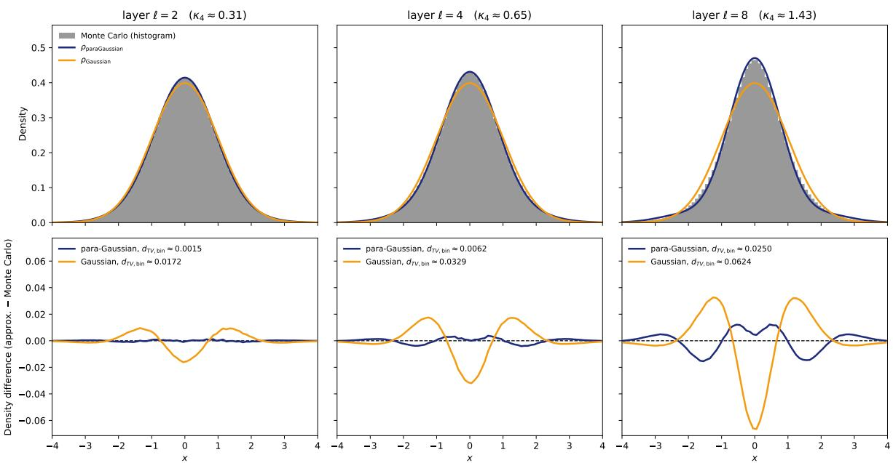  
Figure 1: The distribution of a single neuron in a randomly initialized ReLU network $( \varphi ( x ) = { \sqrt { 2 } } \operatorname* { m a x } \{ x , 0 \}$ , width $n = 1 0 0$ one input) at layers $\ell = 2 , 4 , 8 ,$ estimated from $2 ^ { 2 4 }$ Monte Carlo samples per layer. Top row: Comparing the Monte Carlo estimates $\left( \mathrm { g r e y } \right)$ , to the the Gaussian approximation $\mathcal { N } ( 0 , 1 ) \ \mathrm { ( y e l l o w ) }$ and the para-Gaussian law (blue) with density $\begin{array} { r } { \frac { 1 } { \sqrt { 2 \pi } } e ^ { - x ^ { 2 } / 2 } \left[ 1 + \frac { \kappa _ { 4 } } { 4 ! } \mathrm { H e } _ { 4 } ( x ) \right] } \end{array}$ , where $\mathrm { H e } _ { 4 } ( x ) = x ^ { 4 } - 6 x ^ { 2 } + 3$ and $\kappa _ { 4 } = 3 \big [ ( 1 + 5 / n ) ^ { \ell } - 1 \big ]$ . Bottom row: the difference between each approximation and the Monte Carlo density, estimated by a histogram with bin width 0.1, with both approximations averaged over the same bins. The legend shows the binned total variation distance $\begin{array} { r } { d _ { T V , \mathrm { b i n } } = \frac { 1 } { 2 } \sum _ { k } | p _ { k } - q _ { k } | } \end{array}$ , where $p _ { k }$ is the fraction of Monte Carlo samples in the k-th bin, $q _ { k }$ is the mass the approximation assigns to that bin. Notice that the deviation from the Gaussian grows with depth. Theorem 1.13 and Theorem 1.18 generalize this picture to multiple inputs and outputs to obtain the joint para-Gaussian distribution that approximates the distribution of multiple neurons in a neural network.

## 1.1 Gaussians and not-quite-Gaussians

It is a staple of statistics to approximate complicated distributions by the humble Gaussian law. Randomly initialized large neural networks are no exception and many theoretical works have studied how as the number of neurons, n, in the hidden layers grows large, $n  \infty .$ , there is convergence to a Gaussian process Lee+18; Mat+18; Yan19; Han23]. However, to invoke another statistical trope, one may inquire: how large of an n is large enough? This question is of particular interest in neural networks because the Gaussian approximation gets worse the deeper one looks in the network (see Figure 1 for a simple Monte Carlo experiment illustrating this). In other words, the errors in the Gaussian approximation stack up as more layers are added to the network. To understand truly deep neural networks, we must go beyond the Gaussian law.

One classical method beyond the Gaussian is the Edgeworth expansion around the Central Limit Theorem (CLT) for sums of i.i.d. random variables. Concretely, let $Y ^ { 1 } , Y ^ { 2 } , \ldots$ be i.i.d. centred $\mathbb { R } ^ { d } .$ -valued random vectors of some law Y with covariance matrix Σ and let $\begin{array} { r } { X ^ { n } : = \frac { 1 } { \sqrt { n } } \sum _ { j = 1 } ^ { n } Y ^ { j } } \end{array}$ be their normalized $\mathrm { s u m } ^ { 1 }$ Assume also that the law of $Y$ has bounded density w.r.t Lebesgue2 and enough finite moments. The classical proof of the CLT shows the only surviving part of the characteristic function of $X ^ { n }$ is the Gaussian part, whereas the Edgeworth expansion keeps the next order vanishing term, precisely one has (see [NO26] for more details),

$$
\mathbb { E } \left[ e ^ { \iota \langle X ^ { n } , \vec { u } \rangle } \right] = \phi _ { X ^ { n } } ( \vec { u } ) \approx \exp \left( - \frac { 1 } { 2 } \vec { u } ^ { T } \Sigma \vec { u } + \frac { 1 } { \sqrt { n } ^ { k - 2 } } \sum _ { k _ { 1 } , \ldots , k _ { d } \atop k _ { 1 } + \ldots + k _ { d } = k } \frac { \kappa _ { k _ { 1 } , \ldots , k _ { d } } } { k _ { 1 } ! \cdot \cdot \cdot k _ { d } ! } ( \vec { u } \vec { u } ) ^ { \vec { k } } \right) ,\tag{1}
$$

where $\vec { u } ^ { \vec { k } } = u _ { 1 } { } ^ { k _ { 1 } } \cdot \cdot \cdot u _ { d } ^ { k _ { d } }$ and $\kappa _ { k _ { 1 } , \dots , k _ { n } } = \kappa \big ( \underbrace { Y _ { 1 } , \dots , Y _ { 1 } } _ { k _ { 1 } \mathrm { ~ t i m e s } } , \dots , \underbrace { Y _ { d } , \dots , Y _ { d } } _ { k _ { d } \mathrm { ~ t i m e s } } \big )$ are the joint cumulants of the components of the random vector Y, and $k \geq 3$ is the order of the frst non-trivial higher cumulant of $Y \ { \mathrm { ( i . e } }$ the smallest k for which this is non-zero). For symmetric random variables $( { \mathrm { i . e . ~ } } Y { \overset { d } { = } } - Y )$ , this first non-trivial higher order is typically $k = 4$

The characteristic function (1) is a not-quite-Gaussian characteristic function. Modulo the approximation exp $\begin{array} { r } { \frac { 1 } { n ^ { p } } x \approx 1 + \frac { 1 } { n ^ { p } } x } \end{array}$ , when we invert the characteristic function (1) to obtain a density for the sum $X ^ { n }$ we find the following not-quite-Gaussian density function involving Hermite polynomials. We call this a para-Gaussian³ distribution.

Definition 1.1. Fix d ∈ N and a covariance matrix $\Sigma \in \mathbb { R } ^ { d \times d }$ . For $\vec { k } = ( k _ { 1 } , \dots , k _ { d } ) \in \mathbb { Z } _ { \geq 0 } ^ { d }$ , the multivariable Hermite polynomial $H _ { k _ { 1 } , \dots , k _ { d } } ( \cdot ; \Sigma ) : \mathbb { R } ^ { d } \to \mathbb { R }$ is the polynomial that satisfies

$$
H _ { k _ { 1 } , \ldots , k _ { d } } \left( x _ { 1 } , \ldots , x _ { d } ; \Sigma \right) \varphi _ { \Sigma } ( \vec { x } ) = \frac { 1 } { \left( 2 \pi \right) ^ { d } } \int _ { \mathbb { R } ^ { d } } ( \vec { u } \vec { u } ) ^ { \vec { k } } \exp \left\{ - \frac { 1 } { 2 } \vec { u } ^ { T } \Sigma \vec { u } - \imath \vec { x } \cdot \vec { u } \right\} d \vec { u } = ( - 1 ) ^ { | \vec { k } | } \partial _ { \vec { k } } \varphi _ { \Sigma } ( \vec { x } ) ,\tag{2}
$$

where $\varphi _ { \Sigma } ( \vec { x } ) = \sqrt { ( 2 \pi ) ^ { d } \operatorname* { d e t } { \Sigma } } ^ { - 1 } e ^ { - \frac { 1 } { 2 } \vec { x } ^ { T } \Sigma ^ { - 1 } \vec { x } }$ is the multi-variable Gaussian density of covariance Σ. This can alternatively be written as a Gaussian expectation

$$
H _ { k _ { 1 } , \ldots , k _ { d } } \left( x _ { 1 } , \ldots , x _ { d } ; \Sigma \right) = \mathbb { E } _ { \vec { Z } \sim \mathcal { N } ( 0 , \Sigma ^ { - 1 } ) } \left[ \prod _ { a = 1 } ^ { d } \left( \left( \Sigma ^ { - 1 } \vec { x } \right) _ { a } + \imath Z _ { a } \right) ^ { k _ { a } } \right]
$$

The para-Gaussian measure $\mathcal { P } _ { n } ^ { ( \Sigma , \kappa , k ) } \ _ { o n } \ \mathbb { R } ^ { d }$ of order k with covariance kernel Σ, k-cumulants $\kappa =$ $\left\{ \kappa _ { k _ { 1 } , \ldots , k _ { d } } \right\} _ { k _ { 1 } + \ldots + k _ { d } = k }$ and scale parameter n has density with respect to the Lebesgue measure on $\mathbb { R } ^ { d }$ given by

$$
\mathcal { P } _ { n } ^ { ( \Sigma , \kappa , k ) } ( \vec { x } ) = \varphi _ { \Sigma } ( \vec { x } ) \Bigg ( 1 + \frac { 1 } { \sqrt { n } ^ { k - 2 } } \sum _ { k _ { 1 } , \ldots , k _ { d } \atop k _ { 1 } + \ldots + k _ { d } = k } \frac { \kappa _ { k _ { 1 } , k _ { 2 } , \ldots , k _ { d } } } { k _ { 1 } ! k _ { 2 } ! \cdot \cdot \cdot k _ { d } ! } H _ { k _ { 1 } , \ldots , k _ { p } } ( \vec { x } , \Sigma ) \Bigg )\tag{3}
$$

This density has the following Fourier transform (aka characteristic function):

$$
\int e ^ { \imath \langle \vec { x } , \vec { u } \rangle } \mathcal { P } _ { n } ^ { ( \Sigma , \kappa , k ) } ( \vec { x } ) d \vec { x } = \exp \left( - \frac { 1 } { 2 } \vec { u } ^ { T } \Sigma \vec { u } \right) \left( 1 + \frac { 1 } { \sqrt { n } ^ { k - 2 } } \sum _ { \stackrel { k _ { 1 } , \ldots , k _ { d } } { k _ { 1 } + \ldots + k _ { d } = k } } \frac { \kappa _ { k _ { 1 } , \ldots , k _ { d } } } { k _ { 1 } ! \cdot \cdot \cdot k _ { d } ! } ( \vec { u } \vec { u } ) ^ { \vec { k } } \right) ,\tag{4}
$$

We abuse notation and interchangeably use the notation $\mathcal { P } _ { n } ^ { ( \Sigma , \kappa , k ) }$ to refer to the density or the measure whenever it is convenient. When k is understood from context (for example, the main case studied in this article has $k = 4$ everywhere) we omit the notation k and simply write $\mathcal { P } _ { n } ^ { ( \Sigma , \kappa ) }$

See Appendix A for some more useful facts about para-Gaussians. For instance, like the classical Gaussian, the para-Gaussian family is closed under linear combinations.

With this definition in hand, the classical Edgeworth expansion result can be summarized as “"Sums of i.i.d. random variables are approximately para-Gaussian". The main purpose of this article is to discuss how para-Gaussian distributions also arise in deep fully connected neural networks when they are randomly initialized. The para-Gaussian law shown in Figure 1 illustrates the simplest single-input-single-output version of this idea, where the para-Gaussian law matches the Monte Carlo simulations more accurately than the plain Gaussian. Our main results generalize Figure 1 to multiple inputs and multiple outputs (more Monte Carlo simulations showing 2 inputs or 2 outputs can also be found in Sections 2.2 and 2.3).

## 1.2 Outline and Contributions

The rest of the paper is structured as follows.

§1.3 We use the total variation distance to precisely introduce our notation of “asymptotic rate of convergence"

§1.4 We precisely define the randomly initialized neural networks we study here. We state one of our main results, Theorem 1.13, that the para-Gaussian approximation with k = 4 has a better rate of convergence to neural networks than the ordinary Gaussian, $O ( n ^ { - 2 } )$ VS. $O ( n ^ { - 1 } )$ 0

§1.5 We show how the para-Gaussian approximation can be used to obtain a recursion relation that estimates the 4-th cumulant in neural networks in terms of the multi-variable Hermite polynomials and state this result as Theorem 1.18

§1.6 We discuss how our results fit into the related literature.

§2.1 We state and prove Theorem 2.1 that gives the connection between cumulants of the neural network and the random covariance matrix Σ

§2.2 We use our theory to exactly solve the covariance and 4th cumulant in linear networks, and thereby compute the para-Gaussian approximation for these. This is tested against Monte Carlo experiments.

§2.3 We apply our theory to get approximations for ReLU Neural Networks. This is tested against Monte Carlo experiments.

§3 Proof details for Theorem 1.13 on the convergence rates of para-Gaussian approximations.

§4 Proof details for Theorem 1.18 on the recursions for approximating neural networks

Our main theoretical contributions are Theorem 1.13, Theorem 1.18, and Theorem 2.1, as described above, as well as the exact solution for the para-Gaussian approximation to linear neural networks of any depth described in §2.2.

## 1.3 Total Variation Distance and Asymptotic Rates of Convergence

One of our main results is that the para-Gaussian law is a better approximation that the purely Gaussian law in terms of total varaition distance, which we make precise with the following notion of convergence rate.

Definition 1.2. Let $\mu , \nu$ be inite signed measures on $\mathbb { R } ^ { d }$ . The total variation distance between them is the worst-case difference of integrals over measurable test functions bounded by one,

$$
d _ { T V } ( \mu , \nu ) : = \frac { 1 } { 2 } \operatorname* { s u p } _ { f : \| f \| _ { \infty } \leq 1 } \left| \int f d \mu - \int f d \nu \right| ,
$$

where the supremum is over measurable $f :  { \mathbb { R } ^ { d } } \to  { \mathbb { R } }$ . For random vectors $X , Y$ we write $d _ { T V } ( X , Y )$ for the distance between their laws, so that $\begin{array} { r } { d _ { T V } ( X , Y ) = \frac { 1 } { 2 } \operatorname* { s u p } _ { \| f \| _ { \infty } \leq 1 } \left| \mathbb { E } [ f ( X ) ] - \mathbb { E } [ f ( Y ) ] \right| } \end{array}$ , and similarly $d _ { T V } ( X , \nu )$ for the distance between the law of X and a signed measure ν. We will freely mix and match between random variables and their laws whenever it is convenient.

Definition 1.3. Let $( \mu _ { n } ) _ { n \geq 1 }$ be a sequence of finite signed measures on $\mathbb { R } ^ { d }$ , and let $\alpha > 0$ . A sequence $( X _ { n } ) _ { n \geq 1 } \ o f \mathbb { R } ^ { d }$ -valued random vectors is asymptotically distributed like $\mu _ { n }$ with rate $n ^ { - \alpha } \mathrm { \Delta } i f$

$$
d _ { T V } ( X _ { n } , \mu _ { n } ) = O \left( n ^ { - \alpha } \right) , \qquad t h a t \ i s , \qquad \operatorname* { l i m } _ { n \to \infty } n ^ { \alpha } d _ { T V } ( X _ { n } , \mu _ { n } ) < \infty .
$$

When $\mu _ { n } = { \mathcal { N } } ( 0 , \Sigma _ { n } )$ we say that $X _ { n }$ is asymptotically Gaussian with rate $n ^ { - \alpha }$ , and when $\mu _ { n } = \mathcal { P } _ { n } ^ { ( \Sigma _ { n } , { \kappa _ { n } } , k ) }$ is a para-Gaussian law we say that $X _ { n }$ is asymptotically para-Gaussian with rate ${ n ^ { - \alpha } }$

Remark 1.4. The classical example is a normalized sum of i.i.d. random vectors as in (1). This sequence is both asymptotically Gaussian and asymptotically para-Gaussian, but with different rates.

$X ^ { n }$ is asymptotically Gaussian, with $\Sigma _ { n } = \Sigma$ , with rate $n ^ { - 1 / 2 }$

• When the third cumulants of the law Y vanish, then the leading correction to the Gaussian approximation is of order $\frac { 1 } { n }$ and is given by the fourth cumulants: $X ^ { n }$ is asymptotically para-Gaussian with

$$
\Sigma _ { n } = \Sigma , \qquad \kappa = \kappa ^ { ( 4 ) } ( Y ) ,
$$

where $\kappa ^ { ( 4 ) } ( Y ) _ { a b c d } = \kappa \big ( Y _ { a } , Y _ { b } , Y _ { c } , Y _ { d } \big )$ is the fourth cumulant tensor of the law $Y ,$ with rate $n ^ { - 3 / 2 }$

If all the odd cumulants of Y vanish, for instance if Y is symmetric, both rates improve: $X ^ { n }$ is asymptotically Gaussian with rate $n ^ { - 1 }$ and asymptotically para-Gaussian with rate $n ^ { - 2 }$ . These are exactly the rates in Theorem 1.13. See [NO26, Theorems 7.9 and 7.10] for a derivation of these expansions via Hermite polynomials.

## 1.4 Random fully connected neural networks on initialization and their rates of convergence

We now precisely define the fully connected neural networks studied in this paper.

Definition 1.5. Fix a finite set of inputs A, and with each input $\alpha \in A$ a vector $x _ { \alpha } \in \mathbb { R } ^ { n _ { \mathrm { i n } } }$ , a hidden layer width n, and a non-linearity $\varphi : \mathbb { R } \longrightarrow \mathbb { R }$ . The network is defined layer by layer with each layers output indexed by $\{ z _ { \alpha , k } ^ { \ell } \} _ { \alpha \in A , k \in [ n ] } :$ the neurons of layer 0 are

$$
z _ { \alpha , k } ^ { 0 } = \frac { 1 } { \sqrt { n _ { \mathrm { i n } } } } \sum _ { i = 1 } ^ { n _ { \mathrm { i n } } } W _ { k , i } ^ { 0 } x _ { \alpha , i } , \qquad k \in [ n ] ,
$$

and $f o r \ \ell \geq 1$ the value of neuron $k \in [ n ]$ on input $\alpha \in A$ in layer l is

$$
z _ { \alpha , k } ^ { \ell } = \frac { 1 } { \sqrt { n } } \sum _ { j = 1 } ^ { n } W _ { k , j } ^ { \ell } \varphi \left( z _ { \alpha , j } ^ { \ell - 1 } \right) ,\tag{5}
$$

where all the weights $W _ { k , j } ^ { \ell }$ are independent standard Gaussians, independent across layers.

Remark 1.6. The results here can easily be generalized to different hidden layer size $n _ { 1 } , n _ { 2 } , . . .$ . but we use n for all of them for notational convenience in this article.

We are interested in the joint distribution of all the neurons and all the inputs, layer by layer. A convenient normalization is to choose $\varphi$ with $\mathbb { E } _ { G \sim { \cal N } ( 0 , 1 ) } \big [ \varphi ( G ) ^ { 2 } \big ] = 1$ , so that the variance of a neuron is preserved from layer to layer when the input has unit norm. Examples are the identity $\varphi ( x ) = x$ and the normalized ReLU $\varphi ( x ) = { \sqrt { 2 } } \operatorname* { m a x } \left\{ x , 0 \right\}$ . In order to prove any results, we need some regularity on the non-linearity $\varphi .$ We take the following standard assumption on the non-linearity from [Han24, Assumption 1]

Assumption 1.7. We assume that there exists an $r \in \mathbb N$ so that the non-linearity $\varphi : \mathbb { R }  \mathbb { R }$ is r times differentiable almost everywhere, and grows at most polynomially

Definition 1.8. (Random covariance matrix) For each layer l, define the random matrix $\Sigma ^ { \ell } \in \mathbb { R } ^ { A \times A }$ by:

$$
\Sigma ^ { \ell } ( \alpha , \beta ) : = \frac { 1 } { n } \sum _ { j = 1 } ^ { n } \varphi \left( z _ { \alpha , j } ^ { \ell - 1 } \right) \varphi \left( z _ { \beta , j } ^ { \ell - 1 } \right) , \qquad \alpha , \beta \in A .\tag{6}
$$

Remark 1.9. Note that, perhaps confusingly, $\Sigma ^ { \ell }$ is defined in terms of the vectors in layer $\ell - 1$ . This choice of definition is because the matrix $\Sigma ^ { \ell }$ importantly controls the distribution of layer l as in (7), so we have chosen to name it after the layer l it is used for (rather than the layer $\ell - 1$ which it is $d e f i n e d f r o m . ^ { 4 } )$

Remark 1.10. From the definition of the network (5), since the weights in each layer are Gaussian, we see that conditionally on the values previous layer $z ^ { \ell - 1 }$ , the next layer is conditionally Gaussian with this covariance matrix

$$
\begin{array} { r } { \left( z _ { \alpha , j } ^ { \ell } \right) _ { \alpha \in A , j \in [ n ] } \sim \mathcal { N } \left( \vec { 0 } , I _ { n } \otimes \Sigma ^ { \ell } \right) \mathrm { ~ c o n d i t i o n a l l y ~ o n ~ } \left( z _ { \alpha , j } ^ { \ell - 1 } \right) _ { \alpha \in A , j \in [ n ] } , } \end{array}\tag{7}
$$

where the covariance $I _ { n } \otimes \Sigma ^ { \ell }$ means that $\mathbf { E } \left[ z _ { \alpha , j } ^ { \ell } z _ { \beta , k } ^ { \ell } \Big | \big ( z _ { \alpha , j } ^ { \ell - 1 } \big ) _ { \alpha \in A , j \in [ n ] } \right] = \delta _ { j , k } \Sigma ^ { \ell } \left( \alpha , \beta \right)$ and $\delta _ { a , b }$ is the Kronecker delta.

As $n  \infty , \Sigma ^ { \ell }$ concentrates around the deterministic infinite width kernel $K ^ { \ell }$ , defined by the input kernel $\begin{array} { r } { K ^ { 0 } ( \alpha , \beta ) : = \frac { 1 } { n _ { \mathrm { i n } } } \langle x _ { \alpha } , x _ { \beta } \rangle } \end{array}$ and recursively afterwards by

$$
K ^ { \ell } ( \alpha , \beta ) : = \mathbb { E } _ { z \sim \mathcal { N } ( 0 , K ^ { \ell - 1 } ) } \big [ \varphi ( z _ { \alpha } ) \varphi ( z _ { \beta } ) \big ] ,\tag{8}
$$

and the infinite width network converges to a Gaussian process $\mathrm { { [ { L e e + 1 8 } ; } }$ Han24] with this kernel. Many of the results are contingent on this infinite-width kernel being non-degenerate, which we state as an assumption.

Assumption 1.11. For every layer $\ell ^ { \prime } \leq \ell ,$ the infinite width kernel $K ^ { \ell ^ { \prime } }$ defined in (8) is non-degenerate (strictly positive definite) on the inputs A.

The fluctuations of $\Sigma ^ { \ell }$ around its mean

$$
\bar { \Sigma } ^ { \ell } ( \alpha , \beta ) : = \mathbb { E } [ \Sigma ^ { \ell } ( \alpha , \beta ) ] ,
$$

are of order $n ^ { - 1 / 2 }$ , and are the source of all non-Gaussian corrections at finite width.

In fact, all of the higher cumulants of collections of neurons $z ^ { \ell }$ can be calculated in terms of the random matrix $\Sigma ^ { \ell }$ , and this is carried out in Theorem 2.1. To state our main result we need only the second and fourth cumulant, which we record in the following corrollary.

Corollary 1.12. The second and fourth cumulant of the neurons in layer l can be written in terms of the random matrix $\Sigma ^ { \ell }$ as follows.

Covariance: The covariance of two neurons is given in terms of the expectation $o f \Sigma ^ { \ell }$ , namely:

$$
\begin{array} { r } { \mathbf { C o v } \left[ z _ { \alpha _ { 1 } , j _ { 1 } } ^ { \ell } , z _ { \alpha _ { 2 } , j _ { 2 } } ^ { \ell } \right] = \delta _ { j _ { 1 } , j _ { 2 } } \mathbb { E } [ \Sigma ^ { \ell } ( \alpha _ { 1 } , \alpha _ { 2 } ) ] . } \end{array}\tag{9}
$$

For notational compactness, (9) is saying the covariance of $\{ z _ { \alpha , j } ^ { \ell } \} _ { \alpha \in A , 1 \leq j \leq m }$ is $I _ { m } \otimes { \bar { \Sigma } } ^ { \ell }$ for m $\in \mathbb { N }$

$\mathit { 4 } t h$ cumulant: The fourth cumulant for four neurons (not necessarily distinct) is given in terms of covariances $\overline { { o f \Sigma ^ { \ell } } }$ , namely

$$
\begin{array} { r l } & { \kappa \left( z _ { \alpha _ { 1 } , j _ { 1 } } ^ { \ell } , z _ { \alpha _ { 2 } , j _ { 2 } } ^ { \ell } , z _ { \alpha _ { 3 } , j _ { 3 } } ^ { \ell } , z _ { \alpha _ { 4 } , j _ { 4 } } ^ { \ell } \right) = \delta _ { j _ { 1 } , j _ { 2 } } \delta _ { j _ { 3 } , j _ { 4 } } \mathbf { C o v } \left[ \Sigma ^ { \ell } ( \alpha _ { 1 } , \alpha _ { 2 } ) , \Sigma ^ { \ell } ( \alpha _ { 3 } , \alpha _ { 4 } ) \right] } \\ & { \hphantom { = \delta _ { j _ { 1 } , j _ { 2 } } \delta _ { j _ { 3 } , j _ { 4 } } \mathbf { C o v } \left[ \Sigma ^ { \ell } ( \alpha _ { 1 } , \alpha _ { 3 } ) , \Sigma ^ { \ell } ( \alpha _ { 2 } , \alpha _ { 4 } ) \right] } } \\ & { \hphantom { = \delta _ { j _ { 1 } , j _ { 2 } } \delta _ { j _ { 2 } , j _ { 3 } } \mathbf { C o v } \left[ \Sigma ^ { \ell } ( \alpha _ { 1 } , \alpha _ { 4 } ) , \Sigma ^ { \ell } ( \alpha _ { 2 } , \alpha _ { 3 } ) \right] . } } \end{array}\tag{10}
$$

One of the main purposes of this paper is to establish the following result, which shows that the para-Gaussian law is a better approximation than the pure Gaussian law.

Theorem 1.13. We fix a layer l and a number m of neurons, and study the random vector $Z ^ { \ell } : = \qquad $ $\left\{ z _ { \alpha , j } ^ { \ell } \right\} _ { \alpha \in A , j \in [ m ] } \in \mathbb { R } ^ { A \times [ m ] }$ as the width $n  \infty$ . Suppose that $\varphi$ satisfies the smoothness condition $A s -$ sumption 1.7 and we have the non-degeneracy condition Assumption 1.11. Then as $n  \infty { : }$

(i) The covariance of $Z ^ { \ell }$ is given as in (9), Cov $\cdot ( Z ^ { \ell } ) = I _ { m } \otimes \bar { \Sigma } ^ { \ell }$ , and $Z ^ { \ell }$ is asymptotically Gaussian with rate $n ^ { - 1 }$

$$
d _ { T V } \left( Z ^ { \ell } , \mathcal { N } \big ( 0 , I _ { m } \otimes \bar { \Sigma } ^ { \ell } \big ) \right) = O \left( n ^ { - 1 } \right) .
$$

(ii) Let $\kappa _ { 4 } ^ { \ell }$ be the $_ { 4 - t h }$ cumulant of $Z ^ { \ell }$ as given in (10). Then $Z ^ { \ell }$ is asymptotically para-Gaussian $\mathcal { P } _ { n } ^ { ( I _ { m } \otimes \bar { \Sigma } ^ { \ell } , n \kappa _ { 4 } ^ { \ell } ) } 5$ with rate $n ^ { - 2 }$

$$
d _ { T V } \left( Z ^ { \ell } , \mathcal { P } _ { n } ^ { ( I _ { m } \otimes \bar { \Sigma } ^ { \ell } , n \kappa _ { 4 } ^ { \ell } ) } \right) = O \left( n ^ { - 2 } \right) .
$$

Remark 1.14. Note that the rate for Gaussian approximation in part (i) of Theorem 1.13 has been previously proven, in dimension one in [Fav+25], and in any dimension in [CP25], where the rate $n ^ { - 1 }$ is also shown to be optimal. We include part (i) to contrast it with part (ii), showing how the error rate improves to $n ^ { - 2 }$ from the Hermite correction in the para-Gaussian law. Our proof of part (ii) shares the interpolation between the mean covariance and the random covariance with [BT24; CP25], and carries the expansion one order further (concretely, this appears in our proof as keeping more terms of a particular Taylor series expansion, see Remark 1.15).

We expect it would be possible to use the same ideas to extend to para-Gaussian laws that keep cumulants up to order $2 p$ to create "part $p ) ^ { \dag }$ of the theorem which achieves an error rate $n ^ { - p }$ , but for concreteness and to improve exposition we focus on the fourth cumulant only here.

Remark 1.15 (Proof sketch of Theorem 1.13). While the details of the proof involve delicate analysis and presented in Section $^ { 3 , }$ the main idea of the proof of Theorem 1.13 is an instructive Taylor series expansion, so we sketch it out here.

Fix a bounded test function $f .$ Conditionally on layer $\ell - 1$ , the vector $Z ^ { \ell }$ is exactly Gaussian with the random covariance $I _ { m } \otimes \Sigma ^ { \ell }$ , so all of the non-Gaussianity of $Z ^ { \ell }$ comes from the fluctuation $\overline { { \Delta ^ { \ell } : = \Sigma ^ { \ell } - \bar { \Sigma } ^ { \ell } } }$ of this conditional random covariance matrix $\Sigma ^ { \ell }$ around its mean. To understand the effect of the random fluctuation, consider as follows: let $g _ { f } ( t )$ be the Gaussian expectation of f with the random covariance $I _ { m } \otimes ( \bar { \Sigma } ^ { \ell } + t \Delta ^ { \ell } )$ which interpolates between the non-random mean $\bar { \Sigma }$ at $t \ : = \ : 0$ (and consequently a perfectly Gaussian approximation for $Z ^ { \ell } )$ and the full quantity of interest Σ at $t = 1$ , in the sense that $\mathbb { E } [ g _ { f } ( 1 ) ] = \mathbb { E } [ f ( Z ^ { \ell } ) ]$ Taylor expanding around $t = 0$ ，

$$
\begin{array} { r } { \mathbb { E } [ f ( Z ^ { \ell } ) ] = \mathbb { E } \Big [ g _ { f } ( 0 ) + g _ { f } ^ { \prime } ( 0 ) + \frac { 1 } { 2 } g _ { f } ^ { \prime \prime } ( 0 ) + \frac { 1 } { 6 } g _ { f } ^ { \prime \prime \prime } ( 0 ) \Big ] + ( \mathrm { r e m a i n d e r } ) . } \end{array}
$$

The expectation of the first two terms is exactly the Gaussian law, since $g _ { f } ( 0 ) = \mathbb { E } _ { X \sim \mathcal { N } ( 0 , I _ { m } \otimes \bar { \Sigma } ^ { \ell } ) } [ f ( X ) ]$ and $\mathbb { E } [ g _ { f } ^ { \prime } ( 0 ) ] = 0$ (Lemma 3.6). It turns out that the expectation of the first three terms $\begin{array} { r } { \mathbb { E } \left[ g _ { f } ( 0 ) + g _ { f } ^ { \prime } ( 0 ) + \frac { 1 } { 2 } g _ { f } ^ { \prime \prime } ( 0 ) \right] } \end{array}$ is exactly the expectation under the para-Gaussian law $\begin{array} { r } { \int f \mathrm { d } \mathcal { P } _ { n } ^ { ( I _ { m } \otimes \bar { \Sigma } ^ { \ell } , n \kappa ^ { \ell } ) } } \end{array}$ (Proposition 3.14), with the second derivative of $\frac { 1 } { 2 } \mathbb { E } [ g _ { f } ^ { \prime \prime } ( 0 ) ]$ corresponding exactly to the 4th cumulant and Hermite terms in the para-Gaussian law. The fourth term is of order $n ^ { - 2 }$ (Lemma 3.22). The Taylor remainders are controlled by Lemma 3.20, using the moment bounds on $\Delta ^ { \ell }$ from [Han24] (see Lemma 3.16).

Altogether, truncating after the first two terms gives part (i) of Theorem 1.13 with error $O ( \| f \| _ { \infty } n ^ { - 1 } )$ and truncating after the first four terms gives part (ii) with error $O ( \| f \| _ { \infty } n ^ { - 2 } )$ (Corollary 3.23). Since these errors depend on $f$ only through $\| f \| _ { \infty } ,$ taking the supremum over $\| { \bar { f } } \| _ { \infty } \leq 1$ gives the bounds in total variation.

## 1.5 Recursions for calculating the covariance and fourth cumulant

Theorem 1.13 shows that the para-Gaussian approximation is much better than the Gaussian. But operationally speaking, how can one calculate the 4th cumulants needed as an input into this law? The key observation is that from Corollary 1.12 the 4th cumulant in layer $\ell + 1$ depends only on the covariances from the layer-l-measurable random matrix $\Sigma ^ { \ell + 1 }$ , through the following tensor $C ^ { \ell }$ defined as follows

Definition 1.16. We define the tensor $C ^ { \ell } : ( A \times A ) \times ( A \times A ) \to \mathbb { R }$ to be the covariances of $\Sigma ^ { \ell }$

$$
C ^ { \ell } ( \alpha , \beta ; \gamma , \delta ) : = n { \bf C o v } \left[ \Sigma ^ { \ell } ( \alpha , \beta ) , \Sigma ^ { \ell } ( \gamma , \delta ) \right]\tag{11}
$$

Note that from the symmetry Cov $\mathbf { \partial } \cdot ( X , Y ) = \mathbf { C o v } ( Y , X )$ , we see that $C ^ { \ell }$ has three fundamental symmetries: $C ^ { \ell } ( \alpha , \beta ; \gamma , \delta ) = C ^ { \ell } ( \beta , \alpha ; \gamma , \delta ) , C ^ { \ell } ( \alpha , \beta ; \gamma , \delta ) = C ^ { \ell } ( \alpha , \beta ; \delta , \gamma )$ , and finally $C ^ { \ell } ( \alpha , \beta ; \gamma , \delta ) = C ^ { \ell } ( \gamma , \delta ; \alpha , \beta )$

Remark 1.17. As $n \to \infty$ , the 4th cumulant will go to zero like $1 / n ,$ and it is this rescalled $C ^ { \ell }$ tensor that remains order 1 as $n \to \infty$ . This is why we rescale it in this way.

Calculating the covariance that define $C ^ { \ell }$ amounts to computing expected values of neurons in each layer. This creates a virtuous cycle: by approximating the law of layer l as a para-Gaussian, we may use the para-Gaussian law in layer l to compute the parameters of the para-Gaussian approximation in layer $\ell + 1$

Moreover, calculating expectations with respect to the para-Gaussian law is also easy, because the density of the para-Gaussian density (3) factors as a Gaussian times $\times \big ( 1 + ( \mathrm { H e r m i t e ~ t e r m s } ) \big )$ , which means that any para-Gaussian expectation is actually a Gaussian expectation with a slightly modified integrand, namely for any test function $f ,$ one has from the definition (3) that para-Gaussian expectations in general satisfy

$$
\mathbb { E } _ { Z \sim \mathcal { P } _ { n } ^ { ( \Sigma ) , \kappa , k } } \left[ f ( Z ) \right] = \mathcal { E } _ { Z \sim \mathcal { N } ( 0 , \Sigma ) } \left[ f ( Z ) \left( 1 + \frac { 1 } { \sqrt { n } ^ { k - 2 } } \sum _ { \substack { k _ { 1 } + k _ { 2 } + \ldots + k _ { d } = k } } \frac { \kappa _ { k _ { 1 } , k _ { 2 } , \ldots , k _ { d } } } { k _ { 1 } ! k _ { 2 } ! \cdot \cdot \cdot k _ { d } ! } H _ { k _ { 1 } , \ldots , k _ { p } } ( Z ; \Sigma ) \right) \right] ,
$$

where $\pmb { \mathcal { E } } _ { Z ^ { \ell } \sim \mathcal { N } ( 0 , \Sigma ) }$ denotes the expectation where $Z ^ { \ell }$ has a purely Gaussian law. We use the (somewhat unsual) notation ε for this purely Gaussian measure6.

As a final source of serendipity, there is an additional exchangability between various neurons in a given layer, which further simplifies the bookeeping needed. (To wit, the quantities we track $\bar { \Sigma } ^ { \ell }$ and $C ^ { \ell }$ are indexed by the set of inputs A only, and the full distribution among inputs and neurons $A \times [ n ]$ are derived from these.) For example, by the exchangability of neurons in any layer, from the definition of $\Sigma$ , the $C ^ { \ell }$ can be written as

$$
C ^ { \ell } ( \alpha , \beta ; \gamma , \delta ) = \mathbf { C o v } \left[ \varphi ( z _ { \alpha , 1 } ^ { \ell - 1 } ) \varphi ( z _ { \beta , 1 } ^ { \ell - 1 } ) , \varphi ( z _ { \gamma , 1 } ^ { \ell - 1 } ) \varphi ( z _ { \delta , 1 } ^ { \ell - 1 } ) \right] + ( n - 1 ) \mathbf { C o v } \left[ \varphi ( z _ { \alpha , 1 } ^ { \ell - 1 } ) \varphi ( z _ { \beta , 1 } ^ { \ell - 1 } ) , \varphi ( z _ { \gamma , 2 } ^ { \ell - 1 } ) \varphi ( z _ { \delta , 2 } ^ { \ell - 1 } ) \right]\tag{12}
$$

With these simplification in hand, and taking into account the size of the errors leads to the following theorem that records these recursion relations for $\bar { \Sigma } ^ { \ell }$ and $C ^ { \ell }$ that allow us to compute the para-Gaussian approximation to error size $O ( 1 / n ^ { 2 } )$ . The details of this are carried out in Section 4 and the final recursion for $\bar { \Sigma } ^ { \ell }$ and $C ^ { \ell }$ are stated in the below theorem.

Theorem 1.18. Under Assumptions 1.7 and 1.11, suppose we are given the average covariance matrix $\bar { \Sigma } ^ { \ell }$ and the tensor $C ^ { \ell }$ in layer l. Then the average covariance $\bar { \Sigma } ^ { \ell + 1 }$ and the quantity $\scriptstyle { \dot { C } } ^ { \ell + 1 }$ obey the following recursions:

Mean Covariance.

$$
\bar { \Sigma } ^ { \ell + 1 } ( \alpha , \beta ) = \pmb { \mathcal { E } } \left[ \varphi _ { \alpha } ^ { \ell } \varphi _ { \beta } ^ { \ell } \right] + \frac { 1 } { 8 n } \sum _ { \gamma _ { 1 } , \gamma _ { 2 } , \gamma _ { 3 } , \gamma _ { 4 } \in A } C ^ { \ell } ( \gamma _ { 1 } , \gamma _ { 2 } ; \gamma _ { 3 } , \gamma _ { 4 } ) \pmb { \mathcal { E } } \left[ \varphi _ { \alpha } ^ { \ell } \varphi _ { \beta } ^ { \ell } H _ { \gamma _ { 1 } \gamma _ { 2 } \gamma _ { 3 } \gamma _ { 4 } } ^ { \ell } \right] + \mathcal { O } \left( \frac { 1 } { n ^ { 2 } } \right) ,\tag{13}
$$

Fourth Cumulant. To order $\begin{array} { r } { \mathcal { O } ( { \frac { 1 } { n } } ) } \end{array}$ , the $C ^ { \ell + 1 }$ satisfies the recursion relation

$$
C ^ { \ell + 1 } ( \alpha , \alpha ^ { \prime } ; \beta , \beta ^ { \prime } ) = \mathcal { E } \left[ \varphi _ { \alpha } ^ { \ell } \varphi _ { \alpha ^ { \prime } } ^ { \ell } \varphi _ { \beta } ^ { \ell } \varphi _ { \beta ^ { \prime } } ^ { \ell } \right] - \mathcal { E } \left[ \varphi _ { \alpha } ^ { \ell } \varphi _ { \alpha ^ { \prime } } ^ { \ell } \right] \mathcal { E } \left[ \varphi _ { \beta } ^ { \ell } \varphi _ { \beta ^ { \prime } } ^ { \ell } \right]  \\  + \frac { 1 } { 4 } \sum _ { \gamma _ { 1 } , \gamma _ { 2 } , \gamma _ { 3 } , \gamma _ { 4 } \in A } C ^ { \ell } ( \gamma _ { 1 } , \gamma _ { 2 } ; \gamma _ { 3 } , \gamma _ { 4 } ) \mathcal { E } \left[ \varphi _ { \alpha } ^ { \ell } \varphi _ { \alpha ^ { \prime } } ^ { \ell } H _ { \gamma _ { 1 } \gamma _ { 2 } } ^ { \ell } \right] \mathcal { E } \left[ \varphi _ { \beta } ^ { \ell } \varphi _ { \beta ^ { \prime } } ^ { \ell } H _ { \gamma _ { 3 } \gamma _ { 4 } } ^ { \ell } \right] + \mathcal { O } \left( \frac { 1 } { n } \right) ,\tag{14}
$$

where:

$Z _ { 1 } ^ { \ell } = ( z _ { \gamma , 1 } ^ { \ell } ) _ { \gamma \in A } \in \mathbb { R } ^ { | A | }$ is the vector of outputs of neuron 1 of layer l over all inputs (by exchangeability any single neuron index k has the same distribution);

• E denotes expectation treating $Z _ { 1 } ^ { \ell }$ as pure Gaussian with mean 0 and covariance $\bar { \Sigma } ^ { \ell }$

$\varphi _ { \alpha } ^ { \ell } : = \varphi \left( z _ { \alpha , 1 } ^ { \ell } \right) f o r \alpha \in A ;$

$H _ { \gamma _ { 1 } \gamma _ { 2 } \gamma _ { 3 } \gamma _ { 4 } } ^ { \ell } : = H _ { \vec { e } _ { \gamma _ { 1 } } + \vec { e } _ { \gamma _ { 2 } } + \vec { e } _ { \gamma _ { 3 } } + \vec { e } _ { \gamma _ { 4 } } } \left( Z _ { 1 } ^ { \ell } ; \bar { \Sigma } ^ { \ell } \right)$ is the fourth-order Hermite polynomial from (2). Equivalently, these expectations can also be evaluated by Gaussian integration by parts $\pmb { \mathcal { E } } \left[ F { H } _ { \gamma _ { 1 } \gamma _ { 2 } \gamma _ { 3 } \gamma _ { 4 } } ^ { \ell } \right] =$ $\pmb { \mathcal { E } } \left[ \partial _ { \gamma _ { 1 } } \partial _ { \gamma _ { 2 } } \partial _ { \gamma _ { 3 } } \partial _ { \gamma _ { 4 } } F \right]$ (see Lemma 3.4 for details).

$H _ { \gamma _ { 1 } \gamma _ { 2 } } ^ { \ell } : = H _ { \vec { e } _ { \gamma _ { 1 } } + \vec { e } _ { \gamma _ { 2 } } } \left( Z _ { 1 } ^ { \ell } ; \bar { \Sigma } ^ { \ell } \right)$ is the second-order Hermite polynomial , where $\vec { e } _ { \gamma } \in \mathbb { Z } _ { \geq 0 } ^ { A }$ has a 1 in position γ and 0 elsewhere. Explicitly, writing $\Sigma = \bar { \Sigma } ^ { \ell }$ to make the inverse clear, this is

$$
H _ { \gamma _ { 1 } \gamma _ { 2 } } ^ { \ell } = \left( \Sigma ^ { - 1 } Z _ { 1 } ^ { \ell } \right) _ { \gamma _ { 1 } } \left( \Sigma ^ { - 1 } Z _ { 1 } ^ { \ell } \right) _ { \gamma _ { 2 } } - \left( \Sigma ^ { - 1 } \right) _ { \gamma _ { 1 } \gamma _ { 2 } } ,
$$

which is valid also when $\gamma _ { 1 } = \gamma _ { 2 }$

The proof of Theorem 1.18 is presented in Section 4.

## 1.6 Related work

The study of wide random neural networks at initialization starts from the observation that, as the width n tends to infinity with the depth fixed, the neurons converge to a Gaussian process, sometimes refered to as the neural network Gaussian process (NNGP) [Lee+18; Mat+18; Han23]. Our work is concerned with what happens just beyond this limit: the corrections of order ${ \frac { 1 } { n } } ,$ , how to describe them, and how accurately they describe the network. In this section we explain how our results relate to the existing literature on this question, which comes from several directions

## 1.6.1 Perturbative descriptions of finite-width networks

The most closely related line of work describes finite-width networks perturbatively in $\textstyle { \frac { 1 } { n } }$ . At a physics level of rigor, Yaida [Yai20] was the first to obtain a recursion in the depth for the fourth cumulant of a single neuron, and to study its behaviour for deep networks. These ideas were developed much further in the monograph of Roberts, Yaida and Hanin [RYH22], which derives, again at a physics level of rigor, recursions for the four-point vertex (which plays the role of our $C ^ { \ell } )$ and for the $\frac { 1 } { n }$ correction to the covariance with several inputs, as well as for many other objects, such as the neural tangent kernel and its evolution during training

Hanin [Han24] then gave a mathematically rigorous account of this picture. He showed that the 2k-th cumulants of the neurons are of order $n ^ { 1 - k }$ [Han24, Theorem 3], derived $\textstyle { \mathrm { ~ \dot { ~ a ~ } ~ } } { \frac { 1 } { n } }$ expansion for the expectations of smooth or continuous test functions [Han24, Theorem 4], showed that the cumulants form a hierarchy determined recursively from layer to layer [Han24, Corollary 5], and computed explicitly the resulting recursions for a single input Han24, Corollary 6]. Indeed, many of our proofs rely on several of the detailed analysis and estimates developed in [Han24].

Our contributions relative to this line of work are described below.

Describing the distribution of the network with Hermite polynomials The perturbative approaches above describe the network through its cumulants and/or through expectations of test functions. We instead explictly describe the law of the network as a para-Gaussian law. Theorem 1.13 says that the joint distribution of finitely many neurons is close, in total variation distance, to an explicit signed measure, the para-Gaussian law, whose density is a Gaussian density multiplied by a correction made of fourth order Hermite polynomials.

Our point of view has two practical consequences. First, the approximation can be compared directly with Monte Carlo simulations at the level of densities, as in Figures 1, 5 and 9. Second, it yields statements for arbitrary bounded test functions, including indicator functions of sets, with errors that depend on the test function only through its supremum. This is because in our approach derivatives of the test function instead become expectations with the Hermite polynomials (see Lemma 3.4 and Remark 3.5).

We also believe this way of thinking in terms of para-Gaussian distributions is useful to the human understanding of this area. This description in terms of Hermite polynomials can be more easily conceptualized than more complicated formulas involving derivative operators, even in cases where the two formulas mathematically coincide. We are hopeful that the exposition we provide here will be useful to readers.

Explicit formulas for the cumulants of all orders in terms of the random matrix Σ. It is stated in [Han24, Proposition 15], that the cumulants of the neurons can be expressed through "finite sums $\mathrm { o f } ^ { \prime \prime }$ cumulants of the random covariance matrix $\Sigma ^ { \ell }$ . Theorem 2.1 makes this expression completely explicit: for every width $n ,$ the 2p-th cumulant of the neurons is a sum over the $( 2 p - 1 ) ! !$ pairings of the indices, each weighted by Kronecker deltas in the neuron indices and by a p-th cumulant of entries of $\Sigma ^ { \ell }$ . This formula makes visible the structure of the dependence between different neurons. Neurons in the same layer are uncorrelated, but they are not independent, and the Kronecker deltas $\delta _ { j _ { i } , j _ { k } }$ from Theorem 2.1 create higher order non-trivial cumulants. We give two proofs of this, one slick proof with the law of total cumulance and one directly from the definition of cumulants via generating functions.

Recursions with several inputs and general activation functions. The recursions of Theorem 1.18 for the mean covariance $\bar { \Sigma } ^ { \ell }$ and for $C ^ { \ell }$ hold for any set of inputs and any activation function satisfying the assumptions of [Han24]. This generalizes the single-input recursions of [Han24, Corollary 6] to several inputs Written with Hermite polynomials, the coefficients of these recursions are explicit Gaussian integrals, which in the ReLU case we evaluate numerically (see Section 2.3).

Exact solutions in special cases. For activation functions that are positively homogeneous of degree one, such as the identity and ReLU, the law of a single neuron on a single input is known in closed form: it is a Gaussian with an independent random variance given by a product of independent weighted chi-squared random variables [HN20], which can also be described with Meijer G-functions [ZP21]. In particular, the exact single-input formulas $\begin{array} { r } { C ^ { \ell } = n [ ( 1 + \frac { 2 } { n } ) ^ { \ell } - 1 ] } \end{array}$ for linear networks and $\begin{array} { r } { C ^ { \ell } = \overset { \cdot } { n } [ ( 1 + \frac { 5 } { n } ) ^ { \ell } - 1 ] } \end{array}$ for ReLU networks (which we state in Lemma 2.5) are already known.

A new result is the exact solution for linear networks with several inputs and several neurons, Lemma $2 . 3 ,$ which is valid for every n and every depth. It shows that, beyond the two pairings $K ( \alpha , \beta ) K ( \alpha ^ { \prime } , \beta ^ { \prime } ) +$ $K ( \alpha , \beta ^ { \prime } ) K ( \alpha ^ { \prime } , \beta )$ predicted by the $\frac { 1 } { n }$ recursion, the exact fourth cumulant contains a third pairing $K ( \alpha , \alpha ^ { \prime } ) K ( \beta , \beta ^ { \prime } )$ with a coefficient $w _ { \ell }$ that is invisible at first order but becomes important once $\ell / n$ is of order one (Figure 2).

## 1.6.2 Deep networks and the depth-to-width ratio

The non-Gaussian corrections studied in this paper are small in a single layer, of order $^ { \frac { 1 } { n } , }$ but they accumulate as the signal passes through the network. A useful way to see this is through the fourth cumulant of a single neuron. In a ReLU network with one input, for example, it is ${ \textstyle \frac { 3 } { n } } C ^ { \ell }$ with $\begin{array} { r } { C ^ { \bar { \ell } } = 5 \ell + O ( \frac { 1 } { n } ) } \end{array}$ (Lemma 2.5): each layer adds a roughly equal amount of non-Gaussianity, so that after l layers the correction is of order $\frac { \ell } { n }$ rather than $\textstyle { \frac { 1 } { n } }$ . The relevant small parameter for a deep network is therefore not the inverse width $\textstyle { \frac { 1 } { n } }$ alone, but the depth-to-width ratio $\frac { \ell } { n }$

When $\frac { \ell } { n }$ is small, the para-Gaussian law is an accurate description, and this is the regime of the present paper. When $\frac { \ell } { n }$ is of order one, every order of the expansion in $\textstyle { \frac { 1 } { n } }$ contributes at the same size, and a description by finitely many cumulants is no longer adequate. In this regime, the network has been studied by taking n and l to infinity together with $\frac { \ell } { n }$ fixed. For a single input, the variance of a neuron then becomes log-normal rather than deterministic $\mathrm { [ H N ' 2 0 ] }$ . With two inputs, the angle between their representations evolves as a Markov chain whose behaviour is governed by $\frac { \ell } { n } \ [ \mathrm { J N 2 4 } ]$

The exact solution for linear networks (Lemma 2.3) shows clearly how the two regimes fit together in that special case. The exact coefficients are built from powers such as $\textstyle ( 1 + { \frac { 2 } { n } } ) ^ { \ell }$ , which are approximately $e ^ { 2 \ell / n }$ The first order recursion keeps only the linear term $\textstyle 1 + { \frac { 2 \ell } { n } }$ of this exponential. This is accurate when $\frac { \ell } { n }$ is small and fails once $\frac { \ell } { n }$ is of order one, as Figure 2 shows. The same behaviour appears in ReLU networks where the $\textstyle { \frac { 1 } { n } }$ recursion underestimates the cumulants once $\textstyle { \frac { 5 \ell } { n } }$ is no longer small (Figures 6 and 8). In this sense the para-Gaussian law is the first non-trivial approximation, valid for small $\frac { \ell } { n }$ , to the non-Gaussian behaviour that the works above describe at finite $\frac { \ell } { n }$

## 1.6.3 Generalization of earlier work by the authors

This paper extends the ideas from the workshop paper [NO24], which introduced the para-Gaussian distribution through its characteristic function, for a single neuron in a network with one hidden layer and at most two inputs, and computed the resulting density with Hermite polynomials. The present paper treats networks of arbitrary depth, any finite number of inputs and any finite number of neurons, including the dependence between different neurons. We prove that the approximation holds in total variation with rate $n ^ { - 2 }$ in Theorem 1.13 and gives the recursions that propagate the parameters of the para-Gaussian law from layer to layer in Theorem 1.18.

The relationship between the normalization $\frac { 1 } { 8 }$ used in [NO24] and the Edgeworth normalization $\textstyle { \frac { 1 } { 4 ! } }$ used here is explained in Corollary 3.12. The Hermite polynomial machinery we use throughout, in particular the Gaussian integral formula for multivariable Hermite polynomials, was developed in the expository paper on Hermite polynomials [NO26].

## 1.7 AI Disclosure

Claude Opus 5.5 was used as a writing assistant throughout. The slick proof of Theorem 2.1 using the law of total cumulance was also discovered by Claude. (Our original human proof is included in Appendix B.) Claude also wrote the code to run the Monte Carlo experiments and generate the figures in the paper.

## 2 More Results

In addition to the two main theorems, Theorem 1.13 and Theorem 1.18, in this section we develop a general formula for the cumulants of the neurons in terms of the cumulants of the random matrix Σ in Theorem 2.1. We also apply our theory to linear neural networks in Section 2.2 and ReLU networks in Section 2.3.

## 2.1 Exact formulas for higher cumulants

Theorem 2.1. All the odd cumulants of neurons are $\theta ,$ and the 2p-cumulants of the neuron activation in layer l can be written in terms of $\Sigma ^ { \ell }$ as follows:

$$
\kappa \left( \{ \boldsymbol { z } _ { \alpha _ { i } , j _ { i } } ^ { \ell } \} _ { i = 1 } ^ { 2 p } \right) = \sum _ { \{ \left\{ \boldsymbol { a } _ { 1 } , b _ { 1 } \right\} , \ldots , \{ \boldsymbol { a } _ { p } , b _ { p } \} \} \in \mathcal { P } ( 2 p ) } \left( \prod _ { k = 1 } ^ { p } \delta _ { j _ { \alpha _ { k } } , j _ { b _ { k } } } \right) \kappa \left( \left\{ \boldsymbol { \Sigma } ^ { \ell } ( \alpha _ { \boldsymbol { a } _ { k } } , \alpha _ { b _ { k } } ) \right\} _ { k = 1 } ^ { p } \right) ,
$$

where the sum $\{ \{ a _ { 1 } , b _ { 1 } \} , \ldots , \{ a _ { p } , b _ { p } \} \} \in { \mathcal { P } } ( 2 p )$ is over all of the $| \mathcal { P } ( 2 p ) | = ( 2 p - 1 ) ! !$ possible pairings of the indices $\{ 1 , \ldots , 2 p \}$ , more precisely $\{ \{ a _ { 1 } , b _ { 1 } \} , \dots , \{ a _ { p } , b _ { p } \} \} \in \mathcal { P } ( 2 p )$ if and only $i f \bigcup _ { i = 1 } ^ { p } \{ a _ { i } , b _ { i } \} = \{ 1 , \ldots , 2 p \}$ and $\{ a _ { i } , b _ { i } \} \cap \{ a _ { j } , b _ { j } \} = \emptyset ~ f o r ~ i \neq j$

We will give two proofs of Theorem 2.1. The first, which is brief and relies on the law of total cumulance, is stated here. The second, which is more instructive but longer, can be found in Appendix B.

First proof of Theorem 2.1. We will appeal to the law of total cumulance [Bri69], which states that for any finite collection of random variables $X _ { 1 } , \ldots , X _ { m }$ , and a sigma-algebra $\mathcal { F }$ to condition on, one has

$$
\kappa ( X _ { 1 } , \ldots , X _ { m } ) = \sum _ { \pi \vdash \{ 1 , \ldots , m \} } \kappa ( \{ \kappa ( \{ X _ { i } \} _ { i \in B }  \mathcal { F } ) \} _ { B \in \pi } ) ,\tag{15}
$$

where the sum is over all set partitions π of $\{ 1 , \ldots , m \}$ into disjoint blocks (of any size), the inner $\kappa ( \cdot \mid \mathcal { F } )$ is the conditional joint cumulant of the variables in the block B (which is itself a F-measurable random variable), and the outer κ is the ordinary joint cumulant of these [π| random variables. (For example, when $m = 2$ this is the law of total covariance, $\mathbf { C o v } ( X , Y ) = \mathbb { E } \left[ \mathbf { C o v } ( X , Y \mid { \mathcal F } ) \right] + \mathbf { C o v } ( \mathbb { E } [ X \mid { \mathcal F } ] , \mathbb { E } [ Y \mid { \mathcal F } ] ) . )$

In our case, using the sigma-algebra $\mathcal { F } = \sigma \left( \left\{ z _ { \alpha , k } ^ { \ell - 1 } \right\} _ { \alpha \in A , k \in [ n ] } \right)$ of the previous layer, we see that because the random variable $z _ { \alpha , k } ^ { \ell }$ conditionally Gaussian (see Remark 1.10), the only non-zero conditional cumulants are the 2nd cumulant (aka covariance) which has κ $\begin{array} { r } { \left( z _ { \alpha _ { 1 } , k _ { 1 } } ^ { \ell } , z _ { \alpha _ { 2 } , k _ { 2 } } ^ { \ell } \left| \mathcal { F } \right. \right) = \mathbf { C o v } \left( z _ { \alpha _ { 1 } , k _ { 1 } } ^ { \ell } , z _ { \alpha _ { 2 } , k _ { 2 } } ^ { \ell } \left| \mathcal { F } \right. \right) = } \end{array}$ $\delta _ { k _ { 1 } , k _ { 2 } } \Sigma ^ { \ell } ( \alpha _ { 1 } , \alpha _ { 2 } )$ . Because all other cumulants are zero for Gaussian random varaibles, the only partitions π that have non-zero contribution in (15) are precisely the pair partitions. This shows that the odd cumulants are 0 (since there are no pair partitions) and that the even cumulants are

$$
\kappa \left( \bigl \{ z _ { \alpha _ { i } , j _ { i } } ^ { \ell } \bigr \} _ { i = 1 } ^ { 2 p } \right) = \sum _  \{ \substack { a _ { 1 } , b _ { 1 } \} , \ldots , \{ a _ { p } , b _ { p } \} \} \in \mathcal { P } ( 2 p ) } \kappa \left( \bigl \{ \delta _ { j _ { a _ { k } } , j _ { b _ { k } } } \Sigma ^ { \ell } ( \alpha _ { a _ { k } } , \alpha _ { b _ { k } } ) \bigr \} _ { k = 1 } ^ { p } \right) ,
$$

whence the result follows by multi-linearity of cumulants to pull out the $\delta _ { j _ { a _ { k } } , j _ { b _ { k } } }$ factors.

## 2.2 Linear Activation Function

When φ is the identity function, i.e. $\varphi ( x ) = x ,$ , we obtain a very nice simplification of the formulas of Theorem 1.18. Moreover, we are able to solve the recursion equation for the cumulants exactly (not just to order $1 / n )$ Recall from (8) the definition $\begin{array} { r } { K ^ { 0 } ( \alpha , \beta ) = \frac { 1 } { n _ { i n } } \langle x _ { \alpha } , x _ { \beta } \rangle } \end{array}$ denotes the covariance of the input layer. For the linear network $\varphi ( x ) = x$ it is also clear that the infinite width limit $K ^ { \ell } ( \alpha , \beta ) = K ^ { 0 } ( \alpha , \beta )$ is constant, so we just refer to this constant as $K ( \alpha , \beta )$ for the linear network.

Corollary 2.2 (Linear networks: exact recursive formulas). Let $\varphi ( x ) = x$ and let layer 0 be Gaussian with kernel K. Then for every n and every $\ell \geq 0 .$

$$
\bar { \Sigma } ^ { \ell } = K
$$

Fourth cumulant. The tensor $C ^ { \ell } ( \alpha , \alpha ^ { \prime } ; \beta , \beta ^ { \prime } ) : = n { \bf C o v } \left[ \Sigma ^ { \ell } ( \alpha , \alpha ^ { \prime } ) , \Sigma ^ { \ell } ( \beta , \beta ^ { \prime } ) \right]$ in (11) satisfies $C ^ { 0 } = 0$ and the exact recursion

$$
\begin{array} { l } { { { \cal C } ^ { \ell } ( \alpha , \alpha ^ { \prime } ; \beta , \beta ^ { \prime } ) = K ( \alpha , \beta ) K ( \alpha ^ { \prime } , \beta ^ { \prime } ) + K ( \alpha , \beta ^ { \prime } ) K ( \alpha ^ { \prime } , \beta ) + { \cal C } ^ { \ell - 1 } ( \alpha , \alpha ^ { \prime } ; \beta , \beta ^ { \prime } ) } } \\ { { \mathrm { } + { \frac { 1 } { n } } \left( { \cal C } ^ { \ell - 1 } ( \alpha , \beta ; \alpha ^ { \prime } , \beta ^ { \prime } ) + { \cal C } ^ { \ell - 1 } ( \alpha , \beta ^ { \prime } ; \alpha ^ { \prime } , \beta ) \right) . } } \end{array}\tag{16}
$$

Proof. Mean Covariance. Since $\varphi ( x ) = x$ , by (6) we have $\bar { \Sigma } ^ { \ell } ( \alpha , \beta ) = \mathbb { E } \left[ z _ { \alpha , 1 } ^ { \ell - 1 } z _ { \beta , 1 } ^ { \ell - 1 } \right] = \bar { \Sigma } ^ { \ell - 1 } ( \alpha , \beta )$ , so by induction $\Sigma ^ { \ell } = \Sigma ^ { 0 } = K$ for all l.

Fourth cumulant. Layer 0 is Gaussian, so its fourth (and higher) cumulants vanish, consistent with $C ^ { 0 } = 0$ By (12) and using $\varphi ( x ) = x ,$ we have

$$
C ^ { \ell } ( \alpha , \alpha ^ { \prime } ; \beta , \beta ^ { \prime } ) = \mathbf { C o v } \left[ z _ { \alpha , 1 } ^ { \ell - 1 } z _ { \alpha ^ { \prime } , 1 } ^ { \ell - 1 } , z _ { \beta , 1 } ^ { \ell - 1 } z _ { \beta ^ { \prime } , 1 } ^ { \ell - 1 } \right] + ( n - 1 ) \mathbf { C o v } \left[ z _ { \alpha , 1 } ^ { \ell - 1 } z _ { \alpha ^ { \prime } , 1 } ^ { \ell - 1 } , z _ { \beta , 2 } ^ { \ell - 1 } z _ { \beta ^ { \prime } , 2 } ^ { \ell - 1 } \right] .\tag{17}
$$

For mean-zero random variables $X , Y , U , V$ we have the identity E $[ X Y U V ] = \kappa ( X , Y , U , V ) + \mathbb { E } [ X Y ] \mathbb { E } [ U V ] +$ $\mathbb { E } [ X U ] \mathbb { E } [ Y V ] + \mathbb { E } [ X V ] \mathbb { E } [ Y U ]$ , and so

$$
\mathbf { C o v } \left[ X Y , U V \right] = \mathbb { E } [ X U ] \mathbb { E } [ Y V ] + \mathbb { E } [ X V ] \mathbb { E } [ Y U ] + \kappa ( X , Y , U , V ) .\tag{18}
$$

We apply (18) to both terms of (17). The mean covariances of layer l – 1 are $\bar { \Sigma } ^ { \ell - 1 } = K$ (shown above) on the same neuron and 0 across different neurons, and its fourth cumulants are given exactly by (10) (Theorem 2.1).

Same neuron: With all four variables on neuron 1, all three δ-products in (10) equal 1, and so

$$
\begin{array} { r l } & { \mathbf { C o v } \left[ z _ { \alpha , 1 } ^ { \ell - 1 } z _ { \alpha ^ { \prime } , 1 } ^ { \ell - 1 } , z _ { \beta , 1 } ^ { \ell - 1 } z _ { \beta ^ { \prime } , 1 } ^ { \ell - 1 } \right] = K ( \alpha , \beta ) K ( \alpha ^ { \prime } , \beta ^ { \prime } ) + K ( \alpha , \beta ^ { \prime } ) K ( \alpha ^ { \prime } , \beta ) } \\ & { \qquad + \frac { 1 } { n } \Big ( C ^ { \ell - 1 } ( \alpha , \alpha ^ { \prime } ; \beta , \beta ^ { \prime } ) + C ^ { \ell - 1 } ( \alpha , \beta ; \alpha ^ { \prime } , \beta ^ { \prime } ) + C ^ { \ell - 1 } ( \alpha , \beta ^ { \prime } ; \alpha ^ { \prime } , \beta ) \Big ) . } \end{array}
$$

Two different neurons: Now $\mathbb { E } \left[ z _ { \alpha , 1 } z _ { \beta , 2 } \right] = \mathbb { E } \left[ z _ { \alpha , 1 } z _ { \beta ^ { \prime } , 2 } \right] = 0$ , so the covariance terms in (18) vanish, and in (10) only the term $\delta _ { 1 1 } \delta _ { 2 2 }$ survives:

$$
\mathbf { C o v } [ z _ { \alpha , 1 } z _ { \alpha ^ { \prime } , 1 } , z _ { \beta , 2 } z _ { \beta ^ { \prime } , 2 } ] = \frac { 1 } { n } C ^ { \ell - 1 } ( \alpha , \alpha ^ { \prime } ; \beta , \beta ^ { \prime } ) .
$$

Substituting both into (17), the term ${ \scriptstyle { \frac { 1 } { n } } } C ^ { \ell - 1 } ( \alpha , \alpha ^ { \prime } ; \beta , \beta ^ { \prime } )$ from the same-neuron part combines with ${ \begin{array} { r l } { { \frac { n - 1 } { n } } C ^ { \ell - 1 } ( \alpha , \alpha ^ { \prime } ; \beta , \beta ^ { \prime } ) } \end{array} }$ from the cross-neuron part to give $\displaystyle \dot { C } ^ { \prime } { } ^ { - 1 } ( \alpha , \alpha ^ { \prime } ; \beta , \beta ^ { \prime } )$ , and (16) follows. □

Lemma 2.3 (Linear networks: explicit solution to 4th order cumulant). Recall that the $\mathit { 4 } t h$ order cumulant tensor is given in terms of the $C ^ { \ell }$ which satisfies the recursion given in Corollary 2.2 and that the mean covariance is $\bar { \Sigma } ^ { \ell } = K$ exactly. The exact solution for the $C ^ { \ell }$ is

$$
C ^ { \ell } ( \alpha , \alpha ^ { \prime } ; \beta , \beta ^ { \prime } ) = v _ { \ell } \Big ( K ( \alpha , \beta ) K ( \alpha ^ { \prime } , \beta ^ { \prime } ) + K ( \alpha , \beta ^ { \prime } ) K ( \alpha ^ { \prime } , \beta ) \Big ) + w _ { \ell } K ( \alpha , \alpha ^ { \prime } ) K ( \beta , \beta ^ { \prime } ) ,\tag{19}
$$

where the coefficents $v _ { \ell } \in \mathbb { R } , w _ { \ell } \in \mathbb { R }$ are given explicitly by

$$
v _ { \ell } : = \frac { n } { 3 } \left[ \left( 1 + \frac { 2 } { n } \right) ^ { \ell } - \left( 1 - \frac { 1 } { n } \right) ^ { \ell } \right] , \qquad w _ { \ell } : = \frac { n } { 3 } \left[ \left( 1 + \frac { 2 } { n } \right) ^ { \ell } + 2 \left( 1 - \frac { 1 } { n } \right) ^ { \ell } - 3 \right] .\tag{20}
$$

Proof. The proof goes by showing that the form of the solution (19) is preserved when the scalars $v _ { \ell } ,$ we satisfy the recursion (21) below. This recursion is then solved to yield (20).

For notational convenience, let us define $P _ { 1 } = K ( \alpha , \beta ) K ( \alpha ^ { \prime } , \beta ^ { \prime } ) , P _ { 2 } = K ( \alpha , \beta ^ { \prime } ) K ( \alpha ^ { \prime } , \beta )$ and $P _ { 3 } =$ $K ( \alpha , \alpha ^ { \prime } ) K ( \beta , \beta ^ { \prime } )$ to be the the three possible pairings.

Substituting the ansatz (19) for $C ^ { \ell - 1 }$ into the two permuted terms of (16) gives $C ^ { \ell - 1 } ( \alpha , \beta ; \alpha ^ { \prime } , \beta ^ { \prime } ) =$ $v _ { \ell - 1 } ( P _ { 2 } + P _ { 3 } ) + w _ { \ell - 1 } P _ { 1 }$ and $C ^ { \ell - 1 } ( \alpha , \beta ^ { \prime } ; \alpha ^ { \prime } , \beta ) = v _ { \ell - 1 } ( P _ { 1 } + P _ { 3 } ) + w _ { \ell - 1 } P _ { 2 }$ , so the form of the solution is preserved by (16) when $v _ { \ell }$ and $w _ { \ell }$ satisfy

$$
\begin{array} { r } { v _ { \ell } = 1 + v _ { \ell - 1 } + \frac { 1 } { n } \big ( v _ { \ell - 1 } + w _ { \ell - 1 } \big ) , \qquad w _ { \ell } = w _ { \ell - 1 } + \frac { 2 } { n } v _ { \ell - 1 } , \qquad v _ { 0 } = w _ { 0 } = 0 . } \end{array}\tag{21}
$$

This can be solved by doing the linear combinations $s _ { \ell } : = 2 v _ { \ell } + w _ { \ell }$ and $d _ { \ell } : = v _ { \ell } - w _ { \ell }$ . Notice then that $\begin{array} { r } { s _ { \ell } = 2 + ( 1 + \frac { 2 } { n } ) s _ { \ell - 1 } } \end{array}$ and $\begin{array} { r } { d _ { \ell } = 1 + ( 1 - \frac { 1 } { n } ) d _ { \ell - 1 } } \end{array}$ , SO $\begin{array} { r } { s _ { \ell } = n [ ( 1 + \frac { 2 } { n } ) ^ { \ell } - 1 ] } \end{array}$ and $\begin{array} { r } { d _ { \ell } = n [ 1 - ( 1 - \frac { 1 } { n } ) ^ { \ell } ] } \end{array}$ . Solving $\begin{array} { r } { v _ { \ell } = \frac { 1 } { 3 } ( s _ { \ell } + d _ { \ell } ) } \end{array}$ and $\begin{array} { r } { w _ { \ell } = \frac { 1 } { 3 } ( s _ { \ell } - 2 d _ { \ell } ) } \end{array}$ gives (20). □

Remark 2.4. Note that for fixed $\ell ,$ we have $\displaystyle v _ { \ell } = \ell + O ( 1 / n )$ and $w _ { \ell } = 0 + O ( 1 / n )$ , which gives the linearized

$$
C ^ { \ell } ( \alpha , \alpha ^ { \prime } ; \beta , \beta ^ { \prime } ) = \ell \Big ( K ( \alpha , \beta ) K ( \alpha ^ { \prime } , \beta ^ { \prime } ) + K ( \alpha , \beta ^ { \prime } ) K ( \alpha ^ { \prime } , \beta ) \Big ) + O ( 1 / n ) .
$$

This also could have been obtained from the recursion in Theorem 1.18. We compare the exact values from the solution in Lemma 2.3 to this $O ( 1 / n )$ approximation to Monte Carlo simulations for various aspects of the network below

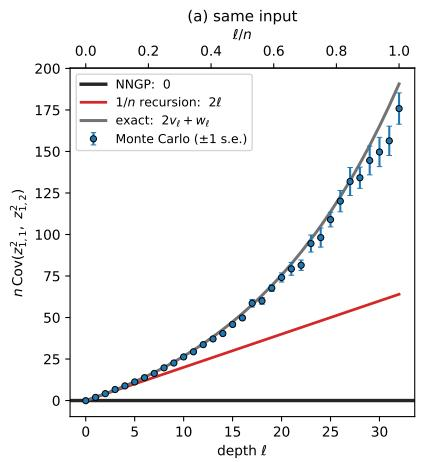

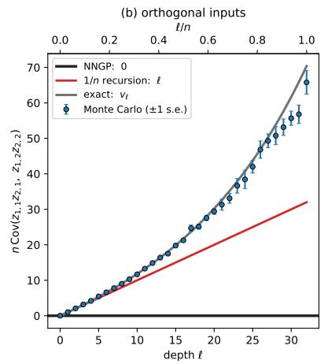

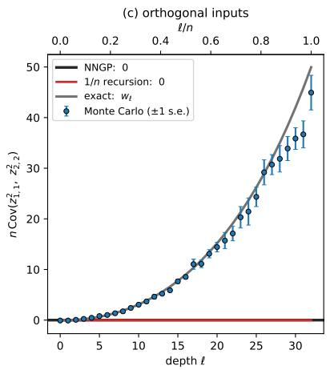  
Figure 2: Linear network. Fourth cumulants. Quantities related to the fourth cumulant of a linear network $( \varphi ( x ) = x ,$ width $n = 3 2 )$ for depths up to $\ell = 3 2 .$ Each plot compares three solutes: 1. the exact values from Lemma $2 . 3 , 2 .$ the values obtained from the $1 / n$ recursion of Theorem $^ { 1 . 1 8 , }$ and 3. from Monte Carlo simulations. We use two orthogonal unit inputs $\left( K = I _ { 2 } \right)$ and two different neurons, so that each statistic isolates one exact coefficient; here $z _ { \alpha , k }$ denotes the output of neuron k on input α, with $\alpha \in \{ 1 , 2 \}$ and $k \in \{ 1 , 2 \}$ . The plots show (a) Same input: nCov $\left( z _ { 1 , 1 } ^ { 2 } , z _ { 1 , 2 } ^ { 2 } \right) = C ^ { \ell } ( 1 , 1 ; 1 , 1 )$ , exactly $2 v _ { \ell } + w _ { \ell } = n \big [ ( 1 + { \textstyle \frac { 2 } { n } } ) ^ { \ell } - 1 \big ]$ and 2l according to the $1 / n$ recursion. (b) Orthogonal inputs: nCov $\left( z _ { 1 , 1 } z _ { 2 , 1 } , z _ { 1 , 2 } z _ { 2 , 2 } \right) = C ^ { \ell } ( 1 , 2 ; 1 , 2 )$ exactly $v _ { \ell }$ and l according to the $1 / n$ recursion. (c) Orthogonal inputs: nCov $\left( z _ { 1 , 1 } ^ { 2 } , z _ { 2 , 2 } ^ { 2 } \right) = C ^ { \ell } ( 1 , 1 ; 2 , 2 )$ , exactly $w _ { \ell }$ and 0 according to the $1 / n$ recursion. Grey: exact solution for $C ^ { \ell }$ from Lemma $2 . 3 ;$ red: $O ( 1 / n )$ approximation from the recursion of Theorem 1.18; blue: Monte Carlo over $2 ^ { 1 6 }$ networks, with $\pm 1$ standard error computed from batch means. The pure neural network Gaussian $( \mathrm { N N G P } )$ approxiamtion predicts 0 for all these quantities. Note that the $1 / n$ recursion is accurate while $\ell / n$ is small but gets worse when $\ell / n$ is of order one. Additionally, the coefficient we of the third pairing $K ( \alpha , \alpha ^ { \prime } ) K ( \beta , \beta ^ { \prime } )$ is of order $1 / n ,$ so this pairing contributes to the fourth cumulant $\textstyle \kappa = { \frac { 1 } { n } } C ^ { \ell }$ only at order $n ^ { - 2 }$ and is therefore absent from the $1 / n$ recursion but present in the exact solution and in the simulations.

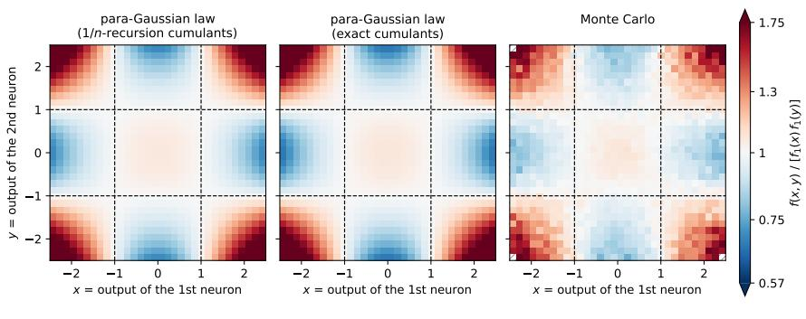

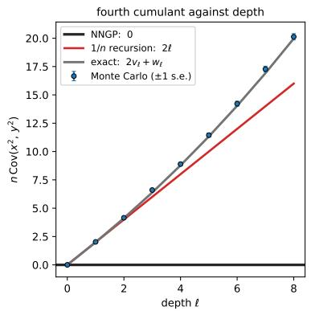  
----- para-Gaussian: ratio = 1 on |x| = 1, |y| = 1 Monte Carlo: not enough data (< 100 hits in the bin)

Figure 3: Linear network. Two neurons outputs, one input. Uncorrelated but not independent. The distribution of two different neurons of a linear network $( \varphi ( x ) = x ,$ width $n = 3 2 )$ receiving the same unit norm input, ${ \mathrm { i . e . ~ } } A = \alpha$ and we look at the joint distribution of the random variables $X = z _ { \alpha , 1 } , Y = z _ { \alpha , 2 }$ . These random variables are uncorrelated, but not independent. Left three panels: the ratio $f ( x , y ) / \big [ f _ { 1 } ( x ) f _ { 1 } ( y ) \big ]$ of the joint density of the two neurons' outputs to the product of their marginal densities at depth $\ell = 4 ,$ which the NNGP predicts to be identically 1. The para-Gaussian law predicts this as $\begin{array} { r } { 1 + \frac { \kappa } { 4 } ( x ^ { 2 } - 1 ) ( y ^ { 2 } - 1 ) } \end{array}$ , where $\kappa = \kappa ( x , x , y , y )$ is the cross-neuron fourth cumulant. We show both the result $\begin{array} { r } { \dot { \kappa } = \frac { 2 \ell } { n } } \end{array}$ from the 1/n-approximated-recursion and with the exact value $\begin{array} { r } { \kappa = { \frac { 2 v _ { \ell } + w _ { \ell } } { n } } } \end{array}$ , next to Monte Carlo over $2 ^ { 2 2 }$ neuron pairs. Right: the cumulant $n \mathbf { C o v } ( x ^ { 2 } , y ^ { 2 } )$ against depth, with the $1 / n$ recursion $2 \ell ,$ the exact value $2 v _ { \ell } + w _ { \ell }$ and Monte Carlo (±1 standard error).

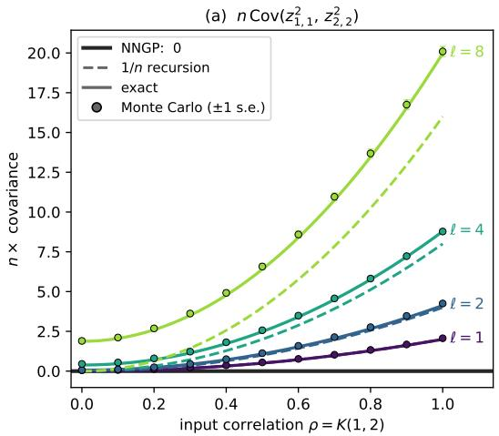

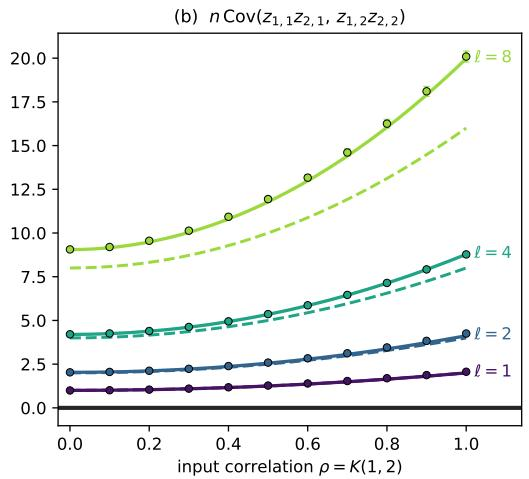  
Figure 4: Linear network. Two neurons, two inputs. Dependence on the input correlation. Cross-neuron fourth cumulants of a linear network $( \varphi ( x ) = x$ , width $n = 3 2 )$ for two unit norm inputs with correlation $\rho = K ( 1 , 2 )$ against ρ for depths $\ell = 1 , 2 , 4 , 8 ;$ here $z _ { \alpha , k }$ denotes the output of neuron k on input α where $\alpha \in \{ 1 , 2 \}$ and $k \in \{ 1 , 2 \} . \ ( \mathbf { a } )$ nCov $\left( z _ { 1 , 1 } ^ { 2 } , z _ { 2 , 2 } ^ { 2 } \right) = C ^ { \ell } ( 1 , 1 ; 2 , 2 )$ , the dependence between the first neuron on input 1 and the second neuron on input 2: $2 \ell \rho ^ { 2 }$ according to the $1 / n$ recursion, exactly $2 \rho ^ { 2 } v _ { \ell } + w _ { \ell }$ . (b) r $\iota \mathbf { C o v } \big ( z _ { 1 , 1 } z _ { 2 , 1 } , z _ { 1 , 2 } z _ { 2 , 2 } \big ) = C ^ { \ell } ( 1 , 2 ; 1 , 2 )$ , the dependence between the products of each neuron's outputs on the two inputs: $\ell ( 1 + \rho ^ { 2 } )$ according to the $1 / n$ recursion, exactly $( 1 + \bar { \rho ^ { 2 } } ) v _ { \ell } + \rho ^ { 2 } w _ { \ell }$ . Dashed lines: $1 / n$ recursion of Theorem 1.18; solid lines: exact solution from Lemma 2.3; markers: Monte Carlo over $2 ^ { 2 2 }$ neuron pairs per value of $\rho ~ ( \pm 1$ standard error). The Gaussian prediction (NNGP) predicts 0 in all cases. At $\rho = 0$ the $1 / n$ recursion predicts no dependence in (a), while the exact cumulant $w _ { \ell }$ is positive and clearly visible at $\ell = 8 .$

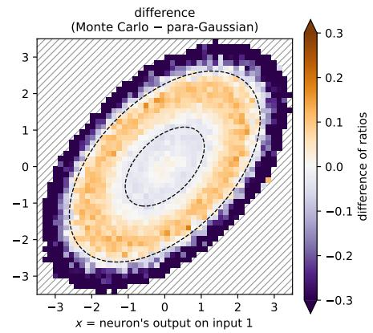  
----- para-Gaussian: ratio = 1 on these ellipsesMonte Carlo: not enough data (< 100 hits in the bin)  
Figure 5: Linear network. One output neuron, two inputs. The joint density. Representation of the joint density of the random vector $\left( z _ { 1 , 1 } ^ { \ell } , z _ { 2 , 1 } ^ { \ell } \right)$ consisting of the outputs of the first neuron of layer $\ell = 4$ for two unit norm inputs $A = \{ 1 , 2 \}$ with correlation $K ^ { 0 } ( 1 , 2 ) = 0 . 5$ , in a linear network $( \varphi ( x ) = x$ width $n = 3 2 )$ . The left and middle panels show the ratio of the density to the Gaussian (NNGP) predicted density $\mathcal { N } ( 0 , K ^ { 0 } )$ (numbers > 1 indicate a higher density, and numbers < 1 a lower density, than the pure Gaussian prediction). Left: the para-Gaussian density of Definition 1.1, with covariance $K ^ { 0 }$ and fourth cumulant tensor $\kappa ^ { \ell }$ for a single neuron $( i = j = k = l = 1 )$ , where $C ^ { \ell }$ is the exact solution (19) with $v _ { \ell } , w _ { \ell }$ given by (20). Middle: Monte Carlo over $2 ^ { 2 2 }$ samples, with probabilities compared bin by bin; hatched bins contain fewer than 100 samples. Right: the difference between the two ratios, Monte Carlo minus para-Gaussian, which is the difference of the two densities measured relative to the Gaussian density. The two agree closely in the bulk of the distribution. The difference is close to 0 inside the inner ellipse and of order 0.1 in the ring between the ellipses. The largest differences are in the tails, where the para-Gaussian ratio keeps growing while the true density does not. The dashed curves are where the para-Gaussian ratio equals 1, i.e. where the para-Gaussian and Gaussian densities agree.

## 2.3 ReLU Activation Function

We now turn to the normalized ReLU, $\varphi ( x ) = { \sqrt { 2 } } \operatorname* { m a x } \{ x , 0 \}$ . Unlike the linear case, the Gaussian expectations appearing in Theorem 1.18 cannot be combined into a closed recursion for a finite set of coefficients, and we do not have an exact formula for the fourth cumulant coefficient $C ^ { \ell }$ when there are several inputs. In particular, the covariance itself now has a non-trivial finite width correction, which we denote as

$$
\sigma ^ { \ell } : = \operatorname * { l i m } _ { n  \infty } n ( \bar { \Sigma } ^ { \ell } - K ^ { \ell } )
$$

defined so that $\textstyle { \bar { \Sigma } } ^ { \ell } = K ^ { \ell } + { \frac { 1 } { n } } \sigma ^ { \ell } + O ( n ^ { - 2 } )$ by (13), with $\sigma ^ { \ell } \neq 0$ for distinct inputs. Instead, we evaluate the $1 / n$ recursions (13) and (14) numerically. Since $\varphi$ is positively homogeneous, every Gaussian expectation in these recursions factorizes into a radial moment, which is explicit, and an integral over angles, which we compute by Gauss-Legendre quadrature on the arcs between the kinks of $\varphi .$ (Closed forms for these integrals can also be written in terms of the functions $J _ { a , b }$ of $[ \mathrm { J N 2 4 } ] . )$

The one exception, where there is an exact formula is the case of a a single input, where the recursion closes exactly. This result was equivalently obtained as the 4th moment in [HN20]. We repeat this part of the argument in the lemma below.

Lemma 2.5 (ReLU networks with one input). For one unit norm input, $A = \{ \alpha \}$ , we have $\bar { \Sigma } ^ { \ell } ( \alpha , \alpha ) = 1$ and $\begin{array} { r } { C ^ { \ell } ( \alpha , \alpha ; \alpha , \alpha ) = n \left[ \left( 1 + \frac { 5 } { n } \right) ^ { \ell } - 1 \right] } \end{array}$

Proof. For notational convenience, we drop writing the dependence on $\alpha .$ Conditionally on layer $\ell - 1$ , the neurons of layer l are i.i.d. $\mathcal { N } ( 0 , \Sigma ^ { \ell } )$ , and since $\varphi$ is positively homogeneous $\varphi ( c x ) = | c | \varphi ( x )$ , we observe that we can pull out the norm of the vector out of the ReLU to obtain

$$
\Sigma ^ { \ell + 1 } = \Sigma ^ { \ell } \cdot \frac { 1 } { n } \sum _ { j = 1 } ^ { n } \varphi ( G _ { j } ) ^ { 2 }
$$

with $G _ { j } \ \mathrm { i . i . d }$ standard Gaussians independent of $\Sigma ^ { \ell }$ As $\mathbb { E } [ \varphi ( G ) ^ { 2 } ] = 1$ and $\mathbf { V a r } [ \varphi ( G ) ^ { 2 } ] = \mathbb { E } [ \varphi ( G ) ^ { 4 } ] - 1 = 5$ this gives $\mathbb { E } [ \Sigma ^ { \ell + 1 } ] = \mathbb { E } [ \Sigma ^ { \ell } ]$ and $\begin{array} { r } { \mathbb { E } \left[ ( \Sigma ^ { \ell + 1 } ) ^ { 2 } \right] = \left( 1 + \frac { 5 } { n } \right) \mathbb { E } \left[ ( \Sigma ^ { \ell } ) ^ { 2 } \right] } \end{array}$ , and hence $\begin{array} { r } { n \mathbf { V a r } [ \Sigma ^ { \ell } ] = n \left[ \left( 1 + \frac { 5 } { n } \right) ^ { \ell } - 1 \right] } \end{array}$ □

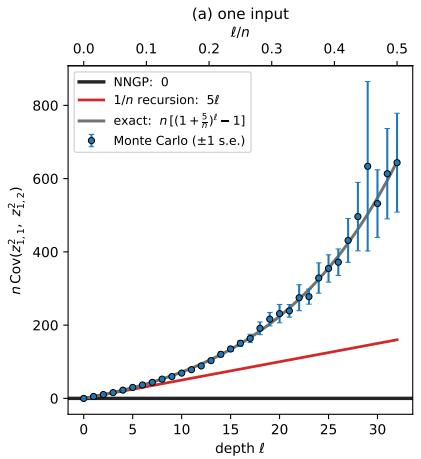

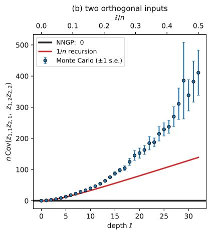

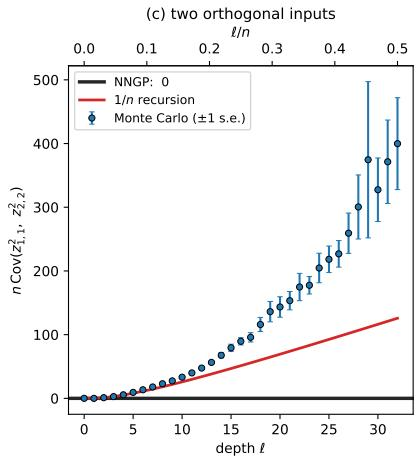  
Figure 6: ReLU network. Fourth cumulants. Quantities related to the fourth cumulants of a ReLU network $( \varphi ( x ) =$ $\sqrt { 2 } \operatorname* { m a x } \{ x , 0 \}$ , width $n = 6 4 )$ for depths up to $\ell = 3 2$ , for two different neurons; $z _ { \alpha , k }$ denotes the output of neuron k on input α. (a) One unit norm input: nCov $\left( z _ { 1 , 1 } ^ { 2 } , z _ { 1 , 2 } ^ { 2 } \right) = C ^ { \ell } ( 1 , 1 ; 1 , 1 )$ , which equals $n \bigl [ ( 1 + { \frac { 5 } { n } } ) ^ { \ell } - 1 \bigr ]$ exactly (Lemma 2.5) and 5l according to the $1 / n$ recursion. (b), (c) Two unit norm inputs that are orthogonal at layer 0 $( K = I ) \colon$ (b) nCov $\left( z _ { 1 , 1 } z _ { 2 , 1 } , z _ { 1 , 2 } z _ { 2 , 2 } \right) = C ^ { \ell } ( 1 , 2 ; 1 , 2 )$ and (c) $n { \bf C o v } \left( z _ { 1 , 1 } ^ { 2 } , z _ { 2 , 2 } ^ { 2 } \right) = C ^ { \ell } ( 1 , 1 ; 2 , 2 )$ . For several inputs no exact formula is available, and we show the $1 / n$ recursion (14), evaluated numerically. Red: $1 / n$ recursion; grey: exact (one input only); blue: Monte Carlo over $2 ^ { 1 5 }$ networks, with ±1 standard error computed from batch means. The Gaussian prediciton (NNGP) is 0 in every panel. The $1 / n$ recursion is accurate while $\ell / n$ is small, and underestimates the cumulants once $\ell / n$ is of order one.

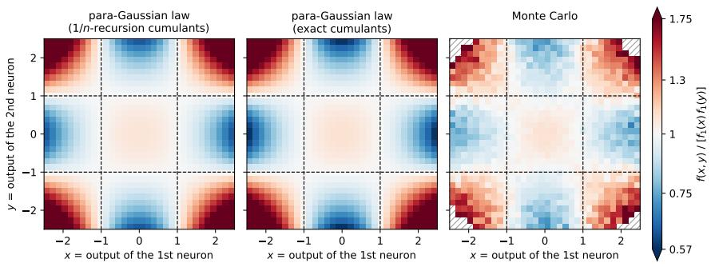

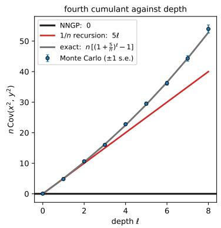  
-----: para-Gaussian: ratio = 1 on |x| = 1, |y| = 1 Monte Carlo: not enough data (< 100 hits in the bin)

Figure 7: ReLU network. Two neuron outputs, one input. Uncorrelated but not independent. The distribution of two different neurons of a ReLU network $( \varphi ( x ) = { \sqrt { 2 } } \operatorname* { m a x } \{ x , 0 \}$ , width $n = 6 4 )$ receiving the same unit norm input, i.e. $A = \{ \alpha \}$ and we look at the joint distribution of the random variables $X = z _ { \alpha , 1 } ^ { \ell } , Y = z _ { \alpha , 2 } ^ { \ell }$ These random variables are uncorrelated, but not independent. Left three panels: the ratio $f ( x , y ) / \big [ f _ { 1 } ( x ) f _ { 1 } ( y ) \big ]$ of the joint density of the two neurons' outputs to the product of their marginal densities at depth $\ell = 4 ,$ which the NNGP predicts to be identically 1. The para-Gaussian law predicts this as $\begin{array} { r } { 1 + \frac { \kappa } { 4 } ( x ^ { 2 } - 1 ) ( y ^ { 2 } - 1 ) } \end{array}$ , where $\kappa = \kappa ( x , x , y , y )$ is the cross-neuron fourth cumulant. We show both the result $\textstyle \kappa = { \frac { 5 \ell } { n } }$ from the $1 / n$ -approximated recursion and the exact value $\kappa = \left( 1 + { \frac { 5 } { n } } \right) ^ { \ell }$ — 1 from Lemma $_ { 2 . 5 , }$ next to Monte Carlo over $2 ^ { 2 1 }$ neuron pairs. Right: the cumulant $n \mathbf { C o v } ( x ^ { 2 } , y ^ { 2 } )$ against depth, with the $1 / n$ recursion 5l, the exact value $\begin{array} { r } { n \big [ \big ( 1 + \frac { 5 } { n } \big ) ^ { \ell } - 1 \big ] } \end{array}$ and Monte Carlo (±1 standard error).

(a) n Cov(z},₁, z2,₂)  
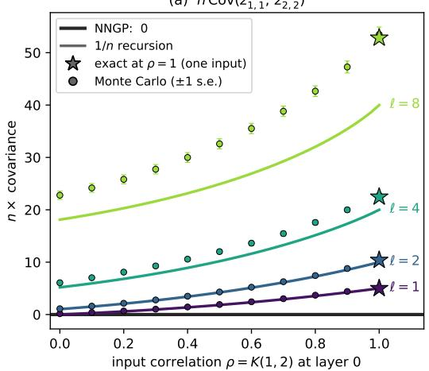

(b) n Cov(z1, 1Z2, 1, Z1, 2Z2, 2)  
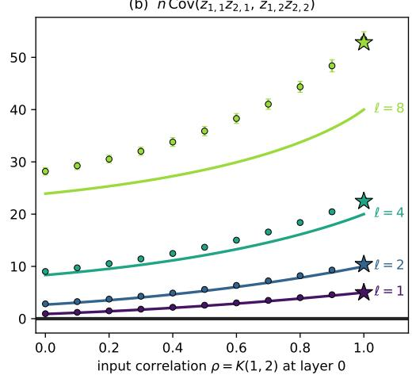  
Figure 8: ReLU network. Two neurons, two inputs. Dependence on the input correlation. Cross-neuron fourth cumulants of a ReLU network $( \varphi ( x ) = { \sqrt { 2 } } \operatorname* { m a x } \{ x , 0 \}$ , width $n = 6 4 )$ for two unit norm inputs with correlation $\rho = K ^ { 0 } ( 1 , 2 )$ at layer $^ { 0 , }$ against ρ for depths $\ell = 1 , 2 , 4 , 8$ . Here $z _ { \alpha , k }$ denotes the output of neuron k on input α where $\alpha \in \{ 1 , 2 \}$ and $k \in \{ 1 , 2 \}$ (a) nCov $\left( z _ { 1 , 1 } ^ { 2 } , z _ { 2 , 2 } ^ { 2 } \right) = C ^ { \ell } ( 1 , 1 ; 2 , 2 )$ , the dependence between the first neuron on input 1 and the second neuron on input 2. (b) $\imath { \bf C o v } \left( z _ { 1 , 1 } z _ { 2 , 1 } , z _ { 1 , 2 } z _ { 2 , 2 } \right) = C ^ { \ell } { \left( 1 , 2 ; 1 , 2 \right) }$ , the dependence between the products of each neuron's outputs on the two inputs. Solid lines: $1 / n$ recursion of Theorem $^ { 1 . 1 8 , }$ evaluated numerically, since for ReLU there is no exact formula with two distinct inputs. Stars represent the exact value n $\begin{array} { r } { [ ( 1 + \frac { 5 } { n } ) ^ { \ell } - 1 ] } \end{array}$ at $\rho = 1 ,$ where the two inputs coincide (Lemma 2.5). Monte Carlo over $2 ^ { 2 0 }$ neuron pairs per value of $\rho ~ ( \pm 1$ standard error) is shown as cirlces. The Gaussian prediction (NNGP) predicts 0 in all cases. Unlike the linear case, the cumulant in (a) is positive at $\rho = 0$ already according to the $1 / n$ recursion, since ReLU layers make inputs that are orthogonal at layer 0 positively correlated. The $1 / n$ recursion underestimates the cumulants for large values of $\ell / n .$

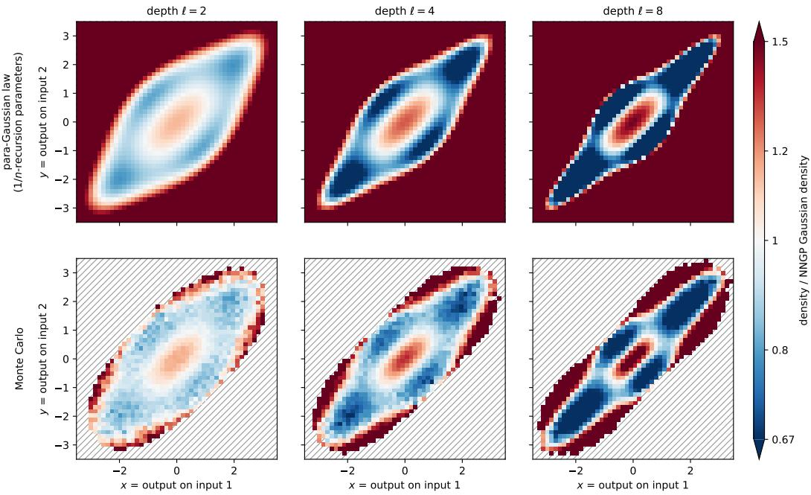  
Monte Carlo: not enough data (< 100 hits in the bin)

Figure 9: ReLU network. One neuron, two inputs. The joint density as depth grows. A representation of the joint density of the random vector $\big ( z _ { 1 , 1 } ^ { \ell } , z _ { 2 , 1 } ^ { \ell } \big )$ , the outputs of the first neuron of layer l on two unit norm inputs with correlation $K ( 1 , 2 ) = 0 . 5$ at layer $^ { 0 , }$ in a ReLU network $( \varphi ( x ) = { \sqrt { 2 } } \operatorname* { m a x } \{ x , 0 \}$ , width $n = 6 4 )$ , for depths $\ell = 2 , 4 , 8$ (columns). Each panel shows the ratio of a density to the NNGP Gaussian density of $\mathcal { N } ( 0 , K ^ { \ell } )$ , on a common colour scale. Top row: the para-Gaussian density of Definition 1.1, with covariance $\begin{array} { r } { K ^ { \ell } + \frac { 1 } { n } \sigma ^ { \check { \ell } } } \end{array}$ from (13) and fourth cumulant tensor computed with $C ^ { \ell }$ from the $1 / n$ recursion (14); all Gaussian expectations are evaluated numerically. Bottom row: Monte Carlo over $2 ^ { 2 1 }$ samples per depth, with probabilities compared bin by bin; hatched bins contain fewer than 100 samples. No exact formula is available for comparison in this case.

## 3 Proof of the Asymptotic Convergence, Theorem 1.13

Theorem 1.13 is about understanding the distribution of $Z ^ { \ell } = \left\{ z _ { \alpha , j } ^ { \ell } \right\} _ { \alpha \in A , j \in [ m ] }$ by studying the expected value $\mathbb { E } [ f ( Z ^ { \ell } ) ]$ , where $f : \mathbb { R } ^ { A \times [ m ] } $ R is some test function. By Remark 1.10, the distribution of $Z ^ { \ell }$ is conditionally Gaussian, $Z ^ { \ell } \sim \mathcal { N } \left( 0 , I _ { m } \otimes \Sigma ^ { \ell } \right)$ , with the random matrix $\Sigma ^ { \ell }$ defined in (6). The idea of the proof is to decompose $\Sigma ^ { \ell }$ into its mean plus random fluctuations, and then Taylor series expand around the mean. In order to do this, we introduce the following notations.

## 3.1 $g _ { f }$ and its derivatives

Definition 3.1. For a given test function $f : \mathbb { R } ^ { A \times [ m ] }  \mathbb { R }$ , we introduce the auxiliary function $G _ { f }$ , defined on positive semi-defnite matrices $S$ indexed $b y \ A \times [ m ] \ b y$

$$
G _ { f } ( S ) : = \mathbb { E } _ { X \sim { \mathcal { N } } ( 0 , S ) } \left[ f ( X ) \right] .\tag{22}
$$

We also introduce notation for the fluctuation of $\Sigma ^ { \ell }$ around its mean, namely

$$
\bar { \Sigma } ^ { \ell } ( \alpha , \beta ) : = \mathbb { E } \left[ \Sigma ^ { \ell } ( \alpha , \beta ) \right] ,\tag{23}
$$

$$
\Delta ^ { \ell } ( \alpha , \beta ) : = \Sigma ^ { \ell } ( \alpha , \beta ) - \bar { \Sigma } ^ { \ell } ( \alpha , \beta ) ,\tag{24}
$$

so that ${ \cal I } _ { m } \otimes \Sigma ^ { \ell } = { \cal I } _ { m } \otimes \bar { \Sigma } ^ { \ell } + { \cal I } _ { m } \otimes \Delta ^ { \ell }$ . Finally, we define the random one-variable function $g _ { f } : [ 0 , 1 ] \to$ R by

$$
g _ { f } ( t ) : = G _ { f } \Bigl ( I _ { m } \otimes \bigl ( \bar { \Sigma } ^ { \ell } + t \Delta ^ { \ell } \bigr ) \Bigr ) ,\tag{25}
$$

where we suppress the dependence of $g _ { f }$ on l in the notation.

Remark 3.2. By conditional Gaussianity (Remark 1.10), $g _ { f } ( 1 ) = G _ { f } ( I _ { m } \otimes \Sigma ^ { \ell } ) = \mathbb { E } \left[ f ( Z ^ { \ell } ) \big | \mathcal { F } ^ { \ell - 1 } \right]$ , where $\mathcal { F } ^ { \ell - 1 }$ is the σ-algebra generated by layer $\ell - 1$ , and hence we recover the quantity of interest as

$$
\mathbb { E } \left[ g _ { f } ( 1 ) \right] = \mathbb { E } \left[ G _ { f } \left( I _ { m } \otimes \Sigma ^ { \ell } \right) \right] = \mathbb { E } \left[ f ( Z ^ { \ell } ) \right] .
$$

On the other hand, $g _ { f } ( 0 ) = G _ { f } ( I _ { m } \otimes \bar { \Sigma } ^ { \ell } )$ uses only the mean $\bar { \Sigma } ^ { \ell }$ (which is a non-random matrix!), and is the purely Gaussian approximation. The function $g _ { f }$ thus interpolates between these two cases: $t = 0$ gives the Gaussian approximation, and $t = 1$ gives $G _ { f } \left( \dot { I _ { m } } \otimes \Sigma ^ { \ell } \right)$ . The proof of Theorem 1.13 compares the two by Taylor expanding $g _ { f }$ around $t = 0$ to approximate its value at $t = 1$ . To do this, we first prove some lemmas about $g _ { f }$ and its derivatives.

Lemma 3.3. Let $S _ { 0 }$ be a positive definite matrix and D a symmetric matrix, both indexed by $A \times [ m ]$ . Let $r \in \mathbb { N } .$ , and suppose f is $2 r$ times differentiable with all derivatives of order at most 2r polynomially bounded. Then for every t such that $S _ { 0 } + t D$ is positive definite,

$$
\frac { d ^ { r } } { d t ^ { r } } G _ { f } ( S _ { 0 } + t D ) = \frac { 1 } { 2 ^ { r } } \sum _ { \substack { a _ { 1 } , b _ { 1 } , \ldots , a _ { r } , b _ { r } \in A \times [ m ] } } \left( \prod _ { i = 1 } ^ { r } D _ { a _ { i } b _ { i } } \right) \mathbb { E } _ { X \sim N ( 0 , S _ { 0 } + t D ) } \Big [ \big ( \partial _ { a _ { 1 } } \partial _ { b _ { 1 } } \cdots \partial _ { a _ { r } } \partial _ { b _ { r } } f \big ) ( X ) \Big ] .
$$

Proof. Since $G _ { f }$ is a smooth function of $S$ on the positive definite matrices [Han24, Lemma $1 3 ]$ , its directional derivative $\begin{array} { r } { \frac { d } { d t } \Big | _ { t = 0 } \overline { { G } } _ { f } ( S + t D ) } \end{array}$ is linear in D. Writing $D = D _ { + } - D _ { - }$ with $D _ { \pm }$ positive semi-definite, it therefore suffices to prove the case $r = 1$ when D is positive semi-definite.

In that case, notice that the distribution of $X \sim \mathcal { N } ( 0 , S _ { 0 } + t D )$ can be realized as a diffusion process $X _ { t }$ starting from $X _ { 0 } \sim { \mathcal { N } } ( 0 , S _ { 0 } )$ with constant infinitesimal drift and volatility, d $\lfloor X _ { t } = 0 \mathrm { d } t + D ^ { 1 / 2 } \mathrm { d } W _ { t }$ where $W _ { t }$ is a standard Brownian motion independent of $X _ { 0 } .$ Indeed, $X _ { t }$ is Gaussian with covariance $S _ { 0 } + t D$ . By Itô's lemma (or simply the heat equation in this case), the drift of the process $Y _ { t } = f ( X _ { t } )$ is $\begin{array} { r } { \frac { 1 } { 2 } \sum _ { a , b \in A \times \left[ m \right] } D _ { a b } \left( \partial _ { a } \partial _ { b } f \right) \left( X _ { t } \right) } \end{array}$ , and the martingale part has mean zero since $f$ and its derivatives are polynomially bounded. Taking expected values and integrating establishes that

$$
G _ { f } ( S _ { 0 } + t D ) - G _ { f } ( S _ { 0 } ) = \mathbb { E } [ Y _ { t } ] - \mathbb { E } [ Y _ { 0 } ] = \int \frac { t } { 2 } \sum _ { a , b \in A \times [ m ] } D _ { a b } \mathbb { E } \Big [ ( \partial _ { a } \partial _ { b } f ) ( X _ { s } ) \Big ] \mathrm { d } s ,
$$

whence it follows by the fundamental theorem of calculus that $\begin{array} { r } { \frac { d } { d t } G _ { f } ( S _ { 0 } { + } t D ) = \frac { 1 } { 2 } \sum _ { a , b \in A \times \left[ m \right] } D _ { a b } \mathbb { E } \Big [ \left( \partial _ { a } \partial _ { b } f \right) ( X _ { t } ) \Big ] } \end{array}$

This establishes the result for the base case $r = 1$ , and shows the effect of a single derivative in t. The formula for general r follows by induction, applying the same argument to compute the derivative ${ \frac { d } { d t } } \mathbb { E } { \Big [ } \left( \partial _ { a _ { 1 } } \partial _ { b _ { 1 } } \cdot \cdot \cdot \partial _ { a _ { r - 1 } } \partial _ { b _ { r - 1 } } f \right) ( X _ { t } ) { \Big ] }$ □

The following formula can be found as Theorem 7.6 in [NO26]:

Lemma 3.4 (Gaussian integration by parts with Hermites). Let V be a positive definite matrix indexed by $A \times [ m ]$ , let $X \sim { \mathcal { N } } ( 0 , V ) $ , and suppose $f$ is k times differentiable with polynomially bounded derivatives Then for all $a _ { 1 } , \ldots , a _ { k } \in A \times [ m ]$ 2

$$
{ \mathbb E } \Big [ \big ( \partial _ { a _ { 1 } } \cdot \cdot \cdot \partial _ { a _ { k } } f \big ) ( X ) \Big ] = { \mathbb E } \Big [ f ( X ) H _ { a _ { 1 } \cdot \cdot \cdot a _ { k } } ( X ; V ) \Big ] ,
$$

where we use the index-list notation for the Hermite polynomials $H _ { a _ { 1 } \cdots a _ { k } } ( \vec { x } ; \Sigma ) : = H _ { \vec { e } _ { a _ { 1 } } + \cdots + \vec { e } _ { a _ { k } } } ( \vec { x } ; \Sigma )$

Remark 3.5. Combining Lemma 3.4 with Lemma 3.3, the expectations of derivatives of f in the formula for $\begin{array} { r } { \frac { d ^ { r } } { d t ^ { r } } G _ { f } ( S _ { 0 } + t D ) } \end{array}$ can be replaced by expectations of f against Hermite polynomials:

$$
\frac { d ^ { r } } { d t ^ { r } } G _ { f } ( S _ { 0 } + t D ) = \frac { 1 } { 2 ^ { r } } \sum _ { a _ { 1 } , b _ { 1 } , \ldots , a _ { r } , b _ { r } \in A \times [ m ] } \Big ( \prod _ { i = 1 } ^ { r } D _ { a _ { i } b _ { i } } \Big ) \mathbb { E } _ { X \sim \mathcal { N } ( 0 , S _ { 0 } + t D ) } \Big [ f ( X ) H _ { a _ { 1 } b _ { 1 } \cdots a _ { r } b _ { r } } \big ( X ; S _ { 0 } + t D \big ) \Big ] .
$$

In this form, no derivatives of f appear: all the derivatives act on the Gaussian density, where they become Hermite polynomials. This is what allows us to identify the appearace of the para-Gaussian law, and bound the error estimates below to depend on f only through $\| f \| _ { \infty }$

## 3.1.1 Evaluating $\mathbb { E } [ g _ { f } ^ { \prime } ( 0 ) ]$ and $\mathbb { E } [ g _ { f } ^ { \prime \prime } ( 0 ) ]$

Lemma 3.6. Suppose $\bar { \Sigma } ^ { \ell }$ is positive definite, $\mathbb { E } \left\| \Sigma ^ { \ell } \right\| < \infty$ , and f is twice differentiable with polynomially bounded derivatives. Then

$$
\mathbb { E } \left[ g _ { f } ^ { \prime } ( 0 ) \right] = 0 .
$$

Proof. Since $g _ { f }$ is defined from the matrix $S _ { 0 } + t D$ with $S _ { 0 } = I _ { m } \otimes { \bar { \Sigma } } ^ { \ell }$ and $D = I _ { m } \otimes \Delta ^ { \ell }$ , we have by Lemma 3.3 with $r = 1$ that

$$
g _ { f } ^ { \prime } ( 0 ) = \frac { 1 } { 2 } \sum _ { a , b \in A \times [ m ] } \left( I _ { m } \otimes \Delta ^ { \ell } \right) _ { a b } c _ { a b } , c _ { a b } , \ c _ { a b } : = \mathbb { E } _ { X \sim \mathcal { N } \left( 0 , I _ { m } \otimes \bar { \Sigma } ^ { \ell } \right) } \left[ \left( \partial _ { a } \partial _ { b } f \right) \left( X \right) \right] .
$$

The coefficients $c _ { a b }$ are finite and deterministic, since they depend only on the mean $\bar { \Sigma } ^ { \ell }$ and not on the fluctuation $\Delta ^ { \ell }$ . Hence $g _ { f } ^ { \prime } ( 0 )$ is a linear function of the entries of $\Delta ^ { \ell }$ , and taking expectations gives $\begin{array} { r } { \mathbb { E } \left[ g _ { f } ^ { \prime } ( 0 ) \right] = \frac { 1 } { 2 } \sum _ { a , b } \mathbb { E } \left[ \left( I _ { m } \otimes \Delta ^ { \ell } \right) _ { a b } \right] c _ { a b } = 0 } \end{array}$ , since $\mathbb { E } [ \Delta ^ { \ell } ] = 0$ by its definition. □

Lemma 3.7. Suppose $\bar { \Sigma } ^ { \ell }$ is positive deinite, E $\left\| \Sigma ^ { \ell } \right\| ^ { 2 } < \infty$ , and f is four times differentiable with polynomially bounded derivatives. Write $X \sim \mathcal { N } \left( 0 , I _ { m } \otimes \bar { \Sigma } ^ { \ell } \right)$ for the Gaussian approximation. Then

$$
\frac { 1 } { 2 } \mathbb { E } \left[ g _ { f } ^ { \prime \prime } ( 0 ) \right] = \frac { 1 } { 8 } \sum _ { i , k \in [ m ] } \sum _ { \alpha , \beta , \gamma , \delta \in A } \mathbf { C o v } \left( \Sigma ^ { \ell } ( \alpha , \beta ) , \Sigma ^ { \ell } ( \gamma , \delta ) \right) \mathbb { E } \Big [ \left( \partial _ { ( \alpha , i ) } \partial _ { ( \beta , i ) } \partial _ { ( \gamma , k ) } \partial _ { ( \delta , k ) } f \right) ( X ) \Big ] .
$$

Equivalently, $\begin{array} { r } { { \frac { 1 } { 2 } } \mathbb { E } \left[ g _ { f } ^ { \prime \prime } ( 0 ) \right] = { \frac { 1 } { 8 } } \sum _ { a , b , c , e \in A \times [ m ] } T _ { a b c e } ^ { \ell } \mathbb { E } \big [ \big ( \partial _ { a } \partial _ { b } \partial _ { c } \partial _ { e } f \big ) ( X ) \big ] } \end{array}$ , where

$$
T _ { a b c e } ^ { \ell } : = \mathbb { E } \left[ \left( I _ { m } \otimes \Delta ^ { \ell } \right) _ { a b } \left( I _ { m } \otimes \Delta ^ { \ell } \right) _ { c e } \right] = \delta _ { i j } \delta _ { k l } \mathbf { C o v } \left( \Sigma ^ { \ell } ( \alpha , \beta ) , \Sigma ^ { \ell } ( \gamma , \delta ) \right)\tag{26}
$$

$$
f o r \ : a = ( \alpha , i ) , b = ( \beta , j ) , c = ( \gamma , k ) , e = ( \delta , l ) .
$$

Proof. Since $g _ { f }$ is defined from the matrix $S _ { 0 } + t D$ with $S _ { 0 } = I _ { m } \otimes { \bar { \Sigma } } ^ { \ell }$ and $D = I _ { m } \otimes \Delta ^ { \ell }$ , we have by Lemma 3.3 with $r = 2$ that

$$
g _ { f } ^ { \prime \prime } ( 0 ) = \frac { 1 } { 4 } \sum _ { a , b , c , e \in A \times [ m ] } \left( I _ { m } \otimes \Delta ^ { \ell } \right) _ { a b } \left( I _ { m } \otimes \Delta ^ { \ell } \right) _ { c e } c _ { a b c e } , \qquad c _ { a b c e } : = \mathbb { E } \left[ \left( \partial _ { a } \partial _ { b } \partial _ { c } \partial _ { e } f \right) ( X ) \right] .
$$

By the assumptions on $\Sigma ,$ the coefficients $c _ { a b c e }$ are finite and deterministic, so $g _ { f } ^ { \prime \prime } ( 0 )$ is a quadratic function of the entries of $\Delta ^ { \ell } .$ and its expectation depends only on the second moments of $\Delta ^ { \ell }$ . Taking expectations gives the second formula, with $T ^ { \ell }$ as in (26). To evaluate $T ^ { \ell }$ , note that $\left( I _ { m } \otimes \Delta ^ { \ell } \right) _ { ( \alpha , i ) , ( \beta , j ) } = \bar { \delta _ { i j } } \Delta ^ { \ell } ( \alpha , \beta )$ , and that $\Im \left[ \Delta ^ { \ell } ( \alpha , \beta ) \Delta ^ { \ell } ( \gamma , \delta ) \right] = { \bf C o v } \left( \Sigma ^ { \ell } ( \alpha , \beta ) , \Sigma ^ { \ell } ( \gamma , \delta ) \right)$ since $\mathbb { E } [ \Delta ^ { \ell } ] = 0$ . Using the Kronecker deltas to collapse the sums over j and l gives the desired result. □

## 3.2 Pair symmetries and alternate form of the para-Gaussian law

Definition 3.8. Let I be a fnite index set and let $T = ( T _ { a b c d } ) _ { a , b , c , d \in I }$ be a tensor with four indices. For a permutation $\pi \in S _ { 4 }$ of the four index positions, we write $T _ { \pi ( a b c d ) } \ j$ for the entry of T with its indices rearranged by $\pi ;$ for example, if π swaps the second and third positions, then $T _ { \pi ( a b c d ) } = T _ { a c b d }$

• We say T is fully symmetric $i f T _ { \pi ( a b c d ) } = T _ { a b c d }$ for every $\pi \in S _ { 4 }$ and all $a , b , c , d \in I$ , that is, if T is unchanged by any rearrangement of its indices.

• We say T is pair-symmetric $i f$

$$
T _ { a b c d } = T _ { b a c d } = T _ { a b d c } = T _ { c d a b } ~ f o r ~ a l l ~ a , b , c , d \in I ,
$$

that is, $T$ is symmetric within its first pair of indices, within its second pair of indices, and under exchanging the two pairs.

Remark 3.9. Examples of fully symmetric tensors are the fourth cumulants $\kappa ( Y _ { a } , Y _ { b } , Y _ { c } , Y _ { d } )$ of a random vector and the 4th order Hermite polynomials where the indices tell us which variables we are using7 $H _ { a b c d } ( x ; \Sigma ) : = H _ { { \vec { e } } _ { a } + { \vec { e } } _ { b } + { \vec { e } } _ { c } + { \vec { e } } _ { d } } ( x ; \Sigma )$

The prototypical example of a pair-symmetric tensor in this work is $T _ { a b c d } = \mathbf { C o v } \left( Y _ { a } Y _ { b } , Y _ { c } Y _ { d } \right)$ for a random vector $( Y _ { a } ) _ { a \in I }$ , such as the quantity $C ( \alpha , \beta ; \gamma , \delta )$ from (11). The tensor $T ^ { \ell }$ in (26) is pair-symmetric, since $\Delta ^ { \ell }$ is a symmetric matrix and covariance is symmetric in its two arguments. The three terms of the pairing sum correspond to the three ways of grouping four indices into two pairs: $\{ a b | c d \} , \{ a c | b d \}$ and {ad | bc}.

Definition 3.10. Given a pair-symmetric tensor $T ,$ we define the pairing sum of T to be the tensor κ given by

$$
\kappa _ { a b c d } : = T _ { a b c d } + T _ { a c b d } + T _ { a d b c } .
$$

Lemma 3.11. Let T be pair-symmetric with pairing sum κ. Then:

(a) κ is fully symmetric, and ${ \frac { 1 } { 3 } } \kappa$ is the full symmetrization of T, namely:

$$
\frac { 1 } { 4 ! } \sum _ { \pi \in S _ { 4 } } T _ { \pi ( a b c d ) } = \frac { 1 } { 3 } \kappa _ { a b c d } .
$$

(b) For every fully symmetric tensor H on $I ,$

$$
\frac { 1 } { 4 ! } \sum _ { a , b , c , d \in I } \kappa _ { a b c d } H _ { a b c d } = \frac { 1 } { 8 } \sum _ { a , b , c , d \in I } T _ { a b c d } H _ { a b c d } .
$$

Proof. The three pair symmetries of $T$ generate a subgroup of $8$ permutations on four indices. This divides $S _ { 4 }$ into three cosets (each corresponding to the three pairings $\{ a b | c d \} , \{ a c | b d \} , \{ a d | b c \} )$ , and each coset containing 8 of the $4 ! = 2 4$ permutations. By the pair-symmetry, T takes the same value on all permutations in a coset. Hence

$$
\frac { 1 } { 2 4 } \sum _ { \pi \in S _ { 4 } } T _ { \pi ( a b c d ) } = \frac { 8 } { 2 4 } \left( T _ { a b c d } + T _ { a c b d } + T _ { a d b c } \right) = \frac { 1 } { 3 } \kappa _ { a b c d } ,
$$

which is fully symmetric, proving (a). For (b), since H is fully symmetric, relabelling the summation indices gives $\begin{array} { r } { \sum T _ { \pi ( a b c d ) } H _ { a b c d } = \sum T _ { a b c d } H _ { a b c d } } \end{array}$ for every $\pi \in S _ { 4 }$ Averaging over π and using (a) gives $\begin{array} { r } { \sum T _ { a b c d } H _ { a b c d } = \frac { 1 } { 3 } \sum \kappa _ { a b c d } H _ { a b c d } } \end{array}$ and dividing by 8 gives (b). □

Corollary 3.12 (Two forms of the para-Gaussian measure). Recall from Definition 1.1 that the para-Gaussian measure $\mathcal { P } _ { n } ^ { ( \Sigma , \kappa , 4 ) }$ on $\mathbb { R } ^ { I }$ is determined by a positive defnite covariance matrix $\Sigma$ and a fully symmetric four tensor κ, which plays the role of the fourth cumulants, through

$$
\mathcal { P } _ { n } ^ { ( \Sigma , \kappa ) } ( x ) = \varphi _ { \Sigma } ( x ) \Big [ 1 + \frac { 1 } { 4 ! n } \sum _ { a , b , c , d \in I } \kappa _ { a b c d } H _ { a b c d } ( x ; \Sigma ) \Big ] , \quad \int e ^ { i \lambda \cdot z } \mathcal { P } _ { n } ^ { ( \Sigma , \kappa ) } ( x ) d x = e ^ { - \frac { 1 } { 2 } \lambda ^ { T } \Sigma \lambda } \Big ( 1 + \frac { 1 } { 4 ! n } \sum _ { a , b , c , d \in I } \kappa _ { a b c d } \lambda _ { a } \lambda _ { b } \lambda _ { c } \lambda _ { d } \Big ) .
$$

Suppose that κ is the pairing sum of some pair-symmetric tensor T. Then $\mathcal { P } _ { n } ^ { ( \Sigma , \kappa ) }$ can be written equivalently in terms of T, with the factor $\textstyle { \frac { 1 } { 4 ! } }$ replaced by ${ \frac { 1 } { 8 } } ,$

$$
\mathcal { P } _ { n } ^ { ( \Sigma , \kappa ) } ( x ) = \varphi _ { \Sigma } ( x ) \Big [ 1 + \frac { 1 } { 8 n } \sum _ { a , b , c , d \in I } T _ { a b c d } H _ { a b c d } ( x ; \Sigma ) \Big ] , \quad \int e ^ { i \lambda \cdot x \cdot p } \mathcal { P } _ { n } ^ { ( \Sigma , \kappa ) } ( x ) d x = e ^ { - \frac { 1 } { 2 } \lambda ^ { T } \Sigma \cdot \lambda } \Big ( 1 + \frac { 1 } { 8 n } \sum _ { a , b , c , d \in I } T _ { a b c d } \lambda _ { a } \lambda _ { b } \lambda _ { c } \lambda _ { d } \Big ) .
$$

Proof. Apply Lemma 3.11(b) with the fully symmetric tensors $H _ { a b c d } = H _ { a b c d } ( x ; \Sigma )$ and $H _ { a b c d } = \lambda _ { a } \lambda _ { b } \lambda _ { c } \lambda _ { d } .$ (The characteristic function in the first form follows from the Fourier formula $\begin{array} { r l } { \int e ^ { \imath \lambda \cdot x } H _ { \vec { n } } ( x ; \Sigma ) \varphi _ { \Sigma } ( x ) \mathrm { d } x = } \end{array}$ $( \imath \lambda ) ^ { \vec { n } } e ^ { - \frac { 1 } { 2 } \lambda ^ { T } \Sigma \lambda }$ , which is equivalent by Fourier inversion to [NO26, Proposition 7.4, eq. (107)], together with $( \imath \lambda ) ^ { 4 } = \lambda ^ { 4 } \mathrm { f o r } | \vec { n } | = 4 . \mathrm { ) }$ □

Remark 3.13 (Connection to $\mathrm { [ N O 2 4 ] } )$ . For a single neuron $( m = 1 , I = A )$ and a single layer $( \ell = 1 )$ with $T _ { \alpha \beta \gamma \delta } = C ( \alpha , \beta ; \gamma , \delta )$ , the second form of the characteristic function in Corollary 3.12 is exactly the definition of a para-Gaussian distribution in [NO24, Definition 1], with its normalization ${ \frac { 1 } { 8 n } } .$ In this case the tensor C is the one computed in [NO24, Theorem 2], $C ( \alpha , \beta ; \gamma , \delta ) = \mathrm { \bf C o v } \left( \varphi ( z _ { \alpha } ) \varphi ( z _ { \beta } ) , \varphi ( z _ { \gamma } ) \varphi ( z _ { \delta } ) \right)$ which is pair-symmetric. Corollary 3.12 thus shows that the $\frac { 1 } { 8 n }$ convention of [NO24] and the $\textstyle { \frac { 1 } { 4 ! } }$ Edgeworth convention with the cumulant describe the same measure, with fourth cumulant given by $\kappa ( \alpha , \beta , \gamma , \delta ) =$ ${ \scriptsize \frac { 1 } { n } } \left( C ( \alpha , \beta ; \gamma , \delta ) + C ( \alpha , \gamma ; \beta , \delta ) + C ( \alpha , \delta ; \beta , \gamma ) \right)$

## 3.3 Taylor series expansion of $g _ { f }$

Proposition 3.14. Suppose $\bar { \Sigma } ^ { \ell }$ is positive definite, $\mathbb { E } \left\| \Sigma ^ { \ell } \right\| ^ { 2 } < \infty$ , and f is four times differentiable with polynomially bounded derivatives. Then the expected Taylor polynomial of degree 2 of $g _ { f }$ at $t = 0$ is the para-Gaussian law:

$$
\mathbb { E } \left[ g _ { f } ( 0 ) + g _ { f } ^ { \prime } ( 0 ) + \frac { 1 } { 2 } g _ { f } ^ { \prime \prime } ( 0 ) \right] = \int f d P _ { n } ^ { ( I _ { m } \otimes \bar { \Sigma } ^ { \ell } , n \kappa ^ { \ell } ) } ,
$$

where $\kappa ^ { \ell }$ is the pairing sum of the tensor $T ^ { \ell }$ of (26), namely

$$
\begin{array} { r l } & { \kappa ^ { \ell } \big ( ( \alpha , i ) , ( \beta , j ) , ( \gamma , k ) , ( \delta , l ) \big ) = \delta _ { i j } \delta _ { k l } \mathbf { C o v } \big ( \Sigma ^ { \ell } ( \alpha , \beta ) , \Sigma ^ { \ell } ( \gamma , \delta ) \big ) + \delta _ { i k } \delta _ { j l } \mathbf { C o v } \big ( \Sigma ^ { \ell } ( \alpha , \gamma ) , \Sigma ^ { \ell } ( \beta , \delta ) \big ) } \\ & { \quad \quad \quad + \delta _ { i l } \delta _ { j k } \mathbf { C o v } \big ( \Sigma ^ { \ell } ( \alpha , \delta ) , \Sigma ^ { \ell } ( \beta , \gamma ) \big ) . } \end{array}\tag{27}
$$

Proof. Write $X \sim \mathcal { N } \left( 0 , I _ { m } \otimes { \bar { \Sigma } } ^ { \ell } \right)$ . We evaluate the three terms in turn.

• The zeroth order term is deterministic: $g _ { f } ( 0 ) = G _ { f } \left( I _ { m } \otimes { \bar { \Sigma } } ^ { \ell } \right) = \operatorname { \mathbb { E } } \left[ f ( X ) \right]$

• The first order term has mean zero: $\mathbb { E } \left[ g _ { f } ^ { \prime } ( 0 ) \right] = 0$ by Lemma 3.6.

• The second order term is given by Lemma 3.7:

$$
\frac { 1 } { 2 } \mathbb { E } \left[ g _ { f } ^ { \prime \prime } ( 0 ) \right] = \frac { 1 } { 8 } \sum _ { a , b , c , d \in A \times [ m ] } T _ { a b c d } ^ { \ell } \mathbb { E } \big [ ( \partial _ { a } \partial _ { b } \partial _ { c } \partial _ { d } f ) ( X ) \big ] .
$$

By Gaussian integration by parts, Lemma 3.4, the derivatives can be moved into a Hermite factor

$$
\mathbb { E } \bigl [ ( \partial _ { a } \partial _ { b } \partial _ { c } \partial _ { d } f ) ( X ) \bigr ] = \mathbb { E } \Bigl [ f ( X ) H _ { a b c d } \bigl ( X ; I _ { m } \otimes \bar { \Sigma } ^ { \ell } \bigr ) \Bigr ] .
$$

Adding the three terms therefore gives

$$
\mathbb { E } \left[ g _ { f } ( 0 ) + g _ { f } ^ { \prime } ( 0 ) + \frac { 1 } { 2 } g _ { f } ^ { \prime \prime } ( 0 ) \right] = \int f ( x ) \varphi _ { I _ { m } \otimes \Xi ^ { \ell } } ( x ) \Big [ 1 + \frac { 1 } { 8 } \sum _ { a , b , c , d \in A \times [ m ] } T _ { a b c d } ^ { \ell } H _ { a b c d } \big ( x ; I _ { m } \otimes \bar { \Sigma } ^ { \ell } \big ) \Big ] \mathrm { d } x .
$$

Finally, $T ^ { \ell }$ is pair-symmetric (see the remark following Definition 3.8), and substituting (26) shows that its pairing sum is $\kappa ^ { \ell }$ By Corollary 3.12, the right-hand side is $\begin{array} { r } { \int f \mathcal { P } _ { n } ^ { ( I _ { m } \otimes \bar { \Sigma } ^ { \ell } , n \kappa ^ { \ell } ) } ( x ) \mathrm { d } x } \end{array}$ □

Remark 3.15. The parameters of the para-Gaussian law in Proposition 3.14 are exactly the true second and fourth cumulants of $Z ^ { \ell } { : }$ the covariance of $Z ^ { \ell }$ is $I _ { m } \otimes { \bar { \Sigma } } ^ { \ell }$ , and by Theorem 2.1 its fourth cumulant tensor is $\kappa ^ { \ell }$ In other words, Taylor expanding the random covariance to second order produces exactly the para-Gaussian law whose covariance and fourth cumulants match those of $Z ^ { \ell }$

## 3.4 Error analysis

In this section we prove the estimates needed to control the error terms in the Taylor expansion of $g _ { f }$ . There are two kinds of error terms: the Taylor remainder, and the expected third order term $\mathbb { \bar { \Gamma } } _ { 6 } ^ { 1 } \mathbb { E } [ g _ { f } ^ { \prime \prime \prime } ( 0 ) ]$ . Since we aim for bounds in total variation distance, it is important that all estimates depend on the test function $f$ only through $\| f \| _ { \infty } : = \operatorname* { s u p } _ { x } | f ( x ) |$ , and not on its derivatives. The estimates combine two ingredients: a deterministic bound on the derivatives of $G _ { f }$ along a line (Corollary 3.18), and probabilistic estimates on the size of the fluctuation $\Delta ^ { \ell } .$ which we import from [Han24] (Lemma 3.16).

Throughout, ∥M denotes the operator norm of a matrix M, and for a symmetric matrix M we write $\lambda _ { \operatorname* { m i n } } ( M )$ for its minimum eigenvalue. Note that $\| I _ { m } \otimes M \| = \| M \|$ and $\lambda _ { \operatorname* { m i n } } ( I _ { m } \otimes M ) = \lambda _ { \operatorname* { m i n } } ( M )$

## 3.4.1 Estimates imported from [Han24]

Lemma 3.16. Suppose Assumptions 1.7 and 1.11 hold. Let $K ^ { \ell }$ denote the infinite width covariance kernel restricted to the inputs $A ,$ deined by the recursion $K ^ { \ell } ( \alpha , \beta ) = \mathbb { E } _ { z \sim \mathcal { N } ( 0 , K ^ { \ell - 1 } ) } \left[ \varphi ( z _ { \alpha } ) \varphi ( z _ { \beta } ) \right]$ , and suppose $K ^ { \ell }$ is positive definite. Then:

(a) (Uniform positivity of the mean covariance $\bar { \Sigma } ^ { \ell } . )$ There exist $\lambda _ { 0 } > 0$ and $n _ { 0 } \in \mathbb { N }$ such that the minimum eigenvalue of the mean covariance $\bar { \Sigma } ^ { \ell }$ is bounded below uniformly in the width:

$$
\operatorname* { i n f } _ { n \geq n _ { 0 } } \lambda _ { \mathrm { m i n } } \left( { \bar { \Sigma } } ^ { \ell } \right) \geq \lambda _ { 0 } .
$$

(b) (Moments of the fluctuation.) For every even integer $q \geq 2$ there exists $C _ { q }$ such that

$$
\begin{array} { r } { \mathbb { E } \left\| \Delta ^ { \ell } \right\| ^ { q } \leq C _ { q } n ^ { - q / 2 } \qquad f o r \ a l l \ n . } \end{array}
$$

In particular E $\left\| \Delta ^ { \ell } \right\| ^ { 2 } = O ( n ^ { - 1 } )$ and $\mathbb { E } \left\| \Delta ^ { \ell } \right\| ^ { 4 } = O ( n ^ { - 2 } )$

(c) (Third moments of the fluctuation.) There exists C such that for all $\alpha _ { 1 } , \beta _ { 1 } , \alpha _ { 2 } , \beta _ { 2 } , \alpha _ { 3 } , \beta _ { 3 } \in A$

$$
\left| \mathbb { E } \left[ \Delta ^ { \ell } ( \alpha _ { 1 } , \beta _ { 1 } ) \Delta ^ { \ell } ( \alpha _ { 2 } , \beta _ { 2 } ) \Delta ^ { \ell } ( \alpha _ { 3 } , \beta _ { 3 } ) \right] \right| \leq C n ^ { - 2 } \qquad f o r \ a l l \ n .
$$

Proof. We first translate notation. The layer $z ^ { \ell }$ of this paper is the layer $z ^ { ( \ell + 1 ) }$ of [Han24], and our random matrix $\Sigma ^ { \ell }$ is the conditional covariance $\Sigma ^ { ( \ell ) }$ of Han24 with $C _ { b } = 0 , C _ { W } = 1$ and $\sigma = \varphi .$ Each entry $\begin{array} { r } { \Sigma ^ { \ell } ( \alpha , \beta ) = \frac { 1 } { n } \sum _ { j = 1 } ^ { n } \varphi ( z _ { \alpha , j } ^ { \ell - 1 } ) \varphi ( z _ { \beta , j } ^ { \ell - 1 } ) } \end{array}$ is a collective observable in the sense of [Han24], built from the polynomially bounded function $\varphi ( z _ { \alpha } ) \varphi ( z _ { \beta } )$ , and each entry of $\Delta ^ { \ell }$ is the corresponding centred collective observable.

For (a): $\bar { \Sigma } ^ { \ell } ( \alpha , \beta ) = \mathbb { E } \left\lceil \varphi ( z _ { \alpha , 1 } ^ { \ell - 1 } ) \varphi ( z _ { \beta , 1 } ^ { \ell - 1 } ) \right\rceil$ . By [Han24, Theorem 2], $( z _ { \alpha , 1 } ^ { \ell - 1 } ) _ { \alpha \in A }$ converges in distribution to $\mathcal { N } ( 0 , K ^ { \ell - 1 } )$ . Moreover, applying [Han24, eq. (35)] to the polynomially bounded function $\vert \varphi ( z _ { \alpha } ) \varphi ( z _ { \beta } ) \vert ^ { 2 }$ shows that supn $\mathbb { E } \big [ \left| \varphi ( z _ { \alpha , 1 } ^ { \ell - 1 } ) \varphi ( z _ { \beta , 1 } ^ { \ell - 1 } ) \right| ^ { 2 } \big ] < \infty .$ so the random variables $\varphi ( z _ { \alpha , 1 } ^ { \ell - 1 } ) \varphi ( z _ { \beta , 1 } ^ { \ell - 1 } )$ are uniformly integrable. Since $\varphi ( z _ { \alpha } ) \varphi ( z _ { \beta } )$ is continuous, it follows that $\bar { \Sigma } ^ { \ell } \to \mathbb { E } _ { \mathcal { N } ( 0 , K ^ { \ell - 1 } ) } [ \varphi \varphi ] = K ^ { \ell }$ entrywise. The minimum eigenvalue is a continuous function of the matrix entries, so $\lambda _ { \operatorname* { m i n } } ( \bar { \Sigma } ^ { \ell } ) \to \lambda _ { \operatorname* { m i n } } ( K ^ { \ell } ) > 0$ , and hence $\lambda _ { \operatorname* { m i n } } ( \bar { \Sigma } ^ { \ell } ) \geq \lambda _ { 0 } : =$ $\textstyle { \frac { 1 } { 2 } } \lambda _ { \operatorname* { m i n } } ( K ^ { \ell } )$ for all n larger than some $n _ { 0 }$

For (b): by [Han24, Theorem 16], the centred collective observables $\Delta ^ { \ell } ( \alpha , \beta )$ satisfy the hypotheses of [Han24, Proposition 17], and so [Han24, Lemma 18] gives $\mathbb { E } [ \Delta ^ { \ell } ( \alpha , \beta ) ^ { q } ] = O ( n ^ { - q / 2 } )$ for each entry and each even q. Since $\begin{array} { r } { \left\| \Delta ^ { \ell } \right\| \leq \big ( \sum _ { \alpha , \beta } \Delta ^ { \ell } ( \alpha , \beta ) ^ { 2 } \big ) ^ { 1 / 2 } } \end{array}$ and all norms on the finite dimensional space of $A \times A$ matrices are equivalent, the bound for $\| \Delta ^ { \ell } \|$ follows.

For (c): since each entry of $\ddot { \Delta } ^ { \ell }$ has mean zero, the third moment equals the third joint cumulant, $\mathbb { E } [ \Delta _ { 1 } ^ { \ell } \Delta _ { 2 } ^ { \ell } \Delta _ { 3 } ^ { \ell } ] = \kappa ( \Delta _ { 1 } ^ { \ell } , \Delta _ { 2 } ^ { \ell } , \Delta _ { 3 } ^ { \ell } )$ , which is $O ( n ^ { - 2 } )$ by [Han24, Theorem 16, eq. (39)] with $k = 3$ , taking the functions $g _ { j }$ there to be coordinate projections. □

## 3.4.2 Deterministic estimates on derivatives of $G _ { f }$

Lemma 3.17. Let $d , k \geq 1$ , let V be a positive definite $d \times d$ matrix, let $X \sim { \mathcal { N } } ( 0 , V ) $ , and let $a _ { 1 } , \ldots , a _ { k } \in$ $\{ 1 , \ldots , d \}$ . Consider the multivariable Hermite polynomial $H _ { a _ { 1 } \cdots a _ { k } } ( x ; V )$ with this covariance structure. We have the bound in expectation:

$$
\mathbb { E } \Big [ | H _ { a _ { 1 } \cdots a _ { k } } ( X ; V ) | \Big ] \leq c _ { k , d } \lambda _ { \operatorname* { m i n } } ( V ) ^ { - k / 2 } , \qquad c _ { k , d } : = d ^ { k } \sqrt { k ! }
$$

Proof. We reduce to the standard Gaussian using the Gaussian integral formula for the Hermite polynomials, [NO26, Definition 1.4, eq. (7)], which in our coordinate-list notation reads

$$
H _ { a _ { 1 } \cdots a _ { k } } ( x ; V ) = \mathbb { E } _ { Z \sim \mathcal { N } ( 0 , V ^ { - 1 } ) } { \Big [ } \prod _ { i = 1 } ^ { k } \left( \left( V ^ { - 1 } x \right) _ { a _ { i } } + \imath Z _ { a _ { i } } \right) { \Big ] } .
$$

Set $x = V ^ { 1 / 2 } y .$ so that $V ^ { - 1 } x = V ^ { - 1 / 2 } y$ , and realize $Z$ as $Z = V ^ { - 1 / 2 } W$ with $W \sim { \mathcal { N } } ( 0 , I _ { d } ) ;$ this has the correct covariance $V ^ { - 1 / 2 } V ^ { - 1 / 2 } = V ^ { - 1 }$ . Each factor in the product is then a linear combination of the corresponding factors for the identity covariance:

$$
\left( V ^ { - 1 / 2 } y \right) _ { a _ { i } } + \imath \left( V ^ { - 1 / 2 } W \right) _ { a _ { i } } = \sum _ { c = 1 } ^ { d } \left( V ^ { - 1 / 2 } \right) _ { a _ { i } c } \left( y _ { c } + \imath W _ { c } \right) .
$$

Expanding the product and taking the expectation inside the finite sum gives

$$
H _ { a _ { 1 } \cdots a _ { k } } \big ( V ^ { 1 / 2 } y ; V \big ) = \sum _ { c _ { 1 } , \ldots , c _ { k } } \Big ( \prod _ { i = 1 } ^ { k } ( V ^ { - 1 / 2 } ) _ { a _ { i } c _ { i } } \Big ) \mathbb { E } _ { W \sim { \mathcal N } ( 0 , I _ { a } ) } \Big [ \prod _ { i = 1 } ^ { k } \big ( y _ { c _ { i } } + W _ { c _ { i } } \big ) \Big ] = \sum _ { c _ { 1 } , \ldots , c _ { k } } \Big ( \prod _ { i = 1 } ^ { k } ( V ^ { - 1 / 2 } ) _ { a _ { i } c _ { i } } \Big ) H _ { c _ { 1 } \cdots c _ { k } } ( y ; I _ { d } ) ,
$$

where in the last step we used the same formula with $V = I _ { d }$ Since $X = V ^ { 1 / 2 } Y$ with $Y \sim { \mathcal { N } } ( 0 , I _ { d } )$ , this gives

$$
{ \mathbb E } \left| H _ { a _ { 1 } \cdots a _ { k } } ( X ; V ) \right| \le \sum _ { c _ { 1 } , \ldots , c _ { k } } \Big ( \prod _ { i = 1 } ^ { k } \left| ( V ^ { - 1 / 2 } ) _ { a _ { i } c _ { i } } \right| \Big ) { \mathbb E } \left| H _ { c _ { 1 } \cdots c _ { k } } ( Y ; I _ { d } ) \right| .
$$

Each entry of $V ^ { - 1 / 2 }$ is at most $\left\| V ^ { - 1 / 2 } \right\| = \lambda _ { \operatorname* { m i n } } ( V ) ^ { - 1 / 2 }$ in absolute value, and there are $d ^ { k }$ terms in the sum. It remains to bound $\mathbb { E } \left| H _ { c _ { 1 } \cdots c _ { k } } ( Y ; \ddot { I _ { d } } ) \right|$ . Write $\vec { n } : = \vec { e } _ { c _ { 1 } } + \cdot \cdot \cdot + \vec { e } _ { c _ { k } }$ , so that $H _ { c _ { 1 } \cdots c _ { k } } = H _ { \vec { n } }$ in multi-index notation. For the identity covariance the Hermite polynomial and its dual coincide, so the orthogonality relation [NO26, Theorem 2.4] gives $\begin{array} { r } { \mathbb { E } \big [ H _ { \vec { n } } ( Y ; I _ { d } ) ^ { 2 } \big ] = \vec { n } ! : = \prod _ { a } n _ { a } ! \leq k ! } \end{array}$ . By the Cauchy-Schwarz inequality,

$$
{  { \mathbb E } } \left| H _ { c _ { 1 } \cdots c _ { k } } ( Y ; I _ { d } ) \right| \le \Bigl ( {  { \mathbb E } } \bigl [ H _ { \vec { n } } ( Y ; I _ { d } ) ^ { 2 } \bigr ] \Bigr ) ^ { 1 / 2 } = \sqrt { k ! }
$$

Combining these estimates gives the result.

Corollary 3.18. Let $S _ { 0 }$ be positive definite and D symmetric, both indexed by $A \times [ m ]$ , and suppose f is bounded and 2r times differentiable with polynomially bounded derivatives. Then for every t such that $S _ { 0 } + t D$ is positive definite,

$$
\left| \frac { d ^ { r } } { d t ^ { r } } G _ { f } ( S _ { 0 } + t D ) \right| \leq c _ { r } ^ { \prime } \left\| f \right\| _ { \infty } \left( \frac { \| D \| } { \lambda _ { \operatorname* { m i n } } ( S _ { 0 } + t D ) } \right) ^ { r } ,
$$

where $c _ { r } ^ { \prime }$ depends only on $r , \mid A \mid$ and m.

Proof. Write $V : = S _ { 0 } + t D$ and $X \sim { \mathcal { N } } ( 0 , V ) $ . By Lemma 3.3 and Gaussian integration by parts [NO26, Theorem 7.6], $\mathbb { E } [ ( \partial _ { a _ { 1 } } \cdot \cdot \cdot \partial _ { a _ { 2 r } } f ) ( X ) ] = \mathbb { E } [ f ( X ) H _ { a _ { 1 } \cdot \cdot \cdot a _ { 2 r } } ( X ; V ) ]$ , we have

$$
\frac { d ^ { r } } { d t ^ { r } } G _ { f } ( S _ { 0 } + t D ) = \frac { 1 } { 2 ^ { r } } \sum _ { \substack { a _ { 1 } , b _ { 1 } , \ldots , a _ { r } , b _ { r } \in A \times [ m ] } } \Big ( \prod _ { i = 1 } ^ { r } D _ { a _ { i } b _ { i } } \Big ) \mathbb { E } \Big [ f ( X ) H _ { a _ { 1 } b _ { 1 } \cdots a _ { r } b _ { r } } ( X ; V ) \Big ] .
$$

Each $\left| D _ { a _ { i } b _ { i } } \right| \ \leq \ \left\| D \right\|$ , and by Lemma 3.17 with $k \ = \ 2 r$ and $d = \left| A \right| m .$ each expectation is at most $\| f \| _ { \infty } c _ { 2 r , | A | m } \lambda _ { \operatorname* { m i n } } ( V ) ^ { - r }$ . There are $( | A | m ) ^ { 2 r }$ terms, so the bound follows with $c _ { r } ^ { \prime } : = 2 ^ { - r } ( \left| A \right| m ) ^ { 2 r } c _ { 2 r , | A | m } .$ □

Remark 3.19. Corollary 3.18 involves only $\| f \| _ { \infty }$ , even though Lemma 3.3 expresses the derivatives of $G _ { f }$ through derivatives of $f .$ This is because Gaussian integration by parts moves all the derivatives onto the Gaussian density, where they become Hermite polynomials. The price is the factor $\lambda _ { \mathrm { m i n } } ( S _ { 0 } + t D ) ^ { - r }$ , which blows up as the covariance becomes singular. This is why the Taylor remainder below requires a separate argument when the random matrix $\Sigma ^ { \ell }$ is far from its mean.

## 3.4.3 The Taylor remainder

Lemma 3.20. Suppose $\bar { \Sigma } ^ { \ell }$ is positive definite, let $N \geq 1$ , and suppose f is bounded and $2 ( N + 1 )$ times differentiable with polynomially bounded derivatives. Then there is a constant $C _ { N }$ , depending only on $N , \left| A \right|$ and m, such that for every realization of the random matrix $\Delta ^ { \ell }$

$$
\begin{array} { r } { \displaystyle \left| g _ { f } ( 1 ) - \sum _ { r = 0 } ^ { N } \frac { g _ { f } ^ { ( r ) } ( 0 ) } { r ! } \right| \leq C _ { N } \left\| f \right\| _ { \infty } \left( \frac { \left\| \Delta ^ { \ell } \right\| } { \lambda _ { \operatorname* { m i n } } ( \bar { \Sigma } ^ { \ell } ) } \right) ^ { N + 1 } . } \end{array}
$$

Idea of the proof. The left-hand side is the error made by replacing $g _ { f } ( 1 )$ with its Taylor polynomial of degree N at $t = 0$ . Taylor's theorem expresses this error through the derivative $g _ { f } ^ { ( N + 1 ) }$ somewhere on the segment $[ 0 , 1 ]$ , and Corollary 3.18 bounds that derivative by $\left( \left. \Delta ^ { \ell } \right. / \lambda _ { \operatorname* { m i n } } ( S _ { t } ) \right) ^ { N + 1 }$ , where $S _ { t } : = I _ { m } \otimes ( \bar { \Sigma } ^ { \ell } + t \Delta ^ { \ell } )$ is the covariance at time t. This is a good bound as long as $\lambda _ { \operatorname* { m i n } } ( S _ { t } )$ stays comparable to $\lambda _ { \operatorname* { m i n } } ( \bar { \Sigma } ^ { \ell } )$ along the whole segment, which is the case when the fluctuation $\Delta ^ { \ell }$ is small. When the fluctuation is large, however, $S _ { t }$ may become singular (or nearly so) for some $t \in ( 0 , 1 ]$ ; for instance, the empirical covariance $\Sigma ^ { \ell }$ itself may be singular. In that case Taylor's theorem gives nothing useful, and we instead bound the two sides separately, using only that $g _ { f } ( 1 )$ is an expectation of $f .$ In both cases the bound comes out as a power of $\| \bar { \Delta } ^ { \ell } \| / \lambda _ { \operatorname* { m i n } } ( \bar { \Sigma } ^ { \ell } )$ , which is what allows us to take expectations later using the moment bounds of Lemma 3.16.

Proof. For notational convenience, set $\lambda _ { * } : = \lambda _ { \operatorname* { m i n } } ( \bar { \Sigma } ^ { \ell } ) > 0$ . Throughout the proof, write $S _ { t } : = I _ { m } \otimes ( \bar { \Sigma } ^ { \ell } { + } t \Delta ^ { \ell } )$ so that $g _ { f } ( t ) = G _ { f } ( S _ { t } )$ and $\lambda _ { \operatorname* { m i n } } ( S _ { 0 } ) = \lambda _ { * }$ <

Preliminaries. The value $g _ { f } ( 1 ) = G _ { f } ( I _ { m } \otimes \Sigma ^ { \ell } )$ is well defined even when $\Sigma ^ { \ell }$ is singular, as the expectation of $f$ under a (possibly degenerate) Gaussian law, and in all cases

$$
\begin{array} { r } { | g _ { f } ( 1 ) | \leq \| f \| _ { \infty } . } \end{array}\tag{28}
$$

The derivatives $g _ { f } ^ { ( r ) } ( 0 )$ are also well defined, since $S _ { 0 }$ is positive definite and $G _ { f }$ is smooth on positive definite matrices [Han24, Lemma 13]. By Corollary 3.18 at $t = 0$ , using $\left\| I _ { m } \otimes \Delta ^ { \ell } \right\| = \left\| \Delta ^ { \ell } \right\|$ ，

$$
\Big | g _ { f } ^ { ( r ) } ( 0 ) \Big | \leq c _ { r } ^ { \prime } \ \| f \| _ { \infty } \left( \frac { \big \| \Delta ^ { \ell } \big \| } { \lambda _ { * } } \right) ^ { r } \qquad \mathrm { f o r } \ \mathrm { e a c h } \ r \geq 0 .\tag{29}
$$

We now consider two cases, according to whether the fluctuation is small or large compared to $\lambda _ { * }$

Case 1: small fluctuation, $\frac { \left\| \Delta ^ { \ell } \right\| } { \lambda _ { * } } \leq \frac { 1 } { 2 }$ . By Weyl's inequality, the minimum eigenvalue of a sum of symmetric matrices satisfies $\lambda _ { \operatorname* { m i n } } ( M _ { 1 } + M _ { 2 } ) \geq \lambda _ { \operatorname* { m i n } } ( M _ { 1 } ) - \| M _ { 2 } \|$ . Applying this with $M _ { 1 } = S _ { 0 }$ and $M _ { 2 } = t I _ { m } \otimes \Delta ^ { \ell }$ gives, for every $t \in [ 0 , 1 ]$

$$
\begin{array} { r } { \lambda _ { \operatorname* { m i n } } ( S _ { t } ) \geq \lambda _ { * } - t \left\| \Delta ^ { \ell } \right\| \geq \lambda _ { * } - \frac { 1 } { 2 } \lambda _ { * } = \frac { 1 } { 2 } \lambda _ { * } . } \end{array}
$$

So $S _ { t }$ is positive definite for all t in an open interval containing $[ 0 , 1 ]$ , and hence $g _ { f }$ is $N + 1$ times differentiable on [0, 1]. Taylor's theorem with the Lagrange form of the remainder gives some $\xi \in ( 0 , 1 )$ with

$$
g _ { f } ( 1 ) - \sum _ { r = 0 } ^ { N } \frac { g _ { f } ^ { ( r ) } ( 0 ) } { r ! } = \frac { g _ { f } ^ { ( N + 1 ) } ( \xi ) } { ( N + 1 ) ! } .
$$

By Corollary 3.18 with $S _ { 0 } = I _ { m } \otimes \bar { \Sigma } ^ { \ell } , D = I _ { m } \otimes \Delta ^ { \ell }$ and $t = \xi$ using $\begin{array} { r } { \lambda _ { \operatorname* { m i n } } ( S _ { \xi } ) \geq \frac { 1 } { 2 } \lambda _ { * } } \end{array}$ ，

$$
\left. g _ { f } ^ { ( N + 1 ) } ( \xi ) \right. \leq c _ { N + 1 } ^ { \prime } \left\| f \right\| _ { \infty } \left( \frac { \left\| \Delta ^ { \ell } \right\| } { \lambda _ { * } / 2 } \right) ^ { N + 1 } = 2 ^ { N + 1 } c _ { N + 1 } ^ { \prime } \left\| f \right\| _ { \infty } \left( \frac { \left\| \Delta ^ { \ell } \right\| } { \lambda _ { * } } \right) ^ { N + 1 } .
$$

Hence in this case the left-hand side of the lemma is at most $\frac { 2 ^ { N + 1 } c _ { N + 1 } ^ { \prime } } { ( N + 1 ) ! } \left\| f \right\| _ { \infty } \big ( \left\| \Delta ^ { \ell } \right\| / \lambda _ { * } \big ) ^ { N + 1 }$

Case 2: large fluctuation, $\frac { \left\| \Delta ^ { \ell } \right\| } { \lambda _ { * } } > \frac { 1 } { 2 }$ . In this case we do not use Taylor's theorem. By the triangle inequality, (28) and (29),

$$
\boxed { g _ { f } ( 1 ) - \sum _ { r = 0 } ^ { N } \frac { g _ { f } ^ { ( r ) } ( 0 ) } { r ! } } \Bigg | \leq | g _ { f } ( 1 ) | + \sum _ { r = 0 } ^ { N } \frac { \Big | g _ { f } ^ { ( r ) } ( 0 ) \Big | } { r ! } \leq \| f \| _ { \infty } \Big ( 1 + \sum _ { r = 0 } ^ { N } \frac { c _ { r } ^ { \prime } } { r ! } \left( \frac { \left\| \Delta ^ { \ell } \right\| } { \lambda _ { * } } \right) ^ { r } \Big ) .
$$

The right-hand side involves powers of $\| \Delta ^ { \ell } \| / \lambda ,$ of order at most N, while we want a bound by the power $N + 1$ . Since $\left. \Delta ^ { \ell } \right. / \lambda _ { * } > \frac { 1 } { 2 }$ in this case, we have $1 < 2 ^ { N + 1 } \left( \left. \Delta ^ { \ell } \right. / \lambda _ { * } \right) ^ { N + 1 }$ and, more generally, for $0 \leq r \leq N$

$$
\left( \frac { \| \Delta ^ { \ell } \| } { \lambda _ { * } } \right) ^ { r } = \left( \frac { \| \Delta ^ { \ell } \| } { \lambda _ { * } } \right) ^ { N + 1 } \left( \frac { \| \Delta ^ { \ell } \| } { \lambda _ { * } } \right) ^ { - ( N + 1 - r ) } < 2 ^ { N + 1 - r } \left( \frac { \| \Delta ^ { \ell } \| } { \lambda _ { * } } \right) ^ { N + 1 } .
$$

Using these in each term, the left-hand side of the lemma is at most $\begin{array} { r l } & { \left( 2 ^ { N + 1 } { + } \sum _ { r = 0 } ^ { N } \frac { c _ { r } ^ { \prime } } { r ! } 2 ^ { N + 1 - r } \right) \left\| f \right\| _ { \infty } \left( \left\| \Delta ^ { \ell } \right\| / \lambda _ { * } \right) ^ { N + 1 } } \end{array}$ in this case.

Conclusion. In both cases, the left-hand side of the lemma is at most $C _ { N } \left\| f \right\| _ { \infty } ( \left\| \Delta ^ { \ell } \right\| / \lambda _ { * } ) ^ { N + 1 }$ , where $C _ { N }$ is the larger of the two constants obtained above, which depends only on $N , \left| A \right|$ and m. Recalling that $\lambda _ { * } = \lambda _ { \operatorname* { m i n } } ( \bar { \Sigma } ^ { \ell } )$ , this is the claimed bound, □

Remark 3.21. A similar splitting into small and large fluctuations is used by Han24| in the proofs of Han24, Proposition 17] and [Han24, Theorem 4]. There, one works on the event $\begin{array} { r } { S _ { n } = \{ \operatorname* { m a x } _ { \alpha , \beta } | \Delta ^ { \ell } ( \alpha , \beta ) | < \grave { n } ^ { - 1 / 4 } \} } \end{array}$ whose threshold shrinks with n, and discards its complement using ${ \mathbb P } ( S _ { n } ^ { c } ) = \dot { O ( n ^ { - q } ) }$ for every q [Han24, eq. (43)], which in turn relies on moment bounds of all orders. In Lemma 3.20 the threshold $\frac { 1 } { 2 } \lambda _ { \mathrm { m i n } } \big ( \bar { \Sigma } ^ { \ell } \big )$ does not shrink with $n ,$ and the large fluctuation case is not discarded as improbable: instead, the error there is bounded deterministically by the same power $\big ( \lVert \Delta ^ { \ell } \rVert / \lambda _ { \operatorname* { m i n } } ( \bar { \Sigma } ^ { \ell } ) \big ) ^ { N + 1 }$ as in the small fluctuation case. As a result, controlling the expected remainder requires only the moment $\mathbb { E } \left\| \Delta ^ { \ell } \right\| ^ { N + 1 }$

## 3.4.4 The third order term

Lemma 3.22. Suppose $\bar { \Sigma } ^ { \ell }$ is positive definite, and suppose $f$ is bounded and six times differentiable with polynomially bounded derivatives. Then there is a constant C, depending only on $| A |$ and $m ,$ such that

$$
\left| \mathbb { E } \left[ g _ { f } ^ { \prime \prime \prime } ( 0 ) \right] \right| \leq C \left\| f \right\| _ { \infty } \lambda _ { \mathrm { m i n } } \left( \bar { \Sigma } ^ { \ell } \right) ^ { - 3 } \operatorname* { m a x } _ { \alpha _ { 1 } , \beta _ { 1 } , \alpha _ { 2 } , \beta _ { 2 } , \alpha _ { 3 } , \beta _ { 3 } \in A } \left| \mathbb { E } \left[ \Delta ^ { \ell } ( \alpha _ { 1 } , \beta _ { 1 } ) \Delta ^ { \ell } ( \alpha _ { 2 } , \beta _ { 2 } ) \Delta ^ { \ell } ( \alpha _ { 3 } , \beta _ { 3 } ) \right] \right| .
$$

Proof. Write $X \sim \mathcal { N } ( 0 , I _ { m } \otimes \bar { \Sigma } ^ { \ell } )$ . By Lemma 3.3 with $r = 3 , S _ { 0 } = I _ { m } \otimes \bar { \Sigma } ^ { \ell }$ and $D = I _ { m } \otimes \Delta ^ { \ell }$ , followed by Gaussian integration by parts [NO26, Theorem 7.6],

$$
g _ { f } ^ { \prime \prime } ( 0 ) = { \frac { 1 } { 8 } } \sum _ { \substack { a _ { 1 } , b _ { 1 } , a _ { 2 } , b _ { 2 } , a _ { 3 } , b _ { 3 } \in A \times [ m ] } } \left( \prod _ { i = 1 } ^ { 3 } \left( I _ { m } \otimes \Delta ^ { \ell } \right) _ { a _ { i } b _ { i } } \right) h _ { a _ { 1 } b _ { 1 } a _ { 2 } b _ { 2 } a _ { 3 } b _ { 3 } } , \qquad h _ { a _ { 1 } \cdots b _ { 3 } } : = \mathbb { E } \left[ f ( X ) H _ { a _ { 1 } b _ { 1 } a _ { 2 } b _ { 2 } a _ { 3 } b _ { 3 } } \left( X ; I _ { m } \otimes { \bar { \Sigma } } ^ { \ell } \right) \right] .
$$

The coefficients h are deterministic, and by Lemma 3.17 with $k = 6$ and $d = \left| A \right| m$ they satisfy $| h | \leq$ $c _ { 6 , | A | m } \left\| f \right\| _ { \infty } \lambda _ { \mathrm { m i n } } ( \bar { \Sigma } ^ { \ell } ) ^ { - 3 }$ . Taking expectations, each term involves $\begin{array} { r } { \mathbb { E } \big [ \prod _ { i = 1 } ^ { 3 } ( I _ { m } \otimes \Delta ^ { \ell } ) _ { a _ { i } b _ { i } } \big ] } \end{array}$ , which is either zero (because of the Kronecker deltas in $I _ { m } \otimes \Delta ^ { \ell } )$ or equal to a third moment 1 $\mathbb { E } [ \Delta ^ { \ell } ( \alpha _ { 1 } , \beta _ { 1 } ) \bar { \Delta } ^ { \ell } ( \alpha _ { 2 } , \beta _ { 2 } ) \Delta ^ { \ell } ( \alpha _ { 3 } , \beta _ { 3 } ) ]$ Bounding each of the $( | A | m ) ^ { 6 }$ terms gives the result with $\begin{array} { r } { C : = \frac { 1 } { 8 } ( \lvert A \rvert m ) ^ { 6 } c _ { 6 , \lvert A \rvert n } } \end{array}$ 2 □

## 3.4.5 Summary of all Taylor series error bounds

Corollary 3.23. Under the assumptions of Lemma 3.16, let $n _ { 0 }$ be as in Lemma $\it 3 . 1 6 ( a )$ . There is a constant C such that for all $n \geq n _ { 0 }$ and all bounded test functions f that are eight times differentiable with polynomially bounded derivatives

$$
\begin{array} { r } { \mathbb { E } |  g _ { f } ( 1 ) - ( g _ { f } ( 0 ) + g _ { f } ^ { \prime } ( 0 ) ) | \leq C \| f \| _ { \infty } n ^ { - 1 } , } \\ { \mathbb { E } |  g _ { f } ( 1 ) - ( g _ { f } ( 0 ) + g _ { f } ^ { \prime } ( 0 ) + \frac { 1 } { 2 } g _ { f } ^ { \prime \prime } ( 0 ) + \frac { 1 } { 6 } g _ { f } ^ { \prime \prime \prime } ( 0 ) ) | \leq C \| f \| _ { \infty } n ^ { - 2 } , } \\ { | \mathbb { E } [ g _ { f } ^ { \prime \prime \prime } ( 0 ) ] | \leq C \| f \| _ { \infty } n ^ { - 2 } . } \end{array}
$$

Proof. For $n \geq n _ { 0 }$ we have $\lambda _ { \operatorname* { m i n } } ( { \bar { \Sigma } } ^ { \ell } ) \geq \lambda _ { 0 }$ by Lemma $3 . 1 6 ( \mathrm { a } )$ . In particular $\bar { \Sigma } ^ { \ell }$ is positive definite, so Lemmas 3.20 and 3.22 apply, and $\lambda _ { \operatorname* { m i n } } ( \bar { \Sigma } ^ { \ell } ) ^ { - 1 } \leq \lambda _ { 0 } ^ { - 1 }$ . The first two bounds follow by taking expectations in Lemma 3.20 with $N = 1$ and $N = 3$ , bounding $\lambda _ { \operatorname* { m i n } } ( \bar { \Sigma } ^ { \ell } ) ^ { - 1 } \leq \lambda _ { 0 } ^ { - 1 }$ , and using $\mathbb { E } \left\| \Delta ^ { \ell } \right\| ^ { 2 } = O ( n ^ { - 1 } )$ and $\mathbb { E } \left. \Delta ^ { \ell } \right. ^ { 4 } = O ( n ^ { - 2 } )$ from Lemma 3.16(b). The third bound follows in the same way from Lemma 3.22, bounding $\lambda _ { \operatorname* { m i n } } ( \bar { \Sigma } ^ { \ell } ) ^ { - 3 } \leq \lambda _ { 0 } ^ { - 3 }$ , together with Lemma 3.16(c) □

## 3.5 Proof of Theorem 1.13

Finally, we combine all the ingredients to finish the proof of Theorem 1.13. The lemmas of this section are stated for test functions $f$ that are sufficiently differentiable, while the total variation distance is a supremum over all bounded measurable $f .$ The following lemma reduces the problem to smooth $f .$

Lemma 3.24. Let $\mu$ be a finite signed Borel measure on $\mathbb { R } ^ { d }$ . Then

$$
\operatorname* { s u p } _ { \textit { f m e a s u r a b l e } } \left| \int f d \mu \right| = \operatorname* { s u p } _ { \underset { \left\| f \right\| _ { \infty } \leq 1 } { \operatorname* { s u p } } ( \mathbb { R } ^ { d } ) } \left| \int f d \mu \right| .
$$

This lemma is standard and follows from the density of smooth compactly supported functions in $L ^ { 1 } ( \mu )$

Proof of Theorem 1.13. Let $n _ { 0 }$ be as in Lemma $3 . 1 6 ( \mathrm { a } )$ . Since Definition 1.3 only concerns the behaviour as $n \to \infty$ , it suffices to prove both bounds for $n \geq n _ { 0 }$ . For such $n ,$ the mean covariance $\bar { \Sigma } ^ { \ell }$ is positive definite, so the Gaussian law $\mathcal { N } ( 0 , I _ { m } \otimes \bar { \Sigma } ^ { \ell } )$ and the para-Gaussian law $\mathcal { P } _ { n } ^ { ( I _ { m } \otimes \bar { \Sigma } ^ { \ell } , n \kappa ^ { \ell } ) }$ are well defined, and both are finite signed measures on $\mathbb { R } ^ { A \times [ m ] }$ . By Definition 1.2 and Lemma 3.24, applied to the difference between the law of $\bar { Z } ^ { \ell }$ and each of these measures, it suffices to bound

$$
\left| \mathbb { E } [ f ( Z ^ { \ell } ) ] - \int f \mathrm { d } \nu \right|
$$

uniformly over $f \in C _ { c } ^ { \infty } ( \mathbb { R } ^ { A \times [ m ] } )$ with $\| f \| _ { \infty } \leq 1$ , for ν each of the two approximating measures. Fix such an $f .$ Since $f$ is bounded with bounded derivatives of all orders, it satisfies the hypotheses of all the lemmas of this section.

Expansion of $\mathbb { E } [ f ( Z ^ { \ell } ) ]$ . By conditional Gaussianity (see the remark following the definition of $g _ { f } )$ $\mathbb { E } [ f ( Z ^ { \ell } ) ] = \mathbb { E } [ g _ { f } ( 1 ) ]$ . The derivatives $g _ { f } ^ { ( r ) } ( 0 ) , r \leq 3$ , are polynomials of degree r in the entries of $\Delta ^ { \ell }$ with deterministic coefficients (Lemma 3.3), so they are integrable by Lemma $3 . 1 6 ( \mathrm { b } )$ . For any $N \leq 3$ we may therefore write

$$
\mathbb { E } [ f ( Z ^ { \ell } ) ] = \sum _ { r = 0 } ^ { N } \frac { 1 } { r ! } \mathbb { E } \Big [ g _ { f } ^ { ( r ) } ( 0 ) \Big ] + \mathbb { E } \Big [ g _ { f } ( 1 ) - \sum _ { r = 0 } ^ { N } \frac { g _ { f } ^ { ( r ) } ( 0 ) } { r ! } \Big ] .\tag{30}
$$

Part $( i ) .$ Take $N \ = \ 1$ in (30). The zeroth order term is deterministic and equals the Gaussian approximation, $g _ { f } ( 0 ) = \mathbb { E } _ { X \sim \mathcal { N } ( 0 , I _ { m } \otimes \bar { \Sigma } ^ { \ell } ) } [ f ( X ) ]$ , and the first order term vanishes, $\mathbb { E } [ g _ { f } ^ { \prime } ( 0 ) ] = 0$ , by Lemma 3.6. Hence

$$
\begin{array} { r } { \left| \mathbb { E } [ f ( Z ^ { \ell } ) ] - \mathbb { E } _ { X \sim \mathcal { N } ( 0 , I _ { m } \otimes \bar { \Sigma } ^ { \ell } ) } [ f ( X ) ] \right| = \left| \mathbb { E } \Big [ g _ { f } ( 1 ) - g _ { f } ( 0 ) - g _ { f } ^ { \prime } ( 0 ) \Big ] \right| \leq C n ^ { - 1 } } \end{array}
$$

by Corollary 3.23, where C does not depend on $f .$ Taking the supremum over f gives $d _ { T V } \left( Z ^ { \ell } , \mathcal { N } ( 0 , I _ { m } \otimes \bar { \Sigma } ^ { \ell } ) \right) \leq$ ${ \frac { C } { 2 } } n ^ { - 1 }$ for all $n \geq n _ { 0 }$

Part $( i i )$ . Take $N = 3$ in (30). By Proposition 3.14, the expectation of the terms of order at most two is exactly the para-Gaussian law,

$$
\mathbb { E } \Big [ g _ { f } ( 0 ) + g _ { f } ^ { \prime } ( 0 ) + \frac { 1 } { 2 } g _ { f } ^ { \prime \prime } ( 0 ) \Big ] = \int f \mathrm { d } \mathcal { P } _ { n } ^ { ( I _ { m } \otimes \bar { \Sigma } ^ { \ell } , n \kappa ^ { \ell } ) } .
$$

Hence

$$
\mathbb { E } [ f ( Z ^ { \ell } ) ] - \int f \mathrm { d } \mathcal { P } _ { n } ^ { ( I _ { m } \otimes \Xi ^ { \ell } , n \kappa ^ { \ell } ) } = \frac { 1 } { 6 } \mathbb { E } \Big [ g _ { f } ^ { \prime \prime \prime } ( 0 ) \Big ] + \mathbb { E } \Big [ g _ { f } ( 1 ) - g _ { f } ( 0 ) - g _ { f } ^ { \prime } ( 0 ) - \frac { 1 } { 2 } g _ { f } ^ { \prime \prime } ( 0 ) - \frac { 1 } { 6 } g _ { f } ^ { \prime \prime \prime } ( 0 ) \Big ] .
$$

By Corollary 3.23, both terms on the right-hand side are bounded in absolute value by $C n ^ { - 2 }$ , with $C$ not depending on $f .$ Taking the supremum over $f$ gives $\begin{array} { r } { d _ { T V } \left( Z ^ { \ell } , \mathcal { P } _ { n } ^ { ( I _ { m } \otimes \bar { \Sigma } ^ { \ell } , n \kappa ^ { \ell } ) } \right) \leq \frac { 7 } { 6 } C n ^ { - 2 } } \end{array}$ for all $n \geq n _ { 0 }$ as desired. □

## 4 Derivation of recursion relations, Theorem 1.18

In this section we prove Theorem 1.18. Throughout, we work under the assumptions of Lemma 3.16. We assume in addition that $\varphi$ is continuous and take $n \geq n _ { 0 }$ , so that $\bar { \Sigma } ^ { \ell }$ is positive definite. We write $Z _ { j } ^ { \ell } = ( z _ { \gamma , j } ^ { \ell } ) _ { \gamma \in A }$ for the j-th neuron of layer l. As in the statement of Theorem 1.18, ε denotes an expectation

in which the neurons of layer l are replaced by independent Gaussian vectors with covariance $\bar { \Sigma } ^ { \ell } { : }$ for a function $F$ of m neurons,

$$
\pmb { \mathcal { E } } \left[ F \right] : = \mathbb { E } _ { X \sim \mathcal { N } ( 0 , I _ { m } \otimes \bar { \Sigma } ^ { \ell } ) } \left[ F ( X ) \right] ,
$$

so that for $m = 1$ this is the expectation over a single Gaussian neuron with covariance $\bar { \Sigma } ^ { \ell }$ , and for $m = 2$ it is the expectation over two independent such neurons $X _ { 1 } , X _ { 2 }$ . Expectations written E are always over the true network. All Hermite polynomials $H _ { \gamma _ { 1 } \cdots \gamma _ { k } }$ of a single neuron are taken with respect to the covariance $\bar { \Sigma } ^ { \ell }$

## 4.1 Estimating expectation of polynomials under para-Gaussian law

The first estimate we need says that expectations of polynomially bounded functions of finitely many neurons can be computed with the para-Gaussian law, up to an error of order $n ^ { - 2 }$ . It is a version of the $\textstyle { \frac { 1 } { n } }$ expansion of [Han24, Theorem 4], which we import in the language of this paper. (We need this for functions such as $\varphi ( z _ { \alpha } ) \varphi ( z _ { \alpha ^ { \prime } } ) \varphi ( z _ { \beta } ) \varphi ( z _ { \beta ^ { \prime } } )$ , which are not bounded, so that Theorem 1.13 bounding in terms of $\| f \| _ { \infty }$ does not apply directly. An alternative approach would be to truncate these functions at some large value at separately argue about the truncation error.)

Lemma 4.1 (Para-Gaussian expectations of polynomially bounded functions). Fix $m \geq 1$ and let $F$ $\mathbb { R } ^ { A \times [ m ] } \to \mathbb { F }$ be continuous and polynomially bounded. Then

$$
\mathbb { E } \left[ F ( Z ^ { \ell } ) \right] = \mathcal { E } \left[ F \right] + \frac { 1 } { 8 n } \sum _ { i , k \in \left[ m \right] } \sum _ { \gamma _ { 1 } , \gamma _ { 2 } , \gamma _ { 3 } , \gamma _ { 4 } \in A } C ^ { \ell } ( \gamma _ { 1 } , \gamma _ { 2 } ; \gamma _ { 3 } , \gamma _ { 4 } ) \mathcal { E } \left[ F H _ { ( \gamma _ { 1 } , \mathtt { i } ) ( \gamma _ { 2 } , \mathtt { i } ) ( \gamma _ { 3 } , k ) ( \gamma _ { 1 } , k ) } \left( \cdot ; I _ { m } \otimes \overline { { \Sigma } } ^ { \ell } \right) \right] + O \left( \frac { 1 } { n ^ { 2 } } \right) ,\tag{31}
$$

that is, $\begin{array} { r } { \mathbb { E } [ F ( Z ^ { \ell } ) ] = \int F d \mathcal { P } _ { n } ^ { ( I _ { m } \otimes \bar { \Sigma } ^ { \ell } , n \kappa ^ { \ell } ) } + O ( n ^ { - 2 } ) } \end{array}$ . In particular, $\begin{array} { r } { \mathbb { E } [ F ( Z ^ { \ell } ) ] = \pmb { \mathcal { E } } [ F ] + O \big ( \frac { 1 } { n } \big ) } \end{array}$

Proof. By [Han24, Theorem 4] with $r = 0$ and $q _ { * } = 1$ , applied with the dictionary of the proof of Lemma $3 . 1 6 , \mathbb { E } [ F ( Z ^ { \ell } ) ]$ is equal, up to an error of order $n ^ { - 2 }$ , to the sum of three terms: 1. the Gaussian expectation ${ \dot { \varepsilon } } [ F ] , \ \bar { 2 }$ . a term linear in the fluctuation $\Delta ^ { \ell }$ , which vanishes since $\mathbb { E } [ \Delta ^ { \ell } ] = 0$ , and 3. the term $\begin{array} { r } { \frac { 1 } { 8 } \sum _ { a , b , c , d } \bar { T } _ { a b c d } ^ { \ell } \pmb { \mathcal { E } } \left[ \partial _ { a } \partial _ { b } \partial _ { c } \partial _ { d } \boldsymbol { F } \right] } \end{array}$ , where $T ^ { \ell }$ is the covariance tensor of (26) and the derivatives are taken in the weak sense. This last term is the same expression that appears in Lemma 3.7. Moving the derivatives onto the Gaussian density as in Lemma 3.4 turns it into $\begin{array} { r } { \frac { 1 } { 8 } \sum _ { a , b , c , d } T _ { a b c d } ^ { \ell } \pmb { \mathcal { E } } \left[ F H _ { a b c d } ( \cdot ; I _ { m } \otimes \bar { \Sigma } ^ { \ell } ) \right] } \end{array}$ , and collapsing the Kronecker deltas in $\begin{array} { r } { T _ { ( \gamma _ { 1 } , i ) ( \gamma _ { 2 } , j ) ( \gamma _ { 3 } , k ) ( \gamma _ { 4 } , l ) } ^ { \ell } = \frac { 1 } { n } \delta _ { i j } \delta _ { k l } C ^ { \ell } ( \gamma _ { 1 } , \gamma _ { 2 } ; \gamma _ { 3 } , \gamma _ { 4 } ) \mathrm { ~ g i v e s ~ ( 3 1 ) } } \end{array}$ . The identification with the para-Gaussian law follows from Corollary 3.12, as in the proof of Proposition 3.14. Finally, $C ^ { \ell }$ is bounded uniformly in n by Lemma 3.16(b), so the correction term is of order $\frac { 1 } { n }$ □

## 4.2 Spliting Hermite polynomials

The covariance is $I _ { m } \otimes { \bar { \Sigma } } ^ { \ell }$ which is block diagonal. Under the Gaussian law $\varepsilon _ { i }$ this means the m neurons are independent Gaussian vectors of size $| A |$ . The Hermite polynomials inherit this structure, as the following lemma makes precise

Lemma 4.2 (Hermite polynomials split over independent neurons). Let S be a positive definite $A \times A$ matrix and $m \geq 1$ . For any indices $( \gamma _ { 1 } , i _ { 1 } ) , \dotsc , ( \gamma _ { k } , i _ { k } ) \in A \times [ m ]$ and any $x = ( x _ { 1 } , \ldots , x _ { m } )$ with $x _ { i } \in \mathbb { R } ^ { A }$

$$
H _ { ( \gamma _ { 1 } , i _ { 1 } ) \cdots ( \gamma _ { k } , i _ { k } ) } \bigl ( x ; I _ { m } \otimes S \bigr ) = \prod _ { i = 1 } ^ { m } H _ { \{ \gamma _ { r } : i _ { r } = i \} } \bigl ( x _ { i } ; S \bigr ) ,
$$

where $H _ { \{ \gamma _ { r } : i _ { r } = i \} } ( x _ { i } ; S )$ is the Hermite polynomial in the variable $x _ { i }$ of those indices that belong to neuron $i ,$ and is equal to 1 if there are none.

Proof. By the Gaussian integral formula [NO26, Definition 1.4, eq. (7)] with $V = I _ { m } \otimes S$

$$
H _ { ( \gamma _ { 1 } , i _ { 1 } ) \cdots ( \gamma _ { k } , i _ { k } ) } ( x ; V ) = \mathbb { E } _ { Z \sim \mathcal { N } ( 0 , V ^ { - 1 } ) } \Big [ \prod _ { r = 1 } ^ { k } \Big ( \big ( V ^ { - 1 } x \big ) _ { ( \gamma _ { r } , i _ { r } ) } + \imath Z _ { ( \gamma _ { r } , i _ { r } ) } \Big ) \Big ] .
$$

Since $V ^ { - 1 } = I _ { m } \otimes S ^ { - 1 }$ , we have $( V ^ { - 1 } x ) _ { ( \gamma , i ) } = ( S ^ { - 1 } x _ { i } ) _ { \gamma }$ , and the blocks $( Z _ { ( \gamma , i ) } ) _ { \gamma \in A }$ of $Z$ belonging to different neurons are independent, each with law $\mathcal { N } ( 0 , S ^ { - 1 } )$ . Grouping the factors of the product according to their neuron, the expectation factorizes into one factor for each neuron, and the factor of neuron i is $H _ { \{ \gamma _ { r } : i _ { r } = i \} } ( x _ { i } ; S )$ , again by the Gaussian integral formula. □

## 4.3 Expectations of one neuron and covariances of two neurons

We now compute the three kinds of quantities that $\bar { \Sigma } ^ { \ell + 1 }$ and $C ^ { \ell + 1 }$ are made of. In the following, $f , f _ { 1 }$ and $f _ { 2 }$ denote continuous polynomially bounded functions on $\mathbb { R } ^ { A }$ , which we apply to single neurons; in the proof of Theorem 1.18 they will be products of the form $\varphi _ { \alpha } \varphi _ { \beta }$ . We write $\textstyle \sum _ { \vec { \gamma } }$ for the sum over $\gamma _ { 1 } , \gamma _ { 2 } , \gamma _ { 3 } , \gamma _ { 4 } \in A$ and $C ^ { \ell } ( \vec { \gamma } ) = C ^ { \ell } ( \gamma _ { 1 } , \gamma _ { 2 } ; \gamma _ { 3 } , \gamma _ { 4 } )$

Lemma 4.3 (Expectations of one neuron).

$$
\mathbb { E } \left[ f ( Z _ { 1 } ^ { \ell } ) \right] = \pmb { \mathscr { E } } \left[ f \right] + \frac { 1 } { 8 n } \sum _ { \vec { \gamma } } C ^ { \ell } ( \vec { \gamma } ) \pmb { \mathscr { E } } \left[ f H _ { \gamma _ { 1 } \gamma _ { 2 } \gamma _ { 3 } \gamma _ { 4 } } \right] + O \left( \frac { 1 } { n ^ { 2 } } \right) .
$$

Proof. This is Lemma 4.1 with $m = 1$ , in which case the neuron indices are $i = k = 1$ and the Hermite polynomial is the fourth order Hermite polynomial $H _ { \gamma _ { 1 } \gamma _ { 2 } \gamma _ { 3 } \gamma _ { 4 } }$ of the single neuron. □

The leading term in Lemma 4.3 is what one would obtain if the neuron were exactly Gaussian, and the correction is the fourth order Hermite term of the para-Gaussian law. For $f = \varphi _ { \alpha } \varphi _ { \beta }$ this correction is the reason that, for a non-linear $\varphi$ such as ReLU, the mean covariance differs from the infinite width kernel at order $\textstyle { \frac { 1 } { n } }$ . For the identity, $\varphi _ { \alpha } \varphi _ { \beta }$ is a polynomial of degree two, which is orthogonal to the fourth order Hermite polynomials, and the correction vanishes.

Lemma 4.4 (Covariance within one neuron).

$$
\mathbf { C o v } \left[ f _ { 1 } ( Z _ { 1 } ^ { \ell } ) , f _ { 2 } ( Z _ { 1 } ^ { \ell } ) \right] = \pmb { \mathcal { E } } \left[ f _ { 1 } f _ { 2 } \right] - \pmb { \mathcal { E } } \left[ f _ { 1 } \right] \pmb { \mathcal { E } } \left[ f _ { 2 } \right] + O \left( \frac { 1 } { n } \right) .
$$

Proof. Apply the last statement of Lemma 4.1, with $m = 1$ , to the three functions $f _ { 1 } f _ { 2 } , f _ { 1 }$ and $f _ { 2 } .$ □

Lemma 4.4 describes a covariance that is present even when the input to the layer is exactly Gaussian: two products $f _ { 1 }$ and $f _ { 2 }$ of the same Gaussian neuron are in general correlated. In contrast, two $d i f f e r e n t$ Gaussian neurons are independent, so the covariance between them vanishes to leading order; its value comes entirely from the para-Gaussian correction, and it is here that the splitting of Lemma 4.2 enters.

Lemma 4.5 (Covariance between two different neurons).

$$
\mathbf { C o v } \left[ f _ { 1 } ( Z _ { 1 } ^ { \ell } ) , f _ { 2 } ( Z _ { 2 } ^ { \ell } ) \right] = \frac { 1 } { 4 n } \sum _ { \vec { \gamma } } C ^ { \ell } ( \vec { \gamma } ) \mathcal E \left[ f _ { 1 } H _ { \gamma _ { 1 } \gamma _ { 2 } } \right] \mathcal E \left[ f _ { 2 } H _ { \gamma _ { 3 } \gamma _ { 4 } } \right] + O \left( \frac { 1 } { n ^ { 2 } } \right) .
$$

Proof. We apply Lemma 4.1 with $m = 2$ to the function $F ( x _ { 1 } , x _ { 2 } ) = f _ { 1 } ( x _ { 1 } ) f _ { 2 } ( x _ { 2 } )$ of two neurons. In the correction term of (31), the four indices of the Hermite polynomial are $( \gamma _ { 1 } , i ) , ( \gamma _ { 2 } , i ) , ( \gamma _ { 3 } , k ) , ( \gamma _ { 4 } , k )$ , with neuron labels $i , k \in \{ 1 , 2 \}$ . By Lemma 4.2, this Hermite polynomial splits according to which neuron each index belongs to, and since $X _ { 1 }$ and $X _ { 2 }$ are independent, each expectation then factorizes over the two neurons. There are two kinds of terms.

$\operatorname { I f } i = k .$ all four indices belong to the same neuron, and the fourth order Hermite polynomial stays on that neuron. For $i = k = 1$ the term is $\pmb { \mathcal { E } } \left[ f _ { 1 } H _ { \gamma _ { 1 } \gamma _ { 2 } \gamma _ { 3 } \gamma _ { 4 } } \right] \pmb { \mathcal { E } } \left[ f _ { 2 } \right]$ , and for $i = k = 2$ it is $\pmb { \mathcal { E } } \left[ f _ { 1 } \right] \pmb { \mathcal { E } } \left[ f _ { 2 } \bar { H _ { \gamma _ { 1 } \gamma _ { 2 } \gamma _ { 3 } \gamma _ { 4 } } } \right]$

• If $i \neq k ,$ two indices belong to each neuron, and the fourth order Hermite polynomial splits into a product of two second order Hermite polynomials, one on each neuron: for $( i , k ) = ( 1 , 2 )$ ，

$$
H _ { ( \gamma _ { 1 } , 1 ) ( \gamma _ { 2 } , 1 ) ( \gamma _ { 3 } , 2 ) ( \gamma _ { 4 } , 2 ) } \left( X ; I _ { 2 } \otimes \bar { \Sigma } ^ { \ell } \right) = H _ { \gamma _ { 1 } \gamma _ { 2 } } ( X _ { 1 } ) H _ { \gamma _ { 3 } \gamma _ { 4 } } ( X _ { 2 } ) ,
$$

and the term is $\pmb { \mathcal { E } } \left[ f _ { 1 } H _ { \gamma _ { 1 } \gamma _ { 2 } } \right] \pmb { \mathcal { E } } \left[ f _ { 2 } H _ { \gamma _ { 3 } \gamma _ { 4 } } \right]$ . The case $( i , k ) = ( 2 , 1 )$ gives the same contribution after relabelling $( \gamma _ { 1 } , \gamma _ { 2 } )  ( \gamma _ { 3 } , \gamma _ { 4 } )$ , by the symmetry $C ^ { \ell } ( \gamma _ { 1 } , \gamma _ { 2 } ; \gamma _ { 3 } , \gamma _ { 4 } ) = C ^ { \ell } ( \gamma _ { 3 } , \gamma _ { 4 } ; \gamma _ { 1 } , \gamma _ { 2 } )$

Altogether,

$$
\begin{array} { l } { { \displaystyle \mathbb { E } \big [ f _ { 1 } ( Z _ { 1 } ^ { \ell } ) f _ { 2 } ( Z _ { 2 } ^ { \ell } ) \big ] = \mathcal { E } [ f _ { 1 } ] \mathcal { E } [ f _ { 2 } ] + \frac { 1 } { 8 n } \sum _ { \vec { \gamma } } C ^ { \ell } ( \vec { \gamma } ) \Big ( \mathcal { E } \left[ f _ { 1 } H _ { \gamma _ { 1 } \gamma _ { 2 } \gamma _ { 3 } \gamma _ { 4 } } \right] \mathcal { E } [ f _ { 2 } ] + \mathcal { E } [ f _ { 1 } ] \mathcal { E } \left[ f _ { 2 } H _ { \gamma _ { 1 } \gamma _ { 2 } \gamma _ { 3 } \gamma _ { 4 } } \right] \Big ) } } \\ { { + \frac { 1 } { 4 n } \sum _ { \vec { \gamma } } C ^ { \ell } ( \vec { \gamma } ) \mathcal { E } \left[ f _ { 1 } H _ { \gamma _ { 1 } \gamma _ { 2 } } \right] \mathcal { E } \left[ f _ { 2 } H _ { \gamma _ { 3 } \gamma _ { 4 } } \right] + O \left( \frac { 1 } { n ^ { 2 } } \right) . } } \end{array}
$$

On the other hand, multiplying the expansions of Lemma 4.3 for $f _ { 1 }$ and for $f _ { 2 }$ gives

$$
\mathbb { E } \left[ f _ { 1 } ( Z _ { 1 } ^ { \ell } ) \right] \mathbb { E } \left[ f _ { 2 } ( Z _ { 2 } ^ { \ell } ) \right] = \pm \left[ f _ { 1 } \right] \mathcal { E } \left[ f _ { 2 } \right] + \frac { 1 } { 8 n } \sum _ { \vec { \gamma } } C ^ { \ell } ( \vec { \gamma } ) \left( \mathcal { E } \left[ f _ { 1 } H _ { \gamma _ { 1 } \gamma _ { 2 } \gamma _ { 3 } \gamma _ { 4 } } \right] \mathcal { E } \left[ f _ { 2 } \right] + \mathcal { E } \left[ f _ { 1 } \right] \mathcal { E } \left[ f _ { 2 } H _ { \gamma _ { 1 } \gamma _ { 2 } \gamma _ { 3 } \gamma _ { 4 } } \right] \right) + O \left( \frac { 1 } { n ^ { 2 } } \right) .
$$

Subtracting, the terms in which the Hermite polynomial stays on one neuron cancel exactly, and only the terms coupling the two neurons remain, which is the claim. □

The covariance in Lemma 4.5 is of order $\textstyle { \frac { 1 } { n } }$ , as expected for two neurons that are uncorrelated but not independent. It is built from a pair of second order Hermite polynomials, one on each neuron, which arise from splitting the fourth order Hermite polynomial of the para-Gaussian law between the two neurons.

## 4.4 Proof of Theorem 1.18

Proof of Theorem 1.18. Recall the definition of the random covariance matrix of layer $\ell + 1$

$$
\Sigma ^ { \ell + 1 } ( \alpha , \beta ) = \frac { 1 } { n } \sum _ { j = 1 } ^ { n } \varphi \big ( z _ { \alpha , j } ^ { \ell } \big ) \varphi \big ( z _ { \beta , j } ^ { \ell } \big ) ,
$$

and recall that the neurons $Z _ { 1 } ^ { \ell } , \ldots , Z _ { n } ^ { \ell }$ of layer l are exchangeable.

Mean covariance. Taking expectations, each of the n terms in the definition of $\Sigma ^ { \ell + 1 }$ has the same expectation, so

$$
\bar { \Sigma } ^ { \ell + 1 } ( \alpha , \beta ) = \mathbb { E } \bigl [ \Sigma ^ { \ell + 1 } ( \alpha , \beta ) \bigr ] = \mathbb { E } \bigl [ \varphi ( z _ { \alpha , 1 } ^ { \ell } ) \varphi ( z _ { \beta , 1 } ^ { \ell } ) \bigr ] .
$$

This is the expectation of the function $f = \varphi _ { \alpha } \varphi _ { \beta }$ of the single neuron $Z _ { 1 } ^ { \ell } .$ so by Lemma 4.3,

$$
\bar { \Sigma } ^ { \ell + 1 } ( \alpha , \beta ) = \pmb { \mathscr { E } } \left[ \varphi _ { \alpha } \varphi _ { \beta } \right] + \frac { 1 } { 8 n } \sum _ { \vec { \gamma } } C ^ { \ell } ( \vec { \gamma } ) \pmb { \mathscr { E } } \left[ \varphi _ { \alpha } \varphi _ { \beta } H _ { \gamma _ { 1 } \gamma _ { 2 } \gamma _ { 3 } \gamma _ { 4 } } \right] + O \left( \frac { 1 } { n ^ { 2 } } \right) ,
$$

which is (13).

Fourth cumulant: splitting into one neuron and two neurons. Write $f _ { 1 } = \varphi _ { \alpha } \varphi _ { \alpha ^ { \prime } }$ and $f _ { 2 } = \varphi _ { \beta } \varphi _ { \beta ^ { \prime } }$ , so that $\begin{array} { r } { \Sigma ^ { \ell + 1 } ( \alpha , \alpha ^ { \prime } ) = \frac { 1 } { n } \sum _ { j } f _ { 1 } ( Z _ { j } ^ { \ell } ) } \end{array}$ and $\begin{array} { r } { \Sigma ^ { \ell + 1 } ( \beta , \beta ^ { \prime } ) = \frac { 1 } { n } \sum _ { k } f _ { 2 } ( Z _ { k } ^ { \ell } ) } \end{array}$ . By the definition of $C ^ { \ell + 1 }$ and bilinearity of the covariance,

$$
C ^ { \ell + 1 } ( \alpha , \alpha ^ { \prime } ; \beta , \beta ^ { \prime } ) = n \mathbf { C o v } \big [ \Sigma ^ { \ell + 1 } ( \alpha , \alpha ^ { \prime } ) , \Sigma ^ { \ell + 1 } ( \beta , \beta ^ { \prime } ) \big ] = \frac { 1 } { n } \sum _ { j , k = 1 } ^ { n } \mathbf { C o v } \big [ f _ { 1 } ( Z _ { j } ^ { \ell } ) , f _ { 2 } ( Z _ { k } ^ { \ell } ) \big ] .
$$

By exchangeability, the n terms with $j = k$ are all equal to the covariance within the first neuron, and the $n ( n - 1 )$ terms with $j \neq k$ are all equal to the covariance between the first two neurons. Hence

$$
C ^ { \ell + 1 } ( \alpha , \alpha ^ { \prime } ; \beta , \beta ^ { \prime } ) = \underbrace { \mathbf { C o v } \left[ f _ { 1 } ( Z _ { 1 } ^ { \ell } ) , f _ { 2 } ( Z _ { 1 } ^ { \ell } ) \right] } _ { \mathrm { o n e ~ n e u r o n } } + ( n - 1 ) \underbrace { \mathbf { C o v } \left[ f _ { 1 } ( Z _ { 1 } ^ { \ell } ) , f _ { 2 } ( Z _ { 2 } ^ { \ell } ) \right] } _ { \mathrm { t w o ~ d i f f e r e n t ~ n e u r o n s } } .\tag{32}
$$

The term within one neuron. By Lemma 4.4,

$$
\mathbf { C o v } \big [ f _ { 1 } ( Z _ { 1 } ^ { \ell } ) , f _ { 2 } ( Z _ { 1 } ^ { \ell } ) \big ] = \pmb { \mathcal { E } } \left[ \varphi _ { \alpha } \varphi _ { \alpha ^ { \prime } } \varphi _ { \beta } \varphi _ { \beta ^ { \prime } } \right] - \pmb { \mathcal { E } } \left[ \varphi _ { \alpha } \varphi _ { \alpha ^ { \prime } } \right] \pmb { \mathcal { E } } \left[ \varphi _ { \beta } \varphi _ { \beta ^ { \prime } } \right] + O \left( \frac { 1 } { n } \right) .\tag{33}
$$

The term between two different neurons. By Lemma 4.5,

$$
\mathbf { C o v } \left[ f _ { 1 } ( Z _ { 1 } ^ { \ell } ) , f _ { 2 } ( Z _ { 2 } ^ { \ell } ) \right] = \frac { 1 } { 4 n } \sum _ { \vec { \gamma } } C ^ { \ell } ( \vec { \gamma } ) \pmb { \mathscr { E } } \left[ \varphi _ { \alpha } \varphi _ { \alpha ^ { \prime } } H _ { \gamma _ { 1 } \gamma _ { 2 } } \right] \pmb { \mathscr { E } } \left[ \varphi _ { \beta } \varphi _ { \beta ^ { \prime } } H _ { \gamma _ { 3 } \gamma _ { 4 } } \right] + O \left( \frac { 1 } { n ^ { 2 } } \right) .
$$

In (32) this is multiplied by $n - 1$ . Since $\begin{array} { r } { \frac { n - 1 } { 4 n } = \frac { 1 } { 4 } - \frac { 1 } { 4 n } } \end{array}$ , and the sum over $\vec { \gamma }$ is bounded uniformly in n (because $C ^ { \ell }$ is, by Lemma $3 . 1 6 ( \mathrm { b } )  { \vert }$ , the term $- \frac { \mathbf { l } } { 4 n }$ only contributes at order $\textstyle { \frac { 1 } { n } }$ , and so does $( n - 1 ) \cdot O ( n ^ { - 2 } )$ Therefore

$$
( n - 1 ) \mathbf { C o v } \left[ f _ { 1 } ( Z _ { 1 } ^ { \ell } ) , \ f _ { 2 } ( Z _ { 2 } ^ { \ell } ) \right] = \frac { 1 } { 4 } \sum _ { \vec { \gamma } } C ^ { \ell } ( \vec { \gamma } ) \pmb { \mathcal { E } } \left[ \varphi _ { \alpha } \varphi _ { \alpha ^ { \prime } } H _ { \gamma _ { 1 } \gamma _ { 2 } } \right] \pmb { \mathcal { E } } \left[ \varphi _ { \beta } \varphi _ { \beta ^ { \prime } } H _ { \gamma _ { 3 } \gamma _ { 4 } } \right] + O \left( \frac { 1 } { n } \right) .\tag{34}
$$

Combining. Substituting (33) and (34) into (32),

$$
\begin{array} { l } { { C ^ { \ell + 1 } ( \alpha , \alpha ^ { \prime } ; \beta , \beta ^ { \prime } ) = \mathcal { E } \left[ \varphi _ { \alpha } \varphi _ { \alpha ^ { \prime } } \varphi _ { \beta } \varphi _ { \beta ^ { \prime } } \right] - \mathcal { E } \left[ \varphi _ { \alpha } \varphi _ { \alpha ^ { \prime } } \right] \mathcal { E } \left[ \varphi _ { \beta } \varphi _ { \beta ^ { \prime } } \right] } } \\ { { \ \qquad + \frac { 1 } { 4 } \sum _ { \gamma _ { 1 } , \gamma _ { 2 } , \gamma _ { 3 } , \gamma _ { 4 } \in A } C ^ { \ell } ( \gamma _ { 1 } , \gamma _ { 2 } ; \gamma _ { 3 } , \gamma _ { 4 } ) \mathcal { E } \left[ \varphi _ { \alpha } \varphi _ { \alpha ^ { \prime } } H _ { \gamma _ { 1 } \gamma _ { 2 } } \right] \mathcal { E } \left[ \varphi _ { \beta } \varphi _ { \beta ^ { \prime } } H _ { \gamma _ { 3 } \gamma _ { 4 } } \right] + O \left( \frac { 1 } { n } \right) , } } \end{array}
$$

which is (14), as desired. The first line comes from the covariance within one neuron and is present even when layer l is exactly Gaussian. The second line comes from the $n - 1$ pairs of different neurons, each of which contributes a covariance of order $\textstyle { \frac { 1 } { n } }$ through a pair of second order Hermite polynomials. □

## A Para-Gaussian theory

Recall the para-Gaussian measure with scaling parameter n and configuration $\left( \kappa , k , \Sigma \right)$ as the measure $\mathcal { P } _ { n } ^ { ( \Sigma , \kappa , k ) }$ on $\mathbb { R } ^ { d }$ with density $\mathcal { P } _ { n } ^ { ( \Sigma , \kappa , k ) }$ . Here we discuss some basic properties of this measure.

Remark A.1. By the theory of multi-dimensional Hermite polynomials [NO26], the para-Gaussian measure can be equivalently characterised as having Fourier transform (or characteristic function, if it is a probability measure)

$$
\phi _ { n } ^ { ( \Sigma , \kappa , k ) } ( \imath \vec { u } ) = \exp { \left( - \frac { 1 } { 2 } \vec { u } ^ { T } \Sigma \vec { u } \right) } \left( 1 + \frac { 1 } { \sqrt { n } ^ { k - 2 } } \sum _ { k _ { 1 } , \ldots , k _ { d } \atop \sum k _ { i } = k } \frac { \kappa _ { k _ { 1 } , \ldots , k _ { d } } } { k _ { 1 } ! \cdot \cdot \cdot k _ { d } ! } ( \imath \vec { u } ) ^ { \vec { k } } \right)\tag{35}
$$

where we use the notation $\begin{array} { r } { ( i \vec { u } ) ^ { \vec { k } } = \prod _ { a = 1 } ^ { d } ( i u _ { a } ) ^ { k _ { a } } } \end{array}$

Proposition A.2. Let Σ be symmetric positive definite and $n , k \in \mathbb { N }$ . Then the function $\mathcal { P } _ { n } ^ { ( \Sigma , \kappa , k ) } ( \vec { x } )$ is integrable and

$$
\int _ { \mathbb { R } ^ { d } } \mathcal { P } _ { n } ^ { ( \Sigma , \kappa , k ) } ( x ) d x = 1 .\tag{36}
$$

Thus, $i f \mathcal { P } _ { n } ^ { ( \Sigma , \kappa , k ) } ( \vec { x } ) \geq 0 ~ a . e ~$ . then it is the density of a probability measure (that we call the para-Gaussian distribution or law).

Proof. The fact that $\mathcal { P } _ { n } ^ { ( \Sigma , \kappa , k ) }$ is integrable follows from the fact that can be written as a polynomial multiplied with a Gaussian density. Equation (36) follows from orthogonality of the Hermite polynomials with respect to the Gaussian measure, see Theorem 2.4 of [NO26]. Concretely, we are applying Theorem 2.4 with $\widetilde { H } _ { 0 } = 1$

Proposition A.3 (Projection property). Let I be some index set and suppose that $( z _ { j } : j \in I )$ have the para-Gaussian law of order k with covariance kernel Σ, 4-cumulants κ and scale parameter n. Let further $J \subset I$ Then $( z _ { j } : j \in J )$ are also para-Gaussian of order k with kernel $\Sigma | _ { J } ,$ 4-cumulants $\kappa _ { \mathcal { j } } \colon \mathfrak { j } \in \mathcal { J }$ and scale parameter n

Proof. We will use the equivalent definition using the characteristic function, see Remark A.1. The result follows directly by noting that if $\phi$ is the characteristic function of $( z _ { j } \colon j \in I )$ , then the following function is the characteristic function of $( z _ { j } : j \in J )$

$$
( \lambda _ { j } \colon j \in J ) \longmapsto \phi ( \lambda ^ { 0 } ( I ) ) ,
$$

where $\lambda ^ { 0 } ( I )$ is the I-vector obtained by filling in' 0 on every position indexed in $I \backslash J .$

Proposition A.4. Any linear combination of para-Gaussian random variables is itself para-Gaussian. More specifically, let $\lambda \in \mathbb { R } ^ { d }$ and suppose that $\boldsymbol { Z } = ( Z _ { 1 } , \ldots , Z _ { d } )$ is distributed according to $\bar { \mathcal { P } } _ { n } ^ { ( \Sigma , \kappa , k ) }$ . Then $\hat { Z } = \lambda _ { 1 } Z _ { 1 } + . . . + \lambda _ { d } Z _ { d }$ is distributed according to $\mathcal { P } _ { n } ^ { ( \hat { \Sigma } , \hat { \kappa } , k ) }$ , where

$$
\hat { \Sigma } = \vec { \lambda } ^ { T } \Sigma \vec { \lambda } \quad a n d \quad \hat { \kappa } = k ! \sum _ { { k _ { 1 } , \dots , k _ { d } } \atop { \sum k _ { i } = k } } \frac { \kappa _ { k _ { 1 } , \dots , k _ { d } } } { k _ { 1 } ! \cdot \cdot \cdot k _ { d } ! } \vec { \lambda } ^ { \vec { k } } .
$$

Proof. We will once again appeal to Remark A.1. The characteristic function of $\hat { Z }$ is given by

$$
\begin{array} { c } { { \displaystyle \phi _ { \hat { Z } } = \phi _ { Z } \left( t \vec { \lambda } \right) = \exp \left\{ - \frac { 1 } { 2 } ( t \vec { \lambda } ) ^ { T } \Sigma t \vec { \lambda } \right\} \left( 1 + \frac { 1 } { \sqrt { n } ^ { k - 2 } } \sum _ { \stackrel { k _ { 1 } , \ldots , k _ { d } } { \Sigma ^ { k _ { i } = k } } } \frac { \kappa _ { k _ { 1 } , \ldots , k _ { d } } } { k _ { 1 } ! \cdot \cdot \cdot \cdot k _ { d } ! } ( \imath t \vec { \lambda } ) ^ { \hat { k } } \right) } } \\ { { \mathrm { } } } \\ { { \displaystyle = \exp \left\{ - \frac { 1 } { 2 } \left( \vec { \lambda } ^ { T } \Sigma \vec { \lambda } \right) t ^ { 2 } \right\} \left( 1 + \frac { 1 } { \sqrt { n } ^ { k - 2 } } \frac { 1 } { k ! } \left( k ! \sum _ { \stackrel { k _ { 1 } , \ldots , k _ { d } } { \Sigma ^ { k _ { i } = k } } } \frac { \kappa _ { k _ { 1 } , \ldots , k _ { d } } } { k _ { 1 } ! \cdot \cdot \cdot \cdot k _ { d } ! } \vec { \lambda } ^ { k } \right) ( \imath t ) ^ { k } \right) } } \end{array}
$$

Comparing with the $d = 1$ form of (35) gives the result.

We end this section with a remark about computing expectation of small-order polynomials with respect to the para-Gaussian law. This was exploited in [NO24] to obtain the one-point distribution of the neural network.

Remark A.5. Suppose that $Z _ { 1 } , \ldots , Z _ { d }$ are distributed according to $\mathcal { P } _ { n } ^ { ( \Sigma , \kappa , k ) }$ . For any polynomial $p$ in d variables of degree less than $k ,$ the expectation of $p ( Z )$ is simply the corresponding Gaussian integration:

$$
\begin{array} { r } { \mathbb { E } \left[ p ( Z ) \right] = \pmb { \mathcal { E } } _ { \Sigma } \left[ p ( Z ) \right] . } \end{array}
$$

This is because the polynomial $p$ can be written as a linear combination of $\widetilde { H } _ { \ell }$ for $\ell < k$ . We can then once more appeal to orthogonality of the Hermite polynomials with respect to the Gaussian measure (see Theorem 2.4 of NO26) to see that none of them contribute to the expecation, and only the Gaussian term remains.

## B Alternate hands-on proof of Theorem 2.1

This proof uses the hands-on direct definition of cumulants from the exponential generating function rather than the slick law of total cumulance.

Second proof of Theorem 2.1. Let $\vec { \lambda } = \left( \lambda _ { \alpha , j } \right) _ { \alpha \in A , j \in [ n ] }$ be a set of coefficients that index all of $A \times [ n ]$ , and consider the characteristic function $\Phi ( \vec { \lambda } ) : = \mathbb { E } [ e ^ { \imath \vec { \lambda } \cdot z ^ { \ell } } ]$ . On one hand, by the very definition of the multivariable cumulants, we can read the cumulants as the coefficients in the expansion of ln $\Phi ( \vec { \lambda } )$ , namely

$$
\ln \Phi ( \vec { \lambda } ) = \sum _ { q \geq 1 } \frac { \imath ^ { q } } { q ! } \sum _ { ( \alpha _ { 1 } , j _ { 1 } ) , \ldots , ( \alpha _ { q } , j _ { q } ) \in ( A \times [ n ] ) ^ { q } } \kappa \left( \left\{ \underline { { z } } _ { \alpha _ { k } , j _ { k } } ^ { \ell } \right\} _ { k = 1 } ^ { q } \right) \lambda _ { \alpha _ { 1 } , j _ { 1 } } \cdot \cdot \cdot \lambda _ { \alpha _ { q } , j _ { q } } ,\tag{37}
$$

On the other hand, we will now calculate ln $\Phi ( { \vec { \lambda } } )$ directly in terms of $\Sigma .$ Comparing this calculation will yield the desired result by matching the terms with (37)

Firstly, we claim that the joint characteristic function of layer l can be written as $\Phi ( \vec { \lambda } ) = \mathbb { E } \left[ e ^ { - Y _ { n } } \right]$ , where the random variable $Y _ { n }$ is simply the quadratic form:

$$
Y _ { n } : = \frac { 1 } { 2 } \vec { \lambda } ^ { T } \left( I _ { n } \otimes \Sigma ^ { \ell } \right) \vec { \lambda } = \frac { 1 } { 2 } \sum _ { ( \alpha _ { 1 } , j _ { 1 } ) , ( \alpha _ { 2 } , j _ { 2 } ) \in ( A \times [ n ] ) ^ { 2 } } \delta _ { j _ { 1 } , j _ { 2 } } \Sigma ^ { \ell } ( \alpha _ { 1 } , \alpha _ { 2 } ) \lambda _ { \alpha _ { 1 } , j _ { 1 } } \lambda _ { \alpha _ { 2 } , j _ { 2 } } .\tag{38}
$$

This follows directly from the the fact that $z ^ { \ell }$ is conditionally Gaussian with covariance $I _ { n } \otimes \Sigma ^ { \ell }$ , and invoking the charactersitic function of a Gaussian.

Next, we can compute ln $\Phi ( { \vec { \lambda } } ) = \ln \mathbb { E } [ e ^ { - Y _ { n } } ]$ by using the cumulant expansion for the scalar random variable $Y ,$ namely ln E $\begin{array} { r } { \left[ e ^ { t Y } \right] { \bar { } } = \sum _ { p \geq 1 } \frac { \dot { t } ^ { p } } { p ! } \kappa _ { p } ( Y ) } \end{array}$ , where $\kappa _ { p } ( Y ) = \kappa ( \underbrace { Y , \ldots , Y } _ { p } )$ is the p-th cumulant of $Y$ . Taking $t = - 1$

this gives

$$
\ln \Phi ( \vec { \lambda } ) = \ln \mathbb { E } \left[ e ^ { - Y _ { n } } \right] = \sum _ { p \geq 1 } \frac { ( - 1 ) ^ { p } } { p ! } \kappa _ { p } ( Y _ { n } ) .\tag{39}
$$

$\mathrm { B y }$ multilinearity of the cumulants, and since $Y _ { n }$ is a sum over $( A \times [ n ] ) ^ { 2 }$ random variables as in (38), the cumulant $\kappa _ { p } ( Y _ { n } ) = \kappa ( Y _ { n } , . . . , Y _ { n } )$ is a sum over $2 p \mathrm { . }$ tuples in $( A \times [ n ] ) ^ { 2 p }$ , namely:

$$
\kappa _ { p } ( Y _ { n } ) = \frac { 1 } { 2 ^ { p } } \sum _ { ( \alpha _ { 1 } , j _ { 1 } ) , \dots , ( \alpha _ { 2 p } , j _ { 2 p } ) \in ( A \times \{ n \} ) ^ { 2 p } } T \Bigl ( ( \alpha _ { 1 } , j _ { 1 } ) , \dots , ( \alpha _ { 2 p } , j _ { 2 p } ) \Bigr ) \lambda _ { \alpha _ { 1 } , j _ { 1 } } \cdot \cdot \cdot \lambda _ { \alpha _ { 2 p } , j _ { 2 p } } ,\tag{40}
$$

where

$$
T \Bigl ( ( \alpha _ { 1 } , j _ { 1 } ) , \ldots , ( \alpha _ { 2 p } , j _ { 2 p } ) \Bigr ) : = \Bigl ( \prod _ { k = 1 } ^ { p } \delta _ { j _ { 2 k - 1 } , j _ { 2 k } } \Bigr ) \kappa \bigl ( \Sigma ^ { \ell } ( \alpha _ { 1 } , \alpha _ { 2 } ) , \Sigma ^ { \ell } ( \alpha _ { 3 } , \alpha _ { 4 } ) , \ldots , \Sigma ^ { \ell } ( \alpha _ { 2 p - 1 } , \alpha _ { 2 p } ) \bigr ) .
$$

That is, the k-th copy of $Y _ { n }$ contributes the consecutive pair of indices $( \alpha _ { 2 k - 1 } , j _ { 2 k - 1 } ) , ( \alpha _ { 2 k } , j _ { 2 k } )$ . Substituting into (39),

$$
\ln \Phi ( \vec { \lambda } ) = \sum _ { p \geq 1 } \frac { ( - 1 ) ^ { p } } { 2 ^ { p } p ! } \sum _ { ( \alpha _ { 1 } , j _ { 1 } ) , \ldots , ( \alpha _ { 2 p } , j _ { 2 p } ) \in ( A \times [ n ] ) ^ { 2 p } } T \Big ( ( \alpha _ { 1 } , j _ { 1 } ) , \ldots , ( \alpha _ { 2 p } , j _ { 2 p } ) \Big ) \lambda _ { \alpha _ { 1 } , j _ { 1 } } \cdot \cdot \cdot \cdot \lambda _ { \alpha _ { 2 p } , j _ { 2 p } } .\tag{41}
$$

Finally, we can match the coefficents of (37) and (41), which both express ln Φ as sums over ordered tuples of indices, to obtain the desired resul. We match them degree by degree.

Odd degrees. (41) contains only even powers of $\vec { \lambda } ,$ so all terms with q odd in (37) must vanish: all odd cumulants of the $z _ { \alpha , j } ^ { \ell }$ are 0.

Even degrees. For $q = 2 p$ we have $\imath ^ { 2 p } = ( - 1 ) ^ { p }$ , and comparing the degree-2p parts gives

$$
\frac { 1 } { ( 2 p ) ! } \sum _ { ( A \times [ n ] ) ^ { 2 p } } \kappa \left( \{ z _ { \alpha _ { * } , j _ { * } } ^ { \ell } \} _ { i = 1 } ^ { 2 p } \right) \lambda _ { \alpha _ { 1 } , j _ { 1 } } \cdots \lambda _ { \alpha _ { 2 p } , j _ { 2 p } } = \frac { 1 } { 2 ^ { p } p ! } \sum _ { ( A \times [ n ] ) ^ { 2 p } } T \Big ( ( \alpha _ { 1 } , j _ { 1 } ) , \ldots , ( \alpha _ { 2 p } , j _ { 2 p } ) \Big ) \lambda _ { \alpha _ { 1 } , j _ { 1 } } \cdots \lambda _ { \alpha _ { 2 p } , j _ { 2 p } } .\tag{42}
$$

To read off the cumulant, notice that a given monomial $\lambda _ { \alpha _ { 1 } , j _ { 1 } } \cdot \cdot \cdot \lambda _ { \alpha _ { 2 p } , j _ { 2 p } }$ is produced by every rearrangement of the tuple $( \alpha _ { 1 } , j _ { 1 } ) , \dotsc , ( \alpha _ { 2 p } , j _ { 2 p } )$ , i.e. by the tuples $\bigl ( \alpha _ { \sigma ( 1 ) } , j _ { \sigma ( 1 ) } \bigr ) , \ldots , \bigl ( \dot { \alpha } _ { \sigma ( 2 p ) } , j _ { \sigma ( 2 p ) } \bigr )$ for permutations $\sigma \in S _ { 2 p }$ the group of permutations on $\{ 1 , \ldots , 2 p \}$ ; if some indices are repeated, each distinct tuple arises from the same number of permutations σ on both sides.

Hence comparing the coefficient of a fixed monomial on both sides of (42) gives actually a sum over all the permutations $\sigma \in S _ { 2 p }$

$$
\frac { 1 } { ( 2 p ) ! } \sum _ { \sigma \in S _ { 2 p } } \kappa \left( \left\{ z _ { \sigma ( \alpha _ { k } ) , \sigma ( j _ { k } ) } ^ { \ell } \right\} _ { k = 1 } ^ { 2 p } \right) = \frac { 1 } { 2 ^ { p } p ! } \sum _ { \sigma \in S _ { 2 p } } T \Big ( ( \alpha _ { \sigma ( 1 ) } , j _ { \sigma ( 1 ) } ) , \ldots , ( \alpha _ { \sigma ( 2 p ) } , j _ { \sigma ( 2 p ) } ) \Big ) ,
$$

where both sums run over all (2p)! permutations σ. The cumulant is symmetric in its arguments, so every term on the left equals $\kappa \left( z _ { \alpha _ { 1 } , j _ { 1 } } ^ { \ell } , \ldots , z _ { \alpha _ { 2 p } , j _ { 2 p } } ^ { \ell } \right)$ , and therefore

$$
\kappa \left( \left\{ z _ { \alpha _ { k } , j _ { k } } ^ { \ell } \right\} _ { k = 1 } ^ { 2 p } \right) = \frac { 1 } { 2 ^ { p } p ! } \sum _ { \sigma \in S _ { 2 p } } T \Big ( ( \alpha _ { \sigma ( 1 ) } , j _ { \sigma ( 1 ) } ) , \ldots , ( \alpha _ { \sigma ( 2 p ) } , j _ { \sigma ( 2 p ) } ) \Big ) .\tag{43}
$$

Finally, we claim that the sum over permutations $S _ { 2 p }$ on the RHS of (43) can actually be written as a sum over pairings $\mathcal { P } ( 2 p )$ , namely

$$
\frac { 1 } { 2 ^ { p } p ! } \sum _ { \sigma \in S _ { 2 p } } T \Big ( \alpha _ { \sigma ( 1 ) } , j _ { \sigma ( 1 ) } ) , \dots , ( \alpha _ { \sigma ( 2 p ) } , j _ { \sigma ( 2 p ) } ) \Big ) = \sum _ { \{ \{ a _ { 1 } , b _ { 1 } \} , \dots , \{ a _ { p } , b _ { p } \} \} \in { \mathcal P } ( 2 p ) } \Big ( \prod _ { k = 1 } ^ { p } \delta _ { j _ { \alpha _ { k } } , j _ { k } } \Big ) \kappa \left( \{ \Sigma ^ { \ell } ( \alpha _ { a _ { k } } , \alpha _ { b _ { k } } ) \} _ { k = 1 } ^ { p } \right) ,\tag{44}
$$

To see (44), notice that the value of $T$ only depends on which positions are grouped into the consecutive pairs $\{ 1 , 2 \} , \{ 3 , 4 \} , \ldots , \{ 2 p - 1 , 2 p \}$ : it is unchanged if we swap the two entries of any pair (both $\delta _ { j , j ^ { \prime } }$ and $\Sigma ^ { \ell } ( \alpha , \alpha ^ { \prime } )$ are symmetric) or if we permute the $p$ pairs among themselves (the joint cumulant is symmetric in its arguments). These operations form a group of $2 ^ { p } p !$ permutations. Consequently the $( 2 p ) !$ permutations $\sigma \in S _ { 2 p }$ in (43) split into equivalence classes of exactly $2 ^ { p } p !$ permutations each, all giving the same value of $T .$ , and each class corresponds to exactly one pairing $\left\{ \left\{ a _ { 1 } , b _ { 1 } \right\} , \ldots , \left\{ a _ { p } , b _ { p } \right\} \right\} \in { \mathcal { P } } ( 2 p )$ , namely the pairing $\{ \sigma ( 1 ) , \sigma ( 2 ) \} , \ldots , \{ \sigma ( 2 p - 1 ) , \sigma ( 2 p ) \}$ . (There are $( 2 p ) ! / ( 2 ^ { p } p ! ) = ( 2 p - 1 ) ! !$ classes, which is indeed $| { \mathcal { P } } ( 2 p ) | . \rangle$ The common value of $T$ on the class of the pairing $\begin{array} { r } { \{ \{ a _ { 1 } , b _ { 1 } \} , \dotsc , \{ a _ { p } , b _ { p } \} \} \mathrm { i s } \left( \prod _ { k = 1 } ^ { p } \delta _ { j _ { a _ { k } } , j _ { b _ { k } } } \right) \kappa \left( \left\{ \Sigma ^ { \ell } ( \alpha _ { a _ { k } } , \alpha _ { b _ { k } } ) \right\} _ { k = 1 } ^ { p } \right) } \end{array}$ The factor $2 ^ { p } p !$ cancels the prefactor on the LHS of(44) and yields the RHS.

The result follows by combining (43) with (44).

## References

[Bri69] David R. Brillinger. The calculation of cumulants via conditioning. Annals of the Institute of Statistical Mathematics 21 (1969), pp. 215–218.

[BT24] Andrea Basteri and Dario Trevisan. Quantitative Gaussian approximation of randomly initialized deep neural networks. Machine Learning 113 (2024), pp. 6373–6393.

[CP25] Lucia Celli and Giovanni Peccati. Entropic bounds for conditionally Gaussian vectors and appli cations to neural networks. Preprint, version 2. 2025. arXiv: 2504.08335 [math.PR].

[Fav+25] Stefano Favaro, Boris Hanin, Domenico Marinucci, Ivan Nourdin, and Giovanni Peccati. Quantitative CLTs in deep neural networks. Probability Theory and Related Fields 191.3 (2025), pp. 933– 977.

[Han23] Boris Hanin. Random neural networks in the infinite width limit as Gaussian processes. The Annals of Applied Probability 33.6A (2023), pp. 4798–4819.

[Han24] Boris Hanin. Random Fully Connected Neural Networks as Perturbatively Solvable Hierarchies. Journal of Machine Learning Research 25 (2024), pp. 1–58.

[HN20] Boris Hanin and Mihai Nica. Products of many large random matrices and gradients in deep neural networks. Communications in Mathematical Physics 376.1 (2020), pp. 287–322.

[JN24] Cameron Jakub and Mihai Nica. Depth degeneracy in neural networks: Vanishing angles in fully connected relu networks on initialization. Journal of Machine Learning Research 25.239 (2024), pp. 1–45.

[Lee+18] Jaehoon Lee, Yasaman Bahri, Roman Novak, Samuel S. Schoenholz, Jeffrey Pennington, and Jascha Sohl-Dickstein. Deep Neural Networks as Gaussian Processes. In: International Conference on Learning Representations (ICLR). 2018.

[Mat+18] Alexander G. de G. Matthews, Jiri Hron, Mark Rowland, Richard E. Turner, and Zoubin Ghahramani. Gaussian Process Behaviour in Wide Deep Neural Networks. In: International Conference on Learning Representations (ICLR). 2018.

[NO24] Mihai Nica and Janosch Ortmann. Improving the Gaussian Approximation in Neural Networks: Para-Gaussians and Edgeworth Expansions. In: NeurIPS 2024 Workshop on Mathematics of Modern Machine Learning. 2024.

[NO26] Mihai Nica and Janosch Ortmann. A Gaussian integral formula for the Hermite polynomials: Combinatorics, asymptotics and applications. Probability Surveys 23 (2026), pp. 255–343.

[RYH22] Daniel A. Roberts, Sho Yaida, and Boris Hanin. The Principles of Deep Learning Theory. https ://deeplearningtheory . com. Cambridge University Press, 2022. arXiv: 2106.10165 [cs.LG].

[Yai20] Sho Yaida. Non-Gaussian processes and neural networks at finite widths. In: Proceedings of The First Mathematical and Scientific Machine Learning Conference. Vol. 107. Proceedings of Machine Learning Research. 2020, pp. 165–192.

[Yan19] Greg Yang. Wide Feedforward or Recurrent Neural Networks of Any Architecture are Gaussian Processes. In: Advances in Neural Information Processing Systems. Vol. 32. 2019.

[ZP21] Jacob A. Zavatone-Veth and Cengiz Pehlevan. Exact marginal prior distributions of finite Bayesian neural networks. In: Advances in Neural Information Processing Systems. Vol. 34. 2021.