# Pneuma: A Large-Scale Real-World Time Series Benchmark for Commercial Aircraft Predictive Maintenance

Jiafeng Lin∗   
lin-jf21@mails.tsinghua.edu.cn   
School of Software, BNRist,   
Tsinghua University   
Beijing, China   
Yuxuan Wang   
wangyuxu22@mails.tsinghua.edu.cn   
School of Software, BNRist,   
Tsinghua University   
Beijing, China   
Yutian Zhang∗   
zhangyt2002@gmail.com   
School of Software, BNRist,   
Tsinghua University   
Beijing, China

Jinyan Feng fjy@buaa.edu.cn School of Transportation Science and Engineering, Beihang University Beijing, China

Zhongyi Pei†   
peizhyi@tsinghua.edu.cn   
School of Software, BNRist,   
Tsinghua University   
Beijing, China   
Huan Zhang∗   
zhanghuan\_a@csair.com   
China Southern Airlines   
Guangzhou, China   
Yuhui Liu   
liuyh@csair.com   
China Southern Airlines   
Guangzhou, China   
Jianmin Wang   
jimwang@tsinghua.edu.cn   
School of Software, BNRist,   
Tsinghua University   
Beijing, China

## Abstract

Predictive maintenance is vital for commercial aviation, yet progress remains hindered by the lack ofpublic, large-scale real-world datasets As a result, most methods are developed and evaluated on propri etary data, limiting reproducibility. We introduce Pneuma1, the first publicly available large-scale benchmark for predictive mainte nance using onboard time series from in-service commercial aircraft. Built around bleed air systems, Pneuma contains over 920 million multivariate time steps across four aircraft types and 9 verified fault scenarios, directly aligned with real maintenance logs. The dataset exhibits key real-world challenges, including substantial class imbalance, subtle fault evolution patterns, and significant variance across aircraft configurations. We structure the benchmark around three tasks: multivariate forecasting, supervised fault classification, and unsupervised anomaly detection, with labels derived from actual maintenance records. Under unified settings, we evaluate over 25 models from four methodological families on 9 carefully curated subsets. The results reveal that even strong contemporary models struggle with subtle fault signatures. Further analyses show consistent gains from additional in-context examples and multivariate inference, while forecasting quality is strongly associated with anomaly detection performance. Together, these findings provide practical insights into efectively modeling complex real-world aviation time series. We hope Pneuma will serve as a rigorous and reproducible foundation for advancing data-driven predictive maintenance toward real-world deployment in commercial aviation.2

CCS Concepts

• Information systems → Data mining; • Mathematics of computing → Time series analysis.

## 1 Introduction

In commercial aviation, ensuring safety and operational reliability hinges on the timely detection of degradation in onboard systems. Unexpected system faults often lead to unscheduled maintenance, costly flight disruptions, and reduced aircraft availability, motivating data-driven predictive maintenance methods to identify early fault symptoms from operational telemetry. Modern aircraft continuously record multivariate sensor measurements throughout each flight, providing detailed observations of system behavior under routine operating conditions. However, these measurements are strongly afected by flight phases, operating environments, aircraft configurations, and fleet types, while early fault symptoms are often subtle and easily obscured by normal operational variation. Developing and evaluating reliable predictive maintenance models therefore requires representative onboard time series data collected from real-world airline operations, covering multiple aircraft types, diverse operating conditions, and practical fault scenarios.

Despite growing interest in aviation predictive maintenance, high-quality public benchmarks remain exceptionally scarce [43]. Widely used aviation prognostics benchmarks primarily rely on simulated degradation processes or controlled experimental settings and therefore cannot fully reflect the variability of routine airline operations [28]. While recent public datasets provide real world flight logs [12, 44], they are largely restricted to small general aviation fleets and therefore do not capture the complex system architectures or diverse fault modes of widely operated mainline aircraft such as the Airbus A320 and Boeing B777. Meanwhile, studies using operational data from commercial fleets are typically conducted on proprietary datasets with fragmented task definitions, arbitrary data splits, and inconsistent evaluation metrics [30]. These limitations further hinder reproducibility, prevent fair cross-method comparison, and leave open the question of whether current time series models generalize across real-world aircraft configurations and fault scenarios.

Table 1: Comparison of representative publicly available aviation time series datasets and benchmarks. Commercial Operations indicates that the data were collected from aircraft operating in commercial airline service. Standardized Benchmark indicates that predefined tasks, data splits, and evaluation protocols are provided. Confirmed Fault Labels indicates that the labels are associated with faults verified during actual aircraft operations or maintenance rather than simulated faults. Time Steps denotes the total number of temporal observations included in the benchmark data.
<table><tr><td>Dataset</td><td>Commercial Aircraft</td><td>Benchmark</td><td>Modeling Task</td><td>Real-World Label</td><td>Aircraft Types</td><td>Variables</td><td>Fault Scenarios</td><td>Time Steps</td></tr><tr><td>GATS [12]</td><td>X</td><td>√</td><td>Classification, Reconstruction</td><td>x</td><td>3</td><td>76</td><td>0</td><td>~38.3M</td></tr><tr><td>CAFUC2 [9]</td><td>x</td><td>√</td><td>Anomaly Detection</td><td>X</td><td>4</td><td>22</td><td>4</td><td>~1.0M</td></tr><tr><td>NGAFID [43]</td><td>x</td><td>√</td><td>Classification</td><td>√</td><td>1</td><td>23</td><td>19</td><td>~46.9M</td></tr><tr><td>DASHlink [19, 20]</td><td>√</td><td>x</td><td>Classification</td><td>x</td><td>1</td><td>20</td><td>4</td><td>~15.8M</td></tr><tr><td>Pneuma (Ours)</td><td>√</td><td>√</td><td>Classification, Forecasting, Anomaly Detection</td><td>√</td><td>4</td><td>9~21</td><td>9</td><td>~921M</td></tr></table>

To bridge this gap, we introduce Pneuma, the first publicly available large-scale real-world dataset and benchmark for predictive maintenance derived from onboard time series from mainline commercial aircraft. Focusing on the aircraft Bleed Air System (BAS), a critical and failure-prone system regulating pneumatic pressure and temperature, Pneuma comprises over 920 million time steps from routine airline operations, spanning four aircraft types and 9 subsets defined by specific combinations of aircraft type and fault scenario. Crucially, all fault labels are derived from real maintenance logs and documented fault events, preserving the natural variation in flight phases, control states, and fault manifestations essential to realistic evaluation.

Around Pneuma, we organize three tasks that map directly to practical maintenance workflows and mainstream time series paradigms: multivariate forecasting predicts future system states from earlier within-flight observations; supervised classification identifies flight records with fault symptoms; and unsupervised anomaly detection learns normal behavior and flags deviations linked to documented faults. Although these tasks difer in their supervisory and prediction objectives, they all evaluate model capabilities relevant to identifying fault symptoms in aircraft operations. For each task, we provide standardized data splits, evaluation protocols, and metrics across all 9 subsets. Under these unified settings, we systematically benchmark over 25 models from four methodological families: specialized forecasting, classification, anomaly detection, and few-shot time series foundation models, and conduct controlled experiments on representation and modeling choices across flight phases, configurations, and fault scenarios. Our comprehensive evaluation reveals that even state-of-the-art architectures struggle with subtle fault signatures, highlighting critical open challenges for the community.

Our contributions are summarized as follows:

• We introduce Pneuma, the first public large-scale real-world predictive maintenance dataset from in-service commercial aircraft, with over 920 million time steps, 4 aircraft types, and 9 real fault scenarios labeled from maintenance records.

• We establish a unified multi-task benchmark covering forecasting, classification, and anomaly detection, with standardized splits and evaluation protocols aligned to practical maintenance.

• Comprehensive evaluation of over 25 models reveals fundamental limitations of current methods and provides practical guidance on representation and modeling for aircraft time series.

## 2 Related Work

## 2.1 Time Series Benchmarks

Standardized benchmarks have been instrumental in driving the development and reliable evaluation of time series models [13, 37]. For classification, the UCR and UEA archives [4, 6] provide widely adopted collections ofunivariate and multivariate time series datasets with predefined evaluation splits. Benchmarking eforts for forecasting have gradually evolved from dataset aggregation to unified evaluation and, more recently, foundation model assessment. The M4 Competition [18] evaluates a broad range of statistical, machine learning, and hybrid forecasting methods on 100,000 realworld time series with diverse domains and sampling frequencies. TFB [25] further provides a unified and extensible pipeline for comparing statistical, machine learning, and deep learning forecasters under consistent experimental settings. More recently, TIME [24] introduces fresh datasets and operationally grounded forecasting tasks for strict zero-shot evaluation of time series foundation models. For anomaly detection, TSB-AD [15] curates a large and heterogeneous collection of labeled time series and improves evaluation reliability through careful dataset inspection, unified experimental settings, and a systematic analysis of anomaly detection metrics.

While these general-purpose benchmarks facilitate broad comparisons across models, domain-specific benchmarks are needed to preserve the structures, labels, and evaluation requirements of individual applications. WeatherBench [27] establishes common data, metrics, and baselines for data-driven global weather forecasting. LargeST [16] captures the scale and long-term temporal coverage of real-world trafic networks while providing detailed sensor metadata. In predictive maintenance, BatteryLife [33] integrates battery degradation records across diverse chemistries, operating conditions, and experimental sources, enabling systematic comparison between specialized battery methods and general time series models. Together, these eforts demonstrate that a useful domain benchmark should combine representative data with clearly defined tasks, standardized evaluation protocols, and reproducible baselines. Following this principle, we establish a predictive maintenance benchmark tailored to the operational characteristics of onboard time series from commercial aircraft.

## 2.2 Aviation Time Series Datasets

The growing availability of flight-recorder data has led to a range of public aviation time series resources for prognostics, maintenance, and flight-safety research. C-MAPSS and N-CMAPSS [2, 28] provide simulated turbofan-engine degradation trajectories and have become standard benchmarks for remaining useful life estimation. Among datasets collected from real flight operations, NASA DASHlink [19, 20] releases onboard recordings from a single type of regional jet operating in commercial service, including a curated final-approach dataset for multiclass anomaly detection. The NGAFID Aviation Maintenance Dataset [44] associates generalaviation flight records with unplanned maintenance events, supporting maintenance classification and binary remaining useful life estimation. GATS [12] extends publicly available general-aviation data to three propeller-driven aircraft types and establishes benchmarks for aircraft classification and missing-data reconstruction. More recently, CAFUC2 [9] combines recordings from four generalaviation aircraft models with physics-based fault injection to construct paired normal and anomalous samples for anomaly detection. Table 1 compares the public real-world aviation time series datasets most relevant to our setting in terms of aviation domain, benchmark splits, label provenance, aircraft diversity, fault coverage, and dataset scale. Existing resources either focus on general aviation, cover a single regional-jet type, or obtain abnormal samples through synthetic fault injection. Consequently, a standardized public bench mark containing real-world, fault-associated onboard time series from multiple mainline commercial aircraft types remains lacking. Our dataset fills this gap with onboard time series from four mainline commercial aircraft types and unified benchmarks of aircraft bleed air systems.

## 3 Pneuma

## 3.1 Dataset Overview

Pneuma is a multivariate aircraft time series dataset constructed from Quick Access Recorder (QAR) measurements collected during routine airline operations, together with operational and maintenance records associated with documented fault events. Focused on critical Bleed Air Systems (BAS), Pneuma captures complex operational dynamics across four widely deployed mainline commercial aircraft: Airbus A320, A321, Boeing B787, and B777. Specifically, Pneuma contains 71,451 flight records and more than 920 million time steps collected between December 2021 and June 2026. It covers 9 aircraft-fault scenarios involving diferent system components, aircraft configurations, and fault manifestations. The dataset supports three benchmark tasks: multivariate forecasting, supervised classification, and unsupervised anomaly detection.

## 3.2 Operational Background

Quick Access Recorders (QARs) continuously collect operational parameters from aircraft systems during flight [35]. A QAR record contains synchronized measurements, such as pressures and tem peratures, and control states, such as valve positions and flight phase information. Each flight therefore forms a multivariate time series recording how the aircraft and its onboard systems evolve from departure to arrival. Compared with isolated maintenance measurements, QAR data provide a continuous and detailed view of system behavior under actual operating conditions.

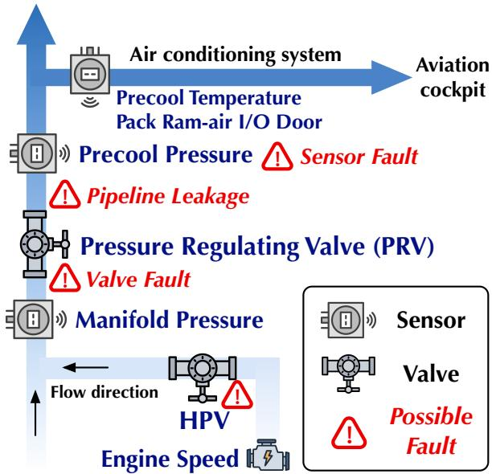  
Figure 1: A320 Bleed Air System Schematic.

Figure 1 provides an example of aircraft bleed air system. In this system, compressed air from the engine is regulated through components such as the high pressure valve and pressure regulating valve before being supplied to downstream systems. Sensors continuously monitor the pressure, temperature, and operating state of this process. Faults may arise from valves, sensors, sensing lines, or air ducts, leading to abnormal pressure regulation, inconsistent sensor readings, or air leakage. While diferent aircraft may use diferent architectures, such as the conventional pneumatic system in the A320 and the electrically driven cabin compression system in the B787, they exhibit similar physical dependencies and generate comparable multivariate time series.

In routine operations, emerging faults rarely cause immediate or isolated spikes in a single sensor. Instead, symptoms manifest as subtle shifts, delayed responses, or cross-sensor inconsistencies that vary across flight phases and operating conditions. Furthermore, these symptoms can vary significantly depending on the current flight phase and environmental conditions. Predictive maintenance therefore seeks to identify these complex, early-stage patterns from QAR trajectories before they escalate into disruptive system faults. Pneuma pairs real-world operational trajectories with documented fault events, providing a practical benchmark for evaluating whether time series models can efectively capture these maintenance-relevant system behaviors.

## 3.3 Dataset Collection

The construction of Pneuma begins with establishing reliable ground truth. We first extract documented fault events from routine airline maintenance logs, identifying the afected aircraft, target component, event timestamp, and diagnostic description for each scenario. Based on these events, we retrieve the corresponding historical QAR telemetry and systematically filter out flights with missing variables or corrupted sensor streams. The remaining records are grouped by aircraft type and target fault scenario to form the 9 subsets summarized in Table 2. The collected QAR records are then processed based on two fundamental principles to make the data suitable for time series modeling.

Table 2: Statistics of the nine aircraft-fault subsets. Collection Period denotes the dates of the earliest and latest flight records in each subset. Variables denotes the number of recorded QAR variables, excluding the time index and benchmark labels. Avg. Length denotes the average number of time steps per flight trajectory. Flight records do not overlap across subsets.
<table><tr><td>Subset</td><td>Aircraft Type</td><td>Target Scenario</td><td>Collection Period</td><td>Sensors</td><td>Flights</td><td>Avg. Length</td><td>Time Steps</td></tr><tr><td>320-DIFF</td><td>A320</td><td>8HA sensing-line fault</td><td>2024-01-2026-05</td><td>17</td><td>7,259</td><td>10.6K</td><td>77.3M</td></tr><tr><td>320-HPV</td><td>A320</td><td>High-pressure valve fault</td><td>2024-01-2026-05</td><td>17</td><td>8,681</td><td>10.7K</td><td>92.7M</td></tr><tr><td>320-PRV</td><td>A320</td><td>Pressure-regulating valve fault</td><td>2024-01-2026-05</td><td>17</td><td>8,041</td><td>10.6K</td><td>84.9M</td></tr><tr><td>320-WEAV</td><td>A320</td><td>Bleed-air duct leakage</td><td>2024-01-2026-05</td><td>17</td><td>7,550</td><td>9.2K</td><td>69.2M</td></tr><tr><td>320-LOW</td><td>A320</td><td>PRV leakage with low transfer pressure</td><td>2021-12-2026-05</td><td>17</td><td>7,417</td><td>9.2K</td><td>68.2M</td></tr><tr><td>321-DIFF</td><td>A321</td><td>8HA sensing-line fault</td><td>2024-01-2026-05</td><td>17</td><td>8,894</td><td>11.1K</td><td>98.8M</td></tr><tr><td>321-WEAV</td><td>A321</td><td>Bleed-air duct leakage</td><td>2023-03-2026-05</td><td>17</td><td>8,052</td><td>9.0K</td><td>72.7M</td></tr><tr><td>787-CAC</td><td>B787</td><td>Cabin air compressor fault</td><td>2023-01-2026-05</td><td>21</td><td>9,157</td><td>19.0K</td><td>174.0M</td></tr><tr><td>777-PRSOV</td><td>B777</td><td>Pressure-regulating and shutoff valve fault</td><td>2024-01-2026-06</td><td>9</td><td>6,400</td><td>28.6K</td><td>183.2M</td></tr><tr><td>Total</td><td>4 types</td><td>9 scenarios</td><td>2021-12-2026-06</td><td>9-21</td><td>71,451</td><td>12.9K</td><td>921.0M</td></tr></table>

Variable Selection. Modern aircraft continuously log thousands of parameters, most of which are irrelevant to the Bleed Air System. To remove background noise while preserving essential physical dynamics, we select a targeted subset of variables directly tied to system operation and fault mechanisms—specifically pressure, temperature, valve state, engine condition, and aircraft configuration.

Flight Phase Alignment. Commercial flights vary widely in du ration from 1 to over 10 hours, making full-length raw sequences dificult to align or compare. Flight phase transitions involve con trol actions and frequent component actuation, producing informative responses in pressure, engine operating states, and valve commands. Potential fault symptoms are therefore more likely to manifest through abnormal system responses during these transitions. We therefore focus on four critical transitions: taxi-to-takeof, takeof-to-climb, climb-to-cruise, and cruise-to-descent. By extracting fixed-length time windows around these four transition points, we convert variable-length flights into standardized, comparable segments that highlight the most informative system responses.

## 3.4 Benchmark

We construct the benchmark annotations relative to documented fault events, as shown in Figure 2. For each aircraft and target system, flights are ordered chronologically, and each confirmed fault event is used as a temporal reference point. We define two sample pools representing normal operation and the period in which fault symptoms may emerge.

The fault warning pool comprises the 100 consecutive flights immediately preceding each fault event. In operational observations, fault-related symptoms tend to grow more frequent and pronounced as the failure approaches; the 100-flight window captures this period of intensifying precursor signals. At the same time, a lead time of 100 flights is regarded as operationally meaningful, providing suficient advance notice for inspection, maintenance planning, and decision-making. The window therefore balances symptom relevance with practical warning utility. The normal pool consists of flights that are suficiently separated from all documented fault events. To reduce contamination from early degradation or post-maintenance transients, we exclude a margin of 500 flights before and 50 flights after each event. The resulting gap between the warning window (100 flights) and the exclusion boundary (500 flights) forms a 400-flight temporal bufer, which enforces a cleaner separation between normal and pre-fault conditions. These annotation rules were established and validated through operational maintenance practice. The two pools are assigned distinct roles across the benchmark tasks, as detailed below.

3.4.1 Forecasting. We formulate flight phase transition forecasting as a complementary paradigm for predictive maintenance. Phase transitions involve coordinated changes in component actuation, pressure, temperature, airflow, and control states, providing informative operating conditions for observing system dynamics. Accurate prediction across these transitions therefore reflects a model’s ability to capture the normal responses and cross-variable relationships of aircraft systems.

Each flight yields four forecasting cases corresponding to the transitions defined in Section 3.3. For each case, the multivariate observations are used to predict the system states after the transition. Models are trained, validated, and tested exclusively on the normal pool to focus on healthy operational dynamics.

Although forecasting does not directly predict fault labels, fault development can alter normal system responses during phase transitions. Thus, representations learned through forecasting may also support fault recognition. This connection is empirically supported in Section 4.3.4, where models with better forecasting performance generally achieve stronger anomaly detection results under the same normal-only reconstruction setting. We evaluate forecasting using Mean Absolute Error (MAE) and Root Mean Squared Error (RMSE), with lower values indicating better performance.

3.4.2 Classification. The classification task evaluates whether a model can identify fault symptoms from complete flight records. The four aligned transition segments of each flight are concatenated in chronological order to form a flight-level multivariate time series. Flights in the normal pool are labeled as normal, whereas flights in the fault warning pool are labeled as warning samples. Both classes are included in the training, validation, and test sets.

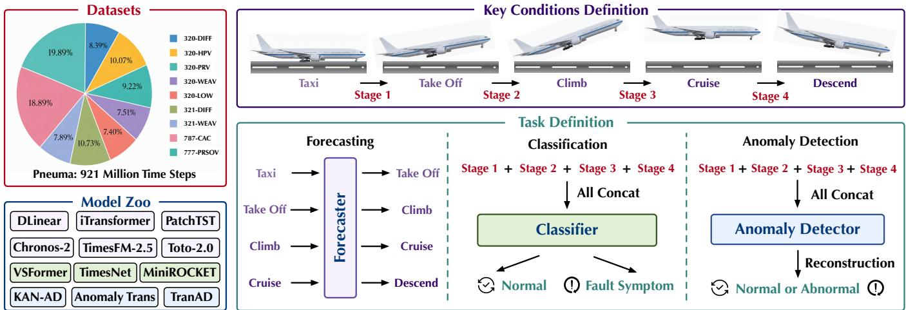  
Figure 2: Overview of the Pneuma dataset and benchmark. The figure summarizes the dataset composition, key flight stages, task definitions for forecasting, classification, and anomaly detection, and the representative models evaluated in each track.

In operational aviation settings, normal flights far outnumber those exhibiting fault symptoms. Excessive false alarms can impose prohibitive inspection and maintenance costs, even when some impending faults are detected; a practical warning system must therefore balance detection coverage against alarm precision. Based on maintenance practice, we set a minimum recall target of 10% for the fault warning class: detecting 10 of the 100 flights leading up to a fault provides actionable lead time for preventive maintenance. We sweep the decision threshold and select the first operating point at which warning recall reaches or exceeds 10%. The corresponding precision, denoted P@R10, serves as our evaluation metric. It directly measures warning reliability at a predefined operational detection coverage, with higher values indicating fewer false alarms.

3.4.3 Anomaly Detection. The anomaly detection task evaluates whether fault symptoms can be flagged without using labeled warning samples during training. Utilizing the same flight-level multivariate time series representation, models are trained exclusively on normal pool flights to learn reference operational behavior. The test set contains both normal and warning flights. Following the reconstruction-based anomaly detection setting, each model reconstructs the input series, and the averaged reconstruction error across time steps and variables is used as the flight-level anomaly score. Higher scores indicate greater deviation from the normal behavior observed during training. To maintain a consistent operational interpretation across the two fault detection tasks, anomaly detection methods are evaluated using the same �@�10 metric as the supervised classification methods.

## 4 Experiments

## 4.1 Experimental Setup

Baselines. To comprehensively evaluate Pneuma, we benchmark over 25 representative models across the three task paradigms.

For the forecasting task, we first evaluate 10 well-acknowledged time series forecasting models trained separately on each dataset, including Autoformer [40], TimesNet [39], DLinear [46], PatchTST [21], iTransformer [17], TimeXer [38], TimeMixer [36], DUET [26], and recent xPatch [29] and OLinear [45]. We also evaluate recent time series foundation models strictly in a 5-shot setting, without finetuning on the specific dataset. The evaluated models include TimesFM-2.5 [5], Moirai-2.0 [14], Chronos-2 [1], TiRex-2 [23] and Toto-2.0 [11].

For classification, we include specialized classifiers MambaSL [10], VSFormer [41], LITE [8], together with the convolutional-kernel methods MiniROCKET [7] and MultiROCKET [32]. We also adapt the general time series architectures TimesNet [39], PatchTST [21], DLinear [46], and iTransformer [17] to the classification setting by replacing their original prediction heads with classification heads.

For anomaly detection, we evaluate KAN-AD [48], Anomaly Transformer [42], TranAD [34], USAD [3], and OmniAnomaly [31]. These methods cover several major paradigms for multivariate time series anomaly detection, including reconstruction-based detection, adversarial autoencoding, probabilistic latent-variable modeling, attention-based association analysis, and prediction or reconstruction with Transformer architectures.

Implementation Details. All experiments are implemented in Py-Torch [22] and conducted on NVIDIA GeForce RTX 4090 GPUs. To ensure a fair comparison, all trainable models follow the same data pre-processing procedure and use unified training and optimization settings unless otherwise specified. Detailed sample statistics, data partitioning protocols, and task-specific input and output lengths are provided in Appendix A. Definitions for all evaluation metrics are provided in Appendix C.

## 4.2 Main Results

Table 3 summarizes the forecasting performance on the nine datasets, with the complete MAE and RMSE results provided in Appendix E.2 and the computation of Score detailed in Appendix C. Among the full-shot forecasting models, DLinear achieves the highest overall Score of 76.65 and obtains the lowest forecasting error on eight of the nine datasets. Its strong performance compared with more complex Transformer and multiscale architectures suggests that simple temporal mappings remain highly competitive for the operational patterns represented in Pneuma. TimesNet performs best on 787-CAC among the full-shot baselines, indicating that the relative efectiveness of diferent architectures can vary across aircraft and system configurations.

Table 3: Main forecasting results on nine aircraft system datasets. The first group reports full-shot models trained separately on each dataset, while the second group reports time series foundation models evaluated in the 5-shot setting. Each entry reports Error = (MAE + RMSE)/2. Lower Error and higher Score indicate better performance. The best result is highlighted in bold.
<table><tr><td>Model</td><td>320-DIFF</td><td>320-HPV</td><td>320-PRV</td><td>320-WEAV</td><td>320-LOW</td><td>321-DIFF</td><td>321-WEAV</td><td>787-CAC</td><td>777-PRSOV</td><td>Score</td></tr><tr><td colspan="11">Time Series Forecasting Models (Full-shot)</td></tr><tr><td>OLinear [45]</td><td>0.411</td><td>0.416</td><td>0.414</td><td>0.448</td><td>0.446</td><td>0.384</td><td>0.460</td><td>0.476</td><td>0.458</td><td>69.72</td></tr><tr><td>xPatch [29]</td><td>0.410</td><td>0.415</td><td>0.414</td><td>0.442</td><td>0.439</td><td>0.381</td><td>0.459</td><td>0.492</td><td>0.451</td><td>69.78</td></tr><tr><td>DUET [26]</td><td>0.401</td><td>0.404</td><td>0.403</td><td>0.438</td><td>0.435</td><td>0.371</td><td>0.455</td><td>0.475</td><td>0.461</td><td>70.11</td></tr><tr><td>TimeMixer [36]</td><td>0.451</td><td>0.456</td><td>0.453</td><td>0.498</td><td>0.497</td><td>0.428</td><td>0.484</td><td>0.542</td><td>0.490</td><td>67.70</td></tr><tr><td>TimeXer [38]</td><td>0.428</td><td>0.432</td><td>0.430</td><td>0.475</td><td>0.471</td><td>0.401</td><td>0.474</td><td>0.487</td><td>0.478</td><td>68.86</td></tr><tr><td>iTransformer [17]</td><td>0.419</td><td>0.424</td><td>0.422</td><td>0.452</td><td>0.449</td><td>0.391</td><td>0.473</td><td>0.505</td><td>0.460</td><td>69.29</td></tr><tr><td>DLinear [46]</td><td>0.266</td><td>0.266</td><td>0.267</td><td>0.304</td><td>0.302</td><td>0.243</td><td>0.274</td><td>0.537</td><td>0.325</td><td>76.65</td></tr><tr><td>PatchTST [21]</td><td>0.425</td><td>0.433</td><td>0.430</td><td>0.457</td><td>0.455</td><td>0.400</td><td>0.481</td><td>0.523</td><td>0.466</td><td>68.90</td></tr><tr><td>TimesNet [39]</td><td>0.404</td><td>0.407</td><td>0.406</td><td>0.453</td><td>0.449</td><td>0.379</td><td>0.465</td><td>0.457</td><td>0.455</td><td>69.93</td></tr><tr><td>Autoformer [40]</td><td>0.519</td><td>0.513</td><td>0.521</td><td>0.583</td><td>0.584</td><td>0.480</td><td>0.553</td><td>0.754</td><td>0.564</td><td>64.10</td></tr><tr><td colspan="11">Time Series Foundation Models (5-shot)</td></tr><tr><td>TiRex-2 [23]</td><td>0.401</td><td>0.409</td><td>0.403</td><td>0.423</td><td>0.421</td><td>0.384</td><td>0.454</td><td>0.490</td><td>0.459</td><td>70.12</td></tr><tr><td>Chronos-2 [1]</td><td>0.399</td><td>0.407</td><td>0.402</td><td>0.407</td><td>0.405</td><td>0.383</td><td>0.441</td><td>0.447</td><td>0.447</td><td>70.67</td></tr><tr><td>TimesFM-2.5 [5]</td><td>0.414</td><td>0.421</td><td>0.417</td><td>0.451</td><td>0.448</td><td>0.400</td><td>0.465</td><td>0.518</td><td>0.476</td><td>69.22</td></tr><tr><td>Toto-2.0 [11]</td><td>0.389</td><td>0.397</td><td>0.392</td><td>0.404</td><td>0.401</td><td>0.373</td><td>0.433</td><td>0.463</td><td>0.438</td><td>70.95</td></tr><tr><td>Moirai-2.0 [14]</td><td>0.447</td><td>0.454</td><td>0.449</td><td>0.489</td><td>0.488</td><td>0.440</td><td>0.518</td><td>0.546</td><td>0.520</td><td>67.45</td></tr></table>

The time series foundation models also show competitive performance under the 5-shot setting. Toto-2.0 achieves the best overall performance among the foundation models and ranks first on eight datasets, while Chronos-2 obtains the best result on the remaining dataset. Although the strongest foundation models outperform most full-shot baselines, none surpasses DLinear in terms of the aggregate Score. Nevertheless, their strong performance without dataset-specific training demonstrates an ability to exploit pretrained temporal knowledge from only a small number of contextual examples. Forecasting errors remain substantially higher on 787-CAC than on most other datasets, suggesting that its operational dynamics pose a greater modeling challenge. Overall, these results highlight the potential of pretrained foundation models for aviation time series forecasting, while also showing that specialized models trained on target data remain highly competitive.

Table 4 reports the classification and anomaly detection results on the nine datasets. Among the supervised classification methods, VSFormer achieves the highest overall Score of 60.22 and performs best on several datasets. LITE ranks second overall and performs particularly well on 320-LOW and 777-PRSOV, while PatchTST achieves the strongest result on 787-CAC. These results indicate that no single architecture consistently dominates across all aircraft and fault scenarios. Specialized classification models achieve the strongest aggregate performance, while forecasting architectures adapted for classification remain competitive on individual datasets.

The anomaly detection methods perform substantially worse than the supervised classifiers, with the best model, Anomaly Transformer, achieving an overall Score of only 23.11. In our reconstructionbased setting, models are trained exclusively on normal samples and detect anomalies using reconstruction errors at test time, following the common assumption that abnormal patterns are more dificult to reconstruct. However, this assumption is challenging for aircraft operational data. Normal records exhibit substantial variation across flight phases and operating conditions, while early fault symptoms are often weak and partially overlap with normal behavior. Consequently, normal and fault-symptom samples may produce similar reconstruction errors, limiting their separability. These results suggest that learning normality alone is insuficient for complex aviation faults and that limited fault supervision may be necessary for more reliable detection.

## 4.3 Analysis

4.3.1 Efect ofIn-Context Learning. We investigate how the number of in-context examples afects the forecasting performance of time series foundation models. For each target flight, the preceding � complete flight trajectories are provided as n-shot demonstrations, allowing the model to observe the full system evolution across the corresponding flight phase transition. We vary the number of demonstrations among 2, 3, 5, 8, and 12, while keeping all other evaluation settings unchanged.

Table 4: Main results for supervised fault classification and unsupervised anomaly detection on nine aircraft fault datasets. Classification models are trained with labeled normal and fault-symptom samples, whereas anomaly detection models learn only from normal samples. All entries report Precision@R10, and Score denotes the aggregate performance across datasets. Higher values indicate better performance, and the best result in each column within each track is highlighted in bold.
<table><tr><td>Model</td><td>320-DIFF</td><td>320-HPV 320-PRV 320-WEAV</td><td></td><td></td><td>320-LOW</td><td>321-DIFF</td><td>321-WEAV</td><td>787-CAC</td><td>777-PRSOV</td><td>Score</td></tr><tr><td colspan="13">Classification Models</td></tr><tr><td>MambaSL [10]</td><td>1.000</td><td>0.303</td><td>0.275</td><td>0.576</td><td>0.163</td><td>0.113</td><td>0.233</td><td>0.287</td><td>0.444</td><td>37.71</td></tr><tr><td>VSFormer [41]</td><td>1.000</td><td>0.649</td><td>0.364</td><td>0.655</td><td>0.366</td><td>0.564</td><td>0.593</td><td>0.288</td><td>0.941</td><td>60.22</td></tr><tr><td>LITE [8]</td><td>1.000</td><td>0.143</td><td>0.128</td><td>0.333</td><td>0.577</td><td>1.000</td><td>0.270</td><td>0.330</td><td>1.000</td><td>53.12</td></tr><tr><td>TimesNet [39]</td><td>0.955</td><td>0.325</td><td>0.220</td><td>0.413</td><td>0.333</td><td>1.000</td><td>0.174</td><td>0.323</td><td>0.182</td><td>43.61</td></tr><tr><td>PatchTST [21]</td><td>0.949</td><td>0.202</td><td>0.220</td><td>0.625</td><td>0.283</td><td>0.231</td><td>0.234</td><td>0.587</td><td>0.435</td><td>41.84</td></tr><tr><td>DLinear [46]</td><td>0.778</td><td>0.545</td><td>0.200</td><td>0.373</td><td>0.228</td><td>0.611</td><td>0.190</td><td>0.182</td><td>0.205</td><td>36.80</td></tr><tr><td>iTransformer [17]</td><td>0.778</td><td>0.118</td><td>0.245</td><td>0.455</td><td>0.231</td><td>0.367</td><td>0.217</td><td>0.244</td><td>0.262</td><td>32.41</td></tr><tr><td>MultiROCKET [32]</td><td>0.913</td><td>0.313</td><td>0.203</td><td>0.352</td><td>0.283</td><td>1.000</td><td>0.223</td><td>0.156</td><td>0.571</td><td>44.60</td></tr><tr><td>MiniROCKET [7]</td><td>0.913</td><td>0.237</td><td>0.232</td><td>0.322</td><td>0.319</td><td>1.000</td><td>0.226</td><td>0.190</td><td>0.258</td><td>41.08</td></tr><tr><td colspan="9">Anomaly Detection Models</td><td colspan="2"></td></tr><tr><td colspan="14"></td></tr><tr><td>KAN-AD [48] Anomaly Trans. [42]</td><td>0.137 0.184</td><td>0.129 0.431</td><td>0.305</td><td>0.292</td><td>0.263</td><td>0.077</td><td>0.330</td><td>0.230</td><td>0.165</td><td>21.42</td></tr><tr><td>TranAD [34]</td><td>0.093</td><td>0.093</td><td>0.250 0.288</td><td>0.238 0.132</td><td>0.185</td><td>0.101</td><td>0.341</td><td>0.284</td><td>0.066</td><td>23.11</td></tr><tr><td>USAD [3]</td><td>0.102</td><td>0.125</td><td>0.224</td><td>0.275</td><td>0.095</td><td>0.044</td><td>0.286</td><td>0.302</td><td>0.471</td><td>20.04</td></tr><tr><td>OmniAnomaly [31]</td><td></td><td></td><td></td><td></td><td>0.333</td><td>0.069</td><td>0.222</td><td>0.376</td><td>0.174</td><td>21.11</td></tr><tr><td></td><td>0.059</td><td>0.129</td><td>0.151</td><td>0.235</td><td>0.341</td><td>0.070</td><td>0.204</td><td>0.311</td><td>0.271</td><td>19.68</td></tr></table>

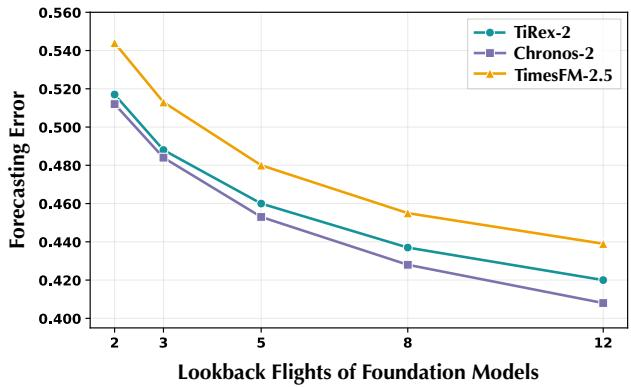  
Figure 3: Efect of the number of in-context flight demonstrations. Each demonstration contains the complete multivariate trajectory of a preceding flight.

As shown in Figure 3, the forecasting loss decreases consistently with the number of demonstrations for all three foundation models. This monotonic improvement indicates that the models can extract useful information from multiple complete flight examples and adapt their predictions to the recent operating characteristics of the aircraft system. These results also show that historical flights in Pneuma contain consistent and reusable operational patterns.

Complete trajectories from preceding flights provide useful references for predicting the target flight, which supports the coherence of the data collection and processing pipeline.

4.3.2 Univariate versus Multivariate Inference. We further investigate whether jointly modeling multiple variables benefits pretrained time series foundation models. We select Chronos-2, TiRex-2, and Toto-2.0, all of which support multivariate inference, and compare two settings. In the univariate setting, each variable is forecast independently, requiring separate inference for all variables in a sample. In the multivariate setting, all variables are provided jointly and predicted in a single inference pass. As shown in Figure 4, multivariate inference consistently reduces forecasting loss for all three models. The consistent improvement provides empirical evidence that the variables in Pneuma contain informative cross-variable dependen-

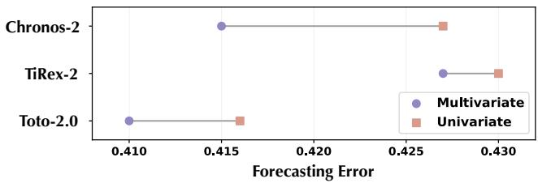  
Figure 4: Comparison of univariate and multivariate inference for three time series foundation models.

cies, which is consistent with the physical coupling among components and control signals in aircraft systems. It also demonstrates the value of multivariate pretraining, as jointly trained foundation models can exploit interactions that are unavailable when each variable is processed independently.

4.3.3 Efect of Temporal Patch Length. Patch-based forecasting models represent consecutive observations as temporal tokens, making patch length an important factor in determining the temporal granularity of the learned representation. To investigate how aircraft operational time series should be segmented, we vary the patch length among 1, 2, 4, 8, and 16 for PatchTST, TimeXer, and xPatch, while keeping all other experimental settings unchanged. Figure 5 reports the forecasting loss, computed as the average of MAE and RMSE and further averaged across the evaluated subsets and four flight phase transitions. The complete numerical results are reported in Appendix E.1.

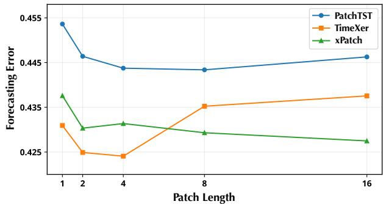  
Figure 5: Efect of patch length on forecasting performance.

All three models benefit from increasing the patch length beyond the point-level setting of 1, showing that grouping adjacent observations provides a more efective representation of aircraft system dynamics. However, the optimal temporal granularity varies across architectures. For PatchTST and TimeXer, performance de teriorates when the patches become longer than their respective optimal settings, suggesting that excessive temporal aggregation may obscure short duration responses around flight phase transitions. Conversely, very short patches may fragment coherent component responses and provide insuficient context for modeling system evolution. Overall, the results indicate that aircraft time series benefit from patch based temporal aggregation, while the appropriate patch length depends on how each model represents and processes temporal patterns.

4.3.4 Relationship between Forecasting and Anomaly Detection. We examine whether forecasting capability is associated with anomaly detection performance. Specifically, we train each model under the same reconstruction-based anomaly detection setting using only normal samples, and use the averaged reconstruction error as the anomaly score. Figure 6 compares the average forecasting error and Precision@R10 of six representative architectures. A clear performance consistency can be observed: DLinear achieves both the lowest forecasting error of 0.309 and the highest Precision@R10 of 0.286, while anomaly detection performance generally decreases as forecasting error increases (Pearson’s � = −0.954, � = 0.003). Since lower forecasting error and higher Precision@R10 both reflect better performance, this negative correlation indicates a positive association between forecasting and anomaly detection capabilities. This finding suggests that models capable of accurately capturing system dynamics are also more likely to distinguish subtle deviations from normal operational behavior.

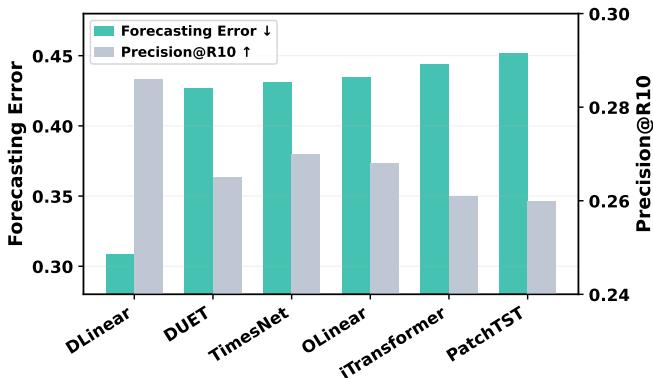  
Figure 6: Relationship between forecasting and anomaly detection performance across six representative architectures.

## 5 Conclusion and Future Work

In this work, we introduce Pneuma, a large-scale public benchmark for predictive maintenance using onboard time series collected from in-service mainline commercial aircraft. Pneuma contains more than 920 million time steps across four aircraft types and 9 fault scenarios derived from the aircraft bleed air system. We for mulate three time series tasks, including multivariate forecasting, supervised classification, and unsupervised anomaly detection, and establish standardized data construction, splitting, and evaluation protocols. Our comprehensive benchmarking of over 25 models reveals that existing time series models still face substantial dificulties in recognizing early fault symptoms and modeling diverse aircraft configurations.

Future work will extend Pneuma in both data coverage and modeling scope. We plan to include more aircraft types, operational records, onboard systems, and fault scenarios to improve the diversity and representativeness ofthe benchmark. On the modeling side, promising directions include learning from limited fault samples, transferring knowledge across aircraft types and systems, and developing more general time series models for aviation maintenance. We hope Pneuma will support continued research toward reliable and transferable predictive maintenance methods.

## References

[1] Abdul Fatir Ansari, Oleksandr Shchur, Jaris Küken, Andreas Auer, Boran Han, Pedro Mercado, Syama Sundar Rangapuram, Huibin Shen, Lorenzo Stella, Xiyuan Zhang, et al. 2025. Chronos-2: From univariate to universal forecasting. arXiv preprint arXiv:2510.15821 (2025).

[2] Manuel Arias Chao, Chetan Kulkarni, Kai Goebel, and Olga Fink. 2021. Aircraft engine run-to-failure dataset under real flight conditions for prognostics and diagnostics. Data 6, 1 (2021), 5.

[3] Julien Audibert, Pietro Michiardi, Frédéric Guyard, Sébastien Marti, and Maria A Zuluaga. 2020. Usad: Unsupervised anomaly detection on multivariate time series. In Proceedings ofthe 26th ACM SIGKDD international conference on knowledge discovery & data mining. 3395–3404.

[4] Anthony Bagnall, Hoang Anh Dau, Jason Lines, Michael Flynn, James Large, Aaron Bostrom, Paul Southam, and Eamonn Keogh. 2018. The UEA multivariate time series classification archive, 2018. arXiv preprint arXiv:1811.00075 (2018).

[5] Abhimanyu Das, Weihao Kong, Rajat Sen, and Yichen Zhou. 2023. A decoder-only foundation model for time-series forecasting. arXiv preprint arXiv:2310.10688

(2023).

[6] Hoang Anh Dau, Anthony Bagnall, Kaveh Kamgar, Chin-Chia Michael Yeh, Yan Zhu, Shaghayegh Gharghabi, Chotirat Ann Ratanamahatana, and Eamonn Keogh. 2019. The UCR time series archive. IEEE/CAA Journal of Automatica Sinica 6, 6 (2019), 1293–1305.

[7] Angus Dempster, Daniel F Schmidt, and Geofrey I Webb. 2021. Minirocket: A very fast (almost) deterministic transform for time series classification. In Proceedings ofthe 27th ACM SIGKDD conference on knowledge discovery & data mining. 248–257.

[8] Ali Ismail-Fawaz, Maxime Devanne, Stefano Berretti, Jonathan Weber, and Ger main Forestier. 2025. Look into the lite in deep learning for time series classifica tion. International Journal ofData Science and Analytics 20, 4 (2025), 4029–4049.

[9] Lu Jing, Yali Fang, ZiYi Huang, Yuan Zhang, Songhan Fan, and Xuan Wu. 2026. A High-Fidelity Multi-Model Benchmark Dataset for General Aviation Anomaly Detection Generated via Physics-Based Fault Injection. Scientific Data (2026), 1–1.

[10] Yoo-Min Jung and Leekyung Kim. 2026. MambaSL: Exploring single-layer mamba for time series classification. arXiv preprint arXiv:2604.15174 (2026).

[11] Emaad Khwaja, Chris Lettieri, Gerald Woo, Eden Belouadah, Marc Cenac, Guillaume Jarry, Enguerrand Paquin, Xunyi Zhao, Viktoriya Zhukov, Othmane Abou-Amal, et al. 2026. Toto 2.0: Time Series Forecasting Enters the Scaling Era. arXiv preprint arXiv:2605.20119 (2026).

[12] Aidan LaBella, Charles Duong, Pak Iong Long, Nathan DePiero, Aditya Iyer, Elise Carman, Randall Balestriero, and Travis Desell. [n. d.]. GATS: A Time-Series Dataset for Addressing General Aviation Flight Safety. In 1st ICML Workshop on Foundation Models for Structured Data.

[13] Zhe Li, Xiangfei Qiu, Peng Chen, Yihang Wang, Hanyin Cheng, Yang Shu, Jilin Hu, Chenjuan Guo, Aoying Zhou, Christian S Jensen, et al. 2025. Tsfm-bench: A comprehensive and unified benchmark of foundation models for time series forecasting. In Proceedings ofthe 31st ACM SIGKDD Conference on Knowledge Discovery and Data Mining V. 2. 5595–5606.

[14] Chenghao Liu, Taha Aksu, Juncheng Liu, Xu Liu, Hanshu Yan, Quang Pham, Silvio Savarese, Doyen Sahoo, Caiming Xiong, and Junnan Li. 2025. Moirai 2.0: When Less Is More for Time Series Forecasting. arXiv preprint arXiv:2511.11698 (2025).

[15] Qinghua Liu and John Paparrizos. 2024. The elephant in the room: Towards a reliable time-series anomaly detection benchmark. Advances in Neural Information Processing Systems 37 (2024), 108231–108261.

[16] Xu Liu, Yutong Xia, Yuxuan Liang, Junfeng Hu, Yiwei Wang, Lei Bai, Chao Huang, Zhenguang Liu, Bryan Hooi, and Roger Zimmermann. 2023. Largest: A benchmark dataset for large-scale trafic forecasting. Advances in Neural Information Processing Systems 36 (2023), 75354–75371.

[17] Yong Liu, Tengge Hu, Haoran Zhang, Haixu Wu, Shiyu Wang, Lintao Ma, and Mingsheng Long. 2024. itransformer: Inverted transformers are efective for time series forecasting. In International conference on learning representations, Vol. 2024. 11116–11140.

[18] Spyros Makridakis, Evangelos Spiliotis, and Vassilios Assimakopoulos. 2020. The M4 Competition: 100,000 time series and 61 forecasting methods. International Journal ofForecasting 36, 1 (2020), 54–74.

[19] Bryan Matthews. 2022. Curated 4 Class Anomaly Detection Data Set. https: //c3.ndc.nasa.gov/dashlink/resources/1018

[20] National Aeronautics and Space Administration. 2012. DASHlink: Sample Flight Data. https://c3.ndc.nasa.gov/dashlink/projects/85/

[21] Yuqi Nie, Nam H Nguyen, Phanwadee Sinthong, and Jayant Kalagnanam. 2022. A time series is worth 64 words: Long-term forecasting with transformers. arXiv preprint arXiv:2211.14730 (2022).

[22] Adam Paszke, Sam Gross, Francisco Massa, Adam Lerer, James Bradbury, Gregory Chanan, Trevor Killeen, Zeming Lin, Natalia Gimelshein, Luca Antiga, et al. 2019. Pytorch: An imperative style, high-performance deep learning library. Advances in neural information processing systems 32 (2019).

[23] Patrick Podest, Marco Pichler, Elias Bürger, Levente Zólyomi, Bernhard Voggenberger, Wilhelm Berghammer, Daniel Klotz, Sebastian Böck, Günter Klambauer, and Sepp Hochreiter. 2026. TiRex-2: Generalizing TiRex to Multivariate Data and Streaming. arXiv preprint arXiv:2607.01204 (2026).

[24] Zhongzheng Qiao, Sheng Pan, Anni Wang, Viktoriya Zhukova, Yong Liu, Xudong Jiang, Qingsong Wen, Mingsheng Long, Ming Jin, and Chenghao Liu. 2026. It’s TIME: Towards the Next Generation of Time Series Forecasting Benchmarks. arXiv preprint arXiv:2602.12147 (2026).

[25] Xiangfei Qiu, Jilin Hu, Lekui Zhou, Xingjian Wu, Junyang Du, Buang Zhang, Chenjuan Guo, Aoying Zhou, Christian S Jensen, Zhenli Sheng, et al. 2024. Tfb: Towards comprehensive and fair benchmarking of time series forecasting methods. arXiv preprint arXiv:2403.20150 (2024).

[26] Xiangfei Qiu, Xingjian Wu, Yan Lin, Chenjuan Guo, Jilin Hu, and Bin Yang. 2025. Duet: Dual clustering enhanced multivariate time series forecasting. In Proceedings ofthe 31st ACM SIGKDD Conference on Knowledge Discovery and Data Mining V. 1. 1185–1196.

[27] Stephan Rasp, Peter D Dueben, Sebastian Scher, Jonathan A Weyn, Soukayna Mouatadid, and Nils Thuerey. 2020. WeatherBench: a benchmark data set for

data-driven weather forecasting. Journal ofAdvances in Modeling Earth Systems 12, 11 (2020), e2020MS002203.

[28] Abhinav Saxena, Kai Goebel, Don Simon, and Neil Eklund. 2008. Damage propagation modeling for aircraft engine run-to-failure simulation. In 2008 international conference on prognostics and health management. IEEE, 1–9.

[29] Artyom Stitsyuk and Jaesik Choi. 2025. xpatch: Dual-stream time series forecast ing with exponential seasonal-trend decomposition. In Proceedings ofthe AAAI Conference on Artificial Intelligence, Vol. 39. 20601–20609.

[30] Siyu Su, Youchao Sun, Chong Peng, and Yifan Wang. 2023. Aircraft bleed air system fault prediction based on encoder-decoder with attention mechanism. Eksploatacja i Niezawodność 25, 3 (2023).

[31] Ya Su, Youjian Zhao, Chenhao Niu, Rong Liu, Wei Sun, and Dan Pei. 2019. Robust anomaly detection for multivariate time series through stochastic recurrent neural network. In Proceedings of the 25th ACM SIGKDD international conference on knowledge discovery & data mining. 2828–2837.

[32] Chang Wei Tan, Angus Dempster, Christoph Bergmeir, and Geofrey I Webb. 2022. MultiRocket: multiple pooling operators and transformations for fast and efective time series classification: CW Tan. Data Mining and Knowledge Discovery 36, 5 (2022), 1623–1646.

[33] Ruifeng Tan, Weixiang Hong, Jiayue Tang, Xibin Lu, Ruijun Ma, Xiang Zheng, Jia Li, Jiaqiang Huang, and Tong-Yi Zhang. 2025. BatteryLife: A comprehensive dataset and benchmark for battery life prediction. In Proceedings ofthe 31st ACM SIGKDD Conference on Knowledge Discovery and Data Mining V. 2. 5789–5800.

[34] Shreshth Tuli, Giuliano Casale, and Nicholas R Jennings. 2022. Tranad: Deep transformer networks for anomaly detection in multivariate time series data. arXiv preprint arXiv:2201.07284 (2022).

[35] Lei Wang, Changxu Wu, and Ruishan Sun. 2014. An analysis of flight Quick Access Recorder (QAR) data and its applications in preventing landing incidents. Reliability Engineering & System Safety 127 (2014), 86–96.

[36] Shiyu Wang, Haixu Wu, Xiaoming Shi, Tengge Hu, Huakun Luo, Lintao Ma, James Zhang, and Jun Zhou. 2024. Timemixer: Decomposable multiscale mixing for time series forecasting. In International conference on learning representations, Vol. 2024. 38626–38652.

[37] Yuxuan Wang, Haixu Wu, Jiaxiang Dong, Yong Liu, Chen Wang, Mingsheng Long, and Jianmin Wang. 2026. Deep time series models: A comprehensive survey and benchmark. IEEE Transactions on Pattern Analysis and Machine Intelligence (2026).

[38] Yuxuan Wang, Haixu Wu, Jiaxiang Dong, Guo Qin, Haoran Zhang, Yong Liu, Yunzhong Qiu, Jianmin Wang, and Mingsheng Long. 2024. Timexer: Empowering transformers for time series forecasting with exogenous variables. Advances in Neural Information Processing Systems 37 (2024), 469–498.

[39] Haixu Wu, Tengge Hu, Yong Liu, Hang Zhou, Jianmin Wang, and Mingsheng Long. 2022. Timesnet: Temporal 2d-variation modeling for general time series analysis. arXiv preprint arXiv:2210.02186 (2022).

[40] Haixu Wu, Jiehui Xu, Jianmin Wang, and Mingsheng Long. 2021. Autoformer: Decomposition transformers with auto-correlation for long-term series forecasting. Advances in neural information processing systems 34 (2021), 22419–22430.

[41] Wenjie Xi, Rundong Zuo, Alejandro Alvarez, Jie Zhang, Byron Choi, and Jessica Lin. 2024. Vsformer: Value and shape-aware transformer with priorenhanced self-attention for multivariate time series classification. arXiv preprint arXiv:2412.16515 (2024).

[42] Jiehui Xu, Haixu Wu, Jianmin Wang, and Mingsheng Long. 2021. Anomaly transformer: Time series anomaly detection with association discrepancy. arXiv preprint arXiv:2110.02642 (2021).

[43] Hong Yang and Travis Desell. 2022. A large-scale annotated multivariate time series aviation maintenance dataset from the ngafid. arXiv preprint arXiv:2210.07317 (2022).

[44] Hong Yang, Aidan LaBella, and Travis Desell. 2022. Predictive maintenance for general aviation using convolutional transformers. In Proceedings ofthe AAAI Conference on Artificial Intelligence, Vol. 36. 12636–12642.

[45] Wenzhen Yue, Yong Liu, Hao Wang, Haoxuan Li, Xianghua Ying, Ruohao Guo, Bowei Xing, and Ji Shi. 2026. Olinear: A linear model for time series forecasting in orthogonally transformed domain. Advances in Neural Information Processing Systems 38 (2026), 60573–60632.

[46] Ailing Zeng, Muxi Chen, Lei Zhang, and Qiang Xu. 2023. Are transformers efective for time series forecasting?. In Proceedings ofthe AAAI conference on artificial intelligence, Vol. 37. 11121–11128.

[47] Xin Zhao, Jialin Qiao, Xiangdong Huang, Chen Wang, Shaoxu Song, and Jianmin Wang. 2024. Apache tsfile: An iot-native time series file format. Proceedings of the VLDB Endowment 17, 12 (2024), 4064–4076.

[48] Quan Zhou, Changhua Pei, Fei Sun, Jing Han, Zhengwei Gao, Dan Pei, Haiming Zhang, Gaogang Xie, and Jianhui Li. 2024. KAN-AD: Time series anomaly detection with Kolmogorov-Arnold networks. arXiv preprint arXiv:2411.00278 (2024).

Table 5: Flight-level sample distribution and task-specific sequence lengths of the nine aircraft fault subsets. Forecasting uses 60 input time steps to predict the subsequent 20 time steps. The final column reports the concatenated sequence length used for classification and anomaly detection.
<table><tr><td>Subset</td><td></td><td>Normal Abnormal</td><td>Input</td><td>Output</td><td>Cls./AD Length</td></tr><tr><td>320-DIFF</td><td>6,186</td><td>1,073</td><td>60</td><td>20</td><td>2,235</td></tr><tr><td>320-HPV</td><td>6,186</td><td>2,495</td><td>60</td><td>20</td><td>2,235</td></tr><tr><td>320-PRV</td><td>6,186</td><td>1,855</td><td>60</td><td>20</td><td>2,235</td></tr><tr><td>320-WEAV</td><td>6,300</td><td>1,250</td><td>60</td><td>20</td><td>2,235</td></tr><tr><td>320-LOW</td><td>6,300</td><td>1,117</td><td>60</td><td>20</td><td>2,235</td></tr><tr><td>321-DIFF</td><td>7,797</td><td>1,097</td><td>60</td><td>20</td><td>2,235</td></tr><tr><td>321-WEAV</td><td>6,700</td><td>1,352</td><td>60</td><td>20</td><td>2,235</td></tr><tr><td>787-CAC</td><td>6,886</td><td>2,271</td><td>60</td><td>20</td><td>2,920</td></tr><tr><td>777-PRSOV</td><td>5,600</td><td>800</td><td>60</td><td>20</td><td>2,235</td></tr><tr><td>Total</td><td>58,141</td><td>13,310</td><td>60</td><td>20</td><td>2,235 / 2,920</td></tr></table>

## A Details of Datasets

Data Organization. Each subset consists of multivariate QAR trajectories collected at the flight level and is organized into normal and abnormal samples according to the corresponding fault scenario. A complete flight record is treated as the basic unit for sample construction and data partitioning. For each documented fault event, the associated flight records are chronologically divided into training, validation, and test sets with a ratio of 7:2:1. We refer to this protocol as a within-event chronological split, which preserves the temporal order and prevents future flights from being included in earlier splits.

Data Format. Pneuma is distributed in the Apache TsFile format [47], an open-source columnar storage format designed for largescale time series data. TsFile supports eficient compression, high throughput reading and writing, and indexed access by variable and time range. These properties reduce the storage and data loading overhead of large multivariate QAR records and facilitate eficient sample extraction for downstream learning tasks.

Task-specific Sample Construction. For forecasting, we extract a fixed-length sequence around each selected flight phase transition. The preceding 60 time steps are used as input, and the subsequent 20 time steps are used as the prediction target. For classification and anomaly detection, the segments selected from the four flight stage transitions are concatenated to form a flight-level sequence. The stage segments are determined using an aviationspecific operating-condition selection protocol, and their lengths therefore difer across aircraft types.

Sample Distribution. Table 5 reports the numbers of normal and abnormal flights together with the task-specific sequence lengths. The benchmark contains 71,451 flights in total, including 58,141 normal samples and 13,310 abnormal samples. Normal flights substantially outnumber abnormal flights across all subsets, reflecting the practical distribution of airline operations, in which fault-related records are naturally scarce. We retain this class imbalance to provide a realistic evaluation of predictive maintenance methods.

## B Definition of Aviation Variables

The recorded variables in Pneuma describe the operating conditions and component states of the aircraft bleed air system. Since variable names and logging conventions difer across aircraft types, we present the variables of the A320 subsets as a representative example. The five A320 subsets, including 320-DIFF, 320-HPV, 320-PRV, 320-WEAV, and 320-LOW, share the same set of 17 QAR variables. The time index and benchmark labels are not included in this list.

The sufixes “1” and $^ { \ast } 2 ^ { \ast }$ refer to the systems associated with Engine 1 and Engine 2, respectively. Variables ending in “\_R” record valve status feedback, while “I” and “O” denote the inlet and outlet sides of the corresponding component. Table 6 summarizes the physical meaning of each variable.

## C Implementation Details

All experiments are implemented in PyTorch [22] and conducted on NVIDIA GeForce RTX 4090 GPUs. To ensure fair comparison, all trainable models within the same track follow identical data preprocessing and sample construction procedures and use unified training and optimization settings unless otherwise specified. Detailed sample statistics, data partitioning protocols, and task-specific input and output lengths are provided in Appendix A.

We evaluate forecasting performance using mean absolute error (MAE) and root mean squared error (RMSE). For dataset �, they are defined as

$$
\mathrm { M A E } _ { d } = \frac { 1 } { N _ { d } } \sum _ { i = 1 } ^ { N _ { d } } \left| y _ { i } - \hat { y } _ { i } \right| ,\tag{1}
$$

$$
\mathrm { R M S E } _ { d } = \sqrt { \frac { 1 } { N _ { d } } \sum _ { i = 1 } ^ { N _ { d } } \left( y _ { i } - \hat { y } _ { i } \right) ^ { 2 } } ,\tag{2}
$$

where $y _ { i }$ and $\hat { y } _ { i }$ denote the ground-truth and predicted values, respectively, and $N _ { d }$ is the number of evaluated values in dataset �. The forecasting error reported in the main table is

$$
\mathrm { E r r o r } _ { d } = \frac { \mathrm { M A E } _ { d } + \mathrm { R M S E } _ { d } } { 2 } .\tag{3}
$$

To aggregate performance across datasets while retaining the convention that higher values indicate better performance, we define the forecasting Score as

$$
\mathrm { S c o r e } _ { \mathrm { f o r e c a s t } } = \frac { 1 0 0 } { D } \sum _ { d = 1 } ^ { D } \frac { 1 } { 1 + \mathrm { E r r o r } _ { d } } ,\tag{4}
$$

where � = 9 is the number of datasets. Lower MAE, RMSE, and Error indicate better forecasting performance, whereas a higher Score is better.

We use Precision@R10 for both supervised classification and unsupervised anomaly detection. Precision@R10 is treated as a ranking-based evaluation metric rather than a calibrated decision threshold for deployment. For each model, we obtain the predicted warning scores for all samples in the test set and rank the samples in descending order of their scores. We then compute precision and recall over the ranked predictions and report the precision at the smallest ranked prefix for which the recall of the warning class reaches or exceeds 10%. The validation set is used for model selection and early stopping.

Table 6: Definitions of the QAR variables used in the A320 subsets. The time index and benchmark labels are excluded.
<table><tr><td>Variable</td><td>Physical Meaning</td></tr><tr><td>N21</td><td>High-pressure rotor speed of Engine 1, representing the operating state of the engine bleed air source.</td></tr><tr><td>N22</td><td>High-pressure rotor speed of Engine 2.</td></tr><tr><td>BMPS1</td><td>Bleed manifold pressure associated with Engine 1.</td></tr><tr><td>BMPS2</td><td>Bleed manifold pressure associated with Engine 2.</td></tr><tr><td>PRECOOL_PRESS1</td><td>Bleed air pressure measured at the precooler section associated with Engine 1, downstream of the pressure</td></tr><tr><td>PRECOOL_PRESS2</td><td>regulating valve. Bleed air pressure measured at the precooler section associated with Engine 2.</td></tr><tr><td>FLIGHT_PHASE</td><td>Categorical indicator of the current flight phase.</td></tr><tr><td>PRV_ENG1_R</td><td>Status feedback of the pressure regulating valve associated with Engine 1.</td></tr><tr><td>PRV_ENG2_R</td><td>Status feedback of the pressure regulating valve associated with Engine 2.</td></tr><tr><td>HPV_ENG1_R</td><td>Status feedback of the high-pressure bleed valve associated with Engine 1.</td></tr><tr><td>HPV_ENG2_R</td><td>Status feedback of the high-pressure bleed valve associated with Engine 2.</td></tr><tr><td>PRECOOL_TEMP1</td><td>Bleed air temperature at the precooler outlet associated with Engine 1.</td></tr><tr><td>PRECOOL_TEMP2</td><td>Bleed air temperature at the precooler outlet associated with Engine 2.</td></tr><tr><td>PACK1_RAM_I_DR</td><td>Position of the ram-air inlet door for air-conditioning Pack 1.</td></tr><tr><td>PACK1_RAM_0_DR</td><td>Position of the ram-air outlet door for air-conditioning Pack 1.</td></tr><tr><td>PACK2_RAM_I_DR</td><td>Position of the ram-air inlet door for air-conditioning Pack 2.</td></tr><tr><td>PACK2_RAM_0_DR</td><td>Position of the ram-air outlet door for air-conditioning Pack 2.</td></tr></table>

Warning samples are treated as the positive class. For each dataset, we report the precision at the smallest ranked prefix for which warning recall reaches or exceeds 10%:

$$
\begin{array} { r } { \mathrm { P } @ \mathrm { R } 1 0 _ { d } = \mathrm { P r e c i s i o n } _ { d } ( k _ { d } ^ { * } ) , \qquad k _ { d } ^ { * } = \operatorname* { m i n } \{ k : \mathrm { R e c a l l } _ { d } ( k ) \geq 0 . 1 0 \} , } \end{array}\tag{5}
$$

where $k _ { d } ^ { * }$ denotes the corresponding ranked prefix size. The aggregate Score is the average Precision@R10 across the nine datasets, expressed on a scale from 0 to 100:

$$
\mathrm { S c o r e } _ { \mathrm { c l s / a d } } = \frac { 1 0 0 } { D } \sum _ { d = 1 } ^ { D } \mathrm { P } @ \mathrm { R } 1 0 _ { d } .\tag{6}
$$

Higher Precision@R10 and Score indicate better performance.

## D Showcases of Model Performance

## D.1 Forecasting Showcases

To provide a qualitative comparison beyond the aggregate metrics, we visualize the forecasting results of DLinear, PatchTST, and TimeXer on two representative samples from diferent aircraft subsets and flight phase transitions. As shown in Figure 7, the historical input and future ground truth are separated by the vertical dotted line, and the colored curves denote the predictions produced by the three models.

For the 321-DIFF sample during the transition from Stage 5 (Climbing) to Stage 6 (Cruising), DLinear closely follows the overall decline of the target variable and achieves the lowest loss of 0.217. PatchTST captures the main direction of change but exhibits a noticeable level bias, while TimeXer produces a smoother trajectory and underestimates the subsequent decrease. A similar pattern is observed for the 320-HPV sample during the transition from Stage

8 (Cruising) to Stage 9 (Descending). DLinear better reproduces the rapid decrease following the stage transition and attains a loss of 0.247, whereas PatchTST and TimeXer show larger deviations in the early prediction region. These examples qualitatively support the quantitative results reported in the main text, while also illustrating the dificulty of capturing abrupt state transitions and fine-grained variations in aircraft operational time series.

## D.2 Classification Showcases

To further illustrate the classification behavior, we visualize four representative samples classified by DLinear, covering a correctly identified normal sample, a correctly identified fault sample, a false alarm, and a missed fault. For each sample, the four flight stages are concatenated in temporal order to form a complete flight-level sequence, following the same construction used in the classification experiments. Figure 8 presents one representative pressure variable together with the ground-truth label, predicted label, and predicted fault probability.

The correctly classified examples show that the model can distinguish certain fault-related temporal patterns from normal operational behavior. However, the false alarm and missed fault cases reveal substantial overlap between the two classes. In particular, some normal records contain pronounced variations that resemble fault signatures, whereas some faulty records exhibit only weak deviations from normal operating patterns. The high confidence assigned to the false alarm and the low fault probability assigned to the missed sample further indicate that these errors cannot be attributed solely to prediction uncertainty. Instead, they reflect the dificulty of separating subtle fault symptoms from complex operational variation using flight-level time series.

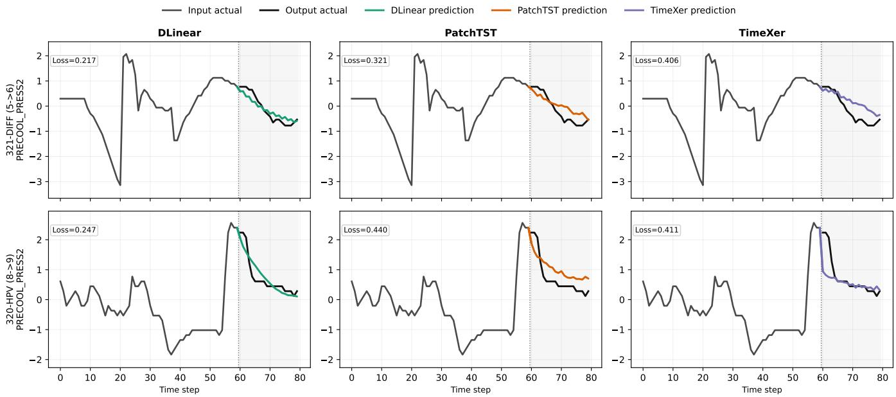  
Figure 7: Visualization results of DLinear, PatchTST, and TimeXer on two representative aircraft time series samples.

## E Full Results

## E.1 Full Results of Temporal Patch Length Analysis

Table 7 reports the complete results of the temporal patch length analysis presented in Section 4.3.3. We evaluate PatchTST, TimeXer, and xPatch with patch lengths of 1, 2, 4, 8, and 16, while keeping all other experimental settings unchanged. The reported loss is computed as the average of MAE and RMSE and is further averaged across all evaluated subsets and four flight phase transitions. Lower values indicate better forecasting performance, and the best result for each model is highlighted in bold.

## E.2 Full Forecasting Results

Due to the space limitation of the main text, we provide the complete forecasting results in this section. Tables 8 and 9 report the MAE and RMSE results, respectively, for all evaluated models across the aircraft fault subsets and flight phase transitions. All experiments follow the same settings described in the main text. Lower values indicate better forecasting performance, and the best result in each column is highlighted in bold. These detailed results complement the aggregated results reported in the main text and enable a more comprehensive comparison across aircraft types, fault scenarios, and operating stages.

Fault, Correct  
Fault, Missed  
Normal, Correct  
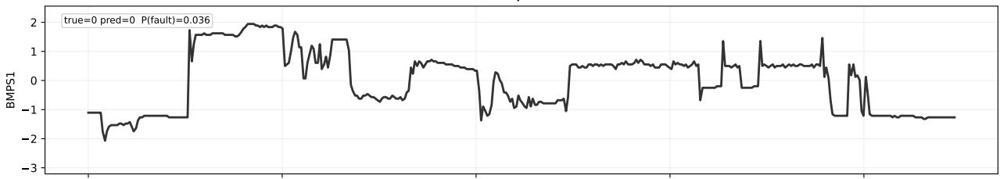

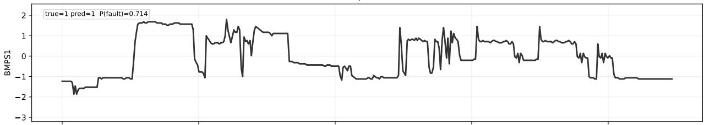

Normal, False Alarm  
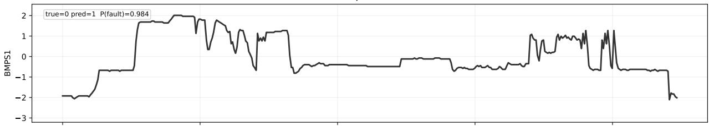

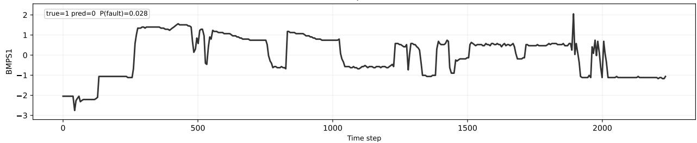  
Figure 8: Classification results of DLinear on four representative flight samples, including a correctly classified normal sample, a correctly classified fault sample, a false alarm, and a missed fault.

Table 7: Full forecasting results under diferent temporal patch lengths, broken down by dataset. Loss is averaged across the four flight phase transitions. Lower values indicate better performance.
<table><tr><td rowspan="2">Dataset</td><td colspan="5">PatchTST</td><td colspan="5">TimeXer</td><td colspan="5">xPatch</td></tr><tr><td>1</td><td>2</td><td>4</td><td>8</td><td>16</td><td>1</td><td>2</td><td>4</td><td>8</td><td>16</td><td>1</td><td>2</td><td>4</td><td>8</td><td>16</td></tr><tr><td>320-DIFF</td><td>0.429</td><td>0.420</td><td>0.418</td><td>0.417</td><td>0.419</td><td>0.402</td><td>0.397</td><td>0.397</td><td>0.408</td><td>0.411</td><td>0.409</td><td>0.407</td><td>0.407</td><td>0.404</td><td>0.403</td></tr><tr><td>320-HPV</td><td>0.434</td><td>0.428</td><td>0.424</td><td>0.424</td><td>0.429</td><td>0.409</td><td>0.410</td><td>0.408</td><td>0.416</td><td>0.417</td><td>0.416</td><td>0.413</td><td>0.413</td><td>0.415</td><td>0.410</td></tr><tr><td>320-PRV</td><td>0.430</td><td>0.426</td><td>0.424</td><td>0.421</td><td>0.424</td><td>0.406</td><td>0.402</td><td>0.402</td><td>0.413</td><td>0.413</td><td>0.413</td><td>0.409</td><td>0.412</td><td>0.409</td><td>0.408</td></tr><tr><td>320-WEAV</td><td>0.456</td><td>0.450</td><td>0.450</td><td>0.450</td><td>0.450</td><td>0.443</td><td>0.437</td><td>0.436</td><td>0.451</td><td>0.455</td><td>0.471</td><td>0.440</td><td>0.439</td><td>0.438</td><td>0.435</td></tr><tr><td>320-LOW</td><td>0.458</td><td>0.446</td><td>0.446</td><td>0.443</td><td>0.446</td><td>0.441</td><td>0.434</td><td>0.433</td><td>0.447</td><td>0.451</td><td>0.441</td><td>0.434</td><td>0.434</td><td>0.433</td><td>0.431</td></tr><tr><td>321-DIFF</td><td>0.397</td><td>0.390</td><td>0.390</td><td>0.390</td><td>0.392</td><td>0.378</td><td>0.378</td><td>0.375</td><td>0.386</td><td>0.387</td><td>0.381</td><td>0.378</td><td>0.380</td><td>0.377</td><td>0.376</td></tr><tr><td>321-WEAV</td><td>0.493</td><td>0.482</td><td>0.477</td><td>0.475</td><td>0.481</td><td>0.469</td><td>0.459</td><td>0.460</td><td>0.470</td><td>0.474</td><td>0.466</td><td>0.462</td><td>0.462</td><td>0.460</td><td>0.459</td></tr><tr><td>787-CAC</td><td>0.520</td><td>0.513</td><td>0.508</td><td>0.512</td><td>0.516</td><td>0.469</td><td>0.455</td><td>0.454</td><td>0.462</td><td>0.466</td><td>0.490</td><td>0.481</td><td>0.486</td><td>0.480</td><td>0.479</td></tr><tr><td>777-PRSOV</td><td>0.464</td><td>0.463</td><td>0.457</td><td>0.459</td><td>0.461</td><td>0.461</td><td>0.451</td><td>0.452</td><td>0.464</td><td>0.464</td><td>0.452</td><td>0.450</td><td>0.450</td><td>0.449</td><td>0.446</td></tr></table>

Table 8: Detailed MAE results across nine datasets and four prediction stages. The average result over the four stages is reported in the Avg row. For each stage the best (lowest) result is highlighted in bold, and the 1st Count row reports the number of stages on which each model ranks first. Lower values indicate better performance.
<table><tr><td rowspan=2 colspan=1>Dataset   Stage</td><td rowspan=1 colspan=12>Time Series Forecasting Models (Full-shot)                   Foundation Models (5-shot)</td></tr><tr><td rowspan=1 colspan=9>OLi. xPa.DUETTMix. TXer iTr. DLi.PTSTTNetAuto.</td><td rowspan=1 colspan=3>TiRex Chr. TFMTotoMoirai</td></tr><tr><td rowspan=1 colspan=1>Taxi→TakeOff</td><td rowspan=1 colspan=9>0.1300.104 0.130  0.154 0.1420.1230.124 0.136 0.114 0.177</td><td rowspan=1 colspan=3>0.107 0.1010.1310.105 0.239</td></tr><tr><td rowspan=1 colspan=1>TakeOff→Climb</td><td rowspan=1 colspan=5>0.2800.267 0.273  0.318 0.290</td><td rowspan=1 colspan=1>0.286</td><td rowspan=1 colspan=3>0.180 0.284 0.277 0.389</td><td rowspan=1 colspan=3>0.251 0.2640.2730.240 0.280</td></tr><tr><td rowspan=1 colspan=1>320-DIFF   Climb→Cruise</td><td rowspan=1 colspan=5>0.2870.278 0.288  0.304 0.310</td><td rowspan=1 colspan=1>0.285</td><td rowspan=1 colspan=3>0.1440.297 0.287 0.436</td><td rowspan=1 colspan=3>0.272 0.2760.2800.263 0.303</td></tr><tr><td rowspan=1 colspan=1>Cruise→Descend</td><td rowspan=1 colspan=9>0.381 0.378 0.367  0.400 0.3930.3840.2200.382 0.378 0.491</td><td rowspan=1 colspan=3>0.353 0.3490.3480.341  0.366</td></tr><tr><td rowspan=1 colspan=1>Avg</td><td rowspan=1 colspan=9>0.2690.257 0.265  0.294 0.2840.2690.1670.275 0.264 0.373</td><td rowspan=1 colspan=3>0.246 0.2480.2580.237 0.297</td></tr><tr><td rowspan=1 colspan=1>Taxi→TakeOff</td><td rowspan=1 colspan=9>0.1150.088 0.113 0.140 0.1260.1050.108 0.123 0.095 0.167</td><td rowspan=1 colspan=3>0.096 0.0890.1190.093 0.227</td></tr><tr><td rowspan=1 colspan=1>TakeOff→Climb</td><td rowspan=1 colspan=1>0.282</td><td rowspan=1 colspan=4>0.269 0.274 0.314 0.292</td><td rowspan=1 colspan=1>0.286</td><td rowspan=1 colspan=1>0.180</td><td rowspan=1 colspan=2>0.289 0.275 0.343</td><td rowspan=1 colspan=3>0.257 0.2690.2800.245 0.286</td></tr><tr><td rowspan=1 colspan=1>320-HPV   Climb→Cruise</td><td rowspan=1 colspan=1>0.310</td><td rowspan=1 colspan=4>0.302 0.307  0.329 0.332</td><td rowspan=1 colspan=1>0.308</td><td rowspan=1 colspan=1>0.156</td><td rowspan=1 colspan=2>0.319 0.306 0.487</td><td rowspan=1 colspan=3>0.295 0.2990.3000.285 0.323</td></tr><tr><td rowspan=1 colspan=1>Cruise→Descend</td><td rowspan=1 colspan=1>0.383</td><td rowspan=1 colspan=4>0.376 0.374 0.404 0.394</td><td rowspan=1 colspan=1>0.385</td><td rowspan=1 colspan=1>0.221</td><td rowspan=1 colspan=2>0.389 0.377 0.468</td><td rowspan=1 colspan=3>0.358 0.3530.3530.346 0.370</td></tr><tr><td rowspan=1 colspan=1>Avg</td><td rowspan=1 colspan=5>0.2730.259 0.267 0.297 0.286</td><td rowspan=1 colspan=4>0.2710.166 0.2800.263 0.366</td><td rowspan=1 colspan=3>0.251 0.2530.2630.242 0.302</td></tr><tr><td rowspan=1 colspan=1>Taxi→TakeOff</td><td rowspan=1 colspan=5>0.1320.107 0.132 0.157 0.145</td><td rowspan=1 colspan=4>0.1260.1250.1410.114 0.188</td><td rowspan=1 colspan=3>0.111 0.1040.1360.108 0.242</td></tr><tr><td rowspan=1 colspan=1>TakeOff→Climb</td><td rowspan=1 colspan=1>0.284</td><td rowspan=1 colspan=3>0.269 0.278  0.318</td><td rowspan=1 colspan=1>0.293</td><td rowspan=1 colspan=1>0.289</td><td rowspan=1 colspan=1>0.179</td><td rowspan=1 colspan=2>0.288 0.280 0.340</td><td rowspan=1 colspan=3>0.252 0.2670.2750.242 0.283</td></tr><tr><td rowspan=1 colspan=1>320-PRV   Climb→Cruise</td><td rowspan=1 colspan=1>0.286</td><td rowspan=1 colspan=3>0.278 0.286 0.304</td><td rowspan=1 colspan=1>0.311</td><td rowspan=1 colspan=1>0.284</td><td rowspan=1 colspan=1>0.143</td><td rowspan=1 colspan=1>0.297</td><td rowspan=1 colspan=1>0.286 0.463</td><td rowspan=1 colspan=1>0.272 0.277</td><td rowspan=1 colspan=1>0.282</td><td rowspan=1 colspan=1>0.264 0.303</td></tr><tr><td rowspan=1 colspan=1>Cruise→Descend</td><td rowspan=1 colspan=1>0.382</td><td rowspan=1 colspan=3>0.375 0.371  0.399</td><td rowspan=1 colspan=1>0.391</td><td rowspan=1 colspan=1>0.382</td><td rowspan=1 colspan=1>0.220</td><td rowspan=1 colspan=2>0.385 0.376 0.500</td><td rowspan=1 colspan=1>0.352 0.349</td><td rowspan=1 colspan=1>0.348</td><td rowspan=1 colspan=1>0.340 0.365</td></tr><tr><td rowspan=1 colspan=1>Avg</td><td rowspan=1 colspan=1>0.271</td><td rowspan=1 colspan=3>0.258 0.267  0.294</td><td rowspan=1 colspan=1>0.285</td><td rowspan=1 colspan=1>0.270</td><td rowspan=1 colspan=1>0.167</td><td rowspan=1 colspan=2>0.278 0.264 0.373</td><td rowspan=1 colspan=1>0.247 0.249</td><td rowspan=1 colspan=2>0.2600.239 0.298</td></tr><tr><td rowspan=1 colspan=1>Taxi→TakeOff</td><td rowspan=1 colspan=1>0.104</td><td rowspan=1 colspan=3>0.064 0.108 0.129</td><td rowspan=1 colspan=1>0.124</td><td rowspan=1 colspan=1>0.077</td><td rowspan=1 colspan=1>0.083</td><td rowspan=1 colspan=2>0.1010.108 0.165</td><td rowspan=1 colspan=1>0.061 0.056</td><td rowspan=1 colspan=2>0.0910.057 0.228</td></tr><tr><td rowspan=1 colspan=1>TakeOff→Climb</td><td rowspan=1 colspan=1>0.359</td><td rowspan=1 colspan=3>0.355 0.334 0.423</td><td rowspan=1 colspan=1>0.378</td><td rowspan=1 colspan=1>0.367</td><td rowspan=1 colspan=1>0.233</td><td rowspan=1 colspan=1>0.374</td><td rowspan=1 colspan=1>0.341 0.495</td><td rowspan=1 colspan=1>0.325 0.300</td><td rowspan=1 colspan=1>0.356</td><td rowspan=1 colspan=1>0.290 0.370</td></tr><tr><td rowspan=1 colspan=1>320-WEAV Climb→Cruise</td><td rowspan=1 colspan=1>0.317</td><td rowspan=1 colspan=3>0.311 0.317 0.353</td><td rowspan=1 colspan=1>0.337</td><td rowspan=1 colspan=1>0.318</td><td rowspan=1 colspan=1>0.210</td><td rowspan=1 colspan=1>0.318</td><td rowspan=1 colspan=1>0.321 0.455</td><td rowspan=1 colspan=1>0.294 0.281</td><td rowspan=1 colspan=1>0.318</td><td rowspan=1 colspan=1>0.278 0.325</td></tr><tr><td rowspan=1 colspan=1>Cruise→Descend</td><td rowspan=1 colspan=1>0.386</td><td rowspan=1 colspan=3>0.374 0.380 0.423</td><td rowspan=1 colspan=1>0.415</td><td rowspan=1 colspan=1>0.383</td><td rowspan=1 colspan=1>0.236</td><td rowspan=1 colspan=2>0.3830.398 0.589</td><td rowspan=1 colspan=1>0.336 0.323</td><td rowspan=1 colspan=1>0.350</td><td rowspan=1 colspan=1>0.317 0.369</td></tr><tr><td rowspan=1 colspan=1>Avg</td><td rowspan=1 colspan=1>0.291</td><td rowspan=1 colspan=3>0.276 0.285 0.332</td><td rowspan=1 colspan=1>0.313</td><td rowspan=1 colspan=1>0.286</td><td rowspan=1 colspan=1>0.191</td><td rowspan=1 colspan=2>0.2940.292 0.426</td><td rowspan=1 colspan=1>0.254 0.240</td><td rowspan=1 colspan=1>0.279</td><td rowspan=1 colspan=1>0.236 0.323</td></tr><tr><td rowspan=1 colspan=1>Taxi→TakeOff</td><td rowspan=1 colspan=1>0.104</td><td rowspan=1 colspan=3>0.062 0.108 0.128</td><td rowspan=1 colspan=1>0.122</td><td rowspan=1 colspan=1>0.075</td><td rowspan=1 colspan=1>0.082</td><td rowspan=1 colspan=2>0.0960.108 0.179</td><td rowspan=1 colspan=3>0.060 0.0550.0890.056 0.226</td></tr><tr><td rowspan=1 colspan=1>TakeOff→Climb</td><td rowspan=1 colspan=1>0.354</td><td rowspan=1 colspan=1>0.352</td><td rowspan=1 colspan=1>0.331</td><td rowspan=1 colspan=1>0.424</td><td rowspan=1 colspan=1>0.370</td><td rowspan=1 colspan=1>0.363</td><td rowspan=1 colspan=1>0.232</td><td rowspan=1 colspan=2>0.370 0.331 0.471</td><td rowspan=1 colspan=1>0.322 0.296</td><td rowspan=1 colspan=1>0.352</td><td rowspan=1 colspan=1>0.285 0.367</td></tr><tr><td rowspan=1 colspan=1>320-LOW  Climb→Cruise</td><td rowspan=1 colspan=1>0.317</td><td rowspan=1 colspan=1>0.312</td><td rowspan=1 colspan=1>0.317</td><td rowspan=1 colspan=1>0.352</td><td rowspan=1 colspan=1>0.337</td><td rowspan=1 colspan=1>0.318</td><td rowspan=1 colspan=1>0.211</td><td rowspan=1 colspan=2>0.317 0.323 0.456</td><td rowspan=1 colspan=1>0.296 0.283</td><td rowspan=1 colspan=1>0.320</td><td rowspan=1 colspan=1>0.281 0.329</td></tr><tr><td rowspan=1 colspan=1>Cruise→Descend</td><td rowspan=1 colspan=1>0.389</td><td rowspan=1 colspan=1>0.373</td><td rowspan=1 colspan=1>0.377</td><td rowspan=1 colspan=1>0.424</td><td rowspan=1 colspan=1>0.417</td><td rowspan=1 colspan=1>0.383</td><td rowspan=1 colspan=1>0.232</td><td rowspan=1 colspan=2>0.383 0.391 0.599</td><td rowspan=1 colspan=1>0.335 0.322</td><td rowspan=1 colspan=1>0.351</td><td rowspan=1 colspan=1>0.317 0.369</td></tr><tr><td rowspan=1 colspan=1>Avg</td><td rowspan=1 colspan=1>0.291</td><td rowspan=1 colspan=3>0.275 0.283 0.332</td><td rowspan=1 colspan=1>0.312</td><td rowspan=1 colspan=1>0.285</td><td rowspan=1 colspan=1>0.189</td><td rowspan=1 colspan=2>0.2910.288 0.426</td><td rowspan=1 colspan=1>0.253 0.239</td><td rowspan=1 colspan=1>0.278</td><td rowspan=1 colspan=1>0.235 0.323</td></tr><tr><td rowspan=1 colspan=1>Taxi→TakeOff</td><td rowspan=1 colspan=1>0.109</td><td rowspan=1 colspan=4>0.080 0.108 0.139 0.120</td><td rowspan=1 colspan=1>0.095</td><td rowspan=1 colspan=1>0.102</td><td rowspan=1 colspan=2>0.1140.084 0.121</td><td rowspan=1 colspan=3>0.090 0.0870.1170.088 0.230</td></tr><tr><td rowspan=1 colspan=1>TakeOff→Climb</td><td rowspan=1 colspan=1>0.232</td><td rowspan=1 colspan=3>0.225 0.229 0.290</td><td rowspan=1 colspan=1>0.247</td><td rowspan=1 colspan=1>0.237</td><td rowspan=1 colspan=1>0.150</td><td rowspan=1 colspan=2>0.240 0.234 0.358</td><td rowspan=1 colspan=1>0.236 0.250</td><td rowspan=1 colspan=1>0.258</td><td rowspan=1 colspan=1>0.232 0.274</td></tr><tr><td rowspan=1 colspan=1>321-DIFF   Climb→Cruise</td><td rowspan=1 colspan=1>0.289</td><td rowspan=1 colspan=3>0.283 0.284 0.305</td><td rowspan=1 colspan=1>0.311</td><td rowspan=1 colspan=1>0.294</td><td rowspan=1 colspan=1>0.139</td><td rowspan=1 colspan=2>0.305 0.288 0.408</td><td rowspan=1 colspan=1>0.281 0.281</td><td rowspan=1 colspan=1>0.289</td><td rowspan=1 colspan=1>0.270 0.307</td></tr><tr><td rowspan=1 colspan=1>Cruise→Descend</td><td rowspan=1 colspan=1>0.381</td><td rowspan=1 colspan=3>0.370 0.357  0.395</td><td rowspan=1 colspan=1>0.388</td><td rowspan=1 colspan=1>0.379</td><td rowspan=1 colspan=1>0.218</td><td rowspan=1 colspan=2>0.381 0.381 0.496</td><td rowspan=1 colspan=1>0.350 0.347</td><td rowspan=1 colspan=1>0.346</td><td rowspan=1 colspan=1>0.341 0.368</td></tr><tr><td rowspan=1 colspan=1>Avg</td><td rowspan=1 colspan=1>0.252</td><td rowspan=1 colspan=1>0.239</td><td rowspan=1 colspan=2>0.244 0.282</td><td rowspan=1 colspan=1>0.266</td><td rowspan=1 colspan=1>0.251</td><td rowspan=1 colspan=1>0.152</td><td rowspan=1 colspan=2>0.260 0.247 0.346</td><td rowspan=1 colspan=1>0.239 0.241</td><td rowspan=1 colspan=2>0.2530.233 0.295</td></tr><tr><td rowspan=1 colspan=1>Taxi→TakeOff</td><td rowspan=1 colspan=1>0.079</td><td rowspan=1 colspan=4>0.059 0.089 0.087 0.103</td><td rowspan=1 colspan=1>0.066</td><td rowspan=1 colspan=1>0.045</td><td rowspan=1 colspan=2>0.1020.070 0.137</td><td rowspan=2 colspan=3>0.069 0.0650.0940.065 0.2430.383 0.3690.3900.355 0.426</td></tr><tr><td rowspan=1 colspan=1>TakeOff→Climb</td><td rowspan=1 colspan=1>0.399</td><td rowspan=1 colspan=1>0.408</td><td rowspan=1 colspan=2>0.411  0.443</td><td rowspan=1 colspan=1>0.414</td><td rowspan=1 colspan=1>0.435</td><td rowspan=1 colspan=1>0.253</td><td rowspan=1 colspan=2>0.4400.408 0.468</td><td rowspan=1 colspan=1>0.383 0.369</td></tr><tr><td rowspan=1 colspan=1>321-WEAV  Climb→Cruise</td><td rowspan=1 colspan=1>0.312</td><td rowspan=1 colspan=1>0.307</td><td rowspan=1 colspan=2>0.291  0.327</td><td rowspan=1 colspan=1>0.321</td><td rowspan=1 colspan=1>0.312</td><td rowspan=1 colspan=1>0.182</td><td rowspan=1 colspan=2>0.316 0.318 0.424</td><td rowspan=1 colspan=1>0.303 0.298</td><td rowspan=1 colspan=2>0.3240.289 0.342</td></tr><tr><td rowspan=1 colspan=1>Cruise→Descend</td><td rowspan=1 colspan=1>0.427</td><td rowspan=1 colspan=1>0.415</td><td rowspan=1 colspan=2>0.437  0.431</td><td rowspan=1 colspan=1>0.438</td><td rowspan=1 colspan=1>0.432</td><td rowspan=1 colspan=1>0.215</td><td rowspan=1 colspan=2>0.4180.442 0.605</td><td rowspan=1 colspan=1>0.392 0.377</td><td rowspan=1 colspan=2>0.3930.370 0.412</td></tr><tr><td rowspan=1 colspan=1>Avg</td><td rowspan=1 colspan=1>0.304</td><td rowspan=1 colspan=4>0.297 0.307 0.322 0.319</td><td rowspan=1 colspan=1>0.311</td><td rowspan=1 colspan=1>0.174</td><td rowspan=1 colspan=2>0.319 0.309 0.408</td><td rowspan=1 colspan=3>0.287 0.2770.3000.270 0.356</td></tr><tr><td rowspan=1 colspan=1>Taxi→TakeOff</td><td rowspan=1 colspan=1>0.343</td><td rowspan=1 colspan=4>0.333 0.328 0.379 0.338</td><td rowspan=1 colspan=1>0.360</td><td rowspan=1 colspan=3>0.4240.3680.327 0.544</td><td rowspan=1 colspan=3>0.317 0.2720.3310.287 0.370</td></tr><tr><td rowspan=1 colspan=1>TakeOff→Climb</td><td rowspan=1 colspan=1>0.308</td><td rowspan=1 colspan=3>0.349 0.321  0.419</td><td rowspan=1 colspan=1>0.322</td><td rowspan=1 colspan=1>0.348</td><td rowspan=1 colspan=1>0.379</td><td rowspan=1 colspan=2>0.3830.2780.601</td><td rowspan=1 colspan=3>0.354 0.3180.3870.331 0.418</td></tr><tr><td rowspan=1 colspan=1>787-CAC   Climb→Cruise</td><td rowspan=1 colspan=1>0.443</td><td rowspan=1 colspan=3>0.442 0.450 0.472</td><td rowspan=1 colspan=1>0.456</td><td rowspan=1 colspan=1>0.443</td><td rowspan=1 colspan=1>0.462</td><td rowspan=1 colspan=2>0.450 0.451 0.721</td><td rowspan=1 colspan=3>0.451 0.4100.4770.427 0.492</td></tr><tr><td rowspan=1 colspan=1>Cruise→Descend</td><td rowspan=1 colspan=1>0.265</td><td rowspan=1 colspan=3>0.249 0.265 0.288</td><td rowspan=1 colspan=1>0.277</td><td rowspan=1 colspan=1>0.259</td><td rowspan=1 colspan=1>0.296</td><td rowspan=1 colspan=2>0.2790.236 0.614</td><td rowspan=1 colspan=3>0.244 0.2200.2850.231 0.316</td></tr><tr><td rowspan=1 colspan=1>Avg</td><td rowspan=1 colspan=9>0.3400.343 0.341  0.389 0.3480.3530.3900.3700.323 0.620</td><td rowspan=1 colspan=3>0.342 0.3050.3700.319 0.399</td></tr><tr><td rowspan=2 colspan=1>Taxi→TakeOffTakeOff→Climb</td><td rowspan=1 colspan=9>0.1100.067 0.119 0.102 0.1060.0750.085 0.1100.073 0.120</td><td rowspan=1 colspan=3>0.082 0.0640.1140.067 0.220</td></tr><tr><td rowspan=1 colspan=4>0.5370.539 0.536 0.580</td><td rowspan=1 colspan=1>0.564</td><td rowspan=1 colspan=1>0.553</td><td rowspan=1 colspan=1>0.376</td><td rowspan=1 colspan=2>0.555 0.533 0.653</td><td rowspan=1 colspan=3>0.535 0.5370.5520.518 0.577</td></tr><tr><td rowspan=1 colspan=1>777-PRSOV Climb→Cruise</td><td rowspan=1 colspan=1>0.205</td><td rowspan=1 colspan=3>0.197 0.201  0.235</td><td rowspan=1 colspan=1>0.225</td><td rowspan=1 colspan=1>0.202</td><td rowspan=1 colspan=1>0.113</td><td rowspan=1 colspan=2>0.206 0.217 0.395</td><td rowspan=1 colspan=2>0.205 0.2010.232</td><td rowspan=1 colspan=1>0.194 0.271</td></tr><tr><td rowspan=1 colspan=1>Cruise→Descend</td><td rowspan=1 colspan=1>0.446</td><td rowspan=1 colspan=3>0.441 0.449  0.483</td><td rowspan=1 colspan=1>0.479</td><td rowspan=1 colspan=1>0.449</td><td rowspan=1 colspan=1>0.308</td><td rowspan=1 colspan=2>0.448 0.455 0.577</td><td rowspan=1 colspan=2>0.423 0.4230.432</td><td rowspan=1 colspan=1>0.405 0.440</td></tr><tr><td rowspan=1 colspan=1>Avg</td><td rowspan=1 colspan=9>0.3240.311 0.326  0.350 0.3440.3200.221 0.330 0.320 0.436</td><td rowspan=1 colspan=3>0.311 0.3060.3320.296 0.377</td></tr><tr><td rowspan=1 colspan=1>1st Count</td><td rowspan=1 colspan=9>0    2     0     0    0    0   25    0    1    0</td><td rowspan=1 colspan=3>0     8    0    0     0</td></tr></table>

Model abbreviations: OLi. = OLinear; xPa. = xPatch; TMix. = TimeMixer; TXer = TimeXer; iTr. = iTransformer; DLi. = DLinear; PTST = PatchTST; TNet = TimesNet; Auto. = Autoformer; TiRex = TiRex-2; Chr. = Chronos-2; TFM = TimesFM-2.5; Toto = Toto-2.0; Moirai = Moirai-2.0.

Table 9: Detailed RMSE results across nine datasets and four prediction stages. The average result over the four stages is reported in the Avg row. For each stage the best (lowest) result is highlighted in bold, and the 1st Count row reports the number of stages on which each model ranks first. Lower values indicate better performance.
<table><tr><td rowspan=2 colspan=1>Dataset   Stage</td><td rowspan=1 colspan=13>Time Series Forecasting Models (Full-shot)                   Foundation Models (5-shot)</td></tr><tr><td rowspan=1 colspan=10>OLi. xPa.DUETTMix.TXer iTr. DLi. PTSTTNetAuto.</td><td rowspan=1 colspan=3>TiRex Chr. TFMTotoMoirai</td></tr><tr><td rowspan=1 colspan=1>Taxi→TakeOff</td><td rowspan=1 colspan=10>0.3510.378 0.332  0.449 0.3780.3830.327 0.396 0.348 0.424</td><td rowspan=1 colspan=3>0.379 0.3710.4240.378 0.535</td></tr><tr><td rowspan=1 colspan=1>TakeOff→Climb</td><td rowspan=1 colspan=5>0.5340.533 0.518 0.583 0.541</td><td rowspan=1 colspan=5>0.5460.347 0.546 0.527 0.657</td><td rowspan=1 colspan=3>0.523 0.5340.5400.511 0.536</td></tr><tr><td rowspan=1 colspan=1>320-DIFF   Climb→Cruise</td><td rowspan=1 colspan=5>0.5760.585 0.577 0.619 0.606</td><td rowspan=1 colspan=5>0.5900.3190.603 0.570 0.746</td><td rowspan=1 colspan=3>0.580 0.5740.5860.557 0.594</td></tr><tr><td rowspan=1 colspan=1>Cruise→Descend</td><td rowspan=1 colspan=10>0.7460.757 0.719 0.785 0.7620.7580.4700.759 0.732 0.829</td><td rowspan=1 colspan=3>0.741 0.7250.7290.718 0.726</td></tr><tr><td rowspan=1 colspan=1>Avg</td><td rowspan=1 colspan=10>0.5520.563 0.537 0.609 0.5720.5690.3660.5760.5440.664</td><td rowspan=1 colspan=3>0.556 0.5510.5700.541 0.598</td></tr><tr><td rowspan=1 colspan=1>Taxi→TakeOff</td><td rowspan=1 colspan=10>0.3100.335 0.286 0.404 0.3350.3370.2800.353 0.303 0.398</td><td rowspan=1 colspan=3>0.340 0.3330.3840.338 0.499</td></tr><tr><td rowspan=1 colspan=1>TakeOff→Climb</td><td rowspan=1 colspan=1>0.552</td><td rowspan=1 colspan=4>0.554 0.535  0.597 0.559</td><td rowspan=1 colspan=1>0.564</td><td rowspan=1 colspan=4>0.3580.568 0.541 0.613</td><td rowspan=1 colspan=3>0.541 0.5550.5600.530 0.553</td></tr><tr><td rowspan=1 colspan=1>320-HPV   Climb→Cruise</td><td rowspan=1 colspan=1>0.630</td><td rowspan=1 colspan=4>0.638 0.623  0.668 0.656</td><td rowspan=1 colspan=1>0.643</td><td rowspan=1 colspan=4>0.3530.655 0.624 0.816</td><td rowspan=1 colspan=3>0.633 0.6280.6340.609 0.640</td></tr><tr><td rowspan=1 colspan=1>Cruise→Descend</td><td rowspan=1 colspan=1>0.749</td><td rowspan=1 colspan=4>0.761 0.722  0.789 0.762</td><td rowspan=1 colspan=1>0.762</td><td rowspan=1 colspan=4>0.4710.768 0.734 0.808</td><td rowspan=1 colspan=3>0.749 0.7310.7380.727 0.734</td></tr><tr><td rowspan=1 colspan=1>Avg</td><td rowspan=1 colspan=1>0.560</td><td rowspan=1 colspan=4>0.572 0.542 0.614 0.578</td><td rowspan=1 colspan=5>0.5770.365 0.5860.551 0.659</td><td rowspan=1 colspan=3>0.566 0.5620.5790.551 0.607</td></tr><tr><td rowspan=1 colspan=1>Taxi→TakeOff</td><td rowspan=1 colspan=10>0.3610.397 0.337 0.458 0.3850.3910.3270.409 0.353 0.455</td><td rowspan=1 colspan=3>0.386 0.3790.4350.388 0.540</td></tr><tr><td rowspan=1 colspan=1>TakeOff→Climb</td><td rowspan=1 colspan=1>0.542</td><td rowspan=1 colspan=3>0.540 0.527 0.586</td><td rowspan=1 colspan=1>0.549</td><td rowspan=1 colspan=1>0.555</td><td rowspan=1 colspan=4>0.3510.554 0.534 0.605</td><td rowspan=1 colspan=3>0.526 0.5410.5450.515 0.541</td></tr><tr><td rowspan=1 colspan=1>320-PRV   Climb→Cruise</td><td rowspan=1 colspan=1>0.577</td><td rowspan=1 colspan=3>0.585 0.573 0.617</td><td rowspan=1 colspan=1>0.607</td><td rowspan=1 colspan=1>0.588</td><td rowspan=1 colspan=1>0.320</td><td rowspan=1 colspan=3>0.602 0.575 0.772</td><td rowspan=1 colspan=3>0.581 0.5760.5890.559 0.594</td></tr><tr><td rowspan=1 colspan=1>Cruise→Descend</td><td rowspan=1 colspan=1>0.749</td><td rowspan=1 colspan=3>0.757 0.723 0.784</td><td rowspan=1 colspan=1>0.761</td><td rowspan=1 colspan=1>0.758</td><td rowspan=1 colspan=1>0.472</td><td rowspan=1 colspan=3>0.762 0.733 0.846</td><td rowspan=1 colspan=3>0.740 0.7230.7300.718 0.726</td></tr><tr><td rowspan=1 colspan=1>Avg</td><td rowspan=1 colspan=1>0.557</td><td rowspan=1 colspan=3>0.570 0.540 0.611</td><td rowspan=1 colspan=1>0.576</td><td rowspan=1 colspan=1>0.573</td><td rowspan=1 colspan=1>0.367</td><td rowspan=1 colspan=3>0.5820.549 0.669</td><td rowspan=1 colspan=3>0.558 0.5550.5750.545 0.600</td></tr><tr><td rowspan=1 colspan=1>Taxi→TakeOff</td><td rowspan=1 colspan=1>0.294</td><td rowspan=1 colspan=4>0.284 0.305 0.366 0.347</td><td rowspan=1 colspan=1>0.298</td><td rowspan=1 colspan=4>0.2730.294 0.337 0.401</td><td rowspan=1 colspan=3>0.281 0.2770.3360.277 0.484</td></tr><tr><td rowspan=1 colspan=1>TakeOff→Climb</td><td rowspan=1 colspan=1>0.712</td><td rowspan=1 colspan=3>0.729 0.670 0.795</td><td rowspan=1 colspan=1>0.735</td><td rowspan=1 colspan=1>0.743</td><td rowspan=1 colspan=1>0.473</td><td rowspan=1 colspan=2>0.756 0.699</td><td rowspan=1 colspan=1>0.868</td><td rowspan=1 colspan=3>0.709 0.6770.7440.670 0.738</td></tr><tr><td rowspan=1 colspan=1>320-WEAV  Climb→Cruise</td><td rowspan=1 colspan=1>0.658</td><td rowspan=1 colspan=1>0.665</td><td rowspan=1 colspan=2>0.647 0.699</td><td rowspan=1 colspan=1>0.676</td><td rowspan=1 colspan=1>0.665</td><td rowspan=1 colspan=1>0.435</td><td rowspan=1 colspan=2>0.666 0.661</td><td rowspan=1 colspan=1>0.775</td><td rowspan=1 colspan=3>0.649 0.6320.6750.632 0.663</td></tr><tr><td rowspan=1 colspan=1>Cruise→Descend</td><td rowspan=1 colspan=1>0.758</td><td rowspan=1 colspan=1>0.758</td><td rowspan=1 colspan=2>0.740 0.799</td><td rowspan=1 colspan=1>0.785</td><td rowspan=1 colspan=1>0.762</td><td rowspan=1 colspan=1>0.488</td><td rowspan=1 colspan=3>0.7630.7620.914</td><td rowspan=1 colspan=3>0.728 0.7090.7350.707 0.736</td></tr><tr><td rowspan=1 colspan=1>Avg</td><td rowspan=1 colspan=1>0.605</td><td rowspan=1 colspan=1>0.609</td><td rowspan=1 colspan=2>0.591 0.665</td><td rowspan=1 colspan=1>0.636</td><td rowspan=1 colspan=1>0.617</td><td rowspan=1 colspan=1>0.417</td><td rowspan=1 colspan=2>0.620 0.615</td><td rowspan=1 colspan=1>0.739</td><td rowspan=1 colspan=3>0.592 0.5740.6220.571 0.655</td></tr><tr><td rowspan=1 colspan=1>Taxi→TakeOff</td><td rowspan=1 colspan=1>0.289</td><td rowspan=1 colspan=1>0.276</td><td rowspan=1 colspan=3>0.299  0.361 0.342</td><td rowspan=1 colspan=1>0.291</td><td rowspan=1 colspan=1>0.266</td><td rowspan=1 colspan=2>0.2920.335</td><td rowspan=1 colspan=1>0.430</td><td rowspan=1 colspan=3>0.275 0.2720.3270.271 0.478</td></tr><tr><td rowspan=1 colspan=1>TakeOff→Climb</td><td rowspan=1 colspan=1>0.700</td><td rowspan=1 colspan=1>0.719</td><td rowspan=1 colspan=1>0.659</td><td rowspan=1 colspan=1>0.790</td><td rowspan=1 colspan=1>0.721</td><td rowspan=1 colspan=1>0.733</td><td rowspan=1 colspan=1>0.472</td><td rowspan=1 colspan=1>0.749</td><td rowspan=1 colspan=1>0.680</td><td rowspan=1 colspan=1>0.834</td><td rowspan=1 colspan=1>0.702 0.672</td><td rowspan=1 colspan=1>0.736</td><td rowspan=1 colspan=1>0.659 0.733</td></tr><tr><td rowspan=1 colspan=1>320-LOW  Climb→Cruise</td><td rowspan=1 colspan=1>0.660</td><td rowspan=1 colspan=1>0.666</td><td rowspan=1 colspan=1>0.650</td><td rowspan=1 colspan=1>0.700</td><td rowspan=1 colspan=1>0.678</td><td rowspan=1 colspan=1>0.666</td><td rowspan=1 colspan=1>0.439</td><td rowspan=1 colspan=1>0.668</td><td rowspan=1 colspan=1>0.662</td><td rowspan=1 colspan=1>0.779</td><td rowspan=1 colspan=1>0.654 0.638</td><td rowspan=1 colspan=1>0.680</td><td rowspan=1 colspan=1>0.639 0.669</td></tr><tr><td rowspan=1 colspan=1>Cruise→Descend</td><td rowspan=1 colspan=1>0.755</td><td rowspan=1 colspan=1>0.755</td><td rowspan=1 colspan=1>0.737</td><td rowspan=1 colspan=1>0.798</td><td rowspan=1 colspan=1>0.784</td><td rowspan=1 colspan=1>0.760</td><td rowspan=1 colspan=1>0.481</td><td rowspan=1 colspan=3>0.761 0.759 0.920</td><td rowspan=1 colspan=1>0.722 0.702</td><td rowspan=1 colspan=1>0.731</td><td rowspan=1 colspan=1>0.703 0.733</td></tr><tr><td rowspan=1 colspan=1>Avg</td><td rowspan=1 colspan=1>0.601</td><td rowspan=1 colspan=1>0.604</td><td rowspan=1 colspan=2>0.586  0.662</td><td rowspan=1 colspan=1>0.631</td><td rowspan=1 colspan=1>0.612</td><td rowspan=1 colspan=1>0.414</td><td rowspan=1 colspan=3>0.618 0.609 0.741</td><td rowspan=1 colspan=1>0.588 0.571</td><td rowspan=1 colspan=2>0.6190.568 0.653</td></tr><tr><td rowspan=1 colspan=1>Taxi→TakeOff</td><td rowspan=1 colspan=1>0.275</td><td rowspan=1 colspan=4>0.289 0.265 0.375 0.305</td><td rowspan=1 colspan=1>0.296</td><td rowspan=1 colspan=4>0.2680.310 0.269 0.295</td><td rowspan=1 colspan=3>0.311 0.3030.3640.305 0.491</td></tr><tr><td rowspan=1 colspan=1>TakeOff→Climb</td><td rowspan=1 colspan=1>0.486</td><td rowspan=1 colspan=3>0.489 0.476 0.548</td><td rowspan=1 colspan=1>0.502</td><td rowspan=1 colspan=1>0.499</td><td rowspan=1 colspan=1>0.298</td><td rowspan=1 colspan=3>0.501 0.485 0.599</td><td rowspan=1 colspan=2>0.508 0.5270.527</td><td rowspan=1 colspan=1>0.501 0.546</td></tr><tr><td rowspan=1 colspan=1>321-DIFF   Climb→Cruise</td><td rowspan=1 colspan=1>0.574</td><td rowspan=1 colspan=3>0.586 0.566 0.612</td><td rowspan=1 colspan=1>0.604</td><td rowspan=1 colspan=1>0.595</td><td rowspan=1 colspan=1>0.307</td><td rowspan=1 colspan=3>0.612 0.571 0.714</td><td rowspan=1 colspan=2>0.582 0.5710.593</td><td rowspan=1 colspan=1>0.556 0.593</td></tr><tr><td rowspan=1 colspan=1>Cruise→Descend</td><td rowspan=1 colspan=1>0.724</td><td rowspan=1 colspan=1>0.732</td><td rowspan=1 colspan=2>0.683 0.758</td><td rowspan=1 colspan=1>0.735</td><td rowspan=1 colspan=1>0.734</td><td rowspan=1 colspan=1>0.463</td><td rowspan=1 colspan=3>0.737 0.721 0.851</td><td rowspan=1 colspan=2>0.715 0.6970.704</td><td rowspan=1 colspan=1>0.694 0.708</td></tr><tr><td rowspan=1 colspan=1>Avg</td><td rowspan=1 colspan=1>0.515</td><td rowspan=1 colspan=1>0.524</td><td rowspan=1 colspan=2>0.497 0.573</td><td rowspan=1 colspan=1>0.536</td><td rowspan=1 colspan=1>0.531</td><td rowspan=1 colspan=1>0.334</td><td rowspan=1 colspan=3>0.540 0.512 0.615</td><td rowspan=1 colspan=2>0.529 0.5240.547</td><td rowspan=1 colspan=1>0.514 0.585</td></tr><tr><td rowspan=1 colspan=1>Taxi→TakeOff</td><td rowspan=1 colspan=1>0.262</td><td rowspan=1 colspan=4>0.252 0.268 0.288 0.282</td><td rowspan=1 colspan=1>0.259</td><td rowspan=1 colspan=1>0.178</td><td rowspan=1 colspan=3>0.2730.261 0.342</td><td rowspan=1 colspan=3>0.275 0.2690.2980.264 0.479</td></tr><tr><td rowspan=1 colspan=1>TakeOff→Climb</td><td rowspan=1 colspan=1>0.771</td><td rowspan=1 colspan=1>0.788</td><td rowspan=1 colspan=2>0.767 0.829</td><td rowspan=1 colspan=1>0.783</td><td rowspan=1 colspan=1>0.833</td><td rowspan=1 colspan=1>0.499</td><td rowspan=1 colspan=3>0.846 0.776 0.803</td><td rowspan=1 colspan=2>0.774 0.7510.770</td><td rowspan=1 colspan=1>0.735 0.796</td></tr><tr><td rowspan=1 colspan=1>321-WEAV  Climb→Cruise</td><td rowspan=1 colspan=1>0.640</td><td rowspan=1 colspan=1>0.645</td><td rowspan=1 colspan=2>0.585 0.662</td><td rowspan=1 colspan=1>0.645</td><td rowspan=1 colspan=1>0.645</td><td rowspan=1 colspan=1>0.382</td><td rowspan=1 colspan=3>0.656 0.641 0.728</td><td rowspan=1 colspan=2>0.650 0.6370.670</td><td rowspan=1 colspan=1>0.626 0.670</td></tr><tr><td rowspan=1 colspan=1>Cruise→Descend</td><td rowspan=1 colspan=1>0.791</td><td rowspan=1 colspan=1>0.793</td><td rowspan=1 colspan=2>0.794 0.810</td><td rowspan=1 colspan=1>0.802</td><td rowspan=1 colspan=1>0.803</td><td rowspan=1 colspan=1>0.437</td><td rowspan=1 colspan=3>0.795 0.803 0.920</td><td rowspan=1 colspan=2>0.787 0.7630.778</td><td rowspan=1 colspan=1>0.757 0.775</td></tr><tr><td rowspan=1 colspan=1>Avg</td><td rowspan=1 colspan=1>0.616</td><td rowspan=1 colspan=3>0.620 0.603  0.647</td><td rowspan=1 colspan=1>0.628</td><td rowspan=1 colspan=1>0.635</td><td rowspan=1 colspan=1>0.374</td><td rowspan=1 colspan=3>0.642 0.620 0.698</td><td rowspan=1 colspan=3>0.622 0.6050.6290.596 0.680</td></tr><tr><td rowspan=2 colspan=1>Taxi→TakeOffTakeOff→Climb</td><td rowspan=1 colspan=1>0.721</td><td rowspan=1 colspan=4>0.734 0.684 0.784 0.719</td><td rowspan=1 colspan=1>0.792</td><td rowspan=1 colspan=4>0.833 0.794 0.703 0.881</td><td rowspan=1 colspan=3>0.697 0.6340.7090.649 0.751</td></tr><tr><td rowspan=1 colspan=1>0.533</td><td rowspan=1 colspan=3>0.615 0.554 0.709</td><td rowspan=1 colspan=1>0.552</td><td rowspan=1 colspan=1>0.619</td><td rowspan=1 colspan=1>0.654</td><td rowspan=1 colspan=3>0.6750.482 0.853</td><td rowspan=1 colspan=3>0.654 0.6060.6890.629 0.729</td></tr><tr><td rowspan=1 colspan=1>787-CAC   Climb→Cruise</td><td rowspan=1 colspan=1>0.703</td><td rowspan=1 colspan=3>0.714 0.706 0.745</td><td rowspan=1 colspan=1>0.717</td><td rowspan=1 colspan=1>0.710</td><td rowspan=1 colspan=1>0.709</td><td rowspan=1 colspan=3>0.719 0.709 0.975</td><td rowspan=1 colspan=2>0.714 0.6680.740</td><td rowspan=1 colspan=1>0.680 0.746</td></tr><tr><td rowspan=1 colspan=1>Cruise→Descend</td><td rowspan=1 colspan=1>0.494</td><td rowspan=1 colspan=3>0.499 0.495 0.541</td><td rowspan=1 colspan=1>0.511</td><td rowspan=1 colspan=1>0.512</td><td rowspan=1 colspan=1>0.543</td><td rowspan=1 colspan=3>0.513 0.469 0.845</td><td rowspan=1 colspan=2>0.486 0.4480.527</td><td rowspan=1 colspan=1>0.466 0.545</td></tr><tr><td rowspan=1 colspan=1>Avg</td><td rowspan=1 colspan=10>0.6130.640 0.610  0.695 0.6250.6580.685 0.676 0.591 0.888</td><td rowspan=1 colspan=3>0.638 0.5890.6660.606 0.693</td></tr><tr><td rowspan=1 colspan=1>Taxi→TakeOff</td><td rowspan=1 colspan=10>0.1790.163 0.179 0.193 0.1780.1710.1780.1760.171 0.216</td><td rowspan=1 colspan=3>0.215 0.1630.2350.167 0.352</td></tr><tr><td rowspan=1 colspan=1>TakeOff→Climb</td><td rowspan=1 colspan=4>0.9120.916 0.913  0.961</td><td rowspan=1 colspan=1>0.935</td><td rowspan=1 colspan=1>0.939</td><td rowspan=1 colspan=4>0.6480.934 0.903 0.995</td><td rowspan=1 colspan=3>0.918 0.9130.9300.898 0.955</td></tr><tr><td rowspan=1 colspan=1>777-PRSOV Climb→Cruise</td><td rowspan=1 colspan=1>0.417</td><td rowspan=1 colspan=3>0.423 0.423 0.473</td><td rowspan=1 colspan=1>0.451</td><td rowspan=1 colspan=1>0.422</td><td rowspan=1 colspan=4>0.2410.430 0.432 0.626</td><td rowspan=1 colspan=2>0.433 0.4180.453</td><td rowspan=1 colspan=1>0.412 0.489</td></tr><tr><td rowspan=1 colspan=1>Cruise→Descend</td><td rowspan=1 colspan=1>0.860</td><td rowspan=1 colspan=3>0.864 0.865 0.898</td><td rowspan=1 colspan=1>0.885</td><td rowspan=1 colspan=1>0.869</td><td rowspan=1 colspan=4>0.6530.871 0.853 0.929</td><td rowspan=1 colspan=2>0.861 0.8550.864</td><td rowspan=1 colspan=1>0.844 0.859</td></tr><tr><td rowspan=1 colspan=1>Avg</td><td rowspan=1 colspan=10>0.5920.591 0.595  0.631 0.6120.6000.430 0.603 0.590 0.691</td><td rowspan=1 colspan=3>0.607 0.5870.6200.580 0.664</td></tr><tr><td rowspan=1 colspan=1>1st Count</td><td rowspan=1 colspan=10>0    1     1     0    0    0   30    0    1    0</td><td rowspan=1 colspan=3>0     4    0    0     0</td></tr></table>

Model abbreviations: OLi. = OLinear; xPa. = xPatch; TMix. = TimeMixer; TXer = TimeXer; iTr. = iTransformer; DLi. = DLinear; PTST = PatchTST; TNet = TimesNet; Auto. = Autoformer; TiRex = TiRex-2; Chr. = Chronos-2; TFM = TimesFM-2.5; Toto = Toto-2.0; Moirai = Moirai-2.0.