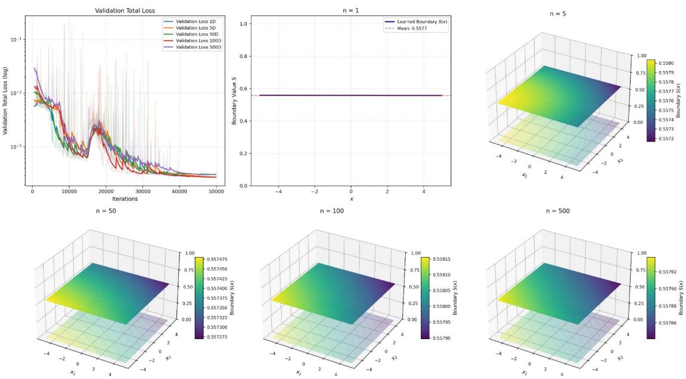
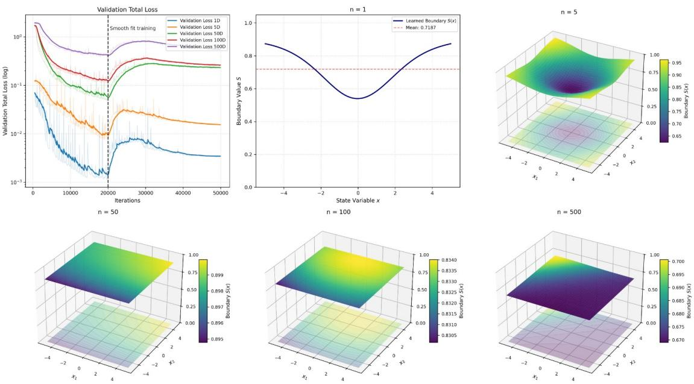
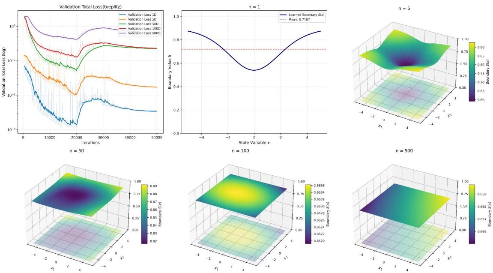
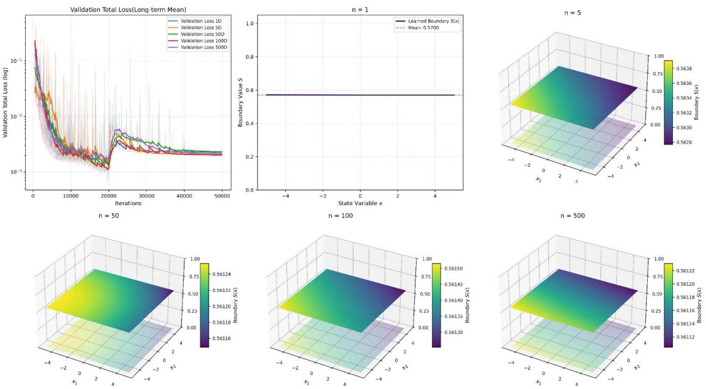
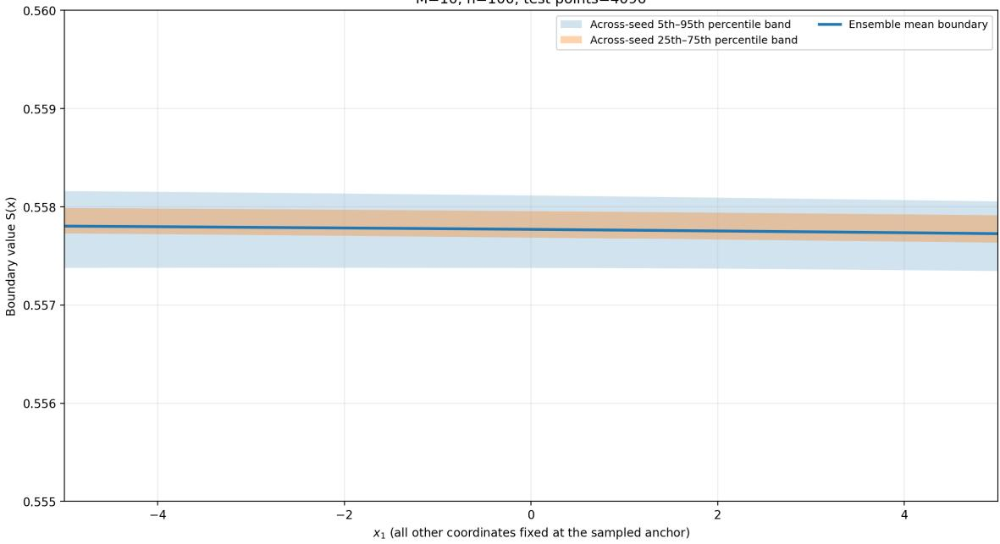
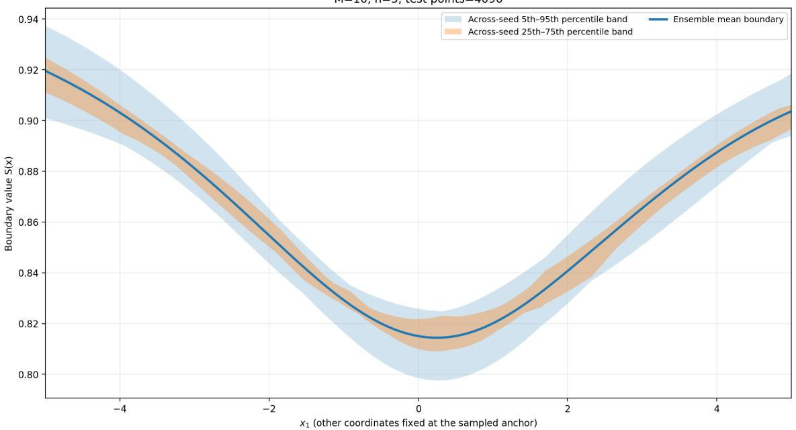
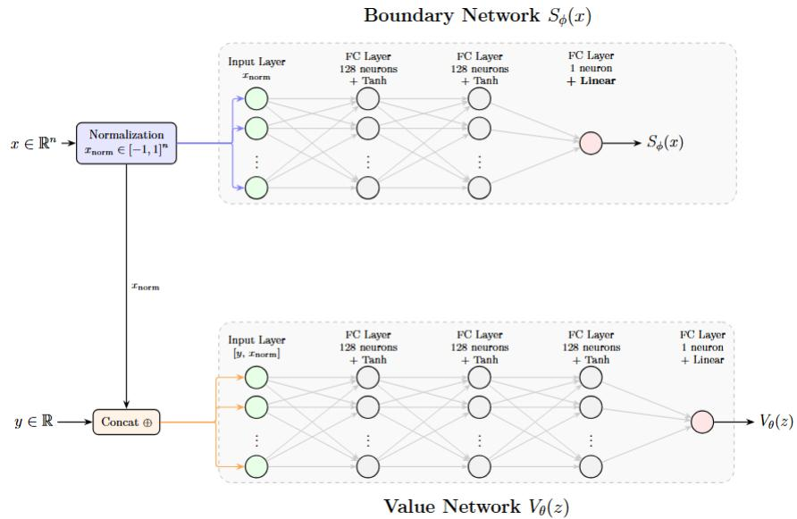
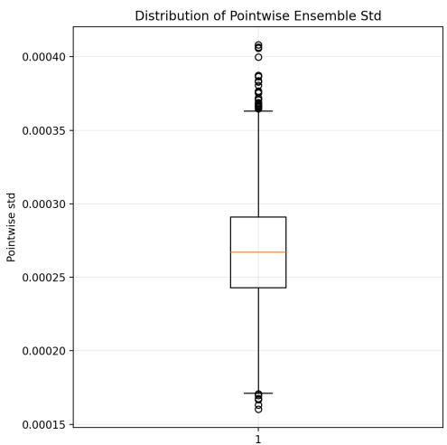
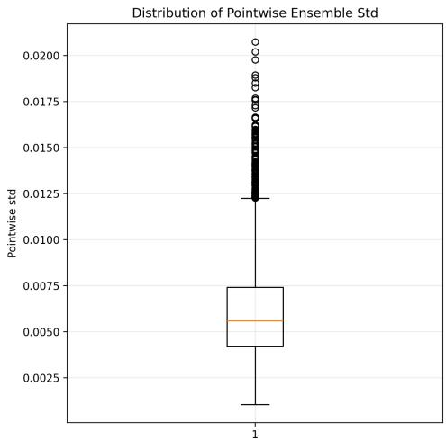
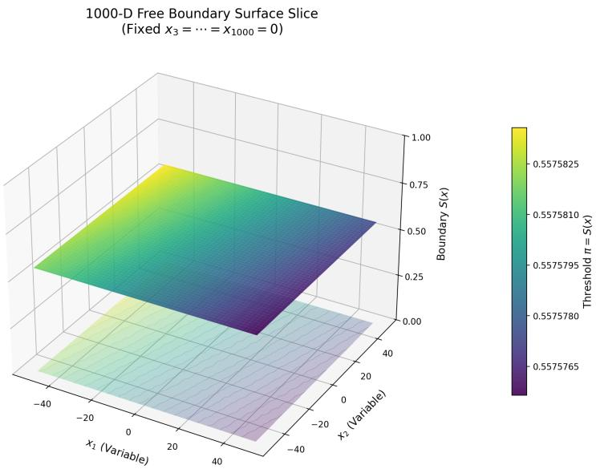

# QD-PINN:A Physics-Informed Neural Network Approach to Bayesian Quickest Detection in High-Dimensional Difusions

Hang Ye Yi Liu Haipeng Xing∗

Department of Applied Mathematics and Statistics, Stony Brook University

## Abstract

Quickest detection problems (QDPs) arise in a wide range of applications. However, the complementarity structure of the associated variational inequalities poses substantial challenges for traditional numerical methods, particularly in high-dimensional settings. We propose a PINNbased framework for estimating the optimal stopping boundary in QDPs with high-dimensional difusion processes and spatial dependence, while overcoming the curse of dimensionality. Theoretically, we establish a novel equivalence between the free-boundary PDE and an infinitedimensional stochastic optimization problem, rigorously justifying the use of finite-dimensional neural networks to approximate the true solution. Furthermore, we assess the robustness of the proposed framework by quantifying uncertainty in the learned stopping boundaries using deep ensembles and Monte Carlo dropout. The results show low variability across independent training runs and stochastic forward passes, indicating stable and consistent boundary estimates. We also compare our PINN results with reference numerical solutions where available and find close agreement.

## 1 Introduction

Sequential change-point detection, or quickest detection, aims to identify distribution shifts in observed stochastic processes as quickly as possible while controlling false alarms. Driven by the growth of high-dimensional, high-frequency, and spatially correlated streaming data, this task is vital across diverse domains, including financial anomaly detection, cybersecurity, industrial monitoring, healthcare, social media, and the Internet of Things (IoT) (Cohen and Zhao, 2015; Tasoulis et al., 2018; Leevy and Khoshgoftaar, 2020; Xie et al., 2021). However, extending classical univariate techniques to multivariate streams remains challenging. When observations are highly dimensiona and high-frequency, real-time inference becomes dificult. This challenge is further exacerbated by intricate spatial correlations and cross-channel dependencies, which increase computational costs and make traditional methods impractical.

In the Bayesian formulation pioneered by Shiryaev (Shiryaev, 1963, 1964, 1967), quickest detection is cast as an optimal stopping problem. For difusion processes, the strong Markov property yields an analytical characterization through a partial diferential equation (PDE) with a free boundary (Poor, 1998; Beibel, 2000; Gapeev and Peskir, 2006; Peskir and Shiryaev, 2006; Bayraktar et al., 2005; Gapeev and Shiryaev, 2013). Spatial correlation in high-dimensional data is explicitly captured by the cross-derivative terms of the difusion operator. The free boundary partitions the state space into continuation and stopping regions. Consequently, the value function and optimal stopping boundary must be determined jointly, subject to the governing PDE, boundary conditions, and the value-matching, smooth-fit, and complementarity constraints of the associated variational inequality.

However, solving high-dimensional free-boundary problems (FBPs) with dense spatial coupling is dificult using conventional numerical methods. Grid-based schemes sufer from the curse of dimensionality—particularly when cross-derivatives prevent equation decoupling—while standard Monte Carlo methods cannot directly resolve the geometry of unknown stopping boundaries. This limitation motivates mesh-free paradigms that simultaneously approximate the value function and free boundary in high-dimensional state spaces. Physics-informed neural networks (PINNs) ofer a natural framework for this challenge (Raissi et al., 2019, 2020; Wang and Perdikaris, 2021). By representing unknown functions with neural networks and enforcing governing equations and boundary conditions through customized loss functions, their mesh-free formulation is particularly efective when both the solution and free boundary are unknown.

We develop a PINN framework for sequential change-point detection in high-dimensional difusion processes by formulating the task as a continuous-time optimal stopping problem governed by a high-dimensional FBP. Working directly with the original state variables, we use the Kolmogorov transformation (Kolmogorov, 1992) to derive a smooth-fit condition without requiring an additional reduced state representation. We then reformulate this FBP as an infinite-dimensional stochastic optimization problem, approximating its solution via two neural networks that jointly estimate the value function and the stopping boundary. The network training is guided by a comprehensive loss function enforcing the governing PDE, boundary conditions, value-matching, smooth-fit, and complementarity constraints, while specialized high-dimensional sampling strategies are introduced to significantly improve approximation accuracy near the free boundary. We demonstrate the effectiveness of our approach by estimating optimal stopping boundaries in change-point detection problems for high-dimensional Brownian motion and Ornstein–Uhlenbeck processes. Experiments consider difusion dimensions up to 1000 and several spatial correlation structures, such as tridiagonal, and Toeplitz correlation matrices. We also analyze sources of uncertainty in our PINN method and propose approaches for quantifying this uncertainty.

Our specific contributions are summarized as follows: (i) We establish a rigorous theoretical equivalence between high-dimensional quickest detection and deep learning approximation. Bridged by an infinite-dimensional stochastic optimization framework, we provides mathematical justification for using finite-dimensional neural network architectures to approximate continuous-time optimal stopping solutions. (ii) We develop a dual-network PINN framework that jointly approximates the value function and stopping boundary. A unified loss function embeds the governing PDE, boundary conditions, value-matching, smooth-fit, and complementarity constraints. The architecture also employs high-dimensional sampling to promote accurate convergence near the stopping boundary.

The remainder of the paper is organized as follows. Section 2 reviews related work on deep learning for optimal stopping and FBP. Section 3 presents the Bayesian formulation of sequential change-point detection and its optimal stopping representation. Section 4 develops the proposed PINN methodology and assesses uncertainty in the resulting solutions. Section 5 presents the numerical experiments, and Section 6 concludes the paper.

## 2 Literature Review

Deep-learning approaches to optimal stopping can be broadly divided into simulation-based and PDE-based methods. Simulation-based approaches learn stopping decisions or continuation values directly from simulated trajectories. For example, Becker et al. (2019) introduced deep optimal stopping, which learns stopping strategies from Monte Carlo samples and extends to continuous-time problems through time discretization. Recently, Herrera et al. (2024) developed randomized neuralnetwork methods that train only the output layer, reducing optimization to a linear regression that scales well to high-dimensional applications. A complementary paradigm uses PINNs to solve FBPs directly without relying on sample paths. Wang and Perdikaris (2021) developed a multinetwork PINN framework for Stefan problems by jointly approximating the PDE solution and moving boundary. For optimal stopping, Gatta et al. (2023) proposed a meshless PINN method for multi-asset American options that jointly approximates the value function and exercise boundary while enforcing PDE and free-boundary constraints.

Our framework follows this PDE-based paradigm but focuses on the high-dimensional FBP arising in quickest change-point detection. While sharing the dual-network structure of existing moving-boundary methods, our approach introduces several key distinctions. We employ the Kolmogorov transformation to enforce smooth-fit conditions directly in the original state space without dimension reduction, incorporate strict complementarity constraints into a unified loss objective, and quantify uncertainty in the PINN approximations. We further introduce high-dimensional sampling strategies, demonstrating empirical scalability to dimensions well beyond those addressed by existing meshless PDE methods.

## 3 Sequential change-point detection

This section presents the sequential change-point detection problem for the drift coeficient of an observable difusion process over an infinite horizon. Formulated within a Bayesian framework, this detection task is recast as a continuous-time optimal stopping problem with free-boundary constraints.

## 3.1 Bayesian formulation

Consider the Bayesian quickest detection problem for an n-dimensional Wiener process. Let θ be a nonnegative random variable such that $P _ { \pi } ( \theta = 0 ) = \pi$ and $P _ { \pi } ( \theta > t \mid \theta > 0 ) = e ^ { - \lambda t }$ for all $t > 0$ and some $\lambda > 0$ . Let $\widetilde { \mathbf { w } } = \{ \widetilde { \mathbf { w } } _ { t } \} _ { t \geq 0 }$ be an n-dimensional Wiener process with correlation matrix $\rho ,$ starting from $\mathbf { 0 } ,$ and assume that θ and $\widetilde { \mathbf { w } }$ are independent. For convenience, represent the correlated Wiener process as $\widetilde { \mathbf { w } } _ { t } = \pmb { \rho } ^ { 1 / 2 } \mathbf { w } _ { t }$ , where $\mathbf { w } _ { t }$ is an n-dimensional standard Wiener process and $\rho ^ { 1 / 2 }$ is an $n \times n$ upper-triangular matrix satisfying $\pmb { \rho } = \pmb { \rho } ^ { 1 / 2 } ( \pmb { \rho } ^ { 1 / 2 } ) ^ { \prime }$ , with $( \rho ^ { 1 / 2 } ) ^ { \prime }$ denoting the transpose of $\rho ^ { 1 / 2 }$ . Suppose that one observes a n-dimensional continuous process $\left\{ { { \bf { x } } _ { t } } \right\}$ solving the SDE

$$
d \mathbf { x } _ { t } = \left\{ \begin{array} { l l } { \pmb { \mu } _ { 0 } ( \mathbf { x } _ { t } ) d t + \pmb { \sigma } ( \mathbf { x } _ { t } ) d \widetilde { \mathbf { w } } _ { t } , } & { t \in ( 0 , \theta ] , } \\ { \pmb { \mu } _ { 1 } ( \mathbf { x } _ { t } ) d t + \pmb { \sigma } ( \mathbf { x } _ { t } ) d \widetilde { \mathbf { w } } _ { t } , } & { t \in ( \theta , \infty ) , } \end{array} \right.\tag{1}
$$

with $\mathbf { x } _ { 0 } \in \mathbb { R } ^ { n }$ , where $\pmb { \mu } _ { i } : \mathbb { R } ^ { n }  \mathbb { R } ^ { n } , i = 0 , 1$ , and $\pmb { \sigma } : \mathbb { R } ^ { n }  \mathbb { R } ^ { n \times n }$ are continuously diferentiable functions. Let $\delta ( { \bf x } ) = \mu _ { 1 } ( { \bf x } ) - \mu _ { 0 } ( { \bf x } ) , \widetilde { \pmb { \sigma } } ( { \bf x } ) = { \pmb { \sigma } } ( { \bf x } ) \pmb { \rho } ^ { 1 / 2 } .$ , and $\Sigma ( \mathbf { x } ) : = \widetilde { \pmb { \sigma } } ( \mathbf { x } ) \widetilde { \pmb { \sigma } } ^ { \prime } ( \mathbf { x } )$ . We assume that, for all $\mathbf { x } \in \mathbb { R } ^ { n } , \ \pmb { \Sigma } ( \mathbf { x } )$ are positive definite $n \times n$ matrices, and there exist some fixed $\varrho _ { 1 } , \varrho _ { 2 } > 0$ such that, $\varrho ( \mathbf { x } ) : = \delta ( \mathbf { x } ) ^ { \prime } \Sigma ^ { - 1 } ( \mathbf { x } ) \delta ( \mathbf { x } ) \in ( 0 , \varrho _ { 1 } )$ and $\| \pmb { \mu } _ { i } ( \mathbf { x } ) \| + \| \widetilde { \pmb { \sigma } } ( \mathbf { x } ) \| \le \varrho _ { 2 } \left( 1 + \| \mathbf { x } \| \right)$ . Then it follows from (Liptser and Shiryaev, 2001, Theorem 4.6) that (1) admits a unique strong solution under $\theta = s$ for some fixed s. Therefore, $P _ { \pi } ( \mathbf { x } \in \cdot | \theta = s ) = P ^ { s } ( \mathbf { x } \in \cdot )$ is the distribution law of a time-homogeneous difusion process started at some x, with covariance matrix $\pmb { \sigma } ( \mathbf { x } )$ and the drift rate changing from $\mu _ { 0 } ( \mathbf { x } )$ to $\mu _ { 1 } ( \mathbf { x } )$ at time $s \in [ 0 , \infty )$ . Then the probability measure $P _ { \pi }$ has the structure $\begin{array} { r } { P _ { \pi } = \pi P ^ { 0 } + ( 1 - \pi ) \int _ { 0 } ^ { \infty } P ^ { s } \lambda e ^ { - \lambda s } d s } \end{array}$ for any fixed $\pi \in [ 0 , 1 )$ . Given continuous observations of $\mathbf { x } _ { t } ,$ , we seek an optimal stopping time τ that minimizes the Bayesian risk

$$
\operatorname* { i n f } _ { \tau } \big ( P _ { \pi } ( \tau < \theta ) + E _ { \pi } \big [ F ( \tau - \theta ) \mathbf { 1 } _ { \{ \tau \geq \theta \} } \big ] \big ) .\tag{2}
$$

Here, the first term represents the false-alarm probability, while the second is the expected delay cost. The delay penalty function satisfies $F ( t ) \geq 0$ for $t \geq 0$ and $F ( t ) = 0$ for $t < 0$

Let $\pi _ { t } = P _ { \pi } ( \theta \leq t | \mathcal { F } _ { t } ^ { \mathbf { x } } )$ be the posterior probability process with $P _ { \pi } ( \pi _ { 0 } = \pi ) = 1$ . By Bayes’ theorem,

$$
\begin{array} { l } { { \displaystyle \pi _ { t } = \pi \frac { d P ^ { 0 } } { d P _ { \pi } } ( t , { \bf x } ) + ( 1 - \pi ) \int _ { 0 } ^ { t } \frac { d P ^ { s } } { d P _ { \pi } } ( t , { \bf x } ) \lambda e ^ { - \lambda s } d s , } } \\ { { \displaystyle 1 - \pi _ { t } = ( 1 - \pi ) e ^ { - \lambda t } \frac { d P ^ { t } } { d P _ { \pi } } ( t , { \bf x } ) , } } \end{array}
$$

where $d P ^ { s } / d P _ { \pi }$ denotes the Radon–Nikodym derivative of $( P ^ { s } | \mathcal { F } _ { t } ^ { \mathbf { x } } )$ with respect to $( P _ { \pi } | \mathcal { F } _ { t } ^ { \mathbf { x } } )$ . Let $\begin{array} { r } { L _ { t } = \exp \big ( \int _ { 0 } ^ { t } \delta ( \mathbf { x } _ { s } ) ^ { \prime } \Sigma ^ { - 1 } ( \mathbf { x } _ { s } ) \big [ d \mathbf { x } _ { s } - \frac { 1 } { 2 } ( \pmb { \mu } _ { 1 } ( \mathbf { x } _ { s } ) + \pmb { \mu } _ { 0 } ( \mathbf { x } _ { s } ) ) d s \big ] \big ) } \end{array}$ be the likelihood ratio at t. Define the innovation process $\overline { { \mathbf { w } } } = \{ \overline { { \mathbf { w } } } _ { t } \} _ { t \geq 0 }$ such that $d \overline { { \mathbf { w } } } _ { t } = \widetilde { \pmb { \sigma } } ^ { - 1 } ( \mathbf { x } _ { t } ) [ d \mathbf { x } _ { t } - ( \pmb { \mu } _ { 0 } ( \mathbf { x } _ { t } ) + \pi _ { t } \pmb { \delta } ( \mathbf { x } _ { t } ) ) d t ]$ , which is a standard Wiener process under the measure $P _ { \pi }$ with respect to the filtration $\{ \mathcal { F } _ { t } \} _ { t \ge 0 }$ . Then the process $\left( \mathbf { x } _ { t } , \pi _ { t } \right)$ is a unique solution to the following SDEs:

$$
d \mathbf { x } _ { t } = \left[ \pmb { \mu } _ { 0 } ( \mathbf { x } _ { t } ) + \pi _ { t } \pmb { \delta } ( \mathbf { x } _ { t } ) \right] d t + \widetilde { \pmb { \sigma } } ( \mathbf { x } _ { t } ) d \overline { { \mathbf { w } } } _ { t } ,\tag{3a}
$$

$$
d \pi _ { t } = \lambda ( 1 - \pi _ { t } ) d t + \pi _ { t } ( 1 - \pi _ { t } ) \delta ( \mathbf { x } _ { t } ) ^ { \prime } \widetilde { \pmb { \sigma } } ^ { - 1 } ( \mathbf { x } _ { t } ) d \overline { { \mathbf { w } } } _ { t } .\tag{3b}
$$

## 3.2 Optimal stopping and free-boundary

To solve the Bayesian risk minimization problem (2), we consider a more general setup. Suppose that r is the discount rate and $F ( \pi _ { s } , \mathbf { x } _ { s } )$ is the running cost at time s. Assume that $F ( \pi _ { s } , \mathbf { x } _ { s } )$ is bounded and continuously diferentiable. Then given $\mathbf { x } _ { 0 } = \mathbf { x }$ , the total loss due to a cost of the observations prior to stopping time τ is expressed as $\begin{array} { r } { E _ { \pi , { \bf x } } \big ( \int _ { 0 } ^ { \tau } e ^ { - r s } F ( \pi _ { s } , { \bf x } _ { s } ) d s \big ) } \end{array}$ , where $P _ { \pi , \mathbf { x } }$ is a measure of the difusion process $\left\{ \left( \pi _ { t } , \mathbf { x } _ { t } \right) \right\}$ started at $( \pi , \mathbf { x } ) \in ( 0 , 1 ) \times \mathbb { R } ^ { n }$ and solving SDEs (3a) and (3b). After stopping the observations at time τ, the loss due to a false alarm at time τ is given by $G ( \pi _ { \tau } , \mathbf { x } _ { \tau } )$ . Given that $\mathbf { x } _ { 0 } = \mathbf { x }$ and $\pi _ { 0 } = \pi$ , consider the following optimal stopping problem

$$
\operatorname* { i n f } _ { \tau } E _ { \pi , \mathbf { x } } \big ( \int _ { 0 } ^ { \tau } e ^ { - r s } F ( \pi _ { s } , \mathbf { x } _ { s } ) d s + e ^ { - r \tau } G ( \pi _ { \tau } , \mathbf { x } _ { \tau } ) \big ) ,\tag{4}
$$

where $\tau$ is a stopping time of the Markov process $\left\{ \left( \pi _ { t } , \mathbf { x } _ { t } \right) \right\}$ . Setting $r = 0 , F ( \pi , { \bf x } ) = c \pi$ , and $G ( \pi , \mathbf { x } ) = 1 - \pi$ yields the classical Bayesian risk $P _ { \pi } ( \tau < \theta ) + c E _ { \pi } ( \tau - \theta ) ^ { + }$ , which combines the probability of false alarm with the expected delay cost, as in the sequential change-point literature (Shiryaev, 1967).

Let $V ( { \boldsymbol \pi } , { \bf x } )$ be the value function of the optimal stopping problem (4). Then one can show that $V ( { \boldsymbol \pi } , { \bf x } )$ satisfies the following variational inequality,

$$
\begin{array} { c } { { \displaystyle \operatorname* { m i n } \left\{ \mathcal { L } _ { \pi , { \mathbf { x } } } V ( \pi , { \mathbf { x } } ) - r V ( \pi , { \mathbf { x } } ) + F ( \pi , { \mathbf { x } } ) , \right. } \ ~ } \\  { \displaystyle \left. G ( \pi , { \mathbf { x } } ) - V ( \pi , { \mathbf { x } } ) \right\} = 0 , } \end{array}\tag{5}
$$

in which the operator $\mathcal { L } _ { \pi , \mathbf { x } }$ is defined as

$$
\begin{array} { l } { \displaystyle \mathcal { L } _ { \pi , { \bf x } } = \frac { \varrho ( { \bf x } ) } { 2 } \pi ^ { 2 } ( 1 - \pi ) ^ { 2 } \frac { \partial ^ { 2 } } { \partial \pi ^ { 2 } } + \pi ( 1 - \pi ) \delta ^ { \prime } \frac { \partial ^ { 2 } } { \partial \pi \partial { \bf x } } } \\ { \displaystyle + \lambda ( 1 - \pi ) \frac { \partial } { \partial \pi } + \frac { 1 } { 2 } \mathrm { t r } \left( { \pmb { \Sigma } } \frac { \partial ^ { 2 } } { \partial { \bf x } \partial { \bf x } ^ { \prime } } \right) + ( { \pmb { \mu } } _ { 0 } + \pi \delta ) ^ { \prime } \frac { \partial } { \partial { \bf x } } , } \end{array}
$$

Following the arguments in Pham (2009, Section 5.2), $V ( { \boldsymbol \pi } , { \bf x } )$ is the unique viscosity solution to (5). Making use of optimal stopping theory, the optimal stopping time in (4) is given by

$$
\tau _ { * } = \operatorname* { i n f } \left\{ t \geq 0 | V ( \pi _ { t } , \mathbf { x } _ { t } ) = G ( \pi _ { t } , \mathbf { x } _ { t } ) \right\}
$$

and the continuation region has the form

$$
\mathcal { C } = \{ ( \pi , \mathbf { x } ) \in ( 0 , 1 ) \times \mathbb { R } ^ { n } \mid V ( \pi , \mathbf { x } ) < G ( \pi , \mathbf { x } ) \} .
$$

The theory further implies that there exists a function $S ( \mathbf { x } ) \in ( 0 , 1 )$ such that the continuation region C takes the form $\mathcal { C } = \{ ( \pi , \mathbf { x } ) \in ( 0 , 1 ) \times \mathbb { R } ^ { n } \ | \ \pi < S ( \mathbf { x } ) \}$ , the stopping region is the closure of the set $S = \{ ( \pi , \mathbf { x } ) \in ( 0 , 1 ) \times \mathbb { R } ^ { n } \mid \pi > S ( \mathbf { x } ) \}$ , and the optimal decision rule in (4) has the structure $\tau _ { * } = \operatorname* { i n f } \left\{ t \geq 0 \ \middle | \ \pi _ { t } \geq S ( \mathbf { x } _ { t } ) \right\}$ . According to Peskir and Shiryaev (2006, Section IV.8), the variational inequality (5) can be represented by its associated FBP,

$$
\mathcal { L } _ { \pi , { \bf x } } V ( \pi , { \bf x } ) - r V ( \pi , { \bf x } ) + F ( \pi , { \bf x } ) = 0 ~ \mathrm { o n } ~ \mathcal { C } ,\tag{6a}
$$

$$
\left. V ( \pi , { \bf x } ) \right| _ { \pi = S ( { \bf x } ) ^ { - } } = G ( \pi , { \bf x } ) | _ { \pi = S ( { \bf x } ) ^ { - } } ,\tag{6b}
$$

$$
V ( \pi , { \bf x } ) = G ( \pi , { \bf x } ) \quad \mathrm { o n } \ S ,\tag{6c}
$$

$$
V ( \pi , \mathbf { x } ) < G ( \pi , \mathbf { x } ) \quad { \mathrm { o n ~ } } { \mathcal { C } } .\tag{6d}
$$

The FBP (6a)–(6d) admits multiple solutions. To find a unique solution of the problem, we use the Kolmogorov transformation to obtain the following smooth fit condition (Kolmogorov, 1992),

$$
\frac { \partial V } { \partial \pi } + \frac { \delta ( \mathbf { x } ) ^ { \prime } \big ( \partial V / \partial \mathbf { x } \big ) } { \pi ( 1 - \pi ) \varrho ( \mathbf { x } ) } \Big | _ { \pi = S ( \mathbf { x } ) ^ { - } } = \frac { \partial G } { \partial \pi } \Big | _ { \pi = S ( \mathbf { x } ) ^ { - } } .\tag{6e}
$$

We then need to solve the FBP (6a)–(6e) such that the resulting boundary is continuous and of bounded variation.

## 4 Physical Informed Neural Network

This section first establishes the equivalence between the FBP (6a)–(6e) and an infinite-dimensional stochastic optimization framework, and then proposes a dual-network PINN architecture driven by a unified loss function that embeds the governing PDE, boundary conditions, value-matching, smooth-fit, and complementarity constraints. Finally, it analyzes the sources of approximation uncertainty.

## 4.1 Infinite dimensional stochastic optimization

Let $( \Omega , { \mathcal { P } } , \mathbb { P } )$ be a probability space. Let $\mathcal { T } : \Omega \to [ 0 , 1 ]$ and $\mathcal { X } : \Omega  \mathbb { R } ^ { n }$ be independent random variables. Define the following residuals corresponding to equations (6a), (6b), (6c), and (6e), respectively,

$$
\begin{array} { r l } & { \mathcal { R } _ { \mathcal { C } } ( v , s ) = \mathcal { L } v ( \mathcal { T } , \mathcal { X } ) - r v ( \mathcal { T } , \mathcal { X } ) + F ( \mathcal { T } , \mathcal { X } ) , } \\ & { \mathcal { R } _ { \mathcal { S } } ( v , s ) = v ( \mathcal { T } , \mathcal { X } ) - G ( \mathcal { T } , \mathcal { X } ) , } \\ & { \mathcal { R } _ { \partial S , 1 } ( v , s ) = v \big ( s ( \mathcal { X } ) , \mathcal { X } \big ) - G \big ( s ( \mathcal { X } ) , \mathcal { X } \big ) , } \\ & { \mathcal { R } _ { \partial S , 2 } ( v , s ) = v _ { \pi } \big ( s ( \mathcal { X } ) , \mathcal { X } \big ) + \frac { \delta ( \mathcal { X } ) ^ { \prime } ( \partial v / \partial \mathbf { x } ) \big ( s ( \mathcal { X } ) , \mathcal { X } \big ) } { s ( \mathcal { X } ) \big ( 1 - s ( \mathcal { X } ) \big ) \varrho ( \mathcal { X } ) } - G _ { \pi } \big ( s ( \mathcal { X } ) , \mathcal { X } \big ) . } \end{array}
$$

Equation (5) defines the complementarity structure of the FBP. Because the continuation and stopping regions are unknown a priori, optimizing this structure directly is highly challenging for neural networks. Without explicit regularization, the networks can easily exploit the variational inequality and converge to degenerate solutions where almost the entire domain is erroneously assigned to just one region, minimizing the loss by satisfying only a single operational regime. To prevent this behavior and ensure the model accurately learns the boundary separating the two regions, we introduce the following residuals that strictly enforces the variational inequality,

$$
\begin{array} { r l } & { \widetilde { \mathcal { R } } \mathcal { C } ( v , s ) = \operatorname* { m a x } \bigl ( - { \mathcal { R } } \mathcal { c } ( v , s ) , 0 \bigr ) , } \\ & { \quad \widetilde { \mathcal { R } } _ { S } ( v , s ) = \operatorname* { m i n } \bigl ( - { \mathcal { R } } \mathcal { s } ( v , s ) , 0 \bigr ) , } \\ & { \widetilde { \mathcal { R } } _ { C , S } ( v , s ) = \Phi \bigl ( { \mathcal { R } } \mathcal { c } ( v , s ) , - { \mathcal { R } } \mathcal { s } ( v , s ) \bigr ) , } \end{array}
$$

where $\Phi ( a , b ) = a + b - { \sqrt { a ^ { 2 } + b ^ { 2 } } }$ is the Fischer-Burmeister function. An important property of the Fischer-Bermeister function is that $\Phi ( a , b ) = 0$ if and only if $a \ge 0 , b \ge 0$ , and $a b = 0$ Then for any $v ( \pi , \mathbf { x } ) \in C ^ { 2 } ( [ 0 , 1 ] \times \mathbb { R } ^ { n } , \mathbb { R } )$ and $s ( \mathbf { x } ) \in C ^ { 1 } ( \mathbb { R } ^ { n } , [ 0 , 1 ] )$ , we define the loss functional $\mathbb { F } : C ^ { 2 } ( [ 0 , 1 ] \times \mathbb { R } ^ { n } , \mathbb { R } ) \times C ^ { 1 } ( \mathbb { R } ^ { n } , [ 0 , 1 ] ) \longrightarrow [ 0 , \infty ]$ as follows:

$$
\begin{array} { r l } & { \mathbb { F } ( v , s ) = \mathbb { E } \Big \{ \mathcal { R } _ { \mathcal { C } } ^ { 2 } \mathbf { 1 } _ { \{ ( \mathcal { X } , \mathcal { X } ) \in \mathcal { C } \} } + \mathcal { R } _ { \mathcal { S } } ^ { 2 } \mathbf { 1 } _ { \{ ( \mathcal { X } , \mathcal { X } ) \in \mathcal { S } \} } + \big ( \mathcal { R } _ { \partial \mathcal { S } , 1 } ^ { 2 } + \mathcal { R } _ { \partial \mathcal { S } , 2 } ^ { 2 } \big ) + \tilde { \mathcal { R } } _ { \mathcal { C } } ^ { 2 } \mathbf { 1 } _ { \{ ( \mathcal { X } , \mathcal { X } ) \in \mathcal { C } \} } } \\ & { \qquad + \widetilde { \mathcal { R } } _ { \cal S } ^ { 2 } \mathbf { 1 } _ { \{ ( \mathcal { X } , \mathcal { X } ) \in \mathcal { S } \} } + \widetilde { \mathcal { R } } _ { \mathcal { C } , \mathcal { S } } ^ { 2 } \Big \} . } \end{array}\tag{7}
$$

Theorem 4.1. Let $n \geq 1$ . Suppose that $G , F \in C ^ { 2 } ( \mathbb { R } ^ { n + 1 } , \mathbb { R } )$ and let $v \in C ^ { 2 } ( \mathbb { R } ^ { n + 1 } , \mathbb { R } ) , \ S \in$ $C ^ { 1 } ( \mathbb { R } ^ { n } , [ 0 , 1 ] )$ . Assume that there exist strictly positive probability densities $\widetilde { \pi } \in L ^ { 1 } ( [ 0 , 1 ] ) , \widetilde { x } \in$ $L ^ { 1 } ( \mathbb { R } ^ { n } )$ such that, for every $A \in B ( [ 0 , 1 ] )$ and $\begin{array} { r } { B \in \mathcal { B } ( \mathbb { R } ^ { n } ) , \mathbb { P } ( \mathbb { Z } \in A ) = \int _ { A } \widetilde { \pi } ( \pi ) d \pi , \mathbb { P } ( \mathcal { X } \in B ) = } \end{array}$ $\textstyle \int _ { B } { \widetilde { x } } ( x ) d x$ . Assume that all terms appearing in the residuals are well-defined and square integrable. Then the following two statements are equivalent:

$$
\begin{array} { r } { \mathrm { ( i ) } \mathbb { F } ( V , S ) = 0 = \operatorname* { i n f } _ { v \in C ^ { 2 } ( [ 0 , 1 ] \times \mathbb { R } ^ { n } , \mathbb { R } ) } \mathbb { F } ( v , s ) . } \end{array}
$$

(ii) $( V , S )$ is a classical solution of the FBP $( 6 \mathrm { a } ) \mathrm { - } ( 6 \mathrm { e } )$

Under the above formulation, the value function $V ( \pi , \mathbf { x } )$ and the stopping boundary $S ( \mathbf { x } )$ solve the infinite-dimensional stochastic optimization problem in Theorem $4 . 1 ( \mathrm { i } )$ . That is, $\left( V ( \pi , \mathbf { x } ) , S ( \mathbf { x } ) \right)$ is the unique global minimizer of the functional $( v , s ) \longmapsto \mathbb { F } ( v , s ) \in [ 0 , \infty ]$ . A deep learning-based approximation method replaces the function spaces $C ^ { 2 } ( [ 0 , 1 ] \times \mathbb { R } ^ { n } , \mathbb { R } )$ and $C ^ { 1 } ( \mathbb { R } ^ { n } , [ 0 , 1 ] )$ by classes of deep neural networks with a fixed and suficiently large architecture. This converts the infinitedimensional optimization problem in Theorem $4 . 1 ( \mathrm { i } )$ into a finite-dimensional optimization problem over the parameters of the neural networks for $V ( { \boldsymbol \pi } , { \bf x } )$ and $S ( \mathbf { x } )$

## 4.2 Neural network approximation

We approximate the value function $V ( { \boldsymbol \pi } , { \bf x } )$ and the unknown stopping boundary $S ( \mathbf { x } )$ using two separate deep multilayer feedforward neural networks (FNNs),denoted as $\widehat { V } ( \pi , { \bf x } ;  { \boldsymbol { \theta } } _ { V } )$ and $\widehat { S } ( \mathbf { x } ; \pmb { \theta } _ { S } )$ with parameter sets $\pmb { \theta } _ { V }$ and $\theta _ { S }$ , respectively. (see Figure 6 in Appendix) Each network approximates its target function through a composition of layer-wise operations of the form $g _ { K } \circ g _ { K - 1 } \circ \cdot \cdot \cdot \circ g _ { l } \circ \cdot \cdot \cdot \circ$ g1. . Specifically, the output of the l-th hidden layer is given by $g _ { l } ( \mathbf { y } ) = \phi _ { l } ( \mathbf { W } _ { l } \mathbf { y } + \mathbf { b } _ { l } )$ , where $\mathbf { W } _ { l }$ and b represent the weights matrices and bias vectors, and $\phi _ { l } ( \cdot )$ denotes a element-wise nonlinear activation function. The complete collection of trainable parameters for each model is thus defined as $\pmb \theta : = \{ \mathbf { W } _ { l } , \mathbf { b } _ { l } \} _ { l = 1 } ^ { K }$ . For convenience, we denote $\pmb { \vartheta } = \{ \pmb { \theta } _ { V } , \pmb { \theta } _ { S } \}$

Sampling strategy. To improve training eficiency in high dimensions, we employ a residualbased adaptive sampling strategy. Inspired by the active sampling principle in Gao and Wang (2023), this approach is tailored to the free-boundary structure of the quickest detection problem. We first generate candidate spatial points using Sobol sequences, sampling corresponding posterior probabilities from a mixture distribution that combines uniform samples on $( 0 , 1 )$ with samples concentrated near the current estimated boundary: $\pi _ { i } = S _ { \psi } ( x _ { i } ) + \xi _ { i } , \xi _ { i } \sim \mathcal { N } ( 0 , \sigma _ { \pi } ^ { 2 } )$ . Each candidate $( \pi _ { i } , x _ { i } )$ is assigned a composite residual score $\eta ( \pi _ { i } , x _ { i } )$ and resampled with probability $\begin{array} { r } { P _ { i } = \frac { ( \eta ( \pi _ { i } , x _ { i } ) + \varepsilon ) ^ { 2 } } { \sum _ { j = 1 } ^ { N _ { \mathrm { c a n d } } } ( \eta ( \pi _ { j } , x _ { j } ) + \varepsilon ) ^ { 2 } } } \end{array}$ to emphasize regions with larger approximation errors. These points are further refined via local residual-guided Metropolis steps in $( \pi , x )$ with acceptance probability $\begin{array} { r } { \alpha = \operatorname* { m i n } \left\{ 1 , \frac { \eta ( \pi ^ { \prime } , x ^ { \prime } ) + \varepsilon } { \eta ( \pi , x ) + \varepsilon } \right\} } \end{array}$ . Each training batch combines these adaptively refined points with uniform Sobol samples, balancing global exploration with increased resolution with high resolution near the evolving free boundary.

PDE residual on the stopping boundary. In addition, we impose an extra constraint on the predicted free boundary. Because equation (6a) holds in the continuation region, $\mathcal { R } _ { \mathcal { C } } ( v , s )$ approaches zero as the state approaches the boundary ∂D from the continuation side. We therefore evaluate the continuation-region PDE at the predicted boundary $( s ( \mathcal { X } ) , \mathcal { X } )$ , defining the corresponding loss as $\tilde { \mathcal { R } } _ { \partial S , \mathcal { C } } ( v , s ) = \mathcal { R } \mathcal { C } \left( v , s ( \mathcal { X } ) \right)$ . This loss penalizes boundary predictions inconsistent with the PDE by providing a direct gradient signal to the approximation s whenever the residual remains nonzero: $\mathbb { F } _ { 1 } ( v , s ) = \mathbb { F } ( v , s ) + \mathbb { E } \big ( \widetilde { \mathcal { R } } _ { \partial S , \mathcal { C } } ^ { 2 } \big )$

## 4.3 Uncertainty Quantification

The PINN approximations, $\widehat { V } ( \pi , { \bf x } ; \pmb { \theta } _ { V } )$ and $\widehat { S } ( \mathbf { x } ; \pmb { \theta } _ { S } )$ , are subject to several sources of uncertainty. We now discuss two uncertainty sources and quantify them via numerical experiments in Section 5.

Parameter uncertainty. Let $\widehat { \pmb { \vartheta } } = \{ \widehat { \pmb { \theta } } _ { V } , \widehat { \pmb { \theta } } _ { S } \}$ be the neural-network parameters obtained by minimizing the total loss function. For a fixed stochastic model, $\widehat { \vartheta }$ remains subject to uncertainty arising from the finite number of collocation points, random initialization, stochastic optimization, network architecture, and sampling variability. To quantify this uncertainty, we use the deep ensemble approach of Lakshminarayanan et al. (2017). Let $\widehat { \pmb { \vartheta } } ^ { ( 1 ) } , \dots , \widehat { \pmb { \vartheta } } ^ { ( M ) }$ denote the parameters obtained from M independent training runs with distinct random initializations $\mathrm { a n d } / \mathrm { o r }$ independently generated collocation samples. The corresponding approximations form the ensemble $\mathcal { D } = \overline { { \{ V _ { \widehat { \pmb { \vartheta } } ^ { ( m ) } } , S _ { \widehat { \pmb { \vartheta } } ^ { ( m ) } } \} _ { m = 1 } ^ { M } } }$ . Pointwise empirical uncertainty intervals for $V ( { \boldsymbol \pi } , { \bf x } )$ and $S ( \mathbf { x } )$ are then constructed from the $\alpha / 2$ and $1 - \alpha / 2$ empirical quantiles of $\mathcal { D }$ to yield $\mathrm { ~ a ~ } 1 0 0 ( 1 - \alpha ) \%$ confidence band.

Neural-Network uncertainty. We additionally assess neural-network uncertainty using Monte Carlo dropout (Gal and Ghahramani, 2016), applying Bernoulli dropout after the hiddenlayer activations of both networks. During training, masks are resampled at each iteration and held fixed across collocation points and repeated evaluations.Post-training, predictive variability is estimated by holding the learned parameters $\widehat { \vartheta }$ fixed and drawing M independent sets of dropout masks. Each set is shared across all evaluation and batched points, defining a pair of stochastic approximations $V _ { \widehat { \vartheta } } ^ { ( m ) }$ and $S _ { \widehat { \vartheta } } ^ { ( m ) } , m = 1 , \ldots , M$ . Their pointwise sample means, variances, and empirical quantiles are computed as in the deep ensemble approach, describing variability across dropout realizations rather than independent training runs.

## 5 NUMERICAL EXPERIMENTS

This section applies the methodology in Sections 2 and 3 to solve the Bayesian sequential changepoint detection problem (2) for multi- or high-dimensional Wiener processes and Ornstein-Uhlenbeck (OU) processes. For illustrative purpose, we assume $F ( \pi _ { s } , \mathbf { x } _ { s } ) \equiv c > 0$ and $G ( \pi _ { s } , \mathbf { x } _ { s } ) = 1 - \pi _ { s } .$ so that the optimal stopping problem (4) reduces to

$$
\operatorname* { i n f } _ { \tau } E _ { \pi , \mathbf { x } } \Big ( c \int _ { 0 } ^ { \tau } e ^ { - r s } \pi _ { s } d s + e ^ { - r \tau } ( 1 - \pi _ { \tau } ) \Big ) .\tag{8}
$$

## 5.1 Brownian motion with a change in drift

Consider the quickest detection problem for a Brownian motion with constant drift and volatility. Specifically, we let $\pmb { \mu } _ { i } ( \mathbf { x } ) = \pmb { \mu } _ { i } \in \mathbb { R } ^ { n } , i = 0 , 1 , \pmb { \sigma } ( \mathbf { x } ) = \pmb { \sigma } \in \mathbb { R } ^ { n \times n }$ , and $\pmb { \rho } = \mathbf { I } _ { n }$ in the SDE (1). This means that the process of $\mathbf { x } _ { t }$ undergoes a change from $\pmb { \mu } _ { 0 }$ to $\pmb { \mu } _ { 1 }$ at time θ. We solve the problem of quickest change detection reduces by addressing the FBP (6a)–(6e). To evaluate the proposed PINN framework, we consider a numerical experiment that admits an exact analytical solution obtained by reducing the multi-dimensional problem to a one-dimensional form.

Example 5.1. Consider the parameter setting with $\begin{array} { r } { \lambda = 1 , r = 0 , c = 1 , \pmb { \mu } _ { 0 } = \mathbf { 0 } , \pmb { \mu } _ { 1 } = \frac { 1 } { \sqrt { n } } \mathbf { 1 } _ { n } , } \end{array}$ $\sigma = \mathbf { I } _ { n } .$ , and $\rho = { \bf I } _ { n } .$ This implies that $\varrho \equiv 1$ . We use the proposed PINN to solve the FBP $( 6 \mathrm { a } ) \mathrm { - } ( 6 \mathrm { e } )$ for $n \in \{ 1 , 5 , 5 0 , 1 0 0 , 5 0 0 \} .$ The convergence of the training loss and the geometry of the estimated stopping boundaries $\hat { S } ( \mathbf { x } )$ are presented in Figure 1. Since the state space is highdimensional $( \mathbf { x } = ( x ^ { ( 1 ) } , x ^ { ( 2 ) } , \ldots , x ^ { ( n ) } ) \in \mathbb { R } ^ { n } )$ , we visualize the estimated stopping boundary by plotting the surface $\widehat { S } ( \mathbf { x } )$ as a function of the first two coordinates $x ^ { ( 1 ) } , x ^ { ( 2 ) } \in \left( - 4 , 4 \right)$ , while holding the remaining components $x ^ { ( 3 ) } , \ldots , x ^ { ( n ) }$ fixed.

  
Figure 1: Training loss (top-left) and $\widehat { S } ( \mathbf { x } )$ (remaining panels) in Example 5.1.

The optimal stopping boundary $S ( \mathbf { x } )$ in Example 5.1 has an exact solution. Consider the transformation $\begin{array} { r } { y _ { t } ~ = ~ \frac { 1 } { \sqrt { n } } \mathbf { 1 } _ { n } ^ { \prime } \mathbf { x } _ { t } } \end{array}$ , then the process $y _ { t }$ follows the SDE: $d y _ { t } ~ = ~ d w _ { t }$ for $t ~ \leq ~ \theta$ and $d y _ { t } = d t + d w _ { t }$ for $t > \theta$ , in which $w _ { t }$ is the one-dimensional standard Brownian motion starting from 0. When $r = 0$ , the quickest change detection problem (8) reduces to $V ( \pi , \mathbf { x } ) = V ( \pi ) =$ $\begin{array} { r } { \operatorname* { i n f } _ { \tau } E _ { \pi } \big [ 1 - \pi _ { \tau } + c \int _ { 0 } ^ { \tau } \pi _ { s } d s \big ] } \end{array}$ for all $\mathbf { x } \in \mathbb { R } ^ { n }$ . According to Shiryaev (1965), The continuation region $\mathcal { C }$ and the stopping region $\boldsymbol { s }$ are expressed as $\mathcal { C } = \{ \pi \in ( 0 , S ) \} , S = \{ \pi \in ( S , 1 ) \}$ , where $S \in ( 0 , 1 )$ denotes the unknown stopping boundary. The associated one-dimensional FBP is given by

$$
{ \frac { \varrho } { 2 } } \pi ^ { 2 } ( 1 - \pi ) ^ { 2 } V ^ { \prime \prime } ( \pi ) + \lambda ( 1 - \pi ) V ^ { \prime } ( \pi ) + c _ { 0 } \pi = 0 ,
$$

$$
\begin{array} { r l } { V ( \pi ) < 1 - \pi , ~ \pi \in \mathcal { C } , } & { { } \quad V ( \pi ) = 1 - \pi , ~ \pi \in \mathcal { S } , } \\ { V ( S ) = 1 - S , } & { { } \quad V ^ { \prime } ( S ) = - 1 . } \end{array}
$$

Shiryaev (1965) provided an analytical solution to the above one-dimensional FBP. Specifically, the value function is given by $\begin{array} { r } { V ( \pi ) = ( 1 - S ) + \int _ { S } ^ { \pi } \psi ( \xi ) d \xi } \end{array}$ for $\pi \in ( 0 , S )$ , and $V ( \pi ) = 1 - \pi$ for $\pi \in ( S , 1 ]$ . Here,

$$
\psi ( \pi ) = - \frac { 2 c _ { 0 } } { \varrho } e ^ { - \frac { 2 \lambda } { \varrho } \alpha ( \pi ) } \int _ { 0 } ^ { \pi } \frac { e ^ { \alpha ( \xi ) } } { \xi ( 1 - \xi ) ^ { 2 } } d \xi .
$$

and $\alpha ( \pi ) = \log \left( \pi / ( 1 - \pi ) \right) - 1 / \pi$ , The stopping boundary $S$ is the unique root of $\psi ( S ) = - 1$

Under the parameter setting in Example 5.1, the optimal stopping boundary is $S ( \mathbf { x } ) \equiv 0 . 5 5 6 0$ for all $\mathbf { x } \in \mathbb { R } ^ { n }$ . We use this exact solution as a benchmark to evaluate the PINN estimate $\widehat { S } ( \mathbf { x } )$ in Example 5.1. The PINN estimates remain in the range 0.557–0.558, compared with the exact solution $S ( \mathbf { x } ) = 0 . 5 5 6 0$ , the resulting absolute errors are on the order of $1 0 ^ { - 3 }$

## 5.2 OU process with a change-point in mean reversion speed

We now evaluate quickest detection where $\mathbf { x } _ { t }$ follows a multivariate OU process with a change in mean-reversion speed. Setting $\pmb { \mu } _ { i } ( \mathbf { x } ) = \pmb { \kappa } _ { i } ( \pmb { \alpha } - \mathbf { x } )$ in the SDE (1), the mean-reversion profile transitions from $\kappa _ { \mathrm { 0 } }$ to $\kappa _ { 1 }$ at time θ. The matrices $\kappa _ { i } \in \mathbb { R } ^ { n \times n }$ capture both self-reverting tendencies (diagonal entries) and cross-reversion couplings (of-diagonal entries), while $\mathbf { \pmb { \alpha } } \in \mathbb { R } ^ { n }$ is the longterm mean vector. Dense spatial correlations and cross-channel dependencies inherently couple the components of a multivariate OU process, meaning that local structural changes dynamically difuse throughout the system. This global propagation prevents decoupled tracking and makes timely change-point detection highly challenging.

To evaluate performance of our PINN framework under complex spatial and cross-channel dependencies, we analyze two configurations of the correlation matrix $\rho$ based on the parameter $\rho ,$

• Tridiagonal $( \rho _ { \mathrm { t r i } } ) \colon \rho _ { i i } = 1 , \rho _ { i , i + 1 } = \rho _ { i + 1 , i } = \rho ,$ and $\rho _ { i j } = 0$ otherwise.

• Toeplitz $( \rho _ { \mathrm { t o e } } ) \colon \rho _ { i j } = \rho ^ { | i - j | }$ for $1 \leq i , j \leq n$

Example 5.2. Consider the parameter setting with $( \pmb { \kappa } _ { 0 } , \pmb { \kappa } _ { 1 } ) = ( \mathbf { I } _ { n } , 2 \mathbf { I } _ { n } ) , \pmb { \alpha } = \mathbf { 0 } , \pmb { \sigma } = \mathbf { I } _ { n } , \lambda = 1$ $r = 0 . 0 5 , c _ { 0 } = 1 , \rho = \rho _ { \mathrm { t r i } }$ , and $\rho = 0 . 1$ . We use the proposed PINN to solve the $\mathrm { F B P \ ( 6 a ) - ( 6 e ) }$ for $n \in \{ 1 , 5 , 5 0 , 1 0 0 , 5 0 0 \}$ . Figure 2 illustrates the training loss evolution alongside the estimated stopping boundaries $\widehat { S } ( \mathbf { x } )$

Example 5.3. Consider the same parameter setting as Example 5.2 except we use the Toeplitz correlation matrix $\rho = \rho _ { \mathrm { t o e } }$ with $\rho = 0 . 1$ . We apply the proposed PINN framework to solve the $\mathrm { F B P \ ( 6 a ) { - } ( 6 e ) }$ across dimensions $n \in \{ 1 , 5 , 5 0 , 1 0 0 , 5 0 0 \}$ ; the resulting training trajectories and estimated stopping boundaries $\widehat { S } ( \mathbf { x } )$ are displayed in Figure 3.

  
Figure 2: Validation total loss (top-left) and $\widehat { S } ( \mathbf { x } )$ (remaining panels) in Example 5.2.

Figures 2 and 3 illustrate the learned stopping boundaries for Examples 5.2 and 5.3, respectively. For $n = 1$ , both examples yield U-shaped boundary estimates, consistent with the symmetry of the underlying OU process. For $n = 5$ , the learned boundary in Example 5.3 exhibits a larger magnitude of variation than that in Example 5.2. For $n \geq 1 0 0$ , the displayed $( x _ { 1 } , x _ { 2 } )$ slices provide only partial views of the boundaries; however, their apparent flatness does not imply that the true stopping boundaries are state-independent. Because analytical benchmarks are unavailable for these cases, our assessment focuses on characterizing the topological structure of the learned boundaries.

## 5.3 OU process with a change-point in long-term mean

We next consider the quickest detection problem in which the observation $\mathbf { x } _ { t }$ follows multivariate OU processes with a change-point in the long-term mean. Specifically, we let $\pmb { \mu } _ { i } ( \mathbf { x } ) = \pmb { \kappa } ( \pmb { \alpha } _ { i } - \mathbf { x } )$ in the SDE (1), so that the long-term mean of the process undergoes a change from $\alpha _ { 0 }$ to $\pmb { \alpha } _ { 1 }$ at θ.

Example 5.4. For the long-term mean change experiment, we set $\alpha _ { 0 } = \mathbf { 0 } , \alpha _ { 1 } = \mathbf { 1 } _ { n } / \sqrt { n } , \kappa = \sigma =$ $\mathbf { I } _ { n } , \lambda = 1 , r = 0 . 0 5 , c _ { 0 } = 1$ , and $\rho = \rho _ { \mathrm { t r i } }$ . The quickest change detection problem can be solved by addressing the FBP $( 6 \mathrm { a } ) \mathrm { - } ( 6 \mathrm { e } )$ . In Figure 4, the top-left panel shows the validation total loss, while the remaining panels present the estimated stopping boundaries $S ( \mathbf { x } )$ for n = 1, 5, 50, 100, and 500.

Figure 4 shows the learned stopping boundaries for the OU model with a change in the long-term mean. As the problem in Example 5.4 can be reformulated independently of $\mathbf { x } ,$ it implies a spatially constant stopping boundary for each fixed $n .$ . In particular, $\widehat { S } ( \mathbf { x } )$ for $n = 1$ is nearly constant at 0.5700, while the displayed higher-dimensional slices exhibit only minor spatial variations around 0.563 for $n = 5$ and 0.561 for $n = 5 0 , 1 0 0$ , and 500.The numerical reference is from 0.5604 to 0.5690 for $n = 1$ to $n = 5 0 0$ . Comparisons with the PINN estimates are provided in Appendix B.3.

  
Figure 3: Validation total loss (top-left) and $\widehat { S } ( \mathbf { x } )$ (remaining panels) in Example 5.3.

Table 1: Statistics of pointwise standard deviations in Monte Carlo dropout for Example 5.1 $( n = 1 )$
<table><tr><td>Quantity</td><td>Mean</td><td>95th percentile</td><td>Maximum</td></tr><tr><td> ${ \widehat S } ( { \bf x } )$ </td><td>0.000710</td><td>0.000712</td><td>0.000712</td></tr><tr><td> $\widehat { V } ( \pi , \mathbf { x } )$ </td><td>0.009886</td><td>0.013369</td><td>0.013690</td></tr></table>

## 5.4 Uncertainty Quantification and Error Analysis

Deep ensembles. We use $M = 1 0$ independent training runs and 4096 test points for Example 5.1 $( n = 1 0 0 )$ and Example 5.3 $( n = 5 )$ . Figure 5 displays the ensemble mean boundaries for the Wiener process (top) and the OU process (bottom) along an $x _ { 1 }$ slice, with the remaining coordinates fixed at a sampled anchor in each example. The shaded regions represent the pointwise 5th–95th and 25th–75th percentile bands across ensemble members. In the top panel, the ensemble mean remains nearly constant at approximately 0.5578, with a 5th–95th percentile band narrower than $1 0 ^ { - 3 }$ throughout the displayed slice. In the bottom panel, the 5th–95th percentile band has a width on the order of $1 0 ^ { - 2 }$ , indicating modest, state-dependent variability across training runs. These results indicate close agreement among independently trained boundary estimates along the displayed slices.

Monte Carlo dropout. For Example 5.1 $( n = 1 )$ , we perform 100 stochastic forward passes at each of 4096 fixed test points, with a dropout probability of 0.05. Table 1 summarizes the mean, 95th percentile, and maximum of the pointwise standard deviations for the stopping boundary and value function. The boundary estimates exhibit small fluctuations under dropout, with a maximum pointwise standard deviation of $7 . 1 2 \times 1 0 ^ { - 4 }$

  
Figure 4: Validation total loss (top-left) and $\widehat { S } ( \mathbf { x } )$ (remaining panels) in Example 5.4.

## 6 CONCLUSION

This paper develops a PINN framework for Bayesian sequential change-point detection in highdimensional difusion processes. The Bayesian detection problem is formulated as a continuoustime optimal stopping problem and characterized by a high-dimensional free-boundary problem. We then reformulate the free-boundary problem as an infinite-dimensional stochastic optimization problem and approximate the value function and stopping boundary jointly using neural networks. The proposed loss function incorporates the governing PDE, boundary related conditions, and complementarity constraints, together with high-dimensional sampling strategies.

Numerical experiments for Brownian motion and OU processes demonstrate that the proposed method can accurately approximate benchmark stopping boundaries and remains applicable in dimensions up to 1, 000. The experiments also show that the framework can accommodate diferent changes in difusion dynamics and spatial correlation structures. These results demonstrate the potential of PINNs as a mesh-free approach for high-dimensional free-boundary problems arising in continuous-time sequential analysis.

The framework suggests several directions for future research. One is to extend the methodology to other high-dimensional sequential analysis problems that admit optimal stopping and free-boundary formulations. Another is to develop more efective adaptive sampling and boundaryfocused training strategies for high-dimensional state spaces. Finally, systematic uncertainty quantification and approximation-error analysis could provide further information on the reliability of the learned value functions and stopping boundaries.

Deep Ensemble Boundary on a Random-Anchor x1 Slice M=10. n=100. test points=4096  

OU Deep Ensemble Boundary on an x1 Slice M=10, n=5, test points=4096  
  
Figure 5: Uncertainty quantification results for the Wiener process (top) and the OU process (bottom).

## A ADDITIONAL DERIVATIONS

## A.1 Proof of Theorem 4.1

Proof that (ii) implies (i). Suppose that (V, S) is a classical solution of the free-boundary problem. In the continuation region $\mathcal { C } _ { S }$ , the PDE (6a) gives $\mathcal { R } c ( V , S ) ( \pi , x ) = 0 , ( \pi , x ) \in \mathcal { C } _ { S }$ Consequently, $\mathcal { R } c ( V , S ) ^ { 2 } \ \mathbf { 1 } _ { \{ ( \mathbb { Z } , \mathscr { X } ) \in \mathscr { C } _ { S } \} } = 0$ almost surely. Moreover, the variational inequality gives $\mathcal { R } _ { \mathcal { C } } ( V , S ) \geq 0$ . Therefore, $\tilde { \mathcal { R } } c ( V , S ) = \operatorname* { m a x } \left\{ - \mathcal { R } c ( V , S ) , 0 \right\} = 0$ . Similarly, in the stopping region $\mathit { S } _ { \mathit { S } }$ the value matching condition gives $\mathcal { R } _ { S } ( V , S ) ( \pi , x ) = 0 , ( \pi , x ) \in S _ { S }$ . Hence $\pi _ { S } ( V , S ) ^ { 2 } { \bf 1 } _ { \{ ( \mathcal { T } , \mathcal { X } ) \in S _ { S } \} } =$ 0 almost surely. Since $\mathcal { R } _ { { \cal S } } ( V , { \cal S } ) \leq 0$ , we also have $\widetilde { \mathcal { R } } _ { \mathcal { S } } ( V , S ) = \operatorname* { m a x } { \{ \mathcal { R } _ { \mathcal { S } } ( V , S ) , 0 \} } = 0$ . The valuematching condition (6b) gives $V ( S ( x ) , x ) = G ( S ( x ) , x ) , x \in \mathbb { R } ^ { n }$ . Therefore, $\mathcal { R } _ { \partial S , 1 } ( V , S ) ( x ) = 0$ for every $x \in \mathbb { R } ^ { n }$ . Likewise, the smooth-fit condition (6e) gives $\mathcal { R } _ { \partial S , 2 } ( V , S ) ( x ) = 0$ for every $x \in \mathbb { R } ^ { n }$ Finally, the variational inequality gives $\mathcal { R } c ( V , S ) \geq 0 , - \mathcal { R } s ( V , S ) \geq 0$ , and $\mathcal { R } _ { \mathcal { C } } ( V , S ) \left[ - \mathcal { R } _ { \mathcal { S } } ( V , S ) \right] =$ 0. The Fischer–Burmeister property therefore implies $\begin{array} { r } { \ddot { \mathcal { R } } \boldsymbol { \mathscr { c } } , s ( V , S ) = \Phi \left( \mathcal { R } \boldsymbol { \mathscr { c } } ( V , S ) , - \mathcal { R } _ { \mathcal { S } } ( V , S ) \right) = 0 } \end{array}$ Thus every nonnegative term in the definition of the loss functional vanishes almost surely, and consequently $\mathbb { F } ( V , S ) = 0$ . Since $\mathbb { F } ( v , s ) \geq 0$ for every admissible pair $( v , s )$ , it follows that $0 \leq$ in $\mathrm { f } _ { v , s } \mathbb { F } ( v , s ) \leq \mathbb { F } ( V , S ) = 0$ . Hence $\mathbb { F } ( V , S ) = \operatorname* { i n f } _ { v , s } \mathbb { F } ( v , s ) = 0$ . Therefore, (i) holds.

Proof that (i) implies (ii). Suppose now that $\mathbb { F } ( V , S ) = 0$ . Since the loss functional is a sum of nonnegative terms, every individual nonnegative contribution has expectation equal to zero.

We first consider the continuation-region residual. Define ${ \cal H } _ { { \cal C } } ( \pi , x ) = { \mathcal R } _ { { \cal C } } ( V , S ) ( \pi , x ) ^ { 2 } \mathbf { 1 } _ { { \cal C } _ { { \cal S } } } ( \pi , x ) +$ $\mathcal { \widetilde { R } } _ { \mathcal { C } } ( V , S ) ( \pi , x ) ^ { 2 }$ . Since $H _ { \mathcal { C } } \geq 0$ and E $[ H _ { \mathcal { C } } ( \mathcal { T } , \mathcal { X } ) ] = 0$ , it implies that $H _ { \mathcal { C } } ( \pi , x ) = 0$ on the continuation region. In particular, ${ \mathcal R } _ { { \mathcal C } } ( V , S ) ( \pi , x ) = 0 , ( \pi , x ) \in { \mathcal C } _ { S }$ . Hence the PDE (6a) holds in the continuation region. Next, define $H _ { S } ( \pi , x ) = \mathcal { R } _ { S } ( V , S ) ( \pi , x ) ^ { 2 } \mathbf { 1 } _ { S _ { S } } ( \pi , x ) + \widetilde { \mathcal { R } } _ { S } ( V , S ) ( \pi , x ) ^ { 2 }$ . Again, $H _ { S } \geq 0$ and $\mathbb { E } \left[ H _ { S } ( \mathcal { T } , \mathcal { X } ) \right] = 0$ . It yields $\mathcal { R } _ { { \cal S } } ( V , { \cal S } ) ( \pi , x ) = 0$ throughout the stopping region. Hence, the equation (6c) holds.

We next recover the variational inequalities. Since $\mathbb { E } \left[ \widetilde { \mathcal { R } } _ { \mathcal { C } } ( V , S ) ^ { 2 } \right] = 0 .$ , it gives $\mathcal { R } _ { \mathcal { C } } ( V , S ) ( \pi , x ) =$ 0 for every $( \pi , x )$ Hence max $\{ - \mathcal { R } _ { \mathit { C } } ( V , S ) , 0 \} \ = \ 0 .$ , which implies $\mathcal { R } _ { \mathcal { C } } ( V , S ) ~ \geq ~ 0$ Similarly, $\mathbb { E } \big [ \widetilde { \mathcal { R } } _ { S } ( V , S ) ^ { 2 } \big ] = 0$ implies $\tilde { \mathcal { R } } _ { S } ( V , S ) ( \pi , x ) = 0$ . Consequently, $\mathcal { R } _ { S } ( V , S ) \leq 0$ , and equation (6d) holds. Furthermore, $\mathbb { E } \big [ \widetilde { \mathcal { R } } _ { \mathcal { C } , \mathcal { S } } ( V , S ) ^ { 2 } \big ] = 0$ implies $\Phi \mathopen { } \mathclose \bgroup \left( \mathcal { R } _ { \mathcal { C } } ( V , S ) , - \mathcal { R } _ { \mathcal { S } } ( V , S ) \aftergroup \egroup \right) = 0$ . By the defining property of the Fischer–Burmeister function, $\mathcal { R } c ( V , S ) \geq 0 , - \mathcal { R } _ { S } ( V , S ) \geq 0$ , and $\mathcal { R } _ { \mathcal { C } } ( V , S ) \mathcal { R } _ { \mathcal { S } } ( V , S ) =$ 0. Thus the complete variational inequality and complementarity condition holds.

It remains to verify the two boundary conditions. Since E $\left\lceil \mathcal { R } _ { \partial S , 1 } ( V , S ) ^ { 2 } \right\rceil = 0$ , we have $\mathcal { R } _ { \partial S , 1 } ( V , S ) ( x ) =$ 0 for xe-almost every $x \in \mathbb { R } ^ { n }$ . Because $V , G \in C ^ { 2 } ( [ 0 , 1 ] \times \mathbb { R } ^ { n } , { \dot { \mathbb { R } } } )$ and $S \in C ^ { \bar { 1 } } ( \mathbb { R } ^ { n } , [ 0 , 1 ] )$ , the mapping $x \longmapsto { \mathcal { R } } _ { \partial S , 1 } ( V , S ) ( x )$ is continuous. Since $\widetilde { x }$ is strictly positive everywhere, a continuous function that vanishes xe-almost everywhere must vanish everywhere. Consequently, $\mathcal { R } _ { \partial S , 1 } ( V , S ) ( x ) = 0$ $x \in \mathbb { R } ^ { n }$ . Hence equation (6b) holds. Finally, E $\left[ \mathcal { R } _ { \partial S , 2 } ( V , S ) ^ { 2 } \right] = 0$ implies $\mathcal { R } _ { \partial S , 2 } ( V , S ) ( x ) = 0$ for xe-almost every x. Again, the assumed regularity implies that $x \longmapsto { \mathcal { R } } _ { \partial S , 2 } ( V , S ) ( x )$ is continuous. Hence $\mathcal { R } _ { \partial S , 2 } ( V , S ) ( x ) = 0 , x \in \mathbb { R } ^ { n }$ . Therefore, the smooth-fit condition (6e) holds.

Combining the above results, we conclude that (V, S) solves the FBP (6a)–(6e). Therefore, (ii) holds. □

## A.2 Detailed Mathematical Formulations of the Numerical Examples 5.1–5.4

Due to space limitations in the main text, we provide here the complete mathematical formulations for the numerical examples considered in Section 5.

## A.2.1 Example 5.1

Given the SDEs for the posterior probability and the observation process under measure $\mathbb { P } _ { \pi , \mathbf { x } }$ , the corresponding infinitesimal operator in Section 3.2 is

$$
\begin{array} { l } { { \displaystyle { \mathcal { L } } _ { \mathrm { b m } } = \frac { \varrho } { 2 } \pi ^ { 2 } ( 1 - \pi ) ^ { 2 } \frac { \partial ^ { 2 } } { \partial \pi ^ { 2 } } + \pi ( 1 - \pi ) \delta ^ { \prime } \frac { \partial ^ { 2 } } { \partial \pi \partial \mathbf { x } } + \lambda ( 1 - \pi ) \frac { \partial } { \partial \pi } } } \\ { { \displaystyle ~ + \frac { 1 } { 2 } \mathrm { t r } \left( \boldsymbol { \Sigma } \frac { \partial ^ { 2 } } { \partial \mathbf { x } \partial \mathbf { x } ^ { \prime } } \right) + ( \mu _ { 0 } + \pi \delta ) ^ { \prime } \frac { \partial } { \partial \mathbf { x } } , } } \end{array}\tag{9}
$$

where

$$
\varrho = \delta ^ { \prime } \Sigma ^ { - 1 } \delta .
$$

Then the free-boundary problem(See Equation 6) for the sequential change-point detection problem is expressed as

$$
\mathcal { L } _ { \mathrm { b m } } V ( \pi , { \mathbf x } ) - r V ( \pi , { \mathbf x } ) + c _ { 0 } \pi = 0 ,
$$

$$
\operatorname { f o r } \pi \in ( 0 , S ( \mathbf { x } ) ) ,\tag{10}
$$

$$
\begin{array} { r } { V ( \pi , \mathbf { x } ) | _ { \pi = S ( \mathbf { x } ) ^ { - } } = 1 - S ( \mathbf { x } ) , } \end{array}\tag{11}
$$

$$
V ( \pi , { \bf x } ) = 1 - \pi , \mathrm { f o r } \pi \in ( S ( { \bf x } ) , 1 ) ,\tag{12}
$$

$$
V ( \pi , { \bf x } ) < 1 - \pi , \mathrm { f o r } \pi \in ( 0 , S ( { \bf x } ) ) .\tag{13}
$$

The corresponding smooth-fit condition is

$$
\left[ \frac { \partial V } { \partial \pi } + \frac { 1 } { \pi ( 1 - \pi ) \varrho } \delta ^ { \prime } \frac { \partial V } { \partial { \bf x } } \right] \biggr | _ { \pi = S ( { \bf x } ) ^ { - } } = - 1 .\tag{14}
$$

## A.2.2 Example 5.2 and Example 5.3

The infinitesimal operator in Section 3.2 associated with the posterior probability and the observation process is

$$
\begin{array} { l } { { \displaystyle { \mathcal { L } } _ { \mathrm { o u , 1 } } = \frac { \varrho _ { \mathrm { o u , 1 } } ( \mathbf { x } ) } { 2 } \pi ^ { 2 } ( 1 - \pi ) ^ { 2 } \frac { \partial ^ { 2 } } { \partial \pi ^ { 2 } } + \pi ( 1 - \pi ) ( \alpha - \mathbf { x } ) ^ { \prime } ( \kappa _ { 1 } - \kappa _ { 0 } ) ^ { \prime } \frac { \partial ^ { 2 } } { \partial \pi \partial \mathbf { x } } } } \\ { { \displaystyle ~ + \lambda ( 1 - \pi ) \frac { \partial } { \partial \pi } + \frac { 1 } { 2 } \mathrm { t r } \left( \Sigma \frac { \partial ^ { 2 } } { \partial \mathbf { x } \partial \mathbf { x } ^ { \prime } } \right) } } \\ { { \displaystyle ~ + \left( \alpha - \mathbf { x } \right) ^ { \prime } ( \kappa _ { 0 } + \pi ( \kappa _ { 1 } - \kappa _ { 0 } ) ) ^ { \prime } \frac { \partial } { \partial \mathbf { x } } . } } \end{array}\tag{15}
$$

For the sequential change-point detection problem, we solve for the value function $V ( \pi , \mathbf { x } )$ and the unknown stopping boundary $S ( \mathbf { x } )$ from the following free-boundary problem:

$$
\mathcal { L } _ { \mathrm { o u , 1 } } V ( \pi , \mathbf { x } ) - r V ( \pi , \mathbf { x } ) + c _ { 0 } \pi = 0 ,
$$

$$
\operatorname { f o r } \pi \in ( 0 , S ( \mathbf { x } ) ) ,\tag{16}
$$

$$
V ( \pi , \mathbf { x } ) | _ { \pi = S ( \mathbf { x } ) ^ { - } } = 1 - S ( \mathbf { x } ) ,\tag{17}
$$

$$
V ( \pi , { \bf x } ) = 1 - \pi , \mathrm { f o r } \pi \in ( S ( { \bf x } ) , 1 ) ,\tag{18}
$$

$$
V ( \pi , { \bf x } ) < 1 - \pi , \qquad \mathrm { f o r } \ \pi \in ( 0 , S ( { \bf x } ) ) .\tag{19}
$$

The corresponding smooth-fit condition is

$$
\left[ \frac { \partial V } { \partial \pi } ( \pi , \mathbf { x } ) + \frac { 1 } { \pi ( 1 - \pi ) \varrho _ { \mathrm { o u , 1 } } ( \mathbf { x } ) } ( \alpha - \mathbf { x } ) ^ { \prime } ( \kappa _ { 1 } - \kappa _ { 0 } ) ^ { \prime } \frac { \partial V } { \partial \mathbf { x } } ( \pi , \mathbf { x } ) \right] \bigg \vert _ { \pi = S ( \mathbf { x } ) ^ { - } } = - 1 .\tag{20}
$$

## A.2.3 Example 5.4

The infinitesimal operator in Section 3.2 associated with the posterior probability and the observation process is

$$
\begin{array} { l } { { \displaystyle { \mathcal { L } } _ { \mathrm { o u } , 2 } = \frac { \varrho _ { \mathrm { o u } , 2 } } { 2 } \pi ^ { 2 } ( 1 - \pi ) ^ { 2 } \frac { \partial ^ { 2 } } { \partial \pi ^ { 2 } } + \pi ( 1 - \pi ) ( \alpha _ { 1 } - \alpha _ { 0 } ) ^ { \prime } \kappa ^ { \prime } \frac { \partial ^ { 2 } } { \partial \pi \partial \mathbf { x } } + \lambda ( 1 - \pi ) \frac { \partial } { \partial \pi } } } \\ { { \displaystyle ~ + \frac { 1 } { 2 } \mathrm { t r } \left( \Sigma \frac { \partial ^ { 2 } } { \partial \mathbf { x } \partial \mathbf { x } ^ { \prime } } \right) + ( \alpha _ { 0 } + \pi ( \alpha _ { 1 } - \alpha _ { 0 } ) ) ^ { \prime } \kappa ^ { \prime } \frac { \partial } { \partial \mathbf { x } } . } } \end{array}\tag{21}
$$

Then, for the sequential change-point detection problem, we solve for the value function $V ( { \boldsymbol \pi } , { \bf x } )$ and the unknown stopping boundary $S ( \mathbf { x } )$ from the following free-boundary problem:

$$
\mathcal { L } _ { \mathrm { o u , 2 } } V ( \pi , \mathbf { x } ) - r V ( \pi , \mathbf { x } ) + c _ { 0 } \pi = 0 ,
$$

$$
\operatorname { f o r } \pi \in ( 0 , S ( \mathbf { x } ) ) ,\tag{22}
$$

$$
V ( \pi , \mathbf { x } ) | _ { \pi = S ( \mathbf { x } ) ^ { - } } = 1 - S ( \mathbf { x } ) ,\tag{23}
$$

$$
V ( \pi , { \bf x } ) = 1 - \pi ,
$$

$$
\mathrm { f o r } \ \pi \in ( S ( \mathbf { x } ) , 1 ) ,\tag{24}
$$

$$
V ( \pi , { \bf x } ) < 1 - \pi , \qquad \mathrm { f o r } \ \pi \in ( 0 , S ( { \bf x } ) ) .\tag{25}
$$

The corresponding smooth-fit condition is

$$
\left[ \frac { \partial V } { \partial \pi } ( \pi , { \bf x } ) + \frac { 1 } { \pi ( 1 - \pi ) \varrho _ { \mathrm { o u , 2 } } } ( \alpha _ { 1 } - \alpha _ { 0 } ) ^ { \prime } \kappa ^ { \prime } \frac { \partial V } { \partial { \bf x } } ( \pi , { \bf x } ) \right] \bigg | _ { \pi = S ( { \bf x } ) ^ { - } } = - 1 .\tag{26}
$$

## B Additional Numerical Experiments

## B.1 Figure of Dual Architecture Neural Network

  
Figure 6: Dual architecture neural network used to approximate the value function and stopping boundary.See Section 4.2 for details.

  
Figure 7: Box plot of the uncertainty quantification results for the Wiener process in Example 5.1.

  
Figure 8: Box plot of the uncertainty quantification results for the OU process in Example 5.3.

## B.2 Figure of More Uncertainty Quantification Results

We also provide additional uncertainty quantification results for the Wiener process and the OU process in Section 5.4.

Figure 7 presents the distribution of pointwise ensemble standard deviations of the learned stopping boundary for the Brownian-motion setting in Example 5.1. At each evaluation state, the standard deviation is computed across independently trained ensemble members, and the box plot summarizes these values over the evaluation set. The median is approximately $2 . 7 \times 1 0 ^ { - 4 }$ , with the central 50% of the values lying between approximately $2 . 4 \times 1 0 ^ { - 4 }$ and $2 . 9 \times 1 0 ^ { - 4 }$ . Several upper-tail outliers with the largest values reaching approximately $4 . 1 \times 1 0 ^ { - 4 }$ . Overall, the small magnitude of standard deviations indicates consistent boundary predictions across independent training runs.

Figure 8 summarizes the pointwise ensemble standard deviations of the learned stopping boundary for Example 5.3. The median is approximately $5 . 6 \times 1 0 ^ { - 3 }$ , with the central 50% of values ranging from $4 . 2 \times 1 0 ^ { - 3 }$ to $7 . 4 \times 1 0 ^ { - 3 }$ . The maximum standard deviation is approximately $2 . 1 \times 1 0 ^ { - 2 }$

Table 2: Seed-wise summary statistics of absolute boundary deviations for the OU setting in Example 5.3. $Q _ { p }$ denotes the empirical p-quantile across evaluation states.
<table><tr><td>Seed</td><td>Mean</td><td>Median</td><td> $Q _ { 0 . 0 5 }$ </td><td> $Q _ { 0 . 2 5 }$ </td><td> $Q _ { 0 . 7 5 }$ </td><td> $Q _ { 0 . 9 5 }$ </td><td>Max</td></tr><tr><td>123456</td><td>0.006884</td><td>0.005040</td><td>0.000440</td><td>0.002290</td><td>0.009513</td><td>0.019150</td><td>0.050168</td></tr><tr><td>1234</td><td>0.005831</td><td>0.004549</td><td>0.000377</td><td>0.002107</td><td>0.008100</td><td>0.015849</td><td>0.030691</td></tr><tr><td>12345678</td><td>0.005821</td><td>0.004504</td><td>0.000393</td><td>0.001954</td><td>0.008261</td><td>0.015811</td><td>0.041734</td></tr><tr><td>2023</td><td>0.005895</td><td>0.004819</td><td>0.000448</td><td>0.002189</td><td>0.008192</td><td>0.015134</td><td>0.050772</td></tr><tr><td>2027</td><td>0.005684</td><td>0.004560</td><td>0.000406</td><td>0.002093</td><td>0.007916</td><td>0.014973</td><td>0.041095</td></tr><tr><td>12345</td><td>0.005566</td><td>0.004404</td><td>0.000421</td><td>0.002094</td><td>0.007770</td><td>0.014699</td><td>0.034935</td></tr><tr><td>1234567</td><td>0.005144</td><td>0.004039</td><td>0.000348</td><td>0.001784</td><td>0.007237</td><td>0.013864</td><td>0.039323</td></tr><tr><td>42</td><td>0.005356</td><td>0.004321</td><td>0.000386</td><td>0.001986</td><td>0.007525</td><td>0.013672</td><td>0.045785</td></tr><tr><td>2004</td><td>0.004713</td><td>0.003534</td><td>0.000326</td><td>0.001647</td><td>0.006529</td><td>0.013167</td><td>0.031337</td></tr><tr><td>1520</td><td>0.004436</td><td>0.003516</td><td>0.000295</td><td>0.001603</td><td>0.006192</td><td>0.011807</td><td>0.029155</td></tr></table>

Table 2 reports the seed-wise summary statistics of absolute boundary deviations for Example 5.3.

For the seed-wise analysis, we compute the absolute deviation of each model’s boundary prediction from the mean prediction of the remaining ensemble members at each evaluation state:

$$
d _ { m } ( x _ { j } ) = \left| S _ { m } ( x _ { j } ) - \frac { 1 } { M - 1 } \sum _ { \ell \neq m } S _ { \ell } ( x _ { j } ) \right| ,
$$

where M is the ensemble size and $x _ { j }$ denotes an evaluation state. For each seed, these deviations are summarized across evaluation states by their mean, median, selected quantiles, and maximum, as reported in Table 2.The results show consistent boundary predictions across independent training runs, with mean absolute deviations ranging from approximately $4 . 4 \times 1 0 ^ { - 3 }$ to $6 . 9 \times 1 0 ^ { - 3 }$ across seeds. For every seed, the 95th percentile remains below $2 . 0 \times 1 0 ^ { - 2 }$ , supporting the empirical stability of the learned stopping boundary over the evaluated states.

## B.3 Numerical benchmark with Example 5.4

For an additional benchmark comparison, we consider the parameter setting of Example 5.4 with the tridiagonal correlation matrix. Specifically, we use $\alpha _ { 0 } = 0 , \alpha _ { 1 } = { \bf 1 } _ { n } / \sqrt { n } , \kappa = \sigma = I _ { n } , \lambda = c _ { 0 } = 1$ and $r = 0 . 0 5$ . The correlation matrix $R _ { n }$ is defined by

$$
( R _ { n } ) _ { i j } = \left\{ \begin{array} { l l } { 1 , } & { i = j , } \\ { \rho , } & { | i - j | = 1 , } \\ { 0 , } & { \mathrm { o t h e r w i s e } , } \end{array} \right. \quad \rho = 0 . 1 .
$$

Both the PINN and the numerical reference calculations use this same tridiagonal configuration.

Reduction to a scalar observation process. The drift diference is the constant vector $\delta _ { n } =$ ${ \mathbf { 1 } } _ { n } / { \sqrt { n } } ,$ and the observation process satisfies

$$
d X _ { t } = \left( - X _ { t } + \delta _ { n } \mathbf { 1 } _ { \{ \theta \leq t \} } \right) d t + R _ { n } ^ { 1 / 2 } d W _ { t } .
$$

Define

$$
q _ { n } = \delta _ { n } ^ { \top } R _ { n } ^ { - 1 } \delta _ { n } , \qquad Y _ { t } = \frac { \delta _ { n } ^ { \top } R _ { n } ^ { - 1 } X _ { t } } { \sqrt { q _ { n } } } .
$$

A direct calculation yields

$$
d Y _ { t } = \left( - Y _ { t } + \sqrt { q _ { n } } { \bf 1 } _ { \{ \theta \leq t \} } \right) d t + d B _ { t } ,
$$

where $B _ { t }$ is a standard one-dimensional Brownian motion. After whitening and rotating the original observations, only this coordinate has a drift that changes at θ. Conditional on the observed initial state, the remaining coordinates are independent OU processes with dynamics that do not depend on θ. Thus, Yt retains the change-point information contained in the full observation process.

The scalar process changes its long-term mean while retaining its mean-reversion rate. This constant-signal setting admits a one-dimensional optimal stopping formulation, as discussed by Glover and Peskir (2024, Section 3, Case 0). Here the posterior probability satisfies

$$
d \pi _ { t } = \lambda ( 1 - \pi _ { t } ) d t + \sqrt { q _ { n } } \pi _ { t } ( 1 - \pi _ { t } ) d \widetilde { B } _ { t } ,
$$

where $\widetilde { B } _ { t }$ is the innovation Brownian motion. Since the running and stopping costs depend only on π,

$$
V _ { n } ( \pi , x ) = u _ { n } ( \pi ) , \qquad S _ { n } ^ { * } ( x ) \equiv S _ { n } ^ { * } .
$$

The boundary is therefore constant in $x$ for each fixed $n ,$ although its value depends on n and $R _ { n }$ through $q _ { n }$

Initial-value reference calculation. Using this reduction and retaining the discount rate $r =$ 0.05 from our problem, we solve

$$
\frac { 1 } { 2 } q _ { n } \pi ^ { 2 } ( 1 - \pi ) ^ { 2 } u _ { n } ^ { \prime \prime } ( \pi ) + \lambda ( 1 - \pi ) u _ { n } ^ { \prime } ( \pi ) - r u _ { n } ( \pi ) + c _ { 0 } \pi = 0 , \qquad 0 < \pi < S _ { n } ^ { * } ,\tag{27}
$$

subject to

$$
u _ { n } ( S _ { n } ^ { * } ) = 1 - S _ { n } ^ { * } , \qquad u _ { n } ^ { \prime } ( S _ { n } ^ { * } ) = - 1 , \qquad \lambda u _ { n } ^ { \prime } ( 0 ) - r u _ { n } ( 0 ) = 0 .
$$

In the stopping region, $u _ { n } ( \pi ) = 1 - \pi$ . Our reference calculation thus solves the discounted problem, rather than directly importing an undiscounted threshold from the cited literature.

We first use an initial-value problem (IVP) formulation. The regular continuation solution is represented as a linear combination of a homogeneous solution and a particular solution. These solutions are initialized using tenth-order local expansions at $\pi = 1 0 ^ { - 4 }$ and integrated using a Radau IIA method (Hairer and Wanner, 1996, Section IV.8), with relative and absolute tolerances of $1 0 ^ { - 1 2 }$ and $1 0 ^ { - 1 4 }$ , respectively. Value matching determines the linear coeficient, while smooth fit yields a scalar root condition for the stopping threshold. The reference calculation does not use PINN predictions. Table 3 reports the resulting thresholds, denoted by $S _ { \mathrm { { I V P } } }$ . Each row is obtained by solving a one-dimensional problem with the efective signal strength associated with the original observation dimension n.

Table 3: Numerical reference thresholds for the tridiagonal OU long-term mean change configuration, obtained using the initial-value formulation.
<table><tr><td>n  $S _ { \mathrm { { I V P } } }$ </td></tr><tr><td>1 0.569022138974 5 0.562006378463 50 0.560563307692</td></tr></table>

Cross-check using a boundary-value formulation. To assess the numerical robustness of the reference calculation, we additionally solve the same free-boundary problem using a boundary-value problem (BVP) formulation. The unknown interval is mapped to $t \in [ 0 , 1 ]$ by

$$
\pi = \varepsilon + ( S - \varepsilon ) t .
$$

The value function and threshold S are determined simultaneously using fourth-order collocation with residual control (Kierzenka and Shampine, 2001). We take $\varepsilon = 0 . 0 0 2$ , impose the regularity condition through a tenth-order local expansion at the left endpoint, and impose value matching and smooth fit at the right endpoint. The residual tolerance is $1 0 ^ { - 9 }$ . The BVP initialization does not use either the IVP threshold or PINN predictions.

Table 4 shows that the two numerical formulations yield stopping thresholds difering by at most $3 . 0 5 \times 1 0 ^ { - 1 3 }$ across all five dimensions. Although both formulations share the same reduced model and endpoint regularity condition, their agreement provides a numerical consistency check. We use these mutually consistent thresholds as numerical benchmarks for the PINN predictions.

Table 4: Comparison of the IVP and BVP reference thresholds for the tridiagonal configuration. Absolute diferences are computed before rounding the displayed thresholds.
<table><tr><td>n</td><td>SIVP</td><td> $S _ { \mathrm { B V P } }$ </td><td> $\lvert S _ { \mathrm { I V P } } - S _ { \mathrm { B V P } } \rvert$ </td><td></td></tr><tr><td>1</td><td>0.569022138974</td><td>0.569022138973</td><td> $3 . 0 0 9 8 \times 1 0 ^ { - 1 3 }$ </td><td rowspan="4"></td></tr><tr><td>5</td><td>0.562006378463</td><td>0.562006378463</td><td> $2 . 5 3 0 2 \times 1 0 ^ { - 1 3 }$ </td></tr><tr><td>50</td><td>0.560563307692</td><td>0.560563307692</td><td> $2 . 6 5 3 4 \times 1 0 ^ { - 1 3 }$ </td></tr><tr><td>100</td><td>0.560482896107</td><td>0.560482896107</td><td> $3 . 0 4 6 5 \times 1 0 ^ { - 1 3 }$ </td></tr><tr><td>500</td><td>0.560418548434</td><td>0.560418548433</td><td> $2 . 8 8 7 7 \times 1 0 ^ { - 1 3 }$ </td></tr></table>

Comparison with the PINN predictions. Let $\overline { { S } } _ { \mathrm { P I N N } }$ be the mean boundary prediction by PINN method. We measure its absolute deviations from the two numerical benchmarks by

$$
\begin{array} { r } { E _ { \mathrm { I V P } , n } = \left| \overline { { S } } _ { \mathrm { P I N N } , n } - S _ { \mathrm { I V P } , n } \right| , \qquad E _ { \mathrm { B V P } , n } = \left| \overline { { S } } _ { \mathrm { P I N N } , n } - S _ { \mathrm { B V P } , n } \right| . } \end{array}
$$

To also assess pointwise discrepancies, we compute

$$
E _ { \mathrm { m a x } , n } = \operatorname* { m a x } _ { 1 \leq j \leq N _ { n } } \left| \widehat { S } _ { n } ( x _ { j } ) - S _ { \mathrm { I V P } , n } \right| .
$$

Because the reference boundary is constant, this maximum can be computed directly from the sampled minimum and maximum predictions.

Table 5: Comparison of PINN boundary predictions with the numerical benchmarks
<table><tr><td>n</td><td>SPINN</td><td>EIvP</td><td>EBVP</td><td> $E _ { \mathrm { m a x } }$ </td></tr><tr><td>5</td><td>0.562992</td><td> $9 . 8 6 \times 1 0 ^ { - 4 }$ </td><td> $9 . 8 6 \times 1 0 ^ { - 4 }$ </td><td> $2 . 4 4 \times 1 0 ^ { - 3 }$ </td></tr><tr><td>50</td><td>0.561457</td><td> $8 . 9 4 \times 1 0 ^ { - 4 }$ </td><td> $8 . 9 4 \times 1 0 ^ { - 4 }$ </td><td> $2 . 4 2 \times 1 0 ^ { - 3 }$ </td></tr><tr><td>100</td><td>0.561400</td><td> $9 . 1 7 \times 1 0 ^ { - 4 }$ </td><td> $9 . 1 7 \times 1 0 ^ { - 4 }$ </td><td> $1 . 9 4 \times 1 0 ^ { - 3 }$ </td></tr><tr><td>500</td><td>0.561265</td><td> $8 . 4 6 \times 1 0 ^ { - 4 }$ </td><td> $8 . 4 6 \times 1 0 ^ { - 4 }$ </td><td> $2 . 1 5 \times 1 0 ^ { - 3 }$ </td></tr></table>

Table 5 shows close agreement between the mean PINN predictions and numerical benchmarks. The mean predictions are slightly above the reference thresholds, with absolute deviations ranging from $8 . 4 6 \times 1 0 ^ { - 4 } \mathrm { ~ t o ~ } 9 . 8 6 \times 1 0 ^ { - 4 }$ . These deviations remain below $1 . 0 \times 1 0 ^ { - 3 }$ in all four tested dimensions. The largest pointwise absolute error across the sampled evaluation states is $2 . 4 4 \times 1 0 ^ { - 3 }$ remaining below $2 . 5 \times 1 0 ^ { - 3 }$ . Thus, the benchmark comparison supports the accuracy of the learned boundaries over the evaluated states.

## B.4 With Dimension = 1,000 in Example 5.1

  
Figure 9: With n=1,000 in Example 5.1

Due to the space limitation, we will provide our result of Example 5.1 with dimension n = 1, 000 here. Figure 9 shows the learned stopping boundary is approximately 0.557, which is close to the theoretical result of 0.556.

## C Implementation and Reproducibility Details

## C.1 Computational resources and runtime

All numerical experiments were conducted on a single workstation running Windows 11. The system was equipped with an AMD Ryzen AI 9 HX 370 processor, 64 GB of system memory, and an NVIDIA GeForce RTX 5090 Laptop GPU. Each training run used a single GPU, without multi-GPU or distributed training.

The software environment consisted of Python 3.12.11, PyTorch 2.8.0 with CUDA 12.8 support, and CUDA-enabled GPU execution. For the experiments with dimensions up to $n = 5 0 0$ , each model was trained for 50,000 iterations(80,000 for $n = 1 , 0 0 0 )$ . A typical training run required approximately 30–50 minutes, depending on the dimension and the specific model configuration. For experiments beyond 500 dimensions, the number of training iterations was increased to at least 80,000. The reported runtimes are approximate wall-clock times.

## C.2 Training hyperparameters

The value function and stopping boundary are represented by two separate fully connected neural networks. The value network $V _ { \theta } ( \pi , x )$ takes the posterior probability π together with the n-dimensional state x as input. It consists of three hidden layers of width 128, each followed by a tanh activation, and a scalar output layer. The boundary network $S _ { \phi } ( x )$ takes only the state x as input and consists of two hidden layers of width 128 with tanh activations, followed by a scalar output layer.

For both networks, the spatial input is scaled according to

$$
x _ { \mathrm { s c a l e d } } = \frac { x } { x _ { \mathrm { m a x } } - x _ { \mathrm { m i n } } } ,
$$

while the posterior probability $\pi$ is used directly as an input to the value network.

The two networks are optimized jointly using Adam with separate learning rates,

$$
\eta _ { V } = 1 0 ^ { - 3 } , \qquad \eta _ { S } = 2 \times 1 0 ^ { - 3 } .
$$

The training batch size is set to 8,192. This choice reflects the available computational resources rather than a deliberately optimized batch size. In high-dimensional problems, larger collocation sets can provide broader coverage of the computational domain, and the batch size therefore represents a compromise between sampling coverage and GPU memory requirements.

For the second-order diferential terms in the PDE residual, we use Hutchinson trace estimation with four probe vectors, following the high-dimensional PINN formulation of Hu et al. (2024). This avoids explicit construction of the full Hessian and reduces the computational and memory cost of evaluating high-dimensional second-order operators.

Table 6: Main training and implementation parameters used in the numerical experiments.
<table><tr><td>Setting Value</td></tr><tr><td>Value network  $3 \times 1 2 8 ,$  Tanh Boundary network  $2 \times 1 2 8 .$  Tanh Optimizer Adam</td></tr></table>

## C.3 Residual-based sampling

Our adaptive sampling strategy is motivated by the residual-based active sampling framework of Gao and Wang (2023), where collocation points with larger residuals are sampled with higher probability.

We furthermore construct a composite residual score $\eta ( \pi , x )$ by combining the residual components appearing in the loss function with boundary-related residuals specific to our free-boundary problem.

At each adaptive-sampling step, we first generate 40,000 spatial candidates using a mixture of local, radius-stratified, and full-domain Sobol samples. The candidate pool is partitioned into spatial metric bins. Let $B _ { b }$ denote the set of candidate points in bin $b ,$ and let $\omega _ { b }$ denote its prescribed sampling weight. A corresponding quota of adaptive samples is first assigned to each bin. Within a bin, candidate i is selected according to

$$
p _ { i } ^ { ( b ) } = \frac { \eta _ { i } + \varepsilon } { \sum _ { j \in \mathcal { B } _ { b } } ( \eta _ { j } + \varepsilon ) } , \qquad i \in \mathcal { B } _ { b } ,
$$

with $\varepsilon = 1 0 ^ { - 8 }$ . Thus, candidates with larger composite residuals are sampled more frequently, while the bin-wise allocation prevents a small number of high-residual far-field regions from dominating the adaptive batch.

For each spatial candidate, the posterior probability is generated from a mixture distribution: with probability 0.5, it is sampled near the current boundary,

$$
\begin{array} { r } { \pi = S _ { \phi } ( x ) + \xi , \qquad \xi \sim \mathcal { N } ( 0 , 0 . 0 3 ^ { 2 } ) , } \end{array}
$$

while the remaining samples provide broader posterior coverage.

The final training batch contains 8,192 points and combines 25% residual-adaptive samples, 25% local samples, 40% radius-stratified shell samples, and 10% full-domain Sobol samples. This construction balances residual-driven exploitation with continued exploration of the computational domain.

Algorithm 1 Residual-based adaptive sampling   
Require: Current networks $\overline { { V _ { \theta } , \ S _ { \phi } ; } }$ batch size N; candidate pool size $N _ { \mathrm { c a n d } } ;$ spatial-bin weights   
$\left\{ \omega _ { b } \right\}$   
1: Generate a candidate pool $\{ x _ { i } \} _ { i = 1 } ^ { N _ { \mathrm { c a n } } }$ d   
2: For each $x _ { i } ,$ sample the posterior probability $\pi _ { i } \colon$ with probability 0.5,   
$\pi _ { i } = S _ { \phi } ( x _ { i } ) + \xi _ { i } , \qquad \xi _ { i } \sim \mathcal { N } ( 0 , 0 . 0 3 ^ { 2 } ) ,$   
and otherwise sample $\pi _ { i }$ from the broader posterior distribution.   
3: Evaluate the composite residual $\eta _ { i } ~ = ~ \eta ( \pi _ { i } , x _ { i } )$ , combining complementarity, region-specific,   
value-matching, and boundary residual information.   
4: Partition the candidate points into spatial metric bins $\{ B _ { b } \}$ and allocate an adaptive-sampling   
quota to each bin according to $\omega _ { b }$   
5: for each bin $B _ { b }$ do   
6: Compute residual-based probabilities   
$p _ { i } ^ { ( b ) } = \frac { \eta _ { i } + \varepsilon } { \sum _ { j \in \mathcal { B } _ { b } } ( \eta _ { j } + \varepsilon ) } , \qquad i \in \mathcal { B } _ { b } .$   
Sample the assigned number of adaptive points from $B _ { b }$ according to $p _ { i } ^ { ( b ) }$   
8: end for   
9: Generate additional non-adaptive samples: 25% local, 40% radius-stratified shell, and 10%   
full-domain Sobol samples.   
10: Form the final batch using 25% residual-adaptive samples, 25% local samples, 40% shell samples,   
and 10% full-domain Sobol samples.   
11: Shufle the batch and return the resulting N = 8192 collocation points.

## references

Bayraktar, E., Dayanik, S., and Karatzas, I. (2005). The standard poisson disorder problem revis  
ited. Stochastic Processes and their Applications, 115:1437–1450.   
Becker, S., Cheridito, P., and Jentzen, A. (2019). Deep optimal stopping. Journal of Machine   
Learning Research, 20(74):1–25.

Beibel, M. (2000). A note on sequential detection with exponential penalty for the delay. Annals of Statistics, 28:1696–1701.

Cohen, K. and Zhao, Q. (2015). Asymptotically optimal anomaly detection via sequential testing. IEEE Transactions on Signal Processing, 63(11):2929–2941.

Gal, Y. and Ghahramani, Z. (2016). Dropout as a bayesian approximation: Representing model uncertainty in deep learning. In Proceedings of the 33rd International Conference on Machine Learning, volume 48 of Proceedings of Machine Learning Research, pages 1050–1059.

Gao, W. and Wang, C. (2023). Active learning based sampling for high-dimensional nonlinear partial diferential equations. Journal of Computational Physics, 475:111848.

Gapeev, P. V. and Peskir, G. (2006). The wiener disorder problem with finite horizon. Stochastic Processes and their Applications, 116:1770–1791.

Gapeev, P. V. and Shiryaev, A. N. (2013). Bayesian quickest detection problems for some difusion processes. Advances in Applied Probability, 45(1):164–185.

Gatta, F., Schiano Di Cola, V., Giampaolo, F., Piccialli, F., and Cuomo, S. (2023). Meshless methods for american option pricing through physics-informed neural networks. Engineering Analysis with Boundary Elements, 151:68–82.

Glover, K. and Peskir, G. (2024). Quickest detection problems for Ornstein–Uhlenbeck processes. Mathematics of Operations Research, 49(2):1045–1064.

Hairer, E. and Wanner, G. (1996). Solving Ordinary Diferential Equations II: Stif and Diferential-Algebraic Problems, volume 14 of Springer Series in Computational Mathematics. Springer, 2 edition.

Herrera, C., Krach, F., Ruyssen, P., and Teichmann, J. (2024). Optimal stopping via randomized neural networks. Frontiers of Mathematical Finance, 3(1):31–77.

Hu, Z., Shi, Z., Karniadakis, G. E., and Kawaguchi, K. (2024). Hutchinson trace estimation for high-dimensional and high-order physics-informed neural networks. Computer Methods in Applied Mechanics and Engineering, 424:116883.

Kierzenka, J. and Shampine, L. F. (2001). A BVP solver based on residual control and the MATLAB PSE. ACM Transactions on Mathematical Software, 27(3):299–316.

Kolmogorov, A. N. (1992). On analytical methods in probability theory. In Shiryaev, A. N., editor, Selected Works of A. N. Kolmogorov, vol. II, pages 62–108. Kluwer, Dordrecht.

Lakshminarayanan, B., Pritzel, A., and Blundell, C. (2017). Simple and scalable predictive uncertainty estimation using deep ensembles. In Advances in Neural Information Processing Systems, volume 30, pages 6402–6413.

Leevy, J. L. and Khoshgoftaar, T. M. (2020). A survey and analysis of intrusion detection models based on CSE-CIC-IDS2018 big data. Journal of Big Data, 7:104.

Liptser, R. S. and Shiryaev, A. N. (2001). Statistics of Random Processes I. Springer, Berlin, 2nd edition.

Peskir, G. and Shiryaev, A. N. (2006). Optimal Stopping and Free Boundary Problems. Birkh¨auser.

Pham, H. (2009). Continuous-Time Stochastic Control and Optimization with Financial Applications. Springer.

Poor, H. V. (1998). Quickest detection with exponential penalty for delay. Annals of Statistics, 26:2179–2205.

Raissi, M., Perdikaris, P., and Karniadakis, G. E. (2019). Physics-informed neural networks: A deep learning framework for solving forward and inverse problems involving nonlinear partial diferential equations. Journal of Computational Physics, 378:686–707.

Raissi, M., Yazdani, A., and Karniadakis, G. E. (2020). Hidden fluid mechanics: Learning velocity and pressure fields from flow visualizations. Science, 367(6481):1026–1030.

Shiryaev, A. N. (1963). On optimum methods in quickest detection problems. Theory of Probability and its Applications, 8(1):22–46.

Shiryaev, A. N. (1964). On markov suficient statistics in non-additive bayes problems of sequential analysis. Theory of Probability and its Applications, 9:670–686.

Shiryaev, A. N. (1965). Some exact formulas in a ’disorder’ problem. Theory of Probability and its Applications, 10:348–354.

Shiryaev, A. N. (1967). Two problems of sequential analysis. Cybernetics, 3:63–69.

Tasoulis, S. K., Vrahatis, A. G., Georgakopoulos, S. V., and Plagianakos, V. P. (2018). Real time sentiment change detection of Twitter data streams. In 2018 Innovations in Intelligent Systems and Applications (INISTA), pages 1–6. IEEE.

Wang, S. and Perdikaris, P. (2021). Deep learning of free boundary and stefan problems. Journal of Computational Physics, 428:109914.

Xie, L., Zou, S., Xie, Y., and Veeravalli, V. V. (2021). Sequential (quickest) change detection: Classical results and new directions. IEEE Journal on Selected Areas in Information Theory, 2(2):494–514.